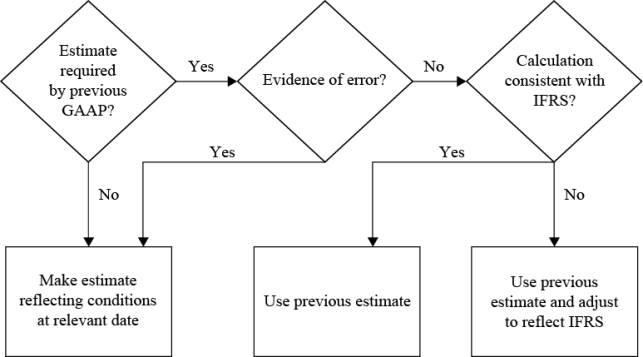
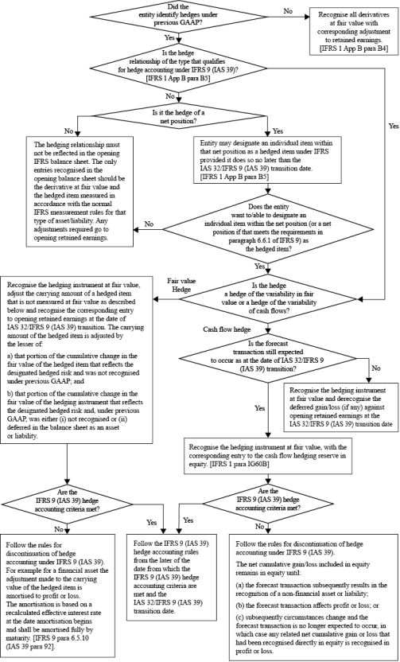

# 02 - First-time adoption of IFRS (IFRS 1)

[返回目录](README.md)

# 02 - First-time adoption of IFRS (IFRS 1)

Contents

- [02 - First-time adoption of IFRS (IFRS 1)](08.md#s12-chap_02_toc_h1)

- [Introduction and scope (paras 2.1-2.19)](08.md#s13-chap_02_navPoint_1)

- [Objective and scope](08.md#s13-chap_02_navPoint_2)

- [First IFRS financial statements](08.md#s13-chap_02_navPoint_3)

- [Repeated first-time application](08.md#s13-chap_02_navPoint_4)

- [Recognition and measurement](08.md#s13-chap_02_navPoint_5)

- [Date of transition](08.md#s13-chap_02_navPoint_idp1687626520)

- [Accounting policies](08.md#s13-chap_02_navPoint_6)

- [Accounting policies throughout first IFRS financial statements](08.md#s13-chap_02_navPoint_idp1687632664)

- [Standards not mandatory at the end of an entity’s first IFRS reporting period](08.md#s13-chap_02_navPoint_idp1687642904)

- [Initial recognition and measurement](08.md#s13-chap_02_navPoint_7)

- [Deferred tax impacts](08.md#s13-chap_02_navPoint_8)

- [Mandatory exceptions and optional exemptions from full retrospective application](08.md#s13-chap_02_navPoint_9)

- [Exceptions (paras 2.20-2.44)](08.md#s14-chap_02_navPoint_10)

- [Estimates](08.md#s14-chap_02_navPoint_11)

- [Derecognition of financial assets and liabilities](08.md#s14-chap_02_navPoint_12)

- [Hedge accounting](08.md#s14-chap_02_navPoint_13)

- [Non-controlling interests](08.md#s14-chap_02_navPoint_14)

- [Classification and measurement of financial assets](08.md#s14-chap_02_navPoint_15)

- [Embedded derivatives](08.md#s14-chap_02_navPoint_16)

- [Impairment of financial assets](08.md#s14-chap_02_navPoint_17)

- [Government loans](08.md#s14-chap_02_navPoint_18)

- [Exemptions (paras 2.45- 2.136)](08.md#s15-chap_02_navPoint_19)

- [Business combinations](08.md#s15-chap_02_navPoint_20)

- [Classification](08.md#s15-chap_02_navPoint_idp1684555800)

- [Recognition](08.md#s15-chap_02_navPoint_idp1684558744)

- [Measurement](08.md#s15-chap_02_navPoint_idp1684577432)

- [Goodwill](08.md#s15-chap_02_navPoint_idp1684596120)

- [Deferred tax and business combinations](08.md#s15-chap_02_navPoint_idp1684610968)

- [Foreign currency](08.md#s15-chap_02_navPoint_idp1684614552)

- [Subsidiaries not previously consolidated](08.md#s15-chap_02_navPoint_idp1684634904)

- [Associates and joint ventures](08.md#s15-chap_02_navPoint_idp1687719448)

- [Interaction of business combinations and deemed cost exemptions](08.md#s15-chap_02_navPoint_idp1687730584)

- [Interaction of business combinations exemption and estimates exception](08.md#s15-chap_02_navPoint_idp1687737624)

- [Share-based payment transactions](08.md#s15-chap_02_navPoint_21)

- [Grants to which IFRS 2 does not apply](08.md#s15-chap_02_navPoint_idp1687347496)

- [Insurance contracts](08.md#s15-chap_02_navPoint_22)

- [Deemed cost](08.md#s15-chap_02_navPoint_23)

- [Assets measured at depreciated cost under IFRS](08.md#s15-chap_02_navPoint_idp1684051736)

- [Assets measured at revaluation under IFRS](08.md#s15-chap_02_navPoint_idp1684094104)

- [Assets other than property, plant and equipment](08.md#s15-chap_02_navPoint_idp1684100504)

- [Leases](08.md#s15-chap_02_navPoint_24)

- [Cumulative translation differences](08.md#s15-chap_02_navPoint_25)

- [Investments in subsidiaries, joint ventures and associates](08.md#s15-chap_02_navPoint_26)

- [Assets and liabilities of subsidiaries, associates and joint ventures](08.md#s15-chap_02_navPoint_27)

- [a) Subsidiary, joint venture or associate adopts later than group](08.md#s15-chap_02_navPoint_idp1687250072)

- [b) Group adopts later than subsidiary, joint venture or associate](08.md#s15-chap_02_navPoint_idp1687272344)

- [c) Parent entities adopting earlier or later than the group](08.md#s15-chap_02_navPoint_idp1687279000)

- [Compound financial instruments](08.md#s15-chap_02_navPoint_28)

- [Designation of previously recognised financial instruments](08.md#s15-chap_02_navPoint_29)

- [Fair value measurement of financial assets or financial liabilities at initial recognition](08.md#s15-chap_02_navPoint_30)

- [Decommissioning liabilities included in the cost of property, plant and equipment](08.md#s15-chap_02_navPoint_31)

- [Financial assets or intangible assets accounted for in accordance with IFRIC 12](08.md#s15-chap_02_navPoint_32)

- [Borrowing costs](08.md#s15-chap_02_navPoint_33)

- [Designation of contracts to buy or sell a non-financial item](08.md#s15-chap_02_navPoint_34)

- [Severe hyper-inflation](08.md#s15-chap_02_navPoint_35)

- [Joint arrangements](08.md#s15-chap_02_navPoint_36)

- [Stripping costs in the production phase of a surface mine](08.md#s15-chap_02_navPoint_37)

- [Extinguishing financial liabilities with equity instruments](08.md#s15-chap_02_navPoint_38)

- [Regulatory deferral accounts (IFRS 14)](08.md#s15-chap_02_navPoint_39)

- [Customer contracts](08.md#s15-chap_02_navPoint_40)

- [Presentation and disclosure (paras 2.137 - 2.156)](08.md#s16-chap_02_navPoint_41)

- [Comparative information](08.md#s16-chap_02_navPoint_42)

- [Other comparative information](08.md#s16-chap_02_navPoint_43)

- [Comparative information on the application of IFRS 9](08.md#s16-chap_02_navPoint_44)

- [Reconciliations](08.md#s16-chap_02_navPoint_45)

- [Errors under previous GAAP](08.md#s16-chap_02_navPoint_46)

- [Designation of financial assets or financial liabilities](08.md#s16-chap_02_navPoint_47)

- [Use of fair value as deemed cost](08.md#s16-chap_02_navPoint_48)

- [Use of deemed cost for investments in subsidiaries, joint ventures and associates](08.md#s16-chap_02_navPoint_49)

- [Use of deemed cost for oil and gas assets](08.md#s16-chap_02_navPoint_50)

- [Use of deemed cost for operations subject to rate regulation](08.md#s16-chap_02_navPoint_51)

- [Interim financial reports](08.md#s16-chap_02_navPoint_52)

- [Illustrative text](08.md#s17-chap_02_navPoint_53)

- [FAQ 2.6.1 – Is the context relevant?](08.md#s17-chap_02_navPoint_54)

- [FAQ 2.6.2 – Does group reporting financial information qualify as IFRS financial statements?](08.md#s17-chap_02_navPoint_55)

- [FAQ 2.6.3 – Where the most recent financial statements previously complied with some, but not all, IFRS standards, will the financial statements qualify as first IFRS financial statements?](08.md#s17-chap_02_navPoint_56)

- [FAQ 2.7.1 – For an entity that has historically been preparing financial statements using multiple GAAPs, none of which are IFRS, what is its previous GAAP for the purpose of its first set of IFRS financial statements?](08.md#s17-chap_02_navPoint_57)

- [EX 2.7.2 – First IFRS financial statements: no comparative information presented](08.md#s17-chap_02_navPoint_58)

- [EX 2.8.1 – First IFRS financial statements: qualified audit opinion for the impact of a qualification for non-compliance with IFRS](08.md#s17-chap_02_navPoint_59)

- [EX 2.9.1 – Repeated first-time adoption in connection with an IPO](08.md#s17-chap_02_navPoint_60)

- [EX 2.9.2 – Repeated first-time adoption](08.md#s17-chap_02_navPoint_61)

- [EX 2.12.1 – Standards in force at the end of the first IFRS reporting period not yet known](08.md#s17-chap_02_navPoint_62)

- [EX 2.12.2 – Change in accounting policies during year of first-time adoption](08.md#s17-chap_02_navPoint_63)

- [EX 2.16.1 – IAS 39 guidance for the treatment of financial assets measured at fair value with changes in equity on adoption of IFRS](08.md#s17-chap_02_navPoint_64)

- [EX 2.24.1 – Estimates: compound financial instrument](08.md#s17-chap_02_navPoint_65)

- [EX 2.24.2 – Estimates: legal provision](08.md#s17-chap_02_navPoint_66)

- [EX 2.24.3 – Estimates: bad debt impairment](08.md#s17-chap_02_navPoint_67)

- [EX 2.24.4 – Estimates on first-time adoption of IFRS](08.md#s17-chap_02_navPoint_68)

- [EX 2.31.1 – Fair value hedge accounting for financial assets measured at amortised cost](08.md#s17-chap_02_navPoint_69)

- [EX 2.31.2 – Fair value hedge accounting for financial assets at FVOCI under IFRS 9](08.md#s17-chap_02_navPoint_70)

- [EX 2.33.1 – Cash flow hedge accounting](08.md#s17-chap_02_navPoint_71)

- [EX 2.37.4 – Discontinue of fair value hedge accounting: instrument at fair value through other comprehensive income](08.md#s17-chap_02_navPoint_72)

- [EX 2.37.5 – Discontinue of cash flow hedge accounting: loan](08.md#s17-chap_02_navPoint_73)

- [EX 2.37.6 – Discontinue of cash flow hedge accounting: forecast transaction](08.md#s17-chap_02_navPoint_74)

- [FAQ 2.46.1 – What version of IFRS 3 should a first-time adopter use?](08.md#s17-chap_02_navPoint_75)

- [EX 2.48.1 – IFRS 3 exemption from date prior to transition date](08.md#s17-chap_02_navPoint_76)

- [EX 2.48.2 – Business combination not included in the previous GAAP financial statements](08.md#s17-chap_02_navPoint_77)

- [EX 2.48.3 – IFRS 3 exemption: step acquisition](08.md#s17-chap_02_navPoint_78)

- [EX 2.48.4 – IFRS 3 exemption: business combination classification under previous GAAP](08.md#s17-chap_02_navPoint_79)

- [EX 2.51.1 – Recognition of intangible assets when using IFRS 3 exemption](08.md#s17-chap_02_navPoint_80)

- [EX 2.51.2 – IFRS 3 exemption: treatment of in-process research and development (IPR&amp;D) costs](08.md#s17-chap_02_navPoint_81)

- [EX 2.54.1 – First-time adoption for business combinations: derecognition of liability](08.md#s17-chap_02_navPoint_82)

- [EX 2.54.2 – First-time adoption for business combinations: derecognition of intangible asset](08.md#s17-chap_02_navPoint_83)

- [EX 2.54.4 – First-time adoption for business combinations: measurement of intangible assets](08.md#s17-chap_02_navPoint_84)

- [EX 2.54.5 – First-time adoption for business combinations: measurement of provisions](08.md#s17-chap_02_navPoint_85)

- [EX 2.54.6 – First-time adoption for business combinations: measurement of finance lease under IFRS 16](08.md#s17-chap_02_navPoint_86)

- [EX 2.58.1 – First-time adoption for business combinations: goodwill](08.md#s17-chap_02_navPoint_87)

- [EX 2.62.1 – Deferred tax: intangible asset recognised through acquisition](08.md#s17-chap_02_navPoint_88)

- [EX 2.67.1 – Subsidiary not previously consolidated but required to be under IFRS](08.md#s17-chap_02_navPoint_89)

- [EX 2.70.1 – First-time adoption: IFRS 5 ‘held for sale’ criteria not met](08.md#s17-chap_02_navPoint_90)

- [EX 2.76.1 – Business combination and deemed cost exemptions](08.md#s17-chap_02_navPoint_91)

- [EX 2.77.1 – Business combinations exemption and estimates exception](08.md#s17-chap_02_navPoint_92)

- [EX 2.78.1 – Application of IFRS 2 requirements](08.md#s17-chap_02_navPoint_93)

- [EX 2.78.2 – Modification of terms and conditions](08.md#s17-chap_02_navPoint_94)

- [EX 2.79.1 – Application of IFRS 2 on transition](08.md#s17-chap_02_navPoint_95)

- [EX 2.90.1 – Previous GAAP revaluation as a deemed cost](08.md#s17-chap_02_navPoint_96)

- [EX 2.92.1 – Assets measured at revaluation and depreciated cost under IFRS](08.md#s17-chap_02_navPoint_98)

- [EX 2.92.2 – Deemed cost exemption](08.md#s17-chap_02_navPoint_99)

- [EX 2.92.3 – Deemed cost exemption: decommissioning obligation provisions](08.md#s17-chap_02_navPoint_100)

- [EX 2.92.4 – Revaluation under previous GAAP as deemed cost where an entity’s functional currency is different from the local reporting currency](08.md#s17-chap_02_navPoint_101)

- [EX 2.97.1 – Exemptions for leases](08.md#s17-chap_02_navPoint_102)

- [EX 2.104.1 – Subsidiary is acquired after transition date of its parent](08.md#s17-chap_02_navPoint_103)

- [EX 2.104.2 – Compliance of parent’s financial statements with IFRS](08.md#s17-chap_02_navPoint_104)

- [EX 2.105.1 – Subsidiary adopts IFRS later than group: effect on goodwill](08.md#s17-chap_02_navPoint_105)

- [EX 2.106.1 – Subsidiary adopts IFRS later than group: measurement of assets and liabilities](08.md#s17-chap_02_navPoint_106)

- [EX 2.106.2 – Entity creates a new entity to be its parent](08.md#s17-chap_02_navPoint_107)

- [EX 2.106.3 – Subsidiary adopts IFRS later than group: measurement of cumulative translation adjustment (CTA)](08.md#s17-chap_02_navPoint_108)

- [EX 2.110.1 – Group adopts IFRS later than associate](08.md#s17-chap_02_navPoint_109)

- [EX 2.111.1 – Parent adopts IFRS later than subsidiary: property, plant and equipment measurement](08.md#s17-chap_02_navPoint_110)

- [EX 2.112.1 – Compound financial instruments](08.md#s17-chap_02_navPoint_111)

- [EX 2.113.1 – Compound financial instruments: liability component outstanding at transition date](08.md#s17-chap_02_navPoint_112)

- [EX 2.141.1 – Presenting more than the IFRS 1 required comparative information](08.md#s17-chap_02_navPoint_113)

- [EX 2.141.2 – Presenting comparative information that is incomplete](08.md#s17-chap_02_navPoint_114)

- [EX 2.143.1 – Reconciliations: periods to be presented](08.md#s17-chap_02_navPoint_115)

- [EX 2.143.2 – Carve-out financial statements](08.md#s17-chap_02_navPoint_116)

- [EX 2.151.1 – Reconciliations to be presented on interim periods](08.md#s17-chap_02_navPoint_119)

- [EX 2.152.1 – Opening balance sheet on interim periods](08.md#s17-chap_02_navPoint_120)

- [EX 2.153.1 – Reconciliations required for first IFRS interim financial statements](08.md#s17-chap_02_navPoint_121)

- [EX 2.153.2 – Reconciliations required where an issuer does not begin using IFRS in a quarterly report](08.md#s17-chap_02_navPoint_122)

- [EX 2.154.1 – Reconciliations to be included in different interim financial reports](08.md#s17-chap_02_navPoint_123)

- [EX 2.156.1 – Year of transition to IFRS: interim financial report disclosures with many differences from previous GAAP](08.md#s17-chap_02_navPoint_124)

 

This eBook is licensed to peggy so, peggy.so@hk.ey.com, 

## Introduction and scope (paras 2.1-2.19)

 

**2.1** The underlying principle of IFRS 1 is retrospective application of the standards in force at the end of an entity’s first IFRS reporting period. Entities use the standards in force at the end of the latest period covered by theitr first IFRS financial statements in their opening IFRS balance sheet and throughout all periods presented in their first IFRS financial statements. There are specific optional exemptions and some mandatory exceptions from this general requirement.

**2.2**Guidance on first-time adoption is contained within IFRS 1, except where it explicitly refers to other standards. The transition rules of other standards do not apply to first-time adopters, except where specified in IFRS 1. New standards generally include any necessary amendments to IFRS 1.

[IFRS 1 para 9].

 

### Objective and scope

 

**2.3** An entity’s first IFRS financial statements, and any interim financial reports for part of the period covered by those first IFRS financial statements, should contain high-quality information that:

- Is transparent and comparable over all periods presented ([see para 2.11](08.md#s13-Para_2.11)).

- Gives a good starting point for using IFRS.

- Can be produced at a cost that does not exceed the benefit to users.

[IFRS 1 para 1].

**2.4** IFRS 1 is applicable to all entities’ first IFRS financial statements and to interim financial reports presented under IAS 34, for part of the period covered by its first IFRS financial statements. Interim financial reporting for first-time adopters is explained at [paragraph 2.151 onwards](08.md#s16-Para_2.151).

[IFRS 1 para 2].

 

### First IFRS financial statements

 

**2.5** Financial statements are an entity’s ‘first IFRS financial statements’ when the entity adopts International Financial Reporting Standards (IFRS standards) by including an explicit and unreserved statement of compliance with all IFRS standards.

[IFRS 1 App A].

**2.6** Financial statements in accordance with IFRS standards are an entity’s first IFRS financial statements if, for example, the entity’s most recent previous financial statements:

- are not consistent with IFRS standards in all respects;

- do not contain an explicit and unreserved statement of compliance, even where they conform with IFRS standards in all respects (this would generally be the case for financial reporting information prepared for group reporting purposes);

- state that they are consistent with some, but not all, IFRS standards;

- apply national requirements and some IFRS standards for specific items; or

- apply national requirements with a reconciliation to IFRS standards.

[IFRS 1 para 3(a)].

[FAQ 2.6.1 – Is the context relevant?](08.md#s17-FAQ_2.6.1)

[FAQ 2.6.2 – Does group reporting financial information qualify as IFRS financial statements?](08.md#s17-FAQ_2.6.2)

[FAQ 2.6.3 – Where the most recent financial statements previously complied with some, but not all, IFRS standards, will the financial statements qualify as first IFRS financial statements?](08.md#s17-FAQ_2.6.3)

**2.7** Financial statements might also be an entity’s first IFRS financial statements where its previous financial statements:

- were prepared for internal use, without making them available to owners or other external users;

- were prepared for consolidation or group reporting purposes, but are not a complete set of financial statements under IAS 1; or

- do not contain comparatives.

[IFRS 1 para 3(b)–(d)].

[FAQ 2.7.1 – For an entity that has historically been preparing financial statements using multiple GAAPs, none of which are IFRS, what is its previous GAAP for the purpose of its first set of IFRS financial statements?](08.md#s17-FAQ_2.7.1)

[EX 2.7.2 – First IFRS financial statements: no comparative information presented](08.md#s17-EX2.7.2)

**2.8** Financial statements are not ‘first IFRS financial statements’ and IFRS 1 is not applied where:

- an entity previously prepared both IFRS (containing an explicit and unreserved statement of compliance) and local (national) financial statements, but then stopped presenting the local financial statements;

- the previous year’s financial statements were in accordance with national requirements and contained an explicit and unreserved statement of compliance with IFRS standards; or

- the previous year’s financial statements contained an explicit statement of compliance with IFRS standards, but the auditors’ report was qualified (other than where the qualification relates to non-compliance with IFRS standards).

[IFRS 1 para 4].

[EX 2.8.1 – First IFRS financial statements: qualified audit opinion for the impact of a qualification for non-compliance with IFRS](08.md#s17-EX2.8.1)

 

### Repeated first-time application

 

**2.9** An entity can be a first-time adopter more than once. An entity might cease applying IFRS standards for various reasons and then decide to adopt IFRS standards again, although this would be unusual and could give rise to regulatory scrutiny. There might be a difference between the requirements for general purpose statutory financial statements and financial statements prepared to comply with specific regulatory requirements (for example, in an IPO). This might lead to the situation of an entity having more than one adoption date.

[IFRS 1 para 4A].

[EX 2.9.1 – Repeated first-time adoption in connection with an IPO](08.md#s17-EX2.9.1)

[EX 2.9.2 – Repeated first-time adoption](08.md#s17-EX2.9.2)

 

### Recognition and measurement

#### Date of transition

**2.10** The date of transition is the beginning of the earliest period for which an entity presents full comparative information under IFRS standards in its first IFRS financial statements. IFRS 1 requires an entity to prepare and present an opening balance sheet as a primary statement at the date of transition to IFRS standards. IFRS 1 does not require an entity to present an opening balance sheet in its interim financial report in the year of first-time adoption. However, this is good information for users and can be included either in the interim financial report or in a previously issued transition document. Comparative periods are discussed in more detail in [paragraph 2.138](08.md#s16-Para_2.138).

[IFRS 1 para 6]. [IFRS 1 App A].

### Accounting policies

#### Accounting policies throughout first IFRS financial statements

 

**2.11** Entities should use the same accounting policies throughout their first IFRS financial statements and in their opening IFRS balance sheet. These accounting policies should be those complying with the accounting standards effective at the end of an entity’s first IFRS reporting period. An entity’s first IFRS reporting period is the “latest reporting period covered by an entity’s first IFRS financial statements”. An entity adopting IFRS standards for the first time should use the current version of an IFRS standard throughout the periods presented in its first IFRS financial statements.

[IFRS 1 para 7].

**2.12** The IAS 8 disclosures for changes in accounting policies are not required for a first-time adopter. IAS 8 also does not apply to changes made to accounting policies during the period of an entity’s first IFRS financial statements. This includes a change in policy between publication of an entity’s first IFRS interim report and the entity’s first IFRS financial statements. However, an entity must explain any changes in its first IFRS financial statements and provide updated reconciliations (see further [para 2.143](08.md#s16-Para_2.143)). This disclosure requirement also applies where an entity changes its use of the exemptions in IFRS 1 between the interim report and its first IFRS financial statements.

[IFRS 1 para 27].

[EX 2.12.1 – Standards in force at the end of the first IFRS reporting period not yet known](08.md#s17-EX2.12.1)

[EX 2.12.2 – Change in accounting policies during year of first-time adoption](08.md#s17-EX2.12.2)

 

#### Standards not mandatory at the end of an entity’s first IFRS reporting period

**2.13** If an IFRS standard is not mandatory at the end of an entity’s first IFRS reporting period, but it allows early adoption, that IFRS standard can be used in the entity’s first IFRS financial statements. IFRS 1 does not require an entity to use a more recent version of an IFRS standard, but rather explains the advantages of applying a more recent version of an IFRS standard.

[IFRS 1 para 8].

**2.14** Entities do not have to base their choice of policies, when first applying IFRS standards, on the policies applied under their previous GAAP.

[IFRS 1 para 11].

### Initial recognition and measurement

 

**2.15** All items in an entity’s opening IFRS balance sheet should be recognised and measured in accordance with the standards in force at the end of an entity’s first IFRS reporting period. These requirements are applied retrospectively as follows:

- Recognise all assets and liabilities whose recognition is required by IFRSs standards.

- Do not recognise items as assets or liabilities if IFRS standards do not permit such recognition.

- Reclassify items that were recognised as one type of asset, liability or component of equity under previous GAAP, but that are a different type of asset, liability or component of equity under IFRSs standard.

- Apply IFRS standards in measuring all recognised assets and liabilities.

[IFRS 1 para 10].

**2.16** Most changes made on adoption of IFRS standards should be dealt with as adjustments to retained earnings or another appropriate category of equity at the date of transition. Certain assets might be measured at fair value with changes in equity. The adjustments to recognise those items should be made to a category of equity other than retained earnings, as follows:

- The difference between the fair value at initial recognition and the fair value at the date of transition, for financial assets classified at fair value through other comprehensive income, less any amounts recycled.

- The result of remeasuring derivative financial instruments classified as cash flow hedges in accordance with IFRS 9.

- The difference between cost of property, plant and equipment and fair value where the allowed alternative in IAS 16 is adopted.

There are limited circumstances in which adjustments on transition are made against goodwill (see further [para 2.55](08.md#s15-Para_2.55)).

[IFRS 1 para 11].

 

### Deferred tax impacts

 

**2.17** Entities will apply IAS 12 at the date of transition. There will be deferred tax impacts from some of the accounting policy changes that are made on transition to IFRS standards or on use of exemptions in IFRS 1. An entity should apply IAS 12 to temporary differences between the carrying amount of the assets and liabilities and their tax bases as at the date of its opening IFRS balance sheet. These deferred tax impacts should also be accounted for as part of the adjustments made on transition, against retained earnings or another appropriate category of equity. In limited circumstances, deferred tax is adjusted against goodwill (see further [para 2.55](08.md#s15-Para_2.55)).

[IFRS 1 para IG5].

 

### Mandatory exceptions and optional exemptions from full retrospective application

 

**2.18**The general requirement of IFRS 1 is full retrospective application of all accounting standards effective at the end of an entity’s first IFRS reporting period. IFRS 1 has two categories of exceptions to full retrospective application – mandatory exceptions and optional exemptions.

[IFRS 1 para 12].

**2.19**The exceptions and exemptions, and their application, are summarised below:

<table style="width:100%; border-collapse:collapse"><tr><td style="border:0.75pt solid #000000; padding-right:5.03pt; padding-left:5.03pt; vertical-align:top">
<b>Mandatory exceptions from full retrospective application</b>
</td><td style="border:0.75pt solid #000000; padding-right:5.03pt; padding-left:5.03pt; vertical-align:top">
<b>Scope – exception applies to</b>
</td><td style="border:0.75pt solid #000000; padding-right:5.03pt; padding-left:5.03pt; vertical-align:top">
<b>Dealt with from (para)</b>
</td></tr><tr><td style="border:0.75pt solid #000000; padding-right:5.03pt; padding-left:5.03pt; vertical-align:top">
Estimates
</td><td style="border:0.75pt solid #000000; padding-right:5.03pt; padding-left:5.03pt; vertical-align:top">
All estimates, unless the bases adopted are not compliant with IFRS
</td><td style="border:0.75pt solid #000000; padding-right:5.03pt; padding-left:5.03pt; vertical-align:top">
<a href="08.md#s14-Para_2.20">2.20</a>
</td></tr><tr><td style="border:0.75pt solid #000000; padding-right:5.03pt; padding-left:5.03pt; vertical-align:top">
Derecognition of financial assets and liabilities
</td><td style="border:0.75pt solid #000000; padding-right:5.03pt; padding-left:5.03pt; vertical-align:top">
All non-derivative financial assets and liabilities derecognised before the date of transition, unless the entity decides to adjust retrospectively under paragraph B3 of IFRS 1
</td><td style="border:0.75pt solid #000000; padding-right:5.03pt; padding-left:5.03pt; vertical-align:top">
<a href="08.md#s14-Para_2.25">2.25</a>
</td></tr><tr><td style="border:0.75pt solid #000000; padding-right:5.03pt; padding-left:5.03pt; vertical-align:top">
Hedge accounting
</td><td style="border:0.75pt solid #000000; padding-right:5.03pt; padding-left:5.03pt; vertical-align:top">
All hedging relationships in existence from accounting periods beginning prior to adoption of IFRS 9
</td><td style="border:0.75pt solid #000000; padding-right:5.03pt; padding-left:5.03pt; vertical-align:top">
<a href="08.md#s14-Para_2.27">2.27</a>
</td></tr><tr><td style="border:0.75pt solid #000000; padding-right:5.03pt; padding-left:5.03pt; vertical-align:top">
Non-controlling interests
</td><td style="border:0.75pt solid #000000; padding-right:5.03pt; padding-left:5.03pt; vertical-align:top">
All equity in a subsidiary not attributable, directly or indirectly, to a parent
</td><td style="border:0.75pt solid #000000; padding-right:5.03pt; padding-left:5.03pt; vertical-align:top">
<a href="08.md#s14-Para_2.38">2.38</a>
</td></tr><tr><td style="border:0.75pt solid #000000; padding-right:5.03pt; padding-left:5.03pt; vertical-align:top">
Classification and measurement of financial assets
</td><td style="border:0.75pt solid #000000; padding-right:5.03pt; padding-left:5.03pt; vertical-align:top">
All financial assets at the transition date
</td><td style="border:0.75pt solid #000000; padding-right:5.03pt; padding-left:5.03pt; vertical-align:top">
<a href="08.md#s14-Para_2.40">2.40</a>
</td></tr><tr><td style="border:0.75pt solid #000000; padding-right:5.03pt; padding-left:5.03pt; vertical-align:top">
Embedded derivatives
</td><td style="border:0.75pt solid #000000; padding-right:5.03pt; padding-left:5.03pt; vertical-align:top">
All embedded derivatives
</td><td style="border:0.75pt solid #000000; padding-right:5.03pt; padding-left:5.03pt; vertical-align:top">
<a href="08.md#s14-Para_2.41">2.41</a>
</td></tr><tr><td style="border:0.75pt solid #000000; padding-right:5.03pt; padding-left:5.03pt; vertical-align:top">
Impairment of financial assets
</td><td style="border:0.75pt solid #000000; padding-right:5.03pt; padding-left:5.03pt; vertical-align:top">
Application of the impairment requirements of IFRS 9
</td><td style="border:0.75pt solid #000000; padding-right:5.03pt; padding-left:5.03pt; vertical-align:top">
<a href="08.md#s14-Para_2.43">2.43</a>
</td></tr><tr><td style="border:0.75pt solid #000000; padding-right:5.03pt; padding-left:5.03pt; vertical-align:top">
Government loans
</td><td style="border:0.75pt solid #000000; padding-right:5.03pt; padding-left:5.03pt; vertical-align:top">
All government grants classified as financial liabilities under IAS 32
</td><td style="border:0.75pt solid #000000; padding-right:5.03pt; padding-left:5.03pt; vertical-align:top">
<a href="08.md#s14-Para_2.44">2.44</a>
</td></tr><tr><td style="border:0.75pt solid #000000; padding-right:5.03pt; padding-left:5.03pt; vertical-align:top">
<b>Optional exemptions from full retrospective application</b>
</td><td style="border:0.75pt solid #000000; padding-right:5.03pt; padding-left:5.03pt; vertical-align:top">
<b>Scope – exemption, where taken, applies to</b>
</td><td style="border:0.75pt solid #000000; padding-right:5.03pt; padding-left:5.03pt; vertical-align:top">
<b>Dealt with from (para)</b>
</td></tr><tr><td style="border:0.75pt solid #000000; padding-right:5.03pt; padding-left:5.03pt; vertical-align:top">
Business combinations
</td><td style="border:0.75pt solid #000000; padding-right:5.03pt; padding-left:5.03pt; vertical-align:top">
All business combinations prior to the transition date; or, if the entity chooses to apply IFRS 3 to a combination prior to the transition date, all combinations prior to that date
</td><td style="border:0.75pt solid #000000; padding-right:5.03pt; padding-left:5.03pt; vertical-align:top">
<a href="08.md#s15-Para_2.46">2.46</a>
</td></tr><tr><td style="border:0.75pt solid #000000; padding-right:5.03pt; padding-left:5.03pt; vertical-align:top">
Share-based payment transactions
</td><td style="border:0.75pt solid #000000; padding-right:5.03pt; padding-left:5.03pt; vertical-align:top">
Equity instruments granted on or before 7 November 2002, or equity instruments granted after 7 November 2002 and vested by the date of transition
</td><td style="border:0.75pt solid #000000; padding-right:5.03pt; padding-left:5.03pt; vertical-align:top">
<a href="08.md#s15-Para_2.78">2.78</a>
</td></tr><tr><td style="border:0.75pt solid #000000; padding-right:5.03pt; padding-left:5.03pt; vertical-align:top">
Insurance contracts
</td><td style="border:0.75pt solid #000000; padding-right:5.03pt; padding-left:5.03pt; vertical-align:top">
All insurance contracts
</td><td style="border:0.75pt solid #000000; padding-right:5.03pt; padding-left:5.03pt; vertical-align:top">
<a href="08.md#s15-Para_2.80">2.80</a>
</td></tr><tr><td style="border:0.75pt solid #000000; padding-right:5.03pt; padding-left:5.03pt; vertical-align:top">
Deemed cost
</td><td style="border:0.75pt solid #000000; padding-right:5.03pt; padding-left:5.03pt; vertical-align:top">
Any tangible fixed asset, investment property and a limited number of intangible assets
</td><td style="border:0.75pt solid #000000; padding-right:5.03pt; padding-left:5.03pt; vertical-align:top">
<a href="08.md#s15-Para_2.81">2.81</a>
</td></tr><tr><td style="border:0.75pt solid #000000; padding-right:5.03pt; padding-left:5.03pt; vertical-align:top">
Leases
</td><td style="border:0.75pt solid #000000; padding-right:5.03pt; padding-left:5.03pt; vertical-align:top">
All arrangements that contain a lease
</td><td style="border:0.75pt solid #000000; padding-right:5.03pt; padding-left:5.03pt; vertical-align:top">
<a href="08.md#s15-Para_2.95">2.95</a>
</td></tr><tr><td style="border:0.75pt solid #000000; padding-right:5.03pt; padding-left:5.03pt; vertical-align:top">
Cumulative translation differences
</td><td style="border:0.75pt solid #000000; padding-right:5.03pt; padding-left:5.03pt; vertical-align:top">
All cumulative translation differences existing at the date of transition
</td><td style="border:0.75pt solid #000000; padding-right:5.03pt; padding-left:5.03pt; vertical-align:top">
<a href="08.md#s15-Para_2.99">2.99</a>
</td></tr><tr><td style="border:0.75pt solid #000000; padding-right:5.03pt; padding-left:5.03pt; vertical-align:top">
Investments in subsidiaries, joint ventures and associates
</td><td style="border:0.75pt solid #000000; padding-right:5.03pt; padding-left:5.03pt; vertical-align:top">
Any investments in subsidiaries, joint ventures and associates in separate financial statements
</td><td style="border:0.75pt solid #000000; padding-right:5.03pt; padding-left:5.03pt; vertical-align:top">
<a href="08.md#s15-Para_2.100">2.100</a>
</td></tr><tr><td style="border:0.75pt solid #000000; padding-right:5.03pt; padding-left:5.03pt; vertical-align:top">
Assets and liabilities of subsidiaries, associates and joint ventures
</td><td style="border:0.75pt solid #000000; padding-right:5.03pt; padding-left:5.03pt; vertical-align:top">
All such assets and liabilities whose transition date is different from that of the parent/group
</td><td style="border:0.75pt solid #000000; padding-right:5.03pt; padding-left:5.03pt; vertical-align:top">
<a href="08.md#s15-Para_2.104">2.104</a>
</td></tr><tr><td style="border:0.75pt solid #000000; padding-right:5.03pt; padding-left:5.03pt; vertical-align:top">
Compound financial instruments (from the issuer perspective)
</td><td style="border:0.75pt solid #000000; padding-right:5.03pt; padding-left:5.03pt; vertical-align:top">
All compound financial instruments where the liability component has been settled by the date of transition
</td><td style="border:0.75pt solid #000000; padding-right:5.03pt; padding-left:5.03pt; vertical-align:top">
<a href="08.md#s15-Para_2.112">2.112</a>
</td></tr><tr><td style="border:0.75pt solid #000000; padding-right:5.03pt; padding-left:5.03pt; vertical-align:top">
Designation of previously recognised financial instruments
</td><td style="border:0.75pt solid #000000; padding-right:5.03pt; padding-left:5.03pt; vertical-align:top">
Any financial instrument
</td><td style="border:0.75pt solid #000000; padding-right:5.03pt; padding-left:5.03pt; vertical-align:top">
<a href="08.md#s15-Para_2.114">2.114</a>
</td></tr><tr><td style="border:0.75pt solid #000000; padding-right:5.03pt; padding-left:5.03pt; vertical-align:top">
Fair value measurement of financial assets or financial liabilities at initial recognition
</td><td style="border:0.75pt solid #000000; padding-right:5.03pt; padding-left:5.03pt; vertical-align:top">
All relevant financial assets or financial liabilities
</td><td style="border:0.75pt solid #000000; padding-right:5.03pt; padding-left:5.03pt; vertical-align:top">
<a href="08.md#s15-Para_2.118">2.118</a>
</td></tr><tr><td style="border:0.75pt solid #000000; padding-right:5.03pt; padding-left:5.03pt; vertical-align:top">
Decommissioning liabilities included in the cost of property, plant and equipment
</td><td style="border:0.75pt solid #000000; padding-right:5.03pt; padding-left:5.03pt; vertical-align:top">
All decommissioning liabilities
</td><td style="border:0.75pt solid #000000; padding-right:5.03pt; padding-left:5.03pt; vertical-align:top">
<a href="08.md#s15-Para_2.120">2.120</a>
</td></tr><tr><td style="border:0.75pt solid #000000; padding-right:5.03pt; padding-left:5.03pt; vertical-align:top">
Financial assets or intangible assets accounted for in accordance with IFRIC 12
</td><td style="border:0.75pt solid #000000; padding-right:5.03pt; padding-left:5.03pt; vertical-align:top">
All relevant financial assets or intangible assets accounted for in accordance with IFRIC 12
</td><td style="border:0.75pt solid #000000; padding-right:5.03pt; padding-left:5.03pt; vertical-align:top">
<a href="08.md#s15-Para_2.123">2.123</a>
</td></tr><tr><td style="border:0.75pt solid #000000; padding-right:5.03pt; padding-left:5.03pt; vertical-align:top">
Borrowing costs
</td><td style="border:0.75pt solid #000000; padding-right:5.03pt; padding-left:5.03pt; vertical-align:top">
All borrowing costs
</td><td style="border:0.75pt solid #000000; padding-right:5.03pt; padding-left:5.03pt; vertical-align:top">
<a href="08.md#s15-Para_2.124">2.124</a>
</td></tr><tr><td style="border:0.75pt solid #000000; padding-right:5.03pt; padding-left:5.03pt; vertical-align:top">
Designation of contracts to buy or sell a non-financial item
</td><td style="border:0.75pt solid #000000; padding-right:5.03pt; padding-left:5.03pt; vertical-align:top">
Elimination of ‘accounting mismatches’
</td><td style="border:0.75pt solid #000000; padding-right:5.03pt; padding-left:5.03pt; vertical-align:top">
<a href="08.md#s15-Para_2.126">2.126</a>
</td></tr><tr><td style="border:0.75pt solid #000000; padding-right:5.03pt; padding-left:5.03pt; vertical-align:top">
Severe hyper-inflation
</td><td style="border:0.75pt solid #000000; padding-right:5.03pt; padding-left:5.03pt; vertical-align:top">
Any entity with functional currency that was, or is, the currency of a hyper-inflationary economy
</td><td style="border:0.75pt solid #000000; padding-right:5.03pt; padding-left:5.03pt; vertical-align:top">
<a href="08.md#s15-Para_2.127">2.127</a>
</td></tr><tr><td style="border:0.75pt solid #000000; padding-right:5.03pt; padding-left:5.03pt; vertical-align:top">
Joint arrangements
</td><td style="border:0.75pt solid #000000; padding-right:5.03pt; padding-left:5.03pt; vertical-align:top">
A first-time adopter can apply the transition provisions in IFRS 11, with certain exceptions
</td><td style="border:0.75pt solid #000000; padding-right:5.03pt; padding-left:5.03pt; vertical-align:top">
<a href="08.md#s15-Para_2.129">2.129</a>
</td></tr><tr><td style="border:0.75pt solid #000000; padding-right:5.03pt; padding-left:5.03pt; vertical-align:top">
Stripping costs
</td><td style="border:0.75pt solid #000000; padding-right:5.03pt; padding-left:5.03pt; vertical-align:top">
First-time adopters can apply the transitional provisions set out in paragraphs A1 to A4 of IFRIC 20
</td><td style="border:0.75pt solid #000000; padding-right:5.03pt; padding-left:5.03pt; vertical-align:top">
<a href="08.md#s15-Para_2.130">2.130</a>
</td></tr><tr><td style="border:0.75pt solid #000000; padding-right:5.03pt; padding-left:5.03pt; vertical-align:top">
Extinguishing financial liabilities with equity instruments
</td><td style="border:0.75pt solid #000000; padding-right:5.03pt; padding-left:5.03pt; vertical-align:top">
Extinguishing of financial liabilities within the scope of IFRIC 19
</td><td style="border:0.75pt solid #000000; padding-right:5.03pt; padding-left:5.03pt; vertical-align:top">
<a href="08.md#s15-Para_2.131">2.131</a>
</td></tr><tr><td style="border:0.75pt solid #000000; padding-right:5.03pt; padding-left:5.03pt; vertical-align:top">
Regulatory deferral accounts (IFRS 14)
</td><td style="border:0.75pt solid #000000; padding-right:5.03pt; padding-left:5.03pt; vertical-align:top">
All regulatory deferral accounts of an entity that conducts rate-regulated activities
</td><td style="border:0.75pt solid #000000; padding-right:5.03pt; padding-left:5.03pt; vertical-align:top">
<a href="08.md#s15-Para_2.132">2.132</a>
</td></tr><tr><td style="border:0.75pt solid #000000; padding-right:5.03pt; padding-left:5.03pt; vertical-align:top">
Customer contracts
</td><td style="border:0.75pt solid #000000; padding-right:5.03pt; padding-left:5.03pt; vertical-align:top">
Transition provisions of IFRS 15
</td><td style="border:0.75pt solid #000000; padding-right:5.03pt; padding-left:5.03pt; vertical-align:top">
<a href="08.md#s15-Para_2.136">2.136</a>
</td></tr><tr style="height:0pt"><td></td><td></td><td></td></tr></table>

<table style="width:100%; border-collapse:collapse"><thead><tr><td style="border:0.75pt solid #000000; padding-right:5.03pt; padding-left:5.03pt; vertical-align:top; background-color:#e5e5e5">
Amendment effective for annual periods beginning on or after 1 January 2023 (subject to any endorsement process). Earlier application is permitted, with disclosure of that fact. New text is underlined and deleted text struck through:
</td><td style="border-top:0.75pt solid #000000; border-bottom:0.75pt solid #000000; vertical-align:top"></td><td style="border-top:0.75pt solid #000000; border-bottom:0.75pt solid #000000; vertical-align:top"></td></tr></thead><tbody><tr><td colspan="3" style="border:0.75pt solid #000000; padding-right:5.03pt; padding-left:5.03pt; vertical-align:top">
2.19 The exceptions and exemptions, and their application, are summarised below:
</td></tr><tr><td style="border:0.75pt solid #000000; padding-right:5.03pt; padding-left:5.03pt; vertical-align:top">
<b>Mandatory exceptions from full retrospective application</b>
</td><td style="border:0.75pt solid #000000; padding-right:5.03pt; padding-left:5.03pt; vertical-align:top">
<b>Scope – exception applies to</b>
</td><td style="border:0.75pt solid #000000; padding-right:5.03pt; padding-left:5.03pt; vertical-align:top">
<b>Dealt with from (para)</b>
</td></tr><tr><td style="border:0.75pt solid #000000; padding-right:5.03pt; padding-left:5.03pt; vertical-align:top">
Estimates
</td><td style="border:0.75pt solid #000000; padding-right:5.03pt; padding-left:5.03pt; vertical-align:top">
All estimates, unless the bases adopted are not compliant with IFRS
</td><td style="border:0.75pt solid #000000; padding-right:5.03pt; padding-left:5.03pt; vertical-align:top">
<a href="08.md#s14-Para_2.20">2.20</a>
</td></tr><tr><td style="border:0.75pt solid #000000; padding-right:5.03pt; padding-left:5.03pt; vertical-align:top">
Derecognition of financial assets and liabilities
</td><td style="border:0.75pt solid #000000; padding-right:5.03pt; padding-left:5.03pt; vertical-align:top">
All non-derivative financial assets and liabilities derecognised before the date of transition, unless the entity decides to adjust retrospectively under paragraph B3 of IFRS 1
</td><td style="border:0.75pt solid #000000; padding-right:5.03pt; padding-left:5.03pt; vertical-align:top">
<a href="08.md#s14-Para_2.25">2.25</a>
</td></tr><tr><td style="border:0.75pt solid #000000; padding-right:5.03pt; padding-left:5.03pt; vertical-align:top">
Hedge accounting
</td><td style="border:0.75pt solid #000000; padding-right:5.03pt; padding-left:5.03pt; vertical-align:top">
All hedging relationships in existence from accounting periods beginning prior to adoption of IFRS 9
</td><td style="border:0.75pt solid #000000; padding-right:5.03pt; padding-left:5.03pt; vertical-align:top">
<a href="08.md#s14-Para_2.27">2.27</a>
</td></tr><tr><td style="border:0.75pt solid #000000; padding-right:5.03pt; padding-left:5.03pt; vertical-align:top">
Non-controlling interests
</td><td style="border:0.75pt solid #000000; padding-right:5.03pt; padding-left:5.03pt; vertical-align:top">
All equity in a subsidiary not attributable, directly or indirectly, to a parent
</td><td style="border:0.75pt solid #000000; padding-right:5.03pt; padding-left:5.03pt; vertical-align:top">
<a href="08.md#s14-Para_2.38">2.38</a>
</td></tr><tr><td style="border:0.75pt solid #000000; padding-right:5.03pt; padding-left:5.03pt; vertical-align:top">
Classification and measurement of financial assets
</td><td style="border:0.75pt solid #000000; padding-right:5.03pt; padding-left:5.03pt; vertical-align:top">
All financial assets at the transition date
</td><td style="border:0.75pt solid #000000; padding-right:5.03pt; padding-left:5.03pt; vertical-align:top">
<a href="08.md#s14-Para_2.40">2.40</a>
</td></tr><tr><td style="border:0.75pt solid #000000; padding-right:5.03pt; padding-left:5.03pt; vertical-align:top">
Embedded derivatives
</td><td style="border:0.75pt solid #000000; padding-right:5.03pt; padding-left:5.03pt; vertical-align:top">
All embedded derivatives
</td><td style="border:0.75pt solid #000000; padding-right:5.03pt; padding-left:5.03pt; vertical-align:top">
<a href="08.md#s14-Para_2.41">2.41</a>
</td></tr><tr><td style="border:0.75pt solid #000000; padding-right:5.03pt; padding-left:5.03pt; vertical-align:top">
Impairment of financial assets
</td><td style="border:0.75pt solid #000000; padding-right:5.03pt; padding-left:5.03pt; vertical-align:top">
Application of the impairment requirements of IFRS 9
</td><td style="border:0.75pt solid #000000; padding-right:5.03pt; padding-left:5.03pt; vertical-align:top">
<a href="08.md#s14-Para_2.43">2.43</a>
</td></tr><tr><td style="border:0.75pt solid #000000; padding-right:5.03pt; padding-left:5.03pt; vertical-align:top">
Government loans
</td><td style="border:0.75pt solid #000000; padding-right:5.03pt; padding-left:5.03pt; vertical-align:top">
All government grants classified as financial liabilities under IAS 32
</td><td style="border:0.75pt solid #000000; padding-right:5.03pt; padding-left:5.03pt; vertical-align:top">
<a href="08.md#s14-Para_2.44">2.44</a>
</td></tr><tr><td style="border:0.75pt solid #000000; padding-right:5.03pt; padding-left:5.03pt; vertical-align:top">
Deferred tax related to leases and decommissioning, restoration and similar liabilities
</td><td style="border:0.75pt solid #000000; padding-right:5.03pt; padding-left:5.03pt; vertical-align:top">
Taxable and deductible temporary differences associated with right-of-use assets and lease liabilities, and decommissioning, restoration and similar liabilities
</td><td style="border:0.75pt solid #000000; padding-right:5.03pt; padding-left:5.03pt; vertical-align:top">
<a href="08.md#s15-Para_2.45">2.45</a>
</td></tr><tr><td style="border:0.75pt solid #000000; padding-right:5.03pt; padding-left:5.03pt; vertical-align:top">
<b>Optional exemptions from full retrospective application</b>
</td><td style="border:0.75pt solid #000000; padding-right:5.03pt; padding-left:5.03pt; vertical-align:top">
<b>Scope – exemption, where taken, applies to</b>
</td><td style="border:0.75pt solid #000000; padding-right:5.03pt; padding-left:5.03pt; vertical-align:top">
<b>Dealt with from (para)</b>
</td></tr><tr><td style="border:0.75pt solid #000000; padding-right:5.03pt; padding-left:5.03pt; vertical-align:top">
Business combinations
</td><td style="border:0.75pt solid #000000; padding-right:5.03pt; padding-left:5.03pt; vertical-align:top">
All business combinations prior to the transition date; or, if the entity chooses to apply IFRS 3 to a combination prior to the transition date, all combinations prior to that date
</td><td style="border:0.75pt solid #000000; padding-right:5.03pt; padding-left:5.03pt; vertical-align:top">
<a href="08.md#s15-Para_2.46">2.46</a>
</td></tr><tr><td style="border:0.75pt solid #000000; padding-right:5.03pt; padding-left:5.03pt; vertical-align:top">
Share-based payment transactions
</td><td style="border:0.75pt solid #000000; padding-right:5.03pt; padding-left:5.03pt; vertical-align:top">
Equity instruments granted on or before 7 November 2002, or equity instruments granted after 7 November 2002 and vested by the date of transition
</td><td style="border:0.75pt solid #000000; padding-right:5.03pt; padding-left:5.03pt; vertical-align:top">
<a href="08.md#s15-Para_2.78">2.78</a>
</td></tr><tr><td style="border:0.75pt solid #000000; padding-right:5.03pt; padding-left:5.03pt; vertical-align:top">
Insurance contracts
</td><td style="border:0.75pt solid #000000; padding-right:5.03pt; padding-left:5.03pt; vertical-align:top">
All insurance contracts
</td><td style="border:0.75pt solid #000000; padding-right:5.03pt; padding-left:5.03pt; vertical-align:top">
<a href="08.md#s15-Para_2.80">2.80</a>
</td></tr><tr><td style="border:0.75pt solid #000000; padding-right:5.03pt; padding-left:5.03pt; vertical-align:top">
Deemed cost
</td><td style="border:0.75pt solid #000000; padding-right:5.03pt; padding-left:5.03pt; vertical-align:top">
Any tangible fixed asset, investment property and a limited number of intangible assets
</td><td style="border:0.75pt solid #000000; padding-right:5.03pt; padding-left:5.03pt; vertical-align:top">
<a href="08.md#s15-Para_2.81">2.81</a>
</td></tr><tr><td style="border:0.75pt solid #000000; padding-right:5.03pt; padding-left:5.03pt; vertical-align:top">
Leases
</td><td style="border:0.75pt solid #000000; padding-right:5.03pt; padding-left:5.03pt; vertical-align:top">
All arrangements that contain a lease
</td><td style="border:0.75pt solid #000000; padding-right:5.03pt; padding-left:5.03pt; vertical-align:top">
<a href="08.md#s15-Para_2.95">2.95</a>
</td></tr><tr><td style="border:0.75pt solid #000000; padding-right:5.03pt; padding-left:5.03pt; vertical-align:top">
Cumulative translation differences
</td><td style="border:0.75pt solid #000000; padding-right:5.03pt; padding-left:5.03pt; vertical-align:top">
All cumulative translation differences existing at the date of transition
</td><td style="border:0.75pt solid #000000; padding-right:5.03pt; padding-left:5.03pt; vertical-align:top">
<a href="08.md#s15-Para_2.99">2.99</a>
</td></tr><tr><td style="border:0.75pt solid #000000; padding-right:5.03pt; padding-left:5.03pt; vertical-align:top">
Investments in subsidiaries, joint ventures and associates
</td><td style="border:0.75pt solid #000000; padding-right:5.03pt; padding-left:5.03pt; vertical-align:top">
Any investments in subsidiaries, joint ventures and associates in separate financial statements
</td><td style="border:0.75pt solid #000000; padding-right:5.03pt; padding-left:5.03pt; vertical-align:top">
<a href="08.md#s15-Para_2.100">2.100</a>
</td></tr><tr><td style="border:0.75pt solid #000000; padding-right:5.03pt; padding-left:5.03pt; vertical-align:top">
Assets and liabilities of subsidiaries, associates and joint ventures
</td><td style="border:0.75pt solid #000000; padding-right:5.03pt; padding-left:5.03pt; vertical-align:top">
All such assets and liabilities whose transition date is different from that of the parent/group
</td><td style="border:0.75pt solid #000000; padding-right:5.03pt; padding-left:5.03pt; vertical-align:top">
<a href="08.md#s15-Para_2.104">2.104</a>
</td></tr><tr><td style="border:0.75pt solid #000000; padding-right:5.03pt; padding-left:5.03pt; vertical-align:top">
Compound financial instruments (from the issuer perspective)
</td><td style="border:0.75pt solid #000000; padding-right:5.03pt; padding-left:5.03pt; vertical-align:top">
All compound financial instruments where the liability component has been settled by the date of transition
</td><td style="border:0.75pt solid #000000; padding-right:5.03pt; padding-left:5.03pt; vertical-align:top">
<a href="08.md#s15-Para_2.112">2.112</a>
</td></tr><tr><td style="border:0.75pt solid #000000; padding-right:5.03pt; padding-left:5.03pt; vertical-align:top">
Designation of previously recognised financial instruments
</td><td style="border:0.75pt solid #000000; padding-right:5.03pt; padding-left:5.03pt; vertical-align:top">
Any financial instrument
</td><td style="border:0.75pt solid #000000; padding-right:5.03pt; padding-left:5.03pt; vertical-align:top">
<a href="08.md#s15-Para_2.114">2.114</a>
</td></tr><tr><td style="border:0.75pt solid #000000; padding-right:5.03pt; padding-left:5.03pt; vertical-align:top">
Fair value measurement of financial assets or financial liabilities at initial recognition
</td><td style="border:0.75pt solid #000000; padding-right:5.03pt; padding-left:5.03pt; vertical-align:top">
All relevant financial assets or financial liabilities
</td><td style="border:0.75pt solid #000000; padding-right:5.03pt; padding-left:5.03pt; vertical-align:top">
<a href="08.md#s15-Para_2.118">2.118</a>
</td></tr><tr><td style="border:0.75pt solid #000000; padding-right:5.03pt; padding-left:5.03pt; vertical-align:top">
Decommissioning liabilities included in the cost of property, plant and equipment
</td><td style="border:0.75pt solid #000000; padding-right:5.03pt; padding-left:5.03pt; vertical-align:top">
All decommissioning liabilities
</td><td style="border:0.75pt solid #000000; padding-right:5.03pt; padding-left:5.03pt; vertical-align:top">
<a href="08.md#s15-Para_2.120">2.120</a>
</td></tr><tr><td style="border:0.75pt solid #000000; padding-right:5.03pt; padding-left:5.03pt; vertical-align:top">
Financial assets or intangible assets accounted for in accordance with IFRIC 12
</td><td style="border:0.75pt solid #000000; padding-right:5.03pt; padding-left:5.03pt; vertical-align:top">
All relevant financial assets or intangible assets accounted for in accordance with IFRIC 12
</td><td style="border:0.75pt solid #000000; padding-right:5.03pt; padding-left:5.03pt; vertical-align:top">
<a href="08.md#s15-Para_2.123">2.123</a>
</td></tr><tr><td style="border:0.75pt solid #000000; padding-right:5.03pt; padding-left:5.03pt; vertical-align:top">
Borrowing costs
</td><td style="border:0.75pt solid #000000; padding-right:5.03pt; padding-left:5.03pt; vertical-align:top">
All borrowing costs
</td><td style="border:0.75pt solid #000000; padding-right:5.03pt; padding-left:5.03pt; vertical-align:top">
<a href="08.md#s15-Para_2.124">2.124</a>
</td></tr><tr><td style="border:0.75pt solid #000000; padding-right:5.03pt; padding-left:5.03pt; vertical-align:top">
Designation of contracts to buy or sell a non-financial item
</td><td style="border:0.75pt solid #000000; padding-right:5.03pt; padding-left:5.03pt; vertical-align:top">
Elimination of ‘accounting mismatches’
</td><td style="border:0.75pt solid #000000; padding-right:5.03pt; padding-left:5.03pt; vertical-align:top">
<a href="08.md#s15-Para_2.126">2.126</a>
</td></tr><tr><td style="border:0.75pt solid #000000; padding-right:5.03pt; padding-left:5.03pt; vertical-align:top">
Severe hyper-inflation
</td><td style="border:0.75pt solid #000000; padding-right:5.03pt; padding-left:5.03pt; vertical-align:top">
Any entity with functional currency that was, or is, the currency of a hyper-inflationary economy
</td><td style="border:0.75pt solid #000000; padding-right:5.03pt; padding-left:5.03pt; vertical-align:top">
<a href="08.md#s15-Para_2.127">2.127</a>
</td></tr><tr><td style="border:0.75pt solid #000000; padding-right:5.03pt; padding-left:5.03pt; vertical-align:top">
Joint arrangements
</td><td style="border:0.75pt solid #000000; padding-right:5.03pt; padding-left:5.03pt; vertical-align:top">
A first-time adopter can apply the transition provisions in IFRS 11, with certain exceptions
</td><td style="border:0.75pt solid #000000; padding-right:5.03pt; padding-left:5.03pt; vertical-align:top">
<a href="08.md#s15-Para_2.129">2.129</a>
</td></tr><tr><td style="border:0.75pt solid #000000; padding-right:5.03pt; padding-left:5.03pt; vertical-align:top">
Stripping costs
</td><td style="border:0.75pt solid #000000; padding-right:5.03pt; padding-left:5.03pt; vertical-align:top">
First-time adopters can apply the transitional provisions set out in paragraphs A1 to A4 of IFRIC 20
</td><td style="border:0.75pt solid #000000; padding-right:5.03pt; padding-left:5.03pt; vertical-align:top">
<a href="08.md#s15-Para_2.130">2.130</a>
</td></tr><tr><td style="border:0.75pt solid #000000; padding-right:5.03pt; padding-left:5.03pt; vertical-align:top">
Extinguishing financial liabilities with equity instruments
</td><td style="border:0.75pt solid #000000; padding-right:5.03pt; padding-left:5.03pt; vertical-align:top">
Extinguishing of financial liabilities within the scope of IFRIC 19
</td><td style="border:0.75pt solid #000000; padding-right:5.03pt; padding-left:5.03pt; vertical-align:top">
<a href="08.md#s15-Para_2.131">2.131</a>
</td></tr><tr><td style="border:0.75pt solid #000000; padding-right:5.03pt; padding-left:5.03pt; vertical-align:top">
Regulatory deferral accounts (IFRS 14)
</td><td style="border:0.75pt solid #000000; padding-right:5.03pt; padding-left:5.03pt; vertical-align:top">
All regulatory deferral accounts of an entity that conducts rate-regulated activities
</td><td style="border:0.75pt solid #000000; padding-right:5.03pt; padding-left:5.03pt; vertical-align:top">
<a href="08.md#s15-Para_2.132">2.132</a>
</td></tr><tr><td style="border:0.75pt solid #000000; padding-right:5.03pt; padding-left:5.03pt; vertical-align:top">
Customer contracts
</td><td style="border:0.75pt solid #000000; padding-right:5.03pt; padding-left:5.03pt; vertical-align:top">
Transition provisions of IFRS 15
</td><td style="border:0.75pt solid #000000; padding-right:5.03pt; padding-left:5.03pt; vertical-align:top">
<a href="08.md#s15-Para_2.136">2.136</a>
</td></tr><tr style="height:0pt"><td></td><td></td><td></td></tr></tbody></table>

This eBook is licensed to peggy so, peggy.so@hk.ey.com, 

## Exceptions (paras 2.20-2.44)

### Estimates

 

**2.20** Estimates made should be consistent with those made under previous GAAP, unless the bases adopted are not compliant with IFRS standards. Hindsight cannot be used for estimates, either at the date of transition or at any point during the comparative period, including the end of the comparative year. More information that comes to light about estimates made under previous GAAP is treated in the same way as non-adjusting events after the balance sheet date under IAS 10, unless the previous estimate was in error.

[IFRS 1 para 14].

**2.21** The following decision chart summarises the guidance:

**2.22** Certain estimates might not have been required by a first-time adopter’s previous GAAP (or at the date of the comparative balance sheet), but are required by IFRS standards. Entities make those estimates on transition, and they base those estimates on conditions that existed at the date of transition (or at the date of the comparative balance sheet). Estimates should not be updated for conditions later than the date of transition to IFRS standards or the date of the comparative balance sheet in the first IFRS financial statements. For example, an entity might have to fair value an interest rate swap when adopting IFRS standards that it did not have to fair value under its previous GAAP. Any estimates that are required to determine fair value should be based on conditions at the date of transition to IFRS standards (or the date of the comparative balance sheet), and not on later conditions.

[IFRS 1 para 16].

**2.23** A calculation, or method of estimation, might not be consistent with IFRS standards. An IFRS method of estimation should be used if a method of estimation used under previous GAAP does not accord with that required by IFRS standards.

[IFRS 1 para IG3].

**2.24** Estimates should be consistent with those made under previous GAAP ‘after adjustments to reflect any difference in accounting policies’. An entity might decide to adopt the revaluation model in IAS 16 for a class of property, plant and equipment. It does so from the date of transition, as a change in accounting policy rather than as a change in accounting estimate. The entity might need to revalue its property, plant and equipment at the date of transition. This revaluation is part of the change in policy (to a revaluation basis), and it should be accounted for as of the date of the opening balance sheet under IFRS.

[IFRS 1 para 14].

[EX 2.24.1 – Estimates: compound financial instrument](08.md#s17-EX2.24.1)

[EX 2.24.2 – Estimates: legal provision](08.md#s17-EX2.24.2) [EX 2.24.3 – Estimates: bad debt impairment](08.md#s17-EX2.24.3) [EX 2.24.4 – Estimates on first-time adoption of IFRS](08.md#s17-EX2.24.4)

 

### Derecognition of financial assets and liabilities

 

**2.25**The mandatory exception from full retrospective application of the derecognition rules in IFRS 9 (IAS 39) applies to all financial assets and liabilities derecognised before the date of transition to IFRS standards. First-time adopters prospectively apply the derecognition criteria for non-derivative financial assets and liabilities under IFRS 9 (IAS 39), from the date of transition to IFRS standards onwards. Non-derivative financial assets and liabilities that were derecognised under previous GAAP, before the date of transition to IFRS standards, will remain derecognised; therefore, those transactions would not have to be reconstructed. Non-derivative financial assets and liabilities that were derecognised under previous GAAP, after the date of transition to IFRS standards, will be recognised again in the financial statements of first-time adopters, if they do not qualify for derecognition under IFRS 9 (IAS 39).

[IFRS 1 App B para B2].

**2.26** However, an entity can elect to recognise non-derivative financial assets and liabilities by reconstructing the related past transactions if the relevant information is available. An entity can retrospectively apply the derecognition requirements in IFRS 9 (IAS 39) from a date of the entity’s choosing, provided that such an entity has the information required by IFRS 9 (IAS 39) at the time of initially accounting for those transactions.

[IFRS 1 App B para B3].

 

### Hedge accounting

 

**2.27** Hedge accounting under IFRS standards can be used only from the date when the designation and documentation of a hedge relationship is completed. IFRS 1 does not permit an entity to apply transitional provisions as a first-time adopter of IFRS. Accordingly, the transitional provision allowing existing IFRS reporting entities to continue applying IAS 39 hedging does not apply to first-time adopters. IFRS 9 must be applied in full by a first-time adopter. However, paragraph 6.1.3 of IFRS 9 does permit all entities to apply IAS 39 hedge accounting to a fair value hedge of the interest rate exposure of a portfolio of financial assets or financial liabilities (and for only such a hedge). As this is permitted by IFRS 9 and not a transitional provision, this election can also be applied by first-time adopters. Additionally, IFRS 1 provides a general short-term exemption from the requirements to restate comparatives for IFRS 9. See further discussion in [paragraph 2.142](08.md#s16-Para_2.142). Specific IFRS 9 transition provisions also apply to certain insurance companies as discussed further in [paragraph 2.80](08.md#s15-Para_2.80). The stages in the process are illustrated in the flow chart below and are described in the paragraphs that follow.

[IFRS 1 App B para B5].

**2.28** The first step is to identify and fair value all derivative financial instruments, and to eliminate, at the date of transition, all deferred losses and gains that arose on derivatives and were reported under previous GAAP as if they were assets or liabilities.

[IFRS 1 App B para B4].

**2.29** Entities should then consider whether the relationship that has been designated as a hedge under previous GAAP would qualify as a hedging relationship under IFRS 9. Hedge accounting under IFRS 9 is covered in [chapter 46 para 4](74.md#s296-Para_46.4). The elements of a hedging relationship under previous GAAP that would not qualify as a hedge under IFRS 9 are accounted for under normal IFRS standards rules. Any derivative financial instruments forming part of the relationship will be measured at fair value, with changes in fair value being recorded in profit or loss, except for hedge of a net position (see [para 2.30](08.md#s14-Para_2.30)).

[IFRS 1 App B para B6].

**2.30** If a net position has been designated as a hedged item under previous GAAP, entities can designate individual items within that net position as hedged items under IFRS. An entity can only designate the net position if that meets the requirements in paragraph 6.6.1 of IFRS 9.

[IFRS 1 App B para B5].

**2.31**Entities should make adjustments at the date of transition for a hedging relationship that is of a type that would qualify under IFRS 9. The adjustments put entities in the position as if they had adopted hedge accounting under IFRS 9 up to the date of transition to IFRS standards. For fair value hedges, entities should adjust the carrying value of the hedged item to reflect the designated hedged risk. The adjustment is the lower of the cumulative change in the fair value of (a) the hedged item, and (b) the hedging instrument.

[IFRS 1 para IG60A].

[EX 2.31.1 – Fair value hedge accounting for financial assets measured at amortised cost](08.md#s17-EX2.31.1)

[EX 2.31.2 – Fair value hedge accounting for financial assets at FVOCI under IFRS 9](08.md#s17-EX2.31.2)

**2.32** A hedging relationship might qualify for hedge accounting under IFRS 9, but the documentation and effectiveness testing performed under the prior GAAP might not comply with IFRS 9. Hedge accounting should be discontinued if, before the date of transition, an entity had designated a transaction as a hedge but it did not meet the conditions in IFRS 9. If IFRS-compliant documentation and effectiveness testing is put in place as of, or prior to, the date of transition, hedge accounting could be continued.

[IFRS 1 App B para B6].

**2.33**IFRS 9 requires changes in fair value of the hedging instrument of a cash flow hedge to be recorded as a separate component of other comprehensive income and accumulated in the cash flow hedging reserve. This will be reclassified to the income statement in the period(s) the transaction affects profit or loss loss or if circumstances subsequently change and the forecast transaction is no longer expected to occur. If the forecast transaction subsequently results in the recognition of a non-financial asset or non-financial liability, the hedging reserve will be reclassified against the non-financial asset or liability when it is recognised. The amount that is recorded in the cash flow hedging reserve at the transition date should reflect the extent to which the transaction has not yet affected profit or loss. If some or all of the transaction had affected profit or loss prior to the transition date, the cash flow hedging reserve should be adjusted at transition to reflect this, with the amount that would have been recorded in the income statement being transferred to retained earnings.

[IFRS 1 App D para IG60B].

[EX 2.33.1 – Cash flow hedge accounting](08.md#s17-EX2.33.1)

**2.34** Hedges of a net investment interact with the IFRS 1 exemption regarding cumulative translation differences (CTDs). The CTD exemption relieves a first-time adopter from reconstructing and separately classifying all prior CTDs to an entity’s date of transition to IFRS. If the exemption is used, CTDs prior to an entity’s date of transition are recognised in retained earnings at the transition date. Pre-transition gains and losses on net investment hedges are also recognised in retained earnings at the transition date. The exemption regarding CTDs only applies at the date of transition to IFRS. Currency differences on hedging instruments for net investment hedges should be separately classified from the date of transition to IFRS.

[IFRS 1 App D para D13].

**2.35** The entity can only apply hedge accounting for the particular relationship once the adjustments described above have been made and the relationship meets all of the criteria for hedge accounting at the date of transition to IFRS.

[IFRS 9 para 6.4.1].

**2.36**The entity discontinues hedge accounting prospectively if any of the hedging criteria are not met post transition. The amount recorded in the cash flow hedging reserve at the transition date remains in equity until the forecast transaction occurs (or the forecast transaction is no longer expected to occur) for a cash flow hedge that does not meet the criteria.

[IFRS 1 App B para B6]. [IFRS 9 para 6.5.6].

**2.37** Paragraph 6.5.6 of IFRS 9 deals with discontinued fair value hedges. It gives the conditions where hedge accounting should be discontinued, and it states that hedge accounting should be discontinued prospectively. [See chapter 46 para 152](74.md#s300-Para_46.152) for further guidance on hedge accounting.

[IFRS 9 para 6.5.10].

FAQ 2.37.1 – Not used

FAQ 2.37.2 – Not used 

FAQ 2.37.3 – Not used 

[EX 2.37.4 – Discontinue of fair value hedge accounting: instrument at fair value through other comprehensive income](08.md#s17-EX2.37.4)

[EX 2.37.5 – Discontinue of cash flow hedge accounting: loan](08.md#s17-EX2.37.5)

[EX 2.37.6 – Discontinue of cash flow hedge accounting: forecast transaction](08.md#s17-EX2.37.6)

 

### Non-controlling interests

 

**2.38** An entity must apply the following requirements of IFRS 10 prospectively from the date of transition to IFRS standards:

 

"(a) the requirement in IFRS 10 paragraph B94 that total comprehensive income is attributed to the owners of the parent and to the non-controlling interests even if this results in the non-controlling interests having a deficit balance;   (b) the requirements in IFRS 10 paragraphs 23 and B93 for accounting for changes in the parent’s ownership interest in a subsidiary that do not result in a loss of control; and  (c) the requirements in IFRS 10 paragraphs B97–B99 for accounting for a loss of control over a subsidiary, and the related requirements of paragraph 8A of IFRS 5.”

 

[IFRS 1 App B para B7].

 

**2.39** However, if a first-time adopter elects to apply IFRS 3 retrospectively to past business combinations, it must restate all later business combinations, and it must also apply IFRS 10 from that same date in accordance with paragraph C1 of IFRS 1. [IFRS 1 App C para C1].

 

### Classification and measurement of financial assets

 

**2.40**IFRS 9 has two measurement approaches for financial assets: amortised cost, and fair value. The classification and measurement guidance in IFRS 9 must be applied, based on facts and circumstances existing at the transition date.

[IFRS 1 App B para B8].

 

### Embedded derivatives

 

**2.41** There is a mandatory exception in IFRS 1 in relation to embedded derivatives if an entity applies IFRS 9. A first-time adopter should assess whether an embedded derivative is required to be separated from the host contract and accounted for as a derivative on the basis of the conditions that existed at the later of (a) the date when it first became a party to the contract, and (b) the date when a re-assessment is required by paragraph B4.3.11 of IFRS 9 (see [chapter 41 para 3](62.md#s255-Para_41.3) for embedded derivatives guidance).

[IFRS 1 App B para B9].

**2.42** There are several reliefs available for certain retrospective aspects of IFRS 9 for a first-time adopter. The entity might determine that it is impracticable to assess for a financial asset the modification of the time value of money element or the significance of the fair value of a pre-payment option. An entity might assess the contractual cash flow characteristics of that financial asset without taking into account those IFRS 9 requirements. Further, a first-time adopter might determine that it is impracticable to apply retrospectively the effective interest method. The fair value of the relevant financial asset or financial liability, in such a case, is the new gross carrying amount of that financial asset or the new amortised cost of that financial liability at the date of transition to IFRS standards.

[IFRS 1 App B para B8A]. [IFRS 1 App B para B8B]. [IFRS 1 App B para B8C].

 

### Impairment of financial assets

 

**2.43** An entity applies the impairment requirements of IFRS 9 retrospectively (subject to paras 7.2.15 and 7.2.18–7.2.20 of IFRS 9). The first-time adopter uses reasonable and supportable information to determine the credit risk at the date when the financial instruments were initially recognised, and to compare that to the credit risk at the date of transition to IFRS standards.

[IFRS 1 App B para B8D]. [IFRS 1 App B para B8E].

 

### Government loans

 

**2.44**A first-time adopter classifies all government loans received as financial liabilities or equity in accordance with IAS 32. Government loans with a below-market rate of interest are normally measured at fair value on initial recognition. First-time adopters apply the requirements of IAS 20 prospectively to government loans existing at the date of transition to IFRS standards, unless the necessary information was obtained at the time of initially accounting for that loan. If a first-time adopter did not, under its previous GAAP, recognise and measure a government loan in accordance with IAS 20, it uses the loan’s previous GAAP carrying amount at the date of transition to IFRS standards as the loan’s carrying amount in the opening IFRS statement of financial position. An entity applies IFRS 9 to the measurement of such loans after the date of transition to IFRS.

[IFRS 1 App B para B10].

Amendment effective for annual periods beginning on or after 1 January 2023 (subject to any endorsement process). Earlier application is permitted, with disclosure of that fact. New text is underlined and deleted text struck through:

  

Deferred tax related to leases and decommissioning, restoration and similar liabilities

**2.44.1** A first-time adopter recognises, at the date of transition, a deferred tax asset and a deferred tax liability for all deductible and taxable temporary differences associated with:

- right-of-use assets and lease liabilities; and

- decommissioning, restoration and similar liabilities, and the corresponding amounts recognised as part of the cost of the related asset.

The deferred tax asset should only be recognised to the extent that it is probable that taxable profit will be available against which the deductible temporary difference can be utilised.

 

[IFRS 1 App B para B14]

First-time adopters recognise deferred tax for all temporary differences associated with leases and decommissioning obligations existing at the date of transition to IFRS but not for other transactions that give rise to equal taxable and deductible temporary differences. After the date of transition, the entity recognises deferred tax for all temporary differences associated with any transaction that gives rise to equal taxable and deductible temporary differences.

When recognising deferred tax assets for temporary differences associated with leases and decommissioning obligations at the date of transition, the assessment of whether it is probable that taxable profit will be available against which deductible temporary differences can be utilised should be performed as at the date of transition (that is, the beginning of the earliest period presented).

  

 

This eBook is licensed to peggy so, peggy.so@hk.ey.com, 

## Exemptions (paras 2.45- 2.136)

**2.45** The general requirement of IFRS 1 is full retrospective application of all accounting standards effective at the end of an entity’s first IFRS reporting period, whether those standards require prospective application or have specific transition rules. There are various targeted exemptions to this rule. Any, all or none of these exemptions could be taken. The exemptions might not be applied by analogy to other items. Refer to the table in [paragraph 2.19](08.md#s13-Para_2.19) above for a complete listing of all exemptions.

[IFRS 1 para 18].

 

### Business combinations

 

**2.46** An entity can choose not to restate any business combination that occurred prior to its transition to IFRS standards, and it can apply IFRS 3 prospectively from the date of transition. An entity might choose to restate earlier business combinations in accordance with IFRS 3 from any point in time prior to the date of transition. If a first-time adopter elects to apply IFRS 3 retrospectively to past business combinations, it must restate all business combinations from that chosen date that is prior to the transition date. The entity also must apply IFRS 10, IAS 36 and IAS 38 from that same date. Only the current version of IFRS 3 is used by a first-time adopter.

[IFRS 1 App C para C1].

[FAQ 2.46.1 – What version of IFRS 3 should a first-time adopter use?](08.md#s17-FAQ_2.46.1)

**2.47** The main provisions of the business combinations exemption are summarised in the table below:

<table style="width:100%; border-collapse:collapse"><tr><td style="border:0.75pt solid #000000; padding-right:5.03pt; padding-left:5.03pt; vertical-align:top">
 
</td><td style="border:0.75pt solid #000000; padding-right:5.03pt; padding-left:5.03pt; vertical-align:top">
<b>Provision</b>
</td><td style="border:0.75pt solid #000000; padding-right:5.03pt; padding-left:5.03pt; vertical-align:top">
<b>Adjustments made against</b>
</td><td style="border:0.75pt solid #000000; padding-right:5.03pt; padding-left:5.03pt; vertical-align:top">
<b>Dealt with from (para)</b>
</td></tr><tr><td style="border:0.75pt solid #000000; padding-right:5.03pt; padding-left:5.03pt; vertical-align:top">
Classification (as acquisition, merger, reverse acquisition)
</td><td style="border:0.75pt solid #000000; padding-right:5.03pt; padding-left:5.03pt; vertical-align:top"><ul style="margin:0pt; padding-left:0pt"><li style="margin-left:27.6pt; padding-left:8.4pt; ">Classification is the same as it was under previous GAAP.</li></ul></td><td style="border:0.75pt solid #000000; padding-right:5.03pt; padding-left:5.03pt; vertical-align:top"><ul style="margin:0pt; padding-left:0pt"><li style="margin-left:27.6pt; padding-left:8.4pt; ">Not applicable.</li></ul></td><td style="border:0.75pt solid #000000; padding-right:5.03pt; padding-left:5.03pt; vertical-align:top">
<a href="08.md#s15-Para_2.48">2.48</a>
</td></tr><tr><td style="border:0.75pt solid #000000; padding-right:5.03pt; padding-left:5.03pt; vertical-align:top">
Recognition
<ul style="margin:0pt; padding-left:0pt"><li style="margin-left:27.6pt; padding-left:8.4pt; ">Assets and liabilities previously recognised in the business combination.</li></ul></td><td style="border:0.75pt solid #000000; padding-right:5.03pt; padding-left:5.03pt; vertical-align:top"><ul style="margin:0pt; padding-left:0pt"><li style="margin-left:27.6pt; padding-left:8.4pt; ">Recognise all assets and liabilities in accordance with IFRS standards, except some financial assets and liabilities derecognised under previous GAAP, where the derecognition exception is applied.</li><li style="margin-left:27.6pt; padding-left:8.4pt; ">Do not recognise assets and liabilities whose recognition is not permitted by IFRS standards.</li></ul></td><td style="border:0.75pt solid #000000; padding-right:5.03pt; padding-left:5.03pt; vertical-align:top"><ul style="margin:0pt; padding-left:0pt"><li style="margin-left:27.6pt; padding-left:8.4pt; ">Equity, except that, where an intangible asset is derecognised, it is adjusted against goodwill.</li></ul></td><td style="border:0.75pt solid #000000; padding-right:5.03pt; padding-left:5.03pt; vertical-align:top">
<a href="08.md#s15-Para_2.49">2.49</a>
</td></tr><tr><td style="border:0.75pt solid #000000; padding-right:5.03pt; padding-left:5.03pt; vertical-align:top"><ul style="margin:0pt; padding-left:0pt"><li style="margin-left:27.6pt; padding-left:8.4pt; ">Assets and liabilities not previously recognised in the business combination in consolidated balance sheet of the acquirer.</li></ul></td><td style="border:0.75pt solid #000000; padding-right:5.03pt; padding-left:5.03pt; vertical-align:top"><ul style="margin:0pt; padding-left:0pt"><li style="margin-left:27.6pt; padding-left:8.4pt; ">Recognise assets and liabilities only if they would be recognised in accordance with IFRS standards in the financial statements of the acquiree.</li></ul></td><td style="border:0.75pt solid #000000; padding-right:5.03pt; padding-left:5.03pt; vertical-align:top"><ul style="margin:0pt; padding-left:0pt"><li style="margin-left:27.6pt; padding-left:8.4pt; ">Equity, except where an intangible asset is recognised that had previously been subsumed within goodwill, which is adjusted against goodwill (as any related deferred tax and non-controlling interests).</li></ul></td><td style="border:0.75pt solid #000000; padding-right:5.03pt; padding-left:5.03pt; vertical-align:top">
<a href="08.md#s15-Para_2.51">2.51</a>
</td></tr><tr><td style="border:0.75pt solid #000000; padding-right:5.03pt; padding-left:5.03pt; vertical-align:top">
Measurement
</td><td style="border:0.75pt solid #000000; padding-right:5.03pt; padding-left:5.03pt; vertical-align:top"><ul style="margin:0pt; padding-left:0pt"><li style="margin-left:27.6pt; padding-left:8.4pt; ">Measure all assets and liabilities in accordance with IFRS standards.</li><li style="margin-left:27.6pt; padding-left:8.4pt; ">Where IFRS standards requires measurement at fair value, measure on this basis.</li><li style="margin-left:27.6pt; padding-left:8.4pt; ">For assets and liabilities measured at cost, the amount recorded on original combination is deemed cost for cost-based measurement.</li><li style="margin-left:27.6pt; padding-left:8.4pt; ">Assets and liabilities not previously recognised are measured on the basis that IFRS standards would require in the financial statements of the acquiree.</li></ul></td><td style="border:0.75pt solid #000000; padding-right:5.03pt; padding-left:5.03pt; vertical-align:top"><ul style="margin:0pt; padding-left:0pt"><li style="margin-left:27.6pt; padding-left:8.4pt; ">Equity.</li></ul></td><td style="border:0.75pt solid #000000; padding-right:5.03pt; padding-left:5.03pt; vertical-align:top">
<a href="08.md#s15-Para_2.54">2.54</a>
</td></tr></table>

 

#### Classification

 

**2.48** A first-time adopter can elect to apply IFRS 3 prospectively to business combinations that occur on or after the date of transition to IFRS standards and not restate any business combinations prior to that date. The business combinations exemption applies to all transactions that meet the IFRS standards definition of a business combination, irrespective of its original classification under the entity’s previous GAAP. So, a business combination before the date of transition that was classified as an asset acquisition is allowed to apply the exemption rules.

[IFRS 1 App C para C1].

[EX 2.48.1 – IFRS 3 exemption from date prior to transition date](08.md#s17-EX2.48.1)

[EX 2.48.2 – Business combination not included in the previous GAAP financial statements](08.md#s17-EX2.48.2)

[EX 2.48.3 – IFRS 3 exemption: step acquisition](08.md#s17-EX2.48.3)

[EX 2.48.4 – IFRS 3 exemption: business combination classification under previous GAAP](08.md#s17-EX2.48.4)

 

#### Recognition

 

**2.49** Business combinations prior to the transition date do not have to be restated. All of the assets and liabilities pertaining to those combinations should be recognised and measured in accordance with IFRS standards. There are, however, certain exceptions to this.

[IFRS 1 App C para C4].

**2.50** The recognition criteria for assets and liabilities acquired and recognised in past business combinations under the exemption are the same as those for other assets and liabilities of an entity adopting IFRS standards. However, the corresponding entries for any adjustments required on first-time adoption of IFRS standards are different in some cases. Recognised assets and liabilities acquired in past business combinations should not be recognised in an entity’s opening IFRS balance sheet if their recognition is not permitted by IFRS standards. The adjustment for derecognition is made to retained earnings or another appropriate category of equity except for intangible assets acquired as part of a business combination. Any intangible asset recognised on a business combination under previous GAAP that cannot be recognised under IAS 38 should be adjusted against (that is, added to) goodwill. Any related deferred tax and non-controlling interest should also be adjusted against goodwill.

[IFRS 1 App C para C4(c)].

**2.51** An asset or liability have been acquired, but not previously recognised, in a business combination. The most common example is intangible assets that were not recognised under previous GAAP. These assets and liabilities should only be recognised on adoption of IFRS standards if they would have qualified for recognition in the separate balance sheet of the acquiree under IFRS standards. If an intangible asset that was previously subsumed within goodwill is recognised, the adjustment should be made against goodwill. Related deferred tax and non-controlling interest should also be adjusted against goodwill. Any other adjustments are recognised against retained earnings, or another appropriate category of equity.

[IFRS 1 App C para C4].

[EX 2.51.1 – Recognition of intangible assets when using IFRS 3 exemption](08.md#s17-EX2.51.1)

[EX 2.51.2 – IFRS 3 exemption: treatment of in-process research and development (IPR&amp;D) costs](08.md#s17-EX2.51.2)

**2.52** An acquired entity might have a separately acquired intangible asset that met the recognition criteria under IAS 38 but was expensed under previous GAAP. The intangible asset is recognised as an asset on transition to IFRS standards, and it is included in an entity’s opening IFRS balance sheet at its acquisition date fair value, as adjusted for any amortisation or impairment to the date of transition to IFRS standards.

[IFRS 1 App C para C4].

**2.53** An entity must recognise all assets and liabilities, other than intangibles, where IFRS standards require their recognition, whether or not they were acquired as part of a business combination. The criteria for recognition of most other assets and liabilities is the same, whether they were acquired as part of a business combination, acquired directly by the reporting entity or internally generated.

[IFRS 1 App C para C4].

 

#### Measurement

 

**2.54**Assets and liabilities acquired in a business combination and recognised using the business combinations exemption are measured on the following basis:

- Any assets and liabilities measured at fair value under IFRS standards are measured at fair value on transition to IFRS standards, whether or not they were acquired in a past business combination. Any adjustment arising from remeasurement should be made against retained earnings or another appropriate category of equity.

- For assets and liabilities measured on a cost basis under IFRS standards, the carrying value of an asset or liability immediately after a business combination is deemed cost for any cost-based measurement, going forward from the date of the combination. Therefore:

- Previous GAAP fair value adjustments do not have to be revised. The fair value of an asset or liability recorded under previous GAAP on acquisition becomes its deemed cost for IFRS standards purposes, even though the values determined might not comply with IFRS standards

- If the pooling of interests method was applied at the time of acquisition, the deemed cost will be the carrying value in the acquiree’s books at the acquisition date.

- The carrying value of the other tangible and intangible assets would not be adjusted, unless:

□        they were impaired in accordance with IAS 36; or

□        the depreciation/amortisation charge since the acquisition date is materially different from the charge calculated in accordance with IFRS standards.

[IFRS 1 App C para C4].

[EX 2.54.1 – First-time adoption for business combinations: derecognition of liability](08.md#s17-EX2.54.1)

[EX 2.54.2 – First-time adoption for business combinations: derecognition of intangible asset](08.md#s17-EX2.54.2)

FAQ 2.54.3 – Not used

[EX 2.54.4 – First-time adoption for business combinations: measurement of intangible assets](08.md#s17-EX2.54.4)

[EX 2.54.5 – First-time adoption for business combinations: measurement of provisions](08.md#s17-EX2.54.5)

[EX 2.54.6 – First-time adoption for business combinations: measurement of finance lease under IFRS 16](08.md#s17-EX2.54.6)

 

#### Goodwill

 

**2.55** Goodwill in an entity’s opening IFRS balance sheet, if the business combinations exemption is used, should be stated at its carrying amount prior to the date of transition under that entity’s previous GAAP, adjusted for only intangibles and impairment as follows:

- Any previously recognised intangible assets that do not qualify for recognition under IFRS standards (see [para 2.50](08.md#s15-Para_2.50)), or any previously unrecognised intangible assets where recognition is required under IFRS standards (see [para 2.51](08.md#s15-Para_2.51)) should be adjusted against goodwill. Related adjustments to non-controlling interest and deferred tax should also be made against goodwill.

- A first-time adopter tests goodwill for impairment at the date of transition to IFRS standards, based on conditions at that date. Any impairment loss should be recorded in retained earnings (or revaluation reserve, if required by IAS 36). Goodwill under previous GAAP cannot be restated to adjust any previous amortisation or impairments.

[IFRS 1 App C para C4].

**2.56** Existing IFRS standards preparers can adjust goodwill for changes in contingent consideration if they have relevant transactions that were accounted for under the 2004 version of IFRS 3. First-time adopters cannot adjust goodwill for subsequent changes in contingent consideration.

**2.57** Goodwill that was written off to reserves under previous GAAP cannot be reinstated as an asset. Goodwill that was taken directly to reserves is not transferred to the income statement as part of any gain or loss on disposal. If goodwill has previously been written off to reserves, any adjustments that IFRS 1 requires to be made against goodwill will also go to reserves.

[IFRS 1 App C para C4(i)].

**2.58** Similar rules apply for any goodwill for associates and joint ventures determined under previous GAAP that was deducted from reserves and not included in the carrying amount of the associate or joint venture. The goodwill is not reinstated on transition to IFRS standards, nor is it recycled through the income statement when the associate or joint venture is sold.

[EX 2.58.1 – First-time adoption for business combinations: goodwill](08.md#s17-EX2.58.1)

**2.59** Goodwill should not be adjusted on transition to reverse any adjustments that IFRS 3 would not have permitted, but that had been made under previous GAAP between the date of the business combination and the date of transition. IFRS 3 allows a measurement period of a maximum of 12 months from the acquisition date to complete the accounting for a business combination. An entity’s previous GAAP might have allowed a period greater than 12 months. Any adjustments to goodwill made under previous GAAP falling outside the permitted measurement period under IFRS 3 would not be reversed on transition to IFRS standards.

[IFRS 1 App C para C4(h)(iii)].

 

#### Deferred tax and business combinations

 

**2.60** There are no exemptions from the requirements of IAS 12 for first-time adopters. IFRS 3 creates a number of related deferred tax issues, whether or not the business exemption is used or any previous business combinations are restated. Any adjustments made to amounts recorded on past business combinations might also affect the measurement of deferred tax. A first-time adopter must also recognise any deferred tax assets or liabilities arising from any consolidation adjustments. For example, fixed assets might have been measured at fair value on acquisition. Deferred tax might not have been provided under previous GAAP, but provision is required by IAS 12.

**2.61** Similarly, a deferred tax provision is required in respect of temporary differences that have not been recognised by the acquired entity, prior to its acquisition, due to the initial recognition exception in IAS 12. Deferred tax that is related to the recognition of intangible assets is recognised against goodwill. All other deferred tax that is recognised, derecognised or remeasured as a result of past business combinations is adjusted against retained earnings or another appropriate category of equity.

[IFRS 1 App C para C4(k)].

**2.62** The requirements of IAS 12 apply to all of the assets and liabilities of a group. Temporary differences arise when the carrying amount of assets and liabilities acquired in a business combination are determined by reference to fair values at the date of acquisition, but the tax bases of those assets and liabilities remain unchanged. Deferred tax should, therefore, be provided on the difference between the fair value and the tax base of all assets and liabilities acquired in a business combination. Even if an entity uses the exemption and does not have to restate past business combinations, it might still have to restate the deferred tax arising on those combinations. This adjustment should be made, on transition, against retained earnings. 

[IFRS 1 App C para C4(k)].

[EX 2.62.1 – Deferred tax: intangible asset recognised through acquisition](08.md#s17-EX2.62.1)

**2.63** Goodwill from past business combinations might have been written off to reserves, but the carrying value of the goodwill might be amortised for tax purposes. The goodwill might have a tax base, at the date of transition to IFRS standards, equal to the amount of tax deductions to be received in the future. A deferred tax asset should be recognised for all deductible temporary differences, as long as there will be sufficient taxable profits to recover the asset in future periods. There is no exemption from recognising deferred tax assets for tax-deductible goodwill written off directly to equity. Therefore, the deferred tax asset should be recognised, but the goodwill is not reinstated.

[IFRS 1 App C para C4(h)].

 

#### Foreign currency

**2.64** The fair value adjustments and goodwill arising in business combinations that occurred before the date of transition to IFRS standards are treated as assets and liabilities of the acquirer. They are either measured in the acquirer’s functional currency at the transition date, or they are treated as non-monetary foreign currency items from the acquirer’s point of view, reported using the exchange rate applied under the entity’s previous GAAP. Under the latter option, goodwill that has not been re-translated since acquisition can, using this exemption, remain at its carrying amount under previous GAAP at the date of transition to IFRS standards. From the date of transition to IFRS standards, the goodwill is not re-translated under IFRS standards.

[IFRS 1 App C para C2].

**2.65** The provisions relating to the application of IAS 21 to goodwill and fair value adjustments also apply to all business combinations that took place prior to an entity’s date of transition to IFRS standards. IAS 21 need not be applied to fair value adjustments and goodwill arising on business combinations that occurred prior to the date of transition to IFRS standards. If IAS 21 is applied, it could be applied retrospectively to goodwill and fair value adjustments that arose in either all business combinations that occurred before the date of transition to IFRS standards, or to all business combinations that the entity chooses to restate to comply with IFRS 3 (see [para 2.48](08.md#s15-Para_2.48)).

[IFRS 1 App C para C2].

**2.66** If an entity chooses to apply IAS 21 to any goodwill or fair value adjustments from a past business combination, the original foreign currency amount of goodwill should be established. Impairments and amortisation charges are calculated by re-translating the impairment charge into the foreign currency at the rates on the dates to which the charges relate. The balance of goodwill in foreign currency will be carried forward at the date of transition to IFRS and, applying IAS 21, will continue to be re-translated.

[IFRS 1 App C para C3].

#### Subsidiaries not previously consolidated

 

**2.67**A subsidiary might not have been consolidated previously, but it is required to be consolidated under IFRS standards. IFRS 1 requires the parent entity to adjust the carrying amounts of the subsidiary’s assets and liabilities in the consolidated financial statements to those that IFRS standards would require in the subsidiary’s own separate balance sheet. The deemed cost of goodwill will then be the difference between the parent entity’s interest in the adjusted carrying amounts of those net assets, at the date of transition to IFRS standards, and the cost of the investment in the parent entity’s own financial statements.

[IFRS 1 App C para C4(j)].

[EX 2.67.1 – Subsidiary not previously consolidated but required to be under IFRS](08.md#s17-EX2.67.1)

**2.68** The cost of the investment in the parent entity’s own financial statements used to calculate the deemed cost of goodwill should be consistent with the way in which the investment in the subsidiary was measured under IFRS standards. A first-time adopter can measure investments in subsidiaries, joint ventures or associates at one of the following amounts in its opening balance sheet (see [para 2.103](08.md#s15-Para_2.103) for guidance when the equity method is used):

- cost determined in accordance with IAS 27; or

- deemed cost, being: (i) the fair value at the date of transition; or (ii) the previous GAAP carrying amount at the date of transition.

[IFRS 1 App D para D15].

**2.69** A first-time adopter that has a subsidiary, acquired with a view to resale at the date of transition, should consolidate the subsidiary using the method set out in IFRS 5. The subsidiary has not been consolidated under previous GAAP, and so the assets and liabilities should, in principle, be restated under IFRS standards in order to calculate the deemed cost of goodwill. However, the method given in IFRS 5 for consolidating a subsidiary acquired exclusively with a view to resale is to fair value the liabilities and deduct this from the total cost in order to obtain a balancing assets and goodwill figure. A first-time adopter should, therefore, measure the liabilities of the previously unconsolidated subsidiary at the amounts that IFRS standards would require in the subsidiary’s balance sheet. The difference between this and the cost of investment is recorded as the single figure of assets and goodwill. See [chapter 30 para 83](53.md#s220-Para_30.83).

[IFRS 5 para 11].

**2.70** If a subsidiary that was acquired with a view to resale does not meet the conditions in IFRS 5 as held for sale, it should be consolidated using the method set out in IFRS 10.

[IFRS 10 App B para B86].

[EX 2.70.1 – First-time adoption: IFRS 5 ‘held for sale’ criteria not met](08.md#s17-EX2.70.1)

**2.71** A parent that creates a subsidiary does not recognise goodwill. The parent entity will still have a cost of investment, because the subsidiary will have issued share capital to the parent entity on its formation. However, where the adjusted net assets of the subsidiary that was not purchased are less than the cost of investment in the parent entity’s separate financial statements, the resulting adjustment does not create goodwill, but it reduces retained earnings or another appropriate category of equity.

[IFRS 1 para IG27(c)].

 

#### Associates and joint ventures

 

**2.72** The business combinations exemption applies equally to acquisitions of investments in associates and joint ventures. Entities taking advantage of the exemption will not have to revisit past acquisitions of associates and joint ventures, or establish fair values and amounts of goodwill under IFRS standards. The requirements detailed at [paragraph 2.46 onwards](08.md#s15-Para_2.46) above should be applied.

[IFRS 1 App C para C5].

**2.73** An entity might have been accounted for as an investment under previous GAAP, and it is classified as an associate under IFRS standards. The investment is treated as an associate following the rules set out at paragraph 2.67 onwards for subsidiaries that have not previously been consolidated. The entity should remeasure the assets and liabilities in the associate’s separate balance sheet at the date of transition. Goodwill is calculated as the difference between this and the carrying amount in the investor’s financial statements. Any adjustment, if the adjusted share of net assets is greater than the investing entity’s investment carrying value, should be made against retained earnings or another appropriate category of equity.

[IFRS 1 App C para C5].

**2.74**An associate under previous GAAP might be a subsidiary for IFRS standards purposes. Goodwill and fair values might have already been calculated, although the calculations will have been on a previous GAAP basis and not on an IFRS basis. The recognition and measurement provisions of the business combinations exemption would still apply in this case. If the business combinations exemption is used, the investing entity should account for the combination as the acquisition of a subsidiary under IFRS standards, and it should make the adjustments required by paragraph C4(b) to (f) of IFRS 1. Goodwill should not be adjusted, except for the items set out in paragraph C4(g) ([see para 2.55](08.md#s15-Para_2.55)). The entity cannot apply paragraph C4(j) and recalculate goodwill based on the parent entity’s cost of investment and the subsidiary’s carrying values of net assets. 

[IFRS 1 App C para C5].

**2.75** The date selected for applying the exemption to business combinations applies equally to acquisitions of investments in associates and interests in joint ventures. For example, if an entity chooses not to restate any business combinations prior to the transition date, it is then not permitted to restate any acquisitions of associates or joint ventures prior to the transition date. Entities cannot choose different dates for different types of combination.

[IFRS 1 App C para C5].

 

#### Interaction of business combinations and deemed cost exemptions

 

**2.76** The deemed cost exemption (see [para 2.81 onwards](08.md#s15-Para_2.81)) can also be applied to assets acquired in a business combination.

[IFRS 1 App D para D5].

[EX 2.76.1 – Business combination and deemed cost exemptions](08.md#s17-EX2.76.1)

 

#### Interaction of business combinations exemption and estimates exception

 

**2.77** A business combination might occur immediately prior to the date of transition to IFRS. The provisional fair values assigned to the acquired assets and assumed liabilities in the entity’s financial statements at the date of transition might require adjustment in a later period. The entity might not have completed the process of gathering the information necessary for identifying and valuing acquired assets and assumed liabilities when it issued its previous GAAP financial statements.

[IFRS 1 para 14].

[EX 2.77.1 – Business combinations exemption and estimates exception](08.md#s17-EX2.77.1)

 

### Share-based payment transactions

 

**2.78** Practically speaking, the requirements of IFRS 2 are applied to all grants of share-based payment transactions outstanding at the date of transition to IFRS. Any grants of equity instruments still outstanding and made prior to 7 November 2002 are outside the scope of IFRS 2, although first-time adopters are encouraged to apply IFRS 2’s requirements to certain relevant transactions. The requirements for first-time adoption are illustrated in the table below:

<table style="width:100%; border-collapse:collapse"><tr><td style="border:0.75pt solid #000000; padding-right:5.03pt; padding-left:5.03pt; vertical-align:top">
<b>Application of IFRS 2</b>
</td><td style="border:0.75pt solid #000000; padding-right:5.03pt; padding-left:5.03pt; vertical-align:top">
<b>Equity-settled transactions </b>[IFRS 1 App D para D2].
</td><td style="border:0.75pt solid #000000; padding-right:5.03pt; padding-left:5.03pt; vertical-align:top">
<b>Cash-settled transactions</b> [IFRS 1 App D para D3].
</td></tr><tr><td style="border:0.75pt solid #000000; padding-right:5.03pt; padding-left:5.03pt; vertical-align:top">
Required
</td><td style="border:0.75pt solid #000000; padding-right:5.03pt; padding-left:5.03pt; vertical-align:top">
IFRS 2’s requirements apply to all grants of shares, share options or other equity instruments made after 7 November 2002 that have not yet vested by the date of transition to IFRS. Modifications to the terms and conditions of a grant of equity instruments, to which IFRS 2 has not been applied, are dealt with in accordance with IFRS 2’s requirements, if that modification occurs after the date of transition to IFRS. This is the case, even if the equity instrument in question was originally granted before 7 November 2002. For all grants of equity instruments to which IFRS 2 has not been applied, the information required by paragraphs 44 and 45 of IFRS 2 must still be disclosed.
</td><td style="border:0.75pt solid #000000; padding-right:5.03pt; padding-left:5.03pt; vertical-align:top">
IFRS 2’s requirements apply to all liabilities arising from share-based payment transactions that exist at the date of transition to IFRS.
</td></tr><tr><td style="border:0.75pt solid #000000; padding-right:5.03pt; padding-left:5.03pt; vertical-align:top">
Encouraged
</td><td style="border:0.75pt solid #000000; padding-right:5.03pt; padding-left:5.03pt; vertical-align:top">
Apply IFRS 2’s requirements to other grants of equity instruments, only if the fair value of those instruments, determined at the measurement date as defined by IFRS 2, has previously been disclosed publicly.
</td><td style="border:0.75pt solid #000000; padding-right:5.03pt; padding-left:5.03pt; vertical-align:top">
 
</td></tr></table>

[EX 2.78.1 – Application of IFRS 2 requirement](08.md#s17-EX2.78.1)

[EX 2.78.2 – Modification of terms and conditions](08.md#s17-EX2.78.2)

 

#### Grants to which IFRS 2 does not apply

 

**2.79** Certain disclosure requirements of IFRS 2 are still applicable to grants of equity instruments where the recognition and measurement requirements of IFRS 2 have not been applied. These disclosures provide information that enables the users of the financial statements to understand the nature and extent of share-based payment arrangements that existed during the period.

[IFRS 1 App D para D2].

[EX 2.79.1 – Application of IFRS 2 on transition](08.md#s17-EX2.79.1)

 

### Insurance contracts

 

**2.80** A first-time adopter might apply the transitional provisions of IFRS 4. These are applied from the period when IFRS 4 is applied. The provisions give various reliefs from retrospective application of the standard. Because some of the relief relates to periods beginning before 1 January 2005, they are unlikely to be applicable for many current first-time adopters. The one remaining relief that is most likely to be relevant is that IFRS 4 requires disclosure of claims development history that should go back to the period when the earliest material claim arose for which there is still uncertainty about the amount and the timing of payments, up to a maximum of 10 years. The transitional provisions give relief from this requirement. First-time adopters need not give information about claims development that occurred more than five years before the end of the first financial year to which IFRS 4 is applied. In addition, if it is impracticable to give the information for claims development that happened before the beginning of the earliest period for which full comparative information complying with IFRS 4 is given, that fact should be disclosed. IFRS 4 also generally allows a first-time adopter of IFRS a temporary exemption from applying IFRS 9 providing the entity’s activities are predominantly connected with insurance, as described in paragraph 20D of IFRS 4.

[IFRS 1 App D para D4]. [IFRS 4 para 20L].

 

### Deemed cost

 

**2.81**Property, plant and equipment (‘PPE’) are measured at cost on initial recognition. Entities might use a value that is not depreciated cost in accordance with IAS 16 and IAS 23 as deemed cost on transition to IFRS. The exemption can be applied on an asset-by-asset basis – it does not need to be applied to all assets or to a group of assets. There are three possible values that can be used as deemed cost at the date of transition and applied to any individual item of PPE. These values are as follows:

- A fair value at the date of transition to IFRS (that is, where an entity specifically fair values an asset at the date of transition).

- A value of an item of PPE that was revalued under a previous GAAP, at or before the date of transition to IFRS, where that revaluation was broadly comparable to either fair value or to cost (or depreciated cost), adjusted to reflect changes in a price index. The revaluation must have been recorded in the entity’s previous GAAP financial statements. The revalued amount becomes deemed cost at the date of revaluation. If this was prior to the date of transition, depreciation should be applied from the date of revaluation up to the date of transition.

- A deemed cost that was previously established using fair value at a particular ‘event’ date prior to transition (for example, because of a privatisation or an IPO). An entity’s previous GAAP might require an asset to be written down to its fair value when the asset’s carrying amount is impaired. Provided that the new carrying value of the impaired asset represented fair value, this value would qualify as an event-driven valuation. This value is used as deemed cost at the date of that valuation, and should be depreciated up to the date of transition to IFRS (see [para 2.90](08.md#s15-Para_2.90)).

[IFRS 1 App D para D5]. [IFRS 1 App D para D7]. [IFRS 1 App D para D8].

**2.82** An entity might have previously revalued property, plant and equipment to fair value, as well as adjusting the revalued amount in subsequent periods to reflect changes in a price index. The resulting carrying value at the date of transition could be considered deemed cost under the exemption.

[IFRS 1 App D para D6].

**2.83**Fair value might have been established at a particular ‘event date’. Deemed cost is available for any asset or liability on a selective basis. However, the fair value must have actually been recorded in the entity’s financial statements. A fair value adjustment that was not reflected in a subsidiary’s own separate financial statements would not be a fair value that could be used by that subsidiary on transition to IFRS.

[IFRS 1 App D para D8].

**2.84** Local regulations might require entities to remeasure assets and liabilities to fair value on events such as a privatisation or an IPO, and to recognise those revalued amounts as deemed cost under local GAAP. Entities could use these revalued amounts as deemed cost at the date when the event occurs, provided that its occurrence is during the period covered by the first IFRS financial statements. Any resulting adjustment, from the transition date to the event date, would be recognised in retained earnings (or another appropriate category of equity) at the event date. The assets and liabilities are measured either at deemed cost using fair value or revaluation (as described above), or in accordance with other applicable IFRS standards at the date of transition.

[IFRS 1 App D para D8(b)].

**2.85** Guidance under an entity’s previous GAAP impairment rules might require an asset to be written down to its fair value, and this value would qualify as an event-driven valuation. An entity might recognise an event-driven valuation as deemed cost at the transition date, even if that valuation was performed after the transition date. However, where an entity identifies an impairment triggering event taking place after the transition date, and the asset is written down to its fair value, it is not appropriate to recognise this fair value as deemed cost at the transition date. The entity must use IAS 36 after its transition date, and its previous GAAP is no longer applicable. Impairment of an asset that results in the asset being written down to fair value under the previous GAAP would only qualify as an event-driven valuation if the impairment write-down occurred before the transition date.

[IFRS 1 App D para D6].

**2.86** There is specific relief in respect of oil and gas assets on transition to IFRS for entities that used the full cost method of accounting for oil and gas assets in the development or production phase. On transition to IFRS, an entity that has applied full cost accounting under its previous GAAP can measure its oil and gas assets as follows:

- for exploration and evaluation assets, at the carrying value determined under the entity’s previous GAAP;

- for assets in the development and production phases, at the amount determined for the cost centre under the entity’s previous GAAP, allocated pro rata using reserves volumes or values at the transition date; and

- test assets in the development or production phase, for impairment in accordance with IAS 36 or IFRS 6.

[IFRS 1 App D para D8A].

**2.87**There is a specific relief for entities that carry items of property, plant and equipment and intangible assets that are or were previously used in rate-regulated activities. Operations are considered to be subject to rate regulation if "they provide goods or services to customers at prices (ie rates) established by an authorised body empowered to establish rates that bind the customers and that are designed to recover the specific costs the entity incurs in providing the regulated goods or services and to earn a specified return". The specified return does not need to be of a fixed amount, and it can be stated as a minimum amount or a range.

[IFRS 1 App D para D8B].

**2.88** A first-time adopter can use the previous GAAP carrying amount of rate-regulated assets as deemed cost at the date of transition to IFRS, even if those assets would not qualify for recognition under IFRS. Entities that use this exemption would be required to test these assets for impairment at the transition date in accordance with IAS 36. Entities can choose the assets to which the exemption is applied. An entity that applies this exemption discloses the fact that, as well as the basis on which, the carrying amounts were calculated under the entity’s previous GAAP.

[IFRS 1 App D para D8D].

**2.89** IFRS 14 can also be elected for application by an entity conducting rate-regulated activities in addition to, or in isolation from, applying the exemption in paragraph D8B of IFRS 1 (see [para 2.132](08.md#s15-Para_2.132)).

[IFRS 1 App D para D8B].

 

#### Assets measured at depreciated cost under IFRS

 

**2.90** Depreciation is based on original cost if an entity carries forward assets at depreciated cost under previous GAAP. If a deemed cost has been used, depreciation is based on that deemed cost. Assets should be stated at cost or deemed cost less accumulated depreciation in accordance with IAS 16 at the date of transition to IFRS. Management should not restate the carrying value of property, plant and equipment at the date of transition to IFRS to reflect revised useful lives.

[IFRS 1 para IG9].

[EX 2.90.1 – Previous GAAP revaluation as a deemed cost](08.md#s17-EX2.90.1)

 

#### Assets measured at revaluation under IFRS

 

**2.91** An entity might apply a policy of revaluation of fixed assets by class of assets under IFRS. The deemed cost exemption does not preclude assets (in respect of which the exemption has been taken) from being part of a class that is revalued under IAS 16. Entities should, however, ensure that values are ‘current’, so that they comply with IAS 16. An asset that is stated at depreciated cost or a deemed cost on transition to IFRS and is part of a class that is revalued on an ongoing basis under IAS 16 might have to be revalued at the date of transition to IFRS (see [chapter 22 para 65](39.md#s143-Para_22.65) for further guidance).

[IAS 16 para 31].

**2.92** Revaluation gain is presented as a separate component of equity. The cumulative revaluation gain in equity at the date of transition to IFRS is the difference between the carrying amount of an asset and its cost or deemed cost.

[IFRS 1 para IG10].

[EX 2.92.1 – Assets measured at revaluation and depreciated cost under IFRS](08.md#s17-EX2.92.1)

[EX 2.92.2 – Deemed cost exemption](08.md#s17-EX2.92.2)

[EX 2.92.3 – Deemed cost exemption: decommissioning obligation provisions](08.md#s17-EX2.92.3)

[EX 2.92.4 – Revaluation under previous GAAP as deemed cost where an entity’s functional currency is different from the local reporting currency](08.md#s17-EX2.92.4)

 

#### Assets other than property, plant and equipment

 

**2.93** The exemptions for fair value or deemed cost can also be applied to any investment property. This is appropriate where an entity chooses to use the cost model for measurement of all of its investment properties under IAS 40. Therefore, the cost model under IAS 40 for first-time adopters might involve depreciating investment properties that have partly been restated to original cost or, where the deemed cost exemption has been used, have been stated at a revaluation at the date of transition or at an earlier date.

[IFRS 1 App D para D7(a)].

**2.94** The deemed cost exemption can also be applied to any intangible assets that meet the recognition and revaluation criteria in IAS 38. The revaluation criteria in IAS 38 include the existence of an active market (see [chapter 21 para 80)](38.md#s136-Para_21.80). The deemed cost exemption can also be applied to right-of-use assets from IFRS 16.

[IFRS 1 App D para D7(aa)]. [IFRS 1 App D para D7(b)].

 

### Leases

 

**2.95** A first-time adopter classifies leases on the basis of circumstances existing at the inception of the lease in accordance with IFRS 16. There is no relief for first-time adopters.

[IFRS 1 para IG14].

**2.96**IFRS 16 provides guidance on determining whether arrangements are, or contain, leases. See [chapter 15 para 6](33.md#s107-Para_15.6).

[IFRS 16 para 9].

**2.97** An arrangement that might contain a lease is assessed at the inception of the arrangement. There are some transitional arrangements for existing users of IFRS so that, in the year of application, the assessment can be carried out based on facts existing at the start of the earliest comparative period rather than at inception. First-time adopters can also determine whether or not an arrangement at the date of transition contains a lease on the basis of facts at the start of the earliest comparative period.

[IFRS 1 App D para D9].

[EX 2.97.1 – Exemptions for leases](08.md#s17-EX2.97.1)

**[The next paragraph is 2.99.]**

 

### Cumulative translation differences

 

**2.99** Entities can set cumulative translation differences (CTDs) to zero on transition. This relief is only for CTDs occurring up to the date of transition. Subsequently, CTDs must be recorded in accordance with IAS 21 and then transferred to the income statement as part of any gain or loss on disposal. If this exemption is taken, it applies to CTDs on all foreign operations. Alternatively, entities applying the exemption in paragraph D16(a) could elect to measure CTDs, for all foreign operations, at the amount that would have been included in the parent’s financial statements, based on the parent’s date of transition to IFRS. This alternative exemption is available for year ends starting on or after 1 January 2022 and can be early adopted.

[IFRS 1 App D para D13]. [IFRS 1 App D para D13A].

 

### Investments in subsidiaries, joint ventures and associates

 

**2.100** First-time adopters that prepare separate financial statements can account for investments in subsidiaries, joint ventures and associates either:

- at cost;

- in accordance with IFRS 9; or

- using the equity method as described in IAS 28.

  

See [chapter 28 para 45](49.md#s203-Para_28.45) for more details.

[IFRS 1 App D para D14].

**2.101** A first-time adopter that elects to measure investments at cost can use either cost determined in accordance with IAS 27 or deemed cost. The deemed cost is determined using either fair value in or the carrying amount under previous GAAP. This option is applied separately for each investment in a subsidiary, joint venture or associate. If cost is determined in accordance with IAS 27, all subsequent dividends are presented as income in the investor’s separate financial statements.

[IFRS 1 App D para D15].

**2.102** There are additional disclosures required if an entity uses a deemed cost in its opening IFRS balance sheet of its separate financial statements for an investment in a subsidiary, joint venture or associate.

[IFRS 1 para 31].

**2.103** A first-time adopter accounting for its investments under the equity method in separate financial statements has additional guidance:

“(a) the first-time adopter applies the exemption for past business combinations (Appendix C) to the acquisition of the investment. (b) if the entity becomes a first-time adopter for its separate financial statements earlier than for its consolidated financial statements, and

(i) later than its parent, the entity shall apply paragraph D16 in its separate financial statements. (ii) later than its subsidiary, the entity shall apply paragraph D17 in its separate financial statements.”

[IFRS 1 App D para D15A].

 

### Assets and liabilities of subsidiaries, associates and joint ventures

#### a) Subsidiary, joint venture or associate adopts later than group

 

**2.104** There are two options when an entity adopts IFRS at a date later than the group headed by its parent (or entity that has significant influence or joint control over it). It can measure its assets and liabilities at either:

- the carrying amounts that would be included in the parent’s consolidated financial statements, based on the parent’s date of transition to IFRS standards, if no adjustments were made for consolidation procedures and for the effects of the business combination in which the parent acquired the subsidiary; or

- the carrying amounts required by the rest of this IFRS, based on the subsidiary’s date of transition to IFRS standards …"

[IFRS 1 App D para D16].

[EX 2.104.1 – Subsidiary is acquired after transition date of its parent](08.md#s17-EX2.104.1)

[EX 2.104.2 – Compliance of parent’s financial statements with IFRS](08.md#s17-EX2.104.2)

**2.105** Subsidiaries might wish to take the exemption and measure their assets and liabilities at the carrying amounts used in their parent’s first IFRS financial statements. These carrying amounts are those before ‘adjustments ... made for consolidation procedures’ – for example, to eliminate inter-company profit in inventory, to align group accounting policies, and any adjustments relating to the subsidiary’s acquisition.

[IFRS 1 App D para D16(a)].

[EX 2.105.1 – Subsidiary adopts IFRS later than group: effect on goodwill](08.md#s17-EX2.105.1)

**2.106** A subsidiary that uses the group’s date of transition as the basis of its own financial statements can account for its assets and liabilities on its transition at "the carrying amounts that would be included in the parent’s consolidated financial statements, based on the parent’s date of transition to IFRSs.

[IFRS 1 App D para D16].

[EX 2.106.1 – Subsidiary adopts IFRS later than group: measurement of assets and liabilities](08.md#s17-EX2.106.1)

[EX 2.106.2 – Entity creates a new entity to be its parent](08.md#s17-EX2.106.2)

[EX 2.106.3 – Subsidiary adopts IFRS later than group: measurement of cumulative translation adjustment (CTA)](08.md#s17-EX2.106.3)

**2.107** A subsidiary can use carrying amounts from its own date of transition under the second option in the ‘assets and liabilities of subsidiaries’ exemption. The subsidiary can adopt IFRS 1 independently of the group to which it belongs, and it can make its own choices from the exemptions available, at its own date of transition to IFRS.

[IFRS 1 App D para D16].

**2.108** The same exemption is available to associates or joint ventures that adopt IFRS at a date later than the entities that have significant influence or joint control over them.

[IFRS 1 App D para D16].

 

#### b) Group adopts later than subsidiary, joint venture or associate

 

**2.109** A group that becomes a first-time adopter later than its subsidiary, associate or joint venture is restricted in its choices under IFRS 1. The entity, in its consolidated financial statements, should measure the assets and liabilities of the subsidiary, associate or joint venture at the “same carrying amounts as in the financial statements of the subsidiary (or associate or joint venture). These measurements are after adjusting for consolidation and equity accounting adjustments and for the effects of the business combination in which the entity acquired the subsidiary”. Once part of the group has moved to IFRS, the group as a whole should use the carrying amounts adopted by that subsidiary, associate or joint venture.

[IFRS 1 App D para D17].

**2.110** It is necessary to establish which assets and liabilities existed at the date of acquisition and which assets and liabilities have since been acquired or assumed, to determine the carrying amounts of assets or liabilities. The business combinations exemption requirements are applied to the carrying amounts of assets and liabilities that existed at the date of acquisition. The adjustments required under this exemption are discussed at [paragraph 2.46 onwards](08.md#s15-Para_2.46) above. The carrying amounts of assets and liabilities acquired or assumed after the subsidiary, associate or joint venture was acquired are measured at the same carrying amounts as in the own financial statements of the subsidiary, associate or joint venture, after adjusting for the effect of consolidation (and equity accounting adjustments). These might include accounting policy alignment, and profits and losses included in assets.

[IFRS 1 App D para D17].

[EX 2.110.1 – Group adopts IFRS later than associate](08.md#s17-EX2.110.1)

 

#### c) Parent entities adopting earlier or later than the group

 

**2.111**A parent entity that becomes a first-time adopter in its own separate financial statements at a different date from the one for its consolidated financial statements should use the same carrying amounts (except for consolidation adjustments) in both sets of financial statements. The parent does not have the same option as a subsidiary that moves to IFRS later than the group in its own separate financial statements. It cannot adopt IFRS at its ‘own’ transition date, but rather has to base its measurements on those that the group used.

[IFRS 1 App D para D17].

[EX 2.111.1 – Parent adopts IFRS later than subsidiary: property, plant and equipment measurement](08.md#s17-EX2.111.1)

 

### Compound financial instruments

 

**2.112** Entities should split compound financial instruments issued by them into separate equity and liability components. If the liability component is no longer outstanding at the date of transition to IFRS, a first-time adopter does not have to separate it from the equity component.

[IFRS 1 App D para D18].

[EX 2.112.1 – Compound financial instruments](08.md#s17-EX2.112.1)

**2.113** Compound instruments, with the liability component outstanding at the date of transition to IFRS, are bifurcated by first fair valuing the debt component, with the residual being equity. First-time adopters should use the date of issue of a compound instrument to measure the fair value of the liability, without the benefit of hindsight. This assessment should be based on the version of IAS 32 in force at the end of the entity’s first IFRS reporting period.

[IFRS 1 para IG36].

[EX 2.113.1 – Compound financial instruments: liability component outstanding at transition date](08.md#s17-EX2.113.1)

 

### Designation of previously recognised financial instruments

 

**2.114** On transition to IFRS, an entity is able to elect, at the date of transition, to designate a financial asset or financial liability at fair value through profit or loss in circumstances where they would be permitted to do so on initial recognition under IFRS 9 (by para 4.1.5 of IFRS 9 or para 4.2.2 of IFRS 9). An entity can also designate an investment in an equity instrument at fair value through OCI on transition in accordance with paragraph 5.7.5 of IFRS 9 based on the basis of the facts and circumstances that exist at the date of transition to IFRS. For a financial liability designated at fair value through profit or loss, an entity shall determine whether recording credit risk to OCI in accordance with paragraph 5.7.7 of IFRS 9 would create an accounting mismatch based on the facts and circumstances that exist on the date of transition to IFRS.

[IFRS 1 App D para D19]. [IFRS 1 App D para D19A]. [IFRS 1 App D para D19B]. [IFRS 1 App D para D19C].

**2.115** A first-time adopter can apply IFRS 9 and designate a financial asset at fair value through profit or loss in certain circumstances:

- Any financial asset that meets the criteria for designation in IFRS 9 can be designated at fair value through profit or loss at the date of transition to IFRS standards, based on facts and circumstances existing at that date.

- An equity investment that meets the criteria for designation in IFRS 9 can be designated at fair value through other comprehensive income at the date of transition to IFRS standards, based on facts and circumstances existing at that date.

[IFRS 1 App D para D19A]. [IFRS 1 App D para D19B].

**2.116** A financial liability (provided that certain criteria are met) can be designated as a financial liability at fair value through profit or loss only on initial recognition. However, at the date of transition, any financial liability could be designated as a financial liability at fair value through profit or loss, provided that it meets the criteria in paragraph 4.2.2 of IFRS 9 at that date.

[IFRS 1 App D para D19].

**2.117** The designation of a financial instrument under IFRS 9 will be based on the facts and circumstances existing at the date of transition. It is not acceptable to designate retrospectively. Only facts and circumstances existing at the transition date are considered, rather than those existing at the date when the entity became a party to the contract.

[IFRS 1 App D para D19]. [IFRS 1 App D para D19A].

 

### Fair value measurement of financial assets or financial liabilities at initial recognition

 

**2.118**If an entity measures a financial instrument on initial recognition:

- based on valuation techniques that only use observable market data or current market transactions in the same instrument, and

- the fair value at initial recognition is different from the transaction price,

it is required to recognise the ‘day 1’ gain or loss at initial recognition of this financial instrument.

[IFRS 9 App B para B5.1.2A].

**2.119**A first-time adopter can apply the ‘day 1’ gain or loss recognition requirement of IFRS 9 prospectively to transactions entered into on or after the date of transition to IFRS. Full retrospective application is also available for first-time adopters.

[IFRS 1 App D para D20].

 

### Decommissioning liabilities included in the cost of property, plant and equipment

**2.120** An exemption is available for a first-time adopter that has decommissioning liabilities in the scope of IFRIC 1 (see further [chapter 22 para 26](39.md#s142-Para_22.26)). First-time adopters can, applying the exemption, do the following:

- Measure the liability in accordance with IAS 37 at the date of transition.

- Estimate the amount that would have been included in the cost of the related asset when the liability first arose, by discounting the liability to that date using the entity’s best estimate of the historical risk-adjusted discount rates that would have applied for that liability over the period since it was first incurred.

- Calculate the accumulated depreciation on that discounted amount, as at the date of transition to IFRS, based on the current estimate of the useful life of the asset and using the depreciation policy adopted by the entity under IFRS.

- The resulting calculated amount is then added to the carrying value of the related asset. The related liability is recorded under IAS 37.

[IFRS 1 App D para D21].

**2.121** An entity might use fair value as deemed cost and have decommissioning, restoration or similar liabilities within the scope of IFRIC 1. To apply both exemptions under IFRS 1, the entity would calculate the liability in accordance with IAS 37, state the asset at fair value, and then record the difference in other comprehensive income.

[IFRS 1 App D para D21].

**2.122** An entity that uses the deemed cost exemption for oil and gas assets calculates any related decommissioning liability as follows:

- Measure the liability, as at the date of transition to IFRS, in accordance with IAS 37.

- Recognise the difference between that amount and the amount of the liability at the date of transition, determined under the entity’s previous GAAP, in retained earnings.

[IFRS 1 App D para D21A].

### Financial assets or intangible assets accounted for in accordance with IFRIC 12

**2.123** IFRIC 12 applies to contractual arrangements whereby a private sector operator participates in the development, financing, operation and maintenance of infrastructure for public sector services. IFRS 1 allows a first-time adopter to apply the transitional provisions in IFRIC 12. The transitional provisions are that IFRIC 12 should be applied retrospectively, unless it is impracticable. For further guidance, see [chapter 34 para 56](59.md#s241-Para_34.56).

[IFRS 1 App D para D22].

### Borrowing costs

**2.124** A first-time adopter can apply IAS 23 on borrowing costs from the date of transition or from an earlier date. In practice, IAS 23 requirements are applied prospectively to borrowing costs for which the commencement date for capitalisation is on or after such a date.

[IFRS 1 App D para D23].

**2.125** An entity might have capitalised borrowing costs under previous GAAP. The entity (i) should not restate the borrowing cost component that was capitalised under previous GAAP and that was included in the carrying amount of assets at the date when IAS 23 is applied, and (ii) should account for borrowing costs incurred on or after that date in accordance with IAS 23, including those borrowing costs incurred on or after that date on qualifying assets already under construction.

[IFRS 1 App D para D23].

### Designation of contracts to buy or sell a non-financial item

 

**2.126**A contract to buy or sell a non-financial item can be designated and measured at fair value through profit or loss at the date of transition to IFRS. The contract designation must eliminate or significantly reduce a so called ‘amount mismatch’ in accordance with the requirements of paragraph 2.5 of IFRS 9.

[IFRS 1 App D para D33].

 

### Severe hyper-inflation

**2.127** IFRS 1 provides relief for preparers of IFRS financial statements that were unable to apply the requirements of IAS 29 for a period of time. It also provides relief for first-time adopters who transition to IFRS after a period of severe hyper-inflation. The currency of a hyper-inflationary economy is subject to severe hyper-inflation when:

- a reliable general price index is not available to all entities with transactions and balances in the currency; and

- exchangeability between the currency and a relatively stable foreign currency does not exist.

[IFRS 1 App D para D26].

**2.128** The entity, either a first-time adopter or a continuing IFRS preparer, can choose to measure all assets and liabilities at fair value on the date of transition to, or resumption of, IFRS. That fair value becomes deemed cost for assets and liabilities.

[IFRS 1 App D para D29].

### Joint arrangements

 

**2.129** A first-time adopter can apply the transition provisions in IFRS 11, with the following exceptions:

- The entity applies the transition provisions at the date of transition to IFRS.

- When changing from proportionate consolidation to the equity method, a first-time adopter tests the investment for impairment in accordance with IAS 36 as at the date of transition to IFRS, regardless of whether there is any indication that the investment might be impaired. Any resulting impairment is recognised as an adjustment to retained earnings at the date of transition to IFRS.

[IFRS 1 App D para D31].

 

### Stripping costs in the production phase of a surface mine

 

**2.130** A first-time adopter can apply the transitional provisions set out in paragraphs A1 to A4 of IFRIC 20. The effective date is interpreted as 1 January 2013 or the beginning of the first IFRS reporting period, whichever is later.

[IFRS 1 App D para D32].

 

### Extinguishing financial liabilities with equity instruments

**2.131** IFRIC 19 clarifies the accounting when an entity renegotiates the terms of its debt, with the result that the liability is extinguished by the entity issuing its own equity instruments to the creditor. IFRS 1 allows a first-time adopter to apply the transitional provisions in IFRIC 19. This means that IFRIC 19 is applied from the beginning of the earliest comparative period presented.

[IFRS 1 App D para D25].

### Regulatory deferral accounts (IFRS 14)

 

**2.132** A first-time adopter can choose to use IFRS 14 in its first and subsequent IFRS financial statements. IFRS 14 is only available to entities subject to rate regulation. Rate regulation is a framework where the price that an entity charges to its customers for goods and services is subject to oversight and/or approval by an authorised body.

[IFRS 14 para 5].

**2.133** A first-time adopter that elects to apply IFRS 14 should continue applying its previous GAAP accounting policies for the recognition and measurement of regulatory deferral accounts on first-time adoption. Previous GAAP accounting policies are only applied to balances that are not otherwise covered by specific IFRS standards. Other specific IFRS standards should be applied first, and only any residual balance is accounted for under IFRS 14. Other standards might also need to be applied to regulatory deferral accounts to reflect them appropriately in the financial statements.

[IFRS 14 para 17].

**2.134** Application of IFRS 14 and the exemption in paragraph D8B of IFRS 1 are voluntary. An entity can apply neither, both or one of the exemptions. The options available to the first-time adopter with rate-regulated activities can be summarised as follows:

<table style="width:100%; border-collapse:collapse"><tr><td style="border:0.75pt solid #000000; padding-right:5.03pt; padding-left:5.03pt; vertical-align:top">
<b>Entity voluntarily applies in its first IFRS financial statements/Items affected by regulatory deferral amounts</b>
</td><td style="border:0.75pt solid #000000; padding-right:5.03pt; padding-left:5.03pt; vertical-align:top">
<b>IFRS 14 only</b>
</td><td style="border:0.75pt solid #000000; padding-right:5.03pt; padding-left:5.03pt; vertical-align:top">
<b>IFRS 1 App D para D8B only</b>
</td><td style="border:0.75pt solid #000000; padding-right:5.03pt; padding-left:5.03pt; vertical-align:top">
<b>Both IFRS 14 and IFRS 1 App D para D8B</b>
</td></tr><tr><td style="border:0.75pt solid #000000; padding-right:5.03pt; padding-left:5.03pt; vertical-align:top">
Property, plant and equipment (PPE) and intangibles include regulatory deferral amounts under previous GAAP
</td><td style="border:0.75pt solid #000000; padding-right:5.03pt; padding-left:5.03pt; vertical-align:top">
PPE and intangibles are measured in accordance with IAS 16/IAS 38 (that is, no regulatory deferral amounts should be included in their carrying amounts).

Regulatory deferral amounts are recognised and measured in accordance with previous GAAP, but presented separately in the financial statements, even if they were part of PPE/intangibles under previous GAAP (see paras 2.135–2.136).

Additional disclosures are required.
</td><td style="border:0.75pt solid #000000; padding-right:5.03pt; padding-left:5.03pt; vertical-align:top">
Carrying amounts of PPE and intangibles under previous GAAP (including regulatory deferral amounts) become their deemed cost. No separation of regulatory deferral balances is required.

Only IFRS 1 disclosure requirements should be applied.
</td><td style="border:0.75pt solid #000000; padding-right:5.03pt; padding-left:5.03pt; vertical-align:top">
Carrying amounts of PPE and intangibles under previous GAAP (including regulatory deferral amounts) become their deemed cost. No separation of regulatory deferral balances is required. [IFRS 14 para BC46].

Both IFRS 1 (see <a href="08.md#s15-Para_2.89">para 2.89</a>) and IFRS 14 (see <a href="08.md#s15-Para_2.136">para 2.136</a>) disclosure requirements should be followed.
</td></tr><tr><td style="border:0.75pt solid #000000; padding-right:5.03pt; padding-left:5.03pt; vertical-align:top">
Other regulatory deferral account balances under previous GAAP
</td><td style="border:0.75pt solid #000000; padding-right:5.03pt; padding-left:5.03pt; vertical-align:top">
Previous GAAP should be applied to recognition and measurement.

Separate presentation in the financial statements is required (see <a href="08.md#s15-Para_2.135">para 2.135</a>).

Additional disclosures are required (see <a href="08.md#s15-Para_2.136">para 2.136</a>).
</td><td style="border:0.75pt solid #000000; padding-right:5.03pt; padding-left:5.03pt; vertical-align:top">
Regulatory deferral account balances recognised under previous GAAP do not meet IFRS recognition and measurement requirements and are written off to retained earnings on transition to IFRS.

Only IFRS 1 disclosure requirements are applicable.
</td><td style="border:0.75pt solid #000000; padding-right:5.03pt; padding-left:5.03pt; vertical-align:top">
Previous GAAP should be applied to recognition and measurement.

Separate presentation in the financial statements is required by IFRS 14 (see <a href="08.md#s15-Para_2.135">para 2.135</a>).

Additional disclosures are required by IFRS 14 (see <a href="08.md#s15-Para_2.136">para 2.136</a>).
</td></tr></table>

**2.135** Balances arising from the application of IFRS 14 are presented separately in the balance sheet and the statement of comprehensive income. A separate line item is presented in the balance sheet for total regulatory deferral debit balances and total regulatory deferral credit balances, following a sub-total of all other assets and liabilities. The distinction between current and non-current balances is not presented on the balance sheet, and offsetting is not permitted, although this information might be disclosed elsewhere. The total movement in all regulatory deferral accounts is split between other comprehensive income (OCI) and profit and loss. The amount recorded in profit and loss is separately presented as a single line item after a sub-total for profit and loss. The amount recorded in OCI is presented in two line items, based on whether the amount relates to items that will or will not be subsequently reclassified to profit and loss. Movements are classified in OCI where the balances relate to items recognised in OCI. An entity that presents earnings per share (EPS) should present, in the income statement, EPS excluding and including the movement in the regulatory deferral accounts.

The disclosure requirements of IFRS 14 address information about the nature and risk of the regulation and the effect on the financial statements, including:

- a description of the nature and extent of rate regulation;

- how the future recovery or reversal of each balance is affected by risks and uncertainties;

- the basis on which the regulatory deferral account balances are recognised and measured; and

- a reconciliation of the balances from the beginning to the end of the period.

[IFRS 14 para 26]. [IFRS 14 para 27].

 

### Customer contracts

 

**2.136**A first-time adopter can apply the transition provisions in paragraphs C5 and C6 of IFRS 15 at the date of transition to IFRS. However, a first-time adopter is not required to restate contracts that were completed before the earliest period presented. A completed contract is a contract for which the entity has transferred all of the goods or services identified in accordance with previous GAAP.

[IFRS 1 App D para D34]. [IFRS 1 App D para D35].

 

This eBook is licensed to peggy so, peggy.so@hk.ey.com, 

## Presentation and disclosure (paras 2.137 - 2.156)

 

**2.137** IFRS 1 states that there are no exemptions for first-time adopters from the presentation and disclosure requirements of other IFRS standards. Disclosures that are different from, or additional to, those required by previous GAAP will have to be given for all periods presented. So an entity with a December 20Y0 year end, that presents one year of comparative information as well as presenting an opening balance sheet, will need to have the information systems in place to be able to give full IFRS disclosures from the opening balance sheet date of 1 January 20X9 onwards.

[IFRS 1 para 20].

 

### Comparative information

 

**2.138** Thus, an entity must prepare and present at a minimum:

- Three balance sheets, including an opening balance sheet.

- Two separate income statements (if presented).

- Two statements of comprehensive income.

- Two cash flow statements.

- Two statements of changes in equity.

- Related notes (including comparative and opening balance sheet information).

- An entity might elect to present additional comparative information in accordance with IFRS.

[IFRS 1 para 21].

**2.139** The comparative information must be presented in accordance with the policies in place for the first IFRS financial statements. These will be the policies and disclosures required by those standards in force at the end of an entity’s first IFRS reporting period.

[IFRS 1 para 7].

 

### Other comparative information

 

**2.140** A first-time adopter might present more than the required amount of comparative information. The periods prior to the immediate comparative period do not have to comply with IFRS. If a first-time adopter elects to do this, however, that information should be prominently labelled as not being prepared under IFRS. The entity should disclose the nature of the main adjustments that would be required to make the information comply with IFRS. The requirement is to disclose ‘the nature’ of the main adjustments, and not necessarily a quantification of them.

[IFRS 1 para 22].

**2.141** Many listed entities give five-year historical summaries of key financial data. IFRS 1 does not require historical summaries to comply with IFRS standards, although it does require disclosure of the main adjustments that would make the data comply with IFRS. The entity should also label the previous GAAP information prominently as not being prepared under IFRS standards. The nature of the main adjustments that would be required to comply with IFRS should be disclosed, but they do not have to be quantified.

[IFRS 1 para 22].

[EX 2.141.1 – Presenting more than the IFRS 1 required comparative information](08.md#s17-EX2.141.1)

[EX 2.141.2 – Presenting comparative information that is incomplete](08.md#s17-EX2.141.2)

 

### Comparative information on the application of IFRS 9

 

**2.142**IFRS 9 is effective for annual periods beginning on or after 1 January 2018, with earlier application permitted. IFRS 1 provides specific relief with respect to the comparative information where IFRS 9 is applied to periods beginning before the mandatory effective date of IFRS 9 plus one year (that is, 1 January 2019). If the exemption is taken, the comparative information provided for items within IFRS 9’s scope need not comply with IFRS 9. Relief is also provided from disclosures required by IFRS 7 for financial items within IFRS 9’s scope. Where this exemption is applied, the entity must adopt the following treatment:

- Apply the recognition and measurement guidance of its previous GAAP to comparative information about items within the scope of IFRS 9.

- Disclose the above fact, as well as the basis used to prepare the comparative information.

- Treat any adjustment between the application of IFRS 9 at the start of the first IFRS reporting period and the end of the comparative period as arising from a change in accounting policy and therefore give the corresponding disclosures required by paragraph 28(a)–(f)(i) of IAS 8, whereas 28(f)(i) only applies to amounts presented in the statement of financial position at the comparative period’s reporting date.

- Provide additional disclosures required by IAS 1 where compliance with the specific requirements in IFRS standards is insufficient to enable users to understand the impact of particular transactions on the entity’s financial position and financial performance.

[IFRS 1 App E para E1]. [IFRS 1 App E para E2].

 

### Reconciliations

 

**2.143** IFRS 1 requires reconciliations between previous GAAP and IFRS of equity and total comprehensive income. These form part of the standard’s overall requirement for explanation of the transition to IFRS. An entity should explain how the transition from previous GAAP to IFRSs affected its reported financial position, financial performance and cash flows.

[IFRS 1 para 24].

[EX 2.143.1 – Reconciliations: periods to be presented](08.md#s17-EX2.143.1)

[EX 2.143.2 – Carve-out financial statements](08.md#s17-EX2.143.2)

**2.144** The reconciliations should give enough information to enable users to understand the material adjustments to the income statement and balance sheet and, if one was presented, to the cash flow statement. This might require significant disclosure of adjustments to the financial statements for accounting policy differences.

[IFRS 1 para 25].

 

### Errors under previous GAAP

 

**2.145** Any errors in previous GAAP should be separately identified and disclosed in the reconciliation between previous GAAP and IFRS. Correction of prior period errors is dealt with in detail in [chapter 3 para 51](09.md#s24-Para_3.51).

[IFRS 1 para 26].

 

### Designation of financial assets or financial liabilities

 

**2.146**Entities might designate a previously recognised financial asset and/or liability as a financial asset or financial liability at fair value through profit or loss (where permitted) at the date of transition. If an entity elects to do this, it should disclose the fair value of financial assets or financial liabilities designated, and it should also disclose their previous classification and carrying amounts prior to designation.

[IFRS 1 para 29]. [IFRS 1 para 29A].

 

### Use of fair value as deemed cost

**2.147** An entity could use fair value as deemed cost for any item of property, plant and equipment, for an investment property or for an intangible asset at the date of transition. It should disclose, for each line item in the opening IFRS balance sheet, the aggregate of those fair values and the adjustments that were made to the carrying amounts under previous GAAP.

[IFRS 1 para 30].

### Use of deemed cost for investments in subsidiaries, joint ventures and associates

**2.148** An entity that has used deemed cost for any investment in a subsidiary, joint venture or associate in its separate financial statements (see [para 2.100](08.md#s15-Para_2.100)) should disclose:

- the aggregate deemed cost of those investments where deemed cost is their previous GAAP carrying amount;

- the aggregate deemed cost of those investments where deemed cost is fair value; and

- the aggregate adjustment to the carrying amounts reported under previous GAAP.

[IFRS 1 para 31].

### Use of deemed cost for oil and gas assets

**2.149** An entity that has used the deemed cost exemption for oil and gas assets (as outlined in [para 2.86](08.md#s15-Para_2.86)) should disclose that fact, as well as the basis on which previous GAAP carrying amounts have been allocated.

[IFRS 1 para 31A].

### Use of deemed cost for operations subject to rate regulation

 

**2.150** An entity, taking advantage of the deemed cost exemption for operations subject to rate regulation, should disclose that fact and the basis on which previous GAAP carrying amounts have been calculated.

[IFRS 1 para 31B].

 

### Interim financial reports

 

**2.151** Entities applying IFRS for the first time are not required to produce interim financial statements. However, where IAS 34 interim financial statements are presented as required by regulations for example, and they cover part of the period presented in an entity’s first IFRS financial statements, IFRS 1 applies to those interims. Interim financial statements are dealt within detail in Chapter 35. If an entity does apply the provisions of IAS 34 for its interim financial report, IFRS 1 requires disclosures in addition to those already required by IAS 34.

[IFRS 1 para 32].

[EX 2.151.1 – Reconciliations to be presented on interim periods](08.md#s17-EX2.151.1)

**2.152** If the interim financial reports are the first IFRS financial reports, there might be a considerable amount of additional disclosures and explanations compared to standard interim financial reports. First-time adopters presenting interim financial information under IAS 34 should also give the reconciliations required in their first IFRS financial statements. These are equity at the date of transition and the end of the last period presented under previous GAAP, and comprehensive income for the last year presented under previous GAAP. If an entity presented a statement of cash flows under its previous GAAP, it should also explain, in a narrative, or by reconciliation, any material adjustments to the statement of cash flows.

[IFRS 1 para 32(b)].

[EX 2.152.1 – Opening balance sheet on interim periods](08.md#s17-EX2.152.1)

**2.153** IFRS 1 requires disclosure where an entity changes its accounting policies or its use of exemptions in IFRS 1. This would apply when an entity publishes interim reports on a quarterly basis, and a change in policy or use of an exemption arises between the issuance of the various interim reports.

[IFRS 1 para 23].

[EX 2.153.1 – Reconciliations required for first IFRS interim financial statements](08.md#s17-EX2.153.1)

[EX 2.153.2 – Reconciliations required where an issuer does not begin using IFRS in a quarterly report](08.md#s17-EX2.153.2)

**2.154** Any errors that were made under previous GAAP are required by IFRS 1 to be separately identified in the reconciliations outlined in [paragraph 2.152](08.md#s16-Para_2.152) above. The requirement does not specifically extend to the reconciliations of equity and total comprehensive income at the corresponding interim date in the prior year (see [para 2.151](08.md#s16-Para_2.151)); however, if such disclosure is made, all reconciliations presented would be consistent.

[IFRS 1 para 26].

[EX 2.154.1 – Reconciliations to be included in different interim financial reports](08.md#s17-EX2.154.1)

**2.155** The comparative interim period is restated to comply with IFRS if an interim financial report is produced under IAS 34 for a period covered by an entity’s first IFRS financial statements.

[IFRS 1 para IG37].

**2.156** The disclosures required by IAS 34 are based on an assumption that users will have had access to the reporting entity’s last annual financial statements. First-time adopters must disclose events and transactions material to understanding the transition to IFRS, unless these have been disclosed in the last annual report. Such disclosures are likely to include at least a description of the new accounting policies adopted and their effect on the financial statements. The necessary level of disclosure in an interim financial report in the year of transition will vary from entity to entity.

[IFRS 1 para 33].

[EX 2.156.1 – Year of transition to IFRS: interim financial report disclosures with many differences from previous GAAP](08.md#s17-EX2.156.1)

 

This eBook is licensed to peggy so, peggy.so@hk.ey.com, 

## Illustrative text

### FAQ 2.6.1 – Is the context relevant?

Reference to standard: IFRS 1 App A   
Reference to standing text: [2.6](08.md#s13-Para_2.6) 

  

The context in which the financial statements are prepared is not relevant to deciding whether or not they are the first IFRS financial statements. A company has adopted IFRS once it has included an explicit and unreserved statement of compliance with IFRS in its financial statements.

Entity D is planning an initial public offering (IPO) and is required to include financial statements covering the three years ended 31 December 20X7 in the offering circular. The listing regulations require financial statements prepared in accordance with IFRS, and these financial statements will also be the statutory, general purpose financial statements.

Entity D has previously applied local GAAP and will apply IFRS for the first time in the financial statements included in the offering circular. The financial statements will include an explicit and unreserved statement of compliance with IFRS.

These financial statements will be the first IFRS financial statements for the IPO and for statutory purposes, so entity D’s date of transition will be 1 January 20X5, which is the beginning of the earliest period presented.

### FAQ 2.6.2 – Does group reporting financial information qualify as IFRS financial statements?

 

Reference to standard: IFRS 1 para 3   
Reference to standing text: [2.6](08.md#s13-Para_2.6) 

  

No, financial reporting information prepared for group reporting purposes will generally not qualify as IFRS financial statements. This is either because they are not a complete set of financial statements under IAS 1, and/or they do not contain an explicit and unreserved statement of compliance with IFRS.

Therefore, even where entities have been preparing IFRS information for group reporting purposes, the first set of financial statements, when moving from national GAAP to IFRS, will be their ‘first IFRS financial statements’ as defined by IFRS 1.

 

### FAQ 2.6.3 – Where the most recent financial statements previously complied with some, but not all, IFRS standards, will the financial statements qualify as first IFRS financial statements?

 

Reference to standard: IFRS 1 para 3   
Reference to standing text: [2.6](08.md#s13-Para_2.6) 

  

Entity A prepares its financial statements in accordance with its previous GAAP, but is required to prepare financial statements in accordance with IFRS for the year ending 31 December 20X7. Entity A’s national standard setter has adopted standards that are identical to almost all IFRS standards, but has not adopted standards with the same provisions as IAS 32 or IFRS 9 (IAS 39). The accounting treatment applied to financial instruments under its previous GAAP is different from that outlined in IAS 32 and IFRS 9 (IAS 39).

Entity A has stated in its previous GAAP financial statements that they are prepared in accordance with IFRS, except for IAS 32 and IFRS 9 (IAS 39).

IFRS 1 is applied when an entity’s financial statements contain an explicit and unreserved statement of compliance with IFRS. The statement in the previous GAAP financial statements that the entity complied with some, but not all, IFRS standards is not an explicit and unreserved statement of compliance. Thus, entity A’s financial statements for the year ending 31 December 20X7 will be its first IFRS financial statements.

 

### FAQ 2.7.1 – For an entity that has historically been preparing financial statements using multiple GAAPs, none of which are IFRS, what is its previous GAAP for the purpose of its first set of IFRS financial statements?

 

Reference to standard: IFRS 1 para 3   
Reference to standing text: [2.7](08.md#s13-Para_2.7) 

  

We believe that there are several factors that should be assessed when determining previous GAAP, but the literature in IFRS 1 does not dictate which previous GAAP to use. Judgement should be applied to determine which GAAP would be appropriate to deem as previous GAAP. The selected GAAP used should be clearly disclosed. A key factor to consider is which financial statements were made available to the entity’s owners or other external users. Financial statements prepared under a previous GAAP for internal use only are unlikely to be an appropriate previous GAAP for IFRS 1.

Other factors that should be assessed, when determining an entity’s previous GAAP, include where the majority of users are located and which GAAP they have been using. Another factor is to consider what is triggering the use of IFRS and whether it is a mandatory or voluntary transition. Previous financial statements prepared for a specific purpose with limited circulation might not be an appropriate previous GAAP. Regulatory requirements might also impact the determination of previous GAAP.

 

### EX 2.7.2 – First IFRS financial statements: no comparative information presented

 

Reference to standard: IFRS 1 para 3   
Reference to standing text: [2.7](08.md#s13-Para_2.7) 

  

Entity C applies IFRS in its financial statements for the first time for the year ended 31 December 20Y0. Previous financial statements were prepared in accordance with local GAAP. As a result of local regulation, entity C is not required to present comparative information and, as such, the financial statements for the year ended 31 December 20Y0 do not include comparatives. Subsequent financial statements, however, filed with local regulators are required to present comparative information.

The financial statements for the year ended 31 December 20Y0 would not constitute entity C’s first IFRS financial statements. Because no comparative information is provided, entity C would be unable to make an explicit and unreserved statement of compliance with IFRS. Entity C’s financial statements for the year ended 31 December 20Y1 would be its first IFRS financial statements, since comparative information will be presented. IFRS 1 would apply in these financial statements, with the date of transition being 1 January 20Y0.

 

### EX 2.8.1 – First IFRS financial statements: qualified audit opinion for the impact of a qualification for non-compliance with IFRS

 

Reference to standard: IFRS 1 paras 4(c), BC5   
Reference to standing text: [2.8](08.md#s13-Para_2.8) 

  

Entity B prepares financial statements that contain an explicit and unreserved statement of compliance with IFRS. The table below sets out two scenarios where the auditors’ report on the financial statements for the year ended 31 December 20X6 was qualified for different reasons.

IFRS 1 is clear in requiring an explicit statement of compliance with all requirements of IFRS. Entities should carefully consider the appropriateness of making an explicit statement of compliance in cases where there is fundamental non-compliance with IFRS.

<table style="width:100%; border-collapse:collapse"><tr><td style="border:0.75pt solid #000000; padding-right:5.03pt; padding-left:5.03pt; vertical-align:top">
 
</td><td colspan="2" style="border:0.75pt solid #000000; padding-right:5.03pt; padding-left:5.03pt; vertical-align:top">
<b>Financial statements for year ended 31 December 20X6</b>
</td><td colspan="2" style="border:0.75pt solid #000000; padding-right:5.03pt; padding-left:5.03pt; vertical-align:top">
<b>Financial statements for year ended 31 December 20X7</b>
</td></tr><tr><td style="border:0.75pt solid #000000; padding-right:5.03pt; padding-left:5.03pt; vertical-align:top">
 
</td><td style="border:0.75pt solid #000000; padding-right:5.03pt; padding-left:5.03pt; vertical-align:top">
<b>Contained explicit statement of compliance with IFRSs?</b>
</td><td style="border:0.75pt solid #000000; padding-right:5.03pt; padding-left:5.03pt; vertical-align:top">
<b>Reason for qualified audit opinion?</b>
</td><td style="border:0.75pt solid #000000; padding-right:5.03pt; padding-left:5.03pt; vertical-align:top">
<b>Management agreed actions</b>
</td><td style="border:0.75pt solid #000000; padding-right:5.03pt; padding-left:5.03pt; vertical-align:top">
<b>Does IFRS 1 apply?</b>
</td></tr><tr><td style="border:0.75pt solid #000000; padding-right:5.03pt; padding-left:5.03pt; vertical-align:top">
<b>Scenario 1:</b>
</td><td style="border:0.75pt solid #000000; padding-right:5.03pt; padding-left:5.03pt; vertical-align:top">
Yes
</td><td style="border:0.75pt solid #000000; padding-right:5.03pt; padding-left:5.03pt; vertical-align:top">
Lack of sufficient audit evidence to verify the inventory balances held at the balance sheet date.
</td><td style="border:0.75pt solid #000000; padding-right:5.03pt; padding-left:5.03pt; vertical-align:top">
Ensure that appropriate audit evidence is available for the year ending 31 December 20X7.
</td><td style="border:0.75pt solid #000000; padding-right:5.03pt; padding-left:5.03pt; vertical-align:top">
No. These are not first IFRS financial statements, because reason for qualified opinion is not to do with compliance with IFRSs.
</td></tr><tr><td style="border:0.75pt solid #000000; padding-right:5.03pt; padding-left:5.03pt; vertical-align:top">
<b>Scenario 2:</b>
</td><td style="border:0.75pt solid #000000; padding-right:5.03pt; padding-left:5.03pt; vertical-align:top">
Yes, but not considered appropriate.
</td><td style="border:0.75pt solid #000000; padding-right:5.03pt; padding-left:5.03pt; vertical-align:top">
Functional currency has been selected that does not comply with the requirements of IAS 21.
</td><td style="border:0.75pt solid #000000; padding-right:5.03pt; padding-left:5.03pt; vertical-align:top">
Full compliance with IAS 21.
</td><td style="border:0.75pt solid #000000; padding-right:5.03pt; padding-left:5.03pt; vertical-align:top">
Yes, because the previous financial statements did not comply fully with IFRS.
</td></tr></table>

 

### EX 2.9.1 – Repeated first-time adoption in connection with an IPO

 

Reference to standard: IFRS 1 para 4A   
Reference to standing text: [2.9](08.md#s13-Para_2.9) 

  

Group A moves to IFRS with a transition date of 1 January 2010. For the purposes of its statutory financial statements, group A’s reporting date is 31 December 2011. When group A transitioned, it applied IFRS 1 and only prepared one year of comparative information. Shortly after transitioning to IFRS, the group prepares for an IPO in jurisdiction X. The regulator of jurisdiction X requires the IPO offering document to include two years of historical financial information instead of one that is included in the 2011 financial statements.

We consider that group A can apply IFRS 1 again for the IPO submission. It is our view that there is a distinction between the statutory requirements in connection with the filing of statutory financial statements and the requirements of a particular regulator in connection with filing a special purpose/pro forma document (in this case, an IPO document). Preparation of an IPO document should not affect group A’s statutory financial reporting, which will continue to treat 1 January 2010 as its transition date. For the purposes of the IPO document, it is acceptable for group A to apply a transition date of 1 January 2009.

Within the IPO document, group A applies IFRS 1 at 1 January 2009, but at 1 January 2010 reverts to the basis already established by applying IFRS 1 at the time of preparing the statutory financial statements. As necessary, adjustments are accounted for in retained earnings, similar to a transition from previous GAAP to IFRS.

 

### EX 2.9.2 – Repeated first-time adoption

 

Reference to standard: IFRS 1 para 4A   
Reference to standing text: [2.9](08.md#s13-Para_2.9) 

  

A listed entity might have previously transitioned to IFRS (and applied IFRS 1) as a result of local regulations requiring the application of IFRS. This entity might subsequently delist and elect to revert to its local GAAP (not consistent with IFRS). When the entity subsequently adopts IFRS again (that is, what might be called ‘repeated first-time application’), it can choose between applying (a) IFRS 1 and (b) IFRS retrospectively (in accordance with IAS 8), as if the entity never stopped applying IFRS.

 

### EX 2.12.1 – Standards in force at the end of the first IFRS reporting period not yet known

 

Reference to standard: IFRS 1 para 7   
Reference to standing text: [2.12](08.md#s13-Para_2.12) 

  

Entity A’s management intends to present entity A’s first IFRS financial statements for the year ending 31 December 20X7. The date of transition to IFRS is 1 January 20X6, and the opening IFRS balance sheet will be prepared and presented as at this date.

Entity A’s management has begun to discuss the impact of IFRS on the financial statements with its bankers and major shareholders. In July 20X6, management completed its opening IFRS balance sheet as at 1 January 20X6, and it would like to present the balance sheet to its bankers in connection with ongoing discussions about loan finance.

The accounting policies used to prepare the opening IFRS balance sheet must comply with the standards in force at the end of the first IFRS reporting period, which is 31 December 20X7. Entity A’s management does not know what standards will be in force at the end of the first IFRS reporting period, because the local regulator has not yet approved certain standards for use locally, so it cannot be certain that an opening balance sheet prepared in July 20X6 will comply with the applicable IFRS standards. Management, therefore, cannot state that the opening balance sheet uses the IFRS accounting policies that will be applied in the financial statements for the year ending 31 December 20X7.

Entity A should, therefore, disclose in the notes to the opening IFRS balance sheet that the opening IFRS balance sheet is prepared based on IFRS standards issued and outstanding as of July 20X6, but that subsequent changes in IFRS standards that are effective for the year ended 31 December 20X7 could result in a change to the opening balance sheet.

 

### EX 2.12.2 – Change in accounting policies during year of first-time adoption

 

Reference to standard: IFRS 1 para 7   
Reference to standing text: [2.12](08.md#s13-Para_2.12) 

  

Entity B is a first-time adopter of IFRS and prepares its first IFRS financial statements for the year ending 31 December 20X7. It has already published its first interim results to 30 June 20X7 in accordance with IAS 34 and IFRS 1. The interim financial report included the reconciliations both of total comprehensive income and of equity that are required by paragraph 32 of IFRS 1.

Since issuing the interim financial report, entity B’s management has concluded that one of entity B’s accounting policy choices applied at the interim should be changed for the full year. Entity B should not apply IAS 8 in the financial statements for the year ending 31 December 20X7.

The first annual IFRS financial statements are prepared in accordance with the specific requirements of IFRS 1. Subject to certain specified exemptions and exceptions, paragraph 7 of IFRS 1 requires entity B to use the same accounting policies in its opening IFRS balance sheet and throughout all periods presented. This overrides IAS 8’s provisions about changes in accounting policies. Paragraph 27 of IFRS 1 also explains that IAS 8’s requirements for disclosures about changes in accounting policies do not apply in an entity’s first IFRS financial statements.

Entity B should include an explanation of the change in policy that it has made since the interim financial report, in the notes to the annual financial statements, in accordance with paragraph 27A of IFRS 1. The disclosure note is likely to include information, similar to what IAS 8 would otherwise require, to help users of the financial statements to understand the changes that have been made. Entity B should also ensure that the reconciliations of total comprehensive income and of equity, presented in the first IFRS financial statements in accordance with paragraph 24 of IFRS 1, are updated from those included in the interim financial report to reflect the amended accounting policy.

 

### EX 2.16.1 – IAS 39 guidance for the treatment of financial assets measured at fair value with changes in equity on adoption of IFRS

 

Reference to standard: IFRS 1 para 11   
Reference to standing text: [2.16](08.md#s13-Para_2.16) 

  

Most changes made on adoption of IFRS should be dealt with as adjustments to retained earnings or another appropriate category of equity at the date of transition. Certain financial assets might be measured at fair value, with changes in equity. The adjustments to recognise those items should be made to a category of equity other than retained earnings, as follows:

- The difference between cost of available-for-sale investments and their fair value at the date of transition, less impairment losses since purchase.

- The result of remeasuring derivative financial instruments classified as cash flow hedges in accordance with IAS 39.

 

### EX 2.24.1 – Estimates: compound financial instrument

 

Reference to standard: IFRS 1 para 14   
Reference to standing text: [2.24](08.md#s14-Para_2.24) 

  

Entity R issued a 10-year convertible bond on 31 July 20X3. It is convertible at the option of the holder from 1 January 20X7. Entity R has a date of transition to IFRS of 1 January 20X4.

Under previous GAAP, the bond is recorded at its net proceeds. A finance charge is accrued at a constant rate on the carrying amount.

IAS 32 requires that debt and equity components of a convertible bond to be accounted for separately. [IAS 32 para 28].

Since the liability element of the instrument is still outstanding at entity R’s date of transition, it cannot take the compound instruments exemption (described at para 2.159 onwards). On transition to IFRS, entity R must estimate the split of the compound financial instrument. This is an estimate that was not required under previous GAAP. Entity R should estimate the fair values of the components, using the guidance in paragraph 28 of IAS 32, as at 31 July 20X3. To select an appropriate discount rate, entity R should use the market conditions at 31 July 20X3 (that is, the date when the instrument was issued). [IFRS 1 para IG36].

The cumulative finance costs should also be adjusted to the date of transition, based on the new carrying value of the debt. All adjustments should be reflected in retained earnings on transition to IFRS.

 

### EX 2.24.2 – Estimates: legal provision

 

Reference to standard: IFRS 1 para 14   
Reference to standing text: [2.24](08.md#s14-Para_2.24) 

  

Entity S made a provision for C4 million in its 31 December 20X3 previous GAAP financial statements for litigation against the entity by one of its customers. This reflects conditions existing at that date: the possibility of litigation was uncertain; the claim was for damages of C8 million, but the entity ascertained that the other party would probably settle for C4 million without taking the case to court. A provision of C4 million was made as a best estimate of the liability, based on management’s assessment and on advice from the entity’s lawyers.

Entity S’s customer decided to take the case to court in 20X4. The case had not been heard by the time the 20X4 financial statements were approved. In its 20X4 financial statements, the entity estimated that a provision of C5 million best represented the most likely outcome, and the provision was increased.

The case was settled in May 20X5, and entity S had to pay damages and costs of C5.5 million.

Entity S prepares its first IFRS financial statements for the year to 31 December 20X5, presenting one year of comparative information. Its opening IFRS balance sheet is 1 January 20X4. The relevant standard under IFRS is IAS 37, which contains similar requirements, in respect of such provisions, to the equivalent standard in entity S’s previous GAAP.

An estimate of the liability was required by entity S’s previous GAAP, and there is no evidence that its original estimate was in error. Therefore, in its opening IFRS balance sheet it should record a liability of C4 million.

Similarly, the provision in entity S’s balance sheet at 31 December 20X4 should remain at C5 million, with C1 million charged to the income statement in that period.

Entity S’s 20X5 IFRS financial statements will reflect the outcome of the case, with a charge of C0.5 million and settlement of the liability.

This is despite the fact that, when the 20X5 first IFRS financial statements are prepared, the outcome of the court case is known. Revisions to estimates are made prospectively, whether or not an entity is moving to IFRS for the first time.

 

### EX 2.24.3 – Estimates: bad debt impairment

 

Reference to standard: IFRS 1 para IG3   
Reference to standing text: [2.24](08.md#s14-Para_2.24) 

  

Entity T has consistently applied the following bad debt impairment method under its previous GAAP which followed an incurred losses model for measuring impairment:

- Debtors more than 60 days overdue: 10%.

- Debtors more than 90 days overdue: 25%.

- Debtors more than 180 days overdue: 50%.

- Debtors more than 240 days overdue: 100%.

In addition to this, large balances are examined individually, and allowances are made where management feels that this is necessary.

Entity T adopts IFRS. An allowance to write down debtors to their recoverable amount was required under previous GAAP. [Paragraph 5.5](11.md#s32-Para_5.5) of IFRS 9 prescribes a detailed methodology for estimating impairment of financial assets (expected loss model). As Entity T’s previous GAAP used an incurred loss model, the entity would be required to determine a loss allowance under an expected loss model in accordance with IFRS 9.

Estimates should be consistent with those made under previous GAAP after adjustments to reflect any differences in accounting policies.

The method required by IFRS to estimate the amount of impairment is different from that used by entity T under its previous GAAP. The allowance should, therefore, be updated for the IFRS methodology at the date of transition based on conditions that existed at the date of transition, with any adjustment made to retained earnings or another appropriate category of equity.

One of these considerations is to assess whether there has been a significant increase in credit risk since the initial recognition of the financial instrument to determine whether to record a 12-month expected credit loss or lifetime expected credit loss under IFRS 9. However, exceptions apply if this cannot be done without undue cost and effort. See paragraphs B8D-B8G of IFRS 1.

 

### EX 2.24.4 – Estimates on first-time adoption of IFRS

 

Reference to standard: IFRS 1 para IG7   
Reference to standing text: [2.24](08.md#s14-Para_2.24) 

  

The following example is based on IG example 1 in the implementation guidance to IFRS 1.

Entity U’s first IFRS financial statements have a reporting date of 31 December 20X5, and they include comparative information for one year as well as an opening balance sheet as at the date of transition to IFRS. In its previous GAAP financial statements for 31 December 20X3 and 20X4, entity U:

- Made estimates of accrued expenses and provisions at those dates.

- Accounted on a cash basis for a defined benefit pension plan.

- Did not recognise a provision for a court case arising from events that occurred in September 20X4. When the court case was concluded on 30 June 20X5, entity U was required to pay C1,000, and it paid this on 10 July 20X5.

**Application of requirements**

In preparing its opening IFRS balance sheet at 1 January 20X4 and in its comparative balance sheet at 31 December 20X4, entity U:

- Concludes that its estimates under previous GAAP of accrued expenses and provisions at 31 December 20X3 and 20X4 were made on a basis consistent with its accounting policies under IFRS standards. Although some of the accruals and provisions turned out to be overestimates and others to be underestimates, entity U concludes that its estimates were reasonable and that, therefore, no error had occurred. Entity U, therefore, does not adjust the previous estimates for accrued expenses and provisions.

- Makes estimates (in the form of actuarial assumptions) necessary to account for the pension plan under IAS 19. Entity U’s actuarial assumptions at 1 January 20X4 and 31 December 20X4 do not reflect conditions that arose after those dates. For example:

- Discount rates at 1 January 20X4 and 31 December 20X4 for the pension plan and for provisions reflect market conditions at those dates.

- Actuarial assumptions at 1 January 20X4 and 31 December 20X4 about future employee turnover rates do not reflect conditions that arose after those dates — such as a significant increase in estimated employee turnover rates as a result of a curtailment of the pension plan in 20X5.

- The treatment of the court case at 31 December 20X4 depends on the reason why entity U did not recognise a provision under previous GAAP at that date.

Assumption 1 – Previous GAAP was consistent with IAS 37. Entity U concluded that the recognition criteria were not met. In this case, entity U’s assumptions under IFRS standards are consistent with its assumptions under previous GAAP. Therefore, entity U does not recognise a provision at 31 December 20X4.

Assumption 2 – Previous GAAP was not consistent with IAS 37. Therefore, entity U develops estimates under IAS 37. Under IAS 37, an entity determines whether an obligation exists at the balance sheet date by taking account of all available evidence, including any additional evidence provided by events after the balance sheet date. Similarly, under IAS 10, the resolution of a court case after the balance sheet date is an adjusting event after the balance sheet date if it confirms that the entity had a present obligation at that date. In this instance, the resolution of the court case confirms that entity U had a liability in September 20X4 (when the events occurred that gave rise to the court case). Therefore, entity U recognises a provision at 31 December 20X4. Entity U measures that provision by discounting the C1,000 paid on 10 July 20X5 to its present value, using a discount rate that complies with IAS 37 and reflects market conditions at 31 December 20X4.

 

### EX 2.31.1 – Fair value hedge accounting for financial assets measured at amortised cost

 

Reference to standard: IFRS 1 para IG60A; IFRS 9 para 6.5.8   
Reference to standing text: [2.31](08.md#s14-Para_2.31) 

  

Entity A prepares its first IFRS financial statements at 31 December 2019 and its IFRS transition date is 1 January 2018. The entity is not eligible for the exemption from the requirement to restate comparative information for IFRS 9.

Entity A has a C100,000 5% fixed-rate loan asset that is hedged for interest rate risk in a fair value hedge relationship under previous GAAP using a pay-fixed/receive-floating interest rate swap. The loan was accounted for at cost and the derivative was not recognised under previous GAAP. Entity A’s management measures the loan at amortised cost, meeting the criteria in paragraph 4.1.2 of IFRS 9.

The former hedge relationship is of a type that is permitted under IFRS 9. At 1 January 2018 under IFRS 9, the loan’s amortised cost is C99,000, being the gross carrying amount of C100,000 after adjusting for a loss allowance of C1,000. The interest rate swap has a positive fair value of C5,100, and the negative fair value change of the loan attributable to the hedged risk is C4,900. In anticipation of transition to IFRS, management had prepared all of the necessary designation and documentation that meets the IFRS 9 requirements by 1 January 2018. The hedge meets the hedge effectiveness requirements under IFRS 9.

Management should recognise the derivative at its fair value of C5,100 at 1 January 2018, with the corresponding entry to retained earnings. The loan’s carrying amount is adjusted by C4,900. This is the lower of the change in fair value of the hedging instrument and the change in the fair value of the hedged item from the designated hedged risk.

Had Entity A not prepared hedge documentation that met the requirements of IFRS 9 by 1 January 2018, the entity would not be able to continue to apply hedge accounting subsequent to IFRS transition as hedges cannot be designated retrospectively. However, an entity could apply hedge accounting prospectively under IFRS 9 once IFRS 9 hedging requirements are met (including appropriate hedge documentation in place).

[IFRS 1 para IG60A].

 

### EX 2.31.2 – Fair value hedge accounting for financial assets at FVOCI under IFRS 9

 

Reference to standard: IFRS 1 para IG60A; IFRS 9 para 6.5.2(a)   
Reference to standing text: [2.31](08.md#s14-Para_2.31) 

  

Entity C prepares its first IFRS financial statements to 31 December 20X7 and its IFRS transition date is 1 January 20X6. The entity is not eligible for the exemption from the requirement to restate comparative information for IFRS 9.

Entity C has a C100,000 5% fixed-rate debt instrument that was hedged for interest rate risk in a fair value hedge under previous GAAP with an interest rate swap. The debt instrument will be measured at FVOCI under IFRS 9. There is an unrealised gain of C4,500 on the FVOCI instrument and an unrealised loss on the swap of C5,000 at 1 January 20X6. Neither the gain nor the loss was recognised in the financial statements under previous GAAP. The change in the fair value of the FVOCI instrument attributable to the change in interest rates (the hedged risk) is C4,800.

The entity determines that the debt instrument was not purchased or originated credit-impaired. At the date of transition, Entity C estimated in accordance with IFRS 9 that the debt instrument 12-month expected credit losses of C220, which were not recognised under Entity C’s previous GAAP’s incurred loss model.

What accounting entries should be recorded at 1 January 20X6, on the basis that the hedging relationship still qualifies for hedge accounting under IFRS 9?

The following entries are required at the transition date:

<table style="width:100%; border-collapse:collapse"><tr><td style="border:0.75pt solid #000000; padding-right:5.03pt; padding-left:5.03pt; vertical-align:top">
 
</td><td style="border:0.75pt solid #000000; padding-right:5.03pt; padding-left:5.03pt; vertical-align:top">
 
</td><td style="border:0.75pt solid #000000; padding-right:5.03pt; padding-left:5.03pt; vertical-align:top">
<b>C</b>
</td><td style="border:0.75pt solid #000000; padding-right:5.03pt; padding-left:5.03pt; vertical-align:top">
<b>C</b>
</td></tr><tr><td colspan="2" style="border:0.75pt solid #000000; padding-right:5.03pt; padding-left:5.03pt; vertical-align:top">
Dr Opening retained earnings
</td><td style="border:0.75pt solid #000000; padding-right:5.03pt; padding-left:5.03pt; vertical-align:top">
5,000
</td><td style="border:0.75pt solid #000000; padding-right:5.03pt; padding-left:5.03pt; vertical-align:top">
 
</td></tr><tr><td style="border:0.75pt solid #000000; padding-right:5.03pt; padding-left:5.03pt; vertical-align:top">
 
</td><td style="border:0.75pt solid #000000; padding-right:5.03pt; padding-left:5.03pt; vertical-align:top">
Cr Derivative liability
</td><td style="border:0.75pt solid #000000; padding-right:5.03pt; padding-left:5.03pt; vertical-align:top">
 
</td><td style="border:0.75pt solid #000000; padding-right:5.03pt; padding-left:5.03pt; vertical-align:top">
5,000
</td></tr><tr><td style="border:0.75pt solid #000000; padding-right:5.03pt; padding-left:5.03pt; vertical-align:top">
 
</td><td style="border:0.75pt solid #000000; padding-right:5.03pt; padding-left:5.03pt; vertical-align:top">
 
</td><td style="border:0.75pt solid #000000; padding-right:5.03pt; padding-left:5.03pt; vertical-align:top">
 
</td><td style="border:0.75pt solid #000000; padding-right:5.03pt; padding-left:5.03pt; vertical-align:top">
 
</td></tr><tr><td colspan="4" style="border:0.75pt solid #000000; padding-right:5.03pt; padding-left:5.03pt; vertical-align:top">
To reflect the derivative at fair value
</td></tr><tr><td style="border:0.75pt solid #000000; padding-right:5.03pt; padding-left:5.03pt; vertical-align:top">
 
</td><td style="border:0.75pt solid #000000; padding-right:5.03pt; padding-left:5.03pt; vertical-align:top">
 
</td><td style="border:0.75pt solid #000000; padding-right:5.03pt; padding-left:5.03pt; vertical-align:top">
 
</td><td style="border:0.75pt solid #000000; padding-right:5.03pt; padding-left:5.03pt; vertical-align:top">
 
</td></tr><tr><td colspan="2" style="border:0.75pt solid #000000; padding-right:5.03pt; padding-left:5.03pt; vertical-align:top">
Dr FVOCI debt instrument
</td><td style="border:0.75pt solid #000000; padding-right:5.03pt; padding-left:5.03pt; vertical-align:top">
4,500
</td><td style="border:0.75pt solid #000000; padding-right:5.03pt; padding-left:5.03pt; vertical-align:top">
 
</td></tr><tr><td style="border:0.75pt solid #000000; padding-right:5.03pt; padding-left:5.03pt; vertical-align:top">
 
</td><td style="border:0.75pt solid #000000; padding-right:5.03pt; padding-left:5.03pt; vertical-align:top">
Cr Opening retained earnings
</td><td style="border:0.75pt solid #000000; padding-right:5.03pt; padding-left:5.03pt; vertical-align:top">
 
</td><td style="border:0.75pt solid #000000; padding-right:5.03pt; padding-left:5.03pt; vertical-align:top">
4,800
</td></tr><tr><td colspan="2" style="border:0.75pt solid #000000; padding-right:5.03pt; padding-left:5.03pt; vertical-align:top">
 
</td><td style="border:0.75pt solid #000000; padding-right:5.03pt; padding-left:5.03pt; vertical-align:top">
 
</td><td style="border:0.75pt solid #000000; padding-right:5.03pt; padding-left:5.03pt; vertical-align:top">
 
</td></tr><tr><td colspan="2" style="border:0.75pt solid #000000; padding-right:5.03pt; padding-left:5.03pt; vertical-align:top">
Dr FVOCI debt instrument reserve
</td><td style="border:0.75pt solid #000000; padding-right:5.03pt; padding-left:5.03pt; vertical-align:top">
300
</td><td style="border:0.75pt solid #000000; padding-right:5.03pt; padding-left:5.03pt; vertical-align:top">
 
</td></tr><tr><td colspan="2" style="border:0.75pt solid #000000; padding-right:5.03pt; padding-left:5.03pt; vertical-align:top">
 
</td><td style="border:0.75pt solid #000000; padding-right:5.03pt; padding-left:5.03pt; vertical-align:top">
 
</td><td style="border:0.75pt solid #000000; padding-right:5.03pt; padding-left:5.03pt; vertical-align:top">
 
</td></tr><tr><td colspan="2" style="border:0.75pt solid #000000; padding-right:5.03pt; padding-left:5.03pt; vertical-align:top">
Dr Opening retained earnings
</td><td style="border:0.75pt solid #000000; padding-right:5.03pt; padding-left:5.03pt; vertical-align:top">
220
</td><td style="border:0.75pt solid #000000; padding-right:5.03pt; padding-left:5.03pt; vertical-align:top">
 
</td></tr><tr><td style="border:0.75pt solid #000000; padding-right:5.03pt; padding-left:5.03pt; vertical-align:top">
 
</td><td style="border:0.75pt solid #000000; padding-right:5.03pt; padding-left:5.03pt; vertical-align:top">
Cr Accumulated other comprehensive income (equity)
</td><td style="border:0.75pt solid #000000; padding-right:5.03pt; padding-left:5.03pt; vertical-align:top">
 
</td><td style="border:0.75pt solid #000000; padding-right:5.03pt; padding-left:5.03pt; vertical-align:top">
220
</td></tr><tr><td colspan="2" style="border:0.75pt solid #000000; padding-right:5.03pt; padding-left:5.03pt; vertical-align:top">
 
</td><td style="border:0.75pt solid #000000; padding-right:5.03pt; padding-left:5.03pt; vertical-align:top">
 
</td><td style="border:0.75pt solid #000000; padding-right:5.03pt; padding-left:5.03pt; vertical-align:top">
 
</td></tr><tr><td colspan="2" style="border:0.75pt solid #000000; padding-right:5.03pt; padding-left:5.03pt; vertical-align:top">
To recognise expected credit losses under IFRS 9
</td><td style="border:0.75pt solid #000000; padding-right:5.03pt; padding-left:5.03pt; vertical-align:top">
 
</td><td style="border:0.75pt solid #000000; padding-right:5.03pt; padding-left:5.03pt; vertical-align:top">
 
</td></tr></table>

The carrying amount of the debt instrument is adjusted to reflect the full change in its fair value (that is, C4,500). This has two components: (a) the adjustment related to the hedged risk of C4,800; and (b) the remaining portion of the change in the fair value of the debt instrument (C300) in the FVOCI reserve. While the amount relating to (a) is posted to the opening retained earnings, the amount relating to (b) is recognised in the opening FVOCI reserve.

The net impact in equity is the difference between the change in the fair value of the debt instrument and the fair value of the derivative. [IFRS 1 para IG60A].

The changes in the derivative’s fair value are recognised in profit or loss in subsequent periods. The changes in fair value attributable to the hedged risk of the FVOCI debt instrument are also recognised in profit or loss. The remaining changes in fair value of the debt instrument are recognised in other comprehensive income. [IFRS 9 para 6.5.8].

 

### EX 2.33.1 – Cash flow hedge accounting

 

Reference to standard: IFRS 1 para IG60B; IFRS 9 para 6.5.11   
Reference to standing text: [2.33](08.md#s14-Para_2.33) 

  

Entity B prepares its first IFRS financial statements to 31 December 20X7 and its IFRS transition date is 1 January 20X6. The entity is not eligible for the exemption from the requirement to restate comparative information for IFRS 9.

Entity B has a floating-rate loan asset that is hedged in a cash flow hedge relationship under previous GAAP, using a pay-floating/receive-fixed interest rate swap. Neither the loan nor the derivative was accounted for at fair value under previous GAAP. The loan is measured at amortised cost, meeting the criteria in paragraph 4.1.2 of IFRS 9. The hedge relationship is of a type that qualifies for hedge accounting under IFRS 9.

Management should recognise the derivative at its fair value (and recognise any deferred gains or losses from the existing hedge relationship in the cash flow hedging reserve). The loan balance is not adjusted for the hedge relationship. The total impact in equity is the fair value of the derivative. [IFRS 1 para IG60B].

 

### EX 2.37.4 – Discontinue of fair value hedge accounting: instrument at fair value through other comprehensive income

 

Reference to standard: IFRS 1 App B para B6, para IG60A; IFRS 9 para 6.5.10   
Reference to standing text: [2.37](08.md#s14-Para_2.37) 

  

Entity H prepares its first IFRS financial statements to 31 December 20X7 and its IFRS transition date is 1 January 20X6. The entity is not eligible for the exemption from the requirement to restate comparative information for IFRS 9.

Entity H had a C100,000 5% fixed-rate debt instrument that is hedged for interest rate risk in a fair value hedge relationship under previous GAAP. The hedging instrument is a pay-fixed/receive-floating interest rate swap that was entered into when entity H bought the instrument . The instrument was accounted for at cost, and the derivative was not recognised under previous GAAP. Entity H will classify the instrument at fair value through other comprehensive income under IFRS 9. The former hedge relationship is of a type that is permitted under IFRS 9.

The interest rate swap has a negative fair value of C5,000, and the change in fair value of the instrument is a positive fair value of C3,000 at 1 January 20X6. The change in the fair value of the instrument attributable to the hedged risk is C3,500. The loss allowance is C300 at 1 January 20X6 in accordance with IFRS 9. The documentation of the hedging relationship under previous GAAP does not meet the requirements of IFRS 9. Management does not complete the documentation on or before the date of transition to IFRS. Accordingly, the hedging relationship does not meet the IFRS 9 requirements for hedge accounting going forward. Therefore, hedge accounting should be discontinued.

The following entries are recorded at the transition date under IFRS 9:

<table style="width:100%; border-collapse:collapse"><tr><td colspan="2" style="border:0.75pt solid #000000; padding-right:5.03pt; padding-left:5.03pt; vertical-align:top">
 
</td><td style="border:0.75pt solid #000000; padding-right:5.03pt; padding-left:5.03pt; vertical-align:top">
<b>C</b>
</td><td style="border:0.75pt solid #000000; padding-right:5.03pt; padding-left:5.03pt; vertical-align:top">
<b>C</b>
</td></tr><tr><td colspan="2" style="border:0.75pt solid #000000; padding-right:5.03pt; padding-left:5.03pt; vertical-align:top">
Dr Opening retained earnings
</td><td style="border:0.75pt solid #000000; padding-right:5.03pt; padding-left:5.03pt; vertical-align:top">
5,000
</td><td style="border:0.75pt solid #000000; padding-right:5.03pt; padding-left:5.03pt; vertical-align:top">
 
</td></tr><tr><td style="border:0.75pt solid #000000; padding-right:5.03pt; padding-left:5.03pt; vertical-align:top">
 
</td><td style="border:0.75pt solid #000000; padding-right:5.03pt; padding-left:5.03pt; vertical-align:top">
Cr Derivative liability
</td><td style="border:0.75pt solid #000000; padding-right:5.03pt; padding-left:5.03pt; vertical-align:top">
 
</td><td style="border:0.75pt solid #000000; padding-right:5.03pt; padding-left:5.03pt; vertical-align:top">
5,000
</td></tr><tr><td colspan="2" style="border:0.75pt solid #000000; padding-right:5.03pt; padding-left:5.03pt; vertical-align:top">
 
</td><td style="border:0.75pt solid #000000; padding-right:5.03pt; padding-left:5.03pt; vertical-align:top">
 
</td><td style="border:0.75pt solid #000000; padding-right:5.03pt; padding-left:5.03pt; vertical-align:top">
 
</td></tr><tr><td colspan="2" style="border:0.75pt solid #000000; padding-right:5.03pt; padding-left:5.03pt; vertical-align:top">
To reflect the derivative at fair value
</td><td style="border:0.75pt solid #000000; padding-right:5.03pt; padding-left:5.03pt; vertical-align:top">
 
</td><td style="border:0.75pt solid #000000; padding-right:5.03pt; padding-left:5.03pt; vertical-align:top">
 
</td></tr><tr><td colspan="2" style="border:0.75pt solid #000000; padding-right:5.03pt; padding-left:5.03pt; vertical-align:top">
 
</td><td style="border:0.75pt solid #000000; padding-right:5.03pt; padding-left:5.03pt; vertical-align:top">
 
</td><td style="border:0.75pt solid #000000; padding-right:5.03pt; padding-left:5.03pt; vertical-align:top">
 
</td></tr><tr><td colspan="2" style="border:0.75pt solid #000000; padding-right:5.03pt; padding-left:5.03pt; vertical-align:top">
Dr Debt instrument
</td><td style="border:0.75pt solid #000000; padding-right:5.03pt; padding-left:5.03pt; vertical-align:top">
3,000
</td><td style="border:0.75pt solid #000000; padding-right:5.03pt; padding-left:5.03pt; vertical-align:top">
 
</td></tr><tr><td style="border:0.75pt solid #000000; padding-right:5.03pt; padding-left:5.03pt; vertical-align:top">
 
</td><td style="border:0.75pt solid #000000; padding-right:5.03pt; padding-left:5.03pt; vertical-align:top">
Cr Opening retained earnings
</td><td style="border:0.75pt solid #000000; padding-right:5.03pt; padding-left:5.03pt; vertical-align:top">
 
</td><td style="border:0.75pt solid #000000; padding-right:5.03pt; padding-left:5.03pt; vertical-align:top">
3,200
</td></tr><tr><td colspan="2" style="border:0.75pt solid #000000; padding-right:5.03pt; padding-left:5.03pt; vertical-align:top">
Dr Opening cumulative other comprehensive income
</td><td style="border:0.75pt solid #000000; padding-right:5.03pt; padding-left:5.03pt; vertical-align:top">
200
</td><td style="border:0.75pt solid #000000; padding-right:5.03pt; padding-left:5.03pt; vertical-align:top">
 
</td></tr></table>

The carrying amount of the instrument is adjusted to reflect the full change in its fair value (that is, C3,000), because it has been classified as to be measured at fair value through other comprehensive income. However, this comprises three components: the adjustment related to the hedged risk of C3,500; the loss allowance of C300; and the remaining portion of the change in fair value (C200). The hedging adjustment recognised in retained earnings represents the lower of that portion of the fair value change of the hedged item from the designated hedged risk (C3,500) and the fair value change of the hedging instrument from the designated hedged risk (C5,000).

The net impact in equity is the difference between the change in fair value of the instrument and the derivative’s fair value.

The hedging relationship is discontinued from 1 January 20X6. Subsequent changes in the fair value of the instrument are reflected in other comprehensive income (except for interest calculated using the effective interest method and impairment gains or losses which are recognised in profit or loss), and the changes in the derivative’s fair value are recognised in profit or loss. The C3,500 hedging transition adjustment is amortised through profit or loss using the effective interest method. The amount will be fully amortised by the instrument’s maturity. [IFRS 9 para 6.5.10].

 

### EX 2.37.5 – Discontinue of cash flow hedge accounting: loan

 

Reference to standard: IFRS 1 App B para B6, para IG60B; IFRS 9 para 6.5.11(d)(ii)   
Reference to standing text: [2.37](08.md#s14-Para_2.37) 

  

Entity I has a floating-rate loan asset that is hedged in a cash flow hedge relationship under previous GAAP, using a pay-floating/receive-fixed interest rate swap. Neither the loan nor the derivative was accounted for at fair value under previous GAAP. The loan is classified at amortised cost under IFRS 9. The hedge relationship is of a type that qualifies for hedge accounting under IFRS. However, the hedging relationship does not meet the hedge accounting criteria set out in IFRS 9.

Management should measure the derivative at fair value and recognise any deferred gains or losses from the existing hedge relationship in the cash flow hedging reserve. The loan balance is not adjusted for the hedge relationship. The total impact in equity is the fair value of the derivative.

The hedging instrument is still held, but hedge accounting is no longer appropriate from the transition date. Any subsequent changes in the derivative’s fair value are included in profit or loss. The amounts included in the cash flow hedge reserve are reclassified to profit or loss in the same period(s) during which the hedged item affects profit or loss or when it is determined that the hedged future cash flows are no longer expected to occur.

 

### EX 2.37.6 – Discontinue of cash flow hedge accounting: forecast transaction

 

Reference to standard: IFRS 1 App B para B6, para IG60B; IAS 39 para 100; IFRS 9 para 6.5.11(d)(ii)   
Reference to standing text: [2.37](08.md#s14-Para_2.37) 

  

Entity J prepares its first IFRS financial statements at 31 December 20X7 and its IFRS transition date is 1 January 20X6. The entity is not eligible for the exemption from the requirement to restate comparative information for IFRS 9.

Entity J ’s management has designated a foreign currency forward contract as a cash flow hedge of a forecast transaction under previous GAAP. The foreign currency forward contract was designated as a hedge of a 20X6 forecast transaction under previous GAAP in June 20X4. By the transition date, the transaction is no longer expected to occur.

Entity J must recognise the forward contract at fair value at 1 January 20X6. The forecast transaction is not expected to occur, so the corresponding entry on recognising the forward contract is to opening retained earnings rather than cash flow hedging reserve. Changes in the forward contract’s fair value after 1 January 20X6 are recognised in profit or loss.

 

### FAQ 2.46.1 – What version of IFRS 3 should a first-time adopter use?

 

Reference to standard: IFRS 1 para 8; IFRS 3 (revised)   
Reference to standing text: [2.46](08.md#s15-Para_2.46) 

  

An entity adopts IFRS for the first time in its financial statements prepared for the year ended 30 June 2014. The entity chooses to apply IFRS 3, and consequently IFRS 10, to all business combinations arising on or after 1 July 2005. What version of IFRS 3 and IFRS 10 should it use for business combinations that took place before and after 30 June 2007?

IFRS 1 is clear that consistent accounting policies must be applied throughout all periods presented in an entity’s first IFRS financial statements. The entity should not apply different versions of IFRS standards that were effective at earlier dates. [IFRS 1 para 8]. Thus, the entity would only apply the revised version of IFRS 3, and consequently IFRS 10, for all business combinations and relevant transactions with non-controlling interests that took place on or after 1 July 2005. Business combinations prior to 1 July 2005 would not be restated.

 

### EX 2.48.1 – IFRS 3 exemption from date prior to transition date

 

Reference to standard: IFRS 1 App C para C1; IFRS 3   
Reference to standing text: [2.48](08.md#s15-Para_2.48) 

  

Entity V’s management intends to present its first IFRS financial statements for the year ending 31 December 20Y0. The date of transition to IFRS is 1 January 20X9, and the opening IFRS balance sheet is prepared as at this date.

Entity V acquired at least one business every year from 20X0 to 20X9, and it accounted for the business combinations in accordance with its previous GAAP. Entity V’s management intends to apply the business combinations exemption in IFRS 1, and so it will not restate any business combinations in the years from 20X0 to 20X6. However, entity V’s management wants to restate the accounting entries that it made in connection with the 20X7 business combination, but it does not want to restate the acquisitions made in 20X8 or 20X9.

Entity V’s management can elect not to restate any business combinations before the date of transition to IFRS. However, if it elects to restate any business combinations, then all subsequent business combinations must also be restated. Management must also restate the combinations in 20X8 if it elects to restate the acquisition in 20X7.

Management cannot avoid restating the business combination transaction in 20X9. This transaction took place in the period covered by the comparatives in the first IFRS financial statements. Entity V’s management must, therefore, apply IFRS 3 to this business combination, because it is the business combination standard in force at the end of the first IFRS reporting period (that is, 31 December 20Y0).

 

### EX 2.48.2 – Business combination not included in the previous GAAP financial statements

 

Reference to standard: IFRS 1 App C para C1; IFRS 3   
Reference to standing text: [2.48](08.md#s15-Para_2.48) 

  

Entity W’s management presents entity W’s first IFRS financial statements for the year ending 31 December 20X7. The date of transition to IFRS is 1 January 20X6, and the opening IFRS balance sheet is prepared as at this date.

Entity W acquired entity X. The agreement was signed in December 20X5 and was not subject to any approvals, so control passed to entity W in 20X5. The information necessary to complete the acquisition accounting required by entity W’s previous GAAP was not available in January 20X6, so the acquisition was recognised for the first time in entity W’s previous GAAP financial statements for the year ended 31 December 20X6. The impact of the acquisition is material.

This transaction was not included in the previous GAAP financial statements before the date of transition. The acquisition was not recognised under previous GAAP, but must be accounted for under IFRS. Entity W must recognise entity X’s assets and liabilities at the transition date. The business combinations exemption could be applied, allowing entity W to use the carrying values established under previous GAAP, subject to any adjustments required by the exemption. The deemed goodwill is the difference at the date of transition between entity W’s interest in the adjusted carrying amounts and the cost in entity W’s separate financial statements of its investment in entity X.

 

### EX 2.48.3 – IFRS 3 exemption: step acquisition

 

Reference to standard: IFRS 1 App C para C1; IFRS 3   
Reference to standing text: [2.48](08.md#s15-Para_2.48) 

  

Entity Y prepares its first IFRS financial statements for the year ending 31 December 20Y0. The date of transition to IFRS is 1 January 20X9, and the opening IFRS balance sheet is prepared as at that date.

Entity Y has elected to apply the business combinations exemption, but to restate all business combinations occurring after 1 February 20X5.

Entity Y undertook a step acquisition of entity Z. It acquired: 13% interest on 31 March 20X3; 22% interest on 31 March 20X5; and a further 27% on 15 November 20X5, which was the final step in the acquisition.

The date of the acquisition by entity Y is 15 November 20X5, when the final purchase provided entity Y with control over entity Z.

The acquisition date of entity Z is after the restatement date of 1 February 20X5. Entity Y must, therefore, restate entity Y’s acquisition in accordance with IFRS 3. However, the fact that the first step in entity Y’s acquisition occurred on 31 March 20X3 does not affect other business combinations. Any acquisitions occurring between 31 March 20X3 and 1 February 20X5 do not need to be restated.

 

### EX 2.48.4 – IFRS 3 exemption: business combination classification under previous GAAP

 

Reference to standard: IFRS 1 App C para C1; IFRS 3   
Reference to standing text: [2.48](08.md#s15-Para_2.48) 

  

Entity F will prepare its first IFRS financial statements for the year ending 31 December 20X8. The date of transition to IFRS will be 1 January 20X7, and the opening IFRS balance sheet is prepared as at that date.

Entity F purchased some short-term contracts, internally generated brand names, tangible assets and staff from a competitor in 20X6. The purchase was not classified as a business combination under entity F’s previous GAAP. Management allocated the purchase price only to the tangible assets acquired, in accordance with entity F’s previous GAAP.

Should management make any adjustments to restate this transaction in connection with the opening IFRS balance sheet?

No. The business combinations exemption applies to all transactions that meet the IFRS definition of a business combination, irrespective of its original classification under the entity’s previous GAAP. Although the transaction was not recognised as a business combination under entity F’s previous GAAP, it would have been classified as one under IFRS. Entity F’s management can, therefore, apply the business combinations exemption to this transaction, and the transaction continues to be accounted for as the acquisition of assets. Entity F must, however, apply IAS 12 to the assets acquired and recognise any related deferred tax, although the initial recognition exception might apply.

 

### EX 2.51.1 – Recognition of intangible assets when using IFRS 3 exemption

 

Reference to standard: IFRS 1 App C para C4(e), (f), (g), (i)   
Reference to standing text: [2.51](08.md#s15-Para_2.51) 

  

Entity E prepares its first IFRS financial statements for the year ending 31 December 20X7. The date of transition to IFRS is 1 January 20X6, and the opening IFRS balance sheet is prepared as at that date.

Entity E acquired 80% of entity F in 20X2 and subsequently acquired the remaining 20% in 20X6. Entity E’s management intends to apply the business combinations exemption in IFRS 1 to the acquisition of entity F in 20X2.

Entity F owns a number of internally generated trademarks that are not recognised on its own IFRS balance sheet. The trademarks were not recognised on entity E’s consolidated balance sheet immediately after the acquisition in 20X2.

The trademarks should not be recognised on entity E’s IFRS consolidated balance sheet at the date of transition, because they would not be recognised in entity F’s own IFRS balance sheet. The purchase of the remaining 20% of the subsidiary after the date of transition does not alter this conclusion, because this is a transaction with the non-controlling interest.

 

### EX 2.51.2 – IFRS 3 exemption: treatment of in-process research and development (IPR&amp;D) costs

 

Reference to standard: IFRS 1 App C para C4(e)   
Reference to standing text: [2.51](08.md#s15-Para_2.51) 

  

Prior to the IFRS transition date, entity A, a first-time adopter, acquired 100% of the outstanding shares of entity B. Entity B’s identifiable assets included in-process research and development (IPR&amp;D). Entity A assigned fair values to the IPR&amp;D and, in accordance with its previous GAAP, expensed the assigned value immediately, since the IPR&amp;D had no alternative future use.

Entity A elects to apply the business combinations exemption and will not go back and restate business combinations that occurred prior to the transition date.

What should be done at the date of transition to IFRS?

Assuming that the IPR&amp;D meets the IAS 38 criteria to qualify as an intangible asset under IFRS, entity A should reinstate the previously written-off IPR&amp;D in its opening IFRS balance sheet, which will also imply assessing its recoverable amount at the transition date. This adjustment is to opening retained earnings.

 

### EX 2.54.1 – First-time adoption for business combinations: derecognition of liability

 

Reference to standard: IFRS 1 App C para C4; IFRS 3   
Reference to standing text: [2.54](08.md#s15-Para_2.54) 

  

Country S’s GAAP permitted provisions to be made on acquisition for restructuring costs, provided that the plan had been made within six months of the acquisition. Entity A acquired entity B six months prior to transition to IFRS and made a provision for C1 million, based on a plan that was formulated following the acquisition. Entity A’s date of transition to IFRS occurs shortly before the plan is announced in detail to the acquired entity’s employees.

The provision would not be permitted under IFRS 3, because there was no liability in the acquired entity at the date of acquisition. The liability of C1 million is not recognised under IFRS. Entity A should derecognise the liability, adjusting retained earnings on adopting IFRS.

 

### EX 2.54.2 – First-time adoption for business combinations: derecognition of intangible asset

 

Reference to standard: IFRS 1 App C para C4; IFRS 3   
Reference to standing text: [2.54](08.md#s15-Para_2.54) 

  

Country T’s GAAP required the recognition of a range of intangible assets on acquisition, including an assembled workforce. Entity C had recognised an assembled workforce asset on acquisition of entity D.

The asset would not have been recognised on acquisition under IAS 38, because the standard specifies that an assembled workforce is not an identifiable intangible asset. This item should be derecognised, with the corresponding entry being an adjustment to goodwill on adoption of IFRS.

 

### EX 2.54.4 – First-time adoption for business combinations: measurement of intangible assets

 

Reference to standard: IFRS 1 App C para C4; IFRS 3   
Reference to standing text: [2.54](08.md#s15-Para_2.54) 

  

Country V’s GAAP does not allow the recognition of intangible assets and, consequently, all are subsumed within goodwill. Entity G acquired entity H two years before transition to IFRS, and it accounted for the combination as an acquisition. In its consolidated financial statements, entity G did not recognise intangibles in respect of entity H’s internally generated brands or the costs of its separately acquired licences.

On transition to IFRS, entity G should do the following with regard to these costs:

- The brands should not be recognised, because they would not be recognised under IFRS in the individual financial statements of entity H. No adjustment is required.

- The separately acquired licences should be recognised as intangible assets in entity G’s consolidated opening IFRS balance sheet in accordance with IAS 38. The adjustment to recognise this asset is made against goodwill, rather than retained earnings.

 

### EX 2.54.5 – First-time adoption for business combinations: measurement of provisions

 

Reference to standard: IFRS 1 App C para C4; IFRS 3   
Reference to standing text: [2.54](08.md#s15-Para_2.54) 

  

Prior to the transition to IFRS, in accordance with its previous GAAP, entity I recognised the expected costs of restructuring an acquired business, entity J, although it had not made the announcement necessary to create a legal or constructive obligation to complete the planned restructuring. Entity I also recognised a provision for the expected future losses of entity J’s export division.

Entity I is not required to restate the purchase accounting entries made at the time when entity J was acquired. However, entity I should consider whether any remaining balance in respect of the restructuring provision and the provision for future operating losses qualify for recognition at the date of transition to IFRS. Any provision that does not meet the IFRS recognition criteria at the date of transition to IFRS would not be recognised on the opening IFRS balance sheet, with a corresponding adjustment to retained earnings.

 

### EX 2.54.6 – First-time adoption for business combinations: measurement of finance lease under IFRS 16

 

Reference to standard: IFRS 1 App C para C4; IFRS 3   
Reference to standing text: [2.54](08.md#s15-Para_2.54) 

  

Entity E acquired entity F and applied country U GAAP to the acquisition. In line with country U GAAP, entity E did not recognise any assets or liabilities for property leases of entity F in its consolidated financial statements.

Entity E should capitalise a right-of-use asset and a lease liability in its consolidated financial statements, because IFRS 16 would require entity F to do so in its own separate financial statements. [IFRS 1 App C para C4(f)]. In accordance with paragraph D9B of IFRS 1, entity E’s management should record the lease liability at the present value of the remaining lease payments, discounted using the lessee’s incremental borrowing rate at the date of transition to IFRS. The right-of-use asset should be recorded at either its carrying amount as if IFRS 16 had been applied since the commencement date of the lease but discounted using the lessee’s incremental borrowing rate at the date of transition, or at an amount equal to the lease liability adjusted by the amount of any prepaid or accrued lease payments relating to the lease. The difference between the amount recorded as a right-of-use asset and the amount recorded as lease liability should be included in retained earnings (following the guidance in [para 2.28](08.md#s14-Para_2.28)).

 

### EX 2.58.1 – First-time adoption for business combinations: goodwill

 

Reference to standard: IFRS 1 App C para C4(h)(iii); IFRS 3 para 45   
Reference to standing text: [2.58](08.md#s15-Para_2.58) 

  

The reporting date of an investor’s first IFRS financial statements is 31 December 20X7. The investor presents comparatives for one year only, as well as an opening balance sheet. Therefore, its date of transition to IFRS is 1 January 20X6. The investor has an associate that was acquired many years ago, and goodwill arising on the acquisition of the associate was written off to reserves under previous GAAP. The associate was sold in June 20X6.

In the investor’s opening balance sheet, the goodwill arising on the acquisition of the associate would remain written off to reserves. The comparative income statement for the year ending 31 December 20X6 would show the gain or loss arising on the sale of the associate. The goodwill would be excluded from the calculation of the gain or loss on disposal.

IFRS 1 gives a further example of adjustments that cannot be made (by those using the exemption) against a previous GAAP goodwill balance. That is, goodwill should not be adjusted on transition to reverse any adjustments that IFRS 3 would not have permitted, but that had been made under a previous GAAP between the date of the business combination and the date of transition. [IFRS 1 App C para C4(h)(iii)]. For example, IFRS 3 allows a measurement period of a maximum of 12 months from the acquisition date to complete the accounting for a business combination. Within this period, adjustments can be made to goodwill as the fair values of assets and liabilities are finalised. [IFRS 3 para 45]. An entity’s previous GAAP might have allowed a period greater than 12 months. Any adjustments to goodwill made under previous GAAP, falling outside the permitted measurement period under IFRS 3, would not be reversed on transition to IFRS.

 

### EX 2.62.1 – Deferred tax: intangible asset recognised through acquisition

 

Reference to standard: IFRS 1 App C para C4(g); IAS 12 para 22   
Reference to standing text: [2.62](08.md#s15-Para_2.62) 

  

Entity A made an acquisition in 20X0. An intangible asset was recognised at that point and given an indefinite life. The intangible asset was not deductible for tax purposes. Under previous GAAP, such an asset did not create a temporary difference and no deferred tax arises, either on the asset’s initial recognition or on impairment or disposal. Entity A will take advantage of the business combinations exemption. What is the treatment on adoption of IFRS?

Entity A must apply IAS 12 to all assets and liabilities acquired. Paragraph 22 of IAS 12 deals with temporary differences that arise on the initial recognition of an asset or liability. Recognition of a non-tax-deductible asset gives rise to a temporary difference. When this occurs in a business combination, paragraph 22(a) requires a deferred tax liability to be recognised, with the other side of the entry affecting goodwill (that is, increasing goodwill).

However, first-time adopters are bound by the rules in IFRS 1. Paragraph C4(g) of IFRS 1 states that only certain items can adjust previously recognised goodwill when the business combinations exemption is taken: deferred tax arising on a previously recognised asset is not one of these items. On transition, entity A must recognise a deferred tax liability, with the resulting debit being recorded in retained earnings or another category of equity. IFRS 1 overrides the requirement of IAS 12 in this respect.

 

### EX 2.67.1 – Subsidiary not previously consolidated but required to be under IFRS

 

Reference to standard: IFRS 1 App D para D15; IAS 27   
Reference to standing text: [2.67](08.md#s15-Para_2.67) 

  

Entity G is a venture capital investor that acquired 60% of the voting shares in entity H in 20X1. Country X’s previous GAAP does not require venture capital investors to consolidate subsidiaries. Entity G’s management recorded the investment in entity H at fair value since acquisition, with changes in fair value recorded in the income statement. Entity G decided to apply exemption D15 and measure the investment at cost, determined in accordance with IAS 27.

The deemed cost of goodwill in respect of entity H is the difference between the cost of entity G’s investment in entity H at the date of transition and its 60% share of entity H’s net assets recorded on the opening IFRS balance sheet. In order to calculate the cost in accordance with IAS 27, the adjustments that entity G made under its previous GAAP, to restate the investment to fair value at each balance sheet date, are reversed, with an adjustment against retained earnings.

 

### EX 2.70.1 – First-time adoption: IFRS 5 ‘held for sale’ criteria not met

 

Reference to standard: IFRS 1 App C para C4(j); IFRS 5   
Reference to standing text: [2.70](08.md#s15-Para_2.70) 

  

Entity E prepares its first IFRS financial statements for the year ending 31 December 20X7. The date of transition to IFRS is 1 January 20X6, and the opening IFRS balance sheet is prepared as at that date.

Entity E acquired a major competitor in 20X0 and used acquisition accounting under entity E’s previous GAAP. Entity F, a subsidiary of the acquired entity, was not consolidated by entity E under its previous GAAP, because entity E’s management decided before the acquisition that entity F would be sold. Management recorded entity F at the expected sales proceeds and has not adjusted the carrying value since the acquisition. Management remains committed to selling entity F but has deferred pursuing an active plan to dispose of it and now considers that entity F is unlikely to be sold in the next two years.

Should management consolidate entity F on the opening IFRS balance sheet?

Yes. There are no exemptions from applying the IFRS 10 requirements. A subsidiary that meets the conditions in IFRS 5 to be classified as ‘held for sale’ is consolidated and accounted for under IFRS 5. Entity F does not meet the IFRS 5 criteria, because it has not been actively marketed since acquisition. Entity F should be consolidated, applying IFRS 10 requirements.

Entity E’s management should restate entity F’s assets and liabilities in accordance with IFRS as if the entity was adopting IFRS for the first time at the same date as entity E. The restated balance sheet is included in the consolidated opening balance sheet in accordance with IFRS 10 requirements.

 

### EX 2.76.1 – Business combination and deemed cost exemptions

 

Reference to standard: IFRS 1; IAS 16   
Reference to standing text: [2.76](08.md#s15-Para_2.76) 

  

Entity R prepares its first IFRS financial statements for the year ending 31 December 20X7. The date of transition to IFRS is 1 January 20X6, and the opening IFRS balance sheet is prepared as at that date.

Entity R acquired entity S during 20X5. Entity S’s balance sheet included property, plant and equipment, inventory and trade receivables. Entity R applied the pooling of interests method to account for the business combination, and it recorded the assets acquired using the book values recorded by entity S. There were no fair value adjustments.

Entity R intends to apply the business combinations exemption, so there will be no adjustments to the accounting treatment applied at the acquisition date. Entity R also intends to apply the deemed cost exemption and restate the property, plant and equipment to fair value at the date of transition to IFRS.

Can the deemed cost exemption be applied to the assets acquired in the business combination?

Yes. The deemed cost exemption does not exclude assets acquired in a business combination. The assets acquired in the business combination can be restated to fair value as deemed cost, as permitted by IFRS 1.

 

### EX 2.77.1 – Business combinations exemption and estimates exception

 

Reference to standard: IFRS 1 para 14, App C para C4(g)   
Reference to standing text: [2.77](08.md#s15-Para_2.77) 

  

Entity T acquired entity U on 30 November 20X5. Entity T did not have time to finalise its determination of the fair values of all of entity U’s assets and liabilities by the time its 31 December 20X5 financial statements were authorised for issue, on 27 March 20X6. Under its local GAAP, entity T was permitted to finalise the fair values in its consolidated financial statements for the year to 31 December 20X6. Any such adjustments were made against goodwill.

Entity T prepares its first IFRS financial statements for the year to 31 December 20X7, with one year of comparatives. Its date of transition to IFRS is 1 January 20X6. The finance director of entity T has read that estimates made under local GAAP cannot be amended on transition to IFRS, unless such estimates were made in error. Entity T will take advantage of the business combinations exemption in IFRS 1 and will not restate combinations that took place before its transition to IFRS. How does this affect the provisional fair value estimates on transition to IFRS?

Local GAAP required fair values at the acquisition date to be used. We believe that any adjustments to provisional fair value estimates represent a more precise determination of fair value. In other words, the provisional fair value estimates are intended to be temporary amounts recorded, pending the finalisation of the entity’s estimate of fair value. Therefore, applying the business combinations exemption to this transaction means that the final fair value estimates established under local GAAP should be used as deemed cost at the date of the acquisition. This is provided that the estimated fair value in these circumstances would not be considered a revision of an estimate, as contemplated in paragraph 14 of IFRS 1, and thus prohibited by this paragraph from being recognised in the opening IFRS balance sheet.

Another relevant aspect to consider in this situation is the recognition of allowed adjustments to goodwill in accordance with paragraph C4(g) of IFRS 1. There are two type of adjustment allowed by the standard: intangibles that do not qualify for recognition, and impairments of goodwill. The adjustments to provisional values, with a resulting adjustment to goodwill, are not explicitly covered by paragraph C4(g) of IFRS 1. However, as mentioned above, we consider that the final fair values are a better representation of the amounts to be recorded as deemed cost as of the transition date. The provisional amounts at the date of acquisition do not represent the final amount that would have been recorded under previous GAAP.

Entity T should, therefore, reflect the revised fair values and goodwill that were recorded in its 20X6 local GAAP financial statements in its opening IFRS balance sheet at 1 January 20X6.

 

### EX 2.78.1 – Application of IFRS 2 requirements

 

Reference to standard: IFRS 1; IFRS 2   
Reference to standing text: [2.78](08.md#s15-Para_2.78) 

  

Entity A has a June year end. Its first financial statements prepared in accordance with IFRS are for the year ending 30 June 2008. Hence, its date of transition to IFRS is 1 July 2006.

The requirements of IFRS 2 will apply to all grants of shares, share options or other equity instruments made after 7 November 2002 that have not yet vested by the date of transition to IFRS (1 July 2006).

Similarly, liabilities in respect of cash-settled transactions should be measured in accordance with the requirements of IFRS 2 if they have not been settled by 1 July 2006.

 

### EX 2.78.2 – Modification of terms and conditions

 

Reference to standard: IFRS 1; IFRS 2   
Reference to standing text: [2.78](08.md#s15-Para_2.78) 

  

Entity B has a December year end. Its first financial statements prepared in accordance with IFRS are for the year ending 31 December 2005. Hence, its date of transition to IFRS is 1 January 2004. Entity B made an award of share options to certain of its key management on 1 April 2002. Information in respect of the award is shown below:

- Number of awards – 100 (all of which are expected to vest).

- Number of options per award – 1,000.

- Exercise price – C1.20.

- Market price of shares at date of grant – C1.20.

- Fair value of option at date of grant – C0.60.

- Vesting period – five years.

Following a period of declining share prices, the exercise price of the options was reduced to C0.80 on 1 April 2005. The fair value of the original award on that date was C0.20, and the fair value of the re-priced option was C0.50.

As the original grant of options was made before 7 November 2002, entity B does not need to apply IFRS 2 to that grant. It must, however, account for the re-pricing in accordance with IFRS 2. The incremental fair value of each re-priced option is C0.30 (that is, C0.50 – C0.20), so this amount is recognised over the remaining two years of the award. On the assumption that all of the awards do vest, the amount recognised in each accounting period will be as follows:

- Year ending 31 December 2005 – C11,250 (100 × 1,000 × 0.30 × 9/12 × ½).

- Year ending 31 December 2006 – C15,000 (100 × 1,000 × 0.30 × ½).

- Year ending 31 December 2007 – C3,750 (100 × 1,000 × 0.30 × 3/12 × ½).

 

### EX 2.79.1 – Application of IFRS 2 on transition

 

Reference to standard: IFRS 1 App D para D2   
Reference to standing text: [2.79](08.md#s15-Para_2.79) 

  

IFRS 1 gives no guidance as to how to account for awards to which IFRS 2 has not been applied. An expense for such awards might have been recognised under previous GAAP. A question arises as to whether any previous GAAP expense recognised should be reversed, in the absence of explicit guidance in IFRS 1. In most cases, since reversal of any such expense would only affect components of equity at the transition date, we believe that reversal of previous GAAP expense would not be required. Where previous GAAP expense has been capitalised as part of the cost of a self-constructed asset, an entity would need to consider whether the asset’s carrying value complies with IAS 16. Specifically, paragraph 17(a) of IAS 16 permits directly attributable employee benefit expense to be capitalised as part of a self-constructed asset’s cost. If expenses capitalised under previous GAAP are, in substance, materially the same as those permitted by IAS 16, we believe that reversal of those capitalised costs would not be required on transition.

 

### EX 2.90.1 – Previous GAAP revaluation as a deemed cost

 

Reference to standard: IFRS 1 App D para D6   
Reference to standing text: [2.90](08.md#s15-Para_2.90) 

  

An entity prepares financial statements to a December year end. Under its previous GAAP, it adopted a policy of revaluing its land and buildings. It carried out a full revaluation at 31 December 20X0 (valuing them at C1 million), an interim valuation at 31 December 20X3 (valuing them at C2 million), and another full valuation at 31 December 20X5 (valuing them at C2.5 million). The land and buildings were stated at C1.8 million in the financial statements immediately prior to revaluation at 31 December 20X5, having had C100,000 of depreciation charged in 20X4 and C100,000 charged in 20X5. The revaluations were equivalent to fair value.

The entity adopts IFRS for its financial statements to 31 December 20X6 and its date of transition is 1 January 20X5. It decides to take advantage of the deemed cost exemption with respect to the land and buildings. It will adopt a cost-based policy under IAS 16, and it will use its valuation made under previous GAAP.

The entity cannot use the valuation of C2.5 million at 31 December 20X5 as deemed cost at 1 January 20X5, because this valuation took place after its date of transition and it is a regular revaluation that does not qualify as an ‘event driven valuation’ as contemplated by paragraph D8 of IFRS 1. Instead, it should use the interim valuation at 31 December 20X3 as deemed cost for the land and buildings.

On the assumption that the previous GAAP depreciation was in compliance with IFRS, the carrying value at the entity’s date of transition should be C1.9 million, being the deemed cost of C2 million adjusted for depreciation charged in 20X4 of C100,000.

In the entity’s opening IFRS balance sheet, the land and buildings will be stated at:

<table style="width:100%; border-collapse:collapse"><tr><td style="border:0.75pt solid #000000; padding-right:5.03pt; padding-left:5.03pt; vertical-align:top">
 
</td><td style="border:0.75pt solid #000000; padding-right:5.03pt; padding-left:5.03pt; vertical-align:top">
<b>C’000</b>
</td></tr><tr><td style="border:0.75pt solid #000000; padding-right:5.03pt; padding-left:5.03pt; vertical-align:top">
Cost
</td><td style="border:0.75pt solid #000000; padding-right:5.03pt; padding-left:5.03pt; vertical-align:top">
2,000
</td></tr><tr><td style="border:0.75pt solid #000000; padding-right:5.03pt; padding-left:5.03pt; vertical-align:top">
Accumulated depreciation
</td><td style="border:0.75pt solid #000000; padding-right:5.03pt; padding-left:5.03pt; vertical-align:top">
(100)
</td></tr><tr><td style="border:0.75pt solid #000000; padding-right:5.03pt; padding-left:5.03pt; vertical-align:top">
 
</td><td style="border:0.75pt solid #000000; padding-right:5.03pt; padding-left:5.03pt; vertical-align:top">
 
</td></tr><tr><td style="border:0.75pt solid #000000; padding-right:5.03pt; padding-left:5.03pt; vertical-align:top">
Net book value
</td><td style="border:0.75pt solid #000000; padding-right:5.03pt; padding-left:5.03pt; vertical-align:top">
1,900
</td></tr><tr><td style="border:0.75pt solid #000000; padding-right:5.03pt; padding-left:5.03pt; vertical-align:top">
 
</td><td style="border:0.75pt solid #000000; padding-right:5.03pt; padding-left:5.03pt; vertical-align:top">
 
</td></tr></table>

Since the assets are now held on a deemed cost basis under IFRS, the entity’s previously disclosed revaluation surplus will be transferred to retained earnings or another component of equity on transition to IFRS.

 

### EX 2.92.1 – Assets measured at revaluation and depreciated cost under IFRS

 

Reference to standard: IFRS 1, IAS 16   
Reference to standing text: [2.92](08.md#s15-Para_2.92) 

  

Entity Q has four assets, each in a different class.

Assets 1 and 2 are revalued under previous GAAP. Assets 3 and 4 are not. Under previous GAAP, at 31 December 20X3, immediately prior to entity Q’s date of transition to IFRS, its balance sheet (extract) is as follows:

<table style="width:100%; border-collapse:collapse"><tr><td style="border:0.75pt solid #000000; padding-right:5.03pt; padding-left:5.03pt; vertical-align:top">
 
</td><td style="border:0.75pt solid #000000; padding-right:5.03pt; padding-left:5.03pt; vertical-align:top">
<b>Asset 1 (valuation)</b>
</td><td style="border:0.75pt solid #000000; padding-right:5.03pt; padding-left:5.03pt; vertical-align:top">
<b>Asset 2 (valuation)</b>
</td><td style="border:0.75pt solid #000000; padding-right:5.03pt; padding-left:5.03pt; vertical-align:top">
<b>Asset 3 (cost)</b>
</td><td style="border:0.75pt solid #000000; padding-right:5.03pt; padding-left:5.03pt; vertical-align:top">
<b>Asset 4 (cost)</b>
</td><td style="border:0.75pt solid #000000; padding-right:5.03pt; padding-left:5.03pt; vertical-align:top">
<b>Total</b>
</td></tr><tr><td style="border:0.75pt solid #000000; padding-right:5.03pt; padding-left:5.03pt; vertical-align:top">
Cost or revaluation
</td><td style="border:0.75pt solid #000000; padding-right:5.03pt; padding-left:5.03pt; vertical-align:top">
500
</td><td style="border:0.75pt solid #000000; padding-right:5.03pt; padding-left:5.03pt; vertical-align:top">
200
</td><td style="border:0.75pt solid #000000; padding-right:5.03pt; padding-left:5.03pt; vertical-align:top">
400
</td><td style="border:0.75pt solid #000000; padding-right:5.03pt; padding-left:5.03pt; vertical-align:top">
450
</td><td style="border:0.75pt solid #000000; padding-right:5.03pt; padding-left:5.03pt; vertical-align:top">
1,550
</td></tr><tr><td style="border:0.75pt solid #000000; padding-right:5.03pt; padding-left:5.03pt; vertical-align:top">
Accumulated depreciation
</td><td style="border:0.75pt solid #000000; padding-right:5.03pt; padding-left:5.03pt; vertical-align:top">
(100)
</td><td style="border:0.75pt solid #000000; padding-right:5.03pt; padding-left:5.03pt; vertical-align:top">
(50)
</td><td style="border:0.75pt solid #000000; padding-right:5.03pt; padding-left:5.03pt; vertical-align:top">
(200)
</td><td style="border:0.75pt solid #000000; padding-right:5.03pt; padding-left:5.03pt; vertical-align:top">
(170)
</td><td style="border:0.75pt solid #000000; padding-right:5.03pt; padding-left:5.03pt; vertical-align:top">
(520)
</td></tr><tr><td style="border:0.75pt solid #000000; padding-right:5.03pt; padding-left:5.03pt; vertical-align:top">
 
</td><td colspan="5" style="border:0.75pt solid #000000; padding-right:5.03pt; padding-left:5.03pt; vertical-align:top">
 
</td></tr><tr><td style="border:0.75pt solid #000000; padding-right:5.03pt; padding-left:5.03pt; vertical-align:top">
Net book value
</td><td style="border:0.75pt solid #000000; padding-right:5.03pt; padding-left:5.03pt; vertical-align:top">
400
</td><td style="border:0.75pt solid #000000; padding-right:5.03pt; padding-left:5.03pt; vertical-align:top">
150
</td><td style="border:0.75pt solid #000000; padding-right:5.03pt; padding-left:5.03pt; vertical-align:top">
200
</td><td style="border:0.75pt solid #000000; padding-right:5.03pt; padding-left:5.03pt; vertical-align:top">
280
</td><td style="border:0.75pt solid #000000; padding-right:5.03pt; padding-left:5.03pt; vertical-align:top">
1,030
</td></tr><tr><td style="border:0.75pt solid #000000; padding-right:5.03pt; padding-left:5.03pt; vertical-align:top">
 
</td><td colspan="5" style="border:0.75pt solid #000000; padding-right:5.03pt; padding-left:5.03pt; vertical-align:top">
 
</td></tr><tr><td style="border:0.75pt solid #000000; padding-right:5.03pt; padding-left:5.03pt; vertical-align:top">
Revaluation surplus
</td><td style="border:0.75pt solid #000000; padding-right:5.03pt; padding-left:5.03pt; vertical-align:top">
250
</td><td style="border:0.75pt solid #000000; padding-right:5.03pt; padding-left:5.03pt; vertical-align:top">
50
</td><td style="border:0.75pt solid #000000; padding-right:5.03pt; padding-left:5.03pt; vertical-align:top">
-
</td><td style="border:0.75pt solid #000000; padding-right:5.03pt; padding-left:5.03pt; vertical-align:top">
-
</td><td style="border:0.75pt solid #000000; padding-right:5.03pt; padding-left:5.03pt; vertical-align:top">
300
</td></tr><tr><td style="border:0.75pt solid #000000; padding-right:5.03pt; padding-left:5.03pt; vertical-align:top">
 
</td><td colspan="5" style="border:0.75pt solid #000000; padding-right:5.03pt; padding-left:5.03pt; vertical-align:top">
 
</td></tr></table>

On adoption of IFRS, entity Q decides that, under IFRS, it will:

- Continue to revalue asset 1. The fair value of asset 1 at the date of transition is not materially different from its carrying value under previous GAAP.

- Use the previous valuation of asset 2 as deemed cost, and adopt a policy of cost less depreciation under IFRS.

- Adopt a policy of revaluation for asset 3. The fair value of asset 3 at the entity’s date of transition is 500.

- Continue to use a policy of cost less depreciation for asset 4.

All depreciation methods are already in accordance with those required by IAS 16.

<table style="width:100%; border-collapse:collapse"><tr><td style="border:0.75pt solid #000000; padding-right:5.03pt; padding-left:5.03pt; vertical-align:top">
 
</td><td style="border:0.75pt solid #000000; padding-right:5.03pt; padding-left:5.03pt; vertical-align:top">
<b>Asset 1 (valuation)</b>
</td><td style="border:0.75pt solid #000000; padding-right:5.03pt; padding-left:5.03pt; vertical-align:top">
<b>Asset 2 (valuation)</b>
</td><td style="border:0.75pt solid #000000; padding-right:5.03pt; padding-left:5.03pt; vertical-align:top">
<b>Asset 3 (cost)</b>
</td><td style="border:0.75pt solid #000000; padding-right:5.03pt; padding-left:5.03pt; vertical-align:top">
<b>Asset 4 (cost)</b>
</td><td style="border:0.75pt solid #000000; padding-right:5.03pt; padding-left:5.03pt; vertical-align:top">
<b>Total</b>
</td></tr><tr><td style="border:0.75pt solid #000000; padding-right:5.03pt; padding-left:5.03pt; vertical-align:top">
Cost or revaluation
</td><td style="border:0.75pt solid #000000; padding-right:5.03pt; padding-left:5.03pt; vertical-align:top">
500
</td><td style="border:0.75pt solid #000000; padding-right:5.03pt; padding-left:5.03pt; vertical-align:top">
200
</td><td style="border:0.75pt solid #000000; padding-right:5.03pt; padding-left:5.03pt; vertical-align:top">
500
</td><td style="border:0.75pt solid #000000; padding-right:5.03pt; padding-left:5.03pt; vertical-align:top">
450
</td><td style="border:0.75pt solid #000000; padding-right:5.03pt; padding-left:5.03pt; vertical-align:top">
1,650
</td></tr><tr><td style="border:0.75pt solid #000000; padding-right:5.03pt; padding-left:5.03pt; vertical-align:top">
Accumulated depreciation
</td><td style="border:0.75pt solid #000000; padding-right:5.03pt; padding-left:5.03pt; vertical-align:top">
(100)
</td><td style="border:0.75pt solid #000000; padding-right:5.03pt; padding-left:5.03pt; vertical-align:top">
(50)
</td><td style="border:0.75pt solid #000000; padding-right:5.03pt; padding-left:5.03pt; vertical-align:top">
-
</td><td style="border:0.75pt solid #000000; padding-right:5.03pt; padding-left:5.03pt; vertical-align:top">
(170)
</td><td style="border:0.75pt solid #000000; padding-right:5.03pt; padding-left:5.03pt; vertical-align:top">
(320)
</td></tr><tr><td style="border:0.75pt solid #000000; padding-right:5.03pt; padding-left:5.03pt; vertical-align:top">
 
</td><td colspan="5" style="border:0.75pt solid #000000; padding-right:5.03pt; padding-left:5.03pt; vertical-align:top">
 
</td></tr><tr><td style="border:0.75pt solid #000000; padding-right:5.03pt; padding-left:5.03pt; vertical-align:top">
Net book value
</td><td style="border:0.75pt solid #000000; padding-right:5.03pt; padding-left:5.03pt; vertical-align:top">
400
</td><td style="border:0.75pt solid #000000; padding-right:5.03pt; padding-left:5.03pt; vertical-align:top">
150
</td><td style="border:0.75pt solid #000000; padding-right:5.03pt; padding-left:5.03pt; vertical-align:top">
500
</td><td style="border:0.75pt solid #000000; padding-right:5.03pt; padding-left:5.03pt; vertical-align:top">
280
</td><td style="border:0.75pt solid #000000; padding-right:5.03pt; padding-left:5.03pt; vertical-align:top">
1,330
</td></tr><tr><td style="border:0.75pt solid #000000; padding-right:5.03pt; padding-left:5.03pt; vertical-align:top">
 
</td><td colspan="5" style="border:0.75pt solid #000000; padding-right:5.03pt; padding-left:5.03pt; vertical-align:top">
 
</td></tr><tr><td style="border:0.75pt solid #000000; padding-right:5.03pt; padding-left:5.03pt; vertical-align:top">
Revaluation surplus
</td><td style="border:0.75pt solid #000000; padding-right:5.03pt; padding-left:5.03pt; vertical-align:top">
250
</td><td style="border:0.75pt solid #000000; padding-right:5.03pt; padding-left:5.03pt; vertical-align:top">
-
</td><td style="border:0.75pt solid #000000; padding-right:5.03pt; padding-left:5.03pt; vertical-align:top">
300
</td><td style="border:0.75pt solid #000000; padding-right:5.03pt; padding-left:5.03pt; vertical-align:top">
-
</td><td style="border:0.75pt solid #000000; padding-right:5.03pt; padding-left:5.03pt; vertical-align:top">
550
</td></tr><tr><td style="border:0.75pt solid #000000; padding-right:5.03pt; padding-left:5.03pt; vertical-align:top">
 
</td><td colspan="5" style="border:0.75pt solid #000000; padding-right:5.03pt; padding-left:5.03pt; vertical-align:top">
 
</td></tr><tr><td style="border:0.75pt solid #000000; padding-right:5.03pt; padding-left:5.03pt; vertical-align:top">
Adjustment to retained earnings
</td><td style="border:0.75pt solid #000000; padding-right:5.03pt; padding-left:5.03pt; vertical-align:top">
-
</td><td style="border:0.75pt solid #000000; padding-right:5.03pt; padding-left:5.03pt; vertical-align:top">
50
</td><td style="border:0.75pt solid #000000; padding-right:5.03pt; padding-left:5.03pt; vertical-align:top">
-
</td><td style="border:0.75pt solid #000000; padding-right:5.03pt; padding-left:5.03pt; vertical-align:top">
-
</td><td style="border:0.75pt solid #000000; padding-right:5.03pt; padding-left:5.03pt; vertical-align:top">
50
</td></tr><tr><td style="border:0.75pt solid #000000; padding-right:5.03pt; padding-left:5.03pt; vertical-align:top">
 
</td><td colspan="5" style="border:0.75pt solid #000000; padding-right:5.03pt; padding-left:5.03pt; vertical-align:top">
 
</td></tr></table>

- The entity carries forward asset 1’s previous GAAP cost and depreciation, and it continues to disclose a revaluation surplus of 250.

- Since the entity is adopting a policy of cost, the previous valuation of 200 in respect of asset 2 becomes its deemed cost, depreciated by 50 to 150 at the date of transition. The previously disclosed revaluation surplus is transferred to retained earnings or another component of equity.

- Asset 3’s fair value at the date of transition to IFRS is materially different from its carrying amount under previous GAAP. The asset should be revalued and stated at its fair value of 500 on the date of transition to IFRS. A revaluation surplus of 300 has been created on transition and should be separately presented.

- Asset 4 continues to be carried at cost less depreciation, and the previous GAAP amounts should be carried forward into the entity’s first IFRS financial statements.

 

### EX 2.92.2 – Deemed cost exemption

 

Reference to standard: IFRS 1, IAS 16   
Reference to standing text: [2.92](08.md#s15-Para_2.92) 

  

Entity R prepares its first IFRS financial statements for the year ending 31 December 20X7. The date of transition to IFRS is 1 January 20X6, and the opening IFRS balance sheet is prepared as at that date.

Entity R operates a fleet of ships. The ships’ engines are renewed every 10 years and, under local GAAP, the cost of renewal is charged to the income statement at the time of replacement. The vessels’ original cost is depreciated over their estimated useful life of 30 years. Entity R’s accounting records do not contain the information to identify the cost of engine renewals before 20X5.

The component approach required by IAS 16 should be applied prospectively from the date of transition to IFRS. Management should apply the deemed cost exemption to restate the vessels to fair value at the date of transition. The fair value should be analysed into the different significant components (for example, engines and hulls). Management should depreciate each component over its remaining useful life.

There should be a corresponding adjustment to retained earnings, and the amount of the adjustment should be disclosed in the first IFRS financial statements.

 

### EX 2.92.3 – Deemed cost exemption: decommissioning obligation provisions

 

Reference to standard: IFRS 1, IAS 16   
Reference to standing text: [2.92](08.md#s15-Para_2.92) 

  

Entity S prepares its first IFRS financial statements for the year ending 31 December 20X7. The date of transition to IFRS is 1 January 20X6, and the opening IFRS balance sheet is prepared as at that date.

Entity S operates oil exploration and production facilities. There is a significant decommissioning obligation in connection with several oil wells, but entity S’s previous GAAP did not require the obligation to be recognised.

Retrospective application of IAS 37 requires management to recognise the provision for decommissioning costs on the opening IFRS balance sheet. The provision should reflect the net present value of management’s best estimate of the amount required to settle the obligation.

The obligation should be capitalised as a separate component of property, plant and equipment, together with the accumulated depreciation from the date when the obligation was incurred to the transition date. The amount to be capitalised as part of the cost of the asset is calculated by discounting the liability back to the date when the obligation initially arose, using the best estimate of historical discount rates. The associated accumulated depreciation is calculated by applying the current estimate of the asset’s useful life, using the entity’s depreciation policy for the asset. [IFRS 1 App D para D21].

Any difference between the provision and the related component of property, plant and equipment is adjusted against retained earnings.

Entity S’s management could elect to apply the deemed cost exemption. Property, plant and equipment would be restated to fair value, with a corresponding adjustment to retained earnings. Management would need to ensure that the fair value obtained was the gross fair value and not net of the decommissioning obligation. Management would recognise the provision for the decommissioning costs in accordance with IAS 37; no cost in respect of the provision should be added to property, plant and equipment, but such cost should be recognised in entity S’s opening retained earnings.

 

### EX 2.92.4 – Revaluation under previous GAAP as deemed cost where an entity’s functional currency is different from the local reporting currency

 

Reference to standard: IFRS 1, IAS 16   
Reference to standing text: [2.92](08.md#s15-Para_2.92) 

  

How does an entity use a revaluation under previous GAAP as deemed cost where its functional currency is different from the local reporting currency at the transition date?

The entity first determines the date of the revaluation being used, when using a previous GAAP revaluation as deemed cost, where the functional currency is different from the currency in which the revaluation was performed. IFRS 1 allows the entity to use a previous GAAP revaluation of an item of property, plant and equipment at, or before, the date of transition to IFRS (assuming certain conditions are met – see further [para 2.81](08.md#s15-Para_2.81)). Assuming the conditions are met, the functional currency cost is determined using the exchange rate as of the date of the revaluation. This date could be a date at, or before, the transition date. Note that the date of the revaluation might also occur during the first IFRS reporting period (see [further para 2.84](08.md#s15-Para_2.84)).

 

### EX 2.97.1 – Exemptions for leases

 

Reference to standard: IFRS 1 App D paras D9, D9B, D9C and D9D  
Reference to standing text: [2.97](08.md#s15-Para_2.97)

  

At the transition date, a first-time adopter assesses whether a contract contains a lease by applying paragraphs 9–11 of IFRS 16 to the contracts on the basis of facts and circumstances existing at that date. Where a first-time adopter lessee recognises lease liabilities and right-of-use assets, the following is applied to all leases at the date of transition to IFRS:

- Measurement of lease liabilities at the present value of the remaining lease payments, discounted using the lessee’s incremental borrowing rate at the date of transition.

- Measurement of right-of-use assets at either:

- their carrying amounts as if IFRS 16 had been applied since the commencement date of the lease but using the lessee’s incremental borrowing rate at the date of transition;

- an amount equal to the lease liability, adjusted by the amount of any prepaid or accrued lease payments relating to the lease recognised in the statement of financial position immediately before the date of transition; or

- fair value if the lease meets the definition of investment property in IAS 40 and is measured using the fair value model in IAS 40.

- Application of IAS 36 to right-of-use assets at the date of transition to IFRS.

In addition, at the date of transition, a first-time adopter lessee has the choice to apply one or more of the following options on a lease-by lease basis:

- Apply a single discount rate to a portfolio of leases with reasonably similar characteristics (for example, similar remaining lease term for a similar class of underlying assets in a similar economic environment).

- Elect to account for leases that end within 12 months of the date of transition to IFRS as if they were short-term leases accounted for in accordance with paragraph 6 of IFRS 16.

- Elect to account for leases for which the underlying asset is of low value in accordance with paragraph 6 of IFRS 16.

- Exclude initial direct costs from the measurement of the right-of-use asset at the date of transition to IFRS.

- Use hindsight, such as in determining the lease term if the contract contains options to extend or terminate the lease.

 

### EX 2.104.1 – Subsidiary is acquired after transition date of its parent

 

Reference to standard: IFRS 1 App D paras D5, D8, D16   
Reference to standing text: [2.104](08.md#s15-Para_2.104) 

  

The parent and its group transitioned to IFRS on 1 January 20X5. The parent acquired 100% of a new subsidiary at 20 July 20X7 and, on consolidation, it recognised the assets and liabilities of the subsidiary at fair value, as required by IFRS 3. The subsidiary continued to apply its local GAAP, and its accounting policy was to account for property, plant and equipment at cost.

During 20Y2, local regulations require the subsidiary to adopt IFRS, with a transition date of 1 January 20Y1.

As part of the transition exercise, the subsidiary intends to revalue its property, plant and equipment to fair value and elect the ‘fair value as deemed cost’ exemption in accordance with paragraph paragraph D5 of IFRS 1. The subsidiary wishes to carry its property, plant and equipment at the same values as shown in the consolidated financial statements.

The parent calculated the property, plant and equipment’s fair value on acquisition.

The subsidiary cannot use this fair value on the transition to IFRS, because paragraph D16 of IFRS 1 is clear that the measurement date has to be either (a) the parent’s date of transition, or (b) the subsidiary’s date of transition. Because the subsidiary was acquired after the parent’s date of transition to IFRS, option (a) is not available. The subsidiary was not included in the parent’s consolidated financial statements at 1 January 20X5, and so such carrying amounts simply do not exist.

The subsidiary has to measure the assets based on fair value as deemed cost at its own transition date.

Paragraph D8 of IFRS 1 (event-driven revaluation at a date earlier or later than transition date) is not available, because no such revaluation was recorded under previous GAAP at the time of acquisition.

The subsidiary will not be able to record its property, plant and equipment at the same values carried in the group consolidation if the subsidiary elects the ‘deemed cost’ exemption.

 

### EX 2.104.2 – Compliance of parent’s financial statements with IFRS

 

Reference to standard: IFRS 1 App D para D16   
Reference to standing text: [2.104](08.md#s15-Para_2.104) 

  

A parent’s consolidated financial statements might not contain an explicit and unreserved statement of compliance with IFRS, but the accounting framework applied by the parent might be based on IFRS. For example, financial statements might be prepared in accordance with IFRS as adopted by the EU. In such a case, the question arises as to whether the parent is considered to have applied IFRS in order for a subsidiary to avail itself of this option.

We believe that the subsidiary would need to consider whether the parent’s financial statements would comply with IFRS as issued by the Board. This would require an analysis of the parent’s accounting policies to determine whether such compliance could be stated. Only relevant differences between the accounting framework applied by the parent and IFRS as issued by the Board should be considered. For example, the framework applied might have different hedging requirements from IFRS as issued by the Board. If the parent has no hedging relationships in place, this area of difference is irrelevant. ‘Dual compliance’ by the parent is possible where an ‘equivalent IFRS’ (such as IFRS as adopted by the EU) is not identical to IFRS as issued by the Board, but only if the parent is not affected by the difference(s). Where a subsidiary determines that its parent could assert compliance with IFRS as issued by the Board, we believe that the first option noted in [paragraph 2.109](08.md#s15-Para_2.109) would be available to the subsidiary.

A further note on the first option in [paragraph 2.104](08.md#s15-Para_2.104) is that, if the subsidiary was acquired after the parent’s date of transition to IFRS, this option would not be available. This is because the "carrying amount that would be included in the parent’s consolidated financial statements, based on the parent’s date of transition to IFRS standards ..." simply would not exist. Since the parent did not have control over the subsidiary at its date of transition, the subsidiary was not included in the parent’s consolidated financial statements at that date.

 

### EX 2.105.1 – Subsidiary adopts IFRS later than group: effect on goodwill

 

Reference to standard: IFRS 1 App D para D16   
Reference to standing text: [2.105](08.md#s15-Para_2.105) 

  

Entity O prepares its first IFRS financial statements for the year ending 31 December 20X7. The date of transition to IFRS is 1 January 20X6, and the opening IFRS balance sheet is prepared as at that date.

Entity O has made several acquisitions that were recorded using the purchase method under entity O’s previous GAAP. Goodwill was recognised and amortised, so there is a balance of goodwill on entity O’s previous GAAP balance sheet at 31 December 20X5.

Entity O was acquired by entity P in 20X3, and entity P deducted the resultant goodwill from equity in its consolidated financial statements in accordance with its previous GAAP. Entity P has adopted IFRS in 20X6 and its date of transition was 1 January 20X5. Entity P will not reinstate the goodwill deducted from equity on its opening IFRS balance sheet.

Can entity O apply the exemption in paragraph D16 of IFRS 1 and deduct the goodwill arising on its own acquisitions from equity, so that the carrying amounts on entity O’s opening IFRS balance sheet are the same as those of its parent, entity P?

No. The deduction of goodwill from equity by entity P, on the acquisition of entity O, was a result of the requirements of entity P’s previous GAAP. IFRS 1 requires that goodwill deducted from equity under previous GAAP should not be reinstated as an asset.

The effects of entity P’s acquisition of entity O are excluded from the exemption in paragraph D16 of IFRS 1. Entity O should include the goodwill carrying value from its own acquisitions on its opening IFRS balance sheet.

 

### EX 2.106.1 – Subsidiary adopts IFRS later than group: measurement of assets and liabilities

 

Reference to standard: IFRS 1 App D para D16   
Reference to standing text: [2.106](08.md#s15-Para_2.106) 

  

Group M has a date of transition to IFRS of 1 January 20X6, producing its first IFRS financial statements for the year to 31 December 20X7

On transition to IFRS, group M decides to use the deemed cost exemption and measures its buildings at their fair value at 1 January 20X6 of C1.2 million, using these fair values as deemed cost. The buildings had previously been stated at a net book value of C400,000, being cost of C600,000 less depreciation of C200,000, at 31 December 20X5. One of the buildings, with a fair value of C450,000, a cost of C200,000 and a net book value of C150,000, was held in subsidiary N. The asset is being depreciated over 20 years and has 15 years remaining. Group M assesses that all of its buildings have a remaining useful economic life, at the date of transition, of 15 years.

The country in which subsidiary N is located adopts IFRS for local statutory financial statements for financial years commencing on or after 1 January 20X7. Subsidiary N has a transition date of 1 January 20X7 and produces its first IFRS financial statements for the year to 31 December 20X8 with one year of comparatives. Subsidiary N was not able to revalue its property in its local financial statements. The net book values at 31 December 20X7 are as follows:

<table style="width:100%; border-collapse:collapse"><tr><td style="border:0.75pt solid #000000; padding-right:5.03pt; padding-left:5.03pt; vertical-align:top">
<b>Year to</b>
</td><td style="border:0.75pt solid #000000; padding-right:5.03pt; padding-left:5.03pt; vertical-align:top">
<b>Subsidiary N (local GAAP)</b>
</td><td style="border:0.75pt solid #000000; padding-right:5.03pt; padding-left:5.03pt; vertical-align:top">
<b>Consolidation adjustment</b>
</td><td style="border:0.75pt solid #000000; padding-right:5.03pt; padding-left:5.03pt; vertical-align:top">
<b>Subsidiary N adjustment</b>
</td><td style="border:0.75pt solid #000000; padding-right:5.03pt; padding-left:5.03pt; vertical-align:top">
<b>Rest of group</b>
</td><td style="border:0.75pt solid #000000; padding-right:5.03pt; padding-left:5.03pt; vertical-align:top">
<b>Group M consolidated (IFRS)</b>
</td></tr><tr><td style="border:0.75pt solid #000000; padding-right:5.03pt; padding-left:5.03pt; vertical-align:top">
<b>C’000</b>
</td><td style="border:0.75pt solid #000000; padding-right:5.03pt; padding-left:5.03pt; vertical-align:top">
<b>C’000</b>
</td><td style="border:0.75pt solid #000000; padding-right:5.03pt; padding-left:5.03pt; vertical-align:top">
<b>C’000</b>
</td><td style="border:0.75pt solid #000000; padding-right:5.03pt; padding-left:5.03pt; vertical-align:top">
<b>C’000</b>
</td><td style="border:0.75pt solid #000000; padding-right:5.03pt; padding-left:5.03pt; vertical-align:top">
<b>C’000</b>
</td><td style="border:0.75pt solid #000000; padding-right:5.03pt; padding-left:5.03pt; vertical-align:top">
 
</td></tr><tr><td style="border:0.75pt solid #000000; padding-right:5.03pt; padding-left:5.03pt; vertical-align:top">
31 December 20X5
</td><td style="border:0.75pt solid #000000; padding-right:5.03pt; padding-left:5.03pt; vertical-align:top">
150(1)
</td><td style="border:0.75pt solid #000000; padding-right:5.03pt; padding-left:5.03pt; vertical-align:top">
300
</td><td style="border:0.75pt solid #000000; padding-right:5.03pt; padding-left:5.03pt; vertical-align:top">
450
</td><td style="border:0.75pt solid #000000; padding-right:5.03pt; padding-left:5.03pt; vertical-align:top">
750
</td><td style="border:0.75pt solid #000000; padding-right:5.03pt; padding-left:5.03pt; vertical-align:top">
1,200(2)
</td></tr><tr><td style="border:0.75pt solid #000000; padding-right:5.03pt; padding-left:5.03pt; vertical-align:top">
31 December 20X6
</td><td style="border:0.75pt solid #000000; padding-right:5.03pt; padding-left:5.03pt; vertical-align:top">
140
</td><td style="border:0.75pt solid #000000; padding-right:5.03pt; padding-left:5.03pt; vertical-align:top">
280(3)
</td><td style="border:0.75pt solid #000000; padding-right:5.03pt; padding-left:5.03pt; vertical-align:top">
420
</td><td style="border:0.75pt solid #000000; padding-right:5.03pt; padding-left:5.03pt; vertical-align:top">
700(4)
</td><td style="border:0.75pt solid #000000; padding-right:5.03pt; padding-left:5.03pt; vertical-align:top">
1,120
</td></tr><tr><td style="border:0.75pt solid #000000; padding-right:5.03pt; padding-left:5.03pt; vertical-align:top">
31 December 20X7
</td><td style="border:0.75pt solid #000000; padding-right:5.03pt; padding-left:5.03pt; vertical-align:top">
130
</td><td style="border:0.75pt solid #000000; padding-right:5.03pt; padding-left:5.03pt; vertical-align:top">
260
</td><td style="border:0.75pt solid #000000; padding-right:5.03pt; padding-left:5.03pt; vertical-align:top">
390
</td><td style="border:0.75pt solid #000000; padding-right:5.03pt; padding-left:5.03pt; vertical-align:top">
650
</td><td style="border:0.75pt solid #000000; padding-right:5.03pt; padding-left:5.03pt; vertical-align:top">
1,040
</td></tr></table>

(1) 200 – 50 (2) Deemed cost on transition (3) (450 – (450 ÷ 15)) – 140 (4) 750 – (750 ÷ 15)

In its local GAAP financial statements at 31 December 20X7, subsidiary N has a net book value for the building of C130,000, represented by cost of C200,000 less seven years of depreciation of C70,000.

When subsidiary N moves to IFRS in 20X8, it could use the exemption for the assets and liabilities of subsidiaries and, at its date of transition of 1 January 20X7, it could measure its building at the carrying amount that would be included in the consolidated financial statements, based on parent M’s date of transition.

This means using the ‘deemed cost’, at the time of parent M’s transition, of C450,000 less depreciation of C30,000, to give a net book value of C420,000 in subsidiary N’s own separate financial statements at 1 January 20X7.

The value in subsidiary N’s financial statements is the C420,000 ‘based on’ the C450,000 value used in group M’s consolidated financial statements at its date of transition, rather than the actual C450,000 ‘fair value as deemed cost’ used in group M’s consolidated financial statements.

Subsidiary N should state the assets at a net book value of C420,000 at its date of transition of 1 January 20X7, being deemed cost of C450,000 less depreciation to date of C30,000. Our view is that the gross cost and depreciation (C450,000 and C30,000) should be reported in the subsidiary’s own separate IFRS financial statements, and not a deemed cost of C420,000, because this provides more information to the users of the financial statements. At subsidiary N’s reporting date of 31 December 20X8, the building will be stated at cost of C450,000 less depreciation of C90,000, giving a net book value of C360,000.

The other option open to subsidiary N, in its own separate first IFRS financial statements, is to use 1 January 20X7 as its transition date and to use the deemed cost exemption. It could then fair value its buildings at the date of transition and either continue to value them going forward or treat this as deemed cost and adopt a cost less depreciation model.

Subsidiary N could also choose to carry forward its previous cost and depreciation. The building will be stated at cost of C200,000 less depreciation of C80,000, giving a net book value of C120,000 at subsidiary N’s reporting date. This will result in a consolidation adjustment being required for group M going forward.

The consolidation adjustment in this example reflects only the fair value adjustment to subsidiary N’s fixed assets on parent M’s transition. This is not a consolidation adjustment that should be ignored for the purposes of the ‘assets and liabilities of subsidiaries’ exemption, such as adjustments for the elimination of intra-group profits.

 

### EX 2.106.2 – Entity creates a new entity to be its parent

 

Reference to standard: IFRS 1 App D para D17   
Reference to standing text: [2.106](08.md#s15-Para_2.106) 

  

Entity A’s date of transition to IFRS was 1 January 20X5, producing its first IFRS financial statements for the year to 31 December 20X6 with one year of comparatives. On 1 January 20X8, entity A created a new entity (Newco) which issued shares to entity A’s shareholders, so that it became the parent of entity A, its 100% subsidiary. The transaction was carried out as part of a capital restructuring of entity A.

Would the Newco be able to use 1 January 20X7 as its date of transition to IFRS, and thus use the exemptions and exceptions under IFRS 1 for its first set of financial statements for the year ended 31 December 20X8?

No. In this situation, the Newco is simply a continuation of a previous reporting entity (entity A) and would use entity A’s date of transition to IFRS of 1 January 20X5 as its own date of transition in accordance with paragraph D17 of IFRS 1. The assets and liabilities of the Newco will be those of entity A.

 

### EX 2.106.3 – Subsidiary adopts IFRS later than group: measurement of cumulative translation adjustment (CTA)

 

Reference to standard: IFRS 1 App D para D16   
Reference to standing text: [2.106](08.md#s15-Para_2.106) 

  

A subsidiary that becomes a first-time adopter later than its parent has foreign operations, on which it accumulates translation differences as part of a separate component of equity. Is the subsidiary permitted to recognise cumulative translation differences at an amount that would be included in the parent’s consolidated financial statements, based on the parent’s date of transition to IFRS?

In May 2020, the Board issued an amendment to the standard. This amendment allows a subsidiary applying paragraph D16(a) of IFRS 1 to measure cumulative translation differences using the amounts reported by its parent, based on the parent’s date of transition to IFRS (subject to any adjustments made for consolidation procedures and for the effects of the business combination in which the parent acquired the subsidiary).

The amendment is effective for reporting periods beginning on or after 1 January 2022. It can be early adopted and, if it is, this should be disclosed.

 

### EX 2.110.1 – Group adopts IFRS later than associate

 

Reference to standard: IFRS 1 App D para D17, para IG30   
Reference to standing text: [2.110](08.md#s15-Para_2.110) 

  

An investor acquired a 25% interest in an associate in 2001 for C200. The associate had net assets of C400 that principally comprised a property that had a fair value of C600. The investor calculated the goodwill arising on the acquisition of the associate, based on this fair value. The goodwill arising was, therefore, C50. Since acquisition, the associate acquired another property that cost C200. The associate adopts IFRS before the investor. The associate did not use the deemed cost exemption in its own IFRS financial statements, and it continues to recognise all property at historical cost. The associate has assets of C600 in its own IFRS financial statements (depreciation of these properties is ignored for the purposes of this example).

The investor subsequently adopts IFRS. It takes advantage of the business combinations exemption and does not restate past business combinations. Therefore, the goodwill arising on the acquisition of the associate continues to be carried at C50. The investor bases its 25% share on net assets of C800, being C600 in respect of the fair value assigned to the property that the associate owned at the date of acquisition and C200 in respect of the property subsequently purchased by the associate. For the property purchased after the date of acquisition, the investor must base its share on the carrying amount in the associate’s own IFRS financial statements (that is, C200). Because the associate did not take advantage of the fair value as deemed cost exemption and chose to continue with historical cost, the investor must do the same.

 

### EX 2.111.1 – Parent adopts IFRS later than subsidiary: property, plant and equipment measurement

 

Reference to standard: IFRS 1 App D para D17; IAS 16   
Reference to standing text: [2.111](08.md#s15-Para_2.111) 

  

Entity C prepares its first IFRS financial statements for the year ending 31 December 20X7. The date of transition to IFRS is 1 January 20X6, and the opening IFRS balance sheet is prepared as at that date.

Entity C applies Dutch GAAP in its consolidated financial statements. It has subsidiaries throughout the world. Two of these – entity A in Barbados and entity B in Kenya – already apply IFRS in their local statutory financial statements.

The existence of subsidiaries that already apply IFRS restricts the exemptions available to entity C.

Entities A and B measured their property, plant and equipment in accordance with IAS 16. Entity C is not permitted to apply the deemed cost exemption, and it must use the amounts recorded by entities A and B in the consolidated opening IFRS balance sheet.

Entity C’s management might elect to follow a different accounting policy from that applied by entities A and B (for example, the revaluation model in IAS 16), but it must use the cost measurement that the subsidiaries recorded as a starting point.

 

### EX 2.112.1 – Compound financial instruments

 

Reference to standard: IFRS 1 App D para D18;IAS 32 para 31   
Reference to standing text: [2.112](08.md#s15-Para_2.112) 

  

Entity A issued an instrument for proceeds of C100 million on 1 January 20X0. The main terms of the instrument were:

- The instrument’s notional value of C100 million bore a coupon of 7%, payable at the end of each year.

- C100m was repayable at the end of year 5.

- The holder of the instrument has an option to convert, at any time in year 5, into 400,000 entity A equity shares.

The instrument was not converted and the liability component is not outstanding at the date of transition.

Entity A determines, at the time of issuing the instrument, that the fair value of a similar instrument without the option to convert is C92 million.

Under IAS 32, the two elements are recognised based on the fair value of an equivalent liability without an equity component, with the residual being the equity element. [IAS 32 para 31]. The instrument is, therefore, stated at C92 million for the debt element and C8 million for the equity element.

The instrument is accounted for as follows:

<table style="width:100%; border-collapse:collapse"><tr><td style="border:0.75pt solid #000000; padding-right:5.03pt; padding-left:5.03pt; vertical-align:top">
 
</td><td style="border:0.75pt solid #000000; padding-right:5.03pt; padding-left:5.03pt; vertical-align:top">
<b>1 January liability</b>
</td><td style="border:0.75pt solid #000000; padding-right:5.03pt; padding-left:5.03pt; vertical-align:top">
<b>Finance charge*</b>
</td><td style="border:0.75pt solid #000000; padding-right:5.03pt; padding-left:5.03pt; vertical-align:top">
<b>Payment</b>
</td><td style="border:0.75pt solid #000000; padding-right:5.03pt; padding-left:5.03pt; vertical-align:top">
<b>31 December liability</b>
</td><td style="border:0.75pt solid #000000; padding-right:5.03pt; padding-left:5.03pt; vertical-align:top">
<b>Equity (retained earnings)</b>
</td><td style="border:0.75pt solid #000000; padding-right:5.03pt; padding-left:5.03pt; vertical-align:top">
<b>Equity (shares to be issued)</b>
</td></tr><tr><td style="border:0.75pt solid #000000; padding-right:5.03pt; padding-left:5.03pt; vertical-align:top">
20X0
</td><td style="border:0.75pt solid #000000; padding-right:5.03pt; padding-left:5.03pt; vertical-align:top">
(92.0)
</td><td style="border:0.75pt solid #000000; padding-right:5.03pt; padding-left:5.03pt; vertical-align:top">
(8.3)
</td><td style="border:0.75pt solid #000000; padding-right:5.03pt; padding-left:5.03pt; vertical-align:top">
7.0
</td><td style="border:0.75pt solid #000000; padding-right:5.03pt; padding-left:5.03pt; vertical-align:top">
(93.3)
</td><td style="border:0.75pt solid #000000; padding-right:5.03pt; padding-left:5.03pt; vertical-align:top">
8.3
</td><td style="border:0.75pt solid #000000; padding-right:5.03pt; padding-left:5.03pt; vertical-align:top">
(8.0)
</td></tr><tr><td style="border:0.75pt solid #000000; padding-right:5.03pt; padding-left:5.03pt; vertical-align:top">
20X1
</td><td style="border:0.75pt solid #000000; padding-right:5.03pt; padding-left:5.03pt; vertical-align:top">
(93.3)
</td><td style="border:0.75pt solid #000000; padding-right:5.03pt; padding-left:5.03pt; vertical-align:top">
(8.5)
</td><td style="border:0.75pt solid #000000; padding-right:5.03pt; padding-left:5.03pt; vertical-align:top">
7.0
</td><td style="border:0.75pt solid #000000; padding-right:5.03pt; padding-left:5.03pt; vertical-align:top">
(94.8)
</td><td style="border:0.75pt solid #000000; padding-right:5.03pt; padding-left:5.03pt; vertical-align:top">
16.8
</td><td style="border:0.75pt solid #000000; padding-right:5.03pt; padding-left:5.03pt; vertical-align:top">
(8.0)
</td></tr><tr><td style="border:0.75pt solid #000000; padding-right:5.03pt; padding-left:5.03pt; vertical-align:top">
20X2
</td><td style="border:0.75pt solid #000000; padding-right:5.03pt; padding-left:5.03pt; vertical-align:top">
(94.8)
</td><td style="border:0.75pt solid #000000; padding-right:5.03pt; padding-left:5.03pt; vertical-align:top">
(8.6)
</td><td style="border:0.75pt solid #000000; padding-right:5.03pt; padding-left:5.03pt; vertical-align:top">
7.0
</td><td style="border:0.75pt solid #000000; padding-right:5.03pt; padding-left:5.03pt; vertical-align:top">
(96.4)
</td><td style="border:0.75pt solid #000000; padding-right:5.03pt; padding-left:5.03pt; vertical-align:top">
25.4
</td><td style="border:0.75pt solid #000000; padding-right:5.03pt; padding-left:5.03pt; vertical-align:top">
(8.0)
</td></tr><tr><td style="border:0.75pt solid #000000; padding-right:5.03pt; padding-left:5.03pt; vertical-align:top">
20X3
</td><td style="border:0.75pt solid #000000; padding-right:5.03pt; padding-left:5.03pt; vertical-align:top">
(96.4)
</td><td style="border:0.75pt solid #000000; padding-right:5.03pt; padding-left:5.03pt; vertical-align:top">
(8.7)
</td><td style="border:0.75pt solid #000000; padding-right:5.03pt; padding-left:5.03pt; vertical-align:top">
7.0
</td><td style="border:0.75pt solid #000000; padding-right:5.03pt; padding-left:5.03pt; vertical-align:top">
(98.1)
</td><td style="border:0.75pt solid #000000; padding-right:5.03pt; padding-left:5.03pt; vertical-align:top">
34.1
</td><td style="border:0.75pt solid #000000; padding-right:5.03pt; padding-left:5.03pt; vertical-align:top">
(8.0)
</td></tr><tr><td style="border:0.75pt solid #000000; padding-right:5.03pt; padding-left:5.03pt; vertical-align:top">
20X4
</td><td style="border:0.75pt solid #000000; padding-right:5.03pt; padding-left:5.03pt; vertical-align:top">
(98.1)
</td><td style="border:0.75pt solid #000000; padding-right:5.03pt; padding-left:5.03pt; vertical-align:top">
(8.9)
</td><td style="border:0.75pt solid #000000; padding-right:5.03pt; padding-left:5.03pt; vertical-align:top">
107.0
</td><td style="border:0.75pt solid #000000; padding-right:5.03pt; padding-left:5.03pt; vertical-align:top">
(0.0)
</td><td style="border:0.75pt solid #000000; padding-right:5.03pt; padding-left:5.03pt; vertical-align:top">
43.0
</td><td style="border:0.75pt solid #000000; padding-right:5.03pt; padding-left:5.03pt; vertical-align:top">
(8.0)
</td></tr></table>

* at an effective interest rate of 9.06%

Under IAS 32, by the end of the instrument’s term, the cumulative amount in equity is a debit of C35 million, representing the net of the finance cost of C43 million (being C135 million less C92 million) and the equity proceeds of C8 million.

Where entity A’s previous GAAP did not require debt and equity elements to be split, it would have recorded the instrument at proceeds of C100 million and incurred a finance charge of C35 million. The result would have been a C35 million debit in the profit and loss reserve.

Where entity A applies the exemption, no adjustments are made to the C35 million debit in the profit and loss reserve. If IAS 32 had been applied, the only impact would be to split the net C35 million that is in equity into its components, being a C8 million credit (representing the equity component) and a C43 million debit (representing the interest expense).

 

### EX 2.113.1 – Compound financial instruments: liability component outstanding at transition date

 

Reference to standard: IFRS 1; IAS 32; IFRS 9   
Reference to standing text: [2.113](08.md#s15-Para_2.113) 

  

Entity G issued convertible debt on 1 January 20X1. The face value of the debt was 1,000 and it was issued at a discount of 150, incurring directly attributable transaction costs of 20. The debt carried a coupon of 8%, payable at the end of each year, and was convertible at the option of the holder into 500 shares from 1 January 20X7. The debt is repayable on 1 January 20X8 if the option has not been exercised.

Under previous GAAP, the debt was recorded as a liability at 1 January 20X1 at 830 (850 less issue costs of 20) on issue, and the finance cost is measured under the debt’s term to 1 January 20X8 at a constant rate of 11.69%.

Entity G’s date of transition to IFRS is 1 January 20X4. It adopts IAS 32 in the comparative period to its first IFRS reporting period to 31 December 20X5.

At entity G’s date of transition, 1 January 20X4, the debt is stated at 887, calculated as follows:

<table style="width:100%; border-collapse:collapse"><tr><td style="border:0.75pt solid #000000; padding-right:5.03pt; padding-left:5.03pt; vertical-align:top">
 
</td><td style="border:0.75pt solid #000000; padding-right:5.03pt; padding-left:5.03pt; vertical-align:top">
<b>Balance b/f</b>
</td><td style="border:0.75pt solid #000000; padding-right:5.03pt; padding-left:5.03pt; vertical-align:top">
<b>Finance cost @ 11.69%</b>
</td><td style="border:0.75pt solid #000000; padding-right:5.03pt; padding-left:5.03pt; vertical-align:top">
 
</td><td style="border:0.75pt solid #000000; padding-right:5.03pt; padding-left:5.03pt; vertical-align:top">
<b>Interest paid</b>
</td><td style="border:0.75pt solid #000000; padding-right:5.03pt; padding-left:5.03pt; vertical-align:top">
<b>Balance c/f</b>
</td></tr><tr><td style="border:0.75pt solid #000000; padding-right:5.03pt; padding-left:5.03pt; vertical-align:top">
1 January 20X1
</td><td style="border:0.75pt solid #000000; padding-right:5.03pt; padding-left:5.03pt; vertical-align:top">
830
</td><td style="border:0.75pt solid #000000; padding-right:5.03pt; padding-left:5.03pt; vertical-align:top">
97
</td><td style="border:0.75pt solid #000000; padding-right:5.03pt; padding-left:5.03pt; vertical-align:top">
)
</td><td style="border:0.75pt solid #000000; padding-right:5.03pt; padding-left:5.03pt; vertical-align:top">
(80)
</td><td style="border:0.75pt solid #000000; padding-right:5.03pt; padding-left:5.03pt; vertical-align:top">
847
</td></tr><tr><td style="border:0.75pt solid #000000; padding-right:5.03pt; padding-left:5.03pt; vertical-align:top">
1 January 20X2
</td><td style="border:0.75pt solid #000000; padding-right:5.03pt; padding-left:5.03pt; vertical-align:top">
847
</td><td style="border:0.75pt solid #000000; padding-right:5.03pt; padding-left:5.03pt; vertical-align:top">
99
</td><td style="border:0.75pt solid #000000; padding-right:5.03pt; padding-left:5.03pt; vertical-align:top">
)
</td><td style="border:0.75pt solid #000000; padding-right:5.03pt; padding-left:5.03pt; vertical-align:top">
(80)
</td><td style="border:0.75pt solid #000000; padding-right:5.03pt; padding-left:5.03pt; vertical-align:top">
866
</td></tr><tr><td style="border:0.75pt solid #000000; padding-right:5.03pt; padding-left:5.03pt; vertical-align:top">
1 January 20X3
</td><td style="border:0.75pt solid #000000; padding-right:5.03pt; padding-left:5.03pt; vertical-align:top">
866
</td><td style="border:0.75pt solid #000000; padding-right:5.03pt; padding-left:5.03pt; vertical-align:top">
101
</td><td style="border:0.75pt solid #000000; padding-right:5.03pt; padding-left:5.03pt; vertical-align:top">
)297
</td><td style="border:0.75pt solid #000000; padding-right:5.03pt; padding-left:5.03pt; vertical-align:top">
(80)
</td><td style="border:0.75pt solid #000000; padding-right:5.03pt; padding-left:5.03pt; vertical-align:top">
887
</td></tr><tr><td style="border:0.75pt solid #000000; padding-right:5.03pt; padding-left:5.03pt; vertical-align:top">
1 January 20X4
</td><td style="border:0.75pt solid #000000; padding-right:5.03pt; padding-left:5.03pt; vertical-align:top">
887
</td><td style="border:0.75pt solid #000000; padding-right:5.03pt; padding-left:5.03pt; vertical-align:top">
104
</td><td style="border:0.75pt solid #000000; padding-right:5.03pt; padding-left:5.03pt; vertical-align:top">
 
</td><td style="border:0.75pt solid #000000; padding-right:5.03pt; padding-left:5.03pt; vertical-align:top">
(80)
</td><td style="border:0.75pt solid #000000; padding-right:5.03pt; padding-left:5.03pt; vertical-align:top">
911
</td></tr><tr><td style="border:0.75pt solid #000000; padding-right:5.03pt; padding-left:5.03pt; vertical-align:top">
1 January 20X5
</td><td style="border:0.75pt solid #000000; padding-right:5.03pt; padding-left:5.03pt; vertical-align:top">
911
</td><td style="border:0.75pt solid #000000; padding-right:5.03pt; padding-left:5.03pt; vertical-align:top">
106
</td><td style="border:0.75pt solid #000000; padding-right:5.03pt; padding-left:5.03pt; vertical-align:top">
 
</td><td style="border:0.75pt solid #000000; padding-right:5.03pt; padding-left:5.03pt; vertical-align:top">
(80)
</td><td style="border:0.75pt solid #000000; padding-right:5.03pt; padding-left:5.03pt; vertical-align:top">
937
</td></tr><tr><td style="border:0.75pt solid #000000; padding-right:5.03pt; padding-left:5.03pt; vertical-align:top">
1 January 20X6
</td><td style="border:0.75pt solid #000000; padding-right:5.03pt; padding-left:5.03pt; vertical-align:top">
937
</td><td style="border:0.75pt solid #000000; padding-right:5.03pt; padding-left:5.03pt; vertical-align:top">
110
</td><td style="border:0.75pt solid #000000; padding-right:5.03pt; padding-left:5.03pt; vertical-align:top">
 
</td><td style="border:0.75pt solid #000000; padding-right:5.03pt; padding-left:5.03pt; vertical-align:top">
(80)
</td><td style="border:0.75pt solid #000000; padding-right:5.03pt; padding-left:5.03pt; vertical-align:top">
967
</td></tr><tr><td style="border:0.75pt solid #000000; padding-right:5.03pt; padding-left:5.03pt; vertical-align:top">
1 January 20X7
</td><td style="border:0.75pt solid #000000; padding-right:5.03pt; padding-left:5.03pt; vertical-align:top">
967
</td><td style="border:0.75pt solid #000000; padding-right:5.03pt; padding-left:5.03pt; vertical-align:top">
113
</td><td style="border:0.75pt solid #000000; padding-right:5.03pt; padding-left:5.03pt; vertical-align:top">
 
</td><td style="border:0.75pt solid #000000; padding-right:5.03pt; padding-left:5.03pt; vertical-align:top">
(80)
</td><td style="border:0.75pt solid #000000; padding-right:5.03pt; padding-left:5.03pt; vertical-align:top">
1,000
</td></tr><tr><td style="border:0.75pt solid #000000; padding-right:5.03pt; padding-left:5.03pt; vertical-align:top">
1 January 20X8
</td><td style="border:0.75pt solid #000000; padding-right:5.03pt; padding-left:5.03pt; vertical-align:top">
1,000
</td><td style="border:0.75pt solid #000000; padding-right:5.03pt; padding-left:5.03pt; vertical-align:top">
 
</td><td style="border:0.75pt solid #000000; padding-right:5.03pt; padding-left:5.03pt; vertical-align:top">
 
</td><td style="border:0.75pt solid #000000; padding-right:5.03pt; padding-left:5.03pt; vertical-align:top">
 
</td><td style="border:0.75pt solid #000000; padding-right:5.03pt; padding-left:5.03pt; vertical-align:top">
 
</td></tr><tr><td style="border:0.75pt solid #000000; padding-right:5.03pt; padding-left:5.03pt; vertical-align:top">
 
</td><td style="border:0.75pt solid #000000; padding-right:5.03pt; padding-left:5.03pt; vertical-align:top">
 
</td><td style="border:0.75pt solid #000000; padding-right:5.03pt; padding-left:5.03pt; vertical-align:top">
 
</td><td style="border:0.75pt solid #000000; padding-right:5.03pt; padding-left:5.03pt; vertical-align:top">
 
</td><td style="border:0.75pt solid #000000; padding-right:5.03pt; padding-left:5.03pt; vertical-align:top">
 
</td><td style="border:0.75pt solid #000000; padding-right:5.03pt; padding-left:5.03pt; vertical-align:top">
 
</td></tr><tr><td style="border:0.75pt solid #000000; padding-right:5.03pt; padding-left:5.03pt; vertical-align:top">
 
</td><td style="border:0.75pt solid #000000; padding-right:5.03pt; padding-left:5.03pt; vertical-align:top">
 
</td><td style="border:0.75pt solid #000000; padding-right:5.03pt; padding-left:5.03pt; vertical-align:top">
730
</td><td style="border:0.75pt solid #000000; padding-right:5.03pt; padding-left:5.03pt; vertical-align:top">
 
</td><td style="border:0.75pt solid #000000; padding-right:5.03pt; padding-left:5.03pt; vertical-align:top">
(560)
</td><td style="border:0.75pt solid #000000; padding-right:5.03pt; padding-left:5.03pt; vertical-align:top">
 
</td></tr><tr><td style="border:0.75pt solid #000000; padding-right:5.03pt; padding-left:5.03pt; vertical-align:top">
 
</td><td style="border:0.75pt solid #000000; padding-right:5.03pt; padding-left:5.03pt; vertical-align:top">
 
</td><td style="border:0.75pt solid #000000; padding-right:5.03pt; padding-left:5.03pt; vertical-align:top">
 
</td><td style="border:0.75pt solid #000000; padding-right:5.03pt; padding-left:5.03pt; vertical-align:top">
 
</td><td style="border:0.75pt solid #000000; padding-right:5.03pt; padding-left:5.03pt; vertical-align:top">
 
</td><td style="border:0.75pt solid #000000; padding-right:5.03pt; padding-left:5.03pt; vertical-align:top">
 
</td></tr></table>

Entity G establishes that the fair value of similar fixed-rate debt without an equity conversion option, issued by a similar company, was 800 on 1 January 20X1.

Applying IAS 32 to this instrument will result in the debt being stated at 852 at entity G’s date of transition. This is the fair value of the debt at the date of its original issue (800), less the issue costs of 20, accounted for at the effective interest rate inherent in the debt of 12.97% up to the date of transition. The effective interest rate is applied in accordance with paragraph 4.2.1 of IFRS 9 over the debt’s expected life, as illustrated in the table below. The difference between the proceeds of 850 and the fair value at the time of issue of 800, being 50, should be reclassified to equity on transition to IFRS. The actual fair value of the debt at the date of transition to IFRS is not relevant.

<table style="width:100%; border-collapse:collapse"><tr><td style="border:0.75pt solid #000000; padding-right:5.03pt; padding-left:5.03pt; vertical-align:top">
 
</td><td style="border:0.75pt solid #000000; padding-right:5.03pt; padding-left:5.03pt; vertical-align:top">
<b>Balance b/f</b>
</td><td style="border:0.75pt solid #000000; padding-right:5.03pt; padding-left:5.03pt; vertical-align:top">
<b>Finance cost @ 11.69%</b>
</td><td style="border:0.75pt solid #000000; padding-right:5.03pt; padding-left:5.03pt; vertical-align:top">
 
</td><td style="border:0.75pt solid #000000; padding-right:5.03pt; padding-left:5.03pt; vertical-align:top">
<b>Interest paid</b>
</td><td style="border:0.75pt solid #000000; padding-right:5.03pt; padding-left:5.03pt; vertical-align:top">
<b>Balance c/f</b>
</td></tr><tr><td style="border:0.75pt solid #000000; padding-right:5.03pt; padding-left:5.03pt; vertical-align:top">
1 January 20X1
</td><td style="border:0.75pt solid #000000; padding-right:5.03pt; padding-left:5.03pt; vertical-align:top">
780
</td><td style="border:0.75pt solid #000000; padding-right:5.03pt; padding-left:5.03pt; vertical-align:top">
101
</td><td style="border:0.75pt solid #000000; padding-right:5.03pt; padding-left:5.03pt; vertical-align:top">
)
</td><td style="border:0.75pt solid #000000; padding-right:5.03pt; padding-left:5.03pt; vertical-align:top">
(80)
</td><td style="border:0.75pt solid #000000; padding-right:5.03pt; padding-left:5.03pt; vertical-align:top">
801
</td></tr><tr><td style="border:0.75pt solid #000000; padding-right:5.03pt; padding-left:5.03pt; vertical-align:top">
1 January 20X2
</td><td style="border:0.75pt solid #000000; padding-right:5.03pt; padding-left:5.03pt; vertical-align:top">
801
</td><td style="border:0.75pt solid #000000; padding-right:5.03pt; padding-left:5.03pt; vertical-align:top">
104
</td><td style="border:0.75pt solid #000000; padding-right:5.03pt; padding-left:5.03pt; vertical-align:top">
)
</td><td style="border:0.75pt solid #000000; padding-right:5.03pt; padding-left:5.03pt; vertical-align:top">
(80)
</td><td style="border:0.75pt solid #000000; padding-right:5.03pt; padding-left:5.03pt; vertical-align:top">
825
</td></tr><tr><td style="border:0.75pt solid #000000; padding-right:5.03pt; padding-left:5.03pt; vertical-align:top">
1 January 20X3
</td><td style="border:0.75pt solid #000000; padding-right:5.03pt; padding-left:5.03pt; vertical-align:top">
825
</td><td style="border:0.75pt solid #000000; padding-right:5.03pt; padding-left:5.03pt; vertical-align:top">
107
</td><td style="border:0.75pt solid #000000; padding-right:5.03pt; padding-left:5.03pt; vertical-align:top">
)312
</td><td style="border:0.75pt solid #000000; padding-right:5.03pt; padding-left:5.03pt; vertical-align:top">
(80)
</td><td style="border:0.75pt solid #000000; padding-right:5.03pt; padding-left:5.03pt; vertical-align:top">
852
</td></tr><tr><td style="border:0.75pt solid #000000; padding-right:5.03pt; padding-left:5.03pt; vertical-align:top">
1 January 20X4
</td><td style="border:0.75pt solid #000000; padding-right:5.03pt; padding-left:5.03pt; vertical-align:top">
852
</td><td style="border:0.75pt solid #000000; padding-right:5.03pt; padding-left:5.03pt; vertical-align:top">
111
</td><td style="border:0.75pt solid #000000; padding-right:5.03pt; padding-left:5.03pt; vertical-align:top">
 
</td><td style="border:0.75pt solid #000000; padding-right:5.03pt; padding-left:5.03pt; vertical-align:top">
(80)
</td><td style="border:0.75pt solid #000000; padding-right:5.03pt; padding-left:5.03pt; vertical-align:top">
883
</td></tr><tr><td style="border:0.75pt solid #000000; padding-right:5.03pt; padding-left:5.03pt; vertical-align:top">
1 January 20X5
</td><td style="border:0.75pt solid #000000; padding-right:5.03pt; padding-left:5.03pt; vertical-align:top">
883
</td><td style="border:0.75pt solid #000000; padding-right:5.03pt; padding-left:5.03pt; vertical-align:top">
114
</td><td style="border:0.75pt solid #000000; padding-right:5.03pt; padding-left:5.03pt; vertical-align:top">
 
</td><td style="border:0.75pt solid #000000; padding-right:5.03pt; padding-left:5.03pt; vertical-align:top">
(80)
</td><td style="border:0.75pt solid #000000; padding-right:5.03pt; padding-left:5.03pt; vertical-align:top">
917
</td></tr><tr><td style="border:0.75pt solid #000000; padding-right:5.03pt; padding-left:5.03pt; vertical-align:top">
1 January 20X6
</td><td style="border:0.75pt solid #000000; padding-right:5.03pt; padding-left:5.03pt; vertical-align:top">
917
</td><td style="border:0.75pt solid #000000; padding-right:5.03pt; padding-left:5.03pt; vertical-align:top">
119
</td><td style="border:0.75pt solid #000000; padding-right:5.03pt; padding-left:5.03pt; vertical-align:top">
 
</td><td style="border:0.75pt solid #000000; padding-right:5.03pt; padding-left:5.03pt; vertical-align:top">
(80)
</td><td style="border:0.75pt solid #000000; padding-right:5.03pt; padding-left:5.03pt; vertical-align:top">
956
</td></tr><tr><td style="border:0.75pt solid #000000; padding-right:5.03pt; padding-left:5.03pt; vertical-align:top">
1 January 20X7
</td><td style="border:0.75pt solid #000000; padding-right:5.03pt; padding-left:5.03pt; vertical-align:top">
956
</td><td style="border:0.75pt solid #000000; padding-right:5.03pt; padding-left:5.03pt; vertical-align:top">
124
</td><td style="border:0.75pt solid #000000; padding-right:5.03pt; padding-left:5.03pt; vertical-align:top">
 
</td><td style="border:0.75pt solid #000000; padding-right:5.03pt; padding-left:5.03pt; vertical-align:top">
(80)
</td><td style="border:0.75pt solid #000000; padding-right:5.03pt; padding-left:5.03pt; vertical-align:top">
1,000
</td></tr><tr><td style="border:0.75pt solid #000000; padding-right:5.03pt; padding-left:5.03pt; vertical-align:top">
1 January 20X8
</td><td style="border:0.75pt solid #000000; padding-right:5.03pt; padding-left:5.03pt; vertical-align:top">
1,000
</td><td style="border:0.75pt solid #000000; padding-right:5.03pt; padding-left:5.03pt; vertical-align:top">
 
</td><td style="border:0.75pt solid #000000; padding-right:5.03pt; padding-left:5.03pt; vertical-align:top">
 
</td><td style="border:0.75pt solid #000000; padding-right:5.03pt; padding-left:5.03pt; vertical-align:top">
 
</td><td style="border:0.75pt solid #000000; padding-right:5.03pt; padding-left:5.03pt; vertical-align:top">
 
</td></tr><tr><td style="border:0.75pt solid #000000; padding-right:5.03pt; padding-left:5.03pt; vertical-align:top">
 
</td><td style="border:0.75pt solid #000000; padding-right:5.03pt; padding-left:5.03pt; vertical-align:top">
 
</td><td style="border:0.75pt solid #000000; padding-right:5.03pt; padding-left:5.03pt; vertical-align:top">
 
</td><td style="border:0.75pt solid #000000; padding-right:5.03pt; padding-left:5.03pt; vertical-align:top">
 
</td><td style="border:0.75pt solid #000000; padding-right:5.03pt; padding-left:5.03pt; vertical-align:top">
 
</td><td style="border:0.75pt solid #000000; padding-right:5.03pt; padding-left:5.03pt; vertical-align:top">
 
</td></tr><tr><td style="border:0.75pt solid #000000; padding-right:5.03pt; padding-left:5.03pt; vertical-align:top">
 
</td><td style="border:0.75pt solid #000000; padding-right:5.03pt; padding-left:5.03pt; vertical-align:top">
 
</td><td style="border:0.75pt solid #000000; padding-right:5.03pt; padding-left:5.03pt; vertical-align:top">
780
</td><td style="border:0.75pt solid #000000; padding-right:5.03pt; padding-left:5.03pt; vertical-align:top">
 
</td><td style="border:0.75pt solid #000000; padding-right:5.03pt; padding-left:5.03pt; vertical-align:top">
560
</td><td style="border:0.75pt solid #000000; padding-right:5.03pt; padding-left:5.03pt; vertical-align:top">
 
</td></tr><tr><td style="border:0.75pt solid #000000; padding-right:5.03pt; padding-left:5.03pt; vertical-align:top">
 
</td><td style="border:0.75pt solid #000000; padding-right:5.03pt; padding-left:5.03pt; vertical-align:top">
 
</td><td style="border:0.75pt solid #000000; padding-right:5.03pt; padding-left:5.03pt; vertical-align:top">
 
</td><td style="border:0.75pt solid #000000; padding-right:5.03pt; padding-left:5.03pt; vertical-align:top">
 
</td><td style="border:0.75pt solid #000000; padding-right:5.03pt; padding-left:5.03pt; vertical-align:top">
 
</td><td style="border:0.75pt solid #000000; padding-right:5.03pt; padding-left:5.03pt; vertical-align:top">
 
</td></tr></table>

The entries required to restate the convertible debt, from a previous GAAP basis to one compliant with IAS 32 on entity G’s transition to IFRS, are as follows:

<table style="width:100%; border-collapse:collapse"><tr><td colspan="2" style="border:0.75pt solid #000000; padding-right:5.03pt; padding-left:5.03pt; vertical-align:top">
Dr Debt
</td><td style="border:0.75pt solid #000000; padding-right:5.03pt; padding-left:5.03pt; vertical-align:top">
35
</td><td style="border:0.75pt solid #000000; padding-right:5.03pt; padding-left:5.03pt; vertical-align:top">
 
</td></tr><tr><td colspan="2" style="border:0.75pt solid #000000; padding-right:5.03pt; padding-left:5.03pt; vertical-align:top">
Dr Equity – retained earnings
</td><td style="border:0.75pt solid #000000; padding-right:5.03pt; padding-left:5.03pt; vertical-align:top">
15
</td><td style="border:0.75pt solid #000000; padding-right:5.03pt; padding-left:5.03pt; vertical-align:top">
 
</td></tr><tr><td style="border:0.75pt solid #000000; padding-right:5.03pt; padding-left:5.03pt; vertical-align:top">
 
</td><td style="border:0.75pt solid #000000; padding-right:5.03pt; padding-left:5.03pt; vertical-align:top">
Cr Equity – equity instrument issued
</td><td style="border:0.75pt solid #000000; padding-right:5.03pt; padding-left:5.03pt; vertical-align:top">
 
</td><td style="border:0.75pt solid #000000; padding-right:5.03pt; padding-left:5.03pt; vertical-align:top">
50
</td></tr></table>

The entries reflect the equity instrument that was issued on 1 January 20X1, with a deemed fair value of 50 at that time. The debit to ‘equity – retained earnings’ adjustment of 15 represents the increase in cumulative finance costs under IFRS between issue and transition (that is, 312 compared to 297).

 

### EX 2.141.1 – Presenting more than the IFRS 1 required comparative information

 

Reference to standard: IFRS 1 para 22   
Reference to standing text: [2.141](08.md#s16-Para_2.141) 

  

New legislation will require entity A to prepare its consolidated financial statements for the year ending 31 December 20X9 in accordance with IFRS. Entity A’s shares are registered with its national regulator, which requires two years of comparative financial information. The regulator requires that both comparative years are prepared in accordance with IFRS.

IFRS 1 requires one full year of comparative information, as well as an opening balance sheet prepared in compliance with IFRS 1, to be presented. However, an entity is permitted to present additional comparative financial information. The regulator requires an additional year of comparative information covering the year ending 31 December 20X7. The date of transition is the beginning of the earliest period for which full comparative information is given. This is the beginning of 20X7, so the date of transition to IFRS for entity A is 1 January 20X7.

 

### EX 2.141.2 – Presenting comparative information that is incomplete

 

Reference to standard: IFRS 1 para 22   
Reference to standing text: [2.141](08.md#s16-Para_2.141) 

  

Entity B prepares its first IFRS financial statements for the year ending 31 December 20X9. There are significant differences between entity B’s previous GAAP and IFRS. Entity B’s management, therefore, plans to prepare its opening IFRS balance sheet at 1 January 20X9, so it has a starting point for its accounting under IFRS. The first IFRS financial statements will include one year of comparative information for the balance sheet; but, due to the number of GAAP differences, management has opted not to present comparative information for the income statement and cash flow statement.

IFRS 1 requires one full year of comparative information, prepared in compliance with IFRS 1, to be presented in addition to an opening balance sheet. Entity B’s management has decided not to present that information. This will mean that the financial statements are not compliant with IFRS, because they will be unable to state explicit and unreserved compliance with IFRS.

 

### EX 2.143.1 – Reconciliations: periods to be presented

 

Reference to standard: IFRS 1 para 24   
Reference to standing text: [2.143](08.md#s16-Para_2.143) 

  

An entity that is preparing its first IFRS financial statements for the year to 31 December 20Y0, with one year of comparative information as well as presenting its opening balance sheet, will disclose reconciliations for equity (that is, net assets) at 1 January 20X9 and 31 December 20X9, and comprehensive income for the year to 31 December 20X9.

 

### EX 2.143.2 – Carve-out financial statements

 

Reference to standard: IFRS 1 para 24   
Reference to standing text: [2.143](08.md#s16-Para_2.143) 

  

Often, the carve-out entity did not prepare and present financial statements under a previous GAAP. A common case would be where the carve-out entity is a new reporting entity that is spun off an existing IFRS reporter. Where this is the case, it is obvious that the reconciliations required by paragraph 24 of IFRS 1 are not, in fact, required. That is because there would not be any figures to reconcile to from previous GAAP. However, where carve-out financial statements are prepared in connection with an existing entity that prepared financial statements that were made public (for example, filed or made available to stakeholders), the reconciliations required by IFRS 1 should be provided.

 

### EX 2.151.1 – Reconciliations to be presented on interim periods

 

Reference to standard: IFRS 1 para 32   
Reference to standing text: [2.151](08.md#s16-Para_2.151) 

  

A December year end entity adopting IFRS in 20Y0, and using IAS 34 for the interim period to 30 June 20Y0, would present reconciliations from previous GAAP to IFRS (in addition to those required by para 24(a) and (b) of IFRS 1) of equity at 30 June 20X9 and comprehensive income for the six months to 30 June 20X9.

 

### EX 2.152.1 – Opening balance sheet on interim periods

 

Reference to standard: IFRS 1 para 32   
Reference to standing text: [2.152](08.md#s16-Para_2.152) 

  

A first-time adopter is required to present its opening IFRS balance sheet in its first IFRS financial statements. It is not explicit that this requirement extends to condensed interim financial statements published in the year of IFRS adoption that are prepared in accordance with IAS 34. Nevertheless, an entity might wish to consider whether disclosing such information would be helpful to users of the financial statements. Any national regulatory requirements in an entity’s local territory that require presentation of an opening IFRS balance sheet in the interim financial statements should also be considered.

 

### EX 2.153.1 – Reconciliations required for first IFRS interim financial statements

 

Reference to standard: IFRS 1; IAS 34   
Reference to standing text: [2.153](08.md#s16-Para_2.153) 

  

A company has a 31 March year end. Its annual financial statements for the year ended 31 March 20X7 and its interim financial report for the six months ended 30 September 20X6 were prepared in accordance with its previous GAAP. The company is adopting IFRS for its financial statements for the year to 31 March 20X8 and is preparing its interim financial report in accordance with IAS 34 for the six-month period to 30 September 20X7. What reconciliations are required by IFRS 1 to be presented in the interim financial report?

IFRS 1 requires the following reconciliations to be presented:

- A reconciliation between equity reported under previous GAAP and equity reported under IFRS at:

- The date of transition to IFRS – 1 April 20X6.

- The end of the corresponding interim period – 30 September 20X6.

- The end of the latest period in the most recent annual financial statements – 31 March 20X7.

- A reconciliation of the comprehensive income reported under previous GAAP to the comprehensive income reported under IFRS for:

- The corresponding interim period – six months ended 30 September 20X6.

- The latest period in the most recent annual financial statements – year ended 31 March 20X7.

- An explanation of material adjustments to the cash flow statement for the year to 31 March 20X7.

 

### EX 2.153.2 – Reconciliations required where an issuer does not begin using IFRS in a quarterly report

 

Reference to standard: IFRS 1 para 32; IAS 34   
Reference to standing text: [2.153](08.md#s16-Para_2.153) 

  

A regulator might not permit an issuer to begin using IFRS in a quarterly report; thus, in the year of adoption, an entity would file its quarterly financial statements in accordance with its previous GAAP, and it would then file its annual report in accordance with IFRS. Another scenario would be for the entity to first restate its prior year financial statements in accordance with IFRS.

Under either scenario, the adoption methodology would result in the first IFRS financial statements being issued in an annual report.

Is the entity required to include interim reconciliations, as contemplated in paragraph 32 of IFRS 1, in its initial interim financial report prepared in accordance with IFRS?

No. Reconciliations are not required, since the initial interim financial report prepared under IFRS will be presented after an entity has prepared its first IFRS annual financial statements. Specifically, because the first IFRS interim financial report is issued after the first annual IFRS financial statements, the interim financial report is not, by definition, part of the period covered within the first IFRS financial statements.

 

### EX 2.154.1 – Reconciliations to be included in different interim financial reports

 

Reference to standard: IFRS 1 para 26   
Reference to standing text: [2.154](08.md#s16-Para_2.154) 

  

Where an entity prepares more than one interim financial report during the period covered by its first set of IFRS financial statements (for example, if it prepares quarterly reports in accordance with IAS 34), reconciliations should be included in each interim financial report in respect of the comparable interim period of the immediately preceding financial year. For instance, when preparing interim financial statements for the second quarter of the year (for example, the second quarter in 2010), the entity would include the reconciliations required by IFRS 1 relating to the same comparative quarter of the immediately preceding year (for example, second quarter in 2009). There should also be a reference to the reconciliation in the preceding published interim report (for example, the first quarter of 2010). Users of financial statements would be able to obtain additional information from any previous interim reports by looking at the reference. The amount of comparative disclosures provided would vary according to each reporting entity and its particular regulatory environment. Therefore, entities should assess whether more information, including reconciliations from previous quarter(s), would need to be provided in addition to the minimum requirements for comparative information.

 

### EX 2.156.1 – Year of transition to IFRS: interim financial report disclosures with many differences from previous GAAP

 

Reference to standard: IFRS 1; IAS 34   
Reference to standing text: [2.156](08.md#s16-Para_2.156) 

  

A multi-national group has major business lines in the production of steel and assorted consumer durable products, banking and lease financing. It operates on a global scale, with production units throughout Europe, South America and parts of Asia, two new factories in Eastern Europe, banking subsidiaries in Europe, the US and the Middle East, and lease financing operations throughout Europe and parts of Africa. The group includes 150 subsidiaries, all of which were consolidated under its previous GAAP.

The main GAAP differences are in the recognition and measurement of financial instruments, lease accounting and construction contracts, but there are many more differences that affect different entities within the group. In addition, there are key presentation changes, such as the need for expanded segment reporting and changes in the classification of issued financial instruments, that will affect the financial statements. The entity is proposing to take advantage of all relevant exemptions from full retrospective adoption of IFRS available to it in IFRS 1. What level of disclosure might be required in the notes to the interim financial report in the year of transition?

It is likely that the minimum disclosure requirements for an IFRS interim financial report will not be sufficient. The financial statements presented in accordance with IFRS will differ significantly from those previously presented in accordance with previous GAAP, with significant changes to the presentation, recognition, measurement and disclosure of items. The information necessary in addition to the minimum requirements will, therefore, be substantial and might well be nearly as extensive as a full set of annual financial statements.

 

  

This eBook is licensed to peggy so, peggy.so@hk.ey.com, 

