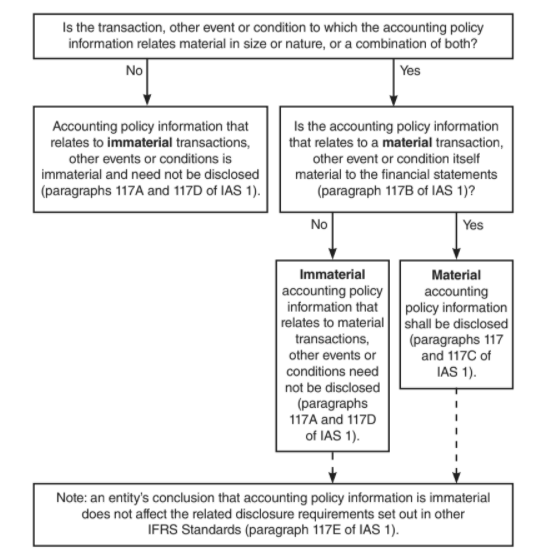
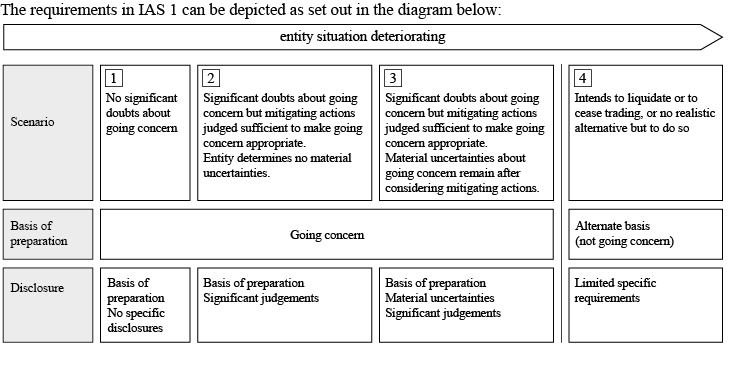

# 04 - Presentation of financial statements (IAS 1)

[返回目录](README.md)

# 04 - Presentation of financial statements (IAS 1)

Contents

- [04 - Presentation of financial statements (IAS 1)](10.md#s26-chap_04_toc_h1)

- [Introduction and scope (paras 4.1-4.13)](10.md#s27-chap_04_navPoint_1)

- [Objective and scope](10.md#s27-chap_04_navPoint_3)

- [Purpose of financial statements](10.md#s27-chap_04_navPoint_4)

- [Complete set of financial statements](10.md#s27-chap_04_navPoint_5)

- [General features (paras 4.14-4.54)](10.md#s28-chap_04_navPoint_6)

- [Fair presentation](10.md#s28-chap_04_navPoint_7)

- [Fair presentation and true and fair overrides](10.md#s28-chap_04_navPoint_8)

- [Going concern](10.md#s28-chap_04_navPoint_9)

- [Accruals basis of accounting](10.md#s28-chap_04_navPoint_10)

- [Materiality and aggregation](10.md#s28-chap_04_navPoint_11)

- [Offsetting/netting](10.md#s28-chap_04_navPoint_12)

- [Frequency of reporting](10.md#s28-chap_04_navPoint_13)

- [Comparative information](10.md#s28-chap_04_navPoint_14)

- [Consistency of presentation](10.md#s28-chap_04_navPoint_15)

- [Structure and content (paras 4.55-4.164)](10.md#s29-chap_04_navPoint_16)

- [Identification](10.md#s29-chap_04_navPoint_17)

- [Statement of financial position (balance sheet)](10.md#s29-chap_04_navPoint_18)

- [Face of the balance sheet](10.md#s29-chap_04_navPoint_idp1688824264)

- [Current/non-current classification](10.md#s29-chap_04_navPoint_idp1687140408)

- [Current assets](10.md#s29-chap_04_navPoint_idp1687202856)

- [Non-current assets held for sale](10.md#s29-chap_04_navPoint_idp1687216552)

- [Tax assets](10.md#s29-chap_04_navPoint_idp1687212840)

- [Current liabilities](10.md#s29-chap_04_navPoint_idp1687234344)

- [Borrowings and covenant compliance](10.md#s29-chap_04_navPoint_idp1687248680)

- [Tax liabilities](10.md#s29-chap_04_navPoint_idp1684551288)

- [Notes to the statement of financial position](10.md#s29-chap_04_navPoint_idp1684559992)

- [Statement of profit or loss and other comprehensive income](10.md#s29-chap_04_navPoint_19)

- [Information to be presented in the income statement](10.md#s29-chap_04_navPoint_idp1684590840)

- [Information to be presented in the other comprehensive income section](10.md#s29-chap_04_navPoint_idp1684617976)

- [Profit or loss for the period](10.md#s29-chap_04_navPoint_idp1684624248)

- [Analysis of expenses: classification by nature or function](10.md#s29-chap_04_navPoint_idp1684631032)

- [Placement of other items](10.md#s29-chap_04_navPoint_idp1695581112)

- [Additional line items, headings and sub-totals](10.md#s29-chap_04_navPoint_idp1695595192)

- [Material and exceptional items](10.md#s29-chap_04_navPoint_idp1695620280)

- [Notes to the profit or loss section of statement of comprehensive income](10.md#s29-chap_04_navPoint_idp1695643704)

- [Employee benefits expense](10.md#s29-chap_04_navPoint_idp1695650104)

- [Depreciation and amortisation](10.md#s29-chap_04_navPoint_idp1695655096)

- [Other comprehensive income](10.md#s29-chap_04_navPoint_idp1695668408)

- [Tax on other comprehensive income](10.md#s29-chap_04_navPoint_idp1695561016)

- [Reclassification (‘recycling’) adjustments](10.md#s29-chap_04_navPoint_idp1695698760)

- [Statement of changes in equity](10.md#s29-chap_04_navPoint_20)

- [Dividends](10.md#s29-chap_04_navPoint_21)

- [Statement of cash flows](10.md#s29-chap_04_navPoint_22)

- [Notes to the financial statements](10.md#s29-chap_04_navPoint_23)

- [Structure](10.md#s29-chap_04_navPoint_idp1695753160)

- [Accounting policies, judgements and estimates](10.md#s29-chap_04_navPoint_idp1695767496)

- [Accounting policies and judgements](10.md#s29-chap_04_navPoint_idp1695781832)

- [Estimation uncertainty](10.md#s29-chap_04_navPoint_idp1688155144)

- [Capital disclosures and puttable financial instruments classified as equity](10.md#s29-chap_04_navPoint_idp1688182408)

- [Other disclosures](10.md#s29-chap_04_navPoint_idp1688191496)

- [Illustrative text](10.md#s30-chap_04_navPoint_24)

- [FAQ 4.26.1 – How should the financial statements disclose uncertainties that affect the entity’s ability to continue as a going concern?](10.md#s30-chap_04_navPoint_25)

- [FAQ 4.27.1 – How should the requirements in IAS 1 regarding the going concern assumption be applied?](10.md#s30-chap_04_navPoint_26)

- [FAQ 4.30.1 – What is the basis of accounting for an entity that is not a going concern?](10.md#s30-chap_04_navPoint_27)

- [FAQ 4.39.1 – What items would be considered to be acceptable offsetting of income and expenses?](10.md#s30-chap_04_navPoint_28)

- [FAQ 4.39.2 – How should management present gains arising on the sale of property, plant and equipment?](10.md#s30-chap_04_navPoint_29)

- [FAQ 4.39.3 – Can the depreciation of assets (including right of use assets) used for remediation activities be presented as a reduction of the decommissioning provision?](10.md#s30-chap_04_navPoint_30)

- [FAQ 4.49.1 – Does a restatement of comparatives require an opening balance sheet (that is, an additional balance sheet) as of 1 January 20X0?](10.md#s30-chap_04_navPoint_31)

- [FAQ 4.71.1 – How should the most relevant presentation (current/non-current or liquidity presentation) of the balance sheet be selected?](10.md#s30-chap_04_navPoint_32)

- [FAQ 4.75.1 – How should the ordinary operating cycle be determined?](10.md#s30-chap_04_navPoint_33)

- [FAQ 4.75.2 – How should an inter-company receivable due on demand be classified?](10.md#s30-chap_04_navPoint_34)

- [FAQ 4.78.1 – Can an entity present deferred tax as neither current nor non-current?](10.md#s30-chap_04_navPoint_35)

- [FAQ 4.80.1 – How should loans subject to change of control clauses be classified in the balance sheet?](10.md#s30-chap_04_navPoint_36)

- [FAQ 4.80.2 – How should loans with material adverse change and subjective acceleration clauses be classified?](10.md#s30-chap_04_navPoint_37)

- [FAQ 4.81.1 – How should an entity classify warranty and environmental provisions in its balance sheet?](10.md#s30-chap_04_navPoint_38)

- [FAQ 4.84.1 – How do refinance agreements influence presentation of bank debt?](10.md#s30-chap_04_navPoint_39)

- [FAQ 4.84.2 – Classification of liability from debt factoring arrangement](10.md#s30-chap_04_navPoint_40)

- [FAQ 4.86.1 – How should a loan balance be classified when the entity has a covenant breach reported after period end?](10.md#s30-chap_04_navPoint_41)

- [FAQ 4.87.1 – How should a loan balance be classified when the loan agreement includes a period of grace?](10.md#s30-chap_04_navPoint_42)

- [FAQ 4.87.2 – How should loans be presented where the lender waived the covenant compliance reporting requirements before a specific reporting date?](10.md#s30-chap_04_navPoint_43)

- [FAQ 4.87.3 – How should loans be classified where the lender waived a breach of covenants during the period?](10.md#s30-chap_04_navPoint_44)

- [FAQ 4.102.2 – Is the order of the line items mandatory?](10.md#s30-chap_04_navPoint_45)

- [FAQ 4.102.3 – How should the share of profit of associates and joint ventures be presented?](10.md#s30-chap_04_navPoint_46)

- [FAQ 4.102.4 – How should tax on share of associates and joint ventures be presented?](10.md#s30-chap_04_navPoint_47)

- [FAQ 4.102.5 – How should interest for derivatives and other financial instruments measured at FVTPL be presented?](10.md#s30-chap_04_navPoint_48)

- [FAQ 4.110.1 – Can an entity present some expenses by function and others by nature?](10.md#s30-chap_04_navPoint_49)

- [FAQ 4.110.2 – What types of expenses are included in cost of sales, distribution costs, administrative expenses and finance costs?](10.md#s30-chap_04_navPoint_50)

- [EX 4.111.1 – Expense classification by nature](10.md#s30-chap_04_navPoint_51)

- [EX 4.111.2 – Expense classification by function](10.md#s30-chap_04_navPoint_52)

- [FAQ 4.111.3 – How should capitalised expenses be dealt with?](10.md#s30-chap_04_navPoint_53)

- [FAQ 4.112.1 – Which items can be classified as other income (expense)?](10.md#s30-chap_04_navPoint_54)

- [FAQ 4.113.1 – How should finance income be presented?](10.md#s30-chap_04_navPoint_55)

- [FAQ 4.113.2 – How should negative interests be presented?](10.md#s30-chap_04_navPoint_56)

- [FAQ 4.114.1 – How should foreign exchange gains and losses be dealt with?](10.md#s30-chap_04_navPoint_57)

- [FAQ 4.114.2 – How should gains or losses arising from a repurchase of own debt be dealt with?](10.md#s30-chap_04_navPoint_58)

- [FAQ 4.114.3 – Can derivative gains and losses be included in ‘revenue’?](10.md#s30-chap_04_navPoint_59)

- [FAQ 4.114.4 – How should an entity present fair value changes and sales proceeds from commodity contracts that are accounted for as derivative financial instruments under IFRS 9 (or IAS 39)?](10.md#s30-chap_04_navPoint_60)

- [FAQ 4.114.5 – How should other derivative gains and losses be presented?](10.md#s30-chap_04_navPoint_61)

- [FAQ 4.114.6 – How should hedge ineffectiveness on cash flow hedge relationships be presented within the income statement?](10.md#s30-chap_04_navPoint_62)

- [FAQ 4.114.7 – Can realised gains and losses be presented separately from unrealised gains and losses for financially settled non-interest-related derivatives?](10.md#s30-chap_04_navPoint_63)

- [EX 4.121.1 – Examples of adaptation and additional line items](10.md#s30-chap_04_navPoint_64)

- [FAQ 4.122.1 – Can government grants for lost income be presented as revenue from contracts with customers or lease revenue?](10.md#s30-chap_04_navPoint_65)

- [FAQ 4.122.2 – How should an entity present changes in the carrying value of the financial guarantee contract related to disposal of a business?](10.md#s30-chap_04_navPoint_66)

- [FAQ 4.123.1 – How should a gain on disposal of a subsidiary be presented in the consolidated financial statements?](10.md#s30-chap_04_navPoint_67)

- [EX 4.124.1 – Practical problems relating to employee benefits expense](10.md#s30-chap_04_navPoint_68)

- [FAQ 4.124.2 – How should an entity disclose costs for directors and key management that do not have employment contracts?](10.md#s30-chap_04_navPoint_69)

- [FAQ 4.140.1 – Which transactions with owners should be presented in the statement of changes in equity?](10.md#s30-chap_04_navPoint_70)

- [FAQ 4.140.2 – How should the share of joint ventures’ and associates’ changes in equity be presented?](10.md#s30-chap_04_navPoint_71)

- [FAQ 4.150.1 – Which accounting policies should be disclosed?](10.md#s30-chap_04_navPoint_72)

- [FAQ 4.157.1 – Which areas could require disclosure in respect of estimation uncertainty?](10.md#s30-chap_04_navPoint_73)

- [FAQ 4.157.2 – What type of information could be required for a key accounting estimate?](10.md#s30-chap_04_navPoint_74)

- [FAQ 4.158.1 – How should an entity disclose estimation uncertainty for assets and liabilities carried at fair value that might be subject to significant market fluctuations in the following year?](10.md#s30-chap_04_navPoint_75)

This eBook is licensed to peggy so, peggy.so@hk.ey.com, 

## Introduction and scope (paras 4.1-4.13)

 

**4.1** IAS 1 provides guidance on the overall structure of financial statements, including minimum requirements for each primary statement (statement of financial position, statement of profit or loss and other comprehensive income, statement of changes in equity and statement of cash flows) and notes to the financial statements. Other accounting standards’ requirements supplement the IAS 1 requirements.

[IAS 1 para 1].

 

### Objective and scope

 

**4.2**IAS 1 applies to all general purpose financial statements prepared under IFRS. General purpose financial statements are those intended to meet the needs of users who are not in a position to require an entity to provide information directly to them. IAS 1 applies to all types of entities and applies both to consolidated financial statements in accordance with IFRS 10 and to separate financial statements in accordance with IAS 27.

[IAS 1 para 2]. [IAS 1 para 7].

**4.3**IAS 1 does not govern the structure and content of condensed interim financial information prepared under IAS 34. The ‘overall considerations’ set out in paragraphs 15 to 35 of IAS 1 are applicable to both annual financial statements and interim financial reports. These paragraphs deal with matters including fair presentation and compliance with IFRS standards, going concern, accrual basis of accounting, materiality, and aggregation and offsetting – being the overall principles for preparing and presenting financial information, derived largely from the Board’s ‘Conceptual framework for financial reporting’.

[IAS 1 para 4].

**4.4** IAS 1 uses terminology that is suitable for profit-oriented entities, including public sector business entities. IAS 1 is intended to be sufficiently flexible for it to be used by all entities, but some non-profit entities might have to amend the descriptions used for the line items or for the financial statements themselves.

[IAS 1 para 5].

**4.5** The presentation of members’ or unitholders’ interests in the financial statements is adapted for entities that do not have equity, as defined in IAS 32, or whose share capital is not equity.

[IAS 1 para 6].

 

### Purpose of financial statements

**4.6**The objective of financial statements is to provide information about the financial position, financial performance and cash flows of an entity that is useful to a wide range of users in making economic decisions. Financial statements also show the results of management’s stewardship of the resources entrusted to it. The objective is met by providing information on assets, liabilities, equity, income and expenses (including gains and losses), contributions by (and distributions to) owners in their capacity as owners, and cash flows. This information can be helpful in predicting the amount, timing and certainty of future cash flows.

[IAS 1 para 9].

### Complete set of financial statements

 

**4.7** A complete set of IFRS financial statements comprises the following statements, all of which should be presented with equal prominence:

- A statement of financial position (balance sheet) as at the end of the period.

- A statement of profit or loss and other comprehensive income for the period.

- A statement of changes in equity for the period.

- A statement of cash flows for the period.

- Notes, comprising significant accounting policies and other explanatory information.

Amendment effective for annual periods beginning on or after 1 January 2023 (subject to any endorsement process). Earlier application is permitted, with disclosure of that fact. New text is underlined and deleted text struck through:

  

- Notes, comprising material significant accounting policy information policies and other explanatory information.

  

- Comparative information in respect of the preceding period, including narrative disclosures where these are relevant to understanding the current period financial statements.

- A balance sheet as at the beginning of the preceding period, where an entity applies an accounting policy retrospectively or makes a retrospective restatement of items in its financial statements, or where it reclassifies items in its financial statements. This information is only required where the opening balance sheet is materially affected by the restatement.

[IAS 1 para 10].

**4.8** An entity presents the ‘statement of profit or loss and other comprehensive income’ as a single statement or as two statements. In a single statement, the entity presents profit or loss and other comprehensive income in separate sections. The profit or loss section is presented first, followed directly by the other comprehensive income section. If an entity presents two statements, it presents the profit or loss section in a separate statement of profit or loss (that is, as an income statement). This should immediately precede the statement presenting comprehensive income. All income and expenses would then be included in a ‘performance statement’.

[IAS 1 para 10A].

**4.9**An entity can use other titles for the statement(s), such as ‘statement of comprehensive income’ instead of ‘statement of profit or loss and other comprehensive income’, or ‘income statement’ where this is separately presented. Similarly, an entity can, for example, present a ‘balance sheet’ rather than a ‘statement of financial position’. In this chapter, references to the ‘income statement’ include the profit and loss section of the statement of profit or loss and other comprehensive income.

[IAS 1 para 10].

**4.10** Notes contain information in addition to that presented in the statement of financial position, statement(s) of profit or loss and other comprehensive income, statement of changes in equity and statement of cash flows. Notes provide narrative descriptions or disaggregations of items presented in those statements and information about items that do not qualify for recognition in those statements.

[IAS 1 para 7].

**4.11** IAS 7 sets out the detailed requirements for cash flow statement presentation and disclosure. [See chapter 7 para 1](15.md#s45-Para_7.1).

**4.12**Reports and statements presented outside the financial statements are outside the scope of IFRS. IFRS 7 permits specified disclosures (such as the nature and extent of risks arising from financial instruments and the entity’s approach to managing those risks) to be presented in statements such as a separate management commentary or business review accompanying the financial statements. These disclosures are incorporated by cross-reference in the financial statements to that other statement.

[IAS 1 para 14].

**4.13**The Board’s practice statement, ‘Management commentary’, provides non-mandatory guidance for the presentation of such a commentary.

 

This eBook is licensed to peggy so, peggy.so@hk.ey.com, 

## General features (paras 4.14-4.54)

### Fair presentation

 

**4.14** Financial statements should present fairly the financial position, financial performance and cash flows of an entity. Fair presentation requires the faithful representation of the effects of transactions, other events and conditions in accordance with the definitions and recognition criteria for assets, liabilities, income and expenses set out in the Framework. The application of IFRS standards, with additional disclosure where necessary, is presumed to result in financial statements that achieve a fair presentation.

[IAS 1 para 15].

**4.15** An “explicit and unreserved statement of compliance” should be included in the notes to the financial statements. Entities cannot state that their financial statements are IFRS-compliant if they do not comply with all of the requirements of IFRS. Financial statements either comply with IFRS or they do not; there is no middle ground.

[IAS 1 para 16].

**4.16** IFRS is defined as standards and interpretations adopted by the Board. These comprise International Financial Reporting Standards and International Accounting Standards, together with interpretations issued by the IFRS IC (or its predecessor bodies).

[IAS 1 para 7].

**4.17** Disclosures, in addition to those set out in specific IFRS standards, are required where it is necessary for users of the financial statements to understand transactions or events of the reporting entity. Disclosure or explanation is not a substitute for proper accounting.

[IAS 1 para 18].

**4.18**A fair presentation is nearly always achieved through compliance with applicable IFRS standards. For a fair presentation, an entity:

- selects and applies accounting policies in accordance with IAS 8; IAS 8 sets out a hierarchy of authoritative guidance that management considers in the absence of an IFRS that specifically applies to an item;

- presents information, including accounting policies, in a manner that provides relevant, reliable, comparable and understandable information; and

- provides additional disclosures where compliance with the specific requirements in IFRS standards is insufficient to enable users to understand the impact of particular transactions, other events and conditions on the entity’s financial position and financial performance.

[IAS 1 para 17].

 

### Fair presentation and true and fair overrides

 

**4.19** IFRS presumes that a fair presentation is achieved if financial statements are prepared in compliance with each applicable standard and interpretation. An entity departs from an IFRS requirement if, in extremely rare circumstances, compliance with that requirement would be so misleading that it would conflict with the objective of financial statements set out in the Framework, so long as the relevant regulatory framework requires or does not prohibit it. Departure from IFRS is necessary only where, even if additional disclosure is made, a fair presentation cannot be achieved by applying IFRS.

[IAS 1 para 15].

**4.20** An entity that overrides an IFRS requirement discloses information about that departure from IFRS. These disclosures relate to the details of, reasons for, and the effect of, the departure.

[IAS 1 para 20].

**4****.21**An entity departs from an IFRS requirement only after management has considered why the objective of that requirement is not met or is not relevant in its particular circumstances. Management also considers how the entity’s own circumstances differ from other entities that comply with the relevant IFRS requirement. There is a rebuttable presumption that, if other entities in similar circumstances comply with the requirement, the entity should also comply.

[IAS 1 para 24].

**4.22** A departure from an IFRS requirement might affect more than one accounting period. IAS 1 requires disclosures related to any prior period departure from IFRS. For example, there will be an effect on following period’s measurement of changes in assets and liabilities where an entity departs from a requirement in respect of the measurement of assets or liabilities.

[IAS 1 para 21].

**4.23** An entity’s regulatory framework might prohibit an IFRS override that management considers necessary to achieve a fair presentation. This will be extremely rare. The entity makes specified disclosures in such cases to reduce the perceived misleading aspects of compliance.

[IAS 1 para 23].

 

### Going concern

 

**4.24** Financial statements should be prepared on a going concern basis, unless management intends either to liquidate the entity or to cease trading, or has no realistic alternative but to do so. Management is required to assess, at the time of preparing the financial statements, the entity’s ability to continue as a going concern, and this assessment should cover the entity’s prospects for at least 12 months from the end of the reporting period. The 12-month period for considering the entity’s future is a minimum requirement; an entity cannot, for example, prepare its financial statements on a going concern basis if it intends to cease operations 18 months from the end of the reporting period. The existence of significant doubts about the entity’s ability to continue as a going concern is not sufficient reason to depart from preparing financial statements on a going concern basis.

[IAS 1 para 25].

**4.25**The determination of going concern should be made for each reporting entity. A going concern basis might not be considered appropriate for an individual subsidiary, while the going concern basis might remain appropriate for the subsidiary’s parent and for the group as a whole.

[IAS 1 para 25].

**4.26** The assessment of the entity’s status as a going concern will often be straightforward. A profitable entity with no financing problems will almost certainly be a going concern. In other cases, management might need to consider very carefully the entity’s ability to meet its liabilities as they fall due. Detailed cash flow and profit forecasts might be required to satisfy management that the entity is a going concern.

[IAS 1 para 25].

[FAQ 4.26.1 – How should the financial statements disclose uncertainties that affect the entity’s ability to continue as a going concern?](10.md#s30-FAQ_4.26.1)

**4.27**Disclosures are required where there are significant doubts about the entity’s ability to continue as a going concern. The uncertainties should be disclosed, even if the financial statements continue to be prepared on a going concern basis. The disclosures should:

- adequately describe the principal events or conditions that give rise to the significant doubt on the entity’s ability to continue in operation and management’s plans to deal with these events or conditions; and

- state clearly that there is a material uncertainty related to events or conditions which might cast significant doubt on the entity’s ability to continue as a going concern, such that it might be unable to realise its assets and discharge its liabilities in the normal course of business.

**4.****27.1** Whether to prepare financial statements on a going concern basis is a binary decision, but the circumstances in which entities prepare financial statements on a going concern basis will vary widely. The circumstances could range from when an entity is profitable and has no liquidity concerns to when it is a ‘close call’ to prepare the financial statements on a going concern basis, even after considering any mitigating actions planned by management. Management’s decision will be underpinned by assumptions and judgements that might involve significant uncertainty. It is important, therefore, that an entity considers not only the specific disclosure requirements relating to going concern in paragraph 25 of IAS 1 but also the overarching disclosure requirements in IAS 1. These requirements include those in paragraph 122 relating to judgements that have the most significant effect on the amounts recognised in the financial statements.

The IFRS Foundation issued educational material, ‘Going concern – a focus on disclosure’ to support companies implementing the requirements related to the preparation of financial statements using IFRS Standards on a going concern basis.

[IAS 1 para 25].

[IAS 1 para 122]

[FAQ 4.27.1 – How should the requirements in IAS 1 regarding the going concern assumption be applied?](10.md#s30-FAQ_4.27.1)

**4.28** Events that occur after the reporting period might indicate that the entity is no longer a going concern. An entity does not prepare its financial statements on a going concern basis if management’s post-year end assessment indicates that it is not a going concern. Any financial statements that are prepared after that assessment (including the financial statements in respect of which management are making the assessment) are not prepared on a going concern basis. This is consistent with IAS 10, which requires a fundamental change to the basis of accounting when the going concern assumption is no longer appropriate.

[IAS 10 para 14].

**4.29** The financial statements should disclose, where relevant, that the financial statements are not prepared on a going concern basis and disclose the reasons why the entity is no longer considered a going concern. Details of the new basis of accounting adopted should be also disclosed.

[IAS 1 para 25].

**4.30**Financial statements are normally prepared on the assumption that the reporting entity is a going concern. Assets and liabilities are usually recognised on the basis that their carrying amounts will be recovered or discharged in the normal course of business. For example, the carrying values of property, plant and equipment are supported by the expected future cash flows from their continued use and ultimate disposal. If the business is not a going concern, this basis will not be appropriate. If the financial statements are prepared on a different basis, the basis used is disclosed. The financial effect of changing from a going concern to a non-going concern basis might be negligible but the financial statements should still disclose that the entity is no longer regarded as a going concern.

[IAS 1 para 25]. [Framework para 3.9].

[FAQ 4.30.1 – What is the basis of accounting for an entity that is not a going concern?](10.md#s30-FAQ_4.30.1)

 

### Accruals basis of accounting

**4.31** The entity should prepare its financial statements, except for cash flow information, using the accruals basis of accounting. Revenue and costs are recognised as they are earned or incurred under the accruals basis of accounting, rather than when the cash is received or paid.

[IAS 1 para 27].

**4.32** The elements of financial statements (assets, liabilities, equity, income and expenses) are recognised only when they meet the definitions and recognition criteria in the Board’s Conceptual Framework.

[IAS 1 para 28].

### Materiality and aggregation

 

**4.33** An entity presents each material class of similar items separately in the financial statements. Items of a dissimilar nature or function should be presented separately, unless they are immaterial.

[IAS 1 para 29].

**4.34**An immaterial line item is aggregated with other items, either on the face of the primary statements or in the notes. An item that is not sufficiently material to warrant separate presentation on the face of the financial statements might be sufficiently material to be presented separately in the notes.

[IAS 1 para 30].

**4.35** The entity should consider all relevant facts and circumstances when deciding how it aggregates information. An entity should not obscure material information with immaterial information or by aggregating material items that have different natures or functions.

[IAS 1 para 30A].

**4.36** An entity need not provide a specific disclosure required by IFRS if the information resulting from that disclosure is immaterial. This is the case, even if the relevant IFRS standard contains a list of specific requirements or describes them as minimum requirements. An entity should consider providing additional disclosure if compliance with specific IFRS requirements is insufficient to enable users to understand the impact of particular transactions, other events and conditions on the entity’s financial position and financial performance.

[IAS 1 para 31].

**4.37** For annual periods starting on or after 1 January 2020, the definition of material is amended. Information is material if omitting, misstating or obscuring it could reasonably be expected to influence decisions that the primary users of general purpose financial statements make on the basis of those financial statements, which provide financial information about a specific reporting entity.

Materiality depends on the nature or magnitude of information, or both. The assessment of whether information, either individually or in combination with other information, is material is made in the context of an entity’s financial statements taken as a whole.

The amendments clarify that the reference to obscuring information addresses situations in which the effect is similar to omitting or misstating that information.

Some circumstances in which a material item, transaction or other event might be obscured are:

- using vague or unclear language;

- scattering information throughout the financial statements;

- aggregating dissimilar items, transactions or other events inappropriately;

- disaggregating similar items, transactions or other events inappropriately; and

- reducing understandability of the financial statements by hiding material information with immaterial information to the extent that a primary user is unable to determine what information is material.

[IAS 1 para 7].

**4.38**Financial reports are prepared for users who have a reasonable knowledge of business and economic activities and who review and analyse the information diligently. Materiality is assessed against the decision-making of reasonably knowledgeable individuals.

The amendment described in [paragraph 4.37](10.md#s28-Para_4.37) above also clarifies the meaning of ‘primary users of general purpose financial statements’ to whom those financial statements are directed, by defining them as ‘existing and potential investors, lenders and other creditors’ that must rely on general purpose financial statements for much of the financial information that they need. Financial statements are prepared for users who have a reasonable knowledge of business and economic activities and who review and analyse the information diligently.

The concept of materiality is discussed further in [chapter 3 para 11](09.md#s20-Para_3.11).

[IAS 1 para 7].

 

### Offsetting/netting

 

**4.39** An entity is not permitted to offset or net assets and liabilities or income and expenses, except where expressly required or permitted by IFRS. Offsetting is generally prohibited, because it detracts from users’ ability to both gain a full and proper understanding of the transactions, other events and conditions that have occurred and to assess the entity’s future cash flows. Items that are not considered offsetting of assets and liabilities include accumulated depreciation and amortisation, provisions against inventory and impairments provisions.

[IAS 1 para 32].

[FAQ 4.39.1 – What items would be considered to be acceptable offsetting of income and expenses? ](10.md#s30-FAQ_4.39.1)  
  
[FAQ 4.39.2 – How should management present gains arising on the sale of property, plant and equipment? ](10.md#s30-FAQ_4.39.2)  
  
[FAQ 4.39.3 – Can the depreciation of assets (including right of use assets) used for remediation activities be presented as a reduction of the decommissioning provision?](10.md#s30-FAQ_4.39.3)

**4.40**Offsetting of financial assets and liabilities is considered further in [chapter 47 para 15](78.md#s308-Para_47.15). IAS 12 contains rules relating to the offsetting of tax items; this is considered in [chapter 14 para 149](27.md#s100-Para_14.149). IAS 20 discusses the presentation of government grants related to assets; this is considered in [chapter 17 para 14](37.md#s129-Para_17.14). The measurement of ‘revenue’, including the treatment of trade discounts, volume rebates and agency arrangements, is considered in [chapter 11](19.md#s64-chap_11).

 

### Frequency of reporting

 

**4.41** Financial statements are presented at least annually. An entity discloses the reason for using a period other than one year when it changes the end of its reporting period, and presents financial statements that are longer or shorter than one year. It also discloses that the comparative amounts are not comparable.

[IAS 1 para 36].

**4.42**Entities are permitted to prepare financial statements for a 52-week period (rather than an exact year).

[IAS 1 para 37].

 

### Comparative information

 

**4.43** An entity presents comparative information in respect of the preceding period for all amounts reported in the current period’s financial statements. This should include comparative information for narrative and descriptive information if it is relevant to understanding the current period’s financial statements.

[IAS 1 para 38].

**4.44** An entity is required to present, as a minimum, two balance sheets, two statements of profit or loss and other comprehensive income, two separate statements of profit or loss (if presented), two cash flow statements and two statements of changes in equity, and related notes. An entity can provide financial statements beyond these minimum comparative requirements (see [para 4.51](10.md#s28-Para_4.51)). An entity provides an opening statement of financial position when an entity changes accounting policies, or when it makes retrospective restatements or reclassifications (see [para 4.48](10.md#s28-Para_4.48)).

[IAS 1 para 38A].

**4.45** There are exemptions from the requirement to present comparative numerical information for some of the reconciliations of opening and closing positions. For example, IAS 37 requires a reconciliation of the opening and closing provisions, but does not require the disclosure of a comparative reconciliation. IAS 16 and IAS 38 require full comparative information on the movements in opening and closing positions. No exemption exists for the statement of changes in equity.

[IAS 37 para 84].

**4.46** An entity does not have to give comparative narrative information if it is no longer relevant. Where a legal dispute was outstanding at the previous balance sheet date and has still not been resolved, the financial statements for the current period should disclose details of that dispute and of the steps that have been taken to resolve it. If a legal dispute is settled during the year, the result of the dispute is disclosed where necessary to explain the entity’s performance for the period (see [para 4.123](10.md#s29-Para_4.123)).

[IAS 1 para 38B].

**4.47** An entity might change the presentation or classification of items. The comparative figures should conform to the new presentation. The entity discloses the nature and amounts of each item or class of items that is reclassified and the reasons for the restatement of the comparative information (see also [para 4.53](10.md#s28-Para_4.53)). This disclosure also applies to the additional balance sheet presented as at the beginning of the preceding period (see below).

[IAS 1 para 41].

**4.48** An opening balance sheet is required where an entity applies a change in accounting policy retrospectively, makes a retrospective restatement of items, or reclassifies items in its financial statements, and this has a material effect on the information in the balance sheet at the beginning of the preceding period. The additional balance sheet is presented as at the beginning of the preceding period, regardless of whether the entity’s financial statements present comparative information for earlier periods. The entity presents three balance sheets, as at:

- the end of the current period;

- the end of the preceding period; and

- the beginning of the preceding period.

[IAS 1 para 40A].

**4.49** An entity that is required to present a balance sheet as at the beginning of the preceding period need not present the related notes to that balance sheet. This contrasts with the position where an entity chooses to present additional comparative information, in which case related notes are required (see [para 4.51](10.md#s28-Para_4.51)).

[IAS 1 para 40C].

[FAQ 4.49.1 – Does a restatement of comparatives require an opening balance sheet (that is, an additional balance sheet) as of 1 January 20X0?](10.md#s30-FAQ_4.49.1)

**4.50** First-time adopters should present full comparative notes for the third balance sheet required by IFRS 1. See further [chapter 2 para 138](08.md#s16-Para_2.138).

**4.51**An entity could choose to present a third statement of comprehensive income (presenting the current period, the preceding period and one additional comparative period). The entity also presents the comparative notes related to that additional statement of comprehensive income, but is not required to present a third balance sheet, a third cash flow statement or a third statement of changes in equity. Full notes are generally required for additional information that an entity provides voluntarily or provides in response to regulation or law.

[IAS 1 para 38C].

**4.52** It might be impracticable for an entity to restate comparative figures when it changes the presentation or classification of items in its financial statements. The entity discloses the reason for not restating and the nature of the adjustments that would have been made if it had been practicable to do so. It is ‘impracticable’ to apply a requirement if it cannot be applied after making every reasonable effort to do so. An entity does not reclassify where the data for the previous period has not been (and cannot be) collected in such a way as to permit reclassification.

[IAS 1 para 42].

 

### Consistency of presentation

**4.53** An entity retains the presentation and classification of items in the financial statements from one period to the next, unless:

- it is apparent, following a significant change in the nature of the entity’s operations or a review of its financial statements, that another presentation or classification provides relevant and more reliable information; or

- an IFRS requires a change in presentation.

[IAS 1 para 45].

**4.54** An entity can only change its presentation if the new presentation is an improvement on the previous presentation. Entities should only change to a presentation that is likely to continue to be used in future periods, so that comparability is not impaired.

[IAS 1 para 46].

This eBook is licensed to peggy so, peggy.so@hk.ey.com, 

## Structure and content (paras 4.55-4.164)

 

**4.55** Some required disclosures are made on the face of the primary statements; other required disclosures can be made in the notes or on the face of the financial statements, unless another standard specifies otherwise.

[IAS 1 para 47].

 

### Identification

**4.56**Financial statements should be identified and distinguished from other information in the same published document. It is important for users of financial statements to understand the information that is presented in accordance with IFRS, and other information that is supplementary to those financial statements.

[IAS 1 para 49].

**4.57**IFRS-compliant financial statements should be distinguished from other information that might or might not be in compliance with IFRS. The use of alternative measures of performance, often referred to as ‘non-GAAP measures’, has been of concern to regulators. Entities should exercise care, when presenting alternative performance measures in their published documents, to ensure that they are distinguished from the measures that are defined or specified in IFRS.

[IAS 1 para 49].

**4.58** An entity should clearly identify each financial statement and the notes. An entity should display the following information prominently, and repeat it when necessary for the information presented to be understandable:

- the entity’s name or other means of identification, and any change in it since the previous period end;

- whether the financial statements are of an individual entity or a group of entities;

- the date of the end of the reporting period or the period covered by the financial statements or notes;

- the presentation currency, as defined in IAS 21; and

- the level of rounding used.

[IAS 1 para 51].

**4.59** The above requirements are usually met by presenting appropriate headings for items, such as pages, statements and columns; but, where financial statements are presented electronically, a different approach might be required.

[IAS 1 para 52].

**4.60**Entities can make their financial statements clearer by presenting the information in thousands or millions of the presentation currency. This is permitted, provided that the level of rounding is stated and material information is not omitted.

[IAS 1 para 53].

**Re****lated information**

### Statement of financial position (balance sheet)

#### Face of the balance sheet

**4.61** The following items should be disclosed on the face of the balance sheet:

- Property, plant and equipment.

- Investment property.

- Intangible assets.

- Financial assets (excluding amounts shown under (e), (h) and (i).

- Investments accounted for using the equity method.

- Biological assets.

- Inventories.

- Trade and other receivables.

- Cash and cash equivalents.

- The total of assets classified as held for sale and assets included in disposal groups classified as held for sale in accordance with IFRS 5.

- Trade and other payables.

- Provisions.

- Financial liabilities.

- Liabilities and assets for current tax, as defined in IAS 12.

- Deferred tax liabilities and deferred tax assets, as defined in IAS 12.

- Liabilities included in disposal groups classified as held for sale in accordance with IFRS 5.

- Non-controlling interests, presented within equity.

- Issued capital and reserves attributable to owners of the parent.

[IAS 1 para 54].

**4.62** Most entities preparing IFRS financial statements are required to present the face of the balance sheet, differentiating between current and non-current assets and between current and non-current liabilities (see [para 4.70](10.md#s29-Para_4.70)). The order or format in which such items are presented is not prescribed.

[IAS 1 para 56].

**4.63** Entities can present a total for net assets and show this as equal to the total of capital and reserves and non-controlling interest. Many entities show assets equal, in total, to liabilities plus capital and reserves.

[IAS 1 para 54].

**4.64** The line items set out in [paragraph 4.61](10.md#s29-Para_4.61) form the minimum content for the face of the balance sheet. Entities should insert additional line items, where required to do so by IFRS or where the size, nature or function of an item or aggregation of similar items is such that separate presentation is relevant to an understanding of an entity’s financial position.

[IAS 1 para 55].

**4.65**The descriptions of the line items, and the order in which they are shown, can be adapted according to the entity’s nature and its transactions. Financial institutions, for example, would amend the descriptions of line items to provide information that is relevant to the operations of financial institutions.

[IAS 1 para 57(b)].

**4.66**Management should consider the following factors to determine the most appropriate form of presentation and whether additional line items are shown separately:

- The nature and liquidity of the assets. For example, because of the difference in their nature, goodwill and other intangible assets would normally be presented separately on the face of the balance sheet.

- The function of the assets.

- The nature, timing and amounts of liabilities. In most cases, this will lead, for example, to the separate presentation of interest bearing and non-interest bearing liabilities.

[IAS 1 para 58].

**4.67**Any sub-totals that the entity presents should:

- be comprised of line items made up of amounts recognised and measured in accordance with IFRS;

- be presented and labelled in a manner that makes the line items that constitute the sub-total clear and understandable;

- be consistent from period to period (see [para 4.53](10.md#s28-Para_4.53)); and

- not be displayed with more prominence than the sub-totals and totals required by IFRS.

[IAS 1 para 55A].

**4.68** An entity should also evaluate any additional line items or subtotals to determine if they are alternative performance measures and whether its regulators impose any restrictions or additional requirements on reporting such items.

**4.69** The use of different measurement bases for assets or liabilities suggests a difference in their nature or function. Items that are different in nature or function should be presented as separate line items. For example, some classes of property, plant and equipment might be carried at cost while others are carried at revalued amounts.

[IAS 1 para 59].

#### Current/non-current classification

 

**4.70** An entity presents current and non-current assets, and current and non-current liabilities, as separate classifications on the face of the balance sheet, unless a presentation based on liquidity provides information that is reliable and is more relevant. All assets and liabilities should be presented broadly in order of liquidity when the presentation is driven by liquidity. For some entities, such as financial institutions, a ‘liquidity-based balance sheet’ will be more relevant. This is because the entity does not supply goods or services within a clearly identifiable operating cycle.

[IAS 1 para 60].

**4.71** Separate classification of current and non-current assets and liabilities is useful where an entity supplies goods or services within a clearly identifiable operating cycle. It distinguishes the net assets that are continuously circulating as working capital from those used in the entity’s long-term operations. An operating cycle is the time between the acquisition of assets for processing and their realisation in cash or cash equivalents. Where the normal operating cycle cannot be identified, it is assumed to have a duration of 12 months. Whether an entity presents a current/non-current classified balance sheet is largely dependent on the industry in which it operates.

[IAS 1 para 62].

[FAQ 4.71.1 – How should the most relevant presentation (current/non-current or liquidity presentation) of the balance sheet be selected?](10.md#s30-FAQ_4.71.1)

**4.72** An entity is required to make additional disclosures in respect of each asset and liability line item that combines amounts expected to be recovered or settled within 12 months with those expected to be recovered or settled after more than 12 months. This applies to both liquidity and current/non-current classifications. The entity discloses the amounts that are expected to be recovered or settled within 12 months of the reporting period and the amounts expected to be recovered or settled after more than 12 months.

[IAS 1 para 61].

**4.73**IAS 1 uses the terms ‘current’ and ‘non-current’ but permits the use of alternative descriptions, provided that the meaning is clear.

[IAS 1 para 67].

**4.74** It might be appropriate for some entities to present some of their assets and liabilities using the current/non-current classification and other assets and liabilities in order of liquidity. Although the standard states that this mixed basis of presentation might arise where an entity has diverse operations, no guidance is given on how this mixed presentation might be adopted.

[IAS 1 para 64].

 

##### Current assets

 

**4.75** An asset is a current asset if:

- the entity expects to realise the asset, or intends to sell or consume it, in its normal operating cycle;

- it is held primarily for the purpose of trading;

- the entity expects to realise the asset within 12 months after the reporting period; or

- it is cash or a cash equivalent (see [chapter 7 para 3](15.md#s45-Para_7.3)), unless the asset is restricted from being exchanged or used to settle a liability for at least 12 months after the reporting period.

All other assets are non-current.

[IAS 1 para 66].

[FAQ 4.75.1 – How should the ordinary operating cycle be determined? ](10.md#s30-FAQ_4.75.1)  
  
[FAQ 4.75.2 – How should an inter-company receivable due on demand be classified?](10.md#s30-FAQ_4.75.2)

**4.76** Cash and cash equivalents are considered in [chapter 7 para 3](15.md#s45-Para_7.3). The current/non-current classification of other financial assets (including derivatives) is considered [in chapter 47 para 2](78.md#s307-Para_47.2) onwards.

 

##### Non-current assets held for sale

 

**4.77** Non-current assets held for sale are considered [in chapter 30 para 3](53.md#s218-Para_30.3).

 

##### Tax assets

 

**4.78** Deferred tax assets should not be classified as current, regardless of the period over which they are expected to be recovered ([see chapter 14 para 148](27.md#s100-Para_14.148)).

[IAS 1 para 56].

[FAQ 4.78.1 – Can an entity present deferred tax as neither current nor non-current?](10.md#s30-FAQ_4.78.1)

**4.79** Current tax recoverable should be classified as current where they are expected to be realised within 12 months of the reporting period; otherwise, they should be shown as non-current assets.

[IAS 1 para 66(c)].

 

##### Current liabilities

 

**4.80** A current liability is:

- a liability that the entity expects to settle in its normal operating cycle;

- a liability held primarily for the purpose of trading;

- a liability due to be settled within 12 months after the reporting period; or

- a liability whose settlement the entity does not have an unconditional right to defer for at least 12 months after the reporting period. Terms of a liability that could, at the option of the counterparty, result in its settlement by the issue of equity instruments do not affect its classification. This means that conversion features that are at the holder’s discretion do not impact the classification of the liability component of a convertible instrument.[See chapter 47 para 7](78.md#s307-Para_47.7).

All other liabilities are non-current.

[IAS 1 para 69].

IASB has issued an amendment to IAS 1 that modifies the guidance for the classification of liabilities as current or non-current. The effective date for the amendment is annual reporting periods beginning on or after 1 January 2023. The guidance in this manual is based on the current version of the standard.

[FAQ 4.80.1 – How should loans subject to change of control agreements be classified in the balance sheet? ](10.md#s30-FAQ_4.80.1)  
  
[FAQ 4.80.2 – How should loans with material adverse change and subjective acceleration clauses be classified?](10.md#s30-FAQ_4.80.2)

**4.81** A current liability is not necessarily one that the entity expects to settle within 12 months of the reporting period. A liability that will be settled within an entity’s normal operating cycle is classified as current, even if, at the end of the reporting period, the entity has the right to defer payment until a later date. For example, trade payables and some accruals for employee and other operating costs are operating liabilities incurred as part of the business’ normal operating cycle. This operating cycle might be longer than 12 months. Other liabilities that, as at the end of the reporting period, are due to be settled within 12 months of the reporting period are shown as current liabilities.

[IAS 1 para 70].

[FAQ 4.81.1 – How should an entity classify warranty and environmental provisions in its balance sheet?](10.md#s30-FAQ_4.81.1)

 

##### Borrowings and covenant compliance

 

**4.82**An entity classifies a financial liability as current if it is due to be settled within 12 months after the year end. This is the case, even if an agreement to refinance, or to reschedule payments, on a long-term basis is completed after the year end before the financial statements are authorised for issue. Specifically, the standard requires that a financial liability should be presented as current where it is due to be settled within 12 months after the balance sheet date, even if:

- the original term was for a period longer than 12 months; and

- an agreement to refinance, or to reschedule payments, on a long-term basis is completed after the balance sheet date and before the financial statements are authorised for issue.

 

  

The IASB issued an amendment to paragraphs 72–76 of IAS 1 which cover borrowings and covenant compliance. Currently, the effective date for the amendment is 1 January 2023 (subject to any endorsement process). The IASB has an ongoing project that is expected to modify this amendment before it is effective and defer the effective date to 1 January 2024. Given the potential update to the amendment, the impact of the current amendment is not illustrated.

  

[IAS 1 para 72].

**4.83**An entity classifies a liability as current if it does not have the unconditional right to defer its settlement for at least 12 months after the end of the reporting period. A liability is classified as current where a liability is not scheduled for repayment within 12 months of the end of the reporting period, but can be called by the lender at any time without cause.

[IAS 1 para 69(d)].

**4.84** A post year end rescheduling or refinancing of debt that is at the discretion of the lender is a non-adjusting post balance sheet event. It does not affect the current/non-current classification of the debt at the balance sheet date. A refinancing or rescheduling might be fully at the discretion of the borrowing entity, with the entity being able to and intending to roll over the debt for at least a further year. The debt can then be classified as non-current. The entity must have full discretion to roll the obligation over; the potential for refinancing alone would not be sufficient to classify an obligation as non-current. However, if the entity expects to settle the obligation within 12 months, despite having the discretion to refinance for a longer period, the debt can be classified as current.

[IAS 1 para 73].

FAQ 4.84.1 – How do refinance agreements influence presentation of bank debt?   
  
[FAQ 4.84.1 – Classification of liability from debt factoring arrangement](10.md#s30-FAQ_4.84.1)

**4.85**Financial institutions often include borrowing covenants in loan contracts. The assessment of breaches of borrowing covenants focuses on the legal rights of the entity. But the entity’s expectations on the timing of settlement also affect the liability’s classification where the entity has the discretion to roll over or refinance loans. Under some borrowing covenants, a loan, which would otherwise be long-term in nature, becomes immediately repayable if certain items related to the borrower’s financial condition or performance are breached. These items are often measures of liquidity or solvency based on ratios derived from the entity’s financial statements. Some borrowings include ‘cross default’ clauses, such that the terms of the borrowing are assessed, at least in part, against compliance with covenants of another borrowing. Once the related borrowing covenant is breached, the borrowing with the ‘cross default’ clause, and any similarly linked borrowings, might become immediately repayable and classified as a current liability.

[IAS 1 para 74].

**4.86**Borrowings should be classified as a current liability if these types of breach occur prior to the end of a reporting period, unless a sufficient waiver of the covenant is granted by the lender, such that the borrowing does not become immediately repayable. The lender might agree, after the reporting period but before authorisation of the financial statements, not to require immediate repayment of the loan. The lender’s agreement is generally regarded as a non-adjusting post balance sheet event. The lender’s agreement had not been obtained at the end of the reporting period, and the condition of the borrowing at that time was that it was immediately repayable. Disclosures of defaults and breaches of loan agreements under IFRS 7 are covered by [chapter 47 para 67](78.md#s309-Para_47.67) onwards.

[IAS 1 para 74].

[FAQ 4.86.1 – How should a loan balance be classified when the entity has a covenant breach reported after period end?](10.md#s30-FAQ_4.86.1)

**4.87**Lenders sometimes agree to a period of grace during which the borrower can rectify the breach following a breach of a borrowing covenant that results in a loan being repayable immediately. The lender agrees not to demand repayment during this time but, if the breach is not rectified, the debt becomes immediately repayable at the end of the period of grace. If, before the balance sheet date, the lender has agreed to such a period of grace and that period ends at least 12 months after the balance sheet date, the liability should be shown as non-current. However, if the breach occurred before the balance sheet date, but the period of grace was not granted until after the balance sheet date, the liability would be classified as current. Entities need to evaluate whether the lender has given a period of grace, or a waiver where the lender’s enforceable rights caused by the specific breach in the period are permanently forgone.

[IAS 1 para 75].

[FAQ 4.87.1 – How should a loan balance be classified when the borrowing agreement includes a period of grace?](10.md#s30-FAQ_4.87.1)  
[FAQ 4.87.2 – How should loans be presented where the lender waived the covenant compliance reporting requirements before a specific reporting date?](10.md#s30-FAQ_4.87.2)  
[FAQ 4.87.3 – How should loans be classified where the lender waived a breach of covenants during the period?](10.md#s30-FAQ_4.87.3)

**4.88**The liability is shown as non-current if the breach of the borrowing covenant occurs after the balance sheet date. The presentation of the loan is dictated by the condition of the loan as at the balance sheet date. Events after that date might give evidence of that condition, but they do not change it. A serious breach could however affect the entity’s assessment about its ability to continue as a going concern (see [para 4.24](10.md#s28-Para_4.24)).

**4.89** Events after the reporting period do not alter a liability’s classification but they might require disclosure as a non-adjusting event. An entity should disclose the following events as non-adjusting events, in accordance with IAS 10, if they occur between the end of the reporting period and the date of authorisation of the financial statements:

- Refinancing on a long-term basis.

- Rectification of a breach of a long-term loan agreement.

- The granting by the lender of a period of grace to rectify a breach of a long-term loan agreement ending at least 12 months after the reporting period.

[IAS 1 para 76].

**4.90** IAS 1 does not specify any disclosures for non-adjusting post balance sheet events for non-current loans. If such events are material (such that non-disclosure could influence the economic decisions that users make on the basis of the financial statements), an entity should disclose the following in respect of each such event:

- the nature of the event; and

- an estimate of its financial effect, or a statement that such an estimate cannot be made.

[IAS 10 para 21].

 

##### Tax liabilities

 

**4.91** Deferred tax liabilities should be classified as non-current, regardless of the period over which the temporary differences are expected to reverse ([see chapter 14 para 148](27.md#s100-Para_14.148)).

[IAS 1 para 56].

**4.92**Other tax liabilities should be classified as current where they are due to be settled within 12 months of the end of the reporting period; otherwise, they should be shown as non-current liabilities.

[IAS 1 para 69(c)].

 

#### Notes to the statement of financial position

 

**4.93** An entity discloses, either on the face of the balance sheet or in the notes, further sub-classifications of the line items presented, classified in a manner appropriate to the entity’s operations.

[IAS 1 para 77].

**4.94** The level of this sub-classification depends on the size, nature and function of the items involved and on any specific requirements in other standards and interpretations. Examples of items that require sub-classification are:

- Property, plant and equipment should be shown by class.

- Trade receivables, receivables from related parties, pre-payments and other amounts should be shown separately.

- Inventories should be shown by class. Common classifications are merchandise, production supplies, materials, work in progress and finished goods.

- Provisions for employee benefits should be shown separately from other provisions.

- Equity capital and reserves should be disaggregated into classes, such as paid-in capital, share premium and reserves.

[IAS 1 para 78].

**4.95**Specific disclosures are required in respect of each class of share capital and on the nature and purpose of each reserve within equity. Disclosures are also required about how an entity manages its capital resources. See [chapter 51 para 46 onwards](85.md#s352-Para_51.46).

[IAS 1 para 79].

**4.96** An entity, such as a partnership or trust, that does not have share capital, should disclose, for each category of equity interest, information equivalent to that required by IAS 1 for share capital (see [chapter 51 para 48](85.md#s352-Para_51.48)).

[IAS 1 para 80].

**4.97** An entity might reclassify certain items between financial liabilities and equity. It should disclose the amounts reclassified into and out of each category (financial liabilities or equity), and the timing and reason for that classification. These disclosures apply to the following types of instrument ([see chapter 43 para 36](67.md#s277-Para_43.36)):

- a puttable financial instrument classified as an equity instrument; or

- an instrument that imposes on the entity an obligation to deliver to another party a pro rata share of the net assets of the entity only on liquidation and classified as an equity instrument (for example, some shares issued by limited-life entities).

[IAS 1 para 80A].

**4.98** Other notes to the financial statements are considered in [paragraph 4.145](10.md#s29-Para_4.145) onwards.

 

### Statement of profit or loss and other comprehensive income

**4.99** An entity that presents a separate statement of profit or loss (see [para 4.8](10.md#s27-Para_4.8)) does not present the profit or loss section in the statement presenting comprehensive income. The separate statement of comprehensive income begins with the profit for the period.

[IAS 1 para 81A].

**4.100**‘Profit or loss’ is the total of income less expenses, excluding the components of other comprehensive income. ‘Other comprehensive income’ is the total of income and expenses that are not recognised in profit or loss as required or permitted by IFRS. ‘Total comprehensive income’ is the change in equity resulting from transactions and other events, other than those changes resulting from transactions with owners in their capacity as owners.

[IAS 1 para 7].

**4.101** The implementation guidance accompanying IAS 1 gives examples of the statement of profit or loss and other comprehensive income. It shows the statement of comprehensive income as a single statement, and it sets out the alternative approach showing two statements: the statement of profit or loss; and a separate statement of other comprehensive income.

[IAS 1 para 10A].

#### Information to be presented in the income statement

 

**4.102**The following items should be presented in the income statement:

- Revenue, presenting separately interest revenue calculated using the effective interest method.

- Gains and losses arising from the de-recognition of financial assets measured at amortised cost.

- Finance costs.

- Impairment losses (including reversals of impairment losses or impairment gains) determined in accordance with section 5.5 of IFRS 9.

- Share of the profit and loss of associates and joint ventures accounted for using the equity method.

- If a financial asset is reclassified out of the amortised cost measurement category so that it is measured at fair value through profit or loss, any gain arising from a difference between the previous amortised cost of the financial asset and its fair value at the reclassification date (as defined in IFRS 9).

- If a financial asset is reclassified out of the fair value through other comprehensive income measurement category so that it is measured at fair value through profit or loss, any cumulative gain or loss previously recognised in other comprehensive income that is reclassified to profit or loss.

- Tax expense.

- A single amount for the total of discontinued operations. This comprises the total of:

- the post-tax profit or loss of discontinued operations; and

- the post-tax gain or loss recognised on the measurement to fair value less costs to sell or on the disposal of the assets or disposal group(s) constituting the discontinued operation.

[IAS 1 para 82].

FAQ 4.102.1 – Not used  
[FAQ 4.102.2 – Is the order of the line items mandatory?](10.md#s30-FAQ_4.102.2)  
[FAQ 4.102.3 – How should the share of profit of associates and joint ventures be presented?](10.md#s30-FAQ_4.102.3)  
[FAQ 4.102.4 – How should tax on share of associates and joint ventures be presented?](10.md#s30-FAQ_4.102.4)  
[FAQ 4.102.5 – How should interest for derivatives and other financial instruments measured at FVTPL be presented?](10.md#s30-FAQ_4.102.5)

**4.103** An entity is required to analyse the single amount for the total of discontinued operations between: revenue, expenses, pre-tax profit, tax on profit, gain or loss recognised on the measurement to fair value less costs to sell or on the disposal of the assets of disposal group(s) constituting the discontinued operation, and tax on that gain or loss. An entity can provide this analysis in the statement of comprehensive income or in the notes.

[IFRS 5 para 33(b)].

 

#### Information to be presented in the other comprehensive income section

**4.104**Items of other comprehensive income, classified by nature, should be grouped into those that will not be reclassified subsequently to profit or loss and those that will be reclassified subsequently to profit or loss where specific conditions are met (see [para 4.134](10.md#s29-Para_4.134)).

[IAS 1 para 82A].

#### Profit or loss for the period

**4.105** All items of income and expense recognised in a period should be included in the profit or loss for the period, unless a standard or interpretation requires or permits otherwise. Items of income and expense excluded from the profit or loss for the period are recognised as other comprehensive income in the statement of comprehensive income. See [paragraph 4.128](10.md#s29-Para_4.128).

[IAS 1 para 88].

**4.106** An entity should disclose the amount of income from continuing operations and from discontinued operations attributable to owners of the parent. These disclosures can be presented either in the notes or in the income statement. See further [chapter 30 para 41](53.md#s218-Para_30.41).

[IFRS 5 para 33].

**4.107**An entity should present the total profit and total comprehensive income allocated between the non-controlling interest and the parent’s owners. IFRS 10 requires the non-controlling interest to be presented within equity, rather than as a liability.

[IAS 1 para 81B].

##### Analysis of expenses: classification by nature or function

 

**4.108** Entities should present an analysis of expenses using a classification based on either the nature of expenses or their function within the entity, whichever provides information that is reliable and more relevant. The sub-classification by nature or function is given to highlight components of financial performance that might differ in terms of frequency, potential for gain or loss and predictability.

[IAS 1 para 99].

**4.109**IAS 1 encourages entities to present the additional analysis of expenses on the face of the statement. Those entities that do not provide this analysis on the face of the statement should do so in the notes.

[IAS 1 para 100].

**4.110** Entities applying the ’by nature’ method classify expenses according to their nature (for example, depreciation, purchases of materials, transport costs, employee benefits and advertising costs). The expenses are not allocated among various functions within the entity.

[IAS 1 para 102].

[FAQ 4.110.1 – Can an entity present some expenses by function and others by nature?](10.md#s30-FAQ_4.110.1)  
  
[FAQ 4.110.2 – What types of expenses are included in cost of sales, distribution costs, administrative expenses and finance costs?](10.md#s30-FAQ_4.110.2)

**4.111** Entities applying a ‘by function’ method classify expenses according to function (for example, cost of sales, distribution costs and administration costs). As a minimum, entities using this method of analysis should distinguish ‘cost of sales’ from other expenses.

[IAS 1 para 103].

[EX 4.111.1 – Expense classification by nature ](10.md#s30-EX4.111.1)  
  
[EX 4.111.2 – Expense classification by function](10.md#s30-EX4.111.2)  
  
[FAQ 4.111.3 – How should capitalised expenses be dealt with?](10.md#s30-FAQ_4.111.3)

**4.112**Entities applying a ‘by function’ method should also disclose additional information on the nature of expenses. This additional information should disclose, by nature, details of all of the entity’s expenses. IAS 1 specifically requires depreciation, amortisation and employee benefits expense to be disclosed. [IAS 1 para 104].

[FAQ 4.112.1 – Which items can be classified as other income (expense)?](10.md#s30-FAQ_4.112.1)

 

##### Placement of other items

 

**4.113** Finance income should not be netted against finance costs. This does not preclude an entity from presenting finance income followed by finance costs and a sub-total (for example, ‘net finance costs’) on the face of the statement of comprehensive income (or, if presented, the income statement).

[IAS 1 para 82].

[FAQ 4.113.1 – How should finance income be presented?](10.md#s30-FAQ_4.113.1)  
  
[FAQ 4.113.2 – How should negative interest be presented?](10.md#s30-FAQ_4.113.2)

**4.114**An entity is not required to present finance income separately even though it is required to present finance costs on the face of the statement of comprehensive income. The classification of finance income will depend on an entity’s accounting policy for such items.

[IAS 1 para 82].

[FAQ 4.114.1 – How should foreign exchange gains and losses be dealt with?](10.md#s30-FAQ_4.114.1)  
  
[FAQ 4.114.2 – How should gains or losses arising from a repurchase of own debt be dealt with? ](10.md#s30-FAQ_4.114.2)  
  
[FAQ 4.114.3 – Can derivative gains and losses be included in ‘revenue’?](10.md#s30-FAQ_4.114.3)  
  
[FAQ 4.114.4 –  How should an entity present fair value changes and sales proceeds from commodity contracts that are accounted for as derivative financial instruments under IFRS 9 (or IAS 39)?](10.md#s30-FAQ_4.114.4)  
  
[FAQ 4.114.5 – How should other derivative gains and losses be presented?](10.md#s30-FAQ_4.114.5)

[FAQ 4.114.6 – How should hedge ineffectiveness on cash flow hedge relationships be presented within the income statement?](10.md#s30-FAQ_4.114.6)

[FAQ 4.114.7 – Can realised gains and losses be presented separately from unrealised gains and losses for financially settled non-interest-related derivatives?](10.md#s30-FAQ_4.114.7)

 

##### Additional line items, headings and sub-totals

 

**4.115** An entity presents additional line items, headings or sub-totals in the statement of profit or loss and other comprehensive income if such information is relevant to understanding the entity’s financial performance. ‘Additional line items’ includes the disaggregation of the line items required by paragraph 82 of IAS 1. This is in addition to the requirement for an entity to disclose, either on the face of the primary statement or in the notes, material items of income and expense.

[IAS 1 para 85].

**4.116**An entity’s various activities, transactions and other events differ in frequency, potential for gain or loss and predictability. Disclosing additional items can help users to understand the entity’s past financial performance and to forecast future financial performance.

[IAS 1 para 86].

**4.117**Entities need to exercise judgement in determining whether additional line items or sub-totals are necessary, subject to the overriding IAS 1 requirement to present information in a manner that provides relevant, reliable, comparable and understandable information. Different entities might take different views of the best way to present information. There might be several methods of presentation that are equally valid, just as there might be more than one acceptable accounting policy for a transaction. Regulators also generally have a view on the appropriateness of the use of additional line items or sub-totals, and so regulated companies should exercise caution when departing from a ‘standard’ presentation.

[IAS 1 para 17(b)].

**4.118** Additional line items will not provide more understandable information where they result in a cluttered income statement that obscures the entity’s performance. Additional line items should only be inserted in respect of a material item or a combination of items that is material. Additional line items, where used, should generally be inserted beside other items that are similar in nature or function. Entities will need to ensure that each line item contains all of the revenue or expense that relates to that particular line item.

[IAS 1 para 85].

**4.119**An entity that presents sub-totals should ensure that those sub-totals:

- are comprised of line items made up of amounts recognised and measured in accordance with IFRS;

- are presented and labelled in a manner that makes the line items that constitute the sub-total clear and understandable;

- are consistent from period to period; and

- are not displayed with more prominence than the sub-totals and totals required by IFRS.

[IAS 1 para 85A].

**4.120** The entity is required to present line items in the statement(s) presenting profit or loss and other comprehensive income that reconcile any additional sub-totals presented with those required by IFRS.

[IAS 1 para 85B].

**4.121**Entities are prohibited from showing any items of income and expense as extraordinary, either on the face of the statement of profit or loss and other comprehensive income or in the notes.

[IAS 1 para 87].

[EX 4.121.1 – Examples of adaptation and additional line items](10.md#s30-EX4.121.1)

 

##### Material and exceptional items

 

**4.122** An entity discloses each material item of income and expense.

[IAS 1 para 97].

[FAQ 4.122.1 – Can government grants for lost income be presented as revenue from contracts with customers or lease revenue?](10.md#s30-FAQ_4.122.1)  
  
[FAQ 4.122.2 – How should an entity present changes in the carrying value of the financial guarantee contract related to disposal of a business](10.md#s30-FAQ_4.122.2)

**4.123** The following items should be separately disclosed, if material:

- Write-downs of inventories to net realisable value, or impairments of property, plant and equipment, as well as the reversal of such write-downs or impairments.

- Restructuring provisions or their reversal.

- Disposals of items of property, plant and equipment.

- Disposals of investments.

- Discontinued operations.

- Litigation settlements.

- Other reversals of provisions.

[IAS 1 para 98].

[FAQ 4.123.1 – How should a gain on disposal of a subsidiary be presented in the consolidated financial statements?](10.md#s30-FAQ_4.123.1)

 

##### Notes to the profit or loss section of statement of comprehensive income

###### Employee benefits expense

 

**4.124** An entity that presents expenses according to their nature presents employee benefits expense on the face of the income statement (see [para 4.110](10.md#s29-Para_4.110)). An entity that presents a functional analysis of expenses discloses employee benefits expense in the notes to the financial statements (see [para 4.112](10.md#s29-Para_4.112)). ’Employee benefits’ has the same meaning as in IAS 19. Employee benefits are all forms of consideration given by an entity in exchange for service rendered by employees or for the termination of employment. [See chapter 12 para 4](23.md#s78-Para_12.4) for more details. Consideration given through share-based payments is dealt with in IFRS 2. [See chapter 13](24.md#s85-chap_13) for more details.

[IAS 1 para 105].

[EX 4.124.1 – Practical problems relating to employee benefits expense](10.md#s30-EX4.124.1)  
  
[FAQ 4.124.2 – How should an entity disclose costs for directors and key management that do not have employment contracts?](10.md#s30-FAQ_4.124.2)

**4.125** Entities are required to disclose the individual elements of employee benefit expense and other matters related to the employee benefits. Disclosure of the number of employees is not an IFRS requirement, but it is a legal disclosure requirement in many countries.

 

###### Depreciation and amortisation

**4.126** An entity that presents a functional analysis of expenses should also separately disclose depreciation and amortisation expense.

[IAS 1 para 104].

#### Other comprehensive income

**4.127** All items of income and expense recognised in a period should be included in profit or loss for the period, unless a standard or interpretation requires or permits otherwise.

[IAS 1 para 88].

**4.128**The statement of profit or loss and other comprehensive income presents all items of income and expense recognised in a period. Items of income and expense that are not taken to profit or loss, but are shown in the statement of profit or loss and comprehensive income as ‘other comprehensive income’, include the following:

- Revaluation gains and losses on property, plant and equipment.

- Revaluation gains and losses on intangible assets.

- Gains and losses from investments in equity instruments measured at fair value through other comprehensive income.

- Gains and losses on financial assets measured at fair value through other comprehensive income.

- For particular liabilities measured as at fair value through profit or loss, the amount of the change in fair value that is attributable to changes in the liability’s credit risk.

- The portion of gains and losses on hedging instruments that are effective cash flow hedges.

- Changes in the value of the time value of options when separating the intrinsic value and time value of an option contract and designating as the hedging instrument only the changes in the intrinsic value.

- Changes in the value if the forward element of forward contracts when separating the forward element and spot element of a forward contract and designating as the hedging instrument only the changes in the spot element, and changes in the value of the foreign currency basis spread of a financial instrument when excluding it from the designation of that financial instrument as the hedging instrument.

- Foreign currency exchange gains and losses arising on translation of the net investment in a foreign operation in the consolidated financial statements, where the foreign operation is a subsidiary.

- Foreign exchange differences arising on translation of an entity’s results and financial position from functional currency to presentation currency, if different.

- Remeasurements of defined benefit plans.

- The current and deferred tax charges or credits in respect of items taken to other comprehensive income.

[IAS 1 para 7].

**4.129** An entity presents separately any cumulative income or expense recognised in other comprehensive income relating to a non-current asset or disposal group classified as held for sale. See further [chapter 30 para 49](53.md#s218-Para_30.49).

[IFRS 5 para 38].

**4.130**The other comprehensive income section presents line items for amounts of other comprehensive income in the period, classified by nature. The share of the other comprehensive income of associates and joint ventures accounted for using the equity method (net of tax and non-controlling interests) is such a line item. The line items are grouped into those that, in accordance with other IFRS standards:

- will not be reclassified subsequently to profit or loss; and

- will be reclassified subsequently to profit or loss when specific conditions are met.

[IAS 1 para 82A].

##### Tax on other comprehensive income

 

**4.131** Current and deferred tax should be dealt with in profit or loss, unless it relates to items dealt with in other comprehensive income or items taken directly to equity, in which case the tax related to those items should be recognised in other comprehensive income or in equity, as appropriate.

[IAS 12 para 61A].

**4.132**An entity should disclose the amount of income tax relating to each component of other comprehensive income (that is, income and expense not dealt with in profit or loss), including reclassification adjustments, either in the statement of profit or loss and other comprehensive income or in the notes.

[IAS 1 para 90].

**4.133**Components of other comprehensive income can be presented on the face of the statement of comprehensive income net of the related tax effects or before the related tax effects, with one amount shown for the aggregate amount of income tax relating to those components. An entity that presents items of other comprehensive income before related tax effects, with the aggregate tax shown separately, should allocate the tax between the items that might be reclassified subsequently to the profit or loss section and those that will not be reclassified. The illustrative examples in IAS 1 provide examples of the presentation of the tax effects of components of other comprehensive income.

[IAS 1 para 91].

 

##### Reclassification (‘recycling’) adjustments

 

**4.134** Some IFRS standards require that amounts previously recognised in other comprehensive income are reclassified to profit or loss. These reclassification adjustments are included with the related component of other comprehensive income in the period that the adjustment is reclassified to profit or loss. An entity discloses, either in the statement of comprehensive income or in the notes, ‘reclassification adjustments’ (also commonly referred to as ‘recycling adjustments’) that relate to components of other comprehensive income. The illustrative examples in IAS 1 provide examples of the presentation of reclassifications of other comprehensive income.

[IAS 1 para 92].

**4.135** Where an entity discloses the reclassification adjustments in the notes, the amounts presented in the statement of comprehensive income as components of other comprehensive income should be presented net of any related reclassification adjustments.

[IAS 1 para 94].

**4.136**Reclassification adjustments arise on the disposal of a foreign operation (IAS 21) and when some hedged forecast cash flows affect profit or loss (IFRS 9).

[IAS 1 para 95].

**4.137** Reclassification adjustments do not arise on changes in revaluation surplus (recognised in accordance with IAS 16 or IAS 38) or remeasurements of defined benefit pension schemes (recognised in accordance with IAS 19). These components are recognised in other comprehensive income but they are not reclassified to profit or loss in subsequent periods. An entity could transfer changes in revaluation surplus to retained earnings as the asset is used or when it is de-recognised; such transfers would be shown in the statement of changes in equity. Similarly, an entity might transfer, within equity, amounts recognised in other comprehensive income as remeasurements of defined benefit plans.

[IAS 1 para 96].

 

### Statement of changes in equity

 

**4.138** An entity presents a statement of changes in equity which includes all changes in equity. It includes both those relating to performance and those relating to owner changes in equity (from transactions and events that increase or decrease equity, but are not part of performance). The statement of changes in equity includes the following information:

- Total comprehensive income for the period, showing separately the total amounts attributable to the parent’s owners and to non-controlling interests.

- For each component of equity, the effects of retrospective application or retrospective restatement recognised in accordance with IAS 8.

- For each component of equity, a reconciliation between the carrying amount at the beginning and the end of the period, separately (as a minimum) disclosing changes resulting from:

- profit or loss;

- other comprehensive income; and

- transactions with owners in their capacity as owners, showing separately contributions by and distributions to owners and changes in ownership interests in subsidiaries that do not result in a loss of control.

The components of equity include, for example, each class of contributed equity (for example, different classes of shares), the accumulated balance of each class of other comprehensive income and retained earnings.

[IAS 1 para 106]. [IAS 1 para 108].

**4.139**An entity can present the analysis of other comprehensive income by item either in the statement of changes in equity or within the notes, for each component of equity.

[IAS 1 para 106A].

**4.140**The increase or decrease in the entity’s net assets during the accounting period is represented by the change in the entity’s equity over that period. The overall change in equity is the sum of all income and expenses (whether those items are recognised in profit or loss or in other comprehensive income) and transactions with owners, such as share issues and dividend payments.

[IAS 1 para 109].

[FAQ 4.140.1 – Which transactions with owners should be presented in the statement of changes in equity?](10.md#s30-FAQ_4.140.1)  
  
[FAQ 4.140.2 – How should the share of joint ventures’ and associates’ changes in equity be presented?](10.md#s30-FAQ_4.140.2)

**4.141** An entity deals with changes in accounting policy and all corrections of errors, where practicable, retrospectively (where the effect is material). Retrospective adjustments that affect the opening balance of net assets in the earliest comparative period presented are made against the balance of retained earnings, unless an alternative treatment is required or permitted by another standard or interpretation. The statement of changes in equity discloses separately the adjustment to each component of equity arising from changes in accounting policy and from correction of errors. These adjustments are disclosed for each prior period and the beginning of the period. Retrospective application of accounting policies and error corrections are addressed in [chapter 3 para 19](09.md#s20-Para_3.19), in [chapter 3 para 39](09.md#s22-Para_3.39) and in [paragraph 4.47](10.md#s28-Para_4.47) onwards.

[IAS 1 para 110].

 

### Dividends

**4.142** An entity discloses, either on the face of the statement of changes in equity or in the notes, the amounts of dividends recognised as distributions to equity holders, and the related amount of dividends per share. An entity should not present dividends in the statement of profit or loss and other comprehensive income. This is because that statement presents items of performance and not owner changes in equity.

[IAS 1 para 107].

**4.143**An entity discloses, in the notes, dividends proposed or declared after the end of the reporting period, and the related amount per share. Cumulative preference dividends not recognised should also be disclosed.

[IAS 1 para 137].

### Statement of cash flows

 

**4.144** A statement of cash flows is required in all financial statements prepared to comply with IFRS (see chapter 7).

[IAS 1 para 111].

 

### Notes to the financial statements

#### Structure

**4.145** An entity discloses the following in the notes to the financial statements:

- Basis of preparation and accounting policies adopted in the preparation of the financial statements.

- Information required by IFRS that is not presented in the primary statements.

- Additional information that is not presented in the primary statements, but is relevant to an understanding of those statements.

[IAS 1 para 112].

**4.146**An entity should present the notes in a systematic manner. The entity should consider the effect on the understandability and comparability of its financial statements in determining a systematic manner. Each item in the primary statements should be cross-referenced to any related information in the notes.

[IAS 1 para 113].

**4.147**The notes contain more detailed analysis of amounts shown on the face of the primary statements, as well as narrative information. They address disclosure requirements of other standards and interpretations, and they disclose any other information that is necessary to achieve a fair presentation of the financial statements.

**4.148** The following are examples of systematic ordering or grouping of the notes:

- Giving prominence to areas of its activities that the entity considers to be most relevant to an understanding of its financial performance and financial position, such as grouping together information about particular operating activities;

- Grouping together information about items measured similarly, such as assets measured at fair value; or

- Following the order of the line items in the statement(s) of profit or loss and other comprehensive income and the balance sheet, such as:

- A statement of compliance with IFRS (see [para 4.15](10.md#s28-Para_4.15)).

- Information about the basis of preparation and the specific accounting policies selected and applied for significant transactions and events. This might be presented as a separate component of the financial statements.

- Information relating to line items presented on the face of the financial statements. Each financial statement item should be cross-referenced to the appropriate note. Such notes should, as far as possible, follow the order of the items in the financial statements (but see [para 4.146](10.md#s29-Para_4.146)).

- Other disclosures, including contingencies, contractual commitments and other financial disclosures, as well as non-financial disclosures.

[IAS 1 para 114].

#### Accounting policies, judgements and estimates

##### Accounting policies and judgements

 

**4.149** An entity should disclose its significant accounting policies, being the measurement basis and each specific accounting policy that is relevant to understanding the financial statements. The entity should indicate the categories of assets and liabilities to which each measurement basis (historical cost, net realisable value, fair value or recoverable amount) is applied.

[IAS 1 para 117].

Amendment effective for annual periods beginning on or after 1 January 2023 (subject to any endorsement process). New text is underlined and deleted text struck through:

  

**4.149** An entity should disclose its material significant accounting policy information. policies, being the measurement basis and each specific accounting policy that is relevant to understanding the financial statements. The entity should indicate the categories of assets and liabilities to which each measurement basis (historical cost, net realisable value, fair value or recoverable amount) is applied. Accounting policy information is material if, when considered together with other information included in an entity’s financial statements, it can reasonably be expected to influence decisions that the primary users of general purpose financial statements make on the basis of those financial statements.

[IAS 1 para 117].

  

**4.150**The entity should disclose the accounting policies that it considers will assist users in understanding the financial statements. It should consider the nature of its operations and the policies that users of its financial statements would expect to be disclosed for that type of entity. Disclosure of particular accounting policies is especially important where no policy is prescribed or where alternative policies are allowed. It enables users to make proper comparisons of the financial statements of different entities.

[IAS 1 para 119].

[FAQ 4.150.1 – Which accounting policies should be disclosed?](10.md#s30-FAQ_4.150.1)

Amendment effective for annual periods beginning on or after 1 January 2023 (subject to any endorsement process). New text is underlined and deleted text struck through:

  

**4.150** The entity should disclose the accounting policies that it considers will assist users in understanding the financial statements. It should consider the nature of its operations and the policies that users of its financial statements would expect to be disclosed for that type of entity. Disclosure of particular accounting policies is especially important where no policy is prescribed or where alternative policies are allowed. It enables users to make proper comparisons of the financial statements of different entities.

[IAS 1 para 119].

FAQ 4.150.1 – Which accounting policies should be disclosed?

**4.150** Accounting policy information is material if it is necessary for the users of an entity’s financial statements to understand other material information in the financial statements. Entity-specific information is more useful to users of financial statements than standardised information, or information that only duplicates or summarises the requirements of the IFRSs. Therefore the entity should focus the accounting policy disclosures on how it has applied the requirements of the IFRSs to its own circumstances. Refer to the practical application in Examples S and T of IFRS Practice Statement 2 Making Materiality Judgements.

[IAS 1 para 117B]. [IAS 1 para 117C].

**FAQ**4.150.2 – What accounting policy information is likely to be material to an entity’s financial statements?

An entity is likely to consider accounting policy information material to its financial statements if that information relates to material transactions, other events or conditions and:

(a) the entity changed its accounting policy during the reporting period and this change resulted in a material change to the information in the financial statements;

(b) the entity chose the accounting policy from one or more options permitted by IFRSs – such a situation could arise if the entity chose to measure investment property at historical cost rather than fair value;

(c) the accounting policy was developed in accordance with IAS 8 in the absence of an IFRS that specifically applies;

(d) the accounting policy relates to an area for which an entity is required to make significant judgements or assumptions in applying an accounting policy, and the entity discloses those judgements or assumptions in accordance with paragraphs 122 and 125 of IAS 1; or

(e) the accounting required for them is complex and users of the entity’s financial statements would otherwise not understand those material transactions, other events or conditions - such a situation could arise if the entity applies more than one IFRS to a class of material transactions.

 

[IAS 1 para 117B].

**FAQ 4.150.3** How should an entity determine if particular accounting policy information should be disclosed?

Following amendments to IAS 1 effective for annual periods beginning on or after 1 January 2023, an entity is required to disclose information about those accounting policies which are **material** for an understanding of its financial statements. Paragraph 117 of amended IAS 1 states that:

‘Accounting policy information is material if, when considered together with other

information included in an entity’s financial statements, it can reasonably be expected to influence decisions that the primary users of general purpose financial statements make on the basis of those financial statements.’

Even if a transaction or other event is material in terms of amounts, accounting policy information could be omitted if the information itself is not material for an understanding of the entity’s accounting for that particular transaction or event. Conversely, accounting policy information for less significant transactions or other events could, because of the nature of the related transaction or event, be material.

Factors to consider when determining if accounting policy information is material could include, but not necessarily be limited to, the following:

- The entity changed its accounting policies during the reporting period, and the change resulted in a material change in the policy information

- The accounting policies were chosen from a set of alternatives under IFRS

- Accounting policies for the particular transaction or event are not specifically described under IFRS, hence the entity derived the accounting policies using the guidance in IAS 8.10-12

- The accounting policies relates to areas where the entity was required to apply significant judgement or assumptions in applying those policies, and the entity discloses those judgements as required by IAS 1.122 and 125

- The accounting requirements for the particular transaction or event is complex, hence the primary users of the financial statements need information about the accounting policies to gain an understanding of the accounting for that transaction or event

Accounting policy information that is entity-specific and tailor-made is more relevant for the primary user's understanding of the financial statements than generic information (“boilerplate information”).

If immaterial accounting policy information is disclosed, that information should not obscure material information.

The following decision tree, included in the Amended IFRS Practice Statement 2 - Making Materiality Judgements, might be helpful in determining if accounting policy information should be disclosed for any particular transaction or event:

An entity's conclusion that accounting policy information is not material does not affect other disclosure information required by particular IFRSs.

  

**4.151** An accounting policy might still be significant because of the nature of the entity’s operations, even though the amounts shown for the current and prior periods are not material.

[IAS 1 para 121].

Amendment effective for annual periods beginning on or after 1 January 2023 (subject to any endorsement process). New text is underlined and deleted text struck through:

  

**4.151** An accounting policy might still be significant because of the nature of the entity’s operations, even though the amounts shown for the current and prior periods are not material.

[IAS 1 para 121]

**4.151** The entity would not normally disclose accounting policy information that relates to immaterial transactions, other events or conditions, if such accounting policy information is also immaterial. However, if the entity concludes that the accounting policy information is material because of the nature of the immaterial related transactions, other events or conditions, it should be disclosed. Similarly, the entity might conclude that some accounting policy information relating to material transactions, other events or conditions is itself immaterial and therefore should not be disclosed.

 

If an entity does choose to disclose immaterial accounting policy information, it should not obscure material accounting policy information. An entity’s conclusion that accounting policy information is immaterial does not affect the related disclosure requirements set out in other IFRSs.

[IAS 1 para 117A]. [IAS 1 para 117D]. [IAS 1 para 117E].

**EX 4.151.1 – Dete****rmining whether accounting policy information is material**

[IFRS Practice Statement 2 Making Materiality Judgements, p 88C, Diagram 2].

  

**4.152** Financial statements should disclose the judgements, apart from those involving estimations (see [para 4.155](10.md#s29-Para_4.155)), that management has made in the process of applying the accounting policies and that have the most significant effect on the amounts recognised in those financial statements.

[IAS 1 para 122].

**4.153**Examples of judgements made by management include:

- When substantially all of the significant risks and rewards of ownership of financial assets and lease assets are transferred to other entities.

- Whether, in substance, particular sales of goods are financing arrangements, and so they do not give rise to revenue.

- Whether a financial asset’s contractual terms give rise on specified dates to cash flows that are solely payments of principal and interest on the principal amount outstanding.

[IAS 1 para 123].

**4.154**Other standards might require an entity to explain management’s judgements in applying accounting policies. Under IAS 40, for example, an entity discloses the criteria by which management has distinguished investment property from owner-occupied property and from property held for sale, where classification of the property is difficult. Similarly, IFRS 12 includes a more explicit requirement for an entity to disclose the judgements that it has made in determining whether it controls another entity. IAS 1 places a general obligation on management to disclose the judgements made, where there are no specific requirements in other standards.

[IAS 1 para 124].

 

##### Estimation uncertainty

 

**4.155** An entity discloses the assumptions that it makes about the future, and other major sources of estimation uncertainty at the end of the reporting period, that have a significant risk of resulting in a material adjustment to the carrying amounts of assets and liabilities within the next financial year. The entity discloses the nature of such assets and liabilities and their carrying amount as at the end of the reporting period.

[IAS 1 para 125].

**4.156** Information should be provided in a way that helps users of the financial statements to understand the judgements made by management where there is estimation uncertainty. The following are examples of the types of disclosure:

- Nature of the assumption or other estimation uncertainty.

- Sensitivity of carrying amounts to the methods, assumptions and estimates underlying their calculation, including the reasons for the sensitivity.

- Expected resolution of an uncertainty and the range of reasonably possible outcomes within the next financial year in respect of the carrying amounts of the assets and liabilities affected.

- Explanation of changes made to past assumptions concerning those assets and liabilities, if the uncertainty remains unresolved.

[IAS 1 para 129].

**4.157** The disclosures required in respect of estimation uncertainty do not relate to those required in respect of significant judgements in applying accounting policies. The estimation uncertainty disclosures deal with situations where the entity has incomplete or imperfect information, often relating to the future. However, an entity might have complete information but still have to exercise judgement in applying accounting policies. For example, an entity might have complete knowledge of its ownership and voting rights in another entity but, in complex situations, it still exercises judgement to determine whether it has control of that entity.

[IAS 1 para 132].

[FAQ 4.157.1 – Which areas could require disclosure in respect of estimation uncertainty?](10.md#s30-FAQ_4.157.1)

[FAQ 4.157.2 – What type of information could be required for a key accounting estimate?](10.md#s30-FAQ_4.157.2)

**4.158** Disclosure of estimation uncertainty is required only where there is a significant risk of material adjustment to the carrying amount of assets and liabilities within the next financial year. Management might make estimates in respect of material amounts in the financial statements, but this does not necessarily mean that there is a significant risk of material adjustment. Material adjustments are most likely to arise in difficult, subjective or complex judgements. The judgements become more complicated as the number of variables and assumptions increases, and the potential for future material adjustment increases accordingly.

[IAS 1 para 127].

[FAQ 4.158.1 – How should an entity disclose estimation uncertainty for assets and liabilities carried at fair value that might be subject to significant market fluctuations in the following year?](10.md#s30-FAQ_4.158.1)

**4.159** Entities are not required to disclose budget information or forecasts in making the required disclosures.

[IAS 1 para 130].

**4.160** The standard restricts the disclosures to those that have a significant risk of material adjustment within the next financial year. However, the assessment of the carrying amount of assets and liabilities is not based solely on expectations for the following financial year, but on the full amount of time in which the asset will be recovered or the liability settled. So, a material adjustment to the carrying amount of an asset or liability could occur in the following financial year, as a result of a reappraisal in that period of the recoverability of an asset or settlement of a liability over a much longer period.

**4.161** It might be impracticable to disclose the extent of the possible effects of an assumption or another source of estimation uncertainty at the balance sheet date. If so, the entity discloses that it is reasonably possible, based on existing knowledge, that outcomes within the next financial year that are different from the assumption could require a material adjustment to the carrying amount of the asset or liability affected. In all cases, the entity discloses the nature and carrying amount of the specific asset or liability (or class of assets or liabilities) affected by the assumption. ‘Impracticable’ is defined in IAS 1 (see [para 4.52](10.md#s28-Para_4.52)).

[IAS 1 para 131].

 

#### Capital disclosures and puttable financial instruments classified as equity

 

**4.162** Entities must disclose information that will enable users of its financial statements to evaluate the entity’s objectives, policies and processes for managing capital (see [chapter 51 para 56 onwards](85.md#s352-Para_51.56)).

[IAS 1 para 134].

**4.163**IAS 1 also requires entities to disclose, to the extent not disclosed elsewhere, information on puttable financial instruments classified as equity instruments (see [chapter 43 para 29](67.md#s277-Para_43.29)).

[IAS 1 para 136A].

 

#### Other disclosures

**4.164** An entity includes the following information in the financial statements, or includes in other information published with them:

- The entity’s domicile and legal form, its country of incorporation and address of the registered office (or principal place of business, if different from the registered office).

- A description of the nature of the entity’s operations and principal activities.

- The name of the entity’s parent and the name of its ultimate parent.

- If it is a limited-life entity, information regarding the length of its life.

[IAS 1 para 138].

This eBook is licensed to peggy so, peggy.so@hk.ey.com, 

## Illustrative text

### FAQ 4.26.1 – How should the financial statements disclose uncertainties that affect the entity’s ability to continue as a going concern?

 

Reference to standard: IAS 1 para 25  
Reference to standing text: [4.26](10.md#s28-Para_4.26)  

  

**Question**

An entity has incurred losses during the last four years, and its current liabilities exceed its total assets. The entity was in breach of its loan covenants and has been negotiating with the related financial institutions to retain their financial support. These factors raise significant doubt that the entity will be able to continue as a going concern. How should the financial statements disclose uncertainties that affect the entity’s ability to continue as a going concern?

**Answer**

The financial statements should state that there is a material uncertainty which casts significant doubt on the entity’s ability to continue as a going concern and that the entity might not be able to realise its assets and discharge its liabilities in the normal course of business. The financial statements should describe the events and conditions that give rise to the material uncertainty and management’s proposed remedial actions. This disclosure should be included in the basis of preparation note. The financial statements should also disclose the possible effects on the financial position, or state that it is impracticable to measure them.

 

### FAQ 4.27.1 – How should the requirements in IAS 1 regarding the going concern assumption be applied?

 

Reference to standard:   
Reference to standing text: [4.27](10.md#s28-Para_4.27)   

  

 

 

Scenario 1:

 

- An entity that has profitable operation and has no liquidity concerns and for which there are no significant doubts about its ability to continue as a going concern.

- Apart from the need to describe the basis of preparation, there are no specific disclosure requirements relating to going concern.

- Less likely that significant judgements were involved in reaching the conclusion to prepare the financial statements on a going concern basis.

 

Scenario 2:

 

- The entity is loss-making, demand for its goods or services has decreased rapidly, and its funding facilities are due to expire in the next 12 months.

- After considering the effectiveness of the actions that it plans, management concludes that the material uncertainties are expected to be mitigated – management started to execute a turnaround strategy that shows sufficient evidence of success, including identifying alternative sources of financing.

- After considering planning mitigating actions, management concludes that there are no material uncertainties.

- This conclusion involves significant judgement. Appropriate disclosure of judgements made, in concluding that no material uncertainties remain, is necessary, based on the requirement of paragraph 22 of IAS 1.

 

Scenario 3:

 

- The entity is loss-making, demand for its goods or services has decreased rapidly and its funding facilities are due to expire in the next 12 months.

- There is a considerable material uncertainty about management’s ability to execute its turnaround strategy to address the reduced demand and to renew or replace funding.

- Paragraph 25 of IAS 1 requires an entity to disclose the material uncertainties relating to its ability to continue as a going concern.

- The conclusion to prepare the financial statements on a going concern basis is likely to involve significant judgement. In this case the entity is also required to apply the disclosure requirements in paragraph 122 of IAS 1 relating to the significant judgement that the going concern basis is appropriate.

 

Scenario 4:

 

- Going concern basis of preparation is no longer appropriate where management intends either to liquidate the entity or to cease trading, or has no realistic alternative but to do so.

- In such cases, if the entity prepares financial statements applying IFRSs, it would not prepare them on a going concern basis.

- IAS 1 does not specify an alternate basis for preparing financial statements if the entity is no longer a going concern.

- For more information on alternative basis, refer to[FAQ 4.30.1 ‘What is the basis of accounting for an entity that is not a going concern?’](10.md#s30-FAQ_4.30.1) .

- Paragraph 25 of IAS 1 requires disclosure of the fact that the financial statements have not been prepared on a going concern basis and the reasons why the entity is not regarded as a going concern, as well as disclosure of the basis on which the financial statements have been prepared.

 

### FAQ 4.30.1 – What is the basis of accounting for an entity that is not a going concern?

 

Reference to standard: IAS 1 para 25  
Reference to standing text: [4.30](10.md#s28-Para_4.30)  

  

IFRS does not prescribe the basis of accounting for an entity that is not a going concern. Financial statements might be prepared on a liquidation or break-up basis, but sometimes this will be inappropriate. For example, an entity might be placed in administration, with liquidation/break-up being only one of the possible outcomes. The basis of accounting might be mandated by the administrator. The financial statements might be prepared under an accounting framework other than IFRS if the relevant legislation permits it.

The measurement of assets and liabilities of an entity that is not a going concern might be affected by changes in judgements resulting from the entity’s liquidation or its cessation of trading. For example, estimates of recoverable amounts of assets might require revision, potentially resulting in the recognition of impairments to the carrying value of some assets.

If the financial statements continue to be prepared in accordance with IFRS (but not on a going concern basis), the entity should develop its accounting policies in accordance with the guidance in the Conceptual Framework and in IAS 8. For example:

- profit should not be recognised before an asset is sold, unless that asset is measured at fair value;

- an expected gain on disposal of one asset or cash-generating unit (‘CGU’) cannot be offset against the impairment of another asset or CGU;

- an entity should not recognise a liability (for example, in connection with restructuring or employee benefits) unless there is a present obligation at the reporting date; and

- an entity should consider whether executory contracts have become onerous.

 

### FAQ 4.39.1 – What items would be considered to be acceptable offsetting of income and expenses?

 

Reference to standard: IAS 1 para 35  
Reference to standing text: [4.39](10.md#s28-Para_4.39)  

  

Items that would be considered to be acceptable offsetting of income and expenses include:

- Income and related expenses on transactions that do not generate revenue and are incidental to the main revenue-generating activities (where that presentation reflects the substance of the transaction or event) such as:

- Disposal proceeds and carrying value on disposal of non-current investment and operating assets.

- Expenditure and related reimbursement under a contractual agreement (for example, a supplier’s warranty agreement).

- Gains and losses arising from a group of similar items unless material, where separate presentation is required such as:

- Foreign exchange gains and losses.

- Gains and losses arising on financial instruments held for trading.

- Netting of the components of defined benefit pension cost (for example, current service cost, past service cost). (The components and the line items in which they are included are disclosed separately in the notes.)

- Defined benefit plan expenses presented net of amounts recognised for a reimbursement.

- Expense relating to a provision presented net of amounts recognised for a reimbursement.

 

### FAQ 4.39.2 – How should management present gains arising on the sale of property, plant and equipment?

 

Reference to standard: IAS 1 para 34  
Reference to standing text: [4.39](10.md#s28-Para_4.39)  

  

**Question**

An entity is involved in manufacturing. During the period, it sells one of its buildings and recognises a gain on the sale. How should management present the gain on sale of the building in the statement of comprehensive income?

**Answer**

Proceeds or gains should not be classified as revenue. The entity should present the gain by netting the sale income with the carrying amount of the building and other related expenses. The gain on this transaction should be presented within operating profit (where operating profit is voluntarily disclosed), because IAS 1 requires operating profit to include all items that are clearly related to operations (including inventory write-downs, restructuring and relocation expenses).

The gain or loss should be presented separately where the size, nature or incidence is such that separate disclosure is required. The entity can aggregate the gain, if appropriate, with amounts of a similar nature or function (for instance, other gains or losses on sale of other property, plant and equipment).

 

### FAQ 4.39.3 – Can the depreciation of assets (including right of use assets) used for remediation activities be presented as a reduction of the decommissioning provision?

 

Reference to standard: IFRS 16 paras 36, 48; IAS 37 paras 36, 59; IFRIC 1  
Reference to standing text: [4.39](10.md#s28-Para_4.39)  

  

 

**Question**

 

Can the depreciation of assets (including right of use assets) used for remediation activities be presented as a reduction of the decommissioning provision or offset against the movement in the decommissioning provision?

 

**Answer**

 

No. Depreciation is presented in profit or loss, because the depreciation of the asset (including any right of use (RoU) asset) is not contributing to the creation of a new asset such as inventory or PP&amp;E. [IAS 16 para 48].

 In addition, there is no requirement or option within IAS 1 to offset the depreciation against any reduction in the decommissioning provision. [IAS 1 para 32].

The depreciation of the assets used for remediation typically results in a reduction of the provision. The movement in the provision is presented in profit or loss, as appropriate, depending on whether the entity prepares an income statement by function or nature. [IAS 1 para 99].

### FAQ 4.49.1 – Does a restatement of comparatives require an opening balance sheet (that is, an additional balance sheet) as of 1 January 20X0?

 

Reference to standard: IAS 1 para 40C  
Reference to standing text: [4.49](10.md#s28-Para_4.49)  

  

**Question**

A pet food manufacturer acquired a competitor in December 20X0 and accounted for the business combination under IFRS 3 on a provisional basis in its 31 December 20X0 annual financial statements. The business combination accounting was finalised in 20X1 and the provisional fair values were updated. As a result, the 20X0 comparatives were adjusted in the 20X1 annual financial statements. Does the restatement require an opening balance sheet (that is, an additional balance sheet) as of 1 January 20X0?

**Answer**

An additional statement of financial position is not required, because the acquisition had no impact on the entity’s financial position at 1 January 20X0.

 

### FAQ 4.71.1 – How should the most relevant presentation (current/non-current or liquidity presentation) of the balance sheet be selected?

 

Reference to standard: IAS 1 para 60  
Reference to standing text: [4.71](10.md#s29-Para_4.71)  

  

**Question**

Entities need to determine whether the most relevant presentation is a current/non-current classified balance sheet or a liquidity presentation. A question arising from this is how should the most relevant presentation of the balance sheet be selected?

**Answer**

Most industrial and retail entities would present a current/non-current classified balance sheet, because significant amounts of their assets and liabilities would be realised or settled within a relatively short period.

Property developers might be less likely to use a current/non-current classified balance sheet (as their assets and liabilities might be realised or settled over a long period, sometimes over several years), unless a clearly identifiable operating cycle exists.

It is common practice to consider a normal operating cycle to be a year but the period of one year after the end of the reporting period is not an inflexible cut-off point for determining the current/non-current status of assets and liabilities. An asset recoverable within the normal operating cycle of more than one year is still a current asset; a liability to be settled within the normal operating cycle of more than one year is a current liability.

A liquidity presentation might be more appropriate where the operating assets and liabilities are recovered or settled over very long periods. For example, while a property development entity might have a clearly identifiable operating cycle, in some cases it might not be sensible to present development properties (held as inventory) and debtors as current assets if the development properties are only likely to be realised several years after the end of the reporting period.

A current/non-current classified balance sheet might not be the most useful form of presentation even where assets and liabilities are readily realisable or capable of immediate settlement, For example, investment companies typically have such assets and liabilities, but the timing of their realisation or settlement is dependent not just on their liquidity, but also on investment managers’ judgements on, for example, expected movements in market prices. The distinction between current and non-current items is not particularly meaningful in such cases.

 

### FAQ 4.75.1 – How should the ordinary operating cycle be determined?

 

Reference to standard: IAS 1 para 66  
Reference to standing text: [4.75](10.md#s29-Para_4.75)  

  

**Question 1**

An entity produces aeroplanes. The length of time between first purchasing raw materials to make the planes and the date when the entity completes the production and delivery is 10 months. The entity receives payment for the planes six months after delivery.

How should the entity show its inventory and trade receivables in its classified balance sheet?

**Answer**

The time between the first purchase of goods and the realisation of those goods in cash is 16 months (10 months + 6 months). The age of inventory held by the entity at the year end will range between zero months to 10 months; and, once the goods are delivered, it will take a further six months to receive payment. All of the inventory should be classified as a current asset, even though some of the inventory will not be realised in cash within 12 months of the reporting period. This is because the inventory is realised in the entity’s normal operating cycle. But the entity should disclose the expected date of recovery of the inventory. The trade receivables will be realised in cash within 12 months of the reporting period and are included as a current asset.

**Question 2**

Would the answer to Question 1 be different if the production time was 14 months, and the time between delivery and payment was a further 15 months?

**Answer**

No. The inventory and trade receivables are still classified as current assets. In this case, the inventory is, on average, older but it is still realised in cash in the entity’s normal operating cycle. Similarly, the trade receivables are realised in cash as part of the operating cycle and are classified as a current asset, even though they will not be realised in cash within 12 months of the year end.

The entity should disclose the expected date of recovery of the inventory and the maturity date of the trade receivables.

 

### FAQ 4.75.2 – How should an inter-company receivable due on demand be classified?

 

Reference to standard: IAS 1 para 66  
Reference to standing text: [4.75](10.md#s29-Para_4.75)  

  

**Question**

A parent provides a loan to a subsidiary. Interest of 8% is paid annually. The loan is repayable on demand. How should the loan receivable be classified in the parent’s balance sheet?

**Answer**

The demand feature might be primarily a form of protection or a tax-driven feature of the loan. Both parties might expect and intend that the loan will remain outstanding for the foreseeable future. If so, the instrument is, in substance, long-term in nature, and the parent classifies it as a non-current asset. The parent classifies the loan as a current asset if the parties intend that it will be repaid within 12 months of the reporting period. The subsidiary classifies the liability as current, because it does not have the right to defer repayment for more than 12 months, regardless of the parties’ intentions.

The classification of the instrument could affect initial recognition and subsequent measurement. This might require the entity’s management to exercise judgement, which could require disclosure under judgements and estimates.

 

### FAQ 4.78.1 – Can an entity present deferred tax as neither current nor non-current?

 

Reference to standard: IAS 1 para 64  
Reference to standing text: [4.78](10.md#s29-Para_4.78)  

  

Deferred tax assets and liabilities cannot be classified as current. We consider that entities presenting a current/non-current classified balance sheet should not show deferred tax assets and deferred tax liabilities as separate categories; that is, they should not show deferred tax assets as neither current nor non-current, with the same approach adopted for liabilities.

IAS 1 states that a mixed presentation might be appropriate in certain circumstances but deferred tax assets and liabilities arise in the financial statements of most entities. In our view, it is not the standard’s intention that the use of mixed presentation would be available or appropriate to all entities.

 

### FAQ 4.80.1 – How should loans subject to change of control clauses be classified in the balance sheet?

 

Reference to standard: IAS 1 para 69(d)  
Reference to standing text: [4.80](10.md#s29-Para_4.80)  

  

**Question**

Some loan agreements include a change of control clause, under which a loan becomes repayable if there is a change of control event. An entity is unable to prevent a controlling shareholder from selling its shares to a third party, even if there is no expectation that a change of control might happen within 12 months. How should loans subject to change of control clauses be classified in the balance sheet?

**Answer**

A change of control clause does not result in classification as a current liability if there has been no change of control event at the end of the reporting period. In this respect, a change of control clause is similar in substance to a loan covenant. IAS 1 requires classification as a current liability if there is an actual breach at the balance sheet date, but not if there is only a potential breach. A borrowing is classified as non-current if the counter-party does not have a right as of the balance sheet date to demand repayment within 12 months of that date.

 

**Relate****d information**

### FAQ 4.80.2 – How should loans with material adverse change and subjective acceleration clauses be classified?

 

Reference to standard: IAS 1 para 69(d)  
Reference to standing text: [4.80](10.md#s29-Para_4.80)  

  

Many loan agreements include either a ‘material adverse change clause’ (MAC) or a ‘subjective acceleration clause’ (SAC), under which the lender can call the borrowing based on subjective criteria.

Each clause should be analysed individually as at the balance sheet date. If the lender has the right at the balance sheet date, based on the application of the MAC or SAC clause, to call the loan within 12 months after the balance sheet date, the loan should be classified as current. In other words, if the lender has such right, at the balance sheet date, the borrower does not have an unconditional right to defer settlement of the loan for at least 12 months after the balance sheet date.

On the other hand, the loan should be classified as non-current if the lender does not have the right, at the balance sheet date, to call the loan for at least 12 months, based on the terms and conditions of the loan arrangements at the balance sheet date.

 

### FAQ 4.81.1 – How should an entity classify warranty and environmental provisions in its balance sheet?

 

Reference to standard: IAS 1 para 70  
Reference to standing text: [4.81](10.md#s29-Para_4.81)  

  

- Warranty provisions – The classification will depend on the warranty’s terms. Warranties that guarantee product performance for a 12-month period are classified as current liabilities. The provision for a warranty that covers a longer period should be split into its current and non-current elements, giving consideration to the length of the normal operating cycle.

- Provision for environmental liabilities – This type of provision is unlikely to be part of a single operating cycle. It should be split into its current and non-current elements, depending on the likely timing of the expenditure to meet the environmental obligation.

 

### FAQ 4.84.1 – How do refinance agreements influence presentation of bank debt?

 

Reference to standard: IAS 1 para 69(d)  
Reference to standing text: [4.84](10.md#s29-Para_4.84)  

  

**Question 1**

An entity has an outstanding borrowing under a term loan facility with a bank. The loan is due to be repaid six months after the end of the reporting period. Prior to the end of the reporting period, the entity and the lender agree to a new facility that expires in three years, and into which the entity is able to roll the existing loan. The entity intends to roll over the existing loan into the new loan facility when the loan matures and to maintain the outstanding balance of the new facility for the duration of the new facility.

How should this loan be shown in the entity’s balance sheet?

**Answer**

The loan should be classified as non-current. The entity has the ability and intent to roll this obligation over into the new loan facility even though the loan is due for repayment within six months after the end of the reporting period, The debt does not have to be settled until the new three-year committed facility expires.

**Question 2**

Would the answer be different if the existing loan and new facility were with different banks?

**Answer**

Yes. Refinancing of the loan in this situation would require its settlement (in substance and in fact) concurrently with a new borrowing. The new borrowing could not be viewed as an extension of the existing loan. The loan should be classified as current in the entity’s balance sheet but the circumstances and availability of the new facility should be disclosed.

Similarly, if the loan was in the form of commercial paper, which typically has a maturity of 90 to 180 days, it would be classified as a current liability, because it is likely that the backup facility would be provided by a different bank.

 

### FAQ 4.84.2 – Classification of liability from debt factoring arrangement

 

Reference to standard: IAS 1 para 73  
 Reference to standing text: [4.84](10.md#s29-Para_4.84)  

  

  
 

**Example**

An entity might enter into a factoring arrangement, which involves it transferring its rights to cash to be collected from receivables to a third party (the factor) in exchange for an upfront cash payment. The finance received from the factor is recorded as a liability where the entity continues to recognise the factored receivables. The terms of the factoring arrangement need to be considered, to determine how the liability should be classified in the balance sheet.

Consider whether a factoring obligation in respect of receivables is presented as current or non-current in two scenarios:

Scenario 1:

- Entity A enters into a five-year debtors factoring facility, where it can sell eligible debtors each period. The credit terms of the debtors are 30 days.

- Eligible debtors are legally valid debtors that do not exceed 90 days outstanding.

- The debtors are not de-recognised, on the basis that the entity remains exposed to substantially all of the risks and rewards.

- Collections can be netted against draw-downs for the sale of new debtors in the same period. As a result, the net cash inflow and outflow each period would be small.

- Debtors not paid within 90 days are ‘sold’ back to the entity and included in the net settlement of each period.

Scenario 2:

- Entity B enters into a five-year term loan facility, whereby funds can be drawn down each period, provided that the principal outstanding does not exceed eligible debtors.

- The entity is only required to repay the shortfall if there is any breach of the covenant (that is, if borrowings exceed eligible debtors).

**Analysis**

Loan balances and cash flows would be identical in all periods for the scenarios. In scenario 1, the entity cannot avoid settling whatever liability arises in each period. In scenario 2 the factoring arrangement has been structured as a term loan. However, the entity does not have the right to defer payment to the factor, because the cash flows with the bank during the next period, depends on actual payments (and missed payments) from customers and future sales. An entity classifies a liability as current if it does not have the unconditional right to defer its settlement for at least 12 months after the end of the reporting period. The liability is classified as current if an entity does not have discretion to refinance or roll over a liability for at least 12 months after the balance sheet date under an existing loan facility (in this case, the factoring arrangement). The borrowings that arise under both factoring arrangements above should be presented as current liabilities in the balance sheet.

 

### FAQ 4.86.1 – How should a loan balance be classified when the entity has a covenant breach reported after period end?

 

Reference to standard: IAS 1 para 74  
Reference to standing text: [4.86](10.md#s29-Para_4.86)  

  

**Question**

An entity has a long-term loan with a bank. The terms of the loan require quarterly testing of certain covenant ratios. The bank requires the entity to file covenant compliance certificates within 60 days of the measurement date of the covenants. The entity’s year end is 31 December 20X0.

The entity was within the acceptable parameters based on the calculation of the ratios for the third quarter – that is, at 30 September 20X0. The covenant testing date in the fourth quarter is 31 December 20X0. The financial results were finalised in January 20X1. Based on these, the entity was in breach of its covenants at 31 December 20X0.

The entity is due to file the covenant compliance certificates on 2 March 20X1, which will show the breach. The entity believes that the breach in covenant does not occur until the filing date, as this is the date at which the bank would call the loan, in the absence of any remedy. How should the loan balance be classified at year end?

**Answer**

The entity was, in effect, in breach of its covenants at 31 December 20X0 even though reporting of the breach was not required until after the end of the reporting period. This is the case, even though the reported financial figures were not finalised until January. The entity did not have the unconditional right to defer settlement of the loan for at least 12 months after the end of the reporting period; the loan should, therefore, be classified as current.

 

### FAQ 4.87.1 – How should a loan balance be classified when the loan agreement includes a period of grace?

 

Reference to standard: IAS 1 para 75  
Reference to standing text: [4.87](10.md#s29-Para_4.87)  

  

**Question**

A term loan agreement includes a provision that the borrower must sell a foreign branch of its operations by 31 December 20X0. However, the agreement states that the borrower is permitted an additional two months to complete the sale, if it is not able to sell the branch by that date. The borrower has not been able to find a buyer by 31 December 20X0. In its financial statements for the period ended 31 December 20X0, how will the borrowings be classified?

**Answer**

The entity should continue to classify the loan balance as non-current. The borrower does not lose the unconditional right to defer payment of the liability until the additional period has expired. In this case, where the breach does not occur until this later date, the entity continues to present the borrowings as non-current until the later date.

The entity should consider the impact of the potential breach and the appropriateness of including disclosure on this item in the financial statements.

 

### FAQ 4.87.2 – How should loans be presented where the lender waived the covenant compliance reporting requirements before a specific reporting date?

 

Reference to standard: IAS 1 para 75  
Reference to standing text: [4.87](10.md#s29-Para_4.87)  

  

 

**Question**

 

Many loan agreements include covenants that require a defined minimum equity ratio or another ratio. Borrowers that expect that their relevant ratio will be below or close to requirements might ask the lender to waive the covenant reporting requirements before a testing date in the period. The lender might agree to test the covenants in the next reporting period as usual. How should the entity classify the related borrowings in such a situation?

 

**Answer**

 

Given that the waiver was in place before the testing date, this has amended the loan agreement and removed the covenant requirements for a specific reporting date. Even if the entity would have been in breach with the original terms of the loan, the bank has forgone its enforceable rights arising from the covenant requirements. Regardless of the probability of a breach (or an actual breach) in the next reporting period, the borrowings should be classified as non-current at the end of the reporting period.

 

This situation is not the same as a period of grace, where the breach of covenant will be reported and the lender can still enforce its rights under the loan agreement triggered by the breach at the end of the grace period if the breach has not been rectified. In such a situation a period of grace must be at least 12 months after balance sheet date for the loan to be presented as non-current.

 

Note that the IASB has issued an amendment to IAS 1 regarding classification of liabilities as current or non-current with an effective date of 1 January 2023. If the amendments are adopted early, the analysis above might require a different classification.

 

### FAQ 4.87.3 – How should loans be classified where the lender waived a breach of covenants during the period?

 

Reference to standard: IAS 1 para 75  
Reference to standing text: [4.87](10.md#s29-Para_4.87)  

  

 

**Question**

 

An entity has a loan with five years to maturity, with covenant compliance testing at the end of September and the end of March. The entity was in breach with the covenants by the end of September. The bank accepted the breach in October and issued a waiver where the bank confirmed that they legally relinquished all their rights that arose as part of the breach. How should the entity classify the loan in its financial statements for the year ended 31 December?

 

**Answer**

 

The bank has waived the breach of covenant before the end of the reporting period. Because of this, the bank does not have an enforceable right to require repayment within the next 12 months at the end of December. A potential new breach of covenants at the end of March, does not change the contractual rights of the parties at the end of December. The loan should therefore be classified as non-current at the end of December.

 

Disclosures of defaults and breaches of loan agreements under IFRS 7 are covered by [chapter 47 para 67](78.md#s309-Para_47.67) onwards.

 

Note that the IASB has issued an amendment to IAS 1 regarding classification of liabilities as current or non-current with an effective date of 1 January 2023. If the amendments are adopted early, the analysis above might require a different classification.

 

### FAQ 4.102.2 – Is the order of the line items mandatory?

 

Reference to standard: IAS 1 para 86  
Reference to standing text: [4.102](10.md#s29-Para_4.102)  

  

The line items are normally presented in the order set out in IAS 1. The entity should re-order the profit or loss line items only where this is necessary to explain the elements of performance. Management should consider the materiality and the nature and function of the items concerned.

For example, it is generally acceptable and common practice to present finance cost as the last item before pre-tax profit, so as to separate financing activities from the activities that are being financed.

 

### FAQ 4.102.3 – How should the share of profit of associates and joint ventures be presented?

 

Reference to standard: IAS 1 para 82  
Reference to standing text: [4.102](10.md#s29-Para_4.102)  

  

The share of profit of associates is normally presented after finance costs. This recognises that the share of profits from associates arises from what is essentially an investing activity, rather than part of the group’s operating activities. It might be more appropriate to show finance costs after the share of profit of associates and joint ventures where associates (and joint ventures) are an integral vehicle for the conduct of the group’s operations and its strategy.

In such cases, it might be appropriate either to insert a sub-total ‘profit before finance costs’ or to include the share of profits from associates and joint ventures in arriving at operating profit (if disclosed). It would not, however, be appropriate to include the share of associates and joint ventures within ‘revenue’ (and, therefore, within ‘gross profit’). The share of associates and joint ventures does not represent a ‘gross inflow of economic benefits’ that is ‘revenue’.

 

### FAQ 4.102.4 – How should tax on share of associates and joint ventures be presented?

 

Reference to standard: IAS 1 para 82  
Reference to standing text: [4.102](10.md#s29-Para_4.102)  

  

Profit or loss from associates and joint ventures is presented net of their related tax. Although the tax treatment of the profit or loss of associates and joint ventures is not explicit in the list of mandatory profit or loss line items, the footnote to the ‘share of profits in associates’ line item in the statement of other comprehensive income shown in the ‘Guidance on implementing IAS 1’ states: “this means the share of associates’ profit attributable to owners of the associates, that is, it is after tax and non-controlling interests in the associates”.

 

### FAQ 4.102.5 – How should interest for derivatives and other financial instruments measured at FVTPL be presented?

 

Reference to standard: IAS 1 para 82(a)  
Reference to standing text: [4.102](10.md#s29-Para_4.102)  
Banking and capital markets

  

Interest revenue calculated using the effective interest method should be separately presented as a component of revenue on the face of the income statement.

**Question 1:**

If an entity’s revenue includes interest income, can interest on financial instruments measured at fair value through profit or loss (FVTPL) be included in the line item representing interest revenue calculated using the effective interest method?

**Answer**

No. The separate line item for interest revenue calculated using the effective interest method (that might be labelled ‘interest revenue’ or ‘interest income’ or similar) only includes:

- interest on instruments measured at amortised cost and fair value through other comprehensive income in accordance with IFRS 9; and

- gains and losses arising from related qualifying hedging relationships to which hedge accounting is applied in accordance with IFRS 9 or IAS 39.

Under IFRS 9, the effective interest method does not apply to derivatives and other instruments measured at FVTPL. Hence, interest arising on such instruments should not be included in the same line item (except for gains and losses arising on related hedging instruments that are accounted for as hedges under IFRS 9 or IAS 39). This is the case even if interest could be calculated by applying the effective interest rate to the amortised cost of the instrument (for example, if the instrument meets the SPPI requirements but its business model is not ‘held to collect’ or ‘held to collect and sell’).

**Question 2:**

Can an entity choose to present one or more separate line items on the face of the income statement for ‘interest’ on instruments measured at FVTPL, in addition to the required line item for interest on instruments measured at amortised cost or FVOCI?

**Answer**

Yes. Paragraph 85 of IAS 1 permits an entity to present additional line items in the income statement where such a presentation is relevant to an understanding of the entity’s financial performance. This is consistent with paragraphs B5 and BC34 of IFRS 7 which envisage that an entity can present interest separately from other movements in fair value on financial assets and financial liabilities measured at FVTPL.

Changes in the fair value of an interest rate swap, for example, can be split into ‘interest’ calculated as the accrued and realised cash flows on the swap and other changes in fair value, with each component being presented in separate line items. An entity can include ‘interest’ on derivatives (other than those accounted for as hedges in accordance with IFRS 9 or IAS 39) and other instruments measured at FVTPL as a separate line item within net interest margin, using any reasonable method that results in relevant information. Such a presentation might, for example, be judged to result in relevant information for economic hedges in accordance with the entity’s risk management strategy.

If such a presentation is adopted, each component is required to be appropriately presented and labelled in accordance with paragraph 85A(b) of IAS 1. In addition, the entity’s accounting policy, including how such amounts are calculated and on which instruments, should be disclosed in accordance with paragraph 117 of IAS 1.

If adopted, as a matter of accounting policy, such a presentation might look something like the following (in the example below, for illustrative purposes and to achieve a consistent presentation, a similar presentation is used for both interest income and interest expense; however, there is no equivalent requirement in IAS 1 to present interest expense calculated using the effective interest method on liabilities at amortised cost separately from other similar expenses):

<table style="width:100%; border-collapse:collapse"><tr><td style="border:0.75pt solid #000000; padding-right:5.03pt; padding-left:5.03pt; vertical-align:top">
Interest revenue (calculated using the effective interest method on assets at amortised cost and FVOCI)
</td><td style="border:0.75pt solid #000000; padding-right:5.03pt; padding-left:5.03pt; vertical-align:top">
X
</td></tr><tr><td style="border:0.75pt solid #000000; padding-right:5.03pt; padding-left:5.03pt; vertical-align:top">
Other similar income1 (method of calculation, and on which assets, to be explained in the notes)
</td><td style="border:0.75pt solid #000000; padding-right:5.03pt; padding-left:5.03pt; vertical-align:top">
X
</td></tr><tr><td style="border:0.75pt solid #000000; padding-right:5.03pt; padding-left:5.03pt; vertical-align:top">
Interest expense (calculated using the effective interest method on liabilities at amortised cost)
</td><td style="border:0.75pt solid #000000; padding-right:5.03pt; padding-left:5.03pt; vertical-align:top">
(X)
</td></tr><tr><td style="border:0.75pt solid #000000; padding-right:5.03pt; padding-left:5.03pt; vertical-align:top">
Other similar expenses (method of calculation, and on which liabilities, to be explained in the notes)
</td><td style="border:0.75pt solid #000000; padding-right:5.03pt; padding-left:5.03pt; vertical-align:top">
(X)
</td></tr><tr><td style="border:0.75pt solid #000000; padding-right:5.03pt; padding-left:5.03pt; vertical-align:top">
 
</td><td style="border:0.75pt solid #000000; padding-right:5.03pt; padding-left:5.03pt; vertical-align:top">
 
</td></tr><tr><td style="border:0.75pt solid #000000; padding-right:5.03pt; padding-left:5.03pt; vertical-align:top">
Net interest margin
</td><td style="border:0.75pt solid #000000; padding-right:5.03pt; padding-left:5.03pt; vertical-align:top">
X
</td></tr></table>

  
 Alternatively, an entity might present ‘interest’ on all or some of its instruments measured at FVTPL as part of fair value gains or losses on those items.

Some local regulators have expressed views on the presentation of interest income for financial instruments measured at FVTPL, in which case regard should be had to those views.

1 This might have other labels, such as ‘other interest income’.

 

### FAQ 4.110.1 – Can an entity present some expenses by function and others by nature?

 

Reference to standard: IAS 1 para 99  
Reference to standing text: [4.110](10.md#s29-Para_4.110)  

  

Entities should not generally mix ‘by function’ and ‘by nature’ classifications of expenses by, for example, excluding some expenses, such as inventory write-downs, employee termination benefits and impairment charges, from the functional classifications to which they relate. Mixing function and nature and the inclusion of additional line items in the income statement might be acceptable if all of the following criteria are met:

- The presentation of the income statement is neutral (free of bias). [Framework para 2.15]. A biased presentation (for example, a presentation that gives undue prominence to certain line items) is not acceptable.

- The breakdown of expenses by nature is disclosed in the notes.

- The presentation is applied consistently and explained in the accounting policies.

A mixed presentation should not have the effect of understating cost of sales and overstating gross profit. For example, depreciation should generally be included in cost of sales in a business where depreciation is clearly linked to the cost of goods sold, such as in a manufacturing business. It might be appropriate to exclude depreciation from cost of sales in a business where it is not closely linked to the cost of goods sold. If so, cost of sales should be clearly labelled as excluding depreciation, and a gross profit sub-total should not be reported. In determining the most appropriate presentation, management should consider local regulatory requirements.

A collection of expenses of one or more natures is not necessarily the expenses of a function of the business. For example, the aggregate of restructuring costs (such as redundancy payments, inventory write-downs) and the aggregate of occupancy costs (depreciation, property insurance) should not normally be shown as a single line in a functional analysis, because neither restructuring nor occupancy is a function of the business. An entity that presents under a functional analysis discloses the combined cost of performing a particular activity (for example, administration or distribution) in pursuit of its business objectives.

 

### FAQ 4.110.2 – What types of expenses are included in cost of sales, distribution costs, administrative expenses and finance costs?

 

Reference to standard: IAS 1 para 99  
Reference to standing text: [4.110](10.md#s29-Para_4.110)  

  

IAS 1 does not provide specific guidance to determine what should be included in ‘cost of sales’. However, paragraph 38 of IAS 2 specifies that ‘cost of sales’ should include costs previously included in the measurement of inventory that has now been sold, unallocated production overheads and abnormal amounts of production costs of inventories. Depending on the circumstances of the entity, other amounts, such as distribution costs, may also be included in ‘cost of sales’. ‘Cost of sales’ should include costs directly associated with fulfilling performance obligations under IFRS 15.

Expenses that should be included in ‘cost of sales’ will depend on the nature of costs and the performance obligation being satisfied. Cost of sales might include:

- Opening (less closing) inventories.

- Unallocated production overheads and abnormal amounts of production costs of inventories.

- Direct materials.

- Other external charges (such as the hire of plant and machinery or the cost of casual labour used in the productive process).

- Direct labour.

- All direct production overheads, including depreciation and impairment of property, plant and equipment, and indirect overheads that can reasonably be allocated to the production function.

- Amortisation of development expenditure previously capitalised as an intangible asset.

- Cash discounts received on ‘cost of sales’ expenditure (this is not an offsetting, but an effective reduction in the purchase price of an item).

- Inventory write-downs.

- Transport costs when delivering the goods is a separate performance obligation in accordance with IFRS 15.

- Advertising costs related to delivering advertising services to a customer in accordance with IFRS 15.

Distribution costs are generally interpreted widely and often include selling and marketing costs. Items that might be included are:

- Payroll costs of the sales, marketing and distribution functions.

- Advertising costs that are not incurred to satisfy performance obligations under IFRS 15.

- Salespersons’ travel and entertaining.

- Warehouse costs for finished goods.

- Transport costs arising on the distribution of finished goods.

- All costs of maintaining sales outlets.

- Agents’ commission payable.

Administrative expenses will normally include:

- The costs of general management.

- All costs of maintaining the administration buildings.

- Professional costs.

An entity could include an additional item where it incurs significant operating expenses that it considers do not fall under any one of the headings ‘cost of sales’, ‘distribution costs’ and ‘administrative expenses’. An entity should analyse its operating expenses consistently from year to year and in a manner that provides the most relevant information. Where an entity includes, in any line item, an estimate of an expense and, in a subsequent year, that estimate is shown to be in excess of the actual expense, the reversal of the ‘excess expense’ should be recognised in the same line item as the original expense estimate. IAS 2 specifically requires this treatment in respect of a reversal of an inventory write-down. [IAS 2 para 34].

Finance costs will normally include:

- Interest charges on bank overdrafts, current and non-current borrowings and lease liabilities.

- Unwinding of discounts on provisions.

- Dividends on preference shares classified as debt.

- Amortisation of discounts and premiums on debt instruments that are liabilities.

- Foreign exchange losses on foreign currency borrowings.

- Changes in the fair value of some derivative financial instruments.

- Interest on tax payable, where the interest element can be identified separately.

 

### EX 4.111.1 – Expense classification by nature

 

Reference to standard: IAS 1 para 102  
 Reference to standing text: [4.111](10.md#s29-Para_4.111)  

  

  
 IAS 1 sets out an example of a classification using the nature of expense method as follows:

<table style="width:100%; border-collapse:collapse"><tr><td style="border:0.75pt solid #000000; padding-right:5.03pt; padding-left:5.03pt; vertical-align:top">
Revenue
</td><td style="border:0.75pt solid #000000; padding-right:5.03pt; padding-left:5.03pt; vertical-align:top">
 
</td><td style="border:0.75pt solid #000000; padding-right:5.03pt; padding-left:5.03pt; vertical-align:top">
X
</td></tr><tr><td style="border:0.75pt solid #000000; padding-right:5.03pt; padding-left:5.03pt; vertical-align:top">
Other income
</td><td style="border:0.75pt solid #000000; padding-right:5.03pt; padding-left:5.03pt; vertical-align:top">
 
</td><td style="border:0.75pt solid #000000; padding-right:5.03pt; padding-left:5.03pt; vertical-align:top">
X
</td></tr><tr><td style="border:0.75pt solid #000000; padding-right:5.03pt; padding-left:5.03pt; vertical-align:top">
Changes in inventories of finished goods and work in progress
</td><td style="border:0.75pt solid #000000; padding-right:5.03pt; padding-left:5.03pt; vertical-align:top">
X
</td><td style="border:0.75pt solid #000000; padding-right:5.03pt; padding-left:5.03pt; vertical-align:top">
 
</td></tr><tr><td style="border:0.75pt solid #000000; padding-right:5.03pt; padding-left:5.03pt; vertical-align:top">
Raw materials and consumables used
</td><td style="border:0.75pt solid #000000; padding-right:5.03pt; padding-left:5.03pt; vertical-align:top">
X
</td><td style="border:0.75pt solid #000000; padding-right:5.03pt; padding-left:5.03pt; vertical-align:top">
 
</td></tr><tr><td style="border:0.75pt solid #000000; padding-right:5.03pt; padding-left:5.03pt; vertical-align:top">
Employee benefits expense
</td><td style="border:0.75pt solid #000000; padding-right:5.03pt; padding-left:5.03pt; vertical-align:top">
X
</td><td style="border:0.75pt solid #000000; padding-right:5.03pt; padding-left:5.03pt; vertical-align:top">
 
</td></tr><tr><td style="border:0.75pt solid #000000; padding-right:5.03pt; padding-left:5.03pt; vertical-align:top">
Depreciation and amortisation expense
</td><td style="border:0.75pt solid #000000; padding-right:5.03pt; padding-left:5.03pt; vertical-align:top">
X
</td><td style="border:0.75pt solid #000000; padding-right:5.03pt; padding-left:5.03pt; vertical-align:top">
 
</td></tr><tr><td style="border:0.75pt solid #000000; padding-right:5.03pt; padding-left:5.03pt; vertical-align:top">
Other expenses
</td><td style="border:0.75pt solid #000000; padding-right:5.03pt; padding-left:5.03pt; vertical-align:top">
X
</td><td style="border:0.75pt solid #000000; padding-right:5.03pt; padding-left:5.03pt; vertical-align:top">
 
</td></tr><tr><td style="border:0.75pt solid #000000; padding-right:5.03pt; padding-left:5.03pt; vertical-align:top">
 
</td><td style="border:0.75pt solid #000000; padding-right:5.03pt; padding-left:5.03pt; vertical-align:top">
 
</td><td style="border:0.75pt solid #000000; padding-right:5.03pt; padding-left:5.03pt; vertical-align:top">
 
</td></tr><tr><td style="border:0.75pt solid #000000; padding-right:5.03pt; padding-left:5.03pt; vertical-align:top">
Total expenses
</td><td style="border:0.75pt solid #000000; padding-right:5.03pt; padding-left:5.03pt; vertical-align:top">
 
</td><td style="border:0.75pt solid #000000; padding-right:5.03pt; padding-left:5.03pt; vertical-align:top">
(X)
</td></tr><tr><td style="border:0.75pt solid #000000; padding-right:5.03pt; padding-left:5.03pt; vertical-align:top">
 
</td><td style="border:0.75pt solid #000000; padding-right:5.03pt; padding-left:5.03pt; vertical-align:top">
 
</td><td style="border:0.75pt solid #000000; padding-right:5.03pt; padding-left:5.03pt; vertical-align:top">
 
</td></tr><tr><td style="border:0.75pt solid #000000; padding-right:5.03pt; padding-left:5.03pt; vertical-align:top">
Profit before tax
</td><td style="border:0.75pt solid #000000; padding-right:5.03pt; padding-left:5.03pt; vertical-align:top">
 
</td><td style="border:0.75pt solid #000000; padding-right:5.03pt; padding-left:5.03pt; vertical-align:top">
X
</td></tr><tr><td style="border:0.75pt solid #000000; padding-right:5.03pt; padding-left:5.03pt; vertical-align:top">
 
</td><td style="border:0.75pt solid #000000; padding-right:5.03pt; padding-left:5.03pt; vertical-align:top">
 
</td><td style="border:0.75pt solid #000000; padding-right:5.03pt; padding-left:5.03pt; vertical-align:top">
 
</td></tr></table>

 

### EX 4.111.2 – Expense classification by function

 

Reference to standard: IAS 1 para 103  
 Reference to standing text: [4.111](10.md#s29-Para_4.111)  

  

  
 IAS 1 sets out an example of a classification using the function of expense method as follows:

<table style="width:100%; border-collapse:collapse"><tr><td colspan="2" style="border:0.75pt solid #000000; padding-right:5.03pt; padding-left:5.03pt; vertical-align:top">
Revenue
</td><td style="border:0.75pt solid #000000; padding-right:5.03pt; padding-left:5.03pt; vertical-align:top">
X
</td></tr><tr><td colspan="2" style="border:0.75pt solid #000000; padding-right:5.03pt; padding-left:5.03pt; vertical-align:top">
Cost of sales
</td><td style="border:0.75pt solid #000000; padding-right:5.03pt; padding-left:5.03pt; vertical-align:top">
X
</td></tr><tr><td colspan="2" style="border:0.75pt solid #000000; padding-right:5.03pt; padding-left:5.03pt; vertical-align:top">
 
</td><td style="border:0.75pt solid #000000; padding-right:5.03pt; padding-left:5.03pt; vertical-align:top">
 
</td></tr><tr><td colspan="2" style="border:0.75pt solid #000000; padding-right:5.03pt; padding-left:5.03pt; vertical-align:top">
Gross profit
</td><td style="border:0.75pt solid #000000; padding-right:5.03pt; padding-left:5.03pt; vertical-align:top">
X
</td></tr><tr><td colspan="2" style="border:0.75pt solid #000000; padding-right:5.03pt; padding-left:5.03pt; vertical-align:top">
Other income
</td><td style="border:0.75pt solid #000000; padding-right:5.03pt; padding-left:5.03pt; vertical-align:top">
X
</td></tr><tr><td colspan="2" style="border:0.75pt solid #000000; padding-right:5.03pt; padding-left:5.03pt; vertical-align:top">
Distribution costs
</td><td style="border:0.75pt solid #000000; padding-right:5.03pt; padding-left:5.03pt; vertical-align:top">
(X)
</td></tr><tr><td colspan="2" style="border:0.75pt solid #000000; padding-right:5.03pt; padding-left:5.03pt; vertical-align:top">
Administrative expenses
</td><td style="border:0.75pt solid #000000; padding-right:5.03pt; padding-left:5.03pt; vertical-align:top">
(X)
</td></tr><tr><td colspan="2" style="border:0.75pt solid #000000; padding-right:5.03pt; padding-left:5.03pt; vertical-align:top">
Other expenses
</td><td style="border:0.75pt solid #000000; padding-right:5.03pt; padding-left:5.03pt; vertical-align:top">
(X)
</td></tr><tr><td colspan="2" style="border:0.75pt solid #000000; padding-right:5.03pt; padding-left:5.03pt; vertical-align:top">
 
</td><td style="border:0.75pt solid #000000; padding-right:5.03pt; padding-left:5.03pt; vertical-align:top">
 
</td></tr><tr><td colspan="2" style="border:0.75pt solid #000000; padding-right:5.03pt; padding-left:5.03pt; vertical-align:top">
Profit before tax
</td><td style="border:0.75pt solid #000000; padding-right:5.03pt; padding-left:5.03pt; vertical-align:top">
X
</td></tr><tr><td style="border:0.75pt solid #000000; padding-right:5.03pt; padding-left:5.03pt; vertical-align:top">
 
</td><td style="border:0.75pt solid #000000; padding-right:5.03pt; padding-left:5.03pt; vertical-align:top">
 
</td><td style="border:0.75pt solid #000000; padding-right:5.03pt; padding-left:5.03pt; vertical-align:top">
 
</td></tr></table>

 

### FAQ 4.111.3 – How should capitalised expenses be dealt with?

 

Reference to standard: IAS 1 para 99  
Reference to standing text: [4.111](10.md#s29-Para_4.111)  

  

The implementation guidance accompanying IAS 1 gives an example of an income statement with expenses classified by nature. This example includes ‘work performed by the entity and capitalised’ as a line item. This is necessary where an entity adopts a natural analysis of expenses and presents its operating expenses on a ‘gross’ basis, before the deduction of any amounts capitalised. For example, in that case, the line item ‘raw materials and consumables used’ will be the total of all raw materials used, even if those raw materials are used to construct property, plant and equipment (PPE). An entity that uses C1,000 of raw materials, of which C100 is capitalised, will show, as separate line items, C1,000 as ‘raw materials and consumables used’ and C100 as ‘work performed by the entity and capitalised’. (The capitalised raw materials will affect the depreciation charge and/or profit or loss on disposal of PPE in due course.)

The example in the implementation guidance of the functional analysis of expenses does not include a line item for ‘work performed by the entity and capitalised’. When operating expenses are presented by function, the amounts should be shown ‘net’ of any expenses capitalised, to show the amounts attributable to the particular function. In the example above, C900 would be included within cost of sales (or whichever other function used the raw materials that were not capitalised), but the C100 would not be presented within a separate line in the statement of comprehensive income. A functional analysis shows the costs allocated to each function; it does not show the ‘gross’ amounts of each type of expense less allocations of those expenses. This approach is extended to the presentation of costs that are, for example, ‘allocated’ to PPE or capitalised as development costs.

We believe that it is most appropriate for the income statement to present finance costs net of the amount capitalised, where the nature of expense method is used and finance costs are capitalised. The gross amount of finance costs and the amount capitalised should be disclosed in the notes to the financial statements, if they are not otherwise presented separately on the face of the statement. The presentation of finance costs on a gross basis, accompanied by the inclusion of capitalised finance costs within an amalgamated total of ‘work performed by the entity and capitalised’, would increase the measure of operating profit that would be presented in or derived from the statement of an entity using the nature of expense method, as compared with an entity that presents finance costs on a net basis. But there is some diversity in practice in this regard.

 

### FAQ 4.112.1 – Which items can be classified as other income (expense)?

 

Reference to standard: IAS 1 para 101  
Reference to standing text: [4.112](10.md#s29-Para_4.112)  

  

An entity might include the following as other income or other expense, as appropriate):

- Interest income on investments.

- Dividend income.

- Fair value gains and losses on financial assets at fair value through profit or loss.

- Gains and losses on trading derivatives.

 

### FAQ 4.113.1 – How should finance income be presented?

 

Reference to standard: IAS 1 para 82  
Reference to standing text: [4.113](10.md#s29-Para_4.113)  

  

Interest income should be included within ‘revenue’ where earning interest income is part of the entity’s ordinary activities, rather than an incidental benefit. For example, a retailer that earns interest income from offering extended credit arrangements should include this interest income in ‘revenue’. A diversified conglomerate which has a financing business should also include its finance income in ‘revenue’.

Entities might consider that finance income, to the extent that it is not included in the ‘revenue’, is most appropriately included as ‘other operating income’ or as separate line items in arriving at operating profit (if disclosed). Entities might consider that it is appropriate to include finance income that arises from treasury activity (for example, income on surplus funds invested for the short-term) outside operating profit, but to include other types of finance income as operating items. The presentation policy adopted should be applied consistently and disclosed if material.

Finance income normally includes items such as:

- Interest income on cash and cash equivalents. [IFRS 7 para 20].

- Unwinding of discounts on financial assets.

 

### FAQ 4.113.2 – How should negative interests be presented?

 

Reference to standard: IAS 1 para 82  
Reference to standing text: [4.113](10.md#s29-Para_4.113)  

  

IAS 1 requires an entity to present revenue, presenting separately interest revenue calculated using the effective interest method. [IAS 1 para 82]. In addition, IFRS 15 states that an entity should present the effects of financing (interest revenue or interest expense) separately from revenue from contracts with customers in the statement of comprehensive income. [IFRS 15 para 65].

An entity could present negative effective interest on a financial asset as a separate line item on the face of the income statement either within ‘net finance costs’ (being finance income, finance costs and negative interest) or as another expense category. It could be included within finance costs.

Negative effective interest arising on a financial liability should be presented within interest income or other income. Negative interest income or expense could be presented separately on the face of the income statement, or it could be disclosed separately in the notes to the financial statements. Management should apply its selected presentation consistently.

 

### FAQ 4.114.1 – How should foreign exchange gains and losses be dealt with?

 

Reference to standard: IAS 1 para 82  
Reference to standing text: [4.114](10.md#s29-Para_4.114)  

  

An entity usually classifies foreign exchange gains and losses that relate to borrowings and cash and cash equivalents as part of finance income/finance cost. Other foreign exchange gains and losses are usually classified as ‘other operating gains/losses’, ‘other operating income and expense’ or similar line items.

An entity’s accounting policy might be to present all foreign exchange gains and losses either in ‘other operating gains/losses’ (or similar line items) or in ‘finance income’/‘finance cost’.

Foreign exchange gains and losses, including those on trade receivables (and unbilled revenue), should not be presented as part of revenue.

Exchange gains or losses that arise on a borrowing in a foreign currency undertaken to hedge a net investment in a foreign subsidiary are, if the hedge accounting criteria are met, generally recognised in other comprehensive income in the consolidated financial statements. These gains and losses are reclassified from equity when the group disposes of the net investment. Exchange differences that are reclassified to profit or loss as part of a disposal or partial disposal, are generally presented in the same line in which the gain or loss on disposal is presented – that is, ‘other income’ or ‘other expenses’.

 

### FAQ 4.114.2 – How should gains or losses arising from a repurchase of own debt be dealt with?

 

Reference to standard: IAS 1 para 15  
Reference to standing text: [4.114](10.md#s29-Para_4.114)  

  

An entity that repurchases its own debt at an amount that reflects the debt’s value in the market recognises the difference between the carrying amount of the debt extinguished and the consideration paid as a gain or loss in the income statement. IFRS does not specify where the gain or loss should be presented within the income statement. IAS 1 requires the effects of transactions to be represented faithfully. For an entity that is not a financial institution, a debt-buy back transaction is in the nature of a financing activity (not an operating activity), as it changes the entity’s borrowings. So the gain or loss arising on extinguishing the debt should be recorded in the income statement under finance income or finance cost, respectively.

 

### FAQ 4.114.3 – Can derivative gains and losses be included in ‘revenue’?

 

Reference to standard: IAS 1 para 99  
Reference to standing text: [4.114](10.md#s29-Para_4.114)  

  

Gains and losses on derivatives used to hedge revenue should only be included in revenue where they are in a designated and highly effective hedge accounting relationship.

The derivative gains and losses arising from the effective portion of a cash flow hedge of revenue are recognised in other comprehensive income and are reclassified subsequently to profit or loss at the same time as the related revenue is recognised. These reclassified gains and losses can be included in revenue from contracts with customers.

The ineffective portion of the changes to the derivative’s fair value should not be included in revenue. Ineffectiveness is recognised immediately in profit or loss, which might be before the goods or services are delivered and the revenue recognition criteria are met. The gain or loss on the ineffective portion of the hedge is normally included in ‘other operating income/costs’.

The gain or loss on derivatives used in a hedge of trade receivables should not be included in revenue because movements on the receivable after initial recognition are usually related to interest or foreign exchange exposures and not to the original revenue transaction. Such gains and losses are normally included in ‘other operating income/costs’.

IFRS 9 introduces the notion of ‘costs of hedging’. If an entity adopts the cost of hedging model it can recognise fair value movements on forward points, currency basis and time value of derivatives in other comprehensive income, reclassifying them to profit or loss when the hedged item affects profit or loss. Where those derivatives are used to hedge revenue, the reclassification adjustment could be included in revenue. Other alternative acceptable treatments would include presentation in ‘other operating income/costs’ or in ‘finance income/expense’.

IFRS 15 defines ‘revenue’, a required line item for the income statement, as “income arising in the course of an entity’s ordinary activities”. IFRS 15 also requires an entity to disclose revenue recognised from contracts with customers and to disclose other sources of revenue separately. An entity can disclose these items either in the income statement or in the notes. Derivative gains and losses that are not part of an effective cash flow hedge do not arise from contracts from customers so they should not be included in ‘revenue from contracts with customers’.

 

### FAQ 4.114.4 – How should an entity present fair value changes and sales proceeds from commodity contracts that are accounted for as derivative financial instruments under IFRS 9 (or IAS 39)?

 

Reference to standard: IAS 1 para 99  
Reference to standing text: [4.114](10.md#s29-Para_4.114)  

  

Contracts to sell non-financial assets that can be settled net in cash or another financial asset are accounted for as if they were derivative financial instruments under IFRS 9 (or IAS 39), unless they were entered into and continue to be held for the purpose of the delivery in accordance with the entity’s expected sale requirements (own-use exemption, see [chapter 40 para 84](61.md#s252-Para_40.84)).

Take the example as follows:

On 1 February 20X0, entity A enters into a contract with a customer to sell 100 Mt of cocoa with physical delivery for C 3,000/Mt on 1 May 20X0. Entity A has assessed that the contract is accounted for as a derivative financial instrument under [paragraph 2.4](08.md#s13-Para_2.4) of IFRS 9 (or para 82 of IAS 39). Accordingly, the contract is accounted for at fair value through profit or loss. However, the contract is not held for trading purposes, and entity A expects to settle it by gross physical settlement (that is, by delivering cocoa in return for cash). Entity A’s reporting period ends on 31 March 20X0.

The sales contract is settled on 1 May 20X0 by entity A delivering cocoa in return for cash of C300,000. The forward price of cocoa and the fair value of the contract are as follows:

<table style="width:100%; border-collapse:collapse"><tr><td style="border:0.75pt solid #000000; padding-right:5.03pt; padding-left:5.03pt; vertical-align:top">
 
</td><td style="border:0.75pt solid #000000; padding-right:5.03pt; padding-left:5.03pt; vertical-align:top">
<b>Forward price [C]</b>
</td><td style="border:0.75pt solid #000000; padding-right:5.03pt; padding-left:5.03pt; vertical-align:top">
<b>Fair value [C]*</b>
</td></tr><tr><td style="border:0.75pt solid #000000; padding-right:5.03pt; padding-left:5.03pt; vertical-align:top">
1 February 20X0
</td><td style="border:0.75pt solid #000000; padding-right:5.03pt; padding-left:5.03pt; vertical-align:top">
3,000
</td><td style="border:0.75pt solid #000000; padding-right:5.03pt; padding-left:5.03pt; vertical-align:top">
–
</td></tr><tr><td style="border:0.75pt solid #000000; padding-right:5.03pt; padding-left:5.03pt; vertical-align:top">
31 March 20X0
</td><td style="border:0.75pt solid #000000; padding-right:5.03pt; padding-left:5.03pt; vertical-align:top">
3,100
</td><td style="border:0.75pt solid #000000; padding-right:5.03pt; padding-left:5.03pt; vertical-align:top">
– 10,000
</td></tr><tr><td style="border:0.75pt solid #000000; padding-right:5.03pt; padding-left:5.03pt; vertical-align:top">
1 May 20X0
</td><td style="border:0.75pt solid #000000; padding-right:5.03pt; padding-left:5.03pt; vertical-align:top">
3,250
</td><td style="border:0.75pt solid #000000; padding-right:5.03pt; padding-left:5.03pt; vertical-align:top">
– 25,000
</td></tr></table>

  
 * For simplicity, the effect of discounting has been ignored.

Accounting throughout the life of the contract

Changes in the fair value of the derivative financial instrument during the life of the contract do not meet the definition of ‘revenue from contracts with customers’ ([see FAQ 11.2.1](20.md#s74-FAQ_11.2.1) in the revenue chapter).

<table style="width:100%; border-collapse:collapse"><tr><td style="border:0.75pt solid #000000; padding-right:5.03pt; padding-left:5.03pt; vertical-align:top">
 
</td><td style="border:0.75pt solid #000000; padding-right:5.03pt; padding-left:5.03pt; vertical-align:top">
 
</td><td colspan="2" style="border:0.75pt solid #000000; padding-right:5.03pt; padding-left:5.03pt; vertical-align:top">
 
</td><td style="border:0.75pt solid #000000; padding-right:5.03pt; padding-left:5.03pt; vertical-align:top">
<b>C</b>
</td><td style="border:0.75pt solid #000000; padding-right:5.03pt; padding-left:5.03pt; vertical-align:top">
<b>C</b>
</td></tr><tr><td style="border:0.75pt solid #000000; padding-right:5.03pt; padding-left:5.03pt; vertical-align:top">
31 March 20X0
</td><td style="border:0.75pt solid #000000; padding-right:5.03pt; padding-left:5.03pt; vertical-align:top">
Dr
</td><td colspan="2" style="border:0.75pt solid #000000; padding-right:5.03pt; padding-left:5.03pt; vertical-align:top">
Other operating expense (or another appropriate line item)
</td><td style="border:0.75pt solid #000000; padding-right:5.03pt; padding-left:5.03pt; vertical-align:top">
10,000
</td><td style="border:0.75pt solid #000000; padding-right:5.03pt; padding-left:5.03pt; vertical-align:top">
 
</td></tr><tr><td style="border:0.75pt solid #000000; padding-right:5.03pt; padding-left:5.03pt; vertical-align:top">
 
</td><td style="border:0.75pt solid #000000; padding-right:5.03pt; padding-left:5.03pt; vertical-align:top">
 
</td><td style="border:0.75pt solid #000000; padding-right:5.03pt; padding-left:5.03pt; vertical-align:top">
Cr
</td><td style="border:0.75pt solid #000000; padding-right:5.03pt; padding-left:5.03pt; vertical-align:top">
Derivative
</td><td style="border:0.75pt solid #000000; padding-right:5.03pt; padding-left:5.03pt; vertical-align:top">
 
</td><td style="border:0.75pt solid #000000; padding-right:5.03pt; padding-left:5.03pt; vertical-align:top">
10,000
</td></tr><tr><td style="border:0.75pt solid #000000; padding-right:5.03pt; padding-left:5.03pt; vertical-align:top">
1 May 20X0
</td><td style="border:0.75pt solid #000000; padding-right:5.03pt; padding-left:5.03pt; vertical-align:top">
Dr
</td><td colspan="2" style="border:0.75pt solid #000000; padding-right:5.03pt; padding-left:5.03pt; vertical-align:top">
Other operating expense (or another appropriate line item)
</td><td style="border:0.75pt solid #000000; padding-right:5.03pt; padding-left:5.03pt; vertical-align:top">
15,000
</td><td style="border:0.75pt solid #000000; padding-right:5.03pt; padding-left:5.03pt; vertical-align:top">
 
</td></tr><tr><td style="border:0.75pt solid #000000; padding-right:5.03pt; padding-left:5.03pt; vertical-align:top">
 
</td><td style="border:0.75pt solid #000000; padding-right:5.03pt; padding-left:5.03pt; vertical-align:top">
 
</td><td style="border:0.75pt solid #000000; padding-right:5.03pt; padding-left:5.03pt; vertical-align:top">
Cr
</td><td style="border:0.75pt solid #000000; padding-right:5.03pt; padding-left:5.03pt; vertical-align:top">
Derivative
</td><td style="border:0.75pt solid #000000; padding-right:5.03pt; padding-left:5.03pt; vertical-align:top">
 
</td><td style="border:0.75pt solid #000000; padding-right:5.03pt; padding-left:5.03pt; vertical-align:top">
15,000
</td></tr></table>

  
 Accounting at the date of delivery

The accounting at the date of delivery is less clear. One approach is that the contract continues to be accounted for as a derivative financial instrument within the scope of IFRS 9 (or IAS 39) and not within the scope of IFRS 15 (see para 5(c) of IFRS 15), and so it does not give rise to ‘revenue from contracts with customers’ or related cost of sales. The accounting entries would be as follows:

<table style="width:100%; border-collapse:collapse"><tr><td style="border:0.75pt solid #000000; padding-right:5.03pt; padding-left:5.03pt; vertical-align:top">
 
</td><td style="border:0.75pt solid #000000; padding-right:5.03pt; padding-left:5.03pt; vertical-align:top">
 
</td><td colspan="2" style="border:0.75pt solid #000000; padding-right:5.03pt; padding-left:5.03pt; vertical-align:top">
 
</td><td style="border:0.75pt solid #000000; padding-right:5.03pt; padding-left:5.03pt; vertical-align:top">
<b>C</b>
</td><td style="border:0.75pt solid #000000; padding-right:5.03pt; padding-left:5.03pt; vertical-align:top">
<b>C</b>
</td></tr><tr><td style="border:0.75pt solid #000000; padding-right:5.03pt; padding-left:5.03pt; vertical-align:top">
Delivery date
</td><td style="border:0.75pt solid #000000; padding-right:5.03pt; padding-left:5.03pt; vertical-align:top">
Dr
</td><td colspan="2" style="border:0.75pt solid #000000; padding-right:5.03pt; padding-left:5.03pt; vertical-align:top">
Derivative
</td><td style="border:0.75pt solid #000000; padding-right:5.03pt; padding-left:5.03pt; vertical-align:top">
25,000
</td><td style="border:0.75pt solid #000000; padding-right:5.03pt; padding-left:5.03pt; vertical-align:top">
 
</td></tr><tr><td style="border:0.75pt solid #000000; padding-right:5.03pt; padding-left:5.03pt; vertical-align:top">
 
</td><td style="border:0.75pt solid #000000; padding-right:5.03pt; padding-left:5.03pt; vertical-align:top">
Dr
</td><td colspan="2" style="border:0.75pt solid #000000; padding-right:5.03pt; padding-left:5.03pt; vertical-align:top">
Cash
</td><td style="border:0.75pt solid #000000; padding-right:5.03pt; padding-left:5.03pt; vertical-align:top">
300,000
</td><td style="border:0.75pt solid #000000; padding-right:5.03pt; padding-left:5.03pt; vertical-align:top">
 
</td></tr><tr><td style="border:0.75pt solid #000000; padding-right:5.03pt; padding-left:5.03pt; vertical-align:top">
 
</td><td style="border:0.75pt solid #000000; padding-right:5.03pt; padding-left:5.03pt; vertical-align:top">
 
</td><td style="border:0.75pt solid #000000; padding-right:5.03pt; padding-left:5.03pt; vertical-align:top">
Cr
</td><td style="border:0.75pt solid #000000; padding-right:5.03pt; padding-left:5.03pt; vertical-align:top">
Inventory*
</td><td style="border:0.75pt solid #000000; padding-right:5.03pt; padding-left:5.03pt; vertical-align:top">
 
</td><td style="border:0.75pt solid #000000; padding-right:5.03pt; padding-left:5.03pt; vertical-align:top">
325,000
</td></tr></table>

  
 * For simplicity, the accounting entries assume that the inventory is measured at fair value. There would likely be a gain or loss on the de recognition of the inventory if the inventory is measured at cost. The accounting entries in this example do not include any ‘mark to market’ adjustments that might have been necessary.

It can, however, also be argued that, although the contract is accounted for as a derivative financial instrument, it is nevertheless a contract with a customer to sell physical commodities that are an output of the entity’s ordinary activities. In particular, Appendix A to IFRS 15 defines a customer as “a party that has contracted with an entity to obtain goods or services that are an output of the entity’s ordinary activities in exchange for consideration”. Under this view, the gross proceeds that result from the contract give rise to revenue under IFRS 15 that should be presented within the line item ‘revenue from contracts with customers’. Under this view, the accounting entries in the example above would be as follows. They reflect that, at delivery, two transactions take place: the settlement of a derivative with a fair value of C25,000 as at the settlement date; and the delivery of goods (for which the sale price and the carrying amount is C325,000). The view that a derivative instrument that will be settled gross is a contract containing both an obligation to deliver the underlying asset and a derivative instrument is consistent with a concept of an all-in-one hedge (see [FAQ 46.133.1](77.md#s305-FAQ_46.133.1) for IFRS 9, or chapter 6.8A para 84 for IAS 39). Provided that certain conditions are met, an entity is allowed to designate a fixed- price contract to sell a commodity as a cash flow hedge of the variability of the consideration to be received on the sale of the commodity, even though the fixed- price contract is the contract under which the commodity is sold.

<table style="width:100%; border-collapse:collapse"><tr><td style="border:0.75pt solid #000000; padding-right:5.03pt; padding-left:5.03pt; vertical-align:top">
 
</td><td style="border:0.75pt solid #000000; padding-right:5.03pt; padding-left:5.03pt; vertical-align:top">
 
</td><td colspan="2" style="border:0.75pt solid #000000; padding-right:5.03pt; padding-left:5.03pt; vertical-align:top">
 
</td><td style="border:0.75pt solid #000000; padding-right:5.03pt; padding-left:5.03pt; vertical-align:top">
<b>C</b>
</td><td style="border:0.75pt solid #000000; padding-right:5.03pt; padding-left:5.03pt; vertical-align:top">
<b>C</b>
</td></tr><tr><td style="border:0.75pt solid #000000; padding-right:5.03pt; padding-left:5.03pt; vertical-align:top">
Delivery date
</td><td style="border:0.75pt solid #000000; padding-right:5.03pt; padding-left:5.03pt; vertical-align:top">
Dr
</td><td colspan="2" style="border:0.75pt solid #000000; padding-right:5.03pt; padding-left:5.03pt; vertical-align:top">
Derivative
</td><td style="border:0.75pt solid #000000; padding-right:5.03pt; padding-left:5.03pt; vertical-align:top">
25,000
</td><td style="border:0.75pt solid #000000; padding-right:5.03pt; padding-left:5.03pt; vertical-align:top">
 
</td></tr><tr><td style="border:0.75pt solid #000000; padding-right:5.03pt; padding-left:5.03pt; vertical-align:top">
 
</td><td style="border:0.75pt solid #000000; padding-right:5.03pt; padding-left:5.03pt; vertical-align:top">
Dr
</td><td colspan="2" style="border:0.75pt solid #000000; padding-right:5.03pt; padding-left:5.03pt; vertical-align:top">
Cash
</td><td style="border:0.75pt solid #000000; padding-right:5.03pt; padding-left:5.03pt; vertical-align:top">
300,000
</td><td style="border:0.75pt solid #000000; padding-right:5.03pt; padding-left:5.03pt; vertical-align:top">
 
</td></tr><tr><td style="border:0.75pt solid #000000; padding-right:5.03pt; padding-left:5.03pt; vertical-align:top">
 
</td><td style="border:0.75pt solid #000000; padding-right:5.03pt; padding-left:5.03pt; vertical-align:top">
 
</td><td style="border:0.75pt solid #000000; padding-right:5.03pt; padding-left:5.03pt; vertical-align:top">
Cr
</td><td style="border:0.75pt solid #000000; padding-right:5.03pt; padding-left:5.03pt; vertical-align:top">
Revenue
</td><td style="border:0.75pt solid #000000; padding-right:5.03pt; padding-left:5.03pt; vertical-align:top">
 
</td><td style="border:0.75pt solid #000000; padding-right:5.03pt; padding-left:5.03pt; vertical-align:top">
325,000
</td></tr><tr><td style="border:0.75pt solid #000000; padding-right:5.03pt; padding-left:5.03pt; vertical-align:top">
 
</td><td style="border:0.75pt solid #000000; padding-right:5.03pt; padding-left:5.03pt; vertical-align:top">
 
</td><td style="border:0.75pt solid #000000; padding-right:5.03pt; padding-left:5.03pt; vertical-align:top">
 
</td><td style="border:0.75pt solid #000000; padding-right:5.03pt; padding-left:5.03pt; vertical-align:top">
 
</td><td style="border:0.75pt solid #000000; padding-right:5.03pt; padding-left:5.03pt; vertical-align:top">
 
</td><td style="border:0.75pt solid #000000; padding-right:5.03pt; padding-left:5.03pt; vertical-align:top">
 
</td></tr><tr><td style="border:0.75pt solid #000000; padding-right:5.03pt; padding-left:5.03pt; vertical-align:top">
 
</td><td style="border:0.75pt solid #000000; padding-right:5.03pt; padding-left:5.03pt; vertical-align:top">
Dr
</td><td colspan="2" style="border:0.75pt solid #000000; padding-right:5.03pt; padding-left:5.03pt; vertical-align:top">
Cost of sales
</td><td style="border:0.75pt solid #000000; padding-right:5.03pt; padding-left:5.03pt; vertical-align:top">
325,000
</td><td style="border:0.75pt solid #000000; padding-right:5.03pt; padding-left:5.03pt; vertical-align:top">
 
</td></tr><tr><td style="border:0.75pt solid #000000; padding-right:5.03pt; padding-left:5.03pt; vertical-align:top">
 
</td><td style="border:0.75pt solid #000000; padding-right:5.03pt; padding-left:5.03pt; vertical-align:top">
 
</td><td style="border:0.75pt solid #000000; padding-right:5.03pt; padding-left:5.03pt; vertical-align:top">
Cr
</td><td style="border:0.75pt solid #000000; padding-right:5.03pt; padding-left:5.03pt; vertical-align:top">
Inventory*
</td><td style="border:0.75pt solid #000000; padding-right:5.03pt; padding-left:5.03pt; vertical-align:top">
 
</td><td style="border:0.75pt solid #000000; padding-right:5.03pt; padding-left:5.03pt; vertical-align:top">
325,000
</td></tr></table>

  
 * For simplicity, the accounting entries assume that the inventory is measured at fair value. There would likely be a gain or loss on the de recognition of the inventory if the inventory is measured at cost. The accounting entries in this example do not include any ‘mark to market’ adjustments that might have been necessary.

In March 2019, the IFRS IC issued an agenda decision ‘Physical Settlement of Contracts to Buy or Sell a Non-financial Item’ . The accounting suggested by the agenda decision is consistent with the accounting treatment illustrated above in the case where gross revenue is presented. The IFRS IC noted that a journal entry to reverse the accumulated fair value gain or loss on a derivative that does not meet the own- use scope exception and is measured at FVTPL under IFRS 9 is neither permitted nor required. The IFRS IC also noted that there is no gain or loss on the derivative caused by settlement. The IFRS IC also observed that IAS 1 does not specify requirements for the presentation of amounts related to the remeasurement of derivatives. The IFRS IC also observed that paragraph 20(a)(i) of IFRS 7 specifies disclosure requirements for net gains or net losses on financial assets or financial liabilities that are mandatorily measured at FVTPL applying IFRS 9 ([see chapter 47 para 70](78.md#s309-Para_47.70)).

We think that both views explained above are acceptable and that an entity has an accounting policy choice on whether or not it recognises revenue and related cost of sales at the date of delivery. We also think that the chosen accounting policy should be applied consistently. Furthermore, we expect entities to disclose within the notes which approach they have applied.

The agenda decision also addresses the case where an entity is purchasing the commodity and therefore recognises inventory for the non-financial item. The same principle is applied, and a journal entry to reverse the accumulated fair value gain or loss on a derivative that does not meet the own- use scope exception and is measured at FVTPL under IFRS 9 is neither permitted nor required.

 

### FAQ 4.114.5 – How should other derivative gains and losses be presented?

 

Reference to standard: IAS 1 para 99  
Reference to standing text: [4.114](10.md#s29-Para_4.114)  

  

The gains and losses on derivatives in designated hedge accounting relationships are usually included in the same line item as the related hedged item. See [FAQ 4.114.3](10.md#s30-FAQ_4.114.3) for hedges of revenue.

An entity might have some derivatives that are not in a designated hedge accounting relationship but are nonetheless used by management to mitigate financial risk (often known as ‘economic hedges’). IFRS does not recognise ‘economic hedges’. Under IFRS 9, hedge accounting is only available for hedges that meet the hedge accounting criteria (para 6.4.1 of IFRS 9); all other derivatives are not hedges for accounting purposes, even if management regards them as such.

The results of trading derivatives and derivatives that are not part of a designated hedge accounting relationship are usually most appropriately shown within ‘other operating gains and losses’, or ‘other operating income and expense’, or as a separate line item if the amount is significant (for example, derivative gains or losses).

However, an entity might choose to classify each major type of derivative separately. An entity, for example, could establish an accounting policy that all interest rate derivatives are included in finance costs, whether in a hedge accounting relationship or not. Gains and losses on commodity derivatives should not be classified as part of finance costs, because they do not relate to financing activities.

Furthermore, an entity might also use derivatives in different functions; for example, some derivatives might be used in trading, with an objective of maximising trading income, while others might be used in risk management activities, with an objective of reducing the entity’s exposure to cash flow or fair value risks. An entity might also choose to present such derivatives separately, based on their different functions (for example, present trading derivatives on a separate line from risk management derivatives). This would typically only be appropriate where such functions are clearly delineated and each function is managed separately.

 

### FAQ 4.114.6 – How should hedge ineffectiveness on cash flow hedge relationships be presented within the income statement?

 

Reference to standard: IAS 1 para 85  
Reference to standing text: [4.114](10.md#s29-Para_4.114)  

  

 

**Question**

 

Paragraph 24C(a)(i), (ii) and (b)(ii), (iii) of IFRS 7 requires an entity to separately disclose in the notes the amount of hedge ineffectiveness and the line item in the statement of comprehensive income that includes the recognised hedge ineffectiveness.

 

However, there is no specific guidance in IFRS addressing the line item in the statement of comprehensive income in which hedge ineffectiveness should be presented. How should hedge ineffectiveness on cash flow hedge relationships be presented within the income statement?

 

**Answer**

 

An entity should exercise its judgement in developing an appropriate accounting policy for the presentation of hedge ineffectiveness. We believe that an entity’s accounting policy on the presentation of hedge ineffectiveness should be consistent with the entity’s accounting policy on presenting the results of trading derivatives and derivatives that are not part of a designated hedge accounting relationship. This might mean that the results of the hedge ineffectiveness, failed hedges or economic hedges are included in the same line item as the impact of the related hedged item. Refer to [FAQ 4.114.5](10.md#s30-FAQ_4.114.5).

 

For example, in the case of a hedge of fuel cost by an airline, if the hedge meets the criteria for hedge accounting and is 85% effective, the 15% ineffective element of the gain or loss is included in profit or loss and could be included in cost of sales. If the hedge becomes less effective (and no longer qualifies for hedge accounting), the presentation of gains and losses on the derivative should be consistent with the entity’s policy for other non-hedging derivatives.

 

It would not be appropriate, however, to include ineffectiveness in ‘revenue from contracts with customers’ per IFRS 15 (refer to [FAQ 4.114.3](10.md#s30-FAQ_4.114.3) for further guidance), even if the effective portion of the hedging instrument is ultimately adjusted against revenue from contracts with customers when the gains and losses are reclassified to profit or loss. Similarly, the ineffectiveness of a derivative hedging the variability in ‘interest revenue’ per IFRS 9 should not be included in interest revenue (refer to FAQ 4.102.5 for further guidance).

 

### FAQ 4.114.7 – Can realised gains and losses be presented separately from unrealised gains and losses for financially settled non-interest-related derivatives?

 

Reference to standard: IAS 1 para 85  
Reference to standing text: [4.114](10.md#s29-Para_4.114)  

  

 

**Question**

 

An entity might have some derivatives that are not in a designated hedge accounting relationship but are nonetheless used by management to mitigate financial risk (often known as ‘economic hedges’). See [FAQ 4.114.5](10.md#s30-FAQ_4.114.5) for more details.

 

For financially (that is, cash) settled non-interest-related derivatives in economic hedges, is it acceptable to disaggregate the realised and unrealised gains and losses, and to present such disaggregated amounts on separate line items within the income statement?

 

**Answer**

 

No, total changes in derivative gains and losses for financially (that is, cash) settled non-interest-related derivatives that are not designated in a hedge relationship should be presented in the same line item within the income statement.

 

Derivatives not designated in a hedging relationship are carried at fair value through profit and loss under IFRS 9. Cash payments or receipts on derivatives are settlements of the fair value of a derivative asset or liability. In order to disaggregate the changes in the fair value of a derivative into realised and unrealised gains or losses, the unrealised amount is computed as a residual number. For example, consider an entity with a calendar year end that has a loss at 31 December 20X0 of CU1,000 for a forward contract maturing on 1 January 20X1. Assuming that the derivative does not change in value between 31 December and 1 January, if an entity were to disaggregate derivative gains and losses into realised and unrealised gains and losses, it would show an unrealised loss of CU1,000 for the period ended 31 December 20X0 and would then have to show a realised loss of CU1,000 and an unrealised gain of CU1,000 in 20X1, in order for the change in fair value of the derivative to equal CU0 in 20X1.

 

While paragraph 85 of IAS 1 allows disaggregation of line items within profit or loss, there is no ‘unrealised’ gain (determined in accordance with IFRS) to disaggregate in 20X1, because the derivative only resulted in a loss to the entity. Accordingly, this disaggregation is generally not appropriate on the face of the income statement. An entity might, however, provide similar information in the notes when reconciling between net profit and cash flows from operating activities using the indirect method.

 

This FAQ deals with financially settled contracts. Different considerations apply to physically settled derivatives, as discussed in [FAQ 4.114.4 – How should an entity present fair value changes and sales proceeds from commodity contracts that are accounted for as derivative financial instruments under IFRS 9 (or IAS 39)?](10.md#s30-FAQ_4.114.4). 

 

Different considerations also apply to interest rate derivatives, as discussed in [FAQ 4.102.5 – How should interest for derivatives and other financial instruments measured at FVTPL be presented?](10.md#s30-FAQ_4.102.5)

 

### EX 4.121.1 – Examples of adaptation and additional line items

 

Reference to standard: IAS 1 para 85  
 Reference to standing text: [4.121](10.md#s29-Para_4.121)  

  

  
 IAS 1 refers to ‘distribution costs’ and ‘administrative expenses’. Other similar adaptations might include:

- Selling and distribution costs.

- Marketing, selling and distribution costs.

- Distribution costs, including marketing.

- Administrative and selling expenses.

- Selling and general administration expenses.

Examples of additional items in a functional analysis of expenses include:

- Product support costs.

- Research and development.

- Public relations costs.

- Exploration costs.

Examples of additional items in a natural analysis of expenses include:

- Insurance costs.

- Occupancy costs.

- Professional fees.

- Abortive acquisition costs.

 

### FAQ 4.122.1 – Can government grants for lost income be presented as revenue from contracts with customers or lease revenue?

 

Reference to standard: IAS 1 para 97  
Reference to standing text: [4.122](10.md#s29-Para_4.122)  

  

**Question**

Entity A is a real estate entity. Entity A receives rental income as part of its ordinary activities and presents this as revenue . As a result of new government legislation, entity A experienced a decline in its customer base and lower than expected revenues. Entity A received a government grant of C3 million as compensation for this lost rental income. Receipt of the payment was unconditional and, accordingly, entity A has reasonable assurance that it will be entitled to keep the grant. Assuming that the entity recognises a portion of the grant in the current year, how should the compensation be presented in entity A’s income statement?

**Answer**

Government grants are recognised in the income statement on a systematic basis over the periods in which the related costs towards which they are intended to compensate are recognised as expenses. Grants related to income are sometimes presented as a credit in the statement of profit or loss, either separately or under a general heading such as ‘other income’; alternatively, they are deducted in reporting the related expense.

[IAS 20 para 29].

Government grants do not meet the definition of either revenue from contracts with customers (IFRS 15 para 6) or lease income (IFRS 16 para 81). The netting option in IAS 20 is written in the context of deducting the grant income from the related expense, thereby showing the net expense borne by the entity. It would not be acceptable to apply this approach, by analogy, to grants designed to support lost revenue, because this would result in the grant income being inappropriately classified (for example, within revenue from contracts with customers or lease income).

However, it is acceptable for an entity to present grants given to compensate for lost revenue within ‘other income’, ‘other revenue’ or ‘grant revenue’. We consider that the following presentation alternatives might be appropriate:

- An entity might present these grants as ‘other income’ outside revenue within operating profit, where income from other government grants is presented when the gross approach is followed.

- An entity might also view the grant as meeting the broader definition of revenue and therefore being presented within a broader revenue category. This is because IFRS 15 defines revenue as income arising in the course of an entity’s ordinary activities. Therefore, if the entity is entitled to the grant as a result of the loss of revenue from providing its goods/services in the ordinary course of business, it might be acceptable to present the grant in total revenue. If the grant is presented as part of total revenue in the income statement, it should be presented separately from revenue from contracts with customers within the scope of IFRS 15 and lease revenue in the scope of IFRS 16. This separate presentation would be achieved by disaggregating the different components of total revenue.

[IAS 20 para 29].

In either case, the entity should include a clear accounting policy on the presentation approach that is followed.

 

### FAQ 4.122.2 – How should an entity present changes in the carrying value of the financial guarantee contract related to disposal of a business?

 

Reference to standard: IAS 1 para 97  
Reference to standing text: [4.122](10.md#s29-Para_4.122)  

  

**Question**

A manufacturing entity sold a business on 31 December 20X1, the last day of the accounting period. The business that was sold leased certain properties. The lessor has recourse to the entity under the terms of the lease for the unpaid rentals for a specified period of the lease.

The entity recognised the recourse arrangement as a financial guarantee and recorded the liability at its fair value of C100,000 at the date of disposal, reducing the gain on disposal shown in the income statement from C900,000 to C800,000. The financial liability was remeasured at 31 December 20X2, and was stated at C80,000 in the balance sheet at that date.

The purchaser of the business defaulted on the last lease payment due in the specified period, which has now expired; so, in 20X3, the entity was called on to pay C85,000. How should the entity present the changes in the carrying value of the financial guarantee and the loss arising on the default in the income statement?

**Answer**

The financial guarantee was an intrinsic part of the disposal transaction, so subsequent adjustments to its carrying value should be dealt with in the same line of the statement in which the gain on disposal was shown in the earlier year, whether as part of continuing or discontinued operations.

In 20X2, the entity should record C20,000 (C100,000 − C80,000) as a gain on disposal. In 20X3, the entity should record C5,000 (C85,000 − C80,000) as a loss on disposal. The overall gain/loss on disposal of the business over the three years is therefore C815,000, being the C900,000 ‘pre-guarantee gain’ less C85,000 paid out under the guarantee. This properly reflects the overall profitability of the disposal transaction.

 

### FAQ 4.123.1 – How should a gain on disposal of a subsidiary be presented in the consolidated financial statements?

 

Reference to standard: IAS 1 para 98  
Reference to standing text: [4.123](10.md#s29-Para_4.123)  

  

**Question**

Entity A had a foreign subsidiary, B, which it sold during the period. The gain on disposal of subsidiary B represents 80% of the group’s profit for the year. How should the gain on disposal be treated in entity A’s consolidated financial statements?

**Answer**

In its consolidated financial statements, entity A should present the gain on disposal of this subsidiary separately on the face of the entity’s income statement. The separate presentation is required because of the nature and size of the amounts involved. The positioning within the statement will depend on whether the subsidiary is a discontinued operation under IFRS 5.

**Continuing operation**

The gain or loss on disposal of a subsidiary that does not qualify as a discontinued operation, will normally be shown within operating profit if this is disclosed, or in the line items before finance costs if it is not (as shown below). But, where it is clear that the disposal is a one-off transaction (that is, it is not expected that the entity will have a similar future transaction and there is no history of similar transactions), the gain or loss on disposal can be shown after operating profit but before finance costs.

<table style="width:100%; border-collapse:collapse"><tr><td colspan="3" style="border:0.75pt solid #000000; padding-right:5.03pt; padding-left:5.03pt; vertical-align:top">
 
</td><td style="border:0.75pt solid #000000; padding-right:5.03pt; padding-left:5.03pt; vertical-align:top">
20X1
</td><td style="border:0.75pt solid #000000; padding-right:5.03pt; padding-left:5.03pt; vertical-align:top">
20X0
</td></tr><tr><td colspan="3" style="border:0.75pt solid #000000; padding-right:5.03pt; padding-left:5.03pt; vertical-align:top">
Revenue
</td><td style="border:0.75pt solid #000000; padding-right:5.03pt; padding-left:5.03pt; vertical-align:top">
xxx
</td><td style="border:0.75pt solid #000000; padding-right:5.03pt; padding-left:5.03pt; vertical-align:top">
xxx
</td></tr><tr><td colspan="3" style="border:0.75pt solid #000000; padding-right:5.03pt; padding-left:5.03pt; vertical-align:top">
Cost of sales
</td><td style="border:0.75pt solid #000000; padding-right:5.03pt; padding-left:5.03pt; vertical-align:top">
(xxx)
</td><td style="border:0.75pt solid #000000; padding-right:5.03pt; padding-left:5.03pt; vertical-align:top">
(xxx)
</td></tr><tr><td colspan="3" style="border:0.75pt solid #000000; padding-right:5.03pt; padding-left:5.03pt; vertical-align:top">
 
</td><td colspan="2" style="border:0.75pt solid #000000; padding-right:5.03pt; padding-left:5.03pt; vertical-align:top">
 
</td></tr><tr><td colspan="3" style="border:0.75pt solid #000000; padding-right:5.03pt; padding-left:5.03pt; vertical-align:top">
Gross profit
</td><td style="border:0.75pt solid #000000; padding-right:5.03pt; padding-left:5.03pt; vertical-align:top">
xxx
</td><td style="border:0.75pt solid #000000; padding-right:5.03pt; padding-left:5.03pt; vertical-align:top">
xxx
</td></tr><tr><td colspan="3" style="border:0.75pt solid #000000; padding-right:5.03pt; padding-left:5.03pt; vertical-align:top">
Other income
</td><td style="border:0.75pt solid #000000; padding-right:5.03pt; padding-left:5.03pt; vertical-align:top">
xxx
</td><td style="border:0.75pt solid #000000; padding-right:5.03pt; padding-left:5.03pt; vertical-align:top">
xxx
</td></tr><tr><td colspan="3" style="border:0.75pt solid #000000; padding-right:5.03pt; padding-left:5.03pt; vertical-align:top">
Distribution costs
</td><td style="border:0.75pt solid #000000; padding-right:5.03pt; padding-left:5.03pt; vertical-align:top">
(xxx)
</td><td style="border:0.75pt solid #000000; padding-right:5.03pt; padding-left:5.03pt; vertical-align:top">
(xxx)
</td></tr><tr><td colspan="3" style="border:0.75pt solid #000000; padding-right:5.03pt; padding-left:5.03pt; vertical-align:top">
Administrative expenses
</td><td style="border:0.75pt solid #000000; padding-right:5.03pt; padding-left:5.03pt; vertical-align:top">
(xxx)
</td><td style="border:0.75pt solid #000000; padding-right:5.03pt; padding-left:5.03pt; vertical-align:top">
(xxx)
</td></tr><tr><td colspan="3" style="border:0.75pt solid #000000; padding-right:5.03pt; padding-left:5.03pt; vertical-align:top">
Other expenses
</td><td style="border:0.75pt solid #000000; padding-right:5.03pt; padding-left:5.03pt; vertical-align:top">
(xxx)
</td><td style="border:0.75pt solid #000000; padding-right:5.03pt; padding-left:5.03pt; vertical-align:top">
(xxx)
</td></tr><tr><td colspan="3" style="border:0.75pt solid #000000; padding-right:5.03pt; padding-left:5.03pt; vertical-align:top">
Gain on disposal of subsidiary B
</td><td style="border:0.75pt solid #000000; padding-right:5.03pt; padding-left:5.03pt; vertical-align:top">
xxx
</td><td style="border:0.75pt solid #000000; padding-right:5.03pt; padding-left:5.03pt; vertical-align:top">
xxx
</td></tr><tr><td colspan="3" style="border:0.75pt solid #000000; padding-right:5.03pt; padding-left:5.03pt; vertical-align:top">
Finance costs
</td><td style="border:0.75pt solid #000000; padding-right:5.03pt; padding-left:5.03pt; vertical-align:top">
(xxx)
</td><td style="border:0.75pt solid #000000; padding-right:5.03pt; padding-left:5.03pt; vertical-align:top">
(xxx)
</td></tr><tr><td colspan="3" style="border:0.75pt solid #000000; padding-right:5.03pt; padding-left:5.03pt; vertical-align:top">
Share of profit of associates
</td><td style="border:0.75pt solid #000000; padding-right:5.03pt; padding-left:5.03pt; vertical-align:top">
xxx
</td><td style="border:0.75pt solid #000000; padding-right:5.03pt; padding-left:5.03pt; vertical-align:top">
xxx
</td></tr><tr><td colspan="3" style="border:0.75pt solid #000000; padding-right:5.03pt; padding-left:5.03pt; vertical-align:top">
 
</td><td colspan="2" style="border:0.75pt solid #000000; padding-right:5.03pt; padding-left:5.03pt; vertical-align:top">
 
</td></tr><tr><td colspan="3" style="border:0.75pt solid #000000; padding-right:5.03pt; padding-left:5.03pt; vertical-align:top">
Profit before tax
</td><td style="border:0.75pt solid #000000; padding-right:5.03pt; padding-left:5.03pt; vertical-align:top">
xxx
</td><td style="border:0.75pt solid #000000; padding-right:5.03pt; padding-left:5.03pt; vertical-align:top">
xxx
</td></tr><tr><td colspan="3" style="border:0.75pt solid #000000; padding-right:5.03pt; padding-left:5.03pt; vertical-align:top">
Income tax expense
</td><td style="border:0.75pt solid #000000; padding-right:5.03pt; padding-left:5.03pt; vertical-align:top">
(xxx)
</td><td style="border:0.75pt solid #000000; padding-right:5.03pt; padding-left:5.03pt; vertical-align:top">
(xxx)
</td></tr><tr><td colspan="3" style="border:0.75pt solid #000000; padding-right:5.03pt; padding-left:5.03pt; vertical-align:top">
 
</td><td colspan="2" style="border:0.75pt solid #000000; padding-right:5.03pt; padding-left:5.03pt; vertical-align:top">
 
</td></tr><tr><td colspan="3" style="border:0.75pt solid #000000; padding-right:5.03pt; padding-left:5.03pt; vertical-align:top">
<b>Profit for the period</b>
</td><td style="border:0.75pt solid #000000; padding-right:5.03pt; padding-left:5.03pt; vertical-align:top">
xxx
</td><td style="border:0.75pt solid #000000; padding-right:5.03pt; padding-left:5.03pt; vertical-align:top">
xxx
</td></tr><tr><td style="border:0.75pt solid #000000; padding-right:5.03pt; padding-left:5.03pt; vertical-align:top">
 
</td><td style="border:0.75pt solid #000000; padding-right:5.03pt; padding-left:5.03pt; vertical-align:top">
 
</td><td style="border:0.75pt solid #000000; padding-right:5.03pt; padding-left:5.03pt; vertical-align:top">
 
</td><td colspan="2" style="border:0.75pt solid #000000; padding-right:5.03pt; padding-left:5.03pt; vertical-align:top">
 
</td></tr><tr style="height:0pt"><td></td><td></td><td></td><td></td><td></td></tr></table>

  
**Discontinued operation**

The gain or loss on disposal of a subsidiary that qualifies as a discontinued operation, should be included in the single amount comprising the total of (i) the post-tax profit or loss of discontinued operations and (ii) the post-tax gain or loss recognised on the measurement to fair value less costs to sell or on the disposal of the assets or disposal group(s) constituting the discontinued operation.

Further analysis of this single amount is required, but can be given either on the face of the statement or within the notes. An entity that elects to give the disclosure on the face of the income statement should present it in a separate section of the statement and not mingle it with the results of continuing operations. In particular, it is not permissible to show, for example, total revenue as the sum of revenue from continuing and discontinued operations. ‘Revenue’ is revenue from continuing operations only. IAS 1 prescribes a position in the income statement for discontinued operations; entities are not permitted to promote elements of that disclosure to a higher position in the statement.

**Example – Discontinued operations****analysed on the face of the income statement**

<table style="width:100%; border-collapse:collapse"><tr><td style="border:0.75pt solid #000000; padding-right:5.03pt; padding-left:5.03pt; vertical-align:top">
 
</td><td style="border:0.75pt solid #000000; padding-right:5.03pt; padding-left:5.03pt; vertical-align:top">
20X1
</td><td style="border:0.75pt solid #000000; padding-right:5.03pt; padding-left:5.03pt; vertical-align:top">
20X1
</td><td style="border:0.75pt solid #000000; padding-right:5.03pt; padding-left:5.03pt; vertical-align:top">
20X0
</td><td style="border:0.75pt solid #000000; padding-right:5.03pt; padding-left:5.03pt; vertical-align:top">
20X0
</td></tr><tr><td style="border:0.75pt solid #000000; padding-right:5.03pt; padding-left:5.03pt; vertical-align:top">
<b>Continuing operations:</b>
</td><td style="border:0.75pt solid #000000; padding-right:5.03pt; padding-left:5.03pt; vertical-align:top">
 
</td><td style="border:0.75pt solid #000000; padding-right:5.03pt; padding-left:5.03pt; vertical-align:top">
 
</td><td style="border:0.75pt solid #000000; padding-right:5.03pt; padding-left:5.03pt; vertical-align:top">
 
</td><td style="border:0.75pt solid #000000; padding-right:5.03pt; padding-left:5.03pt; vertical-align:top">
 
</td></tr><tr><td style="border:0.75pt solid #000000; padding-right:5.03pt; padding-left:5.03pt; vertical-align:top">
Revenue
</td><td style="border:0.75pt solid #000000; padding-right:5.03pt; padding-left:5.03pt; vertical-align:top">
 
</td><td style="border:0.75pt solid #000000; padding-right:5.03pt; padding-left:5.03pt; vertical-align:top">
xxx
</td><td style="border:0.75pt solid #000000; padding-right:5.03pt; padding-left:5.03pt; vertical-align:top">
 
</td><td style="border:0.75pt solid #000000; padding-right:5.03pt; padding-left:5.03pt; vertical-align:top">
xxx
</td></tr><tr><td style="border:0.75pt solid #000000; padding-right:5.03pt; padding-left:5.03pt; vertical-align:top">
Cost of sales
</td><td style="border:0.75pt solid #000000; padding-right:5.03pt; padding-left:5.03pt; vertical-align:top">
 
</td><td style="border:0.75pt solid #000000; padding-right:5.03pt; padding-left:5.03pt; vertical-align:top">
(xxx)
</td><td style="border:0.75pt solid #000000; padding-right:5.03pt; padding-left:5.03pt; vertical-align:top">
 
</td><td style="border:0.75pt solid #000000; padding-right:5.03pt; padding-left:5.03pt; vertical-align:top">
(xxx)
</td></tr><tr><td style="border:0.75pt solid #000000; padding-right:5.03pt; padding-left:5.03pt; vertical-align:top">
 
</td><td colspan="4" style="border:0.75pt solid #000000; padding-right:5.03pt; padding-left:5.03pt; vertical-align:top">
 
</td></tr><tr><td style="border:0.75pt solid #000000; padding-right:5.03pt; padding-left:5.03pt; vertical-align:top">
Gross profit
</td><td style="border:0.75pt solid #000000; padding-right:5.03pt; padding-left:5.03pt; vertical-align:top">
 
</td><td style="border:0.75pt solid #000000; padding-right:5.03pt; padding-left:5.03pt; vertical-align:top">
xxx
</td><td style="border:0.75pt solid #000000; padding-right:5.03pt; padding-left:5.03pt; vertical-align:top">
 
</td><td style="border:0.75pt solid #000000; padding-right:5.03pt; padding-left:5.03pt; vertical-align:top">
xxx
</td></tr><tr><td style="border:0.75pt solid #000000; padding-right:5.03pt; padding-left:5.03pt; vertical-align:top">
Other income
</td><td style="border:0.75pt solid #000000; padding-right:5.03pt; padding-left:5.03pt; vertical-align:top">
 
</td><td style="border:0.75pt solid #000000; padding-right:5.03pt; padding-left:5.03pt; vertical-align:top">
xxx
</td><td style="border:0.75pt solid #000000; padding-right:5.03pt; padding-left:5.03pt; vertical-align:top">
 
</td><td style="border:0.75pt solid #000000; padding-right:5.03pt; padding-left:5.03pt; vertical-align:top">
xxx
</td></tr><tr><td style="border:0.75pt solid #000000; padding-right:5.03pt; padding-left:5.03pt; vertical-align:top">
Distribution costs
</td><td style="border:0.75pt solid #000000; padding-right:5.03pt; padding-left:5.03pt; vertical-align:top">
 
</td><td style="border:0.75pt solid #000000; padding-right:5.03pt; padding-left:5.03pt; vertical-align:top">
(xxx)
</td><td style="border:0.75pt solid #000000; padding-right:5.03pt; padding-left:5.03pt; vertical-align:top">
 
</td><td style="border:0.75pt solid #000000; padding-right:5.03pt; padding-left:5.03pt; vertical-align:top">
(xxx)
</td></tr><tr><td style="border:0.75pt solid #000000; padding-right:5.03pt; padding-left:5.03pt; vertical-align:top">
Administrative expenses
</td><td style="border:0.75pt solid #000000; padding-right:5.03pt; padding-left:5.03pt; vertical-align:top">
 
</td><td style="border:0.75pt solid #000000; padding-right:5.03pt; padding-left:5.03pt; vertical-align:top">
(xxx)
</td><td style="border:0.75pt solid #000000; padding-right:5.03pt; padding-left:5.03pt; vertical-align:top">
 
</td><td style="border:0.75pt solid #000000; padding-right:5.03pt; padding-left:5.03pt; vertical-align:top">
(xxx)
</td></tr><tr><td style="border:0.75pt solid #000000; padding-right:5.03pt; padding-left:5.03pt; vertical-align:top">
Other expenses
</td><td style="border:0.75pt solid #000000; padding-right:5.03pt; padding-left:5.03pt; vertical-align:top">
 
</td><td style="border:0.75pt solid #000000; padding-right:5.03pt; padding-left:5.03pt; vertical-align:top">
(xxx)
</td><td style="border:0.75pt solid #000000; padding-right:5.03pt; padding-left:5.03pt; vertical-align:top">
 
</td><td style="border:0.75pt solid #000000; padding-right:5.03pt; padding-left:5.03pt; vertical-align:top">
(xxx)
</td></tr><tr><td style="border:0.75pt solid #000000; padding-right:5.03pt; padding-left:5.03pt; vertical-align:top">
Finance costs
</td><td style="border:0.75pt solid #000000; padding-right:5.03pt; padding-left:5.03pt; vertical-align:top">
 
</td><td style="border:0.75pt solid #000000; padding-right:5.03pt; padding-left:5.03pt; vertical-align:top">
(xxx)
</td><td style="border:0.75pt solid #000000; padding-right:5.03pt; padding-left:5.03pt; vertical-align:top">
 
</td><td style="border:0.75pt solid #000000; padding-right:5.03pt; padding-left:5.03pt; vertical-align:top">
(xxx)
</td></tr><tr><td style="border:0.75pt solid #000000; padding-right:5.03pt; padding-left:5.03pt; vertical-align:top">
Share of profit of associates
</td><td style="border:0.75pt solid #000000; padding-right:5.03pt; padding-left:5.03pt; vertical-align:top">
 
</td><td style="border:0.75pt solid #000000; padding-right:5.03pt; padding-left:5.03pt; vertical-align:top">
xxx
</td><td style="border:0.75pt solid #000000; padding-right:5.03pt; padding-left:5.03pt; vertical-align:top">
 
</td><td style="border:0.75pt solid #000000; padding-right:5.03pt; padding-left:5.03pt; vertical-align:top">
xxx
</td></tr><tr><td style="border:0.75pt solid #000000; padding-right:5.03pt; padding-left:5.03pt; vertical-align:top">
 
</td><td colspan="4" style="border:0.75pt solid #000000; padding-right:5.03pt; padding-left:5.03pt; vertical-align:top">
 
</td></tr><tr><td style="border:0.75pt solid #000000; padding-right:5.03pt; padding-left:5.03pt; vertical-align:top">
Profit before tax
</td><td style="border:0.75pt solid #000000; padding-right:5.03pt; padding-left:5.03pt; vertical-align:top">
 
</td><td style="border:0.75pt solid #000000; padding-right:5.03pt; padding-left:5.03pt; vertical-align:top">
xxx
</td><td style="border:0.75pt solid #000000; padding-right:5.03pt; padding-left:5.03pt; vertical-align:top">
 
</td><td style="border:0.75pt solid #000000; padding-right:5.03pt; padding-left:5.03pt; vertical-align:top">
xxx
</td></tr><tr><td style="border:0.75pt solid #000000; padding-right:5.03pt; padding-left:5.03pt; vertical-align:top">
Income tax expense
</td><td style="border:0.75pt solid #000000; padding-right:5.03pt; padding-left:5.03pt; vertical-align:top">
 
</td><td style="border:0.75pt solid #000000; padding-right:5.03pt; padding-left:5.03pt; vertical-align:top">
(xxx)
</td><td style="border:0.75pt solid #000000; padding-right:5.03pt; padding-left:5.03pt; vertical-align:top">
 
</td><td style="border:0.75pt solid #000000; padding-right:5.03pt; padding-left:5.03pt; vertical-align:top">
(xxx)
</td></tr><tr><td style="border:0.75pt solid #000000; padding-right:5.03pt; padding-left:5.03pt; vertical-align:top">
 
</td><td colspan="4" style="border:0.75pt solid #000000; padding-right:5.03pt; padding-left:5.03pt; vertical-align:top">
 
</td></tr><tr><td style="border:0.75pt solid #000000; padding-right:5.03pt; padding-left:5.03pt; vertical-align:top">
Profit from continuing operations
</td><td style="border:0.75pt solid #000000; padding-right:5.03pt; padding-left:5.03pt; vertical-align:top">
 
</td><td style="border:0.75pt solid #000000; padding-right:5.03pt; padding-left:5.03pt; vertical-align:top">
xxx
</td><td style="border:0.75pt solid #000000; padding-right:5.03pt; padding-left:5.03pt; vertical-align:top">
 
</td><td style="border:0.75pt solid #000000; padding-right:5.03pt; padding-left:5.03pt; vertical-align:top">
xxx
</td></tr><tr><td style="border:0.75pt solid #000000; padding-right:5.03pt; padding-left:5.03pt; vertical-align:top">
 
</td><td colspan="4" style="border:0.75pt solid #000000; padding-right:5.03pt; padding-left:5.03pt; vertical-align:top">
 
</td></tr><tr><td style="border:0.75pt solid #000000; padding-right:5.03pt; padding-left:5.03pt; vertical-align:top">
<b>Discontinued operations:</b>
</td><td style="border:0.75pt solid #000000; padding-right:5.03pt; padding-left:5.03pt; vertical-align:top">
 
</td><td style="border:0.75pt solid #000000; padding-right:5.03pt; padding-left:5.03pt; vertical-align:top">
 
</td><td style="border:0.75pt solid #000000; padding-right:5.03pt; padding-left:5.03pt; vertical-align:top">
 
</td><td style="border:0.75pt solid #000000; padding-right:5.03pt; padding-left:5.03pt; vertical-align:top">
 
</td></tr><tr><td style="border:0.75pt solid #000000; padding-right:5.03pt; padding-left:5.03pt; vertical-align:top">
Revenue
</td><td style="border:0.75pt solid #000000; padding-right:5.03pt; padding-left:5.03pt; vertical-align:top">
xxx
</td><td style="border:0.75pt solid #000000; padding-right:5.03pt; padding-left:5.03pt; vertical-align:top">
 
</td><td style="border:0.75pt solid #000000; padding-right:5.03pt; padding-left:5.03pt; vertical-align:top">
xxx
</td><td style="border:0.75pt solid #000000; padding-right:5.03pt; padding-left:5.03pt; vertical-align:top">
 
</td></tr><tr><td style="border:0.75pt solid #000000; padding-right:5.03pt; padding-left:5.03pt; vertical-align:top">
Expenses
</td><td style="border:0.75pt solid #000000; padding-right:5.03pt; padding-left:5.03pt; vertical-align:top">
(xxx)
</td><td style="border:0.75pt solid #000000; padding-right:5.03pt; padding-left:5.03pt; vertical-align:top">
 
</td><td style="border:0.75pt solid #000000; padding-right:5.03pt; padding-left:5.03pt; vertical-align:top">
(xxx)
</td><td style="border:0.75pt solid #000000; padding-right:5.03pt; padding-left:5.03pt; vertical-align:top">
 
</td></tr><tr><td style="border:0.75pt solid #000000; padding-right:5.03pt; padding-left:5.03pt; vertical-align:top">
 
</td><td style="border:0.75pt solid #000000; padding-right:5.03pt; padding-left:5.03pt; vertical-align:top">
 
</td><td style="border:0.75pt solid #000000; padding-right:5.03pt; padding-left:5.03pt; vertical-align:top">
 
</td><td style="border:0.75pt solid #000000; padding-right:5.03pt; padding-left:5.03pt; vertical-align:top">
 
</td><td style="border:0.75pt solid #000000; padding-right:5.03pt; padding-left:5.03pt; vertical-align:top">
 
</td></tr><tr><td style="border:0.75pt solid #000000; padding-right:5.03pt; padding-left:5.03pt; vertical-align:top">
Profit before tax
</td><td style="border:0.75pt solid #000000; padding-right:5.03pt; padding-left:5.03pt; vertical-align:top">
xxx
</td><td style="border:0.75pt solid #000000; padding-right:5.03pt; padding-left:5.03pt; vertical-align:top">
 
</td><td style="border:0.75pt solid #000000; padding-right:5.03pt; padding-left:5.03pt; vertical-align:top">
xxx
</td><td style="border:0.75pt solid #000000; padding-right:5.03pt; padding-left:5.03pt; vertical-align:top">
 
</td></tr><tr><td style="border:0.75pt solid #000000; padding-right:5.03pt; padding-left:5.03pt; vertical-align:top">
Income tax expense
</td><td style="border:0.75pt solid #000000; padding-right:5.03pt; padding-left:5.03pt; vertical-align:top">
(xxx)
</td><td style="border:0.75pt solid #000000; padding-right:5.03pt; padding-left:5.03pt; vertical-align:top">
 
</td><td style="border:0.75pt solid #000000; padding-right:5.03pt; padding-left:5.03pt; vertical-align:top">
(xxx)
</td><td style="border:0.75pt solid #000000; padding-right:5.03pt; padding-left:5.03pt; vertical-align:top">
 
</td></tr><tr><td style="border:0.75pt solid #000000; padding-right:5.03pt; padding-left:5.03pt; vertical-align:top">
Gain on disposal of discontinued operation
</td><td style="border:0.75pt solid #000000; padding-right:5.03pt; padding-left:5.03pt; vertical-align:top">
xxx
</td><td style="border:0.75pt solid #000000; padding-right:5.03pt; padding-left:5.03pt; vertical-align:top">
 
</td><td style="border:0.75pt solid #000000; padding-right:5.03pt; padding-left:5.03pt; vertical-align:top">
xxx
</td><td style="border:0.75pt solid #000000; padding-right:5.03pt; padding-left:5.03pt; vertical-align:top">
 
</td></tr><tr><td style="border:0.75pt solid #000000; padding-right:5.03pt; padding-left:5.03pt; vertical-align:top">
Income tax expense
</td><td style="border:0.75pt solid #000000; padding-right:5.03pt; padding-left:5.03pt; vertical-align:top">
(xxx)
</td><td style="border:0.75pt solid #000000; padding-right:5.03pt; padding-left:5.03pt; vertical-align:top">
xxx
</td><td style="border:0.75pt solid #000000; padding-right:5.03pt; padding-left:5.03pt; vertical-align:top">
(xxx)
</td><td style="border:0.75pt solid #000000; padding-right:5.03pt; padding-left:5.03pt; vertical-align:top">
xxx
</td></tr><tr><td style="border:0.75pt solid #000000; padding-right:5.03pt; padding-left:5.03pt; vertical-align:top">
 
</td><td colspan="4" style="border:0.75pt solid #000000; padding-right:5.03pt; padding-left:5.03pt; vertical-align:top">
 
</td></tr><tr><td style="border:0.75pt solid #000000; padding-right:5.03pt; padding-left:5.03pt; vertical-align:top">
 
</td><td colspan="4" style="border:0.75pt solid #000000; padding-right:5.03pt; padding-left:5.03pt; vertical-align:top">
 
</td></tr><tr><td style="border:0.75pt solid #000000; padding-right:5.03pt; padding-left:5.03pt; vertical-align:top">
<b>Profit for </b><b>the period</b>
</td><td style="border:0.75pt solid #000000; padding-right:5.03pt; padding-left:5.03pt; vertical-align:top">
 
</td><td style="border:0.75pt solid #000000; padding-right:5.03pt; padding-left:5.03pt; vertical-align:top">
xxx
</td><td style="border:0.75pt solid #000000; padding-right:5.03pt; padding-left:5.03pt; vertical-align:top">
 
</td><td style="border:0.75pt solid #000000; padding-right:5.03pt; padding-left:5.03pt; vertical-align:top">
xxx
</td></tr><tr><td style="border:0.75pt solid #000000; padding-right:5.03pt; padding-left:5.03pt; vertical-align:top">
 
</td><td colspan="4" style="border:0.75pt solid #000000; padding-right:5.03pt; padding-left:5.03pt; vertical-align:top">
 
</td></tr></table>

 

### EX 4.124.1 – Practical problems relating to employee benefits expense

 

Reference to standard: IAS 1 para 104  
 Reference to standing text: [4.124](10.md#s29-Para_4.124)  

  

  
 Problems might arise where employees clearly work for one entity, but their contracts of service are with another entity (for example, the holding entity). Further complications might arise where that other entity pays the wages and salaries of these employees. An entity disclosing only the cost of those individuals that it employs might be misleading. The entity should disclose additional information, in such cases, so that its financial statements give a fair presentation.

The examples below deal with the disclosure of both employee benefits expense and employee numbers. There is no requirement under IFRS to disclose employee numbers, but entities can do so voluntarily or to meet local legal requirements.

**Example 1 – Contracts of service with another grou****p entity**

Employees work full-time for, and are paid by, a subsidiary entity, but their contracts of service are with the parent entity.

It would be misleading if there were no disclosure of employee benefits expense in the subsidiary’s financial statements. The wages and salaries that the subsidiary pays to those employees should be disclosed as ‘employee benefits expense’ in its financial statements. The notes to the subsidiary’s financial statements should explain that those staff have contracts of service with another group entity. They should also explain why their remuneration and number (if provided) are disclosed in the financial statements.

The parent’s consolidated financial statements will show the employee benefits expense of the group as a whole. The parent’s separate financial statements should explain that some employees, having service contracts with the entity, work for and are paid for wholly by a subsidiary entity. The employee benefits expense should be disclosed and the entity might disclose the number of employees.

The contracts of service might be with a fellow subsidiary. The fellow subsidiary should disclose in the notes to its financial statements that some employees, having service contracts with the entity, work for and are paid for wholly by a fellow subsidiary. The employee benefits expense should be disclosed and the entity might disclose the number of employees.

The parent (or fellow subsidiary) might prepare a ‘nature of expense’ statement of comprehensive income. The employee benefits expense shown on the face of the statement will be the cost to that parent (or fellow subsidiary) of its employees. This will be less than the amounts paid to the persons with whom it has contracts of service, in the circumstances described above. This should be explained in the notes to the financial statements.

**Example 2 – Subsidiary entity incurs management charge**

Employees work full-time for the subsidiary entity, but they are not paid by the subsidiary entity and they do not have service contracts with it. The subsidiary entity bears a management charge for their services from the entity that pays the employees, and it can ascertain the proportion of the management charge that relates to employee benefits expense.

It could be misleading if the subsidiary’s financial statements disclosed no information about employee costs. It might be appropriate to disclose the proportion of the management charge that relates to employee benefits expense in the subsidiary’s financial statements as employee benefits expense. The notes to the financial statements should explain that the employees do not have contracts of service with the entity. They should also explain why their costs and numbers (if provided) are disclosed in the financial statements.

The parent’s consolidated financial statements will show the employee benefits expense of the group as a whole. The contracts of service might be with, and the employees paid by, the parent entity. The parent’s separate financial statements should disclose the employee benefits expense and might disclose employee numbers in respect of all of its employees. The parent’s separate financial statements should disclose details regarding the employee benefits expense that is recharged to the subsidiary and might disclose the number of employees that work for that subsidiary.

The employees’ contracts of service might be with, and the employees paid by, a fellow subsidiary. The fellow subsidiary’s financial statements should disclose the employee benefits expense and might disclose employee numbers in respect of all of its employees. The subsidiary’s financial statements should also disclose details regarding the employee costs that are recharged to the fellow subsidiary and might disclose the number of employees that work for that fellow subsidiary.

**Example 3 – Subsidiary entity incurs non-specific management charge**

The facts are the same as in example 2, except that the subsidiary entity is unable to break down the management charge and ascertain the part of it that relates to employee benefits expense.

The parent’s consolidated financial statements will show the employee benefits expense of the group as a whole. The parent’s separate financial statements should disclose the employees’ remuneration in its employee benefits expense if it pays the employees. The notes might disclose the number of employees involved. They should explain that the employees work for a subsidiary and that the entity recharges the cost of their employment to that subsidiary as part of a management charge.

The notes to the subsidiary entity’s financial statements should explain that the employees’ contracts of service are with the parent and that their remuneration is included in the parent’s financial statements. The notes should also explain that the management charge made by the parent entity includes the cost of these employees, but that it is not possible to ascertain separately the element of the management charge that relates to employee benefits expense.

The employees’ contracts of service might be with a fellow subsidiary, with the fellow subsidiary also paying the employees. The fellow subsidiary’s financial statements should disclose the employees’ remuneration in its employee benefits expense. The notes might disclose the number of employees involved and should explain that the employees work for a fellow subsidiary entity and that the entity recharges the cost of their employment to that fellow subsidiary as part of a management charge.

**Example 4 – Subsidiary entity does not incur management c****harge**

The facts are the same as in example 2, except that no management charge is made for the employees’ services. This will often apply where staff work either full-time or part-time for small companies.

A related party transaction is a transfer of resources, services or obligations between a reporting entity and a related party, regardless of whether a price is charged. [IAS 24 para 9].

The subsidiary is receiving the benefit of the employees’ services, paid for by another group entity (that is, a related party) even though no management charge is made. The notes to the subsidiary entity’s financial statements should explain that the entity is not charged for the services provided by the employees that work for it. The notes should also indicate, if appropriate, that the expense of these employees is included in the parent entity’s consolidated financial statements and, where the information is available, it might be appropriate to disclose the amount of that expense.

The parent entity might employ and pay the employees. Its separate financial statements should include the cost of these employees in its employee benefits expense. The notes to the financial statements should, if appropriate, explain that these employees work for a subsidiary entity, but that no management charge is made for their services to that entity.

A fellow subsidiary might employ and pay the employees. Its financial statements should include the cost of these employees in its employee benefits expense. The notes to the financial statements should, if appropriate, explain that these employees work for a fellow subsidiary entity, but that no management charge is made for their services to that entity. The number of employees involved could be disclosed in the parent’s separate financial statements, or fellow subsidiary’s financial statements, as appropriate.

 

### FAQ 4.124.2 – How should an entity disclose costs for directors and key management that do not have employment contracts?

 

Reference to standard: IAS 1 para 104  
Reference to standing text: [4.124](10.md#s29-Para_4.124)  

  

Directors and other key management personnel (as defined in IAS 24) might not have employment contracts with the entity. This might be the case where, for example, the entity engages a non-executive director and pays his ‘service entity’ for his services, the director providing similar services to a number of companies.

Employee benefits are defined in IAS 19; for the purposes of IAS 19, employees include directors and other management personnel. [IAS 19 para 7].

This could be interpreted as requiring all costs of engaging directors and key management, whether under employment contracts or otherwise, to be included in employee benefits expense. The most important consideration is the transparency of the disclosure and its consistency from year to year.

IFRS requires additional disclosure in respect of directors and key management. Payments made to directors and key management should be disclosed in the notes, regardless of the disclosure within employee benefits expense.

 

### FAQ 4.140.1 – Which transactions with owners should be presented in the statement of changes in equity?

 

Reference to standard: IAS 1 para 106  
Reference to standing text: [4.140](10.md#s29-Para_4.140)  

  

**Question**

Which transactions with owners should be presented in the statement of changes in equity?

**Answer**

An entity presents the following transactions with owners (in their capacity as owners) in the statement of changes in equity:

- Share issues and redemptions.

- Purchase and sale of treasury shares.

- Equity component of convertible bonds issued.

- Dividends on instruments classified as equity.

- Credit entries reflecting the issue of equity instruments in connection with an equity-settled share-based payment arrangement.

- Transactions with non-controlling interests that do not result in a change of control.

 

### FAQ 4.140.2 – How should the share of joint ventures’ and associates’ changes in equity be presented?

 

Reference to standard: IAS 1 para 106  
Reference to standing text: [4.140](10.md#s29-Para_4.140)  

  

**Question**

How should the share of joint ventures’ and associates’ changes in equity be presented?

**Answer**

IAS 28 is silent on how to present changes in net assets of the associate that are neither profit or loss nor other comprehensive income transactions. The entity should develop, and apply consistently, an accounting policy that best reflects the substance of these transactions.

 

### FAQ 4.150.1 – Which accounting policies should be disclosed?

 

Reference to standard: IAS 1 para 117  
Reference to standing text: [4.150](10.md#s29-Para_4.150)  

  

**Question**

Which accounting policies should be disclosed?

**Answer**

An entity discloses accounting policies that are relevant to its particular circumstances. Entities might disclose accounting policies related to the following:

- Revenue recognition.

- Consolidation principles.

- Business combinations.

- Application of the equity method of accounting for investments in associates and joint ventures.

- Joint ventures.

- Share-based payments.

- Earnings per share.

- Depreciation and amortisation of tangible and intangible assets.

- Capitalisation of borrowing costs and other expenditure.

- Construction contracts.

- Investment properties.

- Derivative financial instruments and hedging.

- Other financial instruments and investments.

- Impairment of assets.

- Leases.

- Inventories.

- Taxes, including deferred taxes.

- Provisions.

- Employee benefit costs.

- Functional currency and presentation currency.

- Foreign currency translation and hedging.

- Government grants.

 

### FAQ 4.157.1 – Which areas could require disclosure in respect of estimation uncertainty?

 

Reference to standard: IAS 1 para 125  
Reference to standing text: [4.157](10.md#s29-Para_4.157)  

  

**Question**

Which areas could require disclosure in respect of estimation uncertainty?

**Answer**

The disclosure of some assumptions that would otherwise be required by paragraph 125 of IAS 1 is also required by other standards. Areas that could require disclosure in respect of estimation uncertainty include the following:

- Recoverable amount of property, plant and equipment.

- Fair value of revalued items of property, plant and equipment

- Effect of technological obsolescence on inventories.

- Significant assumptions applied in estimating fair values of financial assets and financial liabilities that are carried at fair value.

- Major assumptions about future events affecting classes of provisions.

- Significant actuarial assumptions used to determine the present value of the defined benefit obligation.

- Recoverable amount of trade receivables.

- Recoverability of deferred tax assets.

 

### FAQ 4.157.2 – What type of information could be required for a key accounting estimate?

 

Reference to standard: IAS 1 para 125   
Reference to standing text: [4.27](10.md#s28-Para_4.27)   

  

 

Paragraph 125 of IAS 1 requires an entity to disclose information about assumptions that it makes about the future and other major sources of estimation uncertainty, where there is a significant risk that changes in the assumptions could lead to a material adjustment to the carrying amounts of the related assets and liabilities within the next financial year. The requirement relates to the estimates that require management’s most difficult, subjective and complex judgements. Information about the assumptions should be presented in a manner that helps users of the financial statements to understand the judgement applied by management. The information that might be required to satisfy the requirements depends on the specific facts and circumstances. If the accounting estimate is highly sensitive to one estimated input, it might be useful for management to disclose the estimated input, and related sensitivities of the accounting estimate, for this specific input. For accounting estimates that are sensitive to changes in multiple assumptions, the information objective might be satisfied with a qualitative description where management relates the assumptions to actual performance in recent periods. The standard does not require entities to present budget information.

 

Example: An oil and gas company has impaired several oil fields. The cash flows from these oil fields will continue for 20 to 30 years. The most significant assumption in the impairment calculation is the long-term oil price. The company uses the forward price of oil for the first two years, but it estimates its own long-term oil price for the remaining years. The actual long-term oil price used by different oil companies might differ significantly.

 

When considering the requirements of paragraph 125 of IAS 1, the company determines that it should give information about how it developed its estimate for the long-term oil price. This is because a reasonable change in this assumption within the next year would lead to a material adjustment to the carrying amount, and estimating the oil price beyond the forward price data was difficult, subjective and complex. The entity might include information about different scenarios that have been considered, and the weighting of the scenarios. In addition, the entity would typically give quantitative information about the price assumption itself. This could, for example, be the price in years 5, 10 and 15. The company would typically also disclose sensitivities of the carrying amounts to different price assumptions. Information about how management incorporates climate risk, and associated future regulations, into the scenarios might also be relevant information.

 

### FAQ 4.158.1 – How should an entity disclose estimation uncertainty for assets and liabilities carried at fair value that might be subject to significant market fluctuations in the following year?

 

Reference to standard: IAS 1 para 125  
Reference to standing text: [4.158](10.md#s29-Para_4.158)  

  

Assets and liabilities that are carried at fair value, where this fair value is based on a quoted price in an active market for an identical asset or liability (as per IFRS 13), create little estimation uncertainty. The market value of those assets and liabilities might change in the next financial year but they are valued accurately as at the balance sheet date. IAS 1 does not require identification of assets and liabilities that might be subject to significant market fluctuations in the following year. Disclosure is only required where the fair value as at the balance sheet date is subject to estimation uncertainty.

IFRS 13 includes specific disclosure requirements in respect of fair value measurements for assets and liabilities that are measured at fair value (see [chapter 5 para 142](11.md#s34-Para_5.142)).

 

This eBook is licensed to peggy so, peggy.so@hk.ey.com, 

