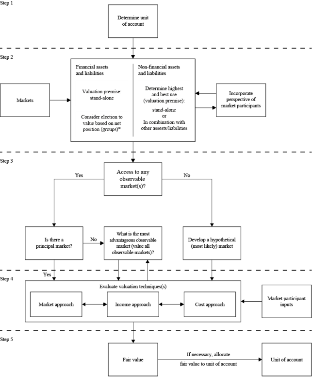
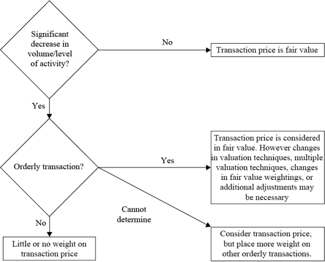

# 05 - Fair value (IFRS 13)

[返回目录](README.md)

# 05 - Fair value (IFRS 13)

Contents

- [05 - Fair value (IFRS 13)](11.md#s31-chap_05_toc_h1)

- [Introduction and scope (paras 5.1- 5.7)](11.md#s32-chap_05_navPoint_1)

- [Scope](11.md#s32-chap_05_navPoint_2)

- [Measurement (paras 5.8- 5.113)](11.md#s33-chap_05_navPoint_3)

- [Step 1: Determine the asset or liability that is being measured](11.md#s33-chap_05_navPoint_4)

- [Characteristics](11.md#s33-chap_05_navPoint_idp1689326264)

- [Unit of account](11.md#s33-chap_05_navPoint_idp1689335224)

- [Offsetting positions in market or counterparty credit risk](11.md#s33-chap_05_navPoint_idp1689362104)

- [Step 2: Determine the valuation premise](11.md#s33-chap_05_navPoint_5)

- [The transaction](11.md#s33-chap_05_navPoint_idp1689239608)

- [Market participants](11.md#s33-chap_05_navPoint_idp1689256120)

- [Entry versus exit price](11.md#s33-chap_05_navPoint_idp1689277368)

- [Transaction costs when determining price](11.md#s33-chap_05_navPoint_idp1695851176)

- [Considerations specific to non-financial assets: highest and best use](11.md#s33-chap_05_navPoint_idp1695858472)

- [Considerations specific to liabilities and equity](11.md#s33-chap_05_navPoint_idp1686813352)

- [Transfer of liabilities](11.md#s33-chap_05_navPoint_idp1686814248)

- [Liability and equity instruments held by other parties as assets](11.md#s33-chap_05_navPoint_idp1686826152)

- [Liabilities not held by other parties as assets](11.md#s33-chap_05_navPoint_idp1686852008)

- [Non-performance risk](11.md#s33-chap_05_navPoint_idp1687123896)

- [Shareholders’ equity](11.md#s33-chap_05_navPoint_idp1687149752)

- [Step 3: Determine the market](11.md#s33-chap_05_navPoint_6)

- [Principal market](11.md#s33-chap_05_navPoint_idp1687164216)

- [Most advantageous market](11.md#s33-chap_05_navPoint_idp1687175224)

- [Transaction costs when determining the most advantageous market](11.md#s33-chap_05_navPoint_idp1687177400)

- [Market accessibility](11.md#s33-chap_05_navPoint_idp1687990680)

- [Step 4: Determine the valuation techniques for measuring fair value](11.md#s33-chap_05_navPoint_7)

- [Selection of valuation techniques](11.md#s33-chap_05_navPoint_idp1688015256)

- [Valuation techniques – market approach](11.md#s33-chap_05_navPoint_idp1688042520)

- [Valuation techniques – income approach](11.md#s33-chap_05_navPoint_idp1688241560)

- [Use of discounted cash flows; present value techniques](11.md#s33-chap_05_navPoint_idp1688254104)

- [Valuation techniques – cost approach](11.md#s33-chap_05_navPoint_idp1688280216)

- [Inputs based on bid and ask prices](11.md#s33-chap_05_navPoint_idp1688293272)

- [Change in policy with respect to the use of the mid-market pricing convention](11.md#s33-chap_05_navPoint_idp1688306840)

- [Step 5: Determine the fair value](11.md#s33-chap_05_navPoint_8)

- [Fair value at initial recognition](11.md#s33-chap_05_navPoint_idp1688319640)

- [Valuation premiums and discounts](11.md#s33-chap_05_navPoint_idp1688330392)

- [Fair value hierarchy](11.md#s33-chap_05_navPoint_idp1688345496)

- [Level 1](11.md#s33-chap_05_navPoint_idp1688231576)

- [Level 2](11.md#s33-chap_05_navPoint_idp1688130696)

- [Level 3](11.md#s33-chap_05_navPoint_idp1688152328)

- [Inactive markets and non-orderly transactions](11.md#s33-chap_05_navPoint_idp1688182408)

- [Identifying transactions that are not orderly](11.md#s33-chap_05_navPoint_idp1688221064)

- [Common areas of application of valuation techniques to non-financial assets when required or permitted by IFRS (paras 5.114 - 5.144)](11.md#s34-chap_05_navPoint_9)

- [Property, plant &amp; equipment including investment properties](11.md#s34-chap_05_navPoint_10)

- [Investments in associates, joint ventures and subsidiaries](11.md#s34-chap_05_navPoint_11)

- [Fair value in business combinations](11.md#s34-chap_05_navPoint_12)

- [Consideration](11.md#s34-chap_05_navPoint_idp1689348792)

- [Previously held equity interests](11.md#s34-chap_05_navPoint_idp1689409464)

- [Non-controlling interests](11.md#s34-chap_05_navPoint_idp1689425976)

- [Intangible assets](11.md#s34-chap_05_navPoint_idp1689434040)

- [Non-financial liabilities](11.md#s34-chap_05_navPoint_13)

- [Inventory](11.md#s34-chap_05_navPoint_14)

- [Biological assets](11.md#s34-chap_05_navPoint_15)

- [Fair value in impairment testing of non-financial assets](11.md#s34-chap_05_navPoint_16)

- [Disclosure objectives](11.md#s34-chap_05_navPoint_17)

- [Illustrative text](12.md#s35-chap_05_navPoint_18)

- [FAQ 5.8.1 – What are the International Valuation Standards?](12.md#s35-chap_05_navPoint_19)

- [FAQ 5.14.1 – How should exposure to market risk be considered when arriving at a net long or net short position?](12.md#s35-chap_05_navPoint_20)

- [FAQ 5.14.2 – Is use of value-at-risk strategy sufficient to allow offsetting positions exception?](12.md#s35-chap_05_navPoint_21)

- [FAQ 5.14.3 – Support required to apply the exception for offsetting positions](12.md#s35-chap_05_navPoint_22)

- [FAQ 5.17.1 – Examples of mismatches](12.md#s35-chap_05_navPoint_23)

- [FAQ 5.20.1 – Unit of measurement when applying the exception for offsetting positions in market or counterparty credit risk](12.md#s35-chap_05_navPoint_24)

- [FAQ 5.20.2 – Level 1 inputs: valuation of offsetting positions in market risks](12.md#s35-chap_05_navPoint_25)

- [FAQ 5.20.3 – Applying the offsetting exception to equity securities](12.md#s35-chap_05_navPoint_26)

- [FAQ 5.20.4 – Applying the offsetting exception to interest rate swaps (1)](12.md#s35-chap_05_navPoint_27)

- [FAQ 5.20.5 – Applying the offsetting exception to interest rate swaps (2)](12.md#s35-chap_05_navPoint_28)

- [FAQ 5.22.1 – Impact of subsequent information in fair value measurement (1)](12.md#s35-chap_05_navPoint_29)

- [FAQ 5.22.2 – Impact of subsequent information in fair value measurement (2)](12.md#s35-chap_05_navPoint_30)

- [FAQ 5.22.3 – Should possible future modifications be considered when determining the fair value of a debt instrument?](12.md#s35-chap_05_navPoint_31)

- [FAQ 5.28.1 – Determining a hypothetical market participant](12.md#s35-chap_05_navPoint_32)

- [FAQ 5.29.1 – Impact of credit risk on the fair value of derivatives](12.md#s35-chap_05_navPoint_33)

- [FAQ 5.30.1 – Impact of restrictions on the sale of an equity instrument](12.md#s35-chap_05_navPoint_34)

- [FAQ 5.30.2 – Impact of restrictions on the use of an asset](12.md#s35-chap_05_navPoint_35)

- [FAQ 5.30.3 – Restrictions on the asset vs restrictions on the entity](12.md#s35-chap_05_navPoint_36)

- [EX 5.34.1 – Costs and the highest and best use of a non-financial asset](12.md#s35-chap_05_navPoint_37)

- [EX 5.34.2 – ‘Highest and best use’ approach](12.md#s35-chap_05_navPoint_38)

- [FAQ 5.39.1 – Valuing assets on a standalone basis or in a group – land](12.md#s35-chap_05_navPoint_39)

- [FAQ 5.39.2 – Valuing assets on a standalone basis or in a group — other assets](12.md#s35-chap_05_navPoint_40)

- [FAQ 5.39.3 – Application of the highest and best use concept](12.md#s35-chap_05_navPoint_41)

- [EX 5.40.1 – Synergies in highest and best use](12.md#s35-chap_05_navPoint_42)

- [FAQ 5.41.1 – Difference between settlement and transfer value (1)](12.md#s35-chap_05_navPoint_43)

- [FAQ 5.41.2 – Difference between settlement and transfer value (2)](12.md#s35-chap_05_navPoint_44)

- [FAQ 5.41.3 – Acquisition of debt in a business combination transaction](12.md#s35-chap_05_navPoint_45)

- [FAQ 5.41.4 – Exit price for derivatives](12.md#s35-chap_05_navPoint_46)

- [FAQ 5.43.1 – Debt obligation measured at fair value using present value technique](12.md#s35-chap_05_navPoint_47)

- [FAQ 5.45.1 – Debt obligation with quoted price (a market approach)](12.md#s35-chap_05_navPoint_48)

- [FAQ 5.45.2 – Fair value of a liability when pricing includes bid-ask spread](12.md#s35-chap_05_navPoint_49)

- [FAQ 5.50.1 – Decommissioning liability](12.md#s35-chap_05_navPoint_50)

- [FAQ 5.51.1 – Impact of credit risk on measurement of liabilities](12.md#s35-chap_05_navPoint_51)

- [FAQ 5.51.2 – Derivative liabilities and credit risk](12.md#s35-chap_05_navPoint_52)

- [FAQ 5.51.3 – Is an evaluation of credit risk required each reporting period?](12.md#s35-chap_05_navPoint_53)

- [FAQ 5.52.1 – Impact of credit enhancements on the credit risk adjustment](12.md#s35-chap_05_navPoint_54)

- [FAQ 5.53.1 – Third-party enhancements: measurement of demand deposit liabilities](12.md#s35-chap_05_navPoint_55)

- [FAQ 5.53.2 – Consideration of fair value where an entity has breached a debt covenant](12.md#s35-chap_05_navPoint_56)

- [FAQ 5.59.1 – Determination of most advantageous market for convertible debt](12.md#s35-chap_05_navPoint_57)

- [FAQ 5.59.2 – Principal or most advantageous market](12.md#s35-chap_05_navPoint_58)

- [FAQ 5.60.1 – Producer has access to more than one market](12.md#s35-chap_05_navPoint_59)

- [FAQ 5.61.1 – Impact of transaction and transport costs on fair value](12.md#s35-chap_05_navPoint_60)

- [FAQ 5.61.2 – Impact of transport costs when determining fair value](12.md#s35-chap_05_navPoint_61)

- [FAQ 5.62.1 – Operating units with access to different markets](12.md#s35-chap_05_navPoint_62)

- [FAQ 5.63.1 – Access to principal market](12.md#s35-chap_05_navPoint_63)

- [FAQ 5.63.2 – Can an entity consider activity in an inaccessible market?](12.md#s35-chap_05_navPoint_64)

- [FAQ 5.64.1 – What are secondary markets and how should prices in them be considered?](12.md#s35-chap_05_navPoint_65)

- [FAQ 5.66.1 – Markets where input can be observable](12.md#s35-chap_05_navPoint_66)

- [FAQ 5.66.2 – Effect of credit risk on the fair value of financial instruments](12.md#s35-chap_05_navPoint_67)

- [FAQ 5.66.3 – Credit risk adjustments on a portfolio basis](12.md#s35-chap_05_navPoint_68)

- [FAQ 5.68.1 – What are some of the considerations when selecting a valuation technique?](12.md#s35-chap_05_navPoint_69)

- [FAQ 5.77.1 – Single cash flow versus probability-weighted cash flows](12.md#s35-chap_05_navPoint_70)

- [FAQ 5.77.2 – Uncertainties in cash flows for fair value measurement of financial instruments](12.md#s35-chap_05_navPoint_71)

- [FAQ 5.77.3 – Uncertainties in cash flows and change in valuation technique for Level 3 fair value measurement](12.md#s35-chap_05_navPoint_72)

- [FAQ 5.79.1 – Additional considerations for discount rates used in Level 3 fair value measurements in periods of significant economic uncertainty](12.md#s35-chap_05_navPoint_73)

- [FAQ 5.82.1 – Appropriateness of the mid-market pricing convention](12.md#s35-chap_05_navPoint_74)

- [FAQ 5.82.2 – Treatment of bid-ask spread on initial recognition](12.md#s35-chap_05_navPoint_75)

- [FAQ 5.82.3 – Treatment of bid-ask spread not included in initial carrying value of a financial asset](12.md#s35-chap_05_navPoint_76)

- [FAQ 5.82.4 – How should a reporting entity account for transaction costs in a bid-ask spread?](12.md#s35-chap_05_navPoint_77)

- [FAQ 5.83.1 – Can a reporting entity change its use of a mid-market practical expedient pricing convention?](12.md#s35-chap_05_navPoint_78)

- [FAQ 5.87.1 – Adjustments for size of holding: investments measured under IFRS 9 (IAS 39)](12.md#s35-chap_05_navPoint_79)

- [FAQ 5.87.2 – Adjustments for illiquidity and size of holding: investments measured under IFRS 9 (IAS 39)](12.md#s35-chap_05_navPoint_80)

- [FAQ 5.87.3 – Measuring the fair value of listed entities: associates](12.md#s35-chap_05_navPoint_81)

- [FAQ 5.87.4 – Measuring the fair value of listed entities: subsidiaries](12.md#s35-chap_05_navPoint_82)

- [FAQ 5.87.5 – Unit of account under other IFRSs](12.md#s35-chap_05_navPoint_83)

- [FAQ 5.87.6 – Inclusion of a control premium](12.md#s35-chap_05_navPoint_84)

- [FAQ 5.87.7 – Status of IASB work on use of P × Q for investments in associates, joint ventures and subsidiaries measured at fair value](12.md#s35-chap_05_navPoint_85)

- [FAQ 5.89.1 – Determination of significance of an input in fair value measurement](12.md#s35-chap_05_navPoint_86)

- [FAQ 5.89.2 – To what extent can an entity use quoted prices in markets to which it does not have access?](12.md#s35-chap_05_navPoint_87)

- [FAQ 5.89.3 – Reassessment of inputs categorisation](12.md#s35-chap_05_navPoint_88)

- [FAQ 5.90.1 – Determining if significant inputs are observable](12.md#s35-chap_05_navPoint_89)

- [FAQ 5.91.1 – Examples of instruments whose measurement qualifies as Level 1](12.md#s35-chap_05_navPoint_90)

- [FAQ 5.94.1 – Classification in fair value hierarchy of single price source or quote](12.md#s35-chap_05_navPoint_91)

- [FAQ 5.94.2 – Adjustments to the quoted price in an active market in times of significant market volatility](12.md#s35-chap_05_navPoint_92)

- [FAQ 5.94.3 – Is a derivative’s ‘value mark’ provided by a clearing house considered Level 1 input?](12.md#s35-chap_05_navPoint_93)

- [FAQ 5.96.1 – Level 2 inputs](12.md#s35-chap_05_navPoint_94)

- [FAQ 5.98.1 – Level 2 inputs for similar but not identical instruments](12.md#s35-chap_05_navPoint_95)

- [FAQ 5.100.1 – Corroboration by market data (1)](12.md#s35-chap_05_navPoint_96)

- [FAQ 5.100.2 – Corroboration by market data (2)](12.md#s35-chap_05_navPoint_97)

- [FAQ 5.101.1 – Level 3 inputs](12.md#s35-chap_05_navPoint_98)

- [FAQ 5.101.2 – Examples of instruments whose measurement qualifies as Level 3](12.md#s35-chap_05_navPoint_99)

- [FAQ 5.105.1 – Use of third-party pricing quotes](12.md#s35-chap_05_navPoint_100)

- [FAQ 5.105.2 – Impact of models on classification in the fair value hierarchy](12.md#s35-chap_05_navPoint_101)

- [FAQ 5.105.3 – Classification of funds invested in actively traded securities](12.md#s35-chap_05_navPoint_102)

- [FAQ 5.105.4 – Corroboration of third-party pricing quotes](12.md#s35-chap_05_navPoint_103)

- [FAQ 5.111.1 – Determining whether transactions are orderly](13.md#s36-chap_05_navPoint_104)

- [FAQ 5.113.1 – Determining fair value where an entity might be forced to liquidate assets](13.md#s36-chap_05_navPoint_105)

- [EX 5.116.1 – Guidance on highest and best use of property, plant and equipment](13.md#s36-chap_05_navPoint_106)

- [EX 5.117.1 – Application of the replacement cost approach for property, plant and equipment](13.md#s36-chap_05_navPoint_107)

- [FAQ 5.118.2 – Use of the market approach for investment property](13.md#s36-chap_05_navPoint_108)

- [FAQ 5.118.3 – Use of the income approach for investment property](13.md#s36-chap_05_navPoint_109)

- [FAQ 5.118.4 – IFRS 16 considerations when determining the fair value of leased property under IAS 40](13.md#s36-chap_05_navPoint_110)

- [FAQ 5.122.1 – Application of the market approach to valuation of investments in associates, joint ventures and subsidiaries](13.md#s36-chap_05_navPoint_111)

- [FAQ 5.122.2 – Application of the income approach to valuation of investments in associates, joint ventures and subsidiaries](13.md#s36-chap_05_navPoint_112)

- [FAQ 5.126.1 – Measuring contingent consideration in a business combination at fair value](13.md#s36-chap_05_navPoint_113)

- [FAQ 5.126.2 – Fair value measurement of liability-classified, cash-settled contingent consideration (1)](13.md#s36-chap_05_navPoint_114)

- [FAQ 5.126.3 – Fair value measurement of liability-classified, cash-settled contingent consideration (2)](13.md#s36-chap_05_navPoint_115)

- [FAQ 5.126.4 – Fair value measurement of equity-classified contingent consideration](13.md#s36-chap_05_navPoint_116)

- [FAQ 5.129.2 – Measuring the fair value of a less than controlling interest: income approach](13.md#s36-chap_05_navPoint_117)

- [FAQ 5.129.3 – Fair value measurement of an unlisted less than controlling interest](13.md#s36-chap_05_navPoint_118)

- [FAQ 5.132.1 – Applying the multi-period excess earnings method (MEEM)](13.md#s36-chap_05_navPoint_119)

- [FAQ 5.132.2 – Discount rates for intangible assets](13.md#s36-chap_05_navPoint_120)

- [FAQ 5.132.3 – Reconciliation of rates of return](13.md#s36-chap_05_navPoint_121)

- [FAQ 5.132.4 – Contributory asset charges](13.md#s36-chap_05_navPoint_122)

- [FAQ 5.132.5 – Tax amortisation benefit](13.md#s36-chap_05_navPoint_123)

- [FAQ 5.132.6 – Relief from royalty method](13.md#s36-chap_05_navPoint_124)

- [FAQ 5.132.7 – Greenfield method](13.md#s36-chap_05_navPoint_125)

- [FAQ 5.132.8 – ‘With and without’ method](13.md#s36-chap_05_navPoint_126)

- [FAQ 5.132.9 – Weighted average return analysis](13.md#s36-chap_05_navPoint_127)

- [FAQ 5.132.10 – Relevant tax regime when determining the tax amortisation benefit](13.md#s36-chap_05_navPoint_128)

- [FAQ 5.132.11 – Application of the relief from royalty method](13.md#s36-chap_05_navPoint_129)

- [FAQ 5.132.12 – Distributor method](13.md#s36-chap_05_navPoint_130)

- [FAQ 5.132.13 – Market approach for intangible assets](13.md#s36-chap_05_navPoint_131)

- [FAQ 5.132.14 – Cost approach for intangible assets](13.md#s36-chap_05_navPoint_132)

- [FAQ 5.132.15 – Considerations for assets the acquirer does not intend to actively use](13.md#s36-chap_05_navPoint_133)

- [EX 5.132.16 – Defensive intangible assets](13.md#s36-chap_05_navPoint_134)

- [EX 5.132.17 – Leading practices in measuring the fair value of intangible assets](13.md#s36-chap_05_navPoint_135)

- [FAQ 5.135.1 – Measurement of deferred revenue at fair value](13.md#s36-chap_05_navPoint_136)

- [FAQ 5.135.2 – Measurement of contingent liabilities](13.md#s36-chap_05_navPoint_137)

- [FAQ 5.135.3 – Measurement of a warranty obligation in a business combination](13.md#s36-chap_05_navPoint_138)

- [FAQ 5.135.4 – Measurement of decommissioning liabilities](13.md#s36-chap_05_navPoint_139)

- [FAQ 5.136.1 – Inventory acquired in a business combination](13.md#s36-chap_05_navPoint_140)

- [FAQ 5.136.2 – Evaluating how intangible assets contribute to the fair value of inventory](13.md#s36-chap_05_navPoint_141)

- [EX 5.136.3 – Evaluating how intangible assets contribute to the fair value of inventory](13.md#s36-chap_05_navPoint_142)

- [FAQ 5.136.4 – Measuring the fair value of raw materials inventory](13.md#s36-chap_05_navPoint_143)

- [FAQ 5.139.1 – Market-based valuation techniques for biological assets](13.md#s36-chap_05_navPoint_144)

- [FAQ 5.139.2 – Fair value in the absence of market-based prices or values](13.md#s36-chap_05_navPoint_145)

- [FAQ 5.139.3 – Are contributory asset charges incorporated into the fair value of growing biological assets?](13.md#s36-chap_05_navPoint_146)

- [FAQ 5.141.1 – Measuring fair value less costs of disposal for impairment testing: income approach](13.md#s36-chap_05_navPoint_147)

- [FAQ 5.141.2 – Operating expenditures that a market participant would include in a cash flow model or projected financial information](13.md#s36-chap_05_navPoint_148)

- [FAQ 5.141.3 – What factors should an entity consider in a fair value less costs of disposal calculation where a different use of the asset or CGU is possible in response to climate change (that is, an enhancement or restructuring of the asset)?](13.md#s36-chap_05_navPoint_149)

- [FAQ 5.141.4 – How can climate or ESG metrics impact a discounted cash flow analysis used in fair value less costs of disposal for a CGU?](13.md#s36-chap_05_navPoint_150)

- [FAQ 5.144.1 – IAS 39 disclosure of remeasurement of a financial asset carried at amortised cost](13.md#s36-chap_05_navPoint_151)

- [FAQ 5.144.2 – How are unrealised gains and losses, to be disclosed for recurring Level 3 measurements, calculated?](13.md#s36-chap_05_navPoint_152)

- [FAQ 5.144.3 – Should IFRS 13 disclosures be made for short-term receivables and payables for which the entity is claiming the IFRS 7 exemption not to disclose the fair value of such items?](13.md#s36-chap_05_navPoint_153)

- [FAQ 5.144.4 – Is a qualitative sensitivity analysis for recurring fair value measurements, as required by IFRS 13, sufficient to comply with IFRSs?](13.md#s36-chap_05_navPoint_154)

This eBook is licensed to peggy so, peggy.so@hk.ey.com, 

## Introduction and scope (paras 5.1- 5.7)

 

**5.1** IFRS 13 is a single source of guidance for measuring fair value when required or permitted by another IFRS. IFRS 13 addresses how to measure fair value, but it does not stipulate when fair value can or should be used.

[IFRS 13 para 1].

**5.2** Fair value is the exit price, from the perspective of market participants who hold the asset or owe the liability, at the measurement date. It is based on the perspective of market participants rather than just the entity itself, so fair value is not affected by an entity’s intentions towards the asset, liability or equity item that is being fair valued. Fair value is a market-based measurement, and not an entity-specific measurement. Fair value is the price that would be received to sell an asset, or paid to transfer a liability, in an orderly transaction between market participants at the measurement date.

[IFRS 13 para 2].

**5.3** A fair value measurement requires management to determine four elements:

- the particular asset or liability that is the subject of the measurement (consistent with its unit of account);

- the highest and best use for a non-financial asset;

- the principal (or, in its absence, the most advantageous) market; and

- the valuation technique(s).

[IFRS 13 App B para B2].

 

### Scope

 

**5.4** IFRS 13 applies to all fair value measurements or disclosures that are either required or permitted by other standards, except:

- share-based payments under IFRS 2;

- leases under IFRS 16; and

- measurements that are similar to (but are not) fair value, including the net realisable value measure in IAS 2, and the value-in-use measure in IAS 36.

[IFRS 13 para 6].

**5.5** The measurement requirements of IFRS 13 apply to the following items, but the disclosure requirements do not:

- defined benefit plan assets measured at fair value under IAS 19;

- retirement benefit plan investments measured at fair value under IAS 26; and

- assets tested for impairment using fair value less costs of disposal under IAS 36.

[IFRS 13 para 7].

**5.6**IFRS 13 applies to initial and subsequent measurements at fair value.

[IFRS 13 para 8].

**5.7** There is no exemption from IFRS 13 for first-time adopters of IFRS. A first-time adopter that is required to, or chooses to, measure assets and liabilities at fair value must apply IFRS 13.

[IFRS 1 para 10(d)].

 

This eBook is licensed to peggy so, peggy.so@hk.ey.com, 

## Measurement (paras 5.8- 5.113)

 

**5.8** The overall process for determining fair value under IFRS 13 can be illustrated by the following chart:

* The election to value groups of financial assets and liabilities with offsetting market or credit risks on the basis of the net risk position is subject to the conditions in IFRS 13 para .49. See below for a discussion of this exception.

  
 Step 1: Determine the asset or liability that is being measured. In doing so, it is essential to establish the unit of account.

Step 2: Determine the valuation premise. Different valuation premises exist for financial and non-financial assets and liabilities. The valuation premise is determined from a market participant’s perspective.

Step 3: Determine the market, either observable or hypothetical, in which the asset or liability is traded, for the purpose of determining the value.

Step 4: Determine the valuation technique for measuring the fair value.

Step 5: Determine the fair value.

[FAQ 5.8.1 – What are the International Valuation Standards?](12.md#s35-FAQ_5.8.1)

 

### Step 1: Determine the asset or liability that is being measured

#### Characteristics

**5.9** A fair value measurement relates to a particular asset or liability. It should, therefore, incorporate the asset’s or liability’s specific characteristics, if market participants consider these characteristics when pricing the asset or liability. These characteristics could include condition, location and restrictions, if any, on sale or use as of the measurement date.

[IFRS 13 para 11].

**5.10** The manner in which each of the characteristics might impact the fair value measurement depends on how market participants would consider each characteristic when acting in their best economic interest.

[IFRS 13 para 22].

#### Unit of account

 

**5.11** Fair value measurement might be applied to a standalone asset or liability (for example, an equity security, an investment property, an intangible asset or a warranty liability) or a group of related assets and/or liabilities (such as a business), depending on the circumstances.

[IFRS 13 para 13].

**5.12**The unit of account drives the application of fair value measurement. The unit of account is the level at which assets or liabilities are aggregated or disaggregated, in accordance with the IFRS requirements applicable to the particular asset or liability being measured. For financial instruments, the unit of account under IFRS 9 (IAS 39) is generally the standalone financial instrument. Consequently, in fair valuing financial instruments under IFRS 9 (IAS 39), adjustments for premiums or discounts related to size as a characteristic of the reporting entity’s holding are generally disallowed. See [paragraph 5.87](11.md#s33-Para_5.87).

[IFRS 13 para 14].

 

#### Offsetting positions in market or counterparty credit risk

 

**5.13** If an entity manages a group of financial assets and financial liabilities on the basis of its net exposure to either market risks or credit risks (as defined in IFRS 7), it can opt to measure the fair value of that group on the basis of the net position. The net position is the unit of measurement (despite not being the unit of account in this instance – see [para 5.19](11.md#s33-Para_5.19) below) for the purposes of the fair value measurement, rather than the individual financial assets and liabilities.

[IFRS 13 para 48].

**5.14** The offsetting positions exception is permitted only if an entity:

- manages the financial asset/liability group based on its net exposure to market/credit risk in accordance with its documented risk management or investment strategy;

- provides information about the financial asset/liability group on a net basis to key management personnel, as defined in IAS 24; and

- measures those financial assets and liabilities at fair value in the statement of financial position on a recurring basis.

[IFRS 13 para 49].

[FAQ 5.14.1 – How should exposure to market risk be considered when arriving at a net long or net short position?](12.md#s35-FAQ_5.14.1)

[FAQ 5.14.2 – Is use of value-at-risk strategy sufficient to allow offsetting positions exception?](12.md#s35-FAQ_5.14.2)

[FAQ 5.14.3 – Support required to apply the exception for offsetting positions](12.md#s35-FAQ_5.14.3)

**5.15** The offsetting positions exception applies only to financial assets, liabilities and other contracts within the scope of IFRS 9 (IAS 39). The guidance applies to all contracts within the scope of IFRS 9 (IAS 39), regardless of whether they meet the definition of financial assets or financial liabilities. This includes contracts to buy or sell non-financial items that can be settled net in cash or another financial instrument.

[IFRS 13 para 52].

**5.16**The offsetting positions exception applies only to assets and liabilities that are in the scope of IFRS 9 and exposed to identical (or, at least, substantially similar) market risks. If the risks are not identical, the differences should be considered when allocating the group’s fair value to component assets and liabilities, as explained in [paragraph 5.19](11.md#s33-Para_5.19).

[IFRS 13 para 52].

**5.17** The offsetting positions exception applies only to exposures of a similar duration. An entity that uses a 12-month futures contract against a five-year financial instrument measures the fair value of the exposure to 12-month interest rate risk on a net basis, and the remaining interest rate risk exposure (that is, years 2 to 5) on a gross basis.

[IFRS 13 para 55].

[FAQ 5.17.1 – Examples of mismatches](12.md#s35-FAQ_5.17.1)

**5.18** The fair value of the net position is measured using IFRS 13 principles if the offsetting positions exception is applied. For example:

- For market risks, fair value of the net position is the price within the bid-ask spread that is most representative of fair value in the entity’s circumstances. [IFRS 13 para 53].

- For credit risk, fair value of such a group should consider credit enhancements (such as master netting agreements and collateral requirements) and market participant expectations about the legal enforceability of such enhancements. [IFRS 13 para 56].

**5.19** The offsetting positions exception relates to measurement, and it does not permit net presentation of assets and liabilities within the group. Presentation is dealt with in other IFRSs. Where gross presentation is required, the fair value of the group should be allocated to the assets and liabilities within the group on a reasonable and consistent basis (for example, using the relative fair value approach).

[IFRS 13 para 50].

**5.20** The use of the offsetting positions exception, along with any policies for allocating bid-ask and credit adjustments, is regarded as an accounting policy that should be applied consistently from period to period for a given portfolio.

[IFRS 13 para 51].

[FAQ 5.20.1 – Unit of measurement when applying the exception for offsetting positions in market or counterparty credit risk](12.md#s35-FAQ_5.20.1)  
 [FAQ 5.20.2 – Level 1 inputs: valuation of offsetting positions in market risks ](12.md#s35-FAQ_5.20.2)  
[FAQ 5.20.3 – Applying the offsetting exception to equity securities ](12.md#s35-FAQ_5.20.3)  
[FAQ 5.20.4 – Applying the offsetting exception to interest rate swaps (1) ](12.md#s35-FAQ_5.20.4)  
[FAQ 5.20.5 – Applying the offsetting exception to interest rate swaps (2)](12.md#s35-FAQ_5.20.5)

 

### Step 2: Determine the valuation premise

#### The transaction

 

**5.21** Fair value measurement assumes that the asset or liability is exchanged in an orderly transaction between market participants under current market conditions at the measurement date.

[IFRS 13 para 15].

**5.22** A fair value measurement is based on information available at the date of measurement. Information that becomes known after the measurement date is only taken into account where reasonable and customary due diligence would have identified the additional information at the measurement date.

[IAS 10 para 11].

[FAQ 5.22.1 – Impact of subsequent information in fair value measurement (1)](12.md#s35-FAQ_5.22.1)  
[FAQ 5.22.2 – Impact of subsequent information in fair value measurement (2)](12.md#s35-FAQ_5.22.2)

[FAQ 5.22.3 - Should possible future modifications be considered when determining the fair value of a debt instrument?](12.md#s35-FAQ_5.22.3)

 

[FAQ 9.5.6 – How should adjusting events after the reporting period affecting remeasurement/impairment calculations related to assets with a measurement basis of fair value be accounted for?](17.md#s57-FAQ_9.5.6)

 

**5.23** A market participant that would enter into a transaction for an asset or a liability is expected to undertake all reasonable efforts to become knowledgeable about the asset and the related risks at the time of the measurement.

 

[IFRS 13 para BC59].

 

#### Market participants

 

**5.24** A fair value measurement should be based on the assumptions of market participants. It is not an entity-specific measurement.

[IFRS 13 para 22].

**5.25** Market participants are buyers and sellers in the principal (or most advantageous) market for the asset or liability that are:

- Independent. The transaction counterparties are not related parties, as defined in IAS 24. However, this does not preclude related-party transaction prices from being used as valuation inputs, if there is evidence that the transactions were on market terms.

- Knowledgeable. Transaction counterparties have a reasonable understanding about the asset or liability and the transaction, using all available information, including information that might be obtained through due diligence efforts that are usual and customary.

- Able to transact in the asset or liability.

- Willing to transact in the asset or liability. Transaction counterparties are motivated but not forced or otherwise compelled to transact.

[IFRS 13 App A].

**5.26** Market participants who want to sell an asset or transfer a liability seek to maximise the fair value of an asset or minimise the fair value of a liability, in a transaction, in the principal (or most advantageous) market for the asset or liability. Market participants are presumed to act in their best economic interests.

[IFRS 13 para 22].

**5.27** The entity is not required to identify specific market participants; instead, it should develop a profile of potential market participants. The profile should consider factors specific to the asset or liability, the principal (or, in its absence, the most advantageous) market for the asset or liability, and market participants with whom the entity would transact in that market.

[IFRS 13 para 23].

**5.28** Fair value is determined by considering the characteristics of market participants who would enter into a hypothetical transaction for the asset or liability, in the absence of an observable market.

[IFRS 13 para 23(c)].

[FAQ 5.28.1 – Determining a hypothetical market participant](12.md#s35-FAQ_5.28.1)

 

#### Entry versus exit price

 

**5.29** Fair value is based on the exit price and not on the entry price. Exit price is the price that would be received to sell an asset or would be paid to transfer a liability. Entry price is the price that was paid for the asset or that was received to assume the liability. Conceptually, entry and exit prices are different. The exit price concept is based on current expectations about the sale or transfer price from the perspective of market participants.

[IFRS 13 para 24].

[FAQ 5.29.1 – Impact of credit risk on the fair value of derivatives](12.md#s35-FAQ_5.29.1)

**5.30**Fair value takes into account any restrictions on the sale or use of an asset, if those restrictions relate to the asset rather than to the holder of the asset, and a market participant would take those restrictions into account in determining the price that he is prepared to pay.

[IFRS 13 para 11(b)].

[FAQ 5.30.1 – Impact of restrictions on the sale of an equity instrument](12.md#s35-FAQ_5.30.1)  
  
[FAQ 5.30.2 – Impact of restrictions on the use of an asset](12.md#s35-FAQ_5.30.2)  
  
[FAQ 5.30.3  – Restrictions on the asset vs restrictions on the entity](12.md#s35-FAQ_5.30.3)  
 

 

#### Transaction costs when determining price

 

**5.31** Transaction costs are:

“the costs to sell an asset or transfer a liability in the principal (or most advantageous) market for the asset or liability that are directly attributable to the disposal of an asset or the transfer of a liability and meet both of the following criteria: a) They result directly from and are essential to that transaction. b) They would not have been incurred by the entity had the decision to sell the asset or transfer the liability not been made (similar to costs to sell, as defined in IFRS 5).”

[IFRS 13 App A].

**5.32** Fair value should not be adjusted for transaction costs, which are accounted for in accordance with other IFRSs. While transaction costs are not included in the fair value of the asset or liability under the fair value standards, these amounts are included when assessing the net transaction proceeds to determine the most advantageous market. See [paragraph 5.61](11.md#s33-Para_5.61).

[IFRS 13 para 25].

 

#### Considerations specific to non-financial assets: highest and best use

 

**5.33** The fair value of a non-financial asset should be measured based on its highest and best use, from a market participant’s perspective. This consideration does not apply to financial instruments, liabilities or equity.

[IFRS 13 para 27].

**5.34** The highest and best use takes into account the asset’s use that is:

- physically possible − taking into account the physical characteristics that market participants would consider (for example, property location or size);

- legally permissible − taking into account the legal restrictions on the asset’s use that market participants would consider (for example, planning or zoning regulations); and

- financially feasible − taking into account whether an asset’s use generates adequate income or cash flows to produce an investment return that market participants would require. This should incorporate the costs of converting the asset to that use.

[IFRS 13 para 28].

[EX 5.34.1 – Costs and the highest and best use of a non-financial asset](12.md#s35-EX5.34.1)  
[EX 5.34.2 – ‘Highest and best use’ approach](12.md#s35-EX5.34.2)

**5.35** The highest and best use of a property is determined by reference to its use and not its classification. For example, if an entity uses the revaluation model in IAS 16 for its head office property, the determination of fair value will be based on whether the highest and best use of the property is as an office or for some other purpose, and not on whether the property is owner-occupied or an investment property. See [paragraph 5.116](11.md#s34-Para_5.116).

[IFRS 13 para 29].

**5.36** Management might presume that its current use of an asset is the highest and best use, unless market or other factors suggest otherwise. An entity that seeks to maximise the value of its assets would use those assets at their highest and best use. Management considers alternative uses of those assets only if there was evidence that the current use of the assets is not their highest and best use. It would be unlikely for an asset’s current use not to be its highest and best use.

[IFRS 13 para 29].

**5.37** Highest and best use is determined from the perspective of market participants. It does not matter whether the entity intends to use the asset differently. For example, the entity could have made a defensive acquisition of a competing brand that it does not intend to use, in order to maintain or promote the competitive position of its own brand. Despite its intentions, the entity measures the fair value of the competing brand, assuming its highest and best use by market participants.

[IFRS 13 para 30].

**5.3****8** The highest and best use of an asset might be on a standalone basis, or it might be achieved in combination with other assets and/or liabilities. In the latter case:

- Fair value is based on the use of the asset in such an asset/liability group. It is assumed that the asset would be used within such a group and that the other assets and liabilities would be available to market participants.

- The asset/liability group cannot include liabilities that are used to fund assets outside the asset/liability group.

- Assumptions about highest and best use should be consistent for all non-financial assets in such an asset/liability group.

[IFRS 13 para 31].

**5.39** The fair value measurement assumes that the asset is sold in a manner that is consistent with the unit of account, and not as a group, because the market participant is assumed to have the other assets.

[IFRS 13 para 32].

[FAQ 5.39.1 – Valuing assets on a standalone basis or in a group – land](12.md#s35-FAQ_5.39.1)

 

[FAQ  5.39.2 – Valuing assets on a standalone basis or in a group – other assets](12.md#s35-FAQ_5.39.2)

 

[FAQ 5.39.3 – Application of the highest and best use concept](12.md#s35-FAQ_5.39.3)

 

**5.40** Where the highest and best use is in an asset/liability group, the synergies associated with the asset/liability group could be factored into the fair value of the individual asset in a number of ways. [IFRS 13 App B para B3].

 

[EX 5.40.1 – Synergies in highest and best use](12.md#s35-EX5.40.1)

 

#### Considerations specific to liabilities and equity

##### Transfer of liabilities

 

**5.41** The fair value of a financial or non-financial liability or an entity’s own equity instrument assumes that the instrument is transferred to a market participant at the measurement date and not settled, cancelled or extinguished. The market participant transferee, in either case, is assumed to take on the rights and responsibilities associated with the instrument. Measurement on a settlement basis would probably be different from fair value at the measurement date. The likely timing, amount and probability of settlement would be inputs into the fair value measure.

 

[IFRS 13 para 34].

 

[FAQ 5.41.1 – Difference between settlement and transfer value (1)](12.md#s35-FAQ_5.41.1)  
[FAQ 5.41.2 – Difference between settlement and transfer value (2)](12.md#s35-FAQ_5.41.2)  
[FAQ 5.41.3 – Acquisition of debt in a business combination transaction](12.md#s35-FAQ_5.41.3)  
[FAQ 5.41.4 – Exit price for derivatives](12.md#s35-FAQ_5.41.4)

 

##### Liability and equity instruments held by other parties as assets

 

**5.42** Observable active markets for liabilities and equities are much less likely to exist due to contractual and legal restrictions on liability and equity transfers. Even for quoted debt or equity securities, the market serves as an exit mechanism for the counterparty security holders rather than for the issuer. The quoted price, as a result, reflects the exit price for the investor rather than the issuer. When a quoted transfer price is not available for the issuer, but the instrument is held by another party as an asset, management should measure fair value from the asset holder’s perspective.

[IFRS 13 para 37].

**5.43** The fair value of the liability or equity instrument is derived by:

- Using the quoted price in an active market for the identical item held by another party as an asset (for example, actively quoted debt security prices).

- Using other observable inputs if the price in (a) is not available, such as the quoted price in an inactive market for the identical item held by another party as an asset (for example, quoted debt security prices in less active markets).

- Using another valuation technique if the observable inputs in (a) and (b) are not available, such as:

- an income approach − this approach uses a present value technique that takes into account the future cash outflows that a market participant would expect to receive from holding the liability or equity instrument as an asset.

- a market approach − under this approach, fair value is determined using quoted prices for similar liabilities or equity instruments held by other parties as assets.

[IFRS 13 para 38].

[FAQ 5.43.1 – Debt obligation measured at fair value using present value technique](12.md#s35-FAQ_5.43.1)

**5.44** An entity should adjust the quoted price of a liability or equity instrument held by another party as an asset only if there are factors specific to the asset that are not applicable to the fair value measurement of the liability or equity instrument (for example, a restriction preventing the sale of the asset). There should be no separate inputs or adjustments to existing inputs for restrictions on transfer of liabilities by the issuer of the liability in the measurement of the liability’s fair value. This is in contrast to the fair value from the perspective of the asset holder, which must take into account any restriction on transfer of the asset by the asset holder. See [paragraph 5.30](11.md#s33-Para_5.30).

[IFRS 13 para 39]. [IFRS 13 para 45].

**5.45** Unit of account is also relevant (see [para 5.52](11.md#s33-Para_5.52)). For example, a quoted debt security might be secured by a third-party guarantee. The quoted price of such a security would reflect the value of the guarantee. The issuer should exclude the effect of the guarantee from the quoted price, if the issuer is measuring only the fair value of its own liability and the unit of account excludes the guarantee. If management uses the quoted price for a similar (but not identical) debt or equity instrument to value its own debt, it would have to adjust for any differences in the characteristics between the debt or equity instruments. The price of the asset used to measure the fair value of the corresponding liability or equity instrument should not reflect the effect of a restriction preventing the asset’s sale. Factors that indicate that the price of the asset should be adjusted are:

- the quoted price relates to a similar but not identical asset; or

- the unit of account for the asset is not the same as for the liability.

[IFRS 13 para 39].

[FAQ 5.45.1 – Debt obligation with quoted price (a market approach)](12.md#s35-FAQ_5.45.1)

[FAQ 5.45.2 – Fair value of a liability when pricing includes bid-ask spread](12.md#s35-FAQ_5.45.2)

 

##### Liabilities not held by other parties as assets

 

**5.46** There are certain liabilities that are not held by another party as an asset (for example, a decommissioning liability). The liability’s fair value is measured from the perspective of a market participant to whom the liability would be transferred. If an actual market is not available for the liability, a valuation technique is required to measure the liability’s fair value.

[IFRS 13 para 40].

**5.47** These valuation techniques can include a present value technique that considers either:

- the future cash outflows that a market participant would expect to incur in fulfilling the obligation, including the compensation that a market participant would require for taking on the obligation; or

- the amount that a market participant would receive to enter into or issue an identical liability, using the assumptions that market participants would use when pricing the identical item (for example, having the same credit characteristics) in the principal market (or, in its absence, the most advantageous market).

[IFRS 13 para 41].

**5.48** Present value calculations should reflect the future cash outflows that market participants would expect to incur in fulfilling the obligation. These cash outflows should include:

- market participants’ expectations about the costs of fulfilling the obligation; and

- the compensation that a market participant would require, which should include a return for:

- undertaking the activity − the market participant would expect a compensation for fulfilling the obligation, as the participant will use valuable resources for this purpose; and

- assuming the risk associated with the obligation − for assuming the obligations, the market participant would usually require a risk premium to compensate for the risk that actual cash outflows might differ from those expected.

[IFRS 13 App B para B31].

**5.49** Risk premiums, to compensate for the risk assumed on the obligation, can be included by adjusting either the cash flows or the discount rate. However, the risk should not be double counted by adjusting both cash flows and discount rate for the same risk.

[IFRS 13 App B para B33].

**5.50** Non-financial liabilities might not have a contractual rate of return or an observable market yield. When measuring such liabilities at fair value, the various components of return might be indistinguishable (for example, when using the price that a third-party contractor would charge on a fixed fee basis). In other cases, the various components might require separate estimation (for example, when using the price that a third-party contractor would charge on a cost-plus basis). The objective is to determine what a potential market participant with the same credit risk as the entity would require as compensation to take on the liability.

[IFRS 13 App B para B32].

[FAQ 5.50.1 – Decommissioning liability](12.md#s35-FAQ_5.50.1)

 

##### Non-performance risk

 

**5.51** The liability’s fair value should reflect the effect of non-performance risk, which is the risk that an entity will not fulfil an obligation. Non-performance risk includes the effect of credit risk, as well as any other factors that influence the likelihood of fulfilling the obligation. This applies to both financial and non-financial liabilities. Non-performance risk is assumed to be the same before and after the transfer of the liability. This concept assumes that the liability would transfer to a credit-equivalent entity.

[IFRS 13 para 42].

[FAQ 5.51.1 – Impact of credit risk on measurement of liabilities ](12.md#s35-FAQ_5.51.1)  
[FAQ 5.51.2 – Derivative liabilities and credit risk](12.md#s35-FAQ_5.51.2)

[FAQ 5.51.3 – Is an evaluation of credit risk required each reporting period?](12.md#s35-FAQ_5.51.3)

**5.52** The level of non-performance risk imputed into the fair value should be consistent with the unit of account. For example, the effect of third-party credit enhancements should be excluded if the credit enhancement is accounted for separately from the liability.

[IFRS 13 para 44].

[FAQ 5.52.1 – Impact of credit enhancements on the credit risk adjustment](12.md#s35-FAQ_5.52.1)

**5.53** A third-party credit enhancement is excluded, because the liability issuer does not obtain the benefit of it, whereas the asset holder does. The issuer has to pay the entire liability unless it goes bankrupt, irrespective of the third-party credit enhancement. So, in certain circumstances, the asset holder is allowed to consider the enhancement in its fair value, whereas the liability issuer is not. However, IFRS 13 does not specify whether the credit enhancement should or should not be accounted for separately from the liability. That is determined based on other IFRSs.

[IFRS 13 para 39(b)].

[FAQ 5.53.1 – Third-party enhancements: measurement of demand deposit liabilities](12.md#s35-FAQ_5.53.1)

 

[FAQ 5.53.2 – Consideration of fair value where an entity has breached a debt covenant](12.md#s35-FAQ_5.53.2)

 

##### Shareholders’ equity

 

**5.54** The principles in IFRS 13 also apply to shareholders’ equity. An example of this is where equity interests are issued as consideration in a business combination. The valuation model of instruments classified within shareholders’ equity is consistent with the requirements for measuring the fair value of liabilities. The guidance specifies that an entity should measure the fair value of its own equity instruments from the perspective of a market participant who holds the instrument as an asset. Similar to the application to liabilities, where equity instruments are not held by other parties as assets, an entity should use a valuation technique using market participant assumptions.

[IFRS 13 para BC104]. [IFRS 13 para BC105]. [IFRS 13 para BC106]. [IFRS 13 para BC107].

 

### Step 3: Determine the market

**5.55** Management determines fair value based on a transaction that would take place in the principal market or, in its absence, the most advantageous market.

[IFRS 13 para 16].

**5.56** Management should evaluate the level of activity in various different markets. The entity does not have to undertake an exhaustive search of all possible markets in order to identify the principal or most advantageous market. It should take into account all information that is readily available. The market in which an entity normally transacts is presumed to be the principal market or, in its absence, the most advantageous market, in the absence of other evidence.

[IFRS 13 para 17].

#### Principal market

 

**5.57** The principal market is the market with the greatest volume and level of activity for the asset or liability (not necessarily the market with the greatest volume of activity for the particular reporting entity).

[IFRS 13 App A].

**5.58** If there is a principal market, the price in that market must be used, even if prices in other markets are more advantageous. The transactions to which management refers, in establishing the price in that market, could be actual or hypothetical.

[IFRS 13 para 18].

 

#### Most advantageous market

**5.59** The most advantageous market is the market that maximises the amount that would be received to sell the asset or minimises the amount that would be paid to transfer the liability, after taking into account transaction costs and transport costs.

[IFRS 13 App A].

[FAQ 5.59.1 – Determination of most advantageous market for convertible debt](12.md#s35-FAQ_5.59.1)  
[FAQ 5.59.2 – Principal or most advantageous market](12.md#s35-FAQ_5.59.2)

**5.60** Management evaluates all potential markets in which it could reasonably expect to sell the asset or transfer the liability, to determine the most advantageous market. For non-financial assets, identifying potential markets will be based on the ‘highest and best use’ valuation premise, from the perspective of market participants. In order to determine the highest and best use of a non-financial asset (see paras 5.33–5.40), the reporting entity might need to consider multiple markets. Most non-financial assets are already employed in their ‘highest and best use’, so this requirement is not as onerous as it might seem.

[IFRS 13 para 31].

[FAQ 5.60.1 – Producer has access to more than one market](12.md#s35-FAQ_5.60.1)

#### Transaction costs when determining the most advantageous market

 

**5.61** Fair value should not be adjusted for transaction costs ([see para 5.32](11.md#s33-Para_5.32)). Transaction costs do not include transport costs under IFRS 13. Fair value should be adjusted for transport costs if location is a characteristic of the asset (for example, a commodity). Transactions costs are considered only in determining the most advantageous market.

[IFRS 13 para BC54].

[FAQ 5.61.1 – Impact of transaction and transport costs on fair value](12.md#s35-FAQ_5.61.1)  
[FAQ 5.61.2 – Impact of transport costs when determining fair value](12.md#s35-FAQ_5.61.2)

 

#### Market accessibility

 

**5.62** Eligible markets are restricted to those that the entity can access at the measurement date. Because different reporting entities might have access to different markets, the principal or most advantageous markets could vary between reporting entities. Also, an entity might have a number of different activities that use different markets for the same assets or liabilities. There is no need to identify one principal, or most advantageous, market for the whole entity; each different business unit within the entity could have its own principal or most advantageous market.

[IFRS 13 para 19].

[FAQ 5.62.1  – Operating units with access to different markets](12.md#s35-FAQ_5.62.1)

**5.63** Although an entity must be able to access the market, it does not need to be able to sell the particular asset, or transfer the particular liability, on the measurement date to be able to measure fair value on the basis of the price in that market.

[IFRS 13 para 20].

[FAQ 5.63.1 – Access to principal market](12.md#s35-FAQ_5.63.1)

[FAQ 5.63.2 – Can an entity consider activity in an inaccessible market?](12.md#s35-FAQ_5.63.2)

**5.64** There might be no known or observable market for an asset or liability. Management should first identify potential market participants (for example, strategic and financial buyers) and then develop a hypothetical market based on the expected assumptions of those market participants.

[IFRS 13 para 21].

[FAQ 5.64.1 – What are secondary markets and how should prices in them be considered?](12.md#s35-FAQ_5.64.1)

 

### Step 4: Determine the valuation techniques for measuring fair value

 

**5.65** There are three main approaches to measuring the fair value of assets and liabilities: the market approach, the income approach, and the cost approach. These approaches apply to both financial instruments and non-financial items.

[IFRS 13 para 62].

 

#### Selection of valuation techniques

 

**5.66** The valuation technique selected should:

- Be appropriate in the circumstances.

- Be a technique for which sufficient data is available.

- Maximise the use of relevant observable inputs and minimise the use of unobservable inputs.

[IFRS 13 para 61].

[FAQ 5.66.1 – Markets where input can be observable](12.md#s35-FAQ_5.66.1)  
[FAQ 5.66.2 – Effect of credit risk on the fair value of financial instruments](12.md#s35-FAQ_5.66.2)  
 [FAQ 5.66.3 – Credit risk adjustments on a portfolio basis](12.md#s35-FAQ_5.66.3)

**5.67** The valuation technique should be consistent with the objective of estimating the price at which an orderly transaction to sell the asset, or to transfer the liability, would take place between market participants at the measurement date under current market conditions.

[IFRS 13 para 62].

**5.68** It might be appropriate to use multiple valuation techniques; in which case, the reasonableness of the results of the various measurement techniques will have to be evaluated. The valuation result or point within the range of values that is most representative of fair value in the circumstances is used. If the transaction price is fair value at initial recognition and a valuation technique that uses unobservable inputs will be used to measure fair value in subsequent periods, the valuation technique should be calibrated so that at initial recognition the result of the valuation technique equals the transaction price. Calibration ensures that the valuation technique reflects current market conditions, and it helps an entity to determine whether an adjustment to the valuation technique is necessary (for example, due to a characteristic of the asset or liability that is not captured by the valuation technique).

[IFRS 13 para 63]. [IFRS 13 para 64].

[FAQ 5.68.1 – What are some of the considerations when selecting a valuation technique or multiple techniques?](12.md#s35-FAQ_5.68.1)

**5.69**Valuation techniques should be applied consistently year on year, unless alternative techniques provide an equally or more representative indication of fair value. This also applies to any weightings which might be applied to the results of multiple valuation techniques. Any changes are regarded as changes in accounting estimates, although the IAS 8 disclosures are not required.

[IFRS 13 para 66].

**5.70** The following events might necessitate changes in techniques/weightings:

- new markets develop;

- new information becomes available;

- information previously used is no longer available;

- valuation techniques improve; or

- market conditions change.

[IFRS 13 para 65].

 

#### Valuation techniques – market approach

**5.71** The market approach is a valuation technique that uses prices and other relevant information derived directly from publicly available information about relevant market transactions. Those market transactions should involve identical or comparable (that is, similar) assets, liabilities or businesses. The market approach might also be relevant for non-financial assets, such as unlisted equities or land and buildings. Some unquoted equity securities might be fair valued using earnings per share multiples derived from comparable quoted equity securities. Land and buildings might be fair valued by reference to prices achieved in sales of comparable properties.

[IFRS 13 App A].

**5.72** Examples of market approach include:

- Valuation techniques using market multiples derived from comparable transactions.

- Matrix pricing – a mathematical technique used principally to value some types of financial instruments, such as debt securities, without relying exclusively on quoted prices for the specific securities, but rather relying on the securities’ relationship to other benchmark quoted securities.

[IFRS 13 App B para B6]. [IFRS 13 App B para B7].

#### Valuation techniques – income approach

**5.73** The income approach uses a cash flow model, discounted to present value to a single amount. The model is constructed using current market expectations about those future cash flows.

[IFRS 13 App A].

**5.74** Examples of the income approach include:

- Present value techniques ([see paras 5.75](11.md#s33-Para_5.75)–[5.79](11.md#s33-Para_5.79)).

- Multi-period excess earnings method (MEEM) (see [para 5.132](11.md#s34-Para_5.132)).

- Option pricing models. These include the Black-Scholes-Merton formula and binomial models that incorporate present value techniques and reflect both time value and an option’s intrinsic value.

[IFRS 13 App B para B11].

#### Use of discounted cash flows; present value techniques

 

**5.75** Present value techniques are a type of income approach whereby future amounts, such as expected future cash flows, are linked to the present value using an appropriate discount rate. An entity generally determines expected cash flows relating to an asset/liability and adjusts these cash flows using an appropriate discount rate. IFRS 13 neither prescribes the use of one single specific present value technique nor limits the use of present value techniques to measure fair value, instead indicating that a reporting entity should use the appropriate technique, based on facts and circumstances specific to the asset or liability being measured and the market in which it is transacted.

[IFRS 13 App B para B12].

**5.76** The following key elements, from the perspective of market participants, should be captured in developing a fair value measurement using present value:

- an estimate of future cash flows;

- expectations about possible variations in the amount and timing of cash flows;

- the time value of money, based on the risk-free rate for monetary assets with maturity dates or durations that coincide with the period covered by the cash flows and that pose neither uncertainty in timing nor risk of default to the holder (that is, a ‘risk-free’ interest rate);

- a risk premium due to uncertainty and illiquidity;

- other factors that market participants would take into account in the circumstances; and

- for a liability, the risk of non-performance, including the reporting entity’s own credit risk.

[IFRS 13 App B para B13].

**5.77** The general principles that govern the application of all present value techniques are:

- Cash flows and discount rates should reflect assumptions that market participants would use when pricing the asset or liability.

- Cash flows and discount rates should take into account only the factors attributable to the asset or liability being measured.

- To avoid double counting or omitting the effects of risk factors, discount rates should reflect assumptions that are consistent with those inherent in the cash flows. For example, a discount rate that reflects the uncertainty in expectations about future defaults is appropriate if using contractual cash flows of a loan (that is, a discount rate adjustment technique). That same rate should not be used if using expected (that is, probability-weighted) cash flows (that is, an expected present value technique), because the expected cash flows already reflect assumptions about the uncertainty in future defaults; instead, a discount rate that is commensurate with the fact that the cash flows have been adjusted for risk should be used.

- Assumptions about cash flows and discount rates should be internally consistent. For example, nominal cash flows, which include the effect of inflation, should be discounted at a rate that includes the effect of inflation. The nominal risk-free interest rate includes the effect of inflation. Real cash flows, which exclude the effect of inflation, should be discounted at a rate that excludes the effect of inflation. Similarly, after-tax cash flows should be discounted using an after-tax discount rate. Pre-tax cash flows should be discounted at a rate consistent with those cash flows.

- Discount rates should be consistent with the underlying economic factors of the currency in which the cash flows are denominated.

[IFRS 13 App B para B14].

[FAQ 5.77.1 – Single cash flow versus probability-weighted cash flows](12.md#s35-FAQ_5.77.1)

[FAQ 5.77.2 - Uncertainties in cash flows for fair value measurement of financial instrument](12.md#s35-FAQ_5.77.2)s

[FAQ 5.77.3 – Uncertainties in cash flows and change in valuation technique for Level 3 fair value measurement](12.md#s35-FAQ_5.77.3)

**5.78** Projected cash flows are subject to specific (or unsystematic) risk and to systematic risk. Present value techniques differ on how they are adjusted for risk and the type of cash flow that is used.

[IFRS 13 App B para B17].

**5.79** Specific risk is risk that only a single entity or industry is subject to, and it can usually be eliminated, or at least substantially reduced, by diversification. Systematic risk is risk arising from general market, economic or political risk and cannot be reduced by diversification. Adjusting the cash flows to reflect systematic risk is often difficult. Usually, the discount rate that is applied to cash flows would incorporate systematic or non-diversifiable risk, represented by a weighted-average cost of capital that would be required by a market participant.

[IFRS 13 App B para B24].

[FAQ 5.79.1 – Additional considerations for discount rates used in Level 3 fair value measurements in periods of significant economic uncertainty](12.md#s35-FAQ_5.79.1)

 

#### Valuation techniques – cost approach

 

**5.80** Cost approach is often referred to as current replacement cost. It is a valuation technique that attempts to determine the amount required to replace the service capacity of an asset. The cost approach assumes that fair value is the cost to acquire or construct a substitute asset of comparable utility, adjusted for obsolescence – including physical deterioration, functional (technological) obsolescence and economic obsolescence. Therefore, in using a replacement cost approach, a reporting entity would need to consider the impact of product improvements. The cost approach is usually applied to specialised facilities, buildings or equipment where use of the income or market approach would not produce a sensible outcome, or to corroborate another approach. It can also be used where there is little or no data on comparable transactions, precluding the use of the market approach. See [paragraph 5.117](11.md#s34-Para_5.117).

[IFRS 13 App B para B9].

 

#### Inputs based on bid and ask prices

 

**5.81** Bid and ask prices are common within markets for financial instruments. Dealers stand ready to buy at the bid price and sell at the ask price. If an input within the fair value measurement is based on bid prices and ask prices, the price within the bid-ask spread that is most representative of fair value in the circumstances is used to measure fair value. The use of bid prices for long positions (assets), and ask prices for short positions (liabilities), is permitted but not required. The fair value of the liability might not be the same as the fair value of the corresponding asset where the pricing includes a bid-ask spread. The most representative fair value for assets and liabilities within the bid-ask price could be different.

[IFRS 13 para 70].

**5.82** The use of mid-market pricing, or other pricing conventions that are used by market participants as a practical expedient for fair value, are not precluded.

[IFRS 13 para 71].

[FAQ 5.82.1 – Appropriateness of the mid-market pricing convention](12.md#s35-FAQ_5.82.1)  
[FAQ 5.82.2 – Treatment of bid-ask spread on initial recognition](12.md#s35-FAQ_5.82.2)  
[FAQ 5.82.3 – Treatment of bid-ask spread not included in initial carrying value of a financial asset](12.md#s35-FAQ_5.82.3)

 

[FAQ 5.82.4 – How should a reporting entity account for transaction costs in a bid-ask spread?](12.md#s35-FAQ_5.82.4)

#### Change in policy with respect to the use of the mid-market pricing convention

 

**5.83** A reporting entity must adopt and consistently apply an accounting policy for pricing within the bid-ask spread. A reporting entity will want to consider the practical and other implications of its possible choices. The method of estimating fair value should generally be applied consistently.

[IAS 8 para 10].

[FAQ 5.83.1 - Can a reporting entity change its use of a mid-market practical expedient pricing convention?](12.md#s35-FAQ_5.83.1)

 

### Step 5: Determine the fair value

#### Fair value at initial recognition

 

**5.84** Transaction prices might not equal fair value. Fair value is based on an exit price concept. Transaction prices are usually, but not always, representative of exit prices.

[IFRS 13 para 57].

**5.85** Management should consider factors specific to the transaction and the asset or liability, as well as whether any of the conditions in paragraph 5.86 are applicable, in determining whether a transaction price is representative of fair value.

[IFRS 13 para 59].

**5.86** The transaction price might not represent fair value on initial recognition if any of the following conditions exist:

- The transaction is between related parties. However, such a transaction might be considered in a fair value measurement if there is evidence that it was conducted at market terms.

- The transaction takes place under duress, or the price is forced on the seller (for example, due to financial difficulty).

- The unit of account in the transaction is different from the asset or liability to be fair valued. For example:

- the asset or liability being fair valued is only one of the elements in the transaction (for example, in a business combination);

- the transaction includes unstated rights and privileges (such as financial guarantees) that are measured separately in accordance with another IFRS; or

- the transaction price includes transaction costs.

- The transaction does not take place in the principal or most advantageous market – for example, a retail market price would not represent fair value for a dealer if the dealer’s principal or most advantageous market is the dealer market.

[IFRS 13 App B para B4].

[EX 42.89.2 – Determining the fair value of an intra-group financial guarantee contract](65.md#s272-EX42.89.2)  
[FAQ 42.101.1 – ‘Day 1’ gain or loss recognition](65.md#s272-FAQ_42.101.1)  
[FAQ 42.101.2 – Subsequent measurement of ‘day 1’ gain or loss](65.md#s272-FAQ_42.101.2)  
[FAQ 42.130.1 – Interaction between IFRS 13 and IFRS 9 on initial recognition at fair value](66.md#s273-FAQ_42.130.1)

 

#### Valuation premiums and discounts

**5.87** Valuation adjustments might be necessary to reflect certain characteristics of the asset or liability being fair valued. Examples are control premiums or non-controlling interest discounts. There are two caveats to consider when including such adjustments:

- adjustments are not permitted for premiums or discounts that are inconsistent with the unit of account for the asset or liability being measured; and

- adjustments are permitted only where they reflect a characteristic of an asset or liability (for example, control premium). Adjustments are not permitted for premiums or discounts that reflect size as a characteristic of the entity’s holding. Specifically, IFRS 13 prohibits adjustments for blockage factors that adjust the quoted price of an asset or a liability because the market’s normal daily trading volume is not sufficient to absorb the quantity held by an entity.

If there is a quoted price in an active market (that is, a Level 1 input) for an asset or a liability, management should use that price without adjustment when measuring fair value.

[IFRS 13 para 69].

[FAQ 5.87.1 – Adjustments for size of holding: investments measured under IFRS 9 (IAS 39)](12.md#s35-FAQ_5.87.1)  
[FAQ 5.87.2 – Adjustments for illiquidity and size of holding: investments measured under IFRS 9 (IAS 39) ](12.md#s35-FAQ_5.87.2)  
[FAQ 5.87.3 – Measuring the fair value of listed entities: associates](12.md#s35-FAQ_5.87.3)  
[FAQ 5.87.4 – Measuring the fair value of listed entities: subsidiaries](12.md#s35-FAQ_5.87.4)  
[FAQ 5.87.5 – Unit of account under other IFRSs](12.md#s35-FAQ_5.87.5)  
[FAQ 5.87.6 – Inclusion of a control premium](12.md#s35-FAQ_5.87.6)  
[FAQ 5.87.7 – Status of IASB work on use of P × Q for investments in associates, joint ventures and subsidiaries measured at fair value](12.md#s35-FAQ_5.87.7)

#### Fair value hierarchy

 

**5.88** There is a fair value hierarchy in IFRS 13 equivalent to the hierarchy established under IFRS 7. The highest priority is given to Level 1 inputs; Level 3 inputs get the lowest priority.

[IFRS 13 para 72].

**5.89** A fair value measurement is categorised, in its entirety, at the same level of the fair value hierarchy as the lowest-level input that is significant to the entire measurement. An input is significant if that input can result in a significantly different fair value measurement. Factors specific to the asset or liability should be considered. Determining the significance of a particular input to a fair value measurement is a matter of judgement. A starting point is to consider the inputs that factor into the fair value measurement, the relative significance of each of the inputs, and whether those inputs are externally verifiable or are derived through internal estimates. Adjustments that are not part of fair value, but which other literature requires management to include in the measurement (such as costs of disposal in a fair value less cost of disposal valuation), are not considered when determining the hierarchical level.

[IFRS 13 para 73].

[FAQ 5.89.1 – Determination of significance of an input in fair value measurement](12.md#s35-FAQ_5.89.1)

[FAQ 5.89.2 – To what extent can an entity use quoted prices in markets to which it does not have access?](12.md#s35-FAQ_5.89.2)

[FAQ 5.89.3 – Reassessment of inputs categorisation](12.md#s35-FAQ_5.89.3)

**5.90** The fair value hierarchy ranks fair value measurements based on the type of inputs; it does not depend on the type of valuation techniques used.

[IFRS 13 para 74].

[FAQ 5.90.1 – Determining if significant inputs are observable](12.md#s35-FAQ_5.90.1)

 

##### Level 1

 

**5.91** Level 1 inputs are quoted prices (unadjusted) in active markets for identical assets or liabilities that the entity can access at the measurement date.

[IFRS 13 para 76].

[FAQ 5.91.1 - Examples of instruments whose measurement qualifies as Level 1](12.md#s35-FAQ_5.91.1)

**5.92** An active market is defined in IFRS 13 as one in which transactions for the asset or liability take place with sufficient frequency and volume that prices are readily available on an ongoing basis.

[IFRS 13 App A].

**5.93** Level 1 measurements should emphasise on the principal (or, if unavailable, the most advantageous) market. The transacting entity should be able to transact in the chosen market at the measurement date.

[IFRS 13 para 78].

**5.94** The quoted price should be used without adjustment whenever available, except in the following situations:

- A practical expedient exists for the fair value measurement of a large number of similar assets or liabilities (for example, debt securities) for which quoted prices in active markets are available but not readily accessible. A reporting entity could measure fair value by using an alternative pricing method (for example, matrix pricing), instead of obtaining quoted prices for each individual security. If an alternative pricing method is used as a practical expedient, the resulting fair value measurement will be at a lower level (usually, Level 2).

- Where significant events (for example, principal-to-principal transactions, brokered trades and announcements) occur after the close of a market but before the measurement date, a quoted market price might not be representative of fair value on the measurement date. Management should establish and consistently apply a policy for identifying and incorporating events that might affect fair value measurements. If management adjusts the quoted price, the resulting measurement will not be classified in Level 1, but will be a lower-level measurement.

- An entity is measuring the fair value of its quoted liability or equity instrument using the quoted price for the identical item traded as an asset. If the quoted value is used, this would be a Level 1 measurement. However, the quoted price might reflect factors that do not apply to the liability or equity instrument (see [para 5.44](11.md#s33-Para_5.44)). The fair value should be adjusted for these factors, and the resulting fair value measurement would be classified in a lower level.

[IFRS 13 para 79].

[FAQ 5.94.1 – Classification in fair value hierarchy of single price source or quote](12.md#s35-FAQ_5.94.1)

[FAQ 5.94.2 - Adjustments to the quoted price in an active market in times of significant market volatility](12.md#s35-FAQ_5.94.2)

[FAQ 5.94.3 - Is a derivative's value mark provided by a clearing house considered Level 1 input?](12.md#s35-FAQ_5.94.3)

##### Level 2

**5.95** Level 2 inputs are inputs, other than quoted prices included within Level 1, that are observable for the asset or liability, either directly or indirectly.

[IFRS 13 para 81].

**5.96** Level 2 inputs include:

- Quoted prices for similar assets or liabilities in active markets.

- Quoted prices for identical or similar assets or liabilities in markets that are not active.

- Inputs other than quoted prices that are observable for the asset or liability, for example:

- Interest rates and yield curves observable at commonly quoted intervals.

- Implied volatilities.

- Credit spreads.

- Market-corroborated inputs.

[IFRS 13 para 82].

[FAQ 5.96.1 – Level 2 inputs](12.md#s35-FAQ_5.96.1)

**5.97** If the asset or liability has a specified (contractual) term, a Level 2 input must be observable for substantially the full term of the asset or liability.

[IFRS 13 para 82].

**5.98** Adjustments to Level 2 inputs should include factors such as the condition and/or location of the asset or the liability on the measurement date, and the volume and level of activity in the markets within which the inputs are observed. Adjustments are also required to the extent that inputs do not fully relate to items that are comparable to the asset or liability (including those factors in [para 5.44](11.md#s33-Para_5.44)).

[IFRS 13 para 83].

[FAQ 5.98.1 – Level 2 inputs for similar but not identical instruments](12.md#s35-FAQ_5.98.1)

**5.99** An adjustment that is significant to the fair value measurement might place the measurement in Level 3 in the fair value hierarchy.

[IFRS 13 para 84].

**5.100** Certain inputs derived through extrapolation or interpolation might be corroborated by observable market data (for example, extrapolating observable one- and five-year interest rate yields to derive three-year yields) and would be considered Level 2 inputs.

[IFRS 13 App B para B35].

[FAQ 5.100.1 – Corroboration by market data (1)](12.md#s35-FAQ_5.100.1)  
[FAQ 5.100.2 – Corroboration by market data (2)](12.md#s35-FAQ_5.100.2)

##### Level 3

 

**5.101** Level 3 inputs are unobservable inputs for the asset or liability.

[IFRS 13 para 86].

[FAQ 5.101.1 – Level 3 inputs](12.md#s35-FAQ_5.101.1)

[FAQ 5.101.2 – Examples of instruments whose measurement qualifies as Level 3](12.md#s35-FAQ_5.101.2)

**5.102** Level 3 inputs should be used only when observable inputs are not available. The fair value measurement objective remains the same to derive an exit price at the measurement date, from the perspective of a market participant, that holds the asset or owes the liability. Fair value measurements should, therefore, reflect the assumptions that market participants would use when pricing the asset or liability, including assumptions about risk.

[IFRS 13 para 87].

**5.103** Both the risk inherent in a particular valuation technique used to measure fair value (such as a pricing model) and the risk inherent in the inputs to the valuation technique should be considered in a Level 3 measurement.

[IFRS 13 para 88].

**5.104** Level 3 inputs should be developed using the best information available in the circumstances, which might include an entity’s own data. However, the entity’s own data should be adjusted if reasonably available information indicates that other market participants would use different data. For example, an entity should not factor in entity-specific synergies that are not available to market participants. An entity need not undertake exhaustive efforts to obtain information about market participant assumptions.

[IFRS 13 para 89].

**5.105** IFRS 13 permits the use of prices quoted by third parties (for example, pricing services and brokers), subject to the following:

- The reporting entity should determine that these prices are developed in accordance with IFRS 13 requirements, including those requirements regarding significant decrease in the volume/level of activity. [IFRS 13 App B para B45]. [IFRS 13 App B para B46].

- Less weight is placed on quotes that do not reflect the result of transactions. [IFRS 13 App B para B46].

- The nature of a quote (for example, whether it is an indicative price or a binding offer) should be considered; more weight is given to binding offers. [IFRS 13 App B para B47].

[FAQ 5.105.1 – Use of third-party pricing quotes](12.md#s35-FAQ_5.105.1)  
[FAQ 5.105.2 – Impact of models on classification in the fair value hierarchy ](12.md#s35-FAQ_5.105.2)  
[FAQ 5.105.3 – Classification of funds invested in actively traded securities](12.md#s35-FAQ_5.105.3)  
[FAQ 5.105.4 – Corroboration of third-party pricing quotes](12.md#s35-FAQ_5.105.4)

 

#### Inactive markets and non-orderly transactions

 

**5.106** The following flow chart highlights the considerations in determining the level of reliance on market prices, assuming that the transaction price was fair value before the decline in activity:

  
 [IFRS 13 App B para B38]. [IFRS 13 App B para B43].

**5.107** Factors that should be considered in determining whether there has been a significant decrease in the volume or level of activity are (relative to the normal market activity):

- There are few recent transactions.

- Price quotations are not developed using current information.

- Price quotations vary substantially, either over time or among market-makers (for example, some brokered markets).

- Indices that were previously highly correlated with the fair values of the asset or liability are demonstrably uncorrelated with recent indications of fair value for that asset or liability.

- There is a significant increase in implied liquidity risk premiums, yields or performance indicators (such as delinquency rates or loss severities) for observed transactions or quoted prices when compared with the entity’s estimate of expected cash flows, taking into account all available market data about credit and other non-performance risk for the asset or liability.

- There is a wide bid-ask spread or significant increase in the bid-ask spread.

- There is a significant decline in the activity of, or there is an absence of, a market for new issues (that is, a primary market) for the asset or liability or similar assets or liabilities.

- Little information is publicly available (for example, for transactions that take place in a principal-to-principal market).

[IFRS 13 App B para B37].

**5.108** If there has been a significant decrease in the volume or level of activity, further analysis is needed. The entity might conclude one of the following three things:

- The transaction or quoted price still represents fair value (assuming that it did in the first place). A decline in volume/activity, on its own, might not indicate that the quoted price does not represent fair value.

- The transaction or quoted price does not represent fair value. In such cases, an adjustment is required if:

- those prices are still used as the basis for measuring fair value, and the adjustment might be significant to the fair value measurement; and

- other circumstances necessitate the adjustment – for example, where a price for a similar asset requires significant adjustment to make it comparable to the asset being measured or where the price is stale.

- The transaction is not orderly.

[IFRS 13 App B para B38].

**5.109** Where the decrease in volume/activity necessitates an adjustment:

- Appropriate risk adjustments should be included for the uncertainty inherent in the cash flows, even where such adjustments are difficult to determine. [IFRS 13 App B para B39].

- A change in valuation technique or the use of multiple valuation techniques might be appropriate. Where multiple techniques result in a wide range of fair values, further analysis might be required. [IFRS 13 App B para B40].

- The objective of a fair value measurement remains the same − that is, to determine the price that would be received to sell an asset, or paid to transfer a liability, in an orderly transaction between market participants at the measurement date under current market conditions. [IFRS 13 App B para B41].

However, IFRS 13 does not specify a methodology for making such adjustments.

**5.110** An entity’s intention to hold an asset or settle a liability is not considered in measuring fair value, because fair value is a market-based measurement and not an entity-specific measurement. Management intentions could be different from what a market participant would expect.

[IFRS 13 App B para B42].

 

#### Identifying transactions that are not orderly

 

**5.111** It is inappropriate to conclude that all transactions in a market are not orderly simply due to a significant decrease in volume/level of activity. Indications that transactions are not orderly include:

- There was inadequate exposure to the market, for a period before the measurement date, to allow for marketing activities that are usual and customary for transactions involving such assets or liabilities under current market conditions.

- There was a usual and customary marketing period, but the seller marketed the asset or liability to a single market participant.

- The seller is in or near bankruptcy or receivership (distressed).

- The seller was required to sell to meet regulatory or legal requirements (if the seller was forced; not all requirements to divest result in a forced sale; many are made in circumstances which allow sufficient time and marketing effort to result in an orderly disposal).

- The transaction price is an outlier when compared with other recent transactions for the same or a similar asset or liability.

[IFRS 13 App B para B43].

[FAQ 5.111.1 - Determining whether transactions are orderly](13.md#s36-FAQ_5.111.1)

**5.112** Exhaustive efforts are not required to determine whether a transaction is orderly, but reasonably available information should not be ignored. If the entity is a party to a transaction, it is presumed to have sufficient information to conclude whether the transaction is orderly.

[IFRS 13 App B para B44].

**5.113** Little, if any, weight is given to the transaction price for transactions that are not orderly. The amount of weight placed on an orderly transaction price will depend on transaction volume, comparability of the transaction to the asset or liability being measured, proximity of the transaction to the measurement date, and other facts and circumstances. If there is insufficient information to conclude whether or not a transaction is orderly, the transaction price is considered but given a lower weighting than prices from other, orderly, transactions. This is also illustrated in Example 14 in the Illustrative examples accompanying IFRS 13.

[IFRS 13 App B para B44].

[FAQ 5.113.1 - Determining fair value where an entity might be forced to liquidate assets](13.md#s36-FAQ_5.113.1)

 

This eBook is licensed to peggy so, peggy.so@hk.ey.com, 

## Common areas of application of valuation techniques to non-financial assets when required or permitted by IFRS (paras 5.114 - 5.144)

### Property, plant &amp; equipment including investment properties

 

**5.114** An entity applies IFRS 13 to measure the fair value of property plant and equipment:

- when it chooses the revaluation model under IAS 16 (IAS 16 para 31) or the fair value model under IAS 40 (IAS 40 para 40);

- when it acquires property, plant and equipment in a business combination (IFRS 3 para 18); or

- when it elects, on transition to IFRS, to take the fair value as deemed cost exemption in IFRS 1 (IFRS 1 App D para D5).

**5.115** The fair value of land and buildings is typically measured using the market approach or the income approach, because there is usually available market data for sales and rentals of land and buildings. The principles in each case will be the same: to determine the price that a market participant would pay for the asset.

[IFRS 13 para 62].

**5.116** Fair value will reflect the highest and best use of the asset, which will usually be its existing use, but it might be for some other use (see paras 5.33–5.40). For example, if an entity owns a plot of land in a city centre on which it has a warehouse, the site might have potential for residential development. Its market value could be significantly higher than its value as an industrial site, although the entity would have to incur costs, such as relocation or closure costs, in order to realise that value.

[IFRS 13 para 29].

[EX 5.116.1 – Guidance on highest and best use of property, plant and equipment](13.md#s36-EX5.116.1)

**5.117** The depreciated replacement cost approach could be used to measure fair value in the rare instances where an entity is valuing buildings for which there is little or no market data for sales or rentals of comparable assets. For machinery and equipment, such as forklifts, there is often a market from which market price information can be obtained. For more specialised equipment where little or no market data exists, a depreciated replacement cost approach is often applied.

[IFRS 13 para IE14]. [IFRS 13 App B para B8].

[EX 5.117.1 – Application of the replacement cost approach for property, plant and equipment](13.md#s36-EX5.117.1)

**5.118** An investment property’s fair value is typically based either on the market approach (by reference to sales of comparable properties) or on the income approach (by reference to rentals from the subject property or similar properties). The cost approach is not appropriate for the fair value model under IAS 40. The unit of account is the property plus the current leases. This effectively constrains the use of valuation approaches.

[IAS 40 para 40].

FAQ 5.118.1 – Not used  
[FAQ 5.118.2 – Use of the market approach for investment property](13.md#s36-FAQ_5.118.2)  
[FAQ 5.118.3 – Use of the income approach for investment property](13.md#s36-FAQ_5.118.3)  
[FAQ 5.118.4 – IFRS 16 considerations when determining the fair value of a leased property under IAS 40](13.md#s36-FAQ_5.118.4)

 

### Investments in associates, joint ventures and subsidiaries

 

**5.119** Venture capital organisations and similar entities are permitted to choose to measure their investments in associates and joint ventures at fair value, rather than applying equity accounting. See [chapter 31 para 3](56.md#s224-Para_31.3).

[IAS 28 para 18].

**5.120** Entities which qualify as investment entities under IFRS 10 measure almost all investments, including subsidiaries (except those that provide investment-related services), associates and joint ventures, at fair value, rather than consolidating or applying equity accounting. See [chapter 27 para 3](48.md#s180-Para_27.3).

[IFRS 10 para 31].

**5.121** Any investments traded in a listed market can be valued by reference to that market price, with appropriate consideration of any potential control premium, consistent with the entity's approach (see [FAQ 5.87.7](12.md#s35-FAQ_5.87.7)). Unlisted investments are valued using the market or the income approach. The approach is chosen based on the availability of data to measure fair value. The market approach can be used as the primary approach, but is also frequently used as a cross-check on the implied valuation multiple produced by the income approach.

[IFRS 13 para 61].

**5.122** An entity preparing separate financial statements might choose to use fair value to measure all of its investments in associates, joint ventures and subsidiaries. The policy choice should be applied consistently to each category of investments. (See [chapter 28 para 14](49.md#s199-Para_28.14).)

[IAS 27 para 10].

[FAQ 5.122.1 – Application of the market approach to valuation of investments in associates, joint ventures and subsidiaries ](13.md#s36-FAQ_5.122.1)  
[FAQ 5.122.2 – Application of the income approach to valuation of investments in associates, joint ventures and subsidiaries](13.md#s36-FAQ_5.122.2)

 

**Relate****d information**

### Fair value in business combinations

**5.123** Fair value measurement is required in a number of aspects of business combination accounting under IFRS. Fair value is required or permitted for the measurement of:

- consideration including contingent consideration [IFRS 3 para 37];

- any previously held equity interest [IFRS 3 para 42];

- any non-controlling interest [IFRS 3 para 19]; and

- most of the identifiable assets acquired and liabilities assumed [IFRS 3 para 18].

#### Consideration

 

**5****.124** Consideration transferred is the sum of the acquisition date fair value of the assets transferred, the liabilities incurred by the acquirer to the former owners of the acquiree, and the equity interests issued by the acquirer to the former owners of the acquiree. Examples of consideration transferred include cash, contingent consideration, other assets, a business of acquirer transferred to seller, common or preferred equity instruments, options and warrants. The fair value of consideration, other than cash, must be determined in accordance with IFRS 13.

[IFRS 3 para 37].

**5.125** Equity interests issued by the acquirer in a business combination might be either publicly traded or privately held. Where the shares are publicly traded, fair value will be the quoted share price on the acquisition date multiplied by the number of shares issued. The fair value of unlisted shares issued as consideration is measured using valuation techniques – either the market or the income approach.

[IFRS 13 para 69].

**5.126** Recognising contingent consideration at fair value presents a number of measurement challenges. Entities will need to consider the key inputs of the arrangement and market participant assumptions when developing the assumptions used to determine the fair value. Key considerations include:

- Estimation of the likelihood and timing of achieving the arrangement’s relevant milestones.

- Exercising judgement when applying a probability assessment for each of the potential outcomes.

- Consideration of the amount to be paid under the arrangement on acquisition date. This is uncertain and should be carefully considered.

- The volatility of each of the potential outcomes, which is a key assumption under the option pricing method.

The fair value of liability-classified contingent consideration will need to be updated each reporting period after the acquisition date.

Changes in fair value measurements should consider the most current probability estimates and assumptions, including changes due to the time value of money.

[IFRS 13 para 67].

[FAQ 5.126.1 – Measuring contingent consideration in a business combination at fair value](13.md#s36-FAQ_5.126.1)  
[FAQ 5.126.2 – Fair value measurement of liability-classified, cash-settled contingent consideration (1)](13.md#s36-FAQ_5.126.2)  
[FAQ 5.126.3 – Fair value measurement of liability-classified, cash-settled contingent consideration (2)](13.md#s36-FAQ_5.126.3)  
[FAQ 5.126.4 – Fair value measurement of equity-classified contingent consideration](13.md#s36-FAQ_5.126.4)

 

#### Previously held equity interests

 

**5.127** The fair value of the previously held equity interest in a publicly traded entity should be based on the observable quoted market price. The previously held equity interest in an entity that is not publicly traded will need to be measured using valuation techniques – either the market or the income approach. One approach, frequently used in practice, is to derive the value of the unlisted previously held equity interest from the per share value of the consideration transferred to obtain control (including considering the need to adjust for a non-controlling interest discount [IFRS 3 paras B44  and B45]. Application of the market or income approach for a less than controlling interest is similar for both a previously held equity interest and a non-controlling interest.

[IFRS 13 para 69].

 

#### Non-controlling interests

 

**5.128**An entity might choose the proportionate share method or the fair value method to value the non-controlling interest (NCI). If fair value measurement is chosen, the measurement approach will depend on whether the NCI remains publicly traded or not. The fair value for an NCI that remains publicly traded after acquisition should be determined using the NCI’s quoted market price. A method of estimating the fair value of an unlisted NCI, often seen in practice, is to gross up the fair value of the controlling interest to a 100% interest adjusting for any control premium, where appropriate. The fair value method reflects the goodwill for the acquiree as a whole, in both the controlling interest and the NCI. Use of both the market and income approaches should be considered, because they might provide further support for the fair value of the NCI.

[IFRS 3 App B para B44].

**5.129** When measuring the fair value of an unlisted NCI, entities need to consider the extent to which the NCI is expected to benefit from the synergies of the business combination, and any other potential benefits reflected within the control premium. The price paid to obtain control typically includes a premium reflecting the synergies that the acquirer expects to achieve. If the NCI will also benefit from those synergies, its fair value measurement will include that premium. But if the acquirer is able to structure the transaction such that the synergies will be realised in another part of its group, in which the NCI has no participation, the fair value of the NCI shares will not include the value of the synergies.

FAQ 5.129.1 – Not used  
[FAQ 5.129.2 – Measuring the fair value of a less than controlling interest: income approach](13.md#s36-FAQ_5.129.2)  
[FAQ 5.129.3 – Fair value measurement of an unlisted less than controlling interest](13.md#s36-FAQ_5.129.3)

 

#### Intangible assets

 

**5.130** An entity applies IFRS 13 to measure the fair value of intangible assets where:

 

- it applies the revaluation model under IAS 38 [IAS 38 para 75]; or

- it acquires intangible assets in a business combination [IFRS 3 para 18].

 

**5.131** Other than in a business combination, only those few intangible assets that are traded in an active market may be measured at fair value. Where they are, fair value will be measured by reference to the quoted price of an identical asset and will be a Level 1 measurement (see [chapter 21 para 85](38.md#s136-Para_21.85)).

 

[IAS 38 para 75].

 

**5.132** Entities are required by IFRS 3 to recognise the identifiable intangible assets acquired in a business combination at their acquisition date fair values. The income approach is most commonly used to value acquired intangible assets, because of their unique nature. The valuation inputs used in the income approach should be developed based on market participant assumptions. The most common variations of the income approach are:

 

- multi-period excess earnings method (MEEM);

- relief from royalty (RFR);

- greenfield method; and

- ‘with and without’ method.

 

The cost savings and premium profit approach are also used, but less frequently.

 

[IFRS 13 App B para B11].

 

[FAQ 5.132.1 – Applying the multi-period excess earnings method (MEEM)](13.md#s36-FAQ_5.132.1)  
[FAQ 5.132.2 – Discount rates for intangible assets](13.md#s36-FAQ_5.132.2)  
[FAQ 5.132.3 – Reconciliation of rates of return](13.md#s36-FAQ_5.132.3)  
[FAQ 5.132.4 – Contributory asset charges](13.md#s36-FAQ_5.132.4)  
[FAQ 5.132.5 – Tax amortisation benefit](13.md#s36-FAQ_5.132.5)  
[FAQ 5.132.6 – Relief from royalty method](13.md#s36-FAQ_5.132.6)  
[FAQ 5.132.7 – Greenfield method](13.md#s36-FAQ_5.132.7)  
[FAQ 5.132.8 – ‘With and without’ method](13.md#s36-FAQ_5.132.8)  
[FAQ 5.132.9 – Weighted average return analysis](13.md#s36-FAQ_5.132.9)  
[FAQ 5.132.10 – Relevant tax regime when determining the tax amortisation benefit](13.md#s36-FAQ_5.132.10)  
[FAQ 5.132.11 – Application of the relief from royalty method](13.md#s36-FAQ_5.132.11)  
[FAQ 5.132.12 – Distributor method](13.md#s36-FAQ_5.132.12)  
[FAQ 5.132.13 – Market approach for intangible assets](13.md#s36-FAQ_5.132.13)   
[FAQ 5.132.14 – Cost approach for intangible asset](13.md#s36-FAQ_5.132.14)   
[FAQ 5.132.15 – Considerations for assets the acquirer does not intend to actively use](13.md#s36-FAQ_5.132.15)  
[EX 5.132.16 – Defensive intangible assets](13.md#s36-EX5.132.16)  
[EX 5.132.17 – Leading practices in measuring the fair value of intangible assets](13.md#s36-EX5.132.17)

 

### Non-financial liabilities

 

**5.133** Non-financial liabilities are generally accounted for under IAS 37. IAS 37 does not require or permit fair value measurement. Non-financial liabilities are measured at fair value under IFRS 13 only when they are assumed in a business combination. Example 11 of the Illustrative Examples accompanying IFRS 13 provides further guidance and considerations on fair valuing at decommissioning liability acquired in a business combination.

 

[IFRS 3 para 18].

 

**5.134** Non-financial liabilities are usually an operating or a performance obligation. Satisfying a performance obligation might require the use of operating assets or the entity’s employees. A performance obligation might mature simply by the passage of time (non-contingent), or it might depend on other events (contingent) to confirm the amount or existence of the obligation. The performance obligation might be contractual or non-contractual in nature. This could well affect the risk that the obligation will be satisfied, and thus its fair value.

 

[IFRS 13 para 44].

 

**5.135** Non-financial liabilities are generally valued using an income or a cost approach, because there is no active market for them. Similar principles apply to using a cash flow model (income approach) to measure liabilities at fair value as when using the method to value assets. However, when measuring the fair value of a liability, the valuation needs to consider the risk that the cash outflows will be greater than expected, and this increased risk increases the fair value of the liability. International Valuation Standard IVS 220, 'Non-financial liabilities', contains further guidance that applies to the valuation of non-financial liabilities.

 

[IFRS 13 para 43].

 

[FAQ 5.135.1 – Measurement of deferred revenue at fair value ](13.md#s36-FAQ_5.135.1)  
[FAQ 5.135.2 – Measurement of contingent liabilities ](13.md#s36-FAQ_5.135.2)  
[FAQ 5.135.3 – Measurement of a warranty obligation in a business combination](13.md#s36-FAQ_5.135.3)  
[FAQ 5.135.4 – Measurement of decommissioning liabilities](13.md#s36-FAQ_5.135.4)

 

### Inventory

 

**5.136** Inventories are measured at fair value in two situations:

 

- when acquired in a business combination under IFRS 3 [IFRS 3 para 18]; and

- when held by commodity broker traders. [IAS 2 para 3(b)].

 

Broker traders are those who trade in commodities on their own behalf or on behalf of others. Their inventories are normally traded in an active market and are purchased with a view to resale in the near future, generating a profit from fluctuations in price or on margins. An entity that is a broker trader could adopt a policy to measure inventories at fair value less costs of disposal. Measurement of these two types of inventory is within the scope of IFRS 13.

 

[FAQ 5.136.1 – Inventory acquired in a business combination](13.md#s36-FAQ_5.136.1)  
[FAQ 5.136.2 – Evaluating how intangible assets contribute to the fair value of inventory](13.md#s36-FAQ_5.136.2)  
[EX 5.136.3 – Evaluating how intangible assets contribute to the fair value of inventory](13.md#s36-EX5.136.3)  
[FAQ 5.136.4 – Measuring the fair value of raw materials inventory](13.md#s36-FAQ_5.136.4)

 

### Biological assets

 

**5.137** Biological assets (other than bearer plants, which are in the scope of IAS 16) are required by IAS 41 to be measured at fair value less costs to sell, at both initial recognition and at each subsequent reporting date, except where the fair value cannot be measured reliably. They fall within the scope of IFRS 13 for both measurement and disclosure.

[IAS 41 para 12].

**5.138** Many biological assets have relevant market-determined prices or values available, because varieties of agricultural produce are often basic commodities that are traded actively. For example, there is usually an active market with quoted prices for calves and piglets. The quoted price in that market is an appropriate basis for determining the fair value of the asset.

[IFRS 13 para 18].

**5.139**  If an active market does not exist, other techniques for measuring fair value might be necessary. Fair value is estimated based on relevant transaction prices for the same asset or similar assets, with adjustments for differences or using sector benchmarks (for example, the value per kilogram of meat).

[IFRS 13 para 21].

[FAQ 5.139.1 – Market-based valuation techniques for biological assets](13.md#s36-FAQ_5.139.1)  
[FAQ 5.139.2 – Fair value in the absence of market-based prices or values](13.md#s36-FAQ_5.139.2)  
[FAQ 5.139.3 – Are contributory asset charges incorporated into the fair value of growing biological assets?](13.md#s36-FAQ_5.139.3)

 

### Fair value in impairment testing of non-financial assets

 

**5.140** Few assets will be traded in an active market, and thus be a Level 1 measurement. The assets within IAS 36’s scope that are most likely to meet the Level 1 criteria are investments in associates or subsidiaries listed on an active market, and only where an entity has not adjusted the measurement to include a control premium (there is diversity on whether or not a control premium is included – see further guidance in [FAQ 5.87.7](12.md#s35-FAQ_5.87.7)). In this case, the fair value of these assets will be measured by reference to the quoted price and the number of shares held.

[IFRS 13 para 63].

**5.141**  For those assets or cash generating units (CGUs) that are not measured by reference to a quoted price, there are a number of valuation methodologies that are used to assess the value of a CGU or an asset. More than one methodology is normally used, to ensure that the valuations are cross-checked and considered in light of all appropriate market evidence. The replacement cost method is not appropriate for the purpose of impairment testing, because it does not measure the economic benefits recoverable from use or disposal. For some assets, particularly land and buildings, fair value might be measured by using the market approach, because there is usually market data on sales or rentals. For most assets and CGUs, however, an income approach will be appropriate.

[IFRS 13 para 62].

[FAQ 5.141.1 – Measuring fair value less costs of disposal for impairment testing: income approach](13.md#s36-FAQ_5.141.1)  
[FAQ 5.141.2 – Operating expenditures that a market participant would include in a cash flow model or projected financial information](13.md#s36-FAQ_5.141.2)  
[FAQ 5.141.3 – What factors should an entity consider in a fair value less costs of disposal calculation where a different use of the asset or CGU is possible in response to climate change (that is, an enhancement or restructuring of the asset)?](13.md#s36-FAQ_5.141.3)  
[FAQ 5.141.4 – How can climate or ESG metrics impact a discounted cash flow analysis used in fair value less costs of disposal for a CGU?](13.md#s36-FAQ_5.141.4)

 

### Disclosure objectives

 

**5.142** IFRS 13 requires disclosure of sufficient information to help financial statement users to assess:

- valuation techniques and inputs used to develop both recurring and non-recurring measurements of assets and liabilities carried at fair value after initial recognition; and

- the effect on profit or loss or other comprehensive income of recurring Level 3 fair value measurements.

[IFRS 13 para 91].

**5.143** Additional disclosures beyond the minimum requirements might be required to meet these objectives. The reporting entity should also consider:

- the level of detail necessary;

- the degree of emphasis on each requirement;

- the degree of aggregation or disaggregation; and

- whether or not additional information is needed to evaluate the quantitative disclosures.

The disclosures requirements of IFRS 13 are covered in paragraphs 91 to 99 of IFRS 13.

[IFRS 13 para 92].

**5.144** Other additional guidance on disclosures can be found as follows:

<table style="width:100%; border-collapse:collapse"><thead><tr><td style="border:0.75pt solid #000000; padding-right:5.03pt; padding-left:5.03pt; vertical-align:top">
<b>Subject</b>
</td><td style="border:0.75pt solid #000000; padding-right:5.03pt; padding-left:5.03pt; vertical-align:top">
<b>Additional guidance</b>
</td></tr></thead><tbody><tr><td style="border:0.75pt solid #000000; padding-right:5.03pt; padding-left:5.03pt; vertical-align:top">
Financial instruments
</td><td style="border:0.75pt solid #000000; padding-right:5.03pt; padding-left:5.03pt; vertical-align:top">
IFRS 13 disclosures in addition to IFRS 7 disclosures
</td></tr><tr><td style="border:0.75pt solid #000000; padding-right:5.03pt; padding-left:5.03pt; vertical-align:top">
Business combinations
</td><td style="border:0.75pt solid #000000; padding-right:5.03pt; padding-left:5.03pt; vertical-align:top">
The disclosure requirements of IFRS 13 do not apply to the fair values determined for acquisition accounting under IFRS 3. The disclosures only apply to assets and liabilities carried at fair value in the balance sheet after initial recognition such as contingent consideration.
</td></tr><tr><td style="border:0.75pt solid #000000; padding-right:5.03pt; padding-left:5.03pt; vertical-align:top">
Inventory
</td><td style="border:0.75pt solid #000000; padding-right:5.03pt; padding-left:5.03pt; vertical-align:top">
IAS 2 requires disclosure of the carrying amount of inventory measured at fair value (that is, inventory of commodity broker trade). In addition, IFRS 13 requires disclosure of the level of the hierarchy into which the measurement is classified, which is likely to be Level 1.
</td></tr><tr><td style="border:0.75pt solid #000000; padding-right:5.03pt; padding-left:5.03pt; vertical-align:top">
Property, plant and equipment
</td><td style="border:0.75pt solid #000000; padding-right:5.03pt; padding-left:5.03pt; vertical-align:top">
When an entity adopts the revaluation model in IAS 16, disclosures about these assets and their measurement are required by both IAS 16 and IFRS 13. If an entity applies the revaluation model in IAS 16 and uses an asset under circumstances which are not the highest and best use for that asset, it must disclose that fact.
</td></tr><tr><td style="border:0.75pt solid #000000; padding-right:5.03pt; padding-left:5.03pt; vertical-align:top">
Investment property
</td><td style="border:0.75pt solid #000000; padding-right:5.03pt; padding-left:5.03pt; vertical-align:top">
IAS 40 contains extensive disclosure requirements for all investment property; see <a href="40.md#s151-Para_23.82">chapter 23 para 82</a>. An entity that uses the fair value model for its investment property needs to provide disclosures required for recurring fair value measurement under IFRS 13. An entity that uses the cost model for its investment property needs to disclose the fair value of its investment property and the disclosures required by paragraph 93(b), (d) and (i) of IFRS 13. However, the entity is not required to provide quantitative disclosures about the significant unobservable inputs used in fair value measurements categorised within Level 3 of the fair value hierarchy required by paragraph 93(d) of IFRS 13.
</td></tr><tr><td style="border:0.75pt solid #000000; padding-right:5.03pt; padding-left:5.03pt; vertical-align:top">
Impairment of non-financial assets
</td><td style="border:0.75pt solid #000000; padding-right:5.03pt; padding-left:5.03pt; vertical-align:top">
IFRS 13 does not require disclosures for a recoverable amount based on fair value less costs of disposal, because similar disclosure is now required by IAS 36; see <a href="41.md#s160-Para_24.166">chapter 24 para 166</a>.
</td></tr><tr><td style="border:0.75pt solid #000000; padding-right:5.03pt; padding-left:5.03pt; vertical-align:top">
Intangibles
</td><td style="border:0.75pt solid #000000; padding-right:5.03pt; padding-left:5.03pt; vertical-align:top">
Disclosures about the fair value measurement of intangible assets acquired in a business combination are not required under IFRS 13. Disclosures are only required for intangible assets carried at fair value in the balance sheet when the revaluation model is applied. If the revaluation model is adopted, IAS 38 and IFRS 13 require disclosures.
</td></tr><tr><td style="border:0.75pt solid #000000; padding-right:5.03pt; padding-left:5.03pt; vertical-align:top">
Biological assets
</td><td style="border:0.75pt solid #000000; padding-right:5.03pt; padding-left:5.03pt; vertical-align:top">
IAS 41 requires a number of qualitative and quantitative disclosures about an entity’s biological assets; see <a href="58.md#s236-Para_33.39">chapter 33 para 39</a>. Biological assets are a recurring measurement under IFRS 13, triggering the following disclosures, depending on the level within the hierarchy in which the measurement is classified. Entities involved in agricultural activity might have measurements in all three levels of the hierarchy.
</td></tr></tbody></table>

  
[FAQ 5.144.1 – IAS 39 disclosure of remeasurement of a financial asset carried at amortised cost](13.md#s36-FAQ_5.144.1)  
[FAQ 5.144.2 – How are unrealised gains and losses, to be disclosed for recurring Level 3 measurements, calculated?](13.md#s36-FAQ_5.144.2)  
[FAQ 5.144.3 – Should IFRS 13 disclosures be made for short-term receivables and payables for which the entity is claiming the IFRS 7 exemption not to disclose the fair value of such items?](13.md#s36-FAQ_5.144.3)  
[FAQ 5.144.4 – Is a qualitative sensitivity analysis for recurring fair value measurements, as required by IFRS 13, sufficient to comply with IFRSs?](13.md#s36-FAQ_5.144.4)

 

This eBook is licensed to peggy so, peggy.so@hk.ey.com, 

