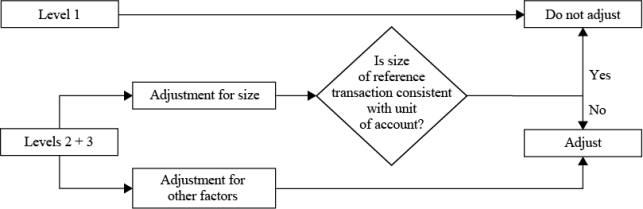

# 05 - Fair value (IFRS 13)

[返回目录](README.md)

## Illustrative text

### FAQ 5.8.1 – What are the International Valuation Standards?

 

Reference to standard: IFRS 13  
 Reference to standing text: [5.8](11.md#s33-Para_5.8)

  

  
 **Question:**

What are the International Valuation Standards?

**Answer:**

The International Valuation Standards Council (IVSC) is an independent organisation that produces and implements standards for the valuation of assets across the world.

The International Valuation Standards (IVSs) are used for undertaking valuation assignments using generally recognised principles. The IVSC also promotes standards for the conduct and competency of professional valuers.

The IVSs consist of mandatory requirements that must be followed in order to state that a valuation was performed in compliance with the IVSs.

The standards cover the general principles on the valuation approaches to be followed, as well as reporting requirements. There are also standards capturing specific valuations, such as the valuation of businesses and business interests (IVS 200), intangible assets (IVS 210), plant and equipment (IVS 300), real property interests (IVS 400), development property (IVS 410), and financial instruments (IVS 500).

 

### FAQ 5.14.1 – How should exposure to market risk be considered when arriving at a net long or net short position?

 

Reference to standard: IFRS 13 para 49  
 Reference to standing text: [5.14](11.md#s33-Para_5.14)

  

  
 

**Question:**

How should exposure to market risk be considered when arriving at a net long or net short position?

**Answer:**

When considering whether the portfolio exception is available for a group of financial assets and/or liabilities for a particular market risk, the degree of exposure (or offset) of market risk, to arrive at a net long or net short position, should be considered.

IFRS 13 does not prescribe how much of a long or short position is permitted to qualify for the portfolio exception. For example, assets in a portfolio would not have to be nearly 100% offset by liabilities for a certain risk. Rather, a reporting entity should assess the appropriateness of electing the portfolio exception, based on the nature of the portfolio being managed, in the context of its risk or investment management strategy.

We do not believe that bright lines or ‘percentages’ of the degree of offset of risk positions should be applied in determining whether there is sufficient offset in a group or portfolio. However, we believe that it would be inappropriate to apply the portfolio exception to an aggregated position without offset or hedging (for example, an aggregated block of equity shares). Such a position might relate to a trading strategy that is not managed on a net basis.

 

### FAQ 5.14.2 – Is use of value-at-risk strategy sufficient to allow offsetting positions exception?

Reference to standard: IFRS 13 para 49  
 Reference to standing text: [5.14](11.md#s33-Para_5.14)  
 

  

 

**Question**:

 

IFRS 13 para 49 lists the conditions that an entity must meet in order to be able to use the offsetting positions exception. If an entity uses risk management strategy such as value-at-risk, does this provide evidence that the first of these three criteria is met (that is, that the entity manages the financial asset/liability group based on its net exposure to market/credit risk in accordance with its documented risk management or investment strategy)?

 

**Answer**:

 

Not necessarily. Broad risk management strategies, such as managing on the basis of value-at-risk, might not be sufficient alone for a group to be eligible for the offsetting positions exception, because value-at-risk does not necessarily represent managing a portfolio to a net position.

 

### FAQ 5.14.3 – Support required to apply the exception for offsetting positions

 

Reference to standard: IFRS 13 para 49  
 Reference to standing text: [5.14](11.md#s33-Para_5.14)  
 

  

 

**Question**:

 

How can an entity support the assertion that it manages a portfolio based on the net exposure to market or credit risk?

 

**Answer**:

 

A reporting entity that elects use of the exception for offsetting positions is required to support the assertion that the portfolio is managed based on the net exposure to market or credit risk. Examples of such support could include robust documentation of the reporting entity’s risk management or investment policies and strategies, risk committee meeting minutes, and internal management reporting information. In addition, management may want to consider the types and composition of portfolios the reporting entity has historically managed.

 

The exception for offsetting positions is an accounting policy election and should be applied consistently from period to period. Management should support that it continues to manage risk exposures on a net basis in order to continue to qualify for the exception.

 

Since significant changes in risk management strategies are rare, changes in a reporting entity’s use of the portfolio exception are likewise expected to be infrequent.

 

### FAQ 5.17.1 – Examples of mismatches

 

Reference to standard: IFRS 13 para 55  
 Reference to standing text: [5.17](11.md#s33-Para_5.17)

  

  
 

**Question:**

What are some common examples of mismatches in the portfolio that affect the measurement of fair value?

**Answer:**

In applying the portfolio guidance, valuation of the net open risk position is required. Market participants might value a portfolio with basis risk differently from one that is perfectly hedged. The following are some examples of mismatches in the portfolio that affect the measurement of fair value.

**Basis differences**

Portfolios with basis differences might qualify for the portfolio exception. If there is any basis difference for dissimilar risks, that basis risk should be reflected in the fair value of the net position. For example, an entity might include financial instruments with different (but highly correlated) interest rate bases in one portfolio, provided that the entity manages its interest rate risk on a net basis. However, any difference in the interest rate bases (for example, LIBOR versus treasury) should be considered in the fair value measurement.

**Duration differences**

Portfolios containing offsetting positions with different maturities might qualify for the portfolio exception. Adjustments to the fair value of the net position of a portfolio should also be made for such duration mismatches. Therefore, unmatched (or unhedged) portions of the terms to maturity of the financial assets and liabilities that form part of the portfolio could result in an adjustment to the net position.

**Exposure to counterparty credit risk**

When applying the portfolio exception to a portfolio in which a specific counterparty’s credit risk is managed on a net basis, the entity must consider market participants’ expectations about whether any arrangements in place to mitigate credit risk exposure are legally enforceable in the event of default (for example, through a master netting arrangement). In a portfolio of financial assets and liabilities within a master netting arrangement, the adjustment for credit risk could be applied to the net exposure to the counterparty, rather than to each of the financial assets and liabilities separately. The adjustment will be applied to the net position based on the individual counterparty’s credit risk, in the case of a net asset position, or the reporting entity’s own credit risk in the case of a liability position. The portfolio exception does not change the requirement to incorporate a credit valuation adjustment (CVA) or debit valuation adjustment (DVA) on a net open asset or liability position, respectively.

 

### FAQ 5.20.1 – Unit of measurement when applying the exception for offsetting positions in market or counterparty credit risk

 

Reference to standard: IFRS 13 para 51  
 Reference to standing text: [5.20](11.md#s33-Para_5.20)

  

  
 

**Question:**

What is the unit of measurement when applying the exception for offsetting positions in market or counterparty credit risk?

**Answer:**

If an entity has a portfolio of financial assets and liabilities that qualify for the offsetting positions exception, the unit of measurement is the net open risk or credit risk position. The portfolio, or net open position, becomes the asset or liability on which a reporting entity determines what a market participant would pay, or expect to pay, for it. Because the unit of measurement is the net position of the portfolio, size is an attribute of the portfolio being valued and, consequently, an adjustment based on size is appropriate, to the extent that it would be incorporated by market participants. However, where the instruments in the portfolio are quoted in an active market, the net position is measured based on the listed price multiplied by the number of instruments.

No premiums or discounts are expected when measuring a portfolio at fair value. Therefore, use of P × Q without adjustments is considered appropriate.

 

### FAQ 5.20.2 – Level 1 inputs: valuation of offsetting positions in market risks

 

Reference to standard: IFRS 13 para 48  
 Reference to standing text: [5.20](11.md#s33-Para_5.20)

  

  
 **Question:**

Entity A holds 10% of entity B’s share capital. The shares are publicly traded in an active market. The currently quoted price is C100. Entity A has also entered into a short position on 5% of entity B’s shares using derivatives. Entity A has elected to measure the net exposure of 5%, using the offsetting exemption in paragraph 48 of IFRS 13.

Entity A believes that the fair value of its 5% net position in entity B, if sold as a block, is greater than the quoted market price. Several independent estimates indicate that, if entity A sold its net position as a block, it would be able to obtain a 5% premium above the quoted price. Can entity A include the 5% premium in its fair value measurement of the net position?

**Answer:**

No. Although entity A is valuing a net exposure, the published price quotation in an active market remains the best estimate of fair value. Therefore, entity A should continue to use the published price quotation to measure its net exposure.

 

### FAQ 5.20.3 – Applying the offsetting exception to equity securities

 

Reference to standard: IFRS 13 paras 54, 55  
 Reference to standing text: [5.20](11.md#s33-Para_5.20)

  

  
**Question**:

Entity X owns 50,000 shares of entity Y. It has entered into a forward contract to sell 25,000 of these shares three months later.

Do the shares and forward contract qualify for the offsetting exception if the other criteria are met?

**Answer**:

Yes, the shares and forward contract qualify for the offsetting exception, because both relate to substantially the same risk. However, there could be an element of interest rate risk associated with the forward contract’s fair value, arising from the fact that it can only be exercised three months later, which does not relate to the shares’ fair value. This risk has to be taken into account in the fair value measurement of the shares and forward within the group. [IFRS 13 para 54].

 

### FAQ 5.20.4 – Applying the offsetting exception to interest rate swaps (1)

 

Reference to standard: IFRS 13 paras 54, 55  
 Reference to standing text: [5.20](11.md#s33-Para_5.20)

  

  
**Question:**

Entity B has $500 million in 10-year pay 3-month LIBOR, receive fixed rate interest rate swaps (liability position) and $200 million in 10-year receive 3-month LIBOR, pay fixed rate interest rate swaps (asset position).

Can entity B elect the offsetting exception and adjust the bid-ask spread of the $500 million short position and the $200 million long position to a new bid-ask spread for the net short $300 million position, based on how market participants would price the net risk exposure at the measurement date?

**Answer:**

Yes. These can qualify, provided that the other criteria highlighted above are met.

 

### FAQ 5.20.5 – Applying the offsetting exception to interest rate swaps (2)

 

Reference to standard: IFRS 13 paras 54, 55  
 Reference to standing text: [5.20](11.md#s33-Para_5.20)

  

  
**Question:**

Entity B has $500 million in 10-year pay 3-month LIBOR, receive fixed rate interest rate swaps (liability position) and $200 million in 12-year receive 3-month LIBOR, pay fixed rate interest rate swaps (asset position).

Can the interest rate swaps still qualify for the offsetting exception?

**Answer**:

Provided that the other criteria are met, the offsetting criteria can be applied to the interest rate risks on the first ten years. For the last two years, the interest rate risk exposure should be measured on a gross basis. [IFRS 13 para 55].

 

### FAQ 5.22.1 – Impact of subsequent information in fair value measurement (1)

 

Reference to standard: IAS 10 para 11  
 Reference to standing text: [5.22](11.md#s33-Para_5.22)

  

  
Entity A has two separate receivables (X and Y) from entity B, each with near identical terms and conditions.

Entity A intends, as it has from the time of their initial recognition, to sell receivables X and Y under a non-recourse factoring arrangement, which results in de-recognition. This intention existed at the time of initial recognition. Accordingly, receivables X and Y are considered held for sale and carried at fair value through profit or loss.

On 31 December, entity A sells receivable X and achieves de-recognition.

In early January, as part of beginning to prepare its financial statements for its 31 December year end, entity A uses a market approach, based on the near identical terms of receivables X and Y, and determines that the fair value of receivable Y on 31 December is the same as that indicated by the sale of receivable X.

On 31 January, before entity A has released its financial statements, entity B goes bankrupt. Entity A estimates the cash flows of receivable Y based on the bankruptcy of entity B to be less than originally expected.

**Question**:

Should entity A update its calculation of the fair value of receivable Y, based on the bankruptcy of entity B and the revised estimated cash flows?

**Answer**:

This depends on whether the impending bankruptcy of entity B was knowable (as opposed to actually known) at 31 December, as the result of customary and usual due diligence efforts.

Entity A must decide whether the price at which receivable X was sold did not properly reflect the risk of impending bankruptcy and the assumptions that would be taken into account by market participants. If the price does indeed take this into account, as would be expected in a third-party transaction, the fair value of receivable Y should not be adjusted.

 

### FAQ 5.22.2 – Impact of subsequent information in fair value measurement (2)

 

Reference to standard: IAS 10 para 11  
 Reference to standing text: [5.22](11.md#s33-Para_5.22)

  

  
Entity A has an investment in a private equity security (investment P) which is classified as FVTPL. Entity A has a 31 December year end.

Management performs the valuation of investment P in early January, based on information available at the time, along with estimates of the financial performance of the private equity position as at 31 December.

The audit might not be signed off until late March, at which time actual final Q4 figures for investment P and other information become available. This information will invariably differ from the figures used in early January to estimate the fair value.

**Question**:

Should entity A revise its fair value estimates, based on the new information that becomes available in February and March (up to the date of the audit report date)?

**Answer**:

Entity A should revise its fair value estimates to the extent that the information could have been known by a market participant that undertook usual and customary due diligence efforts, sufficient to be knowledgeable enough about the asset or liability to be willing to transact at the measurement date.

 

### FAQ 5.22.3 – Should possible future modifications be considered when determining the fair value of a debt instrument?

Reference to standard: IFRS 13 para 22, IAS 10 para 11  
Reference to standing text: [5.22](11.md#s33-Para_5.22)  

  

 

**Question:**

 

Should possible future modifications be considered when determining the fair value of a debt instrument?

 

**Answer:**

 

It depends. When measuring fair value, an entity must use the assumptions that market participants would use when pricing the instrument. Therefore, if market participants would take into consideration the possibility of future modifications to the instrument when pricing it, so should the entity when determining the instrument’s fair value. To the extent that market participants would not take possible future modifications into account, neither should the entity when determining fair value.For example, market participants might anticipate the possibility that a debt instrument will be modified, especially in periods of economic uncertainty. When determining fair value, the entity would therefore take into consideration the possibility, and related uncertainty, of these potential modifications.The method of incorporating such possibilities into a valuation is complex. Often, the use of multiple scenarios will be appropriate (see [FAQ 5.77.2](12.md#s35-FAQ_5.77.2)).

 

[IFRS 13 para 22].

 

### FAQ 5.28.1 – Determining a hypothetical market participant

 

Reference to standard: IFRS 13 para 23  
 Reference to standing text: [5.28](11.md#s33-Para_5.28)

  

  
**Question:**

What are the key considerations in determining a hypothetical market participant?

**Answer:**

**Step 1****:**Determine the type of market participant

If there is no knowledge of market participants in a particular market, management might need to make assumptions about the types of market participant that might be interested in a particular asset or liability. Market participants can include strategic investors and financial investors. Both types of market participant could be interested. The reporting entity will need to conclude which group is the appropriate market participant. In many sectors, financial buyers have become strategic buyers, and so the distinction between the two groups in those sectors has largely disappeared.

  
 **Step 2****:**Determine the market participant assumptions

  
 Key considerations in developing market participant assumptions might include the specific location, condition, other characteristics of the asset or liability (for example, assumed growth rates and whether certain synergies are available to all market participants) and risk premium assumptions. For instance, there might be no apparent exit market for a trademark intangible asset. Management might consider whether there are strategic buyers in the marketplace that would benefit from the trademark that is being valued. Entities might seek to build up their trademarks as they grow their business, so the entity can look to potential participants in its industry that might be seeking additional growth and, from there, it can determine a hypothetical group of market participants.

The applicable market participants may change over time; therefore, a reporting entity should reconsider potential market participants each time a fair value measurement is performed. For example, financial buyers may have been identified as market participants in a previous fair value measurement because they were active in a specific market, such as the purchase of a retail business. However, if strategic buyers become active in acquiring the assets or liabilities being measured, they may become appropriate market participants to consider in the fair value measurement as it becomes more likely that would transact in the current market.

 

### FAQ 5.29.1 – Impact of credit risk on the fair value of derivatives

 

Reference to standard: IFRS 13 para 82(c)(iii)  
 Reference to standing text: [5.29](11.md#s33-Para_5.29) 

  

  
 **Question:**

Does IFRS 13 require counterparty credit risk to be incorporated in the fair value of derivative instruments?

**Answer:**

Yes, to the extent that such credit risk affects the price that would be received to sell a derivative in an asset position (or paid to transfer a derivative in a liability position) in an orderly transaction between market participants. IFRS 13 states that, in determining fair values of the asset or liability which has a specified (contractual) term that use Level 2 inputs that are not quoted in an active market, credit risk would generally be built into a valuation model. [IFRS 13 para 82(c)(iii)].

Counterparty credit risk typically arises where a derivative is in an asset position at the reporting date.

See also [FAQ 5.51.2](12.md#s35-FAQ_5.51.2) on derivative liabilities and credit risk.

 

### FAQ 5.30.1 – Impact of restrictions on the sale of an equity instrument

 

Reference to standard: IFRS 13 para 11(b)  
 Reference to standing text: [5.30](11.md#s33-Para_5.30)

  

  
 

**Question:**

What is the impact of restrictions on the sale of an equity instrument, when the restriction is a characteristic of the instrument?

**Answer:**

This example has been reproduced from paragraph IE28 of IFRS 13:

“An entity holds an equity instrument (a financial asset) for which sale is legally or contractually restricted for a specified period. (For example, such a restriction could limit sale to qualifying investors.) The restriction is a characteristic of the instrument and, therefore, would be transferred to market participants. In that case the fair value of the instrument would be measured on the basis of the quoted price for an otherwise identical unrestricted equity instrument of the same issuer that trades in a public market, adjusted to reflect the effect of the restriction. The adjustment would reflect the amount market participants would demand because of the risk relating to the inability to access a public market for the instrument for the specified period. The adjustment will vary depending on all the following: a) the nature and duration of the restriction; b) the extent to which buyers are limited by the restriction (for example, there might be a large number of qualifying investors); and c) qualitative and quantitative factors specific to both the instrument and the issuer.”

 

### FAQ 5.30.2 – Impact of restrictions on the use of an asset

 

Reference to standard: IFRS 13 para 11(b)  
 Reference to standing text: [5.30](11.md#s33-Para_5.30)

  

  
 

**Question:**

What is the impact of restrictions on the sale of an equity instrument, when the restriction applies to the holder of the instrument?

**Answer:**

This example has been reproduced from paragraph IE29 of IFRS 13:

“A donor contributes land in an otherwise developed residential area to a not-for-profit neighbourhood association. The land is currently used as a playground. The donor specifies that the land must continue to be used by the association as a playground in perpetuity. Upon review of relevant documentation (for example, legal and other), the association determines that the fiduciary responsibility to meet the donor’s restriction would not be transferred to market participants if the association sold the asset, that is, the donor restriction on the use of the land is specific to the association. Furthermore, the association is not restricted from selling the land. Without the restriction on the use of the land by the association, the land could be used as a site for residential development. In addition, the land is subject to an easement (that is, a legal right that enables a utility to run power lines across the land). Following is an analysis of the effect on the fair value measurement of the land arising from the restriction and the easement: a) Donor restriction on use of land. Because in this situation the donor restriction on the use of the land is specific to the association, the restriction would not be transferred to market participants. Therefore, the fair value of the land would be the higher of its fair value used as a playground (that is, the fair value of the asset would be maximised through its use by market participants in combination with other assets or with other assets and liabilities) and its fair value as a site for residential development (that is, the fair value of the asset would be maximised through its use by market participants on a stand-alone basis), regardless of the restriction on the use of the land by the association. b) Easement for utility lines. Because the easement for utility lines is specific to (i.e. a characteristic of) the land, it would be transferred to market participants with the land. Therefore, the fair value measurement of the land would take into account the effect of the easement, regardless of whether the highest and best use is as a playground or as a site for residential development.” 

The example illustrates two points:

- Entity-specific restrictions (for example, donor restrictions) do not affect fair value; but asset-specific restrictions (for example, easements for utility lines) do affect fair value.

- Restrictions that are easily circumvented (for example, by selling the land) are unlikely to affect fair value.

 

### FAQ 5.30.3 – Restrictions on the asset vs restrictions on the entity

Reference to standard: IFRS 13 para 11(b)  
 Reference to standing text: [5.30](11.md#s33-Para_5.30)  
 

  

 

The impact on fair value of a restriction on the sale or use of an asset depends on whether the restriction would be considered by market participants in pricing the asset, which, in turn, depends on the source of the restriction and its connection to the underlying security.

 

For a restriction to be considered an attribute of the security, the restriction should be specific to the security, not to the reporting entity holding the security.

 

**Question**:

 

A reporting entity holding a block of stock in another entity may also hold a board seat on the investee. Through the board seat, the reporting entity obtains material non-public information and, as a result, cannot sell the security until such information becomes public. Should those restrictions be taken into account in measuring the stock at fair value?

 

**Answer**:

 

No. Because the board seat is not a specific attribute of the security held, the restriction should not be considered in the valuation of the security. However, if it is the security itself that provides the right to a board seat, it might be considered in the valuation.

 

The key factor is whether the security itself carries the legal restriction, or if the restriction exists due to the nature of the business of the reporting entity holding the security, or by any means other than restriction on transfer of the security itself.

 

The date that the restriction is established is not critical to the analysis. Whether the restriction existed on the date the security was acquired or if the restriction was created subsequent to acquisition, the holder should only consider its impact on the security’s fair value at each reporting date if the restriction is a characteristic of the security and would be considered by market participants in determining the exit price.

 

### EX 5.34.1 – Costs and the highest and best use of a non-financial asset

 

Reference to standard: IFRS 13 para 28  
 Reference to standing text: [5.34](11.md#s33-Para_5.34)

  

  
A parcel of land is currently used for farming. It is assumed that the highest and best use is to continue to use it for farming.

The fair value should reflect the benefits of continuing to operate the land for farming, including any tax credits that could be realised by market participants.

If it is determined that market participants would consider an alternative use for the land to be its highest and best use (for example, commercial or residential use), the fair value should include all costs (for example, legal costs, viability analysis, traffic studies) associated with re-zoning the land to the market participant’s intended use.

Demolition and other costs associated with preparing the land for a different use should be included in the estimate of fair value.

This concept is illustrated in example 2 in paragraph IE8 of IFRS 13. An effort to re-zone land contains an element of uncertainty related to whether the proposed re-zoning obtains approval. So the land’s fair value should reflect this uncertainty. Re-zoning should not be considered if it is not feasible or is unlikely to succeed.

 

### EX 5.34.2 – ‘Highest and best use’ approach

 

Reference to standard: IFRS 13 para 28  
 Reference to standing text: [5.34](11.md#s33-Para_5.34)

  

  
 An entity owns an investment property, which comprises land with an old warehouse on it. It has been determined that the land could be redeveloped into a leisure park. The land’s market value would be higher if redeveloped than the market value under its current use. Management is unclear about whether the investment property’s fair value should be based on the market value of the property (land and warehouse) under its current use, or the land’s potential market value if the leisure park redevelopment occurred.

The property’s fair value should be based on the land’s market value for its potential use. The ‘highest and best use’ is the most appropriate model for fair value. Under this approach, the property’s existing-use value is not the only basis considered. Fair value is the highest value, determined from market evidence, by considering any other use that is physically possible, legally permissible and financially feasible.

The highest and best use valuation assumes the site’s redevelopment. This will involve demolishing the current warehouse and constructing a leisure park in its place. Therefore, none of the market value obtained for the land should be allocated to the building. So the market value of the current building, on the property’s highest and best use (as a warehouse), is zero. As a result, the building’s current carrying amount should be written down to zero.

 

### FAQ 5.39.1 – Valuing assets on a standalone basis or in a group – land

Reference to standard: IFRS 13 para B3  
 Reference to standing text: [5.39](11.md#s33-Para_5.39)  
 

  

 

**Question:**

 

Three adjacent lots of land are acquired as part of a business combination. Each lot could be sold separately for CU5 million. As a group, buildings could be raised on the end lots, each of which could share a parking lot (constructed on the third lot). In this area, parking is scarce and buildings with parking sell for more than buildings without parking. With the parking lot, each building would sell for a higher price; the three lots together can be sold for CU20 million.

 

What is the highest and best use of the three adjacent lots of land?

 

**Answer:**

 

The highest and best use of these lots is to develop them as buildings with a parking lot. A market participant would take the centre lot and use it as a parking lot to maximise the value of the lots.This fact pattern is also different from the portfolio scenario as the assets in the example work together in use. This does not occur in a portfolio. In a portfolio, an entity can replace an asset with a similar one without impacting the value of the rest of the portfolio. In this scenario, there is no other piece of property that could be acquired that could replace one of the three in the example and generate a similar or higher combined value. If such a scenario existed, then that would be the highest and best use.

 

### FAQ 5.39.2 – Valuing assets on a standalone basis or in a group — other assets

Reference to standard: IFRS 13 para B3  
 Reference to standing text: [5.39](11.md#s33-Para_5.39)  
 

  

 

**Question:**

 

A pharmaceutical company acquires a company with two drugs. Drug A is a cholesterol lowering drug. By itself, Drug A is moderately effective. Drug B is another moderately effective cholesterol lowering drug. When taken together, Drug A and Drug B are highly effective at lowering cholesterol levels.

 

On a standalone basis, Drug A has a fair value of CU100 million and Drug B has a fair value of CU150 million. When the drugs are valued together, Drug A and Drug B have a combined fair value of CU650 million.What is the highest and best use, and resulting fair value of these drugs?

 

**Answer:**

 

The highest and best use of these drugs is to sell the products together. As a result, the total fair value of Drug A and Drug B should equal CU650 million. The value should be allocated to Drug A and Drug B (units of account) in a systematic and rational way reflecting the contributions of each drug.

 

### FAQ 5.39.3 – Application of the highest and best use concept

Reference to standard: IFRS 13 para B3  
 Reference to standing text: [5.39](11.md#s33-Para_5.39)  
 

  

 

A strategic buyer acquires a group of assets (Assets A, B, and C) in a business combination. Asset C is a billing software system developed by the acquired entity for use with Assets A and B. The acquirer determines that each asset would provide maximum value to market participants principally through its use in combination with the other assets in a group; therefore, the highest and best use is in a group rather than standalone valuation premise. The unit of valuation is the asset group, which consists of Assets A, B, and C. In determining the highest and best use, the acquirer determines that market participants for Assets A, B, and C would represent both strategic and financial buyers. Strategic and financial buyers each possess different characteristics related to the use of the individual assets. The strategic buyer group has related assets that would enhance the value of the asset group. Specifically, strategic buyers have substitute assets for Asset C (the billing software). Asset C would be used only for a transitional period. The indicated fair values of individual Assets A, B, and C within the strategic buyer group were determined to be CU360 million, CU260 million, and CU30 million, respectively. The indicated fair value for the assets collectively within the strategic buyer group is CU650 million.

 

The financial buyer group does not have substitute assets that would enhance the value of the asset group (that is, Asset C). Therefore, financial buyers would use Asset C for its full remaining economic life and the indicated fair values for individual Assets A, B, and C within the financial buyer group were determined to be CU300 million, CU200 million, and CU100 million, respectively. The indicated fair value for the assets collectively within the financial buyer group is CU600 million.

 

**Qu****estion:**

 

Which fair value should be used to determine the highest and best use of the asset group?

 

**Answer:**

 

The fair values of Assets A, B, and C would be determined based on the use of the assets within the strategic buyer group, because the fair value of the asset group of CU650 million is higher than the asset group for the financial buyer (CU600 million). The use of the assets in a group does not maximise the fair value of the assets individually; it maximises the fair value of the asset group. Thus, even though Asset C would be worth CU100 million to the financial buyers, its fair value for financial reporting purposes is CU30 million.

 

### EX 5.40.1 – Synergies in highest and best use

 

Reference to standard: IFRS 13 para B3  
 Reference to standing text: [5.40](11.md#s33-Para_5.40)

  

  
 Synergies associated with an asset or liability group could be factored into the fair value of an individual asset in a number of ways, depending on the circumstances:

- Direct adjustments to fair value might be appropriate.  
 “If the asset is a machine and the fair value measurement is determined using an observed price for a similar machine (not installed or otherwise configured for use), adjusted for transport and installation costs so that the fair value measurement reflects the current condition and location of the machine (installed and configured for use).” [IFRS 13 App B para B3(b)].

- Adjustment to market participant assumptions might be appropriate.  
 “For example, if the asset is work in progress inventory that is unique and market participants would convert the inventory into finished goods, the fair value of the inventory would assume that market participants have acquired or would acquire any specialised machinery necessary to convert the inventory into finished goods.”   
 [IFRS 13 App B para B3(c)].

- Adjustment via the valuation technique might be appropriate.  
 “When using the multi-period excess earnings method to measure the fair value of an intangible asset because that valuation technique specifically takes into account the contribution of any complementary assets and the associated liabilities in the group in which such an intangible asset would be used.”  [IFRS 13 App B para B3(d)].

- Allocation of fair value adjustments to individual assets might be appropriate.  
 “In more limited situations, when an entity uses an asset within a group of assets, the entity might measure the asset at an amount that approximates its fair value when allocating the fair value of the asset group to the individual assets of the group. That might be the case if the valuation involves real property and the fair value of improved property (i.e. an asset group) is allocated to its component assets (such as land and improvements).” [IFRS 13 App B para B3(e)].

 

### FAQ 5.41.1 – Difference between settlement and transfer value (1)

 

Reference to standard: IFRS 13 para 34  
 Reference to standing text: [5.41](11.md#s33-Para_5.41)

  

  
 

**Question:**

What is the difference between settlement and transfer value of a liability?

**Answer:**

In measuring liabilities at fair value, the reporting entity should assume that the liability is transferred to a credit-equivalent entity and that it continues after the transfer (that is, it is not settled). The hypothetical transaction used for valuation is based on a transfer to a credit-equivalent entity that is in need of funding and willing to take on the terms of the obligation.

Cost of settlement might only be one input when valuing a liability, because there might be other potential outcomes; for example, in the case of litigation, a party might challenge the claim or, in the case of an environmental liability, there could be multiple remediation approaches. Moreover, the cost of settlement for the entity might differ from the cost of settlement of other market participants.

The previous IFRS definition of fair value required fair value for liabilities to be “the amount for which a liability could be settled, between knowledgeable willing parties …”. As liabilities could be ‘settled’ by extinguishing them or transferring them to another party, it was not clear whether settlement value referred to transfer value or the extinguishment value. IFRS 13 clarifies that the fair value is the transfer value rather than the extinguishment value.

Extinguishment value is generally not the transfer value. Different factors might cause the transfer amount to differ from the settlement amount.

An additional risk premium above the expected pay-out might be required because of uncertainty about the ultimate amount of the liability (for example, asbestos liabilities and performance guarantees). The risk premium paid to a third party might differ from the settlement value that the direct counterparty would be willing to accept. In addition, the party assuming a liability might have to incur certain costs in order to manage the liability, or it might require a profit margin.

In practice, there might be significant differences between the settlement value and the transfer value. Among the differences is the impact of credit risk, which is seldom considered in the settlement of a liability.

For example, a financial institution transferee might be willing to assume non-demand deposit liabilities for less than the principal amount due to the depositors, because of the relatively low funding cost of such liabilities. In other instances, an additional risk premium above the expected pay-out might be required because of uncertainty about the ultimate amount of the liability (for example, unit-linked liabilities).

 

### FAQ 5.41.2 – Difference between settlement and transfer value (2)

 

Reference to standard: IFRS 13 para 34  
 Reference to standing text: [5.41](11.md#s33-Para_5.41)

  

  
**Question:**

A bank holds a debt obligation with a face value of C100,000 and a market value of C95,000. Assume that market interest rates are consistent with the amount in the note; however, there is a C5,000 discount due to market concerns about the risk of non-performance. What is the settlement value and what is the transfer value of the debt?

**An****swer:**

Settlement value

The counterparty (counterparty A) would be required to pay the full face value of the note to settle the obligation, because the bank might not be willing to discount the note by the market discount or the credit risk adjustment. Therefore, the settlement value would equal the face amount of the note.

Transfer value

In order to calculate the transfer value, counterparty A must construct a hypothetical transaction in which another party (counterparty B), with a similar credit profile, is seeking financing on terms that are substantially the same as the note. Counterparty B could choose to enter into a new note agreement with the bank or receive the existing note from counterparty A in a transfer transaction. In this hypothetical transaction, counterparty B should be equally willing to obtain financing through a new bank note or assumption of the existing note in return for a payment of C95,000. Therefore, the transfer value would be C95,000 (that is, C5,000 less than the settlement amount).

 

### FAQ 5.41.3 – Acquisition of debt in a business combination transaction

Reference to standard: IFRS 13 para 34  
 Reference to standing text: [5.41](11.md#s33-Para_5.41)  
 

  

 

**Question:**

 

What are some of the key considerations in measuring debt in a business combination transaction?

 

**Answer:**

 

Debt assumed in a business combination is initially measured at fair value and then subsequently measured at amortised cost (unless it qualifies for measurement at FVTPL).

 

When a reporting entity with listed debt is acquired, the traded price of the debt often changes to reflect the credit enhancement expected to be provided by the acquirer (that is, the trading price will reflect the market’s assumption that the debt will become a liability of the new group).

 

The credit standing of the combined entity in a business combination will often be used in determining the fair value of the acquired debt. For example, if acquired debt is expected to be credit-enhanced because the debt holders are expected to become general creditors of the combined entity, the valuation of the acquired debt would reflect the characteristics of the acquirer’s post-combination credit rating.

 

If the acquirer is not expected to legally add any credit enhancement to the debt or in some other way guarantee the debt (that is, the debt will continue to be secured only by the net assets of the acquired entity), the fair value of the debt may not change.

 

IFRS 3 requires the fair value of debt to be determined as of the acquisition date. If the acquiree has public debt, the quoted price should be used. If the acquiree has both public and non-public debt, the price of the public debt should also be considered as one of the inputs used to value the non-public debt.

 

### FAQ 5.41.4 – Exit price for derivatives

 

Reference to standard: IFRS 13 para 18  
 Reference to standing text: [5.41](11.md#s33-Para_5.41)  
 

  

 

**Question:**

 

How should exit price be determined for derivatives?

 

**Answer:**

 

Because fair value is based on the exit price, not the entry price or settlement price, the fair value of a derivative is the price at which a novation transaction (that is, when a derivative is transferred to a new counterparty that “steps into the shoes” and assumes the contract) would occur. In markets in which transfers of derivative instruments are uncommon, transaction price, entry price, prices used in margin calls, or settlement prices are sometimes used as data points in estimating an exit price. A reporting entity should take into account the characteristics of the asset or liability that market participants consider when pricing the asset or liability at the measurement date.

 

To assess exit price, a reporting entity should determine the principal market, the market with the greatest volume and level of activity for the asset or liability to which the reporting entity has access. Generally the principal market is the one where the reporting entity normally would enter into a transaction to sell the asset or to transfer the liability, but it may not always be the case. If that is not the case, the determination of fair value may require consideration of the pricing methodology used in another market. For further discussion of using data from markets other than the principal market, see [paragraph 5.64](11.md#s33-Para_5.64).

**Relate****d information**

### FAQ 5.43.1 – Debt obligation measured at fair value using present value technique

 

Reference to standard: IFRS 13 para 38  
 Reference to standing text: [5.43](11.md#s33-Para_5.43)

  

  
**Question:**

On 1 January 20X1, entity C issues at par in a private placement a C2 million BBB-rated five-year fixed-rate debt instrument with an annual 10% coupon. Entity C designates this financial liability as at fair value through profit or loss.

At 31 December 20X1, entity C still carries a BBB credit rating. Market conditions, including available interest rates, credit spreads for a BBB-quality credit rating and liquidity, remain unchanged from the date when the debt instrument was issued. However, entity C’s credit spread has deteriorated by 50 basis points, because of a change in its risk of non-performance. After taking into account all market conditions, entity C concludes that, if it was to issue the instrument at the measurement date, the instrument would bear a rate of interest of 10.5%, or entity C would receive less than par in proceeds from the issue of the instrument.

The fair value of entity C’s liability is calculated using a present value technique. How is the fair value of the debt calculated?

**Answer:**

Entity C concludes that a market participant would use all of the following inputs (consistent with paras B12–B30 of IFRS 13) when estimating the price that the market participant would expect to receive to assume entity C’s obligation:

- The terms of the debt instrument, including all of the following:

- coupon of 10%;

- principal amount of C2 million; and

- term of four years.

- The market rate of interest of 10.5% (which includes a change of 50 basis points in the risk of non-performance from the date of issue).

On the basis of its present value technique, entity C concludes that its liability’s fair value at 31 December 20X1 is C1,968,641.

Entity C does not include any additional input into its present value technique for risk or profit that a market participant might require for compensation for assuming the liability. Because entity C’s obligation is a financial liability, entity C concludes that the interest rate already captures the risk or profit that a market participant would require as compensation for assuming the liability. Furthermore, entity C does not adjust its present value technique for the existence of a restriction preventing it from transferring the liability. [IFRS 13 paras IE43–IE47].

 

### FAQ 5.45.1 – Debt obligation with quoted price (a market approach)

 

Reference to standard: IFRS 13 para 39  
 Reference to standing text: [5.45](11.md#s33-Para_5.45)

  

  
**Question:**

What are some of the considerations when measuring a debt instrument based on the price of the corresponding asset?

**Answer:**

On 1 January 20X1, entity B issues at par a C2 million BBB-rated exchange-traded five-year fixed-rate debt instrument with an annual 10% coupon. Entity B designates this financial liability as at fair value through profit or loss.

On 31 December 20X1, the instrument is trading as an asset in an active market at C929 per C1,000 of par value, after payment of accrued interest. Entity B uses the quoted price of the asset in an active market as its initial input into the fair value measurement of its liability (C929 × (C2 million ÷ C1,000) = C1,858,000).

In determining whether the asset’s quoted price in an active market represents the liability’s fair value, entity B evaluates whether the asset’s quoted price includes the effect of factors not applicable to the fair value measurement of a liability. For example, the entity should consider whether the quoted price of the asset includes the effect of a third-party credit enhancement if that credit enhancement would be separately accounted for from the perspective of the issuer. Entity B determines that no adjustments are required to the asset’s quoted price.

Entity B concludes that the fair value of its debt instrument at 31 December 20X1 is C1,858,000.

Entity B categorises and discloses the fair value measurement of its debt instrument within Level 1 of the fair value hierarchy.

[IFRS 13 paras IE40–IE42].

 

### FAQ 5.45.2 – Fair value of a liability when pricing includes bid-ask spread

Reference to standard: IFRS 13 para 39  
 Reference to standing text: [5.45](11.md#s33-Para_5.45)  
 

  

 

**Question:**

 

What are some of the considerations when measuring the fair value of a liability when the pricing includes a bid-ask spread?

 

**Answer:**

 

The fair value of the liability may not be the same as the fair value of the corresponding asset in certain circumstances, such as when the pricing includes a bid-ask spread. In such cases, the liability should be valued based on the price within the bid-ask spread that is most representative of fair value for the liability, which may not necessarily be the same as the price within the bid-ask spread that is most representative of fair value for the corresponding asset.

 

### FAQ 5.50.1 – Decommissioning liability

 

Reference to standard: IFRS 13 para B32  
 Reference to standing text: [5.50](11.md#s33-Para_5.50)

  

  
**Question:**

How should the fair value of a decommissioning liability be measured?

**Answer:**

Assume that a factory is built on leased land that has to be returned to the owner in five years’ time without the factory building. The decommissioning liability would be the liability associated with the costs of demolishing the factory and making good the land. The decommissioning liability’s fair value might simply be the market rate that a demolition services provider would charge in order to agree, today, to take down the factory in five years’ time.

 

### FAQ 5.51.1 – Impact of credit risk on measurement of liabilities

 

Reference to standard: IFRS 13 para 42  
 Reference to standing text: [5.51](11.md#s33-Para_5.51)

  

  
**Question:**

How is the fair value of a liability impacted by the credit risk of the issuer?

**Answer:**

Two entities might borrow the same amount of money for the same period. The fair value of those liabilities might well be substantially different, as illustrated below, because the fair value is significantly impacted by the credit risk of the borrower. That credit risk affects the interest rate that each entity will be charged.

Entities X and Y each enter into a contractual obligation to pay C500 in cash to entity Z in five years.

Entity X has an AA credit rating and can borrow at 6%.

Entity Y has a BBB credit rating and can borrow at 12%.

Entity X will receive about C374 in exchange for its promise (the present value of C500 in five years at 6%).

Entity Y will receive about C284 in exchange for its promise (the present value of C500 in five years at 12%).

The fair value of the liability to each entity (that is, the proceeds) incorporates that entity’s credit standing.

 

### FAQ 5.51.2 – Derivative liabilities and credit risk

 

Reference to standard: IFRS 13 para 42  
 Reference to standing text: [5.51](11.md#s33-Para_5.51)

  

  
 **Question:**

How should credit risk be incorporated in the valuation of derivative liabilities?

**Answer:**

The entity’s own credit risk has to be incorporated into the derivative fair value when the derivative is in a liability position at the reporting date. This means that, under IFRS 13, an entity’s own credit risk will impact hedge effectiveness for both cash flow and fair value hedge relationships.

The counterparty close-out approach is prohibited. This approach reflects the amount that the entity would pay to settle the liability with the counterparty at the reporting date.

When using a valuation technique, entities need to take into account non-performance risk (for example, an entity’s own credit risk).

Paragraph 42 of IFRS 13 indicates that: “the fair value of a liability reflects the effect of non-performance risk. Non-performance risk includes, but may not be limited to, an entity’s own credit risk. Non-performance risk is assumed to be the same before and after the transfer of the liability”.

Furthermore, paragraph B13(f) of IFRS 13 states that, for a liability, a fair value measurement using a present value technique captures elements from the perspective of market participants at the measurement date, such as the non-performance risk relating to that liability, including the entity’s (that is, the obligor’s) own credit risk.

The key principle is that fair value is the sale or transfer price from the perspective of market participants who owe the liability at the measurement date. It is based on the perspective of market participants rather than just the entity itself, so fair value is not affected by an entity’s intention towards the liability item that is being valued (for example, if the entity intends to settle the liability instead of transferring it to another party).

Derivative instruments have varying terms, and these terms need to be carefully evaluated in arriving at a valuation which complies with IFRS 13. Some of the factors that would reduce credit risk for a derivative might be:

- master netting arrangements that are effective on default;

- collateral arrangements; or

- termination provisions in derivative instruments.

 

### FAQ 5.51.3 – Is an evaluation of credit risk required each reporting period?

Reference to standard: IFRS 13 paras 42

IFRS 13 para IE34

  
 Reference to standing text: [5.51](11.md#s33-Para_5.51)  
 

  

 

**Question:**

 

For assets and liabilities reported at fair value, is an evaluation of credit risk required each reporting period if there has been no change in credit rating since origination?

 

**Answer:**

 

Yes. A credit risk adjustment should reflect all changes in the price of credit as well as changes in the creditworthiness of the reporting entity or the counterparty, as applicable, which may not be reflected in their credit ratings. For example, a decline in the reporting entity’s credit default swap rate, or an overall change in the credit spreads for the reporting entity’s industry sector may indicate a change in the market price of its credit. Credit spreads and risk can change without a change in credit ratings. The credit risk adjustment should incorporate all available market information, including changes in the company’s standing within its credit category, changes in the market price of credit or the market value of the asset or liability being measured, as well as other factors.As the example in paragraph IE34 of IFRS 13 illustrates, a reporting entity is required to assess credit risk each period, even if there is no change in the related credit rating, because adjustments for credit are not triggered solely by a change in credit rating. In fact, the credit risk to the entity changes simply because of the passage of time. Because there is less time for the parties to default, absent other changes to the counterparty credit standing, the default probabilities will typically be lower.

 

### FAQ 5.52.1 – Impact of credit enhancements on the credit risk adjustment

 

Reference to standard: IFRS 13 para 44  
 Reference to standing text: [5.52](11.md#s33-Para_5.52)  
 

  

 

**Question**:

 

As of December 31, 20X8, FV Company has several derivative contracts with Counterparty X as follows:

 

<table style="border-collapse:collapse"><tr><td style="border:0.75pt solid #000000; padding-right:5.03pt; padding-left:5.03pt; vertical-align:top">
<b>Type of derivative</b>
</td><td style="border:0.75pt solid #000000; padding-right:5.03pt; padding-left:5.03pt; vertical-align:top">
<b>Amount </b>

<b>(C’000)</b>
</td><td style="border:0.75pt solid #000000; padding-right:5.03pt; padding-left:5.03pt; vertical-align:top">
<b>Asset/(liability)</b>
</td></tr><tr><td style="border:0.75pt solid #000000; padding-right:5.03pt; padding-left:5.03pt; vertical-align:top">
Interest rate swap
</td><td style="border:0.75pt solid #000000; padding-right:5.03pt; padding-left:5.03pt; vertical-align:top">
(20,000)
</td><td style="border:0.75pt solid #000000; padding-right:5.03pt; padding-left:5.03pt; vertical-align:top">
Liability
</td></tr><tr><td style="border:0.75pt solid #000000; padding-right:5.03pt; padding-left:5.03pt; vertical-align:top">
Interest rate swap
</td><td style="border:0.75pt solid #000000; padding-right:5.03pt; padding-left:5.03pt; vertical-align:top">
10,000
</td><td style="border:0.75pt solid #000000; padding-right:5.03pt; padding-left:5.03pt; vertical-align:top">
Asset
</td></tr><tr><td style="border:0.75pt solid #000000; padding-right:5.03pt; padding-left:5.03pt; vertical-align:top">
Total interest rate swaps
</td><td style="border:0.75pt solid #000000; padding-right:5.03pt; padding-left:5.03pt; vertical-align:top">
10,000
</td><td style="border:0.75pt solid #000000; padding-right:5.03pt; padding-left:5.03pt; vertical-align:top">
Asset
</td></tr><tr><td style="border:0.75pt solid #000000; padding-right:5.03pt; padding-left:5.03pt; vertical-align:top">
Gas commodity contract
</td><td style="border:0.75pt solid #000000; padding-right:5.03pt; padding-left:5.03pt; vertical-align:top">
6,000
</td><td style="border:0.75pt solid #000000; padding-right:5.03pt; padding-left:5.03pt; vertical-align:top">
Asset
</td></tr><tr><td style="border:0.75pt solid #000000; padding-right:5.03pt; padding-left:5.03pt; vertical-align:top">
Gas commodity contract
</td><td style="border:0.75pt solid #000000; padding-right:5.03pt; padding-left:5.03pt; vertical-align:top">
5,000
</td><td style="border:0.75pt solid #000000; padding-right:5.03pt; padding-left:5.03pt; vertical-align:top">
Asset
</td></tr><tr><td style="border:0.75pt solid #000000; padding-right:5.03pt; padding-left:5.03pt; vertical-align:top">
Electricity commodity contract
</td><td style="border:0.75pt solid #000000; padding-right:5.03pt; padding-left:5.03pt; vertical-align:top">
8,000
</td><td style="border:0.75pt solid #000000; padding-right:5.03pt; padding-left:5.03pt; vertical-align:top">
Asset
</td></tr><tr><td style="border:0.75pt solid #000000; padding-right:5.03pt; padding-left:5.03pt; vertical-align:top">
Electricity commodity contract
</td><td style="border:0.75pt solid #000000; padding-right:5.03pt; padding-left:5.03pt; vertical-align:top">
(12,000)
</td><td style="border:0.75pt solid #000000; padding-right:5.03pt; padding-left:5.03pt; vertical-align:top">
Liability
</td></tr><tr><td style="border:0.75pt solid #000000; padding-right:5.03pt; padding-left:5.03pt; vertical-align:top">
Total commodity contracts
</td><td style="border:0.75pt solid #000000; padding-right:5.03pt; padding-left:5.03pt; vertical-align:top">
7,000
</td><td style="border:0.75pt solid #000000; padding-right:5.03pt; padding-left:5.03pt; vertical-align:top">
Net asset
</td></tr><tr><td style="border:0.75pt solid #000000; padding-right:5.03pt; padding-left:5.03pt; vertical-align:top">
Total of all contracts
</td><td style="border:0.75pt solid #000000; padding-right:5.03pt; padding-left:5.03pt; vertical-align:top">
(3,000)
</td><td style="border:0.75pt solid #000000; padding-right:5.03pt; padding-left:5.03pt; vertical-align:top">
Net liability
</td></tr></table>

 

In evaluating its netting and other arrangements with Counterparty X, FV Company determines that it has a netting arrangement that covers the interest rate swaps and a separate master netting arrangement that affects all commodity derivatives, including both gas and electricity contracts. FV Company’s interest rate swaps are supported by a letter of credit issued by Bank B, a third party.

 

Should FV Company or Counterparty X consider the impact of the letter of credit issued by Bank B when determining the credit risk adjustment?

 

**Answer**:

 

In accordance with the requirements of paragraph 44 of IFRS 13, the obligor (FV Company) cannot consider the impact of a third-party credit enhancement in determining the credit risk adjustment for its liability. Therefore, FV Company is required to measure the credit risk as of the reporting date based on a market participant’s assessment of its own credit standing, not that of Bank B.

 

However, Counterparty X would incorporate the impact of the credit enhancement issued by Bank B for FV Company in determining an appropriate credit risk adjustment for the interest rate swap asset recorded on its books.

 

The guidance in paragraph 44 of IFRS 13 has no impact on the measurement of non-performance by Counterparty X, which may consider the credit enhancement provided by the letter of credit.

### FAQ 5.53.1 – Third-party enhancements: measurement of demand deposit liabilities

 

Reference to standard: IFRS 13 para 39(b)  
 Reference to standing text: [5.53](11.md#s33-Para_5.53)

  

  
**Question:**

How should demand deposit liabilities be measured?

**Answer:**

A demand deposit represents a promise by the deposit-taking institution to deliver cash either to the depositor or to third parties designated by the depositor. It imposes a contractual obligation that is a financial liability. A typical example is a current account in a bank. The current account holder can demand settlement at any time, and the bank generally has the right to return the depositor’s money at any time (even though that right is seldom exercised). It is argued that the fair value of the financial liabilities with a demand feature is less than the demand amount, because not all depositors withdraw their money at the earliest opportunity. Often, there is a core of deposits (withdrawals replaced by new deposits) that is left outstanding for long periods of time.

The fair value of a financial liability with a demand feature cannot be less than the amount payable on demand, discounted from the first date that the amount could be required to be repaid. In many cases, the market price observed for such financial liabilities is the price at which they are originated between the customer and the deposit-taker (that is, the demand amount). Recognising such a financial liability at less than the demand amount will give rise to an immediate gain on the origination of such a deposit, which is inappropriate.

[IFRS 13 para 47]. [IFRS 13 para BC101]. [IFRS 13 para BC103].

 

### FAQ 5.53.2 – Consideration of fair value where an entity has breached a debt covenant

Reference to standard: IFRS 13 para 47  
 Reference to standing text: [5.53](11.md#s33-Para_5.53)  
 

  

 

**Question:**

 

What are some of the considerations for measurement of fair value when an entity has breached a debt covenant?

 

**Answer:**

 

IFRS 13’s general principle is that the fair value of a liability should reflect the amount at which it could be transferred in an orderly transaction at the measurement date under current market conditions.

 

However, as an exception to this general principle, IFRS 13 requires the fair value of a liability due on demand not to be less than the amount payable on demand, discounted from the first date when the amount could be required to be paid. [IFRS 13 para 47].

 

Hence, where an entity has breached a debt covenant (for example, due to financial difficulty) and that breach has caused a borrowing or other issued debt instrument to become due on demand, the fair value should not be less than the demand amount. This applies both for disclosure of fair values of liabilities carried at amortised cost in accordance with paragraph 25 of IFRS 7, and for measurement of fair value for liabilities carried at fair value. It also applies irrespective of whether a current rate of interest would be higher than the stated rate of interest in the debt agreement and whether the entity has insufficient assets to repay the amount due.Entities could disclose, in their comparison of carrying values and fair values of financial instruments, the liabilities to which this exception to the general fair value measurement principle has been applied, and they could refer to the disclosure about the breach made elsewhere in the financial statements. This can help to increase understandability of the comparison of carrying value and fair value where the disclosed or recognised fair value is likely to be above the value at which the liability could be transferred.

 

It is important to note that this exception to the general fair value measurement principle only applies to the issuer of a liability; the holder of the related loan asset would still be required to determine fair value based on a hypothetical transfer of the loan asset at the measurement date.

 

### FAQ 5.59.1 – Determination of most advantageous market for convertible debt

 

Reference to standard: IFRS 13 para 17  
 Reference to standing text: [5.59](11.md#s33-Para_5.59)

  

  
**Question:**

An entity holds a convertible debt that is carried at fair value. The convertible debt is not quoted in an active market, but the equity securities of the issuer are.

In determining the convertible debt’s fair value, it is necessary to consider both the redemption of the debt and the conversion into equity securities of the issuer. What are the considerations in determining the fair value of a convertible debt?

**Answer:**

If the convertible debt is out of the money, the most advantageous market might be based on redemption of the debt for cash. If the convertible debt is in the money and can be exercised, the most advantageous market might be to assume conversion and sale of the underlying shares.

An adjustment might be necessary to reflect the probability of exercise. The entity should also consider the convertible debt’s value, which might be at a premium to the ‘if converted’ shares, due to the combination of the convertible debt’s yield and the option value of the conversion feature.

 

### FAQ 5.59.2 – Principal or most advantageous market

 

Reference to standard: IFRS 13 para 18  
 Reference to standing text: [5.59](11.md#s33-Para_5.59)

  

  
**Question:**

In a territory, there are two available markets for soya bean:

- Export: this is the market where the higher prices would be available for the producer. There are limitations in the volumes that can be sold in this market, because the government sets a limit on the volume of exports. Each producer needs to obtain an authorisation to export its production. It is rare for the government to authorise more than 25% of production for export.

- Domestic: the prices are lower in this market than in the export market, but there are no restrictions in terms of volume (other than the demand for the product by purchasers).

Producers intend to sell all of the production that they can in the export market. When they do not have any further authorisation to export, they sell the remaining production in the domestic market. What is the principal market for the soya bean? What is the most advantageous market?

**Answer:**

The domestic market is the principal market for the producers, in terms of volume, and so it is the one which should be used to determine fair value. The principal market will be the market in which the soya beans have the greatest activity, even if the prices in other markets are more advantageous or if the reporting entity itself has greater trading volume in another market.

The export market is the most advantageous market, because this is the one that gives the higher benefits to the producers. Only if no principal market could be identified, would the prices in this market need to be used.

 

### FAQ 5.60.1 – Producer has access to more than one market

 

Reference to standard: IFRS 13 para 13  
 Reference to standing text: [5.60](11.md#s33-Para_5.60)

  

  
**Question****:**

An entity is in the business of growing and harvesting sugar cane. Along with other local growers, it sells the harvested cane to the local mill. There are other mills located throughout the country. However, it is uneconomic to transport the sugar cane to other mills, although they often pay higher prices for the cane. Which market price should the entity use to establish fair value?

**Answer:**

IFRS 13 presumes that the market in which the entity would normally sell its assets is the principal market for those assets. The local mill is also the market with the greatest volume and level of activity for the locally grown sugar cane. Unless there is clear evidence to the contrary, the local mill would be considered the principal market for the harvested sugar cane, and the entity should use the local market price, less transport costs, as the basis for determining fair value.

 

### FAQ 5.61.1 – Impact of transaction and transport costs on fair value

 

Reference to standard: IFRS 13 para BC54  
 Reference to standing text: [5.61](11.md#s33-Para_5.61)

  

  
**Question:**

An entity has an asset that can be sold in two different markets, with no substantial difference in the volume of activities but with different prices. The entity enters into transactions in both markets, it can access the price in those markets for the asset at the measurement date. There is no principal market for the asset. How should the fair value of the asset be determined?

<table style="width:100%; border-collapse:collapse"><tr><td style="border:0.75pt solid #000000; padding-right:5.03pt; padding-left:5.03pt; vertical-align:top">
 
</td><td style="border:0.75pt solid #000000; padding-right:5.03pt; padding-left:5.03pt; vertical-align:top">
<b>Market A</b> <b>(C)</b>
</td><td style="border:0.75pt solid #000000; padding-right:5.03pt; padding-left:5.03pt; vertical-align:top">
<b>Market B</b> <b>(C</b><b>)</b>
</td></tr><tr><td style="border:0.75pt solid #000000; padding-right:5.03pt; padding-left:5.03pt; vertical-align:top">
Price
</td><td style="border:0.75pt solid #000000; padding-right:5.03pt; padding-left:5.03pt; vertical-align:top">
27
</td><td style="border:0.75pt solid #000000; padding-right:5.03pt; padding-left:5.03pt; vertical-align:top">
25
</td></tr><tr><td style="border:0.75pt solid #000000; padding-right:5.03pt; padding-left:5.03pt; vertical-align:top">
Transport costs
</td><td style="border:0.75pt solid #000000; padding-right:5.03pt; padding-left:5.03pt; vertical-align:top">
(3)
</td><td style="border:0.75pt solid #000000; padding-right:5.03pt; padding-left:5.03pt; vertical-align:top">
(2)
</td></tr><tr><td style="border:0.75pt solid #000000; padding-right:5.03pt; padding-left:5.03pt; vertical-align:top">
 
</td><td colspan="2" style="border:0.75pt solid #000000; padding-right:5.03pt; padding-left:5.03pt; vertical-align:top">
 
</td></tr><tr><td style="border:0.75pt solid #000000; padding-right:5.03pt; padding-left:5.03pt; vertical-align:top">
 
</td><td style="border:0.75pt solid #000000; padding-right:5.03pt; padding-left:5.03pt; vertical-align:top">
24
</td><td style="border:0.75pt solid #000000; padding-right:5.03pt; padding-left:5.03pt; vertical-align:top">
23
</td></tr><tr><td style="border:0.75pt solid #000000; padding-right:5.03pt; padding-left:5.03pt; vertical-align:top">
Transaction costs
</td><td style="border:0.75pt solid #000000; padding-right:5.03pt; padding-left:5.03pt; vertical-align:top">
(3)
</td><td style="border:0.75pt solid #000000; padding-right:5.03pt; padding-left:5.03pt; vertical-align:top">
(1)
</td></tr><tr><td style="border:0.75pt solid #000000; padding-right:5.03pt; padding-left:5.03pt; vertical-align:top">
 
</td><td colspan="2" style="border:0.75pt solid #000000; padding-right:5.03pt; padding-left:5.03pt; vertical-align:top">
 
</td></tr><tr><td style="border:0.75pt solid #000000; padding-right:5.03pt; padding-left:5.03pt; vertical-align:top">
Net amount received
</td><td style="border:0.75pt solid #000000; padding-right:5.03pt; padding-left:5.03pt; vertical-align:top">
21
</td><td style="border:0.75pt solid #000000; padding-right:5.03pt; padding-left:5.03pt; vertical-align:top">
22
</td></tr><tr><td style="border:0.75pt solid #000000; padding-right:5.03pt; padding-left:5.03pt; vertical-align:top">
 
</td><td colspan="2" style="border:0.75pt solid #000000; padding-right:5.03pt; padding-left:5.03pt; vertical-align:top">
 
</td></tr></table>

How should the fair value of the asset be determined?

**Answer**:

1. Determine the most advantageous market

A principal market for the asset does not exist, so the fair value of the asset would be measured using the price in the most advantageous market.

The most advantageous market is the market that maximises the amount that would be received to sell the asset, after taking into account transaction costs and transport costs (that is, the net amount that would be received in the respective markets).

Therefore, market B is the most advantageous market, since the entity would maximise the net amount that would be received for the asset in market B (C22)

2. Determine the fair value in this market, after transport costs

The fair value of the asset is measured using the price in market B (C25), less transport costs (C2), resulting in a fair value measurement of C23.

Transaction costs are not considered when estimating the fair value.

If market A had been the principal market for the asset (that is, the market with the greatest volume and level of activity for the asset), the asset’s fair value would be measured using the price that would be received in that market, after taking into account transport costs (C24). The same applies for market B (C23).

 

### FAQ 5.61.2 – Impact of transport costs when determining fair value

 

Reference to standard: IFRS 13 para BC54  
 Reference to standing text: [5.61](11.md#s33-Para_5.61)

  

  
**Question:**

Entity A purchased cattle at an auction on 30 June 20X8.

<table style="width:100%; border-collapse:collapse"><tr><td style="border:0.75pt solid #000000; padding-right:5.03pt; padding-left:5.03pt; vertical-align:top">
Purchase price at 30 June 20X8
</td><td style="border:0.75pt solid #000000; padding-right:5.03pt; padding-left:5.03pt; vertical-align:top">
C100,000
</td></tr><tr><td style="border:0.75pt solid #000000; padding-right:5.03pt; padding-left:5.03pt; vertical-align:top">
Costs of transporting the cattle back to the entity’s farm
</td><td style="border:0.75pt solid #000000; padding-right:5.03pt; padding-left:5.03pt; vertical-align:top">
C1,000
</td></tr><tr><td style="border:0.75pt solid #000000; padding-right:5.03pt; padding-left:5.03pt; vertical-align:top">
Sales price of the cattle at 31 December 20X8
</td><td style="border:0.75pt solid #000000; padding-right:5.03pt; padding-left:5.03pt; vertical-align:top">
C110,000
</td></tr></table>

  
 The company would have to incur similar transportation costs if it were to sell the cattle at auction, in addition to an auctioneer’s fee of 2% of sales price. How should the entity consider the impact of transportation costs when determining fair value?

**Answer:**

<table style="width:100%; border-collapse:collapse"><tr><td style="border:0.75pt solid #000000; padding-right:5.03pt; padding-left:5.03pt; vertical-align:top">
Initial recognition
</td><td style="border:0.75pt solid #000000; padding-right:5.03pt; padding-left:5.03pt; vertical-align:top">
 
</td></tr><tr><td style="border:0.75pt solid #000000; padding-right:5.03pt; padding-left:5.03pt; vertical-align:top">
Fair value less costs to sell (C100,000 – C1,000 – C2,000)
</td><td style="border:0.75pt solid #000000; padding-right:5.03pt; padding-left:5.03pt; vertical-align:top">
C97,000
</td></tr><tr><td style="border:0.75pt solid #000000; padding-right:5.03pt; padding-left:5.03pt; vertical-align:top">
Cash outflow (C100,000 + C1,000+ C2,000)
</td><td style="border:0.75pt solid #000000; padding-right:5.03pt; padding-left:5.03pt; vertical-align:top">
C103,000
</td></tr><tr><td style="border:0.75pt solid #000000; padding-right:5.03pt; padding-left:5.03pt; vertical-align:top">
Loss on initial recognition
</td><td style="border:0.75pt solid #000000; padding-right:5.03pt; padding-left:5.03pt; vertical-align:top">
C6,000
</td></tr></table>

  
 

<table style="width:100%; border-collapse:collapse"><tr><td style="border:0.75pt solid #000000; padding-right:5.03pt; padding-left:5.03pt; vertical-align:top">
Measurement at year end
</td><td style="border:0.75pt solid #000000; padding-right:5.03pt; padding-left:5.03pt; vertical-align:top">
 
</td></tr><tr><td style="border:0.75pt solid #000000; padding-right:5.03pt; padding-left:5.03pt; vertical-align:top">
Fair value less costs to sell (C109,000 – (2%*110,000))
</td><td style="border:0.75pt solid #000000; padding-right:5.03pt; padding-left:5.03pt; vertical-align:top">
C106,800
</td></tr><tr><td style="border:0.75pt solid #000000; padding-right:5.03pt; padding-left:5.03pt; vertical-align:top">
 
</td><td style="border:0.75pt solid #000000; padding-right:5.03pt; padding-left:5.03pt; vertical-align:top">
 
</td></tr></table>

  
 By 31 December 20X8, the cattle should be measured in entity A’s financial statements at C106,800 (that is, fair value of C109,000 less the estimated auctioneer’s fee of C2,200). The estimated transportation costs of getting the cattle to the auction of C1, 000 are deducted from the sales price in determining fair value.

 

### FAQ 5.62.1 – Operating units with access to different markets

Reference to standard: IFRS 13 para 19  
 Reference to standing text: [5.62](11.md#s33-Para_5.62)  
 

  

 

**Question:**

 

Can different operating units of the same company measure identical assets in different markets?

 

**Answer:**

 

Different operating units within a reporting entity may have access to different markets and each separate unit should individually consider the principal market, and in the absence of a principal market, the most advantageous market. Therefore, the same reporting entity could have different fair value measurements for identical or similar assets or liabilities, depending on the operating units holding the assets or liabilities and differences in the markets to which they have access and the differences in assumptions of the market participants in those markets. For example, a reporting entity’s operating units located in Asia, Europe, and the US may each hold investments in the same debt and equity securities. The fair value measurements reported by the operating units may differ at times due to differences in the markets to which they have access and the level of activity for the asset in each market. The fair value standards require that each reporting unit consider the facts and circumstances appropriate to its valuation of the asset or liability being valued and follow the framework of the fair value standards, independent of other reporting units that may be valuing an identical or similar asset or liability.

 

### FAQ 5.63.1 – Access to principal market

 

Reference to standard: IFRS 13 para 20  
 Reference to standing text: [5.63](11.md#s33-Para_5.63)

  

  
**Question:**

A commodities trader has a reporting date of 31 December 20X0, which falls on a Saturday. The commodities trader holds commodity X. The trader has access to both retail and wholesale markets for commodity X.

The principal market is the wholesale market, because that is the market with the greatest volume and level of activity for the commodity. However, the retail market selling prices are usually higher. The wholesale market only trades on weekdays, whereas the retail market trades also on Saturdays.

What value should the commodities trader use as the fair value of the commodities?

**Answer:**

The commodities trader is not allowed to use the higher retail price as the fair value of the commodities merely because the wholesale market (that is, the principal market) does not trade on the measurement date.

 

### FAQ 5.63.2 – Can an entity consider activity in an inaccessible market?

Reference to standard: IFRS 13 para 19  
 Reference to standing text: [5.63](11.md#s33-Para_5.63)  
 

  

 

**Question:**

 

Can an entity consider activity in an inaccessible market?

 

**Answer:**

 

Yes, but only in certain circumstances and making appropriate adjustments, if any. If there are no apparent exit markets or if the reporting entity does not have access to any known or observable markets, activity in inaccessible known markets may be considered in developing the inputs that would be used in a hypothetical market. However, the information from the inaccessible market may need adjustment for any differences in the characteristics of the asset or liability being measured and the price observed within a market. That is, the need to adjust the inputs applies even when the inputs are observable.

 

Some common characteristics that may prevent an entity from accessing a particular price within a market are:

 

- A reporting entity'’s need to transform the asset or liability in some way to match the asset or liability in the observable market.

- Restrictions that may be unique to the reporting entity's asset or liability that are not embedded in the asset or liability in the observable market.

- Marketability or liquidity differences between the asset or liability in the observable market relative to the reporting entity's asset or liability.

 

### FAQ 5.64.1 – What are secondary markets and how should prices in them be considered?

Reference to standard: IFRS 13 para 21  
 Reference to standing text: [5.64](11.md#s33-Para_5.64)  
 

  

 

**Question:**

 

What are secondary markets and how should prices in them be considered?

 

**Answer:**

 

Secondary markets exist when investors trade among themselves, rather than investing directly through the issuer of a financial instrument in the primary market. In secondary markets, sometimes called ‘aftermarket’, the issuer of the instrument is typically not involved in the transaction, as the instrument has already been issued. The New York Stock Exchange, London Stock Exchange, Tokyo Stock Exchange (and other stock exchanges) are liquid secondary markets for stocks of publicly traded companies. Secondary markets also exist for private equity investments, where both current funded private equity investments as well as any remaining unfunded commitments are traded. However, this type of secondary market tends to be less liquid than those of publicly traded instruments. Therefore, similar to any other asset or liability, when determining the fair value measurement of an instrument traded in a secondary market with limited activity, it is necessary to consider all available trade data in developing market participant assumptions, including from thinly traded secondary markets.

 

### FAQ 5.66.1 – Markets where input can be observable

 

Reference to standard: IFRS 13 para 61  
 Reference to standing text: [5.66](11.md#s33-Para_5.66)

  

  
**Question:**

What are some examples of markets in which inputs might be observables?

**Answer:**

Examples of markets in which inputs might be observable include exchange markets, dealer markets, brokered markets and principal-to-principal markets, which are explained in paragraph B34 of IFRS 13:

“a) Exchange markets. In an exchange market, closing prices are both readily available and generally representative of fair value. An example of such a market is the London Stock Exchange. b) Dealer markets. In a dealer market, dealers stand ready to trade (either buy or sell for their own account), thereby providing liquidity by using their capital to hold an inventory of the items for which they make a market. Typically bid and ask prices (representing the price at which the dealer is willing to buy and the price at which the dealer is willing to sell, respectively) are more readily available than closing prices. Over-the-counter markets (for which prices are publicly reported) are dealer markets. Dealer markets also exist for some other assets and liabilities, including some financial instruments, commodities and physical assets (for example, used equipment). c) Brokered markets. In a brokered market, brokers attempt to match buyers with sellers but do not stand ready to trade for their own account. In other words, brokers do not use their own capital to hold an inventory of the items for which they make a market. The broker knows the prices bid and asked by the respective parties, but each party is typically unaware of another party’s price requirements. Prices of completed transactions are sometimes available. Brokered markets include electronic communication networks, in which buy and sell orders are matched, and commercial and residential real estate markets. d) Principal-to-principal markets. In a principal-to-principal market, transactions, both originations and re-sales, are negotiated independently with no intermediary. Little information about those transactions may be made available publicly.”

 

### FAQ 5.66.2 – Effect of credit risk on the fair value of financial instruments

 

Reference to standard: IFRS 13 paras 34, 42  
 Reference to standing text: [5.66](11.md#s33-Para_5.66) 

  

  
 **Question:**

How should entities measure the effect on fair value of credit risk?

**Answer:**

Paragraph 77 of IFRS 13 states that the best evidence of fair value is quoted prices in active markets and, if such a quoted price is available, it should be used. However, it is rare for such quoted prices to be available for derivatives, because they are rarely transferred from one entity to another.

In the absence of quoted prices in active markets, the entity uses a valuation technique. The objective is to establish what the transaction price would have been on the measurement date in an orderly transaction between market participants. Hence, the valuation includes adjustments for credit risk that market participants would make. It should be noted that the size of such adjustments might vary between different kinds of derivatives, and between markets or jurisdictions, and is a matter for audit judgement. In estimating the size of the adjustment for any particular derivative, the entity considers all relevant market information that is available. This includes factors such as:

- Information about the pricing of new derivatives that are similar to the one being valued and the extent to which the pricing of such derivatives varies with the credit risk of the parties to it.

- Whether market participants are taking other actions to mitigate credit risk (for example, requiring collateral to be posted).

- The results of models and how they correspond to observed prices for actual transactions.

- The extent to which credit risk is already reflected in the valuation model and assumptions. For example, if a derivative valuation uses a LIBOR discount rate, this will incorporate the credit risk inherent in LIBOR. However, it might be the case that this differs from the credit risk inherent in the derivative being valued. Also, some derivative valuations use discount rates other than LIBOR (for example, overnight indexed swap) that have less credit risk inherent in them.

- The effect of the entity’s own credit risk from the perspective of market participants, and any other factors that might influence the likelihood that the obligation will or will not be fulfilled. That effect might differ, depending on the terms of credit enhancements related to the liability, if any. The following factors are considered: (i) the liability is transferred to a market participant at the measurement date and the liability would remain outstanding; (ii) the market participant transferee would be required to fulfil the obligation; (iii) the liability would not be settled with the counterparty or otherwise extinguished at the measurement date; and (iv) non-performance risk is assumed to be the same before and after the transfer of the liability. [IFRS 13 para 34(a)]. [IFRS 13 para 42].

Where a derivative is in a large asset position relative to future reasonably possible changes in its fair value, the instrument tends to act more like a loan than a newly transacted on-market derivative. In such cases, an appropriate spread to include in the valuation is likely to tend towards the credit default swap (‘CDS’) rate of the derivative counterparty (or, if not available, then use whatever the best information is available that reflects the credit risk, such as bond spreads, ratings, comparable instruments or other published information). On the other hand, where the derivative is in a relatively small asset position, the instrument tends to act more like a newly transacted derivative than a loan. In such cases, it would be more appropriate to use the spread applied in pricing new on-market derivatives that are similar to the one being valued. Similar considerations would apply to derivative liabilities.

See also [FAQ 5.51.2](12.md#s35-FAQ_5.51.2) on derivative liabilities and credit risk.

 

### FAQ 5.66.3 – Credit risk adjustments on a portfolio basis

 

Reference to standard: IFRS 13 para 56  
 Reference to standing text: [5.66](11.md#s33-Para_5.66) 

  

  
 **Question:**

Can the credit risk adjustment be calculated on a portfolio basis?

**Answer:**

Multiple contracts, involving a single counterparty, can be grouped together in determining the credit risk adjustment, to the extent that the contracts are covered under one master netting agreement. The netting agreement results in a credit risk exposure based on the ‘net’ position rather than at the contract level. In such cases, the credit risk adjustment should be calculated on a portfolio basis, including all exposures under the ISDA master agreement, and then allocated to each transaction. The allocation method used should be appropriate for the entity’s fact pattern – potential methods might be relative fair value approach, relative credit adjustment approach, or in-exchange/‘full credit’ approach. The method selected should be consistently applied and clearly disclosed.

 

### FAQ 5.68.1 – What are some of the considerations when selecting a valuation technique?

Reference to standard: IFRS 13 para 63  
 Reference to standing text: [5.68](11.md#s33-Para_5.68)  
 

  

 

Question:

 

What are some of the considerations when selecting a valuation technique or multiple techniques?

 

Answer:

 

The selection of appropriate valuation techniques may be affected by the availability of relevant inputs and the relative reliability of the inputs, or by the type of asset or liability being valued. In some cases, one valuation technique may provide the best indication of fair value (for example, the use of the market approach in the valuation of an actively traded equity security); however, in other circumstances, multiple valuation techniques may be appropriate (for example, in valuing a cash-generating unit for purposes of a goodwill impairment test).The application of each technique may indicate different estimates of fair value. These estimates may not be equally representative of the fair value due to the assumptions made in the valuation or the quality of inputs used. Using multiple valuation techniques can act as a check on these assumptions and inputs. The reporting entity should carefully evaluate the inputs and assumptions used if the range of values is wide. Fair value should be based on the most representative point within the range considering the specific circumstances.

 

### FAQ 5.77.1 – Single cash flow versus probability-weighted cash flows

 

Reference to standard: IFRS 13 para B14  
 Reference to standing text: [5.77](11.md#s33-Para_5.77)

  

  
**Question:**

What are some of the considerations when using a single set of cash flows versus probability-weighted cash flows?

**Answer:**

Cash flow models will use either conditional or expected cash flows; and other valuation inputs need to be consistent with the approach chosen.

Conditional cash flows are based on a single outcome that is dependent on the occurrence of specific events. For example, the cash flows might reflect a ‘most likely’ or ‘promised’ cash flow scenario, such as a zero coupon bond that promises to repay a principal amount at the end of a fixed time period.

Expected cash flows represent a probability-weighted average of all possible outcomes. Since expected cash flows incorporate expectations of all possible outcomes, expected cash flows are not conditional on certain events.

The discount rate applied to measure the present value of the cash flow estimate should be consistent with the nature of the cash flow estimate. In principle, conditional and expected approaches consider many of the same risks, but an expected cash flow reflects the risks of achieving the cash flow directly in the cash flow estimates, while a conditional cash flow requires an adjustment to the discount rate to reflect the conditional nature of the cash flow estimate. Conceptually, both methods should result in consistent valuation conclusions.

For example, a discount rate that reflects the uncertainty in expectations about future defaults is appropriate if using contractual cash flows of a loan (that is, a discount rate adjustment technique). That same rate should not be used if using expected (that is, probability-weighted) cash flows (that is, an expected present value technique), because the expected cash flows already reflect assumptions about the uncertainty in future defaults; instead, a discount rate that is commensurate with the risk inherent in the expected cash flows should be used. The discount rate adjustment concept is difficult to apply when contractual cash flows do not exist.

In practice, adjusting the expected cash flows to reflect systematic risk is often difficult. In most instances, therefore, for non-financial assets, the discount rate that is applied to cash flows incorporates systematic or non-diversifiable risk, which is often represented by a weighted-average cost of capital that would be required by a marketplace participant. However, adjustments made to the discount rate tend to underweight risk. Additionally, the discount rate is a single point estimate, while expected cash flows are weighted by different probabilities of occurrence in the future.

 

### FAQ 5.77.2 – Uncertainties in cash flows for fair value measurement of financial instruments

Reference to standard: IFRS 13 para B25  
 Reference to standing text: [5.77](11.md#s33-Para_5.77)  
 

  

 

**Question:**

 

How should uncertainties associated with periods of high economic volatility be factored into fair value measurement for financial instruments?

 

**Answer:**

 

Certain events (such as the COVID-19 pandemic of 2020) significantly increase uncertainties related to the amount and timing of cash flows of financial instruments. That impact is not necessarily limited to the credit risk of financial instruments. For example, the amount and timing of the cash flows associated with loans could become more uncertain due to deferrals that might be offered or imposed by governments as part of their response to the circumstances1. For equity investments, the economic conditions might give rise to greater uncertainty about the amount and timing of the investment’s cash flows. Similarly, in specific circumstances there might be greater uncertainty about the amount and timing of cash flows for certain precious metal streaming agreements that are dependent on the production timing of a particular mine (in view of work stoppages) and the price of the underlying  precious metals.

 

It might not be possible for entities to factor all of the uncertainties arising from a highly volatile economic environment into a single set of cash flow forecasts. Rather, there might be a range of potential outcomes that need to be included as different scenarios, with appropriate weightings applied to each. Management would need to document its basis for the factors that have been built into each scenario, including the probability weightings applied to each of the scenarios.

 

When valuing a financial instrument based on its future cash flows, entities generally determine the future cash flows under each scenario and the associated probability; the fair value of the financial instrument would then be the present value of the probability-weighted sum of all of the scenarios. Conceptually, in using this technique, entities would generally incorporate the impacts of all different risks on cash flows in each scenario, resulting in the probability-weighted risk-adjusted cash flow for each such scenario. Each scenario’s cash flow is then discounted at the risk-free rate, and the results are added together to arrive at fair value. This is consistent with the risk-adjusted expected cash flow method described as ‘Method 1’ in paragraph B25 of IFRS 13. For example, for a loan, an entity could factor the effect of the different expected payment options and their estimated ‘probability of default’ and ‘loss given default’ into different scenarios, with each scenario given a probability weighting. All of the parameters in estimating the cash flows should be based, as far as possible, on market observable data, and they must be consistent with market participants’ view and expectations. Each scenario would then be discounted at the risk-free rate, and the sum of the probability-weighted scenarios would be the fair value of the financial instrument.Alternatively, entities might exclude the impact of credit risk in estimating future cash flows for each scenario and incorporate the impact of credit risk into the discount rate instead. This mixed approach might be taken in practice because the credit spread is often observable, or it can be derived based on credit ratings and comparison to other similarly rated instruments.

 

The overriding principle is that, to the extent that the cash flows in the scenarios have been adjusted for a certain risk factor, that same risk factor should not be incorporated as an adjustment to the discount rate. Conversely, if a risk factor has not been incorporated in the risk-adjusted cash flows in the scenarios, the discount rate should incorporate that particular risk factor as an adjustment to the risk-free rate. However, incorporating risk factors into the discount rate is often more subjective and difficult than incorporating such factors into different scenarios. See [FAQ 5.77.3](12.md#s35-FAQ_5.77.3) on uncertain cash flows for non-financial assets for further discussion.

 

Additionally, IFRS 13 deals with uncertainty in relation to Level 3 fair value measurements through providing users with appropriate disclosures. These include a description of the valuation techniques used, how decisions are made in relation to valuation procedures and, for recurring fair value measurements, the sensitivity of fair value measurements to significant unobservable inputs.

 

1 Although available, the debtor might or might not take advantage of the deferral opportunity.

 

### FAQ 5.77.3 – Uncertainties in cash flows and change in valuation technique for Level 3 fair value measurement

Reference to standard: IFRS 13 para B25  
 Reference to standing text: [5.77](11.md#s33-Para_5.77)  
 

  

 

**Question:**

 

How should uncertainties associated with periods of high economic volatility be factored into a Level 3 fair value measurement for non-financial assets?

 

**Answer:**

 

In periods of high economic volatility (such as the COVID-19 pandemic), it might not be possible for companies to factor all relevant uncertainties into a single set of cash flow forecasts. Rather, there might be a range of potential outcomes that need to be included as different scenarios with appropriate weightings applied to each. Management would need to document its basis for the factors that have been built into each scenario, including the probability weights applied to each of the scenarios.

 

When valuing businesses and most non-financial assets, entities in practice use an expected cash flow model. Even if management is not explicitly modelling scenarios, it is implicitly probability weighting the possible scenarios to arrive at a single forecast. Another approach is to use a forecast that is not an expected cash flow forecast, for example, management’s best estimate. IFRS 13 requires the use of a discount rate that is consistent with the risk inherent in the cash flows. This means that the discount rate applied to the expected cash flows and 'best estimate' cash flows are not the same. If the cash flow forecasts do not fully reflect multiple scenarios capturing the range of relevant outcomes, an entity may need to add a company-specific risk premium, also known as an alpha, to the discount rate. This will result in a higher discount rate that reflects the risks in the forecast. More guidance on the interplay between the discount rate and cash flow forecast can be found in the International Valuation Standards issued by the International Valuation Standards Council (specifically in [para 50.38](81.md#s328-Para_50.38)). A multiple scenario approach may eliminate the need for the alpha since discount rates should not be adjusted for risks that are already reflected in the cash flows.

 

If management moves from a single set of cash flows to a probability- weighted set of cash flows, this represents a change in accounting estimate in accordance with IAS 8, which should be accounted for as such. However, in accordance with paragraph 66 of IFRS 13, the disclosures in IAS 8 for a change in accounting estimate are not required for revisions resulting from a change in a valuation technique or its application. Paragraph 65 of IFRS 13 cites changing market conditions is an example of a circumstance where a change in valuation technique or its application may be appropriate.

 

Additionally, IFRS 13 deals with uncertainty in relation to Level 3 fair value measurements through providing users with appropriate disclosure. For example, including a description of the valuation techniques used, how decisions are made in relation to valuation procedures, and for recurring fair value measurements the sensitivity of fair value measurements to significant unobservable inputs.

 

### FAQ 5.79.1 – Additional considerations for discount rates used in Level 3 fair value measurements in periods of significant economic uncertainty

Reference to standard: IFRS 13 para B24  
 Reference to standing text: [5.79](11.md#s33-Para_5.79)  
 

  

 

**Question:**

 

What other considerations for discount rates are relevant for Level 3 fair value measurements of non-financial assets during periods of high economic uncertainty?

 

**Answer:**

 

The considerations for discount rates are two-fold when considering the impact of periods of high volatility and uncertainty on economic conditions:

 

(1) Systematic risk (beta)

 

One component of the discount rate is compensation for bearing the systematic risk inherent in the cash flows. The amount of an asset’s systematic risk is measured by its beta, which is measured in relation to the market as a whole. This represents risk that cannot be reduced through diversification, and it is rewarded with a risk premium or higher level of expected return. This risk is derived from external macroeconomic factors that affect all companies in some way, although in different magnitudes. The beta is a component of the cost of equity included in the discount rate and is unrelated to whether (and to what extent) the unsystematic risk (alpha) should be included in the discount rate.

 

(2) Unsystematic risk (alpha)

 

The other component of the discount rate is unsystematic (diversifiable) risk, which is the risk specific to the particular asset. Since this risk can be diversified away, investors do not require to be compensated for it. Examples of unsystematic risk include customer concentration risk, key person risk and regulatory risk. Unsystematic risk might be reflected in the asset’s cash flows (for example, by using different scenarios with appropriate weightings).

 

IFRS 13 requires the use of a discount rate that is consistent with the risk inherent in the cash flows. This means that the discount rate applied to the expected cash flows (measured using multiple possible scenarios that are probability-weighted) and ‘best estimate’ cash flows (measured at the most likely amount) are not the same. If the cash flow forecasts do not fully reflect multiple scenarios capturing the range of possible outcomes, an entity might need to add a risk premium, also known as an alpha, to the discount rate; however, alpha is not included in the discount rate for aspects other than cash flow projection risk. This will result in a higher discount rate that is commensurate with the risks in the forecast. See [FAQ 5.77.2](12.md#s35-FAQ_5.77.2) for further discussion.

 

### FAQ 5.82.1 – Appropriateness of the mid-market pricing convention

 

Reference to standard: IFRS 13 para 71  
 Reference to standing text: [5.82](11.md#s33-Para_5.82)

  

  
**Question:**

When is the mid-market pricing convention deemed appropriate?

**Answer:**

Pricing inputs with bid-ask spreads could be Level 1, 2 or 3 inputs; however, there is no guidance on when it is appropriate to use the mid-market practical expedient. Election of the mid-market practical expedient is presumed appropriate for pricing inputs within a bid-ask spread that fall within Level 1 of the fair value hierarchy (that is, unadjusted observable quoted prices for identical assets or liabilities). In these cases, a reporting entity does not need to evaluate mid-market pricing against expectations of where it actually would trade within the bid-ask range.

The mid-market practical expedient is appropriate for inputs from markets in which stand-ready, dealer-based bid-ask pricing exists. In addition, it might be applicable in other circumstances in which a bid-ask pricing protocol is used by market participants in valuation and measurement. Generally, the less observable the input, the less probable that it is subject to a bid-ask spread and, therefore, the less likely that use of a mid-market convention would be appropriate. For example, it might not be appropriate to apply a mid-market convention where the bid-ask spread is wide, indicating the inclusion of a pricing element other than transaction costs (for example, a liquidity reserve).

 

### FAQ 5.82.2 – Treatment of bid-ask spread on initial recognition

 

Reference to standard: IFRS 13 para 71  
 Reference to standing text: [5.82](11.md#s33-Para_5.82)

  

  
 

**Question:**

An entity purchases an equity financial asset and irrevocably elects to present its subsequent changes of fair value in other comprehensive income (FVTOCI), paying the ask (offer) price of C104 and a brokerage commission of C3. The entity has established that mid-market prices are most representative of fair value. The entity uses the mid-market price to remeasure the financial asset and to recognise changes in fair value in other comprehensive income.

The following details are relevant:

<table style="width:100%; border-collapse:collapse"><tr><td style="border:0.75pt solid #000000; padding-right:5.03pt; padding-left:5.03pt; vertical-align:top">
<b>Reference price</b>
</td><td style="border:0.75pt solid #000000; padding-right:5.03pt; padding-left:5.03pt; vertical-align:top">
<b>Acquisiti</b><b>on (C)</b>
</td><td style="border:0.75pt solid #000000; padding-right:5.03pt; padding-left:5.03pt; vertical-align:top">
<b>Balance sheet date (C)</b>
</td></tr><tr><td style="border:0.75pt solid #000000; padding-right:5.03pt; padding-left:5.03pt; vertical-align:top">
Bid price
</td><td style="border:0.75pt solid #000000; padding-right:5.03pt; padding-left:5.03pt; vertical-align:top">
100
</td><td style="border:0.75pt solid #000000; padding-right:5.03pt; padding-left:5.03pt; vertical-align:top">
110
</td></tr><tr><td style="border:0.75pt solid #000000; padding-right:5.03pt; padding-left:5.03pt; vertical-align:top">
Mid-market price
</td><td style="border:0.75pt solid #000000; padding-right:5.03pt; padding-left:5.03pt; vertical-align:top">
102
</td><td style="border:0.75pt solid #000000; padding-right:5.03pt; padding-left:5.03pt; vertical-align:top">
113
</td></tr><tr><td style="border:0.75pt solid #000000; padding-right:5.03pt; padding-left:5.03pt; vertical-align:top">
Ask or offer price
</td><td style="border:0.75pt solid #000000; padding-right:5.03pt; padding-left:5.03pt; vertical-align:top">
104
</td><td style="border:0.75pt solid #000000; padding-right:5.03pt; padding-left:5.03pt; vertical-align:top">
116
</td></tr></table>

  
How should the entity measure the asset on initial recognition and at the balance sheet date?

**Answer:**

Financial assets at fair value through other comprehensive income (FVTOCI) should be initially recognised at fair value, plus transaction costs paid to acquire the asset.

The ask price represents the amount at which a dealer is willing to sell and, therefore, the price that the entity would have to pay to acquire the asset. The difference between the mid-market price that represents the asset’s fair value and the ask price is a transaction cost. The commission paid to the broker is also a transaction cost.

The asset is designated at fair value through other comprehensive income (that is, not at fair value through profit or loss), so the transaction costs are included in the asset’s initial carrying value. Therefore, the asset will be recorded at its fair value of C102 (mid-market price) plus the mid-ask spread (C2) plus commission (C3), giving a total of C107. At the balance sheet date, the asset will be valued at the mid-market price (C113) at that date, and any difference between this price and the amount recognised initially (C107) will be recorded in other comprehensive income.

Therefore, the appropriate accounting entries on initial recognition and at the balance sheet date are as follows:

<table style="width:100%; border-collapse:collapse"><tr><td style="border:0.75pt solid #000000; padding-right:5.03pt; padding-left:5.03pt; vertical-align:top">
 
</td><td style="border:0.75pt solid #000000; padding-right:5.03pt; padding-left:5.03pt; vertical-align:top">
<b>Dr</b>
</td><td style="border:0.75pt solid #000000; padding-right:5.03pt; padding-left:5.03pt; vertical-align:top">
<b>Cr</b>
</td></tr><tr><td style="border:0.75pt solid #000000; padding-right:5.03pt; padding-left:5.03pt; vertical-align:top">
 
</td><td style="border:0.75pt solid #000000; padding-right:5.03pt; padding-left:5.03pt; vertical-align:top">
<b>C</b>
</td><td style="border:0.75pt solid #000000; padding-right:5.03pt; padding-left:5.03pt; vertical-align:top">
<b>C</b>
</td></tr><tr><td style="border:0.75pt solid #000000; padding-right:5.03pt; padding-left:5.03pt; vertical-align:top">
At acquisition
</td><td style="border:0.75pt solid #000000; padding-right:5.03pt; padding-left:5.03pt; vertical-align:top">
 
</td><td style="border:0.75pt solid #000000; padding-right:5.03pt; padding-left:5.03pt; vertical-align:top">
 
</td></tr><tr><td style="border:0.75pt solid #000000; padding-right:5.03pt; padding-left:5.03pt; vertical-align:top">
FVTOCI asset (mid-market price inclusive of transaction costs)
</td><td style="border:0.75pt solid #000000; padding-right:5.03pt; padding-left:5.03pt; vertical-align:top">
107
</td><td style="border:0.75pt solid #000000; padding-right:5.03pt; padding-left:5.03pt; vertical-align:top">
 
</td></tr><tr><td style="border:0.75pt solid #000000; padding-right:5.03pt; padding-left:5.03pt; vertical-align:top">
Cash
</td><td style="border:0.75pt solid #000000; padding-right:5.03pt; padding-left:5.03pt; vertical-align:top">
 
</td><td style="border:0.75pt solid #000000; padding-right:5.03pt; padding-left:5.03pt; vertical-align:top">
107
</td></tr><tr><td style="border:0.75pt solid #000000; padding-right:5.03pt; padding-left:5.03pt; vertical-align:top">
At balance sheet date
</td><td style="border:0.75pt solid #000000; padding-right:5.03pt; padding-left:5.03pt; vertical-align:top">
 
</td><td style="border:0.75pt solid #000000; padding-right:5.03pt; padding-left:5.03pt; vertical-align:top">
 
</td></tr><tr><td style="border:0.75pt solid #000000; padding-right:5.03pt; padding-left:5.03pt; vertical-align:top">
FVTOCI asset
</td><td style="border:0.75pt solid #000000; padding-right:5.03pt; padding-left:5.03pt; vertical-align:top">
6
</td><td style="border:0.75pt solid #000000; padding-right:5.03pt; padding-left:5.03pt; vertical-align:top">
 
</td></tr><tr><td style="border:0.75pt solid #000000; padding-right:5.03pt; padding-left:5.03pt; vertical-align:top">
Gain in other comprehensive income
</td><td style="border:0.75pt solid #000000; padding-right:5.03pt; padding-left:5.03pt; vertical-align:top">
 
</td><td style="border:0.75pt solid #000000; padding-right:5.03pt; padding-left:5.03pt; vertical-align:top">
6
</td></tr></table>

  
 If the asset is a debt instrument measured at amortised cost, the bid-ask spread, brokerage commission and any premium or discount are subsequently amortised and recognised as part of interest income over the asset’s life, using the effective interest method.

 

### FAQ 5.82.3 – Treatment of bid-ask spread not included in initial carrying value of a financial asset

 

Reference to standard: IFRS 13 para 71  
 Reference to standing text: [5.82](11.md#s33-Para_5.82)

  

  
**Question:**

An entity purchases an equity financial asset that it classifies as at fair value through profit or loss, paying the ask (offer) price of C104 and a brokerage commission of C3. The entity has established that mid-market prices are most representative of fair value. The entity uses the mid-market price to remeasure the financial asset and to recognise changes in fair value through profit or loss.

The following details are relevant:

<table style="width:100%; border-collapse:collapse"><tr><td style="border:0.75pt solid #000000; padding-right:5.03pt; padding-left:5.03pt; vertical-align:top">
<b>Reference price</b>
</td><td style="border:0.75pt solid #000000; padding-right:5.03pt; padding-left:5.03pt; vertical-align:top">
<b>Acquisition (C)</b>
</td><td style="border:0.75pt solid #000000; padding-right:5.03pt; padding-left:5.03pt; vertical-align:top">
<b>Balance sheet date (C)</b>
</td></tr><tr><td style="border:0.75pt solid #000000; padding-right:5.03pt; padding-left:5.03pt; vertical-align:top">
Bid price
</td><td style="border:0.75pt solid #000000; padding-right:5.03pt; padding-left:5.03pt; vertical-align:top">
100
</td><td style="border:0.75pt solid #000000; padding-right:5.03pt; padding-left:5.03pt; vertical-align:top">
110
</td></tr><tr><td style="border:0.75pt solid #000000; padding-right:5.03pt; padding-left:5.03pt; vertical-align:top">
Mid-market price
</td><td style="border:0.75pt solid #000000; padding-right:5.03pt; padding-left:5.03pt; vertical-align:top">
102
</td><td style="border:0.75pt solid #000000; padding-right:5.03pt; padding-left:5.03pt; vertical-align:top">
113
</td></tr><tr><td style="border:0.75pt solid #000000; padding-right:5.03pt; padding-left:5.03pt; vertical-align:top">
Ask or offer price
</td><td style="border:0.75pt solid #000000; padding-right:5.03pt; padding-left:5.03pt; vertical-align:top">
104
</td><td style="border:0.75pt solid #000000; padding-right:5.03pt; padding-left:5.03pt; vertical-align:top">
116
</td></tr></table>

  
How should the entity measure the asset on initial recognition and at the balance sheet date?

**Answer:**

Financial assets classified as at fair value through profit or loss should be recognised initially at fair value. Transaction costs arising on a financial asset classified as at fair value through profit or loss (FVTPL) are immediately recognised in profit or loss, and they do not form part of the asset’s initial carrying value. Hence, the asset is measured on initial recognition using the mid-market price (C102). At the balance sheet date, the asset will be valued at the mid-market price (C113) at that date, and any difference between this price and the amount recognised initially (C11) will be recorded in profit or loss.

The appropriate accounting entries, on initial recognition and at the balance sheet date, are as follows:

<table style="width:100%; border-collapse:collapse"><tr><td style="border:0.75pt solid #000000; padding-right:5.03pt; padding-left:5.03pt; vertical-align:top">
 
</td><td style="border:0.75pt solid #000000; padding-right:5.03pt; padding-left:5.03pt; vertical-align:top">
<b>Dr</b>
</td><td style="border:0.75pt solid #000000; padding-right:5.03pt; padding-left:5.03pt; vertical-align:top">
<b>Cr</b>
</td></tr><tr><td style="border:0.75pt solid #000000; padding-right:5.03pt; padding-left:5.03pt; vertical-align:top">
 
</td><td style="border:0.75pt solid #000000; padding-right:5.03pt; padding-left:5.03pt; vertical-align:top">
<b>C</b>
</td><td style="border:0.75pt solid #000000; padding-right:5.03pt; padding-left:5.03pt; vertical-align:top">
<b>C</b>
</td></tr><tr><td style="border:0.75pt solid #000000; padding-right:5.03pt; padding-left:5.03pt; vertical-align:top">
At acquisition
</td><td style="border:0.75pt solid #000000; padding-right:5.03pt; padding-left:5.03pt; vertical-align:top">
 
</td><td style="border:0.75pt solid #000000; padding-right:5.03pt; padding-left:5.03pt; vertical-align:top">
 
</td></tr><tr><td style="border:0.75pt solid #000000; padding-right:5.03pt; padding-left:5.03pt; vertical-align:top">
FVTPL asset (mid-market price)
</td><td style="border:0.75pt solid #000000; padding-right:5.03pt; padding-left:5.03pt; vertical-align:top">
102
</td><td style="border:0.75pt solid #000000; padding-right:5.03pt; padding-left:5.03pt; vertical-align:top">
 
</td></tr><tr><td style="border:0.75pt solid #000000; padding-right:5.03pt; padding-left:5.03pt; vertical-align:top">
Profit/loss (mid-ask spread of C2 + commission of C3)
</td><td style="border:0.75pt solid #000000; padding-right:5.03pt; padding-left:5.03pt; vertical-align:top">
5
</td><td style="border:0.75pt solid #000000; padding-right:5.03pt; padding-left:5.03pt; vertical-align:top">
 
</td></tr><tr><td style="border:0.75pt solid #000000; padding-right:5.03pt; padding-left:5.03pt; vertical-align:top">
Cash
</td><td style="border:0.75pt solid #000000; padding-right:5.03pt; padding-left:5.03pt; vertical-align:top">
 
</td><td style="border:0.75pt solid #000000; padding-right:5.03pt; padding-left:5.03pt; vertical-align:top">
107
</td></tr></table>

 

### FAQ 5.82.4 – How should a reporting entity account for transaction costs in a bid-ask spread?

Reference to standard: IFRS 13 para 71  
 Reference to standing text: [5.82](11.md#s33-Para_5.82)  
 

  

 

**Question:**

 

How should a reporting entity account for transaction costs in a bid-ask spread?

 

**Answer:**

 

While conceptual and/or economic arguments can be made that transaction costs represent a component of the bid-ask spread, we do not believe a reporting entity needs to bifurcate the bid-ask spread to identify and account separately for transaction costs, which are typically not included in fair value measurements. In other words, the unadjusted bid, ask, or mid-prices, depending on the reporting entity’s convention, are considered fair value.

 

### FAQ 5.83.1 – Can a reporting entity change its use of a mid-market practical expedient pricing convention?

Reference to standard: IFRS 13 para 71  
 Reference to standing text: [5.83](11.md#s33-Para_5.83)  
 

  

 

**Question:**

 

Can a reporting entity change its use of a mid-market practical expedient pricing convention?

 

**Answer:**

 

While there may be circumstances when reporting entities may need to reconsider their use of the mid-market practical expedient, we generally believe that it should be applied consistently.

 

### FAQ 5.87.1 – Adjustments for size of holding: investments measured under IFRS 9 (IAS 39)

 

Reference to standard: IFRS 13 para 69  
 Reference to standing text: [5.87](11.md#s33-Para_5.87)

  

  
**Question:**

An entity has a holding of shares that are traded in an active market. If the entity sells its entire holding in a single transaction, the market’s normal daily trading volume would not be sufficient to absorb the quantity held. That single transaction would affect the quoted price, and it would result in the entity receiving a lower selling price. Should the entity adjust the fair value of that share to reflect this?

**Answer:**

No. The unit of account, based on other IFRSs, is a single share, and not the overall holding. Therefore, the fair value of the asset or liability should be measured as the product of the quoted price for a single share and the quantity held by the entity.

The flow chart below illustrates the above requirements:

 

### FAQ 5.87.2 – Adjustments for illiquidity and size of holding: investments measured under IFRS 9 (IAS 39)

 

Reference to standard: IFRS 13 para 69  
 Reference to standing text: [5.87](11.md#s33-Para_5.87)

  

  
**Question:**

Investor X holds a 10% investment in private entity Y. The investment is classified as a financial asset at fair value through profit or loss under IFRS 9 (IAS 39). Investor X fair values private entity Y using a market multiple of comparable listed entity Z. Should this valuation be adjusted for:

- Illiquidity of private entity Y’s shares, as compared to listed entity Z?

- The lower price that investor X is likely to receive if investor X sold the entire 10% investment in a single transaction, rather than if it sold its shares in entity Y in smaller batches?

**Answer:**

Investor X should adjust for private entity Y’s illiquidity, because this is a characteristic of private entity Y’s shares. Private entity Y’s shares are not listed; entity Z’s shares are listed. However, investor X should not adjust the valuation to reflect the likely outcome that, if it sold all of its investment in private entity Y in a single transaction, it might receive a lower price. This is because the unit of account in IFRS 9 (IAS 39) is a single instrument. The fair value in IFRS 9 (IAS 39), therefore, reflects the fair value of each financial instrument in private entity Y.

 

### FAQ 5.87.3 – Measuring the fair value of listed entities: associates

 

Reference to standard: IFRS 13 para 69  
 Reference to standing text: [5.87](11.md#s33-Para_5.87)

  

  
**Question:**

Entity C holds 25% of the equity of listed entity D, which it treats as an associate under IAS 28, and it accounts for the investment under the equity method. In testing the investment for impairment, entity C wishes to use discounted cash flow methodology. Is this appropriate?

**Answer:**

Entity C could use discounted cash flow methodology to measure value in use under IAS 36, but it should use the listed price multiplied by the number of shares held to measure fair value less costs of disposal, or an appropriate model that would take into consideration any premiums or discounts – for example, the existence of significant influence (see [FAQ 5.87.7](12.md#s35-FAQ_5.87.7)).

See [chapter 24 para 53 ](41.md#s156-Para_24.53)for a discussion on value in use and fair value.

 

### FAQ 5.87.4 – Measuring the fair value of listed entities: subsidiaries

 

Reference to standard: IFRS 13 para 69  
 Reference to standing text: [5.87](11.md#s33-Para_5.87)

  

  
**Question:**

Entity C holds 75% of the equity of listed entity D, which it treats as a subsidiary. In testing the investment for impairment, entity C wishes to use discounted cash flow methodology. Is this appropriate?

**Answer:**

Entity C could use discounted cash flow methodology to measure value in use under IAS 36, but it should use the listed price multiplied by the number of shares held to measure fair value less costs of disposal or an appropriate model that would take into consideration any premiums or discounts, for example, for the existence of control (see FAQ 5.87.7).

 

### FAQ 5.87.5 – Unit of account under other IFRSs

 

Reference to standard: IFRS 13 para 69  
 Reference to standing text: [5.87](11.md#s33-Para_5.87)

  

  
**Question:**

Entity A holds 100% of the shares in an unlisted entity, B. Unlisted entity B is a cash-generating unit (CGU) that is being tested for impairment under IAS 36, using the fair value less costs of disposal (FVLCD) method. Entity A fair values entity B using a market multiple of a comparable listed entity.

If entity A assumes the sale of unlisted entity B’s shares in a single transaction, it is likely to receive a different price, due to the size of the sale, compared to selling the shares in smaller portions (say, in units of 1,000 each time).

For the purpose of determining FVLCD, should entity A assume the sale of unlisted entity B’s shares in a single transaction or multiple transactions?

**Answer:**

The unit of account being fair valued is the CGU under IAS 36, and the shares of entity B are not traded in an active market, so the fair value that should be considered is the aggregate fair value of the CGU. Entity A should, therefore, assume the sale of unlisted entity B’s shares in aggregate. Since the valuation input is a market multiple from a comparable listed entity, a premium for control and a discount for lack of marketability (listing) will be considered where appropriate.

 

### FAQ 5.87.6 – Inclusion of a control premium

 

Reference to standard: IFRS 13 para 69  
 Reference to standing text: [5.87](11.md#s33-Para_5.87)

  

  
**Question:**

Entity C holds 100% of the shares in entity D, which is a cash-generating unit being tested for impairment under IAS 36, using fair value less costs of disposal. Entity C fair values entity D using a discounted cash flow method, based on entity D’s underlying cash inflows (for example, from sales) and outflows (for example, from expenses), and the industry cost of capital.

Should entity C adjust the output of the discounted cash flow valuation model for a control premium?

**Answer:**

Entity C should not make this adjustment. The control premium has already been imputed by the use of the business cash flows discounted at the industry cost of capital. This method of valuation implicitly assumes control. No further adjustment for a control premium is required.

 

### FAQ 5.87.7 – Status of IASB work on use of P × Q for investments in associates, joint ventures and subsidiaries measured at fair value

 

Reference to standard: IFRS 13 para 69  
 Reference to standing text: [5.87](11.md#s33-Para_5.87)

  

  
**Question:**

How should entities perform valuation for their investments in associates, joint ventures or subsidiaries?

**Answer:**

Diversity in practice has developed in this area. Entities can use either P × Q for valuing their shareholdings in investments in associates, joint ventures or subsidiaries, or an appropriate model that would take into consideration any premiums or discounts arising, for example, for existence or lack of control.

Entities should disclose clearly in the financial statements the fair value model that they have used. Significant implied premiums or discounts are likely to be scrutinised by regulators.

In the past, the IASB debated whether to amend IAS 27, IAS 28, IFRS 10 (for investment entities) and IAS 36, to clarify the unit of account as either the investment as a whole or an individual unit in these investments.

In September 2014, the Board issued an exposure draft which clarified that, although the unit of account for associates, joint ventures and subsidiaries is the investment as a whole, the fair value measurement of a listed investment quoted in an active market will remain the product of the number of shares held and the share price at the date of measurement. This would not take into consideration any premiums or discounts on controlling or non-controlling shareholdings.

In January 2016, the Board decided to consider the findings from the 2014 exposure draft, and subsequent research during the post-implementation review of IFRS 13 and the Request for Information which was published in May 2017, to further assess the extent and effect of the issue, as well as current practice.

In March 2018, the Board decided not to perform any work in the area of prioritising the unit of account or Level 1 inputs as follow-up work of post-implementation review of IFRS 13, because the costs of such work would exceed its benefits.

 

### FAQ 5.89.1 – Determination of significance of an input in fair value measurement

 

Reference to standard: IFRS 13 para 72  
 Reference to standing text: [5.89](11.md#s33-Para_5.89)

  

  
**Question:**

How should the significance of an input in fair value measurement be determined?

**Answer:**

There are no bright lines for determining significance; two different entities might reach different conclusions from the same fact pattern. We believe that management should consider the impact of lower-level inputs on the fair value measurement at the time when the measurement is made, as well as their potential impact on future movements in the fair value.

In assessing the significance of unobservable inputs to an asset’s or a liability’s fair value, management should:

- consider the sensitivity of the asset’s or the liability’s overall value to changes in the data; and

- re-assess the likelihood of variability in the data over the life of the asset or liability.

The assessment should be performed on both an individual and an aggregate basis, where more than one item of unobservable data (or more than one parameter) is used to measure the fair value of an asset or liability. This assessment will depend on the facts and circumstances specific to a given asset or liability, and it will require significant professional judgement.

Given the level of judgement that might be involved, management should document its rationale where it is not straightforward to determine the classification of inputs in the fair value hierarchy. In addition, management should develop and consistently apply a policy for determining significance.

 

### FAQ 5.89.2 – To what extent can an entity use quoted prices in markets to which it does not have access?

Reference to standard: IFRS 13 para 78  
 Reference to standing text: [5.89](11.md#s33-Para_5.89)  
 

  

 

**Question:**

 

To what extent can an entity use quoted prices in markets to which it does not have access?

 

**Answer:**

 

The fair value standards define a principal market as the market with the greatest volume and level of activity for the asset or liability. It further states that market participants are buyers and sellers in this market that are independent of each other, knowledgeable, and willing and able to enter into a transaction for the asset or liability. The determination of the reporting entity’s principal market is made from the perspective of the reporting entity; the availability of pricing inputs is not part of that assessment. For example, if the reporting entity is a retail customer and does not have access to the wholesale market, the reporting entity’s principal market is the retail market and quoted prices in the wholesale market will not qualify as fair value for that reporting entity.

 

If a price for the exact unit of account (that is, a Level 1 input) is not available in the principal market, the reporting entity will have to use a valuation technique with one or more inputs from the same or other markets to derive fair value. The availability of pricing inputs from other markets may impact the choice of valuation technique. For example, if Level 1 inputs are available in another market (that is, a market approach) that approach may provide more objective evidence of fair value than an income approach using Level 2 inputs from the principal market. However, in either case, the resulting fair value measurement would not be considered a Level 1 measurement.

 

### FAQ 5.89.3 – Reassessment of inputs categorisation

Reference to standard: IFRS 13 para 72  
 Reference to standing text: [5.89](11.md#s33-Para_5.89)  
 

  

 

**Question:**

 

Does an entity need to reassess the categorisation of an instrument in the fair value hierarchy?

 

**Answer:**

 

The categorisation of a particular instrument in the fair value hierarchy may change over time. As markets evolve, certain ones may become more or less liquid, inputs may become more or less observable, and therefore, the level in the fair value hierarchy could change. Therefore, it is important to evaluate the continued appropriateness of the levels in which fair value measurements are categorised at each reporting date.

 

### FAQ 5.90.1 – Determining if significant inputs are observable

Reference to standard: IFRS 13 para 72  
 Reference to standing text: [5.90](11.md#s33-Para_5.90)  
 

  

 

**Question:**

 

How does an entity determine if significant inputs are observable?

 

**Answer:**

 

Observable inputs include both Level 1 and Level 2 inputs. We believe observable inputs include the following.

 

- Prices or quotes from exchanges or listed markets (for example, New York Mercantile Exchange, Chicago Board of Trade, London Stock Exchange, Tokyo Stock Exchange, or New York Stock Exchange and Euronext) in which there is sufficient activity.

- Proxy observable market data that is proven to be highly correlated and has a logical, economic relationship with the instrument being valued (for example, electricity prices in two different locations or ‘zones’ that are highly correlated).

- Other direct and indirect market inputs that are observable in the marketplace.

 

Determining what constitutes observable inputs will require significant judgement.The following list of characteristics, if present, would provide evidence that an input is derived from observable market data. However, inputs need not have all of the following characteristics for it to qualify as observable market data.

 

- Supported by market transactions - Although data need not be traced directly to a ‘live’ or ‘perfectly offsetting’ transaction, there should be strong evidence that (1) the data sources draw their information from actual market transactions between other market participants or (2) the information is used by market participants to price actual market transactions. The reporting entity will normally need to perform a degree of review and/or verification of the data supporting the quote.

- Not proprietary - Observable data incorporated into an input of a valuation technique comes from sources other than within the reporting entity that is making the determination. In addition, the data should be distributed broadly, and not limited in its distribution to only the entity making the determination or to a small group of users. The data should be available to and regularly used by participants in the relevant market/product sector as a basis for pricing transactions or verifying such prices. Even an internally developed assumption may be an observable input if it can be corroborated to an external source.

- Readily available - Market participants should be able to obtain access to the data, although the supplier of the information could impose a reasonable fee for access.

- Regularly distributed - The term ‘regular distribution’ means that the data is made available in a manner that is timely enough to allow the data to be meaningful in pricing decisions. Further, there should be procedures in place to verify that changes between intervals have not occurred that would render the data meaningless. In addition, the distributed information should indicate its effective date to ensure that data received is not stale.

- Transparent - The people/sources providing and/or distributing the data and their role in a particular product/market should be transparent and known to be reliable. In addition, it needs to be clear to the people who provide the data that market participants use this information to price/verify transactions.

- Verifiable - The data should be verifiable. Further, there should be evidence that users are, in fact, regularly verifying the data. For example, people who are independent of a particular reporting entity should be able to contact the third-party data provider directly in order to verify the data that is obtained and used. It also should be possible for people to verify the data by comparing it with data that is obtained from other reliable sources.

- Reliable - The data should reflect actual market parameters and be subject to certain levels of periodic testing and monitoring. These controls should exist at the entity providing the data, and at the entity using the data. Reporting entities should test and review the reliability of a source’s data on an ongoing basis before actually using that source as a basis for determining or disclosing a fair value measurement and its level within the fair value hierarchy.

- Based on consensus - The data or inputs that are provided by multiple sources should be comparable within a reasonably narrow range before a reporting entity can regard the information as demonstrating a market consensus. If particular sources produce price outliers, the reporting entity should understand them and how they impact the data. Due diligence should be performed to confirm that the consensus was derived from different sources.

- Provided by sources actively involved in the relevant market The data should originate from a source that is an active participant with respect to the relevant product and within the relevant market. Further, the reporting entity that is using the data should periodically demonstrate that the source of the data provides reliable information on a consistent basis. Although there are instances in which market forces could help ensure that a data source provides reliable information, such assurance may need to be supplemented with other evidence, such as the results of back-testing applied to verify the consistency and reliability of a particular source’s data.

 

### FAQ 5.91.1 – Examples of instruments whose measurement qualifies as Level 1

Reference to standard: IFRS 13 para 76  
 Reference to standing text: [5.91](11.md#s33-Para_5.91)  
 

  

 

**Question:**

 

What are some examples of instruments whose measurement qualifies as Level 1?

 

**Answ****er:**

 

In practical terms, the list of instruments that likely qualify as Level 1 fair value measurements is fairly narrow. It includes the following:

 

- Listed equity securities traded in active, deep markets (for example, NYSE, NASDAQ, London Stock Exchange, Toronto Stock Exchange, Australian Securities Exchange).

- London Metal Exchange futures contract prices.

- On-the-run US Treasury bills, notes, and bonds (on-the-run Treasury bonds and notes are the most recently issued of a given maturity – they are the most frequently traded and therefore the most liquid).

- Exchange-traded futures and options.

- Open-ended mutual funds with published daily NAV at which investors can freely subscribe to or redeem from the fund.

- Closed-ended registered mutual funds (for example, exchange-traded funds) traded on active markets (the exchange price may represent a Level 1 input).

- Many US government-backed to-be-announced securities (TBAs).

 

### FAQ 5.94.1 – Classification in fair value hierarchy of single price source or quote

 

Reference to standard: IFRS 13 para 79  
 Reference to standing text: [5.94](11.md#s33-Para_5.94)

  

  
**Question:**

How should a single price source or quote be classified within the fair value hierarchy?

**Answer:**

Management might only have access to a single price source or quote. Apart from where transactions on an exchange constitute the source, a single source would not generally be a Level 1 input, because a single market-maker would, almost by definition, suggest an inactive market. However, in some rare cases, a single market-maker dominates the market for a particular security, such that trading in that security is active but all the activity flows through that market-maker. In those limited circumstances, a Level 1 determination might be supported if the broker is standing ready to transact at that price.

In all cases other than the above fact pattern, management should determine if the single broker quote represents a Level 2 or a Level 3 input. Key considerations in making this assessment include the following:

- Level 2: a single broker quote might be supported as a Level 2 input if there is observable market information on comparables to support the single broker quote and/or the broker stood willing to transact in the security at that price.

- Level 3: a single broker quote is frequently a Level 3 input if there are no comparables and the quote was provided as an indicative value, with no commitment to actually transact at that price (for example, information obtained under an agreement to provide administrative pricing support to a fund for a security purchased from that broker). Such information will require additional follow-up or due diligence procedures when used in financial reporting.

Management should specifically consider the underlying facts associated with each valuation input, in assessing the appropriate classification in the fair value hierarchy.

 

### FAQ 5.94.2 – Adjustments to the quoted price in an active market in times of significant market volatility

Reference to standard: IFRS 13 para 79  
 Reference to standing text: [5.94](11.md#s33-Para_5.94)  
 

  

 

**Question:**

If there is a quoted price in an active market (that is, a Level 1 input), can a company adjust or disregard the quoted price in a period of significant market volatility when determining fair value?

**Answer:**

The objective of ‘fair value’ is to determine a price at which an orderly transaction would take place between market participants under conditions that existed at the measurement date. It would not be appropriate to adjust or disregard observable transactions, except in the extraordinarily rare circumstances where those transactions are determined to not be orderly. Generally, there is an extremely high bar to conclude that a transaction price in an active market (that is, a Level 1 input) is not orderly under IFRS 13.

Accordingly, we expect the fair value of a financial asset to be calculated as the quoted price of that financial asset in an active market multiplied by the quantity held (commonly referred to as 'P times Q'). This would continue to be the case even in times of significant market volatility.

### FAQ 5.94.3 – Is a derivative’s ‘value mark’ provided by a clearing house considered Level 1 input?

Reference to standard: IFRS 13 para 76  
 Reference to standing text: [5.94](11.md#s33-Para_5.94)  
 

  

 

**Question:**

 

Certain derivative transactions, such as interest rate and credit default swaps, are executed through clearinghouses.Each day, the clearinghouse provides a ‘value mark’ that dictates the amount owed by/to the counterparty.Is this considered a Level 1 input?

 

**Answer:**

 

No. Because this value mark is not a value at which a reporting entity could open or close the trade at that particular point in time, the value mark is not a Level 1 fair value input.

 

### FAQ 5.96.1 – Level 2 inputs

 

Reference to standard: IFRS 13 App B para B35  
 Reference to standing text: [5.96](11.md#s33-Para_5.96)

  

 

  
**Question:**

 

What are some examples of Level 2 inputs?

 

**Answer:**

 

The following are examples of Level 2 inputs:

 

“1) Receive-fixed, pay-variable interest rate swap based on the London Interbank Offered Rate (LIBOR) swap rate. A Level 2 input would be the LIBOR swap rate if that rate is observable at commonly quoted intervals for substantially the full term of the swap.

 

2) Receive-fixed, pay-variable interest rate swap based on a yield curve denominated in a foreign currency. A Level 2 input would be the swap rate based on a yield curve denominated in a foreign currency that is observable at commonly quoted intervals for substantially the full term of the swap. That would be the case if the term of the swap is 10 years and that rate is observable at commonly quoted intervals for 9 years, provided that any reasonable extrapolation of the yield curve for year 10 would not be significant to the fair value measurement of the swap in its entirety.

 

3) Receive-fixed, pay-variable interest rate swap based on a specific bank’s prime rate. A Level 2 input would be the bank’s prime rate derived through extrapolation if the extrapolated values are corroborated by observable market data, for example, by correlation with an interest rate that is observable over substantially the full term of the swap.

 

4) Three-year option on exchange-traded shares. A Level 2 input would be the implied volatility for the shares derived through extrapolation to year 3 if both of the following conditions exist: 

 

- Prices for one-year and two-year options on the shares are observable.

- The extrapolated implied volatility of a three-year option is corroborated by observable market data for substantially the full term of the option.

 

In that case the implied volatility could be derived by extrapolating from the implied volatility of the one-year and two-year options on the shares and corroborated by the implied volatility for three-year options on comparable entities’ shares, provided that correlation with the one-year and two-year implied volatilities is established.

 

1) Licensing arrangement. For a licensing arrangement that is acquired in a business combination and was recently negotiated with an unrelated party by the acquired entity (the party to the licensing arrangement). A Level 2 input would be the royalty rate in the contract with the unrelated party at inception of the arrangement.

 

2) Finished goods inventory at a retail outlet. For finished goods inventory that is acquired in a business combination, a Level 2 input would be either a price to customers in a retail market or a price to retailers in a wholesale market, adjusted for differences between the condition and location of the inventory item and the comparable (i.e. similar) inventory items so that the fair value measurement reflects the price that would be received in a transaction to sell the inventory to another retailer that would complete the requisite selling efforts. Conceptually, the fair value measurement will be the same, whether adjustments are made to a retail price (downward) or to a wholesale price (upward). Generally, the price that requires the least amount of subjective adjustments should be used for the fair value measurement.

 

3) Building held and used. A Level 2 input would be the price per square metre for the building (a valuation multiple) derived from observable market data, e.g. multiples derived from prices in observed transactions involving comparable (i.e. similar) buildings in similar locations.

 

4) Cash-generating unit. A Level 2 input would be a valuation multiple (e.g. a multiple of earnings or revenue or a similar performance measure) derived from observable market data, e.g. multiples derived from prices in observed transactions involving comparable (i.e. similar) businesses, taking into account operational, market, financial and non-financial factors.”

 

[IFRS 13 App B para B35].

 

### FAQ 5.98.1 – Level 2 inputs for similar but not identical instruments

 

Reference to standard: IFRS 13 para 83  
 Reference to standing text: [5.98](11.md#s33-Para_5.98)

  

  
**Question:**

On 1 January 20X5, entity A acquires a bond issued by entity B through a private placement. The consideration paid is C1 million, which is the bond’s fair value at initial recognition. The entity classifies the bond as at fair value through profit or loss. The bond has no observable market price. At 31 December 20X5, the entity is able to identify actively traded corporate bonds that are similar to its bond. In what level is the measurement of the bond at fair value classified?

**Answer:**

The bond being fair valued is not identical to the traded bonds, so adjustments to the observable price of the traded bonds might be required. The traded bonds are not identical, so the measurement will be Level 2.

In carrying out the evaluation, the major elements of the two bonds that should be compared are as follows:

- The amount and timing of the contractual cash flows, including pre-payment expectations.

- The currency in which the bonds are payable.

- The credit risk rating and the factors on which changes in the credit risk rating are dependent. For example, the fair value of bonds issued by entities with different industry and geographical bases would be expected to respond differently to changes in the market factors.

- Any other terms and conditions that could affect the bond’s fair value.

 

### FAQ 5.100.1 – Corroboration by market data (1)

 

Reference to standard: IFRS 13 App B para B35  
 Reference to standing text: [5.100](11.md#s33-Para_5.100)

  

  
**Question:**

Assume that:

- the Argentinian interest rate yield curve is correlated to the Chilean interest rate yield curve;

- the Argentinian yield curve is observable for three years; and

- the Chilean yield curve is observable for only two years.

How can management determine the third year of the Chilean yield curve?

**Answer:**

Management could determine the third year of the Chilean yield curve based on the extrapolation of the Chilean yield curve from years 1 and 2 and the correlation of the third-year Argentinian yield curve.

In this example, the Chilean yield for year 3 would be considered a Level 2 input. However, extrapolating short-term data to measure longer-term inputs might require assumptions and judgements that cannot be corroborated by observable market data and, therefore, might represent a Level 3 input.

 

### FAQ 5.100.2 – Corroboration by market data (2)

 

Reference to standard: IFRS 13 App B para B35  
 Reference to standing text: [5.100](11.md#s33-Para_5.100)

  

  
**Question:**

Assume that:

- the Argentinian interest rate yield curve is correlated to the Chilean interest rate yield curve;

- the Argentinian yield curve is observable for three years; and

- the Chilean yield curve is observable for only two years.

Assume that the entity prepares its fair value measurement based on interpolation of observable market data. How would the fair value measurement of a foreign exchange contract be classified in the fair value hierarchy if it is based on interpolated information?

**Answer:**

Key considerations in determining the appropriate classification within the fair value hierarchy include the following:

- A spot foreign exchange (FX) rate that can be observed through market data as being active is a Level 1 input.

- A fair value measurement that can be interpolated using externally quoted sources would generally be a Level 2 valuation. For example, assume that there are forward prices available for 30- and 60-day FX contracts that qualify as Level 1 inputs and the entity is measuring a 50-day contract. If the price can be derived through simple interpolation, the resulting measurement is a Level 2 valuation.

However, if the contract length is three years and prices are only available for the next two years, any extrapolated amount would be considered a Level 3 valuation (on the assumption that this is significant to the valuation) if there was no other observable market information to corroborate the pricing inputs in the third year. Unlike the Chilean interest rates which were corroborated by the Argentinian yield curve, the FX rate for the third year is not corroborated by any observable market information in this case.

 

### FAQ 5.101.1 – Level 3 inputs

 

Reference to standard: IFRS 13 App Bpara B36  
 Reference to standing text: [5.101](11.md#s33-Para_5.101) 

  

 

  
**Question:**

 

What are some examples of Level 3 inputs?

 

**Answer:**

 

Examples of Level 3 inputs are as follows:

 

“a) Long-dated currency swap. A Level 3 input would be an interest rate in a specified currency that is not observable and cannot be corroborated by observable market data at commonly quoted intervals or otherwise for substantially the full term of the currency swap. The interest rates in a currency swap are the swap rates calculated from the respective countries’ yield curves.

 

b) Three-year option on exchange-traded shares. A Level 3 input would be historical volatility, i.e. the volatility for the shares derived from the shares’ historical prices. Historical volatility typically does not represent current market participants’ expectations about future volatility, even if it is the only information available to price an option.

 

c) Interest rate swap. A Level 3 input would be an adjustment to a mid-market consensus (non-binding) price for the swap developed using data that are not directly observable and cannot otherwise be corroborated by observable market data.

 

d) Decommissioning liability assumed in a business combination. A Level 3 input would be a current estimate using the entity’s own data about the future cash outflows to be paid to fulfil the obligation (including market participants’ expectations about the costs of fulfilling the obligation and the compensation that a market participant would require for taking on the obligation to dismantle the asset) if there is no reasonably available information that indicates that market participants would use different assumptions. That Level 3 input would be used in a present value technique together with other inputs, for example, a current risk-free interest rate or a credit-adjusted risk-free rate if the effect of the entity’s credit standing on the fair value of the liability is reflected in the discount rate rather than in the estimate of future cash outflows.

 

e) Cash-generating unit. A Level 3 input would be a financial forecast (for example, of cash flows or profit or loss) developed using the entity’s own data if there is no reasonably available information that indicates that market participants would use different assumptions.”

 

### FAQ 5.101.2 – Examples of instruments whose measurement qualifies as Level 3

Reference to standard: IFRS 13 para 86  
 Reference to standing text: [5.101](11.md#s33-Para_5.101)  
 

  

 

**Question:**

 

What are some examples of instruments that are typically classified as Level 3?

 

**Answer:**

 

Examples of instruments that are typically Level 3 measurements include:

 

- Complex instruments, such as longer-dated interest rate and currency swaps and structured derivatives.

- Fixed income asset-backed securities, depending on the specific asset owned (that is, the specific tranche), the nature of the valuation model used, and whether the inputs are observable.

- Impairment testing of goodwill or indefinite-lived intangible assets.

- Contingent consideration.

 

### FAQ 5.105.1 – Use of third-party pricing quotes

 

Reference to standard: IFRS 13 App B paras B45–B47  
 Reference to standing text: [5.105](11.md#s33-Para_5.105)

  

  
**Question:**

How should third-party quotes be considered in estimating fair value?

**Answer:**

Many reporting entities obtain information from pricing services − such as Bloomberg, Interactive Data Corporation, Loan Pricing Corporation, Markit’s Totem Service, broker pricing information and similar sources − for use as inputs in their fair value measurements. The information provided by these sources could be any level in the fair value hierarchy, depending on the source of the information for a particular security. Classification within the hierarchy is discussed below.

**Level 1 inputs**

For a price or other input to qualify as Level 1 in the fair value hierarchy, management should be able to obtain the price from multiple sources. Level 1 inputs relate to items traded on an exchange or an active index/market location.

**Level 2 and Level 3 inputs**

Reporting entities might rely on pricing services or published prices that represent a consensus reporting of multiple brokers. It might not be clear whether the prices provided can be transacted on. In order to support an assertion that a broker quote or information obtained from a consensus pricing service represents a Level 2 input, management should perform due diligence to understand how the price was developed, including understanding the nature and observability of the inputs used to determine that price. Additional corroboration could include:

- discussions with pricing services, dealers or other companies to obtain additional prices of identical or similar assets to corroborate the price;

- back-testing of prices, to determine historical accuracy against actual transactions; or

- comparisons with other external or internal valuation model outputs.

The level of due diligence performed is highly dependent on the facts and circumstances, such as the type and complexity of the asset or liability being measured, as well as its observability and liquidity in the marketplace. Generally, the more unique the asset or liability being measured and the less liquid it is, the more due diligence will be necessary to corroborate the price, in order to support classification as a Level 2 input.

When performing due diligence, management should clearly document the assessment performed, in arriving at its conclusions. Without additional supporting information, prices obtained from a single or multiple broker sources or a pricing service are indicative values or proxy quotes; we believe that such information generally represents Level 3 inputs.

Further, management must have some higher-level (that is, observable) data to support classification of an input as Level 2. A broker quote for which the broker does not stand ready to transact cannot be corroborated by an internal model populated with Level 3 information, or with additional indicative broker quotes, to support a Level 2 classification. There might be other instances where pricing information can be corroborated by market evidence, resulting in a Level 2 input.

Ultimately, it is management’s responsibility to determine the appropriateness of its fair value measurements and their classification in the fair value hierarchy, including instances where pricing services are used. Therefore, reporting entities that use pricing services will need to understand how the pricing information has been developed, and they will need to obtain sufficient information to be able to determine where instruments fall within the fair value hierarchy and that the measure was computed in a manner that represents an exit price.

A pricing service could provide quoted prices for an actively traded equity security, which would be Level 1 inputs if corroborated by the reporting entity. The same pricing service might also provide a corporate bond price based on matrix pricing, which could constitute a Level 2 or a Level 3 input, depending on the information used in the model.

In another example, a reporting entity might obtain a price from a broker for a residential mortgage-backed security. The reporting entity might be fully aware of the depth and liquidity of the security’s trading in the marketplace, based on its historical trading experience. In addition, the pricing methodology for the security might be common and well understood (for example, matrix pricing), and so less due diligence might be required. However, a similar conclusion might not be appropriate in all instances (for example, a collateralised debt obligation that is not frequently traded and does not have liquidity in the marketplace).

 

### FAQ 5.105.2 – Impact of models on classification in the fair value hierarchy

 

Reference to standard: IFRS 13 App B paras B45–B47  
 Reference to standing text: [5.105](11.md#s33-Para_5.105)

  

  
**Question:**

How does the use of models in a valuation impact the classification within the fair value hierarchy?

**Answer:**

Reporting entities commonly use proprietary models to calculate certain fair value measurements (for example, some long-term derivative contracts, impairments of financial instruments, and illiquid complex financial investments). The level within the fair value hierarchy is determined based on the characteristics of the inputs to the valuation, and not on the model’s methodology or complexity. However, certain valuations might require the use of complex models to develop forward curves and other inputs; therefore, the models and inputs are frequently inextricably linked.

The use of a model does not automatically result in a Level 3 fair value measurement. For example, a standard valuation model that uses all observable inputs is likely to result in a measurement that is classified as Level 2. However, to the extent that adjustments or interpolations are made to Level 2 inputs in an otherwise standard model, the measurement might fall into Level 3, depending on whether the adjusted inputs are significant to the measurement. Further, if a reporting entity uses a valuation model that is proprietary and relies on unobservable inputs, the resulting fair value measurement will be categorised as Level 3.

Consider the measurement of a financial asset that is not actively traded. The valuation is performed using a proprietary model, incorporating unobservable inputs. However, while the financial asset is not actively traded, assume that the broker providing the inputs to be used in the model is standing ready to transact at the quoted price and/or sufficient corroborating data is obtained. Provided that the model does not include management assumptions used to make adjustments to the data, it might be reasonable to conclude that the inputs, and thus the measurement, would be classified as a Level 2 fair value measurement. However, if the entity is required to develop a forward price curve, because the duration of the contract exceeds the length of time that observable inputs are available, or is otherwise required to make adjustments to observable data, the valuation is relying on Level 3 inputs, and so it would be classified as a Level 3 fair value measurement if those inputs are significant to the overall fair value measurement.

 

### FAQ 5.105.3 – Classification of funds invested in actively traded securities

 

Reference to standard: IFRS 13 para 14  
 Reference to standing text: [5.105](11.md#s33-Para_5.105)

  

  
**Question:**

How should funds invested only in actively traded securities be classified?

**Answer:**

Entities might invest in funds (an alternative investment) that invest primarily in exchange-traded equity securities. Such funds might not necessarily qualify for Level 1 classification in the fair value hierarchy.

The reporting entity should first determine the appropriate unit of account (that is, what is being measured). As discussed in paragraph 14 of IFRS 13, the unit of account is determined based on other applicable IFRSs.

We would expect the unit of account for interests in mutual or alternative fund investments to be the interest in the investee fund itself, rather than the individual assets and liabilities held by the fund. The categorisation within the fair value hierarchy should be assessed based on the investment security of the fund itself, and not the securities within the fund. The investment would be classified as Level 1 if the fair value measurement of the interest in the fund (not the underlying investments) was determined using observable inputs that are quoted prices (unadjusted) for identical assets in active markets. The assessment should be based on the individual facts for each investment, and it should reflect the considerations discussed above.

An investor cannot ‘look through’ an interest in an alternative investment, to the underlying assets and liabilities, to estimate fair value or to determine the classification of the fair value measurement within the fair value hierarchy. The reporting entity should consider the inputs used to establish the fair value and whether they were observable or unobservable.

 

### FAQ 5.105.4 – Corroboration of third-party pricing quotes

Reference to standard: IFRS 13 paras B45-B47  
 Reference to standing text: [5.105](11.md#s33-Para_5.105)  
 

  

 

**Question:**

 

What review procedures could reporting entities apply in order to corroborate inputs received from pricing services, broker quotes, and dealer quotes?

 

**Answer:**

 

As market activity often ebbs and flows, pricing techniques often do as well. Because of this, reporting entities should perform review procedures on an ongoing basis for financial reporting purposes versus at a singular point in time. Additional corroboration could include the following:

 

- Use of liquidity or transparency information and metrics provided by the vendor which may include the liquidity score and depth of the quotes informing the price.

- Review of vendor valuation methodology documentation.

- Discussions with pricing services, dealers, or other companies to obtain additional prices of identical or similar assets to corroborate the price.

- Back-testing of prices to determine historical accuracy against actual transactions. While this analysis provides more evidence on the accuracy/reliability of historical prices provided, it may also provide an initial indication of whether pricing uses observable data inputs. It is likely that additional corroboration would be necessary to determine the use of observable market data.

- Comparisons to other external or internal valuation model outputs and their corroboration with observable market data.

 

The level of investigation necessary is highly dependent on the facts and circumstances, such as the type and complexity of the asset or liability being measured, and its observability and the level of activity in the marketplace. Generally, the more specialised the asset or liability being measured and the less actively traded it is, the more review procedures will be necessary to corroborate the price to support classification as a Level 2 input.When performing additional procedures, reporting entities should clearly document the assessment and conclusion. Without additional supporting information, we believe prices obtained from a single or multiple broker sources or a pricing service are indicative values or proxy quotes that generally represent Level 3 inputs.In another example, a reporting entity may obtain a price from a broker or pricing service for a municipal security. The reporting entity may be fully aware of the depth and activity of the security’s trading in the marketplace based on its historical trading experience. In addition, the pricing methodology for the security may be common and well understood (for example, matrix pricing) and the reporting entity may be able to perform less due diligence. However, this conclusion may not be appropriate for a reporting entity that obtains a price from a broker or pricing service for a collateralised debt obligation that is not frequently traded and may not be as easily subject to common, well-understood pricing methodologies (such as matrix pricing), for example. Therefore, the reporting entity may need to perform more due diligence.

 

This eBook is licensed to peggy so, peggy.so@hk.ey.com, 

