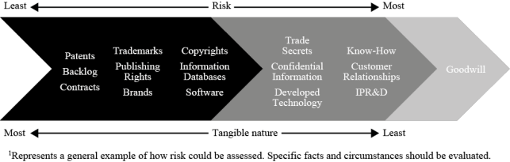

# 05 - Fair value (IFRS 13)

[返回目录](README.md)

### FAQ 5.111.1 – Determining whether transactions are orderly

Reference to standard: IFRS 13 para B43  
 Reference to standing text: [5.113](11.md#s33-Para_5.113)  
 

  

 

**Question:**

 

When are transactions considered orderly?

 

**Answer:**

 

Although paragraph B43 of IFRS 13 provides a list of factors to consider that might indicate that a transaction is not orderly, we believe that there is an implicit rebuttable presumption that observable transactions between unrelated parties are orderly. In our experience, such transactions are considered to be orderly in almost all instances. Therefore, the evidence necessary to conclude that an observable transaction between unrelated parties is not orderly should be incontrovertible.

 

### FAQ 5.113.1 – Determining fair value where an entity might be forced to liquidate assets

Reference to standard: IFRS 13 para B44  
Reference to standing text: [5.113](11.md#s33-Para_5.113)  

  

 

**Question:**

 

How should an entity determine fair value when it might be forced to liquidate assets?

 

**Answer:**

 

IFRS 13 defines fair value as the price that would be received to sell an asset or paid to transfer a liability in an orderly transaction between market participants at the measurement date. The requirement to use an orderly transaction basis for valuation is embedded directly into IFRS 13’s concept of fair value.

 

[IFRS 13 para 15].

 

However, it is possible that some transactions might not be orderly, with examples of circumstances that might indicate that a transaction is not orderly noted in paragraph B43 of IFRS 13; these include that the seller is in or near bankruptcy or receivership (that is, the seller is distressed), and that there was not adequate exposure to the market for a period to allow for marketing activities that are usual and customary for transactions in the asset. Where there is a clear expectation or other evidence that the sale of an asset will take place in a manner that is not orderly, little if any weight should be placed on the expected disorderly transaction price.

 

[IFRS 13 App B para B44].

 

Where an entity does not have sufficient information to know if a transaction is to be orderly, the anticipated transaction price should be taken into account, but it will be given less weight than those transactions known to be orderly. For example, a piece of land to be sold in an orderly transaction might have an estimated value of C10 million; whereas, in a disorderly transaction resulting from a forced sale, it might only be expected to sell for C6 million. In measuring the fair value at the balance sheet date, IFRS 13 requires market participant assumptions to be used for an orderly transaction. Accordingly, the fair value at the balance sheet date would be C10 million, despite the expectation of a forced sale. Disclosure will be important if assets are carried above the expected proceeds owing to an expectation that they will be liquidated in a disorderly transaction after the balance sheet date.

 

### EX 5.116.1 – Guidance on highest and best use of property, plant and equipment

 

Reference to standard: IFRS 13 para 29  
Reference to standing text: [5.116](11.md#s34-Para_5.116)  

  

  
An entity acquires land in a business combination. The land is currently developed for industrial use as a site for a factory. The current use of the land is presumed to be its highest and best use, unless market or other factors suggest a different use. Nearby sites have recently been developed for residential use as sites for high-rise apartment buildings. On the basis of that development and recent zoning and other changes to facilitate that development, the entity determines that the land currently used as a site for a factory could be developed as a site for residential use (that is, for high-rise apartment buildings), because market participants would take into account the potential to develop the site for residential use when pricing the land. The highest and best use of the land would be determined by comparing both of the following:

- The value of the land as currently developed for industrial use (that is, the land would be used in combination with other assets, such as the factory, or with other assets and liabilities).

- The value of the land as a vacant site for residential use, taking into account the costs of demolishing the factory and other costs (including the uncertainty about whether the entity would be able to convert the asset to the alternative use) necessary to convert the land to a vacant site (that is, the land is to be used by market participants on a stand-alone basis).

The highest and best use of the land would be determined on the basis of the higher of those values. In situations involving real estate appraisal, the determination of highest and best use might take into account factors relating to the factory operations, including its assets and liabilities.

 

### EX 5.117.1 – Application of the replacement cost approach for property, plant and equipment

 

Reference to standard: IFRS 13 paras 32, B9  
Reference to standing text: [5.117](11.md#s34-Para_5.117)

  

  

 

  
 The fair value of specialised plant and equipment might be measured using the replacement cost method. This represents the highest value that a market participant would pay for an asset with similar utility. The cost approach is based on the principle of substitution. It uses the cost to replace an asset as an indicator of the fair value of that asset. To determine the appropriate substitute asset or asset group as a measure of fair value, the utility of the replacement asset is compared to the utility of the asset being measured. Comparable utility implies similar economic satisfaction, but it does not necessarily require the substitute asset to be an exact duplicate of the asset being measured. The cost of an exact duplicate is referred to as ‘reproduction cost’. The substitute asset is perceived as equivalent if it possesses similar utility to (and, therefore, serves as a measure of fair value of) the asset being valued.

Step 1: Identify the asset’s original cost.

Step 2: Adjust the original cost for changes in price levels between the asset’s original in-service date and the date of the valuation to measure its replacement cost new (RCN). RCN represents the indicated value of current labour and materials necessary to construct or acquire an asset of similar utility to the asset being measured.

Step 3: Adjust RCN to represent any losses in value due to physical deterioration or functional obsolescence of the asset, which results in the value of replacement cost new less depreciation (RCNLD).

Physical deterioration represents the loss in value due to the decreased usefulness of a fixed asset as the asset’s useful life expires. This can be caused by factors such as wear and tear, deterioration, physical stresses and exposure to various elements.

Excessive physical deterioration might result in an inability to meet production standards or in higher product rejections, as the tolerance on manufacturing equipment decreases. In addition, higher than average maintenance expenditure requirements might suggest higher levels of physical deterioration. However, below average maintenance expenditures might also indicate higher levels of physical deterioration, due to inadequate or deferred maintenance.

Functional obsolescence represents the loss in value due to the decreased usefulness of a fixed asset that is inefficient or inadequate, relative to other more efficient or less costly replacement assets provided by new technological developments. Functional obsolescence is observed in several different forms. If the subject asset has excessive operating costs relative to a new asset, this might indicate a form of functional obsolescence. If, in developing an asset’s RCN, that replacement cost is less than its reproduction cost, this might also be indicative of a form of functional obsolescence. The objective of the measurement is to identify the replacement cost of a modern equivalent asset.

Step 4: Adjustment RCNLD, if necessary, for loss in value due to economic obsolescence, to provide an indication of the fair value of the asset being measured.

Economic obsolescence represents the loss in value due to the decreased usefulness of a fixed asset caused by external factors, independent of the characteristics of the asset or how it is operated. The increased cost of raw materials, labour or utilities that cannot be offset by an increase in price due to competition or limited demand – as well as a change in environmental or other regulations, inflation or high interest rates – might suggest the presence of economic obsolescence. The more specialised the asset, the more it is exposed to economic obsolescence.

IFRS 13 permits the fair value of certain tangible assets to be measured using the replacement cost method. However, there might be instances of industry practice where certain tangible assets are measured using an income or market approach. An example is the measurement of a power plant in the energy sector, which often has few, if any, intangible assets other than the embedded licence, and so the cash flows from the plant reflect only the economic benefits generated by the plant and its embedded licence. Management should have regard to other IFRSs to determine whether the assets measured together need to be accounted for separately. [IFRS 13 para 32]. This could result in a fair value measurement above the replacement cost. In this situation, replacement cost represents the highest price that a market participant would be prepared to pay, so reporting entities should consider whether any of the difference is derived from or related to other assets included in the cash flows of the tangible assets, such as customer or contractual assets.

 

### FAQ 5.118.2 – Use of the market approach for investment property

 

Reference to standard: IAS 40 para 40  
 Reference to standing text: [5.118](11.md#s34-Para_5.118)

  

  
The best evidence of fair value is usually provided by current prices in an active market for:

- similar property,

- in similar location and condition,

- subject to similar lease terms, and

- subject to similar restrictions on use.

Such conditions might not always be present, so an entity should take account of and make suitable adjustments for the differences between the comparable properties and the property being valued. For example, a property leased by the entity might contain restrictions on current and future use. Those restrictions could significantly affect its fair value, because they might restrict the entity’s ability to obtain optimum market rentals.

Evidence from alternative sources should be considered where there is not an active market. Those sources might include:

- current active market prices for properties of a different nature, condition, location and restrictions, appropriately adjusted; or

- recent prices from transactions on less active markets, adjusted to reflect changes in economic conditions since the date of those transactions.

Fair value of an investment property does not reflect the following factors if they would not be generally available to market participants:

- additional value created by bringing together a number of properties in different locations and combining them into a portfolio of properties,

- synergies between investment properties and other assets,

- legal rights and restrictions specific to the present owner,

- special terms such as unusual financing, sale and leaseback arrangements, or special considerations or concessions granted by anyone associated with the sale,

- tax benefits or disadvantages specific to the present owner.

Fair value is determined without deduction for transaction costs that might be incurred on sale or other disposal. When a reporting entity has prepaid or accrued operating lease income on its balance sheet, it does not include the value of that income in the fair value of the related investment property, as the prepaid or accrued operating lease income is a separate asset.

Use of the market approach to value investment property might be a Level 2 measurement. However, the more adjustments that are made to observable data inputs, the more likely they are to be Level 3 measurements.

 

### FAQ 5.118.3 – Use of the income approach for investment property

 

Reference to standard: IAS 40 para 40  
 Reference to standing text: [5.118](11.md#s34-Para_5.118)

  

  
The fair value of an investment property might be measured using discounted cash flow projections based on reliable estimates of future rental income and expenditures, supported by the terms of an existing lease and other contracts. External evidence should also be used where practicable, such as current market rental rates for properties of a similar nature, condition and location. [Paragraph 5.77](11.md#s33-Para_5.77) sets out general principles for the application of present value techniques.

The income approach is likely to result in a Level 3 measurement, because the most significant input will be the projected future cash flows.

 

### FAQ 5.118.4 – IFRS 16 considerations when determining the fair value of leased property under IAS 40

 

Reference to standard: IFRS 16 paras 24, 26; IAS 40 para 41  
 Reference to standing text: [5.118](11.md#s34-Para_5.118) 

  

  
 IFRS 16 specifies the basis for initial recognition of the cost of an investment property held by a lessee as a right-of-use asset. Investment property held by a lessee as a right-of-use asset is remeasured, if necessary, to fair value if the entity chooses the fair value model. When lease payments are at market rates, the fair value of an investment property held by a lessee as a right-of-use asset at acquisition, net of all expected lease payments (including those relating to recognised lease liabilities), should be zero. Thus, remeasuring a right-of-use asset from cost in accordance with IFRS 16 to fair value in accordance with IAS 40 should not give rise to any initial gain or loss, unless fair value is measured at different times. This could occur when an election to apply the fair value model is made after initial recognition.

 

### FAQ 5.122.1 – Application of the market approach to valuation of investments in associates, joint ventures and subsidiaries

 

Reference to standard: IAS 27 para 10(b)  
 Reference to standing text: [5.122](11.md#s34-Para_5.122)

  

  
The market approach can be used as a primary approach to measure the fair value of the investment. It is also often used to assess the reasonableness of the implied valuation multiples derived from the income approach. The two principal methods in applying the market approach are discussed below.

**Comparable company market multiple method**

Publicly traded companies are reviewed to develop a peer group similar to the company being valued, referred to as ‘comparable’ companies.

Market multiples are developed and based on two inputs: (i) quoted trading prices which represent non-controlling interest shares, because exchanges of equity shares in active markets typically involve small (non-controlling interest) blocks; and (ii) financial metrics, such as net income, and earnings before interest, taxes, depreciation and amortisation (EBITDA).

Market multiples are then adjusted, as appropriate, for differences in growth rates, profitability, size, accounting policies, and other relevant factors. The adjusted multiples are then applied to the subject company’s comparable financial metric. Caution is required: if there are too many adjustments required, the selected companies are unlikely to be truly comparable.

This results in the estimated fair value of the entity’s enterprise value (value of equity plus debt) or equity value, depending on which metric is used, on a non-controlling interest basis, because the multiples were derived from non-controlling interest prices. So this is suitable for the measurement of investments in associates or joint ventures, both of which are non-controlling interests (that is, there is no control over them under IFRS 10).

Where the valuation derives an enterprise value, the fair value of any debt in the investee must be deducted to arrive at the implied equity value of the investment.

If a controlling or majority interest in a subsidiary is being valued, a further adjustment (‘control premium’) might be necessary. A control premium represents the amount paid by a new controlling shareholder for the synergies and other potential benefits derived from controlling the enterprise. A control premium should not be automatically applied without consideration of the relevant factors (for example, synergies that a market participant could achieve, number of possible market participant acquirers). Consideration should be given to the amount of these synergies, how achievable they are, particularly if the current owner is unable to achieve them when determining the amount of control premium that is supportable. Companies need to evaluate and assess whether such factors indicate that a control premium is justified and, if so, assess the magnitude of the control premium.

**Market transaction multiple method**

The market transaction multiple method is a variation of the market approach, and it is often applied when valuing a controlling or majority ownership interest of a business enterprise.

This approach is based on prices paid in observed market transactions of comparable companies, involving exchanges of entire (or majority interests in) companies, which generally include a control premium in the price paid.

Valuation multiples are developed from observed market data for a particular financial metric of the business enterprise, such as earnings or revenue. The valuation multiple is then applied to the financial metric of the subject company to measure the estimated fair value of the business enterprise on a control basis. Generally, the value of control included in the transaction multiple is specific to the buyer and seller involved in the transaction, and might not be broadly applicable to the subject company. Therefore, this valuation technique should consider the synergies in the transaction and whether they are appropriate to the company being valued. In addition, consideration should be given to whether market conditions have changed since the transaction was entered into.

**Obtaining and reviewing comparable company information**

The data used in either of the market approaches above is typically obtained from several sources, including past transactions in which the company has participated, peer company financial statements, periodicals, industry magazines and trade organisations, and Mergers and Acquisitions’ databases. The data for a single transaction might be derived from several sources.

The degree of similarity of the observed data to the subject company (industry, transaction date, size, demographics, and other factors) needs to be considered in evaluating the relevance and weight given to the selected financial metric.

The relevance of the market approach in measuring fair value is dependent on the comparability of the companies on which the analysis is based. The higher the degree of correlation between the operations in the peer group and the subject company, the better the analysis. Some of the more significant attributes used to determine comparability are:

<table style="width:100%; border-collapse:collapse"><tr><td style="border:0.75pt solid #000000; padding-right:5.03pt; padding-left:5.03pt; vertical-align:top"><ul style="margin:0pt; padding-left:0pt"><li style="margin-left:27.6pt; padding-left:8.4pt; ">Type of product produced or service performed.</li></ul></td><td style="border:0.75pt solid #000000; padding-right:5.03pt; padding-left:5.03pt; vertical-align:top"><ul style="margin:0pt; padding-left:0pt"><li style="margin-left:27.6pt; padding-left:8.4pt; ">Geographic area of operation.</li></ul></td></tr><tr><td style="border:0.75pt solid #000000; padding-right:5.03pt; padding-left:5.03pt; vertical-align:top"><ul style="margin:0pt; padding-left:0pt"><li style="margin-left:27.6pt; padding-left:8.4pt; ">Positioning in market.</li></ul></td><td style="border:0.75pt solid #000000; padding-right:5.03pt; padding-left:5.03pt; vertical-align:top"><ul style="margin:0pt; padding-left:0pt"><li style="margin-left:27.6pt; padding-left:8.4pt; ">Size (for example, revenue, assets).</li></ul></td></tr><tr><td style="border:0.75pt solid #000000; padding-right:5.03pt; padding-left:5.03pt; vertical-align:top"><ul style="margin:0pt; padding-left:0pt"><li style="margin-left:27.6pt; padding-left:8.4pt; ">Growth (historical and projected).</li></ul></td><td style="border:0.75pt solid #000000; padding-right:5.03pt; padding-left:5.03pt; vertical-align:top"><ul style="margin:0pt; padding-left:0pt"><li style="margin-left:27.6pt; padding-left:8.4pt; ">Profitability.</li></ul></td></tr><tr><td style="border:0.75pt solid #000000; padding-right:5.03pt; padding-left:5.03pt; vertical-align:top"><ul style="margin:0pt; padding-left:0pt"><li style="margin-left:27.6pt; padding-left:8.4pt; ">Capital intensity (fixed assets and working capital).</li></ul></td><td style="border:0.75pt solid #000000; padding-right:5.03pt; padding-left:5.03pt; vertical-align:top"><ul style="margin:0pt; padding-left:0pt"><li style="margin-left:27.6pt; padding-left:8.4pt; ">Leverage.</li></ul></td></tr><tr><td style="border:0.75pt solid #000000; padding-right:5.03pt; padding-left:5.03pt; vertical-align:top"><ul style="margin:0pt; padding-left:0pt"><li style="margin-left:27.6pt; padding-left:8.4pt; ">Liquidity.</li></ul></td><td style="border:0.75pt solid #000000; padding-right:5.03pt; padding-left:5.03pt; vertical-align:top"><ul style="margin:0pt; padding-left:0pt"><li style="margin-left:27.6pt; padding-left:8.4pt; ">Diversification.</li></ul></td></tr></table>

  
 Some of the attributes above might be adjusted to allow for further comparability between the company being measured and the peer group.

 

### FAQ 5.122.2 – Application of the income approach to valuation of investments in associates, joint ventures and subsidiaries

 

Reference to standard: IAS 27 para 10(b)  
 Reference to standing text: [5.122](11.md#s34-Para_5.122)

  

  
 The present value of the ‘free cash flows’ available to the entity’s debt and equity holders represents the enterprise value of the investee. The fair value of the investee’s equity is generally determined by deducting the fair value of the debt from the enterprise value. However, adjustments may be required for highly leveraged companies. The discounted cash flow model typically includes a cash flow forecast for the investee, a terminal value calculation, and the application of a discount rate.

Projected financial information (PFI) is used to derive the expected free cash flows of the investee, and it is typically measured as:

- projected debt-free net income, plus

- depreciation and amortisation expenses (to the extent that they are reflected in the computation of taxable income), adjusted for

- changes in debt-free working capital and capital expenditures.

The PFI is a key input in the valuation process, and it is important to understand the underlying assumptions. For example, the PFI should reflect market participant assumptions, including only those synergies that would be available to other market participants. That is, the PFI should be adjusted to remove entity-specific synergies. Where the PFI reflects only market participant synergies, the appropriate discount rate should theoretically be consistent with the industry-weighted average cost of capital (WACC) – that is, the industry-weighted average rate of return on debt and equity, as required by market participants.

Conforming the PFI to market participant assumptions usually starts with analysing the financial model used to price the transaction, and adjusting it to reflect market participant expected cash flows. If the transaction pricing was not based on a cash flow analysis, a similar concept should be applied in preparing the cash flow forecast required to value the acquired assets and liabilities. When differentiating between entity-specific synergies and market participant synergies, entities should consider the following:

- The acquirer’s rationale for the transaction, particularly as communicated in press releases, board minutes, and investment bankers’ analyses.

- The competitive nature of the bidding process; in a highly competitive bidding environment, an acquirer may pay for entity specific synergies, while if no other bidders are present, an acquirer may not have to pay for the value of all market participant synergies.

- The basis for the projections used to price the transaction, to gain an understanding of the synergies considered in determining the consideration transferred.

- Whether alternative PFI scenarios used to measure the purchase price might be available to assist in assessing the relative risk of the PFI.

- Whether market participants would consider and could achieve similar synergies.

- Whether the highest and best use for the asset(s) may differ between the acquirer’s intended use and use by market participants

- Whether industry trends (for example: consolidation, diversification) provide insights into market participant synergies.

**Discount rates**

A discount rate represents the expected rate of return (that is, yield) that an investor would expect from an investment. The discount rate depends on the perceived risk of the investment. In theory, investors are compensated, in part, based on the degree of inherent risk, and they would therefore require additional compensation (in the form of a higher rate of return) for investments bearing additional risk.

The rate of return on the overall company will typically differ from the rate of return on a non-controlling interest. The controlling shareholder controls the cash flows, both in terms of how they are earned and how they are deployed. The non-controlling shareholder is dependent on the controlling shareholder, both for the direction of the business (which influences profits) and for the payment of dividends. The non-controlling shareholder’s interest in the business is therefore generally subject to higher risk than that of the controlling shareholder, and it may attract a higher discount rate.

**Terminal value**

A terminal value should be included at the end of the discrete projection period of a discounted cash flow analysis, to reflect the remaining value that the entity is expected to generate beyond the projection period. Business enterprises are generally assumed to have indefinite lives. The most commonly used terminal value technique is the constant growth method (CGM). The terminal value is calculated by dividing annual sustainable cash flow by a capitalisation rate (‘cap rate’). The annual sustainable cash flow is often estimated based on the cash flows of the final year of the discrete projection period, adjusted as needed to reflect sustainable margins, working capital needs and capital expenditures consistent with an assumed constant growth rate. The cap rate is calculated as the discount rate less the long-term, sustainable growth rate. The cap rate varies inversely to the growth rate and terminal value (that is, a lower growth rate results in a higher cap rate and a lower terminal value).

The terminal value represents the present value, in the last year of the projection period, of all subsequent cash flows in perpetuity. A long-term growth rate in excess of a projected inflation rate should be viewed with caution, and it should be adequately supported and explained in the valuation analysis.

If the projection period is so short (relative to the age of the enterprise) that significant growth is projected in the final year, the CGM should not be applied to that year. The projection period should be extended until the growth in the final year approaches a sustainable level, or an alternative method (as described below) should be used.

An alternative to the CGM in calculating the terminal value is the market pricing multiple method (commonly referred to as an exit multiple). Under this method, a current observed pricing multiple of earnings – generally EBITDA or earnings before interest and taxes (EBIT) – is applied to the entity’s projected earnings for the final year of the projection period. However, this method must be used cautiously, to avoid significant misstatement of the fair value resulting from growth rate differences. Implied income growth rates, reflecting the markets’ view of the entity’s relatively short-term growth prospects, are inherent in current observed pricing multiples for an entity. The implied growth rate inherent in the multiple must be compared to the growth rate reflected in the last year of the projection period.

Where a pricing multiple observed for an enterprise is applied to the final year of a projection, the following should apply:

- the implied growth rate in the multiple should be consistent with the projected growth; and

- the implied risk for the enterprise should be consistent with the risk inherent in realising the projected income.

The terminal value often represents a significant portion of total fair value. Therefore, a relatively small change in the cap rate or market pricing multiple can have a significant impact on the total fair value produced.

 

### FAQ 5.126.1 – Measuring contingent consideration in a business combination at fair value

 

Reference to standard: IFRS 3 para 39  
 Reference to standing text: [5.126](11.md#s34-Para_5.126)

  

  
Valuation methods for contingent consideration often range from discounted cash flow analyses and binomial models linked to discounted cash flow models, to the more intricate Monte Carlo simulations. The arrangement’s terms, the pay-out structure and the reliability of inputs will influence the type of valuation model used.

Each arrangement has its own specific features requiring different modelling techniques and assumptions. There are two more commonly used methodologies used in practice to value contingent consideration. The first is a scenario-based technique and the second is an option pricing technique. The scenario-based technique involves developing discrete scenario-specific cash flow estimates or potential outcomes in circumstances when the trigger for payment is event driven. These amounts are then probability weighted and discounted using an appropriate discount rate. For example, a contingent payment that is triggered by a drug achieving a key milestone in research and development is often valued using a scenario-based method. The option pricing technique is similar in concept but uses an option-pricing framework for valuing contingent consideration. This eliminates the need to determine the appropriate discount rate and replaces scenarios with a volatility assumption. Option pricing techniques rely on estimates of volatility and a milestone-specific risk, referred to as Market Price of Risk. The option pricing technique is most appropriate in situations when the payment trigger is in some way correlated to the market (for example, if payment is a function of exceeding an EBITDA target for a consumer products company). The scenario method applies in situations when the trigger is not correlated (for example, if payment is tied to a decision by a court).

Additionally, for liability-classified contingent consideration, the valuation model will need to be flexible enough to handle changing inputs and assumptions that need to be updated each reporting period. The projected financial information used in valuing the contingent consideration arrangement should be consistent with the projected financial information used in valuing the intangible assets.

 

### FAQ 5.126.2 – Fair value measurement of liability-classified, cash-settled contingent consideration (1)

 

Reference to standard: IFRS 3 para 39  
 Reference to standing text: [5.126](11.md#s34-Para_5.126)

  

  
**Question:**

Entity A purchases entity B for C400 million. Entities A and B agree that, if revenues of entity B exceed C250 million in the year following the acquisition date, entity A will pay C50 million to the former shareholders of entity B. How is the fair value of the contingent consideration measured?

**Answe****r:**

The arrangement requires entity A to pay cash. Therefore, entity A should measure the arrangement’s fair value on the acquisition date and classify it as a liability. Any changes in the liability’s fair value will be recognised in entity A’s profit or loss until the arrangement is settled.

Approach 1 – Discounted cash flow methodology

A key determination for this approach is selecting a discount rate that best represents the risks inherent in the arrangement. In reality, there is more than one source of risk involved. For example, both projection risk (the risk of achieving the projected revenue level) and credit risk (the risk that the entity might not have the financial ability to make the arrangement payment) need to be considered.

Each of these risks might be quantifiable in isolation; but, when the two risks exist in tandem, consideration should be given to factors such as the potential correlation between the two risks and the relative impact of each risk on the realisation of the arrangement. Where there is uncertainty about the payment that will be made, an expected value approach will likely be more appropriate to capture the uncertainty of multiple potential outcomes, to avoid the need to reflect multiple risk factors within the discount rate.

Approach 2 – Expected value approach

One alternative approach to determine the fair value of the cash-settled contingent consideration would be to develop a set of discrete potential outcomes for future revenues. Some outcomes would show revenue levels above the C250 million performance target and some would be below. For those outcomes showing revenues above the C250 million threshold, a pay-out would result. For those below this threshold, there would be no pay-out.

Each of these discrete pay-out outcomes could then be assigned a probability, and the probability-weighted average pay-out could be discounted based on market participant assumptions. For example, the following probability-weighted alternative might be used in determining the fair value of the arrangement:

<table style="width:100%; border-collapse:collapse"><tr><td style="border:0.75pt solid #000000; padding-right:5.03pt; padding-left:5.03pt; vertical-align:top">
<b>Outcome</b>
</td><td style="border:0.75pt solid #000000; padding-right:5.03pt; padding-left:5.03pt; vertical-align:top">
<b>Revenue level (C’m)</b>
</td><td style="border:0.75pt solid #000000; padding-right:5.03pt; padding-left:5.03pt; vertical-align:top">
<b>Pay-out (C’m)</b>
</td><td style="border:0.75pt solid #000000; padding-right:5.03pt; padding-left:5.03pt; vertical-align:top">
<b>Probability (%)</b>
</td><td style="border:0.75pt solid #000000; padding-right:5.03pt; padding-left:5.03pt; vertical-align:top">
<b>Probability-weighted pay-out (C’m)</b>
</td></tr><tr><td style="border:0.75pt solid #000000; padding-right:5.03pt; padding-left:5.03pt; vertical-align:top">
1
</td><td style="border:0.75pt solid #000000; padding-right:5.03pt; padding-left:5.03pt; vertical-align:top">
200
</td><td style="border:0.75pt solid #000000; padding-right:5.03pt; padding-left:5.03pt; vertical-align:top">
0
</td><td style="border:0.75pt solid #000000; padding-right:5.03pt; padding-left:5.03pt; vertical-align:top">
10
</td><td style="border:0.75pt solid #000000; padding-right:5.03pt; padding-left:5.03pt; vertical-align:top">
0
</td></tr><tr><td style="border:0.75pt solid #000000; padding-right:5.03pt; padding-left:5.03pt; vertical-align:top">
2
</td><td style="border:0.75pt solid #000000; padding-right:5.03pt; padding-left:5.03pt; vertical-align:top">
225
</td><td style="border:0.75pt solid #000000; padding-right:5.03pt; padding-left:5.03pt; vertical-align:top">
0
</td><td style="border:0.75pt solid #000000; padding-right:5.03pt; padding-left:5.03pt; vertical-align:top">
15
</td><td style="border:0.75pt solid #000000; padding-right:5.03pt; padding-left:5.03pt; vertical-align:top">
0
</td></tr><tr><td style="border:0.75pt solid #000000; padding-right:5.03pt; padding-left:5.03pt; vertical-align:top">
3
</td><td style="border:0.75pt solid #000000; padding-right:5.03pt; padding-left:5.03pt; vertical-align:top">
250
</td><td style="border:0.75pt solid #000000; padding-right:5.03pt; padding-left:5.03pt; vertical-align:top">
0
</td><td style="border:0.75pt solid #000000; padding-right:5.03pt; padding-left:5.03pt; vertical-align:top">
15
</td><td style="border:0.75pt solid #000000; padding-right:5.03pt; padding-left:5.03pt; vertical-align:top">
0
</td></tr><tr><td style="border:0.75pt solid #000000; padding-right:5.03pt; padding-left:5.03pt; vertical-align:top">
4
</td><td style="border:0.75pt solid #000000; padding-right:5.03pt; padding-left:5.03pt; vertical-align:top">
275
</td><td style="border:0.75pt solid #000000; padding-right:5.03pt; padding-left:5.03pt; vertical-align:top">
50
</td><td style="border:0.75pt solid #000000; padding-right:5.03pt; padding-left:5.03pt; vertical-align:top">
40
</td><td style="border:0.75pt solid #000000; padding-right:5.03pt; padding-left:5.03pt; vertical-align:top">
20
</td></tr><tr><td style="border:0.75pt solid #000000; padding-right:5.03pt; padding-left:5.03pt; vertical-align:top">
5
</td><td style="border:0.75pt solid #000000; padding-right:5.03pt; padding-left:5.03pt; vertical-align:top">
300
</td><td style="border:0.75pt solid #000000; padding-right:5.03pt; padding-left:5.03pt; vertical-align:top">
50
</td><td style="border:0.75pt solid #000000; padding-right:5.03pt; padding-left:5.03pt; vertical-align:top">
20
</td><td style="border:0.75pt solid #000000; padding-right:5.03pt; padding-left:5.03pt; vertical-align:top">
10
</td></tr><tr><td style="border:0.75pt solid #000000; padding-right:5.03pt; padding-left:5.03pt; vertical-align:top">
 
</td><td style="border:0.75pt solid #000000; padding-right:5.03pt; padding-left:5.03pt; vertical-align:top">
 
</td><td style="border:0.75pt solid #000000; padding-right:5.03pt; padding-left:5.03pt; vertical-align:top">
 
</td><td style="border:0.75pt solid #000000; padding-right:5.03pt; padding-left:5.03pt; vertical-align:top">
 
</td><td style="border:0.75pt solid #000000; padding-right:5.03pt; padding-left:5.03pt; vertical-align:top">
 
</td></tr><tr><td style="border:0.75pt solid #000000; padding-right:5.03pt; padding-left:5.03pt; vertical-align:top">
 
</td><td style="border:0.75pt solid #000000; padding-right:5.03pt; padding-left:5.03pt; vertical-align:top">
 
</td><td style="border:0.75pt solid #000000; padding-right:5.03pt; padding-left:5.03pt; vertical-align:top">
Total:
</td><td style="border:0.75pt solid #000000; padding-right:5.03pt; padding-left:5.03pt; vertical-align:top">
100
</td><td style="border:0.75pt solid #000000; padding-right:5.03pt; padding-left:5.03pt; vertical-align:top">
30
</td></tr><tr><td style="border:0.75pt solid #000000; padding-right:5.03pt; padding-left:5.03pt; vertical-align:top">
 
</td><td style="border:0.75pt solid #000000; padding-right:5.03pt; padding-left:5.03pt; vertical-align:top">
 
</td><td style="border:0.75pt solid #000000; padding-right:5.03pt; padding-left:5.03pt; vertical-align:top">
 
</td><td style="border:0.75pt solid #000000; padding-right:5.03pt; padding-left:5.03pt; vertical-align:top">
 
</td><td style="border:0.75pt solid #000000; padding-right:5.03pt; padding-left:5.03pt; vertical-align:top">
 
</td></tr><tr><td style="border:0.75pt solid #000000; padding-right:5.03pt; padding-left:5.03pt; vertical-align:top">
 
</td><td colspan="2" style="border:0.75pt solid #000000; padding-right:5.03pt; padding-left:5.03pt; vertical-align:top">
Discount rate1
</td><td style="border:0.75pt solid #000000; padding-right:5.03pt; padding-left:5.03pt; vertical-align:top">
 
</td><td style="border:0.75pt solid #000000; padding-right:5.03pt; padding-left:5.03pt; vertical-align:top">
20%
</td></tr><tr><td style="border:0.75pt solid #000000; padding-right:5.03pt; padding-left:5.03pt; vertical-align:top">
 
</td><td style="border:0.75pt solid #000000; padding-right:5.03pt; padding-left:5.03pt; vertical-align:top">
 
</td><td style="border:0.75pt solid #000000; padding-right:5.03pt; padding-left:5.03pt; vertical-align:top">
Fair value:
</td><td style="border:0.75pt solid #000000; padding-right:5.03pt; padding-left:5.03pt; vertical-align:top">
 
</td><td style="border:0.75pt solid #000000; padding-right:5.03pt; padding-left:5.03pt; vertical-align:top">
25
</td></tr></table>

  
1 A discount rate of 20% is used for illustrative purposes.

 

### FAQ 5.126.3 – Fair value measurement of liability-classified, cash-settled contingent consideration (2)

 

Reference to standard: IFRS 3 para 39  
 Reference to standing text: [5.126](11.md#s34-Para_5.126)

  

  
Question:

Entity A purchases entity B by issuing 1 million equity shares in entity A to entity B’s shareholders. At the acquisition date, entity A’s share price is C40 per share. Entities A and B agree that, if the shares of entity A are trading below C40 per share one year after the acquisition date, entity A will issue additional shares to entity B’s former shareholders sufficient to protect against price declines below C40 million (that is, the acquisition date fair value of the 1 million shares issued). How is the fair value of the contingent consideration measured?

Answer:

The guarantee arrangement creates an obligation that entity A would be required to settle with a variable number of entity A’s equity shares, the amount of which varies inversely to changes in the fair value of entity A’s equity shares. For example, if entity A’s share price decreases from C40 per share to C35 per share one year after the acquisition date, the amount of the obligation would be C5 million. Therefore, the guarantee arrangement would require liability classification on the acquisition date. Changes in the liability will be recognised in entity A’s earnings until the arrangement is settled.

The best estimate or the probability-weighted approach will not be sufficient to value the share-settled arrangement of a public company. In addition to the quantification of projection and credit risks, the modelling of entity A’s share price is required. The following factors are relevant in performing a valuation for such arrangements for a private company:

- Potential outcomes for entity A’s financial results next year.

- Potential outcomes for entity A’s share price returns over the coming year.

- Correlation of the distributions of the financial results and share price returns.

- Potential outcomes for other market events that could impact the overall stock market.

- Selection of an appropriate discount rate that adequately reflects the risks not reflected in other assumptions of the valuation.

The contingent consideration arrangements illustrated in this example will require a valuation approach incorporating option pricing techniques for a public company.

 

### FAQ 5.126.4 – Fair value measurement of equity-classified contingent consideration

 

Reference to standard: IFRS 3 para 39  
 Reference to standing text: [5.126](11.md#s34-Para_5.126)

  

  
**Question:**

Entity A acquires entity B in a business combination. The consideration transferred is 10 million entity A shares at the acquisition date, and 2 million shares two years after the acquisition date if a performance target is met. The performance target is for entity B’s revenues (as a wholly owned subsidiary of entity A) to be greater than C500 million in the second year after the acquisition. The market price of entity A’s shares is C15 at the acquisition date. Entity A’s management assesses a 25% probability that the performance target will be met. A dividend of C0.25 per share is expected to be paid  by A at the end of years 1 and 2, which the seller will not receive on the contingent shares.

How is fair value of the contingent consideration calculated?

**Answer:**

The fair value is estimated at C7,296,786 (see calculation below). The fair value of the contingent consideration at the acquisition date is based on the acquisition date fair value of the shares, and it incorporates the probability that entity B will have revenues in two years greater than C500 million. The value excludes the dividend cash flows in years 1 and 2, and it incorporates the time value of money. The discount rate for the present value of dividends should be the acquirer’s cost of equity, because returns are available to equity holders from capital appreciation and dividends paid. Those earnings are all sourced from net income of the acquirer.

There are no re-measurements of the fair value in subsequent periods.

[IFRS 3 para 58(a)].

<table style="width:100%; border-collapse:collapse"><tr><td style="border:0.75pt solid #000000; padding-right:5.03pt; padding-left:5.03pt; vertical-align:top">
 
</td><td style="border:0.75pt solid #000000; padding-right:5.03pt; padding-left:5.03pt; vertical-align:top">
<b>A</b>
</td><td style="border:0.75pt solid #000000; padding-right:5.03pt; padding-left:5.03pt; vertical-align:top">
<b>B</b>
</td><td style="border:0.75pt solid #000000; padding-right:5.03pt; padding-left:5.03pt; vertical-align:top">
<b>C</b>
</td></tr><tr><td style="border:0.75pt solid #000000; padding-right:5.03pt; padding-left:5.03pt; vertical-align:top">
<b>Revenue forecast (C’m)</b>
</td><td style="border:0.75pt solid #000000; padding-right:5.03pt; padding-left:5.03pt; vertical-align:top">
<b>Probability (%)</b>
</td><td style="border:0.75pt solid #000000; padding-right:5.03pt; padding-left:5.03pt; vertical-align:top">
<b>Payment in shares</b>
</td><td style="border:0.75pt solid #000000; padding-right:5.03pt; padding-left:5.03pt; vertical-align:top">
<b>Probability-weighted number of shares</b>
</td></tr><tr><td style="border:0.75pt solid #000000; padding-right:5.03pt; padding-left:5.03pt; vertical-align:top">
350
</td><td style="border:0.75pt solid #000000; padding-right:5.03pt; padding-left:5.03pt; vertical-align:top">
30
</td><td style="border:0.75pt solid #000000; padding-right:5.03pt; padding-left:5.03pt; vertical-align:top">
0
</td><td style="border:0.75pt solid #000000; padding-right:5.03pt; padding-left:5.03pt; vertical-align:top">
 
</td></tr><tr><td style="border:0.75pt solid #000000; padding-right:5.03pt; padding-left:5.03pt; vertical-align:top">
450
</td><td style="border:0.75pt solid #000000; padding-right:5.03pt; padding-left:5.03pt; vertical-align:top">
45
</td><td style="border:0.75pt solid #000000; padding-right:5.03pt; padding-left:5.03pt; vertical-align:top">
0
</td><td style="border:0.75pt solid #000000; padding-right:5.03pt; padding-left:5.03pt; vertical-align:top">
 
</td></tr><tr><td style="border:0.75pt solid #000000; padding-right:5.03pt; padding-left:5.03pt; vertical-align:top">
550
</td><td style="border:0.75pt solid #000000; padding-right:5.03pt; padding-left:5.03pt; vertical-align:top">
20
</td><td style="border:0.75pt solid #000000; padding-right:5.03pt; padding-left:5.03pt; vertical-align:top">
2,000,000
</td><td style="border:0.75pt solid #000000; padding-right:5.03pt; padding-left:5.03pt; vertical-align:top">
400,000
</td></tr><tr><td style="border:0.75pt solid #000000; padding-right:5.03pt; padding-left:5.03pt; vertical-align:top">
650
</td><td style="border:0.75pt solid #000000; padding-right:5.03pt; padding-left:5.03pt; vertical-align:top">
5
</td><td style="border:0.75pt solid #000000; padding-right:5.03pt; padding-left:5.03pt; vertical-align:top">
2,000,000
</td><td style="border:0.75pt solid #000000; padding-right:5.03pt; padding-left:5.03pt; vertical-align:top">
100,000
</td></tr><tr><td style="border:0.75pt solid #000000; padding-right:5.03pt; padding-left:5.03pt; vertical-align:top">
 
</td><td style="border:0.75pt solid #000000; padding-right:5.03pt; padding-left:5.03pt; vertical-align:top">
 
</td><td style="border:0.75pt solid #000000; padding-right:5.03pt; padding-left:5.03pt; vertical-align:top">
 
</td><td style="border:0.75pt solid #000000; padding-right:5.03pt; padding-left:5.03pt; vertical-align:top">
 
</td></tr><tr><td style="border:0.75pt solid #000000; padding-right:5.03pt; padding-left:5.03pt; vertical-align:top">
Total
</td><td style="border:0.75pt solid #000000; padding-right:5.03pt; padding-left:5.03pt; vertical-align:top">
 
</td><td style="border:0.75pt solid #000000; padding-right:5.03pt; padding-left:5.03pt; vertical-align:top">
 
</td><td style="border:0.75pt solid #000000; padding-right:5.03pt; padding-left:5.03pt; vertical-align:top">
500,000
</td></tr><tr><td style="border:0.75pt solid #000000; padding-right:5.03pt; padding-left:5.03pt; vertical-align:top">
 
</td><td style="border:0.75pt solid #000000; padding-right:5.03pt; padding-left:5.03pt; vertical-align:top">
 
</td><td style="border:0.75pt solid #000000; padding-right:5.03pt; padding-left:5.03pt; vertical-align:top">
 
</td><td style="border:0.75pt solid #000000; padding-right:5.03pt; padding-left:5.03pt; vertical-align:top">
 
</td></tr><tr><td style="border:0.75pt solid #000000; padding-right:5.03pt; padding-left:5.03pt; vertical-align:top">
C
</td><td style="border:0.75pt solid #000000; padding-right:5.03pt; padding-left:5.03pt; vertical-align:top">
Probability-weighted shares [C = sum of (A × B)]
</td><td style="border:0.75pt solid #000000; padding-right:5.03pt; padding-left:5.03pt; vertical-align:top">
500,000
</td><td style="border-top:0.75pt solid #000000; vertical-align:top"></td></tr><tr><td style="border:0.75pt solid #000000; padding-right:5.03pt; padding-left:5.03pt; vertical-align:top">
D
</td><td style="border:0.75pt solid #000000; padding-right:5.03pt; padding-left:5.03pt; vertical-align:top">
Share price [given]
</td><td style="border:0.75pt solid #000000; padding-right:5.03pt; padding-left:5.03pt; vertical-align:top">
15
</td><td style="vertical-align:top"></td></tr><tr><td style="border:0.75pt solid #000000; padding-right:5.03pt; padding-left:5.03pt; vertical-align:top">
E
</td><td style="border:0.75pt solid #000000; padding-right:5.03pt; padding-left:5.03pt; vertical-align:top">
Probability-weighted value [E = C × D]
</td><td style="border:0.75pt solid #000000; padding-right:5.03pt; padding-left:5.03pt; vertical-align:top">
7,500,000
</td><td style="vertical-align:top"></td></tr><tr><td style="border:0.75pt solid #000000; padding-right:5.03pt; padding-left:5.03pt; vertical-align:top">
F
</td><td style="border:0.75pt solid #000000; padding-right:5.03pt; padding-left:5.03pt; vertical-align:top">
Acquirer’s cost of equity [given]
</td><td style="border:0.75pt solid #000000; padding-right:5.03pt; padding-left:5.03pt; vertical-align:top">
15%
</td><td style="vertical-align:top"></td></tr><tr><td style="border:0.75pt solid #000000; padding-right:5.03pt; padding-left:5.03pt; vertical-align:top">
G1
</td><td style="border:0.75pt solid #000000; padding-right:5.03pt; padding-left:5.03pt; vertical-align:top">
Dividend year 1 [G1 = 0.25 × C]
</td><td style="border:0.75pt solid #000000; padding-right:5.03pt; padding-left:5.03pt; vertical-align:top">
125,000
</td><td style="vertical-align:top"></td></tr><tr><td style="border:0.75pt solid #000000; padding-right:5.03pt; padding-left:5.03pt; vertical-align:top">
G2
</td><td style="border:0.75pt solid #000000; padding-right:5.03pt; padding-left:5.03pt; vertical-align:top">
Dividend year 2 [G2 = 0.25 × C]
</td><td style="border:0.75pt solid #000000; padding-right:5.03pt; padding-left:5.03pt; vertical-align:top">
125,000
</td><td style="vertical-align:top"></td></tr><tr><td style="border:0.75pt solid #000000; padding-right:5.03pt; padding-left:5.03pt; vertical-align:top">
H
</td><td style="border:0.75pt solid #000000; padding-right:5.03pt; padding-left:5.03pt; vertical-align:top">
Present value of dividend cash flow [H = G / (1+F) + G / (1+F)^2]
</td><td style="border:0.75pt solid #000000; padding-right:5.03pt; padding-left:5.03pt; vertical-align:top">
203,214
</td><td style="vertical-align:top"></td></tr><tr><td style="border:0.75pt solid #000000; padding-right:5.03pt; padding-left:5.03pt; vertical-align:top">
I
</td><td style="border:0.75pt solid #000000; padding-right:5.03pt; padding-left:5.03pt; vertical-align:top">
Present value of contingent consideration [I = E – H]
</td><td style="border:0.75pt solid #000000; padding-right:5.03pt; padding-left:5.03pt; vertical-align:top">
7,296,786
</td><td style="vertical-align:top"></td></tr><tr style="height:0pt"><td></td><td></td><td></td><td></td></tr></table>

 

### FAQ 5.129.2 – Measuring the fair value of a less than controlling interest: income approach

 

Reference to standard: IFRS 13 para 38(c)  
Reference to standing text: [5.129](11.md#s34-Para_5.129)  

  

  
The income approach could be used to measure the NCI’s fair value, using a discounted cash flow analysis to measure the value of the acquired entity’s whole business. The analysis performed as part of assigning the fair value to the assets acquired and liabilities assumed might serve as the basis for the fair value of the acquiree as a whole. Understanding whether a control premium exists, and whether the NCI shareholders benefit from the synergies from the acquisition, is critical in measuring the NCI’s fair value.

If it is determined that a control premium exists and the premium would not extend to the NCI, there are two methods widely used to remove the control premium from the fair value of the business enterprise:

- Method 1: calculate the pro rata NCI interest to the value of the business enterprise and apply a minority interest discount.

- Method 2: adjust the projections used for the value of the business enterprise analysis, to remove the economic benefits of control embedded in the projections.

 

### FAQ 5.129.3 – Fair value measurement of an unlisted less than controlling interest

 

Reference to standard: IFRS 13 para 38(c)  
 Reference to standing text: [5.129](11.md#s34-Para_5.129)

  

  
Entity A acquires 350 shares, or 70%, of entity B, which is privately held, for C2,100 or C6 per share. There are 500 shares outstanding. The outstanding 30% interest in entity B represents the NCI that is required to be measured at fair value by entity A. At the acquisition date, entity B’s most recent annual net income was C200. Entity A used the public entity market multiple method to measure the fair value of the NCI. Entity A identified three publicly traded companies comparable to entity B, which were trading at an average price-to-earnings multiple of 15. Based on differences in growth, profitability, liquidity and product differences, entity A adjusted the observed price-to-earnings ratio to 13, for the purposes of valuing entity B.

To measure the fair value of the NCI in entity B, entity A could initially apply the price-to-earnings multiple in the aggregate as follows:

<table style="width:100%; border-collapse:collapse"><tr><td style="border:0.75pt solid #000000; padding-right:5.03pt; padding-left:5.03pt; vertical-align:top">
Entity B net income
</td><td style="border:0.75pt solid #000000; padding-right:5.03pt; padding-left:5.03pt; vertical-align:top">
C200
</td></tr><tr><td style="border:0.75pt solid #000000; padding-right:5.03pt; padding-left:5.03pt; vertical-align:top">
 
</td><td style="border:0.75pt solid #000000; padding-right:5.03pt; padding-left:5.03pt; vertical-align:top">
 
</td></tr><tr><td style="border:0.75pt solid #000000; padding-right:5.03pt; padding-left:5.03pt; vertical-align:top">
Price-to-earnings multiple
</td><td style="border:0.75pt solid #000000; padding-right:5.03pt; padding-left:5.03pt; vertical-align:top">
13
</td></tr><tr><td style="border:0.75pt solid #000000; padding-right:5.03pt; padding-left:5.03pt; vertical-align:top">
Fair value of entity B
</td><td style="border:0.75pt solid #000000; padding-right:5.03pt; padding-left:5.03pt; vertical-align:top">
C2,600
</td></tr><tr><td style="border:0.75pt solid #000000; padding-right:5.03pt; padding-left:5.03pt; vertical-align:top">
 
</td><td style="border:0.75pt solid #000000; padding-right:5.03pt; padding-left:5.03pt; vertical-align:top">
 
</td></tr><tr><td style="border:0.75pt solid #000000; padding-right:5.03pt; padding-left:5.03pt; vertical-align:top">
Entity B NCI interest
</td><td style="border:0.75pt solid #000000; padding-right:5.03pt; padding-left:5.03pt; vertical-align:top">
30%
</td></tr><tr><td style="border:0.75pt solid #000000; padding-right:5.03pt; padding-left:5.03pt; vertical-align:top">
Fair value of entity B NCI
</td><td style="border:0.75pt solid #000000; padding-right:5.03pt; padding-left:5.03pt; vertical-align:top">
C780
</td></tr><tr><td style="border:0.75pt solid #000000; padding-right:5.03pt; padding-left:5.03pt; vertical-align:top">
 
</td><td style="border:0.75pt solid #000000; padding-right:5.03pt; padding-left:5.03pt; vertical-align:top">
 
</td></tr></table>

  
 Entities must assess whether the consideration transferred for the 70% interest includes a control premium paid by the acquirer and whether that control premium would extend to the NCI when determining its fair value. In this example, the fair value of entity B (using the market approach) is C2,600, which represents a minority interest value, because the price-to-earnings multiple was derived from per-share prices (that is, excludes control). If it had been appropriate to include the control premium in the fair value estimate, grossing up the 70% interest yields a fair value for the acquiree as a whole of C3,000 (C2,100/0.70), compared to the C2,600 derived above, and a value for the NCI of C900 (CU3,000 × 0.30).

 

### FAQ 5.132.1 – Applying the multi-period excess earnings method (MEEM)

 

Reference to standard: IFRS 13 App B para B23  
 Reference to standing text: [5.132](11.md#s34-Para_5.132)

  

  
The fundamental principle underlying the MEEM is to isolate the net earnings attributable to the asset being measured. Cash flows are used as a basis for applying this method. An intangible asset’s fair value is equal to the present value of the incremental after-tax cash flows (excess earnings) attributable solely to the intangible asset over its remaining useful life.

Intangible assets are generally used, in combination with other tangible and intangible assets, to generate income. The other assets in the group are often referred to as ‘contributory assets’, because they contribute to the realisation of the intangible asset’s value.

To measure the fair value of an intangible asset, its projected cash flows are isolated from the projected cash flows of the combined asset group over the intangible asset’s remaining economic life. Both the amount and the duration of the cash flows are considered from a market participant’s perspective.

To apply the MEEM, the following steps need to be performed:

- The expected net income of a particular asset group should be estimated.

- ‘Contributory asset charges’ or ‘economic rents’ are deducted from the total net after-tax cash flows projected for the combined group, to obtain the residual or ‘excess earnings’ attributable to the intangible asset. The contributory asset charges represent the charges for the use of an asset or group of assets (for example, working capital, fixed assets, trade names), and they should be applied for all assets, excluding goodwill, that contribute to the realisation of cash flows for a particular intangible asset.

- The excess cash flows are discounted to a net present value.

- The net present value of any tax benefits associated with amortising the intangible asset for tax purposes (where relevant) is added, to arrive at the intangible asset’s fair value. See [FAQ 5.132.5](13.md#s36-FAQ_5.132.5).

International Valuation Standard IVS 210 Intangible assets provides further detail on the application of the excess earnings method to intangible assets.

The contributory asset charges are calculated using the assets’ respective fair values, and they are based on an ‘earnings hierarchy’ or prioritisation of total earnings ascribed to the assets in the group. The earnings hierarchy is the foundation of the MEEM, in which earnings are first attributed to a fair return on contributory assets (such as investment in working capital) and property, plant and equipment. These are considered a prerequisite to developing the ability to deliver goods and services to customers, and thus their values are not included as part of the intangible asset’s value.

The return or charge for each asset should be based on comparable market rates, which reflect the amount that market participants would charge for use of the asset (that is, a ‘market-derived rent’). In addition, contributory assets might benefit a number of intangible and other assets. The total return or charge earned by a particular asset should be distributed over the assets that benefit from its use. For example, in determining the fair value of intangible assets, a capital-intensive manufacturing business should have a higher contributory asset charge from fixed assets than that of a service business.

Terminal values are not appropriate in the valuation of a finite-lived intangible asset under the income approach. However, it is appropriate to add a terminal value to a discrete projection period for indefinite-lived intangible assets, such as some trade names.

The key assumptions of the MEEM, in addition to the projected cash flows over the asset’s remaining useful life, are as follows:

- Discount rates, including reconciling rates of return (see [FAQs 5.132.2](13.md#s36-FAQ_5.132.2) and 5.132.3).

- Application of contributory asset charges (see [FAQ 5.132.4](13.md#s36-FAQ_5.132.4)).

- Tax amortisation benefit (see [FAQ 5.132.5](13.md#s36-FAQ_5.132.5)).

- Attrition and obsolescence.

 

### FAQ 5.132.2 – Discount rates for intangible assets

 

Reference to standard: IFRS 13 App B para B14  
 Reference to standing text: [5.132](11.md#s34-Para_5.132)

  

  
An appropriate discount rate is an important factor in any income model used to value intangible assets, whether using expected (that is, probability-adjusted) or conditional (that is, management’s best estimate) cash flows. It is generally recognised by valuation practitioners that the total cash flows attributable to a group of assets can be disaggregated according to the varying levels of risk associated with the cash flows generated by the asset groups.

The discount rate should reflect the risks commensurate with the intangible asset’s individual cash flow assumptions. Some intangible assets, such as order or production backlog, might be assigned a lower discount rate relative to other intangible assets, because the cash flows are more certain. Other intangible assets, such as technology-related and customer relationship intangible assets, are generally assigned higher discount rates, because the projected level of future earnings is deemed to have greater risk and variability. Whilst discount rates for intangible assets could be higher or lower than the entity’s weighted average cost of capital (‘WACC’), they are typically higher than discount rates on tangible assets. The spectrum of risk is shown in the following diagram:

  
 The WACC represents the average expected return on the capital invested in a business for a market participant investor and incorporates the risk associated with potential realisation of these cash flows. The internal rate of return (IRR) represents the implied return from the transaction, and this might include acquirer-specific elements.

The WACC applicable for the acquiree should be the starting point for developing the appropriate discount rate for an intangible asset. The WACC and the IRR should be equal when the projected financial information (PFI) is market participant expected cash flows and the consideration transferred equals the fair value of the acquiree. However, there might be cases where the WACC and the IRR are not equal, creating the need for further analysis to determine the appropriate starting point for an intangible asset discount rate.

If a difference exists between the IRR and the WACC, and it is driven by the cash flows (that is, optimistic or conservative bias rather than expected cash flows, while the consideration transferred is the fair value of the acquiree), best practice would be to use expected cash flows. If this is not possible, it might be necessary to consider the IRR as a starting point when considering adjustments to discount rates for intangible assets. However, in this situation it is important to assess whether the cash flows allocated to the individual intangible assets have been adjusted to eliminate the optimistic or conservative bias reflected in the overall business cash flows.

For example, if the IRR in a technology acquisition is higher than the WACC, because the business cash flows include optimistic assumptions about revenue growth from selling products to future customers, adjustments must be made to the discount rate used to value the technology in the products that would be sold to both existing and future customers. However, if the revenue growth rate for the existing customer relationships does not reflect a similar level of growth or risk, the discount rate for existing customer relationships should generally be based on the WACC, without such adjustments.

If the difference between the IRR and the WACC is driven by the consideration transferred (that is, the transaction is a bargain purchase or includes entity-specific synergies), the WACC might be more applicable to use as the basis of the intangible assets’ required returns. The relationship between the WACC and the IRR in certain circumstances impacts the selection of discount rates.

 

### FAQ 5.132.3 – Reconciliation of rates of return

 

Reference to standard: IFRS 13 App B para B14  
 Reference to standing text: [5.132](11.md#s34-Para_5.132)

  

  
 The assignment of stratified rates to the various classes of asset is a challenging process, because there are few (if any) observable active markets for intangible assets. Companies should assess the overall reasonableness of the discount rate assigned to each asset by reconciling the discount rates assigned to the individual assets, on a fair value weighted basis, to the WACC of the acquiree (or the IRR of the transaction, if the cash flows do not represent market participant assumptions). This reconciliation is often referred to as a ‘weighted average return analysis’ (WARA). The WARA is a tool to assess the reasonableness of the selected discount rates.

The rate of return assigned to each asset should be consistent with the type of cash flows associated with the underlying asset; that is, the expected cash flows or conditional cash flows, as the rate of return may be different for each (see [FAQ 5.77.1](12.md#s35-FAQ_5.77.1)). Assets valued using expected cash flows would have a lower required rate of return than the same assets valued using conditional cash flows because the latter cash flows do not include all of the possible downside scenarios. The discount rates used in the WARA should be appropriate for expected cash flows. Using discount rates appropriate to conditional cash flows will distort the WARA analysis, as the discount rate for the overall company will generally be on an expected cash flows basis. The value of the assets used in the WARA should be adjusted to the extent the assets’ value is not amortisable for tax purposes. Some transactions (for example, share acquisitions in some jurisdictions) do not result in a change in the tax basis of acquired assets or liabilities assumed.

Although goodwill is not explicitly valued by discounting residual cash flows, its implied discount rate should be reasonable, considering the facts and circumstances surrounding the transaction and the risks normally associated with realising earnings high enough to justify investment in goodwill. Determining the implied rate of return on goodwill is necessary, to assess the reasonableness of the selected rates of return on the individual assets acquired.

The rate of return should be consistent with the type of cash flows associated with the underlying asset (that is, expected or conditional cash flows), because the rate of return might be different. Assets valued using expected cash flows would have a lower required rate of return than the same assets valued using conditional cash flows, because the latter cash flows include additional uncertainty.

 

### FAQ 5.132.4 – Contributory asset charges

 

Reference to standard: IFRS 3 App B para B37  
 Reference to standing text: [5.132](11.md#s34-Para_5.132)

  

  
Cash flows associated with measuring the fair value of an intangible asset using the Multi-Period Excess Earnings Method should be reduced or adjusted by contributory asset charges. The practice of taking contributory asset charges on assets such as net working capital, fixed assets and other identifiable intangible assets is widely accepted among valuation practitioners.

Which assets to include?

Assembled workforce, as an element of goodwill, might be identifiable and reasonably measured, even though it does not meet the accounting criteria for separate recognition. As a result, an assembled workforce is typically considered a contributory asset, even though it is not recognised separately from goodwill. It is rare to see a valuation of an intangible asset that includes a contributory asset charge for a portion of goodwill, with the exception of an assembled workforce. Improperly including a contributory asset charge will tend to understate the intangible asset’s fair value and overstate goodwill.

[IFRS 3 App B para B37].

Should both returns ‘on’ and ‘of’ investment be included?

The analysis should include both returns ‘on’ and ‘of’ the contributory asset. However, it should be noted that, sometimes, the ‘of’ component is already reflected in the asset’s cash flow forecast. For self-constructed assets, such as customer lists, the cost to replace them (that is, the return of value) is typically included in normal operating costs and, therefore, is already factored into the projected financial information (PFI) as part of the operating cost structure. Because this component of return is already deducted from the entity’s revenues, the returns charged for these assets would include only the required return on the investment component. The return of component encompasses the cost to replace an asset, which differs from the return on component, which represents the expected return from an alternate investment with similar risk (that is, opportunity cost of funds). Where returns of the asset are not included in the operating cost structure, a return on and a return of value would both be charged.

For example, where a royalty rate is used as a technology contributory asset charge, the assumption is that the entity licenses its existing and future technology, instead of developing it in-house. If the cash flows were developed on the assumption that future technology will be developed in-house, the royalty rate would reflect cash expenditures for research and development. In this case, the cash flows used to value the individual intangible asset (for example, customer relationships) should be adjusted by eliminating the cash spent on research and development for future technology. This is because the royalty is the cost for licensing completed technology (whether current or future) from a third party. As a result, inclusion of cash spent on research and development in the cash flows results in double counting, because there is no need to develop a technology in-house where it is assumed that it will be licensed from a third party.

 

### FAQ 5.132.5 – Tax amortisation benefit

 

Reference to standard: IFRS 13 App B para B14  
 Reference to standing text: [5.132](11.md#s34-Para_5.132)

  

  
 Many business combinations result in the acquiring entity carrying over the acquiree’s tax basis. As a result, the amounts recorded for financial reporting purposes will most likely differ from the amounts recorded for tax purposes. A deferred tax asset or deferred tax liability should generally be recognised for the effects of such differences. Although no ‘step up’ of the intangible asset’s tax basis actually occurs, the estimation of fair value should still reflect hypothetical potential tax benefits as if it did. The asset’s fair value is independent of the way an asset is acquired, whether acquired alone or together with other assets in a business combination. (For instance, in business combination accounting, the unit of account is the individual asset, and not the business. In most jurisdictions, the acquirer of a single asset acquires the tax basis in the amount of the price paid. The tax amortisation benefit (‘TAB’) seeks to capture the value of this hypothetical benefit.)

The effect of income taxes should be considered where an intangible asset’s fair value is estimated as part of a business combination, an asset acquisition, or an impairment analysis. The TAB is applied when using the income approach, but it is not applied to the market approach or the cost approach. Market-based data used in the market approach and the cost approach is assumed to include the potential tax benefits resulting from obtaining a new tax basis (that is, it is reflected in the price of the asset).

The tax benefits should reflect the tax legislation in the domicile where the asset is situated. However, if there are no tax benefits possible (that is, the tax legislation in the subject jurisdiction does not permit market participants to recognise a new tax basis under any circumstance), the fair value of the assets should not include any tax benefits.

 

### FAQ 5.132.6 – Relief from royalty method

 

Reference to standard: IFRS 13 App B para B13  
 Reference to standing text: [5.132](11.md#s34-Para_5.132)

  

  
The relief from royalty (RFR) method of the income approach is relatively specialised, for use in measuring the fair value of those intangible assets that are often the subject of licensing (such as trade names, patents and proprietary technologies).

The fundamental concept underlying this method is that, in lieu of ownership, the acquirer can obtain comparable rights to use the subject asset via a licence from a hypothetical third-party owner. The asset’s fair value is the present value of licence fees avoided by owning it (that is, the royalty savings). To appropriately apply this method, it is critical to develop a hypothetical royalty rate that reflects comparable comprehensive rights of use for comparable intangible assets. The use of observed market data (such as observed royalty rates in actual arm’s length negotiated licences) is preferable to more subjective unobservable inputs.

Royalty rate selection requires judgement, because most brands, trade names, trademarks and intellectual property have unique characteristics. The underlying technology or brand might have been licensed or sub-licensed to third parties. The actual royalty rate charged by the entity for the use of the technology or brand to other parties is generally the best starting point for an estimate of the appropriate royalty rate. However, in the absence of actual royalty rate transactions, market-based royalty rates for similar products, brands, trade names or technologies are used. Market rates are adjusted so that they are comparable to the subject asset being measured, and to reflect the fact that market royalty rates typically reflect rights that are more limited than those of full ownership. Market royalty rates can be obtained from various third-party data vendors and publications. In the absence of market-derived rates, other methods have been developed to estimate royalty rates. These include the profit split method (in which the profits of the business are allocated to the various business functions), the return on assets method (in which returns on other assets are subtracted from the profits of the business), and the comparable profits method (in which the profitability measures of entities or business units that carry out activities similar to that provided by the intangible asset are considered).

 

### FAQ 5.132.7 – Greenfield method

 

Reference to standard: IFRS 13 App B para B13  
 Reference to standing text: [5.132](11.md#s34-Para_5.132)

  

  
The greenfield method values the subject intangible asset using a hypothetical cash flow scenario of developing an operating business from an entity that, at inception, only holds the subject intangible asset. Consequently, this valuation method is most relevant for assets that are considered to be scarce or fundamental for the business, even if they do not necessarily drive the excess returns that might be generated by the overall business. For example, the greenfield method is frequently used to value broadcasting licences. These assets are fundamental for a broadcasting business, but they do not necessarily generate excess returns for the business. Excess returns might be driven by the broadcast content or technology.

This method considers the fact that the value of a business can be divided into three value categories: the ‘going concern value’; the value of the subject intangible asset; and the value of the excess returns driven by other assets. The going concern value is the value of having all necessary assets and liabilities assembled, such that normal business operations can be performed. Under the greenfield method, the investments required to recreate the going concern value of the business (both capital investments and operating losses) are deducted from the overall business cash flows. This results in the going concern value being deducted from the overall business value. Similarly, the value of the excess returns, driven by intangible assets other than the subject intangible asset, is also excluded from the overall business cash flows, by using cash flows that provide only market participant or normalised levels of return. The value of the subject intangible asset is thus derived by taking the overall business cash flows and deducting the investment needed to recreate the going concern value and the excess returns driven by other intangible assets.

The greenfield method requires an understanding of how much time and investment it would take to grow the business, considering the current market conditions. The expenses and capital expenditures required to recreate the business would be higher than the recurring expense and capital expenditure level of an established business. In addition, the time to recreate (or the ‘ramp-up’ period) also determines the required level of investments (for example, to shorten the ramp-up period, more investment would be required). In summary, the key inputs of this method are the time and required expenses of the ramp-up period, the market participant or normalised level of operation of the business at the end of the ramp-up period, and the market participant required rate of return for investing in such a business (discount rate).

The tax amortisation benefit of the intangible asset should also be included in determining the value of the subject intangible asset.

 

### FAQ 5.132.8 – ‘With and without’ method

 

Reference to standard: IFRS 13 App B para B13  
 Reference to standing text: [5.132](11.md#s34-Para_5.132)

  

  
The value of the subject intangible asset under the ‘with and without’ method is calculated by taking the difference between the business value estimated under two sets of cash flow projections:

- The value of the business with all assets in place at the valuation date.

- The value of the business with all assets in place, except the subject intangible asset, at the valuation date.

The fundamental concept underlying this method is that the value of the subject intangible asset is the difference between an established, ongoing business and one where the subject intangible asset does not exist. If the subject intangible asset can be rebuilt or replaced in a certain period of time, the period of lost profit is limited to the time to rebuild. However, the incremental expenses required to rebuild the subject intangible asset also increase the difference between the scenarios and, therefore, the value of the subject intangible asset.

This valuation method is most applicable for assets that provide incremental benefits, either through higher revenues or lower cost margins, but where there are other assets that drive revenue generation. This method is sometimes used to value customer-related intangible assets where the MEEM is used to value the primary asset (for example, technology). Key inputs of this method are the assumptions of how much time and additional expenses are required to recreate the subject intangible asset, and the level of lost cash flows that should be assumed during this period. The expenses required to recreate the subject intangible asset should generally be higher than the expenses required to maintain its existing service potential. In addition, to shorten the time to recreate it would generally require a higher level of investment.

The tax amortisation benefit of the intangible asset should also be included in determining the value of the subject intangible asset.

 

### FAQ 5.132.9 – Weighted average return analysis

 

Reference to standard: IFRS 13 App B para B14  
 Reference to standing text: [5.132](11.md#s34-Para_5.132)

  

  
Entity A acquires entity B in a business combination for C400 million. Reconciling entity B’s cash flows to the consideration transferred of C400 million results in an internal rate of return (IRR) of 12%. Assume a 40% tax rate.

The weighted average cost of capital (WACC) for comparable companies is 11.5%.

<table style="width:100%; border-collapse:collapse"><tr><td style="border:0.75pt solid #000000; padding-right:5.03pt; padding-left:5.03pt; vertical-align:top">
<b>Assets</b>
</td><td style="border:0.75pt solid #000000; padding-right:5.03pt; padding-left:5.03pt; vertical-align:top">
<b>Fair value</b>
</td><td style="border:0.75pt solid #000000; padding-right:5.03pt; padding-left:5.03pt; vertical-align:top">
<b>% of total</b>
</td><td style="border:0.75pt solid #000000; padding-right:5.03pt; padding-left:5.03pt; vertical-align:top">
<b>After-tax discount rate</b>
</td><td style="border:0.75pt solid #000000; padding-right:5.03pt; padding-left:5.03pt; vertical-align:top">
<b>Weighted average discount rates</b>
</td></tr><tr><td style="border:0.75pt solid #000000; padding-right:5.03pt; padding-left:5.03pt; vertical-align:top">
 
</td><td style="border:0.75pt solid #000000; padding-right:5.03pt; padding-left:5.03pt; vertical-align:top">
<b>C’m</b>
</td><td style="border:0.75pt solid #000000; padding-right:5.03pt; padding-left:5.03pt; vertical-align:top">
<b>%</b>
</td><td style="border:0.75pt solid #000000; padding-right:5.03pt; padding-left:5.03pt; vertical-align:top">
<b>%</b>
</td><td style="border:0.75pt solid #000000; padding-right:5.03pt; padding-left:5.03pt; vertical-align:top">
<b>%</b>
</td></tr><tr><td style="border:0.75pt solid #000000; padding-right:5.03pt; padding-left:5.03pt; vertical-align:top">
Working capital
</td><td style="border:0.75pt solid #000000; padding-right:5.03pt; padding-left:5.03pt; vertical-align:top">
30
</td><td style="border:0.75pt solid #000000; padding-right:5.03pt; padding-left:5.03pt; vertical-align:top">
7.5
</td><td style="border:0.75pt solid #000000; padding-right:5.03pt; padding-left:5.03pt; vertical-align:top">
4
</td><td style="border:0.75pt solid #000000; padding-right:5.03pt; padding-left:5.03pt; vertical-align:top">
0.3
</td></tr><tr><td style="border:0.75pt solid #000000; padding-right:5.03pt; padding-left:5.03pt; vertical-align:top">
Fixed assets
</td><td style="border:0.75pt solid #000000; padding-right:5.03pt; padding-left:5.03pt; vertical-align:top">
60
</td><td style="border:0.75pt solid #000000; padding-right:5.03pt; padding-left:5.03pt; vertical-align:top">
15
</td><td style="border:0.75pt solid #000000; padding-right:5.03pt; padding-left:5.03pt; vertical-align:top">
8
</td><td style="border:0.75pt solid #000000; padding-right:5.03pt; padding-left:5.03pt; vertical-align:top">
1.2
</td></tr><tr><td style="border:0.75pt solid #000000; padding-right:5.03pt; padding-left:5.03pt; vertical-align:top">
Patent
</td><td style="border:0.75pt solid #000000; padding-right:5.03pt; padding-left:5.03pt; vertical-align:top">
50
</td><td style="border:0.75pt solid #000000; padding-right:5.03pt; padding-left:5.03pt; vertical-align:top">
12.5
</td><td style="border:0.75pt solid #000000; padding-right:5.03pt; padding-left:5.03pt; vertical-align:top">
12
</td><td style="border:0.75pt solid #000000; padding-right:5.03pt; padding-left:5.03pt; vertical-align:top">
1.5
</td></tr><tr><td style="border:0.75pt solid #000000; padding-right:5.03pt; padding-left:5.03pt; vertical-align:top">
Customer relationships
</td><td style="border:0.75pt solid #000000; padding-right:5.03pt; padding-left:5.03pt; vertical-align:top">
50
</td><td style="border:0.75pt solid #000000; padding-right:5.03pt; padding-left:5.03pt; vertical-align:top">
12.5
</td><td style="border:0.75pt solid #000000; padding-right:5.03pt; padding-left:5.03pt; vertical-align:top">
13
</td><td style="border:0.75pt solid #000000; padding-right:5.03pt; padding-left:5.03pt; vertical-align:top">
1.6
</td></tr><tr><td style="border:0.75pt solid #000000; padding-right:5.03pt; padding-left:5.03pt; vertical-align:top">
Developed technology
</td><td style="border:0.75pt solid #000000; padding-right:5.03pt; padding-left:5.03pt; vertical-align:top">
80
</td><td style="border:0.75pt solid #000000; padding-right:5.03pt; padding-left:5.03pt; vertical-align:top">
20
</td><td style="border:0.75pt solid #000000; padding-right:5.03pt; padding-left:5.03pt; vertical-align:top">
13
</td><td style="border:0.75pt solid #000000; padding-right:5.03pt; padding-left:5.03pt; vertical-align:top">
2.6
</td></tr><tr><td style="border:0.75pt solid #000000; padding-right:5.03pt; padding-left:5.03pt; vertical-align:top">
Residual goodwill
</td><td style="border:0.75pt solid #000000; padding-right:5.03pt; padding-left:5.03pt; vertical-align:top">
130
</td><td style="border:0.75pt solid #000000; padding-right:5.03pt; padding-left:5.03pt; vertical-align:top">
32.5
</td><td style="border:0.75pt solid #000000; padding-right:5.03pt; padding-left:5.03pt; vertical-align:top">
15
</td><td style="border:0.75pt solid #000000; padding-right:5.03pt; padding-left:5.03pt; vertical-align:top">
4.9
</td></tr><tr><td style="border:0.75pt solid #000000; padding-right:5.03pt; padding-left:5.03pt; vertical-align:top">
 
</td><td style="border:0.75pt solid #000000; padding-right:5.03pt; padding-left:5.03pt; vertical-align:top">
 
</td><td style="border:0.75pt solid #000000; padding-right:5.03pt; padding-left:5.03pt; vertical-align:top">
 
</td><td style="border:0.75pt solid #000000; padding-right:5.03pt; padding-left:5.03pt; vertical-align:top">
 
</td><td style="border:0.75pt solid #000000; padding-right:5.03pt; padding-left:5.03pt; vertical-align:top">
 
</td></tr><tr><td style="border:0.75pt solid #000000; padding-right:5.03pt; padding-left:5.03pt; vertical-align:top">
Total
</td><td style="border:0.75pt solid #000000; padding-right:5.03pt; padding-left:5.03pt; vertical-align:top">
400
</td><td style="border:0.75pt solid #000000; padding-right:5.03pt; padding-left:5.03pt; vertical-align:top">
100
</td><td style="border:0.75pt solid #000000; padding-right:5.03pt; padding-left:5.03pt; vertical-align:top">
 
</td><td style="border:0.75pt solid #000000; padding-right:5.03pt; padding-left:5.03pt; vertical-align:top">
12.1
</td></tr><tr><td style="border:0.75pt solid #000000; padding-right:5.03pt; padding-left:5.03pt; vertical-align:top">
 
</td><td style="border:0.75pt solid #000000; padding-right:5.03pt; padding-left:5.03pt; vertical-align:top">
 
</td><td style="border:0.75pt solid #000000; padding-right:5.03pt; padding-left:5.03pt; vertical-align:top">
 
</td><td style="border:0.75pt solid #000000; padding-right:5.03pt; padding-left:5.03pt; vertical-align:top">
 
</td><td style="border:0.75pt solid #000000; padding-right:5.03pt; padding-left:5.03pt; vertical-align:top">
 
</td></tr></table>

  
The discount rates selected for intangible assets (in conjunction with the rates selected for other assets, including goodwill) results in a weighted average return analysis (WARA) of 12.1%, which approximates to the comparable entity WACC and IRR of 11.5% and 12%, respectively. Therefore, the selected discount rates assigned to the assets acquired appear reasonable.

The rates used for contributory assets, which are working capital (4%) and fixed assets (8%), are generally consistent with after-tax observed market rates. Discount rates on working capital and fixed assets are derived assuming a combination of equity and debt financing. The cost of debt on working capital could be based on the company’s short-term borrowing cost. The fixed asset discount rate could assume a greater portion of equity in its financing compared to working capital. The entity’s overall borrowing cost for the debt component of the fixed asset discount rate would be used, rather than a short-term borrowing cost (as used for working capital).

The rates used to derive the fair value of the patent, customer relationships and developed technology (of 12%, 13% and 13%, respectively) each represent a premium to the WACC (11.5%). The premium should be based on judgement and consistent with market participant assumptions. Certain intangible assets (such as backlog contracts) are perceived to be less risky than other intangible assets (such as customer relationships, developed technology and goodwill). Discount rates on lower-risk intangible assets might be consistent with the entity’s WACC, whereas higher-risk intangible assets might reflect the entity’s cost of equity capital.

The implied discount rate for goodwill (15%) should, in most cases, be higher than the rates assigned to any other asset. Goodwill has the most risk of all of the assets on the balance sheet; however, the implied rate of return should typically not be significantly higher than the rate of return on most other intangible assets. If the implied rate of return on goodwill is significantly different from the rates of return on the identifiable assets, the selected rates of return on the identifiable assets should be reconsidered.

Significant professional judgement is required to determine the discount rates that should be applied in performing WARA reconciliation. In this example, a selected rate of return on intangible assets greater than 14% would result in a lower fair value of the intangible assets and a higher implied fair value of goodwill (implying a lower rate of return on goodwill compared to other assets). This might suggest that the selected return on intangible assets is too high, because goodwill should conceptually have a higher rate of return than intangible assets.

 

### FAQ 5.132.10 – Relevant tax regime when determining the tax amortisation benefit

 

Reference to standard: IFRS 13 App B para B13(e)  
 Reference to standing text: [5.132](11.md#s34-Para_5.132)

  

  
**Question:**

A US entity acquires a UK-based entity with a trademark that brands sales of a product made in France.

Is the relevant tax legislation that of the UK (where the asset is currently domiciled), France (where the asset ultimately generates cash flows) or another country (for example, the US)?

**Solution:**

The rebuttable presumption is that the relevant tax legislation is that where the asset is domiciled (the UK, in this example). This is because the market participant would be expected to receive tax deductions where the asset is domiciled for tax purposes.

This presumption could be rebutted if there is a clear expectation that potential acquirers of the asset, at the acquisition date, would be likely to price the asset with regard to the asset’s tax treatment in other tax jurisdictions to which the asset might reasonably be transferred. It would also be necessary to confirm that there are no legal or tax impediments on such an assumed future transfer.

 

### FAQ 5.132.11 – Application of the relief from royalty method

 

Reference to standard: IFRS 13 App B para B13(e)  
 Reference to standing text: [5.132](11.md#s34-Para_5.132) 

  

  
Entity A acquires technology from entity B in a business combination. Prior to the business combination, entity X was licensing the technology from entity B in three countries, for a royalty of 5% of sales. The technology acquired from entity B is expected to generate cash flows for the next five years.

Entity A has determined that the relief from royalty method is appropriate to measure the fair value of the acquired technology. The following is a summary of the assumptions used in the relief from royalty method:

- Revenue: Represents the projected revenue expected from the technology over the period of expected cash flows, which is estimated to be five years.

- Royalty rate: The royalty rate of 5% was based on the rate paid by entity X before the business combination and, based on analysis performance by entity A, it is assumed to represent a market participant royalty rate. Actual royalty rates charged by the acquiree (that is, entity B) should be corroborated by other market evidence, where available.

- Discount rate: Based on an assessment of the relative risk of the cash flows and the overall entity’s cost of capital, 15% is considered reasonable.

- Tax amortisation benefits: Represents the present value of tax benefits generated from amortising the intangible asset. Based on the discount rate, tax rate and a statutory 15-year tax life, the tax benefit was calculated to be 18.5% of the sum of present values. The tax base of the asset in this jurisdiction is equal to its fair value, requiring an iterative calculation to determine the tax amortisation benefit.

<table style="width:100%; border-collapse:collapse"><tr><td style="border:0.75pt solid #000000; padding-right:5.03pt; padding-left:5.03pt; vertical-align:top">
 
</td><td style="border:0.75pt solid #000000; padding-right:5.03pt; padding-left:5.03pt; vertical-align:top">
<b>Year 1</b>
</td><td style="border:0.75pt solid #000000; padding-right:5.03pt; padding-left:5.03pt; vertical-align:top">
<b>Year 2</b>
</td><td style="border:0.75pt solid #000000; padding-right:5.03pt; padding-left:5.03pt; vertical-align:top">
<b>Year 3</b>
</td><td style="border:0.75pt solid #000000; padding-right:5.03pt; padding-left:5.03pt; vertical-align:top">
<b>Year 4</b>
</td><td style="border:0.75pt solid #000000; padding-right:5.03pt; padding-left:5.03pt; vertical-align:top">
<b>Year 5</b>
</td></tr><tr><td style="border:0.75pt solid #000000; padding-right:5.03pt; padding-left:5.03pt; vertical-align:top">
Revenue
</td><td style="border:0.75pt solid #000000; padding-right:5.03pt; padding-left:5.03pt; vertical-align:top">
C10,000
</td><td style="border:0.75pt solid #000000; padding-right:5.03pt; padding-left:5.03pt; vertical-align:top">
C8,500
</td><td style="border:0.75pt solid #000000; padding-right:5.03pt; padding-left:5.03pt; vertical-align:top">
C6,500
</td><td style="border:0.75pt solid #000000; padding-right:5.03pt; padding-left:5.03pt; vertical-align:top">
C3,250
</td><td style="border:0.75pt solid #000000; padding-right:5.03pt; padding-left:5.03pt; vertical-align:top">
C1,000
</td></tr><tr><td style="border:0.75pt solid #000000; padding-right:5.03pt; padding-left:5.03pt; vertical-align:top">
Royalty rate
</td><td style="border:0.75pt solid #000000; padding-right:5.03pt; padding-left:5.03pt; vertical-align:top">
5%
</td><td style="border:0.75pt solid #000000; padding-right:5.03pt; padding-left:5.03pt; vertical-align:top">
5%
</td><td style="border:0.75pt solid #000000; padding-right:5.03pt; padding-left:5.03pt; vertical-align:top">
5%
</td><td style="border:0.75pt solid #000000; padding-right:5.03pt; padding-left:5.03pt; vertical-align:top">
5%
</td><td style="border:0.75pt solid #000000; padding-right:5.03pt; padding-left:5.03pt; vertical-align:top">
5%
</td></tr><tr><td style="border:0.75pt solid #000000; padding-right:5.03pt; padding-left:5.03pt; vertical-align:top">
 
</td><td colspan="5" style="border:0.75pt solid #000000; padding-right:5.03pt; padding-left:5.03pt; vertical-align:top">
 
</td></tr><tr><td style="border:0.75pt solid #000000; padding-right:5.03pt; padding-left:5.03pt; vertical-align:top">
Royalty savings
</td><td style="border:0.75pt solid #000000; padding-right:5.03pt; padding-left:5.03pt; vertical-align:top">
500
</td><td style="border:0.75pt solid #000000; padding-right:5.03pt; padding-left:5.03pt; vertical-align:top">
425
</td><td style="border:0.75pt solid #000000; padding-right:5.03pt; padding-left:5.03pt; vertical-align:top">
325
</td><td style="border:0.75pt solid #000000; padding-right:5.03pt; padding-left:5.03pt; vertical-align:top">
163
</td><td style="border:0.75pt solid #000000; padding-right:5.03pt; padding-left:5.03pt; vertical-align:top">
50
</td></tr><tr><td style="border:0.75pt solid #000000; padding-right:5.03pt; padding-left:5.03pt; vertical-align:top">
Income tax rate
</td><td style="border:0.75pt solid #000000; padding-right:5.03pt; padding-left:5.03pt; vertical-align:top">
40%
</td><td style="border:0.75pt solid #000000; padding-right:5.03pt; padding-left:5.03pt; vertical-align:top">
40%
</td><td style="border:0.75pt solid #000000; padding-right:5.03pt; padding-left:5.03pt; vertical-align:top">
40%
</td><td style="border:0.75pt solid #000000; padding-right:5.03pt; padding-left:5.03pt; vertical-align:top">
40%
</td><td style="border:0.75pt solid #000000; padding-right:5.03pt; padding-left:5.03pt; vertical-align:top">
40%
</td></tr><tr><td style="border:0.75pt solid #000000; padding-right:5.03pt; padding-left:5.03pt; vertical-align:top">
Less: Income tax expense
</td><td style="border:0.75pt solid #000000; padding-right:5.03pt; padding-left:5.03pt; vertical-align:top">
(200)
</td><td style="border:0.75pt solid #000000; padding-right:5.03pt; padding-left:5.03pt; vertical-align:top">
(170)
</td><td style="border:0.75pt solid #000000; padding-right:5.03pt; padding-left:5.03pt; vertical-align:top">
(130)
</td><td style="border:0.75pt solid #000000; padding-right:5.03pt; padding-left:5.03pt; vertical-align:top">
(65)
</td><td style="border:0.75pt solid #000000; padding-right:5.03pt; padding-left:5.03pt; vertical-align:top">
(20)
</td></tr><tr><td style="border:0.75pt solid #000000; padding-right:5.03pt; padding-left:5.03pt; vertical-align:top">
 
</td><td colspan="5" style="border:0.75pt solid #000000; padding-right:5.03pt; padding-left:5.03pt; vertical-align:top">
 
</td></tr><tr><td style="border:0.75pt solid #000000; padding-right:5.03pt; padding-left:5.03pt; vertical-align:top">
After-tax royalty savings
</td><td style="border:0.75pt solid #000000; padding-right:5.03pt; padding-left:5.03pt; vertical-align:top">
C300
</td><td style="border:0.75pt solid #000000; padding-right:5.03pt; padding-left:5.03pt; vertical-align:top">
C255
</td><td style="border:0.75pt solid #000000; padding-right:5.03pt; padding-left:5.03pt; vertical-align:top">
C195
</td><td style="border:0.75pt solid #000000; padding-right:5.03pt; padding-left:5.03pt; vertical-align:top">
C98
</td><td style="border:0.75pt solid #000000; padding-right:5.03pt; padding-left:5.03pt; vertical-align:top">
C30
</td></tr><tr><td style="border:0.75pt solid #000000; padding-right:5.03pt; padding-left:5.03pt; vertical-align:top">
Discount period1
</td><td style="border:0.75pt solid #000000; padding-right:5.03pt; padding-left:5.03pt; vertical-align:top">
0.5
</td><td style="border:0.75pt solid #000000; padding-right:5.03pt; padding-left:5.03pt; vertical-align:top">
1.5
</td><td style="border:0.75pt solid #000000; padding-right:5.03pt; padding-left:5.03pt; vertical-align:top">
2.5
</td><td style="border:0.75pt solid #000000; padding-right:5.03pt; padding-left:5.03pt; vertical-align:top">
3.5
</td><td style="border:0.75pt solid #000000; padding-right:5.03pt; padding-left:5.03pt; vertical-align:top">
4.5
</td></tr><tr><td style="border:0.75pt solid #000000; padding-right:5.03pt; padding-left:5.03pt; vertical-align:top">
Discount rate
</td><td style="border:0.75pt solid #000000; padding-right:5.03pt; padding-left:5.03pt; vertical-align:top">
15%
</td><td style="border:0.75pt solid #000000; padding-right:5.03pt; padding-left:5.03pt; vertical-align:top">
15%
</td><td style="border:0.75pt solid #000000; padding-right:5.03pt; padding-left:5.03pt; vertical-align:top">
15%
</td><td style="border:0.75pt solid #000000; padding-right:5.03pt; padding-left:5.03pt; vertical-align:top">
15%
</td><td style="border:0.75pt solid #000000; padding-right:5.03pt; padding-left:5.03pt; vertical-align:top">
15%
</td></tr><tr><td style="border:0.75pt solid #000000; padding-right:5.03pt; padding-left:5.03pt; vertical-align:top">
Present value factor2
</td><td style="border:0.75pt solid #000000; padding-right:5.03pt; padding-left:5.03pt; vertical-align:top">
0.9325
</td><td style="border:0.75pt solid #000000; padding-right:5.03pt; padding-left:5.03pt; vertical-align:top">
0.8109
</td><td style="border:0.75pt solid #000000; padding-right:5.03pt; padding-left:5.03pt; vertical-align:top">
0.7051
</td><td style="border:0.75pt solid #000000; padding-right:5.03pt; padding-left:5.03pt; vertical-align:top">
0.6131
</td><td style="border:0.75pt solid #000000; padding-right:5.03pt; padding-left:5.03pt; vertical-align:top">
0.5332
</td></tr><tr><td style="border:0.75pt solid #000000; padding-right:5.03pt; padding-left:5.03pt; vertical-align:top">
 
</td><td colspan="5" style="border:0.75pt solid #000000; padding-right:5.03pt; padding-left:5.03pt; vertical-align:top">
 
</td></tr><tr><td style="border:0.75pt solid #000000; padding-right:5.03pt; padding-left:5.03pt; vertical-align:top">
Present value of royalty savings3
</td><td style="border:0.75pt solid #000000; padding-right:5.03pt; padding-left:5.03pt; vertical-align:top">
C280
</td><td style="border:0.75pt solid #000000; padding-right:5.03pt; padding-left:5.03pt; vertical-align:top">
C207
</td><td style="border:0.75pt solid #000000; padding-right:5.03pt; padding-left:5.03pt; vertical-align:top">
C137
</td><td style="border:0.75pt solid #000000; padding-right:5.03pt; padding-left:5.03pt; vertical-align:top">
C60
</td><td style="border:0.75pt solid #000000; padding-right:5.03pt; padding-left:5.03pt; vertical-align:top">
C16
</td></tr><tr><td style="border:0.75pt solid #000000; padding-right:5.03pt; padding-left:5.03pt; vertical-align:top">
 
</td><td colspan="5" style="border:0.75pt solid #000000; padding-right:5.03pt; padding-left:5.03pt; vertical-align:top">
 
</td></tr><tr><td style="border:0.75pt solid #000000; padding-right:5.03pt; padding-left:5.03pt; vertical-align:top">
Sum of present values
</td><td style="border:0.75pt solid #000000; padding-right:5.03pt; padding-left:5.03pt; vertical-align:top">
C700
</td><td colspan="4" style="border:0.75pt solid #000000; padding-right:5.03pt; padding-left:5.03pt; vertical-align:top">
 
</td></tr><tr><td style="border:0.75pt solid #000000; padding-right:5.03pt; padding-left:5.03pt; vertical-align:top">
Tax amortisation benefit4
</td><td style="border:0.75pt solid #000000; padding-right:5.03pt; padding-left:5.03pt; vertical-align:top">
129
</td><td style="border:0.75pt solid #000000; padding-right:5.03pt; padding-left:5.03pt; vertical-align:top">
 
</td><td style="border:0.75pt solid #000000; padding-right:5.03pt; padding-left:5.03pt; vertical-align:top">
 
</td><td style="border:0.75pt solid #000000; padding-right:5.03pt; padding-left:5.03pt; vertical-align:top">
 
</td><td style="border:0.75pt solid #000000; padding-right:5.03pt; padding-left:5.03pt; vertical-align:top">
 
</td></tr><tr><td style="border:0.75pt solid #000000; padding-right:5.03pt; padding-left:5.03pt; vertical-align:top">
 
</td><td style="border:0.75pt solid #000000; padding-right:5.03pt; padding-left:5.03pt; vertical-align:top">
 
</td><td style="border:0.75pt solid #000000; padding-right:5.03pt; padding-left:5.03pt; vertical-align:top">
 
</td><td style="border:0.75pt solid #000000; padding-right:5.03pt; padding-left:5.03pt; vertical-align:top">
 
</td><td style="border:0.75pt solid #000000; padding-right:5.03pt; padding-left:5.03pt; vertical-align:top">
 
</td><td style="border:0.75pt solid #000000; padding-right:5.03pt; padding-left:5.03pt; vertical-align:top">
 
</td></tr><tr><td style="border:0.75pt solid #000000; padding-right:5.03pt; padding-left:5.03pt; vertical-align:top">
Fair value
</td><td style="border:0.75pt solid #000000; padding-right:5.03pt; padding-left:5.03pt; vertical-align:top">
C829
</td><td style="border:0.75pt solid #000000; padding-right:5.03pt; padding-left:5.03pt; vertical-align:top">
 
</td><td style="border:0.75pt solid #000000; padding-right:5.03pt; padding-left:5.03pt; vertical-align:top">
 
</td><td style="border:0.75pt solid #000000; padding-right:5.03pt; padding-left:5.03pt; vertical-align:top">
 
</td><td style="border:0.75pt solid #000000; padding-right:5.03pt; padding-left:5.03pt; vertical-align:top">
 
</td></tr><tr><td style="border:0.75pt solid #000000; padding-right:5.03pt; padding-left:5.03pt; vertical-align:top">
 
</td><td style="border:0.75pt solid #000000; padding-right:5.03pt; padding-left:5.03pt; vertical-align:top">
 
</td><td style="border:0.75pt solid #000000; padding-right:5.03pt; padding-left:5.03pt; vertical-align:top">
 
</td><td style="border:0.75pt solid #000000; padding-right:5.03pt; padding-left:5.03pt; vertical-align:top">
 
</td><td style="border:0.75pt solid #000000; padding-right:5.03pt; padding-left:5.03pt; vertical-align:top">
 
</td><td style="border:0.75pt solid #000000; padding-right:5.03pt; padding-left:5.03pt; vertical-align:top">
 
</td></tr></table>

  
1 Represents a mid-period discounting convention, because cash flows are recognised throughout the year.  
 2 Calculated as 1 / (1 + k)^t, where k = discount rate and t = discount period.  
 3 Calculated as the after-tax royalty savings multiplied by the present value factor.  
 4 The tax amortisation benefit was calculated to be 18.5% of the sum of the present value of cash flows.

 

### FAQ 5.132.12 – Distributor method

Reference to standard: IFRS 13 App B para B23  
 Reference to standing text: [5.132](11.md#s34-Para_5.132)  
 

  

 

The distributor method is another valuation technique consistent with the income approach. It is a variation of the MEEM used to value customer relationship intangible assets when they are not a primary value driver of an acquired business. The distributor method may be an appropriate valuation model for valuing customer relationships when the nature of the relationship between the company and its customers, and the value added by the activities the company provides for its customers, are similar to the relationship and activities found between a distributor and its customers. For example, valuing the customer relationship asset using the distributor method may be appropriate when the company sells a commodity-like product and customer purchasing decisions are driven largely by price. The distributor method would likely be an inappropriate method in cases where the company provides significant value -added products or services that may be highly specialised and difficult for customers to switch vendors.The fundamental concept underlying the distributor method is that an earnings approach can be performed similar to how one might value a distribution company. Profit margins are estimated consistent with those earned by distributors for their distribution effort, and contributory asset charges are taken on assets typically used by distributors in their business (for example, use of warehouse facilities, working capital, etc.). This is contrasted with the traditional MEEM approach that considers the overall cash flows of a product or business (that will frequently earn higher margins) and have more contributory assets (for example, use of intellectual property, trade names, etc.). Discount rates used to value the customer relationship when using the distributor method should reflect the risks of a distribution business.

 

Although considered a MEEM method, the distributor method can be seen as being similar to a relief-from-royalty method in that both methods attempt to isolate the cash flows related to a specific function of a business. One advantage of using the distributor method is that the customer relationship asset can be valued using a defined subset of cash flows of the total business. As a result, the remaining cash flows of the business can be used in a separate MEEM for the primary value driving asset, such as intellectual property or other assets, without the need for contributory assets charges that result in double counting or omitting cash flows from the valuation of those assets.

 

Potential concerns with the use of the distributor method include the following:

 

- The relationship between a reporting entity and its customers is often greater than that found between a distributor and its customers. As a result, the use of the distributor method may understate the value of the customer relationship asset.

- Finding appropriate comparable distributor inputs (profit margins and contributory asset returns) consistent with the industry of the entity being analysed may be difficult for several reasons including:

 

- Distributors are not found in all industries.

- Distributors are often small companies and may not have the economies of scale of a larger company.

- Disaggregating the functions of a business in order to estimate distributor inputs may be viewed as arbitrary.

 

- The distributor method should not be used to value a primary asset as it likely does not capture all of the cash flows that the business derives from the asset. The primary asset of a business should be valued using the cash flows of the business of which it is the primary asset. It is unlikely that cash flows of a proxy would be a better indication of the value of a primary asset.

 

### FAQ 5.132.13 – Market approach for intangible assets

 

Reference to standard: IFRS 13 App B para B5  
 Reference to standing text: [5.132](11.md#s34-Para_5.132)  
 

  

 

The market approach, discussed in [paragraph 5.71](11.md#s33-Para_5.71), may be applied to measure the fair value of an intangible asset that is, or can be, traded, and for which market data is reasonably available. Intangible assets tend to be unique and typically do not trade in active markets. For those transactions that do occur, there tends to be insufficient information available. However, there are some types of intangible assets that may trade as separate portfolios (such as brands, cable television, or wireless telephone service subscriptions), as well as some licences to which this approach may apply.

 

When applying the market approach to intangible assets, relevance and weight should be given to financial and key non-financial performance indicators. As a practical matter, information about key non-financial performance indicators ( for example, value per bed for hospitals, value per advisor for an advisory business, value per subscriber for a telecommunications company) may be more relevant and available than pure financial metrics. When used, these performance metrics should be reviewed carefully. For example, a cell phone subscription in an area with low monthly usage would not be of equivalent value to a subscription in an area with a high monthly usage.

 

Another factor to consider when valuing assets is that price and value are often affected by the motivations of the buyer and seller. For example, the selling price of an asset that is sold in liquidation is not a useful indication of fair value.

 

The market approach typically does not require an adjustment for incremental tax benefits from a ‘stepped-up’ or new tax basis. The market-based data from which the asset’s value is derived is assumed to implicitly include the potential tax benefits resulting from obtaining a new tax basis. An adjustment may be required, however, if the tax rules in the domicile where comparable transactions occurred are different from the tax rules where the subject asset is domiciled.

 

### FAQ 5.132.14 – Cost approach for intangible assets

 

Reference to standard: IFRS 13 App B para B8  
 Reference to standing text: [5.132](11.md#s34-Para_5.132)  
 

  

 

The cost approach described in [paragraph 5.80](11.md#s33-Para_5.80), while more commonly used to value machinery and equipment, can be an effective means of estimating the fair value of certain intangible assets that are readily replicated or replaced, such as routine software and assembled workforce. However, it is seldom appropriate to use a cost approach for an intangible asset that is one of the primary assets of the business.

 

The cost approach, applied to intangible assets, may fail to capture the economic benefits expected from future cash flows. For example, the costs required to replace a customer relationship intangible asset will generally be less than the future value generated from those customer relationships. This is because the cost approach may fail to capture all of the necessary costs to rebuild that customer relationship to the mature level/stage that exists as of the valuation date, as such costs are difficult to distinguish from the costs of developing the business.

 

A market participant may pay a premium for the benefit of having the intangible asset available at the valuation date, rather than waiting until the asset is obtained or created. If the premium would be significant, an ‘opportunity cost’ should be considered when using the cost approach to estimate the fair value of the intangible asset. That opportunity cost represents the foregone cash flows during the period it takes to obtain or create the asset, as compared to the cash flows that would be earned if the intangible asset was on hand today. Some factors to consider when determining if opportunity cost should be applied include:

 

- Difficulty of obtaining or creating the asset.

- Period of time required to obtain or create the asset.

- Scarcity of the asset.

- Relative importance of the asset to the business operations.

 

If the additional opportunity cost included in the cost approach is based on the total enterprise cash flows, then the calculation would be similar to the approach in the with and without method. However, intangible assets valued using the cost approach are typically more independent from other assets and liabilities of the business than intangible assets valued using the with and without method. Further analysis is required to determine whether the opportunity cost can be estimated by alternative approaches, like renting a substitute asset for the period required to create the subject intangible asset.

 

Estimating the opportunity cost can be difficult and requires judgement. Also, it may not be appropriate to include the total lost profit of a business in the value of one intangible asset if there are other intangible assets generating excess returns for the business.

 

The cost approach typically requires no adjustment for incremental tax benefits from a ‘stepped-up’ or new tax basis. The market-based data from which the asset’s value is derived under the cost approach is assumed to implicitly include the potential tax benefits resulting from obtaining a new tax basis. Under the cost approach the assumed replacement cost is not tax-effected while the opportunity cost is calculated on a post-tax basis.

 

### FAQ 5.132.15 – Considerations for assets the acquirer does not intend to actively use

 

Reference to standard: IFRS 3 para B43  
 Reference to standing text: [5.132](11.md#s34-Para_5.132)  
 

  

 

IFRS 3 clarifies that assets that an acquirer does not intend to use or intends to use in a way other than their highest and best use must still be recorded at fair value based on market participant assumptions. In general, assets that are not intended to be used by the acquirer include overlapping assets (for example, systems and facilities) that the acquirer already owns; thus they do not view such assets as having value. The following table shows the relationship between the relative values at initial recognition of assets the acquirer does not intend to actively use.

 

<table style="border-collapse:collapse"><tr><td style=" border:0.75pt solid #000000; padding-right:5.03pt; padding-left:5.03pt; vertical-align:top">
Acquirer entity will not actively use the asset, but a market participant would (for example, brands and licences)
</td><td style=" border:0.75pt solid #000000; padding-right:5.03pt; padding-left:5.03pt; vertical-align:top">
Typically of greater value relative to other defensive assets

Common example: Industry leader acquires significant competitor and does not use target brand
</td></tr><tr><td style=" border:0.75pt solid #000000; padding-right:5.03pt; padding-left:5.03pt; vertical-align:top">
Acquirer entity will not actively use the asset, nor would another market participant in the same industry (for example, process technology and know-how)
</td><td style=" border:0.75pt solid #000000; padding-right:5.03pt; padding-left:5.03pt; vertical-align:top">
Typically smaller value relative to other assets not intended to be used

Common example: Manufacturing process technology or know-how that is generally common and relatively unvaried within the industry but still withheld from the market to prevent new entrants into the market
</td></tr><tr><td style=" border:0.75pt solid #000000; padding-right:5.03pt; padding-left:5.03pt; vertical-align:top">
 
</td><td style=" border:0.75pt solid #000000; padding-right:5.03pt; padding-left:5.03pt; vertical-align:top">
 
</td></tr></table>

 

### EX 5.132.16 – Defensive intangible assets

 

Reference to standard: IFRS 3 para B43  
 Reference to standing text: [5.132](11.md#s34-Para_5.132)  
 

  

 

Defensive intangible assets are a subset of assets not intended to be used; they represent intangible assets that an acquirer does not intend to actively use but intends to prevent others from using. Examples of typical defensive intangible assets include brand names and trademarks.

 

Common valuation techniques will likely still apply for defensive assets (for example, relief-from-royalty, and with-and-without), taking into account the cash flows reflecting market participant assumptions. However, while the valuation techniques may be consistent with other intangible assets, the need to use market participant assumptions and hypothetical cash flow forecasts will require more effort. For example, determining the hypothetical cash flows that a market participant would generate if it were to use the defensive asset in the marketplace will require a significant amount of judgement. Accordingly, assumptions may need to be refined to appropriately capture the value associated with locking up the acquired asset. Such assumptions may consider enhancements to other complementary assets, such as an existing brand, increased projected profit margins from reduced competition, or avoidance of margin erosion from a competitor using the brand that the entity has locked up.

 

If no market participants in the industry would actively use the asset, it may also be appropriate to estimate the direct and indirect benefits associated with the defensive use of the asset, although the value is likely to be low.Regardless of the methodology used in valuing the defensive asset, it is important not to include value in a defensive asset that is already included in the value of another asset.

 

### EX 5.132.17 – Leading practices in measuring the fair value of intangible assets

 

Reference to standard: IFRS 13 para 27  
 Reference to standing text: [5.132](11.md#s34-Para_5.132)  
 

  

 

The following table summarises some key considerations in measuring the fair value of intangible assets.

<table style="border-collapse:collapse"><thead><tr><td style="border:0.75pt solid #000000; padding-right:5.03pt; padding-left:5.03pt; vertical-align:top">
Use an appropriate valuation methodology for the primary intangible assets
</td><td style="border:0.75pt solid #000000; padding-right:5.03pt; padding-left:5.03pt; vertical-align:top">
The income approach is most commonly used to measure the fair value of primary intangible assets. The market approach is not typically used due to the lack of comparable transactions. The cost approach is generally not appropriate for intangible assets that are deemed to be primarily cash-generating assets, such as technology or customer relationships. As discussed in <a href="13.md#s36-FAQ_5.132.14">FAQ 5.132.14</a>, the cost approach is sometimes used to measure the fair value of certain software assets used for internal purposes, an assembled workforce, or assets that are readily replicated or replaced.
</td></tr></thead><tbody><tr><td style="border:0.75pt solid #000000; padding-right:5.03pt; padding-left:5.03pt; vertical-align:top">
Value intangible assets separately
</td><td style="border:0.75pt solid #000000; padding-right:5.03pt; padding-left:5.03pt; vertical-align:top">
In most cases, intangible assets should be valued on a standalone basis (for example, trademark, customer relationships, and technology). In some instances, the economic life, profitability, and financial risks will be the same for several intangible assets such that they can be combined. See chapter 29 para 112 for further information on the separability criterion.
</td></tr><tr><td style="border:0.75pt solid #000000; padding-right:5.03pt; padding-left:5.03pt; vertical-align:top">
Consider and assess the economic life of an asset
</td><td style="border:0.75pt solid #000000; padding-right:5.03pt; padding-left:5.03pt; vertical-align:top">
For example, the remaining economic life of patented technology should not be based solely on the remaining legal life of the patent because the patented technology may have a much shorter economic life than the legal life of the patent. The life of customer relationships should be determined by reviewing expected customer turnover.
</td></tr><tr><td style="border:0.75pt solid #000000; padding-right:5.03pt; padding-left:5.03pt; vertical-align:top">
Use PFI that reflects market participant assumptions
</td><td style="border:0.75pt solid #000000; padding-right:5.03pt; padding-left:5.03pt; vertical-align:top">
PFI should be representative of market participant assumptions, rather than entity-specific assumptions.
</td></tr><tr><td style="border:0.75pt solid #000000; padding-right:5.03pt; padding-left:5.03pt; vertical-align:top">
Use PFI prepared on a cash basis not an accrual basis
</td><td style="border:0.75pt solid #000000; padding-right:5.03pt; padding-left:5.03pt; vertical-align:top">
Since the starting point in most valuations is cash flows, the PFI needs to be on a cash basis. If the PFI is on an accrual basis, it must be converted to a cash basis such that the subsequent valuation of assets and liabilities will reflect the accurate timing of cash flows.
</td></tr><tr><td style="border:0.75pt solid #000000; padding-right:5.03pt; padding-left:5.03pt; vertical-align:top">
Use PFI that includes the appropriate amount of capital expenditures, depreciation, and working capital required to support the forecasted growth
</td><td style="border:0.75pt solid #000000; padding-right:5.03pt; padding-left:5.03pt; vertical-align:top">
The level of investment in the projection period and in the terminal year should be consistent with the growth during those periods. The terminal period must provide a normalised level of growth.
</td></tr><tr><td style="border:0.75pt solid #000000; padding-right:5.03pt; padding-left:5.03pt; vertical-align:top">
Use PFI that includes tax-deductible amortisation and/or depreciation expense
</td><td style="border:0.75pt solid #000000; padding-right:5.03pt; padding-left:5.03pt; vertical-align:top">
PFI should consider tax deductible amortisation and depreciation to correctly allow for the computation of after-tax cash flows. PFI that incorrectly uses book amortisation and depreciation will result in a mismatch between the post-tax amortisation and depreciation expense and the pre-tax amount added back to determine free cash flow. (See <a href="13.md#s36-FAQ_5.122.2">FAQ 5.122.2</a> for further information on calculating free cash flows.)
</td></tr><tr><td style="border:0.75pt solid #000000; padding-right:5.03pt; padding-left:5.03pt; vertical-align:top">
Select discount rates that are within a reasonable range of the WACC and/or IRR
</td><td style="border:0.75pt solid #000000; padding-right:5.03pt; padding-left:5.03pt; vertical-align:top">
In general, low-risk assets should be assigned a lower discount rate than high-risk assets. The required return on goodwill should be highest in comparison to the other assets acquired.
</td></tr><tr><td style="border:0.75pt solid #000000; padding-right:5.03pt; padding-left:5.03pt; vertical-align:top">
Use the MEEM only for the primary intangible asse
</td><td style="border:0.75pt solid #000000; padding-right:5.03pt; padding-left:5.03pt; vertical-align:top">
The MEEM, which is an income approach, is generally used only to measure the fair value of the primary intangible asset.

Secondary or less-significant intangible assets are generally measured using an alternate valuation technique (for example, relief-from-royalty, greenfield, or cost approach). The MEEM should not be used to measure the fair value of two intangible assets using a common revenue stream and contributory asset charges, because it results in double counting or omitting cash flows from the valuations of the assets.
</td></tr><tr><td style="border:0.75pt solid #000000; padding-right:5.03pt; padding-left:5.03pt; vertical-align:top">
Include the tax amortisation benefit when using an income approach
</td><td style="border:0.75pt solid #000000; padding-right:5.03pt; padding-left:5.03pt; vertical-align:top">
As discussed in <a href="13.md#s36-FAQ_5.132.5">FAQ 5.132.5</a>, the tax benefits associated with amortising intangible assets should generally be applied regardless of the tax attributes of the transaction. The tax jurisdiction of the country the asset is domiciled in should drive the tax benefit calculation.
</td></tr><tr><td style="border:0.75pt solid #000000; padding-right:5.03pt; padding-left:5.03pt; vertical-align:top">
Foreign currency cash flows
</td><td style="border:0.75pt solid #000000; padding-right:5.03pt; padding-left:5.03pt; vertical-align:top">
When a discounted cash flow analysis is done in a currency that differs from the currency used in the cash flow projections, the cash flows should be translated using one of the following two methods:
<ul style="margin:0pt; padding-left:0pt"><li style="margin-left:27.6pt; padding-left:8.4pt; ">Discount the cash flows in the reporting currency using a discount rate appropriate for that currency. Convert the present value of the cash flows at the spot rate on the measurement date</li><li style="margin-left:27.6pt; padding-left:8.4pt; ">Use a currency exchange forward curve, if available, to translate the reporting currency projections and discount them using a discount rate appropriate for the foreign currency.</li></ul></td></tr></tbody></table>

### FAQ 5.135.1 – Measurement of deferred revenue at fair value

Reference to standard: IFRS 13 para 43  
 Reference to standing text: [5.135](11.md#s34-Para_5.135)

  

  
Deferred revenue, in the context of a business combination, represents an obligation to provide products or services to a customer where payment has been made in advance, and delivery or performance has not yet occurred. Deferred revenue is a liability and represents a performance obligation. The deferred revenue amount recorded on the acquiree’s balance sheet generally represents the cash received in advance, less the amount amortised for services performed to date, rather than a fair value amount.

The fair value of a deferred revenue liability typically reflects how much an acquirer has to pay a third party to assume the liability (that is, a transfer of the liability). Thus, the acquiree’s recognised deferred revenue liability at the acquisition date is rarely the fair value amount that would be required to transfer the underlying contractual obligation.

Generally, there are two methods of measuring the fair value of a deferred revenue liability. The first method (commonly referred to as a ‘bottom-up’ approach) measures the liability as the direct, incremental costs to fulfil the legal performance obligation, plus a reasonable profit margin associated with goods or services being provided, and a premium for risks associated with variability of these costs. Direct and incremental costs might or might not include certain overhead items, but should include only costs incurred by market participants to service the remaining performance obligation related to the deferred revenue obligation. These costs do not include elements of service, or costs incurred or completed prior to the completion of the business combination, such as up-front selling and marketing costs, training costs and recruiting costs.

The reasonable profit margin should be based on the nature of the remaining activities, and it should reflect a market participant’s profit. If the profit margin on the specific component of deferred revenue is known, it should be used if it is representative of a market participant’s normal profit margin on the specific obligation. If the current market rate is higher than the market rate that existed at the time when the original transactions took place, the higher current rate should be used. The measurement of the fair value of a deferred revenue liability is generally performed on a pre-tax basis and, therefore, the normal profit margin should be on a pre-tax basis.

An alternative method of measuring the fair value of a deferred revenue liability (commonly referred to as a ‘top-down’ approach) relies on market indicators of expected revenue for any obligation yet to be delivered. This approach starts with the amount that an entity would receive in a transaction, less the cost of the selling effort (which has already been performed) including a profit margin on that selling effort. This method is used less frequently, but it is commonly used for measuring the fair value of remaining post-contract customer support for licensed software.

If deferred revenues exist at the time of the business combination, the interaction with other acquired assets and liabilities should be considered when determining fair value. Such assets and liabilities, which could impact on measuring deferred revenue at fair value, are:

- intangible assets;

- inventory; and

- working capital.

### FAQ 5.135.2 – Measurement of contingent liabilities

 

Reference to standard: IAS 37 para 10  
 Reference to standing text: [5.135](11.md#s34-Para_5.135)

  

  
An acquirer should recognise, at fair value on the acquisition date, those contingent liabilities assumed that are reliably measurable present obligations. IAS 37 defines contingent liabilities as either present or possible obligations. Present obligations that are contingent liabilities are legal or constructive obligations that result from a past event, but are not recognised, because either an outflow of resources is not probable, or the amount cannot be measured with sufficient reliability. Possible obligations are obligations that arise from past events whose existence will be confirmed only by the occurrence or non-occurrence of one or more uncertain future events not wholly within an entity’s control.

[IFRS 3 para 23]. [IAS 37 para 10].

Some variation of the income approach will most likely be used to estimate the fair value. A straightforward discounted cash flow technique might be sufficient in some circumstances; in other circumstances, more sophisticated valuation techniques and models (for example, real options, option pricing, or Monte Carlo simulation) might be warranted.

 

### FAQ 5.135.3 – Measurement of a warranty obligation in a business combination

 

Reference to standard: IFRS 13 para 43  
 Reference to standing text: [5.135](11.md#s34-Para_5.135)

  

  
Entity A is acquired in a business combination. Entity A is a manufacturer of computers and related products, and it provides a three-year limited warranty to its customers related to the performance of its products. Expenses related to expected warranty claims are accrued based on the detailed analyses of past claims history for different products. Entity A’s experience indicates that warranty claims increase each year of a contract, based on the age of the computer components.

Entity A has three distinct computer products. One of its product lines (line 1) has significant new components for which there is little historical claims data, as well as other components for which historical claims data is available. Taking into account the liability’s short-term nature and the expected cash flows over the warranty period, the acquirer determines that a 7% discount rate is applicable.

In applying the acquisition method, the acquirer should calculate a fair value estimate for warranty claims related to lines 2 and 3 and to line 1.

Determine the model

Cash flow models can be based on expected cash flows or conditional cash flows. Given the availability of historical claims data, the acquirer believes that the expected cash flow technique will provide a better measure of the warranty obligation.

Develop the probabilities

To develop the probabilities needed to estimate expected cash flows, the acquirer evaluates entity A’s historical warranty claims. This includes evaluating how the performance of the new components used in line 1 compares to the performance trends of the other components for which historical claims data is available.

The acquirer develops expected cash flows and a probability assessment for each of the various outcomes, as shown below. The cash flows are based on different assumptions about the amount of expected service cost, plus parts and labour, related to a repair or replacement. The acquirer estimates the following outcomes for line 1, each of which is expected to be payable over the three-year warranty period:

<table style="width:100%; border-collapse:collapse"><tr><td style="border:0.75pt solid #000000; padding-right:5.03pt; padding-left:5.03pt; vertical-align:top">
Warranty claims – expected cash flows
</td><td style="border:0.75pt solid #000000; padding-right:5.03pt; padding-left:5.03pt; vertical-align:top">
 
</td><td style="border:0.75pt solid #000000; padding-right:5.03pt; padding-left:5.03pt; vertical-align:top">
 
</td><td style="border:0.75pt solid #000000; padding-right:5.03pt; padding-left:5.03pt; vertical-align:top">
 
</td><td style="border:0.75pt solid #000000; padding-right:5.03pt; padding-left:5.03pt; vertical-align:top">
 
</td></tr><tr><td style="border:0.75pt solid #000000; padding-right:5.03pt; padding-left:5.03pt; vertical-align:top">
Product line 1
</td><td style="border:0.75pt solid #000000; padding-right:5.03pt; padding-left:5.03pt; vertical-align:top">
<b>Probability</b>
</td><td style="border:0.75pt solid #000000; padding-right:5.03pt; padding-left:5.03pt; vertical-align:top">
<b>Year 1</b>
</td><td style="border:0.75pt solid #000000; padding-right:5.03pt; padding-left:5.03pt; vertical-align:top">
<b>Year 2</b>
</td><td style="border:0.75pt solid #000000; padding-right:5.03pt; padding-left:5.03pt; vertical-align:top">
<b>Year 3</b>
</td></tr><tr><td style="border:0.75pt solid #000000; padding-right:5.03pt; padding-left:5.03pt; vertical-align:top">
 
</td><td style="border:0.75pt solid #000000; padding-right:5.03pt; padding-left:5.03pt; vertical-align:top">
 
</td><td style="border:0.75pt solid #000000; padding-right:5.03pt; padding-left:5.03pt; vertical-align:top">
<b>C</b>
</td><td style="border:0.75pt solid #000000; padding-right:5.03pt; padding-left:5.03pt; vertical-align:top">
<b>C</b>
</td><td style="border:0.75pt solid #000000; padding-right:5.03pt; padding-left:5.03pt; vertical-align:top">
<b>C</b>
</td></tr><tr><td style="border:0.75pt solid #000000; padding-right:5.03pt; padding-left:5.03pt; vertical-align:top">
Outcome 1
</td><td style="border:0.75pt solid #000000; padding-right:5.03pt; padding-left:5.03pt; vertical-align:top">
50%
</td><td style="border:0.75pt solid #000000; padding-right:5.03pt; padding-left:5.03pt; vertical-align:top">
3,000
</td><td style="border:0.75pt solid #000000; padding-right:5.03pt; padding-left:5.03pt; vertical-align:top">
6,000
</td><td style="border:0.75pt solid #000000; padding-right:5.03pt; padding-left:5.03pt; vertical-align:top">
12,000
</td></tr><tr><td style="border:0.75pt solid #000000; padding-right:5.03pt; padding-left:5.03pt; vertical-align:top">
Outcome 2
</td><td style="border:0.75pt solid #000000; padding-right:5.03pt; padding-left:5.03pt; vertical-align:top">
30%
</td><td style="border:0.75pt solid #000000; padding-right:5.03pt; padding-left:5.03pt; vertical-align:top">
8,000
</td><td style="border:0.75pt solid #000000; padding-right:5.03pt; padding-left:5.03pt; vertical-align:top">
14,000
</td><td style="border:0.75pt solid #000000; padding-right:5.03pt; padding-left:5.03pt; vertical-align:top">
20,000
</td></tr><tr><td style="border:0.75pt solid #000000; padding-right:5.03pt; padding-left:5.03pt; vertical-align:top">
Outcome 3
</td><td style="border:0.75pt solid #000000; padding-right:5.03pt; padding-left:5.03pt; vertical-align:top">
20%
</td><td style="border:0.75pt solid #000000; padding-right:5.03pt; padding-left:5.03pt; vertical-align:top">
12,000
</td><td style="border:0.75pt solid #000000; padding-right:5.03pt; padding-left:5.03pt; vertical-align:top">
20,000
</td><td style="border:0.75pt solid #000000; padding-right:5.03pt; padding-left:5.03pt; vertical-align:top">
30,000
</td></tr></table>

  
Estimate potential outcomes

In calculating the amount of the warranty obligation, the acquirer needs to estimate the level of profit that a market participant would require to perform under the warranty obligations. The acquirer considers the margins for public companies engaged in the warranty fulfilment business, as well as its own experience, in arriving at a pre-tax profit margin equal to 5% of revenue.

Discount, as appropriate

The acquirer also needs to select a discount rate to apply to the probability-weighted expected warranty claims for each year and discount them to calculate a present value. The expected claim amounts reflect the probability-weighted average of the possible outcomes identified. In this case, the acquirer determined that the discount rate is 7%.

Calculate the fair value

The table below reflects the expected cash flows developed from the data in the previous table, with the value of each outcome adjusted for the acquirer’s estimate of the probability of occurrence:

<table style="width:100%; border-collapse:collapse"><tr><td style="border:0.75pt solid #000000; padding-right:5.03pt; padding-left:5.03pt; vertical-align:top">
Warranty claims – expected cash flows – probability adjusted
</td><td style="border:0.75pt solid #000000; padding-right:5.03pt; padding-left:5.03pt; vertical-align:top">
 
</td><td style="border:0.75pt solid #000000; padding-right:5.03pt; padding-left:5.03pt; vertical-align:top">
 
</td><td style="border:0.75pt solid #000000; padding-right:5.03pt; padding-left:5.03pt; vertical-align:top">
 
</td></tr><tr><td style="border:0.75pt solid #000000; padding-right:5.03pt; padding-left:5.03pt; vertical-align:top">
Product line 1
</td><td style="border:0.75pt solid #000000; padding-right:5.03pt; padding-left:5.03pt; vertical-align:top">
<b>Year 1</b>
</td><td style="border:0.75pt solid #000000; padding-right:5.03pt; padding-left:5.03pt; vertical-align:top">
<b>Year 2</b>
</td><td style="border:0.75pt solid #000000; padding-right:5.03pt; padding-left:5.03pt; vertical-align:top">
<b>Year 3</b>
</td></tr><tr><td style="border:0.75pt solid #000000; padding-right:5.03pt; padding-left:5.03pt; vertical-align:top">
 
</td><td style="border:0.75pt solid #000000; padding-right:5.03pt; padding-left:5.03pt; vertical-align:top">
<b>C</b>
</td><td style="border:0.75pt solid #000000; padding-right:5.03pt; padding-left:5.03pt; vertical-align:top">
<b>C</b>
</td><td style="border:0.75pt solid #000000; padding-right:5.03pt; padding-left:5.03pt; vertical-align:top">
<b>C</b>
</td></tr><tr><td style="border:0.75pt solid #000000; padding-right:5.03pt; padding-left:5.03pt; vertical-align:top">
Outcome 1
</td><td style="border:0.75pt solid #000000; padding-right:5.03pt; padding-left:5.03pt; vertical-align:top">
1,500
</td><td style="border:0.75pt solid #000000; padding-right:5.03pt; padding-left:5.03pt; vertical-align:top">
3,000
</td><td style="border:0.75pt solid #000000; padding-right:5.03pt; padding-left:5.03pt; vertical-align:top">
6,000
</td></tr><tr><td style="border:0.75pt solid #000000; padding-right:5.03pt; padding-left:5.03pt; vertical-align:top">
Outcome 2
</td><td style="border:0.75pt solid #000000; padding-right:5.03pt; padding-left:5.03pt; vertical-align:top">
2,400
</td><td style="border:0.75pt solid #000000; padding-right:5.03pt; padding-left:5.03pt; vertical-align:top">
4,200
</td><td style="border:0.75pt solid #000000; padding-right:5.03pt; padding-left:5.03pt; vertical-align:top">
6,000
</td></tr><tr><td style="border:0.75pt solid #000000; padding-right:5.03pt; padding-left:5.03pt; vertical-align:top">
 
</td><td colspan="3" style="border:0.75pt solid #000000; padding-right:5.03pt; padding-left:5.03pt; vertical-align:top">
 
</td></tr><tr><td style="border:0.75pt solid #000000; padding-right:5.03pt; padding-left:5.03pt; vertical-align:top">
Outcome 3
</td><td style="border:0.75pt solid #000000; padding-right:5.03pt; padding-left:5.03pt; vertical-align:top">
2,400
</td><td style="border:0.75pt solid #000000; padding-right:5.03pt; padding-left:5.03pt; vertical-align:top">
4,000
</td><td style="border:0.75pt solid #000000; padding-right:5.03pt; padding-left:5.03pt; vertical-align:top">
6,000
</td></tr><tr><td style="border:0.75pt solid #000000; padding-right:5.03pt; padding-left:5.03pt; vertical-align:top">
 
</td><td colspan="3" style="border:0.75pt solid #000000; padding-right:5.03pt; padding-left:5.03pt; vertical-align:top">
 
</td></tr><tr><td style="border:0.75pt solid #000000; padding-right:5.03pt; padding-left:5.03pt; vertical-align:top">
Probability weighted
</td><td style="border:0.75pt solid #000000; padding-right:5.03pt; padding-left:5.03pt; vertical-align:top">
6,300
</td><td style="border:0.75pt solid #000000; padding-right:5.03pt; padding-left:5.03pt; vertical-align:top">
11,200
</td><td style="border:0.75pt solid #000000; padding-right:5.03pt; padding-left:5.03pt; vertical-align:top">
18,000
</td></tr><tr><td style="border:0.75pt solid #000000; padding-right:5.03pt; padding-left:5.03pt; vertical-align:top">
 
</td><td colspan="3" style="border:0.75pt solid #000000; padding-right:5.03pt; padding-left:5.03pt; vertical-align:top">
 
</td></tr><tr><td style="border:0.75pt solid #000000; padding-right:5.03pt; padding-left:5.03pt; vertical-align:top">
Pre-tax profit (5%)1
</td><td style="border:0.75pt solid #000000; padding-right:5.03pt; padding-left:5.03pt; vertical-align:top">
315
</td><td style="border:0.75pt solid #000000; padding-right:5.03pt; padding-left:5.03pt; vertical-align:top">
560
</td><td style="border:0.75pt solid #000000; padding-right:5.03pt; padding-left:5.03pt; vertical-align:top">
900
</td></tr><tr><td style="border:0.75pt solid #000000; padding-right:5.03pt; padding-left:5.03pt; vertical-align:top">
 
</td><td colspan="3" style="border:0.75pt solid #000000; padding-right:5.03pt; padding-left:5.03pt; vertical-align:top">
 
</td></tr><tr><td style="border:0.75pt solid #000000; padding-right:5.03pt; padding-left:5.03pt; vertical-align:top">
Warranty claim amount
</td><td style="border:0.75pt solid #000000; padding-right:5.03pt; padding-left:5.03pt; vertical-align:top">
6,615
</td><td style="border:0.75pt solid #000000; padding-right:5.03pt; padding-left:5.03pt; vertical-align:top">
11,760
</td><td style="border:0.75pt solid #000000; padding-right:5.03pt; padding-left:5.03pt; vertical-align:top">
18,900
</td></tr><tr><td style="border:0.75pt solid #000000; padding-right:5.03pt; padding-left:5.03pt; vertical-align:top">
 
</td><td colspan="3" style="border:0.75pt solid #000000; padding-right:5.03pt; padding-left:5.03pt; vertical-align:top">
 
</td></tr><tr><td style="border:0.75pt solid #000000; padding-right:5.03pt; padding-left:5.03pt; vertical-align:top">
Discount period2
</td><td style="border:0.75pt solid #000000; padding-right:5.03pt; padding-left:5.03pt; vertical-align:top">
0.5
</td><td style="border:0.75pt solid #000000; padding-right:5.03pt; padding-left:5.03pt; vertical-align:top">
1.5
</td><td style="border:0.75pt solid #000000; padding-right:5.03pt; padding-left:5.03pt; vertical-align:top">
2.5
</td></tr><tr><td style="border:0.75pt solid #000000; padding-right:5.03pt; padding-left:5.03pt; vertical-align:top">
Discount rate3
</td><td style="border:0.75pt solid #000000; padding-right:5.03pt; padding-left:5.03pt; vertical-align:top">
7%
</td><td style="border:0.75pt solid #000000; padding-right:5.03pt; padding-left:5.03pt; vertical-align:top">
7%
</td><td style="border:0.75pt solid #000000; padding-right:5.03pt; padding-left:5.03pt; vertical-align:top">
7%
</td></tr><tr><td style="border:0.75pt solid #000000; padding-right:5.03pt; padding-left:5.03pt; vertical-align:top">
 
</td><td colspan="3" style="border:0.75pt solid #000000; padding-right:5.03pt; padding-left:5.03pt; vertical-align:top">
 
</td></tr><tr><td style="border:0.75pt solid #000000; padding-right:5.03pt; padding-left:5.03pt; vertical-align:top">
Present value factor4
</td><td style="border:0.75pt solid #000000; padding-right:5.03pt; padding-left:5.03pt; vertical-align:top">
0.9667
</td><td style="border:0.75pt solid #000000; padding-right:5.03pt; padding-left:5.03pt; vertical-align:top">
0.9035
</td><td style="border:0.75pt solid #000000; padding-right:5.03pt; padding-left:5.03pt; vertical-align:top">
0.8444
</td></tr><tr><td style="border:0.75pt solid #000000; padding-right:5.03pt; padding-left:5.03pt; vertical-align:top">
 
</td><td colspan="3" style="border:0.75pt solid #000000; padding-right:5.03pt; padding-left:5.03pt; vertical-align:top">
 
</td></tr><tr><td style="border:0.75pt solid #000000; padding-right:5.03pt; padding-left:5.03pt; vertical-align:top">
Present value of warranty claims5
</td><td style="border:0.75pt solid #000000; padding-right:5.03pt; padding-left:5.03pt; vertical-align:top">
6,395
</td><td style="border:0.75pt solid #000000; padding-right:5.03pt; padding-left:5.03pt; vertical-align:top">
10,625
</td><td style="border:0.75pt solid #000000; padding-right:5.03pt; padding-left:5.03pt; vertical-align:top">
15,959
</td></tr><tr><td style="border:0.75pt solid #000000; padding-right:5.03pt; padding-left:5.03pt; vertical-align:top">
 
</td><td colspan="3" style="border:0.75pt solid #000000; padding-right:5.03pt; padding-left:5.03pt; vertical-align:top">
 
</td></tr><tr><td style="border:0.75pt solid #000000; padding-right:5.03pt; padding-left:5.03pt; vertical-align:top">
Estimated fair value6 (rounded)
</td><td style="border:0.75pt solid #000000; padding-right:5.03pt; padding-left:5.03pt; vertical-align:top">
33,000
</td><td style="border:0.75pt solid #000000; padding-right:5.03pt; padding-left:5.03pt; vertical-align:top">
 
</td><td style="border:0.75pt solid #000000; padding-right:5.03pt; padding-left:5.03pt; vertical-align:top">
 
</td></tr></table>

  
1 The expected payment should include a profit element required by market participants, which is consistent with the fair value transfer concept for liabilities. The profit element included here represents an assumed profit for this example, and it should only be viewed from the perspective of how to apply the profit element.  
 2 A mid-year discounting convention was used, based on the assumption that warranty claims occur evenly throughout the year.  
 3 In practice, determining the discount rate can be a challenging process requiring a significant amount of judgement. The discount rate should consider a risk premium that market participants would consider when determining the fair value of a contingent liability.   
 4 Calculated as 1 / (1 + k)^t, where k = discount rate and t = discount period.  
 5 Calculated as the warranty claim amount multiplied by the present value factor.  
 6 Calculated as the sum of the present value of warranty claims for years 1 to 3.

 

### FAQ 5.135.4 – Measurement of decommissioning liabilities

 

Reference to standard: IFRS 13 para 40  
 Reference to standing text: [5.135](11.md#s34-Para_5.135)  
 

  

 

Question:

 

What are the key application issues to consider when measuring a decommissioning liability at fair value?

 

Answer:

 

The following table summarises how the fair value measurement principles should be applied to a decommissioning liability.

 

<table style="border-collapse:collapse"><tr><td style=" border:0.75pt solid #000000; padding-right:5.03pt; padding-left:5.03pt; vertical-align:top">
<b>Evalu</b><b>ate valuation premise</b>
</td><td style=" border:0.75pt solid #000000; padding-right:5.03pt; padding-left:5.03pt; vertical-align:top">
Since decommissioning liabilities are not commonly held as assets by other parties, a reporting entity should consider the valuation of its decommissioning liabilities from the perspective of a market participant that owes the liability.
</td></tr><tr><td style=" border:0.75pt solid #000000; padding-right:5.03pt; padding-left:5.03pt; vertical-align:top">
<b>Assess principal market</b>
</td><td style=" border:0.75pt solid #000000; padding-right:5.03pt; padding-left:5.03pt; vertical-align:top">
There is unlikely to be a principal market for decommissioning liabilities as they are not actively traded and there is little or no observable data about the price to transfer a decommissioning liability.
</td></tr><tr><td style=" border:0.75pt solid #000000; padding-right:5.03pt; padding-left:5.03pt; vertical-align:top">
<b>Determine the most a</b><b>dvantageous market</b>
</td><td style=" border:0.75pt solid #000000; padding-right:5.03pt; padding-left:5.03pt; vertical-align:top">
The most advantageous market is the market that would minimise the amount that would be paid to transfer the liability. We expect that reporting entities will generally develop a hypothetical market to determine the fair value of decommissioning liabilities.
</td></tr><tr><td style=" border:0.75pt solid #000000; padding-right:5.03pt; padding-left:5.03pt; vertical-align:top">
<b>Determine valuation approach and technique</b>
</td><td style=" border:0.75pt solid #000000; padding-right:5.03pt; padding-left:5.03pt; vertical-align:top">
In most cases, an entity will need to apply a present value technique to measure a decommissioning liability. In doing so, the entity might take into account either of the following:

(a) the future cash outflows that a market participant would expect to incur in fulfilling the obligation, including the compensation that a market participant would require for taking on the obligation.

(b) the amount that a market participant would receive to enter into or issue an identical liability, using the assumptions that market participants would use when pricing the identical item (for example, having the same credit characteristics) with the same contractual terms.
</td></tr><tr><td style=" border:0.75pt solid #000000; padding-right:5.03pt; padding-left:5.03pt; vertical-align:top">
<b>Determine significant inputs</b>
</td><td style=" border:0.75pt solid #000000; padding-right:5.03pt; padding-left:5.03pt; vertical-align:top">
Inputs commonly used in valuing decommissioning liabilities include labour costs, overhead costs, compensation to a market participant for taking on the ARO, the effect of inflation on related costs, the time value of money, and non-performance risk.
</td></tr></table>

 

**Rel****ated information**

### FAQ 5.136.1 – Inventory acquired in a business combination

 

Reference to standard: IFRS 3 para 18  
 Reference to standing text: [5.136](11.md#s34-Para_5.136)

  

  
 IFRS 3 requires inventory acquired in a business combination to be measured at fair value. The fair value of finished goods inventory is measured by determining net realisable value (that is, estimated selling prices of the inventory, less the sum of (i) costs of disposal and (ii) a reasonable profit allowance for the selling effort), because this represents an exit price. This can be measured with reference to the price at which the inventory could be sold to customers in a retail market, or purchased from a wholesale market, adjusted for differences between the condition and location of the inventory item and comparable inventory items. Conceptually, the fair value measurement will be the same, whether adjustments are made to a retail price (downward) or to a wholesale price (upward). The price that requires the least amount of subjective adjustments should be used for the fair value measurement. [IFRS 13 App B para B35(f)].

Work in progress inventory is measured in a similar way to finished goods inventory except that, in addition, the estimated selling price is adjusted for the costs to complete the manufacturing, and a reasonable profit allowance for the remaining manufacturing effort.

Raw material inventories are recorded at fair value, and they are generally measured based on the price that a market participant would currently pay for the inventory. This often approximates to cost.

 

### FAQ 5.136.2 – Evaluating how intangible assets contribute to the fair value of inventory

 

Reference to standard: IFRS 3 para 18  
Reference to standing text: [5.136](11.md#s34-Para_5.136)  

  

 

**Question**:

 

When considering the contribution of intangible assets such as brands, trademarks and customer relationships to the inventory valuation, how should a reporting entity evaluate how much of their contribution is added to the inventory during the manufacturing process versus being used in selling the inventory?

 

**Answer**:

 

One key factor a reporting entity should consider is how the inventory would be marketed by a market participant to its customers. There are two concepts, generally referred to as the pull and push models, that may often be used to market inventory to customers. In push marketing, products are promoted by pushing them onto customers (for example, candy placed at the front counter in a retail store where companies are vying for optimal shelf or location, which requires selling expense). Therefore, in a push marketing model, the intangible assets are sales related and not included in the value of the inventory. In pull marketing, the premise is to pull customers to the products (for example, a customer goes to a department store to buy luxury brand purses). In this case, although marketing efforts are made to support the brand, no significant retail location or push marketing is required due to the brand recognition inherent in the pull marketing model. Accordingly, in pull marketing, the intangible assets’ contribution is included in the value of the inventory.

 

### EX 5.136.3 – Evaluating how intangible assets contribute to the fair value of inventory

 

Reference to standard: IFRS 3 para 18  
 Reference to standing text: [5.136](11.md#s34-Para_5.136)  
 

  

**Question:**

 

Company XYZ acquires Company ABC in a business combination. Company ABC manufactures clothing in the United States and produces shirts under a highly recognised brand name.

 

Should Company XYZ ascribe the value contributed by the intangible assets (brand name) to shirts in finished goods inventory as part of its acquisition accounting?

 

**Answer:**

 

Yes. The fair value of a premium brand shirt is greater than the fair value of a mass-market branded shirt due not only to the higher cost of fabric and the incremental cost of attaching a logo, but also due to the power of the brand to pull the product through the distribution channel. On the other hand, intangible assets expected to be utilised as part of the selling process would be considered selling-related and therefore excluded from the fair value of the finished goods inventory.

 

### FAQ 5.136.4 – Measuring the fair value of raw materials inventory

 

Reference to standard: IFRS 3 para 18  
 Reference to standing text: [5.136](11.md#s34-Para_5.136)  
 

  

 

Question:

 

Company A acquires Company B in a business combination. On the acquisition date, Company B has lumber raw materials (that are used in the production process) that were initially purchased (historical cost) at CU390 per 1,000 board feet. The current fair value is CU410 per 1,000 board feet. At what value should Company A record the lumber raw materials inventory as part of its acquisition accounting?

 

Answer:

 

The fair value of the lumber raw materials inventory is based on the price that a market participant would receive to sell the lumber in its principal (or most advantageous) market. Therefore, Company A should recognise the acquired lumber raw materials inventory at CU410 per 1,000 board feet at the acquisition date.

 

### FAQ 5.139.1 – Market-based valuation techniques for biological assets

 

Reference to standard: IAS 41 paras 16, 25  
 Reference to standing text: [5.139](11.md#s34-Para_5.139)

  

  
 Fair value could be based on recent market transaction prices, but IAS 41 states that prices set in a forward sales contract are not necessarily relevant in determining fair value. Fair value should reflect current market conditions in which a willing buyer and seller would enter into a transaction, and it should not reflect expectations of future market conditions. At the date when the contract is signed between willing parties, the contract price would be the best estimate of the future market price, and so it would be a relevant price to use in a cash flow model. At a later date, historical contract prices might bear no relation to the current fair value of the biological asset itself. As a result, the fair value of a biological asset or agricultural produce is not adjusted because of the existence of a contract, unless the contract price represents the current market price. When valuing a crop that is still growing, however, the forward price for the harvest time can be used to measure fair value, subject to the considerations above. [IAS 41 para 16].

Biological assets are often physically attached to land (for example, trees grown for timber). There might be no separate market for biological assets that are attached to the land, but an active market might exist for the combined assets (that is, for the biological assets, raw land and land improvements) as a package. An entity might use information regarding the combined assets to determine fair value for the biological assets. For example, the fair value of raw land and land improvements might be deducted from the fair value of the combined assets to arrive at the biological assets’ fair value. [IAS 41 para 25].

 

### FAQ 5.139.2 – Fair value in the absence of market-based prices or values

 

Reference to standard: IAS 41 para 24  
 Reference to standing text: [5.139](11.md#s34-Para_5.139)

  

  
 Where market-based prices or values are not available for a biological asset in its present location and condition, fair value should be measured on the basis of a valuation technique which is appropriate in the circumstances and for which sufficient data is available to measure fair value. The use of relevant observable inputs should be maximised, whilst minimising the use of unobservable inputs. [IFRS 13 para 61]. An example of an appropriate valuation technique would be the use of a present value technique, where the present value of expected net cash flows from the asset is discounted at a current market-based rate. [IFRS 13 App B para B13].

The fair value of biological assets is generally determined through the use of a discounted cash flow method as a valuation technique, because market-determined prices or values are not available. The fair value of these assets is derived from the expected cash flows of the agricultural produce.

The cash flow model should include all directly attributable cash inflows and outflows, and only those cash flows. The inflows will be the price in the market of the harvested crop, for each crop, over the asset’s life. The outflows will be those incurred in raising or growing the asset and getting it to market (for example, direct labour, feed, fertiliser and transport to market). The ‘market’ is where the asset will be sold. For some assets, this will be an actual market; for others, it might be the ‘factory gate’ – that is, the assets are sold excluding any retail profit or additional transport and delivery costs.

Consistent with the objective of estimating fair value, the cash flows should be based, as far as possible, on market data. For example, while there is a market for fully grown salmon, there is no market for partly grown salmon. The fair value of a partly grown salmon is measured by projecting the cash flows from the sale of the salmon fully grown, less the cash outflows needed to grow the salmon to its marketable weight and discounting them to a present-day value.

For the purposes of estimating fair value of biological assets, financing cash flows are ignored. Any cash flows to be incurred in re-establishing biological assets after harvest are also excluded from the valuation (for example, the cost of re-planting a crop). A provision for re-planting might be required by IAS 37, once the biological asset is harvested, but it is not part of the asset’s fair value, because it is not a characteristic of the asset.

An imputed contributory asset charge should be included where there are no cash flows associated with the use of assets essential to the agricultural activity; otherwise, the fair value will be overstated. The most common example of where this is necessary is where the land on which the biological asset is growing is owned by the entity. The cash flows should include a notional cash outflow for ‘rent’ of the land, to be comparable with the asset of an entity that rents its land from a third party. The fair value of a biological asset is independent of the land on which it grows or lives. This approach is relevant in relation to long-term biological assets (such as timber plantation forests), but it is also appropriate for some short-term assets.

Sometimes, it is appropriate to adopt different valuation methods for different groups of assets. IAS 41 acknowledges that this could be helpful, and it gives the examples of assets grouped by age and quality. [IAS 41 para 15].

The purpose of a net present value calculation is to determine an estimate of the fair value of a biological asset in its present location and condition. An entity must, therefore, consider the present location and condition of the asset when determining an appropriate discount rate to be used and in estimating expected net cash flows. In determining the present value of expected net cash flows, an entity includes the net cash flows that market participants would use when pricing the asset in its principal or most advantageous market. [IFRS 13 App B para B14].

Occasionally, cost will approximate to fair value, particularly where:

- little biological transformation has taken place since the costs were originally incurred (for example, tree seedlings planted immediately prior to a balance sheet date or newly acquired livestock); or

- the impact of biological transformation on price is not expected to be material (for example, in respect of the initial growth in a 30-year pine plantation cycle).

[IAS 41 para 24].

 

### FAQ 5.139.3 – Are contributory asset charges incorporated into the fair value of growing biological assets?

 

Reference to standard: IAS 41 para 12  
 Reference to standing text: [5.139](11.md#s34-Para_5.139)

  

  
Agricultural produce is measured at fair value under the bearer plants amendment of IAS 41. A cash flow model is the most likely valuation method for bearer produce. The cash flow model should include all directly attributable cash inflows and outflows. The inflows will be the price in the market of the harvested produce. The outflows will be those incurred in growing the asset and getting it to market (for example, direct labour, fertiliser and transport to market). Contributory asset charges will be included for both the land and bearer plant if they are owned by the entity. This economic rent removes cash flows attributable to those assets so the remaining value relates solely to the produce. As such, on day one after the previous harvest, the next harvest is likely to have a fair value close to zero. Consider the following example. A quarterly reporting company, with a December year end, incurs costs of C900 in respect of sowing a wheat field for the quarter to June 20X8. Management expects to harvest the wheat at the end of November 20X8. The field is owned by the reporting entity.

Due to the lack of an active market for part-grown wheat and very few sales of part-grown fields, there is no market-based fair value available. Consequently, for the purposes of preparing the financial statements, the wheat’s fair value (excluding the land) should be based on the present value of the expected net cash flows. The relevant discount rate is 11%.

Management’s projections, as at 30 June 20X8, of future cash flows are as follows:

<table style="width:100%; border-collapse:collapse"><tr><td style="border:0.75pt solid #000000; padding-right:5.03pt; padding-left:5.03pt; vertical-align:top">
 
</td><td style="border:0.75pt solid #000000; padding-right:5.03pt; padding-left:5.03pt; vertical-align:top">
<b>3 months to Sept 20X8</b>
</td><td style="border:0.75pt solid #000000; padding-right:5.03pt; padding-left:5.03pt; vertical-align:top">
<b>3 months to Dec 20X8</b>
</td><td style="border:0.75pt solid #000000; padding-right:5.03pt; padding-left:5.03pt; vertical-align:top">
<b>Total</b>
</td></tr><tr><td style="border:0.75pt solid #000000; padding-right:5.03pt; padding-left:5.03pt; vertical-align:top">
<b>Period</b>
</td><td style="border:0.75pt solid #000000; padding-right:5.03pt; padding-left:5.03pt; vertical-align:top">
<b>C</b>
</td><td style="border:0.75pt solid #000000; padding-right:5.03pt; padding-left:5.03pt; vertical-align:top">
<b>C</b>
</td><td style="border:0.75pt solid #000000; padding-right:5.03pt; padding-left:5.03pt; vertical-align:top">
<b>C</b>
</td></tr><tr><td style="border:0.75pt solid #000000; padding-right:5.03pt; padding-left:5.03pt; vertical-align:top">
Cash inflows
</td><td style="border:0.75pt solid #000000; padding-right:5.03pt; padding-left:5.03pt; vertical-align:top">
–
</td><td style="border:0.75pt solid #000000; padding-right:5.03pt; padding-left:5.03pt; vertical-align:top">
4,000
</td><td style="border:0.75pt solid #000000; padding-right:5.03pt; padding-left:5.03pt; vertical-align:top">
4,000
</td></tr><tr><td style="border:0.75pt solid #000000; padding-right:5.03pt; padding-left:5.03pt; vertical-align:top">
Cash outflows1
</td><td style="border:0.75pt solid #000000; padding-right:5.03pt; padding-left:5.03pt; vertical-align:top">
(450)
</td><td style="border:0.75pt solid #000000; padding-right:5.03pt; padding-left:5.03pt; vertical-align:top">
(1,000)
</td><td style="border:0.75pt solid #000000; padding-right:5.03pt; padding-left:5.03pt; vertical-align:top">
(1,450)
</td></tr><tr><td style="border:0.75pt solid #000000; padding-right:5.03pt; padding-left:5.03pt; vertical-align:top">
 
</td><td colspan="3" style="border:0.75pt solid #000000; padding-right:5.03pt; padding-left:5.03pt; vertical-align:top">
 
</td></tr><tr><td style="border:0.75pt solid #000000; padding-right:5.03pt; padding-left:5.03pt; vertical-align:top">
Net cash flows
</td><td style="border:0.75pt solid #000000; padding-right:5.03pt; padding-left:5.03pt; vertical-align:top">
(450)
</td><td style="border:0.75pt solid #000000; padding-right:5.03pt; padding-left:5.03pt; vertical-align:top">
3,000
</td><td style="border:0.75pt solid #000000; padding-right:5.03pt; padding-left:5.03pt; vertical-align:top">
2,550
</td></tr><tr><td style="border:0.75pt solid #000000; padding-right:5.03pt; padding-left:5.03pt; vertical-align:top">
 
</td><td colspan="3" style="border:0.75pt solid #000000; padding-right:5.03pt; padding-left:5.03pt; vertical-align:top">
 
</td></tr><tr><td style="border:0.75pt solid #000000; padding-right:5.03pt; padding-left:5.03pt; vertical-align:top">
Discounted at 11%
</td><td style="border:0.75pt solid #000000; padding-right:5.03pt; padding-left:5.03pt; vertical-align:top">
(438)
</td><td style="border:0.75pt solid #000000; padding-right:5.03pt; padding-left:5.03pt; vertical-align:top">
2,847
</td><td style="border:0.75pt solid #000000; padding-right:5.03pt; padding-left:5.03pt; vertical-align:top">
2,409
</td></tr><tr><td style="border:0.75pt solid #000000; padding-right:5.03pt; padding-left:5.03pt; vertical-align:top">
 
</td><td colspan="3" style="border:0.75pt solid #000000; padding-right:5.03pt; padding-left:5.03pt; vertical-align:top">
 
</td></tr></table>

  
1 Included in the cash outflows is a contributory asset charge, related to land and other assets, recognised separately. This is not a ‘true’ cash flow in this case, because there is no rental payable in this scenario. However, the charge is included in the valuation to ensure a consistent value with a situation where, for example, the land is rented.

Hence, the part-grown wheat should be recognised at 30 June 20X8 at C2,409. A fair value gain of C2,409 and the operating costs incurred during the quarter should be recognised in the quarterly income statement. Alternative treatments of capitalising directly attributable costs as part of the biological asset are discussed in [chapter 33 para 21](58.md#s236-Para_33.21).

In the three months ended 30 September 20X8, actual cash outflows amounted to C550, so this amount should be recognised as an operating expense. At 30 September 20X8, management’s revised projections (based on the then current trends for wheat prices for delivery in November 20X8) were as follows:

<table style="width:100%; border-collapse:collapse"><tr><td style="border:0.75pt solid #000000; padding-right:5.03pt; padding-left:5.03pt; vertical-align:top">
 
</td><td style="border:0.75pt solid #000000; padding-right:5.03pt; padding-left:5.03pt; vertical-align:top">
<b>3 months to Dec 20X8</b>
</td></tr><tr><td style="border:0.75pt solid #000000; padding-right:5.03pt; padding-left:5.03pt; vertical-align:top">
<b>Period</b>
</td><td style="border:0.75pt solid #000000; padding-right:5.03pt; padding-left:5.03pt; vertical-align:top">
<b>C</b>
</td></tr><tr><td style="border:0.75pt solid #000000; padding-right:5.03pt; padding-left:5.03pt; vertical-align:top">
Cash inflows
</td><td style="border:0.75pt solid #000000; padding-right:5.03pt; padding-left:5.03pt; vertical-align:top">
3,800
</td></tr><tr><td style="border:0.75pt solid #000000; padding-right:5.03pt; padding-left:5.03pt; vertical-align:top">
Cash outflows1
</td><td style="border:0.75pt solid #000000; padding-right:5.03pt; padding-left:5.03pt; vertical-align:top">
(1,000)
</td></tr><tr><td style="border:0.75pt solid #000000; padding-right:5.03pt; padding-left:5.03pt; vertical-align:top">
 
</td><td style="border:0.75pt solid #000000; padding-right:5.03pt; padding-left:5.03pt; vertical-align:top">
 
</td></tr><tr><td style="border:0.75pt solid #000000; padding-right:5.03pt; padding-left:5.03pt; vertical-align:top">
Net cash flows
</td><td style="border:0.75pt solid #000000; padding-right:5.03pt; padding-left:5.03pt; vertical-align:top">
2,800
</td></tr><tr><td style="border:0.75pt solid #000000; padding-right:5.03pt; padding-left:5.03pt; vertical-align:top">
 
</td><td style="border:0.75pt solid #000000; padding-right:5.03pt; padding-left:5.03pt; vertical-align:top">
 
</td></tr><tr><td style="border:0.75pt solid #000000; padding-right:5.03pt; padding-left:5.03pt; vertical-align:top">
Discounted at 11%
</td><td style="border:0.75pt solid #000000; padding-right:5.03pt; padding-left:5.03pt; vertical-align:top">
2,728
</td></tr><tr><td style="border:0.75pt solid #000000; padding-right:5.03pt; padding-left:5.03pt; vertical-align:top">
 
</td><td style="border:0.75pt solid #000000; padding-right:5.03pt; padding-left:5.03pt; vertical-align:top">
 
</td></tr></table>

  
1 Included in the cash outflows is a contributory asset charge related to land and other assets recognised separately.

Hence, the wheat should be measured at a fair value of C2,728. A fair value gain of C319 and the operating costs of C550 should be recognised in the quarterly income statement. The accounting treatment of the increase in fair value since the planting date is described in [chapter 33 para 21](58.md#s236-Para_33.21).

At the point of harvest, the wheat is worth C3,100. The biological asset immediately before harvest should be measured at that amount, with a fair value gain of C372 recognised in the income statement. At the date of harvest, the wheat’s fair value is de-recognised as a biological asset and recognised as inventory, at C3,100 as its deemed cost. One method of presentation, when the wheat is sold, is for the entity to report revenue of C3,100 and a cost of sales (the deemed cost of inventory) of C3,100. Therefore, no gross profit is recognised if the harvested produce is immediately sold after harvest, without adding value to the inventory by further processing.

In practice, alternative presentation methods could exist for different industries (see [FAQ 33.37.1](58.md#s237-FAQ_33.37.1) and [FAQ 33.37.2](58.md#s237-FAQ_33.37.2)).

 

### FAQ 5.141.1 – Measuring fair value less costs of disposal for impairment testing: income approach

 

Reference to standard: IFRS 13 para 62  
 Reference to standing text: [5.141](11.md#s34-Para_5.141)

  

  
A first assessment of the valuation is performed using cash flows prepared by management. There must be market evidence to support the key assumptions underpinning the cash flow analysis; for example, growth rates might be considered by benchmarking to industry/analyst reports.

If certain of the assumptions used are not those that a market participant would use, those cash flows must be adjusted to take into account the assumptions that are supported by market evidence.

The cash flows to be used in a discounted cash flow, prepared to determine fair value less costs of disposal, are likely to be different from those in a value in use calculation.

Any differences in the assumptions in the cash flows used for the fair value less costs of disposal, compared to the cash flow forecasts used in the value in use analysis, need to be considered for reasonableness.

The assumptions could include re-structurings, re-organisations or future investments (that would be excluded from a value in use calculation) if all rational market participants would be expected to undertake these expenditures and re-organisations in order to extract the best value from the purchase. In addition, because fair value less costs of disposal (FVLCD) is a post-tax measure, tax cash flows (whilst excluded from a value in use calculation) are included in the FVLCD calculation.

The discount rate applied to the market participant cash flows should reflect a market participant’s required return on the investment and reflect assumptions that are consistent with those inherent in the cash flows. The reporting entity’s weighted average cost of capital could be a starting point, but this may need to be adjusted to determine the rate that a market participant would demand based upon industry-weighted average returns on debt and equity adjusted for the relative advantages or disadvantages specific to the entity. The discount rate should reflect the return required on the asset or cash-generating unit (CGU) being tested for impairment in isolation. A group’s cost of capital is the weighted average of the risks of the group and not necessarily the risk of the asset or CGU being tested for impairment

If comparable transactions in similar assets or businesses are available, they should be used as market evidence. Consideration should be given to the comparability of the acquired asset/business to the asset/CGU being tested (for example, in terms of factors such as size, growth expectations, profitability and risk). This evidence might arise in the implied multiple of earnings before interest, taxes, depreciation and amortisation (EBITDA), or revenue that was paid in a comparable transaction, which, when applied to the current model (and adjusted for points of difference), provides support for the valuation.

For example, if there are a number of recent transactions in comparable entities where the price paid is six times EBITDA, and management has produced a valuation that is ten times EBITDA, the external data would appear not to support the assumptions made in the valuation. Care is needed in selecting comparable entities; risk profile and size might well be more important than geography. Care is also needed to avoid selection bias: if one transaction in ten provides some support for the EBITDA multiple, but the same transaction is regarded in the financial press as an over-payment and an isolated example, it might be an outlier and should be given little weight.

As a cross-check, management should benchmark the fair value less costs of disposal of a CGU to multiples implied by quoted comparable companies, although consideration will need to be given to comparability in terms of size, growth expectations, profitability, risk etc. In the unlikely event that a benchmark or comparable transactions do not exist, any possible external evidence (such as growth rates or industry trends) is used to support the cash flow projections. In some cases, entities may need to consider a weighting of reasonable results from all methods appropriate in the circumstances.

 

### FAQ 5.141.2 – Operating expenditures that a market participant would include in a cash flow model or projected financial information

 

Reference to standard: IFRS 13 para 22  
Reference to standing text: [5.141](11.md#s34-Para_5.141)  

  

 

**Question**:

 

Entity S has been in business for many years and has a large workforce utilising well-maintained but old and inefficient equipment. Although Entity S intends to modernise its production processes, it has not yet implemented plans to do so. Entity S performs an annual goodwill impairment test on a fair value less costs of disposal basis, using a discounted cash flow model. What assumptions should be made about its operating expenditures in determining fair value less costs of disposal?

 

**Answer**:

 

The existing operating costs should be adjusted in the cash flows. A buyer of the business would be likely to replace equipment and reduce the workforce, drastically reducing operating costs and generating significant economic benefit in the short-to-medium term.Restructuring activities that are expected to enhance the value of a business are taken into account when determining fair value less costs of disposal.

 

### FAQ 5.141.3 – What factors should an entity consider in a fair value less costs of disposal calculation where a different use of the asset or CGU is possible in response to climate change (that is, an enhancement or restructuring of the asset)?

 

Reference to standard: IFRS 13 para 27-29  
Reference to standing text: [5.141](11.md#s34-Para_5.141)  

  

 

Entity A is a large conglomerate, and one of its divisions is a coal-fired power station that generates steam to drive generation turbines. Industry forecasts indicate that an additional carbon tax will be imposed in the entity’s jurisdiction which will significantly reduce profitability of the entities that use coal as a fuel. In response to this change in the tax legislation, a number of companies are repurposing their coal-fired generating facilities to be natural gas-fired facilities; this requires replacing the burners and various other modifications to the process required to produce steam, and entity A is evaluating whether this would be an appropriate strategy to undertake, but it has not made any final decision to proceed.

 

At the end of the reporting period, the entity assessed whether there is any indication that the cash-generating unit (CGU) represented by the coal-fired power station might be impaired. The CGU includes land for industrial use, intangible assets specific to this CGU (such as customer relationships), building, machinery and equipment. Entity A’s management came to the conclusion that the above trend constitutes an indicator that these generating facilities might be impaired (see [EX 24.12.2](42.md#s161-EX24.12.2) for further details). As part of its impairment assessment, entity A performs an impairment test on a fair value less costs of disposal (FVLCD) basis, and it also considers a value in use (ViU) assessment. FVLCD might be higher in this instance, because ViU might not take into account the possible enhancements to the facility. Entity A believes that a market participant would value the coal-fired generating facilities using a discounted cash flow analysis.

 

**Question**

 

What factors should entity A consider in assessing discounted cash flows for an FVLCD calculation?

 

**Answer**

 

In measuring the FVLCD, the objective is to estimate the price at which an orderly transaction to sell the CGU would take place between market participants at the measurement date under current market conditions less the costs to be incurred in disposing of the CGU. This is a hypothetical perspective of what the proceeds would be for such a sale taking place at the end of the reporting period.

 

There are several estimates and judgements that must be made in establishing this hypothetical sale transaction. For example, an entity must determine hypothetical market participants (for example, which market participants would hypothetically purchase the generating facilities) and the valuation technique that such market participants would be expected to use. Fair value of a non-financial asset also considers the use of an asset at its highest and best use (subject to certain restrictions outlined in paragraph 28 of IFRS 13).

 

The valuation premise for non-financial assets is based on ‘highest and best use’. Fair value measurement of a non-financial asset takes into account a market participant’s ability to generate economic benefits by using the asset to its highest and best use, or by selling it to another market participant that would consider the asset’s highest and best use. The highest and best use takes into account the use of the asset that is physically possible, legally permissible and financially feasible. [IFRS 13 para 27]. According to paragraph 29 of IFRS 13, the highest and best use is determined from the perspective of market participants, even if the entity intends a different use.

In this case, entity A has determined that the highest and best use for a market participant would be to ultimately repurpose the facilities to use gas or another alternative fuel instead of coal, on an understanding of recent and expected transactions for similar plants and competitors’ actions. Accordingly, the fair value model used reflects the cash flows that could be achieved through modifying the facility, as well as the capital expenditures to be incurred for repurposing the plant and the timing of the repurposing of the plant. Thus, the carbon tax that would be payable, if the entity continued to operate as a coal facility past the planned transition date, is not included. Refer to

[FAQ 5.141.4](13.md#s36-FAQ_5.141.4)

for further discussion on how an entity can ensure that climate or ESG metrics are appropriately incorporated when considering a discounted cash flow analysis for FVLCD for a CGU.

### FAQ 5.141.4 – How can climate or ESG metrics impact a discounted cash flow analysis used in fair value less costs of disposal for a CGU?

 

Reference to standard: IFRS 13 para 61  
Reference to standing text: [5.141](11.md#s34-Para_5.141)  

  

 

In measuring the fair value less costs of disposal (FVLCD), the objective is to estimate the price at which an orderly transaction to sell the cash-generating unit (CGU) would take place between market participants at the measurement date under current market conditions less the costs to be incurred in disposing of the CGU. This is a hypothetical perspective of what the proceeds would be for such a sale taking place at the end of the reporting period.

 

In most cases, the FVLCD for a CGU will be a level 3 fair value measurement, because it will have significant unobservable inputs. Even though the levelling in the fair value hierarchy is classified based on the lowest level of inputs (that is, IFRS 13 requires the measurement to be categorised as level 3 if there are one or more significant unobservable inputs), the use of relevant observable inputs must still be maximised from a measurement perspective, whilst minimising the use of unobservable inputs. [IFRS 13 para 61].

 

Generally speaking, in situations where quoted prices in an active market are not available, the fair value measurement will need to incorporate assumptions about how a market participant would model climate risk or opportunities in the price that would be paid for the CGU. In other words, entity-specific assumptions that are more conservative or more optimistic than what market participants would consider should not be used.

 

The valuation technique used should take into account how a market participant would determine a value for the relevant asset or CGU. Often, market participants would use a discounted cash flow analysis to determine the fair value of a CGU, but other methods might be possible (such as EBITDA multiples). This discussion assumes that it has been determined that a discounted cash flow model is the appropriate valuation model to be used for the CGU.

 

Inputs/assumptions that might be considered include the following:

 

- The entity’s own plans for the CGU and whether these are understood to be consistent with other market participants’ strategies.

- Analyst reports or other industry research that discusses the impact of climate or other risks for the industry.

- Where similar businesses are located in other territories that are further along on the environmental, social and governance (ESG) journey, the impact that has been seen in those other territories and whether this might also be expected to impact the entity’s CGU in a similar way with delayed timing.

- The Scope 1, 2 and 3 emission levels for the CGU and how these compare to competitors’ emissions, as well as considering any correlation of such emissions to trading prices.

- Other requirements, measures and KPIs imposed by the regulators. For example, EU legislation requires large listed entities to disclose their ‘green turnover’, using a percentage KPI. Considering that businesses with a better KPI might be valued more than those with a worse KPI, this could impact the FVLCD model.

 

The following might also be used as a ‘sense check’ of a discounted cash flow model in considering whether it is representative of the price that could be achieved in an orderly transaction to sell the CGU:

 

- For listed entities, the market capitalisation of the entity (including, where relevant, a control premium)1.

- For unlisted entities, the value that has been obtained in recent arm’s length share transactions (where available).

- The market capitalisation of competitors operating similar businesses2.

- Recent transactions for similar assets or CGUs that are available in the marketplace (that is, if a competitor has recently sold a similar CGU directly in a transaction with market participants).

- Any recent offers that have been received by the company for the CGU (although these must be used with caution if they did not result in a consummated transaction).

 

Determining a market participant’s perspective on how climate change will impact the CGU being tested for an impairment can be challenging. However, the core objectives in IFRS 13 – to maximise the use of observable assumptions and to consider the price in a hypothetical exit transaction – should be followed in developing FVLCD models. In developing the estimate of FVLCD, a management budget/forecast might be an acceptable starting point, but the factors listed above might mean that it needs to be adjusted if it differs from a participant perspective.

 

There is also a need to consider the risk factors incorporated into cash flows versus the discount rate for a particular CGU. An entity should be careful to avoid double counting of any risks. Furthermore, where terminal values are used to measure cash flows beyond a certain time horizon, these will need to be carefully assessed in terms of the growth (or, sometimes, decline) expected in such terminal values, considering similar factors to those described above.

 

Determining the fair value for items not traded in an active market often involves significant management judgement, and the appropriate disclosures about inputs, assumptions and sensitivity (including sensitivity of assumptions related to climate change) should also be considered.

 

1 Whether this is feasible will depend on how complex the organisation is (that is, where there are many CGUs, it might be more difficult to relate the market capitalisation to individual CGUs) and whether there are sufficiently comparable competitors. The aim would be to try to relate the value that the market is ascribing to the entity, to calibrate/refine a discounted cash flow analysis that can be used in the assessment of fair value.

 

2 See footnote 1.

 

### FAQ 5.144.1 – IAS 39 disclosure of remeasurement of a financial asset carried at amortised cost

 

Reference to standard: IFRS 13 paras 91–99  
 Reference to standing text: [5.144](11.md#s34-Para_5.144)

  

  
**Question:**

Is the remeasurement of a financial asset, which is measured at amortised cost to an observable market price for impairment purposes (see para AG84 of IAS 39 – this practical expedient has been removed in IFRS 9), subject to the disclosure requirements of IFRS 13?

**Answer:**

In our view, the instrument is still considered to be at amortised cost, and so the non-recurring fair value disclosures are not required.

 

### FAQ 5.144.2 – How are unrealised gains and losses, to be disclosed for recurring Level 3 measurements, calculated?

 

Reference to standard: IFRS 13 paras 91–99  
 Reference to standing text: [5.144](11.md#s34-Para_5.144)

  

  
**Question:**

How are unrealised gains and losses, to be disclosed for recurring Level 3 measurements, calculated?

**Answer:**

No guidance is provided in the standard as to how these should be calculated. There are three methods that could be acceptable, provided that they are consistently applied:

- ‘Balance sheet view’: Determine unrealised gains and losses as the fair value of the security less its amortised cost basis. This view holds that gains and losses are realised at maturity or sale date, so the entire gain or loss is considered unrealised until maturity.

- ‘Income statement view’: Determine unrealised gains and losses as the total gains and losses during the period less the cash received or paid for those items. This view holds that each cash receipt or settlement represents a realised gain or loss in its entirety.

- ‘Cash flow view’: First, determine any realised gains or losses as the difference between expected cash flows at the beginning of the period and actual cash flows for the period. Then, determine unrealised gains or losses for items still held at the reporting date as the remaining expected cash flows for future periods at the end of the period less the remaining expected cash flows for future periods at the beginning of the period.

 

### FAQ 5.144.3 – Should IFRS 13 disclosures be made for short-term receivables and payables for which the entity is claiming the IFRS 7 exemption not to disclose the fair value of such items?

 

Reference to standard: IFRS 13 paras 91–99  
 Reference to standing text: [5.144](11.md#s34-Para_5.144)

  

  
**Question:**

Should IFRS 13 disclosures be made for short-term receivables and payables for which the entity is claiming the IFRS 7 exemption not to disclose the fair value of such items?

**Answer:**

An entity taking this exemption usually makes a statement that the carrying value of these items approximates to fair value. In our view, this does not trigger the requirement to make IFRS 13 disclosures, and so these items do not need to form part of the fair value hierarchy.

 

### FAQ 5.144.4 – Is a qualitative sensitivity analysis for recurring fair value measurements, as required by IFRS 13, sufficient to comply with IFRSs?

 

Reference to standard: IAS 1 paras 125, 129  
 Reference to standing text: [5.144](11.md#s34-Para_5.144)

  

  
**Question:**

Is a qualitative sensitivity analysis for recurring fair value measurements, as required by IFRS 13, sufficient to comply with IFRSs?

**Answer:**

IFRS 13 requires only qualitative sensitivity analysis for recurring fair value measurements of non-financial assets in Level 3 of the fair value hierarchy. [IFRS 13 para 93(h)(i)].

However, entities with significant balances in these categories (for example, those owning portfolios of investment properties) might find that a quantitative analysis is required to meet the requirements of IAS 1, because the assumptions could be major sources of estimation uncertainty in determining the carrying values of those assets. [IAS 1 para 125].  [IAS 1 para 129].

 

This eBook is licensed to peggy so, peggy.so@hk.ey.com, 

