# 06 - Related party disclosures (IAS 24)

[返回目录](README.md)

# 06 - Related party disclosures (IAS 24)

Contents

- [06 - Related party disclosures (IAS 24)](14.md#s37-chap_06_toc_h1)

- [Introduction &amp; scope (paras 6.1- 6.5)](14.md#s38-chap_06_navPoint_1)

- [Scope](14.md#s38-chap_06_navPoint_2)

- [Related parties (paras 6.6 - 6.35)](14.md#s39-chap_06_navPoint_3)

- [Related party definition](14.md#s39-chap_06_navPoint_4)

- [Relationships with persons – general criteria](14.md#s39-chap_06_navPoint_5)

- [Control](14.md#s39-chap_06_navPoint_6)

- [Joint control](14.md#s39-chap_06_navPoint_7)

- [Significant influence](14.md#s39-chap_06_navPoint_8)

- [Key management personnel](14.md#s39-chap_06_navPoint_9)

- [Close family members](14.md#s39-chap_06_navPoint_10)

- [Relationships with other entities – specific criteria](14.md#s39-chap_06_navPoint_idp1697746552)

- [Parents, subsidiaries and fellow subsidiaries](14.md#s39-chap_06_navPoint_11)

- [Associates, joint arrangements and their investors and venturers](14.md#s39-chap_06_navPoint_12)

- [Entities in which related party persons have an interest](14.md#s39-chap_06_navPoint_idp1697795448)

- [Post-employment benefit plans](14.md#s39-chap_06_navPoint_13)

- [Entities providing key management personnel services](14.md#s39-chap_06_navPoint_14)

- [Substance of the relationship](14.md#s39-chap_06_navPoint_15)

- [Parties that are not necessarily related](14.md#s39-chap_06_navPoint_16)

- [Related parties for only part of the year](14.md#s39-chap_06_navPoint_17)

- [Related party transactions (paras 6.36 - 6.44)](14.md#s40-chap_06_navPoint_18)

- [Definition of related party transactions](14.md#s40-chap_06_navPoint_19)

- [Types of related party transactions](14.md#s40-chap_06_navPoint_20)

- [Materiality](14.md#s40-chap_06_navPoint_21)

- [Disclosure requirements (paras 6.45 - 6.60)](14.md#s41-chap_06_navPoint_22)

- [Summary](14.md#s41-chap_06_navPoint_23)

- [Disclosure of control](14.md#s41-chap_06_navPoint_24)

- [Parents and subsidiaries](14.md#s41-chap_06_navPoint_idp1697661816)

- [Parent and ultimate controlling party](14.md#s41-chap_06_navPoint_idp1697752184)

- [Joint control and significant influence exercised by groups of persons](14.md#s41-chap_06_navPoint_idp1697770616)

- [Key management personnel compensation](14.md#s41-chap_06_navPoint_25)

- [Disclosure of transactions and balances (paras 6.61 - 6.73)](14.md#s42-chap_06_navPoint_26)

- [Nature of information to be disclosed](14.md#s42-chap_06_navPoint_27)

- [Categories of disclosure](14.md#s42-chap_06_navPoint_28)

- [Aggregation](14.md#s42-chap_06_navPoint_29)

- [Comparatives](14.md#s42-chap_06_navPoint_30)

- [Government-related entities](14.md#s42-chap_06_navPoint_31)

- [Illustrative text](14.md#s43-chap_06_navPoint_33)

- [FAQ 6.5.1 – Does a bank have to disclose transactions with a related party customer where it has a duty of confidentiality?](14.md#s43-chap_06_navPoint_34)

- [FAQ 6.5.2 – An entity is controlled by a Trust. The trust has a duty of confidentiality to its ultimate controlling party. Who should be disclosed as the entity’s controlling party?](14.md#s43-chap_06_navPoint_35)

- [FAQ 6.8.1 – Should holdings of bearer shares be taken into account in assessing whether the holder controls, jointly controls or has significant influence over the reporting entity?](14.md#s43-chap_06_navPoint_36)

- [FAQ 6.11.1 – Do an entity’s key management personnel include non-executive directors and members of its supervisory board?](14.md#s43-chap_06_navPoint_37)

- [FAQ 6.11.2 – When decisions taken by non-executive directors are subject to governmental approval, then are such non-executive directors the key management personnel of an entity?](14.md#s43-chap_06_navPoint_38)

- [FAQ 6.11.3 – Does the term ‘key management personnel’ include directors of another group company?](14.md#s43-chap_06_navPoint_39)

- [FAQ 6.12.1 – Are divisional managers key management personnel of an entity?](14.md#s43-chap_06_navPoint_40)

- [FAQ 6.12.2 – Are members of a management committee key management personnel of an entity?](14.md#s43-chap_06_navPoint_41)

- [FAQ 6.13.1 – A parent entity has three subsidiaries. The parent’s main activity is to co-ordinate its subsidiaries’ operations. How should management disclose the remuneration of the subsidiaries’ directors in the consolidated financial statements?](14.md#s43-chap_06_navPoint_42)

- [FAQ 6.17.1 – Who would be classified as a dependant?](14.md#s43-chap_06_navPoint_43)

- [FAQ 6.17.2 – An entity employs key management personnel’s family member. Is such family member a related party of the entity? If so, is such an employment a related party transaction? What disclosures are required by the entity?](14.md#s43-chap_06_navPoint_44)

- [FAQ 6.20.1 – When a common investor exercises control over one investee and significant influence or joint control over another investee. Are both the investees related parties of each other and the investor?](14.md#s43-chap_06_navPoint_45)

- [FAQ 6.21.1 – Is joint venture or associate of a group entity, a related party of the entire group?](14.md#s43-chap_06_navPoint_46)

- [FAQ 6.21.2 – An entity has joint control over one entity and significant influence over another. Are both investees related parties of each other and the investor?](14.md#s43-chap_06_navPoint_47)

- [FAQ 6.22.1 – An investor exercises significant influence or joint control over an investee. Should the investor disclose transactions with related parties of the investee as related party transactions?](14.md#s43-chap_06_navPoint_48)

- [FAQ 6.22.2 – An investor has two wholly owned subsidiaries, entities Q and R. Entity R has a wholly owned subsidiary, entity S, and a 30% holding in its associate, entity T. Entity P also has a 30% holding in its associate, entity U. Are entities P, Q, R, U, S and T related parties?](14.md#s43-chap_06_navPoint_49)

- [FAQ 6.25.1 – An investee has three investors. The investee is an associate of these entities. Are the three investors related parties of each other?](14.md#s43-chap_06_navPoint_50)

- [FAQ 6.27.1 – An investor controls one entity and has significant influence over another. Are both investees related to each other?](14.md#s43-chap_06_navPoint_51)

- [FAQ 6.27.2 – An investor has significant influence over two entities. Are both investees related to each other?](14.md#s43-chap_06_navPoint_52)

- [FAQ 6.27.3 – Are parties related to each other because of a family connection?](14.md#s43-chap_06_navPoint_53)

- [FAQ 6.27.4 – Mr A owns all of the share capital of entity X. He is also a member of the key management personnel of entity Y. Entity Y owns all of the share capital of entity Z. Who are the related parties of entities X, Y and Z?](14.md#s43-chap_06_navPoint_54)

- [FAQ 6.27.5 – Mr L controls entity M. Mr L’s spouse, Mrs L, has significant influence over entity N. Are entities M and N related parties?](14.md#s43-chap_06_navPoint_55)

- [FAQ 6.27.6 – A parent has a wholly owned subsidiary. One of the subsidiary’s directors is the majority shareholder of an otherwise independent third party entity that sells goods on normal commercial terms to the subsidiary. The director is a member of the subsidiary’s key management personnel. How should transactions with the supplier be presented in: (a) the subsidiary’s financial statements, (b) the consolidated financial statements; and (c) the financial statements of the entity that sells the goods?](14.md#s43-chap_06_navPoint_56)

- [FAQ 6.27.7 – Mr X, a director of entity Y, has a controlling interest in a trust. Is the trust a related party of entity Y?](14.md#s43-chap_06_navPoint_57)

- [FAQ 6.27.8 – Mr X owns 95% of entity A and is its director. He is also beneficiary of a trust that owns 100% of entity B, of which he is a director. Entities A and B are related parties, because the director (Mr X) controls entity A and is a member of the key management personnel of entity B. Would the situation be different if: (a) Mr X resigned as a director of entity A, but retained his 95% holding; or (b) Mr X resigned as a director of entities A and B and transferred the 95% holding in entity A to the trust?](14.md#s43-chap_06_navPoint_58)

- [FAQ 6.29.1 – The wife of a member of entity A’s key management personnel has 70% of the voting power in entity B, and controls entity B. Entity A transacts with the pension fund set up for the benefit of all employees of entity B. Should entity A disclose these transactions?](14.md#s43-chap_06_navPoint_59)

- [FAQ 6.31.1 – Mr X is a director of entity A. He owns 100% of entity B, which he controls. Entity B invoices entity A for the key management services that he provides to entity A. He receives no other employee benefits from entity A, either directly or indirectly. How should the amounts charged by entity B be disclosed in entity A’s financial statements?](14.md#s43-chap_06_navPoint_60)

- [FAQ 6.31.2 – Entity X has several wholly owned subsidiaries. Mr A is a director of entity Y, which is a wholly owned subsidiary of entity X. He does not provide services to any other entity. Entity Z (‘the group service entity’), entity X’s wholly owned subsidiary, employs and pays the staff of the X group (including Mr A) for administrative convenience only. Entity X is the sponsoring employer of the group X pension scheme of which Mr A is a member. How should Mr A’s compensation be disclosed in entity Y’s financial statements?](14.md#s43-chap_06_navPoint_61)

- [FAQ 6.31.3 – Entities in the investment management sector often outsource the day-to-day management of funds to a fund manager. The fund manager could be an entity or a person and might be working under a management contract for a fee. The fund manager might work for only one customer, the investment entity. Is the fund manager a related party of the investment entity?](14.md#s43-chap_06_navPoint_62)

- [FAQ 6.32.1 – Entity A is owned by Mr X, who is its sole director, and the entity is in financial difficulties. Entity A sells a property with a book value of C100,000 to entity B, which is owned by Mr Z (its sole director) for C50,000. Entity B then sells the property for C50,000 to entity C, which is also owned by Mr X, who is its sole director. What disclosures are required in the financial statements of (i) entity A and (ii) entity C?](14.md#s43-chap_06_navPoint_63)

- [FAQ 6.33.1 – Are entities with a common director related to each other?](14.md#s43-chap_06_navPoint_64)

- [FAQ 6.34.1 – A reporting entity is heavily dependent on a supply of gas from a gas utility. Does that mean that the gas utility is a related party of the reporting entity?](14.md#s43-chap_06_navPoint_65)

- [FAQ 6.34.2 – A venture capitalist has helped to finance a management buyout (MBO). It has taken a 30% equity stake in the MBO entity and placed a director on its board, in addition to providing loan finance. It exercises significant influence over the entity. The venture capitalist receives various payments from the entity, including management fees, interest and dividends. Can the MBO entity avoid disclosing these transactions, on the grounds that they are in respect of transactions with providers of finance?](14.md#s43-chap_06_navPoint_66)

- [FAQ 6.35.1 – How should related party disclosures be made when subsidiaries are acquired or disposed of during the year?](14.md#s43-chap_06_navPoint_67)

- [FAQ 6.37.1 – Does an entity have to disclose the following transactions in shares by a related party (for example, a director)?](14.md#s43-chap_06_navPoint_68)

- [EX 6.37.2 – Examples of commitments](14.md#s43-chap_06_navPoint_69)

- [FAQ 6.44.1 – How should materiality be assessed with respect to transactions with directors?](14.md#s43-chap_06_navPoint_70)

- [FAQ 6.53.1 – An investor directly owns 100% of the shares of the investee. The ultimate controlling party of the investee is an individual. The investor does not publish financial statements available for public use. The intermediate parent entities of the investor prepare consolidated financial statements which are filed with the local stock exchange. Which controlling parties need to be disclosed by the investee?](14.md#s43-chap_06_navPoint_71)

- [FAQ 6.53.2 – An entity is owned 50% by one entity and 50% by another. The investors each account for the entity as a joint venture under the definition in IFRS 11. Should the two venturers be disclosed as the controlling party?](14.md#s43-chap_06_navPoint_72)

- [FAQ 6.53.3 – A person indirectly owns 50% of the share capital but does not control an entity. Should the person be disclosed as ultimate controlling party of the entity?](14.md#s43-chap_06_navPoint_73)

- [FAQ 6.53.4 – How is ultimate controlling party determined where controlling interest in a reporting entity is held by a partnership?](14.md#s43-chap_06_navPoint_74)

- [FAQ 6.53.5 – How should a reporting entity determine its ultimate controlling party where it is controlled by a trust?](14.md#s43-chap_06_navPoint_75)

- [FAQ 6.54.1 – Should a group of persons be disclosed as the ultimate controlling party where they have a contractual arrangement to act together?](14.md#s43-chap_06_navPoint_76)

- [FAQ 6.54.2 – A director or other related party of the director is a trustee of a trust that holds shares in the reporting entity (and the director or related party of the director controls the trust). Should shares held by the trust be considered in determining whether the director controls the reporting entity?](14.md#s43-chap_06_navPoint_77)

- [FAQ 6.54.3 – What if regulation requires disclosure where no related party relationship exists?](14.md#s43-chap_06_navPoint_78)

- [FAQ 6.59.1 – An entity provides a key manager with a car owned by the entity. How should the entity disclose the non-monetary benefit provided to the key manager in its related party disclosures?](14.md#s43-chap_06_navPoint_79)

- [FAQ 6.59.2 – How should key management personnel compensation be measured for the purposes of related party disclosures?](14.md#s43-chap_06_navPoint_80)

- [FAQ 6.59.3 – Where share-based payment compensation to key management personnel is funded by the owners of the entity, should it be disclosed as part of the entity’s key management personnel compensation?](14.md#s43-chap_06_navPoint_81)

- [FAQ 6.59.4 – A director of a parent entity is also a director of one of its subsidiaries. The director is compensated by the parent entity in connection with services to the parent entity. How should the parent and subsidiary disclose the director’s compensation in their financial statements?](14.md#s43-chap_06_navPoint_82)

- [FAQ 6.59.5 – How should an entity determine its key manager’s compensation for related party disclosures, where the key manager also provides services to, or is paid by, other group companies of the entity?](14.md#s43-chap_06_navPoint_83)

- [FAQ 6.65.1 – Should an entity disclose its transactions with fellow subsidiaries as a separate category?](14.md#s43-chap_06_navPoint_84)

- [FAQ 6.67.1 – Entity A sells goods to its six associates. Of those sales, 50% are to two of the associates, entities B and C. Can entity A aggregate the sales to associates for related party disclosures?](14.md#s43-chap_06_navPoint_85)

- [FAQ 6.67.2 – An entity has sales transactions with its associate and fellow subsidiaries. How the entity aggregate the related party transactions for disclosure?](14.md#s43-chap_06_navPoint_86)

- [FAQ 6.67.3 – Can an entity aggregate transactions with directors for related party disclosures?](14.md#s43-chap_06_navPoint_87)

- [FAQ 6.71.1 – Government G controls entity A. Entity A has a subsidiary, entity B. Government G also controls entity C. Entity C has a subsidiary, entity D. Which entities can avail themselves of the disclosure exemption for government-related entities?](14.md#s43-chap_06_navPoint_88)

- [FAQ 6.71.2 – Government G controls entity E, which in turn has joint control of entity F. Entity E also has significant influence over entity H. Mr Z is a member of entity E’s key management personnel. Which entities can avail themselves of the disclosure exemption for government-related entities?](14.md#s43-chap_06_navPoint_89)

- [FAQ 6.71.3 – Government G has significant influence over entity I. Entity I has significant influence over entity J and controls entity K. Which entities can avail themselves of the disclosure exemption for government-related entities?](14.md#s43-chap_06_navPoint_90)

This eBook is licensed to peggy so, peggy.so@hk.ey.com, 

## Introduction &amp; scope (paras 6.1- 6.5)

 

**6.1** IAS 24’s objective is to ensure that financial statements contain the disclosures necessary to draw attention to the possibility that the reported financial position and results might have been affected by the existence of related parties and by transactions and outstanding balances, including commitments, with them.

[IAS 24 para 1].

 

### Scope

 

**6.2** IAS 24 sets out how related party relationships, transactions and balances, including commitments, should be identified and what disclosures should be made.

[IAS 24 para 2].

**6.3** Parent companies and subsidiaries disclose related party transactions and balances, including commitments, in their separate financial statements. This means that intra-group transactions and balances are disclosed in separate financial statements.

[IAS 24 para 4].

**6.4** Intra-group transactions and balances that are eliminated on consolidation are not disclosed. In consolidated financial statements, under IFRS 10, an investment entity might not consolidate some subsidiaries, instead measuring them at fair value through profit and loss. Intra-group transactions and outstanding balances with non-consolidated subsidiaries are disclosed in the investment entity group financial statements, because they are not eliminated on consolidation.

[IAS 24 para 3]. [IAS 24 para 4].

**6.5** An investor that has joint control or significant influence over investees discloses, in its consolidated and separate financial statements, related party transactions and balances, including commitments, between the investor and those investees.

[IAS 24 para 3].

[FAQ 6.5.1 – Does a bank have to disclose transactions with a related party customer where it has a duty of confidentiality?](14.md#s43-FAQ_6.5.1)  
[FAQ 6.5.2 – An entity is controlled by a Trust. The trust has a duty of confidentiality to its ultimate controlling party. Who should be disclosed as the entity’s controlling party?](14.md#s43-FAQ_6.5.2)

 

This eBook is licensed to peggy so, peggy.so@hk.ey.com, 

## Related parties (paras 6.6 - 6.35)

### Related party definition

**6.6** The standard’s definition is in two parts:

- Persons who are related parties (see [para 6.7](14.md#s39-Para_6.7)).

- Entities that are related parties (see [para 6.18](14.md#s39-Para_6.18)).

[IAS 24 para 9].

### Relationships with persons – general criteria

**6.7** A person, or a close member of that person’s family (see further [para 6.16](14.md#s39-Para_6.16) onwards), is a related party of the reporting entity if that person:

- has control or joint control over the reporting entity;

- has significant influence over the reporting entity; or

- is a member of the key management personnel of the reporting entity or of a parent of the reporting entity.

[IAS 24 para 9].

### Control

 

**6.8** The definition of control is relevant to both control by persons and control by entities. ‘Control’ has the same meaning as specified in IFRS 10, which states: “An investor controls an investee when it is exposed, or has rights, to variable returns from its involvement with the investee and has the ability to affect those returns through its power over the investee”. ‘Power’ in this context is the current ability to direct the activities that significantly influence returns. Control is considered further in chapter 26 para 22.

[IFRS 10 para 6]. [IFRS 10 para 7].

[FAQ 6.8.1 –Should holdings of bearer shares be taken into account in assessing whether the holder controls, jointly controls or has significant influence over the reporting entity?](14.md#s43-FAQ_6.8.1)

 

### Joint control

 

**6.9** The definition of joint control is relevant to both joint control by persons and joint control by entities. ‘Joint control’ has the same meaning as specified in IFRS 11, which defines it as “the contractually agreed sharing of control of an arrangement, which exists only when decisions about the relevant activities require the unanimous consent of the parties sharing control”. Joint control is considered further in [chapter 32 para 9](57.md#s230-Para_32.9).

[IFRS 11 para 7].

 

### Significant influence

**6.10** The definition of significant influence is relevant to both significant influence by persons and significant influence by entities. ‘Significant influence’ has the same meaning as in IAS 28, which defines it as “the power to participate in the financial and operating policy decisions of an entity, but is not control or joint control of those policies”. Significant influence is considered further in chapter 31 para 9.

[IAS 28 para 3].

### Key management personnel

 

**6.11**‘Key management personnel’ is defined as “those persons having authority and responsibility for planning, directing and controlling the activities of the entity, directly or indirectly, including any director (whether executive or otherwise) of that entity”.

[IAS 24 para 9].

[FAQ 6.11.1 – Do an entity’s key management personnel include non-executive directors and members of its supervisory board?](14.md#s43-FAQ_6.11.1)  
[FAQ 6.11.2 – When decisions taken by non-executive directors are subject to governmental approval, then are such non-executive directors the key management personnel of an entity?](14.md#s43-FAQ_6.11.2)  
[FAQ 6.11.3 – Does the term ‘key management personnel’ include directors of another group company?](14.md#s43-FAQ_6.11.3)

**6.12**The term ‘key management personnel’ includes both directors and persons who are not appointed directors, but whose activities encompass duties normally carried out by directors. Where management commentary refers to managers by name, management should consider whether this indicates that they are key managers.

[IAS 24 para 9].

[FAQ 6.12.1 – Are divisional managers key management personnel of an entity?](14.md#s43-FAQ_6.12.1)  
[FAQ 6.12.2 – Are members of a management committee key management personnel of an entity?](14.md#s43-FAQ_6.12.2)

**6.13**A reporting entity can be a group or a separate entity. ‘Key management personnel’, in the group context, refers to those persons who direct or control a major part of the group’s activities and resources.

[IAS 24 para 9].

[FAQ 6.13.1 – A parent entity has three subsidiaries. The parent’s main activity is to co-ordinate its subsidiaries’ operations. How should management disclose the remuneration of the subsidiaries’ directors in the consolidated financial statements?](14.md#s43-FAQ_6.13.1)

**6.14**The term ‘key management personnel’ also includes persons who have responsibilities for the administration or direction of reporting entities, such as trusts, which are not incorporated.

[IAS 24 para 9].

**6.15** Entities that provide key management personnel services are also related parties (see [paras 6.18](14.md#s39-Para_6.18) and [6.31](14.md#s39-Para_6.31)).

[IAS 24 para 9].

 

### Close family members

 

**6.16** Close family members of a person are those family members who might be expected to influence, or be influenced by, that person in their dealings with the entity. They include:

- The person’s children and spouse or domestic partner.

- Children of the person’s spouse or domestic partner.

- Dependants of the person or the person’s spouse or domestic partner.

[IAS 24 para 9].

**6.17**The term ‘domestic partner’ would include any person, whether of a different sex or the same sex, who lives with the member of key management personnel as a partner in an enduring family relationship. All children and step-children are included in the definition, even adult and non-dependent children.

[IAS 24 para 9].

[FAQ 6.17.1 – Who would be classified as a dependant?](14.md#s43-FAQ_6.17.1)  
[FAQ 6.17.2 – An entity employs key management personnel’s family member. Is such family member a related party of the entity? If so, is such an employment a related party transaction? What disclosures are required by the entity?](14.md#s43-FAQ_6.17.2)

 

#### Relationships with other entities – specific criteria

 

**6.18** The following entities are related to each other:

- Members of the same group, which means that parents, subsidiaries and fellow subsidiaries are all related to each other (see [para 6.19 onwards](14.md#s39-Para_6.19)).

- An investor and its associate (as defined in IAS 28), or an entity and an associate of another member of a group of which the entity is a member (see [para 6.21 onwards](14.md#s39-Para_6.21)).

- A venturer and its joint venture (as defined in IFRS 11), or an entity and a joint venture of another member of a group of which the entity is a member (see [para 6.21 onwards](14.md#s39-Para_6.21)).

- Two joint ventures of the same third party (see [para 6.20](14.md#s39-Para_6.20)).

- A joint venture of a third entity and an associate of that third entity (see [para 6.21](14.md#s39-Para_6.21) onwards).

- Where a person (or close member of that person’s family):

- controls or jointly controls an entity;

- has significant influence over the entity; or

- is a member of that entity’s (or the entity’s parent’s) key management personnel,

that entity is a related party of another entity controlled or jointly controlled by the same person (or close member of that person’s family) (see [para 6.26 onwards](14.md#s39-Para_6.26)).

- An entity and a post-employment benefit plan (such as a pension scheme) for the benefit of that entity’s employees or employees of any other entity related to the entity. If the reporting entity is itself such a plan, the sponsoring employers are also related parties of that entity (see [para 6.28 onwards](14.md#s39-Para_6.28)).

- An entity, or any member of a group of which it is a part, that provides key management personnel services to the reporting entity or its parent (see [para 6.31](14.md#s39-Para_6.31)).

[IAS 24 para 9].

 

### Parents, subsidiaries and fellow subsidiaries

 

**6.19** All entities in a group, whether unincorporated or incorporated, are related parties. Ultimate and intermediate parents, subsidiaries and fellow subsidiaries of the reporting entity are related parties.

[IAS 24 para 9].

**6.20** Entities subject to control from the same source are related parties. Common control often occurs in the investment management industry, where various funds are controlled by the same fund manager (see [para 6.31](14.md#s39-Para_6.31)). Common control also arises where two entities are subject to common control by a person (see [para 6.26 onwards](14.md#s39-Para_6.26)).

[IAS 24 para 9].

[FAQ 6.20.1 – When a common investor exercises control over one investee and significant influence or joint control over another investee. Are both the investees related parties of each other and the investor?](14.md#s43-FAQ_6.20.1)

 

### Associates, joint arrangements and their investors and venturers

 

**6.21** Investors and their associates are related parties. Associates of an entity that has control or joint control over the reporting entity are also related parties.

[IAS 24 para 9].

[FAQ 6.21.1 – Is joint venture or associate of a group entity, a related party of the entire group?](14.md#s43-FAQ_6.21.1)  
[FAQ 6.21.2 – An entity has joint control over one entity and significant influence over another. Are both investees related parties of each other and the investor?](14.md#s43-FAQ_6.21.2)

**6.22**Related parties of the reporting entity’s associate are not necessarily related parties of the reporting entity.

[IAS 24 para 9].

[FAQ 6.22.1 – An investor exercises significant influence or joint control over an investee. Should the investor disclose transactions with related parties of the investee as related party transactions?](14.md#s43-FAQ_6.22.1)  
[FAQ 6.22.2 – An investor has two wholly owned subsidiaries, entities Q and R. Entity R has a wholly owned subsidiary, entity S, and a 30% holding in its associate, entity T. Entity P also has a 30% holding in its associate, entity U. Are entities P, Q, R, U, S and T related parties?](14.md#s43-FAQ_6.22.2)

**6.23** A joint operator has joint control over the joint operation. Transactions between the joint operator and its joint operation are not disclosed as related party transactions. This is because a joint operator accounts for its share of the joint operation’s transactions in its separate financial statements.

[IFRS 11 para 20].

**6.24** Where an entity has a joint venture, the joint venture’s subsidiaries are related parties of the entity. Similarly, where an entity has an associate, the associate’s subsidiaries are related parties of the entity.

[IAS 24 para 12].

**6.25** Two venturers that share joint control of a joint venture are not necessarily related parties of each other. Two or more investors that each have significant influence over an investee are not necessarily related parties of each other.

[IAS 24 para 11(b)].

[FAQ 6.25.1 – An investee has three investors. The investee is an associate of these entities. Are the three investors related parties of each other?](14.md#s43-FAQ_6.25.1)

 

#### Entities in which related party persons have an interest

 

**6.26**Two entities that are controlled or jointly controlled by the same person (or close family member– see [para 6.16](14.md#s39-Para_6.16) onwards) are related parties.

[IAS 24 para 9].

**6.27** Where a person (or his/her close family member) has significant influence over one entity, and controls or jointly controls another entity, those entities are related parties. Where a person (or his/her close family member) is a key manager of one entity’s (or its parent), and it controls or jointly controls another entity, those entities are related parties.

[IAS 24 para 9].

[FAQ 6.27.1 – An investor controls one entity and has significant influence over another. Are both investees related to each other?](14.md#s43-FAQ_6.27.1)  
[FAQ 6.27.2 – An investor has significant influence over two entities. Are both investees related to each other? ](14.md#s43-FAQ_6.27.2)  
  
[FAQ 6.27.3 – Are parties related to each other because of a family connection?](14.md#s43-FAQ_6.27.3)  
[FAQ 6.27.4 – Mr A owns all of the share capital of entity X. He is also a member of the key management personnel of entity Y. Entity Y owns all of the share capital of entity Z. Who are the related parties of entities X, Y and Z?](14.md#s43-FAQ_6.27.4)  
[FAQ 6.27.5 – Mr L controls entity M. Mr L’s spouse, Mrs L, has significant influence over entity N. Are entities M and N related parties?](14.md#s43-FAQ_6.27.5)  
[FAQ 6.27.6 – A parent has a wholly owned subsidiary. One of the subsidiary’s directors is the majority shareholder of an otherwise independent third party entity that sells goods on normal commercial terms to the subsidiary. The director is a member of the subsidiary’s key management personnel. How should transactions with the supplier be presented in: (a) the subsidiary’s financial statements, (b) the consolidated financial statements; and (c) the financial statements of the entity that sells the goods?](14.md#s43-FAQ_6.27.6)  
[FAQ 6.27.7 – Mr X, a director of entity Y, has a controlling interest in a trust. Is the trust a related party of entity Y?](14.md#s43-FAQ_6.27.7)  
[FAQ 6.27.8 – Mr X owns 95% of entity A and is its director. He is also beneficiary of a trust that owns 100% of entity B, of which he is a director. Entities A and B are related parties, because the director (Mr X) controls entity A and is a member of the key management personnel of entity B. Would the situation be different if: (a) Mr X resigned as a director of entity A, but retained his 95% holding; or (b) Mr X resigned as a director of entities A and B and transferred the 95% holding in entity A to the trust?](14.md#s43-FAQ_6.27.8)

 

### Post-employment benefit plans

 

**6.28**Post-employment benefit plans for the benefit of employees of the entity, or of any entity that is a related party of the entity, are related parties of the entity. This includes pension funds whose membership is open to some, but not all, employees. Industry-wide and state pension schemes that are not for the benefit of the entity’s employees, or for the benefit of employees of the entity’s related parties, would generally not be regarded as related parties of an entity.

[IAS 24 para 9].

**6.29** A pension fund that is operated for the benefit of employees in a group is a related party of each entity within the group whose employees participate in the fund. This is because the control of the entities and the influence over the fund are from the same source.

[IAS 24 para 9].

[FAQ 6.29.1 – The wife of a member of entity A’s key management personnel has 70% of the voting power in entity B, and controls entity B. Entity A transacts with the pension fund set up for the benefit of all employees of entity B. Should entity A disclose these transactions?](14.md#s43-FAQ_6.29.1)

**6.30** The sponsoring employers are also related to post-employment benefit plan. A pension fund’s investment manager is not necessarily a related party of the entity (see [para 6.39](14.md#s40-Para_6.39)).

[IAS 24 para 9].

 

### Entities providing key management personnel services

 

**6.31** An entity (‘a management entity’), or any of its fellow group members, that provides key management personnel services to the reporting entity is a related party. An entity to which a management entity provides key management personnel services is not a related party of the management entity solely as a consequence of being a customer of the management entity. The provision of such services is most often seen in fund management.

[IAS 24 para 9].

[FAQ 6.31.1 – Mr X is a director of entity A. He owns 100% of entity B, which he controls. Entity B invoices entity A for the key management services that he provides to entity A. He receives no other employee benefits from entity A, either directly or indirectly. How should the amounts charged by entity B be disclosed in entity A’s financial statements?](14.md#s43-FAQ_6.31.1)  
[FAQ 6.31.2 – Entity X has several wholly owned subsidiaries. Mr A is a director of entity Y, which is a wholly owned subsidiary of entity X. He does not provide services to any other entity. Entity Z (‘the group service entity’), entity X’s wholly owned subsidiary, employs and pays the staff of the X group (including Mr A) for administrative convenience only. Entity X is the sponsoring employer of the group X pension scheme of which Mr A is a member. How should Mr A’s compensation be disclosed in entity Y’s financial statements?](14.md#s43-FAQ_6.31.2)  
[FAQ 6.31.3 – Entities in the investment management sector often outsource the day-to-day management of funds to a fund manager. The fund manager could be an entity or a person and might be working under a management contract for a fee. The fund manager might work for only one customer, the investment entity. Is the fund manager a related party of the investment entity?](14.md#s43-FAQ_6.31.3)

 

### Substance of the relationship

 

**6.32** Attention is directed to the substance of the relationship and not merely the legal form.

[IAS 24 para 10].

[FAQ 6.32.1 – Entity A is owned by Mr X, who is its sole director, and the entity is in financial difficulties. Entity A sells a property with a book value of C100,000 to entity B, which is owned by Mr Z (its sole director) for C50,000. Entity B then sells the property for C50,000 to entity C, which is also owned by Mr X, who is its sole director. What disclosures are required in the financial statements of (i) entity A and (ii) entity C?](14.md#s43-FAQ_6.32.1)

 

### Parties that are not necessarily related

 

**6.33** The following are not related parties of an entity:

- Two entities simply because they have a director or other member of key management personnel in common, or because a member of key management personnel of one entity has significant influence over the other entity.

- Two venturers simply because they share joint control over a joint venture.

- Departments and agencies of a government that do not control, jointly control or significantly influence the reporting entity, providers of finance, trade unions and public utilities, simply by virtue of their normal dealings with an entity (even though they might affect the freedom of action of an entity or participate in its decision-making process).

- A customer, supplier, franchisor, distributor or general agent with whom an entity transacts a significant volume of business, simply by virtue of the resulting economic dependence.

[IAS 24 para 11].

[FAQ 6.33.1 – Are entities with a common director related to each other?](14.md#s43-FAQ_6.33.1)

**6.34**An additional factor, or an unusual degree of involvement, might mean that one of the above is a related party, in which case all transactions with that related party would be disclosable by the reporting entity.

[IAS 24 para 11].

[FAQ 6.34.1 – A reporting entity is heavily dependent on a supply of gas from a gas utility. Does that mean that the gas utility is a related party of the reporting entity?](14.md#s43-FAQ_6.34.1)  
[FAQ 6.34.2 – A venture capitalist has helped to finance a management buyout (MBO). It has taken a 30% equity stake in the MBO entity and placed a director on its board, in addition to providing loan finance. It exercises significant influence over the entity. The venture capitalist receives various payments from the entity, including management fees, interest and dividends. Can the MBO entity avoid disclosing these transactions, on the grounds that they are in respect of transactions with providers of finance?](14.md#s43-FAQ_6.34.2)

 

### Related parties for only part of the year

 

**6.35** A related party transaction is a transaction between a reporting entity and a related party. A transaction with a party that is unrelated at the time of the transaction is not a related party transaction. Disclosure of comparative information is considered in [paragraph 6.68](14.md#s42-Para_6.68) onwards.

[IAS 24 para 9].

[FAQ 6.35.1 – How should related party disclosures be made when subsidiaries are acquired or disposed of during the year?](14.md#s43-FAQ_6.35.1)

 

This eBook is licensed to peggy so, peggy.so@hk.ey.com, 

## Related party transactions (paras 6.36 - 6.44)

### Definition of related party transactions

**6.36** A ‘related party transaction’ is defined as “a transfer of resources, services or obligations between a reporting entity and a related party, regardless of whether a price is charged”.

[IAS 24 para 9].

### Types of related party transactions

 

**6.37**The following are examples of related party transactions that require disclosure by a reporting entity in the period in which they occur:

- Purchases or sales of goods (finished or unfinished).

- Purchases or sales of property and other assets.

- Rendering or receiving of services.

- Leases.

- Transfers of research and development.

- Licence agreements.

- Provision of finance (including loans and equity contributions in cash or in kind).

- Guarantees and the provision of collateral security.

- Commitments to do something if a particular event occurs or does not occur in the future, including recognised and unrecognised executory contracts. Executory contracts are defined in IAS 37 as contracts under which neither party has performed any of its obligations or both parties have partially performed their obligations to an equal extent.

- Settlement of liabilities on behalf of the entity, or by the entity on behalf of that related party.

[IAS 24 para 21].

[FAQ 6.37.1 – Does an entity have to disclose the following transactions in shares by a related party (for example, a director)?](14.md#s43-FAQ_6.37.1)  
[EX 6.37.2 – Examples of commitments](14.md#s43-EX6.37.2)

**6.38**Participation by a parent or subsidiary in a defined benefit plan that shares risks between group entities is a related party transaction (see [chapter 12 para 111](23.md#s79-Para_12.111)).

[IAS 24 para 22].

**6.39**Transactions between an entity and the pension fund in which its employees participate are related party transactions. The entity would not be a related party of the fund’s investment managers by reason only of the investment managers acting for the fund. If the entity acted on behalf of the fund in settling the investment managers’ fees, this would, if material, be disclosable by the entity as a related party transaction.

[IAS 24 para 9].

**6.40** Other disclosable transactions that should could include:

- Agency arrangements.

- Management contracts.

[IAS 24 para 21].

**6.41**Some related party transactions might not be entered into an entity’s accounting records or might not involve the passing of any consideration. Examples of such transactions are:

- Management services provided free of charge by one entity to another.

- Goods manufactured under a patent owned by a fellow subsidiary, which makes no charge.

- Guarantees given by directors.

- Rent-free accommodation or the loan of vehicles or other assets at no charge.

[IAS 24 para 9].

 

### Materiality

 

**6.42** Related party transactions are disclosed only if the transactions are material. Information is material if omitting, misstating or obscuring it could reasonably be expected to influence decisions that the primary users of general purpose financial statements make on the basis of those financial statements, which provide financial information about a specific reporting entity. Materiality depends on the nature or magnitude of information, or both. An entity assesses whether information, either individually or in combination with other information, is material in the context of its financial statements taken as a whole.

[IAS 1 para 7].

**6.43**The non-mandatory Practice Statement ‘Making Materiality Judgements’,issued by the IASB, states that an entity needs to consider both quantitative and qualitative factors (both entity-specific and external qualitative factors) while assessing materiality. A transaction might be immaterial to the entity but material to the related party. We consider that the entity should disclose related party transactions that are material to either the entity or the related party, or both.

[IAS 1 para 7]. [IASB Practice Statement on Making Materiality Judgements].

**6.44**Small transactions entered into by a director should be aggregated to determine whether they are material from the director’s point of view. They should be disclosed if they are material when aggregated.

[IAS 24 para 19].

[FAQ 6.44.1 – How should materiality be assessed with respect to transactions with directors?](14.md#s43-FAQ_6.44.1)

 

This eBook is licensed to peggy so, peggy.so@hk.ey.com, 

## Disclosure requirements (paras 6.45 - 6.60)

### Summary

**6.45** The following information about related parties should be disclosed in an entity’s financial statements:

- Relationships between a parent and its subsidiaries, irrespective of whether there have been transactions between them (see [para 6.46](14.md#s41-Para_6.46) onwards).

- The name of its parent and, if different, the name of the ultimate controlling party (see [para 6.50](14.md#s41-Para_6.50) onwards).

- Key management personnel compensation (see [para 6.55](14.md#s41-Para_6.55) onwards).

- Details of transactions between the entity and any related parties (see [para 6.61](14.md#s42-Para_6.61) onwards).

- Details of balances due to, or from, related parties at the balance sheet date, including information on bad and doubtful debts (see [para 6.61](14.md#s42-Para_6.61) onwards).

[IAS 24 para 13]. [IAS 24 para 17]. [IAS 24 para 18].

### Disclosure of control

#### Parents and subsidiaries

 

**6.46** Relationships between a parent and its subsidiaries should be disclosed, irrespective of whether there have been transactions between them.

[IAS 24 para 13].

**6.47** A parent’s separate financial statements should also disclose:

- A list of significant investments in subsidiaries, joint ventures and associates, including the name, place of business (and, if different, country of incorporation), proportion of ownership interest (and, if different, proportion of voting power held).

- A description of the method used to account for such investments.

[IAS 27 para 16].

**6.48** Additional disclosures that might be considered include:

- The subsidiary is dependent on the financial support of the parent and receives interest-free long-term loans.

- The subsidiary supplies the majority of its output to the parent (or fellow subsidiaries) at cost.

- The subsidiary acts as a disclosed or undisclosed agent of the parent.

- The subsidiary is a captive insurance entity for the group.

- The subsidiary is a finance entity that operates the group treasury function.

- The subsidiary is the property-holding entity of the group.

[IAS 24 para 18].

**6.49** Such disclosures would indicate the nature of the related party relationship by:

- identifying the specific function that the subsidiary performs,

- indicating the terms on which the subsidiary trades with the rest of the group, or

- disclosing the nature of the financial arrangements (including support arrangements) with the parent.

The list above is not exhaustive, and other disclosures might be necessary to describe other features of the parent/subsidiary relationship.

[IAS 24 para 18].

 

#### Parent and ultimate controlling party

 

**6.50** Related party relationships are disclosed where control exists, irrespective of whether there have been transactions between the parties.

[IAS 24 para 14].

**6.51** An entity discloses the name of its parent and, if different, the name of the ultimate controlling party. If neither the parent nor the ultimate controlling party produces consolidated financial statements available for public use, the name of the next most senior parent that does so must also be disclosed. This will be the first parent in the group above the immediate parent that produces consolidated financial statements available for public use.

[IAS 24 para 13].

**6.52** An entity also discloses the ultimate parent entity.

[IAS 1 para 138(c)].

**6.53** The term ‘parent’ relates to an entity. However, the term ‘ultimate controlling party’ could relate to a person, partnership or other entity. It could also be a group of persons or entities acting together (see [para 6.54](14.md#s41-Para_6.54) onwards), if the persons or entities actively co-operate to control the entity.

[IAS 24 para 13].

[FAQ 6.53.1 – An investor directly owns 100% of the shares of the investee. The ultimate controlling party of the investee is an individual. The investor does not publish financial statements available for public use. The intermediate parent entities of the investor prepare consolidated financial statements which are filed with the local stock exchange. Which controlling parties need to be disclosed by the investee?](14.md#s43-FAQ_6.53.1)  
[FAQ 6.53.2 – An entity is owned 50% by one entity and 50% by another. The investors each account for the entity as a joint venture under the definition in IFRS 11. Should the two venturers be disclosed as the controlling party?](14.md#s43-FAQ_6.53.2)  
[FAQ 6.53.3 – A person indirectly owns 50% of the share capital but does not control an entity. Should the person be disclosed as ultimate controlling party of the entity? ](14.md#s43-FAQ_6.53.3)  
[FAQ 6.53.4 – How is ultimate controlling party determined where controlling interest in a reporting entity is held by a partnership? ](14.md#s43-FAQ_6.53.4)  
[FAQ 6.53.5 – How should a reporting entity determine its ultimate controlling party where it is controlled by a trust?](14.md#s43-FAQ_6.53.5)

 

#### Joint control and significant influence exercised by groups of persons

 

**6.54**A group of individuals is regarded as controlling an entity where, as a result of contractual arrangements, they collectively have the power to govern its financial and operating policies so as to obtain benefits from its activities. Equally, a contractual arrangement between persons might result in them having joint control or significant influence over the reporting entity. Each arrangement should be assessed to determine the substance of the relationships.

[IFRS 3 App B para B2].

[FAQ 6.54.1 – Should a group of persons be disclosed as the ultimate controlling party where they have a contractual arrangement to act together?](14.md#s43-FAQ_6.54.1)  
[FAQ 6.54.2 – A director or other related party of the director is a trustee of a trust that holds shares in the reporting entity (and the director or related party of the director controls the trust). Should shares held by the trust be considered in determining whether the director controls the reporting entity?](14.md#s43-FAQ_6.54.2)  
[FAQ 6.54.3 – What if regulation requires disclosure where no related party relationship exists?](14.md#s43-FAQ_6.54.3)

 

### Key management personnel compensation

 

**6.55** Key management personnel compensation is disclosed in aggregate and for each of five specified categories (see [para 6.59](14.md#s41-Para_6.59)) unless key management personnel services are obtained from another entity (see [para 6.60](14.md#s41-Para_6.60)). Entities are not required to disclose each key manager’s compensation.

[IAS 24 para 17].

**6.56**An entity discloses information about the transactions between related parties and any outstanding balances, including commitments (see [para 6.61](14.md#s42-Para_6.61)). This is in addition to the requirement to disclose key management personnel compensation. For example, a bonus which is accrued but not payable until after the year end would be disclosable.

[IAS 24 para 18].

**6.57**Elements of compensation that are not similar in nature to other elements should be disclosed separately. If, for example, a director is awarded a special bonus or special terms to accept office, such items might require separate disclosure.

[IAS 24 para 18].

**6.58** Compensation includes all employee benefits as defined in IAS 19, and includes employee benefits to which IFRS 2 applies. It includes all forms of compensation paid, payable or provided (for example, through benefits in kind) by the entity, or on its behalf, in return for services rendered to the entity. Compensation includes amounts paid on behalf of the entity by the entity’s parent or another group entity.

[IAS 24 para 9].

[FAQ 6.31.1 – Director’s remuneration paid to an entity controlled by him](14.md#s43-FAQ_6.31.1)

**6.59** The disclosure of compensation should be given in total and for each of the following categories:

- Short-term employee benefits. These include wages, salaries and social security contributions; holiday pay and sick pay; profit-sharing and bonuses payable within 12 months of the end of the period; and non-monetary benefits. Non-monetary benefits include medical care, housing, cars, and free or subsidised goods and services.

- Post-employment benefits. These include pensions, other retirement rights, life insurance and medical care after employment ceases.

- Other long-term benefits. These include long-service or sabbatical leave or other long-service benefits, long-term disability benefits, profit-sharing, bonuses and deferred compensation not payable wholly within 12 months of the end of the period.

- Termination benefits. These include compensation for loss of office, ex-gratia payments, redundancy payments, enhanced retirement benefits and any related benefits-in-kind connected with a person leaving office or employment.

- Share-based payments. These include share options and other grants of shares in respect of services to the entity.

[IAS 24 para 17].

[FAQ 6.59.1 – An entity provides a key manager with a car owned by the entity. How should the entity disclose the non-monetary benefit provided to the key manager in its related party disclosures?](14.md#s43-FAQ_6.59.1)  
[FAQ 6.59.2 – How should key management personnel compensation be measured for the purposes of related party disclosures?](14.md#s43-FAQ_6.59.2)  
[FAQ 6.59.3 – Where share-based payment compensation to key management personnel is funded by the owners of the entity, should it be disclosed as part of the entity’s key management personnel compensation?](14.md#s43-FAQ_6.59.3)  
[FAQ 6.59.4 – A director of a parent entity is also a director of one of its subsidiaries. The director is compensated by the parent entity in connection with services to the parent entity. How should the parent and subsidiary disclose the director’s compensation in their financial statements?](14.md#s43-FAQ_6.59.4)  
[FAQ 6.59.5 – How should an entity determine its key manager’s compensation for related party disclosures, where the key manager also provides services to, or is paid by, other group companies of the entity?](14.md#s43-FAQ_6.59.5)

**6.60** The reporting entity is not required to make the disclosures set out in [paragraph 6.59](14.md#s41-Para_6.59) if it obtains key management personnel services from another entity. Instead, the reporting entity discloses the amounts that it has incurred for the provision of key management personnel services provided by the other entity (see [para 6.31](14.md#s39-Para_6.31)).

[IAS 24 para 17A].

 

This eBook is licensed to peggy so, peggy.so@hk.ey.com, 

## Disclosure of transactions and balances (paras 6.61 - 6.73)

### Nature of information to be disclosed

 

**6.61** An entity discloses the nature of the related party relationship, together with information about the transactions and outstanding balances, if there have been transactions between related parties. The information should be sufficient for users to understand the potential effect of the relationship on the financial statements. The disclosures are additional to those referred to above in respect of key management personnel compensation. The information to be disclosed should, as a minimum, include the following:

- The legal, contractual or family relationship between the related parties (for example, parent and subsidiary, key management personnel or domestic partner of key management personnel).

- A description of the transactions and balances between the related parties.

- The amount of the transactions.

- The amount of outstanding balances, including commitments, and

- the terms and conditions and whether the balances are secured, together with the type of consideration to be given in settlement; and

- details of any guarantees given or received.

- Provisions against related party balances for doubtful debts, and the amount of expense recognised in the period in respect of bad and doubtful debts.

- Additional information, where it is necessary to enable users to understand the effect of related party transactions or balances. For example, where the terms of transactions are materially different from normal commercial terms, it might be necessary to give more details.

[IAS 24 para 18].

**6.62** There is no specific requirement to disclose of the names of the related parties, other than for parent/subsidiary relationships (see [para 6.46](14.md#s41-Para_6.46) onwards). However, this disclosure might be necessary, depending on the circumstances, to show the nature of the related party relationship and to provide an understanding of the potential effect of the relationship on the financial statements.

[IAS 24 para 18].

**6.63** An entity should not disclose that transactions were carried out on an arm’s length basis, unless such arm’s length terms can be substantiated. ‘Arm’s length terms’ are those which could have been obtained in a transaction with an external party, in which each side bargained knowledgeably and freely, unaffected by any relationship between them.

[IAS 24 para 23].

**6.64** The requirement to disclose outstanding balances with related parties is independent of the requirement to disclose details of specific transactions undertaken during the year. For example, a balance might have arisen from a prior year transaction and been written off during the year. That information could be significant for users.

[IAS 24 para 18].

 

### Categories of disclosure

 

**6.65** The disclosures required should be made separately in respect of each of the following:

- The parent.

- Entities that have joint control or significant influence over the entity.

- Subsidiaries.

- Associates.

- Joint ventures.

- Key management personnel of the entity or of its parent.

- Other related parties.

[IAS 24 para 19].

[FAQ 6.65.1 – Should an entity disclose its transactions with fellow subsidiaries as a separate category?](14.md#s43-FAQ_6.65.1)

**6.66** Generally, related party transactions and balances are disclosed in the notes, although major balances are disclosed on the face of the balance sheet where relevant for understanding the entity’s financial position. For example, a major intra-group loan might be disclosed on the face of the balance sheet if it is the major source of an entity’s finance and the entity is dependent on such support to continue its operations.

[IAS 24 para 18].

 

### Aggregation

 

**6.67** An entity can aggregate items of a similar nature, except where separate disclosure is necessary for an understanding of the effects of related party transactions on the financial statements. Aggregation could be made by type of related party, provided that disclosure is given for each of the categories listed in [paragraph 6.65](14.md#s42-Para_6.65). In addition, an entity could aggregate similar transactions with the related parties in each category. For example, purchases or sales of similar items, such as trading inventory, to joint ventures could each be aggregated. Sales should not be aggregated with purchases because they are not ‘items of a similar nature’.

[IAS 24 para 24].

[FAQ 6.67.1 – Entity A sells goods to its six associates. Of those sales, 50% are to two of the associates, entities B and C. Can entity A aggregate the sales to associates for related party disclosures?](14.md#s43-FAQ_6.67.1)  
[FAQ 6.67.2 – An entity has sales transactions with its associate and fellow subsidiaries. How the entity aggregate the related party transactions for disclosure?](14.md#s43-FAQ_6.67.2)  
[FAQ 6.67.3 – Can an entity aggregate transactions with directors for related party disclosures?](14.md#s43-FAQ_6.67.3)

 

### Comparatives

 

**6.68**IAS 24 is silent on comparatives. IAS 1 requires that, except where a standard provides otherwise, comparative information must be given for all amounts reported in the financial statements. Comparative information should be included for narrative and descriptive information where it is relevant to an understanding of the current period’s financial statements. Comparative information is likely to be relevant for all narrative and descriptive information in the case of related party disclosures. Where, for example, the parent or ultimate controlling party has changed in the current period, users might benefit from knowing that, at the previous year end, the entity was controlled by one party and that, during the year, the controlling party has changed.

[IAS 1 para 38].

**6.69**The comparative information should disclose transactions with parties that were related when the transaction took place, but need not disclose transactions with parties that were unrelated at that time. For example, a staff member promoted to a key management position on the first day of the current reporting period is a related party for the current period, but not prior to that date. Any transactions with the person in the comparative period are not related party transactions.

[IAS 24 para 9].

 

### Government-related entities

 

**6.70** Related party transactions and outstanding balances, including commitments, are exempt from disclosure where they are with:

- a government that has control, joint control or significant influence over the reporting entity; and

- another entity that is a related party because the same government has control, joint control or significant influence over both the reporting entity and the other entity.

[IAS 24 para 25].

**6.71** ‘Government’ is defined as “government, government agencies and similar bodies whether local, national or international”. Government-related entities are those that are controlled, jointly controlled or significantly influenced by a government.

[IAS 24 para 9].

[FAQ 6.71.1 – Government G controls entity A. Entity A has a subsidiary, entity B. Government G also controls entity C. Entity C has a subsidiary, entity D. Which entities can avail themselves of the disclosure exemption for government-related entities?](14.md#s43-FAQ_6.71.1)  
[FAQ 6.71.2 – Government G controls entity E, which in turn has joint control of entity F. Entity E also has significant influence over entity H. Mr Z is a member of entity E’s key management personnel. Which entities can avail themselves of the disclosure exemption for government-related entities?](14.md#s43-FAQ_6.71.2)  
[FAQ 6.71.3 – Government G has significant influence over entity I. Entity I has significant influence over entity J and controls entity K. Which entities can avail themselves of the disclosure exemption for government-related entities?](14.md#s43-FAQ_6.71.3)

**6.72** A reporting entity discloses the following if it applies the exemption described in [paragraph 6.70](14.md#s42-Para_6.70):

- the name of the government and the nature of its relationship with the reporting entity (that is, control, joint control or significant influence);

- the following information in sufficient detail to enable users to understand the effect of related party transactions on the entity’s financial statements:

- the nature and amount of each individually significant transaction; and

- the qualitative or quantitative extent of any collectively, but not individually, significant transactions (such as those set out in [para 6.67](14.md#s42-Para_6.67)).

[IAS 24 para 26].

**6.73** The entity should consider the closeness of the related party relationship, as well as other factors, to determine the appropriate level of detail of the disclosures. Other factors relevant in establishing the level of significance of the transaction include whether it is:

- Significant in terms of size.

- Carried out on non-market terms.

- Outside normal day-to-day business operations, such as the purchase and sale of businesses.

- Disclosed to regulatory or supervisory authorities.

- Reported to senior management.

- Subject to shareholder approval.

[IAS 24 para 27].

 

This eBook is licensed to peggy so, peggy.so@hk.ey.com, 

## Illustrative text

### FAQ 6.5.1 – Does a bank have to disclose transactions with a related party customer where it has a duty of confidentiality?

 

Reference to standard: IAS 24 para 2  
 Reference to standing text:  [6.5](14.md#s38-Para_6.5) 

  

**Question**

Does a bank have to disclose transactions with a related party customer where it has a duty of confidentiality?

**Answer**

Yes; there is no ‘confidentiality’ exemption, even where the entity has a duty of confidentiality imposed by law.

Banks often have a duty to keep details of their customers and their affairs confidential. There is no exemption from the related party disclosure requirements, even if a bank would breach its duty of confidentiality by making the disclosures. A provider of finance is not a related party simply by virtue of its normal dealings with the customer. Normal banking transactions with the customer would not be disclosable, provided that there is no other related party relationship between the bank and the customer.

 

### FAQ 6.5.2 – An entity is controlled by a Trust. The trust has a duty of confidentiality to its ultimate controlling party. Who should be disclosed as the entity’s controlling party?

 

Reference to standard: IAS 24 para 9  
 Reference to standing text:  [6.5](14.md#s38-Para_6.5)  
 

  

**Question**

Entity B is controlled by trust T.

Mr A has a direct interest in 100% of trust T and controls the trust. Trust T has signed an agreement with Mr A that prevents the trust from disclosing publicly the particulars of its controlling party, Mr A.

Who should entity B disclose as its controlling party, given that trust T has signed an agreement prohibiting it from disclosing its relationship with Mr A?

**Answer**

Entity B’s management should disclose Mr A as the controlling party of entity B, irrespective of whether there were transactions between them during the year.

A legal agreement does not negate the requirement to disclose the controlling party. The disclosure is given whether the agreement is between trust T and Mr A or between trust T and entity B. The financial statements should not be described as complying with IFRS, unless they comply with all of the requirements of IFRS. [IAS 1 para 16].

The same principle applies to disclosure of the ultimate parent entity. The name of the ultimate parent entity should also be disclosed, if it is not disclosed elsewhere in information published with the financial statements. [IAS 1 para 138(c)].

 

### FAQ 6.8.1 – Should holdings of bearer shares be taken into account in assessing whether the holder controls, jointly controls or has significant influence over the reporting entity?

 

Reference to standard: IAS 24 para 9  
 Reference to standing text:  [6.8](14.md#s39-Para_6.8) 

  

**Question**

Should holdings of bearer shares be taken into account in assessing whether the holder controls, jointly controls or has significant influence over the reporting entity?

**Answer**

Yes; in practice the directors know for whom they are working and to whom dividends are paid, even though the bearer shareholder is not registered by the entity.

 

### FAQ 6.11.1 – Do an entity’s key management personnel include non-executive directors and members of its supervisory board?

 

Reference to standard: IAS 24 para 9  
 Reference to standing text:  [6.11](14.md#s39-Para_6.11) 

  

**Question**

Do an entity’s key management personnel include non-executive directors and members of its supervisory board?

**Answer**

Yes; ‘key management personnel’ includes “any director (whether executive or otherwise)”. As per the definition of key management personnel, all directors (whether executive or otherwise) of the entity are presumed to have the authority and responsibility for planning, directing and controlling the activities of the entity and are therefore considered as key management personnel of the entity. The term ‘or otherwise’ is intended to cover non-executive directors and supervisory board members, as well as those who have responsibility for the management and direction of a significant part of the business without holding the title ‘director’.

 

### FAQ 6.11.2 – When decisions taken by non-executive directors are subject to governmental approval, then are such non-executive directors the key management personnel of an entity?

 

Reference to standard: IAS 24 para 9  
 Reference to standing text:  [6.11](14.md#s39-Para_6.11) 

  

**Question**

The non-executive directors of entity A are appointed by a government minister. They are involved in planning and financing decisions, such as approval of budgets and contract negotiations, together with the executive directors. Final approvals are required from the minister before their decisions can be executed.

Are such non-executive directors key management personnel of entity A?

**Answer**

Entity A’s non-executive directors are key management personnel, even if their decisions are subject to the approval by the minister. Non-executive directors have the authority and responsibility for planning, directing and controlling entity A’s activities.

The minister would also be a related party, because he/she has control, joint control or significant influence over entity A, being involved in the approval of key planning and financing decisions.

 

### FAQ 6.11.3 – Does the term ‘key management personnel’ include directors of another group company?

 

Reference to standard: IAS 24 para 9  
 Reference to standing text:  [6.11](14.md#s39-Para_6.11) 

  

**Question**

Does the term ‘key management personnel’ include directors of another group company?

**Answer**

No; the term ‘key management personnel’ does not include directors of the entity’s parent(s), subsidiaries or fellow subsidiaries, unless those directors have a role in directing the entity’s affairs. The entity is only required by IAS 24 to disclose payments to a parent’s key management personnel, as its own key management personnel compensation, to the extent that the payments relate to services provided to the entity. The key management personnel of any of the entity’s parents (that is, immediate, intermediate and ultimate parents) are related parties of the entity. Transactions between the entity and those persons are separately disclosable.

 

### FAQ 6.12.1 – Are divisional managers key management personnel of an entity?

 

Reference to standard: IAS 24 para 9  
 Reference to standing text:  [6.12](14.md#s39-Para_6.12)  

  

**Question**

An entity has two equal-sized operating divisions. Each of the operating divisions is headed up by a ‘divisional manager’. Neither divisional manager is a director of the entity. Each divisional manager is responsible for an operating division and reports to the board of directors on its performance.

Are the divisional managers key management personnel of the entity?

**Answer**

Based on the simple facts provided, the divisional managers would fall within the definition of ‘key management personnel’, because they have authority and responsibility for planning, directing and controlling approximately half of the entity’s activities.

 

### FAQ 6.12.2 – Are members of a management committee key management personnel of an entity?

 

Reference to standard: IAS 24 para 9  
 Reference to standing text:  [6.12](14.md#s39-Para_6.12) 

  

**Question**

A financial services entity has a board of directors that makes high-level decisions about the markets in which the entity operates. It delegates decisions about the products that should be offered within those markets, and the customers to whom those products should be marketed, to a management committee.

Are members of the managing committee key management personnel of the entity?

**Answer**

Members of the management committee, together with the board of directors, are key management personnel because the management committee has authority for planning, directing and controlling the entity’s activities.

 

### FAQ 6.13.1 – A parent entity has three subsidiaries. The parent’s main activity is to co-ordinate its subsidiaries’ operations. How should management disclose the remuneration of the subsidiaries’ directors in the consolidated financial statements?

 

Reference to standard: IAS 24 para 9  
 Reference to standing text:  [6.13](14.md#s39-Para_6.13)  
 

  

**Question**

A parent entity has three subsidiaries. The parent’s main activity is to co-ordinate its subsidiaries’ operations.

How should management disclose the remuneration of the subsidiaries’ directors in the consolidated financial statements?

**Answer**

A director of a subsidiary is not automatically a related party of the group. The director is a related party of the group if it is determined that he is a member of the group’s key management personnel.

The remuneration of any subsidiaries’ directors who are identified as key management personnel of the group should be disclosed, with the remuneration of the parent’s directors, in the consolidated financial statements.

Separate disclosure of the remuneration of the individual directors is not required under IAS 24 (although this might be required by local legislative requirements). Under IAS 24, this information can be aggregated.

 

### FAQ 6.17.1 – Who would be classified as a dependant?

 

Reference to standard: IAS 24 para 9  
 Reference to standing text:  [6.17](14.md#s39-Para_6.17) 

  

**Question**

Who would be classified as dependent?

**Answer**

Dependants would include, for example, foster children, and, where they are dependent on the person or the person’s partner, could also include elderly and infirm parents, brothers, sisters, mothers-in-law or fathers-in-law, ex-partners receiving financial support and even more distant relatives such as cousins.

 

### FAQ 6.17.2 – An entity employs key management personnel’s family member. Is such family member a related party of the entity? If so, is such an employment a related party transaction? What disclosures are required by the entity?

 

Reference to standard: IAS 24 para 9  
 Reference to standing text:  [6.17](14.md#s39-Para_6.17) 

  

**Question**

Entities frequently employ the family members of key management personnel. The following questions arise:

- Is the family member a related party?

- If so, is such an employment a related party transaction?

- What disclosures are required?

**Answer**

**1. Is the family member a related party?**

This depends on whether the family member is a ‘close family member’ of a person who is a related party.

Key management personnel (including directors) and persons who have control, joint control or significant influence over the entity are related parties of the entity. Their ‘close family members’ are also related parties of the entity. [IAS 24 para 9].

‘Close family members’ include the adult children of the key management personnel (and their spouses), even if they are not members of the same household and even if they are financially independent. It also includes dependants of key management personnel.

**2. If so, is such an employment a related party transaction?**

Yes.

A related party transaction is the transfer of resources, services or obligations between the reporting entity and a related party, regardless of whether a price is charged. So the provision of employee services is a related party transaction.

**3. What disclosures are required?**

If the transaction is considered material (see [FAQ 6.44.1](14.md#s43-FAQ_6.44.1)), the entity discloses:

- The nature of the related party relationship. It discloses that the individual is a close family member of a member of key management. It will not usually be necessary to disclose the name of either the individual or the member of key management to whom he/she is related.

- Information about the transaction necessary for users to understand the potential effect of the relationship on the financial statements. The entity should disclose that it employs the family member. If the entity can show that the salary is at normal commercial rates, it would be helpful to state that fact.

- The amount of the transaction and any balance outstanding.

Whether each of the disclosures above is material is a matter of judgement.

Factors that would contribute to them being considered to be, either individually or collectively, immaterial would include:

- The family member is employed in a junior capacity.

- He/she is one of a number of employees performing the same or a similar role and is paid the same salary as those persons.

- The employment is for a short fixed term.

- The family member was recruited through the normal recruitment process.

- The salary received is not material to the net worth of either the family member or the member of key management.

For example, a large listed entity might employ a number of students for a few months on either unpaid internship programmes or in a junior capacity on salaries similar to the national minimum wage. If the son or daughter of a director were employed on such a basis, through the same recruitment process and on the same terms as all of the other students employed, the entity might consider that this transaction does not require disclosure because it is immaterial (that is, knowledge of it would not influence the decisions that users make on the basis of the financial statements).

 

### FAQ 6.20.1 – When a common investor exercises control over one investee and significant influence or joint control over another investee. Are both the investees related parties of each other and the investor?

 

Reference to standard: IAS 24 para 9  
 Reference to standing text:  [6.20](14.md#s39-Para_6.20) 

  

**Question**

  

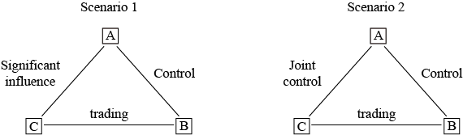

 

In the first scenario, entity A has significant influence over entity C and control over entity B. In the second scenario, entity A has joint control over entity C and control over entity B.

Are entities A, B and C related parties, based on the above-mentioned scenarios?

**Answer**

Entities A and B are related parties in each of the above scenarios.

Entities A and C are related parties in each of the above scenarios.

Entities B and C are related parties in each of the above scenarios. Entity B should disclose details of any transactions with entity C that have been entered into (together with any resulting balances). Entity C should include details of any transactions with entity B that have been entered into (together with any resulting balances).

Disclosure of transactions between entities B and C will be required in entity A’s consolidated financial statements (even if the transactions were at arm’s length), because these are related party transactions between an associate (or joint venture) and the entity A group (of which the entity controlled by entity A is a member), and the transactions are not eliminated on consolidation.

Transactions between entity B and entity C are not disclosed in entity A’s separate financial statements. Entity A is the reporting entity in its separate financial statements. Transactions between entity B and entity C are not transactions with Entity A so they are not related party transactions.

 

### FAQ 6.21.1 – Is joint venture or associate of a group entity, a related party of the entire group?

 

Reference to standard: IAS 24 para 9  
 Reference to standing text:  [6.21](14.md#s39-Para_6.21) 

  

**Question**

Entity A owns 80% of entity B and 70% of entity C. Entity C has a 50% holding in a joint venture, entity D.

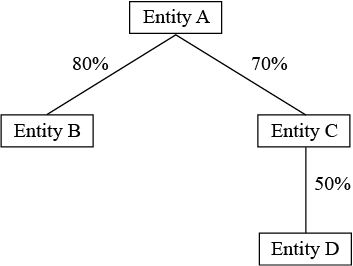

Is entity D a related party of entity A, B and C?

**Answer**

  
Entities A, B and C are members of the same group, so are related parties of one another. Entity D is a related party of entity C, its joint venture. Entity D is also a related party of the other members of the group in which entity C sits (that is, entity D is a related party of entities A and B). Entity D would, similarly, be a related party of entities A, B and C if it was an associate of entity C.

 

### FAQ 6.21.2 – An entity has joint control over one entity and significant influence over another. Are both investees related parties of each other and the investor?

 

Reference to standard: IAS 24 para 9  
 Reference to standing text:  [6.21](14.md#s39-Para_6.21) 

  

**Question**

Entity H has joint control over entity J and significant influence over entity K.

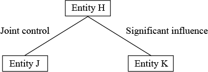

Are entities H, J and K related parties?

**Answer**

Entity H has a joint venture, entity J, and an associate, entity K.

Entities J and K are entity H’s related parties.

Entities H and K are entity J’s related parties.

Entities H and J are entity K’s related parties.

Each entity within the structure shown would also be related if entity H had joint control, as opposed to significant influence, over entity K.

 

### FAQ 6.22.1 – An investor exercises significant influence or joint control over an investee. Should the investor disclose transactions with related parties of the investee as related party transactions?

 

Reference to standard: IAS 24 para 9  
 Reference to standing text:  [6.22](14.md#s39-Para_6.22) 

  

**Question**

Entity A owns 30% of the share capital of entity B and has the ability to exercise significant influence over it.

Entity B holds the following investments:

- 70% of the share capital of its subsidiary, entity C; and

- 30% of the share capital of entity D, with the ability to exercise significant influence.

The structure is illustrated as follows:

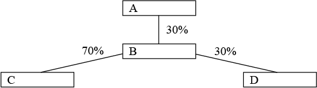

  
Entity A transacts with entities C and D. Should entity A disclose these transactions as related party transactions?

**Answer**

Entity A should disclose its transactions with entity C in entity A’s separate financial statements and economic interest financial statements. Entity C is a related party of entity A, because entity C is the subsidiary of entity A’s associate, entity B.

Entity A’s management is not required to disclose entity A’s transactions with entity D in its financial statements. Entity D is not a related party of entity A, because entity A has no ability to exercise control or significant influence over entity D.

Entity C is required to disclose its transactions with entity A in its financial statements, because entity A is a related party. Entity D is not required to disclose transactions with entity A, because they are not related parties.

 

### FAQ 6.22.2 – An investor has two wholly owned subsidiaries, entities Q and R. Entity R has a wholly owned subsidiary, entity S, and a 30% holding in its associate, entity T. Entity P also has a 30% holding in its associate, entity U. Are entities P, Q, R, U, S and T related parties?

 

Reference to standard: IAS 24 para 9  
 Reference to standing text:  [6.22](14.md#s39-Para_6.22) 

  

**Question**

Entity P has two wholly owned subsidiaries, entities Q and R. Entity R has a wholly owned subsidiary, entity S, and a 30% holding in its associate, entity T. Entity P also has a 30% holding in its associate, entity U.

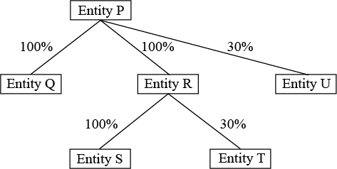

Are entities P, Q, R, U, S and T related parties?

**Answer**

Entity P’s consolidated and separate financial statements

Entities Q, R, S, T and U are all related parties of entity P for the purposes of entity P’s separate financial statements. Entities T and U are related to entity P for the purposes of entity P’s consolidated financial statements. Transactions between entity P and each of entities Q, R and S will be eliminated on consolidation, so no related party disclosures would be required in entity P’s consolidated financial statements.

Financial statements of entities Q, R and S

All entities shown within the structure are related to one another for the purposes of each of entities Q, R and S’s separate financial statements. For example, entities P, R, S, T and U are all related parties of entity Q.

Entity T’s financial statements

Entity R is a related party of entity T, so the other entities (entities P, Q and S) within entity R’s group are also related parties of entity T. Entity U is not a related party of entity T, because two associates of the same investor are not related parties simply by virtue of their common investor.

Entity U’s financial statements

Entity P is a related party of entity U, so the other entities (entities Q, R and S) within entity P’s group are also related parties of entity U. Entity T is not a related party of entity U.

 

### FAQ 6.25.1 – An investee has three investors. The investee is an associate of these entities. Are the three investors related parties of each other?

 

Reference to standard: IAS 24 para 11(b)  
 Reference to standing text:  [6.25](14.md#s39-Para_6.25)  
 

  

**Question**

Entity D is a related party of each of entities A, B and C, because it is an associate of those entities. Entity A sells goods to entity B, and entity C provides services to entity B.

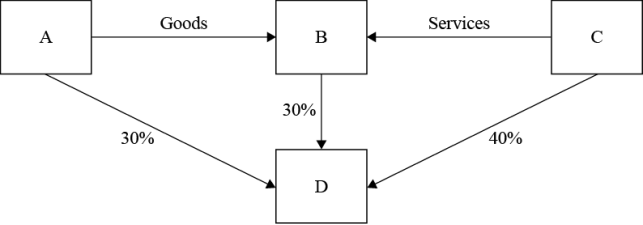

Are entities A, B and C related parties?

**Answer**

Entities A, B and C are related parties of entity D, but not necessarily related parties of each other. The transactions between entities A and B and between entities C and B would not be disclosable in any of the financial statements of entities A, B, C or D, unless there is some other relationship between entities A, B and C (other than the fact that they are all investors in entity D) that would make them related parties. (They would be related parties of each other if, for example, entities A, B and C were all fellow subsidiaries of another entity, but not because of their investment in entity D.)

 

### FAQ 6.27.1 – An investor controls one entity and has significant influence over another. Are both investees related to each other?

 

Reference to standard: IAS 24 para 9  
 Reference to standing text:  [6.27](14.md#s39-Para_6.27) 

  

**Question**

Mr A owns 70% of entity B and 30% of entity C.

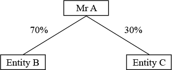

Is Mr A a related party of entities B and C? Are entities B and C related parties?

**Answer**

Mr A controls entity B, so he is a related party of that entity. He has significant influence over entity C, so he is a related party of that entity. Entities B and C are related parties because Mr A has control over entity B and significant influence over entity C. Entity B’s financial statements should include details of transactions with Mr A and with entity C. Entity C’s financial statements should include details of transactions with Mr A and with entity B.

The position would be the same if Mr A had joint control, as opposed to control, over entity B. Mr A would be a related party of entities B and C, while entities B and C would be related parties of one another.

 

### FAQ 6.27.2 – An investor has significant influence over two entities. Are both investees related to each other?

 

Reference to standard: IAS 24 para 9  
 Reference to standing text:  [6.27](14.md#s39-Para_6.27) 

  

**Question**

Mr X owns 40% of entity Y and 25% of entity Z.

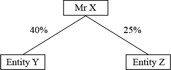

Are entities Y and Z related parties?

**Answer**

Mr X has significant influence over entity Y, so he is a related party of that entity. Mr X has significant influence over entity Z, so he is a related party of that entity. Entities Y and Z are not related to each other. Investees are not related just because they are subject to significant influence from the same investor.

 

### FAQ 6.27.3 – Are parties related to each other because of a family connection?

 

Reference to standard: IAS 24 para 9  
 Reference to standing text:  [6.27](14.md#s39-Para_6.27) 

  

**Question**

Mr Y’s father owns 100% of the shares in entity A. Mr and Mrs Y own 100% of the shares in entity B. Mrs Y’s sister provides book-keeping services from time to time to entity B, but is not an employee. Entity A has increased its loan of C150,000 to entity B to C200,000 during the year, for which entity A charges a below market rate of interest.

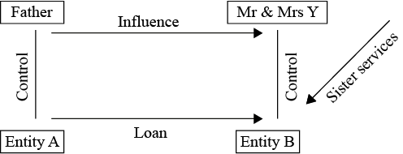

Are Mr Ys father, Mrs Y’s sister and entity A related parties of entity B?

**Answer**

Mr Y’s father and Mrs Y’s sister are related parties of entity B, if they are ‘close family’ of either Mr or Mrs Y. They are close family if they might be expected to influence, or be influenced by, Mr or Mrs Y in their dealings with entity B. Mr Y’s father and Mr and Mrs Y are ‘close family’, so Mr Y’s father is a related party of entity B, which is controlled by Mr and Mrs Y.

Mr Y’s father has a controlling interest in entity A. Entity A is a related party of entity B.

Both entities should disclose the necessary details regarding the increase in the loan to C200,000 in their financial statements. Entity A should also disclose the amounts due to it from entity B on the balance sheet date, together with any provisions and amounts written off. Entity B should disclose the amount that it owes to entity A at the balance sheet date.

Entity B would have to disclose the transactions with Mrs Y’s sister if the sister might be expected to influence, or be influenced by, either Mr or Mrs Y in their dealings with entity B. This is a matter of judgement, based on the facts of the case.

 

### FAQ 6.27.4 – Mr A owns all of the share capital of entity X. He is also a member of the key management personnel of entity Y. Entity Y owns all of the share capital of entity Z. Who are the related parties of entities X, Y and Z?

 

Reference to standard: IAS 24 para 9  
 Reference to standing text:  [6.27](14.md#s39-Para_6.27) 

  

**Question**

Mr A owns all of the share capital of entity X. He is also a member of the key management personnel of entity Y. Entity Y owns all of the share capital of entity Z.

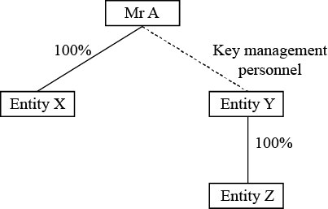

Who are the related parties of entities X, Y and Z?

**Answer**

Entity X’s financial statements

Entity Y is a related party of entity X, because Mr A is a member of the key management personnel of entity Y and he also controls entity X. Entity Z is also a related party of entity X, because Mr A is a member of the key management personnel of its parent, entity Y.

Entity Y’s separate and consolidated financial statements

Entities X and Z are related parties of entity Y for the purposes of entity Y’s separate financial statements. This is because Mr A, a member of entity Y’s key management personnel, controls entity X, and entity Y controls entity Z. Entity X is a related party for the purposes of entity Y’s consolidated financial statement.

Entity Z’s financial statements

Entity X is a related party of entity Z, because Mr A controls entity X and he is also a member of entity Z’s parent’s key management personnel.

 

### FAQ 6.27.5 – Mr L controls entity M. Mr L’s spouse, Mrs L, has significant influence over entity N. Are entities M and N related parties?

 

Reference to standard: IAS 24 para 9  
 Reference to standing text:  [6.27](14.md#s39-Para_6.27)  
 

  

**Question**

Mr L controls entity M. Mr L’s spouse, Mrs L, has significant influence over entity N.

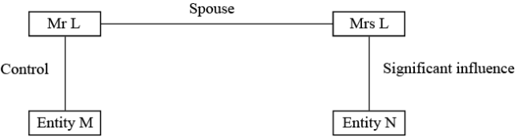

Are entities M and N related parties?

**Answer**

Entity N is a related party for the purposes of entity M’s financial statements. Entity M is a related party for the purposes of entity N’s financial statements. This is because of Mr L’s control of entity M and Mrs L’s significant influence over entity N.

 

### FAQ 6.27.6 – A parent has a wholly owned subsidiary. One of the subsidiary’s directors is the majority shareholder of an otherwise independent third party entity that sells goods on normal commercial terms to the subsidiary. The director is a member of the subsidiary’s key management personnel. How should transactions with the supplier be presented in: (a) the subsidiary’s financial statements, (b) the consolidated financial statements; and (c) the financial statements of the entity that sells the goods?

 

Reference to standard: IAS 24 para 9  
 Reference to standing text:  [6.27](14.md#s39-Para_6.27) 

  

**Question**

A parent has a wholly owned subsidiary. One of the subsidiary’s directors is the majority shareholder of an otherwise independent third party entity that sells goods on normal commercial terms to the subsidiary. The director is a member of the subsidiary’s key management personnel.

How should transactions with the supplier be presented in:

- the subsidiary’s financial statements;

- the consolidated financial statements; and

- the financial statements of the entity that sells the goods?

**Answer**

(a) The subsidiary’s financial statements

The supplier is a related party of the subsidiary, because the director controls the supplier and, as a key manager, has influence over the subsidiary. The subsidiary’s financial statements should disclose information related to the purchase of goods from this supplier, as well as the nature of the relationship between the subsidiary and the supplier.

(b) The consolidated financial statements

The parent’s management should disclose the information set out under (a) above in the consolidated financial statements if it is determined that the director of the subsidiary is a member of the group’s key management personnel.

(c) The financial statements of the entity that sells the goods

The subsidiary’s director, as majority shareholder, is a related party of the supplier. The subsidiary is a related party of the supplier because the director is a member of key management personnel at the subsidiary and he controls the supplier. Disclosure would be required of sales made to the subsidiary, as well as the nature of the relationship with the subsidiary.

 

### FAQ 6.27.7 – Mr X, a director of entity Y, has a controlling interest in a trust. Is the trust a related party of entity Y?

 

Reference to standard: IAS 24 para 9  
 Reference to standing text:  [6.27](14.md#s39-Para_6.27) 

  

**Question**

Mr X, a director of entity Y, has a controlling interest in a trust.

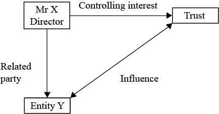

Is the trust a related party of entity Y?

**Answer**

The trust is a related party of entity Y, because it is controlled by Mr X, a director of entity Y. It might be difficult to determine whether Mr X has a controlling interest in the trust, because trustees are generally legally obliged to act in the interests of beneficiaries, but the substance of the arrangement might be that Mr X has control.

 

### FAQ 6.27.8 – Mr X owns 95% of entity A and is its director. He is also beneficiary of a trust that owns 100% of entity B, of which he is a director. Entities A and B are related parties, because the director (Mr X) controls entity A and is a member of the key management personnel of entity B. Would the situation be different if: (a) Mr X resigned as a director of entity A, but retained his 95% holding; or (b) Mr X resigned as a director of entities A and B and transferred the 95% holding in entity A to the trust?

 

Reference to standard: IAS 24 para 9  
 Reference to standing text:  [6.27](14.md#s39-Para_6.27) 

  

**Question**

Mr X owns 95% of entity A and is its director. He is also beneficiary of a trust that owns 100% of entity B, of which he is a director.

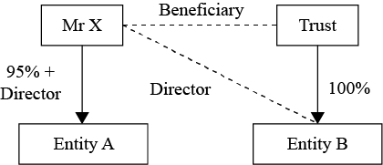

Entities A and B are related parties, because the director (Mr X) controls entity A and is a member of the key management personnel of entity B. Would the situation be different if:

- Mr X resigned as a director of entity A, but retained his 95% holding; or

- Mr X resigned as a director of entities A and B and transferred the 95% holding in entity A to the trust?

**Answer**

(a) Mr X resigned as a director of entity A, but retained his 95% holding

Mr X continues to control entity A through his 95% holding even though he is not (nominally) a director of the entity. Entities A and B are related if Mr X controls the trust. Mr X controls entity A and also, through the trust, controls entity B. Entities A and B are controlled by the same person, and so they are related parties.

Mr X might still be a member of ‘key management personnel’ even though he is not (nominally) a director of entity A. Key management personnel includes, but is not restricted to, directors, which include those who are executives ‘or otherwise’ provided they have authority and responsibility for planning, directing and controlling the activities of the entity. There could be two reasons why entities A and B would continue to be related parties: Mr X being a member of ‘key management personnel’ of entity A and Mr X controlling entity A.

(b) Mr X resigned as a director of entities A and B and transferred the 95% holding in entity A to the trust?

If Mr X controls the trust, he controls entities A and B through the trust, so they will be related parties (see reasons in (a) above).

Mr X is a member of ‘key management personnel’ of the two entities (see (a) above) if, as seems likely, he continues to direct their operating and financial policies. The substance of the relationship and not merely the legal form should be considered. If Mr X is regarded as a member of the key management personnel of, say, entity A, entity B is a related party, because he exercises control or significant influence over entity B by virtue of his control over the trust.

 

### FAQ 6.29.1 – The wife of a member of entity A’s key management personnel has 70% of the voting power in entity B, and controls entity B. Entity A transacts with the pension fund set up for the benefit of all employees of entity B. Should entity A disclose these transactions?

 

Reference to standard: IAS 24 para 9  
 Reference to standing text:  [6.29](14.md#s39-Para_6.29) 

  

**Question**

The wife of a member of entity A’s key management personnel has 70% of the voting power in entity B, and controls entity B.

Entity A transacts with the pension fund set up for the benefit of all employees of entity B. Should entity A disclose these transactions?

**Answer**

The pension fund is set up for the benefit of the employees of entity B, and so it is a related party of entity B. Entity A is a related party of entity B, because entity B is controlled by a close family member of entity A’s key management personnel. Entity A discloses its transactions with the pension fund.

If the wife of the member of entity A’s key management personnel owned 25% of entity B and had significant influence over entity B, entity A would not be a related party of entity B. Two entities are not related parties simply because a member of key management personnel of one entity has significant influence over the other entity. The pension fund would not be a related party of entity A, and the transactions between entity A and the pension fund would not be disclosable.

 

### FAQ 6.31.1 – Mr X is a director of entity A. He owns 100% of entity B, which he controls. Entity B invoices entity A for the key management services that he provides to entity A. He receives no other employee benefits from entity A, either directly or indirectly. How should the amounts charged by entity B be disclosed in entity A’s financial statements?

 

Reference to standard: IAS 24 para 9  
 Reference to standing text:  [6.31](14.md#s39-Para_6.31) 

  

**Question**

Mr X is a director of entity A. He owns 100% of entity B, which he controls. Entity B invoices entity A for the key management services that he provides to entity A. He receives no other employee benefits from entity A, either directly or indirectly. How should the amounts charged by entity B be disclosed in entity A’s financial statements?

**Answer**

Entity A should determine whether the services are, in substance, being provided by entity B or by Mr X.

The charges incurred by entity A for Mr X’s services should be included as short-term employee benefits within the key management personnel compensation disclosure if it is determined that the services are, in substance, provided by Mr X.

The charges incurred by entity A for entity B’s services should be disclosed separately if it is determined that the services are, in substance, provided by entity B.

 

### FAQ 6.31.2 – Entity X has several wholly owned subsidiaries. Mr A is a director of entity Y, which is a wholly owned subsidiary of entity X. He does not provide services to any other entity. Entity Z (‘the group service entity’), entity X’s wholly owned subsidiary, employs and pays the staff of the X group (including Mr A) for administrative convenience only. Entity X is the sponsoring employer of the group X pension scheme of which Mr A is a member. How should Mr A’s compensation be disclosed in entity Y’s financial statements?

 

Reference to standard: IAS 24 para 9  
 Reference to standing text:  [6.31](14.md#s39-Para_6.31) 

  

**Question**

Entity X has several wholly owned subsidiaries. Mr A is a director of entity Y, which is a wholly owned subsidiary of entity X. He does not provide services to any other entity. Entity Z (‘the group service entity’), entity X’s wholly owned subsidiary, employs and pays the staff of the X group (including Mr A) for administrative convenience only. Entity X is the sponsoring employer of the group X pension scheme of which Mr A is a member. How should Mr A’s compensation be disclosed in entity Y’s financial statements?

**Answer**

The services are, in substance, being provided by Mr A to entity Y, and the amounts incurred by the group service entity should be included within the key management personnel compensation disclosure, analysed into the required categories (such as short-term employee benefits and post-employment benefits). The related party disclosure should be given even if there is no recharge to entity Y for the cost of Mr A’s compensation and management has determined that there is no basis to recognise the expense in the financial statements of entity Y. ‘Compensation’ includes all forms of consideration paid, payable or provided, not only by the entity but also on behalf of the entity.

 

### FAQ 6.31.3 – Entities in the investment management sector often outsource the day-to-day management of funds to a fund manager. The fund manager could be an entity or a person and might be working under a management contract for a fee. The fund manager might work for only one customer, the investment entity. Is the fund manager a related party of the investment entity?

 

Reference to standard: IAS 24 para 9  
Reference to standing text:  [6.31](14.md#s39-Para_6.31)

  

**Question**

Entities in the investment management sector often outsource the day-to-day management of funds to a fund manager. The fund manager could be an entity or a person and might be working under a management contract for a fee.

The fund manager might work for only one customer, the investment entity. Is the fund manager a related party of the investment entity?

**Answer**

A fund manager (whether an entity or a person) that has control, joint control or an interest that gives significant influence over the investment entity is a related party.

A fund manager that is a person who has the authority and responsibility for planning, directing and controlling the activities of the investment entity, is acting as a member of the key management personnel of the investment entity.

A fund manager that is an entity, where any of its employees or directors are carrying out a role that gives them authority and responsibility for planning, directing and controlling the activities of the investment entity, is providing key management personnel services to the investment entity.

A fund manager that does not have significant influence, joint control or control over the investment entity, and that is neither a person nor an entity providing key management personnel services to the investment entity, might not be a related party.

 

### FAQ 6.32.1 – Entity A is owned by Mr X, who is its sole director, and the entity is in financial difficulties. Entity A sells a property with a book value of C100,000 to entity B, which is owned by Mr Z (its sole director) for C50,000. Entity B then sells the property for C50,000 to entity C, which is also owned by Mr X, who is its sole director. What disclosures are required in the financial statements of (i) entity A and (ii) entity C?

 

Reference to standard: IAS 24 para 9  
Reference to standing text: [6.32](14.md#s39-Para_6.32)

  

**Question**

Entity A is owned by Mr X, who is its sole director, and the entity is in financial difficulties. Entity A sells a property with a book value of C100,000 to entity B, which is owned by Mr Z (its sole director) for C50,000. Entity B then sells the property for C50,000 to entity C, which is also owned by Mr X, who is its sole director. What disclosures are required in the financial statements of (i) entity A and (ii) entity C?

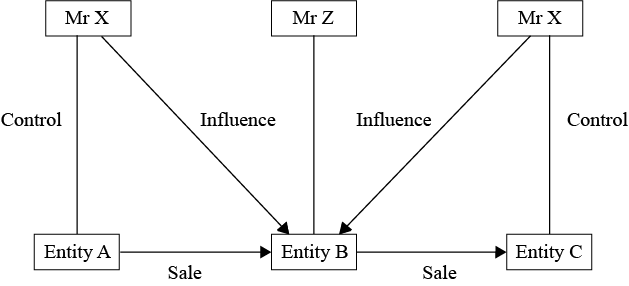

**Answer**

Entity A has ostensibly sold a property to a third party, unconnected to its director, at an amount below book value. It might be understandable that the sale is below book value, because it might be a forced sale undertaken because the entity is in financial difficulties. Entity B makes neither profit nor loss on the deal, and appears to be an agent or intermediary for the transfer from entity A to entity C. The substance of this arrangement appears to be that a transaction has occurred between entity A and entity C. This has been facilitated via an intermediary – entity B. Entities A and C are related parties because they are subject to common control. The substance is that a transaction has occurred between these two parties so entities A and C should disclose the transaction in their financial statements. Mr Z and entity B might also be related parties of entities A and C. Entity B and Mr Z are unlikely to have agreed to participate in the transaction, unless they were controlled or influenced by Mr X. Any transactions between entity A or entity C and Mr Z or entity B should also be disclosed if a related party relationship exists.

Details of the transaction, and that the transaction has been undertaken via an intermediary, should be disclosed in the financial statements of entities A and C. Disclosure should also be made of the fact that the intermediary company is a related party if it is determined that Mr Z or entity B is a related party. Disclosure of this information would be necessary for users to understand the potential effect of the relationship on the financial statements.

 

### FAQ 6.33.1 – Are entities with a common director related to each other?

 

Reference to standard: IAS 24 para 9  
Reference to standing text: [6.33](14.md#s39-Para_6.33) 

  

**Question**

Mr X is a director of entity A and a director of entity B. He does not control either entity. There are no other directors in common. Entity A has a trading relationship with entity B. Are entities A and B related parties?

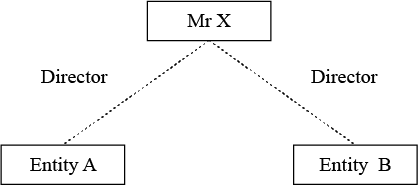

**Answer**

Two entities are not related parties simply because they have a director or other member of key management personnel in common.

The possibility that the two entities are related should still be considered. Attention should be directed to the substance of each relationship and not merely its legal form. The director might, for example, prevent one or other of the entities, or both, from pursuing its separate interests, meaning that the director has control over one or both of the entities and that the entities are related parties.

 

### FAQ 6.34.1 – A reporting entity is heavily dependent on a supply of gas from a gas utility. Does that mean that the gas utility is a related party of the reporting entity?

 

Reference to standard: IAS 24 para 11(c)(iii)  
Reference to standing text: [6.34](14.md#s39-Para_6.34)

  

**Question**

A reporting entity is heavily dependent on a supply of gas from a gas utility. Does that mean that the gas utility is a related party of the reporting entity?

**Answer**

Heavy dependence on a key supplier does not, by itself, mean that the gas utility is a related party of the reporting entity. There would need to be an additional factor involved for a related party relationship to exist. The reporting entity and the gas utility would be related parties if, for example, the gas utility had a 30% interest in the reporting entity, which it treats as an associate. Transactions with the gas utility would then be disclosable.

 

### FAQ 6.34.2 – A venture capitalist has helped to finance a management buyout (MBO). It has taken a 30% equity stake in the MBO entity and placed a director on its board, in addition to providing loan finance. It exercises significant influence over the entity. The venture capitalist receives various payments from the entity, including management fees, interest and dividends. Can the MBO entity avoid disclosing these transactions, on the grounds that they are in respect of transactions with providers of finance?

 

Reference to standard: IAS 24 para 11(c)(i)  
Reference to standing text: [6.34](14.md#s39-Para_6.34)

  

**Question**

A venture capitalist has helped to finance a management buyout (MBO). It has taken a 30% equity stake in the MBO entity and placed a director on its board, in addition to providing loan finance. It exercises significant influence over the entity. The venture capitalist receives various payments from the entity, including management fees, interest and dividends. Can the MBO entity avoid disclosing these transactions, on the grounds that they are in respect of transactions with providers of finance?

**Answer**

Providers of finance are ‘not necessarily’ related parties, simply by virtue of their normal dealings with an entity (even though they might affect the freedom of action of an entity or participate in its decision-making process).

The position is different where such parties are related for another reason.

The entity is an associate of the investor because the venture capitalist has significant influence over the entity. The investor and the associate are related parties. This is regardless of the manner in which the venture capitalist applies IAS 28 (see further [chapter 31 para 2](56.md#s224-Para_31.2)).

Disclosure of all transactions and outstanding balances with the venture capitalist is required in the investee’s financial statements. Providers of finance in the ordinary course of business are not related parties simply by virtue of the provision of that finance, but this is not a simple financing arrangement. There is a separate related party relationship resulting from the venture capitalist’s equity stake in the entity.

 

### FAQ 6.35.1 – How should related party disclosures be made when subsidiaries are acquired or disposed of during the year?

 

Reference to standard: IAS 24 para 9  
Reference to standing text: [6.35](14.md#s39-Para_6.35)

  

**Question**

How should related party disclosures be made when subsidiaries are acquired or disposed of during the year?

**Answer**

Disclosure should be made on the following basis where a group has acquired or disposed of a subsidiary during the year:

Consolidated financial statements

- The group acquires a subsidiary

Transactions between the members of the acquiring group and the acquired subsidiary prior to the date of acquisition are not disclosable in the consolidated financial statements. An acquired subsidiary is deemed to be a related party of the group only for the period during which the related party relationship exists. Post-acquisition transactions would also not be disclosable in the consolidated financial statements, because they are eliminated on consolidation.

- The group disposes of a subsidiary

Post-disposal transactions between the members of the group and the subsidiary disposed of are not disclosable in the consolidated financial statements, because the related party relationship ceases on disposal. Since pre-disposal transactions are eliminated on consolidation, no disclosure is required.

Parent’s separate financial statements

- The parent acquires a subsidiary

Post-acquisition transactions between the parent and the subsidiary are disclosable in the entity’s separate financial statements. The related party relationship only exists post-acquisition.

- The parents disposes of a subsidiary

Transactions between the parent and the subsidiary up to the date of disposal are disclosable in the entity’s separate financial statements. The related party relationship only exists during this period.

Subsidiary’s financial statements

- The subsidiary is acquired

Post-acquisition transactions are disclosable in its financial statements, because this is the period during which the related party relationship exists.

- The subsidiary is disposed of

Transactions up to the date of disposal are disclosable in its financial statements, because this is the period during which the related party relationship exists.

 

### FAQ 6.37.1 – Does an entity have to disclose the following transactions in shares by a related party (for example, a director)?

 

Reference to standard: IAS 24 para 9  
Reference to standing text: [6.37](14.md#s40-Para_6.37)

  

**Question**

Does an entity have to disclose the following transactions in shares by a related party (for example, a director)?

**Answer**

(a) The purchase or sale of shares in the market

The transactions are between the related party and the market. The entity is not a party to the transaction, so no disclosure is required.

(b) Subscribing for shares in a rights issue

A subscription for the entity’s shares by a related party is transaction between the related party and the entity and is disclosable (if material).

(c) Underwriting a rights issue and, as a result, subscribing for additional shares in respect of rights not taken up

The underwriting of the rights issue is a separate arrangement from the rights issue. The related party performs a service for the entity by underwriting the issue. The underwriting arrangement and the subscription for additional shares would be disclosable related party transactions (and would be presumed to be material, if they are unusual transactions).

(d) Subscribing for shares on exercise of share options granted under a senior executive long-term incentive scheme

Directors’ compensation should be disclosed.

(e) Dividends paid to related parties

Dividends paid to related parties are disclosable. There is an exemption for transactions with providers of finance. If the counterparty receiving the dividend is a related party, by definition it cannot merely be a provider of finance. This might capture, for example, dividend payments made to shareholders who are members of key management personnel or investors with significant influence over the reporting entity. It will sometimes be possible to derive the information regarding dividend payments to key management personnel from other information in the financial statements. The number of shares held by key management personnel might be disclosed in the financial statements and the dividend per share is disclosed. Dividends paid to key management personnel could be calculated from this information. It would not, in our view, be essential to include specific disclosure of dividends paid to key management personnel in the ‘related parties’ note if the amount can be easily calculated from information disclosed.

(f) Dividends received from related parties

Dividends received from related parties are disclosable.

 

### EX 6.37.2 – Examples of commitments

 

Reference to standard: IAS 24 para 9  
 Reference to standing text:  [6.37](14.md#s40-Para_6.37) 

  

  
The following are examples of commitments which, in our view, could require disclosure:

- Long-term incentive schemes for key management personnel.

- Agreements with members of key management personnel to pay certain benefits in the event of termination of employment (‘golden parachutes’).

- Agreements (including options) between the entity and a related party to purchase or sell assets.

- Agreements (including options) to provide services to or receive services from a related party.

- Committed leases with related parties, which have not yet commenced if applying IFRS 16 (commitments under lease agreements with related parties if applying IAS 17).

 

### FAQ 6.44.1 – How should materiality be assessed with respect to transactions with directors?

 

Reference to standard: IAS 24 para 9  
Reference to standing text: [6.44](14.md#s40-Para_6.44)

  

**Question**

How should materiality be assessed with respect to transactions with directors?

**Answer**

Shareholders are interested in the rewards paid to related persons, particularly directors. The payment of large rewards is often criticised, especially where the company is not performing well. Some jurisdictions have legislation and corporate governance requirements designed to ensure that listed entities disclose director remuneration policies and reduce rewards when performance is poor. This type of interest and concern would extend to other transactions with directors; shareholders and others are unlikely to consider such transactions to be immaterial (unless they are trivial). Materiality should be judged from both the entity’s and the person’s perspective.

A transaction might be obviously immaterial to the person and the entity. For example, a director buying a chocolate bar in the staff canteen is not of interest to users of financial statements.

The director (or his close family) buying a six-bedroom house from the entity could be a small transaction to the entity, but a major investment for the director. We consider that transactions of this type and size, whether or not at market value, would be regarded as material to the director and, therefore, disclosable.

It is clear that the purchase of a house is material from the director’s point of view, and that the purchase of a chocolate bar is not. There will be transactions between these two extremes, whose materiality is borderline. It is not possible to be definitive about how materiality should be established, because much will depend on the facts of each case. Where a transaction is at arm’s length and on normal commercial terms, this would contribute to its being regarded as immaterial. A transaction being on terms that are advantageous to the director would contribute to its being regarded as material and disclosable.

 

### FAQ 6.53.1 – An investor directly owns 100% of the shares of the investee. The ultimate controlling party of the investee is an individual. The investor does not publish financial statements available for public use. The intermediate parent entities of the investor prepare consolidated financial statements which are filed with the local stock exchange. Which controlling parties need to be disclosed by the investee?

 

Reference to standard: IAS 24 para 13  
Reference to standing text: [6.53](14.md#s41-Para_6.53)

  

**Question**

XYZ Limited directly owns 100% of the shares of entity C. The ultimate controlling party of entity C is Mr A. XYZ Limited does not publish financial statements available for public use.

Entity K is the immediate parent of XYZ Limited. Entity L is the immediate parent of entity K. Both entities K and L produce consolidated financial statements filed with the local stock exchange.

The following diagram shows the structure of the group:

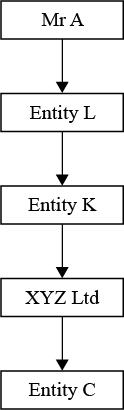

Which controlling parties need to be disclosed by entity C?

**Answer**

Entity C discloses XYZ Limited as the direct parent and Mr A as the ultimate controlling party, irrespective of whether there were transactions between them during the year.

Entity K is also disclosed as the next most senior parent that produces consolidated financial statements available for public use. The next most senior parent is the first parent in the group above the immediate parent.

Entity L is disclosed as the ultimate parent entity of entity C, if this information is not disclosed elsewhere in the information published with the financial statements.

 

### FAQ 6.53.2 – An entity is owned 50% by one entity and 50% by another. The investors each account for the entity as a joint venture under the definition in IFRS 11. Should the two venturers be disclosed as the controlling party?

 

Reference to standard: IAS 24 paras 11(b), 13  
Reference to standing text:  [6.53](14.md#s41-Para_6.53)  

  

**Question**

An entity is owned 50% by one entity and 50% by another. The investors each account for the entity as a joint venture under the definition in IFRS 11. Should the two venturers be disclosed as the controlling party?

**Answer**

Two venturers are not necessarily related parties simply because they share joint control over a joint venture.

But, if the venturers were acting together, they would be the ultimate controlling party. The ultimate controlling party disclosure is not limited to situations where the controlling party is a single person or entity.

This situation would be unusual and might indicate that one of the parties was, in fact, acting as a nominee for the other. Attention should be directed to the substance of the relationship and not merely its legal form in considering each possible related party relationship. If the substance was that one of the parties was a nominee of the other, only that other party would be disclosed as the controlling party. The investors should also consider the substance of the relationship in accounting for their investments in the ‘joint venture’. Consistent conclusions should be reached in relation to the control structure when considering the treatment of the reporting entity in the financial statements of investors and the related party disclosures.

 

### FAQ 6.53.3 – A person indirectly owns 50% of the share capital but does not control an entity. Should the person be disclosed as ultimate controlling party of the entity?

 

Reference to standard: IAS 24 para 13  
Reference to standing text: [6.53](14.md#s41-Para_6.53)  

  

**Question**

Mr A owns 100% of the share capital in entity I and 20% of the share capital in entity P. The remaining 80% of the share capital in entity P is owned by 200 unrelated investors, who do not have a contractual arrangement to act together.

Entities I and P own 49% and 51% respectively of the share capital in entity S. Assume that a 1% shareholding constitutes one voting right, and that all investors of entity P are required to cast their votes for decisions relating to entity S.

The following diagram shows the structure of the group:

Should Mr A be disclosed as the ultimate controlling party of entity S?

**Answer**

Entity S’s management should disclose entity P as the parent in entity S’s financial statements, irrespective of whether there were transactions between them during the year. Entity P is also the ultimate controlling party of entity S, even though Mr A indirectly owns 59.2% ((100% × 49%) + (20% × 51%)) of the share capital in entity S.

Mr A is not the ultimate controlling party of entity S, because he is unable to exercise control over entity S. He does not control entity S’s parent, entity P. He controls entity I, but entity I only has significant influence, as opposed to control, over entity S.

Mr A is a related party of entity S, because his 100% interest in entity I gives him significant influence over entity S. He has significant influence over entity P which, in turn, controls entity S. Any transactions between Mr A and entity S should be disclosed as related party transactions in entity S’s financial statements.

 

### FAQ 6.53.4 – How is ultimate controlling party determined where controlling interest in a reporting entity is held by a partnership?

 

Reference to standard: IAS 24 para 13  
Reference to standing text: [6.53](14.md#s41-Para_6.53)  

  

**Question**

A partnership, in the form of a managed fund, controls over 50% of the shares with voting rights in a reporting entity.

The partnership holds the majority of the voting rights in the reporting entity and controls it. One particular partner might be the reporting entity’s controlling party, particularly where this partner has control over the management of the partnership and where it also has a substantial partnership interest. This partner might, itself, have a parent undertaking or ultimate controlling party, which it discloses in its financial statements. Should such a party be disclosed by the reporting entity as its ultimate controlling party?

**Answer**

Yes, the reporting entity would have to disclose the controlling partner’s parent undertaking or ultimate controlling party as its ultimate controlling party.

 

### FAQ 6.53.5 – How should a reporting entity determine its ultimate controlling party where it is controlled by a trust?

 

Reference to standard: IAS 24 para 13  
Reference to standing text: [6.53](14.md#s41-Para_6.53)  

  

**Question**

How should a reporting entity determine its ultimate controlling party where it is controlled by a trust?

**Answer**

A reporting entity might be controlled by a trust. The trust might be controlled by another party.

The IFRS 10 definition of control of an investee comprises two elements:

- The exposure or right to variable returns.

- The ability to affect those returns through power over the investee.

A trustee has the power to deploy the trust assets. The beneficiary benefits from their deployment.

An investee might be designed so that voting rights are not the dominant factor in deciding who controls the investee. For example, voting rights might relate to administrative tasks only, while the main activities are directed by contractual arrangements. The investor assesses those contractual arrangements, to determine whether it has rights sufficient to give it power over the investee.

A ‘pure trust’ is controlled by neither the trustee nor the beneficiary. Neither has both elements of control. A ‘pure trust’ that controls the reporting entity is its ultimate controlling party. There is no requirement to disclose either the trustees or the beneficiaries of the trust as neither has control.

Trustees might act in accordance with the wishes of the settlor, the beneficiary or the entity’s management. A trust arrangement might provide that the settlor has the power to appoint or remove trustees in specified circumstances, or that the trustees need to seek prior authorisation from the settlor for specified actions. The existence of those rights might not give the settlor (or any other party, as the case might be) control over the trustees, or the trust, if these matters do not interfere with the general independence of the trustees.

However, control might exist if the rights can only be exercised when certain events occur and those rights to take such decisions are not necessarily protective only. (An investor that has only protective rights does not have control over the investee.)

There might be no evidence of the trustees having given independent consideration to matters relevant to the reporting entity in the light of independent advice. These circumstances might point to trustees allowing an outside party, such as a settlor or beneficiary, to exercise unrestricted control. Such a party would then be disclosed as the ultimate controlling party of the reporting entity.

The purpose for which a trust is established might indicate who the ultimate controlling party is, or whether there is one at all. The reporting entity might be a structured entity, for example, a trust established as a parent undertaking of the reporting entity as part of a securitisation. This will probably indicate that the trust and the reporting entity are controlled by one or other party to the securitisation.

 

### FAQ 6.54.1 – Should a group of persons be disclosed as the ultimate controlling party where they have a contractual arrangement to act together?

 

Reference to standard: IAS 24 para 13  
Reference to standing text: [6.54](14.md#s41-Para_6.54)

  

  

**Question**

Should a group of persons be disclosed as the ultimate controlling party where they have a contractual arrangement to act together?

**Answer**

Mr A, Mr B and Mr C have direct interests of 40%, 10% and 10% respectively, of trust T. The interest in the remaining 40% of trust T is held by 20 unrelated investors.

Mr A, Mr B and Mr C wish to control the trust, and so they enter into a contractual arrangement to act together. In this situation, assume that a 1% interest constitutes one voting right.

Entity S is a wholly owned subsidiary of entity P. Entity P is wholly owned by trust T.

The following diagram shows the structure of the group:

Entity S’s management should disclose Mr A, Mr B and Mr C as the ultimate controlling party (as a group) of entity S where they have a contractual arrangement to act together, irrespective of whether there were transactions between them and entity S during the year.

The agreement between Mr A, Mr B and Mr C provides them with a collective control over 60% (40%+10%+10%) of trust T’s voting rights. Mr A, Mr B and Mr C form a group that controls trust T, which controls entities P and S.

Trust T should also be disclosed as the ultimate parent entity of entity S in the notes to the financial statements, if this information is not disclosed elsewhere in information published with the financial statements.

Trust T would be the ultimate controlling party of entity S, and only Mr A would be a related party of entity S if the contractual arrangement to act together did not exist. Mr A is related to entity S, because his 40% interest in trust T gives him significant influence over entity S.

 

### FAQ 6.54.2 – A director or other related party of the director is a trustee of a trust that holds shares in the reporting entity (and the director or related party of the director controls the trust). Should shares held by the trust be considered in determining whether the director controls the reporting entity?

 

Reference to standard: IAS 24 para 13  
Reference to standing text: [6.54](14.md#s41-Para_6.54)

  

  

**Question**

A director or other related party of the director is a trustee of a trust that holds shares in the reporting entity (and the director or related party of the director controls the trust). Should shares held by the trust be considered in determining whether the director controls the reporting entity?

**Answer**

The shares held by the trust should be added to those held directly by the director to establish where control lies. A director or other related party – such as the adult or minor child of the director – might be a beneficiary, but not a trustee, of a trust. The entity’s management should determine whether the trustees administer the trust independently, or whether the director or another related party controls it.

 

### FAQ 6.54.3 – What if regulation requires disclosure where no related party relationship exists?

 

Reference to standard: IAS 24 para 18  
Reference to standing text: [6.54](14.md#s41-Para_6.54)

  

  

**Question**

What if regulation requires disclosure where no related party relationship exists?

**Answer**

Regulation in some jurisdictions might require disclosure even where no related party relationship exists in substance. If the disclosure is only required by local regulation and not because a related party relationship exists, the disclosure should be clearly marked as separate from IAS 24’s related party disclosures, and the reason for the disclosure should be stated (for example, the name of the legal requirement should be given).

 

### FAQ 6.59.1 – An entity provides a key manager with a car owned by the entity. How should the entity disclose the non-monetary benefit provided to the key manager in its related party disclosures?

 

Reference to standard: IAS 24 para 17  
Reference to standing text: [6.59](14.md#s41-Para_6.59)  

  

**Question**

An entity provides a key manager with a car owned by the entity. How should the entity disclose the non-monetary benefit provided to the key manager in its related party disclosures?

**Answer**

The related expense can be presented either as a depreciation charge or as a personnel expense in profit or loss ([see FAQ 12.124.1](23.md#s84-FAQ_12.124.1)).

The related party disclosure should include an estimation of the benefit to the employee. This might be calculated, for example, by reference to the depreciation charge or the amount that the employee would have to pay to lease a similar vehicle. The taxable benefit is only an appropriate measure of the benefit to the employee if it approximates to the actual value of the benefit. If material, the basis by which the benefit was determined should be disclosed in the financial statements.

The entity might disclose the estimation of the non-monetary benefit provided to the key manager separately in a narrative disclosure.

 

### FAQ 6.59.2 – How should key management personnel compensation be measured for the purposes of related party disclosures?

 

Reference to standard: IAS 24 para 17  
Reference to standing text: [6.59](14.md#s41-Para_6.59)  

  

**Question**

How should key management personnel compensation be measured for the purposes of related party disclosures?

**Answer**

The cost of remunerating an entity’s key management personnel for their services during the period covered by the financial statements is usually an appropriate measure of the benefit received by the key manager. That cost is the cost to the entity itself and any costs borne by other entities on its behalf.

The most appropriate disclosure for defined contribution post-employment benefit schemes is the aggregate contributions payable in the period by the entity to schemes for members of key management personnel.

We consider that the most appropriate disclosure for defined benefit schemes is the total cost of the defined benefit scheme (including recognised actuarial gains and losses) calculated in accordance with IAS 19 in respect of key management personnel. Calculation of the total recognised cost in respect of key management personnel might not be practicable where a defined benefit pension scheme is not operated solely for key management personnel (for example, an entity-wide scheme in which members of key management personnel participate). We consider that, in such cases, the disclosure of the current service cost attributable to key management personnel (calculated in line with IAS 19) is an acceptable alternative. The entity could instead disclose the transfer value of benefits accrued in the scheme (net of management’s contributions).

We consider that, for other long-term employee benefits, the most appropriate amount to be included in the disclosure of key management personnel compensation is the total IAS 19 cost, including actuarial gains and losses, of the scheme (if the scheme is solely for key management personnel) or the relevant IAS 19 current service cost of the persons (if the scheme extends beyond key management personnel).

We consider that the most appropriate amount to be disclosed in respect of compensation in the form of share-based payment is the expense in respect of the share-based payments, attributable to key management personnel, recognised by the entity in the period. This might result in negative compensation being disclosed on the reversal of a cumulative expense relating to a share-based payment award. In such circumstances, the entity should consider whether additional disclosure might need to be provided to explain the negative share-based payment expense as compared to the share- based payment expense in the comparative period.

The total compensation disclosed is sometimes the sum of various employee benefits calculated in different ways (for instance, pension benefits might be aggregated with salaries). The elements included in the total and, where necessary, the basis of calculation should be made clear. The disclosure should be on a consistent basis from year to year but, if it is necessary to change the basis, the reasons for this change should be disclosed.

 

### FAQ 6.59.3 – Where share-based payment compensation to key management personnel is funded by the owners of the entity, should it be disclosed as part of the entity’s key management personnel compensation?

 

Reference to standard: IAS 24 para 17  
Reference to standing text: [6.59](14.md#s41-Para_6.59)  

  

**Question**

Entity A is seeking a listing for its shares on a recognised stock exchange. Entity A’s owners have donated shares in the entity to an employee trust. The shares are to be used to satisfy options, granted to entity A’s key management personnel, that vest on listing. Should the options be disclosed as part of the key management personnel compensation of entity A?

**Answer**

The options should be included in the disclosure of key management personnel compensation. This is because the options are compensation in respect of services provided by management to entity A.

The amount included in the disclosure will be the expense recognised by the entity in respect of the share-based payment.

 

### FAQ 6.59.4 – A director of a parent entity is also a director of one of its subsidiaries. The director is compensated by the parent entity in connection with services to the parent entity. How should the parent and subsidiary disclose the director’s compensation in their financial statements?

 

Reference to standard: IAS 24 para 17  
Reference to standing text: [6.59](14.md#s41-Para_6.59)  

  

**Question**

In the following examples, a director of a parent entity is also a director of one of its subsidiaries. In all of the examples, it is assumed that the director is compensated by the parent entity in connection with services to the parent entity. How should the parent and subsidiary disclose the director’s compensation in their financial statements?

**Answer**

The subsidiary is required to disclose the amounts paid to the persons who are its key managers, whether paid by the subsidiary itself or by another party.

Example 1 – Parent and subsidiary each pay for services received

Mr A is a director of entity X and of entity Y, its wholly owned subsidiary, and he provides services to both entities. Each entity pays Mr A directly for his services to it.

Entity X discloses, in its separate financial statements, the amount paid to Mr A for his services to entity X. Entity Y discloses the amount it pays to Mr A for his services to entity Y. Entity X discloses, in its consolidated financial statements, the total of the amounts paid by entities X and Y (analysed into the specified categories).

Example 2 – Parent recharges subsidiary for cost of key management personnel services received

Mr A is a director of entity X and of entity Y, its wholly owned subsidiary, and he provides services to both entities. Entity X pays Mr A directly for his services, as a director, to entities X and Y, but it recharges entity Y with the cost of his services to that entity.

Entity X discloses, in its separate financial statements, the amount paid to Mr A for his services to entity X. Entity Y discloses the amount paid to Mr A for his services to entity Y (that is, the amount recharged). Entity X discloses, in its consolidated financial statements, the total of the amount paid by entity X for services to entities X and Y (analysed into the specified categories).

Example 3 – Subsidiary bears no cost for services received

Mr A is a director of entity X and of entity Y, its wholly owned subsidiary, and he provides services to both entities. Entity X pays Mr A directly for his services, as a director, to both entity X and entity Y, but it does not recharge entity Y with the cost of his services to that entity.

Entity X discloses, in its separate financial statements, the amount paid to Mr A for his services to entity X. Entity Y discloses the amount paid to Mr A for his services to entity Y. It might be useful to disclose that the charge for director’s compensation has been borne by entity X, although it is not required. Entity X, in its consolidated financial statements, discloses the total of the amount paid by entity X for services to entities X and Y (analysed into the specified categories).

Example 4 – No significant services are received by subsidiary

Mr A is a director of entity X and of Y, its wholly owned subsidiary. Entity X might pay Mr A directly, but the director’s role is to represent the parent’s interests in the management of the subsidiary.

Management should determine the services for which the director is being compensated, allocating his or her compensation between that relating to services to the subsidiary and that relating to services to the parent. The substance of such an arrangement might be that, through a presence at the subsidiary’s board meetings, the director is primarily performing services to the parent (representing the parent’s interests) and not to the subsidiary. This might mean that much, if not all, of the compensation paid by the parent should be included in the disclosure in the parent’s separate financial statements. The amount disclosed in the subsidiary’s financial statements should reflect the compensation paid to the director relating to services, if any, rendered to the subsidiary.

 

### FAQ 6.59.5 – How should an entity determine its key manager’s compensation for related party disclosures, where the key manager also provides services to, or is paid by, other group companies of the entity?

 

Reference to standard: IAS 24 para 17  
Reference to standing text: [6.59](14.md#s41-Para_6.59)  

  

**Question**

How should an entity determine its key manager’s compensation for related party disclosures, where the key manager also provides services to, or is paid by, other group companies of the entity?

**Answer**

The compensation that relates to a key manager’s services to the subsidiary can be difficult to determine. Difficulties might arise if a member of the subsidiary’s key management personnel is also:

- a key manager or an employee of the parent and is paid by the parent; or

- a key manager of another subsidiary and is paid by that other subsidiary.

If the subsidiary is a party to the key manager’s service agreement, and that agreement stipulates what is paid in respect of services to the subsidiary, those elements of the total compensation should be included within the disclosure in the subsidiary’s financial statements.

If the subsidiary is not a party to the service agreement (possibly because the agreement is with the parent or a fellow subsidiary), the subsidiary’s management should make reasonable efforts to obtain the information – for instance, by asking the parent or fellow subsidiary for details of the terms of the service agreement, or by obtaining a detailed breakdown of any recharge.

If the information cannot be obtained by any of the above means, an apportionment is made. This is relatively simple where the person performs services for only two or maybe three entities. It is less simple if the person is, for example, a director (and, hence, a member of key management personnel) of a large number of different subsidiaries. An apportionment, if relatively straightforward, might be the best way of determining the compensation to be disclosed in each entity. An apportionment should be as accurate as possible but it need only be reasonable.

In rare circumstances, the necessary information might not available to an entity’s management, and a reasonable apportionment is not practicable. We consider that the financial statements would not give a true and fair view if no disclosure were made of the facts. Narrative information would be required to ensure that the financial statements give a true and fair view.

The following examples suggest appropriate notes for two situations where no information is available.

Example 1 – Subsidiary cannot separately identify the cost of key management personnel compensation

A recharge is made to the subsidiary by the parent entity or fellow subsidiary, but the recharge includes other costs, and the compensation cannot be separately identified. (This situation would be very rare, because a full breakdown of recharges would normally be possible.)

“The above details of key management personnel compensation do not include Mr X’s compensation, which is paid by the parent (fellow subsidiary) and recharged to the entity as part of a management charge. This management charge, which in 20XX amounted to C95,000, also includes a recharge of administration costs borne by the parent (fellow subsidiary) on behalf of the entity, and it is not possible to identify separately the amount of Mr X’s compensation.”

It would be appropriate to disclose that Mr X’s total compensation is disclosed in the parent’s consolidated financial statements if Mr X was also a member of the key management personnel of the parent.

Example 2 – No reasonable allocation of costs is practicable

The director is also a director of, and carries on work for, a number of other subsidiaries. The director is actively involved in the management of each subsidiary and is paid by the parent, which makes no recharge to the subsidiaries.

“Mr X’s compensation is paid by the parent, which makes no recharge to the entity. Mr X is a director of the parent and a number of fellow subsidiaries, and it is not possible to make a reasonable apportionment of his compensation in respect of each of the subsidiaries. Accordingly, the above details include no compensation in respect of Mr X. His total compensation is included in the aggregate of key management personnel compensation disclosed in the consolidated financial statements of the parent.”

There should normally be a recharge where the compensation is paid by a fellow subsidiary. This situation normally only arises where the subsidiary is a group services entity, and such an entity would usually recharge for these services. The above note would not be needed, because the appropriate amount to be disclosed should be ascertainable.

 

### FAQ 6.65.1 – Should an entity disclose its transactions with fellow subsidiaries as a separate category?

 

Reference to standard: IAS 24 para 19  
Reference to standing text: [6.65](14.md#s42-Para_6.65)  

  

**Question**

Should an entity disclose its transactions with fellow subsidiaries as a separate category?

**Answer**

The required disclosure categories include transactions with the parent and transactions with subsidiaries. We consider that separate disclosure should also be made in respect of fellow subsidiaries although this is not specifically identified as a separate category in IAS 24.

 

### FAQ 6.67.1 – Entity A sells goods to its six associates. Of those sales, 50% are to two of the associates, entities B and C. Can entity A aggregate the sales to associates for related party disclosures?

 

Reference to standard: IAS 24 para 24  
Reference to standing text: [6.67](14.md#s42-Para_6.67)  

  

**Question**

Entity A sells goods to its six associates. Of those sales, 50% are to two of the associates, entities B and C.

Can entity A aggregate the sales to associates for related party disclosures?

**Answer**

The entity could aggregate the sales to associates, because they are similar in nature, if the total amount of the sales is not material to the entity.

If the sales to entities B and C are a material proportion of entity A’s sales, entity A should disclose separately the sales amounts and accounts receivable balances for each of those associates. Disclosure for the remaining four associates could be given in aggregate if the sales to them are not material to the entity as a whole.

 

### FAQ 6.67.2 – An entity has sales transactions with its associate and fellow subsidiaries. How the entity aggregate the related party transactions for disclosure?

 

Reference to standard: IAS 24 para 24  
Reference to standing text: [6.67](14.md#s42-Para_6.67)  

  

**Question**

Entity A enters into transactions with the following related parties:

<table style="width:100%; border-collapse:collapse"><tr><td colspan="4" style="border:0.75pt solid #000000; padding-right:5.03pt; padding-left:5.03pt; vertical-align:top">
 
</td></tr><tr><td style="border:0.75pt solid #000000; padding-right:5.03pt; padding-left:5.03pt; vertical-align:top">
<b>Entity</b>
</td><td style="border:0.75pt solid #000000; padding-right:5.03pt; padding-left:5.03pt; vertical-align:top">
<b>Type of sale</b>
</td><td style="border:0.75pt solid #000000; padding-right:5.03pt; padding-left:5.03pt; vertical-align:top">
<b>Number of transactions</b>
</td><td style="border:0.75pt solid #000000; padding-right:5.03pt; padding-left:5.03pt; vertical-align:top">
<b>Value</b>
</td></tr><tr><td colspan="4" style="border:0.75pt solid #000000; padding-right:5.03pt; padding-left:5.03pt; vertical-align:top">
 
</td></tr><tr><td style="border:0.75pt solid #000000; padding-right:5.03pt; padding-left:5.03pt; vertical-align:top">
Entity B
</td><td style="border:0.75pt solid #000000; padding-right:5.03pt; padding-left:5.03pt; vertical-align:top">
Security equipment
</td><td style="border:0.75pt solid #000000; padding-right:5.03pt; padding-left:5.03pt; vertical-align:top">
1
</td><td style="border:0.75pt solid #000000; padding-right:5.03pt; padding-left:5.03pt; vertical-align:top">
10,000
</td></tr><tr><td style="border:0.75pt solid #000000; padding-right:5.03pt; padding-left:5.03pt; vertical-align:top">
Entity C
</td><td style="border:0.75pt solid #000000; padding-right:5.03pt; padding-left:5.03pt; vertical-align:top">
Security services
</td><td style="border:0.75pt solid #000000; padding-right:5.03pt; padding-left:5.03pt; vertical-align:top">
10
</td><td style="border:0.75pt solid #000000; padding-right:5.03pt; padding-left:5.03pt; vertical-align:top">
5,000
</td></tr><tr><td style="border:0.75pt solid #000000; padding-right:5.03pt; padding-left:5.03pt; vertical-align:top">
Entity D
</td><td style="border:0.75pt solid #000000; padding-right:5.03pt; padding-left:5.03pt; vertical-align:top">
Security services
</td><td style="border:0.75pt solid #000000; padding-right:5.03pt; padding-left:5.03pt; vertical-align:top">
12
</td><td style="border:0.75pt solid #000000; padding-right:5.03pt; padding-left:5.03pt; vertical-align:top">
6,000
</td></tr><tr><td style="border:0.75pt solid #000000; padding-right:5.03pt; padding-left:5.03pt; vertical-align:top">
Entity D
</td><td style="border:0.75pt solid #000000; padding-right:5.03pt; padding-left:5.03pt; vertical-align:top">
Security equipment
</td><td style="border:0.75pt solid #000000; padding-right:5.03pt; padding-left:5.03pt; vertical-align:top">
1
</td><td style="border:0.75pt solid #000000; padding-right:5.03pt; padding-left:5.03pt; vertical-align:top">
10,000
</td></tr><tr><td style="border:0.75pt solid #000000; padding-right:5.03pt; padding-left:5.03pt; vertical-align:top">
Entity E
</td><td style="border:0.75pt solid #000000; padding-right:5.03pt; padding-left:5.03pt; vertical-align:top">
Security services
</td><td style="border:0.75pt solid #000000; padding-right:5.03pt; padding-left:5.03pt; vertical-align:top">
8
</td><td style="border:0.75pt solid #000000; padding-right:5.03pt; padding-left:5.03pt; vertical-align:top">
4,500
</td></tr><tr><td colspan="4" style="border:0.75pt solid #000000; padding-right:5.03pt; padding-left:5.03pt; vertical-align:top">
 
</td></tr></table>

Entity C is an associate of entity A. Entities B, D and E are subsidiaries of entity G, a fellow subsidiary of entity A. The group structure is as follows:

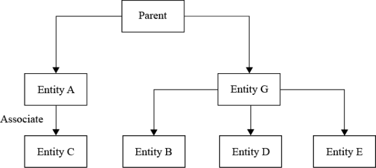

There have been no transactions between entities G and A. All terms and conditions of the transactions are similar (other than the types of sale). How should management aggregate sales to related parties?

**Answer**

The sales could be aggregated by type or related party. The following is a suggested aggregate disclosure in entity A’s separate financial statements:

<table style="width:100%; border-collapse:collapse"><tr><td style="border:0.75pt solid #000000; padding-right:5.03pt; padding-left:5.03pt; vertical-align:top">
<b>Sales of security equipment</b>
</td><td style="border:0.75pt solid #000000; padding-right:5.03pt; padding-left:5.03pt; vertical-align:top">
 
</td></tr><tr><td style="border:0.75pt solid #000000; padding-right:5.03pt; padding-left:5.03pt; vertical-align:top">
Fellow subsidiaries (G group)
</td><td style="border:0.75pt solid #000000; padding-right:5.03pt; padding-left:5.03pt; vertical-align:top">
20,000
</td></tr><tr><td style="border:0.75pt solid #000000; padding-right:5.03pt; padding-left:5.03pt; vertical-align:top">
 
</td><td style="border:0.75pt solid #000000; padding-right:5.03pt; padding-left:5.03pt; vertical-align:top">
 
</td></tr><tr><td style="border:0.75pt solid #000000; padding-right:5.03pt; padding-left:5.03pt; vertical-align:top">
<b>Sales of security services</b>
</td><td style="border:0.75pt solid #000000; padding-right:5.03pt; padding-left:5.03pt; vertical-align:top">
 
</td></tr><tr><td style="border:0.75pt solid #000000; padding-right:5.03pt; padding-left:5.03pt; vertical-align:top">
Associate (entity C)
</td><td style="border:0.75pt solid #000000; padding-right:5.03pt; padding-left:5.03pt; vertical-align:top">
5,000
</td></tr><tr><td style="border:0.75pt solid #000000; padding-right:5.03pt; padding-left:5.03pt; vertical-align:top">
Fellow subsidiaries (G group)
</td><td style="border:0.75pt solid #000000; padding-right:5.03pt; padding-left:5.03pt; vertical-align:top">
10,500
</td></tr><tr><td style="border:0.75pt solid #000000; padding-right:5.03pt; padding-left:5.03pt; vertical-align:top">
 
</td><td style="border:0.75pt solid #000000; padding-right:5.03pt; padding-left:5.03pt; vertical-align:top">
 
</td></tr><tr><td style="border:0.75pt solid #000000; padding-right:5.03pt; padding-left:5.03pt; vertical-align:top">
 
</td><td style="border:0.75pt solid #000000; padding-right:5.03pt; padding-left:5.03pt; vertical-align:top">
15,500
</td></tr></table>

 

### FAQ 6.67.3 – Can an entity aggregate transactions with directors for related party disclosures?

 

Reference to standard: IAS 24 para 24  
Reference to standing text: [6.67](14.md#s42-Para_6.67)  

  

**Question**

Can an entity aggregate transactions with directors for related party disclosures?

**Answer**

Transactions with directors are often one-off rather than similar in nature, so they are not aggregated for disclosure purposes. For example, some directors of a house-building entity might buy houses from that entity. Such transactions would not be frequent and would be clearly material to the directors. Aggregation is not appropriate, even where house-building is the entity’s normal business and the transactions are on normal commercial terms.

Aggregation might be an acceptable approach in cases such as the following:

- All directors have material transactions with the entity. For example, in the case of an association or co-operative serving all of its members, the members might put all or most of their sales or purchases through the entity. Some of the members are elected directors for certain periods and they enter into transactions similar to those with other members and on the same terms.

- Some or all directors might enter into transactions with the entity that are on normal terms and on the same terms as offered to staff. For example, directors of an insurance entity might take out insurance policies with the entity on normal terms. Aggregation would not be appropriate for unusual contracts or heavily discounted policies.

 

### FAQ 6.71.1 – Government G controls entity A. Entity A has a subsidiary, entity B. Government G also controls entity C. Entity C has a subsidiary, entity D. Which entities can avail themselves of the disclosure exemption for government-related entities?

 

Reference to standard: IAS 24 para 25  
Reference to standing text: [6.71](14.md#s42-Para_6.71)  

  

**Question**

Government G controls entity A. Entity A has a subsidiary, entity B. Government G also controls entity C. Entity C has a subsidiary, entity D. Which entities can avail themselves of the disclosure exemption for government-related entities?

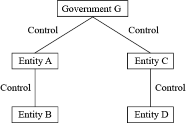

**Answer**

Entities A, B, C and D can take the exemption from disclosure, for government-related entities. For example, entity A is not required to disclose details of its transactions with government G or with entities B, C and D.

Entities A, B, C and D are exempt from the requirement to disclose transactions with government G, because they are transactions with a government that has control.

Entities A and B are exempt from the requirement to disclose transactions with entities C and D, and vice versa. This is because they are transactions with another entity that is a related party because the same government has control.

Entities A and B are exempt from disclosing transactions with each other. (An equivalent exemption is available to entities C and D.) Entities A and B are related because entity A controls entity B. They are also related because they are controlled ultimately by the same government so transactions between them are exempt from disclosure.

 

### FAQ 6.71.2 – Government G controls entity E, which in turn has joint control of entity F. Entity E also has significant influence over entity H. Mr Z is a member of entity E’s key management personnel. Which entities can avail themselves of the disclosure exemption for government-related entities?

 

Reference to standard: IAS 24 para 25  
Reference to standing text: [6.71](14.md#s42-Para_6.71)  
  

  

**Question**

Government G controls entity E, which in turn has joint control of entity F. Entity E also has significant influence over entity H. Mr Z is a member of entity E’s key management personnel. Which entities can avail themselves of the disclosure exemption for government-related entities?

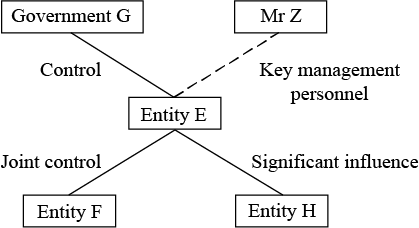

**Answer**

Entities E, F and H could take the exemption from disclosure, for government-related entities because government G has direct or indirect control, joint control or significant influence over each of them. For example, entity H is not required to disclose details of its transactions with government G and entities E and F. The exemption does not apply to transactions between entity E and Mr Z. Mr Z is not a related party of entities F and H, since entity E is not a parent of either entity.

 

### FAQ 6.71.3 – Government G has significant influence over entity I. Entity I has significant influence over entity J and controls entity K. Which entities can avail themselves of the disclosure exemption for government-related entities?

 

Reference to standard: IAS 24 para 25  
Reference to standing text: [6.71](14.md#s42-Para_6.71)  

  

**Question**

Government G has significant influence over entity I. Entity I has significant influence over entity J and controls entity K. Which entities can avail themselves of the disclosure exemption for government-related entities?

**Answer**

Entities I and K could take the exemption from disclosure, for government-related entities because government G has significant influence over entity I and over entity K (because entity I controls entity K). The exemption does not extend to any transactions with entity J because, while government G has significant influence over entity I, entity I’s significant influence over entity J is not sufficient to assert that government G also has significant influence over entity J. Transactions between entities J and I and between entities J and K are disclosable.

 

This eBook is licensed to peggy so, peggy.so@hk.ey.com, 

