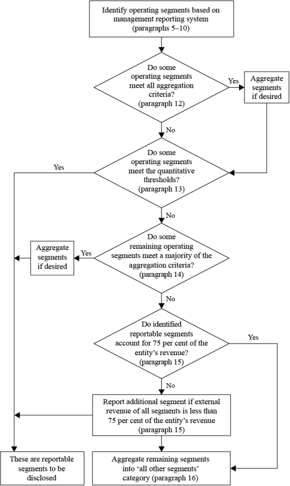

# 08 - Operating segments (IFRS 8)

[返回目录](README.md)

# 08 - Operating segments (IFRS 8)

Contents

- [08 - Operating segments (IFRS 8)](16.md#s49-chap_08_toc_h1)

- [Introduction and scope (paras 8.1 - 8.14)](16.md#s50-chap_08_navPoint_1)

- [Scope](16.md#s50-chap_08_navPoint_2)

- [Approach to segmental reporting](16.md#s50-chap_08_navPoint_3)

- [Operating segments](16.md#s50-chap_08_navPoint_4)

- [Chief operating decision maker](16.md#s50-chap_08_navPoint_5)

- [Management approach](16.md#s50-chap_08_navPoint_6)

- [Identifying operating segments](16.md#s50-chap_08_navPoint_7)

- [Reportable segments (paras 8.15 - 8.56)](16.md#s51-chap_08_navPoint_8)

- [Identifying reportable segments](16.md#s51-chap_08_navPoint_9)

- [Aggregation](16.md#s51-chap_08_navPoint_10)

- [Quantitative thresholds](16.md#s51-chap_08_navPoint_11)

- [Operating segments below the quantitative thresholds](16.md#s51-chap_08_navPoint_12)

- [Designation of single segment as a reportable segment](16.md#s51-chap_08_navPoint_13)

- [Aggregation of segments with a majority of similar features and disclosure as a reportable segment](16.md#s51-chap_08_navPoint_14)

- [Other segments that are not reportable segments](16.md#s51-chap_08_navPoint_15)

- [Prior years](16.md#s51-chap_08_navPoint_16)

- [Practical limits on number of reportable segments](16.md#s51-chap_08_navPoint_17)

- [Disclosure of information on reportable segments](16.md#s51-chap_08_navPoint_18)

- [Detailed disclosures of measures of profit and loss, assets and liabilities](16.md#s51-chap_08_navPoint_idp1695729560)

- [Measurement](16.md#s51-chap_08_navPoint_idp1695762456)

- [Measurement where more than one measure is used](16.md#s51-chap_08_navPoint_idp1695774744)

- [Disclosure of measurement basis](16.md#s51-chap_08_navPoint_idp1695781272)

- [Re-conciliations](16.md#s51-chap_08_navPoint_idp1687990552)

- [Changes in policy and presentation](16.md#s51-chap_08_navPoint_idp1687996440)

- [Entity-wide disclosures](16.md#s51-chap_08_navPoint_idp1688010008)

- [Products and services](16.md#s51-chap_08_navPoint_idp1688019224)

- [Geographical areas](16.md#s51-chap_08_navPoint_idp1688018712)

- [Where information is not available and cost to develop would be excessive](16.md#s51-chap_08_navPoint_idp1688027672)

- [Information about major customers](16.md#s51-chap_08_navPoint_idp1688031768)

- [Segmental disclosures required/encouraged by other standards](16.md#s51-chap_08_navPoint_idp1688040472)

- [IFRS 5](16.md#s51-chap_08_navPoint_idp1688041624)

- [IFRS 7](16.md#s51-chap_08_navPoint_idp1687979288)

- [IAS 7](16.md#s51-chap_08_navPoint_idp1687985176)

- [IAS 34](16.md#s51-chap_08_navPoint_idp1687660872)

- [IAS 36](16.md#s51-chap_08_navPoint_idp1687654088)

- [Voluntary disclosures](16.md#s51-chap_08_navPoint_idp1687676232)

- [Illustrative text](16.md#s52-chap_08_navPoint_19)

- [EX 8.2.1 – Subsidiary entity whose debt or equity securities are traded in a public market or that is in the process of filing its financial statements](16.md#s52-chap_08_navPoint_20)

- [EX 8.2.2 – Subsidiary has listed securities but parent does not](16.md#s52-chap_08_navPoint_21)

- [EX 8.2.3 – Entities that issue puttable instruments on a public market](16.md#s52-chap_08_navPoint_22)

- [EX 8.2.4 – Regulatory requirement to file financial instruments](16.md#s52-chap_08_navPoint_23)

- [EX 8.3.1 – Entity voluntarily discloses information about segments](16.md#s52-chap_08_navPoint_24)

- [EX 8.6.1 – Additional information presented to supplement IFRS 8 operating segments information](16.md#s52-chap_08_navPoint_25)

- [FAQ 8.7.1 – Is an entity that has yet to earn revenue an operating segment?](16.md#s52-chap_08_navPoint_26)

- [FAQ 8.7.2 – Is a research and development function an operating segment?](16.md#s52-chap_08_navPoint_27)

- [EX 8.7.3 – CODM reviews revenue information only](16.md#s52-chap_08_navPoint_28)

- [FAQ 8.7.4 – Is a segment balance sheet required for discrete financial information to exist?](16.md#s52-chap_08_navPoint_29)

- [EX 8.7.5 – Vertically integrated operations](16.md#s52-chap_08_navPoint_30)

- [FAQ 8.7.6 – Are discontinued operations and operations being wound down operating segments?](16.md#s52-chap_08_navPoint_31)

- [FAQ 8.7.7 – Is a joint venture an operating segment?](16.md#s52-chap_08_navPoint_32)

- [FAQ 8.8.1 – Is a corporate headquarters support function an operating segment?](16.md#s52-chap_08_navPoint_33)

- [FAQ 8.9.1 – Can a supervisory board or committee of non-executive directors be CODM?](16.md#s52-chap_08_navPoint_34)

- [EX 8.9.2 – Determination of CODM where consolidated information within a conglomerate organisation is reviewed by the owner](16.md#s52-chap_08_navPoint_35)

- [EX 8.9.3 – Impact of reorganisation on CODM](16.md#s52-chap_08_navPoint_36)

- [FAQ 8.12.1 – What are the operating segments where CODM receives reports by product and by geographical region?](16.md#s52-chap_08_navPoint_37)

- [FAQ 8.12.2 – What are the operating segments where CODM reviews multiple levels of reports?](16.md#s52-chap_08_navPoint_38)

- [EX 8.13.1 – Role of segment manager as an indicator of operating segments](16.md#s52-chap_08_navPoint_39)

- [EX 8.14.1 – Application of the core principle in a matrix organisation](16.md#s52-chap_08_navPoint_40)

- [FAQ 8.17.1 – Can a start-up entity be aggregated with a mature business?](16.md#s52-chap_08_navPoint_41)

- [EX 8.17.2 – Aggregating an entity’s segments where the management reporting is prepared on a geographical basis](16.md#s52-chap_08_navPoint_42)

- [EX 8.18.1 – Reportable segments: revenue threshold](16.md#s52-chap_08_navPoint_43)

- [EX 8.18.2 – Reportable segments: revenue and results thresholds](16.md#s52-chap_08_navPoint_44)

- [EX 8.18.3 – Reportable segments: all quantitative thresholds](16.md#s52-chap_08_navPoint_45)

- [EX 8.18.4 – Reportable segments: quantitative thresholds for a number of segments](16.md#s52-chap_08_navPoint_46)

- [FAQ 8.18.5 – What level of profit or loss should be used in determining whether the quantitative thresholds for reportable segments have been met?](16.md#s52-chap_08_navPoint_47)

- [EX 8.19.1 – 75% test for reportable segments](16.md#s52-chap_08_navPoint_48)

- [FAQ 8.20.1 – Why might an entity choose to treat an operating segment that does not meet the thresholds as a reportable segment?](16.md#s52-chap_08_navPoint_49)

- [EX 8.22.1 – Distinction between the two stages of aggregation](16.md#s52-chap_08_navPoint_50)

- [FAQ 8.26.1 – What if an entity has more than 10 reportable segments, but quantitative thresholds have not yet been met?](16.md#s52-chap_08_navPoint_51)

- [EX 8.28.1 – Management accounts](16.md#s52-chap_08_navPoint_52)

- [EX 8.30.1 – Management commentary and composition of segments](16.md#s52-chap_08_navPoint_53)

- [EX 8.31.1 – Disclosure of assets](16.md#s52-chap_08_navPoint_54)

- [EX 8.31.2 – Voluntary disclosure of aggregated revenue streams](16.md#s52-chap_08_navPoint_55)

- [EX 8.37.1 – Determining how each segment item should be calculated and use of non-GAAP measures in segmental disclosure](16.md#s52-chap_08_navPoint_56)

- [EX 8.37.2 – Measures of profit for segmental reporting](16.md#s52-chap_08_navPoint_57)

- [EX 8.37.3 – Currency and segmental reporting](16.md#s52-chap_08_navPoint_58)

- [EX 8.37.4 – Intra-group transactions and segmental reporting](16.md#s52-chap_08_navPoint_59)

- [EX 8.37.5 – Centrally managed borrowings and segmental reporting](16.md#s52-chap_08_navPoint_60)

- [FAQ 8.37.6 – How can the basis of allocation selected affect the segmental results?](16.md#s52-chap_08_navPoint_61)

- [EX 8.37.7 – Basis of allocation of pension costs and segmental reporting](16.md#s52-chap_08_navPoint_62)

- [EX 8.37.8 – Issues with allocating costs, expenses and assets to segments](16.md#s52-chap_08_navPoint_63)

- [EX 8.39.1 – Two measures of profit used for each operating segment](16.md#s52-chap_08_navPoint_64)

- [EX 8.40.1 – Changes in accounting policies for segmental reporting](16.md#s52-chap_08_navPoint_65)

- [FAQ 8.42.1 – What if management changes the internal organisation structure after the balance sheet date but before the financial statements are issued?](16.md#s52-chap_08_navPoint_66)

- [EX 8.42.2 – Composition of an entity’s segments changes in the interim period](16.md#s52-chap_08_navPoint_67)

- [EX 8.42.3 – Considerations for identifying changes in operating segments](16.md#s52-chap_08_navPoint_68)

- [FAQ 8.42.4 – What is the impact on segmental reporting of a change to internal reporting that responds to changes in economic conditions (for example, increased country risk)?](16.md#s52-chap_08_navPoint_69)

- [EX 8.46.1 – Allocating revenue to geographical areas](16.md#s52-chap_08_navPoint_70)

- [EX 8.56.1 – Additional voluntary segmental disclosures](16.md#s52-chap_08_navPoint_71)

This eBook is licensed to peggy so, peggy.so@hk.ey.com, 

## Introduction and scope (paras 8.1 - 8.14)

 

**8.1** The core principle (and objective) of IFRS 8 is to require an entity to disclose information that enables users of the financial statements to evaluate the nature and financial effects of the business activities in which the entity engages and the economic environments in which it operates. This principle makes it clear that the standard is primarily a disclosure standard. The standard does not prescribe the way in which management should measure segment information. Instead, it requires the disclosure to be based on information reported to the chief operating decision maker (CODM).

[IFRS 8 para 1].

 

### Scope

 

**8.2** IFRS 8 applies to:

- the separate or individual financial statements of an entity:

- whose debt or equity securities are traded in a public market (that is, a domestic or foreign stock exchange or an over-the-counter market, including local or regional markets); or

- that files, or is in the process of filing, its financial statements with a securities commission or other regulatory organisation for the purpose of issuing any class of instruments in a public market; and

- the consolidated financial statements of a group with a parent:

- whose debt or equity securities are traded in a public market (that is, a domestic or foreign stock exchange or an over-the-counter market, including local or regional markets); or

- that files, or is in the process of filing, the consolidated financial statements with a securities commission or other regulatory organisation for the purpose of issuing any class of instruments in a public market.

[IFRS 8 para 2].

[EX 8.2.1 – Subsidiary entity whose debt or equity securities are traded in a public market or that is in the process of filing its financial statements](16.md#s52-EX8.2.1)  
[EX 8.2.2 – Subsidiary has listed securities but parent does not](16.md#s52-EX8.2.2)  
[EX 8.2.3 – Entities that issue puttable instruments on a public market](16.md#s52-EX8.2.3)  
[EX 8.2.4 – Regulatory requirement to file financial instruments](16.md#s52-EX8.2.4)

**8.3** If an entity that is not required to apply IFRS 8 voluntarily discloses information about segments, but that information does not comply with IFRS, the entity should not describe the information as segment information.

[IFRS 8 para 3].

[EX 8.3.1 – Entity voluntarily discloses information about segments](16.md#s52-EX8.3.1)

**8.4** Where a parent’s separate financial statements that are required to comply with IFRS 8 are included in a financial report with the consolidated financial statements of the parent and its subsidiaries, segment information need only be given for the consolidated financial statements.

[IFRS 8 para 4].

**8.5** An entity that is not within IFRS 8’s scope might still be required to identify its operating segments in accordance with IFRS 8. IAS 36 states that a cash generating unit, to which goodwill acquired in a business combination is allocated for the purpose of impairment testing, cannot be larger than an operating segment. Therefore, although the entity does not need to comply with the disclosure requirements of IFRS 8, it will still need to comply with IFRS for the purpose of determining its operating segments.

[IAS 36 para 80(b)].

 

### Approach to segmental reporting

 

**8.6**IFRS 8 requires an entity to first identify its ‘operating segments’ (see [para 8.7](16.md#s50-Para_8.7)). Once an entity has done that, it is required to determine its ‘reportable segments’ (see [para 8.15](16.md#s51-Para_8.15)). Reportable segments might comprise single operating segments, or an aggregation of operating segments. Reportable segments are the basis for disclosure of segment information in the financial statements.

[IFRS 8 para 11].

  
 

[EX 8.6.1 – Additional information presented to supplement IFRS 8 operating segments information ](16.md#s52-EX8.6.1)  
FAQ 8.6.2 – Not used

 

### Operating segments

 

**8.7** An operating segment is defined as a component of an entity:

- that engages in business activities from which it could earn revenues and incur expenses (including revenues and expenses relating to transactions with other components of the same entity);

- whose operating results are regularly reviewed by the entity’s CODM to make decisions about resources to be allocated to the segment and assess its performance; and

- for which discrete financial information is available.

Start-up operations could be operating segments, because operating segments might engage in business activities from which they have yet to earn revenues.

[IFRS 8 para 5].

[FAQ 8.7.1 – Is an entity that has yet to earn revenue an operating segment?](16.md#s52-FAQ_8.7.1)  
[FAQ 8.7.2 – Is a research and development function an operating segment?](16.md#s52-FAQ_8.7.2)  
[EX 8.7.3 – CODM reviews revenue information only](16.md#s52-EX8.7.3)  
[FAQ 8.7.4 – Is a segment balance sheet required for discrete financial information to exist?](16.md#s52-FAQ_8.7.4)  
[EX 8.7.5 – Vertically integrated operations](16.md#s52-EX8.7.5)  
[FAQ 8.7.6 – Are discontinued operations and operations being wound down operating segments?](16.md#s52-FAQ_8.7.6)   
[FAQ 8.7.7 – Is a joint venture an operating segment?](16.md#s52-FAQ_8.7.7)

**8.8** Some parts of an entity will not necessarily meet the definition of an operating segment, because they might not be in a position to earn revenues or they might earn revenues that are only incidental to the entity’s activities. An entity’s post-employment benefit plans are not operating segments.

[IFRS 8 para 6].

[FAQ 8.8.1 – Is a corporate headquarters support function an operating segment?](16.md#s52-FAQ_8.8.1)

 

### Chief operating decision maker

 

**8.9** The term ‘chief operating decision maker’ (CODM) is intended to mean a function rather than a manager with a specific title. The function is to allocate resources to operating segments and to assess their performance. This function will vary from entity by entity and might be carried out by the person who is the entity’s chief executive or chief operating officer, but it could also be, for example, a group of executive directors, senior management team, the management board or others. Deciding who the CODM is can be difficult, and judgement is needed to ensure that the right person or persons have been identified. The CODM is responsible for the allocation of resources and assessing the performance of the entity’s operating segments. The CODM’s identity will not always be clear and will depend on the entity’s structure.

[IFRS 8 para 7].

[FAQ 8.9.1 – Can a supervisory board or committee of non-executive directors be CODM?](16.md#s52-FAQ_8.9.1)  
[EX 8.9.2 – Determination of CODM where consolidated information within a conglomerate organisation is reviewed by the owner](16.md#s52-EX8.9.2)  
[EX 8.9.3 – Impact of reorganisation on CODM](16.md#s52-EX8.9.3)

 

### Management approach

 

**8.10** A condition for identifying an operating segment is that it should be a component of the entity whose operating results are regularly reviewed by the entity’s CODM, to make decisions about resources to be allocated to the segment and to assess its performance.

[IFRS 8 para 5(b)].

**8.11** The IASB chose to adopt the ‘management approach’ to identifying operating segments for several reasons, which include:

- It gives consistency between what is reported to users and what is reported internally to management – that is, it enables the user of the financial statements to review the operations ‘through the eyes of management’.

- Segment information is more consistent with information reported elsewhere in the financial report (for example, in a management commentary).

- The cost of producing segment information is reduced, because the information is the same as that generated internally for management, rather than having to be specially produced for the financial statements.

- The management approach in IFRS 8 is consistent with the US standard ASC 280, and so the adoption of this approach helps to converge IFRS and US GAAP.

- Adopting the same approach as in ASC 280 results in some entities reporting more segments, and more segment information, in interim financial reports.

[IFRS 8 para BC9].

 

### Identifying operating segments

 

**8.12** The CODM might receive and review reports, giving several different types of segment information, that makes it difficult to clearly identify operating segments. This might result in other factors, including the nature of the business activities, the existence of managers responsible for them and information presented to the board of directors, being taken into account to identify the operating segment.

[IFRS 8 para 8].

[FAQ 8.12.1 – What are the operating segments where CODM receives reports by product and by geographical region?](16.md#s52-FAQ_8.12.1)  
[FAQ 8.12.2 – What are the operating segments where CODM reviews multiple levels of reports?](16.md#s52-FAQ_8.12.2)

**8.13** The existence of segment managers is an important factor in determining operating segments. Segment managers are those who are directly accountable to the CODM and who regularly discuss the operating activities, financial results, forecasts or plans for the segment that they manage with the CODM. The term ‘segment manager’ relates to a function and need not be a single person but could, for example, be the executive committee of a subsidiary that constitutes an operating segment. The CODM might also have a dual role (that is, being both CODM and segment manager of one or more operating segments). A single manager might be the segment manager for more than one operating segment – for example, a regional manager might have responsibility for several segments within that region. Where several sets of components of an entity would meet the criteria for identifying operating segments, but segment managers are held responsible for only one set of those components, the function of segment manager is a key indicator. In that situation, only the component set for which they are held responsible constitutes the operating segment.

[IFRS 8 para 9].

[EX 8.13.1 – Role of segment manager as an indicator of operating segments](16.md#s52-EX8.13.1)

**8.14** A matrix form of organisation exists where managers are held responsible for overlapping components of an entity and the components are reported to the CODM. For example, some regional managers might be responsible for products and services worldwide, and others might be responsible for different geographical areas. The CODM regularly reviews the operating results of both sets of components, and financial information is available for both. Matrix forms of organisation might present challenges when identifying operating segments. The entity should determine which set of components are the operating segments, by reference to IFRS 8’s core principle. The entity should also assess whether the identified operating segments could realistically represent the level at which the CODM is assessing performance and allocating resources. The identified operating segments are expected to be consistent with other information that the entity produces, such as press releases, interviews with management, entity websites, management discussions and other public information about the entity.

[IFRS 8 para 10].

[EX 8.14.1 – Application of the core principle in a matrix organisation](16.md#s52-EX8.14.1)

 

This eBook is licensed to peggy so, peggy.so@hk.ey.com, 

## Reportable segments (paras 8.15 - 8.56)

### Identifying reportable segments

 

**8.15** Reportable segments are those operating segments, or aggregations of operating segments, for which segment information should be separately reported. Aggregation of one or more operating segments into a single reportable segment is permitted (but not required) where certain conditions are met, the principal condition being that the operating segments should have similar economic characteristics. Once aggregation has been considered, single operating segments or aggregations of operating segments (where permitted) should be treated as reportable segments where they exceed certain quantitative thresholds that are based on a comparison of segment revenues, profit or loss and assets with the comparable figures for all segments. (An entity is allowed, however, to report segment information for smaller operating segments or aggregations of operating segments, if it wishes to do so.)

[IFRS 8 para 11].

**8.16** The process for determining reportable segments is a matter of judgement. The flow-chart below has been taken from paragraph IG7 of IFRS 8, to assist entities in determining reporting segments.

  
 [IFRS 8 para IG7].

 

### Aggregation

 

**8.17** Two or more operating segments could be aggregated if:

- aggregation is consistent with the core principle that the result is to provide information that enables users to evaluate the nature and financial effects of the business activities in which the entity engages and the economic environments in which it operates;

- the segments have similar economic characteristics; and

- the segments are similar in each of the following respects:

- the nature of products and services;

- the nature of production processes;

- the type or class of customer for the products and services;

- the methods used to distribute the products or provide the services; and

- where applicable, the nature of the regulatory environment, for example banking, insurance or public utilities.

Operating segments often show the same long-term financial performance if they have similar economic characteristics. Long-term average gross margins would be expected to be similar. IFRS 8 does not provide guidance on acceptable differences in long-term average gross margins, so any differences should be closely examined, because these might come under the scrutiny of regulators. In addition to long-term average gross margins, other economic factors (such as trends in the growth of products, and management’s long-term expectations for the product lines) might also be considered. Both historical and future expected financial performance should be considered, if such information is available.

The aggregation criteria are tests and not indicators. All of the criteria should be satisfied before operating segments can be aggregated.

[IFRS 8 para 12]

[FAQ 8.17.1 – Can a start-up entity be aggregated with a mature business?](16.md#s52-FAQ_8.17.1)  
[EX 8.17.2 – Aggregating an entity’s segments where the management reporting is prepared on a geographical basis](16.md#s52-EX8.17.2)

 

### Quantitative thresholds

 

**8.18** Information about an operating segment, or a permitted aggregation of operating segments, is required to be reported where it meets one or more of the following quantitative thresholds:

- The operating segment’s reported revenue, including both sales to external customers and inter-segment sales or transfers, is 10% or more of the combined revenue, internal and external, of all operating segments.

- The absolute amount of its reported profit or loss is 10% or more of the greater, in absolute amount, of:

- the combined reported profit of all operating segments that do not report a loss; and

- the combined reported loss of all operating segments that report a loss.

- Its assets are 10% or more of the combined assets of all operating segments.

[IFRS 8 para 13].

[EX 8.18.1 – Reportable segments: revenue threshold](16.md#s52-EX8.18.1)  
[EX 8.18.2 – Reportable segments: revenue and results thresholds](16.md#s52-EX8.18.2)  
[EX 8.18.3 – Reportable segments: all quantitative thresholds](16.md#s52-EX8.18.3)  
[EX 8.18.4 – Reportable segments: quantitative thresholds for a number of segments](16.md#s52-EX8.18.4)  
[FAQ 8.18.5 – What level of profit or loss should be used in determining whether the quantitative thresholds for reportable segments have been met?](16.md#s52-FAQ_8.18.5)

**8.19** Quantitative thresholds are included in the standard so as to limit, to a reasonable level, the amount of disclosures about operating segments. However, IFRS 8 requires that external revenue of reportable segments should constitute at least 75% of total external entity revenue. If, after determining reportable segments, the total external revenue attributable to those segments amounts to less than 75% of the total consolidated or entity external revenue (depending on whether consolidated or entity financial statements are being prepared), additional segments should be identified as reportable segments, even if they do not meet the 10% thresholds described above, until at least 75% of the consolidated or entity external revenue is included in reportable segments. Consolidated revenue (for the purpose of this comparison) would, by definition, mean external revenue, because inter-segment revenue would be eliminated on consolidation. IFRS 8 does not prescribe which segments should be included to reach the 75% threshold. We would expect an entity to select the most significant operating segment, but there is no requirement to do so.

[IFRS 8 para 15].

[EX 8.19.1 – 75% test for reportable segments](16.md#s52-EX8.19.1)

 

### Operating segments below the quantitative thresholds

### Designation of single segment as a reportable segment

 

**8.20** As well as requiring operating segments that meet the quantitative thresholds to be treated as reportable segments, IFRS 8 allows any other operating segment to be treated as a reportable segment if management believes that information about that segment would be useful to users of the financial statements.

[IFRS 8 para 13].

[FAQ 8.20.1 – Why might an entity choose to treat an operating segment that does not meet the thresholds as a reportable segment?](16.md#s52-FAQ_8.20.1)

 

### Aggregation of segments with a majority of similar features and disclosure as a reportable segment

 

**8.21**If an operating segment that does not meet the 10% criteria is not voluntarily designated as a reportable segment, it could be combined into a separately reportable segment with one or more other operating segments. This is acceptable, provided that those operating segments are also below all the 10% thresholds, have similar economic characteristics and share a majority of the aggregation criteria in paragraph 12 of IFRS 8.

[IFRS 8 para 14].

**8.22** For the purpose of combining segments in these circumstances, the segments need to be economically similar, and they need to satisfy only a majority of the aggregation criteria (not necessarily all of them). This is different from the aggregation of segments that might be done before the initial determination of reportable segments, where all of the criteria should be satisfied (see [para 8.17](16.md#s51-Para_8.17)).

[IFRS 8 para 12]. [IFRS 8 para 14].

[EX 8.22.1 – Distinction between the two stages of aggregation](16.md#s52-EX8.22.1)

 

### Other segments that are not reportable segments

 

**8.23** Information on other business activities and operating segments that are not reportable segments should be combined and disclosed under a heading ‘All other segments’. The ‘all other segments’ category should be shown separately from other reconciling items (such as elimination of inter-segment revenue and profits) in the re-conciliations to figures reported in the entity’s income statement and balance sheet (as required by para 28 of IFRS 8). The standard requires a description of the sources of the revenue included in the ‘All other segments’ category.

[IFRS 8 para 16].

 

### Prior years

**8.24** If a segment was a reportable segment in the prior period, because it met the relevant 10% thresholds, it should continue to be treated as a reportable segment in the current period (even if it no longer meets any of the 10% thresholds) if the entity’s management considers the segment to be of continuing significance. However, in the next period, as the comparative would not qualify as a separate segment, this segment would no longer be required to be reported in the current or the prior period, unless it qualified as a separate reportable segment again in the current period.

[IFRS 8 para 17].

**8.25** If a segment is identified as a reportable segment in the current accounting period, because it meets the relevant 10% thresholds, comparatives should be restated to show the newly reportable segment as a separate segment, even if that segment did not meet the 10% threshold in the comparative period. This comparative information should be given, unless the necessary information is not available and the cost to develop it would be excessive. However, given the management approach to segment identification, it would seem difficult to prove that the cost would be excessive.

[IFRS 8 para 18].

### Practical limits on number of reportable segments

 

**8.26** There might be a practical limit to the number of reportable segments that an entity discloses, beyond which segment information might become too detailed. Where the number of segments that are reportable increases to above 10, the entity should consider whether a practical limit has been reached.

[IFRS 8 para 19].

[FAQ 8.26.1 – What if an entity has more than 10 reportable segments, but quantitative thresholds have not yet been met?](16.md#s52-FAQ_8.26.1)

 

### Disclosure of information on reportable segments

 

**8.27** An entity should disclose information about reportable segments, to enable users of the financial statements to evaluate the nature and financial effects of the business activities in which the entity engages and about the economic environments in which it operates.

[IFRS 8 para 20].

**8.28** Information to be disclosed about reportable segments falls into four categories:

- General information on how reportable segments are identified (see para 22 of IFRS 8).

- Detailed disclosures about measures of segment profit or loss, and about measures of assets and liabilities (if these are reported to the CODM – see [para 8.32](16.md#s51-Para_8.32)).

- Disclosure of measurement basis.

- Re-conciliations of segment information to corresponding entity amounts (as reported in the financial statements). Balance sheet amounts are required to be reconciled for each date at which a balance sheet is presented.

[IFRS 8 para 21].

[EX 8.28.1 – Management accounts](16.md#s52-EX8.28.1)

**8.29** Management might be concerned about whether IFRS 8 will require information that it considers commercially sensitive to be presented to the external market. IFRS 8 would potentially make more detailed disaggregated information provided to the CODM reportable, which some entities might regard as commercially sensitive. However, IFRS 8 does not include a ‘competitive harm’ exemption. So, information reported to the CODM will need to be disclosed.

[IFRS 8 para BC43]. [IFRS 8 para BC44]. [IFRS 8 para BC45].

**8.30** The general information required by IFRS 8 includes:

- A description of the factors used to identify the entity’s reportable segments, which should include the basis of organisation (for example, whether the entity is organised around differences in products and services, geographical areas, regulatory environments or a combination of factors). The description should also disclose whether operating segments have been aggregated.

- The judgements made by management in applying the aggregation criteria (see further [para 8.17](16.md#s51-Para_8.17)). This includes a brief description of the operating segments that have been aggregated in this way and the economic indicators that have been assessed in determining that the aggregated operating segments share similar economic characteristics.

- The types of products and services from which each reportable segment earns its revenues.

[IFRS 8 para 22(a), (aa), (b)].

[EX 8.30.1 – Management commentary and composition of segments](16.md#s52-EX8.30.1)

 

#### Detailed disclosures of measures of profit and loss, assets and liabilities

 

**8.31** Disclosure of the amount of each segment item that is reported should be based on the information provided to the CODM for the purpose of making decisions about allocation of resources to the segment and for assessing its performance. Disclosure is required of:

- A measure of profit or loss for each reportable segment.

- A measure of assets and a measure of liabilities for each reportable segment, if they are regularly provided to the CODM. Where certain specific asset balances are reviewed by the CODM, only the total of these balances is required to be disclosed as segment assets, and not the individual asset balances.

- Where the CODM only receives information with respect to an entity’s cash flows (that is, the CODM receives no profit or asset information), the entity should assume that the net cash flows reported are the measure of profit or loss. Cash flows that are reported as inflows only are likely to be representative of revenue, rather than of profit. Net cash flow would be expected in order to qualify as a measure of profit or loss. This cash flow information would need to be reconciled to the entity’s profit or loss.

- Specified amounts for each reportable segment, if they are either included in the measure of profit or loss that is reported to the CODM or they are otherwise provided to the CODM, even if they are not included in that measure of profit or loss. These amounts are:

- revenues from external customers;

- revenues from transactions with other operating segments of the same entity (inter-segment revenue);

- interest revenue;

- interest expense;

- depreciation and amortisation;

- material items of income and expense disclosed in accordance with paragraph 97 of IAS 1;

- the entity’s interest in the profit or loss of associates and joint ventures accounted for by the equity method;

- income tax expense or income; and

- material non-cash items other than depreciation and amortisation (such as impairment, which is covered by IAS 36).

[IFRS 8 para 23].

[EX 8.31.1 – Disclosure of assets](16.md#s52-EX8.31.1)  
[EX 8.31.2 – Voluntary disclosure of aggregated revenue streams](16.md#s52-EX8.31.2)

**8.32** In some entities, the information presented to the CODM might include ratios and percentages (for example, working capital or taxation as a percentage). When considering whether such percentages or ratios are required to be disclosed, management should keep in mind the core principle of IFRS 8. The standard requires disclosure of information that is used by the CODM to make decisions about the allocation of resources and assessment of performance.

[IFRS 8 para 1].

**8.33** Interest income should be reported separately from interest expense, unless a majority of the reportable segment’s revenues are from interest and the CODM relies primarily on the net interest figure in assessing the segment performance and in making decisions about resources to be allocated to the segment. Where this is the situation, an entity might report interest on a net basis, but it should disclose that it has done so.

[IFRS 8 para 23].

**8.34** Other balance sheet information should also be disclosed if the amounts are either included in the measure of segment assets reviewed by the CODM or they are otherwise provided regularly to the CODM, even if they are not included in the measure of segment assets. These amounts are:

- The amount of the investment in associates and joint ventures accounted for by the equity method.

- The amount of additions to non-current assets, other than financial instruments, deferred tax assets, post-employment benefit assets and rights arising under insurance contracts.

[IFRS 8 para 24].

**8.35** The term ‘non-current assets’, used above, includes both intangible and tangible assets. In developing IFRS 8, the IASB considered whether to require a subtotal for tangible non-current assets, but decided against doing so. However, entities could provide such a sub-total voluntarily if they so wished.

[IFRS 8 para BC56]. [IFRS 8 para BC57].

**8.36** For entities that classify assets according to a liquidity presentation (such as many banks), non-current assets are those assets that include amounts expected to be recovered more than 12 months after the balance sheet date.

[IFRS 8 para 24(b) footnote].

 

#### Measurement

 

**8.37** The measure of each segment item that is required to be disclosed is the measure that is reported to the CODM. Adjustments and eliminations made in preparing the entity’s financial statements and allocations of revenues, expenses, gains and losses are included in determining reported segment profit or loss, but only if they are included in the measures used by the CODM. If amounts are allocated to reported segment profit or loss, assets or liabilities, those amounts should be allocated on a reasonable basis. Similarly, only those assets and liabilities that are included in the measures used by the CODM should be reported as segment assets and liabilities.

[IFRS 8 para 25].

[EX 8.37.1 – Determining how each segment item should be calculated and use of non-GAAP measures in segmental disclosure](16.md#s52-EX8.37.1)  
[EX 8.37.2 – Measures of profit for segmental reporting](16.md#s52-EX8.37.2)  
[EX 8.37.3 – Currency and segmental reporting](16.md#s52-EX8.37.3)  
[EX 8.37.4 – Intra-group transactions and segmental reporting](16.md#s52-EX8.37.4)  
[EX 8.37.5 – Centrally managed borrowings and segmental reporting](16.md#s52-EX8.37.5)  
[FAQ 8.37.6 – How can the basis of allocation selected affect the segmental results?](16.md#s52-FAQ_8.37.6)  
[FAQ 8.37.6 – How can the basis of allocation selected affect the segmental results?](16.md#s52-FAQ_8.37.6)  
[EX 8.37.7 – Basis of allocation of pension costs and segmental reporting](16.md#s52-EX8.37.7)  
[EX 8.37.8 – Issues with allocating costs, expenses and assets to segments](16.md#s52-EX8.37.8)

**8.38** IFRS 8 does not require a consistent basis for the allocation of costs, assets and liabilities to a segment. For example, an entity might allocate interest to segment profit or loss, but it does not have to allocate the related interest-bearing asset or liability to segment assets or liabilities. IFRS 8 calls this ‘asymmetrical allocation’. It is likely to be fairly uncommon, because it would be expected that the CODM would normally require information on profits and assets that was ‘symmetrical’. Instances of asymmetrical allocation should be disclosed.

[IFRS 8 para 27(f)].

 

##### Measurement where more than one measure is used

 

**8.39** The CODM might use more than one measure of profit, assets or liabilities for the purpose of assessing performance and allocating resources. In these circumstances, the segment measures to be reported should be those that are determined in accordance with the measurement principles most consistent with those used in measuring the corresponding amounts in the entity’s financial statements. For example, if the CODM uses both net profit excluding unrealised financial instrument gains or losses and net profit before tax, the latter measure would be more consistent with the profit figures used in the financial statements. If each measure is equally consistent with the measurement principles reflected in the corresponding amount that appears in the consolidated financial statements, the measure to be reported externally would be the measure that is most consistent with the core principle in IFRS 8. Although IFRS 8 requires this basis to be used to decide which of the two measures should be reported, there does not appear to be anything that prevents the entity from reporting both measures if it wishes to do so.

[IFRS 8 para 26].

[EX 8.39.1 – Two measures of profit used for each operating segment](16.md#s52-EX8.39.1)

 

##### Disclosure of measurement basis

 

**8.40** An entity is required to disclose an explanation that enables users to understand the basis on which segment information is measured. As a minimum, this should include:

- Description of the measurement basis for segment profit or loss and, if reported to the CODM, for each of segment assets and segment liabilities. Note that this would exclude interest, except where interest income and expenses is a key part of segment performance.

- The basis of accounting for transactions between reportable segments (inter-segment transactions). Such transactions might be, for example, based on market prices or, more unusually, at cost.

- The nature of any differences between the measurement of reportable segments’ profits or losses and the profit or loss before tax and discontinued operations that is reported in the entity’s income statement. This information is required only if it is not already apparent from the re-conciliations required by paragraph 28 of IFRS 8. The re-conciliations will pick up many of the numerical differences, so the explanation might focus on a description of other differences, such as differences in accounting policies and policies for allocating centrally incurred costs.

- Similar information to that in the previous bullet point, about differences between the segmental measures of assets and segmental liabilities (in both cases, if reported to the CODM) and the assets and liabilities reported in the entity’s balance sheet. Again, this would exclude differences that are apparent from the re-conciliations presented and would focus on differences in accounting policies and policies for allocating central assets or liabilities.

- The nature of any changes, from prior periods, in the measurement methods used and the effect of the changes.

- The nature and effect of any asymmetrical allocations to reportable segments. The standard gives the example of an entity that might allocate depreciation expense to a segment without allocating the related depreciable assets to the segment. Any such asymmetrical allocations should be explained.

[IFRS 8 para 27].

[EX 8.40.1 – Changes in accounting policies for segmental reporting](16.md#s52-EX8.40.1)

 

#### Re-conciliations

**8.41** An entity is required to present the following re-conciliations:

- Total reportable segments’ revenues to the entity’s revenue.

- Total reportable segments’ measures of profit or loss to the entity’s profit or loss before tax and discontinued operations. However, if an entity allocates items such as tax expense (tax income) to reportable segments, it could reconcile the total of the segments’ measures of profit or loss to the entity’s profit or loss after those items.

- Total reportable segments’ assets to the entity’s assets, but only if the amounts are regularly provided to the CODM. [IFRS 8 para 23].

- Total reportable segments’ liabilities to the entity’s liabilities, but only if the amounts are regularly provided to the CODM. [IFRS 8 para 23].

- Total reportable segments’ amounts for every other material item of information to the corresponding amount for the entity (for example, depreciation and amortisation).

- All material items should be separately identified and described. As an example of a reconciling item, the amount of each material adjustment needed to reconcile reportable segment profit or loss to the entity’s profit or loss that arises from using different accounting policies for segment and entity profit or loss should be separately identified and described. This clarifies that the amount of each adjusting item should be disclosed as part of the reconciliation. It is not sufficient just to describe the types of reconciling item, without giving the actual amounts of each material adjustment.

[IFRS 8 para 28].

#### Changes in policy and presentation

 

**8.42** An entity should consider, at each reporting date, whether the current operating segment disclosure continues to be appropriate. If an entity changes its internal organisation, such that the composition of its reportable segments changes, it should restate the corresponding information for prior periods for each individual item of disclosure, including interim periods, unless the information is not available (for example, information might be available for revenue on the new basis, but not for the level of profit reported to the CODM) and the cost to develop it would be excessive. Operating segments should be identified based on the internal organisation at the balance sheet date. Following a change in the composition of its reportable segments, an entity should disclose whether or not it has restated corresponding amounts.

[IFRS 8 para 29].

[FAQ 8.42.1 – What if management changes the internal organisation structure after the balance sheet date but before the financial statements are issued?](16.md#s52-FAQ_8.42.1)  
[EX 8.42.2 – Composition of an entity’s segments changes in the interim period](16.md#s52-EX8.42.2)  
[EX 8.42.3 – Considerations for identifying changes in operating segments](16.md#s52-EX8.42.3)  
  
[FAQ 8.42.4 – What is the impact on segmental reporting of a change to internal reporting that responds to changes in economic conditions (for example, increased country risk)?](16.md#s52-FAQ_8.42.4)

**8.43** If an entity changes the composition of its reportable segments, but does not restate corresponding amounts on the new basis for the above reasons, it should report segment information on both the old and the new bases of segmentation in the year in which it changes the composition of its segments. Whilst it does not alter the comparatives, it gives additional information in the current year, being segment information on the old basis as well as on the new basis.

[IFRS 8 para 30].

 

#### Entity-wide disclosures

 

**8.44** Entities that report in accordance with IFRS 8, including those entities with only one reportable segment, are required to make certain entity-wide disclosures (that is, disclosures for the entity as a whole rather than by segment). The reason for this additional information is that some entities’ business activities are not organised on the basis of differences in products and services, or differences in geographical areas of operations. For example, an entity might be organised around markets, and those markets might encompass different types of products or different geographical areas. Equally, several of the entity’s reportable segments might provide similar products and services (if the reportable segments are based on geographical areas), or several reportable segments might cover the same geographical areas (if the entity’s reportable segments are based on different products and services). Disclosures required by paragraphs 32-34 of IFRS 8 are not required if they are otherwise provided as part of the IFRS reportable segment information.

[IFRS 8 para 31].

 

#### Products and services

**8.45** Entities whose reportable segments report revenues from a broad range of different products and services are required to disclose the revenues from external customers for each product and service or each group of similar products and services. In order to determine whether an entity’s individual segments contain different products and services, one reasonable approach would be to look at the aggregation criteria of IFRS 8. For example, if the products have similar production processes, classes of customers and economic characteristics (as evidenced by similar rates of profitability, similar degrees of risk, and similar opportunities for growth), it might be concluded that the products are essentially similar, and no additional disclosure would be required. Furthermore, where an entity is required to provide these additional disclosures, this approach would also be reasonable for determining groups of similar products and services for entities. Revenues should be based on the financial information used to produce the entity’s financial statements.

[IFRS 8 para 32].

#### Geographical areas

 

**8.46** Disclosure of revenue from external customers and certain non-current assets is required (a) for the entity’s country of domicile, and (b) in total for all other countries.

[IFRS 8 para 33].

[EX 8.46.1 – Allocating revenue to geographical areas](16.md#s52-EX8.46.1)

**8.47** Revenue from external customers and non-current assets attributed to an individual foreign country are disclosed separately, where they are material. IFRS 8 does not define the term ‘material’ for this purpose. The entity should consider materiality from both quantitative and qualitative perspectives. When considering quantitatively, IFRS 8 uses the threshold of 10% or more in determining whether an operating segment is a reportable segment or not, so it seems reasonable to apply the same test to determine whether an individual country’s revenue or assets are material, for the purpose of separate disclosure. We consider that the materiality test would be applied by comparing the country’s revenue or assets to total entity external revenue or assets (including the country of domicile). However, entities might determine materiality at a lower level.

[IFRS 8 para 33].

 

#### Where information is not available and cost to develop would be excessive

 

**8.48** The entity-wide disclosures of products and services and geographical information need not be given if they are unavailable and the cost to develop them would be excessive. However, because the information is on an entity-wide basis and is not required to be given by segment, which would involve much more detailed disclosure, it seems unlikely that this exemption will often need to be invoked. Most companies are likely to collect and retain information about their geographical operations and products and services.

[IFRS 8 para 32]. [IFRS 8 para 33].

 

#### Information about major customers

**8.49** Disclosure of an entity’s reliance on its major customers is required. If revenues from transactions with a single customer amount to 10% or more of an entity’s revenues, the entity should disclose:

- The fact that revenue from a customer exceeds 10% or more of the entity’s revenues (if this applies to more than one customer, the number of customers should be given).

- The total amount of revenues from each such customer.

- The identity of the segment (or segments) that reports (or report) the revenues.

There is no need to disclose the identity of the customer or customers, or the amount of revenues that each segment reports from that customer or those customers.

For the purpose of disclosure, a group of entities that the entity knows to be under common control should be considered to be a single customer.

[IFRS 8 para 34].

**8.50** Judgement is required when determining whether a government (including government agencies and similar bodies, whether local, national or international) and entities that the reporting entity knows to be under the control of that government are considered to be a single customer. The extent of economic integration between the entities should be considered.

[IFRS 8 para 34].

#### Segmental disclosures required/encouraged by other standards

##### IFRS 5

 

**8.51** IFRS 5 sets out the disclosure requirements where a non-current asset (or disposal group) has either been classified as held for sale or sold (see [chapter 30 para 49](53.md#s218-Para_30.49)). It requires disclosure, where applicable, of the reportable segment in which the non-current asset (or disposal group) is presented in accordance with IFRS 8. [IFRS 5 para 41(d)].

 

##### IFRS 7

 

**8.52** Paragraph 34 of IFRS 7 requires disclosure of information about the entity’s exposure to credit risk, including concentrations of credit risk, insofar as they are material to the entity or reported internally to the entity’s key management personnel. This is in addition to the disclosure required by IFRS 8.

 

##### IAS 7

 

**8.53** IAS 7 encourages disclosure of the amount of cash flows arising from the operating, investing and financing activities of each reportable segment. [IAS 7 para 50(d), as revised by IFRS 8]. Disclosure of financing activities might be less common, because financing is often managed on a central basis.

 

##### IAS 34

**8.54** IAS 34 requires segmental disclosures in interim financial statements. The disclosure requirements in respect of segment information for interim accounts are listed in paragraph 16A(g) of IAS 34. Entities should disclose this information, as a minimum, in the notes to their interim financial statements, if material and if not disclosed elsewhere in the interim financial report. The information should normally be on a year-to-date basis, but the entity should also disclose any events or transactions that are material to an understanding of the current interim period (for example, if an entity reports on a quarterly basis, the segment information for the second quarter should cover the six months of the financial year to date, but any significant events or transactions in the second quarter should be disclosed). The information is only required if IFRS 8 requires the entity to disclose segment information in the entity’s annual financial statements. For further information on disclosure requirements in interim accounts, see [chapter 35](60.md#s243-chap_35).

##### IAS 36

**8.55** IAS 36 states that a cash generating unit to which goodwill acquired in a business combination is allocated for impairment testing purposes cannot be larger than an operating segment. This applies to all entities, irrespective of whether they are within IFRS 8’s scope or not. See [chapter 24 para 25](41.md#s155-Para_24.25) for further guidance on cash generating units and impairment testing.

[IAS 36 para 80(b)].

- IAS 36 requires that, where an entity applies IFRS 8, it should disclose the following for each reportable segment:

- The amount of impairment losses recognised in profit or loss and comprehensive income during the period.

- The amount of reversals of impairment losses recognised in profit or loss and comprehensive income during the period.

[IAS 36 para 129].

- IAS 36 requires that, if an impairment loss on an individual asset is recognised or reversed in the period and is material to the entity’s financial statements as a whole, and the entity reports in accordance with IFRS 8, the entity should disclose the nature of the asset and the reportable segment to which the asset belongs.

[IAS 36 para 130(c)].

- If the material impairment, or reversal of an impairment, relates to a cash generating unit, the financial statements should give a description of the unit (such as whether it is a product line, a plant, a business operation, a geographical area, or a reportable segment, as defined in IFRS 8). The entity should also disclose the amount of the impairment loss recognised or reversed, by class of assets and by reportable segment.

[IAS 36 para 130(d)].

#### Voluntary disclosures

 

**8.56** Additional voluntary disclosures might be permitted.

[EX 8.56.1 – Additional voluntary segmental disclosures](16.md#s52-EX8.56.1)

 

This eBook is licensed to peggy so, peggy.so@hk.ey.com, 

## Illustrative text

### EX 8.2.1 – Subsidiary entity whose debt or equity securities are traded in a public market or that is in the process of filing its financial statements

 

Reference to standard: IFRS 8 para 2  
 Reference to standing text: [8.2](16.md#s50-Para_8.2) 

  

  
 A subsidiary entity whose debt or equity securities are traded in a public market, or that is in the process of filing its financial statements with a securities commission or regulatory authority for the purpose of issuing its securities in a public market, is required to present segment information.

The subsidiary would need to analyse its segments separately from the parent’s analysis. This would include identifying its own CODM (see further FAQ 8.9.2), determining its own operating segments based on its CODM’s review, and disclosure of its reportable segments in accordance with IFRS 8. The separate subsidiary’s reportable segments will not necessarily be the same as the parent entity’s disclosures of the activities of the listed subsidiary. It would not be uncommon for the subsidiary’s reportable segments to be more detailed than the corresponding segment disclosures in the parent entity’s financial statements.

 

### EX 8.2.2 – Subsidiary has listed securities but parent does not

 

Reference to standard: IFRS 8 para 2  
 Reference to standing text: [8.2](16.md#s50-Para_8.2) 

  

  
 Where a subsidiary has listed securities but the parent does not, whether the parent’s consolidated financial statements are required to comply with IFRS 8 will depend on whether the consolidated financial statements need to be filed with a regulator. Where the consolidated financial statements are required to be filed with a regulator, the consolidated financial statements should comply with IFRS 8, irrespective of the subsidiary’s disclosure or filing requirements.

 

### EX 8.2.3 – Entities that issue puttable instruments on a public market

 

Reference to standard: IFRS 8 para 2  
 Reference to standing text: [8.2](16.md#s50-Para_8.2) 

  

  
 IFRS 8 might apply to entities that issue instruments on a public market where those instruments can only be redeemed by ‘putting them back’ to the issuer. For example, an entity that is a fund issues a public prospectus, whereby members of the public can subscribe for units. Investors can only redeem their units by selling them back to the fund. Since the entity was required to file its financial statements as part of the public prospectus, IFRS 8 would apply for the purpose of issuing the instruments (and subsequently issued instruments) to members of the public.

 

### EX 8.2.4 – Regulatory requirement to file financial instruments

 

Reference to standard: IFRS 8 para 2  
 Reference to standing text: [8.2](16.md#s50-Para_8.2) 

  

  
 A regulatory requirement to file financial statements is not always linked to the process of issuing instruments to a public market. Therefore, entities that file financial statements will not always be within IFRS 8’s scope. Where an entity does not file financial statements for issuing instruments (for example, a mutual fund has to file financial statements, but not for the purpose of issuing instruments to the public), it would not be required to comply with IFRS 8. However, if a regulator nevertheless requires segment information or an entity voluntarily provides segment disclosure, this information should comply with IFRS 8.

 

### EX 8.3.1 – Entity voluntarily discloses information about segments

 

Reference to standard: IFRS 8 para 3  
 Reference to standing text: [8.3](16.md#s50-Para_8.3) 

  

  
 If an entity voluntarily discloses information about segments, but that information was not the information reported to the CODM, it should not be described as segment information. Similarly, if the entity voluntarily disclosed only part of the information required by the standard, such as sales information for segments, but did not disclose segment profit or loss or the other information required by the standard, it should not describe the sales information as segment information.

 

### EX 8.6.1 – Additional information presented to supplement IFRS 8 operating segments information

 

Reference to standard: IFRS 8 para 11  
 Reference to standing text: [8.6](16.md#s50-Para_8.6) 

  

  
 Although IFRS 8 requires a decision to be made as to what the operating segments are (applying, if necessary, the core principle), there is nothing in the standard to prevent an entity from reporting additional information provided to the CODM, to supplement the information required for operating segments.

An entity could give such information in the form of a matrix presentation so that, for example, if operating segments were based on products, the additional information would also give geographical information. Although not required by the standard, a matrix presentation can be very useful to users of the financial statements. Refer to [EX 8.3.1](16.md#s52-EX8.3.1) if an entity wishes to present additional information about its segments, but that information is not reported to the CODM.

 

### FAQ 8.7.1 – Is an entity that has yet to earn revenue an operating segment?

 

Reference to standard:  IFRS 8 para 5  
 Reference to standing text: [8.7](16.md#s50-Para_8.7) 

  

  
 An entity whose sole activity is the development of a new product might only be incurring research and development expenses and administration expenses, without any revenue yet being earned from the product, but it might still need to treat those activities as an operating segment.

 

### FAQ 8.7.2 – Is a research and development function an operating segment?

 

Reference to standard: IFRS 8 para 5  
 Reference to standing text: [8.7](16.md#s50-Para_8.7) 

  

  
 A research and development function can be an operating segment, provided that discrete information is regularly reviewed by the CODM. Although the function does not earn revenues, it differs from a corporate overhead department, in that its activities are not incidental activities; rather, its activities serve as an integral component of the entity’s business. The research and development business unit is essentially a vertically integrated operation of the entity.

 

### EX 8.7.3 – CODM reviews revenue information only

 

Reference to standard: IFRS 8 para 5  
 Reference to standing text: [8.7](16.md#s50-Para_8.7) 

  

  
 The definition of an operating segment requires discrete financial information to be available. Where discrete financial information is not available, a business activity is not an operating segment.

Where the CODM reviews revenue information only, for a particular area of business, in most cases this will not meet the definition of an operating segment. For most entities, the review of revenue-only data is not sufficient for decision-making related to resource allocation or performance evaluation of a segment.

However, where product sales or service provisions involve minimal costs, the revenue-only data could be representative of the operating results. In this case, the review of the revenue-only data by the CODM might be sufficient to conclude that the business activity falls within the definition of an operating segment.

 

### FAQ 8.7.4 – Is a segment balance sheet required for discrete financial information to exist?

Reference to standard: IFRS 8 para 5  
 Reference to standing text: [8.7](16.md#s50-Para_8.7) 

  

  
 A segment balance sheet is not necessary to conclude that discrete financial information is available. The requirement for discrete financial information can be met with operating performance information only, such as gross profit by product line.

### EX 8.7.5 – Vertically integrated operations

 

Reference to standard: IFRS 8 paras 5, BC79 and BC80

  
 Reference to standing text: [8.7](16.md#s50-Para_8.7) 

  

  
 IFRS 8 defines an operating segment as a “component of an entity that engages in business activities from which it may earn revenues and incur expenses”.

This envisages that part of an entity that earns revenue and incurs expenses, relating to transactions with other components of the same entity, might still qualify as an operating segment, even if all of its revenue and expenses derive from such intra-group transactions.

Therefore, a vertically integrated operation of an entity, for which no revenues are allocated, can still meet the definition of an operating segment. Vertically integrated operations are structures that combine many or all of the production and selling processes within one entity.

For example, manufacturing entities that are managed by an operating cost centre might not have revenues allocated to each cost centre. Provided that discrete financial information is prepared and reviewed by the CODM, such components would be considered to be operating segments.

A further example is in the oil industry, where the activities of exploration and production (upstream activities) and refining and marketing (downstream activities) are carried out within one entity. Even though most, or all, of the upstream product (crude petroleum) is transferred internally to the entity’s refining operations, the standard’s requirements mean that the upstream activities could still qualify as an operating segment.

 

### FAQ 8.7.6 – Are discontinued operations and operations being wound down operating segments?

 

Reference to standard: IFRS 8 para 5  
 Reference to standing text: [8.7](16.md#s50-Para_8.7) 

  

  
 A discontinued operation can meet the IFRS 8 definition of an operating segment if it continues to engage in business activities, the operating results are regularly reviewed by the CODM, and there is discrete financial information available to facilitate the review.

This might be the case where an operation is being wound down, even if no strategic or long-term planning decisions are being made with respect to the operation. If the CODM continues to review the operation’s results for the purpose of short-term management, it could still meet the definition of an operating segment, as illustrated in the example below.

**Example – Insurance entity disposing of its workers’ compensation business**

An insurance entity discontinues its workers’ compensation business. The discontinuation meets the criteria for ‘discontinued operations’ treatment under IFRS 5. For internal purposes, separate financial results are maintained for this business, and they are reviewed by the CODM until the discontinuance is complete. The operation is still being managed by the CODM and would continue to meet the definition of an operating segment.

Conversely, if the CODM no longer reviews discrete financial information on the discontinuing operation, it would no longer fall within the definition of an operating segment. However, note that particular disclosures might still need to be presented in accordance with IFRS 5.

 

### FAQ 8.7.7 – Is a joint venture an operating segment?

 

Reference to standard: IFRS 8 para 5  
 Reference to standing text: [8.7](16.md#s50-Para_8.7) 

  

  
Joint venture operations can qualify as operating segments, provided that the entity manages these operations separately and that such operations meet the IFRS 8 definition of an operating segment. The financial information (as reported to the CODM) regarding the joint venture activities that comprise the segment would be disclosed.

If the results of the whole of the joint venture are reviewed by the CODM, such financial amounts should be disclosed and then reconciled to the corresponding amounts (for example, the investor’s 50% interest) reported in the consolidated financial statements.

In addition, appropriate eliminations would need to be reflected in the reconciliation column, for amounts reported in excess of those amounts reflected in the consolidated financial statements. For example, since the joint venture’s revenue information is not included in the revenue figure reported in the consolidated financial statements (if the joint venture is accounted for under the equity method), an elimination of the revenue amount disclosed for the joint ventures would need to be reflected as a reconciling item.

 

### FAQ 8.8.1 – Is a corporate headquarters support function an operating segment?

 

Reference to standard: IFRS 8 para 6  
 Reference to standing text: [8.8](16.md#s50-Para_8.8) 

  

  
 A corporate headquarters, carrying out support functions in the areas of accounting, treasury, information technology, legal, human resources, environmental and internal audit, would generally not be an operating segment; this is because the revenue earned and expenses incurred are only incidental to the entity’s business (since these activities only arise to support the main business). This applies even if discrete, internal financial information about the headquarters’ activities is reviewed by the CODM. However, IFRS 8 does not preclude the additional disclosure of any information by management that is consistent with the core principle and that contributes to the understanding of the entity. An entity might therefore separate the corporate headquarters’ results from the ‘all other segments’ results, provided that it clearly identifies that the corporate headquarters information presented does not represent an operating segment.

 

### FAQ 8.9.1 – Can a supervisory board or committee of non-executive directors be CODM?

 

Reference to standard: IFRS 8 para 7  
 Reference to standing text: [8.9](16.md#s50-Para_8.9) 

  

  
In some jurisdictions, a supervisory board might have significant oversight responsibilities over the function of the board of directors. However, it is unlikely that a supervisory board is the CODM. The supervisory board would need to act in the same capacity as the typical chief executive officer, in order to be the CODM; this would include regular reviews and interaction with segment management. Veto rights or rights of approval alone would not constitute the function of allocating resources and assessing performance in the context of IFRS 8. A supervisory board function that simply approves management’s decisions would not constitute the CODM.

Additionally, a committee of non-executive directors is unlikely to be the CODM. Non-executive directors are not usually involved in resource allocation decisions, except at a very high level. Their role is a governance one, rather than a management role. Therefore, they would not meet the definition of the CODM. However, a function, such as a board of directors, might include non-executive directors whose sole responsibility is governance. Such a function would be a CODM if the most significant operating, as well as strategic, decisions are made by that function, even if those non-executive directors do not participate in implementing such decisions. So, care should be taken where non-executive directors are members of a committee that is deemed to be the CODM.

 

### EX 8.9.2 – Determination of CODM where consolidated information within a conglomerate organisation is reviewed by the owner

 

Reference to standard: IFRS 8 para 7  
 Reference to standing text: [8.9](16.md#s50-Para_8.9) 

  

  
 In some territories, consolidated information relating to several listed entities within a conglomerate organisation might be reviewed by the owner of the conglomerate. Whilst the owner might be making strategic decisions and resource allocation decisions for the group as a whole, this does not necessarily mean that the owner is the CODM at the individual reporting entity level. The CODM should be separately identified for, and within, each reporting entity or group.

 

### EX 8.9.3 – Impact of reorganisation on CODM

 

Reference to standard: IFRS 8 para 7  
 Reference to standing text: [8.9](16.md#s50-Para_8.9) 

  

  
 Once the CODM has been identified, it is important to reconsider the identification when appropriate, and following any business reorganisations, acquisitions or disposals. If there has been a change to the function that is the CODM, this might have an impact on the composition of the operating segments, because a different composition or membership of the CODM might well require different information to allocate resources and assess performance.

 

### FAQ 8.12.1 – What are the operating segments where CODM receives reports by product and by geographical region?

 

Reference to standard: IFRS 8 para 8  
 Reference to standing text: [8.12](16.md#s50-Para_8.12) 

  

  
 The CODM might receive reports on an entity’s sales and operating profit, both by product and by geographical region.

On its own, this information might make it unclear as to whether the ‘management approach’ would result in operating segments based on the type of product (or business unit responsible for the product) or geographical criteria.

For the purposes of this example:

- The entity had managers responsible for each product area.

- The entity had just one sales manager.

- The CODM also received information regularly on development costs of new products and employee numbers in each product area.

- Information on each product area was regularly supplied to the whole board.

- The board only received information on total global sales figures.

The management approach would result in operating segments that were based on the type of product (or business unit responsible for the product), because there are individual managers for each of these business units (product areas), but not for each geographical region. The board receives information on each product area, but it does not receive sales figures on individual geographical regions.

 

### FAQ 8.12.2 – What are the operating segments where CODM reviews multiple levels of reports?

 

Reference to standard: IFRS 8 para 8  
 Reference to standing text: [8.12](16.md#s50-Para_8.12) 

  

  
 The CODM might review multiple sets of information when assessing the entity’s overall performance and deciding how to allocate resources. This is an area that requires significant judgement.

For example, the CODM might review three levels of reports:

- level 1 is an aggregation of level 2, yielding three components;

- level 2 contains the level 3 components aggregated into 10 components; and

- level 3 is the more detailed component level and is represented by 25 individual components.

In order to determine the operating segments, the following factors should be considered:

- Understanding the regular process that the CODM uses to assess performance, what information is used, and with whom the CODM interacts. The presumption would be that any information provided to the CODM on a regular basis is used. An entity should consider whether the receipt of certain specific information (such as ratios) can logically be used to assess performance and allocate resources, or whether the CODM could practically perform the function at the low disaggregated level 3.

- Identifying the segment managers and what they are responsible for. Segment managers are usually compensated on the basis of the results of the segment as a whole. However, a segment manager can be in charge of more than one operating segment. [IFRS 8 para 9].

- The budgeting process, on the assumption that the operating and capital budget would be approved or modified by the CODM for the segment as a whole.

- The information sent to the board of directors. The board would not usually receive information at a level lower than the operating segments.

- Whether the level of the organisation viewed makes sense as operating segments in the context of the core principle (that is, whether the presentation of segments at a lower level contributes significantly to the understanding of the business activities).

 

### EX 8.13.1 – Role of segment manager as an indicator of operating segments

 

Reference to standard:  IFRS 8 para 9  
 Reference to standing text: [8.13](16.md#s50-Para_8.13) 

  

  
 An entity manufactures and sells electronic components for the automotive and aerospace industries in three geographical markets: Europe, USA and Asia. There is discrete financial information available for each manufacturing location and for the selling activity for each product in each geographical region. This financial information is regularly reviewed by the CODM. There is a sales director, who is responsible for all worldwide sales, to whom each regional sales manager reports. There are also line managers responsible for each of the automotive and aerospace manufacturing activities worldwide. The line managers report directly to the CODM, which is the group chief executive officer.

In this situation, both the geographical sales areas and the product areas might meet the criteria for operating segments. However, it is likely that, because the automotive and aerospace line managers report directly to the CODM, they would be considered to be ‘segment managers’. The regional sales managers do not report directly to the CODM, so they would probably not be regarded as ‘segment managers’.

Therefore, it is likely that the entity’s operating segments would be identified as being the automotive and aerospace product areas.

 

### EX 8.14.1 – Application of the core principle in a matrix organisation

 

Reference to standard: IFRS 8 para 10  
 Reference to standing text: [8.14](16.md#s50-Para_8.14) 

  

  
 An entity manufactures and sells electronic components for the automotive and aerospace industries in three geographical markets: Europe, USA and Asia. There is discrete financial information available for each manufacturing location and for the selling activity for each product in each geographical region. This financial information is regularly reviewed by the CODM.

The regional sales managers are responsible for both product sales and the geographical markets, and they report to the CODM.

Because management assesses the business on both a product and a geographical basis, it is difficult to determine operating segments by reference to the way in which management assesses the business.

In this situation, application of the core principle might depend on the way in which the CODM assigns priorities in making decisions.

If, for example, the priority is to increase total sales, market share and geographical spread, application of the principle might mean that the most relevant information for shareholders should be based on geographical markets.

If, on the other hand, the priority is to improve the sales of individual products, and the CODM believes that improving and maintaining the product quality is the key to this, and that different geographical markets are likely to respond uniformly to such measures, application of the principle might mean that the most relevant information for shareholders should be based on products.

 

### FAQ 8.17.1 – Can a start-up entity be aggregated with a mature business?

Reference to standard: IFRS 8 para 12  
 Reference to standing text: [8.17](16.md#s51-Para_8.17) 

  

  
 One might assume that a start-up entity could never be aggregated with a mature business, because the gross margins are not likely to be similar. However, to the extent that the expected future financial performance (including the competitive and operating risks) of the start-up business is expected to converge and be similar to that of the entity’s mature businesses, the economic characteristics requirement for aggregation would be satisfied and the operating segments could be aggregated. The standard does not specify the period over which the financial performance should converge, but we do not expect it to be in the long-term.

### EX 8.17.2 – Aggregating an entity’s segments where the management reporting is prepared on a geographical basis

 

Reference to standard: IFRS 8 para 12  
 Reference to standing text: [8.17](16.md#s51-Para_8.17) 

  

  
 The criteria for aggregating an entity’s segments, whose management reporting is prepared on a geographical basis, are the same as the criteria in paragraph 12 of IFRS 8. However, in order to be aggregated, each of the individual country segments should possess the same economic characteristics. This might present a problem for combining individual countries since, in addition to assessing the financial performance and risks of the underlying products comprising the segment, an entity should consider the economic conditions, exchange control regulations and underlying currency risks associated with the countries when it is determining whether the economic characteristics are similar. Furthermore, even if individual countries were to be aggregated, the entity-wide disclosures required by IFRS 8 mean that revenues and assets are, in any event, required to be disclosed for each material foreign country.

An example of issues that might arise when aggregating segments is considered below.

**Example – Aggregating segments**

A retailer of women’s coats has the following operating segments: store label – wool coats; other designer brands – wool coats; and fur coats. The following table shows limited financial information for each segment:

<table style="width:100%; border-collapse:collapse"><tr><td style="border:0.75pt solid #000000; padding-right:5.03pt; padding-left:5.03pt; vertical-align:top">
 
</td><td style="border:0.75pt solid #000000; padding-right:5.03pt; padding-left:5.03pt; vertical-align:top">
<b>‘Store label’ wool coats</b>
</td><td style="border:0.75pt solid #000000; padding-right:5.03pt; padding-left:5.03pt; vertical-align:top">
<b>‘Other designer brands’ wool coats</b>
</td><td style="border:0.75pt solid #000000; padding-right:5.03pt; padding-left:5.03pt; vertical-align:top">
<b>Fur coats</b>
</td></tr><tr><td colspan="4" style="border:0.75pt solid #000000; padding-right:5.03pt; padding-left:5.03pt; vertical-align:top">
 
</td></tr><tr><td style="border:0.75pt solid #000000; padding-right:5.03pt; padding-left:5.03pt; vertical-align:top">
Average gross-margin percentage
</td><td style="border:0.75pt solid #000000; padding-right:5.03pt; padding-left:5.03pt; vertical-align:top">
25%
</td><td style="border:0.75pt solid #000000; padding-right:5.03pt; padding-left:5.03pt; vertical-align:top">
30%
</td><td style="border:0.75pt solid #000000; padding-right:5.03pt; padding-left:5.03pt; vertical-align:top">
33%
</td></tr><tr><td style="border:0.75pt solid #000000; padding-right:5.03pt; padding-left:5.03pt; vertical-align:top">
Sales volume
</td><td style="border:0.75pt solid #000000; padding-right:5.03pt; padding-left:5.03pt; vertical-align:top">
500,000 units
</td><td style="border:0.75pt solid #000000; padding-right:5.03pt; padding-left:5.03pt; vertical-align:top">
375,000 units
</td><td style="border:0.75pt solid #000000; padding-right:5.03pt; padding-left:5.03pt; vertical-align:top">
20,000 units
</td></tr><tr><td style="border:0.75pt solid #000000; padding-right:5.03pt; padding-left:5.03pt; vertical-align:top">
Average sales price
</td><td style="border:0.75pt solid #000000; padding-right:5.03pt; padding-left:5.03pt; vertical-align:top">
175 per unit
</td><td style="border:0.75pt solid #000000; padding-right:5.03pt; padding-left:5.03pt; vertical-align:top">
265 per unit
</td><td style="border:0.75pt solid #000000; padding-right:5.03pt; padding-left:5.03pt; vertical-align:top">
4,200 per unit
</td></tr><tr><td style="border:0.75pt solid #000000; padding-right:5.03pt; padding-left:5.03pt; vertical-align:top">
Growth rate per year
</td><td style="border:0.75pt solid #000000; padding-right:5.03pt; padding-left:5.03pt; vertical-align:top">
3% (steady)
</td><td style="border:0.75pt solid #000000; padding-right:5.03pt; padding-left:5.03pt; vertical-align:top">
2% (steady)
</td><td style="border:0.75pt solid #000000; padding-right:5.03pt; padding-left:5.03pt; vertical-align:top">
–5% (declining)
</td></tr><tr><td colspan="4" style="border:0.75pt solid #000000; padding-right:5.03pt; padding-left:5.03pt; vertical-align:top">
 
</td></tr></table>

  
 The entity’s fur coats line of business has experienced sales decline in recent years, and the rate of decline is expected to continue. Management believes that the sales decrease is principally in response to the growing consumer focus on animal rights. Management expects that it can maintain the profit margin at 33% for at least the next three years. While management views the ‘fur coats’ line as still favourably contributing to its operations, it has indicated that, after a five-year period, it will consider whether to maintain the line.

The wool for the ‘store label’ and ‘other designer brands’ segments is purchased from the same manufacturer. Average margins and gross sales of the two segments differ, but there are lines in the ‘other designer brands’ segment with margins and sales prices very similar to the ‘store label’ segment. The growth rates of the two segments have moved in tandem over the past 10 years, and management expects this to continue in the future.

The ‘store label’ and ‘other designer brands’ segments possess similar economic characteristics, despite the difference in average gross margins. The ‘fur coats’ segment might be viewed as having different economic characteristics, because of the ongoing differences in growth and the operating risks, despite the similarity of its average gross margin to that of the ‘other designer brands’ segment.

Certain regulators might challenge the conclusion above, due to the differences in gross margin between ‘store label’ and ‘other designer brands’. Caution should be exercised when aggregating operating segments with disparate gross margins, to ensure that they are economically similar despite the differences in margins. As long-term gross margins of operating segments become more divergent, we would expect it to become more difficult to support the assertion that the operating segments are economically similar.

 

### EX 8.18.1 – Reportable segments: revenue threshold

 

Reference to standard: IFRS 8 para 13  
 Reference to standing text: [8.18](16.md#s51-Para_8.18) 

  

  
 An entity has the following:

<table style="width:100%; border-collapse:collapse"><tr><td style="border:0.75pt solid #000000; padding-right:5.03pt; padding-left:5.03pt; vertical-align:top">
 
</td><td style="border:0.75pt solid #000000; padding-right:5.03pt; padding-left:5.03pt; vertical-align:top">
<b>Segment revenue</b>
</td><td style="border:0.75pt solid #000000; padding-right:5.03pt; padding-left:5.03pt; vertical-align:top">
<b>External revenue</b>
</td><td style="border:0.75pt solid #000000; padding-right:5.03pt; padding-left:5.03pt; vertical-align:top">
<b>Internal revenue</b>
</td><td style="border:0.75pt solid #000000; padding-right:5.03pt; padding-left:5.03pt; vertical-align:top">
<b>Total revenue (including inter-segment)</b>
</td></tr><tr><td style="border:0.75pt solid #000000; padding-right:5.03pt; padding-left:5.03pt; vertical-align:top">
Operating segment A
</td><td style="border:0.75pt solid #000000; padding-right:5.03pt; padding-left:5.03pt; vertical-align:top">
40
</td><td style="border:0.75pt solid #000000; padding-right:5.03pt; padding-left:5.03pt; vertical-align:top">
25
</td><td style="border:0.75pt solid #000000; padding-right:5.03pt; padding-left:5.03pt; vertical-align:top">
15
</td><td style="border:0.75pt solid #000000; padding-right:5.03pt; padding-left:5.03pt; vertical-align:top">
350
</td></tr></table>

  
 Operating segment A’s internal and external revenues exceed 10% of the total revenues, internal and external, of all operating segments (the first condition in para 18), and so it is a reportable segment.

 

### EX 8.18.2 – Reportable segments: revenue and results thresholds

 

Reference to standard:  IFRS 8 para 13  
 Reference to standing text: [8.18](16.md#s51-Para_8.18) 

  

  
 After the aggregation criteria have been applied to its operating segments, an entity has the following:

<table style="width:100%; border-collapse:collapse"><tr><td style="border:0.75pt solid #000000; padding-right:5.03pt; padding-left:5.03pt; vertical-align:top">
 
</td><td style="border:0.75pt solid #000000; padding-right:5.03pt; padding-left:5.03pt; vertical-align:top">
<b>Segment revenue</b>
</td><td style="border:0.75pt solid #000000; padding-right:5.03pt; padding-left:5.03pt; vertical-align:top">
<b>Total revenue (including inter-segment)</b>
</td><td style="border:0.75pt solid #000000; padding-right:5.03pt; padding-left:5.03pt; vertical-align:top">
<b>Segment loss</b>
</td><td style="border:0.75pt solid #000000; padding-right:5.03pt; padding-left:5.03pt; vertical-align:top">
<b>Total segment loss of loss-making segments</b>
</td><td style="border:0.75pt solid #000000; padding-right:5.03pt; padding-left:5.03pt; vertical-align:top">
<b>Total segment profit of profit-making segments</b>
</td></tr><tr><td style="border:0.75pt solid #000000; padding-right:5.03pt; padding-left:5.03pt; vertical-align:top">
Operating segment A
</td><td style="border:0.75pt solid #000000; padding-right:5.03pt; padding-left:5.03pt; vertical-align:top">
40
</td><td style="border:0.75pt solid #000000; padding-right:5.03pt; padding-left:5.03pt; vertical-align:top">
500
</td><td style="border:0.75pt solid #000000; padding-right:5.03pt; padding-left:5.03pt; vertical-align:top">
10
</td><td style="border:0.75pt solid #000000; padding-right:5.03pt; padding-left:5.03pt; vertical-align:top">
90
</td><td style="border:0.75pt solid #000000; padding-right:5.03pt; padding-left:5.03pt; vertical-align:top">
200
</td></tr></table>

  
 Operating segment A’s assets are less than 10% of the total assets of all operating segments.

In this case, segment A is not a reportable segment. It does not satisfy the revenue test, because its revenue, internal and external, is less than 10% of the aggregate internal and external revenues of all operating segments. Nor, as stated, does it satisfy the assets test. In relation to the profits test, although its losses of 10 are greater than 10% of the total of all operating segments in loss, they are less than 10% of the total of all segments in profit. The comparison required by the standard is with the total (profit or loss) that is greater in absolute terms. Segment A’s loss of 10 should be compared with the total for all operating segments in profit, which is 200. Because segment A’s result is less than 10% of the total of all operating segments on this basis, it does not meet the results test either, and so segment A is not a reportable segment. In this situation, the entity might treat the immaterial non-reportable segment in one of the following ways:

- include the segment in an ‘all other’ category;

- voluntarily report the segment separately; or

- if applicable, aggregate the segment with other non-reportable segments in accordance with paragraph 14 of IFRS 8, which would make the combined segments reportable.

This example illustrates the profits and losses test, and it highlights the fact that it might be necessary to compare segment losses with total profits, rather than merely with total losses, where total profits exceed total losses. This is because the figure for comparison purposes is the greater of total profits and losses.

 

### EX 8.18.3 – Reportable segments: all quantitative thresholds

 

Reference to standard: IFRS 8 para 13  
 Reference to standing text: [8.18](16.md#s51-Para_8.18) 

  

  
 An entity has the following:

<table style="width:100%; border-collapse:collapse"><tr><td style="border:0.75pt solid #000000; padding-right:5.03pt; padding-left:5.03pt; vertical-align:top">
 
</td><td style="border:0.75pt solid #000000; padding-right:5.03pt; padding-left:5.03pt; vertical-align:top">
<b>Segment revenue</b>
</td><td style="border:0.75pt solid #000000; padding-right:5.03pt; padding-left:5.03pt; vertical-align:top">
<b>Total revenue (including inter-segment)</b>
</td><td style="border:0.75pt solid #000000; padding-right:5.03pt; padding-left:5.03pt; vertical-align:top">
<b>Segment profit</b>
</td><td style="border:0.75pt solid #000000; padding-right:5.03pt; padding-left:5.03pt; vertical-align:top">
<b>Total segment profits</b>
</td><td style="border:0.75pt solid #000000; padding-right:5.03pt; padding-left:5.03pt; vertical-align:top">
<b>Segment assets</b>
</td><td style="border:0.75pt solid #000000; padding-right:5.03pt; padding-left:5.03pt; vertical-align:top">
<b>Total segment assets</b>
</td></tr><tr><td style="border:0.75pt solid #000000; padding-right:5.03pt; padding-left:5.03pt; vertical-align:top">
Operating segment A
</td><td style="border:0.75pt solid #000000; padding-right:5.03pt; padding-left:5.03pt; vertical-align:top">
50
</td><td style="border:0.75pt solid #000000; padding-right:5.03pt; padding-left:5.03pt; vertical-align:top">
600
</td><td style="border:0.75pt solid #000000; padding-right:5.03pt; padding-left:5.03pt; vertical-align:top">
5
</td><td style="border:0.75pt solid #000000; padding-right:5.03pt; padding-left:5.03pt; vertical-align:top">
60
</td><td style="border:0.75pt solid #000000; padding-right:5.03pt; padding-left:5.03pt; vertical-align:top">
200
</td><td style="border:0.75pt solid #000000; padding-right:5.03pt; padding-left:5.03pt; vertical-align:top">
400
</td></tr></table>

  
 There are no loss-making operating segments.

In this case, segment A is a reportable segment. This is because it satisfies the assets test, because its assets represent 10% or more of the total assets of all operating segments.

This example illustrates the fact that an operating segment only has to satisfy one of the tests in order to be a reportable segment. Segment A does not satisfy the revenue test, because its internal and external revenue of 50 does not represent 10% or more of total segment revenue of 600. Nor does it satisfy the profits test, because its profit of 5 is less than 10% of the total profits of 60. However, it does satisfy the assets test.

 

### EX 8.18.4 – Reportable segments: quantitative thresholds for a number of segments

 

Reference to standard: IFRS 8 para 13  
 Reference to standing text: [8.18](16.md#s51-Para_8.18) 

  

  
 Entity A has the operating segments A to F. The revenues (internal and external), profits and assets are set out in the table below. Entity A needs to determine how many reportable segments it has. The figures are in the same proportions as in the previous year.

<table style="width:100%; border-collapse:collapse"><tr><td style="border:0.75pt solid #000000; padding-right:5.03pt; padding-left:5.03pt; vertical-align:top">
<b>Segment</b>
</td><td style="border:0.75pt solid #000000; padding-right:5.03pt; padding-left:5.03pt; vertical-align:top">
<b>Total revenue</b>
</td><td style="border:0.75pt solid #000000; padding-right:5.03pt; padding-left:5.03pt; vertical-align:top">
<b>Profit/(loss)</b>
</td><td style="border:0.75pt solid #000000; padding-right:5.03pt; padding-left:5.03pt; vertical-align:top">
<b>Total assets</b>
</td></tr><tr><td style="border:0.75pt solid #000000; padding-right:5.03pt; padding-left:5.03pt; vertical-align:top">
 
</td><td style="border:0.75pt solid #000000; padding-right:5.03pt; padding-left:5.03pt; vertical-align:top">
<b>’000</b>
</td><td style="border:0.75pt solid #000000; padding-right:5.03pt; padding-left:5.03pt; vertical-align:top">
<b>’000</b>
</td><td style="border:0.75pt solid #000000; padding-right:5.03pt; padding-left:5.03pt; vertical-align:top">
<b>’000</b>
</td></tr><tr><td style="border:0.75pt solid #000000; padding-right:5.03pt; padding-left:5.03pt; vertical-align:top">
A
</td><td style="border:0.75pt solid #000000; padding-right:5.03pt; padding-left:5.03pt; vertical-align:top">
11,000
</td><td style="border:0.75pt solid #000000; padding-right:5.03pt; padding-left:5.03pt; vertical-align:top">
2,000
</td><td style="border:0.75pt solid #000000; padding-right:5.03pt; padding-left:5.03pt; vertical-align:top">
25,000
</td></tr><tr><td style="border:0.75pt solid #000000; padding-right:5.03pt; padding-left:5.03pt; vertical-align:top">
B
</td><td style="border:0.75pt solid #000000; padding-right:5.03pt; padding-left:5.03pt; vertical-align:top">
7,500
</td><td style="border:0.75pt solid #000000; padding-right:5.03pt; padding-left:5.03pt; vertical-align:top">
1,000
</td><td style="border:0.75pt solid #000000; padding-right:5.03pt; padding-left:5.03pt; vertical-align:top">
15,500
</td></tr><tr><td style="border:0.75pt solid #000000; padding-right:5.03pt; padding-left:5.03pt; vertical-align:top">
C
</td><td style="border:0.75pt solid #000000; padding-right:5.03pt; padding-left:5.03pt; vertical-align:top">
3,000
</td><td style="border:0.75pt solid #000000; padding-right:5.03pt; padding-left:5.03pt; vertical-align:top">
(1,000)
</td><td style="border:0.75pt solid #000000; padding-right:5.03pt; padding-left:5.03pt; vertical-align:top">
10,500
</td></tr><tr><td style="border:0.75pt solid #000000; padding-right:5.03pt; padding-left:5.03pt; vertical-align:top">
D
</td><td style="border:0.75pt solid #000000; padding-right:5.03pt; padding-left:5.03pt; vertical-align:top">
3,500
</td><td style="border:0.75pt solid #000000; padding-right:5.03pt; padding-left:5.03pt; vertical-align:top">
(500)
</td><td style="border:0.75pt solid #000000; padding-right:5.03pt; padding-left:5.03pt; vertical-align:top">
7,000
</td></tr><tr><td style="border:0.75pt solid #000000; padding-right:5.03pt; padding-left:5.03pt; vertical-align:top">
E
</td><td style="border:0.75pt solid #000000; padding-right:5.03pt; padding-left:5.03pt; vertical-align:top">
4,000
</td><td style="border:0.75pt solid #000000; padding-right:5.03pt; padding-left:5.03pt; vertical-align:top">
600
</td><td style="border:0.75pt solid #000000; padding-right:5.03pt; padding-left:5.03pt; vertical-align:top">
7,000
</td></tr><tr><td style="border:0.75pt solid #000000; padding-right:5.03pt; padding-left:5.03pt; vertical-align:top">
F
</td><td style="border:0.75pt solid #000000; padding-right:5.03pt; padding-left:5.03pt; vertical-align:top">
1,500
</td><td style="border:0.75pt solid #000000; padding-right:5.03pt; padding-left:5.03pt; vertical-align:top">
400
</td><td style="border:0.75pt solid #000000; padding-right:5.03pt; padding-left:5.03pt; vertical-align:top">
3,500
</td></tr><tr><td style="border:0.75pt solid #000000; padding-right:5.03pt; padding-left:5.03pt; vertical-align:top">
 
</td><td colspan="3" style="border:0.75pt solid #000000; padding-right:5.03pt; padding-left:5.03pt; vertical-align:top">
 
</td></tr><tr><td style="border:0.75pt solid #000000; padding-right:5.03pt; padding-left:5.03pt; vertical-align:top">
 
</td><td style="border:0.75pt solid #000000; padding-right:5.03pt; padding-left:5.03pt; vertical-align:top">
30,500
</td><td style="border:0.75pt solid #000000; padding-right:5.03pt; padding-left:5.03pt; vertical-align:top">
2,500
</td><td style="border:0.75pt solid #000000; padding-right:5.03pt; padding-left:5.03pt; vertical-align:top">
68,500
</td></tr><tr><td style="border:0.75pt solid #000000; padding-right:5.03pt; padding-left:5.03pt; vertical-align:top">
 
</td><td colspan="3" style="border:0.75pt solid #000000; padding-right:5.03pt; padding-left:5.03pt; vertical-align:top">
 
</td></tr></table>

  
 In this example, segments A, B, D and E clearly satisfy the revenue and assets tests (so there is no need to consider the profits test in these cases), and so they are reportable segments. Segment C does not satisfy the revenue test, but it does satisfy the assets test (again, there is no need to consider the profits test), and so it is also a reportable segment. Segment F does not satisfy the revenue or the assets tests, but it does satisfy the profits test; this is because its profit of 400 is 10% of the greater of the absolute amount of losses of those segments in loss (1,500) and those which either break even or make a profit (including segment F, this is 4,000). Therefore, segment F is also a reportable segment.

This example illustrates how to apply the thresholds to each of the relevant measures of revenue, profit and assets for a number of segments. It also illustrates the importance of other information required by the standard and for interpreting the segment information. Looking at the above figures, it would appear that segment C is the weakest. However, other information required by the standard would help to explain its significance to the entity. The standard requires inter-segment revenue, and the basis of inter-segment pricing, to be reported. If, for example, segment C produced a vital raw material that was essential for the production processes carried out by other segments, and its sales were primarily made at cost to other segments, this could explain why its results were poor compared with the other segments.

 

### FAQ 8.18.5 – What level of profit or loss should be used in determining whether the quantitative thresholds for reportable segments have been met?

 

Reference to standard: IFRS 8 para 13  
 Reference to standing text: [8.18](16.md#s51-Para_8.18) 

  

  
 Although the terms ‘revenue’ and ‘assets’ are straightforward in the quantitative thresholds, some doubt might arise as to which level of profit or loss should be used in comparing profits and losses. Entities often report ‘operating profit’, and other measures of profit include ‘profit before tax’ and ‘profit for the period after tax’. Also, for the purpose of reporting segment information to the CODM, an entity might use a measure of profit adjusted to exclude certain unusual items. Because this latter figure (that is, the figure reported to the CODM) is the only profit figure that is likely to be identified for reporting of segment information, in our view this is the figure to be used to make the comparisons of profit or loss required in determining whether the quantitative thresholds have been met.

This might seem counter-intuitive. However, IFRS 8 considers issues through the eyes of management, and all segment profits would be calculated on this basis.

Some entities might use different profit measures for each segment, which causes difficulty when performing the 10% test in relation to profit. IFRS 8 does not contain any guidance in this area. Where operating segments have different profit measures, management should determine a reasonable and consistent basis to compare segments for the 10% profit test. The basis used by management should be considered in conjunction with the core principle in IFRS 8, to provide users with information that enables them to evaluate the nature and financial effects of the business activities.

**Example – Segments use different measures of profitability**

An entity has three operating segments, none of which can be combined under the aggregation criteria. The following is reported to the CODM:

- Segment 1 measures profitability based on net profit, with pension amounts reported on the cash basis. (Segment 1 is the only segment for which pension expense is reported – that is, while the other segments do have pension expenses, allocations of pension amounts are not made to the other two segments.) Asset information is limited to the presentation of accounts receivable.

- Segment 2 measures profitability based on pre-tax income, which includes an internal cost-of-capital amount charged by ‘corporate’ that is assessed to segment 2 only. Asset information includes only accounts receivable and fixed assets.

- Segment 3 measures profitability based on post-tax income. Asset information is limited to accounts receivable.

Management has concluded that the most appropriate measure for determining the 10% threshold is the lowest level of profitability reported to the CODM, which is the net profit of operating segment 1. This amount should be determined for the remaining segments for the purposes of the 10% profit test. Similarly, accounts receivable would be the most consistent measure of assets on which to perform the 10% test for assets.

 

### EX 8.19.1 – 75% test for reportable segments

 

Reference to standard: IFRS 8 para 15  
 Reference to standing text: [8.19](16.md#s51-Para_8.19)  

  

  
 An entity has identified three reportable segments. The total external revenues generated by these three segments represent only 68% of the entity’s total external revenues. The entity’s systems also provide for reports to be made to the financial controller on five other activities that are reported to the CODM. None of these five activities is individually large enough to constitute a reportable segment under IFRS 8. The largest such activity accounts for 8% of total entity external revenue. In accordance with the requirement of the standard, the entity designates this activity as a reportable segment, making the total external revenues attributable to reportable segments 76% of total entity revenues. The remaining four activities are aggregated into an ‘All other segments’ category (see [para 8.23](16.md#s51-Para_8.23)).

 

### FAQ 8.20.1 – Why might an entity choose to treat an operating segment that does not meet the thresholds as a reportable segment?

 

Reference to standard: IFRS 8 para 13  
 Reference to standing text: [8.20](16.md#s51-Para_8.20)  

  

  
 One reason for treating an operating segment that does not meet the thresholds as a reportable segment might be that the performance of the segment depends more on market forces than all of the other segments and is highly volatile.

Alternatively, the activity represented by the segment might be a new activity that the entity wishes to highlight, such as a start-up activity that incurs costs but does not yet generate much revenue. Examples of such activities include internet and digital television ventures.

 

### EX 8.22.1 – Distinction between the two stages of aggregation

 

Reference to standard:  IFRS 8 paras 14, 22(a)

  
 Reference to standing text: [8.22](16.md#s51-Para_8.22)  

  

  
 The distinction between the two stages of aggregation is important and is explained as follows:

- In the first stage, described in [paragraph 8.17](16.md#s51-Para_8.17), the aggregation takes place before determining the reportable segments. Each of the aggregation criteria is considered to be significant and, for that reason, they all have to be satisfied.

- In the second stage, described in [paragraph 8.22](16.md#s51-Para_8.22), the reportable segments have already been identified, and the segments that are being aggregated are those that do not meet the thresholds for treatment as reportable segments. Therefore, the aggregation criteria are less important.

It would be useful, when describing the factors used to identify the entity’s reportable segments (a requirement of para 22(a) of IFRS 8), to explain that the reportable segment formed as a result of the aggregation process described above is the result of the aggregation of segments that share only a majority of features in common.

 

### FAQ 8.26.1 – What if an entity has more than 10 reportable segments, but quantitative thresholds have not yet been met?

 

Reference to standard: IFRS 8 para 19  
 Reference to standing text: [8.26](16.md#s51-Para_8.26)  

  

  
 If an entity has more than 10 reportable segments, it cannot limit the number of operating segments that it discloses if all of the quantitative thresholds have not yet been met.

Paragraph 15 of IFRS 8 states that additional operating segments should be identified as reportable segments until at least 75% of the entity’s revenue is included in reportable segments (see [para 8.20](16.md#s51-Para_8.20)).

If an entity has 20 different operating segments, all of which are the same size (that is, each contributes 5% of revenue) and none of which are reportable segments or meet the aggregation criteria in paragraph 12 or 14 of IFRS 8, it would be expected to disclose at least 15 operating segments as reportable (that is, 75% of consolidated revenue, divided by 5% of revenue per segment, equals 15 segments).

 

### EX 8.28.1 – Management accounts

 

Reference to standard: IFRS 8 para 21  
 Reference to standing text: [8.28](16.md#s51-Para_8.28)  

  

  
 An entity’s management accounts might not be supported by the same robust internal processes and control systems as the external reporting systems. Management will need to ensure that there are relevant control systems in place to obtain information that is presented in the management accounts, and within the segment information. Furthermore, paragraph 28 of IFRS 8 requires reconciliation between amounts disclosed for reportable segments and the corresponding amounts in the financial statements.

 

### EX 8.30.1 – Management commentary and composition of segments

 

Reference to standard: IFRS 8 para 22  
 Reference to standing text: [8.30](16.md#s51-Para_8.30)  

  

  
 In practice, many entities give considerable detail on how they are organised, and on the composition of segments, in a management commentary such as the ‘operating and financial review’ or ‘management discussion and analysis’. Therefore, the disclosures required in the financial statements will often be those that meet the minimum requirements above. In most cases, there should not be differences between the management commentary and the operating segment information.

 

### EX 8.31.1 – Disclosure of assets

 

Reference to standard: IFRS 8 para 23  
 Reference to standing text: [8.31](16.md#s51-Para_8.31)  

  

  
 An entity reports the following discrete financial information to its CODM: cash, accounts receivable and inventory. No other information is reported to, or used by, the CODM in order to assess performance and allocate resources. In this case, the total of cash, accounts receivable and inventory would be disclosed as ‘segment assets’. Note that the total of reported segment assets would have to be reconciled to total assets (either consolidated or entity, as appropriate). Significant reconciling items should be disclosed, and an explanation of the measurement of segment assets should also be provided.

 

### EX 8.31.2 – Voluntary disclosure of aggregated revenue streams

 

Reference to standard: IFRS 8 para 23  
 Reference to standing text: [8.31](16.md#s51-Para_8.31)  

  

  
 Where various revenue streams within a segment are reported separately to the CODM, an entity is not required to report these revenue streams separately.

IFRS 8 requires revenues from internal and external customers only to be reported separately. However, an entity could choose to voluntarily provide disclosure of the different revenue streams, as illustrated in the example below.

Entity A is a magazine publisher of eight different magazines, all of which derive revenue from classified advertising, display advertising and subscriptions. Entity A manages its business by individual magazine. Separate reports for each magazine are provided to the CODM, and each revenue stream is separately identified in those reports. The magazines meet the aggregation criteria of IFRS 8. Entity A is deemed a one-segment entity. Entity A is not required to separately report each revenue stream, but it could choose to voluntarily provide disclosure of the different revenue streams.

 

### EX 8.37.1 – Determining how each segment item should be calculated and use of non-GAAP measures in segmental disclosure

 

Reference to standard: IFRS 8 para 25  
 Reference to standing text: [8.37](16.md#s51-Para_8.37)  

  

  
 IFRS 8 is not prescriptive as to how each segment item measure should be calculated, nor does it require that the same accounting policies are used as those used in preparing the financial statements. However, differences between policies used for the entity financial statements and those used for measuring and presenting the segment disclosures should be explained.

The measures used are not required to be in accordance with, or consistent with, a measure defined in IFRS.

IFRS 8 does not establish any boundaries and would only consider whether the core principle of the standard was being followed with regard to the presentation.

A non-GAAP presentation will be acceptable, provided that it is clear about what constitutes the non-GAAP measures and that there is a clear and detailed reconciliation of the disclosed measure to the respective IFRS amount reported in the financial statements.

In practice, this means that there is inconsistency between the segment information reported by different entities, because they do not all report the same measure of profit to the CODM.

Where a non-GAAP presentation is applied, it is likely that more reconciling items will have to be included in the reconciliation.

 

### EX 8.37.2 – Measures of profit for segmental reporting

 

Reference to standard: IFRS 8 para 25  
 Reference to standing text: [8.37](16.md#s51-Para_8.37)  

  

  
 In practice, there is a wide range of profit measures used by CODMs. Management needs to identify the main elements that make up the profit or loss. In some cases, this leads to a focus on ‘normal trading’ or ‘underlying performance’.

These measures sometimes exclude reorganisation costs and other items that might not occur regularly or which introduce volatility into the results (such as fair value movements in financial instruments).

For this reason, the CODM might use profit figures that exclude certain elements such as these in assessing performance and making decisions on the allocation of resources.

Management might also wish to review results on a basis that highlights more closely the cash flows of the segments and, therefore, it might monitor EBITDA.

Some management bodies, on the other hand, take a less sophisticated view, and they use the same measures in their management of the business as they report in the financial statements.

Disclosure of the other measures listed above should also be based on the actual amounts reported to the CODM.

 

### EX 8.37.3 – Currency and segmental reporting

 

Reference to standard: IFRS 8 para 25  
 Reference to standing text: [8.37](16.md#s51-Para_8.37)  

  

  
 Where management information is reviewed in a currency other than the presentational currency of the financial statements, the segment disclosures should replicate management information. Presenting segment information in the currency in which the CODM reviews it follows the requirements of IFRS 8. But this approach is usually less convenient for users of the financial statements, and it requires reconciliation from the currency used by the CODM to that of the presentational currency.

Alternative approaches, to enhance clarity of the translation to the presentational currency for users of the financial statements, are outlined below:

- The information reported to the CODM is translated into the presentational currency of the financial statements in accordance with IAS 21. If translation results in a difference between the segment information and that presented in the financial statements, due to, for example, the underlying information being translated using different rates, a reconciliation from the segment information to the primary statements is required. Where translation using IAS 21 results in significant distortion of ratios and trends in the segment information presented, such that it would affect the decisions of either the users of the financial statements or those of the CODM, a convenience translation could be used. Such a translation would apply a single rate for all measures. An additional reconciling item should be disclosed to explain the difference from the primary financial statements arising from the use of such a different translation method.

- Management information is sometimes reviewed at constant rates of exchange – for instance by reporting current year figures at prior year exchange rates (or by reporting prior year figures at current year exchange rates). In line with paragraph 25 of IFRS 8, the segment information reported in the financial statements should replicate the management information. In this case, the impact of the constant currency adjustments would be disclosed in the reconciliation to the amounts in the primary statements.

Entities should consider the views of the relevant regulator in deciding how to present the segment information. For example, certain regulators might require segment data be presented in the same reporting currency as the consolidated financial statements, even if a different currency is used for internal management reporting; or that all price-level adjusted financial information is presented in equivalent purchasing power units of the reporting currency.

 

### EX 8.37.4 – Intra-group transactions and segmental reporting

 

Reference to standard: IFRS 8 para 25  
 Reference to standing text: [8.37](16.md#s51-Para_8.37)  

  

  
 Typical adjustments that are included in preparing the entity financial statements would include the elimination of intra-group sales, profits and losses and intra-group receivables and payables. These would not normally be eliminated for the purpose of determining segment information, but instead an adjustment would be made in total, separately from the segment information, in order to reconcile the segment information with that reported for the consolidated entity as a whole.

 

### EX 8.37.5 – Centrally managed borrowings and segmental reporting

 

Reference to standard: IFRS 8 para 25  
 Reference to standing text: [8.37](16.md#s51-Para_8.37)  

  

  
 Often, an entity manages its borrowings centrally and does not allocate them to individual segments. In this situation, the borrowings would not be included in segment liabilities. Similarly, many entities will not allocate interest cost when reporting the profit or loss of individual segments. For some entities, however, particularly financial institutions, interest income and expense are an integral part of business performance, and that type of business will normally include interest in segment profit or loss reported to the CODM.

 

### FAQ 8.37.6 – How can the basis of allocation selected affect the segmental results?

 

Reference to standard: IFRS 8 para 25  
 Reference to standing text: [8.37](16.md#s51-Para_8.37)  

  

  
 An illustration of how the basis of allocation selected for common costs or assets can affect the segmental results is given below.

**Example – Allocation of common costs**

An entity has three distinct business segments: A, B and C. Before the allocation of any common costs to these segments, the financial information on these segments is as follows:

<table style="width:100%; border-collapse:collapse"><tr><td style="border:0.75pt solid #000000; padding-right:5.03pt; padding-left:5.03pt; vertical-align:top">
 
</td><td style="border:0.75pt solid #000000; padding-right:5.03pt; padding-left:5.03pt; vertical-align:top">
<b>A</b>
</td><td style="border:0.75pt solid #000000; padding-right:5.03pt; padding-left:5.03pt; vertical-align:top">
<b>B</b>
</td><td style="border:0.75pt solid #000000; padding-right:5.03pt; padding-left:5.03pt; vertical-align:top">
<b>C</b>
</td></tr><tr><td style="border:0.75pt solid #000000; padding-right:5.03pt; padding-left:5.03pt; vertical-align:top">
 
</td><td style="border:0.75pt solid #000000; padding-right:5.03pt; padding-left:5.03pt; vertical-align:top">
<b>C’m</b>
</td><td style="border:0.75pt solid #000000; padding-right:5.03pt; padding-left:5.03pt; vertical-align:top">
<b>C’m</b>
</td><td style="border:0.75pt solid #000000; padding-right:5.03pt; padding-left:5.03pt; vertical-align:top">
<b>C’m</b>
</td></tr><tr><td style="border:0.75pt solid #000000; padding-right:5.03pt; padding-left:5.03pt; vertical-align:top">
Net assets
</td><td style="border:0.75pt solid #000000; padding-right:5.03pt; padding-left:5.03pt; vertical-align:top">
2,000
</td><td style="border:0.75pt solid #000000; padding-right:5.03pt; padding-left:5.03pt; vertical-align:top">
300
</td><td style="border:0.75pt solid #000000; padding-right:5.03pt; padding-left:5.03pt; vertical-align:top">
800
</td></tr><tr><td style="border:0.75pt solid #000000; padding-right:5.03pt; padding-left:5.03pt; vertical-align:top">
Turnover
</td><td style="border:0.75pt solid #000000; padding-right:5.03pt; padding-left:5.03pt; vertical-align:top">
5,000
</td><td style="border:0.75pt solid #000000; padding-right:5.03pt; padding-left:5.03pt; vertical-align:top">
2,000
</td><td style="border:0.75pt solid #000000; padding-right:5.03pt; padding-left:5.03pt; vertical-align:top">
3,000
</td></tr><tr><td style="border:0.75pt solid #000000; padding-right:5.03pt; padding-left:5.03pt; vertical-align:top">
Profit before common costs
</td><td style="border:0.75pt solid #000000; padding-right:5.03pt; padding-left:5.03pt; vertical-align:top">
200
</td><td style="border:0.75pt solid #000000; padding-right:5.03pt; padding-left:5.03pt; vertical-align:top">
40
</td><td style="border:0.75pt solid #000000; padding-right:5.03pt; padding-left:5.03pt; vertical-align:top">
100
</td></tr></table>

  
 On the assumption that the common costs total C100 million, the allocation of such costs, on the basis of the turnover of each segment as a percentage of total turnover, would lead to the following depiction of segment results:

<table style="width:100%; border-collapse:collapse"><tr><td style="border:0.75pt solid #000000; padding-right:5.03pt; padding-left:5.03pt; vertical-align:top">
 
</td><td style="border:0.75pt solid #000000; padding-right:5.03pt; padding-left:5.03pt; vertical-align:top">
<b>A</b>
</td><td style="border:0.75pt solid #000000; padding-right:5.03pt; padding-left:5.03pt; vertical-align:top">
<b>B</b>
</td><td style="border:0.75pt solid #000000; padding-right:5.03pt; padding-left:5.03pt; vertical-align:top">
<b>C</b>
</td></tr><tr><td style="border:0.75pt solid #000000; padding-right:5.03pt; padding-left:5.03pt; vertical-align:top">
 
</td><td style="border:0.75pt solid #000000; padding-right:5.03pt; padding-left:5.03pt; vertical-align:top">
<b>C’m</b>
</td><td style="border:0.75pt solid #000000; padding-right:5.03pt; padding-left:5.03pt; vertical-align:top">
<b>C’m</b>
</td><td style="border:0.75pt solid #000000; padding-right:5.03pt; padding-left:5.03pt; vertical-align:top">
<b>C’m</b>
</td></tr><tr><td style="border:0.75pt solid #000000; padding-right:5.03pt; padding-left:5.03pt; vertical-align:top">
Profit before common costs
</td><td style="border:0.75pt solid #000000; padding-right:5.03pt; padding-left:5.03pt; vertical-align:top">
200
</td><td style="border:0.75pt solid #000000; padding-right:5.03pt; padding-left:5.03pt; vertical-align:top">
40
</td><td style="border:0.75pt solid #000000; padding-right:5.03pt; padding-left:5.03pt; vertical-align:top">
100
</td></tr><tr><td style="border:0.75pt solid #000000; padding-right:5.03pt; padding-left:5.03pt; vertical-align:top">
Allocation of common costs
</td><td style="border:0.75pt solid #000000; padding-right:5.03pt; padding-left:5.03pt; vertical-align:top">
50
</td><td style="border:0.75pt solid #000000; padding-right:5.03pt; padding-left:5.03pt; vertical-align:top">
20
</td><td style="border:0.75pt solid #000000; padding-right:5.03pt; padding-left:5.03pt; vertical-align:top">
30
</td></tr><tr><td style="border:0.75pt solid #000000; padding-right:5.03pt; padding-left:5.03pt; vertical-align:top">
 
</td><td colspan="3" style="border:0.75pt solid #000000; padding-right:5.03pt; padding-left:5.03pt; vertical-align:top">
 
</td></tr><tr><td style="border:0.75pt solid #000000; padding-right:5.03pt; padding-left:5.03pt; vertical-align:top">
Profit after common costs
</td><td style="border:0.75pt solid #000000; padding-right:5.03pt; padding-left:5.03pt; vertical-align:top">
150
</td><td style="border:0.75pt solid #000000; padding-right:5.03pt; padding-left:5.03pt; vertical-align:top">
20
</td><td style="border:0.75pt solid #000000; padding-right:5.03pt; padding-left:5.03pt; vertical-align:top">
70
</td></tr></table>

  
 This contrasts with the situation where common costs are allocated on the basis of the individual segment’s proportion of total net assets. In this instance, the results would be as follows:

<table style="width:100%; border-collapse:collapse"><tr><td style="border:0.75pt solid #000000; padding-right:5.03pt; padding-left:5.03pt; vertical-align:top">
 
</td><td style="border:0.75pt solid #000000; padding-right:5.03pt; padding-left:5.03pt; vertical-align:top">
<b>A</b>
</td><td style="border:0.75pt solid #000000; padding-right:5.03pt; padding-left:5.03pt; vertical-align:top">
<b>B</b>
</td><td style="border:0.75pt solid #000000; padding-right:5.03pt; padding-left:5.03pt; vertical-align:top">
<b>C</b>
</td></tr><tr><td style="border:0.75pt solid #000000; padding-right:5.03pt; padding-left:5.03pt; vertical-align:top">
 
</td><td style="border:0.75pt solid #000000; padding-right:5.03pt; padding-left:5.03pt; vertical-align:top">
<b>C’m</b>
</td><td style="border:0.75pt solid #000000; padding-right:5.03pt; padding-left:5.03pt; vertical-align:top">
<b>C’m</b>
</td><td style="border:0.75pt solid #000000; padding-right:5.03pt; padding-left:5.03pt; vertical-align:top">
<b>C’m</b>
</td></tr><tr><td style="border:0.75pt solid #000000; padding-right:5.03pt; padding-left:5.03pt; vertical-align:top">
Profit before common costs
</td><td style="border:0.75pt solid #000000; padding-right:5.03pt; padding-left:5.03pt; vertical-align:top">
200
</td><td style="border:0.75pt solid #000000; padding-right:5.03pt; padding-left:5.03pt; vertical-align:top">
40
</td><td style="border:0.75pt solid #000000; padding-right:5.03pt; padding-left:5.03pt; vertical-align:top">
100
</td></tr><tr><td style="border:0.75pt solid #000000; padding-right:5.03pt; padding-left:5.03pt; vertical-align:top">
Allocation of common costs
</td><td style="border:0.75pt solid #000000; padding-right:5.03pt; padding-left:5.03pt; vertical-align:top">
64
</td><td style="border:0.75pt solid #000000; padding-right:5.03pt; padding-left:5.03pt; vertical-align:top">
10
</td><td style="border:0.75pt solid #000000; padding-right:5.03pt; padding-left:5.03pt; vertical-align:top">
26
</td></tr><tr><td style="border:0.75pt solid #000000; padding-right:5.03pt; padding-left:5.03pt; vertical-align:top">
 
</td><td colspan="3" style="border:0.75pt solid #000000; padding-right:5.03pt; padding-left:5.03pt; vertical-align:top">
 
</td></tr><tr><td style="border:0.75pt solid #000000; padding-right:5.03pt; padding-left:5.03pt; vertical-align:top">
Profit after common costs
</td><td style="border:0.75pt solid #000000; padding-right:5.03pt; padding-left:5.03pt; vertical-align:top">
136
</td><td style="border:0.75pt solid #000000; padding-right:5.03pt; padding-left:5.03pt; vertical-align:top">
30
</td><td style="border:0.75pt solid #000000; padding-right:5.03pt; padding-left:5.03pt; vertical-align:top">
74
</td></tr></table>

  
 Thus, the basis of allocation chosen could have a material effect on the segment result that is reported. However, assuming that both of the bases described in the example are ‘reasonable’, either could be used.

 

### EX 8.37.7 – Basis of allocation of pension costs and segmental reporting

 

Reference to standard: IFRS 8 paras 25, BC A88

  
 Reference to standing text: [8.37](16.md#s51-Para_8.37)  

  

  
 The choice of allocation basis of an entity’s pension expense could give a significantly different measure of segment profit or loss. Allocation could be made either on the basis of the number of employees in a segment or by reference to the total salary expense of each segment.

An example of this is included as an appendix to the basis for conclusions on IFRS 8. It notes that both bases might be reasonable but that, for example, allocating pension expense to a segment that had no employees eligible for the pension plan would not seem to be ‘a reasonable basis’. [IFRS 8 BC A88].

The same could be said for the allocation of share-based payment expense relating to employee options.

 

### EX 8.37.8 – Issues with allocating costs, expenses and assets to segments

 

Reference to standard: IFRS 8 para 25  
 Reference to standing text: [8.37](16.md#s51-Para_8.37)  

  

  
 IFRS 8 does not prescribe how segmental measures should be calculated, or how centrally incurred expenses and central assets should be allocated to segments – or, indeed, which (if any) of such types of costs or assets should be allocated. Instead, IFRS 8 requires that, where amounts are allocated, they are done so on a reasonable basis.

Allocation of costs and expenses and assets to segments is an area in which the basis chosen by an entity can have a significant effect on the segment results.

In practice, it might be possible to allocate some costs but not others.

For instance, if a group bears the cost of managing properties centrally, it should be possible to allocate such costs reasonably to each segment on a basis that takes account of the type, age and value of properties used by each segment.

Similarly, central administrative overheads in respect of personnel might be allocated on the basis of the number of employees in each segment.

If different bases are appropriate for different types of common costs, it would be reasonable to apply the appropriate basis in allocating each of the types of cost. However, this is only applicable where the CODM requires such allocation in the segment information that is used to assess performance and make decisions on resource allocation.

 

### EX 8.39.1 – Two measures of profit used for each operating segment

 

Reference to standard: IFRS 8 para 26  
 Reference to standing text: [8.39](16.md#s51-Para_8.39)  

  

  
 Entity A provides the CODM with two measures of profitability by operating segment: operating profit, and profit before income tax expense. Segment operating profit is determined based on the same measurement principles that are used in the preparation of consolidated operating profit. However, segment profit before income tax expense includes certain internal ‘cost of capital’ charges, that are eliminated in determining the consolidated profit before income tax expense. In this situation, segment operating profit would be the measure reported externally, because this measure is the most consistent with its corresponding amount in the entity’s financial statements.

In addition, disclosure would need to be made for interest income and expense, because that information is included in the profit before income tax expense measure provided to the CODM.

 

### EX 8.40.1 – Changes in accounting policies for segmental reporting

 

Reference to standard: IFRS 8 para 27  
 Reference to standing text: [8.40](16.md#s51-Para_8.40)  

  

  
 Changes in accounting policies for segmental reporting that have a material effect on the measurement of segment information should be disclosed.

An example of such a change might be a change in the basis of allocating revenues or expenses to segments. Whilst such a change will not change the entity’s aggregate financial information, it will change the segment information. As described in paragraph 27 of IFRS 8, details of any such change in the measurement basis should be given, together with the effect of the change on the measure of segment profit or loss.

IFRS 8 does not require segment information to be restated for a change in the measure of segment profit or loss. Restatement is only required where there has been a change in the composition of the segments resulting from changes in the structure of the entity’s internal organisation. However, it is preferable to show all segment information on a comparable basis, if it is practicable to do so.

Changes in other accounting policies, for matters other than segmental reporting, should be dealt with in accordance with IAS 8.

 

### FAQ 8.42.1 – What if management changes the internal organisation structure after the balance sheet date but before the financial statements are issued?

 

Reference to standard: IFRS 8 para 29  
 Reference to standing text: [8.42](16.md#s51-Para_8.42)  

  

  
 If management changes the structure of its internal organisation after the balance sheet date but before the financial statements are issued, the new segment structure should not be presented in the financial statements until operating results, managed on the basis of the new segment structure, are reported to the CODM.

 

### EX 8.42.2 – Composition of an entity’s segments changes in the interim period

 

Reference to standard: IFRS 8 para 29  
 Reference to standing text: [8.42](16.md#s51-Para_8.42)  

  

  
 Where the composition of an entity’s operating segments changes in the interim period, and this new segment structure is reported to the CODM at the interim balance sheet date, the operating segment disclosure should reflect this reorganisation.

See the Manual of accounting – Interim financial reporting for further guidance on the disclosure of operating segment information in interim reports.

 

### EX 8.42.3 – Considerations for identifying changes in operating segments

 

Reference to standard: IFRS 8 para 29  
 Reference to standing text: [8.42](16.md#s51-Para_8.42)  

  

  
 Determining operating segments is an area of significant judgement and scrutiny, so it is important that entities consider how internal organisational change will impact on identifying and measuring their operating segments. An entity should consider whether any of the following have changed, when determining its operating segments:

- The CODM.

- The reporting package reviewed by the CODM.

- The organisational chart (for example, this might have changed due to business acquisitions and disposals).

- The person/people with whom the CODM meets.

- The budgeting process, or level at which budgets are set.

- Communications to external parties, such as investors, creditors and customers.

Scenarios that might impact on identified operating segments include: entering a new line of business; a change in the internal reporting structure, from geographical reporting to product line reporting; and implementing a new system that enables the entity to report on and manage its business activities differently.

 

### FAQ 8.42.4 – What is the impact on segmental reporting of a change to internal reporting that responds to changes in economic conditions (for example, increased country risk)?

Reference to standard: IFRS 8 para 29  
 Reference to standing text: [8.42](16.md#s51-Para_8.42)  
 

  

  
 ABC is a global manufacturing group with operations in three main territories: the US, China and Europe. The group’s executive committee is the chief operating decision-maker (CODM) as defined by IFRS 8, ‘Operating segments’. The CODM monitors revenue and operating profit measures on a territory-by-territory basis, and so the group has three operating segments. In recent years, the group’s operation in China has accounted for around half of the total revenues and operating profits consistently, followed by the US with some 20% share of each measure. The remaining 30% is shared by the group’s European operations, mainly in countries in the Eurozone. The group therefore reported these three territories as reporting segments in its financial statements.

Given changes in economic conditions in the Eurozone, the CODM requested changes to the internal management reporting to show separately the performance of each European country (Germany, Netherlands, Greece, Spain and Hungary).

The determination of operating segments under IFRS 8 is based on how the CODM reviews performance and allocates resources. As a result of the alteration to the internal management reporting, the group’s operating segments have now changed.

Management assessed which countries met the definition of reporting segments. It concluded that China and the US would exceed the quantitative thresholds as described in paragraph 13 of IFRS 8, and therefore required separate disclosure in the financial statements.

In respect of the European operating segments, although the requirement for segments to have similar economic characteristics might be difficult to overcome when combining individual countries, management was comfortable with the aggregation of operations in Germany and the Netherlands, on the basis that these countries have similar economic conditions, exchange control regulations and underlying currency.

On the other hand, management concluded that it would not be appropriate to aggregate the operations of Greece, Spain and Hungary, because of their differing economic situations; it decided to disclose these countries as separate reporting segments.

Management has also restated the comparative information.

### EX 8.46.1 – Allocating revenue to geographical areas

 

Reference to standard: IFRS 8 para 33  
 Reference to standing text: [8.46](16.md#s51-Para_8.46)  

  

  
 IFRS 8 does not prescribe how revenue should be allocated to geographical areas.

An entity could choose to allocate revenue on the basis of either the customer’s location, the location to which the product is shipped (which might differ from the location in which the customer resides) or the location in which the sale originated.

An entity should disclose the basis that it has selected for attributing revenue to geographical areas.

 

### EX 8.56.1 – Additional voluntary segmental disclosures

 

Reference to standard: IFRS 8 paras 1, 20  
 Reference to standing text: [8.56](16.md#s51-Para_8.56)  

  

  
 In addition to the required disclosures, many entities provide additional voluntary segmental disclosures. Sometimes, particularly in the case of non-financial disclosures, these are given in the management report rather than in the financial statements.

Some of the types of additional disclosure are listed below:

- Employees.

- Sales orders.

- Research and development.

- Environmental expenditure, health and safety and other non-financial segment information.

 

This eBook is licensed to peggy so, peggy.so@hk.ey.com, 

