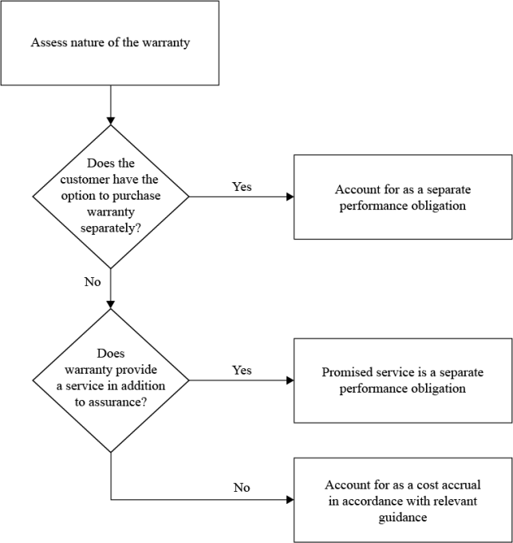

# 11 - Revenue from contracts with customers (IFRS 15)

[返回目录](README.md)

###### FAQ 11.93.2 – How should an entity account for a subsequent re-assessment of variable consideration previously constrained?

 

Reference to standard: IFRS 15 para 59  
Reference to standing text: [11.93](19.md#s68-Para_11.93)  

  

A land owner sells land to a developer for C1 million. The land owner is also entitled to receive 5% of any future sales price of the developed land in excess of C5 million. The land owner determines that its experience with similar contracts is of little predictive value because the future performance of the real estate market will cause the amount of variable consideration to be highly susceptible to factors outside the entity’s influence. Additionally, the uncertainty is not expected to be resolved in a short period of time, because the developer does not have current plans to sell the land.

Two years after contract inception:

- Land prices have significantly appreciated in the market.

- The land owner estimates that it is highly probable that a significant reversal of cumulative revenue recognised will not occur, related to C100,000 of variable consideration based on sales of comparable land in the area.

- The developer is actively marketing the land for sale.

**Question**

How should the land owner account for the change in circumstances?

**Answer**

The land owner should adjust the transaction price to include C100,000 of variable consideration for which it is highly probable that a significant reversal of cumulative revenue recognised will not occur. The land owner will update its estimate, either upward or downward, at each reporting date until the uncertainty is resolved.

 

##### Existence of a significant financing component

###### FAQ 11.95.1 – Can a significant financing component relate to one or more, but not all, of the performance obligations in a contract?

Reference to standard: IFRS 15 para 60  
 Reference to standing text: [11.95](19.md#s68-Para_11.95) 

  

  
 Possibly. It might be reasonable, in certain circumstances, to attribute a significant financing component to one or more, but not all, of the performance obligations in a contract. This assessment will likely require judgement. Management should consider whether it is appropriate to apply the guidance on allocating a discount (see [para 11.141 onwards](19.md#s68-Para_11.141)) or allocating variable consideration (see [para 11.145 onwards](19.md#s68-Para_11.145)) by analogy. Refer to Revenue TRG memo no. 30 and the related meeting minutes in Revenue TRG memo no. 34 for further discussion of this topic.

###### EX 11.95.2 – Single payment stream for multiple performance obligations satisfied at different times

 

Reference to standard: IFRS 15 para 60  
 Reference to standing text: [11.95](19.md#s68-Para_11.95) 

  

  
 It might not be clear, in these circumstances, whether the timing difference between performance and payment is greater than 12 months. Management should apply judgement to assess whether cash payments relate to a specific performance obligation based on the terms of the contract. It might be appropriate to allocate the payments received between the multiple performance obligations in the event payments are not tied directly to a particular goods or service. Refer to Revenue TRG memo no. 30 and the related meeting minutes in Revenue TRG memo no. 34 for further discussion of this topic.

 

###### FAQ 11.100.1 – Should an entity presume that a significant financing component does not exist in cases where the stated interest rate is zero?

 

Reference to standard: IFRS 15 para 60  
Reference to standing text: [11.100](19.md#s68-Para_11.100)  

  

The stated interest rate in an arrangement could be zero (for example, interest-free financing) such that the consideration to be received over the period of the arrangement is equal to the cash selling price. Management should not automatically conclude that there is no financing component in 0% financing arrangements. All relevant facts should be evaluated, including assessing whether the cash selling price reflects the price that would be paid absent the financing. Refer to Revenue TRG memo no. 30 and the related meeting minutes in Revenue TRG memo no. 34 for further discussion of this topic.

 

###### FAQ 11.107.1 – Does a prepayment with intent other than to provide financing constitute a significant financing component?

 

Reference to standard: IFRS 15 para 62(c)  
Reference to standing text: [11.107](19.md#s68-Para_11.107)  

  

Entity O produces a rare whiskey that is released once a year prior to the Christmas holidays. A retailer agrees to pay entity O in November 20X4 to secure supply for the December 20X5 release. Entity O requires payment at the time the order is placed; otherwise, it is not willing to guarantee production levels. Entity O does not offer discounts for early payments.

The advance payment allows the retailer to communicate its supply to customers and entity O to manage its production levels.

**Question**

Is there a significant financing component in the arrangement between entity O and the retailer?

**Answer**

There is no significant financing component in the arrangement between entity O and the retailer. The upfront payment is made to secure the future supply of whiskey and not to provide entity O or the retailer with the provision of finance.

 

###### FAQ 11.109.1 – Can an entity disregard the effects of a significant financing when a contract contains financing but the period of the financing is less than one year?

 

Reference to standard: IFRS 15 para 63  
Reference to standing text: [11.109](19.md#s68-Para_11.109), [11.110](19.md#s68-Para_11.110)  

  

**Question**

Can an entity use the practical expedient to disregard the effects of a significant financing when a contract is explicit that it contains a financing, but the period of the financing is less than one year?

**Answer**

Yes. The entity can elect to apply the practical expedient if the difference between the timing of performance and the timing of payment is one year or less.

 

###### FAQ 11.113.1 – What discount rate should an entity use to determine the transaction price where the contract contains an explicit contractual interest rate?

 

Reference to standard: IFRS 15 para 64  
Reference to standing text: [11.113](19.md#s68-Para_11.113)  

  

Entity P enters into an arrangement with a customer for the financing of a new sofa purchase. Entity P is running a promotion that offers all customers 1% financing. The 1% contractual interest rate is significantly lower than the 10% interest rate that would otherwise be available to the customer at contract inception (that is, the contractual rate does not reflect the credit risk of the customer). Entity P concludes that there is a significant financing component present in the contract.

**Question**

What discount rate should entity P use to determine the transaction price?

**Answer**

Entity P should use a 10% discount rate to determine the transaction price. It would not be appropriate to use the 1% rate specified in the contract, as it represents a marketing incentive and does not reflect the credit characteristics of the customer.

 

###### FAQ 11.113.2 – What is the transaction price where the contract contains an implicit discount rate?

 

Reference to standard: IFRS 15 para 64  
Reference to standing text: [11.113](19.md#s68-Para_11.113)  

  

Entity Q enters into an agreement with a customer to provide a five-year gym membership. Upfront consideration paid by the customer is C5,000. Entity Q also offers an alternative payment plan with monthly billings of C100 (total consideration of C6,000 over the five-year membership term). The membership is a single performance obligation that entity Q satisfies rateably over the five-year membership period.

Entity Q determines that the difference between the cash selling price and the monthly payment plan (payment over the performance period) indicates that a significant financing component exists in the contract with the customer. Entity Q concludes that the discount rate that would be reflected in a separate transaction between the two parties at contract inception is 5%.

**Question**

What is the transaction price in this arrangement?

**Answer**

Entity Q should determine the transaction price using the discount rate that would be reflected in a separate financing transaction (5%). This rate is different from the 7.4% imputed discount rate used to discount payments that would have been received over time (C6,000) back to the cash selling price (C5,000).

Entity Q calculates monthly revenue of C94.35 using a present value of C5,000, a 5% annual interest rate, and 60 monthly payments. Entity Q records a contract liability of C5,000 at contract inception for the upfront payment, that will be reduced by the monthly revenue recognition of C94.35 and increased by interest expense recognised. Entity Q will recognise revenue of C5,661 and interest expense of C661 over the life of the contract.

 

##### Non-cash consideration

###### FAQ 11.116.1 – Variable for other reasons than the form of the consideration: how should an entity account for a non-cash bonus?

 

Reference to standard: IFRS 15 para 68  
Reference to standing text: [11.116](19.md#s68-Para_11.116)  

  

Entity S enters into a contract to build a machine for a manufacturer and is entitled to a bonus in the form of 10,000 shares of the manufacturer’s common stock if the machine is delivered within six months. Entity S does not have a history of building similar machines within six months and cannot conclude that it is highly probable that a significant reversal will not occur. Assume that the arrangement does not include a derivative.

**Question**

How should entity S account for the non-cash bonus?

**Answer**

Entity S should consider the guidance on variable consideration, since the consideration varies based on whether the machine is delivered by a specific date. Entity S should not include the shares in the transaction price, because the amount of variable consideration is constrained. Entity S should update its estimate each period to determine if and when the shares should be included in the transaction price.

 

###### FAQ 11.117.1 – How should an entity determine the transaction price where materials are provided by the customer to facilitate fulfilment?

 

Reference to standard: IFRS 15 para 69  
Reference to standing text: [11.117](19.md#s68-Para_11.117)  

  

A manufacturer enters into a contract with a customer to build a machine. The customer pays C1 million to the manufacturer and contributes materials to be used in the development of the machine. The materials have a fair value of C500,000. The customer will deliver the materials to the manufacturer approximately three months after development of the machine begins. The manufacturer concludes that it obtains control of the materials upon delivery by the customer because it could elect to use the materials for other projects.

**Question**

How should the manufacturer determine the transaction price?

**Answer**

The manufacturer should include the fair value of the materials in the transaction price, because it obtains control of them. The transaction price of the arrangement is therefore C1.5 million.

 

###### FAQ 11.117.2 – How should an entity determine the transaction price for processing arrangements?

 

Reference to standard: IFRS 15 para 69  
Reference to standing text: [11.117](19.md#s68-Para_11.117)  

  

Entity A enters into an arrangement with entity B to process raw copper into finished wire for entity B. Entity B provides entity A raw copper with a fair value of C500,000 that is used in the fabrication of the wire and pays entity A C1 million in cash. Entity B retains title to the copper as it is processed, there is no specified property, plant and equipment, and entity B has concluded the arrangement is not a lease.

**Question**

How should entity A determine the transaction price?

**Answer**

Entity A would likely conclude that it is providing a service of processing the copper and that it does not obtain control of the copper in this arrangement. Therefore, entity A should not include the fair value of the raw materials in the transaction price. Judgement might be required, in some fact patterns to determine whether an entity obtains control of customer-provided materials. If an entity concludes they obtain control then they would likely include the fair value of the non-cash consideration in the transaction price.

 

##### Consideration payable to a customer

###### EX 11.119.1 – Payment to a customer’s customer in the distribution chain

 

Reference to standard: IFRS 15 para 70  
 Reference to standing text: [11.119](19.md#s68-Para_11.119) 

  

  
An entity might make payments directly to its customer, or make payments to another party that purchases the entity’s goods or services from its customer (that is, a ‘customer’s customer’ within the distribution chain), as illustrated in the figure below:

  
 Payments made by an entity to its customer’s customer are assessed and accounted for the same as those paid directly to the entity’s customer if those parties receiving the payments are purchasing the entity’s goods and services.

 

###### FAQ 11.119.2 – How should an entity account for a rebate payment to a reseller’s customer?

 

Reference to standard: IFRS 15 para 70  
Reference to standing text: [11.119](19.md#s68-Para_11.119)  

  

Entity T sells televisions to a retailer that the retailer sells to end customers. Entity T runs a promotion during which it will pay a rebate to end customers that purchase a television from the retailer.

**Question**

How should entity T account for the rebate payment to the end customer?

**Answer**

Entity T should account for the rebate in the same manner as if it were paid directly to the retailer. Payments to a customer’s customer within the distribution chain are accounted for in the same way as payments to a customer.

 

###### EX 11.119.3 – Payment to an end consumer that does not purchase the entity’s goods or services

 

Reference to standard: IFRS 15 para 70  
 Reference to standing text: [11.119](19.md#s68-Para_11.119) 

  

  
Entities might provide cash incentives to end consumers that are not their direct customers and do not purchase the entities’ goods or services within the distribution chain as depicted below:

  
 Management should first identify whether the end consumer is the entity’s customer. This assessment could require judgement. Management should also consider whether a payment to an end consumer is contractually required pursuant to the arrangement between the entity and its customer in the transaction. In that case, the payment to the end consumer would be treated as a consideration payable to a customer as it is being made on the customer’s behalf. Refer to Revenue TRG memo no. 37 and the related meeting minutes in Revenue TRG memo no. 44 for further discussion of this topic.

 

###### FAQ 11.119.4 – How should an entity account for an agent’s payment to an end consumer?

 

Reference to standard: IFRS 15 para 70  
Reference to standing text: [11.119](19.md#s68-Para_11.119)  

  

Entity U sells airline tickets to end consumers on behalf of an airline. Entity U concludes that it is acting as an agent in the airline ticket sale transactions (see [para 11.264 onwards](19.md#s71-Para_11.264) for further discussion on principal versus agent consideration). Entity U offers a C10 coupon to end consumers in order to increase the volume of airline ticket sales on which it earns a commission.

**Question**

How should entity U account for the coupon offered to end consumers?

**Answer**

Entity U should identify its customer (or customers) in order to determine whether the coupons represent consideration payable to a customer. The coupons represent consideration payable to a customer if (1) entity U determines the end consumers are its customers, or (2) entity U determines the end consumers are not its customers, but it is making the payment on behalf of the airline (its customer). In either of these situations, entity U would record the coupons as a reduction of its agency commission as it does not receive a distinct good or service in exchange for the payment (see [para 11.121 onwards](19.md#s68-Para_11.121)). Conversely, the coupons would generally be recorded as a marketing expense if the coupons do not represent consideration payable to a customer.

 

###### EX 11.119.5 – Settlement payments made to customers

 

Reference to standard: IFRS 15 para 70  
 Reference to standing text: [11.119](19.md#s68-Para_11.119) 

  

  
 Entities might be required to make payments to customers to settle litigation, claims or other disputes. These payments will generally represent a payment to a customer, and they will be presented as a reduction of revenue because the entity does not receive a distinct good or service in exchange for the payment. In some cases, it might not be clear whether the payment relates to past or future transactions. Cash payments made to customers to settle disputes often represent adjustments to the transaction price of a completed contract. In other words, the entity agrees, as part of the settlement, to make a price concession related to the past transaction. In these situations, the payments should be recorded as an immediate adjustment to revenue.

In other situations, a cash payment might represent an incentive for the customer to enter into a new contract. For example, an entity might settle a class action lawsuit by issuing coupons to a large group of customers that can be used in connection with future purchases. It might be appropriate to account for these coupons when the future purchases are made if the coupons are viewed as incentives to enter into new contracts as opposed to adjustments to the transaction price for prior purchases. This assessment might require significant judgement.

Cash payments that relate to a contract in process should generally be accounted for as a modification to the contract. See [paragraph 11.44](19.md#s66-Para_11.44) onwards for guidance on accounting for modifications.

 

###### FAQ 11.119.6 – How should an entity account for payments to customers that exceed the transaction price?

 

Reference to standard: IFRS 15 para 70  
Reference to standing text: [11.119](19.md#s68-Para_11.119)  

  

In some cases, a payment to a customer that is not in exchange for a distinct good or service could exceed the transaction price for the current contract. Accounting for the excess payment (‘negative revenue’) could require judgement. Management should obtain an understanding of the reason for making the payment to the customer and the rights and obligations in the related contracts. Entities should also appropriately disclose their related judgements, if material.

To determine the accounting for the excess payment amount, including timing of recognition in income and presentation in the income statement, management should assess whether the payment also relates to other current or past contracts. If the entity has recognised revenue from the same customer related to other contracts, the excess payment might represent a modification to the transaction price of those contracts. Refer to Revenue TRG memo no. 37 and the related meeting minutes in Revenue TRG memo no. 44 for further discussion of this topic.

Management should also assess whether the payment relates to anticipated future contracts. For example, entities sometimes make advance payments to customers to reimburse them for costs to change vendors and/or to secure exclusivity in anticipation of future purchases, even though the entity might not have an enforceable right to them. Payments to a customer that relate to anticipated contracts could meet the definition of an asset. Payments capitalised would be amortised as a reduction to future revenues from that customer. Assets should be assessed for recoverability, which would generally be based on expected future revenues from the customer. Refer to US Revenue TRG memo no. 59 and the related meeting minutes in Revenue TRG memo no. 60 for further discussion of this topic.

If the payment does not relate to any other contracts (including past contracts or anticipated future contracts) with the customer, management should consider the substance of the payment to determine the appropriate presentation of the amount in excess of the transaction price. For example, management might conclude the excess payment should be presented as an expense because the arrangement no longer represents a contract with a customer when the transaction price is negative.

The following example illustrates the accounting when payments to a customer exceed the transaction price.

**Activity**

An entity sells 1,000 products to a retailer for total consideration of C100,000. The entity is an emerging business and therefore, to receive desirable placement in the retailer’s store, the entity pays to the retailer a one-time payment of C150,000. This payment is not in exchange for a distinct good or service and the entity does not have any other past or current contracts with the retailer at the time of payment. Although the entity aspires to sell additional products to the retailer in the future, the entity does not currently anticipate specific future contracts with the retailer.

**Question**

How should the entity account for the payment to the retailer?

**Answer**

The entity should account for the payment as a reduction of the transaction price of the contract with the retailer because it does not receive a distinct good or service in exchange for the payment. The entity has determined that the excess amount of C50,000 (C100,000 contract price less C150,000 payment) does not relate to any other contracts with the retailer; therefore, the excess amount should be presented based on the substance of the payment. In this fact pattern, the entity would likely conclude that the C50,000 excess payment should be presented as an expense.

 

###### EX 11.119.7 – Payments to customers in the form of equity instruments

 

Reference to standard: IFRS 15 para 70  
 Reference to standing text: [11.119](19.md#s68-Para_11.119) 

  

  
 An entity might acquire distinct goods and services in exchange for its own equity instruments. Such transactions would be within the scope of IFRS 2. The guidance in IFRS 15, for payments to customers in which an entity does not receive distinct goods or services, is not restricted to cash payments. Therefore, we believe that the fair value of shares issued to a customer in these circumstances would be accounted for as a reduction of revenue. IFRS 15 does not specify the measurement date for non-cash consideration; therefore, management should apply judgement to determine the measurement date.

 

###### FAQ 11.120.1 – Implied promise to pay consideration to a customer: when should an entity record revenue reduction for estimated coupon redemptions?

 

Reference to standard: IFRS 15 para 72  
Reference to standing text: [11.120](19.md#s68-Para_11.120)  

  

Management should consider whether a payment that it expects to make to a customer (for example, a rebate) is a price concession when assessing the terms of the contract. A price concession is a form of variable consideration, as discussed in [EX 11.77.1](20.md#s74-EX11.77.1), and should be estimated, including assessment of the variable consideration constraint. A payment to a customer should also be accounted for if it is implied, even if the entity has not yet explicitly communicated its intent to make the payment to the customer. Judgement might be required to determine whether an entity intends customer payment in the form of a price concession and whether a payment is implied by the entity’s customary practices. Refer to Revenue TRG memo no. 37 and the related meeting minutes in Revenue TRG memo no. 44 for further discussion of this topic.

**Activity**

Entity V sells coffee products to a retailer. On 1 December 20X1, entity V decides that it will issue coupons directly to end consumers that provides a C1 discount on each bag of coffee purchased. Entity V has a history of providing similar coupons.

Entity V delivers a shipment of coffee to the retailer on 28 December 20X1 and recognises revenue. Entity V offered the coupons to end consumers on 2 January 20X2 and it reasonably expects that the end consumers will use the coupons to purchase products already shipped to the retailer. Entity V will reimburse the retailer for any coupon redeemed by end consumers.

**Question**

When should entity V record the revenue reduction for estimated coupon redemptions?

**Answer**

Entity V should reduce the transaction price for estimated coupon redemptions when it recognises revenue on transfer of the coffee to the retailer on 28 December 20X1. Although entity V has not yet communicated the coupon offering, entity V has a customary business practice of providing coupons and has the intent to provide coupons (a form of price concession) related to the shipment. Therefore, entity V should account for the coupons following the guidance on variable consideration.

 

###### FAQ 11.121.1 – How should a producer account for fees paid to a retailer where no distinct good or service is received?

 

Reference to standard: IFRS 15 para 71  
Reference to standing text: [11.121](19.md#s68-Para_11.121)  

  

A producer sells energy drinks to a retailer, a convenience store. The producer also pays the retailer a fee to ensure that its products receive prominent placement on store shelves (that is, a slotting fee).

**Question**

How should the producer account for the slotting fees paid to the retailer?

**Answer**

The producer should reduce the transaction price for the sale of the energy drinks by the amount of slotting fees paid to the retailer. The producer does not receive a good or service that is distinct in exchange for the payment to the retailer.

 

###### FAQ 11.122.1 – How should an entity account for a payment to a retailer for a distinct service?

 

Reference to standard: IFRS 15 para 71  
Reference to standing text: [11.122](19.md#s68-Para_11.122)  

  

Entity W sells 1,000 phones to a retailer for C100,000. The contract includes an advertising arrangement that requires entity W to pay C10,000 towards a specific advertising promotion that the retailer will provide. The retailer will provide the advertising on strategically located billboards and in local advertisements. Entity W could have elected to engage a third party to provide similar advertising services at a cost of C10,000.

**Question**

How should entity W account for the payment to the retailer for advertising?

**Answer**

Entity W should account for the payment to the retailer consistent with other purchases of advertising services. The payment from entity W to the retailer is consideration for a distinct service provided by the retailer and reflects fair value. The advertising is distinct, because entity W could have engaged a third party who is not its customer to perform similar services. The transaction price for the sale of the phones is C100,000 and is not affected by the payment made to the retailer.

 

###### FAQ 11.122.2 – How should an entity account for a payment to a retailer for a distinct service in excess of fair value?

 

Reference to standard: IFRS 15 para 71  
Reference to standing text: [11.122](19.md#s68-Para_11.122)  

  

Entity W sells 1,000 phones to a retailer for C100,000. The contract includes an advertising arrangement that requires entity W to pay C10,000 towards a specific advertising promotion that the retailer will provide. The retailer will provide the advertising on strategically located billboards and in local advertisements. Entity W could have elected to engage a third party to provide similar advertising services at a cost of C8,000.

**Question**

How should entity W account for the payment to the retailer for advertising?

**Answer**

The amount of the payment that represents fair value of the advertising service (C8,000) is accounted for in a way that is consistent with other purchases of advertising services, because it is consideration for a distinct service. The excess amount of the payment over the fair value of the services (C2,000) is a reduction of the transaction price for the sale of the phones. So the transaction price for the sale of the phones is C98,000.

 

###### FAQ 11.122.3 – How should a manufacturer account for an advertising allowance?

 

Reference to standard: IFRS 15 para 70  
Reference to standing text: [11.122](19.md#s68-Para_11.122)  

  

A manufacturer enters into a contract to sell toys to a retailer. As part of the contract, the manufacturer agrees to provide the retailer with an advertising allowance equal to 3% of total purchases made by the retailer, payable at the end of each quarter. The retailer has discretion over use of the allowance and is not required to provide the manufacturer with supporting documentation of how the allowance was utilised.

**Question**

How should the manufacturer account for the advertising allowance?

**Answer**

The manufacturer would likely conclude in this fact pattern that it does not receive a distinct good or service in exchange for the allowance paid to the retailer. The allowance is, in substance, a discount on the purchases made by the retailer. The manufacturer should therefore account for the allowance as a reduction of the transaction price of the toys sold to the retailer.

 

### Allocating the transaction price to separate performance obligations

#### EX 11.125.1 – Other considerations when allocating the transaction price

 

Reference to standard: IFRS 15 para 74  
 Reference to standing text: [11.125](19.md#s68-Para_11.125) 

  

  
Other matters that could arise when allocating transaction price are discussed below.

**Transaction price exceeds sum of stand-alone selling prices**

The total transaction price is typically equal to or less than the sum of the stand-alone selling prices of the individual performance obligations. A transaction price that is greater than the sum of the stand-alone selling prices suggests that the customer is paying a premium for purchasing the goods or services together. This could indicate that the amounts identified as the stand-alone selling prices are too low, or that additional performance obligations exist and need to be identified. A premium is allocated to the performance obligations using a relative stand-alone selling price basis if, after further assessment, a premium still exists.

**Non-refundable upfront fees**

Many contracts include non-refundable upfront fees, such as joining fees (for example, common in health club memberships), activation fees (for example, common in telecommunications contracts), or other initial/set-up fees. An entity should assess whether the activities related to such fees satisfy a performance obligation. Where those activities do not satisfy a performance obligation, because no good or service is transferred to the customer, none of the transaction price should be allocated to those activities. Rather, the upfront fee is included in the transaction price that is allocated to the performance obligations in the contract. See [paragraph 11.225 onwards](19.md#s71-Para_11.225) for further discussion of upfront fees.

**No ‘contingent revenue cap’**

An entity should allocate the transaction price to all of the performance obligations in the arrangement, irrespective of whether additional goods or services need to be provided before the customer pays the consideration. For example, a wireless phone entity enters into a two-year service agreement with a customer and provides a free mobile phone, but does not require any upfront payment. The entity should allocate the transaction price to both the mobile phone and the two-year service arrangement, based on the relative stand-alone selling price of each performance obligation, despite the customer only paying consideration as the services are rendered.

Concerns about whether the customer intends to pay the transaction price are considered in either the collectability assessment (that is, whether a contract exists) or assessment of customer acceptance of the good or service. See [paragraph 11.33 onwards](19.md#s66-Para_11.33) for further information on collectability and [paragraph 11.195 onwards](19.md#s69-Para_11.195) for further information on customer acceptance clauses.

 

#### Determining stand-alone selling price

##### FAQ 11.127.1 – How should an entity allocate a discounted transaction price to performance obligations where the stand-alone selling prices are directly observable?

 

Reference to standard: IFRS 15 para 77  
Reference to standing text: [11.127](19.md#s68-Para_11.127)  

  

Entity X sells boats and provides mooring facilities for its customers. Entity X sells the boats for C30,000 each and provides mooring facilities for C5,000 per year. Entity X concludes that the goods and services are distinct and accounts for as separate performance obligations. Entity X enters into a contract to sell a boat and one year of mooring services to a customer for C32,500.

**Question**

How should entity X allocate the transaction price of C32,500 to the performance obligations?

**Answer**

Entity X should allocate the transaction price of C32,500 to the boat and the mooring services based on their relative stand-alone selling prices as follows:

<table style="width:100%; border-collapse:collapse"><tr><td style="border:0.75pt solid #000000; padding-right:5.03pt; padding-left:5.03pt; vertical-align:top">
Boat:
</td><td style="border:0.75pt solid #000000; padding-right:5.03pt; padding-left:5.03pt; vertical-align:top">
C27,857 (C32,500 × (C30,000/C35,000))
</td></tr><tr><td style="border:0.75pt solid #000000; padding-right:5.03pt; padding-left:5.03pt; vertical-align:top">
Mooring services:
</td><td style="border:0.75pt solid #000000; padding-right:5.03pt; padding-left:5.03pt; vertical-align:top">
C4,643 (C32,500 × (C5,000/C35,000))
</td></tr></table>

  
 The allocation results in the C2,500 discount being allocated proportionately to the two performance obligations.

 

##### FAQ 11.127.2 – Can an entity use a range of prices when determining the stand-alone selling prices of individual goods or services?

Reference to standard: IFRS 15 para 77  
 Reference to standing text: [11.127](19.md#s68-Para_11.127) 

  

  
An entity might use a range of prices when determining the stand-alone selling prices of individual goods or services, provided that the range reflects reasonable pricing of each product or service as if it were priced on a stand-alone basis for similar customers.

The allocation guidance does not specifically refer to the use of a range, but using a range of stand-alone selling price is consistent with the overall allocation objective. Entities will need to apply judgement to determine an appropriate range of stand-alone selling price.

If an entity decides to use a range to determine stand-alone selling prices, it might consider the contractual price as the stand-alone selling price if it falls within the range. There might, however, be situations in which the contractual price of a good or service is outside of that range. In those cases, entities should apply a consistent method to determine the stand-alone selling price within the range for that good or service (for example, the midpoint of the range or the outer limit closest to the stated contractual price).

##### FAQ 11.127.3 – Use of a range when estimating stand-alone selling prices?

 

Reference to standard: IFRS 15 para 77  
 Reference to standing text: [11.127](19.md#s68-Para_11.127) 

  

  
 Entity X sells boats and provides mooring facilities for its customers. It sells the boats on a stand-alone basis for C29,000–C32,000 each, and it provides mooring facilities for C5,000 per year. Entity X concludes that the goods and services are distinct, and it accounts for them as separate performance obligations.

Entity X enters into a contract to sell a boat and one year of mooring services to a customer. The stated contract prices for the boat and the mooring services are C31,000 and C1,500, respectively.

**Question**

How should entity X allocate the total transaction price of C32,500 to each performance obligation?

**Answer**

The contract price for the boat (C31,000) falls within the range that entity X established for stand-alone selling price; therefore, entity X could use the stated contract price for the boat as the stand-alone selling price in the allocation:

<table style="width:100%; border-collapse:collapse"><tr><td style="border:0.75pt solid #000000; padding-right:5.03pt; padding-left:5.03pt; vertical-align:top">
Boat:
</td><td style="border:0.75pt solid #000000; padding-right:5.03pt; padding-left:5.03pt; vertical-align:top">
C27,986 (C32,500 × (C31,000 / C36,000))
</td></tr><tr><td style="border:0.75pt solid #000000; padding-right:5.03pt; padding-left:5.03pt; vertical-align:top">
Mooring services:
</td><td style="border:0.75pt solid #000000; padding-right:5.03pt; padding-left:5.03pt; vertical-align:top">
C4,514 (C32,500 × (C5,000 / C36,000))
</td></tr></table>

  
If the contract price for the boat did not fall within the range (for example, the boat was priced at C28,000), entity X would need to determine a price within the range to use as the stand-alone selling price of the boat in the allocation, such as the midpoint. Entity X should apply a consistent method for determining the price within the range to use the stand-alone selling price.

 

##### FAQ 11.132.1 – How does an entity use a range when estimating stand-alone selling prices?

 

Reference to standard: IFRS 15 para 78  
Reference to standing text: [11.132](19.md#s68-Para_11.132)  

  

No. The revenue standard requires an entity to estimate stand-alone selling price for each distinct good or service in an arrangement. The residual approach (see [para 11.135](19.md#s68-Para_11.135)) can only be used if specific criteria are met.

 

##### FAQ 11.133.1 – What factors should be considered when adopting an adjusted market assessment approach?

Reference to standard: IFRS 15 para 79(a)  
 Reference to standing text: [11.133](19.md#s68-Para_11.133) 

  

  
Entity-specific factors might include:

- position in the market;

- expected profit margin;

- customer or geographic segments;

- distribution channel; and

- cost structure.

An entity that has a greater market share, for example, might charge a lower price because of those higher volumes. An entity that has a smaller market share might need to consider the profit margins that it would need to receive to make the arrangement profitable. Management should also consider the customer base in a particular geography. Pricing of goods and services might differ significantly from one area to the next, depending on, for example, distribution costs.

Market conditions can also affect the price for which an entity would sell its product, including:

- supply and demand;

- competition;

- market perception;

- trends; and

- geography-specific factors.

A single good or service could have more than one stand-alone selling price if it is sold in multiple markets. For example, the stand-alone selling price of a good in a densely populated area could be different from the stand-alone selling price of a similar good in a rural area. A large number of competitors in a market can result in an entity having to charge a lower price in that market to stay competitive, while it can charge a higher price in markets where customers have fewer options.

Entities might also employ different marketing strategies in different regions and therefore be willing to accept a lower price in a certain market. An entity whose brand is perceived as top-of-the-line might be able to charge a price that provides a higher margin on goods or services than one that has a less well-known brand name.

Discounts offered by an entity where a good or service is sold separately should be considered when estimating stand-alone selling prices. For example, a sales force might have a standard list price for products and services, but it regularly enter into sales transactions at amounts below the list price. Management should consider whether it is appropriate to use the list price in its analysis of stand-alone selling prices if the entity regularly provides a discount.

Management should also consider whether the entity has a practice of providing price concessions. An entity with a history of providing price concessions on certain goods or services needs to determine the potential range of prices that it expects to charge for a product or service on a stand-alone basis when estimating stand-alone selling price.

The significance of each data point in the analysis will vary depending on an entity’s circumstances. Certain information could be more relevant than other information, depending on the entity, the location, and other factors.

##### FAQ 11.134.1 – What factors should be considered when adopting an expected cost plus a margin approach?

Reference to standard: IFRS 15 para 79(b)  
 Reference to standing text: [11.134](19.md#s68-Para_11.134) 

  

  
Costs included in the estimate should be consistent with those that an entity would normally consider in setting stand-alone prices. Both direct and indirect costs should be considered, but judgement is needed to determine the extent of costs that should be included. Internal costs, such as research and development costs that the entity would expect to recover through its sales, might also need to be considered.

Factors to consider, when assessing if a margin is reasonable, could include:

- Margins achieved on stand-alone sales of similar products.

- Market data related to historical margins within an industry.

- Industry sales price averages.

- Market conditions.

- Profit objectives.

##### FAQ 11.134.2 – What factors should be considered when estimating stand-alone selling prices that are not directly observable?

 

Reference to standard: IFRS 15 para 79(b)  
Reference to standing text: [11.134](19.md#s68-Para_11.134)  

  

The objective is to determine the factors and conditions that might affect what an entity would be able to charge in a particular market. Judgement will often be needed to determine an appropriate margin, particularly where sufficient historical data is not readily available or where a product or service has not previously been sold on a stand-alone basis. Estimating a reasonable margin will often require an assessment of both entity-specific and market factors.

Entity Y enters into an arrangement to provide a licence and research services to entity Z. The licence and the services are each distinct and therefore accounted for as separate performance obligations, and neither is sold individually.

**Question**

What factors might entity Y consider when estimating the stand-alone selling prices for these items?

**Answer**

Entity Y analyses the transaction as follows:

Licence

The best model for determining stand-alone selling price will depend on the rights associated with the licence, the stage of development of the technology, and the nature of the licence itself.

An entity that does not sell comparable licences might need to consider factors such as projected cash flows from the licence to estimate the stand-alone selling price of a licence, particularly when that licence is already in use or is expected to be exploited in a relatively short timeframe. A cost-plus approach might be more relevant for licences in the early stage of their life cycle where reliable forecasts of revenue or cash flows do not exist. Determining the most appropriate approach will depend on facts as well as the extent of observable selling-price information.

Research services

A cost-plus approach that considers the level of effort necessary to perform the research services would be an appropriate method to estimate the stand-alone selling price of the research services. This could include costs for full-time equivalent (FTE) employees and expected resources to be committed. Key areas of judgement include the selection of FTE rates, estimated profit margins, and comparisons to similar services offered in the marketplace.

 

##### FAQ 11.136.1 – How should a seller estimate the stand-alone selling price using the residual approach?

 

Reference to standard: IFRS 15 para 79(c)  
Reference to standing text: [11.136](19.md#s68-Para_11.136)  

  

A seller enters into a contract with a customer to sell products A, B and C for a total transaction price of C100,000. On a stand-alone basis, the seller regularly sells product A for C25,000 and product B for C45,000. Product C is a new product that has not been sold previously, has no established price, and is not sold by competitors in the market. Products A and B are not regularly sold together at a discounted price. Product C is delivered on 1 March, and products A and B are delivered on 1 April.

**Question**

How should the seller determine the stand-alone selling price of product C?

**Answer**

The seller can use the residual approach to estimate the stand-alone selling price of product C, because the seller has not previously sold or established a price for product C.

Prior to using the residual approach, the seller should assess whether any other observable data exists to estimate the stand-alone selling price. For example, although product C is a new product, the seller might be able to estimate a stand-alone selling price through other methods, such as using expected cost plus a margin.

The seller has observable evidence that products A and B sell for C25,000 and C45,000 respectively, for a total of C70,000. The residual approach would result in an estimated stand-alone selling price of C30,000 for product C (C100,000 total transaction price less C70,000).

 

##### FAQ 11.137.1 – How should an entity estimate the stand-alone selling price where the residual approach is not appropriate?

 

Reference to standard: IFRS 15 para 79(c)  
Reference to standing text: [11.137](19.md#s68-Para_11.137)  

  

A software company enters into a contract with a customer to license software and provide post-contract customer support (PCS) for a total transaction price of C1.1 million. The software company regularly sells PCS for C1 million on a stand-alone basis. The software company also regularly licenses software on a stand-alone basis for a price that is highly variable, ranging from C500,000 to C5 million.

**Question**

Can the software company use the residual approach to determine the stand-alone selling price of the software licence?

**Answer**

No. Because the seller has observable evidence that PCS sells for C1 million, the residual approach results in a nominal allocation of selling price to the software licence. As the software is typically sold separately for C500,000 to C5 million, this is not an estimate that faithfully represents the price of the software licence if it was sold separately. As such, the allocation objective of the standard is not met, and the software company should use another method to estimate the stand-alone selling price of the licence.

 

#### Allocating discounts

##### FAQ 11.142.1 – How should a retailer allocate a discounted transaction price to products?

 

Reference to standard: IFRS 15 para 82  
Reference to standing text: [11.142](19.md#s68-Para_11.142)  

  

A retailer enters into an arrangement with its customer to sell a chair, a couch and a table for C5,400. The retailer regularly sells each product on a stand-alone basis: the chair for C2,000, the couch for C3,000, and the table for C1,000. The customer receives a C600 discount (C6,000 sum of stand-alone selling prices less C5,400 transaction price) for buying the bundle of products. The chair and couch will be delivered on 28 March and the table on 3 April. The retailer regularly sells the chair and couch together as a bundle for C4,400 (that is, at a C600 discount to the stand-alone selling prices of the two items). The table is not normally discounted.

**Question**

How should the retailer allocate the transaction price to the products?

**Answer**

The retailer has observable evidence that the C600 discount should be allocated to only the chair and couch. The chair and couch are regularly sold together for C4,400, and the table is regularly sold for C1,000. The retailer would therefore allocate the C5,400 transaction price as follows:

<table style="width:100%; border-collapse:collapse"><tr><td style="border:0.75pt solid #000000; padding-right:5.03pt; padding-left:5.03pt; vertical-align:top">
Chair and couch:
</td><td style="border:0.75pt solid #000000; padding-right:5.03pt; padding-left:5.03pt; vertical-align:top">
C4,400
</td></tr><tr><td style="border:0.75pt solid #000000; padding-right:5.03pt; padding-left:5.03pt; vertical-align:top">
Table:
</td><td style="border:0.75pt solid #000000; padding-right:5.03pt; padding-left:5.03pt; vertical-align:top">
C1,000
</td></tr></table>

  
 If, however, the table and the couch in the above example were also regularly discounted when sold as a pair, it would not be appropriate to allocate the discount to any combination of two products. The discount would instead be allocated proportionately to all three products.

 

##### FAQ 11.144.1 – How should a seller allocate a discounted transaction price to products and apply the residual approach?

 

Reference to standard: IFRS 15 para 83  
Reference to standing text: [11.144](19.md#s68-Para_11.144)  

  

A seller enters into a contract with a customer to sell products A, B and C for a total transaction price of C100,000. On a stand-alone basis, the seller regularly sells product A for C25,000 and product B for C45,000. Product C is a new product that has not been sold previously, has no established price, and is not sold by competitors in the market. Products A and B are regularly sold as a bundle for C60,000 (that is, at a C10,000 discount). The seller concludes that the residual approach is appropriate for determining the stand-alone selling price of product C.

**Question**

How should the seller allocate the transaction price between products A, B and C?

**Answer**

The seller regularly sells products A and B together for C60,000, so it has observable evidence that the C10,000 discount relates entirely to products A and B. Therefore, the seller would allocate C60,000 to products A and B. Using the residual approach, C40,000 would be allocated to product C (C100,000 total transaction price less C60,000).

 

#### Allocating variable consideration

##### FAQ 11.145.1 – Does an entity have to perform a relative stand-alone selling price allocation to conclude that the allocation of variable consideration to one or more, but not all, performance obligations is consistent with the allocation objective?

 

Reference to standard: IFRS 15 para 84  
 Reference to standing text: [11.145](19.md#s68-Para_11.145) 

  

  
 Stand-alone selling price is the ‘default method’ for determining whether the allocation objective is met. However, other methods could be used in certain cases. Therefore, a relative stand-alone selling price allocation could be utilised, but is not required, to assess the reasonableness of the allocation. In the absence of specific guidance on other methods, entities will have to apply judgement to determine whether the allocation results in a reasonable outcome. Refer to Revenue TRG memo no. 39 and the related meeting minutes in Revenue TRG memo no. 44 for further discussion of this topic.

[IFRS 15 para BC 280].

 

##### FAQ 11.145.2 – Which guidance should an entity apply to determine how to allocate a discount that causes the transaction price to be variable?

 

Reference to standard: IFRS 15 para 84  
Reference to standing text: [11.145](19.md#s68-Para_11.145)  

  

Certain discounts are also variable consideration within a contract. For example, an electronic store might sell to a customer a television, speakers and a DVD player at their stand-alone selling prices, but also grant the customer a C50 mail-in rebate on the total purchase. There is a C50 discount on the bundle, but it is variable, because it is contingent on the customer redeeming the rebate.

Entities should first apply the guidance for allocating variable consideration to a discount that is also variable. If those criteria are not met, entities should then consider whether the criteria for allocating a discount, discussed in [paragraph 11.141 onwards](19.md#s68-Para_11.141), are met. A contract might have both variable and fixed discounts. The guidance on allocating a discount should be applied to any fixed discount. Refer to Revenue TRG memo no. 31 and the related meeting minutes in Revenue TRG memo no. 34 for further discussion of this topic.

 

##### FAQ 11.147.1 – If variable consideration meets the criteria in paragraph 85 of IFRS 15 to be allocated entirely to a wholly unsatisfied performance obligation or a distinct good or service in a series, is it necessary to estimate the variable consideration at contract inception?

 

Reference to standard: IFRS 15 para 85  
Reference to standing text: [11.147](19.md#s68-Para_11.147)  

  

 

It depends. It might not be necessary to estimate variable consideration at contract inception where the variable consideration is allocated entirely to a performance obligation to be satisfied in the future or a distinct good or service in a series. For example, a monthly usage-based fee in a three-year contract to provide a series of monthly services might meet the criteria to be allocated entirely to the month in which the related usage occurs. In that case, it would likely not be necessary at contract inception to estimate the total of the monthly usage-based fees for the entire contract term. In other situations, management might need to estimate the variable consideration in order to evaluate the second criterion in paragraph 85 of IFRS 15, which requires an assessment of whether the resulting allocation is consistent with the allocation objective in paragraph 73 of IFRS 15 when considering all of the performance obligations in the contract.

 

##### FAQ 11.148.1 – Allocating variable consideration to a series: how should a performance bonus be accounted for?

 

Reference to standard: IFRS 15 para 84(b)  
Reference to standing text: [11.148](19.md#s68-Para_11.148)  

  

Entity A enters into a three-year contract to provide air conditioning to the operator of an office building, using its proprietary geo-thermal heating and cooling system. Entity A is entitled to a semi-annual performance bonus if the customer’s cost to heat and cool the building is decreased by at least 10% compared to its prior cost. The comparison of current cost to prior cost is made semi-annually, using the average of the most recent six months compared to the same six-month period in the prior year.

Entity A accounts for the series of distinct services provided over the three-year contract as a single performance obligation satisfied over time.

Entity A has not previously used its systems for buildings in this region. Entity A therefore does not include any variable consideration related to the performance bonus in the transaction price during the first six months of providing service, as it does not believe that it is highly probable that a significant reversal of cumulative revenue recognised will not occur if there is a change in its estimate of customer cost savings. At the end of the first six months, the customer’s costs have decreased by 12% over the prior comparative period and entity A becomes entitled to the performance bonus.

**Question**

How should entity A account for the performance bonus?

**Answer**

Entity A should allocate the performance bonus to the distinct services to which it relates (that is, the related six-month period) if management concludes the results are consistent with the allocation objective. Assuming this is the case, entity A would recognise the performance bonus (the change in the estimate of variable consideration) immediately, because it relates to distinct services that have already been performed. It would not be appropriate to allocate the change in variable consideration to the entire performance obligation (that is, recognise the amount over the entire three-year contract).

 

##### FAQ 11.148.2 – Allocating variable consideration to a series: how should variable consideration in an arrangement where pricing varies based on usage be accounted for?

 

Reference to standard: IFRS 15 para 84(b)  
Reference to standing text: [11.148](19.md#s68-Para_11.148)  

  

Entity B enters into a two-year contract with a customer whereby entity B will process all transactions on behalf of the customer. The customer is obligated to use entity B’s system to process all of its transactions; however, the ultimate quantity of transactions is unknown. Entity B charges the customer a monthly fee calculated as C0.03 per transaction processed during the month.

Entity B concludes that the nature of its promise is a series of distinct monthly processing services and accounts for the two-year contract as a single performance obligation.

**Question**

How should entity B allocate the variable consideration in this arrangement?

**Answer**

Entity B should allocate the variable monthly fee to the distinct monthly service to which it relates, assuming the results are consistent with the allocation objective. Entity B would determine that the allocation objective is met because the fees are priced consistently throughout the contract and the rates are consistent with the entity’s pricing practices with similar customers.

Assessing whether the allocation objective is met will require judgement. For example, if the rate per transaction processed was not consistent throughout the contract, entity B would have to evaluate the reasons for the varying rates to assess whether the results of allocating each month’s fee to the monthly service are reasonable. Entity B should consider, among other factors, whether the rates are based on market terms and whether changes in the rate are substantive and linked to changes in value provided to the customer. For example, if the terms were structured to simply recognise more revenue earlier in the contract, this is a circumstance when the allocation objective would not be met. Management should also consider whether arrangements with declining prices include a future discount for which revenue should be deferred. Refer to Revenue TRG memo no. 39 and the related meeting minutes in Revenue TRG memo no. 44 for further discussion of this topic.

 

##### FAQ 11.148.3 – Allocating variable consideration to a series: how should revenue be recognised for a contract with an upfront fee?

 

Reference to standard: IFRS 15 para 84(b)  
Reference to standing text: [11.148](19.md#s68-Para_11.148)  

  

An entity enters into a contract to provide a customer with a cloud-based solution to process payroll over a one-year period. The customer cannot take possession of the software at any time during the hosting period; therefore, the contract does not include a licence. The entity charges the customer an upfront fee of C1 million and a monthly fee of C2 for each employee’s payroll processed through the cloud-based solution. If the customer renews the contract, it will have to pay a similar upfront fee.

The entity concludes that the nature of its promise is a series of distinct monthly services, and it accounts for the one-year contract as a single performance obligation.

In the first quarter of the year, the monthly fees for payroll processed in January, February and March are C50,000, C51,000 and C52,000, respectively.

**Question**

How should the entity recognise revenue from this arrangement?

**Answer**

The entity should determine an appropriate measure of progress to recognise the C1 million upfront fee, which would likely be a time-based measure (that is, ratable recognition over the contract term). The entity should allocate the variable monthly fees to the distinct monthly service to which they relate (that is, C50,000 to January, C51,000 to February, and C52,000 to March). The allocation objective is met, because the C2 monthly fee per employee is consistent throughout the contract and the variable consideration can be allocated to the distinct service to which it relates, which is the monthly payroll processing service in January, February and March.

The resulting accounting is that the upfront fee is spread ratably, but the variable fee is not. This does not mean that the entity is using multiple measures of progress. The single measure of progress for the contract is a time-based measure, but the variable fee is allocated to specific time periods in accordance with the allocation guidance in paragraph 85 of IFRS 15.

 

##### FAQ 11.150.1 – How should a contractor account for a change in transaction price?

 

Reference to standard: IFRS 15 para 89  
Reference to standing text: [11.150](19.md#s68-Para_11.150)  

  

On 1 July, a contractor enters into an arrangement to build an addition onto a building, re-pave a parking lot, and install outdoor security cameras for C5,000,000. The building of the addition, the parking lot paving, and installation of security cameras are distinct, and are accounted for as separate performance obligations. The contractor can earn a C500,000 bonus if it completes the building addition by 1 February. The contractor will earn a C250,000 bonus if it completes the addition by 1 March. No bonus will be earned if the addition is completed after 1 March.

The contractor allocates the transaction price, on a relative stand-alone price basis, before considering the potential bonus as follows:

<table style="width:100%; border-collapse:collapse"><tr><td style="border:0.75pt solid #000000; padding-right:5.03pt; padding-left:5.03pt; vertical-align:top">
Building addition:
</td><td style="border:0.75pt solid #000000; padding-right:5.03pt; padding-left:5.03pt; vertical-align:top">
C4,000,000
</td></tr><tr><td style="border:0.75pt solid #000000; padding-right:5.03pt; padding-left:5.03pt; vertical-align:top">
Parking lot:
</td><td style="border:0.75pt solid #000000; padding-right:5.03pt; padding-left:5.03pt; vertical-align:top">
C600,000
</td></tr><tr><td style="border:0.75pt solid #000000; padding-right:5.03pt; padding-left:5.03pt; vertical-align:top">
Security cameras:
</td><td style="border:0.75pt solid #000000; padding-right:5.03pt; padding-left:5.03pt; vertical-align:top">
C400,000
</td></tr></table>

  
 The contractor anticipates completing the building addition by 1 March and allocates an additional C250,000 to just the building addition performance obligation, resulting in an allocated transaction price of C4,250,000. The contractor concludes that this result is consistent with the allocation objective in these circumstances.

At 31 December, the contractor determines that the addition will be completed by 1 February and therefore changes its estimate of the bonus to C500,000. The contractor recognises revenue on a percentage of completion basis, and 75% of the addition was completed as at 31 December.

**Question**

How should the contractor account for the change in estimated bonus as at 31 December?

**Answer**

As at 31 December, the contractor should allocate an incremental bonus of C250,000 to the building addition performance obligation, for a total of C4,500,000. The change to the bonus estimate is allocated entirely to the building addition because the variable consideration criteria discussed in [paragraph 11.145 onwards](19.md#s68-Para_11.145) were met. The contractor should recognise C3,375,000 (75% × C4,500,000) as revenue on a cumulative basis for the building addition as at 31 December.

 

### Recognising revenue

#### FAQ 11.154.1 – What does ‘control’ mean in the context of transferring goods and services?

 

Reference to standard: IFRS 15 para 32  
Reference to standing text: [11.154](19.md#s69-Para_11.154)  

  

This concept of transferring control of a good or service aligns with the definition of an asset. The concept of control might appear to apply only to the transfer of a good, but a service also transfers an asset to the customer, even if that asset is consumed immediately.

A customer obtains control of a good or service if it has the ability to direct the use of, and obtain substantially all of the remaining benefits from, that good or service. A customer could have the future right to direct the use of the asset and obtain substantially all of the benefits from it (for example, on making a prepayment for a specified product), but the customer should have actually obtained those rights for control to have transferred.

Directing the use of an asset refers to a customer’s right to deploy that asset, allow another entity to deploy it, or restrict another entity from using it. An asset’s benefits are the potential cash inflows (or reduced cash outflows) that can be obtained in various ways. Examples include using the asset to produce goods or provide services, selling or exchanging the asset, and using the asset to settle liabilities or reduce expenses. Another example is the ability to pledge the asset (such as land) as collateral for a loan or to hold it for future use.

Management should evaluate transfer of control primarily from the customer’s perspective. Considering the transaction from the customer’s perspective reduces the risk that revenue is recognised for activities that do not transfer control of a good or service to the customer.

Management also needs to consider whether it has an option or a requirement to repurchase an asset when evaluating whether control has transferred. See further discussion of repurchase arrangements in [paragraph 11.234 onwards](19.md#s71-Para_11.234).

 

#### Performance obligations satisfied over time

##### FAQ 11.159.1 – When should an entity recognise revenue from a contract where it is simultaneously receiving and consuming benefits?

 

Reference to standard: IFRS 15 App B para B4(a)  
Reference to standing text: [11.159](19.md#s69-Para_11.159)

  

  

Entity C is a freight railway entity that enters into a contract with a shipper to transport goods from location A to location B for C1,000. The shipper has an unconditional obligation to pay for the service when the goods reach location B.

**Question**

When should entity C recognise revenue from this contract?

**Answer**

Entity C would recognise revenue as it transports the goods, because the performance obligation is satisfied over that period. Entity C would determine the extent of transportation service delivered at the end of each reporting period and recognise revenue in proportion to the service delivered.

The shipper receives benefit as the goods are moved from location A to location B, since another entity will not need to transport the goods to their current location if entity C fails to transport the goods the entire distance. There might be practical limitations to another entity taking over the shipping obligation partway through the contract, but these are ignored in the assessment.

 

##### EX 11.160.3 – Revenue recognition in a real estate contract

 

Reference to standard: IFRS 15 App B para B5  
 Reference to standing text: [11.160](19.md#s69-Para_11.160) 

  

  
 An IFRS IC agenda decision in March 2018 addressed the application of paragraph 35 of IFRS 15 in a contract for the sale of a unit in a residential multi-unit complex. The IFRS IC noted the following requirements in IFRS 15:

- Where the entity’s performance creates the real estate that is not consumed immediately, paragraph 35(a) is not applicable.

- Where there is no evidence that the customer has the ability to direct the use of the real estate unit as it is being constructed, the customer does not control the part-constructed unit in accordance with paragraph 35(b). When applying paragraph 35(b), the IFRS IC observed that an entity assesses whether there is evidence that the customer clearly controls the asset that is being created or enhanced as it is created or enhanced. In addition, the IFRS IC noted that, in a contract for the sale of real estate, the entity assesses whether the customer controls the real estate itself (and not, for example, the right to obtain the real estate in the future). The right to sell or pledge a right to obtain real estate in the future is not evidence of control of the real estate itself. An entity considers all relevant factors in making this assessment—no single factor is determinative.

- Where the entity cannot change or substitute the real estate unit specified in the contract with the customer, and so the customer could enforce its rights to the unit if the entity sought to direct the asset for another use, the contractual restriction would be substantive and the real estate unit would not have an alternative use. An entity considers relevant legal precedent to determine whether it is entitled to an amount that at least compensates it for performance completed to date in the event that the customer cancels the contract. Legal precedent might suggest that the entity is only entitled to a termination penalty, in which case the criteria in paragraph 35(c) to recognise revenue over time are not met (see para B12 of IFRS 15).

The IFRS IC observed, in connection with the specific fact pattern submitted to it, that the entity did not control the real estate unit as it was being constructed, because it did not clearly have the power to direct the use of the unit. The IFRS IC also observed that legal precedent provided evidence that the entity did not have an enforceable right to payment for work completed to date if the customer were to cancel the contract.

 

##### FAQ 11.163.1 – What restrictions result in an asset having no alternative use?

Reference to standard: IFRS 15 para 36  
 Reference to standing text: [11.163](19.md#s69-Para_11.163) 

  

  
Contractual restrictions on an entity’s ability to redirect an asset are common in some industries. A contractual restriction exists if the customer has the ability to enforce its right to a specific product or products in the event that the entity attempts to use that product for another purpose, such as a sale to a different customer.

One type of restriction is a requirement to deliver to a specific customer certain specified units manufactured by the entity (for example, the first ten units manufactured). Such a restriction could indicate that the asset has no alternative use, regardless of whether the product might otherwise be a standard inventory item or not highly customised. This is because the customer has the ability to restrict the entity from using it for other purposes.

Practical limitations can also indicate that an asset has no alternative use. An asset that requires significant rework (at a significant cost) for it to be suitable for another customer or for another purpose is likely to have no alternative use. For example, a highly specialised part that can only be used by a specific customer is unlikely to be sold to another customer without requiring significant rework. A practical limitation would also exist if the entity could only sell the asset to another customer at a significant loss. It might require significant judgement to determine whether practical limitation exist in an arrangement.

##### FAQ 11.163.2 – How should a manufacturer recognise revenue from a contract to sell an asset with an alternative use?

 

Reference to standard: IFRS 15 para 36  
 Reference to standing text: [11.163](19.md#s69-Para_11.163)  

  

A manufacturer enters into a contract to manufacture an automobile for a driver. The driver specifies certain options such as colour, trim and electronics. The driver makes a non-refundable deposit to secure the automobile, but does not control the work in process. The manufacturer could choose at any time to redirect the automobile to another customer and begin production on another automobile for the driver with the same specifications.

**Question**

How should the manufacturer recognise revenue from this contract?

**Answer**

The manufacturer should recognise revenue at a point in time, when control of the automobile passes to the driver. The arrangement does not meet the criteria for a performance obligation satisfied over time. The driver does not control the asset during the manufacturing process. The driver did specify certain elements of the automobile, but these do not create a practical or contractual restriction on the manufacturer’s ability to transfer the car to another customer. The manufacturer is able to redirect the automobile to another customer at little or no additional cost, and therefore the car has an alternative use to the manufacturer.

Now assume the same facts, except that the driver has an enforceable right to the first automobile produced by the manufacturer. The manufacturer could practically redirect the automobile to another customer, but would be contractually prohibited from doing so. The asset would not have an alternative use to the manufacturer in this situation. The arrangement would meet the criteria for a performance obligation satisfied over time, assuming that the manufacturer is entitled to payment for the work that it performs as the automobile is built.

 

##### FAQ 11.163.3 – How should an entity recognise revenue from a contract to sell a highly specialised asset without an alternative use?

 

Reference to standard: IFRS 15 para 36  
Reference to standing text: [11.163](19.md#s69-Para_11.163)  

  

A cruise shipbuilder enters into a contract to manufacture a cruise ship for a cruise line. The ship is designed and manufactured to the cruise line’s specifications. The cruise shipbuilder could redirect the ship to another customer, but only if it incurs significant cost to reconfigure the ship. Assume the following additional facts:

- The cruise line does not take physical possession of the ship as it is being built.

- The contract contains one performance obligation, as the goods and services to be provided are not distinct.

- The cruise line is obligated to pay the cruise shipbuilder an amount equal to the costs incurred plus an agreed profit margin if the cruise line cancels the contract.

**Question**

How should the cruise shipbuilder recognise revenue from this contract?

**Answer**

The cruise shipbuilder should recognise revenue over time as it builds the ship. The asset is constructed to the cruise line’s specifications and would require substantive rework to be useful to another customer. The cruise shipbuilder cannot sell the ship to another customer without significant cost and, therefore, the ship does not have an alternative use. The cruise shipbuilder also has a right to payment for performance completed to date. The criteria are met for a performance obligation satisfied over time.

 

##### FAQ 11.168.1 – Can an entity conclude that it has an enforceable right to payment for performance if the contract includes an acceptance provision?

 

Reference to standard: IFRS 15 App B para B12  
Reference to standing text: [11.168](19.md#s69-Para_11.168)  

  

It depends. If the nature of the acceptance provision is to confirm that the entity has performed in accordance with the contract, we believe the provision would not impact the assessment of whether the entity has an enforceable right to payment. However, if the acceptance provision relates primarily to subjective specifications and allows a customer to avoid paying for performance to date for reasons other than a breach or non-performance, an enforceable right to payment would likely not exist. See [paragraph 11.195 onwards](19.md#s69-Para_11.195) for further discussion of acceptance provisions.

 

##### EX 11.168.2 – Right to payment for performance completed to date

 

Reference to standard: IFRS 15 App B para B12  
 Reference to standing text: [11.168](19.md#s69-Para_11.168) 

  

  
 In March 2018, the IFRS IC issued an agenda decision addressing the existence of an enforceable right to payment in a contract for the sale of a unit in a residential multi-unit complex (real estate unit). The IFRS IC considered a situation in which the entity had a right, under the contract with the customer, to receive a payment for the difference between the resale price of the unit, if any, and the original purchase price (plus selling costs) if the original customer did not buy the real estate.

The IFRS IC observed that the assessment of whether the entity has an enforceable right to payment considers only the payments that the entity is entitled to receive from the customer under the existing contract.

In the case described, the payment did not at all times relate to the completion of the asset to date (that is, the selling price of the part-constructed real estate), and therefore the IFRS IC observed that the amount did not compensate the entity for performance completed to date.

 

##### FAQ 11.169.1 – How should an entity recognise revenue for a contract where it has an enforceable right to payment?

 

Reference to standard: IFRS 15 para 37  
Reference to standing text: [11.169](19.md#s69-Para_11.169)  

  

Entity D enters into a contract with entity E to deliver the next piece of specialised equipment produced. The contract price is C1 million, which includes a profit margin of 30%. Entity E can terminate the contract at any time. Entity E makes a non-refundable deposit at contract inception to cover the cost of materials that entity D will procure to produce the specialised equipment. The contract precludes entity D from redirecting the equipment to another customer. Entity E does not control the equipment as it is produced.

**Question**

How should entity D recognise revenue for this contract?

**Answer**

Entity D should recognise revenue at a point in time, when control of the equipment transfers to entity E. The specialised equipment does not have an alternative use to entity D, because the contract has substantive terms that preclude it from redirecting the equipment to another customer. Entity D, however, is only entitled to payment for costs incurred, and not for costs plus a reasonable profit margin. The criterion for a performance obligation satisfied over time is not met, because entity D does not have a right to payment for performance completed to date. This is because the contract price includes a profit, yet entity D can only recover costs incurred if entity E terminates the contract.

 

##### FAQ 11.169.2 – How should an entity recognise revenue for a contract where it is not entitled to payment for standard components until they are integrated into the equipment?

 

Reference to standard: IFRS 15 para 37  
Reference to standing text: [11.169](19.md#s69-Para_11.169)  

  

Entity F enters into a contract to build a large, customised piece of equipment for a manufacturer. Because of the unique customer specifications, entity F cannot redeploy the equipment to other customers or otherwise modify the design and functionality of the equipment without incurring a substantial amount of rework.

Entity F purchases or manufactures various standard components used to construct the equipment. Entity F is entitled to payment for costs incurred plus a reasonable margin if the manufacturer terminates the contract early. Entity F is not entitled to payment for standard components until they have been integrated into the customised equipment that will be delivered to the customer. This is because entity F can use those components in other projects before they are integrated into the customised equipment.

**Question**

Does entity F have an enforceable right to payment for performance completed to date?

**Answer**

Entity F has an enforceable right to payment for performance completed to date because it will be compensated for costs incurred plus a reasonable margin once the standard components have been integrated into the customised equipment. An entity has a right to payment for performance completed at all times during the contract term. Entity F’s performance related to the contract occurs once it begins to incorporate the standard components into the customised equipment.

Entity F has an enforceable right to payment and the equipment does not have an alternative use; therefore, entity F should recognise revenue over time as it constructs the equipment. Entity F would record standard components as inventory prior to integration into the customised equipment.

 

##### FAQ 11.169.3 – Can a right to payment for performance completed to date exist when the contract is priced at cost or at a loss, and thus the right to payment does not include a profit margin?

Reference to standard: IFRS 15 para 37  
 Reference to standing text: [11.169](19.md#s69-Para_11.169) 

  

  
 Yes. The principle for assessing whether an entity has a right to payment for performance is based on whether the entity has a right to be compensated at an amount that approximates the selling price of the goods or services transferred to date. While the selling price for a contract will often be based on estimated costs plus a profit margin, selling price will not include a margin if the contract is priced at cost or at a loss. For example, an entity might be willing to incur a loss on a sale if it has a strong expectation of obtaining a profit on future orders from the customer, even though such orders are not contractually guaranteed. We believe the analysis of right to payment should be focused on whether the entity has a right to a proportionate amount of the selling price (reflecting performance to date), rather than solely based on whether such amount is equal to costs incurred plus a profit margin.

#### Measures of progress

##### FAQ 11.173.1 – How should a manufacturer account for a partially satisfied performance obligation?

 

Reference to standard: IFRS 15 para 39  
Reference to standing text: [11.173](19.md#s69-Para_11.173)  

  

Entities sometimes commence activities on a specific anticipated contract before finalising the contract with the customer or meeting the contract criteria (see [para 11.20](19.md#s66-Para_11.20)). At the date the contract criteria are met, an entity should recognise revenue for any promised goods or services that have already been transferred (that is, revenue should be recognised on a cumulative catch-up basis). Refer to Revenue TRG memo no. 33 and the related meeting minutes in Revenue TRG memo no. 34 for further discussion of this topic.

**Activity**

A manufacturer enters into a long-term contract with a customer to manufacture a highly customised good. The customer issues purchase orders for 60 days of supply on a rolling calendar basis (that is, every 60 days a new purchase order is issued). Purchase orders are non-cancellable and the manufacturer has a contractual right to payment for all work in process for goods once an order is received.

The manufacturer pre-assembles some goods in order to meet the anticipated demand from the customer based on a non-binding forecast provided by the customer. At the time the customer issues a purchase order, the manufacturer typically has some goods on hand that are completed and others that are partially completed. The manufacturer has determined that each customised good represents a performance obligation satisfied over time. That is, the customised goods have no alternative use and the manufacturer has an enforceable right to payment once it receives the purchase order.

On 1 January 20X6, the manufacturer receives a purchase order from the customer for 100 goods. At that time, the manufacturer has completed 30 of the goods and partially completed 20 goods based on the forecast previously provided by the customer. The manufacturer determines that the 20 partially completed goods are 50% complete based on a cost-to-cost input method of measuring progress. The transaction price is C200 per unit and the contract includes no other promised goods or services.

**Question**

How should the manufacturer account for its progress completed to date when it receives the purchase order from the customer?

**Answer**

The contract criteria are met when the manufacturer receives the purchase order. On that date, the manufacturer should recognise revenue for any promised goods or services already transferred. The manufacturer should recognise C8,000 of revenue for performance satisfied to date ((30 completed units × C200) + (20 partially completed units × C100)) because the performance obligation is satisfied over time as the goods are assembled.

 

##### FAQ 11.173.2 – What indicators are considered to determine when revenue recognition should begin and the pattern of revenue recognition for a performance obligation satisfied over time?

 

Reference to standard: IFRS 15 para 39  
Reference to standing text: [11.173](19.md#s69-Para_11.173)  

  

**Question**

What indicators are considered to determine when revenue recognition should begin and the pattern of revenue recognition for a performance obligation satisfied over time?

**Answer**

The objective, when measuring progress, is to depict an entity’s performance in transferring control of promised goods or services to a customer.

An entity should first identify the performance obligation(s) in the contract with the customer. The nature of the performance obligation(s) is relevant to determining the period (or activities) over which that promise is satisfied and the measure of progress. If it appears that multiple measures of progress would best depict progress under the contract, management might need to consider whether multiple performance obligations should be identified.

The criteria in paragraph 35 of IFRS 15 provide guidance to determine whether the performance obligation is satisfied over time, rather than to determine the appropriate measure of progress. However, paragraph 35 addresses the transfer of control, and therefore the factors that determine whether control transfers over time could be relevant to assessing the measure of progress. An entity considers, in its assessment of the measure of progress:

- the specific guidance on the measure of progress in paragraphs 36–45 of IFRS 15;

- the factors used to conclude that control transfers over time in paragraph 35; and

- the indicators of when control transfers in paragraph 38.

An entity does not recognise revenue until it has begun to satisfy its promise. For example, an entity does not recognise revenue for producing inventory that is not controlled by the customer or for carrying out other activities before it begins to satisfy its performance obligation. The costs incurred in connection with these activities might relate to future performance, and they should therefore be evaluated for recognition as an asset under the relevant standards or as a fulfilment cost under IFRS 15.

An entity might recognise an asset (for example, inventory or fulfilment costs) before it begins to transfer control of goods or services to the customer. Management will need to consider how the subsequent transfer of such assets is captured in the measure of progress when performance begins. A revenue ‘catch-up’ might be appropriate if the asset is transferred to the customer immediately when the contract is signed or at another point during the period of performance (for example, when inventory is consumed into a construction process, or when a contract is signed to sell a part-completed asset). In other cases, where the asset is transferred or used throughout the performance period, revenue might be recognised on a systematic basis over the period of performance (for example, set-up costs that result in an asset that the entity uses to deliver the service or inventory that is integrated into the final deliverable over the period of performance).

Determining the nature of the promise and the measure of progress will require judgement. For example, an entity might contract to construct a large factory, and a significant component of that factory (such as a piece of equipment) is manufactured separately by the entity and then delivered to the customer’s site during the construction period. An entity should consider the following, to determine the nature of the promise and the measure of progress:

- What is the nature of the promise, and is the equipment a separate performance obligation?

The nature of the promise could be a single good or service (that is, the construction of a factory) or two distinct goods (that is, the equipment, and the construction of the factory). Management might conclude that the equipment is not distinct and the equipment and the construction service cannot be separated. Management should exercise judgement to determine the nature of the promise. The nature of the promise might be an integration service (integrating the equipment and construction services), which transfers only when the entity integrates the various inputs. Alternatively, the nature of the promise might include the design, procurement and construction of the factory and all of its components, some of which begin to transfer before integration occurs.

- When does the entity start transferring goods or services?

An entity should assess what activities begin the transfer of the promised goods or services to the customer. This will depend on what the entity determines as the nature of the promise. For example, if the nature of the promise includes the design, procurement and construction of the factory, the entity might start transferring goods or services under the contract when it begins to manufacture the equipment on the entity’s site, even if such equipment still has an alternative use. Alternatively, if the nature of the promise is an integration service, nothing is transferred to the customer until work begins to integrate the equipment into the factory on the customer’s site. If it is the latter case, the costs of the equipment are likely to be capitalised as inventory or as a fulfilment cost.

- What is the appropriate method for measuring progress once the entity has begun to transfer goods or services?

An entity should assess which method of measuring progress best reflects that transfer to the customer. The guidance requires entities to apply a single method to measure progress for each performance obligation satisfied over time. The entity might use an input method (such as cost incurred) or an output method (such as surveys). If the entity uses costs incurred, management should exclude from its measure of progress any costs incurred that do not result in the transfer of control of a good or service to a customer. See [paragraphs 11.183](19.md#s69-Para_11.183) and [11.184](19.md#s69-Para_11.184) for further discussion.

- Should an entity recognise a ‘catch-up’ of revenue for activities undertaken before it begins to transfer goods or services?

The selected measure of progress might result in a ‘catch-up’ of revenue, when the entity begins to transfer goods or services, which relate to activities undertaken before the entity begins to transfer goods or services. This might be appropriate, for example, if control of the equipment transfers to the customer at a particular point in time. Management should consider carefully whether control of the equipment that can only be used in the factory being constructed has transferred. If the equipment is not distinct and is manufactured by a third party, the ‘uninstalled material’ guidance (see [para 11.184](19.md#s69-Para_11.184)) might apply. However, the uninstalled material guidance applies only if the equipment is manufactured by a third party and not by the entity.

 

##### EX 11.174.1 – Measuring progress when multiple items form a single performance obligation

 

Reference to standard: IFRS 15 para 40  
 Reference to standing text: [11.174](19.md#s69-Para_11.174) 

  

  
 A single performance obligation could contain a bundle of goods or services that are not distinct. The guidance requires that entities apply a single method to measure progress for each performance obligation satisfied over time.

It could be challenging to identify a single method to measure progress that reflects the entity’s performance, particularly when the individual goods or services included in the single performance obligation will be transferred over different periods of time. An entity should consider the nature of its overall promise for the performance obligation to determine the appropriate measure of progress. In making this assessment, an entity should consider the rationale for combining the individual goods or services into a single performance obligation. Refer to Revenue TRG memo no. 41 and the related meeting minutes in Revenue TRG memo no. 44 for further discussion of this topic.

For contracts that include multiple payment streams such as upfront payments, contingent performance bonuses, and reimbursement of out-of-pocket expenses, entities should apply a single measure of progress to each performance obligation satisfied over time to recognise revenue. That is, all payment streams should be included in the total transaction price and recognised according to the identified measure of progress, regardless of the timing of payment. For example, an upfront payment should not be amortised on a straight-line, time-elapsed basis if another measure (such as costs incurred, labour hours, or units produced) is used to measure progress for the related performance obligation. See [paragraph 11.225 onwards](19.md#s71-Para_11.225) for further discussion of upfront payments.

 

##### EX 11.174.2 – Measuring progress of acquired contracts after the acquisition

 

Reference to standard: IFRS 15 para 40  
Reference to standing text: [11.174](19.md#s69-Para_11.174)  

  

In the acquisition of a business, entities might acquire an in-process contract with a customer that contains performance obligations satisfied over time. Any balances associated with the contract acquired (for example, contract assets or liabilities) are recognised in accordance with the relevant business combinations guidance and generally at fair value (see chapter 29 para 120). The entity will need to determine the measure of progress to recognise revenue for the in-process contract during the post-acquisition period. The measure of progress should be based on the acquirer’s estimate of the remaining post-acquisition performance. For example, if the ‘cost-to-cost’ method is used, the acquirer should measure progress based on the estimated costs to complete the contract as of the acquisition date as opposed to the estimated costs to complete the contract from inception. In other words, the acquired contract is effectively viewed as a new performance obligation that is 0% complete as of the acquisition date.

 

##### FAQ 11.176.1 – How should entities account for a temporary suspension of the transfer of goods and services to customers that is satisfied over time?

 

Reference to standard: IFRS 15 para 43  
Reference to standing text: [11.176](19.md#s69-Para_11.176)  

  

 

Entity E operates a health club. All of the health club contracts with customers are for a two-year period. Such contracts provide access to the health club and use of club facilities. Membership fees are paid upfront and are non-refundable. Entity E recognises the revenue on a straight-line basis over the two-year service period. During the reporting period, entity E had to shut down its health club for three months because of a government regulation, resulting in no access for customers during that period.

**Question**

How should entities account for suspension of the transfer of goods and services that are satisfied over time?

**Answer**

An entity should update its measure of progress to reflect any change in the outcome of the performance obligation as and when the circumstances change over the contract term. [IFRS 15 para 43].

In the given example, the pattern of benefits received by the customers and entity E’s efforts to perform its obligation would not occur evenly throughout the contract term, because of the shutdown period.

Entity E should update its measure of progress and revenue recognised to date as a change in estimate, to depict its performance completed.

Accordingly, entity E should not recognise any revenue during the period of shutdown, because it does not satisfy its performance obligations during this period.

##### FAQ 11.178.1 – Can control of a good or service transfer at discrete points in time when a performance obligation is satisfied over time?

Reference to standard: IFRS 15 App B para B15  
 Reference to standing text: [11.178](19.md#s69-Para_11.178) 

  

  
 Generally, no. Although IFRS 15 cites milestones reached, units produced and units delivered as examples of output methods, management should use caution in selecting these methods, because they might not reflect the entity’s progress in satisfying its performance obligations. Management will need to assess whether the measure of progress is correlated to performance and whether the entity has transferred material goods or services that are not captured in the output measure. An appropriate measure of progress should not result in an entity accumulating a material asset (such as work in process), since that would indicate that the measure does not reflect the entity’s performance. Refer to US Revenue TRG memo no. 53 and the related meeting minutes in Revenue TRG memo no. 55 for further discussion of this topic.

##### FAQ 11.180.1 – How should an entity recognise revenue using the output method of measuring progress?

 

Reference to standard: IFRS 15 App B para B15  
Reference to standing text: [11.180](19.md#s69-Para_11.180)  

  

Entity G lays railroad track and enters into a contract with a customer to replace a stretch of track for a fixed fee of C100,000. All work in process is the property of the customer.

Entity G has replaced 75 units of track out of 100 total units of track to be replaced by year end. The effort required of entity G is consistent across each of the 100 units of track to be replaced.

Entity G determines that the performance obligation is satisfied over time, as the customer controls the work in process asset being created.

**Question**

How should entity G recognise revenue?

**Answer**

An output method, using units of track replaced to measure entity G’s progress under the contract, would appear to be most representative of services performed, as the effort is consistent across each unit of track replaced. Additionally, this method appropriately depicts the entity’s performance as all work in process for which control has transferred to the customer would be captured in this measure of progress. The progress towards completion is 75% (75 units/100 units), so entity G would recognise revenue equal to 75% of the total contract price, or C75,000.

 

##### EX 11.181.1 – Other considerations on ‘right to invoice’ practical expedient

 

Reference to standard: IFRS 15 App B para B16  
Reference to standing text: [11.181](19.md#s69-Para_11.181)  

  

**Variable pricing**

IFRS 15 refers to an example of a ‘fixed amount for each hour of service’, but this does not preclude application of the practical expedient to contracts with pricing that varies over the term of the contract. Entities will need sufficient evidence that the variable pricing reflects ‘value to the customer’ throughout the contract.

Consider a contract to provide electricity to a customer for a three-year period at rates that increase over the contract term. The entity might conclude that the increasing rates reflect ‘value to the customer’ if, for example, the rates reflect the forward market price of electricity at contract inception. In contrast, consider an arrangement to provide monthly payroll processing services with a payment schedule requiring lower monthly payments during the first part of the contract and higher payments later in the contract because of the customer’s short-term cash flow requirements. The increasing rates do not reflect ‘value to the customer’.

**Escalating fees**

Consider an entity that enters into a four-year, non-cancellable service contract with a customer that includes a series of distinct services. The contractual pricing increases 10% annually. Can the entity use the ‘right to invoice’ practical expedient and record revenue based on the contractual pricing each year?

It depends. Management will need to assess whether the requirements to apply the practical expedient are met. In order to use the practical expedient, the escalating fees in the contract need to correspond directly with the value to the customer of the entity’s performance (that is, the value of the services in the second year are 10% higher than the value of the services in the first year). Management should consider factors such as the business reasons for the escalating fees and expected pricing of the services in future years. If the scheduled price increases in the contract do not correspond directly with the increase in value to the customer of the entity’s performance, management will not be able to elect the practical expedient and will need to determine another appropriate measure of progress. For example, it might be appropriate to use a time-based measure of progress (that is, straight-line recognition). A time-based measure of progress would result in recognition of the total transaction price rateably over the four-year period.

**Upfront payment and back-end rebate**

Other payment streams within a contract could affect an entity’s ability to elect the practical expedient. For example, the presence of an upfront payment (or back-end rebate) in a contract might indicate that the amounts invoiced do not reflect value to the customer for the entity’s performance completed to date. Management should consider the nature of such payments and their size relative to the total arrangement.

**Other implications**

Entities electing the ‘right to invoice’ practical expedient can also elect to exclude certain disclosures about the remaining performance obligations in the contract.

 

##### EX 11.182.1 – Accounting for learning curve costs

 

Reference to standard: IFRS 15 App B para B18  
 Reference to standing text: [11.182](19.md#s69-Para_11.182) 

  

  
Learning curve is the effect of gaining efficiencies over time as an entity performs a task or manufactures a product. When an entity becomes more efficient over time in an arrangement that contains a single performance obligation satisfied over time, an entity could select a method of measuring progress (such as a cost-to-cost method) that results in recognising more revenue and expense in the earlier phases of the contract.

For example, if an entity has a single performance obligation to process transactions for a customer over a five-year period, the entity might recognise more revenue and expense for the earlier transactions processed relative to the later transactions if it incurs greater costs in the earlier periods due to the effect of the learning curve. See [EX 11.278.2](22.md#s76-EX11.278.2) for further discussion on the accounting for learning curve costs.

 

##### EX 11.183.1 – Input methods

 

Reference to standard: IFRS 15 App B para B19  
Reference to standing text: [11.183](19.md#s69-Para_11.183)  

  

One common input method uses costs incurred relative to total estimated costs to determine the extent of progress towards completion. It is often referred to as the ‘cost-to-cost’ method.

Costs that might be included in measuring progress in the ‘cost-to-cost’ method, if they represent progress under the contract, include:

- direct labour;

- direct materials;

- subcontractor costs;

- allocations of costs related directly to contract activities, if those depict the transfer of control to the customer;

- costs explicitly chargeable to the customer under the contract; and

- other costs incurred solely due to the contract.

Some items included in the ‘cost-to-cost’ method, such as direct labour and materials costs, are easily identifiable. It can be more challenging to determine if other types of cost should be included, such as insurance, depreciation and other overhead costs. Management needs to ensure that any cost allocations include only those costs that contribute to the transfer of control of the good or service to the customer.

Costs that are not related to the contract, or that do not contribute towards satisfying a performance obligation, are not included in measuring progress. Examples of costs that do not depict progress in satisfying a performance obligation include:

- general and administrative costs that are not directly related to the contract (unless explicitly chargeable to the customer under the contract);

- selling and marketing costs;

- research and development costs that are not specific to the contract; and

- depreciation of idle plant and equipment.

These costs are general operating costs of an entity, and not costs to progress a contract towards completion.

Other costs that do not depict progress, unless they are planned or budgeted when negotiating the contract, are excluded from the ‘cost-to-cost’ method. This will include costs of wasted materials, labour and other resources that represent inefficiencies in the entity’s performance rather than progress in transferring control of a good or service.

The following example illustrates measuring progress towards satisfying a performance obligation using an input method.

**Activity**

A contractor enters into a contract with government to build an aircraft carrier for a fixed price of C4 billion. The contract contains a single performance obligation that is satisfied over time.

Additional contract characteristics are:

- Total estimated contract costs are C3.6 billion, excluding costs related to wasted labour and materials.

- Costs incurred in year one are C740 million, including C20 million of wasted labour and materials.

The contractor concludes that the performance obligation is satisfied over time, because the government controls the aircraft carrier as it is created. The contractor also concludes that an input method using costs incurred relative to total cost expected to be incurred is an appropriate measure of progress towards satisfying the performance obligation.

**Question**

How much revenue and cost should the contractor recognise as of the end of year one?

**Answer**

The contractor would recognise revenue of C800 million, based on a calculation of costs incurred relative to the total expected costs. The contractor would recognise revenue as follows (figures in millions):

<table style="width:100%; border-collapse:collapse"><tr><td style="border:0.75pt solid #000000; padding-right:5.03pt; padding-left:5.03pt; vertical-align:top">
Total transaction price
</td><td style="border:0.75pt solid #000000; padding-right:5.03pt; padding-left:5.03pt; vertical-align:top">
C4,000
</td></tr><tr><td style="border:0.75pt solid #000000; padding-right:5.03pt; padding-left:5.03pt; vertical-align:top">
Progress towards completion
</td><td style="border:0.75pt solid #000000; padding-right:5.03pt; padding-left:5.03pt; vertical-align:top">
20% (C720 / C3,600)
</td></tr><tr><td style="border:0.75pt solid #000000; padding-right:5.03pt; padding-left:5.03pt; vertical-align:top">
Revenue recognised
</td><td style="border:0.75pt solid #000000; padding-right:5.03pt; padding-left:5.03pt; vertical-align:top">
C800
</td></tr><tr><td style="border:0.75pt solid #000000; padding-right:5.03pt; padding-left:5.03pt; vertical-align:top">
Cost recognised
</td><td style="border:0.75pt solid #000000; padding-right:5.03pt; padding-left:5.03pt; vertical-align:top">
C740
</td></tr><tr><td style="border:0.75pt solid #000000; padding-right:5.03pt; padding-left:5.03pt; vertical-align:top">
Gross profit
</td><td style="border:0.75pt solid #000000; padding-right:5.03pt; padding-left:5.03pt; vertical-align:top">
C60
</td></tr></table>

  
Wasted labour and materials of C20 million should be excluded from the calculation of progress, because the costs do not represent progress towards completion of the aircraft carrier.

 

##### FAQ 11.184.1 – How much revenue should a contractor recognise upon delivery of uninstalled materials?

 

Reference to standard: IFRS 15 App B para B19(b)  
Reference to standing text: [11.184](19.md#s69-Para_11.184)  

  

A contractor enters into a contract to build a power plant for entity H. The contract specifies a particular type of turbine to be procured and installed in the plant. The contract price is C200 million. The contractor estimates that the total costs to build the plant are C160 million, including costs of C50 million for the turbine.

The contractor procures and obtains control of the turbine and delivers it to the building site. Entity H has control over any work in process. The contractor has determined that the contract is one performance obligation that is satisfied over time as the power plant is constructed, and that it is the principal in the arrangement (as discussed in guidance in [para 11.264 onwards](19.md#s71-Para_11.264)).

**Question**

How much revenue should the contractor recognise upon delivery of the turbine?

**Answer**

The contractor would recognise revenue of C50 million and costs of C50 million when the turbine is delivered. The contractor has retained the risks associated with installing the turbine as part of the construction project. Entity H has obtained control of the turbine, because it controls work in process, and the turbine’s cost is significant relative to the total expected contract costs. The contractor was not involved in designing and manufacturing the turbine and therefore concludes that including the costs in the measure of progress would overstate the extent of its performance. The turbine is an uninstalled material, and the contractor would therefore only recognise revenue equal to the cost of the turbine.

 

##### EX 11.185.1 – A promise to stand ready versus a promise to deliver specific goods or services and related measurements

 

Reference to standard: IFRS 15 App B para B18  
 Reference to standing text: [11.185](19.md#s69-Para_11.185) 

  

  
Distinction between a promise to stand ready and a promise to deliver specific goods or services

Judgement is required. For example, a promise to provide one or more specified upgrades to a software licence is not a stand-ready performance obligation. A contract to deliver unspecified upgrades on a when-and-if-available basis, however, would typically be a stand-ready performance obligation. This is because the customer benefits evenly throughout the contract period from the guarantee that any updates or upgrades developed by the entity during the period will be made available. Refer to Revenue TRG memo no. 16 and the related meeting minutes in Revenue TRG memo no. 25 for further discussion of this topic.

Applicability of time-based method

A measure of progress based on delivery or usage (rather than a time-based method) will best reflect the entity’s performance in some instances. For example, a promise to provide a fixed quantity of a good or service (when the quantity of remaining goods or services to be provided diminishes with customer usage) is typically a promise to deliver the underlying good or service rather than a promise to stand ready. In contrast, a contract that contains a promise to deliver an unlimited quantity of a good or service might be a stand-ready obligation for which a time-based measure of progress is appropriate.

 

##### FAQ 11.185.2 – Stand-ready obligation: how should an entity recognise revenue for unlimited support services?

 

Reference to standard: IFRS 15 App B para B18  
Reference to standing text: [11.185](19.md#s69-Para_11.185)  

  

Entity H enters into a contract with a customer to provide a software licence and unlimited access to its call centre for a one-year period. Entity H determines that the software licence and support services are separate performance obligations. Customers typically utilise the call centre throughout the one-year term of the contract.

**Question**

How should entity H recognise revenue for the unlimited support services?

**Answer**

Entity H would conclude that its promise to the customer is a stand-ready obligation to provide unlimited access to its call centre. Entity H would then determine a measure of progress that best reflects its performance in satisfying this obligation. Assuming a time-based measure, entity H would recognise revenue for the support services on a straight-line basis over the one-year service period.

 

##### FAQ 11.185.3 – How should an entity recognise revenue for a specified quantity of services?

 

Reference to standard: IFRS 15 App B para B18  
Reference to standing text: [11.185](19.md#s69-Para_11.185)  

  

Entity H enters into a contract with a customer to provide a software licence and 100 hours of call centre support for a one-year period. Entity H determines that the software licence and support services are separate performance obligations. Entity H monitors customer usage of support hours to determine when the hours have been utilised. Customers are charged an additional fee for call centre usage beyond 100 hours. Customers frequently use more than 100 hours of support.

**Question**

How should entity H recognise revenue for the 100 hours of support services?

**Answer**

Entity H would conclude that its promise to the customer is to provide 100 hours of call centre support. Entity H would then determine that an output method. Assuming a conclusion that hours of service provided best reflects its efforts in satisfying the performance obligation, revenue would be recognised based on the customer’s usage of the support services.

 

##### FAQ 11.185.4 – Is it always acceptable to use a time-based measure of progress (that is, straight-line recognition) for a performance obligation that is a series of distinct goods or services?

Reference to standard: IFRS 15 App B para B18  
 Reference to standing text: [11.185](19.md#s69-Para_11.185)  

  

  
 No. It is not appropriate to default to a time-based measure of progress for a series; however, straight-line recognition over the contract period will be reasonable in many cases. Management should select the method that best depicts the entity’s progress in transferring control of the goods or services. See further discussion of measures of progress in [paragraph 11.173](19.md#s69-Para_11.173) onwards.

#### Performance obligations satisfied at a point in time

##### FAQ 11.192.1 – When should an entity recognise revenue where legal title is retained as a protective right?

 

Reference to standard: IFRS 15 para 38(b)  
 Reference to standing text: [11.192](19.md#s69-Para_11.192)  

  

Entity J enters into a contract to deliver construction equipment to entity K. Entity J operates in a country where it is common to retain title to construction equipment and other heavy machinery as protection against non-payment by a buyer. Entity J’s normal practice is to retain title to the equipment until the buyer pays for it in full. Retaining title enables entity J to more easily recover the equipment if the buyer defaults on payment.

Entity J concludes that there is one performance obligation in the contract that is satisfied at a point in time when control transfers. Entity K has the ability to use the equipment and move it between various work locations once it is delivered. Normal payment and credit terms apply.

**Question**

When should entity J recognise revenue for the sale of the equipment?

**Answer**

Entity J should recognise revenue upon delivery of the equipment to entity K, because control has transferred. Entity K has the ability to direct the use of and receive benefits from the equipment, which indicates that control has transferred. Entity J’s retention of legal title until it receives payment does not change the substance of the transaction.

 

##### FAQ 11.193.1 – When should an entity recognise revenue where goods are sold with resale restrictions?

 

Reference to standard: IFRS 15 para 38(c)  
 Reference to standing text: [11.193](19.md#s69-Para_11.193)  

  

A publisher ships copies of a new book to a retailer. The publisher has a present right to payment for the books, but its terms of sale restrict the retailer’s right to resell the book for several weeks to ensure a consistent release date across all retailers.

**Question**

Can the publisher recognise revenue upon delivery of the books to the retailer?

**Answer**

It depends. The publisher will need to assess whether the retailer has the ability to direct the use of and receive the benefit from, the books. Generally, we expect the publisher will conclude that the retailer does not control the books until the resale restriction lapses and the retailer can sell the book. Thus, the publisher would not recognise revenue until the restriction lapses.

The publisher should consider all relevant facts and circumstances to determine when control of the books transfers to the retailer. For example, if the retailer is restricted from selling the books to consumers but could sell them to another distributor, with the restrictions on resale to consumers, this might indicate the retailer has the ability to direct the use of, and receive the benefit from, the books; that is, the publisher might conclude in this fact pattern that the retailer has obtained control of the books.

 

##### FAQ 11.194.1 – Can control of a good transfer prior to delivery to the customer’s location if an entity has a customary practice of replacing or crediting the customer for lost or damaged goods in transit?

Reference to standard: IFRS 15 para 38(d)  
  Reference to standing text: [11.194](19.md#s69-Para_11.194)  

  

  
 It depends. Management would need to determine when the customer obtains control of the good, considering the definition of control as well as the five indicators. The fact that the entity has a practice of replacing lost or damaged goods in transit is not determinative, on its own. If the entity concludes control transfers at shipping point in this fact pattern, it should consider whether there is an additional performance obligation or guarantee related to the goods while in transit.

##### FAQ 11.197.1 – Do payment terms linked to product acceptance impact the timing of control transfer?

Reference to standard: IFRS 15 App B para B83  
  Reference to standing text: [11.197](19.md#s69-Para_11.197)  

  

  
 **Question**

The payment terms for a contract to sell a product to a customer specify that the final 10% of the fee is not due until the customer accepts the product. Control of the product transfers at a point in time, and there are no other performance obligations in the contract. Do these payment terms indicate that control of the product does not transfer until customer acceptance?

**Answer**

It depends. Payment terms alone are not determinative in the assessment of when control transfers to the customer. Management would need to assess the substance of the acceptance provision, including whether the acceptance relates to objective or subjective specifications, and consider the other indicators of control transfer discussed in paragraph 11.188. The total transaction price should be recognised at the point in time control of the product transfers to the customer; that is, it would not be appropriate to recognise 90% of the transaction price prior to acceptance and the final 10% upon acceptance.

#### Option to acquire additional goods or services

##### EX 11.198.1 – Non-cash and cash incentives and subsequent modification

 

Reference to standard: IFRS 15 App B para B39  
  Reference to standing text: [11.198](19.md#s70-Para_11.198)  
 

  

  
**Non-cash and cash incentives**

Incentives can include a ‘free’ product or service, such as a free airline ticket provided to a customer upon reaching a specified level of purchases. Management needs to consider whether it is providing more than one promise in the arrangement, and it therefore needs to account for the ‘non-cash’ incentive as a separate performance obligation similar to the accounting for customer loyalty points. Management should also consider whether it is the principal or an agent in the transaction if it concludes that the incentive is a separate performance obligation and it is fulfilled by another party.

Cash incentives are not performance obligations, but are instead accounted for as a reduction of the transaction price. See guidance (at [para 11.72 onwards](19.md#s68-Para_11.72)) for discussion of determining transaction price. Judgement might be required in certain situations to determine whether an incentive is ‘cash’ or ‘non-cash’. An incentive that is, in substance, a cash payment to the customer is a reduction of the transaction price, and is not a promise of future products or services. Management also needs to consider whether items such as gift certificates or gift cards, that can be broadly used in the same manner as cash, are, in substance, cash payments.

**Incentives offered or modified after arrangement inception**

An entity might offer a certain type of incentive when items are originally offered for sale, but then decide to provide a different or additional incentive on that item if it is not sold in an expected timeframe. This is particularly common where entities sell their goods through distributors to end customers, and sales to end customers are not meeting expectations. This can occur even after revenue has been recorded for the initial sale to the distributor.

Management needs to consider whether a change to an existing incentive or an additional incentive is a contract modification. A change to an incentive that provides cash (or additional cash) back to a customer (or a customer’s customer) is a contract modification that affects the measurement of the transaction price. See guidance (at [para 11.44 onwards](19.md#s66-Para_11.44)) for discussion on accounting for contract modifications.

Additional goods or services offered after the initial contract is complete and without additional consideration might not be performance obligations if those promises did not exist at contract inception (explicitly or implicitly based on the entity’s customary business practice). Example 12, Case C, of the revenue standard illustrates this fact pattern. Management should consider in this scenario whether it has established a business practice of providing the free good or service when evaluating whether there is an implied promise in future contracts.

[IFRS 15 para IE 64].

 

##### FAQ 11.198.2 – How should an entity account for a change in incentives offered to a customer?

 

Reference to standard: IFRS 15 App B para B39  
Reference to standing text: [11.198](19.md#s70-Para_11.198)  

  

Entity L sells televisions to a retailer. Entity L provides the retailer with a free Blu-ray player to be given to customers that purchase the television, to help stimulate sales. The retailer then sells the televisions with the free Blu-ray player to end customers. Control transfers and revenue is recognised when the televisions and Blu-ray players are delivered to the retailer.

Entity L subsequently adds a C200 rebate to the end customer to assist the retailer with selling the televisions in its inventory in the weeks leading up to a popular sporting event. The promotion applies to all televisions sold during the week prior to the event. Entity L has not offered a customer rebate previously and had no expectation of doing so when the televisions were sold to the retailer.

**Question**

How should entity L account for the offer of the additional C200 rebate?

**Answer**

The offer of the additional customer rebate is a contract modification that affects only the transaction price. Entity L should account for the C200 rebate as a reduction to the transaction price for the televisions held in stock by the retailer that are expected to be sold during the rebate period, considering the guidance on contract modifications as discussed in [paragraph 11.44 onwards](19.md#s66-Para_11.44) and variable consideration as discussed in [paragraph 11.77 onwards](19.md#s68-Para_11.77).

Entity L will need to consider whether it plans to offer similar rebates in future transactions (or whether the customer will expect such rebates to be offered) and whether those rebates impact the transaction price at the time of initial sale.

 

##### EX 11.199.1 – Customer loyalty programmes

 

Reference to standard: IFRS 15 App B para B40  
Reference to standing text: [11.199](19.md#s70-Para_11.199)  

  

**Customer loyalty programmes**

Customer loyalty programmes are used to build brand loyalty and increase sales volume. Examples of customer loyalty programmes are varied, and include airlines that offer ‘free’ air miles and retail stores that provide future discounts after a specified number of purchases. The incentives might go by different names (for example, points, rewards, air miles or stamps), but they all represent discounts that the customer can choose to use in the future to acquire additional goods or services. Obligations related to customer loyalty programmes can be significant, even where the value of each individual incentive is insignificant, as illustrated in [FAQ 11.200.1](21.md#s75-FAQ_11.200.1).

A portion of the transaction price should be allocated to the material right (that is, the points). The amount allocated is based on the relative stand-alone selling price of the points determined in accordance with the guidance outlined in [paragraph 11.203 onwards](19.md#s70-Para_11.203) and not the cost of fulfilling awards earned. Revenue is recognised when the entity has satisfied its performance obligation relating to the points or when the points expire. Example 52 of the revenue standard illustrates this concept. [IFRS 15 para IE 267].

Some arrangements allow a customer to earn points that the customer can choose to redeem in a variety of ways. For example, a customer that earns points from purchases might be able to redeem those points to acquire free or discounted goods or services, or use them to offset outstanding amounts owed to the seller. See [EX 11.198.1](21.md#s75-EX11.198.1) for accounting considerations where a customer is offered cash as an incentive. The accounting for these arrangements can be complex.

Customer loyalty programmes typically fall into one of three types:

- Points earned from the purchase of goods or services can only be redeemed for goods and services provided by the issuing entity.

- Points earned from the purchase of goods or services can be used to acquire goods or services from other entities, but cannot be redeemed for goods or services sold by the issuing entity.

- Points earned from the purchase of goods or services can be redeemed either with the issuing entity or with other entities.

Management needs to consider the nature of its performance obligation in each of these situations, to determine the accounting for the loyalty programme.

**Points redeemed solely by issuer**

An entity that operates a programme where points can only be redeemed with the entity recognises revenue when the customer redeems the points or the points expire (see further discussion of accounting for breakage in [para 11.208 onwards](19.md#s70-Para_11.208)). In this situation, the entity is typically the principal for both the sale of the goods or services and satisfying the performance obligation relating to the loyalty points.

**Points redeemed solely by others**

An entity that operates a programme in which points can only be redeemed with a third party needs to first consider whether it is the principal or an agent in the arrangement as it relates to the customer loyalty points redeemed by others. Depending on the entity’s conclusions regarding its principal versus agent assessment, the entity would determine the appropriate timing of revenue recognition. The entity should recognise revenue for the net fee or commission retained in the exchange if it is an agent in the arrangement. See guidance (at [para 11.264 onwards](19.md#s71-Para_11.264)) for further discussion of principal and agent considerations.

The entity recognises revenue when it satisfies its performance obligation relating to the points and recognises a liability for the amount that the entity expects to pay to the party that will redeem the points. The boards noted, in the basis for conclusions to the revenue standard, that, in instances where the entity is the agent, the entity might satisfy its performance obligation when the points are transferred to the customer, as opposed to when the customer redeems the points with the third party.

**Points redeemed by issuer or other third parties**

Management needs to consider the nature of the entity’s performance obligation if it issues points that can be redeemed either with the issuing entity or with other entities. The issuing entity satisfies its performance obligation relating to the points when it transfers the goods or services to the customer, when it transfers the obligation to a third party (and so the entity no longer has a stand-ready obligation), or when the points expire.

Management will need to assess whether the entity is the principal or an agent in the arrangement if the customer subsequently chooses to redeem the points for goods or services from another party. The entity should recognise revenue for the net fee or commission retained in the exchange if it is an agent in the arrangement. See guidance (at [para 11.264 onwards](19.md#s71-Para_11.264)) for further discussion of principal and agent considerations.

 

##### FAQ 11.199.2 – How should a retailer account for loyalty points redeemable by another party?

 

Reference to standard: IFRS 15 App B para B40  
Reference to standing text: [11.199](19.md#s70-Para_11.199)  

  

A retailer participates in a customer loyalty programme in partnership with an airline that awards one air travel point for each currency unit that a customer spends on goods purchased from the retailer. Programme members can only redeem the points for air travel with the airline. The transaction price allocated to each point based on its relative estimated stand-alone selling price is C0.01. The retailer pays the airline C0.009 for each point redeemed.

The retailer sells goods totalling C1 million and grants 1 million points during the period. The retailer allocates C10,000 of the transaction price to the points, calculated as the number of points issued (1 million) multiplied by the allocated transaction price per point (C0.01).

The retailer concludes that its performance obligation is to arrange for the loyalty points to be provided by the airline to the customer and that it is an agent in this transaction (see guidance at [para 11.264 onwards](19.md#s71-Para_11.264)).

**Question**

How should the retailer account for points issued to its customers?

**Answer**

The retailer measures its revenue as the commission that it retains for each point redeemed, because it concluded that it is an agent in the transaction. The commission is C1,000, which is the difference between the transaction price allocated to the points (C10,000) and the C9,000 paid to the airline. The retailer would recognise its commission when it transfers the points to the customer (upon purchase of goods from the retailer), because the retailer has satisfied its promise to arrange for the loyalty points to be provided by the airline to the customer.

 

##### FAQ 11.199.3 – How should a retailer account for loyalty points redeemable by multiple parties?

 

Reference to standard: IFRS 15 App B para B40  
Reference to standing text: [11.199](19.md#s70-Para_11.199)  

  

A retailer offers a customer loyalty programme in partnership with a hotel, whereby the retailer awards one customer loyalty point for each currency unit that a customer spends on goods purchased from the Retailer. Programme members can redeem the points for accommodation with the hotel or discounts on future purchases with the retailer. The transaction price allocated to each point, based on its relative estimated stand-alone selling price, is C0.01.

The retailer sells goods totalling C1 million and grants 1 million points during the period. The retailer allocates C10,000 of the transaction price to the points, calculated as the number of points issued (1 million) multiplied by the allocated transaction price per point (C0.01). The retailer concludes that it has not satisfied its performance obligation, because it is required to stand ready to transfer goods or services if the customer elects not to redeem points with the hotel.

**Question**

How should the retailer account for points issued to its customers?

**Answer**

The retailer should not recognise revenue for the C10,000 allocated to the points when they are issued, as it has not satisfied its performance obligation. The retailer should recognise revenue when the customer redeems the points with the retailer, when the obligation is transferred to the hotel, or when the points expire. The retailer will need to assess whether it is the principal or an agent in the arrangement if the customer elects to redeem the points with the hotel.

 

##### FAQ 11.199.4 – How should an airline account for loyalty points redeemable solely by the issuer?

 

Reference to standard: IFRS 15 App B para B40  
Reference to standing text: [11.199](19.md#s70-Para_11.199)  

  

Airline A has a frequent flyer program that rewards customers with frequent flyer miles based on amounts paid for flights. A customer purchases a ticket for C500 (the stand-alone selling price) and earns 2,500 miles based on the price of the ticket. Miles are redeemable at a rate of 50 miles for C1 (C0.02 per mile). The miles can only be redeemed for flights with airline A.

**Question**

Ignoring breakage, how should the consideration be allocated between the miles (accumulating material right) and the flight?

**Answer**

The transaction price of C500 should be allocated between the flight and miles based on the relative stand-alone selling prices of C500 for the flight and C50 (2,500 points x C0.02) for the miles as follows:

<table style="width:100%; border-collapse:collapse"><tr><td style="border:0.75pt solid #000000; padding-right:5.03pt; padding-left:5.03pt; vertical-align:top">
<b>Performance obligation</b>
</td><td style="border:0.75pt solid #000000; padding-right:5.03pt; padding-left:5.03pt; vertical-align:top">
<b>Stand-alone selling price</b>
</td><td style="border:0.75pt solid #000000; padding-right:5.03pt; padding-left:5.03pt; vertical-align:top">
<b>%</b>
</td><td style="border:0.75pt solid #000000; padding-right:5.03pt; padding-left:5.03pt; vertical-align:top">
<b>Allocated transaction price</b>
</td></tr><tr><td colspan="4" style="border:0.75pt solid #000000; padding-right:5.03pt; padding-left:5.03pt; vertical-align:top">
 
</td></tr><tr><td style="border:0.75pt solid #000000; padding-right:5.03pt; padding-left:5.03pt; vertical-align:top">
Flight
</td><td style="border:0.75pt solid #000000; padding-right:5.03pt; padding-left:5.03pt; vertical-align:top">
C500
</td><td style="border:0.75pt solid #000000; padding-right:5.03pt; padding-left:5.03pt; vertical-align:top">
91%
</td><td style="border:0.75pt solid #000000; padding-right:5.03pt; padding-left:5.03pt; vertical-align:top">
C455
</td></tr><tr><td style="border:0.75pt solid #000000; padding-right:5.03pt; padding-left:5.03pt; vertical-align:top">
Miles
</td><td style="border:0.75pt solid #000000; padding-right:5.03pt; padding-left:5.03pt; vertical-align:top">
C50
</td><td style="border:0.75pt solid #000000; padding-right:5.03pt; padding-left:5.03pt; vertical-align:top">
9%
</td><td style="border:0.75pt solid #000000; padding-right:5.03pt; padding-left:5.03pt; vertical-align:top">
C45
</td></tr><tr><td style="border:0.75pt solid #000000; padding-right:5.03pt; padding-left:5.03pt; vertical-align:top">
 
</td><td style="border:0.75pt solid #000000; padding-right:5.03pt; padding-left:5.03pt; vertical-align:top">
 
</td><td style="border:0.75pt solid #000000; padding-right:5.03pt; padding-left:5.03pt; vertical-align:top">
 
</td><td style="border:0.75pt solid #000000; padding-right:5.03pt; padding-left:5.03pt; vertical-align:top">
 
</td></tr><tr><td style="border:0.75pt solid #000000; padding-right:5.03pt; padding-left:5.03pt; vertical-align:top">
 
</td><td style="border:0.75pt solid #000000; padding-right:5.03pt; padding-left:5.03pt; vertical-align:top">
C550
</td><td style="border:0.75pt solid #000000; padding-right:5.03pt; padding-left:5.03pt; vertical-align:top">
 
</td><td style="border:0.75pt solid #000000; padding-right:5.03pt; padding-left:5.03pt; vertical-align:top">
 
</td></tr></table>

Airline A would recognise revenue of C455 when the flight occurs. It would defer revenue of C45 and recognise it upon redemption or expiration of the miles.

 

##### FAQ 11.199.5 – How should a manufacturer account for a prospective volume discount where the pricing of optional purchases provides a material right?

 

Reference to standard: IFRS 15 App B para B40  
Reference to standing text: [11.199](19.md#s70-Para_11.199)  

  

A manufacturer enters into a three-year contract with a customer to deliver high-performance plastics. The contract stipulates that the price per container will decrease as sales volume increases during the calendar year as follows:

<table style="width:100%; border-collapse:collapse"><tr><td style="border:0.75pt solid #000000; padding-right:5.03pt; padding-left:5.03pt; vertical-align:top">
<b>Price per container</b>
</td><td style="border:0.75pt solid #000000; padding-right:5.03pt; padding-left:5.03pt; vertical-align:top">
<b>Sales volume</b>
</td></tr><tr><td colspan="2" style="border:0.75pt solid #000000; padding-right:5.03pt; padding-left:5.03pt; vertical-align:top">
 
</td></tr><tr><td style="border:0.75pt solid #000000; padding-right:5.03pt; padding-left:5.03pt; vertical-align:top">
C100
</td><td style="border:0.75pt solid #000000; padding-right:5.03pt; padding-left:5.03pt; vertical-align:top">
0–1,000,000 containers
</td></tr><tr><td style="border:0.75pt solid #000000; padding-right:5.03pt; padding-left:5.03pt; vertical-align:top">
C90
</td><td style="border:0.75pt solid #000000; padding-right:5.03pt; padding-left:5.03pt; vertical-align:top">
1,000,001–3,000,000 containers
</td></tr><tr><td style="border:0.75pt solid #000000; padding-right:5.03pt; padding-left:5.03pt; vertical-align:top">
C85
</td><td style="border:0.75pt solid #000000; padding-right:5.03pt; padding-left:5.03pt; vertical-align:top">
3,000,001 containers or more
</td></tr><tr><td colspan="2" style="border:0.75pt solid #000000; padding-right:5.03pt; padding-left:5.03pt; vertical-align:top">
 
</td></tr></table>

  
 Management believes that total sales volume for the year will be 2.5 million containers based on its experience with similar contracts and forecasted sales to the customer; however, the customer is not committed to purchase any minimum volume of containers. Assume that management has concluded that the volume discount provides a material right to the customer.

**Question**

How should the manufacturer account for the prospective volume discount?

**Answer**

The manufacturer should account for the prospective volume discount as a separate performance obligation in the form of a material right (option to purchase additional products at a discount) and allocate the transaction price to the goods (high-performance plastics) and the option based on their relative stand-alone selling prices.

Assuming the manufacturer elects to apply the practical alternative in paragraph B43 of IFRS 15 (because the discounted goods to be purchased in the future are the same as the initial goods being purchased – see [para 11.206](19.md#s70-Para_11.206)), it would allocate the transaction price, based on the consideration for those additional goods, as follows:

<table style="width:100%; border-collapse:collapse"><tr><td colspan="2" style="border:0.75pt solid #000000; padding-right:5.03pt; padding-left:5.03pt; vertical-align:top">
 
</td></tr><tr><td style="border:0.75pt solid #000000; padding-right:5.03pt; padding-left:5.03pt; vertical-align:top">
1,000,000 containers @ C100 each
</td><td style="border:0.75pt solid #000000; padding-right:5.03pt; padding-left:5.03pt; vertical-align:top">
C100,000,000
</td></tr><tr><td style="border:0.75pt solid #000000; padding-right:5.03pt; padding-left:5.03pt; vertical-align:top">
1,500,000 containers @ C90 each
</td><td style="border:0.75pt solid #000000; padding-right:5.03pt; padding-left:5.03pt; vertical-align:top">
C135,000,000
</td></tr><tr><td style="border:0.75pt solid #000000; padding-right:5.03pt; padding-left:5.03pt; vertical-align:top">
 
</td><td style="border:0.75pt solid #000000; padding-right:5.03pt; padding-left:5.03pt; vertical-align:top">
 
</td></tr><tr><td style="border:0.75pt solid #000000; padding-right:5.03pt; padding-left:5.03pt; vertical-align:top">
Total expected consideration
</td><td style="border:0.75pt solid #000000; padding-right:5.03pt; padding-left:5.03pt; vertical-align:top">
C235,000,000
</td></tr><tr><td style="border:0.75pt solid #000000; padding-right:5.03pt; padding-left:5.03pt; vertical-align:top">
Total expected volume of containers
</td><td style="border:0.75pt solid #000000; padding-right:5.03pt; padding-left:5.03pt; vertical-align:top">
2,500,000
</td></tr><tr><td style="border:0.75pt solid #000000; padding-right:5.03pt; padding-left:5.03pt; vertical-align:top">
 
</td><td style="border:0.75pt solid #000000; padding-right:5.03pt; padding-left:5.03pt; vertical-align:top">
 
</td></tr><tr><td style="border:0.75pt solid #000000; padding-right:5.03pt; padding-left:5.03pt; vertical-align:top">
Transaction price allocated per container (C235,000,000/2,500,000)
</td><td style="border:0.75pt solid #000000; padding-right:5.03pt; padding-left:5.03pt; vertical-align:top">
C94
</td></tr><tr><td style="border:0.75pt solid #000000; padding-right:5.03pt; padding-left:5.03pt; vertical-align:top">
Transaction price allocated to material right on first 1,000,000 containers (C100 – C94)
</td><td style="border:0.75pt solid #000000; padding-right:5.03pt; padding-left:5.03pt; vertical-align:top">
C6
</td></tr><tr><td colspan="2" style="border:0.75pt solid #000000; padding-right:5.03pt; padding-left:5.03pt; vertical-align:top">
 
</td></tr></table>

  
 The manufacturer would therefore recognise revenue of C94 for each of the first 1,000,000 containers, with C6 (C100 price paid by customer in excess of the C94 transaction price allocated to a container) deferred as a contract liability for the material right not yet satisfied. The contract liability would accumulate until the discounted containers (those purchased by the customer for C90) are delivered, at which time it would be recognised as revenue as the containers are delivered.

The manufacturer would update its estimate of the total sales volume at each reporting date, with a corresponding adjustment to cumulative revenue and the value of the contract liability.

 

##### FAQ 11.200.1 – Do loyalty points constitute an option that provides a material right?

 

Reference to standard: IFRS 15 App B para B40  
Reference to standing text: [11.200](19.md#s70-Para_11.200)  

  

A retailer has a loyalty program that awards its customers one loyalty point for every C10 spent in the retailer’s store. Program members can exchange their accumulated points for free product sold by the retailer. Based on historical data, customers frequently accumulate enough points to receive free product.

A customer purchases a product from the retailer for C50 and earns five loyalty points. The retailer estimates a stand-alone selling price of C0.20 per point (a total of C1 for the five points earned) on the basis of the likelihood of redemption.

**Question**

Do the loyalty points provide a material right?

**Answer**

Yes, the loyalty points provide a material right. Although the five points earned in this transaction might not be individually material, the points accumulate and provide the customer the right to a free product. A portion of the revenue from the transaction should be allocated to the loyalty points and recognised when the points are redeemed or expire.

 

##### FAQ 11.200.2 – How should an entity account for the exercise of a customer option?

 

Reference to standard: IFRS 15 App B para B40  
Reference to standing text: [11.200](19.md#s70-Para_11.200)  

  

When a customer exercises an option, the customer pays the remaining consideration (if any) for the good or service underlying the option. There are two supportable approaches to account for the exercise of an option:

- Account for the exercise of the option as a contract modification. See [paragraph 11.44 onwards](19.md#s66-Para_11.44) for further discussion on contract modifications.

- Account for the exercise of the option as a continuation of the contract. Any additional consideration is allocated to the goods or services underlying the material right and revenue is recognised when control transfers.

Similar transactions should be accounted for in the same manner. The financial reporting outcome of applying either method will be the same in many fact patterns. Refer to Revenue TRG memo no. 32 and the related meeting minutes in Revenue TRG memo no. 34 for further discussion of this topic.

**Activity**

Entity M enters into a contract with a customer to provide two years of service A for C200. The arrangement also includes an option for the customer to purchase one year of service B for C100. The stand-alone selling prices of Services A and B are C200 and C160, respectively. Entity M concludes that the option to purchase service B at a discount provides the customer with a material right. Entity M’s estimate of the stand-alone selling price of the option is C50, which incorporates the likelihood that the customer will exercise the option.

Entity M allocates the C200 transaction price to each performance obligation as follows:

<table style="width:100%; border-collapse:collapse"><tr><td style="border:0.75pt solid #000000; padding-right:5.03pt; padding-left:5.03pt; vertical-align:top">
Service A ((C200 / C250) x C200)
</td><td style="border:0.75pt solid #000000; padding-right:5.03pt; padding-left:5.03pt; vertical-align:top">
C160
</td></tr><tr><td style="border:0.75pt solid #000000; padding-right:5.03pt; padding-left:5.03pt; vertical-align:top">
Option to purchase service B ((C50 / C250) x C200)
</td><td style="border:0.75pt solid #000000; padding-right:5.03pt; padding-left:5.03pt; vertical-align:top">
C40
</td></tr></table>

  
Entity M recognises the revenue allocated to service A over the two-year service period. The revenue allocated to the option to purchase service B is deferred until service B is transferred to the customer or the option expires.

Three months after entering into the contract, the customer elects to exercise its option to purchase service B for C100. Service B is a distinct service (that is, service B would not be combined with service A into a single performance obligation).

**Question**

How should entity M account for the exercise of the option to purchase service B?

**Answer**

Entity M can account for the customer’s exercise of its option as a continuation of the contract or as a contract modification. Under the first approach, entity M would allocate the additional C100 paid by the customer upon exercise of the option to service B and recognise a total of C140 (C100 plus C40 originally allocated to the option) over the period service B is transferred to the customer.

Under the second approach, entity M would account for service B by applying the contract modification guidance. This would require assessing whether the additional consideration reflects the stand-alone selling price of the additional goods or services. See [paragraph 11.44 onwards](19.md#s66-Para_11.44) for guidance on applying the contract modification guidance.

 

##### EX 11.201.1 – Future discount

 

Reference to standard: IFRS 15 App B para B41  
  Reference to standing text: [11.201](19.md#s70-Para_11.201)  

  

  
 Management should also consider whether a future discount offered to a customer is incremental to the range of discounts typically given to the same class of customer. Future discounts do not provide a material right if the customer could obtain the same discount without entering into the current transaction. The ‘class of customer’ used in this assessment should include comparable customers (for example, customers in the same geographical location or market) that did not make the same prior purchases. For example, if a retailer offers a 50% discount off of a future purchase to customers that purchase a television, management should assess whether the discount is incremental to discounts provided to customers that did not purchase a television. Refer to US Revenue TRG memo no. 54 and the related meeting minutes in Revenue TRG memo no. 55 for further discussion of class of customer.

 

##### FAQ 11.201.2 – Does an option to purchase additional consulting services provide a material right?

 

Reference to standard: IFRS 15 App B para B41  
Reference to standing text: [11.201](19.md#s70-Para_11.201)  

  

A manufacturer enters into an arrangement to provide machinery and 200 hours of consulting services to a retailer for C300,000. The stand-alone selling price is C275,000 for the machinery and C250 per hour for the consulting services. The machinery and consulting services are distinct and accounted for as separate performance obligations.

The manufacturer also provides the retailer an option to purchase ten additional hours of consulting services at a rate of C225 per hour during the next 14 days, a 10% discount off the stand-alone selling price. The manufacturer offers a similar 10% discount on consulting services as part of a promotional campaign during the same period.

**Question**

Does the option to purchase additional consulting services provide a material right to the customer?

**Answer**

No, the option does not provide a material right. The discount is not incremental to the discount offered to a similar class of customers, because it reflects the stand-alone selling price of hours offered to similar customers that did not enter into a current transaction to purchase the machinery. The option is a marketing offer that is not part of the current contract. The option would be accounted for when it is exercised by the customer.

 

##### FAQ 11.201.3 – Does an option to add an additional line to a telecom plan provide a material right?

 

Reference to standard: IFRS 15 App B para B41  
Reference to standing text: [11.201](19.md#s70-Para_11.201)  

  

An entity enters into a contract to provide unlimited telecom services under a multi-line ‘family’ plan on a monthly basis. The customer has the option to add additional lines to the plan each month for a specified package price that reflects a decrease in the monthly service fee per line as additional lines are added. When customers add or subtract lines from the plan, they are making a decision on a month-to-month basis regarding which family plan to purchase that month (for example, a three-line plan versus a four-line plan).

**Question**

Does the option to add an additional line to the plan provide the customer with a material right?

**Answer**

No, the option does not provide the customer with a material right. The pricing for the family plan is based on the number of lines purchased that month and is consistent across customers, regardless of the plan a customer purchased in prior months. The customer is not receiving a discount based on its prior purchases.

 

##### EX 11.202.1 – Significant financing component considerations

 

Reference to standard: IFRS 15 App B para B42  
 Reference to standing text: [11.202](19.md#s70-Para_11.202) 

  

  
 Options to acquire additional goods and services are often outstanding for periods extending beyond one year (for example, point and loyalty programmes). Management is not required to consider whether there is a significant financing component associated with options to acquire additional goods or services if the timing of redemption is at the discretion of the customer. However, an option could include a significant financing component if the timing of redemption is not at the discretion of the customer (for example, if the option can only be exercised on a defined date (or defined dates) one year or more after the date when the cash is received. See guidance (at [para 11.95 onwards](19.md#s68-Para_11.95)) for further discussion of significant financing components. Refer also to Revenue TRG memo no. 32 and the related meeting minutes in Revenue TRG memo no. 34 for further discussion of this topic.

 

##### EX 11.203.1 – Estimating the stand-alone selling price of an option

 

Reference to standard: IFRS 15 App B para B42  
Reference to standing text: [11.203](19.md#s70-Para_11.203)  

  

Management should consider the indicators discussed in [paragraph 11.77 onwards](19.md#s68-Para_11.77) (variable consideration), as well as the entity’s history and the history of others with similar arrangements, when assessing its ability to estimate the number of options that will not be exercised. An entity should recognise a reduction for breakage only if it is highly probable that doing so will not result in a subsequent significant reversal of cumulative revenue recognised. See [paragraph 11.87 onwards](19.md#s68-Para_11.87) for further discussion of the constraint on variable consideration.

Judgement is needed to estimate the stand-alone selling price of options, as no single method is prescribed. Management could use option-pricing models to estimate the stand-alone selling price of an option. An option’s price should include its intrinsic value, which is the value of the option if it were exercised today. Option-pricing models typically include time value, but the revenue standard does not require entities to include time value in the estimate of the stand-alone selling price of the option.

Certain options, such as customer loyalty points, are not typically sold on a stand-alone basis. Management should consider whether the price charged when loyalty points are sold separately is reflective of the stand-alone selling price in an arrangement with multiple goods or services.

 

##### FAQ 11.203.2 – Does a coupon constitute an option that provides a material right?

 

Reference to standard: IFRS 15 App B para B42  
Reference to standing text: [11.203](19.md#s70-Para_11.203)  

  

A retailer sells goods to customers for a contract price of C1,000. The retailer also provides customers with a coupon for a 60% discount off a future purchase during the next 90 days as part of the transaction. The retailer intends to offer a 10% discount to all other customers as part of a promotional campaign during the same period. The retailer estimates that 75% of customers that receive the coupon will exercise the option for the purchase of, on average, C400 of discounted additional product.

**Question**

How should the retailer account for the option provided by the coupon?

**Answer**

The retailer should account for the option as a separate performance obligation, as it provides a material right. The discount is incremental to the 10% discount offered to a similar class of customers during the period. The customers are, in effect, paying the retailer in advance for future goods or services. The stand-alone selling price of the option is C150, calculated as the estimated average purchase price of additional products (C400) multiplied by the incremental discount (50%) multiplied by the likelihood of exercise (75%). The transaction price allocated to the discount, based on its relative stand-alone selling price, will be recognised upon exercise of the option (that is, upon purchase of the additional product) or expiry.

 

##### FAQ 11.205.1 – How is the stand-alone selling price of a renewal option that provides a material right determined?

 

Reference to standard: IFRS 15 App B para B43  
Reference to standing text: [11.205](19.md#s70-Para_11.205)  

  

Determining the stand-alone selling price requires judgement. Factors that management might consider include:

- Historical data (adjusted to reflect current factors).

- Expected renewal rates.

- Budgets.

- Marketing studies.

- Data used to set the pricing terms of the arrangement.

- Discussions with customer during or after negotiations about the arrangement.

- Industry data, particularly if the service is homogeneous.

 

##### FAQ 11.205.2 – How should an entity account for a renewal option that provides a material right?

 

Reference to standard: IFRS 15 App B para B43  
Reference to standing text: [11.205](19.md#s70-Para_11.205)  

  

Entity N enters into an arrangement with a retailer to sell an unlimited number of hot tubs for C3,000 per hot tub for 12 months. The retailer has the option, at the end of the year, to renew the contract for an additional 12 months. The contract renewal will be for the same products and under the same terms as the original contract. Entity N typically increases its prices 15% each year.

**Question**

How should entity N account for the renewal option?

**Answer**

The renewal option represents a material right to the retailer, as it will be charged a lower price for the hot tubs than similar customers if the contract is renewed. Entity N is not required to determine a stand-alone selling price for the renewal option, because both criteria for the use of the practical expedient have been met. Entity N could instead elect to include the estimated total number of hot tubs to be sold at C3,000 per hot tub over 24 months (the initial period and the renewal period) in the initial measurement of the transaction price.

 

##### FAQ 11.209.1 – How should an entity account for the sale of gift cards?

 

Reference to standard: IFRS 15 App B para B46  
Reference to standing text: [11.209](19.md#s70-Para_11.209)  

  

Entity O sells 1,000 gift cards in 20X1, each with a face value of C50, that are redeemable at any of its locations. Any unused gift card balances are not subject to relevant unclaimed property law. Entity O expects breakage of 10%, or C5,000 of the face value of the cards, based on history with similar gift cards.

Customers redeem C22,500 worth of gift cards during 20X2.

**Question**

How should entity O account for the gift cards redeemed during 20X2?

**Answer**

Entity O should recognise revenue of C25,000 in 20X2, calculated as the value of the gift cards redeemed (C22,500) plus breakage in proportion to the total rights exercised (C2,500). This amount would be calculated as the total expected breakage (C5,000) multiplied by the proportion of gift cards redeemed (C22,500 redeemed / C45,000 expected to be redeemed).

 

##### FAQ 11.209.2 – How should an entity re-assess a breakage estimate and variable consideration?

 

Reference to standard: IFRS 15 App B para B46  
Reference to standing text: [11.209](19.md#s70-Para_11.209)  

  

Estimating breakage and updating these estimates could be complex, particularly for customer loyalty programmes, which might extend for significant periods of time, or never expire. The accounting for these programmes will often require a significant amount of data tracking in order to update estimates each reporting period. Management should not adjust the stand-alone selling price originally allocated to a customer option when updating its estimate of breakage (for example, when updating the number of loyalty points it expects customers to redeem).

 

##### FAQ 11.209.3 – How should an entity account for customer loyalty points?

 

Reference to standard: IFRS 15 App B para B46  
Reference to standing text: [11.209](19.md#s70-Para_11.209)  

  

Entity P has a loyalty programme that rewards its customers with two loyalty points for every C25 spent on lodging. Each point is redeemable for a C1 discount on a future stay at the hotel in addition to any other discount being offered. Customers collectively spend C1 million on lodging in 20X1 and earn 80,000 points redeemable for future purchases. The stand-alone selling price of the purchased lodging is C1 million, as the price charged to customers is the same whether the customer participates in the programme or not. Entity P expects that 75% of the points granted will be redeemed. Entity P therefore estimates a stand-alone selling price of C0.75 per point (C60,000 in total), which takes into account the likelihood of redemption.

Entity P concludes that the points provide a material right to customers that they would not receive without entering into a contract; therefore, the points provided to the customers are separate performance obligations.

Entity P allocates the transaction price of C1 million to the lodging and points, based on their relative stand-alone selling prices, as follows:

<table style="width:100%; border-collapse:collapse"><tr><td style="border:0.75pt solid #000000; padding-right:5.03pt; padding-left:5.03pt; vertical-align:top">
Lodging (C1,000,000 × (C1,000,000 / C1,060,000))
</td><td style="border:0.75pt solid #000000; padding-right:5.03pt; padding-left:5.03pt; vertical-align:top">
C943,396
</td></tr><tr><td style="border:0.75pt solid #000000; padding-right:5.03pt; padding-left:5.03pt; vertical-align:top">
Points (C1,000,000 × (C60,000 / C1,060,000))
</td><td style="border:0.75pt solid #000000; padding-right:5.03pt; padding-left:5.03pt; vertical-align:top">
C56,604
</td></tr><tr><td style="border:0.75pt solid #000000; padding-right:5.03pt; padding-left:5.03pt; vertical-align:top">
Total transaction price
</td><td style="border:0.75pt solid #000000; padding-right:5.03pt; padding-left:5.03pt; vertical-align:top">
C1,000,000
</td></tr></table>

  
 Customers redeem 40,000 points during 20X2, and entity P continues to expect total redemptions of 60,000 points.

**Question**

How should entity P account for the points redeemed during 20X2?

**Answer**

Entity P should recognise revenue of C37,736, calculated as the total transaction price allocated to the points (C56,604) multiplied by the ratio of points redeemed during 20X2 (40,000) to total points expected to be redeemed (60,000). Entity P would maintain a contract liability of C18,868 for the consideration allocated to the remaining points expected to be redeemed.

 

##### FAQ 11.209.4 – How should an entity account for customer loyalty points and re-assess a breakage estimate?

 

Reference to standard: IFRS 15 App B para B46  
Reference to standing text: [11.209](19.md#s70-Para_11.209)  

  

Entity P has a loyalty programme that rewards its customers with two loyalty points for every C25 spent on lodging. Each point is redeemable for a C1 discount on a future stay at the hotel in addition to any other discount being offered. Customers collectively spend C1 million on lodging in 20X1 and earn 80,000 points redeemable for future purchases. The stand-alone selling price of the purchased lodging is C1 million, since the price charged to customers is the same whether the customer participates in the programme or not. Entity P expects that 75% of the points granted will be redeemed. Entity P therefore estimates a stand-alone selling price of C0.75 per point (C60,000 in total), which takes into account the likelihood of redemption.

Entity P concludes that the points provide a material right to customers that they would not receive without entering into a contract; therefore, the points provided to the customers are separate performance obligations.

Entity P allocates the transaction price of C1 million to the lodging and points, based on their relative stand-alone selling prices, as follows:

<table style="width:100%; border-collapse:collapse"><tr><td style="border:0.75pt solid #000000; padding-right:5.03pt; padding-left:5.03pt; vertical-align:top">
Lodging (C1,000,000 × (C1,000,000 / C1,060,000))
</td><td style="border:0.75pt solid #000000; padding-right:5.03pt; padding-left:5.03pt; vertical-align:top">
C943,396
</td></tr><tr><td style="border:0.75pt solid #000000; padding-right:5.03pt; padding-left:5.03pt; vertical-align:top">
Points (C1,000,000 × (C60,000 / C1,060,000))
</td><td style="border:0.75pt solid #000000; padding-right:5.03pt; padding-left:5.03pt; vertical-align:top">
C56,604
</td></tr><tr><td style="border:0.75pt solid #000000; padding-right:5.03pt; padding-left:5.03pt; vertical-align:top">
Total transaction price
</td><td style="border:0.75pt solid #000000; padding-right:5.03pt; padding-left:5.03pt; vertical-align:top">
C1,000,000
</td></tr></table>

  
 In 20X2, customers redeem 40,000 points and entity P recognises C37,736 related to the points. In 20X3, customers redeem an additional 20,000 points and entity P increases its estimate of total points to be redeemed from 60,000 to 70,000.

**Question**

How should entity P account for the points redeemed during 20X3?

**Answer**

Entity P should recognise revenue of C10,782 calculated as follows:

<table style="width:100%; border-collapse:collapse"><tr><td style="border:0.75pt solid #000000; padding-right:5.03pt; padding-left:5.03pt; vertical-align:top">
Total points redeemed cumulatively (40,000 + 20,000)
</td><td style="border:0.75pt solid #000000; padding-right:5.03pt; padding-left:5.03pt; vertical-align:top">
60,000
</td></tr><tr><td style="border:0.75pt solid #000000; padding-right:5.03pt; padding-left:5.03pt; vertical-align:top">
Divided by
</td><td style="border:0.75pt solid #000000; padding-right:5.03pt; padding-left:5.03pt; vertical-align:top">
/
</td></tr><tr><td style="border:0.75pt solid #000000; padding-right:5.03pt; padding-left:5.03pt; vertical-align:top">
Total points expected to be redeemed
</td><td style="border:0.75pt solid #000000; padding-right:5.03pt; padding-left:5.03pt; vertical-align:top">
70,000
</td></tr><tr><td style="border:0.75pt solid #000000; padding-right:5.03pt; padding-left:5.03pt; vertical-align:top">
Multiplied by
</td><td style="border:0.75pt solid #000000; padding-right:5.03pt; padding-left:5.03pt; vertical-align:top">
×
</td></tr><tr><td style="border:0.75pt solid #000000; padding-right:5.03pt; padding-left:5.03pt; vertical-align:top">
Amount originally allocated to the points
</td><td style="border:0.75pt solid #000000; padding-right:5.03pt; padding-left:5.03pt; vertical-align:top">
C56,604
</td></tr><tr><td style="border:0.75pt solid #000000; padding-right:5.03pt; padding-left:5.03pt; vertical-align:top">
Cumulative revenue to be recognised
</td><td style="border:0.75pt solid #000000; padding-right:5.03pt; padding-left:5.03pt; vertical-align:top">
C48,518
</td></tr><tr><td style="border:0.75pt solid #000000; padding-right:5.03pt; padding-left:5.03pt; vertical-align:top">
Less: Revenue previously recognised
</td><td style="border:0.75pt solid #000000; padding-right:5.03pt; padding-left:5.03pt; vertical-align:top">
C37,736
</td></tr><tr><td style="border:0.75pt solid #000000; padding-right:5.03pt; padding-left:5.03pt; vertical-align:top">
Revenue recognised in 20X3
</td><td style="border:0.75pt solid #000000; padding-right:5.03pt; padding-left:5.03pt; vertical-align:top">
C10,782
</td></tr></table>

  
  The remaining contract liability of C8,086 (1/7th of the amount originally allocated to the points) will be recognised as revenue as the outstanding points are redeemed.

 

##### FAQ 11.209.5 – When should an entity recognise revenue allocated to a customer option that does not expire?

 

Reference to standard: IFRS 15 App B para B46  
  Reference to standing text: [11.209](19.md#s70-Para_11.209)  
 

  

  
An entity should recognise revenue allocated to a customer option when it transfers the future goods or services underlying the option, or when the option expires. In cases when a customer option does not expire, an entity should recognise revenue allocated to the option (which reflects an initial estimate of breakage) when the likelihood of the customer exercising the option becomes remote.

 

### Practical application issues

#### Rights of return

##### FAQ 11.214.1 – How should a producer recognise revenue where a right of return exists?

 

Reference to standard: IFRS 15 App B para B23  
Reference to standing text: [11.214](19.md#s71-Para_11.214)  

  

Return privileges can take many forms, including:

- The right to return products for any reason.

- The right to return products if they become obsolete.

- The right to rotate stock.

- Trade-in agreements for newer products.

- The right to return products upon termination of an agreement.

Some of these rights are explicit in the contract, while others are implied. Implied rights can arise from statements or promises made to customers during the sales process, statutory requirements, or an entity’s customary business practices. These practices are generally driven by the buyer’s desire to mitigate risk (for example, risk of dissatisfaction, technological risk, or the risk that a distributor will not be able to sell the products) and the seller’s desire to ensure customer satisfaction.

**Activity**

A producer utilises a distributor network to supply its product to end consumers. The producer allows distributors to return any products for up to 120 days after the distributor has obtained control of the products. The producer has no further obligations with respect to the products, and distributors have no further return rights after the 120-day period. The producer is uncertain about the level of returns for a new product that it is selling through the distributor network.

**Question**

How should the producer recognise revenue in this arrangement?

**Answer**

The producer should consider the extent to which it is highly probable that a significant reversal of cumulative revenue will not occur from a change in the estimate of returns. The producer needs to assess, based on its historical information and other relevant evidence, if there is a minimum level of sales for which it is highly probable that there will be no significant reversal of cumulative revenue, because revenue needs to be recorded for those sales.

For example, if, at inception of the contract, the producer estimates that including 70% of its sales in the transaction price will not result in a significant reversal of cumulative revenue, the producer would record revenue for that 70%. The producer will need to update its estimate of expected returns at each period end.

 

##### EX 11.215.1 – Restocking fee

 

Reference to standard: IFRS 15 App B para B21  
 Reference to standing text: [11.215](19.md#s71-Para_11.215) 

  

  
 Entities sometimes charge customers a ‘restocking fee’ when a product is returned to compensate the entity for various costs associated with a product return. These costs can include shipping fees, quality control re-inspection costs, and repackaging costs. Restocking fees might also be charged to discourage returns or to compensate an entity for the reduced selling price that an entity will charge other customers for a returned product.

A product sale with a restocking fee is no different than a partial return right and should be accounted for similarly. For goods that are expected to be returned, the amount the entity expects to repay its customers (that is, the estimated refund liability) is the consideration paid for the goods less the restocking fee. As a result, the restocking fee should be included in the transaction price and recognised when control of the goods transfers to the customer. An asset is recorded for the entity’s right to recover the goods upon settling the refund liability. The entity’s expected restocking costs should be recognised as a reduction of the carrying amount of the asset as they are costs to recover the goods. Refer to Revenue TRG memo no. 35 and the related meeting minutes in Revenue TRG memo no. 44 for further discussion of this topic.

 

##### FAQ 11.217.1 – How should an entity record a refund obligation and returns asset?

 

Reference to standard: IFRS 15 App B para B25  
Reference to standing text: [11.217](19.md#s71-Para_11.217)  

  

Entity Q sells 1,000 video games to a distributor for C50 each. The distributor has the right to return the video games for a full refund for any reason within 180 days of purchase. The cost of each game is C10. Entity Q estimates, based on the expected value method, that 6% of sales of the video games will be returned and it is highly probable that returns will not be higher than 6%. Entity Q has no further obligations after transferring control of the video games.

**Question**

How should entity Q record this transaction?

**Answer**

Entity Q should recognise revenue of C47,000 (C50 × 940 games) and cost of sales of C9,400 (C10 × 940 games) when control of the games transfers to the distributor. Entity Q should also recognise an asset of C600 (C10 × 60 games) for expected returns, and a liability of C3,000 (6% of the sales price) for the refund obligation.

The returns asset will be presented and assessed for impairment separate from the refund liability. Entity Q will need to assess the returns asset for impairment, and adjust the value of the asset if it becomes impaired.

 

##### FAQ 11.217.2 – Could an asset be immediately impaired if an entity expects that the returned goods will have diminished or no value at the time of return?

 

Reference to standard: IFRS 15 App B para B25  
Reference to standing text: [11.217](19.md#s71-Para_11.217)  

  

In some instances, the asset could be immediately impaired if the entity expects that the returned goods will have diminished or no value at the time of return. For example, this could occur in the pharmaceutical industry when product is expected to have expired at the time of return.

 

#### Warranties

##### EX 11.219.1 – Compensation and warranty

 

Reference to standard: IFRS 15 App B para B28  
 Reference to standing text: [11.219](19.md#s71-Para_11.219) 

  

  
Terms that provide for cash payments to the customer (for example, liquidated damages for failing to comply with the terms of the contract) should generally be accounted for as variable consideration, as opposed to a warranty. See [paragraph 11.77 onwards](19.md#s68-Para_11.77) for further discussion of variable consideration. Cash payments to customers might be accounted for as warranties in limited situations, such as a direct reimbursement to a customer for costs paid by the customer to a third party for repair of a product.

 

##### EX 11.219.2 – Decision tree to account for warranty obligations

 

Reference to standard: IFRS 15 App B para B28  
 Reference to standing text: [11.219](19.md#s71-Para_11.219) 

  

 

##### FAQ 11.221.1 – Is the right to return a defective product in exchange for cash or credit accounted for as an assurance-type warranty or a right of return?

 

Reference to standard: IFRS 15 App B para B30  
 Reference to standing text: [11.221](19.md#s71-Para_11.221) 

  

  
A return in exchange for cash or credit should generally be accounted for as a right of return (see [para 11.212 onwards](19.md#s71-Para_11.212)). If customers have the option to return a defective good for cash, credit, or a replacement product, management should estimate the expected returns in exchange for cash or credit as part of its accounting for estimated returns. Returns in exchange for a replacement product should be accounted for under the warranty guidance.

 

##### FAQ 11.223.1 – How should an entity assess whether a warranty is a performance obligation?

 

Reference to standard: IFRS 15 App B para B32  
Reference to standing text: [11.223](19.md#s71-Para_11.223)  

  

Entity R enters into a contract with a customer to sell a smart phone and provide a one-year warranty against both manufacturing defects and customer-inflicted damages (for example, dropping the phone into water). The warranty cannot be purchased separately.

**Question**

How should entity R account for the warranty?

**Answer**

This arrangement includes the following goods or services: (1) the smart phone; (2) product warranty; and (3) repair and replacement service.

Entity R would account for the product warranty (against manufacturing defect) in accordance with other guidance on product warranties, and record an expense and liability for expected repair or replacement costs related to this obligation. Entity R would account for the repair and replacement service (that is, protection against customer-inflicted damages) as a separate performance obligation, with revenue recognised as that obligation is satisfied.

If entity R cannot reasonably separate the product warranty and repair and replacement service, it should account for the two warranties together as a single performance obligation.

 

##### FAQ 11.224.1 – Should repairs provided outside the contractual warranty period be accounted for as a separate performance obligation?

 

Reference to standard: IFRS 15 App B para B31  
Reference to standing text: [11.224](19.md#s71-Para_11.224)  
  

  

It depends. Management should assess the nature of the services provided to determine whether they are a separate performance obligation, or if there is simply an implied assurance-type warranty that extends beyond the contractual warranty period.

 

##### FAQ 11.224.2 – Over what period should estimated warranty costs be accrued when control of equipment transfers over time?

Reference to standard: IFRS 15 para 35  
 Reference to standing text: [11.224](19.md#s71-Para_11.224)  
 

  

  
 A manufacturer constructs customised equipment for which control transfers to the customer over time. The manufacturer provides a one-year warranty on the equipment, which begins once the equipment is delivered to the customer.

**Question**

Should the manufacturer accrue the estimated warranty costs over the construction period or at the point in time it delivers the equipment to the customer?

**Answer**

The manufacturer should generally accrue the estimated warranty costs over the construction period, consistent with the transfer of control of the equipment to the customer.

#### Non-refundable upfront fees

##### FAQ 11.226.1 – How should an entity allocate an upfront fee to separate performance obligations?

 

Reference to standard: IFRS 15 App B para B49  
Reference to standing text: [11.226](19.md#s71-Para_11.226)  

  

Entity S enters into a contract with entity T for the licence and development of a drug compound. The contract requires entity S to perform research and development (R&amp;D) services to get the drug compound through regulatory approval. Entity S receives an upfront fee of C50 million, fees for R&amp;D services, and milestone-based payments upon the achievement of specified acts.

Entity S concludes that the arrangement includes two separate performance obligations: (1) licence of the intellectual property; and (2) R&amp;D services. There are no other performance obligations in the arrangement.

**Question**

How should entity S allocate the consideration in the arrangement, including the C50 million upfront fee?

**Answer**

Entity S needs to determine the transaction price at the inception of the contract, which will include both the fixed and variable consideration. The fixed consideration is the upfront fee. The variable consideration includes the fees for R&amp;D services and the milestone-based payments, and is estimated based on the principles discussed in [paragraph 11.77 onwards](19.md#s68-Para_11.77). Once entity S determines the total transaction price, it should allocate that amount to the two performance obligations. See guidance in [paragraph 11.124 onwards](19.md#s68-Para_11.124) for further information on allocation of the transaction price to performance obligations.

 

This eBook is licensed to peggy so, peggy.so@hk.ey.com, 

