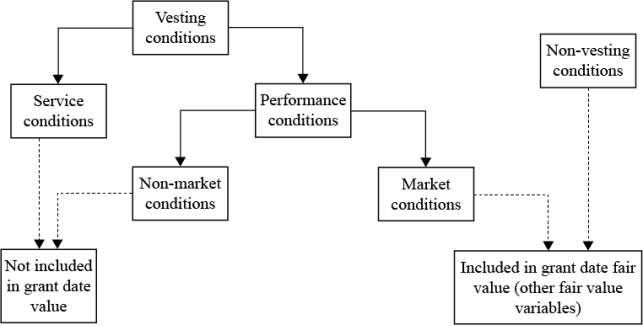
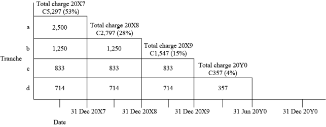

# 13 - Share-based payments (IFRS 2)

[返回目录](README.md)

## Illustrative text

### Scope

#### FAQ 13.4.1 – Is the purchase of a non-financial item expected to be used by the entity in the scope of IFRS 2 or IFRS 9?

 

Reference to standard: IFRS 2 paras 2, 6  
 Reference to standing text: [13.4](24.md#s86-Para_13.4) 

  

  
Entity A enters into a contract to purchase silver for use in its jewellery manufacturing business; under the contract, it will pay to the supplier a cash amount equal to the value of 1,000 shares of entity A at the date when the silver is delivered. Is this arrangement in the scope of IFRS 2 or IFRS 9?

This arrangement meets the definition of a cash-settled share-based payment transaction (that is, entity A has acquired goods in exchange for payment of an amount based on the value of its shares).

IFRS 9 applies to contracts to buy or sell a non-financial item that can be settled net in cash or another financial instrument, or by exchanging financial instruments, as if the contracts were financial instruments; but the standard does not apply to contracts that were entered into and continue to be held for the purpose of the receipt or delivery of the non-financial item in accordance with the entity’s expected purchase, sale or usage requirements. [IAS 32 para 8]. [IFRS 9 para 2.4].

Entity A’s contract does not fall within the scope of IFRS 9, whether or not it can be settled net, because it was entered into for the purpose of taking delivery of the silver for use in entity A’s business; and entity A has a history of doing this. So it is within the scope of IFRS 2 as a cash-settled share-based payment transaction.

 

#### FAQ 13.4.2 – Is the purchase of an intangible asset with the entity's shares in the scope of IFRS 2?

 

Reference to standard: IFRS 2 para 5  
 Reference to standing text: [13.4](24.md#s86-Para_13.4) 

  

  
 Entity B is developing a new product, and it purchases a patent from entity C. The parties agree a purchase price of 1,000 of entity B’s shares. These will be issued to entity C within 60 days of finalising the legal documentation that transfers the patent from entity C to entity B. Is this arrangement in the scope of IFRS 2?

This is an equity-settled share-based payment. IFRS 2 applies to a share-based payment for a patent. The goods to which IFRS 2 applies include inventories, consumables, property, plant and equipment, intangible assets and other non-financial assets.

 

#### FAQ 13.4.3 – Is continued post-business combination employee service for a share-based payment scheme in the scope of IFRS 2?

 

Reference to standard: IFRS 2 para 5  
 Reference to standing text: [13.4](24.md#s86-Para_13.4) 

  

  
 Entity D acquires 90% of entity E’s share capital. As part of the acquisition, entity D grants share options to entity E’s employees that vest after two years if the employees remain in service. Is this arrangement in the scope of IFRS 2?

The equity instruments are granted to employees of the acquiree in exchange for future services, and so they fall within IFRS 2’s scope.

[IFRS 2 para 5].

 

#### FAQ 13.4.4 – Is the award of parent entity shares by a shareholder in the scope of IFRS 2?

 

Reference to standard: IFRS 2 para 3A  
 Reference to standing text: [13.4](24.md#s86-Para_13.4) 

  

  
 An individual with a 40% shareholding in entity F awards 2% of his shareholding in entity F to a director of entity F’s subsidiary, entity G, in exchange for employee services. Is this arrangement in the scope of IFRS 2?

The award is within IFRS 2’s scope. A shareholder of entity F has transferred equity instruments of entity F (entity G’s parent) to a party in exchange for services to the entity. [IFRS 2 para 3A]. The award will be reflected in entity G’s financial statements and in entity F’s consolidated financial statements.

 

#### FAQ 13.4.5 – Are services that are paid for by issuing warrants in the scope of IFRS 2?

 

Reference to standard: IFRS 2 para 2  
 Reference to standing text: [13.4](24.md#s86-Para_13.4) 

  

  
During the year, entity K’s bank provided services to entity K; entity K agreed to issue warrants to the bank as consideration for these services. The warrants have a fixed subscription price, and entity K will settle the warrants in equity – in other words, if the bank chooses to exercise the warrants, it will receive one share in entity K for each warrant held, in return for paying the fixed subscription price. Is this arrangement in the scope of IFRS 2?

Entity K has received services as consideration for issuing equity instruments of entity K. This is an equity-settled share-based payment which should be accounted for under IFRS 2.

 

#### FAQ 13.4.6 – Are shares issued on formation of a joint venture in the scope of IFRS 2?

 

Reference to standard: IFRS 2 para 2  
 Reference to standing text: [13.4](24.md#s86-Para_13.4) 

  

  
Entities X and Y have formed an incorporated joint venture, entity Z. On formation, entity X contributed property, plant and equipment, and entity Y contributed intangible assets that do not constitute a business, in exchange for their equity interests in entity Z. Is this a share-based payment arrangement?

The asset contributions by entities X and Y on entity Z’s formation are equity-settled share-based payment transactions from entity Z’s perspective, and they fall within IFRS 2’s scope. The scope exclusion in paragraph 5 of IFRS 2 does not apply, because the formation of a joint venture does not meet the definition of a business combination; also, entities X and Y contributed assets and not businesses. See further example in [FAQ 13.5.5](25.md#s93-FAQ_13.5.5), where the formation of a joint venture falls within the scope exclusion because two separate entities are being brought together to form a joint venture. See further [chapter 32 para 5](57.md#s230-Para_32.5).

 

#### FAQ 13.4.7 – Is a bonus where the amount is fixed in cash terms but can be settled in shares to the same value in the scope of IFRS 2?

 

Reference to standard: IFRS 2 para 2  
 Reference to standing text: [13.4](24.md#s86-Para_13.4) 

  

  
 An entity agrees to pay a bonus of C10,000 to its employees. It has a choice of settling in cash or by issuing shares with a value equivalent to the cash payment. The entity has a past practice of settling in cash, and it is considering whether the transaction is within the scope of IFRS 2. Is this a share-based payment arrangement?

Under the principles of IAS 32, a variable number of shares issued for a fixed amount would be accounted for as a liability; so, from the perspective of IAS 32, it could be argued that this type of award should be within the scope of IAS 19 and not IFRS 2. But, because the entity has a choice that allows it to settle the award using equity instruments or cash, the transaction is a share-based payment with a settlement choice (see further [para 13.59](24.md#s90-Para_13.59)). [IFRS 2 para 2(c)].

If the award was always settled using shares, it would be classified as equity-settled, even though it is shares to a fixed value.

 

#### FAQ 13.4.8 – Is a transaction with a variable number of shares for goods in the scope of IFRS 2?

 

Reference to standard: IFRS 2 para 5  
 Reference to standing text: [13.4](24.md#s86-Para_13.4) 

  

  
Entity A signs a contract with a construction entity to acquire a new building for C1 million; ownership of the building transfers to entity A when the construction work is complete. The purchase price will be settled by entity A issuing a variable number of its own shares with a total market value of C1 million. Is this transaction in the scope of IFRS 2?

The transaction is within IFRS 2’s scope, and excluded from the scope of IAS 32, because the building is being acquired for use by entity A and the purchase price is being settled in shares. See further example in [FAQ 13.10.5](25.md#s93-FAQ_13.10.5).

 

#### FAQ 13.4.9 – Is a non-recourse loan enabling the counterparty to purchase shares in the scope of IFRS 2?

 

Reference to standard: IFRS 2 para 2  
Reference to standing text:[13.37](24.md#s89-Para_13.37)  

  

  
 An entity lends C100 to an employee to purchase the entity’s shares from the market. The loan is interest-free and only has recourse to the shares. Dividends paid on the shares should be used to reduce the loan. The employee should pay back the balance of the loan (or return the shares) at the earlier of three years or resignation. is this a share-based payment transaction?

The IFRS IC has confirmed that this transaction would fall within the scope of IFRS 2. The loan is considered to be part of a share-based payment transaction; in substance, this is an option with at most a three-year life, where the exercise price is reduced by any dividends. The employee is not exposed to any downside risk in the movement of the share price over the three years, because he or she can repay the loan or surrender the shares. So the ‘loan’ is recognised as a debit in equity, for the purchase of treasury shares, and not as a receivable. The option would be exercised on the date when the loan is repaid. In this example, the option would vest immediately, because the employee could leave on day 1, repay the loan and be fully entitled to the shares. Vesting conditions are considered in detail in [paragraphs 13.35 to 13.41](24.md#s89-Para_13.35). See [EX 13.37.2](25.md#s93-EX13.37.2) for a worked example of the accounting treatment.

 

#### FAQ 13.4.10 – Is a full recourse loan enabling a counterparty to purchase shares in the scope of IFRS 2?

 

Reference to standard: IFRS 2 paras 2–6  
 Reference to standing text: [13.4](24.md#s86-Para_13.4) 

  

  
 The facts are the same as in [FAQ 13.4.9](25.md#s93-FAQ_13.4.9), except that the entity has recourse to personal assets of the employee as well as the shares. This means that, if the employee fails to repay the loan, the entity can take possession of the employee’s personal assets (for example, their car or house). How should this transaction be accounted for?

The employee is unconditionally bound to repay the loan. The entity should record a receivable for the loan balance. The terms of the loan with the entity give a preferential interest rate to employees; so a fair value adjustment to the loan balance should be recognised (under IFRS 9) as an employee remuneration expense over an appropriate service period under IAS 19. This is because the fair value of the loan has been reduced through a preferential rate and a benefit has been provided to the employee.

Full recourse loans with employees are rare in practice. Before an entity determines that it has granted a full recourse loan to an employee, the following factors should be considered to establish if the loan is, in substance, non-recourse:

- The employer has legal recourse to the employee’s other assets, but it does not intend to seek repayment beyond the shares issued.

- The employer has a history of not demanding repayment of loan amounts in excess of the fair value of the shares.

- The employee does not have sufficient assets or other means (beyond the shares) to justify the recourse nature of the loan.

- The employer has accepted a recourse note on exercise, and has subsequently converted the recourse note to a non-recourse note.

 

#### FAQ 13.4.11 – How should the issue of shares to existing members and customers on the listing of a mutual entity be accounted for?

 

Reference to standard: IFRS 2 para 5  
 Reference to standing text: [13.4](24.md#s86-Para_13.4) 

  

  
 Entity A is a mutual entity, and its shares are held by members. Entity A plans to de-mutualise and list on the local stock exchange; and it will convert the existing ‘member’ shares to ordinary equity capital in a listed entity. As part of the process, entity A will issue free shares to its customers (that is, those customers that are not members). How should this transaction be accounted for?

The appropriate accounting for the share-based payment is determined by considering separately the shares issued to existing members and to customers.

**Existing members**

This is not a share-based payment arrangement, because it is with members in their capacity as existing equity holders.

**Customers (that are not members)**

The entity issues shares for nil consideration, and it is not possible to identify the specific goods and services received in return for the shares. Entity A accounts for this arrangement under IFRS 2. Entity A measures (in accordance with IFRS 2) the unidentifiable goods and services that are received, by using the fair value of the equity instrument granted, and it recognises a related expense immediately.

 

#### FAQ 13.4.12 – How should the reverse acquisition of a listed shell company be accounted for?

 

Reference to standard: IFRS 2 para 5  
 Reference to standing text: [13.4](24.md#s86-Para_13.4) 

  

  
Under IFRS 3, if the accounting acquiree is not a business, the transaction is not within the scope of IFRS 3. In some circumstances, such as a reverse acquisition, it is not always clear whether a business has been acquired; so the substance of the arrangement should be considered.

Entity V, a listed entity that is not a business (for example, a listed shell company) at the time of the transaction, issues shares in exchange for shares in entity W. Although entity V becomes entity W’s legal parent, the transaction is not a business combination under IFRS 3; this is because entity V is not a business and, in substance, it has not gained control over entity W. This question was considered by the Interpretations Committee. How should such a transaction be accounted for?

Transactions in which an entity acquires goods, as part of the net assets acquired in a business combination (as defined in IFRS 3), are outside IFRS 2’s scope.

In this case, the transaction is within IFRS 2’s scope because, in substance, the shareholders of private entity W have given to the shareholders of public entity V an interest in entity W in exchange for assets within entity V and entity V’s listing status. So, entity W should fair value the consideration that entity V’s shareholders received (that is, the shares given out by entity W’s shareholders) and the identifiable assets of entity V that entity W’s shareholders acquired. Any resulting difference would be unidentifiable goods or services which should be expensed (unless it meets the definition of an asset under other standards). Appropriate disclosure, to explain the accounting policy, is necessary.

 

#### FAQ 13.4.13 - How should share based contingent consideration with the shareholders or sponsors of a special purpose acquisition company be recognised in a reverse merger with a non-listed operating company?

 

Reference to standard: IFRS 2 para 21A  
Reference to standing text: [13.4](24.md#s86-Para_13.4), [A1.49](86.md#s359-Para_A1.49), 29.37 

  

 

This FAQ addresses the accounting for share based continent consideration from shareholders or sponsors of a special purpose acquisition company perspective. The accounting from the shareholders of a non-listed operating perspective is dealt with in [FAQ 13.4.14](25.md#s93-FAQ_13.4.14).

 

**Question**

 

How should share-based contingent consideration with the **shareholders or sponsors of a special purpose acquisition company** (‘SPAC’) be accounted for in the reverse merger transaction of a SPAC with a non-listed operating company (‘OpCo’)?

 

**Example**

 

Entity B is acquired by a listed non-operating company, entity A (which is not considered to be a business). The fair value of entity B is known: C500m. The consideration for entity B comprised 422 shares of entity A. The fair value of the net assets of entity A is C100m, comprising only a cash balance. Entity B is determined to be the accounting acquirer and, as a result, the transaction will be accounted for as a capital reorganisation rather than a reverse acquisition, since entity A is not a business. Immediately before the acquisition, entity A has 100 shares outstanding. 

 

The shareholders of entity B own 80.84% (422/522) of the equity of the merged public entity after the transaction. The remaining 19.16% is owned by the shareholders of entity A (100/522).

 

The substance of the transaction is that the shareholders of entity B have:

 

- given up 19.16% of their interest in entity B to the shareholders of entity A (19.16% × C500m); and

- received 80.84% of C100m in cash and a publicly listed entity.

 

The deemed cost of the shares issued by entity B is C119m (C500m × 19.16% / 80.84%). This represents the fair value of the shares that entity B would have had to issue for the ratio of ownership interest in the combined entity to be the same, if the transaction had taken the legal form of entity B acquiring 100% of the shares in entity A.

 

IFRS 2 applies to transactions where an entity grants the right to equity instruments in return for goods or a service or, when granting a right to equity interests, the entity cannot identify specifically some or all of the goods or service received in return. Entity B has issued shares with a value in excess of the assets received, so IFRS 2 would indicate that the difference is recognised in profit and loss. As such, entity B would recognise the transaction as follows:

 

<table style="border-collapse:collapse"><thead><tr><td style="border:0.75pt solid #000000; padding-right:5.03pt; padding-left:5.03pt; vertical-align:top">
 
</td><td style="border:0.75pt solid #000000; padding-right:5.03pt; padding-left:5.03pt; vertical-align:top">
 
</td><td style="border:0.75pt solid #000000; padding-right:5.03pt; padding-left:5.03pt; vertical-align:top">
C'm
</td><td style="border:0.75pt solid #000000; padding-right:5.03pt; padding-left:5.03pt; vertical-align:top">
C'm
</td></tr></thead><tbody><tr><td style="border:0.75pt solid #000000; padding-right:5.03pt; padding-left:5.03pt; vertical-align:top">
Dr
</td><td style="border:0.75pt solid #000000; padding-right:5.03pt; padding-left:5.03pt; vertical-align:top">
Cash
</td><td style="border:0.75pt solid #000000; padding-right:5.03pt; padding-left:5.03pt; vertical-align:top">
100
</td><td style="border:0.75pt solid #000000; padding-right:5.03pt; padding-left:5.03pt; vertical-align:top">
 
</td></tr><tr><td style="border:0.75pt solid #000000; padding-right:5.03pt; padding-left:5.03pt; vertical-align:top">
Dr
</td><td style="border:0.75pt solid #000000; padding-right:5.03pt; padding-left:5.03pt; vertical-align:top">
Profit and loss
</td><td style="border:0.75pt solid #000000; padding-right:5.03pt; padding-left:5.03pt; vertical-align:top">
19
</td><td style="border:0.75pt solid #000000; padding-right:5.03pt; padding-left:5.03pt; vertical-align:top">
 
</td></tr><tr><td style="border:0.75pt solid #000000; padding-right:5.03pt; padding-left:5.03pt; vertical-align:top">
Cr
</td><td style="border:0.75pt solid #000000; padding-right:5.03pt; padding-left:5.03pt; vertical-align:top">
Equity
</td><td style="border:0.75pt solid #000000; padding-right:5.03pt; padding-left:5.03pt; vertical-align:top">
 
</td><td style="border:0.75pt solid #000000; padding-right:5.03pt; padding-left:5.03pt; vertical-align:top">
119
</td></tr></tbody></table>

 

The difference of C19m does not qualify for recognition as an intangible asset, nor can it be recognised directly in equity. The difference of C19m is considered to be the cost of a service in respect of a share exchange listing for entity B’s shares. Refer to [EX A1.49.1 – Reverse acquisition into shell company](86.md#s361-EXA1.49.1).

 

The new number of total shares post-merger is 522 (100 / 19.16%). The hypothetical fair value per share after the capital reorganisation is C1.15 par.

 

<table style="border-collapse:collapse"><thead><tr><td style="border:0.75pt solid #000000; padding-right:5.03pt; padding-left:5.03pt; vertical-align:top">
Entity A’s shareholders have
</td><td style="border:0.75pt solid #000000; padding-right:5.03pt; padding-left:5.03pt; vertical-align:top">
100 shares (522 × 19.16%)
</td></tr></thead><tbody><tr><td style="border:0.75pt solid #000000; padding-right:5.03pt; padding-left:5.03pt; vertical-align:top">
Entity B’s shareholders have
</td><td style="border:0.75pt solid #000000; padding-right:5.03pt; padding-left:5.03pt; vertical-align:top">
422 shares (522 × 80.84%)
</td></tr></tbody></table>

 

The contingent share arrangements are considered below.

 

**Scenario A: the potential contingent payment arrangement with shareholders of entity A is based on a market condition; there is****no link to service and so the award vests immediately**

 

The parties agree that, if the listed price per share increases past a target of C1.20 per share, then as an incentive, the merged entity will issue a bonus of 25 shares to the previous sponsors of entity A. The commercial rationale of this contingent payment is that the sponsor of entity A is receiving an earn-out bonus for exceeding the price that entity B’s shareholders were expecting from the listing.

 

At the date of the contingent arrangement, the transaction was, from OpCo’s perspective, within the scope of IFRS 2. As part of that arrangement, there was an initial payment for the listing service, as well as a contingent additional payment, which was based on the condition of reaching the target stock market price. There is no service condition related to the potential incremental awards. As a result, this condition would be considered to be a non-vesting condition rather than a market condition.

 

An entity should take into account all non-vesting conditions when estimating the fair value of the equity instruments granted. Therefore, for grants of equity instruments with non-vesting conditions, the entity should recognise the goods or services received from a counterparty that satisfy all vesting conditions that are not market conditions, irrespective of whether those non-vesting conditions are satisfied. [IFRS 2 para 21A]. Refer to [EX 13.36.2 – Implications of vesting and non-vesting conditions](25.md#s93-EX13.36.2).

 

Assume that the grant date fair value of the additional contingent shares was С15m. The grant date fair value would have incorporated the probability of the earn-out target being met.

 

At the vesting date, there was no service period related to this additional award. Consequently, this would be considered to be part of the listing service, and it would be recognised as an incremental share-based payment at the date of the capital reorganisation as follows:

 

<table style="border-collapse:collapse"><thead><tr><td style="border:0.75pt solid #000000; padding-right:5.03pt; padding-left:5.03pt; vertical-align:top">
 
</td><td style="border:0.75pt solid #000000; padding-right:5.03pt; padding-left:5.03pt; vertical-align:top">
 
</td><td style="border:0.75pt solid #000000; padding-right:5.03pt; padding-left:5.03pt; vertical-align:top">
C'm
</td><td style="border:0.75pt solid #000000; padding-right:5.03pt; padding-left:5.03pt; vertical-align:top">
C'm
</td></tr></thead><tbody><tr><td style="border:0.75pt solid #000000; padding-right:5.03pt; padding-left:5.03pt; vertical-align:top">
Dr
</td><td style="border:0.75pt solid #000000; padding-right:5.03pt; padding-left:5.03pt; vertical-align:top">
Share-based payment expense
</td><td style="border:0.75pt solid #000000; padding-right:5.03pt; padding-left:5.03pt; vertical-align:top">
15
</td><td style="border:0.75pt solid #000000; padding-right:5.03pt; padding-left:5.03pt; vertical-align:top">
 
</td></tr><tr><td style="border:0.75pt solid #000000; padding-right:5.03pt; padding-left:5.03pt; vertical-align:top">
Cr
</td><td style="border:0.75pt solid #000000; padding-right:5.03pt; padding-left:5.03pt; vertical-align:top">
Equity
</td><td style="border:0.75pt solid #000000; padding-right:5.03pt; padding-left:5.03pt; vertical-align:top">
 
</td><td style="border:0.75pt solid #000000; padding-right:5.03pt; padding-left:5.03pt; vertical-align:top">
15
</td></tr></tbody></table>

 

This expense would not be adjusted after the vesting date, regardless of whether the target share price is achieved or not.

 

**Scenario B: the potential contingent payment arrangement with shareholders of entity A is based on a non-market condition; there is no link to service and so****the award vests immediately**

 

Assume the same facts as scenario A. However, assume that the contingent payment is dependent on a multiple of earnings before interest, taxes, depreciation and amortization (‘EBITDA’) or other non-market condition. There continues to be no service condition related to the potential incremental awards, and so the EBITDA multiple target is a non-vesting condition. Therefore, the outcome would be the same as that of scenario A, although the fair value of the incremental share-based payment might be different. 

 

#### FAQ 13.4.14 - How should share based contingent consideration with the shareholders of a non-listed operating company be recognised in a reverse merger with a special purpose acquisition company?

 

Reference to standard: IFRS 2 para 21A  
Reference to standing text: [13.4](24.md#s86-Para_13.4), [A1.49](86.md#s359-Para_A1.49), 29.37  

  

 

The FAQ addresses the accounting for share based contingent consideration from the shareholders of a non-listed operating perspective. The accounting from the shareholders or sponsors of a special purpose acquisition company perspective is dealt with in [FAQ 13.4.13](25.md#s93-FAQ_13.4.13).

 

**Question**

 

How should share-based contingent consideration with the **shareholders of a non-listed operating company** (‘OpCo’) be accounted for in a special purpose acquisition company (‘SPAC’) merger transaction?

 

**Example**

 

Entity B is acquired by a listed non-operating company, entity A (which is not considered to be a business). The fair value of entity B is known: C500m. The consideration for entity B comprised 422 shares of entity A. The fair value of the net assets of entity A is C100m, comprising only a cash balance. Entity B is determined to be the accounting acquirer and, as a result, the transaction will be accounted for as a capital reorganisation rather than a reverse acquisition, since entity A is not a business. Immediately before the acquisition, entity A has 100 shares outstanding. 

 

The shareholders of entity B own 80.84% (422/522) of the equity of the merged public entity after the transaction. The remaining 19.16% is owned by the shareholders of entity A (100/522).

 

The substance of the transaction is that the shareholders of entity B have:

 

- given up 19.16% of their interest in entity B to the shareholders of entity A (19.16% × C500m); and

- received 80.84% of C100m in cash and a publicly listed entity.

 

The deemed cost of the shares issued by entity B is C119m (C500m × 19.16% / 80.84%). This represents the fair value of the shares that entity B would have had to issue for the ratio of ownership interest in the combined entity to be the same, if the transaction had taken the legal form of entity B acquiring 100% of the shares in entity A.

 

IFRS 2 applies to transactions where an entity grants the right to equity instruments in return for goods or a service or, when granting a right to equity interests, the entity cannot identify specifically some or all of the goods or service received in return. Entity B has issued shares with a value in excess of the assets received, so IFRS 2 would indicate that the difference is recognised in profit and loss. As such, entity B would recognise the transaction as follows:

 

<table style="border-collapse:collapse"><thead><tr><td style="border:0.75pt solid #000000; padding-right:5.03pt; padding-left:5.03pt; vertical-align:top">
 
</td><td style="border:0.75pt solid #000000; padding-right:5.03pt; padding-left:5.03pt; vertical-align:top">
 
</td><td style="border:0.75pt solid #000000; padding-right:5.03pt; padding-left:5.03pt; vertical-align:top">
C'm
</td><td style="border:0.75pt solid #000000; padding-right:5.03pt; padding-left:5.03pt; vertical-align:top">
C'm
</td></tr></thead><tbody><tr><td style="border:0.75pt solid #000000; padding-right:5.03pt; padding-left:5.03pt; vertical-align:top">
Dr
</td><td style="border:0.75pt solid #000000; padding-right:5.03pt; padding-left:5.03pt; vertical-align:top">
Cash
</td><td style="border:0.75pt solid #000000; padding-right:5.03pt; padding-left:5.03pt; vertical-align:top">
100
</td><td style="border:0.75pt solid #000000; padding-right:5.03pt; padding-left:5.03pt; vertical-align:top">
 
</td></tr><tr><td style="border:0.75pt solid #000000; padding-right:5.03pt; padding-left:5.03pt; vertical-align:top">
Dr
</td><td style="border:0.75pt solid #000000; padding-right:5.03pt; padding-left:5.03pt; vertical-align:top">
Profit and loss
</td><td style="border:0.75pt solid #000000; padding-right:5.03pt; padding-left:5.03pt; vertical-align:top">
19
</td><td style="border:0.75pt solid #000000; padding-right:5.03pt; padding-left:5.03pt; vertical-align:top">
 
</td></tr><tr><td style="border:0.75pt solid #000000; padding-right:5.03pt; padding-left:5.03pt; vertical-align:top">
Cr
</td><td style="border:0.75pt solid #000000; padding-right:5.03pt; padding-left:5.03pt; vertical-align:top">
Equity
</td><td style="border:0.75pt solid #000000; padding-right:5.03pt; padding-left:5.03pt; vertical-align:top">
 
</td><td style="border:0.75pt solid #000000; padding-right:5.03pt; padding-left:5.03pt; vertical-align:top">
119
</td></tr></tbody></table>

 

The difference of C19m does not qualify for recognition as an intangible asset, nor can it be recognised directly in equity. The difference of C19m is considered to be the cost of a service in respect of a share exchange listing for entity B’s shares. Refer to [EX A1.49.1 – Reverse acquisition into shell company](86.md#s361-EXA1.49.1).

 

The new number of total shares post-merger is 522 (100 / 19.16%). The hypothetical fair value per share after the capital reorganisation is C1.15 par.

 

<table style="border-collapse:collapse"><tr><td style="border:0.75pt solid #000000; padding-right:5.03pt; padding-left:5.03pt; vertical-align:top">
Entity A’s shareholders have
</td><td style="border:0.75pt solid #000000; padding-right:5.03pt; padding-left:5.03pt; vertical-align:top">
100 shares (522 × 19.16%)
</td></tr><tr><td style="border:0.75pt solid #000000; padding-right:5.03pt; padding-left:5.03pt; vertical-align:top">
Entity B’s shareholders have
</td><td style="border:0.75pt solid #000000; padding-right:5.03pt; padding-left:5.03pt; vertical-align:top">
422 shares (522 × 80.84%)
</td></tr></table>

 

The contingent share arrangements are considered below.

 

**Scenario A:** **the potential contingent payment arrangement with shareholders of entity B is based on a market condition; there is****no link to service and so the award vests immediatel**y

 

The parties agree that, if the listed price per share increases past a target of C1.25 per share, the merged entity will issue a bonus of 25 shares to only the previous shareholders of entity B. In other words, the shareholders of the entity B will receive more potential shares, and possibly end up with a larger relative shareholding, in the merged entity compared to the date of the merger.

 

As at the date of the capital reorganisation, the transaction was, from OpCo’s perspective, within the scope of IFRS 2. The contingent share issuance was contemplated, as part of that transaction, with a commercial rationale to limit the value of the equity given to entity A in exchange for the listing service. There is no service condition related to the potential incremental awards. As a result, this condition would be considered to be a non-vesting condition rather than a market condition.

 

An entity should take into account all non-vesting conditions when estimating the fair value of the equity instruments granted. Therefore, for grants of equity instruments with non-vesting conditions, the entity should recognise the goods or services received from a counterparty that satisfy all vesting conditions that are not market conditions, irrespective of whether those non-vesting conditions are satisfied. [IFRS 2 para 21A]. Refer to [EX 13.36.2 – Implications of vesting and non-vesting conditions](25.md#s93-EX13.36.2).

 

Therefore, at the date of the share-based payment representing the listing service (that is, the payment of C19m above), entity B would need to include, in its estimate of that grant date fair value, the reduction of that value as a result of the contingent awards.

 

Assume that the reduction in the grant date fair value as a result of the contingently issuable awards was С5m.

 

<table style="border-collapse:collapse"><thead><tr><td style="border:0.75pt solid #000000; padding-right:5.03pt; padding-left:5.03pt; vertical-align:top">
 
</td><td style="border:0.75pt solid #000000; padding-right:5.03pt; padding-left:5.03pt; vertical-align:top">
 
</td><td style="border:0.75pt solid #000000; padding-right:5.03pt; padding-left:5.03pt; vertical-align:top">
C'm
</td><td style="border:0.75pt solid #000000; padding-right:5.03pt; padding-left:5.03pt; vertical-align:top">
C'm
</td></tr></thead><tbody><tr><td style="border:0.75pt solid #000000; padding-right:5.03pt; padding-left:5.03pt; vertical-align:top">
Dr
</td><td style="border:0.75pt solid #000000; padding-right:5.03pt; padding-left:5.03pt; vertical-align:top">
Equity
</td><td style="border:0.75pt solid #000000; padding-right:5.03pt; padding-left:5.03pt; vertical-align:top">
5
</td><td style="border:0.75pt solid #000000; padding-right:5.03pt; padding-left:5.03pt; vertical-align:top">
 
</td></tr><tr><td style="border:0.75pt solid #000000; padding-right:5.03pt; padding-left:5.03pt; vertical-align:top">
Cr
</td><td style="border:0.75pt solid #000000; padding-right:5.03pt; padding-left:5.03pt; vertical-align:top">
Share-based payment expense
</td><td style="border:0.75pt solid #000000; padding-right:5.03pt; padding-left:5.03pt; vertical-align:top">
 
</td><td style="border:0.75pt solid #000000; padding-right:5.03pt; padding-left:5.03pt; vertical-align:top">
5
</td></tr></tbody></table>

 

In other words, the net IFRS 2 share-based payment as at the date of the merger would be C14m (that is, C19m less the C5m).

 

This adjustment to the grant date fair value of the IFRS 2 expense would not be adjusted after the vesting date, regardless of whether the target share price is achieved or not.

 

**Scenario B: the potential contingent payment arrangement with shareholders of enti****ty B is based on a non-market condition; there is no link to service and so the award vests immediately**

 

Assume the same facts as scenario A. However, assume that the contingent payment is dependent on a multiple of earnings before interest, taxes, depreciation and amortization (‘EBITDA’) or other non-market condition. There continues to be no service condition related to the potential incremental awards, and so the EBITDA multiple target is a non-vesting condition. Therefore, the outcome would be the same as that of scenario A, although the fair value of the reduction to the share-based payment might be different.

 

#### FAQ 13.4.15 – Under what guidance should an entity account for a bonus arrangement where the bonus itself is not share-based, but where the beneficiaries are required to invest the cash received in shares of the entity?

 

Reference to standard: IFRS 2 para 21A  
Reference to standing text: [13.4](24.md#s86-Para_13.4)  

  

 

**Background**

 

Due to new corporate governance rules, entity X grants its key management an annual cash bonus that is contractually required to be invested in shares of entity X. The amount of the annual cash bonus depends on the EBITDA of the respective year, and there are no other performance conditions that relate to the share price of entity X (or of any other group entity) – that is, the amount determined is not share-based. The shares must be purchased by the employees on the market at fair value within a very short period of time after receipt of the bonus payment. The employees are required to hold those shares with no ability to sell them for a period of two years. Moreover, they are required to provide evidence that they comply with the investment requirement for the entire period. If they do not comply with the investment requirement, they are in breach of contract and thus required to repay the cash originally received from entity X. After two years, the restrictions on the investment no longer apply. If an employee resigns from entity X during the holding period of two years, this does not lead to a forfeiture of the entitlement (that is, the employee can keep the shares).

 

**Question**

 

Is this arrangement within the scope of IFRS 2? What is the appropriate accounting treatment of this arrangement?

 

**Answer**

 

This grant should be accounted for under IFRS 2. It should be accounted for as an equity-settled share-based payment arrangement.

 

The focus of the definition of a ‘share-based payment arrangement’ in Appendix A to IFRS 2 is on what the counterparty receives. This is in line with:

 

- the requirements in IFRS 2 regarding the treatment of redemption features (see para 31 of IFRS 2); and

- the classification where the entity must pay cash in order to purchase treasury shares that are then transferred to the employee (see paras B48 and B49 of IFRS 2 and [FAQ 13.10.2](25.md#s93-FAQ_13.10.2)).

 

In the fact pattern presented, there is a direct link between the bonus and the investment requirement such that the employees will ultimately receive shares. This represents the shared understanding reached by the parties to the contract at grant date (see App A to IFRS 2). The decision to only invest in shares is not left to the discretion of the employees – this is a contractual requirement. Hence, the cash payment is an intermediate step only. The conclusion would be the same if entity X transferred cash directly to a bank which then acquired the shares and held them in an escrow account. In the fact pattern under discussion, the employee acts in a manner that is very similar to the way in which an agent (such as the bank, in the more conventional fact pattern) acts.

 

The vesting period of the arrangement is the initial year in which the employee provides services so as to be entitled to the ‘cash’ bonus. The holding period of two years is a post-vesting restriction, rather than a service vesting condition. Hence, it might be relevant in terms of the fair value measurement at grant date (see [EX 13.35.1](25.md#s93-EX13.35.1)). Note that the IFRS IC addressed the issue of post-vesting transfer restrictions in conjunction with fair value measurement in an Agenda Decision in November 2006. Entity X should recognise a share-based payment expense, with the credit entry in equity. In line with the requirements in IFRS 2 that relate to equity-settled awards, the EBITDA target is a non-market vesting condition that is taken into consideration when estimating the number of awards that will vest. Ultimately, the employee receives shares to a value, in which case IFRS 2 is clear that classification as an equity-settled grant is appropriate (see para BC 106 of IFRS 2 and [FAQ 13.10.5](25.md#s93-FAQ_13.10.5)). When the conditional payment is made to the employee, entity X should account for it as the repurchase of an equity instrument (that is, it should apply para 29 of IFRS 2 by analogy).

 

#### FAQ 13.5.1 – How should net-settled commodity contracts within the scope of IAS 32 or IFRS 9 be accounted for?

 

Reference to standard: IFRS 2 para 6  
 Reference to standing text: [13.5](24.md#s86-Para_13.5) 

  

  
 Entity H enters into a contract to purchase 100 tonnes of cocoa beans. The purchase price will be settled in cash at an amount equal to the value of 1,000 of entity H’s shares. But the entity can settle the contract at any time by paying an amount equal to the current market value of 1,000 of its shares, less the market value of 100 tonnes of cocoa beans. The entity has entered into the contract as part of its hedging strategy, and it has no intention of taking physical delivery of the cocoa beans. How should the contract be accounted for?

As in [FAQ 13.4.1](25.md#s93-FAQ_13.4.1), the transaction meets the definition of a share-based payment arrangement (that is, entity H has given the counterparty a right to the payment of an amount based on the value of its shares). However, unlike [FAQ 13.4.1](25.md#s93-FAQ_13.4.1), the contract can be settled net and has not been entered into to satisfy entity H’s expected purchase, sale or usage requirements. So, entity H will not receive goods or services. The transaction is outside IFRS 2’s scope and is instead dealt with under IAS 32 and IFRS 9. See further [chapter 40 para 83](61.md#s252-Para_40.83).

 

#### FAQ 13.5.2 – Are cash payments that are dependent on an earnings multiple in the scope of IFRS 2?

 

Reference to standard: IFRS 2 para 2  
 Reference to standing text: [13.5](24.md#s86-Para_13.5) 

  

  
A non-quoted entity issued share appreciation rights (SARs) to its employees. The SARs entitle the employees to a payment equal to any increase in the entity’s share price between the grant date and the vesting date. The arrangement’s terms and conditions define the share price used to calculate payments to employees as follows: five times EBITDA divided by the number of shares in issue. Is the SAR transaction in the scope of IFRS 2?

IFRS 2 is unlikely to apply to this transaction, because a fixed multiple of EBITDA is not likely to reflect the fair value of the entity’s share price. If IFRS 2 does not apply, management should apply IAS 19 (see [chapter 12 para 125](23.md#s81-Para_12.125)) to this deferred compensation arrangement.

 

#### FAQ 13.5.3 – Is a plan investing in other entity shares in the scope of IFRS 2?

 

Reference to standard: IFRS 2 para 2  
 Reference to standing text: [13.5](24.md#s86-Para_13.5) 

  

  
 Entity I is implementing an unusual share option incentive plan: it will lend C1 million to an employee share trust, which will purchase shares in a number of publicly listed entities (but not shares in entity I or any other entities within the same group as entity I). These entities might be suppliers, customers or competitors. Entity I’s employees are granted options over ‘units’ held by the employee share trust, which are shares in listed entities. The units are an amalgam of the shares held by the trust. The units do not entitle the employees to any equity interest in the trust itself and they are not based on the value of the trust. The options are granted at market value at the date of the grant and held for three years. When employees exercise their option over the units, they are paid the difference in cash between the market price of the units at the date of the grant (the exercise price) and the market value at the date of exercise. To fund the cash payment, the trust sells the shares relating to the exercised units. It then repays the relevant portion of the loan from entity I, and it pays the gain to employees (this assumes that the price of the underlying investments has increased in value following the grant). Is this transaction in the scope of IFRS 2?

This transaction is outside IFRS 2’s scope, because the rights are over shares that are not in entity I or in another entity within the same group as entity I.

Accounting for the changes in value of the assets in the trust will depend on how the assets are classified. If the assets fall into the definition of a plan asset under paragraph 7 of IAS 19 (see [chapter 12 para 21](23.md#s79-Para_12.21)) they should be accounted for in line with IAS 19. Otherwise, they will be included in the consolidated accounts and should be treated as financial assets in line with IFRS 9. The related liability will be within IAS 19’s scope. See [chapter 12 paras 125 to 126](23.md#s81-Para_12.125).

Accounting for employee share trusts is considered in detail in [EX 13.64.13](26.md#s94-EX13.64.13) onwards.

 

#### FAQ 13.5.4 – Is a business combination between two entities under common control in the scope of IFRS 2?

 

Reference to standard: IFRS 2 para 5  
 Reference to standing text: [13.5](24.md#s86-Para_13.5) 

  

  
A business combination occurs between two entities under common control. The transaction is outside IFRS 3’s scope. Is the transaction in the scope of IFRS 2?

Where shares are issued in such a common control transaction, the primary purpose is likely to be to reorganise the legal or managerial structure of a business or to transfer a business, rather than to acquire goods or services. The shares are issued in exchange for a business (that is, an integrated set of activities and assets) that can be managed to provide a return to investors, or lower costs or other economic benefits directly to investors or other owners, members or participants. [IFRS 3 App A]. As such, the transaction is outside IFRS 2’s scope.

 

#### FAQ 13.5.5 – Is the formation of a joint venture in the scope of IFRS 2?

 

Reference to standard: IFRS 2 para 5  
Reference to standing text: [13.5](24.md#s86-Para_13.5)  

  

Entities A and B are brought together to form a joint venture. Is the transaction in the scope of IFRS 2?

The formation of a joint venture is outside the scope of IFRS 3 (see further [FAQ 13.4.6](25.md#s93-FAQ_13.4.6)). This transaction does not meet the definition of a business combination, because two separate entities are being brought together into one reporting entity without either entity gaining control; so the scope exclusion in paragraph 5 of IFRS 2 would not apply, and the transaction is potentially in the scope of IFRS 2.

Where separate businesses are combined to form a joint venture, shares are issued for the purpose of forming the joint venture and not the acquisition of goods or services. The transaction is therefore outside IFRS 2’s scope, because the broader definition of business combination is used in the scope exclusion. See further chapter 29 para 74.

 

#### EX 13.5.6 – Associates and joint ventures

 

Reference to standard: IFRS 2 para 5  
 Reference to standing text: [13.5](24.md#s86-Para_13.5) 

  

  
Arrangements involving associates and joint ventures can be complicated. For example, where employees of a joint venture are granted rights over equity instruments of one or both joint venturers, such a transaction in the joint venture would be outside IFRS 2’s scope. This is because the joint venture is not part of the same group as the joint venturers, as defined by IFRS 10. Although the shareholders of the joint venture are transferring equity instruments to employees of the joint venture in exchange for employee services to the joint venture, the awards are not in the scope of IFRS 2 in the financial statements of the joint venture; the reason for this is that the equity instruments are not those of the joint venture or another entity in the same group as the joint venture. [IFRS 2 para 3A]. The position for associates is the same. Note that investors would account for such transactions in their financial statements under IFRS 2, because they are issuing rights to their own equity instruments in return for indirect benefits resulting from services provided to the joint venture (see further [para 13.6](24.md#s86-Para_13.6)).

In the situation described above, the associate or joint venture entity would need to apply the hierarchy in IAS 8, specifically paragraphs 10 and 11, to determine the appropriate accounting treatment. The entity is likely to determine that either IFRS 2 or IAS 19 is the most appropriate standard. This is a policy choice that the entity would make under IAS 8, and it would have to apply such policy consistently. It is our view that the most appropriate treatment is to apply the principles of IFRS 2 to employee benefits that are settled in equity. See below for details of how to apply IFRS 2 in this situation.

**Example – Share options in a joint venture**

Entity J is a 50:50 joint venture between entities K and L. Entity K grants options over its own shares to senior employees of entity J, without making any charge to entity J. Entity L does not provide any contribution to the joint venture to compensate entity K. Entity K applies the equity method to investments in joint ventures in its consolidated financial statements and the cost method in its separate financial statements.

**Entity J’s financial statements**

The scope of IFRS 2 includes transfers of equity instruments of an entity’s parent (or of an entity in the same group) in return for goods or services. [IFRS 2 para 3A]. Entity K is a joint venture investor and is not entity J’s parent, nor is it in the same group as entity J. ‘Group’ is defined in IFRS 10 as being ‘a parent and all its subsidiaries’. So, from entity J’s perspective, the award in entity J of share options in entity K is not within IFRS 2’s scope.

The arrangement also falls outside IAS 19’s scope. IAS 19 applies to all employee benefits, but defines those as “all forms of consideration given by an entity in exchange for service rendered by employees”. Because no consideration is given by entity J, this arrangement does not meet the definition of an employee benefit.

IAS 8 requires entities to apply a hierarchy when determining their accounting policies. Where there is no IFRS governing a transaction, IAS 8 requires management to look first to any IFRS standard or interpretation dealing with similar or related issues. Although it is not a formal requirement, it is our view that the most appropriate treatment is for entity J to apply the principles of IFRS 2 to this equity-settled share-based payment. This is supported by the treatment where a parent entity grants options over its own shares to employees of its subsidiary. In this case, entity K does not meet the definition of a parent entity; but, in the absence of any other guidance, this is an acceptable approach. (See further [para 13.64](24.md#s91-Para_13.64).)

The disclosure requirements of IAS 24 should be applied by entity J (for example, if any of the employees are key management personnel). See further [chapter 6 para 45](14.md#s41-Para_6.45).

Note that, if compensation was paid by entity J for the share-based payment, perhaps in the form of a recharge payment required by entity K, the transaction would be within IAS 19’s scope.

**Entity K’s financial statements**

Entity K has an equity-settled share-based payment arrangement, and it should measure the goods and services received under IFRS 2 as appropriate. So, in its separate financial statements, entity K would capitalise the IFRS 2 grant date fair value into its cost of the investment in the joint venture; it would also consider whether there were any impairment indicators.

Entity K should apply the principles of IFRS 11 (which, in the case of a joint venture, requires application of the principles in IAS 28) to its consolidated financial statements. If entity J has accounted for the share-based payment, 50% of this amount would be recorded by entity K when the equity method is applied. Because entity L did not provide an equivalent contribution into the joint venture, entity K would record an additional cost; this would result in 100% of the share-based payment charge being recorded in its consolidated financial statements.

**Entity L’s financial statements**

Other than the fact that entity L will need to account for its joint venture interest in entity J, there will be no impact on entity L’s separate financial statements. For further guidance on accounting for joint ventures, see [chapter 32 para 67](57.md#s232-Para_32.67).

 

#### EX 13.8.1 – Transactions with employees and transactions with shareholders

 

Reference to standard: IFRS 2 para 4  
 Reference to standing text: [13.8](24.md#s86-Para_13.8) 

  

  
 If an entity makes a bonus issue of shares to all of its shareholders, and these include some of the entity’s employees, this will not represent a share-based payment transaction to be dealt with under IFRS 2. But there could be a situation where an employee invests in an entity that is working towards a stock market listing or a trade sale. In these cases, a venture capital entity or similar investor could be involved in the transaction; so the employee could subscribe for the shares at the same amount as the other investors. The issue is whether the employee is acting as a shareholder or an employee. Often, the interested parties (including directors, management and other shareholders) have acquired shares for a ‘fair value', which might not equate to grant date fair value for the purposes of IFRS 2 and would typically be tax-driven. It is important to note that a value determined for tax purposes often reflects factors which it would not be appropriate to allow for under IFRS 2 (for example, a lack of marketability); and so it could be lower than the IFRS 2 grant date fair value.

If there are no conditions or incentives attached to the acquired shares, the employee is acting purely as a shareholder. But, in the majority of situations, there are likely to be service conditions or leaver provisions; so the arrangement would be accounted for as a share-based payment transaction under IFRS 2. The shares in question are often referred to as ‘sweet’ or ‘sweat’ equity, depending on whether they are offered at an advantageous price or in return for services rather than cash.

 

#### FAQ 13.8.2 – Is a rights issue to employees acting in their capacity as shareholders in the scope of IFRS 2?

 

Reference to standard: IFRS 2 para 4  
 Reference to standing text: [13.8](24.md#s86-Para_13.8) 

  

  
Entity A makes a rights issue to all of its shareholders, entitling them to purchase one new share, for each five shares owned, at a price of C10. The shareholders include 20 people who are also employees. No other conditions are attached to the rights issue. Is this transaction in the scope of IFRS 2?

Shares are being issued to employees in their capacity as shareholders, and not in exchange for their services. Also, the employees are not required to complete a period of service in exchange for the new shares. As such, the transaction is outside IFRS 2’s scope.

 

#### FAQ 13.8.3 – How should the capital contribution of a building in settlement of a rights issue be accounted for?

 

Reference to standard: IFRS 2 para 4  
 Reference to standing text: [13.8](24.md#s86-Para_13.8) 

  

  
 Entity B makes a rights issue to all shareholders. Shareholders are entitled to acquire one new share, for each share owned, at a fixed price of C4 at the date of the rights issue. Entity C owns 1 million of entity B’s shares (that is, 10% of the share capital). Entity C subscribes for 1 million of entity B’s new shares. Following the subscription, entity C proposes to entity B to settle the purchase price of the new shares by transferring to entity B an office building that it owns. Entity B agrees to accept the building as settlement for the new shares. How should this transaction be accounted for?

This transaction is a rights issue to all shareholders, so IFRS 2 does not apply. The method of payment is irrelevant, because this is a transaction with shareholders in their capacity as shareholders; therefore, the transfer of the building is outside IFRS 2’s scope. The subscription established a right to receive a fixed payment of C4 million from entity C. The transfer of the building was agreed after the receivable was established and is in settlement of the C4 million receivable.

 

#### FAQ 13.8.4 – How should an in-kind capital contribution by an existing shareholder be accounted for?

 

Reference to standard: IFRS 2 para 4  
 Reference to standing text: [13.8](24.md#s86-Para_13.8) 

  

  
Entity D needs a new office building and has arranged to acquire it from an existing shareholder. The purchase price will be settled by the entity issuing 1,000 new shares. For legal purposes, the transaction is considered an in-kind capital contribution of a building. How should this transaction be accounted for?

Management determined that, based on the specific facts and circumstances the counterparty did not act in its capacity as shareholder, but in its capacity as a supplier of the office building. As such, the in-kind capital contribution is within IFRS 2’s scope. This would mean that the office building is recognised at its fair value, and equity is credited by the same amount for the share issue.

 

#### EX 13.8.5 – Points to consider before concluding that transactions with employees are outside the scope of IFRS 2

 

Reference to standard: IFRS 2 para 4  
 Reference to standing text: [13.8](24.md#s86-Para_13.8) 

  

  
A number of points need to be considered before concluding that transactions with employees are not within IFRS 2’s scope; these include:

- Whether the instrument that the employees are entitled to is an equity instrument or linked to an equity instrument, as defined by the standard. [IFRS 2 App A]. If it is, and the value to employees varies depending on the extent to which the employee provides services, the transaction would be within IFRS 2’s scope as a share-based payment.

- Whether the rights/interests of employee shareholders differ from those of other investor shareholders (for example, venture capitalists). Employees might have the right to additional shares, while other investor shareholders give up their rights – a so-called ‘ratchet mechanism’. This ratchet usually depends on the business’ performance; and so employees receive more shares if the business does well. This would qualify as a performance condition, because services from employees contribute towards the entity meeting the performance targets; the transaction is, therefore, within IFRS 2’s scope.

- Whether holders have different rights following an exit event. Through the articles, employees could be given different rights (in terms of cash or shares) if an investor exits through an IPO rather than trade sale. This provides evidence of a performance condition (achieving different rights to cash or shares, depending on the exit event that occurs) which could bring the arrangement within the scope of IFRS 2.

- Leaver conditions (the articles or terms and conditions might define good leavers and bad leavers). In this situation, employees could lose their rights to shares if they leave the entity, and the shares are repurchased or cancelled. So, employees might only earn their right to the shares if they stay with the entity or, for example, in the event of a trade sale or an IPO. This would also be considered a service condition; and so the arrangement is in IFRS 2’s scope. See [EX 13.10.7](25.md#s93-EX13.10.7) for guidance on accounting for leaver provisions.

- Whether additional services are being provided. Employees will often lose their rights to shares if they leave the entity (see above). There is often a service requirement (for example, to stay in employment for a number of years or until a change in control). But this will not always be the case, and some employees will have the right to shares irrespective of whether they stay or leave. This does not automatically mean that the arrangement is outside IFRS 2’s scope, because the entity would still need to determine whether additional services (whether or not they are identifiable) are being provided by the shareholders in their capacity as employees, ([see para 13.6](24.md#s86-Para_13.6)). [IFRS 2 para 2].

- Whether a trust is involved in the arrangement. The existence of an employee benefit trust, to buy back and warehouse shares for the benefit of other employees, could well imply that shares are being issued as an incentive; and so the arrangement is in IFRS 2’s scope.

The above list is not exhaustive, but it highlights some of the areas that should be considered to determine if the transaction is within IFRS 2’s scope.

**Example – Purchase of shares at fair value, with service condition**

A CEO is offered the opportunity to buy 100,000 shares in entity A at C1 each, which is the same price paid by the venture capital investor that holds 40% of entity A’s shares. If the CEO resigns within two years, he should give the shares back to the entity, in return for a payment of the lower of his subscription price and the fair value of the shares.

This transaction is in IFRS 2’s scope, because the arrangement includes a service condition, and this condition should be satisfied before the CEO is fully entitled to the risks and rewards of the shares (that is, there is a vesting period of two years).

The CEO might be paying IFRS 2 grant date fair value for the shares on grant date (C1); if so, provided the award was equity-settled, there would be no IFRS 2 charge. But, since the arrangement is within the scope of IFRS 2, consideration should be given to disclosures prescribed in IFRS 2 (see further [para 13.70](24.md#s92-Para_13.70)) and IAS 24 (see further [chapter 6 para 45](14.md#s41-Para_6.45)).

 

### Equity-settled share-based payment transactions

#### EX 13.10.1 – Examples of equity-settled share-based payment transactions

 

Reference to standard: IFRS 2 App A  
 Reference to standing text: [13.10](24.md#s87-Para_13.10) 

  

  
Examples include the following:

- Transactions in which an entity obtains goods or services in exchange for its own equity instruments. For example, start-up entities might obtain consultancy and similar services in exchange for shares; this preserves scarce cash resources and gives the supplier an opportunity to share in the entity’s success.

- Transactions in which an entity obtains employee services when a shareholder awards shares of the entity to the employees.

- Transactions in which employees of an entity receive equity instruments of another entity in the same group, either from that other entity, from a parent or from a shareholder.

 

#### FAQ 13.10.2 – Is an entity's purchase of own shares from the market an equity-or cash-settled share-based payment arrangement?

 

Reference to standard: IFRS 2 App A  
Reference to standing text:[13.10](24.md#s87-Para_13.10)   

  

  
Where an entity acquires shares that will be used to satisfy a share-based payment award, the acquisition is a separate transaction; and the way in which the shares are acquired does not impact the classification of share-based payment awards under IFRS 2. For example, a share-based payment award would not be treated as cash-settled simply because an entity is forced to go to a third party to purchase its equity instruments in order to satisfy the award. If employees will always receive shares when they meet the vesting conditions, the award would be treated as equity-settled, because the entity is providing its own equity to employees. Is this an equity- or cash-settled share-based payment arrangement?

**Example – Classification following purchase of own shares from the market**

An entity grants rights to shares to its employees, subject to specified performance conditions. The entity purchases the shares on the market at the date when its employees satisfy those performance conditions and delivers those shares to its employees. Is this an equity- or cash-settled share-based payment arrangement?

The entity accounts for the arrangement as an equity-settled share-based payment transaction. When the performance conditions are met and the entity purchases the shares on the market, the transaction is recognised in equity as a treasury share transaction, to reflect the purchase of the entity’s own shares. This does not affect the share-based payment accounting.

 

#### FAQ 13.10.3 – How should an entity account for a share option scheme that is settled net of exercise the price?

 

Reference to standard: IFRS 2 para BC 255G  
Reference to standing text: [13.10](24.md#s87-Para_13.10)  

  

An entity might settle a share option award net (that is, employees receive fewer shares but pay no exercise price). For example, an employee is awarded 100 shares but receives 70 shares, and the value of the 30 shares withheld represents the stated exercise price divided by the stock price on the date of exercise. There is no cash outflow or liability for the entity; so it is not relevant whether the entity sells 30 shares on the market (to generate cash that would otherwise have been provided by the exercise price) or continues to hold them. The award should be classified as equity-settled; this is because the entity has settled the full value of the award in shares. See further the discussion of social security issues in [EX 13.11.2](25.md#s93-EX13.11.2).

 

#### FAQ 13.10.4 – How should an entity acting as a broker selling employee shares account for the arrangement?

 

Reference to standard: IFRS 2 App A  
 Reference to standing text: [13.10](24.md#s87-Para_13.10) 

  

  
An entity might sometimes act as a broker for its employees, by selling their shares to a third party on the employees’ behalf. Where the entity is acting as a principal (for example, where the employer is the purchaser and the entity has mandated the purchase of shares from the employees), the award would be treated as cash-settled.

Where the entity is acting as agent (for example, by selling the shares on the market according to the employee’s instruction), the award would be treated as equity-settled; this is because the entity is settling in shares.

 

#### FAQ 13.10.5 – How should an entity account for the grant of a variable number of equity instruments based on a fixed value?

 

Reference to standard: IFRS 2 App A  
 Reference to standing text: [13.10](24.md#s87-Para_13.10) 

  

  
On 1 January 20X5, entity H grants a bonus award to employees that entitles them to receive a variable number of shares equivalent to a value of C1,100,000, if they remain in employment for three years. The number of shares that the employees will receive is based on the share price on the vesting date. At the grant date, the share price is C5; at the vesting date, the share price is C10. The risk-free discount rate at grant date is 10%. How should entity H account for the bonus award?

This is an equity-settled share-based payment, because employees will receive shares. The fair value is measured at grant date and is not subsequently re-measured. Entity H should recognise an expense of C826,446 (C1,100,000/1.1^3), spread over the vesting period. This is because the grant date fair value is independent of the share price and will be the value of the bonus award discounted.

 

#### FAQ 13.10.6 – How should an entity account for an award where shares are purchased by a trust?

 

Reference to standard: IFRS 2 paras B48, B49  
 Reference to standing text: [13.10](24.md#s87-Para_13.10) 

  

  
Entity B awards rights to its employees to obtain its shares, subject to a three-year vesting period. Local legislation does not allow the entity to issue new shares to employees or to buy its own shares. The entity will establish a trust that will purchase the entity’s shares from third parties and transfer those shares to entitled employees. The entity will pay to the trust the cash required to purchase those shares. How should entity B account for the award?

It is assumed that entity B prepares consolidated financial statements; and so the trust will be consolidated under IFRS 10. (See further [EX 13.64.13.](26.md#s94-EX13.64.13)) The fact that the group, via the trust, should buy shares from third parties in order to satisfy the obligation to deliver shares does not change the nature of the award. Employee services will ultimately be settled in shares. As such, the transaction should be treated as an equity-settled transaction (and any share purchase would be treated as a treasury share transaction in the consolidation).

 

#### EX 13.10.7 – Leaver provisions

 

Reference to standard: IFRS 2 App A  
 Reference to standing text: [13.10](24.md#s87-Para_13.10) 

  

  
Share-based payment arrangements often include good and bad leaver provisions. A good leaver is often defined as an individual who leaves the entity due to injury, disability, death, redundancy or on reaching normal retirement age. A bad leaver is usually defined as anyone other than a good leaver. The following example considers the scope implications in relation to typical leaver provisions.

**Example – Exit event with good and bad leavers**

Entity A’s directors have been given an incentive in the form of share options that will vest when an exit event occurs; the entity is unlisted. Each director has paid an upfront exercise price of C10 per share, and will become unconditionally entitled to shares in the entity if he or she is still in service when an exit event occurs.

‘Exit event’ is defined in the plan’s terms and conditions as a trade sale, listing or other change in control. An exit event is expected to occur in the form of a trade sale after three years.

The terms and conditions also set out provisions for good and bad leavers. For every share option held, a ‘bad leaver’ will receive cash equal to the lower of the amount paid (C10) and the market value of the share at that time (to be determined by independent valuation consultants).

A ‘good leaver’ will receive cash equal to the higher of the amount paid and the then current market value in respect of each share option held.

A director can choose to leave the entity at any time, which would trigger a contractual ‘bad leaver’ cash payment that the entity cannot avoid; so, entity A has a liability in respect of all directors as part of the share-based payment arrangement (that is, for the total number of share options granted). The liability will be measured at the lower of C10 per share and the market value of the share. In effect, the payments by the directors are an advance payment of an exercise price due when the awards vest.

In addition to the bad leaver liability, the arrangement for good leavers and directors who are still in service at the time of the trade sale is within IFRS 2’s scope.

The fair value of share options awarded to any director expected to be a good leaver before the exit event occurs will be treated as a cash-settled share-based payment (see [para 13.41](24.md#s89-Para_13.41) in relation to non-market vesting conditions). This will be in addition to the amount already provided in case each individual becomes a bad leaver.

The fair value of share options that are expected to vest as a result of the trade sale will be treated as an equity-settled share-based payment; this will be in addition to the amount already provided in case each individual becomes a bad leaver and will not include amounts in respect of any individual who is expected to become a good leaver before the exit event. Note that, if the share options do vest as a result of the trade sale, the bad and good leaver liability in respect of each individual for whom the award vests will be transferred into equity.

 

#### EX 13.10.8 – ‘Drag along’ and ‘tag along’ clauses

 

Reference to standard: IFRS 2 App A  
 Reference to standing text: [13.10](24.md#s87-Para_13.10) 

  

  
 Some arrangements include ‘drag along’ and ‘tag along’ clauses. For example, if an existing majority shareholder chooses to sell his investment in an entity, a ‘drag along’ clause in an arrangement’s terms and conditions might state that the shareholder can force employee shareholders or share option holders to sell their holdings at the same price or date. Or, if an entity is sold, a ‘tag along’ clause could allow employees to force an acquirer to purchase their holdings at the same price or date.

**Example – Settlement by an acquirer in cash**

Entity A grants restricted shares to its employees. The articles state that the shares will remain restricted until entity A is acquired. At the date when the entity is acquired, a ‘drag along’ clause will be invoked, requiring the employees to sell their shares to the acquirer. Is this arrangement in the scope of IFRS 2?

In entity A’s financial statements, the award of restricted shares is an equity-settled share-based payment under IFRS 2, because the entity will settle the award in shares. Although the employees might receive cash for their shares, the cash will be paid by the acquirer to the employees as shareholders. Under no circumstances will entity A be required to settle in cash.

In some situations, the acquirer could, in substance, initiate the cash payment by the acquiree or reimburse the acquiree for any cash payment. See chapter 29 para 56 for further discussion of this and the interaction between IFRS 2 and IFRS 3, including in relation to the treatment of acquiree awards on an acquisition and the accounting in the acquirer’s books.

 

#### EX 13.10.9 – Equity incentive plans

 

Reference to standard: IFRS 2 para 41  
 Reference to standing text: [13.10](24.md#s87-Para_13.10) 

  

  
 Some equity incentive plans offer organisations an opportunity to widen share ownership as part of their overall reward strategy. These incentive plans might include one or all of the following awards:

- Free shares – employers gift shares to employees.

- Matching shares – employers match shares which have already been purchased by employees, on condition that the employee continues to provide services for a specified period of time.

- Dividend shares – employers offer dividend reinvestment in extra shares; and those shares are held by employees in another plan.

**Free shares**

Where the award of free shares is not subject to any vesting conditions, the expense will be recognised immediately. This expense will be based on the grant date fair value of the shares. Where the award is subject to vesting conditions, the expense will be recognised over the vesting period.

Where recipients of an award can retain their entitlements (even if they leave employment), the award vests at the date when they retain entitlement. At this date, the full expense would have been recognised, because there is no further service period. This is considered in [FAQ 13.10.10](25.md#s93-FAQ_13.10.10) and [FAQ 13.10.11](25.md#s93-FAQ_13.10.11) below.

**Matching shares**

The accounting for matching shares should be similar to that for a free share award – that is, the expense would be recognised over the vesting period. A requirement to hold shares in order to receive matching shares is a non-vesting condition (as discussed in [para 13.42](24.md#s89-Para_13.42)). Failure to hold the required shares results in a cancellation. Where awards are part of an ongoing arrangement for the employee to purchase shares and then receive matching shares, the charge should be made over the relevant vesting period. This is considered in [FAQ 13.10.10](25.md#s93-FAQ_13.10.10).

**Dividend shares**

Where shares have vested with employees (for example, through another plan), dividends paid on those shares accrue to the benefit of the employee. Clearly, these dividends will be included within dividends paid by the entity.

In some situations, the shares have not vested (for example, where shares are subject to forfeiture), but dividends on those shares do vest (by being paid to the employee or by reinvestment in dividend shares that are not forfeitable). This is a complex area and specialist advice should be obtained. See [paragraph 13.93](24.md#s92-Para_13.93) and [FAQ 13.90.1](26.md#s94-FAQ_13.90.1) for a discussion of cash dividends.

 

#### FAQ 13.10.10 – How should matching shares with a service condition and good and bad leaver provisions be accounted for?

 

Reference to standard: IFRS 2 para 41  
 Reference to standing text: [13.10](24.md#s87-Para_13.10) 

  

  
 An entity operates an equity incentive plan for all of its employees. Under the arrangement, employees have a right to matching shares when they apply for shares; but they should hold their purchased shares and remain with the entity for three years before the matching shares vest unconditionally. ‘Good’ leavers (for example, those leaving due to death, injury, disability, transfer and retirement) will not forfeit their rights to the matching shares. How should the matching shares be accounted for?

In the case of good leavers, it is assumed that the matching shares vest when they become a good leaver (because there are no service conditions to be satisfied for them to receive the shares). So, any remaining charge should be accelerated when a good leaver leaves. For an award that will vest on retirement, the vesting period (as anticipated at grant date) ends at the time when the employee is able to retire without requiring the employer’s agreement. Bad leavers, on the other hand, have forfeited their rights to the shares by failing to meet the service condition; so the related charge should be reversed to the extent that they were not anticipated.

So, when the matching shares are granted, it is necessary to assess the likely number of leavers and when they are going to leave and also to split them into good and bad leavers. For those expected to be good leavers, the estimated vesting period will be reduced to the likely date of their departure (for example, on retirement). But it would be difficult to estimate vesting for death and/or disability events. Where such events are unlikely to be material, vesting for these conditions might not be adjusted until the event takes place.

[FAQ 13.10.11](25.md#s93-FAQ_13.10.11) considers the situation where an employee disposes of their purchased shares without leaving.

 

#### FAQ 13.10.11 – How should matching shares with a non-vesting condition (requirement to hold shares) be accounted for?

 

Reference to standard: IFRS 2 para 41  
 Reference to standing text: [13.10](24.md#s87-Para_13.10) 

  

  
An entity enters into a share-based payment arrangement with employees; under the arrangement, each employee is entitled to 1,000 free shares at the end of a three-year period, provided that:

- the employee completes a three-year service period with the entity from the date of the grant of the award; and

- the employee elects to take their cash bonus for the current year in the form of 1,000 shares on the grant date and then holds the shares for the three-year period.

An employee who leaves the entity before the end of the three-year period (or who sells their shares within this period) will no longer be eligible to receive the free matching shares. How should the award be accounted for?

No expense would be recognised for the free shares if the employee leaves employment within the three-year period because he would have failed to meet the service vesting condition. Selling the shares would be failure to meet a non-vesting condition and therefore be treated as a cancellation.

IFRS 2 makes it clear that the requirement to hold restricted shares for three years is not a vesting condition. Even though the requirement occurs during the service period, it is wholly within the employee’s control and does not determine whether the entity receives the services linked to the matching shares. The probability of employees selling their restricted shares (and so losing the matching shares) will need to be taken into account when calculating the grant date fair value.

An employee’s failure to hold the restricted shares is treated as a cancellation. This would result in the acceleration of any unvested portion of the award on the date when the employee sells the restricted shares and receives the cash instead. See further [paragraph 13.48](24.md#s90-Para_13.48).

 

#### EX 13.11.1 – Common cash-settled share-based payment transactions

 

Reference to standard: IFRS 2 App A  
 Reference to standing text: [13.11](24.md#s87-Para_13.11) 

  

The most common examples of cash-settled share-based payment transactions are employee incentive plans, such as share appreciation rights and ‘phantom’ share plans. These plans involve the payment of an amount based on the price of the employing entity’s shares after a period of time.

 

#### EX 13.11.2 – Social security contributions

 

Reference to standard: IFRS 2 App A  
 Reference to standing text: [13.11](24.md#s87-Para_13.11) 

  

  
IAS 19 concludes that, in the context of short-term employee benefits, social security contributions (such as NIC in the UK or FICA in the US) are employee benefits, and they should be considered in the same way as wages, salaries and so on. [IAS 19 para 9(a)]. Social security contributions payable on long-term employee benefits and on contributions to long-term benefit funds are included in the measurement of the benefit obligation. [IAS 19 para 76(b)(iv)]. Thus, social security contributions are considered to be payments for employee services. This suggests that the social security contributions payable in connection with a grant of share options should be considered as either an integral part of the grant itself or a share-based payment transaction. So the accounting for the social security contributions will be dictated by IFRS 2, and the charge will be treated as a cash-settled transaction. Cash-settled share-based payment transactions are discussed in detail in [paragraph 13.11](24.md#s87-Para_13.11).

The accounting for social security contributions as a cash-settled share-based payment transaction means:

- A liability should be recognised over the vesting period for social security contributions payable in respect of options to be exercised.

- The amount of the liability will depend on the number of options that are expected to be exercised (that is, vesting conditions are taken into account).

- The expense should be allocated over the period from the grant date to the end of the vesting period. From the end of the vesting period to the date of actual exercise, the liability should be adjusted by reference to the current market value of the shares (that is, fair value of the liability at the end of the reporting period).

The important point is that the liability will be based on an estimate of fair value (as an element of a cash-settled share-based payment transaction), rather than the market price of the shares at the balance sheet date. This is illustrated in the following example.

**Example** **–** **Treatment of social security contributions**

On 1 January 20X5, entity A made an award of 1,000 options to each of its 60 employees. The only condition associated with the award was that recipients should remain in the employment of entity A for three years. At the date of the award, management estimated that 10% of employees (that is, six employees) would leave the entity before the end of three years. On 31 December 20X6, management revised their estimate of leavers to 5% (that is, three employees). However, awards to 55 employees actually vested on 31 December 20X7.

All options should be exercised by the end of 20X9. On 31 December 20X8, when the intrinsic value of each option was C10, 10 employees exercised their options. The remaining 45 employees exercised their options on 31 December 20X9; at that date, the intrinsic value of each option was C14. The fair value of an option at each year end is shown below:

<table style="width:100%; border-collapse:collapse"><tr><td style="border:0.75pt solid #000000; padding-right:5.03pt; padding-left:5.03pt; vertical-align:top">
<b>Ye</b><b>ar</b>
</td><td style="border:0.75pt solid #000000; padding-right:5.03pt; padding-left:5.03pt; vertical-align:top">
<b>Fair value at year end</b>
</td></tr><tr><td style="border:0.75pt solid #000000; padding-right:5.03pt; padding-left:5.03pt; vertical-align:top">
31 December 20X5
</td><td style="border:0.75pt solid #000000; padding-right:5.03pt; padding-left:5.03pt; vertical-align:top">
6
</td></tr><tr><td style="border:0.75pt solid #000000; padding-right:5.03pt; padding-left:5.03pt; vertical-align:top">
31 December 20X6
</td><td style="border:0.75pt solid #000000; padding-right:5.03pt; padding-left:5.03pt; vertical-align:top">
8
</td></tr><tr><td style="border:0.75pt solid #000000; padding-right:5.03pt; padding-left:5.03pt; vertical-align:top">
31 December 20X7
</td><td style="border:0.75pt solid #000000; padding-right:5.03pt; padding-left:5.03pt; vertical-align:top">
9
</td></tr><tr><td style="border:0.75pt solid #000000; padding-right:5.03pt; padding-left:5.03pt; vertical-align:top">
31 December 20X8
</td><td style="border:0.75pt solid #000000; padding-right:5.03pt; padding-left:5.03pt; vertical-align:top">
12
</td></tr><tr><td style="border:0.75pt solid #000000; padding-right:5.03pt; padding-left:5.03pt; vertical-align:top">
31 December 20X9
</td><td style="border:0.75pt solid #000000; padding-right:5.03pt; padding-left:5.03pt; vertical-align:top">
14
</td></tr></table>

  
 If the rate for employers’ social security contributions throughout this period is 13.8%, entity A will pay 13.8% of the intrinsic value of options exercised. For example, the amount payable at 31 December 20X8 is C12,800 (13.8% × C10 × 1,000 × 10). But the amount recognised as a liability at each period end should be based on an estimate of the fair value of an option at that date. So the amount recognised as an expense in each year (and as a liability at each year end) is as follows:

<table style="width:100%; border-collapse:collapse"><tr><td style="border:0.75pt solid #000000; padding-right:5.03pt; padding-left:5.03pt; vertical-align:top">
<b>Year</b>
</td><td style="border:0.75pt solid #000000; padding-right:5.03pt; padding-left:5.03pt; vertical-align:top">
<b>Expense</b>
</td><td style="border:0.75pt solid #000000; padding-right:5.03pt; padding-left:5.03pt; vertical-align:top">
<b>Liability</b>
</td><td style="border:0.75pt solid #000000; padding-right:5.03pt; padding-left:5.03pt; vertical-align:top">
 
</td><td style="border:0.75pt solid #000000; padding-right:5.03pt; padding-left:5.03pt; vertical-align:top">
<b>Calculation of liability</b>
</td></tr><tr><td style="border:0.75pt solid #000000; padding-right:5.03pt; padding-left:5.03pt; vertical-align:top">
 
</td><td style="border:0.75pt solid #000000; padding-right:5.03pt; padding-left:5.03pt; vertical-align:top">
<b>C</b>
</td><td style="border:0.75pt solid #000000; padding-right:5.03pt; padding-left:5.03pt; vertical-align:top">
<b>C</b>
</td><td style="border:0.75pt solid #000000; padding-right:5.03pt; padding-left:5.03pt; vertical-align:top">
 
</td><td style="border:0.75pt solid #000000; padding-right:5.03pt; padding-left:5.03pt; vertical-align:top">
 
</td></tr><tr><td style="border:0.75pt solid #000000; padding-right:5.03pt; padding-left:5.03pt; vertical-align:top">
31 December 20X5
</td><td style="border:0.75pt solid #000000; padding-right:5.03pt; padding-left:5.03pt; vertical-align:top">
13,824
</td><td style="border:0.75pt solid #000000; padding-right:5.03pt; padding-left:5.03pt; vertical-align:top">
13,824
</td><td style="border:0.75pt solid #000000; padding-right:5.03pt; padding-left:5.03pt; vertical-align:top">
 
</td><td style="border:0.75pt solid #000000; padding-right:5.03pt; padding-left:5.03pt; vertical-align:top">
54 × 1,000 × 6 × 13.8% × 1⁄3
</td></tr><tr><td style="border:0.75pt solid #000000; padding-right:5.03pt; padding-left:5.03pt; vertical-align:top">
31 December 20X6
</td><td style="border:0.75pt solid #000000; padding-right:5.03pt; padding-left:5.03pt; vertical-align:top">
25,088
</td><td style="border:0.75pt solid #000000; padding-right:5.03pt; padding-left:5.03pt; vertical-align:top">
38,912
</td><td style="border:0.75pt solid #000000; padding-right:5.03pt; padding-left:5.03pt; vertical-align:top">
 
</td><td style="border:0.75pt solid #000000; padding-right:5.03pt; padding-left:5.03pt; vertical-align:top">
57 × 1,000 × 8 × 13.8% × 2⁄3
</td></tr><tr><td style="border:0.75pt solid #000000; padding-right:5.03pt; padding-left:5.03pt; vertical-align:top">
31 December 20X7
</td><td style="border:0.75pt solid #000000; padding-right:5.03pt; padding-left:5.03pt; vertical-align:top">
24,448
</td><td style="border:0.75pt solid #000000; padding-right:5.03pt; padding-left:5.03pt; vertical-align:top">
63,360
</td><td style="border:0.75pt solid #000000; padding-right:5.03pt; padding-left:5.03pt; vertical-align:top">
 
</td><td style="border:0.75pt solid #000000; padding-right:5.03pt; padding-left:5.03pt; vertical-align:top">
55 × 1,000 × 9 × 13.8%
</td></tr><tr><td style="border:0.75pt solid #000000; padding-right:5.03pt; padding-left:5.03pt; vertical-align:top">
31 December 20X8
</td><td style="border:0.75pt solid #000000; padding-right:5.03pt; padding-left:5.03pt; vertical-align:top">
18,560
</td><td style="border:0.75pt solid #000000; padding-right:5.03pt; padding-left:5.03pt; vertical-align:top">
69,120
</td><td style="border:0.75pt solid #000000; padding-right:5.03pt; padding-left:5.03pt; vertical-align:top">
 
</td><td style="border:0.75pt solid #000000; padding-right:5.03pt; padding-left:5.03pt; vertical-align:top">
45 × 1,000 × 12 × 13.8%

Expense reflects extent to which social security contributions paid (C12,800) exceed the liability at the previous year end in respect of the 10 employees who exercised their options (C11,520) plus an adjustment to the liability of C17,280 (45 × 1,000 × (12 − 9) × 13.8%).
</td></tr><tr><td style="border:0.75pt solid #000000; padding-right:5.03pt; padding-left:5.03pt; vertical-align:top">
31 December 20X9
</td><td style="border:0.75pt solid #000000; padding-right:5.03pt; padding-left:5.03pt; vertical-align:top">
11,520
</td><td style="border:0.75pt solid #000000; padding-right:5.03pt; padding-left:5.03pt; vertical-align:top">
0
</td><td style="border:0.75pt solid #000000; padding-right:5.03pt; padding-left:5.03pt; vertical-align:top">
 
</td><td style="border:0.75pt solid #000000; padding-right:5.03pt; padding-left:5.03pt; vertical-align:top">
Liability extinguished. Expense reflects extent to which social security contributions paid exceed the liability at the previous year end (45 × 1,000 × 14 × 13.8% = C80,640 less C69,120).
</td></tr></table>

  
 The accounting treatment described above differs from accounting for the corporation tax effects of equity-settled share-based payments; this is because the accounting for deferred tax is based on the intrinsic value at the year end rather than an estimate of the fair value of the equity instrument. See further [chapter 14 para 85](27.md#s99-Para_14.85).

 

#### EX 13.11.3 – Reimbursement or transfer of the liability for social charges

 

Reference to standard: IFRS 2 App A  
 Reference to standing text: [13.11](24.md#s87-Para_13.11) 

  

  
In some jurisdictions, employers and employees can agree that the employee will pay the employer’s social security contributions on share options.

Where an employee agrees to reimburse all or part of the employer’s social security contributions, the employer will recognise a liability (as set out in [EX 13.11.2](25.md#s93-EX13.11.2)). When considering the presentation of the reimbursement from the employee, IAS 19 would only permit recognition of a separate asset if it is virtually certain that the entity will be reimbursed if the social security contribution expenditure is incurred (this is normally the case, because the entitlement to the award that will trigger the social security is made conditional on the reimbursement); a net presentation is permitted in the statement of comprehensive income. [IAS 19 para 116]. As an alternative to recognition of a reimbursement right, the additional payment from the employee could be treated as an adjustment to the exercise price of the options.

Where the arrangement between the employer and employee legally transfers the liability to the employee, no liability appears in the employer’s financial statements, unless the awards are settled net of this liability (see further guidance in [para 13.13](24.md#s87-Para_13.13)).

 

#### FAQ 13.12.1 – How should the repurchase of shares on termination of employment be accounted for?

 

Reference to standard: IFRS 2 para 31  
 Reference to standing text: [13.12](24.md#s87-Para_13.12) 

  

Entity A is the sponsoring entity of a trust that administers an employee share-based compensation plan. Entity A issues new shares to the trust. The trust issues these shares to employees who satisfy the plan’s vesting conditions. The shares are non-transferable for as long as employees remain in entity A’s employment; and each employee is required to sell the shares acquired through the plan back to the trust on leaving employment. The trust buys the shares back at fair value when they are returned. How should the share-based payment be accounted for?

It is assumed that entity A prepares consolidated financial statements; and so, under IFRS 10, the trust should be consolidated (see further [EX 13.64.13](26.md#s94-EX13.64.13)). When employment is terminated, the award is settled in cash based on entity A’s share price; and so the transaction should be accounted for as a cash-settled award.

 

#### EX 13.12.2 – Impact of post-vesting restrictions on classification

 

Reference to standard: IFRS 2 para 31  
 Reference to standing text: [13.12](24.md#s87-Para_13.12) 

  

  
Post-vesting restrictions could affect the classification (as well as measurement) of share-based payment transactions. IFRS 2 requires entities to consider the post-vesting terms and conditions of a share-based payment.

**Example – Post-vesting restriction**

A post-vesting restriction might be a pre-emption right. For example, employees receive shares in the entity on vesting, but they should offer them for sale to the entity if they resign or otherwise terminate their employment.

Where the entity has an intention or established practice of exercising the pre-emption right, this would indicate that the award is cash-settled (there is no time limit when looking at any explicit or constructive pre-emption right). See further discussion in [paragraph 13.12](24.md#s87-Para_13.12).

 

#### FAQ 13.13.1 – How should a share option award settled net of tax be accounted for?

 

Reference to standard: IFRS 2 paras 33E–33H  
 Reference to standing text: [13.13](24.md#s87-Para_13.13) 

  

  
An entity might agree to pay employee tax on an employee’s behalf when a share option award is exercised; and so the entity would give the employee fewer shares in exchange. How should such an arrangement be accounted for?

A limited scope amendment to IFRS 2, effective from 1 January 2018, introduced an exception for awards that are settled net of tax. Where the deduction and payment of the tax is required by tax law or regulation, IFRS 2 provides an exception that classifies the whole award as equity-settled. Where the withholding exceeds the minimum amount required by tax law, any excess should be treated as a cash-settled award.

 

#### FAQ 13.16.1 – How should fair value be measured when goods or services are received (direct method)?

 

Reference to standard: IFRS 2 para 10  
 Reference to standing text: [13.16](24.md#s88-Para_13.16) 

  

  
 Entity A is a small start-up entity. To assist it in developing its business, it receives consultancy services from entity B. Entity A has scarce cash resources; so the entities have agreed that the consideration for the consultancy services will be in the form of entity A’s ordinary shares. The agreed rate is one share for each hour of consultancy services. Entity B has a publicised schedule of scale rates, and the amount charged for a project of this nature is normally C100 per hour. For the purpose of this example, it is assumed that there are no unidentified goods or services exchanged in this transaction (that is, at the grant date the fair value of one share is C100), but consideration should be given to this in each situation (see [para 13.6](24.md#s86-Para_13.6)). How should this arrangement be accounted for?

An expense and an increase in equity of C100 should be recognised by entity A for each hour of consultancy services received. If the scale rate changes over the life of the contract, this would be reflected in the amounts recognised as an expense and in equity. Changes to the share price over the life of the contract will not affect the amounts recognised.

Note that the counterparty is an entity (rather than an individual) that is providing services, and so it does not fall within the category of employees or others providing similar services.

 

#### FAQ 13.16.2 – How should fair value be measured when goods or services are received (indirect method)?

 

Reference to standard: IFRS 2 para 10  
 Reference to standing text: [13.16](24.md#s88-Para_13.16) 

  

  
The facts are similar to [FAQ 13.16.1](25.md#s93-FAQ_13.16.1), except that further shares are issued to entity B for assisting entity A in respect of a particular project, with 100 shares being awarded if the project is successful. How should the additional 100 shares be accounted for?

In this case, it might not be possible to measure reliably the fair value of the consultancy services themselves. The value of the transaction and shares received might have little to do with the value derived from the time spent by the consultants. Instead, the fair value should be measured as the services are rendered, by reference to the fair value of the shares offered as consideration at that time. Assuming that the services are provided evenly over a period of time, the expense would be based on the average share price over that period.

 

#### FAQ 13.18.1 – Who are employees?

 

Reference to standard: IFRS 2 App A  
 Reference to standing text: [13.18](24.md#s88-Para_13.18)

  

  
An oil business hires an external consultant to assess its oil reserves. The service is provided over a five-month period; it will be settled by the entity issuing 100 shares to the consultant, valued at C40,000 when the contract was awarded. The entity estimates the cash fair value of the service to be C36,000, based on bids from other consultants. The consultant is considered an employee for tax purposes. How would such an arrangement be accounted for?

The consultant is considered an employee for the purpose of IFRS 2. So, management should recognise the service at the fair value of the equity instruments granted (that is, C40,000).

 

#### FAQ 13.20.1 – How should an entity account for a transaction where the presumption that the fair value of goods can be reliably measured is rebutted?

 

Reference to standard: IFRS 2 para 13  
 Reference to standing text: [13.20](24.md#s88-Para_13.20) 

  

  
An entity grants 10% of its shares to the local government for nil consideration in exchange for an indefinite-lived licence to operate in that country. The fair value of the licence cannot be determined. How should the entity account for the licence transaction?

The entity expects to receive a benefit from the licence, so the transaction would fall within IFRS 2’s scope. Because the licence is an identifiable good, the share-based payment should be recognised at the date when the licence is received. The fair value of the licence received cannot be estimated reliably; so the entity should instead measure the licence received by reference to the fair value of the equity instruments granted.

If the fair value of the licence could be determined and was less than the fair value of the shares, there could be unidentifiable goods or services to be accounted for (as discussed in [FAQ 13.21.1](25.md#s93-FAQ_13.21.1)). The unidentifiable goods or services could be a premium paid by the entity, and would therefore make up part of the licence’s cost. In this case, the entity would need to consider if the carrying amount of the licence is impaired; and it might be able to support the carrying amount through a value-in-use model.

 

#### FAQ 13.21.1 – How should an entity account for a transaction where unidentifiable goods or services are received?

 

Reference to standard: IFRS 2 para 13A  
 Reference to standing text: [13.21](24.md#s88-Para_13.21) 

  

  
 An entity grants shares, with a total fair value of C100,000, to parties other than employees who are from a particular section of the community (historically disadvantaged individuals) as a means of enhancing its image as a good corporate citizen. The economic benefits derived from enhancing its corporate image could take a variety of forms, such as increasing its customer base, attracting or retaining employees (who might prefer to work for an entity that supports such ‘good causes’), and improving or maintaining its ability to tender successfully for business contracts. How should the entity account for the transaction?

The entity cannot identify the specific consideration received. For example, no cash was received and no service conditions were imposed. So the identifiable consideration (nil) is less than the fair value of the equity instruments granted (C100,000). The circumstances indicate that unidentifiable goods or services have been (or will be) received, and so IFRS 2 applies.

The rebuttable presumption in IFRS 2, that the fair value of the goods or services received can be estimated reliably, does not apply here. The entity should instead measure the goods or services received by reference to the fair value of the equity instruments granted. [IFRS 2 para 13]. [IFRS 2 para 13A].

 

#### EX 13.27.1 – Measurement of cash-settled share-based payment transactions

 

Reference to standard: IFRS 2 paras 30–33  
 Reference to standing text: 13.27 

  

  
 On 1 January 20X5, an entity grants 1,000 share appreciation rights (SARs) to each of its 40 management employees. The SARs provide the employees with the right to receive (at the date when the rights are exercised) cash equal to the appreciation in the entity’s share price since the grant date. All of the rights vest on 31 December 20X6; and they can be exercised during 20X7 and 20X8. Management estimates that, at grant date, the fair value of each SAR is C11; and it estimates that 10% of the employees will leave evenly during the two-year period. The fair values of the SARs at each year end are shown below:

<table style="width:100%; border-collapse:collapse"><tr><td style="border:0.75pt solid #000000; padding-right:5.03pt; padding-left:5.03pt; vertical-align:top">
<b>Year</b>
</td><td style="border:0.75pt solid #000000; padding-right:5.03pt; padding-left:5.03pt; vertical-align:top">
<b>Fair value at year end</b>
</td></tr><tr><td style="border:0.75pt solid #000000; padding-right:5.03pt; padding-left:5.03pt; vertical-align:top">
31 December 20X5
</td><td style="border:0.75pt solid #000000; padding-right:5.03pt; padding-left:5.03pt; vertical-align:top">
12
</td></tr><tr><td style="border:0.75pt solid #000000; padding-right:5.03pt; padding-left:5.03pt; vertical-align:top">
31 December 20X6
</td><td style="border:0.75pt solid #000000; padding-right:5.03pt; padding-left:5.03pt; vertical-align:top">
8
</td></tr><tr><td style="border:0.75pt solid #000000; padding-right:5.03pt; padding-left:5.03pt; vertical-align:top">
31 December 20X7
</td><td style="border:0.75pt solid #000000; padding-right:5.03pt; padding-left:5.03pt; vertical-align:top">
13
</td></tr><tr><td style="border:0.75pt solid #000000; padding-right:5.03pt; padding-left:5.03pt; vertical-align:top">
31 December 20X8
</td><td style="border:0.75pt solid #000000; padding-right:5.03pt; padding-left:5.03pt; vertical-align:top">
12
</td></tr></table>

  
 10% of employees left before the end of 20X6. On 31 December 20X7 (when the intrinsic value of each SAR was C10), six employees exercised their options; and the remaining 30 employees exercised their options at the end of 20X8 (when the intrinsic value of each SAR was equal to the fair value of C12). The amount recognised as an expense in each year (and as a liability at each year end) is as follows:

<table style="width:100%; border-collapse:collapse"><tr><td style="border:0.75pt solid #000000; padding-right:5.03pt; padding-left:5.03pt; vertical-align:top">
<b>Year</b>
</td><td style="border:0.75pt solid #000000; padding-right:5.03pt; padding-left:5.03pt; vertical-align:top">
<b>Expense</b>
</td><td style="border:0.75pt solid #000000; padding-right:5.03pt; padding-left:5.03pt; vertical-align:top">
<b>Liability</b>
</td><td style="border:0.75pt solid #000000; padding-right:5.03pt; padding-left:5.03pt; vertical-align:top">
 
</td><td style="border:0.75pt solid #000000; padding-right:5.03pt; padding-left:5.03pt; vertical-align:top">
<b>Calculation of liability</b>
</td></tr><tr><td style="border:0.75pt solid #000000; padding-right:5.03pt; padding-left:5.03pt; vertical-align:top">
 
</td><td style="border:0.75pt solid #000000; padding-right:5.03pt; padding-left:5.03pt; vertical-align:top">
<b>C</b>
</td><td style="border:0.75pt solid #000000; padding-right:5.03pt; padding-left:5.03pt; vertical-align:top">
<b>C</b>
</td><td style="border:0.75pt solid #000000; padding-right:5.03pt; padding-left:5.03pt; vertical-align:top">
 
</td><td style="border:0.75pt solid #000000; padding-right:5.03pt; padding-left:5.03pt; vertical-align:top">
 
</td></tr><tr><td style="border:0.75pt solid #000000; padding-right:5.03pt; padding-left:5.03pt; vertical-align:top">
31 December 20X5
</td><td style="border:0.75pt solid #000000; padding-right:5.03pt; padding-left:5.03pt; vertical-align:top">
216,000
</td><td style="border:0.75pt solid #000000; padding-right:5.03pt; padding-left:5.03pt; vertical-align:top">
216,000
</td><td style="border:0.75pt solid #000000; padding-right:5.03pt; padding-left:5.03pt; vertical-align:top">
 
</td><td style="border:0.75pt solid #000000; padding-right:5.03pt; padding-left:5.03pt; vertical-align:top">
36 × 1,000 × 12 × ½
</td></tr><tr><td style="border:0.75pt solid #000000; padding-right:5.03pt; padding-left:5.03pt; vertical-align:top">
31 December 20X6
</td><td style="border:0.75pt solid #000000; padding-right:5.03pt; padding-left:5.03pt; vertical-align:top">
72,000
</td><td style="border:0.75pt solid #000000; padding-right:5.03pt; padding-left:5.03pt; vertical-align:top">
288,000
</td><td style="border:0.75pt solid #000000; padding-right:5.03pt; padding-left:5.03pt; vertical-align:top">
 
</td><td style="border:0.75pt solid #000000; padding-right:5.03pt; padding-left:5.03pt; vertical-align:top">
36 × 1,000 × 8
</td></tr><tr><td style="border:0.75pt solid #000000; padding-right:5.03pt; padding-left:5.03pt; vertical-align:top">
31 December 20X7
</td><td style="border:0.75pt solid #000000; padding-right:5.03pt; padding-left:5.03pt; vertical-align:top">
162,000
</td><td style="border:0.75pt solid #000000; padding-right:5.03pt; padding-left:5.03pt; vertical-align:top">
390,000
</td><td style="border:0.75pt solid #000000; padding-right:5.03pt; padding-left:5.03pt; vertical-align:top">
 
</td><td style="border:0.75pt solid #000000; padding-right:5.03pt; padding-left:5.03pt; vertical-align:top">
30 × 1,000 × 13.

Expense comprises an increase in the liability of C102,000 and cash paid to those exercising their SARs of C60,000 (6 × 1,000 × 10).
</td></tr><tr><td style="border:0.75pt solid #000000; padding-right:5.03pt; padding-left:5.03pt; vertical-align:top">
31 December 20X8
</td><td style="border:0.75pt solid #000000; padding-right:5.03pt; padding-left:5.03pt; vertical-align:top">
(30,000)
</td><td style="border:0.75pt solid #000000; padding-right:5.03pt; padding-left:5.03pt; vertical-align:top">
0
</td><td style="border:0.75pt solid #000000; padding-right:5.03pt; padding-left:5.03pt; vertical-align:top">
 
</td><td style="border:0.75pt solid #000000; padding-right:5.03pt; padding-left:5.03pt; vertical-align:top">
Liability extinguished. Previous cost reversed, because cash paid to those exercising their SARs of C360,000 (30 × 1,000 × 12) was less than the opening liability of C390,000.
</td></tr></table>

  
 For cash-settled transactions, it can be more difficult to understand the difference between the fair value of a right and its intrinsic value. In the previous example, the fair value of each right at 31 December 20X7 was C13. But the amount paid to each employee who exercised rights on that day was only C10 (that is, the intrinsic value). The reason for the higher fair value is the same for cash-settled transactions as for equity-settled transactions. The fair value of each SAR at 31 December 20X7 is made up of its intrinsic value (reflected by the current market price of the entity’s shares) and its time value. The time value reflects the fact that the holders of the SARs have the right to participate in future gains. At 31 December 20X8, all of the outstanding SARs should be exercised; as a result, holders have no right to participate in future gains. So the fair value (C12) at that date is made up entirely of the intrinsic value.

 

#### EX 13.29.1 – Expense relating to a cash-settled award

 

Reference to standard: IFRS 2 para IG 19  
 Reference to standing text: [13.29](24.md#s88-Para_13.29) 

  

  
A question could arise as to whether the expense relating to a cash-settled award should be split between:

- the value of the services received (based on the grant date fair value); and

- the movement as a result of changes in the liability’s fair value.

Is this approach appropriate?

Our view is that the full movements in the liability are employee-related during the vesting period; so the full movement should be employee compensation. After vesting, the movements could be taken to finance costs or continue to be shown as employee costs; this is because there is no longer a link to employee service. This policy choice should be applied consistently.

 

**Relat****ed information**

### Recognition of share-based payment transactions

#### EX 13.30.1 – Group situations and location of share-based payment charge

 

Reference to standard: IFRS 2 para 43B  
 Reference to standing text: [13.30](24.md#s89-Para_13.30) 

  

 

It is not always clear which entity in a group should recognise an IFRS 2 charge. Paragraph 43D explains that the entity that receives the goods or services is the entity that should recognise the IFRS 2 charge. However, it might not always be clear which entity in the group has actually received the employee services.  For example, this question could arise where an award has been granted to employees who provide services to a number of entities within a group; or where employees are remunerated by a centralised entity (for example a service entity) for services to a number of operating entities; or where individuals are directors of both the parent entity and an operating subsidiary. The IFRS 2 charge should be borne by the entities that act as the employer in substance; that is, the employer which receives the employment services.

 

The facts surrounding each situation should be assessed by considering a range of factors, including the following:

 

- Which entity obtains the benefits associated with the employee. For example, where an individual is a director of both the parent entity and an operating subsidiary, consider whether the director is being rewarded for services to the group as a whole in an overview role (contributing to strategic decisions for the group, or perhaps implementing a restructuring programme) or for services to the operating subsidiary’s business. The latter would point towards the subsidiary being the employer.

- Whether there is a service entity arrangement in place (that is, employment contracts are with the centralised entity but services are provided to other entities in the group). For example, where an individual performs services for a large number of group operating entities, and the time spent at each entity varies (or might change) from time to time, this could indicate that the centralised entity is the employer. In substance the centralised entity is acting in the same way as an external staffing agency and therefore the group entities would not have an IFRS 2 charge to recognise, but would account for the arrangement with the centralised entity as an operating cost for the fee they are charged.

 

- The nature of any management recharges. For example:

- Whether management costs (such as wages and salaries, overheads and other administrative expenses) are charged back individually (such that the entity’s income statement includes each cost as a separate line item) or as part of a larger ‘block’ management recharge. A larger ‘block’ of recharges might indicate that the centralised entity is in substance, the employer.

- Which entity is exposed to both the risks and rewards of the employment contract. Consider whether the employee’s costs are recharged to another entity at a margin. This might indicate that the entity receiving the recharge payment (for example similar to an external staffing agency) is the entity which receives the employment services.  In addition, assess if the centralised entity faces the risks that are typically borne by an employer that has entered into an employment contract. For example, if the group operating companies do not want to use the services of those employed by the centralised entity, the centralised entity would incur the costs without a recharge. This would indicate that the centralised entity is the entity which receives the employment services and as such should bear the IFRS 2 charge.

- Which entity sets the employee’s salary, appraises the employee and determines any bonus. This is an indicator that the IFRS 2 charge would be recognised in an entity performing such functions.

- Which entity has issued the employee’s contract, and which entity the employees consider to be their employer. As in the above bullet point, an entity performing such functions would generally be the employer.

 

The above factors consider which entity in the group receives the employee services from an IFRS 2 perspective. However, there is also a need to consider the accounting for the entity that has the obligation to settle the share-based payment arrangement with the employee. Paragraph 43C of IFRS 2 is clear that the entity that has the obligation to settle the award with the employees should also apply IFRS 2 to the transaction. In some instances, there might be an IFRS 2 charge at both the service company and the group entity that receives the service in each of their individual accounts, if the settlement obligation is borne by a different entity than the substantive employer. The treatment of the share-based payment transaction (cash-settled vs equity-settled) by the group entity receiving the employment services will not necessarily be the same as the treatment in the consolidated financial statements. Refer to [paragraph 13.64 onwards](24.md#s91-Para_13.64).

 

#### EX 13.32.1 – Timing of recognition and vesting period

 

Reference to standard: IFRS 2 paras 14, 15  
 Reference to standing text: [13.32](24.md#s89-Para_13.32) 

  

  
Goods or services acquired in a share-based payment transaction should be recognised when they are received. Typically, it will be a question of fact as to when this occurs; but, as in the case of employee services, it might not always be obvious.

No distinction is drawn in IFRS 2 between vesting periods during which employees have to satisfy specific performance conditions and vesting periods during which there are no particular requirements other than to remain in the entity’s employment. So, consider the example of an award where specific performance conditions need to be satisfied over, say, the next three years for the options to be exercisable but, even then, they can only be exercised after a further year has elapsed, and the employee forfeits the options if they leave prior to exercise; in this case, the period over which employee services should be recognised is the four-year period, until the options vest and employees become unconditionally entitled to them, and not the shorter period during which the employees should satisfy specific performance conditions.

In some share-based payment plans, awards vest in stages or instalments over the vesting period. For example, an employee is granted 100 options, with 25% of the options vesting annually over four years. This is known as ‘staged’ vesting (or ‘tranched’ or ‘graded’ vesting). Where the share-based payment is subject to different vesting periods, each of these instalments is accounted for as a separate award. [IFRS 2 para IG 11]. In this example, 25% of the award is recognised over one year, 25% recognised over two years, 25% recognised over three years, and 25% recognised over four years. An example of staged vesting is provided in FAQ 13.37.3. In some arrangements, employees can leave employment before the end of the full vesting period and are allowed to keep a proportion of the award (that is, pro rata vesting). Where employees are entitled to pro rata shares when they cease employment, staged vesting should be applied.

 

#### EX 13.32.2 – Award exercisable on chosen retirement date

 

Reference to standard: IFRS 2 para 15  
 Reference to standing text: [13.32](24.md#s89-Para_13.32) 

  

An employee is 58 years old and is granted some options that vest over five years if he continues in employment. But he has the option to retire anytime between 60 and 65 (inclusive), without requiring the employer’s consent. If the employee chooses to retire at 60, he is able to keep the options, which become exercisable at that date.

In this example, the vesting period for this individual is two years; this is because he becomes entitled to (and can walk away with) the options at the age of 60, whether or not he chooses to keep working beyond that time.

 

#### FAQ 13.32.3 – Over what period should an award be spread where the performance period is shorter than the service period?

 

Reference to standard: IFRS 2 para 15  
 Reference to standing text: [13.32](24.md#s89-Para_13.32) 

  

  
An entity normally awards options annually, instead of an annual bonus, based on performance for the year. The entity grants options representing an annual bonus in 20X4, in respect of the year to December 20X3. The award is not exercisable for three years; and employees who do not stay with the entity throughout this period will forfeit the options. Over what period should the award be spread?

In this situation, the employees expect that they will receive a bonus each year. So they are providing services in 20X3 to earn the right to equity instruments. But there is an additional period of service that they are required to complete until the equity instrument vests unconditionally with them. So the expense should be recognised over the performance period (20X3) and the service period (20X4 to 20X6). The vesting period is a total of four years.

If the employee was not required to stay with the entity for the three-year period, the vesting period would not include the three-year delay until the award was exercisable; the three-year delay would simply be a post-vesting restriction. See [paragraph 13.80](24.md#s92-Para_13.80).

 

#### FAQ 13.32.4 – What is the accounting impact of a ‘last man standing’ arrangement?

 

Reference to standard: IFRS 2 para 15, App A  
 Reference to standing text: [13.32](24.md#s89-Para_13.32) 

  

  
 In a ‘last man standing’ arrangement, awards are granted to a group of employees and are reallocated equally among the remaining employees if any of the employees terminates employment prior to completion of the service (vesting) period. What is the accounting impact of such an arrangement?

When an employee leaves, the estimated number of total awards that will ultimately vest is not expected to change; therefore, there is no accounting consequence arising from the reallocation. It is not accounted for as the forfeiture of existing awards and the grant of new awards.

 

#### FAQ 13.33.1 – When should a credit entry be recognised in an equity-settled share-based payment?

 

Reference to standard: IFRS 2 para 7  
 Reference to standing text: [13.33](24.md#s89-Para_13.33) 

  

  
With regard to equity-settled transactions, IFRS 2 does not specify where, in equity, the credit entry should be recognised. This is a complicated area, and entities might need to take legal advice to comply with local legislation.

The credit to equity will be presented in the statement of changes in equity. It will not be presented in a statement of other comprehensive income; this is because it reflects the issue of an equity instrument and does not represent a gain.

 

#### EX 13.33.2 – Impact on distributable profits

 

Reference to standard: IFRS 2 para 7  
 Reference to standing text: [13.33](24.md#s89-Para_13.33) 

  

  
IFRSs do not address how to determine distributable profits. Such matters are dealt with under national legislation. In the case of share-based payment (and the related topic of employee share trusts), several questions are raised:

- Does the expense in respect of an equity-settled share-based payment transaction represent a realised loss?

- Does the opposing credit entry to equity represent a realised profit?

- What is the impact on distributable profits of deducting the cost of acquiring shares through an employee share trust from equity?

- If an employee share trust makes a profit on the sale of surplus shares, is this distributable by the sponsoring entity?

The answers to the above questions should be dealt with under national legislation.

 

#### EX 13.34.1 – Determining the grant date

 

Reference to standard: IFRS 2 App A  
 Reference to standing text: [13.34](24.md#s89-Para_13.34) 

  

  
The parties involved in a share-based payment arrangement will generally have a shared understanding of the arrangement’s terms and conditions. But some terms might need to be confirmed at a later date. For example, an entity’s board of directors might agree to issue share options to senior management, but the exercise price of those options will be set by the remuneration committee that meets in three months’ time; in that case, the grant date is when the exercise price is set by the remuneration committee and communicated to the employees, even though the service period starts when the awards are offered to senior management.

Where performance conditions are subject to change (such as when the condition will be achievement of a budgeted amount of income in a future year, but that budget has not yet been set), there cannot be a shared understanding of the terms and conditions of the arrangement and the grant date has not yet been reached. But services might be performed before the grant date (see [FAQ 13.34.5](25.md#s93-FAQ_13.34.5)).

Similar questions are raised where equity instruments are granted subject to an approval process. This is considered in the following example.

**Example – Grant subject to approval process**

An entity’s directors usually include, in letters to new employees, the offer of options to subscribe for shares in the entity. In February 20X5, the entity offered, to new employees, options over 10,000 shares at the then market price of C10 per share. The letters stated that the board of directors supported the offer. The awards were approved by the shareholders in June 20X5; by that time, the market price of the entity’s shares had risen to C15; the fair value of the options had also increased. What is the grant date for the purposes of IFRS 2? The possibilities are:

- The date on which the original offers were made – February 20X5.

- The date on which the awards were approved by shareholders – June 20X5.

The allotment of shares (or rights to shares, in general) has to be authorised by shareholders in general meeting or by the entity’s articles. In this case, the award of options was subject to shareholder approval; so the grant date is the date on which that approval was obtained (that is, June 20X5).

In practice, many entities have in place a pre-existing authorisation from shareholders to cover potential awards of equity instruments to employees before the next AGM. If such pre-authorisation existed in this case, the grant date would generally be considered to have been February 20X5. The situation might differ where the board of directors, as majority shareholders, controls the entity. Where the directors’ shareholding gives them the necessary power to authorise the award (for example, if there is no shareholders’ agreement or similar that requires the consent of the minority), the directors might be able to regard their meeting as being a properly constituted shareholders’ meeting for this purpose; as a matter of good practice, they should record themselves as meeting in that form.

In the example above, the grant date was considered to be June 20X5; but employees might have begun to provide services to the entity before that date. An expense is recognised as employee services are received; so, if employees have already begun providing services, an expense is recognised in respect of a share-based payment arrangement in advance of the grant date. [IFRS 2 para IG 4]. In this situation, the grant date fair value of the equity instruments should be estimated (for example, by reference to the fair value of the equity instruments at the balance sheet date). An expense will be based on an estimated amount until the grant date has been established. At that point, the entity should revise the earlier estimates, so that the amounts recognised for services received in respect of the grant are based on the grant date fair value of the equity instruments.

It is vital that the grant date is correctly established, because this is the point at which the fair value of the equity-settled share-based payment is measured.

 

#### FAQ 13.34.2 – How is a grant date determined where an award is subject to shareholder approval?

 

Reference to standard: IFRS 2 App A  
 Reference to standing text: [13.34](24.md#s89-Para_13.34) 

  

  
An award is communicated to individual employees on 1 December 20X5, subject to shareholder approval. The award is approved by shareholders on 1 February 20X6, on the same terms as had been communicated to employees. A letter to formalise the award is sent to individual employees on 1 March 20X6. What is the grant date for this award?

The award is subject to an approval process (in this example, by shareholders); so the grant date is the date when that approval is obtained. The letter to formalise the award is mainly administrative; the employees and the employer have a shared understanding on 1 February 20X6; so this is the grant date. The vesting period starts on 1 December 20X5, because this is when employees become aware of the nature of the award and begin providing services.

 

#### FAQ 13.34.3 – How is a grant date determined where employees are notified individually?

 

Reference to standard: IFRS 2 App A  
 Reference to standing text: [13.34](24.md#s89-Para_13.34) 

  

  
An award is approved by the board/shareholders on 1 December 20X5. The general terms and conditions of the award set out the relevant employee population that will participate in the award, but provide insufficient information to determine each employee’s share. The general terms and conditions are posted to the website on 31 December 20X5. The employees are individually informed of their shares on 1 February 20X6. When is the grant date in this situation?

The grant date is when both parties agree to a share-based payment arrangement. The word ‘agree’ is used in its usual sense; this means that there should be an offer and acceptance of that offer. So the date when one party makes an offer to another party is not always the grant date. In some instances, the counterparty explicitly agrees to the arrangement – for example, by signing a contract. In other instances, agreement might be implicit – for example, for many share-based payment arrangements with employees, the employees’ agreement is evidenced when they start providing services in exchange for the award. So the grant date in this example is 1 February 20X6. The vesting period begins on 31 December 20X5, because this is when the employees become aware of the award’s general terms and conditions and begin providing services but do not have sufficient information to understand the key terms and conditions.

 

#### FAQ 13.34.4 – How is a grant date determined where standard communication procedures are followed for contacting employees?

 

Reference to standard: IFRS 2 App A  
 Reference to standing text: [13.34](24.md#s89-Para_13.34) 

  

  
On 10 June 20X1, the key terms and conditions of an entity’s share-based payment award were discussed with all employees concerned. Employees were also informed that the award was subject to board approval, which was expected to be obtained on 20 June 20X1.

As anticipated, the award was approved by the board on 20 June 20X1. Management followed the normal process for communications: it sent the full terms and conditions of the award to the employees’ home addresses; and the employees received them in the following few days. When is the grant date in this situation?

We believe that the grant date is 20 June 20X1, in view of the following points:

- the key terms and conditions were communicated to employees;

- employees had no opportunity to further negotiate the terms and conditions following board approval;

- the entity followed its normal communication procedures to provide full terms and conditions to employees; and

- there was a very short period of time between board approval and employees receiving the full terms and conditions.

The vesting period starts on 10 June 20X1, because this is when employees became aware of the nature of the award and began providing services. See [FAQ 13.34.5](25.md#s93-FAQ_13.34.5) for services received before the grant date.

 

#### FAQ 13.34.5 – How is a grant date determined where services are received before the grant date?

 

Reference to standard: IFRS 2 App A  
 Reference to standing text: [13.34](24.md#s89-Para_13.34) 

  

  
A new compensation package for key employees is announced on 1 January 20X5. The plan covers the calendar year 20X5; it incorporates the results of the year’s annual appraisal process; and it includes a new share option plan. The option plan is subject to approval by shareholders. The shareholders approve the plan on 28 February 20X6. When is the grant date in this situation, and when should the entity start to charge the expense?

The fair value of the share options is measured at the grant date (that is, 28 February 20X6). If the agreement between the entity and its employees is subject to an approval process (for example, by shareholders), the grant date cannot be earlier than the date on which that approval is obtained. But IFRS 2 requires the entity to recognise employee services as they are received. In this case, the expense will be recognised in advance of the grant date, so the vesting period will start on 1 January 20X5. This is the date when the employees begin providing services to satisfy the condition attached to the compensation package (that is, the date from which the employees become aware that they are working towards the award). [IFRS 2 para 7]. [IFRS 2 para IG 4]. Management should then estimate the grant date fair value for the purpose of recognising the expense during the period between the service commencement date and the grant date. Management should revise the estimate in each reporting period, until the grant date has been established. Once the grant date has been established, the recognised expense is based on the actual grant date fair value of the equity instruments in the period of change.

 

#### FAQ 13.34.6 – How is a grant date determined where an award is subject to the discretion of the remuneration committee?

 

Reference to standard: IFRS 2 App A  
 Reference to standing text: [13.34](24.md#s89-Para_13.34) 

  

  
Employees are awarded share options that will vest if a total shareholder return (TSR) performance target is achieved over a three-year period. But the remuneration committee has discretion to refuse the award if it is not satisfied that the TSR position achieved is supported by the underlying performance of the business. When is the grant date?

Where the remuneration committee has discretion to override an award, even though a performance condition has been achieved, there is no shared understanding at the date when the award is made. The employee does not have an understanding of how the remuneration committee will exercise its discretion. The grant date does not occur until the remuneration committee operates its overriding discretion at the end of the vesting period. So the fair value of the award would be estimated at each reporting date from the date that services are provided; and final measurement would occur at the end of the vesting period. This could give rise to significantly greater charges in the income statement than where the grant date occurs at the time when the award is made.

In certain circumstances, it might be possible to conclude that the grant date has been achieved when the award is made. For example, where a remuneration committee has discretion to alter the award, but only where the value of each individual’s award is not adversely affected, the grant date might have been achieved for the guaranteed element of the award. Or, where the remuneration committee has never actually exercised its discretion to override, and the entity can prove that it does not expect to do so in the future, or it is only in very exceptional circumstances that the discretion could be exercised (and employees share this understanding), it might be possible to conclude that the grant date has occurred. In substance, the discretion is a power to modify the award rather than an approval. But this would be difficult to achieve where a discretion clause is set out in the articles.

Where it is concluded that the grant date has occurred when the award is made, the circumstances surrounding the award should be carefully assessed and the situation explained in the financial statements. Where material, it should be disclosed as a significant accounting policy judgement under IAS 1. [IAS 1 para 122].

 

#### EX 13.35.1 – Vesting conditions

 

Reference to standard: IFRS 2 para 15  
 Reference to standing text: [13.35](24.md#s89-Para_13.35) 

  

  
 For example, an entity grants options to its employees with a grant date fair value of C300,000. These options vest in three years’ time, and the only condition is that the employees remain in the entity’s service for that period. If all of the options do vest (that is, none of the employees leave the entity), the amount charged as an expense each year will be C100,000. This will be the case, regardless of any movements in the price of the entity’s shares. So, even if the options have an intrinsic value of, say, C500,000 when they are exercised, the amount charged as an expense will be unchanged. Having determined the ‘price’ of employee services when the options were granted, this remains fixed.

In reality, employee share trusts (and equity-settled share-based payment transactions generally) are seldom that simple. There are usually performance conditions to be satisfied before employees are absolutely entitled to the equity instruments. For example, the number of options to which employees are entitled under a bonus plan could depend on a specified increase in profit or growth in the entity’s share price. Even in the simple example described in the previous paragraph, the amount charged as an expense in each period will vary according to the latest estimate of the likely number of employees who will remain for three years and, as a result, the number of options that will vest. The fair value of equity instruments granted is not re-measured; but the estimate of the number of equity instruments that are likely to vest is revised, if necessary, until the instruments actually do vest.

Vesting conditions only include the requirements to be satisfied for an employee to obtain the award. For example, there could be a restriction on employees selling shares received from an award after they have become entitled to them. This is a post-vesting restriction and not a vesting condition. See further [paragraphs 13.80](24.md#s92-Para_13.80) and [13.83](24.md#s92-Para_13.83).

 

#### FAQ 13.36.1 – How should non-compete provisions be accounted for?

 

Reference to standard: IFRS 2 App A  
 Reference to standing text: [13.36](24.md#s89-Para_13.36) 

  

  
Share-based payment awards might include non-compete provisions; these could apply either during or after the vesting period. Non-compete provisions can be vesting conditions or post-vesting restrictions, depending on the specific circumstances, which would result in different accounting treatments. This is a complex area, and management should seek specialist advice.

**Example**

Following the acquisition of a management-owned business, the directors and former owners of the subsidiary are awarded share options that vest and are exercisable after three years. During this period, the directors should not establish a separate company or seek to win customers from the acquired business; if they do so, the options will be forfeited. How should the non-compete condition be accounted for?

The non-compete provision is a vesting condition. If one of the directors sought to win customers from the acquired business, this would be a failure of a vesting condition and the share options would be forfeited.

 

#### EX 13.36.2 – Implications of vesting and non-vesting conditions

 

Reference to standard: IFRS 2 App A  
 Reference to standing text: [13.36](24.md#s89-Para_13.36) 

  

  
 Other conditions in a share-based payment transaction (such as a requirement to save or a requirement to hold shares) are ‘non-vesting conditions’. Non-vesting conditions are taken into account when determining the award’s fair value.

The following table, taken from the guidance in IFRS 2, summarises the implications of vesting and non-vesting conditions on accounting for share-based payment transactions:  
 

<table style="width:100%; border-collapse:collapse"><thead><tr><td colspan="7" style="border:0.75pt solid #000000; padding-right:5.03pt; padding-left:5.03pt; vertical-align:top">
<b>Summary of conditions that determine whether a counterparty receives an equit</b><b>y instrument granted</b>
</td></tr></thead><tbody><tr><td rowspan="3" style="border:0.75pt solid #000000; padding-right:5.03pt; padding-left:5.03pt; vertical-align:top">
 
</td><td colspan="3" style="border:0.75pt solid #000000; padding-right:5.03pt; padding-left:5.03pt; vertical-align:top">
<b>Vesting conditions</b>
</td><td colspan="3" style="border:0.75pt solid #000000; padding-right:5.03pt; padding-left:5.03pt; vertical-align:top">
<b>Non-vesting conditions</b>
</td></tr><tr><td style="border:0.75pt solid #000000; padding-right:5.03pt; padding-left:5.03pt; vertical-align:top">
<b>Service conditions</b>
</td><td colspan="2" style="border:0.75pt solid #000000; padding-right:5.03pt; padding-left:5.03pt; vertical-align:top">
<b>Performance conditions</b>
</td><td style="border:0.75pt solid #000000; padding-right:5.03pt; padding-left:5.03pt; vertical-align:top">
 
</td><td style="border:0.75pt solid #000000; padding-right:5.03pt; padding-left:5.03pt; vertical-align:top">
 
</td><td style="border:0.75pt solid #000000; padding-right:5.03pt; padding-left:5.03pt; vertical-align:top">
 
</td></tr><tr><td style="border:0.75pt solid #000000; padding-right:5.03pt; padding-left:5.03pt; vertical-align:top">
 
</td><td style="border:0.75pt solid #000000; padding-right:5.03pt; padding-left:5.03pt; vertical-align:top">
Performance conditions that are market conditions.
</td><td style="border:0.75pt solid #000000; padding-right:5.03pt; padding-left:5.03pt; vertical-align:top">
Other performance conditions.
</td><td style="border:0.75pt solid #000000; padding-right:5.03pt; padding-left:5.03pt; vertical-align:top">
Neither the entity nor the counterparty can choose whether the condition is met.
</td><td style="border:0.75pt solid #000000; padding-right:5.03pt; padding-left:5.03pt; vertical-align:top">
Counterparty can choose whether to meet the condition.
</td><td style="border:0.75pt solid #000000; padding-right:5.03pt; padding-left:5.03pt; vertical-align:top">
Entity can choose whether to meet the condition.
</td></tr><tr><td colspan="7" style="border:0.75pt solid #000000; padding-right:5.03pt; padding-left:5.03pt; vertical-align:top">
 
</td></tr><tr><td style="border:0.75pt solid #000000; padding-right:5.03pt; padding-left:5.03pt; vertical-align:top">
Example conditions
</td><td style="border:0.75pt solid #000000; padding-right:5.03pt; padding-left:5.03pt; vertical-align:top">
Requirement to remain in service for three years.
</td><td style="border:0.75pt solid #000000; padding-right:5.03pt; padding-left:5.03pt; vertical-align:top">
Target based on the market price of the entity’s equity instruments.
</td><td style="border:0.75pt solid #000000; padding-right:5.03pt; padding-left:5.03pt; vertical-align:top">
Target based on a successful IPO with a specified service requirement.
</td><td style="border:0.75pt solid #000000; padding-right:5.03pt; padding-left:5.03pt; vertical-align:top">
Target based on a commodity index.
</td><td style="border:0.75pt solid #000000; padding-right:5.03pt; padding-left:5.03pt; vertical-align:top">
Paying contributions towards the exercise price of a share-based payment.
</td><td style="border:0.75pt solid #000000; padding-right:5.03pt; padding-left:5.03pt; vertical-align:top">
Continuation of the plan by the entity.
</td></tr><tr><td colspan="7" style="border:0.75pt solid #000000; padding-right:5.03pt; padding-left:5.03pt; vertical-align:top">
 
</td></tr><tr><td style="border:0.75pt solid #000000; padding-right:5.03pt; padding-left:5.03pt; vertical-align:top">
Include in grant date fair value?
</td><td style="border:0.75pt solid #000000; padding-right:5.03pt; padding-left:5.03pt; vertical-align:top">
No
</td><td style="border:0.75pt solid #000000; padding-right:5.03pt; padding-left:5.03pt; vertical-align:top">
Yes
</td><td style="border:0.75pt solid #000000; padding-right:5.03pt; padding-left:5.03pt; vertical-align:top">
No
</td><td style="border:0.75pt solid #000000; padding-right:5.03pt; padding-left:5.03pt; vertical-align:top">
Yes
</td><td style="border:0.75pt solid #000000; padding-right:5.03pt; padding-left:5.03pt; vertical-align:top">
Yes
</td><td style="border:0.75pt solid #000000; padding-right:5.03pt; padding-left:5.03pt; vertical-align:top">
Yes(a)
</td></tr><tr><td colspan="7" style="border:0.75pt solid #000000; padding-right:5.03pt; padding-left:5.03pt; vertical-align:top">
 
</td></tr><tr><td style="border:0.75pt solid #000000; padding-right:5.03pt; padding-left:5.03pt; vertical-align:top">
Accounting treatment if the condition is not met after the grant date and during the vesting period
</td><td style="border:0.75pt solid #000000; padding-right:5.03pt; padding-left:5.03pt; vertical-align:top">
Forfeiture. The entity revises the expense to reflect the best available estimate of the number of equity instruments expected to vest (para 19).
</td><td style="border:0.75pt solid #000000; padding-right:5.03pt; padding-left:5.03pt; vertical-align:top">
No change to accounting. The entity continues to recognise the expense over the remainder of the vesting period (para 21).
</td><td style="border:0.75pt solid #000000; padding-right:5.03pt; padding-left:5.03pt; vertical-align:top">
Forfeiture. The entity revises the expense to reflect the best available estimate of the number of equity instruments expected to vest (para 19).
</td><td style="border:0.75pt solid #000000; padding-right:5.03pt; padding-left:5.03pt; vertical-align:top">
No change to accounting. The entity continues to recognise the expense over the remainder of the vesting period (para 21A).
</td><td style="border:0.75pt solid #000000; padding-right:5.03pt; padding-left:5.03pt; vertical-align:top">
Cancellation. The entity recognises immediately the amount of the expense that would otherwise have been recognised over the remainder of the vesting period (para 28A).
</td><td style="border:0.75pt solid #000000; padding-right:5.03pt; padding-left:5.03pt; vertical-align:top">
Cancellation. The entity recognises immediately the amount of the expense that would otherwise have been recognised over the remainder of the vesting period (para 28A).
</td></tr><tr><td colspan="7" style="border:0.75pt solid #000000; padding-right:5.03pt; padding-left:5.03pt; vertical-align:top">
 
</td></tr><tr><td colspan="7" style="border:0.75pt solid #000000; padding-right:5.03pt; padding-left:5.03pt; vertical-align:top">
(a) In calculating the fair value of the share-based payment, the probability of continuation of the plan by the entity is assumed to be 100%.
</td></tr></tbody></table>

  
 In summary, service vesting conditions (which are non-market conditions) and non-market performance conditions are not incorporated into the grant date fair value calculation. But IFRS 2 requires market performance conditions and non-vesting conditions to be incorporated into the grant date fair value calculation. This is discussed in more detail below.

The following diagram illustrates the principles discussed in this section:

 

#### EX 13.37.1 – Amount to be recognised in each reporting period: service vesting conditions

 

Reference to standard: IFRS 2 para 15, App A  
 Reference to standing text: [13.37](24.md#s89-Para_13.37) 

  

  
After the fair value of the goods or services received has been measured (either directly or indirectly) and the period over which it should be recognised has been determined, the amount to be recognised in each reporting period needs to be calculated.

**Example – Grant of equity instruments with a service condition**

On 1 January 20X5, entity A makes an award of 1,000 options to each of its 60 employees, on condition that the recipients remain in entity A’s employment for three years. The grant date fair value of each option is C5.

At the award date, management estimated that 10% of employees (that is, six employees) would leave the entity before the end of three years. During 20X6, it became apparent that fewer employees than expected were leaving; so management revised its estimate of the number of leavers to only 5% (that is, three employees). At the end of 20X7, awards to 55 employees actually vested.

The amount recognised as an expense in each year is as follows:

<table style="width:100%; border-collapse:collapse"><tr><td style="border:0.75pt solid #000000; padding-right:5.03pt; padding-left:5.03pt; vertical-align:top">
<b>Year</b>
</td><td style="border:0.75pt solid #000000; padding-right:5.03pt; padding-left:5.03pt; vertical-align:top">
<b>Expense for the year</b>
</td><td style="border:0.75pt solid #000000; padding-right:5.03pt; padding-left:5.03pt; vertical-align:top">
<b>Cumulative expense</b>
</td><td style="border:0.75pt solid #000000; padding-right:5.03pt; padding-left:5.03pt; vertical-align:top">
 
</td><td style="border:0.75pt solid #000000; padding-right:5.03pt; padding-left:5.03pt; vertical-align:top">
<b>Calculation of cumulative expense</b>
</td></tr><tr><td style="border:0.75pt solid #000000; padding-right:5.03pt; padding-left:5.03pt; vertical-align:top">
 
</td><td style="border:0.75pt solid #000000; padding-right:5.03pt; padding-left:5.03pt; vertical-align:top">
<b>C</b>
</td><td style="border:0.75pt solid #000000; padding-right:5.03pt; padding-left:5.03pt; vertical-align:top">
<b>C</b>
</td><td style="border:0.75pt solid #000000; padding-right:5.03pt; padding-left:5.03pt; vertical-align:top">
 
</td><td style="border:0.75pt solid #000000; padding-right:5.03pt; padding-left:5.03pt; vertical-align:top">
 
</td></tr><tr><td style="border:0.75pt solid #000000; padding-right:5.03pt; padding-left:5.03pt; vertical-align:top">
31 December 20X5
</td><td style="border:0.75pt solid #000000; padding-right:5.03pt; padding-left:5.03pt; vertical-align:top">
90,000
</td><td style="border:0.75pt solid #000000; padding-right:5.03pt; padding-left:5.03pt; vertical-align:top">
90,000
</td><td style="border:0.75pt solid #000000; padding-right:5.03pt; padding-left:5.03pt; vertical-align:top">
 
</td><td style="border:0.75pt solid #000000; padding-right:5.03pt; padding-left:5.03pt; vertical-align:top">
54 (that is, 60 × 90%) × 1,000 × 5 × 1⁄3
</td></tr><tr><td style="border:0.75pt solid #000000; padding-right:5.03pt; padding-left:5.03pt; vertical-align:top">
31 December 20X6
</td><td style="border:0.75pt solid #000000; padding-right:5.03pt; padding-left:5.03pt; vertical-align:top">
100,000
</td><td style="border:0.75pt solid #000000; padding-right:5.03pt; padding-left:5.03pt; vertical-align:top">
190,000
</td><td style="border:0.75pt solid #000000; padding-right:5.03pt; padding-left:5.03pt; vertical-align:top">
 
</td><td style="border:0.75pt solid #000000; padding-right:5.03pt; padding-left:5.03pt; vertical-align:top">
57 (that is, 60 × 95%) × 1,000 × 5 × 2⁄3
</td></tr><tr><td style="border:0.75pt solid #000000; padding-right:5.03pt; padding-left:5.03pt; vertical-align:top">
31 December 20X7
</td><td style="border:0.75pt solid #000000; padding-right:5.03pt; padding-left:5.03pt; vertical-align:top">
85,000
</td><td style="border:0.75pt solid #000000; padding-right:5.03pt; padding-left:5.03pt; vertical-align:top">
275,000
</td><td style="border:0.75pt solid #000000; padding-right:5.03pt; padding-left:5.03pt; vertical-align:top">
 
</td><td style="border:0.75pt solid #000000; padding-right:5.03pt; padding-left:5.03pt; vertical-align:top">
55 × 1,000 × 5
</td></tr></table>

 

#### EX 13.37.2 – Amount to be recognised in each reporting period: grant of shares with non-recourse loans to employees

 

Reference to standard: IFRS 2 para 15, App A  
 Reference to standing text: [13.37](24.md#s89-Para_13.37) 

  

  
 On 1 January 20X9, entity S makes an award of 1,000 shares to each of its 10 employees. The award is structured as a non-recourse loan. The entity ‘lends’ each employee C50,000 to purchase the shares from entity S; so there is no cash flow. The only conditions associated with the award are that the recipients should remain in entity S’s employment for four years, and they should elect to repay the balance of the loan or return the shares at the end of the specified service period. If the employee does not complete the service period, the shares are returned to the entity and the loan is forgiven. Any dividends declared during the service period are applied against the loan balance.

As discussed in [FAQ 13.4.9](25.md#s93-FAQ_13.4.9), the IFRS IC confirmed that non-recourse loan arrangements of this nature are, in substance, option arrangements with a reducing exercise price (being the notional face value of the loan); see the discussion in [FAQ 13.4.9](25.md#s93-FAQ_13.4.9). So it is the fair value of the services received (by reference to the fair value of the awards), rather than the face value of the loan, that should be recognised as an expense over the vesting period. At grant date, the fair value of each award is C40. This fair value reflects the fact that any dividends declared are used to reduce the exercise price. Management estimates that all employees will remain employed by the entity over the term of the award. Dividends of C4 were declared each year.

The expense profile would be as follows:

<table style="width:100%; border-collapse:collapse"><tr><td style="border:0.75pt solid #000000; padding-right:5.03pt; padding-left:5.03pt; vertical-align:top">
<b>Year</b>
</td><td style="border:0.75pt solid #000000; padding-right:5.03pt; padding-left:5.03pt; vertical-align:top">
<b>Expense for the year</b>
</td><td style="border:0.75pt solid #000000; padding-right:5.03pt; padding-left:5.03pt; vertical-align:top">
<b>Cumulative expense</b>
</td><td style="border:0.75pt solid #000000; padding-right:5.03pt; padding-left:5.03pt; vertical-align:top">
 
</td><td style="border:0.75pt solid #000000; padding-right:5.03pt; padding-left:5.03pt; vertical-align:top">
<b>Calculation of cumulative expense</b>
</td></tr><tr><td style="border:0.75pt solid #000000; padding-right:5.03pt; padding-left:5.03pt; vertical-align:top">
 
</td><td style="border:0.75pt solid #000000; padding-right:5.03pt; padding-left:5.03pt; vertical-align:top">
<b>C</b>
</td><td style="border:0.75pt solid #000000; padding-right:5.03pt; padding-left:5.03pt; vertical-align:top">
<b>C</b>
</td><td style="border:0.75pt solid #000000; padding-right:5.03pt; padding-left:5.03pt; vertical-align:top">
 
</td><td style="border:0.75pt solid #000000; padding-right:5.03pt; padding-left:5.03pt; vertical-align:top">
 
</td></tr><tr><td style="border:0.75pt solid #000000; padding-right:5.03pt; padding-left:5.03pt; vertical-align:top">
31 December 20X9
</td><td style="border:0.75pt solid #000000; padding-right:5.03pt; padding-left:5.03pt; vertical-align:top">
100,000
</td><td style="border:0.75pt solid #000000; padding-right:5.03pt; padding-left:5.03pt; vertical-align:top">
100,000
</td><td style="border:0.75pt solid #000000; padding-right:5.03pt; padding-left:5.03pt; vertical-align:top">
 
</td><td style="border:0.75pt solid #000000; padding-right:5.03pt; padding-left:5.03pt; vertical-align:top">
C40 × 1,000 × 10 × 1⁄4
</td></tr><tr><td style="border:0.75pt solid #000000; padding-right:5.03pt; padding-left:5.03pt; vertical-align:top">
31 December 20Y0
</td><td style="border:0.75pt solid #000000; padding-right:5.03pt; padding-left:5.03pt; vertical-align:top">
100,000
</td><td style="border:0.75pt solid #000000; padding-right:5.03pt; padding-left:5.03pt; vertical-align:top">
200,000
</td><td style="border:0.75pt solid #000000; padding-right:5.03pt; padding-left:5.03pt; vertical-align:top">
 
</td><td style="border:0.75pt solid #000000; padding-right:5.03pt; padding-left:5.03pt; vertical-align:top">
C40 × 1,000 × 10 × 2⁄4
</td></tr><tr><td style="border:0.75pt solid #000000; padding-right:5.03pt; padding-left:5.03pt; vertical-align:top">
31 December 20Y1
</td><td style="border:0.75pt solid #000000; padding-right:5.03pt; padding-left:5.03pt; vertical-align:top">
100,000
</td><td style="border:0.75pt solid #000000; padding-right:5.03pt; padding-left:5.03pt; vertical-align:top">
300,000
</td><td style="border:0.75pt solid #000000; padding-right:5.03pt; padding-left:5.03pt; vertical-align:top">
 
</td><td style="border:0.75pt solid #000000; padding-right:5.03pt; padding-left:5.03pt; vertical-align:top">
C40 × 1,000 × 10 × 3⁄4
</td></tr><tr><td style="border:0.75pt solid #000000; padding-right:5.03pt; padding-left:5.03pt; vertical-align:top">
31 December 20Y2
</td><td style="border:0.75pt solid #000000; padding-right:5.03pt; padding-left:5.03pt; vertical-align:top">
100,000
</td><td style="border:0.75pt solid #000000; padding-right:5.03pt; padding-left:5.03pt; vertical-align:top">
400,000
</td><td style="border:0.75pt solid #000000; padding-right:5.03pt; padding-left:5.03pt; vertical-align:top">
 
</td><td style="border:0.75pt solid #000000; padding-right:5.03pt; padding-left:5.03pt; vertical-align:top">
C40 × 1,000 × 10
</td></tr></table>

  
 In practice (and separate from the accounting expense), the entity would track the exercise price that would have to be paid by each employee if they satisfied the vesting criteria and elected to exercise the option. This would not, however, be accounted for as a receivable. This represents the employee’s exercise price, at the end of the vesting period, and would be as follows:

<table style="width:100%; border-collapse:collapse"><tr><td colspan="2" style="border:0.75pt solid #000000; padding-right:5.03pt; padding-left:5.03pt; vertical-align:top">
 
</td><td style="border:0.75pt solid #000000; padding-right:5.03pt; padding-left:5.03pt; vertical-align:top">
<b>Individual employee option exercise price</b>
</td><td style="border:0.75pt solid #000000; padding-right:5.03pt; padding-left:5.03pt; vertical-align:top">
<b>Total option exercise prices</b><b> for all participating employees</b>
</td></tr><tr><td colspan="2" style="border:0.75pt solid #000000; padding-right:5.03pt; padding-left:5.03pt; vertical-align:top">
 
</td><td style="border:0.75pt solid #000000; padding-right:5.03pt; padding-left:5.03pt; vertical-align:top">
<b>C</b>
</td><td style="border:0.75pt solid #000000; padding-right:5.03pt; padding-left:5.03pt; vertical-align:top">
<b>C</b>
</td></tr><tr><td colspan="2" style="border:0.75pt solid #000000; padding-right:5.03pt; padding-left:5.03pt; vertical-align:top">
1 January 20X9 – Opening exercise price
</td><td style="border:0.75pt solid #000000; padding-right:5.03pt; padding-left:5.03pt; vertical-align:top">
50,000
</td><td style="border:0.75pt solid #000000; padding-right:5.03pt; padding-left:5.03pt; vertical-align:top">
500,000
</td></tr><tr><td colspan="2" style="border:0.75pt solid #000000; padding-right:5.03pt; padding-left:5.03pt; vertical-align:top">
31 December 20X9 – ‘dividend’
</td><td style="border:0.75pt solid #000000; padding-right:5.03pt; padding-left:5.03pt; vertical-align:top">
(4,000)
</td><td style="border:0.75pt solid #000000; padding-right:5.03pt; padding-left:5.03pt; vertical-align:top">
(40,000)
</td></tr><tr><td colspan="2" style="border:0.75pt solid #000000; padding-right:5.03pt; padding-left:5.03pt; vertical-align:top">
31 December 20Y0 – ‘dividend’
</td><td style="border:0.75pt solid #000000; padding-right:5.03pt; padding-left:5.03pt; vertical-align:top">
(4,000)
</td><td style="border:0.75pt solid #000000; padding-right:5.03pt; padding-left:5.03pt; vertical-align:top">
(40,000)
</td></tr><tr><td colspan="2" style="border:0.75pt solid #000000; padding-right:5.03pt; padding-left:5.03pt; vertical-align:top">
31 December 20Y1 – ‘dividend’
</td><td style="border:0.75pt solid #000000; padding-right:5.03pt; padding-left:5.03pt; vertical-align:top">
(4,000)
</td><td style="border:0.75pt solid #000000; padding-right:5.03pt; padding-left:5.03pt; vertical-align:top">
(40,000)
</td></tr><tr><td colspan="2" style="border:0.75pt solid #000000; padding-right:5.03pt; padding-left:5.03pt; vertical-align:top">
31 December 20Y2 – ‘dividend’
</td><td style="border:0.75pt solid #000000; padding-right:5.03pt; padding-left:5.03pt; vertical-align:top">
(4,000)
</td><td style="border:0.75pt solid #000000; padding-right:5.03pt; padding-left:5.03pt; vertical-align:top">
(40,000)
</td></tr><tr><td colspan="2" style="border:0.75pt solid #000000; padding-right:5.03pt; padding-left:5.03pt; vertical-align:top">
 
</td><td colspan="2" style="border:0.75pt solid #000000; padding-right:5.03pt; padding-left:5.03pt; vertical-align:top">
 
</td></tr><tr><td colspan="2" style="border:0.75pt solid #000000; padding-right:5.03pt; padding-left:5.03pt; vertical-align:top">
31 December 20Y2 – Exercise price
</td><td style="border:0.75pt solid #000000; padding-right:5.03pt; padding-left:5.03pt; vertical-align:top">
34,000
</td><td style="border:0.75pt solid #000000; padding-right:5.03pt; padding-left:5.03pt; vertical-align:top">
340,000
</td></tr><tr><td colspan="2" style="border:0.75pt solid #000000; padding-right:5.03pt; padding-left:5.03pt; vertical-align:top">
 
</td><td style="border:0.75pt solid #000000; padding-right:5.03pt; padding-left:5.03pt; vertical-align:top">
 
</td><td style="border:0.75pt solid #000000; padding-right:5.03pt; padding-left:5.03pt; vertical-align:top">
 
</td></tr><tr><td colspan="2" style="border:0.75pt solid #000000; padding-right:5.03pt; padding-left:5.03pt; vertical-align:top">
Entity S would record the following:
</td><td style="border:0.75pt solid #000000; padding-right:5.03pt; padding-left:5.03pt; vertical-align:top">
 
</td><td style="border:0.75pt solid #000000; padding-right:5.03pt; padding-left:5.03pt; vertical-align:top">
 
</td></tr><tr><td colspan="2" style="border:0.75pt solid #000000; padding-right:5.03pt; padding-left:5.03pt; vertical-align:top">
 
</td><td style="border:0.75pt solid #000000; padding-right:5.03pt; padding-left:5.03pt; vertical-align:top">
<b>C</b>
</td><td style="border:0.75pt solid #000000; padding-right:5.03pt; padding-left:5.03pt; vertical-align:top">
<b>C</b>
</td></tr><tr><td colspan="2" style="border:0.75pt solid #000000; padding-right:5.03pt; padding-left:5.03pt; vertical-align:top">
Year ended 31 December 20X9
</td><td style="border:0.75pt solid #000000; padding-right:5.03pt; padding-left:5.03pt; vertical-align:top">
 
</td><td style="border:0.75pt solid #000000; padding-right:5.03pt; padding-left:5.03pt; vertical-align:top">
 
</td></tr><tr><td colspan="2" style="border:0.75pt solid #000000; padding-right:5.03pt; padding-left:5.03pt; vertical-align:top">
Dr Employee expense
</td><td style="border:0.75pt solid #000000; padding-right:5.03pt; padding-left:5.03pt; vertical-align:top">
100,000
</td><td style="border:0.75pt solid #000000; padding-right:5.03pt; padding-left:5.03pt; vertical-align:top">
 
</td></tr><tr><td style="border:0.75pt solid #000000; padding-right:5.03pt; padding-left:5.03pt; vertical-align:top">
 
</td><td style="border:0.75pt solid #000000; padding-right:5.03pt; padding-left:5.03pt; vertical-align:top">
Cr Equity
</td><td style="border:0.75pt solid #000000; padding-right:5.03pt; padding-left:5.03pt; vertical-align:top">
 
</td><td style="border:0.75pt solid #000000; padding-right:5.03pt; padding-left:5.03pt; vertical-align:top">
100,000
</td></tr><tr><td colspan="2" style="border:0.75pt solid #000000; padding-right:5.03pt; padding-left:5.03pt; vertical-align:top">
Year ended 31 December 20Y0
</td><td style="border:0.75pt solid #000000; padding-right:5.03pt; padding-left:5.03pt; vertical-align:top">
 
</td><td style="border:0.75pt solid #000000; padding-right:5.03pt; padding-left:5.03pt; vertical-align:top">
 
</td></tr><tr><td colspan="2" style="border:0.75pt solid #000000; padding-right:5.03pt; padding-left:5.03pt; vertical-align:top">
Dr Employee expense
</td><td style="border:0.75pt solid #000000; padding-right:5.03pt; padding-left:5.03pt; vertical-align:top">
100,000
</td><td style="border:0.75pt solid #000000; padding-right:5.03pt; padding-left:5.03pt; vertical-align:top">
 
</td></tr><tr><td style="border:0.75pt solid #000000; padding-right:5.03pt; padding-left:5.03pt; vertical-align:top">
 
</td><td style="border:0.75pt solid #000000; padding-right:5.03pt; padding-left:5.03pt; vertical-align:top">
Cr Equity
</td><td style="border:0.75pt solid #000000; padding-right:5.03pt; padding-left:5.03pt; vertical-align:top">
 
</td><td style="border:0.75pt solid #000000; padding-right:5.03pt; padding-left:5.03pt; vertical-align:top">
100,000
</td></tr><tr><td colspan="2" style="border:0.75pt solid #000000; padding-right:5.03pt; padding-left:5.03pt; vertical-align:top">
 
</td><td style="border:0.75pt solid #000000; padding-right:5.03pt; padding-left:5.03pt; vertical-align:top">
 
</td><td style="border:0.75pt solid #000000; padding-right:5.03pt; padding-left:5.03pt; vertical-align:top">
 
</td></tr><tr><td colspan="2" style="border:0.75pt solid #000000; padding-right:5.03pt; padding-left:5.03pt; vertical-align:top">
Year ended 31 December 20Y1
</td><td style="border:0.75pt solid #000000; padding-right:5.03pt; padding-left:5.03pt; vertical-align:top">
 
</td><td style="border:0.75pt solid #000000; padding-right:5.03pt; padding-left:5.03pt; vertical-align:top">
 
</td></tr><tr><td colspan="2" style="border:0.75pt solid #000000; padding-right:5.03pt; padding-left:5.03pt; vertical-align:top">
Dr Employee expense
</td><td style="border:0.75pt solid #000000; padding-right:5.03pt; padding-left:5.03pt; vertical-align:top">
100,000
</td><td style="border:0.75pt solid #000000; padding-right:5.03pt; padding-left:5.03pt; vertical-align:top">
 
</td></tr><tr><td style="border:0.75pt solid #000000; padding-right:5.03pt; padding-left:5.03pt; vertical-align:top">
 
</td><td style="border:0.75pt solid #000000; padding-right:5.03pt; padding-left:5.03pt; vertical-align:top">
Cr Equity
</td><td style="border:0.75pt solid #000000; padding-right:5.03pt; padding-left:5.03pt; vertical-align:top">
 
</td><td style="border:0.75pt solid #000000; padding-right:5.03pt; padding-left:5.03pt; vertical-align:top">
100,000
</td></tr><tr><td colspan="2" style="border:0.75pt solid #000000; padding-right:5.03pt; padding-left:5.03pt; vertical-align:top">
 
</td><td style="border:0.75pt solid #000000; padding-right:5.03pt; padding-left:5.03pt; vertical-align:top">
 
</td><td style="border:0.75pt solid #000000; padding-right:5.03pt; padding-left:5.03pt; vertical-align:top">
 
</td></tr><tr><td colspan="2" style="border:0.75pt solid #000000; padding-right:5.03pt; padding-left:5.03pt; vertical-align:top">
Year ended 31 December 20Y2
</td><td style="border:0.75pt solid #000000; padding-right:5.03pt; padding-left:5.03pt; vertical-align:top">
 
</td><td style="border:0.75pt solid #000000; padding-right:5.03pt; padding-left:5.03pt; vertical-align:top">
 
</td></tr><tr><td colspan="2" style="border:0.75pt solid #000000; padding-right:5.03pt; padding-left:5.03pt; vertical-align:top">
Dr Employee expense
</td><td style="border:0.75pt solid #000000; padding-right:5.03pt; padding-left:5.03pt; vertical-align:top">
100,000
</td><td style="border:0.75pt solid #000000; padding-right:5.03pt; padding-left:5.03pt; vertical-align:top">
 
</td></tr><tr><td style="border:0.75pt solid #000000; padding-right:5.03pt; padding-left:5.03pt; vertical-align:top">
 
</td><td style="border:0.75pt solid #000000; padding-right:5.03pt; padding-left:5.03pt; vertical-align:top">
Cr Equity
</td><td style="border:0.75pt solid #000000; padding-right:5.03pt; padding-left:5.03pt; vertical-align:top">
 
</td><td style="border:0.75pt solid #000000; padding-right:5.03pt; padding-left:5.03pt; vertical-align:top">
100,000
</td></tr><tr><td colspan="2" style="border:0.75pt solid #000000; padding-right:5.03pt; padding-left:5.03pt; vertical-align:top">
Receipt of exercise price (if all options vest and are exercised)
</td><td style="border:0.75pt solid #000000; padding-right:5.03pt; padding-left:5.03pt; vertical-align:top">
 
</td><td style="border:0.75pt solid #000000; padding-right:5.03pt; padding-left:5.03pt; vertical-align:top">
 
</td></tr><tr><td colspan="2" style="border:0.75pt solid #000000; padding-right:5.03pt; padding-left:5.03pt; vertical-align:top">
Dr Cash
</td><td style="border:0.75pt solid #000000; padding-right:5.03pt; padding-left:5.03pt; vertical-align:top">
340,000
</td><td style="border:0.75pt solid #000000; padding-right:5.03pt; padding-left:5.03pt; vertical-align:top">
 
</td></tr><tr><td style="border:0.75pt solid #000000; padding-right:5.03pt; padding-left:5.03pt; vertical-align:top">
 
</td><td style="border:0.75pt solid #000000; padding-right:5.03pt; padding-left:5.03pt; vertical-align:top">
Cr Equity
</td><td style="border:0.75pt solid #000000; padding-right:5.03pt; padding-left:5.03pt; vertical-align:top">
 
</td><td style="border:0.75pt solid #000000; padding-right:5.03pt; padding-left:5.03pt; vertical-align:top">
340,000
</td></tr></table>

 

#### EX 13.37.3 – Amount to be recognised in each reporting period: staged vesting (also known as tranched or graded vesting)

 

Reference to standard: IFRS 2 para 15, App A  
 Reference to standing text: [13.37](24.md#s89-Para_13.37) 

  

  
Entity I grants 1,000 share options to employees on 1 January 20X7. If an exit event (defined in the articles as a listing or change in control) occurs between 1 January 20X7 and 31 December 20Y0, employees who are still in service at the exit date will be entitled to exercise all of their outstanding options. Also, 25% of the options vest each year until the exit date (provided the employee is in service at the particular year end), as follows:

<table style="width:100%; border-collapse:collapse"><tr><td style="border:0.75pt solid #000000; padding-right:5.03pt; padding-left:5.03pt; vertical-align:top">
<b>Tranche</b>
</td><td style="border:0.75pt solid #000000; padding-right:5.03pt; padding-left:5.03pt; vertical-align:top">
<b>Date</b>
</td><td style="border:0.75pt solid #000000; padding-right:5.03pt; padding-left:5.03pt; vertical-align:top">
<b>Number of awards that vest</b>
</td><td style="border:0.75pt solid #000000; padding-right:5.03pt; padding-left:5.03pt; vertical-align:top">
<b>Cumulative number of vested awards</b>
</td></tr><tr><td style="border:0.75pt solid #000000; padding-right:5.03pt; padding-left:5.03pt; vertical-align:top">
a
</td><td style="border:0.75pt solid #000000; padding-right:5.03pt; padding-left:5.03pt; vertical-align:top">
31 December 20X7
</td><td style="border:0.75pt solid #000000; padding-right:5.03pt; padding-left:5.03pt; vertical-align:top">
250
</td><td style="border:0.75pt solid #000000; padding-right:5.03pt; padding-left:5.03pt; vertical-align:top">
250
</td></tr><tr><td style="border:0.75pt solid #000000; padding-right:5.03pt; padding-left:5.03pt; vertical-align:top">
b
</td><td style="border:0.75pt solid #000000; padding-right:5.03pt; padding-left:5.03pt; vertical-align:top">
31 December 20X8
</td><td style="border:0.75pt solid #000000; padding-right:5.03pt; padding-left:5.03pt; vertical-align:top">
250
</td><td style="border:0.75pt solid #000000; padding-right:5.03pt; padding-left:5.03pt; vertical-align:top">
500
</td></tr><tr><td style="border:0.75pt solid #000000; padding-right:5.03pt; padding-left:5.03pt; vertical-align:top">
c
</td><td style="border:0.75pt solid #000000; padding-right:5.03pt; padding-left:5.03pt; vertical-align:top">
31 December 20X9
</td><td style="border:0.75pt solid #000000; padding-right:5.03pt; padding-left:5.03pt; vertical-align:top">
250
</td><td style="border:0.75pt solid #000000; padding-right:5.03pt; padding-left:5.03pt; vertical-align:top">
750
</td></tr><tr><td style="border:0.75pt solid #000000; padding-right:5.03pt; padding-left:5.03pt; vertical-align:top">
d
</td><td style="border:0.75pt solid #000000; padding-right:5.03pt; padding-left:5.03pt; vertical-align:top">
31 December 20Y0
</td><td style="border:0.75pt solid #000000; padding-right:5.03pt; padding-left:5.03pt; vertical-align:top">
250
</td><td style="border:0.75pt solid #000000; padding-right:5.03pt; padding-left:5.03pt; vertical-align:top">
1,000
</td></tr></table>

  
At the 31 December 20X7 reporting date, management concluded that a listing was probable and expected that it would occur after three and a half years (that is, on 30 June 20Y0).

The expense will be calculated in award tranches; this will result in a front-loaded IFRS 2 charge. If no employees are expected to leave the entity and the anticipated exit date does not change, the charge for the first two years of the arrangement is as follows:

<table style="width:100%; border-collapse:collapse"><tr><td style="border:0.75pt solid #000000; padding-right:5.03pt; padding-left:5.03pt; vertical-align:top">
<b>Year end</b>
</td><td style="border:0.75pt solid #000000; padding-right:5.03pt; padding-left:5.03pt; vertical-align:top">
<b>Calculation of expense for year</b>
</td><td style="border:0.75pt solid #000000; padding-right:5.03pt; padding-left:5.03pt; vertical-align:top">
<b>Cumulative expense to date</b>
</td></tr><tr><td style="border:0.75pt solid #000000; padding-right:5.03pt; padding-left:5.03pt; vertical-align:top">
31 December 20X7
</td><td style="border:0.75pt solid #000000; padding-right:5.03pt; padding-left:5.03pt; vertical-align:top">
FV tranche a option × 250 × 1
</td><td style="border:0.75pt solid #000000; padding-right:5.03pt; padding-left:5.03pt; vertical-align:top">
FV tranche a option × 250 × 1
</td></tr><tr><td style="border:0.75pt solid #000000; padding-right:5.03pt; padding-left:5.03pt; vertical-align:top">
 
</td><td style="border:0.75pt solid #000000; padding-right:5.03pt; padding-left:5.03pt; vertical-align:top">
FV tranche b option × 250 × ½
</td><td style="border:0.75pt solid #000000; padding-right:5.03pt; padding-left:5.03pt; vertical-align:top">
FV tranche b option × 250 × ½
</td></tr><tr><td style="border:0.75pt solid #000000; padding-right:5.03pt; padding-left:5.03pt; vertical-align:top">
 
</td><td style="border:0.75pt solid #000000; padding-right:5.03pt; padding-left:5.03pt; vertical-align:top">
FV tranche c option × 250 × 1/3
</td><td style="border:0.75pt solid #000000; padding-right:5.03pt; padding-left:5.03pt; vertical-align:top">
FV tranche c option × 250 × 1/3
</td></tr><tr><td style="border:0.75pt solid #000000; padding-right:5.03pt; padding-left:5.03pt; vertical-align:top">
 
</td><td style="border:0.75pt solid #000000; padding-right:5.03pt; padding-left:5.03pt; vertical-align:top">
FV tranche d option × 250 × 1/3.5
</td><td style="border:0.75pt solid #000000; padding-right:5.03pt; padding-left:5.03pt; vertical-align:top">
FV tranche d option × 250 × 1/3.5
</td></tr><tr><td style="border:0.75pt solid #000000; padding-right:5.03pt; padding-left:5.03pt; vertical-align:top">
 
</td><td style="border:0.75pt solid #000000; padding-right:5.03pt; padding-left:5.03pt; vertical-align:top">
 
</td><td style="border:0.75pt solid #000000; padding-right:5.03pt; padding-left:5.03pt; vertical-align:top">
 
</td></tr><tr><td style="border:0.75pt solid #000000; padding-right:5.03pt; padding-left:5.03pt; vertical-align:top">
31 December 20X8
</td><td style="border:0.75pt solid #000000; padding-right:5.03pt; padding-left:5.03pt; vertical-align:top">
n/a
</td><td style="border:0.75pt solid #000000; padding-right:5.03pt; padding-left:5.03pt; vertical-align:top">
FV tranche a option × 250 × 1
</td></tr><tr><td style="border:0.75pt solid #000000; padding-right:5.03pt; padding-left:5.03pt; vertical-align:top">
 
</td><td style="border:0.75pt solid #000000; padding-right:5.03pt; padding-left:5.03pt; vertical-align:top">
FV tranche b option × 250 × ½
</td><td style="border:0.75pt solid #000000; padding-right:5.03pt; padding-left:5.03pt; vertical-align:top">
FV tranche b option × 250 × 2/2
</td></tr><tr><td style="border:0.75pt solid #000000; padding-right:5.03pt; padding-left:5.03pt; vertical-align:top">
 
</td><td style="border:0.75pt solid #000000; padding-right:5.03pt; padding-left:5.03pt; vertical-align:top">
FV tranche c option × 250 × 1/3
</td><td style="border:0.75pt solid #000000; padding-right:5.03pt; padding-left:5.03pt; vertical-align:top">
FV tranche c option × 250 × 2/3
</td></tr><tr><td style="border:0.75pt solid #000000; padding-right:5.03pt; padding-left:5.03pt; vertical-align:top">
 
</td><td style="border:0.75pt solid #000000; padding-right:5.03pt; padding-left:5.03pt; vertical-align:top">
FV tranche d option × 250 × 1/3.5
</td><td style="border:0.75pt solid #000000; padding-right:5.03pt; padding-left:5.03pt; vertical-align:top">
FV tranche d option × 250 × 2/3.5
</td></tr></table>

  
 The following diagram illustrates ‘front-loading’ of the expense in similar circumstances. For simplicity, the grant date fair value of each option within each tranche has been taken as C10; so the fair value of 250 options is C2,500. Employees would not necessarily provide more service or work harder in the first year, when the charge is the highest; the reason for the higher charge is that the employees are working towards a number of different awards with different vesting periods.

 

#### EX 13.39.1 – Principles for determining whether a condition is a performance vesting condition

 

Reference to standard: IFRS 2 App A  
 Reference to standing text: [13.39](24.md#s89-Para_13.39) 

  

  
The following principles are appropriate for determining whether a condition is a performance vesting condition:

- The condition occurs during the service period. As explained in [paragraphs 13.35 to 36](24.md#s89-Para_13.35), vesting conditions are the conditions that determine whether the entity receives the services that entitle the counterparty to receive the award. Conversely, if a condition’s outcome will only be determined after any required service period has finished, the condition is not a vesting condition; this is because it does not determine whether the entity receives services in exchange for the award granted. Examples include where an employee has to work for three years but there is an EPS target based on a longer, say, five-year period; or where an employee has to work for three years and will become entitled to an award if the entity has listed (whether or not the employee is still working for the entity at the time of listing).

- The condition needs to be achievable and either determines the length of period during which the employee has to provide services or in some way reflects a measure of the quality of those services. Achieving the condition, or target, could be partly within the employee’s control, but cannot be wholly within their control (see next bullet point).

- The condition is not wholly within the control of either the employee or the employer. Where the outcome of a condition (other than whether or not the employee completes the service period relating to the performance condition) is wholly within the control of the employee, it is not a performance condition. If the employee can unilaterally decide whether or not the target is achieved, services are not required. Examples include the requirement to hold a specified number of shares or to continue saving (in the context of matching share awards and SAYE plans respectively).

 

#### EX 13.39.2 – Performance conditions

 

Reference to standard: IFRS 2 App A  
 Reference to standing text: [13.39](24.md#s89-Para_13.39) 

  

  
Performance conditions include performance targets (such as revenue targets, EPS growth, total shareholder return (TSR) hurdles and share price growth).

The performance condition should relate to the entity or some part of the entity or the group. A non-market condition which does not relate to the entity’s operations or activities should be treated as a non-vesting condition which should be considered when estimating the grant date fair value.

Performance conditions can be either market or non-market conditions. See [paragraphs 13.40 to 41](24.md#s89-Para_13.40) for discussion of market and non-market conditions.

Performance conditions that include a market condition (often referred to as market performance conditions) are incorporated into the grant date fair value of an award. So an expense will be recorded, even if the market performance condition is not met (assuming that all other service and non-market performance vesting conditions are met).

The treatment of performance conditions that include a non-market condition is similar to that of service conditions (that is, they are not included in the grant date fair value). Instead, non-market performance conditions are taken into consideration when estimating the number of awards that will vest. So, on a cumulative basis, no amount is recognised for goods or services received where an award does not vest because a specified non-market performance condition has not been met. [IFRS 2 para 19]. As for service conditions, the IFRS 2 expense can change during the vesting period as a result of a change in the non-market performance vesting conditions expectation.

 

**Related****information**

#### EX 13.40.1 – Commonly encountered market conditions

 

Reference to standard: IFRS 2 App A  
 Reference to standing text: [13.40](24.md#s89-Para_13.40) 

  

  
The following table illustrates some of the more commonly encountered market conditions associated with share-based payment arrangements:

<table style="width:100%; border-collapse:collapse"><tr><td style="border:0.75pt solid #000000; padding-right:5.03pt; padding-left:5.03pt; vertical-align:top">
<b>Market conditions </b>(affecting the fair value of the award)
</td></tr><tr><td style="border:0.75pt solid #000000; padding-right:5.03pt; padding-left:5.03pt; vertical-align:top">
Achieve a minimum share price by a specified date.
</td></tr><tr><td style="border:0.75pt solid #000000; padding-right:5.03pt; padding-left:5.03pt; vertical-align:top">
Achieve a total shareholder return target.
</td></tr><tr><td style="border:0.75pt solid #000000; padding-right:5.03pt; padding-left:5.03pt; vertical-align:top">
Outperform a share price index.
</td></tr></table>

 

#### EX 13.40.2 – Amount to be recognised in each reporting period: market performance conditions; grant of equity instruments with a market condition

 

Reference to standard: IFRS 2 para 21, App A  
 Reference to standing text: [13.40](24.md#s89-Para_13.40) 

  

  
On 1 January 20X5, entity F makes an award of 10,000 options to each of its 50 senior management employees, on condition that the employees remain in the entity’s employment until the end of 20X7. But the share options cannot be exercised unless the share price has increased from C10 at the beginning of 20X5 to at least C17.50 at the vesting date of 31 December 20X7; if the condition is satisfied, the options can be exercised at any time during the following two years at a price of C10.

At grant date, the fair value of each option (which takes into account the possibility that the share price will be at least C17.50 at 31 December 20X7) is C4.

At the award date, management estimated that 10% of employees would leave the entity before the end of three years; so 45 awards would vest. During 20X6, it became apparent that more employees than expected were leaving; so management revised its estimate of the number of awards that would vest to 42. At the end of 20X7, awards to 40 employees actually vested.

Where awards are granted with market conditions, the services received from a counterparty (who satisfies all other vesting conditions) are recognised, irrespective of whether the market conditions are satisfied. [IFRS 2 para 21]. In other words, it makes no difference whether share price targets are achieved – the possibility that a share price target might not be achieved has already been taken into account when estimating the fair value of the options at grant date. So the amounts recognised as an expense in each year are the same, regardless of whether the share price has reached C17.50 by the end of 20X7.

The amount recognised as an expense in each year is as follows:

<table style="width:100%; border-collapse:collapse"><tr><td style="border:0.75pt solid #000000; padding-right:5.03pt; padding-left:5.03pt; vertical-align:top">
<b>Year</b>
</td><td style="border:0.75pt solid #000000; padding-right:5.03pt; padding-left:5.03pt; vertical-align:top">
<b>Expense for the year</b>
</td><td style="border:0.75pt solid #000000; padding-right:5.03pt; padding-left:5.03pt; vertical-align:top">
<b>Cumulative expense</b>
</td><td style="border:0.75pt solid #000000; padding-right:5.03pt; padding-left:5.03pt; vertical-align:top">
 
</td><td style="border:0.75pt solid #000000; padding-right:5.03pt; padding-left:5.03pt; vertical-align:top">
<b>Calculation of cumulative expense</b>
</td></tr><tr><td style="border:0.75pt solid #000000; padding-right:5.03pt; padding-left:5.03pt; vertical-align:top">
 
</td><td style="border:0.75pt solid #000000; padding-right:5.03pt; padding-left:5.03pt; vertical-align:top">
<b>C</b>
</td><td style="border:0.75pt solid #000000; padding-right:5.03pt; padding-left:5.03pt; vertical-align:top">
<b>C</b>
</td><td style="border:0.75pt solid #000000; padding-right:5.03pt; padding-left:5.03pt; vertical-align:top">
 
</td><td style="border:0.75pt solid #000000; padding-right:5.03pt; padding-left:5.03pt; vertical-align:top">
 
</td></tr><tr><td style="border:0.75pt solid #000000; padding-right:5.03pt; padding-left:5.03pt; vertical-align:top">
31 December 20X5
</td><td style="border:0.75pt solid #000000; padding-right:5.03pt; padding-left:5.03pt; vertical-align:top">
C600,000
</td><td style="border:0.75pt solid #000000; padding-right:5.03pt; padding-left:5.03pt; vertical-align:top">
C600,000
</td><td style="border:0.75pt solid #000000; padding-right:5.03pt; padding-left:5.03pt; vertical-align:top">
 
</td><td style="border:0.75pt solid #000000; padding-right:5.03pt; padding-left:5.03pt; vertical-align:top">
45 × 10,000 × 4 × 1⁄3
</td></tr><tr><td style="border:0.75pt solid #000000; padding-right:5.03pt; padding-left:5.03pt; vertical-align:top">
31 December 20X6
</td><td style="border:0.75pt solid #000000; padding-right:5.03pt; padding-left:5.03pt; vertical-align:top">
C520,000
</td><td style="border:0.75pt solid #000000; padding-right:5.03pt; padding-left:5.03pt; vertical-align:top">
C1,120,000
</td><td style="border:0.75pt solid #000000; padding-right:5.03pt; padding-left:5.03pt; vertical-align:top">
 
</td><td style="border:0.75pt solid #000000; padding-right:5.03pt; padding-left:5.03pt; vertical-align:top">
42 × 10,000 × 4 × 2⁄3
</td></tr><tr><td style="border:0.75pt solid #000000; padding-right:5.03pt; padding-left:5.03pt; vertical-align:top">
31 December 20X7
</td><td style="border:0.75pt solid #000000; padding-right:5.03pt; padding-left:5.03pt; vertical-align:top">
C480,000
</td><td style="border:0.75pt solid #000000; padding-right:5.03pt; padding-left:5.03pt; vertical-align:top">
C1,600,000
</td><td style="border:0.75pt solid #000000; padding-right:5.03pt; padding-left:5.03pt; vertical-align:top">
 
</td><td style="border:0.75pt solid #000000; padding-right:5.03pt; padding-left:5.03pt; vertical-align:top">
40 × 10,000 × 4
</td></tr></table>

 

#### EX 13.40.3 – Amount to be recognised in each reporting period: market performance conditions; grant of equity instruments where the length of the vesting period varies based on share price growth

 

Reference to standard: IFRS 2 para 21, App A  
 Reference to standing text: [13.40](24.md#s89-Para_13.40) 

  

  
The facts are the same as in [FAQ 13.41.9](25.md#s93-FAQ_13.41.9), except that the vesting condition concerns the growth in entity C’s share price rather than its earnings. So the shares will vest on the following dates: at the end of 20X5, if the share price increases by more than 20%; at the end of 20X6, if the share price increases by more than an average of 15% over the two-year period; and at the end of 20X7, if the share price increases by more than an average of 10% over the three-year period.

As in [FAQ 13.41.9](25.md#s93-FAQ_13.41.9), the fair value of each award is C6; but this takes into account the possibility that the share price targets will be achieved during the next three years, as well as the possibility that they will not be achieved (that is, it is a weighted average value, taking account of all possible outcomes). At grant date, management estimated that the most likely outcome of the market condition, consistent with the fair value of C6, was that the share price target would be reached by the end of 20X6. Management also estimated that 450 awards would vest. But the target was actually reached in 20X7; and 418 awards vested at 31 December 20X7.

Where the length of the vesting period could vary, depending on when a performance condition is satisfied, an entity should base its accounting on an estimate of the expected length of the vesting period, according to the most likely outcome of the performance condition. [IFRS 2 para 15(b)]. This is illustrated in [FAQ 13.41.9](25.md#s93-FAQ_13.41.9). But, if the performance condition is a market condition, the estimate of the expected length of the vesting period should be consistent with the assumptions used in estimating the fair value of the options granted; and it should not be subsequently revised. So, entity C should treat the award as if it did vest at the end of 20X6 (at that time, 445 employees remained in employment). The fact that the award actually vested at the end of 20X7 – after a further 27 employees had left the entity – is ignored.

The amount recognised as an expense in each year is as follows:

<table style="width:100%; border-collapse:collapse"><tr><td style="border:0.75pt solid #000000; padding-right:5.03pt; padding-left:5.03pt; vertical-align:top">
<b>Year</b>
</td><td style="border:0.75pt solid #000000; padding-right:5.03pt; padding-left:5.03pt; vertical-align:top">
<b>Expen</b><b>se for the year</b>
</td><td style="border:0.75pt solid #000000; padding-right:5.03pt; padding-left:5.03pt; vertical-align:top">
<b>Cumulative expense</b>
</td><td style="border:0.75pt solid #000000; padding-right:5.03pt; padding-left:5.03pt; vertical-align:top">
 
</td><td style="border:0.75pt solid #000000; padding-right:5.03pt; padding-left:5.03pt; vertical-align:top">
<b>Calculation of cumulative expense</b>
</td></tr><tr><td style="border:0.75pt solid #000000; padding-right:5.03pt; padding-left:5.03pt; vertical-align:top">
 
</td><td style="border:0.75pt solid #000000; padding-right:5.03pt; padding-left:5.03pt; vertical-align:top">
<b>C</b>
</td><td style="border:0.75pt solid #000000; padding-right:5.03pt; padding-left:5.03pt; vertical-align:top">
<b>C</b>
</td><td style="border:0.75pt solid #000000; padding-right:5.03pt; padding-left:5.03pt; vertical-align:top">
 
</td><td style="border:0.75pt solid #000000; padding-right:5.03pt; padding-left:5.03pt; vertical-align:top">
 
</td></tr><tr><td style="border:0.75pt solid #000000; padding-right:5.03pt; padding-left:5.03pt; vertical-align:top">
31 December 20X5
</td><td style="border:0.75pt solid #000000; padding-right:5.03pt; padding-left:5.03pt; vertical-align:top">
C1,350,000
</td><td style="border:0.75pt solid #000000; padding-right:5.03pt; padding-left:5.03pt; vertical-align:top">
C1,350,000
</td><td style="border:0.75pt solid #000000; padding-right:5.03pt; padding-left:5.03pt; vertical-align:top">
 
</td><td style="border:0.75pt solid #000000; padding-right:5.03pt; padding-left:5.03pt; vertical-align:top">
450 × 1,000 × 6 × ½
</td></tr><tr><td style="border:0.75pt solid #000000; padding-right:5.03pt; padding-left:5.03pt; vertical-align:top">
31 December 20X6
</td><td style="border:0.75pt solid #000000; padding-right:5.03pt; padding-left:5.03pt; vertical-align:top">
C1,320,000
</td><td style="border:0.75pt solid #000000; padding-right:5.03pt; padding-left:5.03pt; vertical-align:top">
C2,670,000
</td><td style="border:0.75pt solid #000000; padding-right:5.03pt; padding-left:5.03pt; vertical-align:top">
 
</td><td style="border:0.75pt solid #000000; padding-right:5.03pt; padding-left:5.03pt; vertical-align:top">
445 × 1,000 × 6
</td></tr></table>

  
 If the actual vesting period was shorter than originally estimated, the charge should be accelerated in the period that the entity settles the share-based payment; this is in line with the general principle of recognising the charge over the vesting period. As a result of the shortening of the service period, the estimate of number of awards expected to meet the service condition should be trued up to the actual number (see the guidance in [FAQ 13.41.2](25.md#s93-FAQ_13.41.2)). So, if the share price target was met at 31 December 20X5 and 450 employees actually satisfied the service vesting condition on this date, the expense for 20X5 would be C2,700,000, (that is, 450 × 1,000 × 6).

 

#### EX 13.41.1 – Non-market conditions

 

Reference to standard: IFRS 2 App A  
 Reference to standing text: [13.41](24.md#s89-Para_13.41) 

  

  
The following table illustrates some of the more common non-market conditions associated with share-based payment arrangements:

<table style="width:100%; border-collapse:collapse"><tr><td style="border:0.75pt solid #000000; padding-right:5.03pt; padding-left:5.03pt; vertical-align:top">
<b>Non-market conditions </b>(affecting the number of awards that vest)
</td></tr><tr><td style="border:0.75pt solid #000000; padding-right:5.03pt; padding-left:5.03pt; vertical-align:top">
Remain in employment for a specified period of time.
</td></tr><tr><td style="border:0.75pt solid #000000; padding-right:5.03pt; padding-left:5.03pt; vertical-align:top">
Achieve earnings per share or profit targets.
</td></tr><tr><td style="border:0.75pt solid #000000; padding-right:5.03pt; padding-left:5.03pt; vertical-align:top">
Complete a particular project.
</td></tr><tr><td style="border:0.75pt solid #000000; padding-right:5.03pt; padding-left:5.03pt; vertical-align:top">
Successful IPO (see <a href="25.md#s93-FAQ_13.41.4">FAQ 13.41.4</a>).
</td></tr></table>

 

#### FAQ 13.41.2 – How should an entity account for revised estimates due to service or non-market conditions?

 

Reference to standard: IFRS 2 para 20, App A  
 Reference to standing text: [13.41](24.md#s89-Para_13.41) 

  

  
An entity grants options to its employees with a grant date fair value of C300,000. These options vest in three years’ time, and the only condition is that the employees remain in the entity’s service for that period. Management might have estimated at grant date that 10% of employees will leave the entity before the end of three years. How should this award be accounted for?

The expense in the first year would be reduced by 10% to C90,000 (that is, C300,000 × 1/3 × 90%). If it becomes apparent during the second year that fewer employees are leaving, management might revise its estimate of the number of leavers to only 5%. An expense of C100,000 will be recognised in the second year; this means that the cumulative expense at the end of the second year is C190,000 (that is, C300,000 × 2/3 × 95%). At the end of the third year, 94% of the options do vest. The cumulative expense over the vesting period is C282,000 (that is, C300,000 × 3/3 × 94%); so the expense in the third year is C92,000.

In a more extreme example, management might estimate (in the first year of an employee share option plan) that a particular long-term profit target will be met. So an expense of, say, C100,000 is recognised. During the second year, following a serious downturn in the entity’s fortunes, management might consider that there is little chance that the target will be met. If it estimates that no options will vest, the cumulative expense at the end of the second year will be adjusted to zero; as a result, the expense to date of C100,000 will be reversed in the second year. Of course, if the vesting condition had been a market condition rather than a profit target, no adjustment would be made. Note that, if management cancelled the award in year 2, on the basis that it will never vest, we believe that the application of IFRS 2’s cancellation requirements that most align with the principles in the standard would result in accelerated recognition of an expense. See [paragraph 13.48](24.md#s90-Para_13.48) for discussion on accounting for cancellations.

 

#### EX 13.41.3 – Revising estimates after vesting date

 

Reference to standard: IFRS 2 para 23  
 Reference to standing text: [13.41](24.md#s89-Para_13.41) 

  

  
In [FAQ 13.41.2](25.md#s93-FAQ_13.41.2), changes have been made to estimates during the vesting period. But no further adjustments should be made after the vesting date, regardless of whether the equity instruments are later forfeited (or, in the case of share options, the options are not exercised). [IFRS 2 para 23]. Under IFRS 2, the lapse of a share option at the end of the exercise period does not change the fact that the original transaction occurred (that is, goods or services were received as consideration for the issue of an equity instrument). The lapse of a share option does not represent a gain to the entity, because there is no change to the entity’s net assets. In other words, such an event does not affect the entity’s financial position, even though some might see it as being a benefit to the remaining shareholders. In effect, one type of equity interest (that is, the option holders’ interest) becomes part of another type of equity interest (that is, the shareholders’ interest). So, in the example described in [FAQ 13.41.2](25.md#s93-FAQ_13.41.2), there will be no adjustment to the total expense of C282,000 after vesting, even if none of the options are exercised.

The method of revising estimates in [FAQ 13.41.2](25.md#s93-FAQ_13.41.2) is consistent with that applied in the Implementation Guidance to IFRS 2. [IFRS 2 para IG4]. [IFRS 2 para IG12]. Where estimates are revised in a period, the cumulative expense to the end of that period is ‘trued up’; and the amount recognised in the period is simply the difference between that cumulative expense and the equivalent cumulative expense at the end of the previous period.

 

#### FAQ 13.41.4 – How should an entity account for an award that is conditional on an IPO?

 

Reference to standard: IFRS 2 App A  
 Reference to standing text: [13.41](24.md#s89-Para_13.41)  
 

  

  
 IFRS 2 does not deal explicitly with awards that are conditional on an initial public offering (IPO). As noted above, an expense in respect of an award of options is recognised immediately if the award vests immediately; or it is recognised over the vesting period if one exists. [IFRS 2 para 14]. [IFRS 2 para 15]. In the case of an IPO (or similar exit event), the award will generally not vest until the IPO occurs (and employees are still employed by the entity at that time). So it is reasonable to conclude that the vesting period will commence no later than the grant date and end on the IPO date. But this raises two questions:

- What will the grant date be?

- How can the date of a future IPO be estimated reliably?

The grant date will depend on the facts of the individual award. Sometimes, an award will be subject to approval at the time of the IPO; in that case, the grant date would correspond with the IPO date. On other occasions, shareholder approval will have been obtained when the award is made or at some other time in advance of the IPO. But IFRS 2 requires an expense to be recognised when employee services are received, regardless of when the grant date is determined to occur. So, where the grant date falls after the employees have begun to provide services, the fair value of the award should be estimated at the end of each reporting period until the grant date is established; and it is revised once the grant date has been established (as described in [FAQ 13.34.5](25.md#s93-FAQ_13.34.5)).

Where an award is conditional on an IPO occurring, but employee service up to the IPO date is not required (or perhaps service is only required for part of the period), the IPO condition becomes a non-vesting condition. Non-vesting conditions are considered in [paragraph 13.42](24.md#s89-Para_13.42).

The more difficult question concerns how the date of a future IPO can be estimated reliably. Where the length of the vesting period varies (depending on when a performance condition is satisfied), an estimate is made on the basis of the most likely outcome. [IFRS 2 para 15(b)]. In practice, it might be difficult to estimate the date of an IPO; but a reasonable estimate should be made, although it might need to be revised. This is illustrated below.

**Example**

The directors of an entity with a June year end are contemplating a listing of the entity’s shares. An award of unvested shares is made to employees on 31 March 20X5, but the shares vest only in the event of an IPO. The entity will not pay dividends before an IPO. Employees who leave the entity before the IPO occurs will lose their entitlement to the shares.

When the award is made, the directors estimate that a stock market listing will be achieved in three years’ time. But, during the remainder of 20X5 and the first half of 20X6, the entity performs well. Following discussions with the entity’s bankers, the directors decide to seek a listing by the end of 20X6. Due to unforeseen circumstances, this target is not achieved, but the shares are finally listed on 31 August 20X7. How should the share-based payment be accounted for in this situation?

If the directors have the authority to make the share award to the employees, the grant date will be 31 March 20X5; and the fair value of the award will be measured on that date. If the award is subject to shareholder approval at the IPO date, fair value will be estimated (for example, by reference to the fair value of the shares at each balance sheet date); and it will be revised at the grant date when the shareholder approval is obtained.

When the award is made, the directors estimate that the listing could be achieved in three years’ time; so an expense in respect of employee services is recognised over this period. By 30 June 20X6, the directors have revised their estimate of the listing date to the end of 20X6, so recognition of the expense is accelerated. By 30 June 20X7, the listing has not yet occurred; but the process has commenced, and the directors estimate that listing will be achieved within two months. So the expense for the year ending 30 June 20X7 will be based on this estimate. The change in the directors’ estimate is not a modification of the award, since the original award terms acknowledge that the date of the IPO is not set and could therefore change (that is, there is no change to the terms and conditions that existed at the grant date). For the three financial years ending 30 June 20X7, the estimated vesting period for the share award (for the purpose of recognising an expense under IFRS 2) is as follows:

<table style="width:100%; border-collapse:collapse"><tr><td style="border:0.75pt solid #000000; padding-right:5.03pt; padding-left:5.03pt; vertical-align:top">
<b>Year</b>
</td><td style="border:0.75pt solid #000000; padding-right:5.03pt; padding-left:5.03pt; vertical-align:top">
<b>Vesting period</b>
</td></tr><tr><td style="border:0.75pt solid #000000; padding-right:5.03pt; padding-left:5.03pt; vertical-align:top">
30 June 20X5
</td><td style="border:0.75pt solid #000000; padding-right:5.03pt; padding-left:5.03pt; vertical-align:top">
Three years, ending 31 March 20X8
</td></tr><tr><td style="border:0.75pt solid #000000; padding-right:5.03pt; padding-left:5.03pt; vertical-align:top">
30 June 20X6
</td><td style="border:0.75pt solid #000000; padding-right:5.03pt; padding-left:5.03pt; vertical-align:top">
One year and nine months, ending 31 December 20X6
</td></tr><tr><td style="border:0.75pt solid #000000; padding-right:5.03pt; padding-left:5.03pt; vertical-align:top">
30 June 20X7
</td><td style="border:0.75pt solid #000000; padding-right:5.03pt; padding-left:5.03pt; vertical-align:top">
Two years and five months, ending 31 August 20X7
</td></tr></table>

  
The estimated length of the vesting period is not factored into the grant date fair value of the award; this is because the condition to provide employee services until the IPO date is a non-market vesting condition. In this case, because there are no dividends paid on any shares before the vesting date, the grant date fair value would be the share price.

It should be noted that, if the award were for share options with a strike price, or dividends were expected to be paid on shares during the vesting period, the vesting period would impact the grant date fair value calculation. As a consequence, every time the expected IPO date was changed, the grant date fair value used in the calculation would need to be updated to reflect the grant date fair value for the new expected period until the IPO. This change in fair value reflects a different award (with different grant date inputs) rather than just an update of the length of vesting period. See [FAQ 13.60.1](26.md#s94-FAQ_13.60.1) and [FAQ 13.41.10](25.md#s93-FAQ_13.41.10). As a result, apart from the adjustment for the period of expense recognition, there would also be a different grant date fair value to be recognised.

The estimate of awards expected to vest should be revised at each reporting date as a result of the change in service period (see [FAQ 13.41.2](25.md#s93-FAQ_13.41.2)). The accounting for changes in estimates such as these under IFRS 2 is illustrated in [FAQ 13.41.9](25.md#s93-FAQ_13.41.9).

Where awards vest only on an exit event such as an IPO, and an exit event is not probable, no expense is recognised.

 

#### FAQ 13.41.5 – How should an entity account for an award that is conditional on an IPO and interacts with other vesting conditions?

 

Reference to standard: IFRS 2 App A  
 Reference to standing text: [13.41](24.md#s89-Para_13.41) 

  

  
As in the example in [FAQ 13.41.4](25.md#s93-FAQ_13.41.4), an entity’s directors are contemplating a listing of the entity’s shares. The entity awards share options to 10 employees on 31 March 20X5. The grant date is achieved on this date.

The award is exercisable in full on an IPO. An employee who leaves the entity before an IPO has occurred (if determined to be a good leaver) could exercise options on a pro rata basis (based on the length of time that the employee has served since the award was granted, as a proportion of the maximum five-year period that the award might be in existence). The arrangement’s terms and conditions define a good leaver as someone who is made redundant, dies or retires on reaching normal retirement age.

There is a cut-off date, so that unvested awards will lapse after five years (that is, on 31 March 20Y0).

On 30 June 20X5, the directors estimate that a listing will be achieved on 31 March 20X8. One employee will reach normal retirement age on 31 December 20X6 and is expected to be a good leaver before 31 March 20X8. All other employees are expected to remain with the entity beyond 31 March 20X8.

On 30 June 20X6, following a change in the entity’s circumstances, the directors take the view that the entity is unlikely to float before 31 March 20Y0. A restructuring programme is underway; and it is anticipated that three employees will be made redundant on 31 December 20X6. How should this award be accounted for?

For the entity’s 30 June 20X5 year end, the award will be treated in two tranches. Awards are expected to vest on 31 March 20X8 for nine employees. The grant date fair value of their awards will be spread over the three-year vesting periods − that is, three out of 36 months of the charge will be taken in the period to 30 June 20X5. The grant date fair value of the award for the good leaver will be spread over the 21-month vesting period to 31 December 20X6 (the date of eligibility for retirement) − that is, three out of 21 months’ charge will be taken in the period to 30 June 20X5. The calculation for the good leaver will also take into account the fact that vesting will be on a pro rata basis − that is, based on 21 out of 60 months’ service.

At 30 June 20X6, the charge in respect of the nine awards no longer expected to vest on an IPO will need to be reversed. But this will only be a partial reversal for the three employees who will be made redundant. The charge in respect of these good leavers will now be spread over the shorter 21-month period from the grant date to 31 December 20X6; and it will be adjusted for the fact that it will vest on a pro rata basis. A charge will continue to be made for the employee expected to retire on 31 December 20X6.

 

#### FAQ 13.41.6 – How should an entity account for an award that is conditional on a change in control?

 

Reference to standard: IFRS 2 para 20, App A  
 Reference to standing text: [13.41](24.md#s89-Para_13.41) 

  

  
An entity enters into an equity-settled share-based payment arrangement with employees; under the arrangement, each employee is entitled to 1,000 free shares, provided that:

- there is a change in control of the entity (that is, the majority of shareholders change); and

- the employee is employed by the entity on the date when the change in control occurs.

How should such a change in control clause be accounted for?

The ‘change in control’ requirement is a non-market performance vesting condition. The accounting treatment is to estimate, at the grant date and at each reporting date, the number of awards that are expected to vest, based on:

- the number of employees who are expected to achieve the service period; and

- whether the change in control is probable.

If, at the reporting date, the change in control is probable, the estimated length of the vesting period is revised (as illustrated in [FAQ 13.41.4](25.md#s93-FAQ_13.41.4)) and the cumulative expense is trued up. If the change in control becomes improbable, the cumulative charge recognised is reversed through the income statement.

 

#### FAQ 13.41.7 – How should an entity account for an award with an earnings per share condition?

 

Reference to standard: IFRS 2 App A  
 Reference to standing text: [13.41](24.md#s89-Para_13.41) 

  

  
On 1 January 20X5, entity G grants share options to employees in exchange for services in 20X5 and 20X6, on condition that entity G achieves its earnings per share (EPS) target of C0.23 per share for 20X5 and 20X6. The options’ fair value on grant date, ignoring this condition, is C100,000.

Management assesses that there is a 60% probability of meeting the EPS target. The fair value of the options (including the EPS condition) is C65,000. The EPS target is met for 20X5; and management also expects to meet the 20X6 target. How should the award with an EPS condition be accounted for?

The EPS target is a non-market performance condition; and so the fair value used should not include the EPS hurdle. As a result, management should recognise an expense of C50,000 (1/2 × 100,000) in 20X5; this is based on an expectation that all of the options will vest at the end of 20X6.

The only possible outcomes of the EPS condition are that either all options vest or no options vest. Management has assessed that it is probable that the EPS condition will be met; this means that management expects 100% of the options to vest.

If employees did not have to remain in service until the EPS target was met, that would mean that the award has vested, because it is no longer contingent on future service. The EPS target would be treated as a post-vesting restriction. In that case, it would be appropriate to use the fair value including the EPS hurdle (C65,000) to recognise an expense.

 

#### FAQ 13.41.8 – How should an entity account for an award where the number of awards that vest depends on growth in earnings per share?

 

Reference to standard: IFRS 2 App A  
 Reference to standing text: [13.41](24.md#s89-Para_13.41) 

  

  
 On 1 January 20X5, entity B makes an award of shares to each of its 50 employees. The number of shares to which each employee will become entitled depends on growth in earnings per share (EPS). If EPS increases by an average of 10% over the next three years, each employee will receive 100 shares. If EPS increases by an average of 15%, each employee will receive 200 shares. If EPS increases by an average of 20%, each employee will receive 300 shares. No shares will be awarded if EPS increases by less than 10%. The recipients of the award should also remain in the employment of entity B for three years. The grant date fair value of each share at 1 January 20X5 is C13.

EPS is a non-market performance condition, because it is not dependent on share price. So the condition is relevant in determining the number of awards that will vest.

In the year ended 31 December 20X5, entity B’s EPS increased by 16%; and management forecast similar growth for the next two years. So, management estimated that each employee would receive 200 shares. But 20X6 was a comparatively poor year: EPS increased by just 12%; and resulted in an average for the two-year period of 14%. Management cut back its forecast, and predicted growth of 14% for 20X7. On this basis, each employee would receive 100 shares. 20X7 was actually a much better year: EPS increased by 17%; and resulted in an average for the three-year period of 15%. So each employee received 200 shares.

During 20X5, five employees left the entity; and management predicted a similar level of departures for the next two years; so 35 awards would vest. Six employees departed during 20X6; but management maintained its forecast of five departures in 20X7; so 34 awards would vest. But only three employees left during 20X7, so 36 awards actually vested. How much expense should be included for each of the three years?

The amount recognised as an expense in each year is as follows:

<table style="width:100%; border-collapse:collapse"><tr><td style="border:0.75pt solid #000000; padding-right:5.03pt; padding-left:5.03pt; vertical-align:top">
<b>Year</b>
</td><td style="border:0.75pt solid #000000; padding-right:5.03pt; padding-left:5.03pt; vertical-align:top">
<b>Expense for the year</b>
</td><td style="border:0.75pt solid #000000; padding-right:5.03pt; padding-left:5.03pt; vertical-align:top">
<b>Cumulative expense</b>
</td><td style="border:0.75pt solid #000000; padding-right:5.03pt; padding-left:5.03pt; vertical-align:top">
 
</td><td style="border:0.75pt solid #000000; padding-right:5.03pt; padding-left:5.03pt; vertical-align:top">
<b>Calculation of cumu</b><b>lative expense</b>
</td></tr><tr><td style="border:0.75pt solid #000000; padding-right:5.03pt; padding-left:5.03pt; vertical-align:top">
 
</td><td style="border:0.75pt solid #000000; padding-right:5.03pt; padding-left:5.03pt; vertical-align:top">
<b>C</b>
</td><td style="border:0.75pt solid #000000; padding-right:5.03pt; padding-left:5.03pt; vertical-align:top">
<b>C</b>
</td><td style="border:0.75pt solid #000000; padding-right:5.03pt; padding-left:5.03pt; vertical-align:top">
 
</td><td style="border:0.75pt solid #000000; padding-right:5.03pt; padding-left:5.03pt; vertical-align:top">
 
</td></tr><tr><td style="border:0.75pt solid #000000; padding-right:5.03pt; padding-left:5.03pt; vertical-align:top">
31 December 20X5
</td><td style="border:0.75pt solid #000000; padding-right:5.03pt; padding-left:5.03pt; vertical-align:top">
28,000
</td><td style="border:0.75pt solid #000000; padding-right:5.03pt; padding-left:5.03pt; vertical-align:top">
28,000
</td><td style="border:0.75pt solid #000000; padding-right:5.03pt; padding-left:5.03pt; vertical-align:top">
 
</td><td style="border:0.75pt solid #000000; padding-right:5.03pt; padding-left:5.03pt; vertical-align:top">
35 × 200 × 12 × 1⁄3
</td></tr><tr><td style="border:0.75pt solid #000000; padding-right:5.03pt; padding-left:5.03pt; vertical-align:top">
31 December 20X6
</td><td style="border:0.75pt solid #000000; padding-right:5.03pt; padding-left:5.03pt; vertical-align:top">
(800)
</td><td style="border:0.75pt solid #000000; padding-right:5.03pt; padding-left:5.03pt; vertical-align:top">
27,200
</td><td style="border:0.75pt solid #000000; padding-right:5.03pt; padding-left:5.03pt; vertical-align:top">
 
</td><td style="border:0.75pt solid #000000; padding-right:5.03pt; padding-left:5.03pt; vertical-align:top">
34 × 100 × 12 × 2⁄3
</td></tr><tr><td style="border:0.75pt solid #000000; padding-right:5.03pt; padding-left:5.03pt; vertical-align:top">
31 December 20X7
</td><td style="border:0.75pt solid #000000; padding-right:5.03pt; padding-left:5.03pt; vertical-align:top">
59,200
</td><td style="border:0.75pt solid #000000; padding-right:5.03pt; padding-left:5.03pt; vertical-align:top">
86,400
</td><td style="border:0.75pt solid #000000; padding-right:5.03pt; padding-left:5.03pt; vertical-align:top">
 
</td><td style="border:0.75pt solid #000000; padding-right:5.03pt; padding-left:5.03pt; vertical-align:top">
36 × 200 × 12
</td></tr></table>

  
 This example illustrates how ‘truing up’ the cumulative expense in each period could result in the reversal of amounts that have previously been charged.

 

#### FAQ 13.41.9 – How should an entity account for an award where the length of the vesting period varies depending on earnings growth?

 

Reference to standard: IFRS 2 App A  
 Reference to standing text: [13.41](24.md#s89-Para_13.41) 

  

  
On 1 January 20X5, entity C grants 1,000 shares to each of its 500 employees on condition that the employees remain in the employment of entity C throughout the vesting period. The shares will vest on the following dates: at the end of 20X5, if the entity’s earnings increase by more than 20%; at the end of 20X6, if the entity’s earnings increase by more than an average of 15% over the two-year period; and at the end of 20X7, if the entity’s earnings increase by more than an average of 10% over the three-year period. If the entity’s earnings increase by less than an average of 10% over the three-year period, no shares will vest. The grant date fair value of each share at 1 January 20X5 is C6 (this amount is independent of the length of the vesting period, because no dividends are expected to be paid before 20X8).

During 20X5, earnings increased by 16%; and 25 employees left the entity. Management forecast that earnings would grow at a similar rate in 20X6; so the share awards would vest at the end of 20X6. Management also estimated that a further 25 employees would leave the entity; so 450 awards would vest.

During 20X6, earnings increased by only 10%. This resulted in an average for the two-year period of 13%; so the awards did not vest. But management forecast that earnings growth for 20X7 would be at least 4%, thereby achieving the average of 10% per year. Thirty employees left the entity during 20X6; and management estimated a similar level of departures for 20X7; so 415 awards would vest.

During 20X7, earnings increased by 10% (resulting in an average over the three-year period of 12%); and 27 employees left the entity. What expense should be recognised each year?

The amount recognised as an expense in each year is as follows:

<table style="width:100%; border-collapse:collapse"><tr><td style="border:0.75pt solid #000000; padding-right:5.03pt; padding-left:5.03pt; vertical-align:top">
<b>Year</b>
</td><td style="border:0.75pt solid #000000; padding-right:5.03pt; padding-left:5.03pt; vertical-align:top">
<b>Expense for the year</b>
</td><td style="border:0.75pt solid #000000; padding-right:5.03pt; padding-left:5.03pt; vertical-align:top">
<b>Cumulative expense</b>
</td><td style="border:0.75pt solid #000000; padding-right:5.03pt; padding-left:5.03pt; vertical-align:top">
 
</td><td style="border:0.75pt solid #000000; padding-right:5.03pt; padding-left:5.03pt; vertical-align:top">
<b>Calculation of cumulative expense</b>
</td></tr><tr><td style="border:0.75pt solid #000000; padding-right:5.03pt; padding-left:5.03pt; vertical-align:top">
 
</td><td style="border:0.75pt solid #000000; padding-right:5.03pt; padding-left:5.03pt; vertical-align:top">
<b>C</b>
</td><td style="border:0.75pt solid #000000; padding-right:5.03pt; padding-left:5.03pt; vertical-align:top">
<b>C</b>
</td><td style="border:0.75pt solid #000000; padding-right:5.03pt; padding-left:5.03pt; vertical-align:top">
 
</td><td style="border:0.75pt solid #000000; padding-right:5.03pt; padding-left:5.03pt; vertical-align:top">
 
</td></tr><tr><td style="border:0.75pt solid #000000; padding-right:5.03pt; padding-left:5.03pt; vertical-align:top">
31 December 20X5
</td><td style="border:0.75pt solid #000000; padding-right:5.03pt; padding-left:5.03pt; vertical-align:top">
1,350,000
</td><td style="border:0.75pt solid #000000; padding-right:5.03pt; padding-left:5.03pt; vertical-align:top">
1,350,000
</td><td style="border:0.75pt solid #000000; padding-right:5.03pt; padding-left:5.03pt; vertical-align:top">
 
</td><td style="border:0.75pt solid #000000; padding-right:5.03pt; padding-left:5.03pt; vertical-align:top">
450 × 1,000 × 6 × ½*
</td></tr><tr><td style="border:0.75pt solid #000000; padding-right:5.03pt; padding-left:5.03pt; vertical-align:top">
31 December 20X6
</td><td style="border:0.75pt solid #000000; padding-right:5.03pt; padding-left:5.03pt; vertical-align:top">
310,000
</td><td style="border:0.75pt solid #000000; padding-right:5.03pt; padding-left:5.03pt; vertical-align:top">
1,660,000
</td><td style="border:0.75pt solid #000000; padding-right:5.03pt; padding-left:5.03pt; vertical-align:top">
 
</td><td style="border:0.75pt solid #000000; padding-right:5.03pt; padding-left:5.03pt; vertical-align:top">
415 × 1,000 × 6 × 2⁄3
</td></tr><tr><td style="border:0.75pt solid #000000; padding-right:5.03pt; padding-left:5.03pt; vertical-align:top">
31 December 20X7
</td><td style="border:0.75pt solid #000000; padding-right:5.03pt; padding-left:5.03pt; vertical-align:top">
848,000
</td><td style="border:0.75pt solid #000000; padding-right:5.03pt; padding-left:5.03pt; vertical-align:top">
2,508,000
</td><td style="border:0.75pt solid #000000; padding-right:5.03pt; padding-left:5.03pt; vertical-align:top">
 
</td><td style="border:0.75pt solid #000000; padding-right:5.03pt; padding-left:5.03pt; vertical-align:top">
418 × 1,000 × 6
</td></tr></table>

  
* 1⁄2 not 1⁄3 because, at the end of 20X5, management expected the award to vest at the end of 20X6.

 

#### FAQ 13.41.10 – How should an entity account for an award where the exercise price varies depending on growth in earnings per share?

 

Reference to standard: IFRS 2 App A  
 Reference to standing text: [13.41](24.md#s89-Para_13.41) 

  

  
 On 1 January 20X5, entity D makes an award of 1,000 share options to each of its 50 senior employees. The recipients of the award should remain in entity D’s employment for three years. The exercise price of each option is C10; but this will drop to C8 if EPS increases by an average of 10% over the next three years; if EPS increases by an average of 15% or more, the exercise price will drop to C6. The grant date fair value of each option on 1 January 20X5 is as follows: C6 if the exercise price is C10; C9 if the exercise price is C8; and C12 if the exercise price is C6.

In the year ended 31 December 20X5, entity D’s EPS increased by 16%; and management predicted similar growth for the next two years. But 20X6 was a comparatively poor year: EPS increased by just 12%; and this resulted in an average for the two-year period of 14%. So, management cut back its forecast and predicted growth of 14% for 20X7. 20X7 was actually a much better year: EPS increased by 17%; this resulted in an average for the three-year period of 15%; so the options were exercisable at C6.

During 20X5, five employees left the entity; and management predicted a similar level of departures for the next two years; so 35 awards would vest. Six employees departed during 20X6, but management maintained its forecast of five departures in 20X7; so 34 awards would vest. However, only three employees left during 20X7; so 36 awards actually vested. How should this award be accounted for?

Because the exercise price varies according to the outcome of a performance condition that is not a market condition, the effect of that performance condition (that is, the possibility that the exercise price might be C10, C8 or C6) is not taken into account when estimating the fair value of the share options at the grant date. Instead, the fair value of the options is estimated under each scenario; and the accounting in each period reflects the most likely outcome. So the amount recognised as an expense in the first year assumes that the exercise price will be C6; on that basis, the fair value of each option is C12. For 20X6, the exercise price is forecast to be C8; so the fair value of each option is C9. In both cases, the fair value is as measured at the grant date.

The amount recognised as an expense in each year is as follows:

<table style="width:100%; border-collapse:collapse"><tr><td style="border:0.75pt solid #000000; padding-right:5.03pt; padding-left:5.03pt; vertical-align:top">
<b>Year</b>
</td><td style="border:0.75pt solid #000000; padding-right:5.03pt; padding-left:5.03pt; vertical-align:top">
<b>Expense for the year</b>
</td><td style="border:0.75pt solid #000000; padding-right:5.03pt; padding-left:5.03pt; vertical-align:top">
<b>Cumulative expense</b>
</td><td style="border:0.75pt solid #000000; padding-right:5.03pt; padding-left:5.03pt; vertical-align:top">
 
</td><td style="border:0.75pt solid #000000; padding-right:5.03pt; padding-left:5.03pt; vertical-align:top">
<b>Calculation of cumulative expense</b>
</td></tr><tr><td style="border:0.75pt solid #000000; padding-right:5.03pt; padding-left:5.03pt; vertical-align:top">
 
</td><td style="border:0.75pt solid #000000; padding-right:5.03pt; padding-left:5.03pt; vertical-align:top">
<b>C</b>
</td><td style="border:0.75pt solid #000000; padding-right:5.03pt; padding-left:5.03pt; vertical-align:top">
<b>C</b>
</td><td style="border:0.75pt solid #000000; padding-right:5.03pt; padding-left:5.03pt; vertical-align:top">
 
</td><td style="border:0.75pt solid #000000; padding-right:5.03pt; padding-left:5.03pt; vertical-align:top">
 
</td></tr><tr><td style="border:0.75pt solid #000000; padding-right:5.03pt; padding-left:5.03pt; vertical-align:top">
31 December 20X5
</td><td style="border:0.75pt solid #000000; padding-right:5.03pt; padding-left:5.03pt; vertical-align:top">
140,000
</td><td style="border:0.75pt solid #000000; padding-right:5.03pt; padding-left:5.03pt; vertical-align:top">
140,000
</td><td style="border:0.75pt solid #000000; padding-right:5.03pt; padding-left:5.03pt; vertical-align:top">
 
</td><td style="border:0.75pt solid #000000; padding-right:5.03pt; padding-left:5.03pt; vertical-align:top">
35 × 1,000 × 12 × 1⁄3
</td></tr><tr><td style="border:0.75pt solid #000000; padding-right:5.03pt; padding-left:5.03pt; vertical-align:top">
31 December 20X6
</td><td style="border:0.75pt solid #000000; padding-right:5.03pt; padding-left:5.03pt; vertical-align:top">
64,000
</td><td style="border:0.75pt solid #000000; padding-right:5.03pt; padding-left:5.03pt; vertical-align:top">
204,000
</td><td style="border:0.75pt solid #000000; padding-right:5.03pt; padding-left:5.03pt; vertical-align:top">
 
</td><td style="border:0.75pt solid #000000; padding-right:5.03pt; padding-left:5.03pt; vertical-align:top">
34 × 1,000 × 9 × 2⁄3
</td></tr><tr><td style="border:0.75pt solid #000000; padding-right:5.03pt; padding-left:5.03pt; vertical-align:top">
31 December 20X7
</td><td style="border:0.75pt solid #000000; padding-right:5.03pt; padding-left:5.03pt; vertical-align:top">
228,000
</td><td style="border:0.75pt solid #000000; padding-right:5.03pt; padding-left:5.03pt; vertical-align:top">
432,000
</td><td style="border:0.75pt solid #000000; padding-right:5.03pt; padding-left:5.03pt; vertical-align:top">
 
</td><td style="border:0.75pt solid #000000; padding-right:5.03pt; padding-left:5.03pt; vertical-align:top">
36 × 1,000 × 12
</td></tr></table>

 

#### FAQ 13.41.11 – How should an entity account for an award where the expected life of options depends on earnings per share?

 

Reference to standard: IFRS 2 App A  
 Reference to standing text: [13.41](24.md#s89-Para_13.41) 

  

  
On 1 January 20X5, entity E grants 1,000 share options to employees. Each option entitles the employee to purchase one share at a fixed price. The options are exercisable as follows: between 1 January 20X7 and 31 December 20X7, if the entity meets its EPS target for 20X5 and 20X6; or on 1 January 20X7, if any of the 20X5 and 20X6 EPS targets are not met. The options’ grant date fair values are C1.20 if the options are exercisable on 1 January 20X7; or they are C2 if the options are exercisable between 1 January 20X7 and 31 December 20X7.

At 31 December 20X5, management determined that the 20X5 EPS target was met, and it expected to meet the 20X6 EPS target. But the 20X6 EPS target was not met. No employees left the entity, and all 1,000 options ultimately vested. How should entity E account for this award?

Entity E should recognise an expense of C1,000 for 20X5 (1,000 options × C2 × 50% of the vesting period); this is because it met its 20X5 EPS target and, at the balance sheet date, expected to meet the 20X6 EPS target. At 31 December 20X6, management should convert from the grant date fair value of C2 to C1.20, because the non-market EPS condition was not met. It should recognise an expense of C200 for 20X6 (1,000 options × C1.2 × 100% of the vesting period, less C1,000 expensed in 20X5); this would bring the total expense recognised over the two years to C1,200.

 

#### EX 13.42.1 – Non-vesting conditions

 

Reference to standard: IFRS 2 App A  
 Reference to standing text: [13.42](24.md#s89-Para_13.42) 

  

  
 A typical save as you earn (SAYE) plan (common in the UK) has terms that require employees to contribute a maximum of £250 per month to an employee share trust. Employees contribute to the SAYE plan for five years; after that time, they can receive their cash back (plus accrued interest) or they can use the cash to acquire shares at a 20% discount to the market price on the grant date. An employee who stops saving receives a reimbursement of all amounts saved to date, plus interest; but they should withdraw from the plan and forfeit their right to acquire shares.

The requirement to hold shares is seen in matching share plans. For example, employees are offered a share award which gives them part of their bonus in shares. On becoming entitled to the bonus and shares, employees can elect to hold their shares for three years; at that time, the entity will give each employee an additional share for every share still held, provided that the employee is still in service.

Non-vesting conditions should be incorporated into the grant date fair value of the award. So the award’s grant date fair value might be lower than for awards without such a requirement; this is because it takes into account the probability of employees failing to save (and so withdrawing from the plan) or selling their restricted shares (and thus losing the matching shares).

An employee’s failure to save or failure to hold restricted shares is treated as a cancellation. This results in the acceleration of any unvested portion of the award on the date when the employee ceases to save or sells the restricted shares (see [EX 13.41.1](25.md#s93-EX13.41.1)).

 

This eBook is licensed to peggy so, peggy.so@hk.ey.com, 

