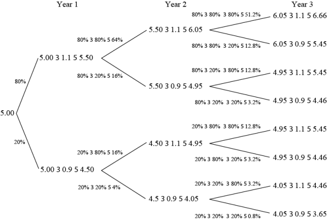
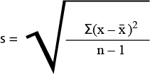
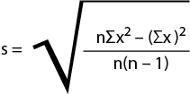
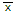
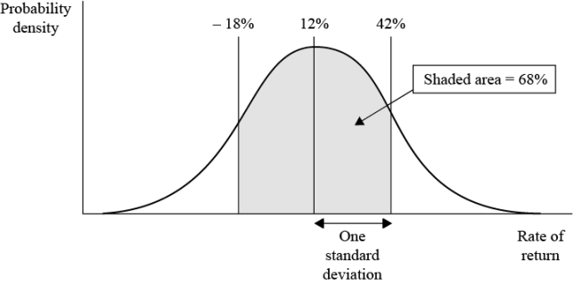

# 13 - Share-based payments (IFRS 2)

[返回目录](README.md)

#### FAQ 13.42.2 – How should an entity account for the situation where an employee stops saving in an employee share purchase plan?

 

Reference to standard: IFRS 2 para 21A  
 Reference to standing text: [13.42](24.md#s89-Para_13.42) 

  

  
In some jurisdictions, ‘sharesave’ plans give employees the opportunity to subscribe for shares, often at a discount on the market price. This could be paid for by payroll deductions instead of a lump sum payment.

Employee share purchase plans (or similar broad-based employee share plans) are not exempt from IFRS 2’s scope. The IASB considered an exemption for plans similar to employee share purchase plans (such as save as you earn (‘SAYE’) plans in the UK and employee share ownership plans (‘ESOPs’) in the US) and other broad-based employee share plans. But they concluded that the accounting for such plans should be the same as for other employee share plans. The IASB also rejected the suggestion that plans should be exempted if the discount available to employees was small, so that its impact was likely to be immaterial; so they should be treated like any other equity-settled share-based payment arrangement. But, unlike many other arrangements, some employee share purchase plans (such as those in the UK) impose a condition on their members that requires regular saving. If an employee stops saving, they forfeit their right to subscribe for shares.

A requirement to save is a non-vesting condition (as discussed in [para 13.42](24.md#s89-Para_13.42)); so a failure to save should be treated as a cancellation.

**Example – Save as you earn (SAYE) plan cancellation**

An entity enters into an SAYE plan with its employees. The terms of the plan are that:

- Employees will contribute C250 per month to an employee share trust.

- The employee is required to contribute to the SAYE plan for five years; after that time, the employee can choose to receive their cash back (plus accrued interest) or use this cash to acquire shares at a 20% discount on the market price at the grant date.

- An employee who stops saving receives a reimbursement of all amounts saved to date (plus interest) but should withdraw from the plan and forfeit their right to acquire shares.

How should the entity account for the situation where an employee stops saving?

Where an employee fails to save, the entity should account for this as a cancellation. The requirement to save does not meet the definition of a service or performance condition; and so failure to save cannot be interpreted as failure to fulfil a service or performance condition.

This results in the acceleration of any unvested portion of the award at the date when the employee stops saving and receives their cash.

The probability of employees ceasing to save (and so losing the equity option) will need to be taken into account when calculating the grant date fair value.

 

#### EX 13.43.1 – Modifications

 

Reference to standard: IFRS 2 para 26  
 Reference to standing text: [13.43](24.md#s90-Para_13.43) 

  

  
The principles of paragraph 27 of IFRS 2 apply to modifications that increase the fair value of equity instruments granted (such as reductions in the exercise price of options); and they also apply to other modifications that are otherwise beneficial to the employees. Examples include:

- An increase in the number of instruments granted.

- A reduction in the vesting period.

- The modification or elimination of a performance condition.

 

#### EX 13.44.1 – Accounting treatment of modifications

 

Reference to standard: IFRS 2 para 27  
 Reference to standing text: [13.44](24.md#s90-Para_13.44) 

  

  
The period over which the impact of a modification is recognised will depend on when it occurs and any vesting conditions that it imposes. For example, if the modification described in [paragraph 13.44](24.md#s90-Para_13.44) (reduction in option exercise price) occurs during the vesting period, the incremental fair value granted is included in the measurement of the amount recognised for services received over the following period: from the modification date until the date when the modified equity instruments vest. But IFRS 2 does not specify whether (in the case of a modification that reduces the vesting period) the change in vesting period should be accounted for prospectively or retrospectively. We believe that either approach is acceptable; and our reasons are set out in [FAQ 13.44.5](26.md#s94-FAQ_13.44.5).

Entities sometimes ‘rebase’ share-based payment awards by replacing existing tax-inefficient awards with a new award that is more tax efficient. Where the total fair value of an award is the same immediately before and after modification (irrespective of whether the change gives tax benefits to the entity or employee), this is treated as a non-beneficial modification (that is, the entity should continue to account for the original award as if the modification had not occurred).

The accounting treatment of modifications to terms and conditions is considered further below.

 

#### FAQ 13.44.2 – How should an entity account for an existing option rolled into a new award with a reduction in exercise price?

 

Reference to standard: IFRS 2 para 27  
 Reference to standing text: [13.44](24.md#s90-Para_13.44) 

  

  
An entity has previously operated a share option award with an option exercise price of C15; this is equal to the market price of the shares at the grant date. Management decides to roll the options into a new award. So the entity cancels the original option plan and issues share options under the new award. The new options are granted at a lower exercise price of C12; this is because the market price of the shares has fallen to C11 since the grant date of the initial plan; as a result, the exercise price of the new options is now below the exercise price of the original options and, therefore, employees are more likely to exercise their rights. The terms of the original options are otherwise the same (that is, they have the same exercise date). How should the change in terms be accounted for?

This would be treated as a modification, rather than as a cancellation and a new award. This is because the entity has indicated that the new award replaces a cancelled award; and so it is treated as if the original award had been modified. [IFRS 2 para 28(c)]. As a result, the entity should account for the incremental fair value of the new award (compared with the existing award) at the date of modification; and it would spread this amount over the vesting period of the new award. This would be in addition to the entity continuing to charge for the original award over the original vesting period. Note that replacement awards are sometimes structured with similar terms to those of the original award; and so it is possible that there would be no incremental fair value.

If the entity had not identified the new award as a replacement award at the same date that the new options were granted, the cancellation and new award would be unrelated; in that case, the entity would need to accelerate the vesting of the original award and recognise immediately the amount that would otherwise have been recognised for services received over the remainder of the vesting period (see also [FAQ 13.48.1](26.md#s94-FAQ_13.48.1)). There would also be a fair value charge for the new award over the new vesting period.

 

#### FAQ 13.44.3 – How should an entity account for a reduction in option exercise price?

 

Reference to standard: IFRS 2 para 27  
 Reference to standing text: [13.44](24.md#s90-Para_13.44) 

  

  
On 1 January 20X5, entity A grants an award of 1,000 options to each of its 60 employees, on condition that the recipients remain in the entity’s employment for three years. The grant date fair value of each option is C5.

Towards the end of 20X5, entity A’s share price dropped; so, on 1 January 20X6, management chose to reduce the exercise price of the options. At the date of the re-pricing, the fair value of each of the original share options granted was C1; and the fair value of each re-priced option was C3. So the incremental fair value of each modified option was C2.

At the date of the award, management estimated that 10% of employees would leave the entity before the end of three years (that is, 54 awards would vest). During 20X6, it became apparent that fewer employees than expected were leaving; so, management revised its estimate of the number of leavers to only 5% (that is, 57 awards would vest). At the end of 20X7, awards to 55 employees actually vested. How should the modification to the award terms be accounted for?

The amount recognised as an expense in each year is as follows:

<table style="width:100%; border-collapse:collapse"><tr><td style="border:0.75pt solid #000000; padding-right:5.03pt; padding-left:5.03pt; vertical-align:top">
<b>Year</b>
</td><td style="border:0.75pt solid #000000; padding-right:5.03pt; padding-left:5.03pt; vertical-align:top">
<b>Expense for the year</b>
</td><td style="border:0.75pt solid #000000; padding-right:5.03pt; padding-left:5.03pt; vertical-align:top">
<b>Cumulative expense</b>
</td><td style="border:0.75pt solid #000000; padding-right:5.03pt; padding-left:5.03pt; vertical-align:top">
 
</td><td style="border:0.75pt solid #000000; padding-right:5.03pt; padding-left:5.03pt; vertical-align:top">
<b>Calculation of cumulative expense</b>
</td></tr><tr><td style="border:0.75pt solid #000000; padding-right:5.03pt; padding-left:5.03pt; vertical-align:top">
 
</td><td style="border:0.75pt solid #000000; padding-right:5.03pt; padding-left:5.03pt; vertical-align:top">
<b>C</b>
</td><td style="border:0.75pt solid #000000; padding-right:5.03pt; padding-left:5.03pt; vertical-align:top">
<b>C</b>
</td><td style="border:0.75pt solid #000000; padding-right:5.03pt; padding-left:5.03pt; vertical-align:top">
 
</td><td style="border:0.75pt solid #000000; padding-right:5.03pt; padding-left:5.03pt; vertical-align:top">
 
</td></tr><tr><td style="border:0.75pt solid #000000; padding-right:5.03pt; padding-left:5.03pt; vertical-align:top">
31 December 20X5
</td><td style="border:0.75pt solid #000000; padding-right:5.03pt; padding-left:5.03pt; vertical-align:top">
90,000
</td><td style="border:0.75pt solid #000000; padding-right:5.03pt; padding-left:5.03pt; vertical-align:top">
90,000
</td><td style="border:0.75pt solid #000000; padding-right:5.03pt; padding-left:5.03pt; vertical-align:top">
 
</td><td style="border:0.75pt solid #000000; padding-right:5.03pt; padding-left:5.03pt; vertical-align:top">
54 × 1,000 × 5 × 1⁄3
</td></tr><tr><td style="border:0.75pt solid #000000; padding-right:5.03pt; padding-left:5.03pt; vertical-align:top">
31 December 20X6
</td><td style="border:0.75pt solid #000000; padding-right:5.03pt; padding-left:5.03pt; vertical-align:top">
157,000
</td><td style="border:0.75pt solid #000000; padding-right:5.03pt; padding-left:5.03pt; vertical-align:top">
247,000
</td><td style="border:0.75pt solid #000000; padding-right:5.03pt; padding-left:5.03pt; vertical-align:top">
 
</td><td style="border:0.75pt solid #000000; padding-right:5.03pt; padding-left:5.03pt; vertical-align:top">
57 × 1,000 × ((5 × 2⁄3 ) + (2 × ½))
</td></tr><tr><td style="border:0.75pt solid #000000; padding-right:5.03pt; padding-left:5.03pt; vertical-align:top">
31 December 20X7
</td><td style="border:0.75pt solid #000000; padding-right:5.03pt; padding-left:5.03pt; vertical-align:top">
138,000
</td><td style="border:0.75pt solid #000000; padding-right:5.03pt; padding-left:5.03pt; vertical-align:top">
385,000
</td><td style="border:0.75pt solid #000000; padding-right:5.03pt; padding-left:5.03pt; vertical-align:top">
 
</td><td style="border:0.75pt solid #000000; padding-right:5.03pt; padding-left:5.03pt; vertical-align:top">
55 × 1,000 × (5 + 2)
</td></tr></table>

 

#### FAQ 13.44.4 – How should an entity account for an increase in the number of options granted?

 

Reference to standard: IFRS 2 para 27  
 Reference to standing text: [13.44](24.md#s90-Para_13.44) 

  

  
The facts are similar to [FAQ 13.44.3](26.md#s94-FAQ_13.44.3), except that, instead of reducing the option exercise price on 1 January 20X6, the number of options to which each employee is entitled is increased to 1,500. The fair value of each of these additional options is C1. How much expense would be recognised in each of the three years?

The amount recognised as an expense in each year is as follows:

<table style="width:100%; border-collapse:collapse"><tr><td style="border:0.75pt solid #000000; padding-right:5.03pt; padding-left:5.03pt; vertical-align:top">
<b>Year</b>
</td><td style="border:0.75pt solid #000000; padding-right:5.03pt; padding-left:5.03pt; vertical-align:top">
<b>Expense for the year</b>
</td><td style="border:0.75pt solid #000000; padding-right:5.03pt; padding-left:5.03pt; vertical-align:top">
<b>Cumulative expense</b>
</td><td style="border:0.75pt solid #000000; padding-right:5.03pt; padding-left:5.03pt; vertical-align:top">
 
</td><td style="border:0.75pt solid #000000; padding-right:5.03pt; padding-left:5.03pt; vertical-align:top">
<b>Calculation of cumulative expense</b>
</td></tr><tr><td style="border:0.75pt solid #000000; padding-right:5.03pt; padding-left:5.03pt; vertical-align:top">
 
</td><td style="border:0.75pt solid #000000; padding-right:5.03pt; padding-left:5.03pt; vertical-align:top">
<b>C</b>
</td><td style="border:0.75pt solid #000000; padding-right:5.03pt; padding-left:5.03pt; vertical-align:top">
<b>C</b>
</td><td style="border:0.75pt solid #000000; padding-right:5.03pt; padding-left:5.03pt; vertical-align:top">
 
</td><td style="border:0.75pt solid #000000; padding-right:5.03pt; padding-left:5.03pt; vertical-align:top">
 
</td></tr><tr><td style="border:0.75pt solid #000000; padding-right:5.03pt; padding-left:5.03pt; vertical-align:top">
31 December 20X5
</td><td style="border:0.75pt solid #000000; padding-right:5.03pt; padding-left:5.03pt; vertical-align:top">
90,000
</td><td style="border:0.75pt solid #000000; padding-right:5.03pt; padding-left:5.03pt; vertical-align:top">
90,000
</td><td style="border:0.75pt solid #000000; padding-right:5.03pt; padding-left:5.03pt; vertical-align:top">
 
</td><td style="border:0.75pt solid #000000; padding-right:5.03pt; padding-left:5.03pt; vertical-align:top">
54 × 1,000 × 5 × 1⁄3
</td></tr><tr><td style="border:0.75pt solid #000000; padding-right:5.03pt; padding-left:5.03pt; vertical-align:top">
31 December 20X6
</td><td style="border:0.75pt solid #000000; padding-right:5.03pt; padding-left:5.03pt; vertical-align:top">
114,250
</td><td style="border:0.75pt solid #000000; padding-right:5.03pt; padding-left:5.03pt; vertical-align:top">
204,250
</td><td style="border:0.75pt solid #000000; padding-right:5.03pt; padding-left:5.03pt; vertical-align:top">
 
</td><td style="border:0.75pt solid #000000; padding-right:5.03pt; padding-left:5.03pt; vertical-align:top">
57 × ((1,000× 2⁄3 × 5) + (500 ×½× 1))
</td></tr><tr><td style="border:0.75pt solid #000000; padding-right:5.03pt; padding-left:5.03pt; vertical-align:top">
31 December 20X7
</td><td style="border:0.75pt solid #000000; padding-right:5.03pt; padding-left:5.03pt; vertical-align:top">
98,250
</td><td style="border:0.75pt solid #000000; padding-right:5.03pt; padding-left:5.03pt; vertical-align:top">
302,500
</td><td style="border:0.75pt solid #000000; padding-right:5.03pt; padding-left:5.03pt; vertical-align:top">
 
</td><td style="border:0.75pt solid #000000; padding-right:5.03pt; padding-left:5.03pt; vertical-align:top">
55 × ((1,000 × 5) + (500 × 1))
</td></tr></table>

 

#### FAQ 13.44.5 – How should an entity account for a reduction in the vesting period?

 

Reference to standard: IFRS 2 para 27  
 Reference to standing text: [13.44](24.md#s90-Para_13.44) 

  

  
On 1 January 20X6, entity B awarded 100 shares (with no entitlement to dividends during the vesting period) to an employee, on condition that the employee remained in service for three years. The fair value of each share at the award date was C6.

On 1 December 20X6, entity B decided to reduce the service requirement from three years to two years; so the vesting period was reduced to two years.

It is assumed that the employee remains in service beyond 31 December 20X6.

Any change to the vesting period has no impact on the fair value of the unvested shares, because no dividends are expected to be paid during the vesting period. How should modification be accounted for?

We believe that entity B has a policy choice of retrospective or prospective treatment – in respect of accounting for modifications of equity-settled awards that reduce the vesting period, where the modifications occur part way through a reporting period.

**Retrospective treatment**

The modification could be accounted for retrospectively, to reflect the best estimate available (as at that date) of awards that are expected to vest. This is supported by paragraph 19 of IFRS 2, which states that “… the amount recognised for goods or services received as consideration for the equity instruments granted shall be based on the number of equity instruments that eventually vest”. Where there is a change in estimate of the period over which the awards are expected to vest and that change occurs during the year, the cumulative expense could be ‘trued up’ at the balance sheet date, to reflect the best estimate of awards expected to vest as of that date. So the expense each year (as a result of the modification) would be as follows:

<table style="width:100%; border-collapse:collapse"><tr><td style="border:0.75pt solid #000000; padding-right:5.03pt; padding-left:5.03pt; vertical-align:top">
<b>Year</b>
</td><td style="border:0.75pt solid #000000; padding-right:5.03pt; padding-left:5.03pt; vertical-align:top">
<b>Expense for the year</b>
</td><td style="border:0.75pt solid #000000; padding-right:5.03pt; padding-left:5.03pt; vertical-align:top">
<b>Cumulative expense</b>
</td><td style="border:0.75pt solid #000000; padding-right:5.03pt; padding-left:5.03pt; vertical-align:top">
 
</td><td style="border:0.75pt solid #000000; padding-right:5.03pt; padding-left:5.03pt; vertical-align:top">
<b>Calculation of cumulative expense</b>
</td></tr><tr><td style="border:0.75pt solid #000000; padding-right:5.03pt; padding-left:5.03pt; vertical-align:top">
 
</td><td style="border:0.75pt solid #000000; padding-right:5.03pt; padding-left:5.03pt; vertical-align:top">
<b>C</b>
</td><td style="border:0.75pt solid #000000; padding-right:5.03pt; padding-left:5.03pt; vertical-align:top">
<b>C</b>
</td><td style="border:0.75pt solid #000000; padding-right:5.03pt; padding-left:5.03pt; vertical-align:top">
 
</td><td style="border:0.75pt solid #000000; padding-right:5.03pt; padding-left:5.03pt; vertical-align:top">
 
</td></tr><tr><td style="border:0.75pt solid #000000; padding-right:5.03pt; padding-left:5.03pt; vertical-align:top">
31 December 20X6
</td><td style="border:0.75pt solid #000000; padding-right:5.03pt; padding-left:5.03pt; vertical-align:top">
300
</td><td style="border:0.75pt solid #000000; padding-right:5.03pt; padding-left:5.03pt; vertical-align:top">
300
</td><td style="border:0.75pt solid #000000; padding-right:5.03pt; padding-left:5.03pt; vertical-align:top">
 
</td><td style="border:0.75pt solid #000000; padding-right:5.03pt; padding-left:5.03pt; vertical-align:top">
100 × C6× ½ (by 31 December 20x6 the vesting period has been reduced from 3 to 2 years)
</td></tr><tr><td style="border:0.75pt solid #000000; padding-right:5.03pt; padding-left:5.03pt; vertical-align:top">
31 December 20X7
</td><td style="border:0.75pt solid #000000; padding-right:5.03pt; padding-left:5.03pt; vertical-align:top">
300
</td><td style="border:0.75pt solid #000000; padding-right:5.03pt; padding-left:5.03pt; vertical-align:top">
600
</td><td style="border:0.75pt solid #000000; padding-right:5.03pt; padding-left:5.03pt; vertical-align:top">
 
</td><td style="border:0.75pt solid #000000; padding-right:5.03pt; padding-left:5.03pt; vertical-align:top">
100 × C6
</td></tr></table>

  
**Prospective treatment**

Alternatively, the modification could be accounted for prospectively from the date of modification (that is, 1 December 20X6). Although paragraph 19 of IFRS 2 states that the expense should be recognised based on the best estimate available, it does not specify the point at which changes in those estimates should be accounted for.

An analogy can be made with IAS 8, where a change in estimate is accounted for prospectively from the date of change. [IAS 8 para 36].

Accounting prospectively for the change in vesting period would also be consistent with the principle set out in paragraph B43 of IFRS 2 (where other types of modification are accounted for prospectively). In addition, where equity instruments do not vest until the counterparty completes a specified service period, the entity accounts for those services when they are rendered by the counterparty over the specified vesting period. [IFRS 2 para 15]. Before modification, employee services received as consideration were presumed to be received over a three-year period; and the expense would be recognised on this basis. When the vesting period is modified, the presumption changes from three years to two years; so it would be appropriate to account for the modification prospectively; and the recognition of expense should be amended as follows:

<table style="width:100%; border-collapse:collapse"><tr><td style="border:0.75pt solid #000000; padding-right:5.03pt; padding-left:5.03pt; vertical-align:top">
<b>Year</b>
</td><td style="border:0.75pt solid #000000; padding-right:5.03pt; padding-left:5.03pt; vertical-align:top">
<b>Expense for the year</b>
</td><td style="border:0.75pt solid #000000; padding-right:5.03pt; padding-left:5.03pt; vertical-align:top">
<b>Cumulative expense</b>
</td><td style="border:0.75pt solid #000000; padding-right:5.03pt; padding-left:5.03pt; vertical-align:top">
 
</td><td style="border:0.75pt solid #000000; padding-right:5.03pt; padding-left:5.03pt; vertical-align:top">
<b>Calculation of cumulative expense</b>
</td></tr><tr><td style="border:0.75pt solid #000000; padding-right:5.03pt; padding-left:5.03pt; vertical-align:top">
 
</td><td style="border:0.75pt solid #000000; padding-right:5.03pt; padding-left:5.03pt; vertical-align:top">
<b>C</b>
</td><td style="border:0.75pt solid #000000; padding-right:5.03pt; padding-left:5.03pt; vertical-align:top">
<b>C</b>
</td><td style="border:0.75pt solid #000000; padding-right:5.03pt; padding-left:5.03pt; vertical-align:top">
 
</td><td style="border:0.75pt solid #000000; padding-right:5.03pt; padding-left:5.03pt; vertical-align:top">
 
</td></tr><tr><td style="border:0.75pt solid #000000; padding-right:5.03pt; padding-left:5.03pt; vertical-align:top">
31 December 20X6
</td><td style="border:0.75pt solid #000000; padding-right:5.03pt; padding-left:5.03pt; vertical-align:top">
215
</td><td style="border:0.75pt solid #000000; padding-right:5.03pt; padding-left:5.03pt; vertical-align:top">
215
</td><td style="border:0.75pt solid #000000; padding-right:5.03pt; padding-left:5.03pt; vertical-align:top">
 
</td><td style="border:0.75pt solid #000000; padding-right:5.03pt; padding-left:5.03pt; vertical-align:top">
Original charge, 11 months to 1 December 20X6: 100 × C6 × 1/3 × 11/12 = 183
</td></tr><tr><td style="border:0.75pt solid #000000; padding-right:5.03pt; padding-left:5.03pt; vertical-align:top">
 
</td><td style="border:0.75pt solid #000000; padding-right:5.03pt; padding-left:5.03pt; vertical-align:top">
 
</td><td style="border:0.75pt solid #000000; padding-right:5.03pt; padding-left:5.03pt; vertical-align:top">
 
</td><td style="border:0.75pt solid #000000; padding-right:5.03pt; padding-left:5.03pt; vertical-align:top">
 
</td><td style="border:0.75pt solid #000000; padding-right:5.03pt; padding-left:5.03pt; vertical-align:top">
 
</td></tr><tr><td style="border:0.75pt solid #000000; padding-right:5.03pt; padding-left:5.03pt; vertical-align:top">
 
</td><td style="border:0.75pt solid #000000; padding-right:5.03pt; padding-left:5.03pt; vertical-align:top">
 
</td><td style="border:0.75pt solid #000000; padding-right:5.03pt; padding-left:5.03pt; vertical-align:top">
 
</td><td style="border:0.75pt solid #000000; padding-right:5.03pt; padding-left:5.03pt; vertical-align:top">
 
</td><td style="border:0.75pt solid #000000; padding-right:5.03pt; padding-left:5.03pt; vertical-align:top">
Modification occurs 1 December 20X6. Expense over remaining 13 months to 31 December 20X7: 600 – 183 = 417
</td></tr><tr><td style="border:0.75pt solid #000000; padding-right:5.03pt; padding-left:5.03pt; vertical-align:top">
 
</td><td style="border:0.75pt solid #000000; padding-right:5.03pt; padding-left:5.03pt; vertical-align:top">
 
</td><td style="border:0.75pt solid #000000; padding-right:5.03pt; padding-left:5.03pt; vertical-align:top">
 
</td><td style="border:0.75pt solid #000000; padding-right:5.03pt; padding-left:5.03pt; vertical-align:top">
 
</td><td style="border:0.75pt solid #000000; padding-right:5.03pt; padding-left:5.03pt; vertical-align:top">
 
</td></tr><tr><td style="border:0.75pt solid #000000; padding-right:5.03pt; padding-left:5.03pt; vertical-align:top">
 
</td><td style="border:0.75pt solid #000000; padding-right:5.03pt; padding-left:5.03pt; vertical-align:top">
 
</td><td style="border:0.75pt solid #000000; padding-right:5.03pt; padding-left:5.03pt; vertical-align:top">
 
</td><td style="border:0.75pt solid #000000; padding-right:5.03pt; padding-left:5.03pt; vertical-align:top">
 
</td><td style="border:0.75pt solid #000000; padding-right:5.03pt; padding-left:5.03pt; vertical-align:top">
Expense for December 20X6: 417 / 13 = 32
</td></tr><tr><td style="border:0.75pt solid #000000; padding-right:5.03pt; padding-left:5.03pt; vertical-align:top">
 
</td><td style="border:0.75pt solid #000000; padding-right:5.03pt; padding-left:5.03pt; vertical-align:top">
 
</td><td style="border:0.75pt solid #000000; padding-right:5.03pt; padding-left:5.03pt; vertical-align:top">
 
</td><td style="border:0.75pt solid #000000; padding-right:5.03pt; padding-left:5.03pt; vertical-align:top">
 
</td><td style="border:0.75pt solid #000000; padding-right:5.03pt; padding-left:5.03pt; vertical-align:top">
 
</td></tr><tr><td style="border:0.75pt solid #000000; padding-right:5.03pt; padding-left:5.03pt; vertical-align:top">
 
</td><td style="border:0.75pt solid #000000; padding-right:5.03pt; padding-left:5.03pt; vertical-align:top">
 
</td><td style="border:0.75pt solid #000000; padding-right:5.03pt; padding-left:5.03pt; vertical-align:top">
 
</td><td style="border:0.75pt solid #000000; padding-right:5.03pt; padding-left:5.03pt; vertical-align:top">
 
</td><td style="border:0.75pt solid #000000; padding-right:5.03pt; padding-left:5.03pt; vertical-align:top">
Therefore, total expense for year to 31 December 20X6:
</td></tr><tr><td style="border:0.75pt solid #000000; padding-right:5.03pt; padding-left:5.03pt; vertical-align:top">
 
</td><td style="border:0.75pt solid #000000; padding-right:5.03pt; padding-left:5.03pt; vertical-align:top">
 
</td><td style="border:0.75pt solid #000000; padding-right:5.03pt; padding-left:5.03pt; vertical-align:top">
 
</td><td style="border:0.75pt solid #000000; padding-right:5.03pt; padding-left:5.03pt; vertical-align:top">
 
</td><td style="border:0.75pt solid #000000; padding-right:5.03pt; padding-left:5.03pt; vertical-align:top">
 
</td></tr><tr><td style="border:0.75pt solid #000000; padding-right:5.03pt; padding-left:5.03pt; vertical-align:top">
 
</td><td style="border:0.75pt solid #000000; padding-right:5.03pt; padding-left:5.03pt; vertical-align:top">
 
</td><td style="border:0.75pt solid #000000; padding-right:5.03pt; padding-left:5.03pt; vertical-align:top">
 
</td><td style="border:0.75pt solid #000000; padding-right:5.03pt; padding-left:5.03pt; vertical-align:top">
 
</td><td style="border:0.75pt solid #000000; padding-right:5.03pt; padding-left:5.03pt; vertical-align:top">
183 + 32 = 215
</td></tr><tr><td style="border:0.75pt solid #000000; padding-right:5.03pt; padding-left:5.03pt; vertical-align:top">
 
</td><td style="border:0.75pt solid #000000; padding-right:5.03pt; padding-left:5.03pt; vertical-align:top">
 
</td><td style="border:0.75pt solid #000000; padding-right:5.03pt; padding-left:5.03pt; vertical-align:top">
 
</td><td style="border:0.75pt solid #000000; padding-right:5.03pt; padding-left:5.03pt; vertical-align:top">
 
</td><td style="border:0.75pt solid #000000; padding-right:5.03pt; padding-left:5.03pt; vertical-align:top">
 
</td></tr><tr><td style="border:0.75pt solid #000000; padding-right:5.03pt; padding-left:5.03pt; vertical-align:top">
31 December 20X7
</td><td style="border:0.75pt solid #000000; padding-right:5.03pt; padding-left:5.03pt; vertical-align:top">
385
</td><td style="border:0.75pt solid #000000; padding-right:5.03pt; padding-left:5.03pt; vertical-align:top">
600
</td><td style="border:0.75pt solid #000000; padding-right:5.03pt; padding-left:5.03pt; vertical-align:top">
 
</td><td style="border:0.75pt solid #000000; padding-right:5.03pt; padding-left:5.03pt; vertical-align:top">
100 × C6
</td></tr></table>

  
 Whichever approach is followed, the policy should be clearly explained and consistently applied.

Where vesting is conditional on an exit event of some kind (such as an IPO), the estimated time until the exit event should be reassessed at each reporting date; and adjustments should be made retrospectively. Prospective treatment would not be appropriate; this is because any adjustment would be a change in estimate and not a modification.

 

#### FAQ 13.44.6 – How should an entity account for a reduction in the vesting period before resignation?

 

Reference to standard: IFRS 2 para 27  
 Reference to standing text: [13.44](24.md#s90-Para_13.44) 

  

  
 On 1 January 20X5, entity C grants an award of 1,000 options to its finance director. The only condition associated with the award is that the director should remain employed by the entity for four years. The grant date fair value of each option is C40. The entity expects the director to meet the service condition.

On 1 October 20X6, the finance director informed the entity that he wished to take early retirement; and that, after serving his three-month notice period, he would resign from employment. The remuneration committee, in its ultimate discretion, made a decision in November 20X6 (that is, before the director failed to meet the service vesting condition by retiring) that entity C would still provide his award on termination of service. This would be accounted for as a beneficial modification (that is, a reduction in the vesting period) and a change in the number of options expected to vest. It would not be viewed as a substantive forfeiture of the original award and grant of a new award. How much should be recognised each year?

The amount recognised as an expense in each year is as follows:

<table style="width:100%; border-collapse:collapse"><tr><td style="border:0.75pt solid #000000; padding-right:5.03pt; padding-left:5.03pt; vertical-align:top">
<b>Year</b>
</td><td style="border:0.75pt solid #000000; padding-right:5.03pt; padding-left:5.03pt; vertical-align:top">
<b>Expense for the year</b>
</td><td style="border:0.75pt solid #000000; padding-right:5.03pt; padding-left:5.03pt; vertical-align:top">
<b>Cumulative expense</b>
</td><td style="border:0.75pt solid #000000; padding-right:5.03pt; padding-left:5.03pt; vertical-align:top">
 
</td><td style="border:0.75pt solid #000000; padding-right:5.03pt; padding-left:5.03pt; vertical-align:top">
<b>Calculation of cumulative expense</b>
</td></tr><tr><td style="border:0.75pt solid #000000; padding-right:5.03pt; padding-left:5.03pt; vertical-align:top">
 
</td><td style="border:0.75pt solid #000000; padding-right:5.03pt; padding-left:5.03pt; vertical-align:top">
<b>C</b>
</td><td style="border:0.75pt solid #000000; padding-right:5.03pt; padding-left:5.03pt; vertical-align:top">
<b>C</b>
</td><td style="border:0.75pt solid #000000; padding-right:5.03pt; padding-left:5.03pt; vertical-align:top">
 
</td><td style="border:0.75pt solid #000000; padding-right:5.03pt; padding-left:5.03pt; vertical-align:top">
 
</td></tr><tr><td style="border:0.75pt solid #000000; padding-right:5.03pt; padding-left:5.03pt; vertical-align:top">
31 December 20X5
</td><td style="border:0.75pt solid #000000; padding-right:5.03pt; padding-left:5.03pt; vertical-align:top">
10,000
</td><td style="border:0.75pt solid #000000; padding-right:5.03pt; padding-left:5.03pt; vertical-align:top">
10,000
</td><td style="border:0.75pt solid #000000; padding-right:5.03pt; padding-left:5.03pt; vertical-align:top">
 
</td><td style="border:0.75pt solid #000000; padding-right:5.03pt; padding-left:5.03pt; vertical-align:top">
1,000 × 40 × 1/4
</td></tr><tr><td style="border:0.75pt solid #000000; padding-right:5.03pt; padding-left:5.03pt; vertical-align:top">
31 December 20X6
</td><td style="border:0.75pt solid #000000; padding-right:5.03pt; padding-left:5.03pt; vertical-align:top">
30,000
</td><td style="border:0.75pt solid #000000; padding-right:5.03pt; padding-left:5.03pt; vertical-align:top">
40,000
</td><td style="border:0.75pt solid #000000; padding-right:5.03pt; padding-left:5.03pt; vertical-align:top">
 
</td><td style="border:0.75pt solid #000000; padding-right:5.03pt; padding-left:5.03pt; vertical-align:top">
1,000 × 40
</td></tr></table>

 

#### FAQ 13.44.7 – Is a change in exercise price and the number of options a modification or cancellation?

 

Reference to standard: IFRS 2 para 27  
 Reference to standing text: [13.44](24.md#s90-Para_13.44) 

  

  
Due to an unexpected significant decline in entity D’s share price, management reduces the exercise price of an award from C50 to C20. At the same time, the number of options awarded is also reduced from 100 to 17. The 17 remaining options have the same total fair value as the 100 options immediately before the re-pricing. How should the change in terms be accounted for?

The accounting for this can be viewed in two different ways. One view is that, for the options that remain, the treatment is the same as for a simple reduction in exercise price, described in [FAQ 13.44.2](26.md#s94-FAQ_13.44.2); and the other options are cancelled, so the recognition of the grant date fair value is accelerated in accordance with paragraph B44 of IFRS 2. The other view, which we believe better reflects the economics of the situation, is that there is no change in the aggregate fair value of the award; so there is neither an incremental fair value nor a cancellation. As a result, any element of the grant date fair value of the original award will continue to be charged over the original vesting period.

The accounting treatment to be applied to a reduction in the number of awards – and a corresponding (or greater) increase in the fair value of each award – is a judgement that will depend on the specific facts of each case and should be applied consistently. Cancellations are discussed further in [paragraph 13.48](24.md#s90-Para_13.48).

 

#### FAQ 13.44.8 – How should an entity account for re-priced options and extension of the vesting period?

 

Reference to standard: IFRS 2 para 27  
 Reference to standing text: [13.44](24.md#s90-Para_13.44) 

  

  
Management grants 1,000 share options to employees in exchange for services. The exercise price is C10 per share. The grant date is 1 January 20X4; and the options are subject to a two-year vesting period. The grant date fair value of the options is C5,000; and all options are expected to vest at the end of the vesting period.

The options were modified on 1 January 20X5, by reducing the exercise price to C5 per share (that is, the current market value) and extending the vesting period by six months to 30 June 20X6. The fair value of the options at 1 January 20X5 was C1,000 before modification and C2,500 after modification. At the modification date, all options were expected to vest. How should the modification to the terms be accounted for?

The original grant date fair value is recognised over the original vesting period. The expense for the year to 31 December 20X4 is C2,500 (C5,000 × 50%). The expense for the year to 31 December 20X5 is C3,500 (C5,000 × 50% plus the recognised incremental fair value of the modification of C1,500 × 66.7%). The incremental fair value is recognised over the vesting period from 1 January 20X5 to 30 June 20X6; 66.7% of this period had elapsed before the balance sheet date. The incremental fair value is the difference between the fair value of the re-priced options immediately before and after the modification (that is, C2,500 less C1,000). The expense for the six months to 30 June 20X6 is C500 (C1,500 × 33.3%).

If an employee leaves during the six-month period to 30 June 20X6 (and so fails to meet the revised vesting condition), it is only the re-pricing impact that is reversed. The original grant date fair value expense of C5,000 is unaffected; this is because the employee satisfied the two-year service condition for the original award.

 

#### FAQ 13.44.9 – How should an entity account for the impact of a rights issue and modification of share schemes?

 

Reference to standard: IFRS 2 para 27  
 Reference to standing text: [13.44](24.md#s90-Para_13.44) 

  

  
Entity F is planning a rights issue to offer shares at a 30% discount. The entity operates numerous share schemes. The employees in those share schemes will be worse off after the rights issue; this is because the market value of the shares will be reduced. Entity F plans to modify the share schemes at a later date, to ensure that the awards granted to employees are uplifted to the equivalent value of the original award granted. Management believes that the rights issue and subsequent share-based payment modification are linked. So it wants to treat the impact of the rights issue and the modification as a single event. Is this approach permitted?

A share-based payment modification occurs when the terms and conditions of the equity instruments change. So the modification in this case would be later than – and not at the date of – the rights issue.

When a modification occurs, an entity needs to compare the fair value of the new and old awards at the modification date; and it should consider whether there is an uplift in fair value. Any uplift will then be expensed (with the charge for the original awards) over the remaining vesting period. Because this modification is happening at a later date than the rights issue, it is likely that there will be an increase in fair value as a result of changes in volatility, market value and time value of money (since the date of the rights issue). If entity F had structured the transaction differently (so that the awards were modified at the same time as the rights issue), it is likely that the difference between the new and old awards would be nil; so there would be no additional charge.

 

#### EX 13.44.10 – Reclassification from equity-settled to cash-settled

 

Reference to standard: IFRS 2 paras 28, 29  
 Reference to standing text: [13.44](24.md#s90-Para_13.44) 

  

  
Reclassification of a share-based payment award might occur because:

- An entity is de-listing. To provide greater liquidity to employees, the entity might change the share-based payment from equity-settled to cash-settled.

- The entity has changed its settlement practice.

Where an entity modifies a share-based payment award, so that it will be settled in cash instead of shares, the entity measures the liability using the modification date fair value of the equity-settled award based on the elapsed portion of the vesting period. This amount is recognised as a credit to liability and a debit to equity (by analogy with paragraph 29 of IFRS 2, which states that the repurchase of vested equity instruments is accounted for as a deduction from equity).

The entity re-measures the liability at the date of change and at each subsequent reporting date; and it recognises any additional expense from increases in the liability. See further [FAQ 13.59.1](26.md#s94-FAQ_13.59.1) and the example below.

**Example**

Entity N has an equity-settled share-based payment that will vest after employees have provided four years of continuous service. The grant date fair value is C10; and the vesting period is four years. At the end of year 2, a cumulative charge of C5 has been recognised in the income statement; and a corresponding increase has been recognised in equity.

At the end of year 2, entity N decides to change the share-based payment award from equity-settled to cash-settled. The employees will now receive a cash payment based on the fair value of the shares at the end of year 4. How should this change be accounted for?

An award that is modified to become cash-settled is accounted for as the repurchase of an equity interest (that is, a deduction from equity). Any excess over the grant date fair value should be treated as a deduction from equity (not as an expense), provided that the deduction is not greater than the fair value of the equity instruments when measured at the modification date.

The accounting is illustrated by the following two scenarios: where, immediately before the change in classification, the fair value of the grant:

(a) has increased:

Assume that the fair value immediately before modification is C20. At the start of year 3, a liability of C10 (20/2) is recognised; and there is a corresponding debit to equity of C10. This is because, in substance, the modification represents the repurchase by the entity of its own shares, so no further expense is recognised. The subsequent measurement of the liability would follow the requirements for a cash-settled share-based payment.

(b) has decreased:

IFRS 2 requires an entity to recognise a charge in the income statement for services received of at least the grant date fair value, regardless of any modifications to or cancellations of the grant. The only exception to this is where a non-market vesting condition is not satisfied. Assume that the fair value immediately before modification is C5; and there are no further movements in the fair value in years 3 and 4. The accounting would be:

- Years 1 and 2: a total expense and increase in equity of C5 is recognised.

- At the start of year 3: a liability of C2.5 (5 × 2 / 4) is recognised; and there is a corresponding decrease to equity.

- Years 3 and 4: an expense of C2.5 is recognised each year; and there is a corresponding increase in the liability of C1.25 and equity of C1.25. The C1.25 expense and increase in equity ensure that the income statement expense is at least equal to the grant date fair value.

At the end of the vesting period, the total expense is C10 (of which C5 was a credit to equity and C5 a credit to liability). The total expense is equal to the grant date fair value of C10.

If the fair value changed in years 3 and 4, the entity would need to recalculate the expense amounts in these years, as follows:

- record the expense based on the grant date fair value and allocate this expense between debt and equity (based on the ratio of debt to equity on the modification date); and

- re-measure the value of the liability based on movements in the share price.

For example, assume that, at the end of year 3, the fair value of the award had decreased to C4. The entity would:

- record an expense (based on the grant date fair value) of C2.5 and a corresponding increase in the liability and equity of C1.25 (based on the ratio of equity to cash on the date of modification); and

- re-measure the value of the liability through the income statement from C3.75 to C3 (representing three-quarters of the fair value of the liability of C4, because three years of the four-year vesting period have passed).

 

#### EX 13.44.11 – Modifications and business combinations

 

Reference to standard: IFRS 3 para B56  
 Reference to standing text: [13.44](24.md#s90-Para_13.44) 

  

  
IFRS 3 provides detailed guidance on when and how an acquirer should allocate equity instruments between the cost of the business combination and post-combination services for replacement awards granted to the acquiree’s employees.

Where an acquiree’s employee awards expire as a consequence of a business combination and the acquirer replaces those awards (even though it is not obliged to do so), IFRS 3 requires the entire grant date fair value of the replacement awards to be recognised as remuneration cost in the post-combination financial statements. In all other situations, replacements of share-based payment awards are accounted for as modifications under IFRS 2. Depending on facts, some or all of the IFRS 2 measure of the replacement awards is allocated to the consideration transferred for the purposes of IFRS 3.

The principle of IFRS 3 is to allocate a portion of a replacement award to the business combination, based on the fair value of acquiree awards and the degree to which the acquiree awards have been earned at the date of acquisition. Any excess value in the replacement awards is accounted for as post-combination employee services; these will incorporate any new or amended vesting conditions.

The following example illustrates the modification of a share-based payment award occurring at the same time as an acquisition.

**Example – Modification as a result of acquisition**

Entity C grants share options to its employees on 1 May 20X5. The options are exercisable, subject to the completion of three years’ service from that date. On 30 April 20X7, entity D acquires entity C. Entity D is obliged, as part of the sale and purchase agreement, to replace entity C’s share plans. The terms of the share options are modified on acquisition, with the following effect: at the end of the original three-year period, employees will be entitled to shares in entity D rather than shares in entity C. The modified terms make clear that entity D, the acquirer, has granted (and has the obligation for) the replacement award. The terms of the plan are otherwise unchanged.

**Entity C’s financial statements**

Entity C originally granted an equity-settled share-based payment award to its employees. As part of the acquisition, the plan’s terms were modified; and the new parent, entity D, had the obligation to settle the award. In accordance with the guidance in IFRS 2 on group settled share-based payments, the award will continue to be treated as equity-settled in entity C’s financial statements (see further [para 13.64](24.md#s91-Para_13.64)).

The remainder of the original IFRS 2 charge (measured on 1 May 20X5) will continue to be spread over the vesting period to 30 April 20X8. Also, if the modification has increased the award’s fair value (measured as the difference between the award’s fair value immediately before and after modification), the incremental fair value will be spread over the remaining period to 30 April 20X8. [IFRS 2 App B para B43].

**Entity D’s separate and consolidated financial statements**

From 30 April 20X7, entity D, as the acquirer, has granted an equity-settled award in its own shares to the employees of its new subsidiary, entity C. This will be accounted for as a new award in entity D’s separate and consolidated financial statements. Assume that the award’s fair value is C900, measured at the grant date, 30 April 20X7. The terms of the award require employees to provide three years’ service to entity C – from 1 May 20X5 to 30 April 20X8; so, part of the award’s fair value relates to pre-combination services; and this amount will be part of entity D’s consideration transferred for the purchase of entity C.

Management will need to follow the IFRS 3 guidance, to determine the allocation between pre- and post-combination services; since two-thirds of the vesting period has passed and there is no incremental fair value or change in the vesting period, it would be appropriate to allocate two-thirds (C600) of the fair value of entity C’s award at the date of acquisition to pre-combination services (so this would be included as part of entity D’s consideration transferred for entity C). One-third (C300) of the fair value of entity C’s award at the date of acquisition (plus any incremental fair value between entity C’s and entity D’s award at the date of acquisition) would be treated as post-combination services (so this would be recognised as an expense over the period to 30 April 20X8) in the consolidated financial statements.

For the year ended 30 April 20X8, the IFRS 2 entries in the consolidated financial statements are as follows:

<table style="width:100%; border-collapse:collapse"><tr><td style="border:0.75pt solid #000000; padding-right:5.03pt; padding-left:5.03pt; vertical-align:top">
 
</td><td style="border:0.75pt solid #000000; padding-right:5.03pt; padding-left:5.03pt; vertical-align:top">
 
</td><td style="border:0.75pt solid #000000; padding-right:5.03pt; padding-left:5.03pt; vertical-align:top">
<b>Dr</b>
</td><td style="border:0.75pt solid #000000; padding-right:5.03pt; padding-left:5.03pt; vertical-align:top">
<b>Cr</b>
</td></tr><tr><td style="border:0.75pt solid #000000; padding-right:5.03pt; padding-left:5.03pt; vertical-align:top">
 
</td><td style="border:0.75pt solid #000000; padding-right:5.03pt; padding-left:5.03pt; vertical-align:top">
 
</td><td style="border:0.75pt solid #000000; padding-right:5.03pt; padding-left:5.03pt; vertical-align:top">
<b>C</b>
</td><td style="border:0.75pt solid #000000; padding-right:5.03pt; padding-left:5.03pt; vertical-align:top">
<b>C</b>
</td></tr><tr><td colspan="2" style="border:0.75pt solid #000000; padding-right:5.03pt; padding-left:5.03pt; vertical-align:top">
Dr Income statement
</td><td style="border:0.75pt solid #000000; padding-right:5.03pt; padding-left:5.03pt; vertical-align:top">
300  (being one-third of the total fair value of the award measured at 30 April 20X7)
</td><td style="border:0.75pt solid #000000; padding-right:5.03pt; padding-left:5.03pt; vertical-align:top">
 
</td></tr><tr><td style="border:0.75pt solid #000000; padding-right:5.03pt; padding-left:5.03pt; vertical-align:top">
 
</td><td style="border:0.75pt solid #000000; padding-right:5.03pt; padding-left:5.03pt; vertical-align:top">
Cr Equity
</td><td style="border:0.75pt solid #000000; padding-right:5.03pt; padding-left:5.03pt; vertical-align:top">
 
</td><td style="border:0.75pt solid #000000; padding-right:5.03pt; padding-left:5.03pt; vertical-align:top">
300
</td></tr></table>

  
 Further guidance on the treatment in entity D’s separate financial statements is provided in paragraph 13.64. Based on this guidance, the entries in entity D’s separate financial statements on 30 April 20X8 are as follows:

<table style="width:100%; border-collapse:collapse"><tr><td style="border:0.75pt solid #000000; padding-right:5.03pt; padding-left:5.03pt; vertical-align:top">
 
</td><td style="border:0.75pt solid #000000; padding-right:5.03pt; padding-left:5.03pt; vertical-align:top">
 
</td><td style="border:0.75pt solid #000000; padding-right:5.03pt; padding-left:5.03pt; vertical-align:top">
<b>Dr</b>
</td><td style="border:0.75pt solid #000000; padding-right:5.03pt; padding-left:5.03pt; vertical-align:top">
<b>Cr</b>
</td></tr><tr><td style="border:0.75pt solid #000000; padding-right:5.03pt; padding-left:5.03pt; vertical-align:top">
 
</td><td style="border:0.75pt solid #000000; padding-right:5.03pt; padding-left:5.03pt; vertical-align:top">
 
</td><td style="border:0.75pt solid #000000; padding-right:5.03pt; padding-left:5.03pt; vertical-align:top">
<b>C</b>
</td><td style="border:0.75pt solid #000000; padding-right:5.03pt; padding-left:5.03pt; vertical-align:top">
<b>C</b>
</td></tr><tr><td colspan="2" style="border:0.75pt solid #000000; padding-right:5.03pt; padding-left:5.03pt; vertical-align:top">
Dr Investment in subsidiary
</td><td style="border:0.75pt solid #000000; padding-right:5.03pt; padding-left:5.03pt; vertical-align:top">
300  (being the fair value of the award measured at 30 April 20X7)
</td><td style="border:0.75pt solid #000000; padding-right:5.03pt; padding-left:5.03pt; vertical-align:top">
 
</td></tr><tr><td style="border:0.75pt solid #000000; padding-right:5.03pt; padding-left:5.03pt; vertical-align:top">
 
</td><td style="border:0.75pt solid #000000; padding-right:5.03pt; padding-left:5.03pt; vertical-align:top">
Cr Equity
</td><td style="border:0.75pt solid #000000; padding-right:5.03pt; padding-left:5.03pt; vertical-align:top">
 
</td><td style="border:0.75pt solid #000000; padding-right:5.03pt; padding-left:5.03pt; vertical-align:top">
300
</td></tr></table>

 

#### FAQ 13.46.1 – How should an entity account for an award where a market performance condition is not met but the remuneration committee agrees to allow the award to vest?

 

Reference to standard: IFRS 2 App A  
 Reference to standing text: [13.46](24.md#s90-Para_13.46) 

  

  
 Employees were awarded share options in entity A, subject to entity A’s share price increasing by 10% between 1 July 20X0 and 30 June 20X3. The 10% target was not achieved. But entity A’s remuneration committee decided, on 30 June 20X3, that all of the share options should vest anyway. How should this decision by the remuneration committee be accounted for?

Entity A modified the share option award on 30 June 20X3. There is likely to be a cumulative charge for the original award; this is because the likelihood of meeting the share price target (a market performance condition) would have been factored into the original calculation of the grant date fair value, and this charge is recognised regardless of whether the market performance condition is achieved or not, assuming the recipients provide the required service. But the fair value of the original share option award at the modification date is nil, because the market performance condition has not been met. So the modified award has incremental fair value which should be recognised as additional compensation cost.

If the vesting condition had been a non-market performance condition (such as achieving a net profit target), there would be no cumulative charge for the original award, because this would have been reversed when it became clear that the net profit target would not be met. But the full grant date fair value of the modified award would be recognised.

In practice, the ability of a remuneration committee to make this kind of ‘modification’ might be set out in the award’s terms and conditions (as discussed [FAQ 13.34.6](25.md#s93-FAQ_13.34.6)); and this could mean that there is no grant date.

See paragraphs 13.40-13.41 for definitions of market and non-market conditions. See also [paragraph 13.43](24.md#s90-Para_13.43) onwards for guidance on modifications.

 

#### FAQ 13.47.1 – How should a modification that is not beneficial to employees be accounted for?

 

Reference to standard: IFRS 2 para B44  
 Reference to standing text: [13.47](24.md#s90-Para_13.47) 

  

  
 An entity grants 100 share options to employees at an exercise price of C10 per share. The grant date is 1 January 20X4 and the options are subject to a two-year vesting period. The grant date fair value of each option is C50. The entity modified the options at 31 December 20X4 by extending the vesting period to 30 June 20X6. At the modification date, management expected that the number of options outstanding at 31 December 20X5 (that is, the original vesting date) would be 90. The actual number of options outstanding at 31 December 20X5 was 85; of these, only 80 vested on 30 June 20X6. The modification did not increase the options’ fair value. How should the modification be accounted for?

In this case the extension of the vesting period should be ignored. Modification of an equity-settled share-based payment award in a manner that is not beneficial to employees should not be taken into account when determining amounts to be recognised. An extension of the vesting period could be beneficial for example if a vesting condition had not been met on the original vesting date or if an option would expire underwater without the extension.

The expense and corresponding increase in equity recognised for 20X4 is C2,250 (C50 × 90 options × 50% of the original two-year vesting period). The expense for 20X5 is C2,000 (C50 × 85 options × 100% of the original two-year vesting period, less C2,250 expensed in 20X4). No expense is recognised in 20X6; and no adjustment is made to reflect the fact that only 80 awards actually vest, because this occurred after the original vesting date.

 

#### FAQ 13.48.1 – How should a cancelled award be accounted for?

 

Reference to standard: IFRS 2 para 28  
 Reference to standing text: [13.48](24.md#s90-Para_13.48) 

  

  
We believe that the charge should reflect all awards that are outstanding at the date of cancellation; and no adjustment should be made for any estimate of the number of awards that are not expected to vest. This is because the cancellation results in early vesting (that is, satisfaction of a non-market vesting condition); and so it gives rise to accelerated recognition of the grant date fair value. There is an alternative interpretation that focuses on the words “... the amount that otherwise would have been recognised for services received over the remainder of the vesting period”. It recognises a charge that reflects the number of awards that were expected to achieve the service or performance condition immediately before the award was cancelled. Either interpretation could be applied, but we believe that the first is more closely aligned with the principles of IFRS 2.

**Example** **– Cancellation during vesting period**

On 1 January 20X5, entity A makes an award of 100 shares to an employee. The only condition associated with the award is that the employee should remain in entity A’s employment for three years. The award’s grant date fair value is C1,200. The employee is expected to remain with the entity for at least three years; and so the award is expected to vest.

The award is cancelled on 1 January 20X6; and entity A settles in cash on a pro rata basis. So the employee receives C400 (C1,200 × 1/3 years). The award’s fair value on this date is determined to have fallen from C1,200 to C300.

The amount recognised as an expense during 20X5 – before taking account of the cancellation – was C400 (C1,200 × 1/3 years). The entity accounts for the cancellation or settlement as an acceleration of vesting; and it recognises immediately the amount that otherwise would have been recognised for services received over the remainder of the vesting period. [IFRS 2 para 28(a)]. So, on the basis of the number of awards outstanding at the cancellation date, the amount to be recognised immediately as an expense is C800 (C1,200 – C400); with a credit to equity of C800. If the award had been made to more than one employee, we believe that management should (at the date of cancellation) accelerate the share-based payment expense; this should be based on the actual number of awards on cancellation rather than the number of awards that management had previously expected to vest. But an alternative approach, based on the number of awards expected to vest (as noted above), could also be considered.

The C400 payment to the employee, on cancellation of the award, exceeds the award’s fair value of C300 on the date of repurchase. Paragraph 28(b) of IFRS 2 requires an amount equal to the fair value (C300) to be treated as the repurchase of an equity instrument; and the excess is recognised as an expense. This means that C300 is deducted from equity; and C100 (C300 – C400) is recognised as an expense. In summary, the entity would record the following:

Year ended 31 December 20X5

<table style="width:100%; border-collapse:collapse"><tr><td style="border:0.75pt solid #000000; padding-right:5.03pt; padding-left:5.03pt; vertical-align:top">
 
</td><td style="border:0.75pt solid #000000; padding-right:5.03pt; padding-left:5.03pt; vertical-align:top">
 
</td><td style="border:0.75pt solid #000000; padding-right:5.03pt; padding-left:5.03pt; vertical-align:top">
<b>Dr</b>
</td><td style="border:0.75pt solid #000000; padding-right:5.03pt; padding-left:5.03pt; vertical-align:top">
<b>Cr</b>
</td></tr><tr><td style="border:0.75pt solid #000000; padding-right:5.03pt; padding-left:5.03pt; vertical-align:top">
 
</td><td style="border:0.75pt solid #000000; padding-right:5.03pt; padding-left:5.03pt; vertical-align:top">
 
</td><td style="border:0.75pt solid #000000; padding-right:5.03pt; padding-left:5.03pt; vertical-align:top">
<b>C</b>
</td><td style="border:0.75pt solid #000000; padding-right:5.03pt; padding-left:5.03pt; vertical-align:top">
<b>C</b>
</td></tr><tr><td colspan="2" style="border:0.75pt solid #000000; padding-right:5.03pt; padding-left:5.03pt; vertical-align:top">
Dr Employee benefits expense
</td><td style="border:0.75pt solid #000000; padding-right:5.03pt; padding-left:5.03pt; vertical-align:top">
400
</td><td style="border:0.75pt solid #000000; padding-right:5.03pt; padding-left:5.03pt; vertical-align:top">
 
</td></tr><tr><td style="border:0.75pt solid #000000; padding-right:5.03pt; padding-left:5.03pt; vertical-align:top">
 
</td><td style="border:0.75pt solid #000000; padding-right:5.03pt; padding-left:5.03pt; vertical-align:top">
Cr Equity
</td><td style="border:0.75pt solid #000000; padding-right:5.03pt; padding-left:5.03pt; vertical-align:top">
 
</td><td style="border:0.75pt solid #000000; padding-right:5.03pt; padding-left:5.03pt; vertical-align:top">
400
</td></tr></table>

  
Year ended 31 December 20X6

<table style="width:100%; border-collapse:collapse"><tr><td colspan="3" style="border:0.75pt solid #000000; padding-right:5.03pt; padding-left:5.03pt; vertical-align:top">
 
</td><td style="border:0.75pt solid #000000; padding-right:5.03pt; padding-left:5.03pt; vertical-align:top">
<b>Dr</b>
</td><td style="border:0.75pt solid #000000; padding-right:5.03pt; padding-left:5.03pt; vertical-align:top">
<b>Cr</b>
</td></tr><tr><td colspan="3" style="border:0.75pt solid #000000; padding-right:5.03pt; padding-left:5.03pt; vertical-align:top">
 
</td><td style="border:0.75pt solid #000000; padding-right:5.03pt; padding-left:5.03pt; vertical-align:top">
<b>C</b>
</td><td style="border:0.75pt solid #000000; padding-right:5.03pt; padding-left:5.03pt; vertical-align:top">
<b>C</b>
</td></tr><tr><td colspan="3" style="border:0.75pt solid #000000; padding-right:5.03pt; padding-left:5.03pt; vertical-align:top">
Dr Employee benefits expense – cancellation of the award
</td><td style="border:0.75pt solid #000000; padding-right:5.03pt; padding-left:5.03pt; vertical-align:top">
800
</td><td style="border:0.75pt solid #000000; padding-right:5.03pt; padding-left:5.03pt; vertical-align:top">
 
</td></tr><tr><td style="border:0.75pt solid #000000; padding-right:5.03pt; padding-left:5.03pt; vertical-align:top">
 
</td><td colspan="2" style="border:0.75pt solid #000000; padding-right:5.03pt; padding-left:5.03pt; vertical-align:top">
Cr Equity
</td><td style="border:0.75pt solid #000000; padding-right:5.03pt; padding-left:5.03pt; vertical-align:top">
 
</td><td style="border:0.75pt solid #000000; padding-right:5.03pt; padding-left:5.03pt; vertical-align:top">
800
</td></tr><tr><td style="border:0.75pt solid #000000; padding-right:5.03pt; padding-left:5.03pt; vertical-align:top">
 
</td><td style="border:0.75pt solid #000000; padding-right:5.03pt; padding-left:5.03pt; vertical-align:top">
 
</td><td style="border:0.75pt solid #000000; padding-right:5.03pt; padding-left:5.03pt; vertical-align:top">
 
</td><td style="border:0.75pt solid #000000; padding-right:5.03pt; padding-left:5.03pt; vertical-align:top">
 
</td><td style="border:0.75pt solid #000000; padding-right:5.03pt; padding-left:5.03pt; vertical-align:top">
 
</td></tr><tr><td colspan="3" style="border:0.75pt solid #000000; padding-right:5.03pt; padding-left:5.03pt; vertical-align:top">
Dr Employee benefits expense – incremental fair value on settlement in cash
</td><td style="border:0.75pt solid #000000; padding-right:5.03pt; padding-left:5.03pt; vertical-align:top">
100
</td><td style="border:0.75pt solid #000000; padding-right:5.03pt; padding-left:5.03pt; vertical-align:top">
 
</td></tr><tr><td colspan="3" style="border:0.75pt solid #000000; padding-right:5.03pt; padding-left:5.03pt; vertical-align:top">
Dr Equity
</td><td style="border:0.75pt solid #000000; padding-right:5.03pt; padding-left:5.03pt; vertical-align:top">
300
</td><td style="border:0.75pt solid #000000; padding-right:5.03pt; padding-left:5.03pt; vertical-align:top">
 
</td></tr><tr><td style="border:0.75pt solid #000000; padding-right:5.03pt; padding-left:5.03pt; vertical-align:top">
 
</td><td colspan="2" style="border:0.75pt solid #000000; padding-right:5.03pt; padding-left:5.03pt; vertical-align:top">
Cr Cash
</td><td style="border:0.75pt solid #000000; padding-right:5.03pt; padding-left:5.03pt; vertical-align:top">
 
</td><td style="border:0.75pt solid #000000; padding-right:5.03pt; padding-left:5.03pt; vertical-align:top">
400
</td></tr></table>

  
Where the cancellation of an award has been reported, an entity cannot later identify a replacement award. We believe that the standard is clear that a replacement award should be identified at the same time as the original award is cancelled.

It might not always be clear whether an award has been cancelled or modified. For example, where the number of share options awarded to an employee is reduced, the question arises whether part of the award has been cancelled. This point is illustrated in [FAQ 13.44.7](26.md#s94-FAQ_13.44.7).

 

#### FAQ 13.48.2 – How are forfeitures different from cancellations?

 

Reference to standard: IFRS 2 paras 23, 28  
 Reference to standing text: [13.48](24.md#s90-Para_13.48) 

  

  
 A forfeiture occurs when there is a failure to meet a condition attached to an award. A failure to meet either a service or a non-market performance condition during the vesting period affects the number of awards that might vest. Failures to meet either market or non-vesting conditions have no accounting consequences, because they are already taken into account when determining the grant date fair value, but should still be included in the disclosure of options forfeited as required by IFRS 2 paragraph 45(b) (there is no equivalent detailed disclosure requirement that applies to forfeitures in the context of cash settled awards). How are forfeitures different from cancellations?

The accounting for forfeitures due to a failure of a service or non-market performance condition is different from that for cancellations (described in [para 13.48](24.md#s90-Para_13.48) onwards). Where a number of individual awards within a larger portfolio of awards are forfeited, the expense is revised to reflect the best available estimate of the number of equity instruments expected to vest. So, on a cumulative basis, no expense is recognised for goods or services received if the equity instruments do not vest as a result of a service or non-market performance condition not being met (for example, if the employee or counterparty fails to complete a specified service period).

The expiry (or lapsing) of a vested award has no accounting implications under the IFRS accounting framework at the time when the award expires or lapses. [IFRS 2 para 23]. If the expiry (or lapsing) results from a post-vesting restriction, this will have been incorporated into the grant date fair value, and hence expiry (or lapsing) will not impact the accounting under IFRS. In some jurisdictions, further accounting implications might result from local legislation.

**Example – Employee made redundant**

Entity A grants share option awards to a number of its employees. The individuals are required to remain in service with the entity for three years from the grant date. After 18 months, one employee is made redundant.

Having been made redundant, the employee is unable to satisfy the three-year service condition; so this should be treated as a forfeiture rather than a cancellation. The expense recognised to date is reversed. But, if the award was cancelled before the employee was made redundant, there would be an accelerated charge.

 

#### FAQ 13.51.1 – How should a cancelled cash-settled award be accounted for?

 

Reference to standard: IFRS 2 paras 30–33  
 Reference to standing text: [13.51](24.md#s90-Para_13.51) 

  

  
Where an entity cancels or settles a cash-settled award, it should de-recognise the liability. Any difference between the carrying amount of the liability and the consideration paid to cancel/settle the award (if any) should be recognised in the income statement.

 

#### FAQ 13.52.1 – How should an entity account for an award that is reclassified from cash-settled to equity-settled?

 

Reference to standard: IFRS 2 paras 30–33, B44A  
 Reference to standing text: [13.52](24.md#s90-Para_13.52) 

  

  
 Where an award is modified, so that the classification changes from cash-settled to equity-settled, the entity takes the amount recognised as a liability, up to the modification date, and immediately reclassifies it to equity. The expense for the remainder of the vesting period is based on the award’s fair value, measured at the modification date and not at the original grant date.

An award might be modified so that the fair value or a vesting condition is changed in addition to the classification change from cash-settled to equity-settled (for example, fair value is increased, the vesting period is extended, or a performance condition is added). IFRS 2 requires any change in value to be dealt with before the change in classification.

**Example**

Entity X has a cash-settled share-based payment (in the form of share appreciation rights) that will vest in three years. At the end of year 1, the fair value of the award is estimated to be C300. So a charge of C100 has been recognised in the income statement with a corresponding liability. At the end of year 2, the fair value of the award is C360. So a charge of C140 (C240 − C100) would be recognised in the income statement, with a corresponding increase in the liability if there was no change to the award.

At the end of year 2, entity X decides to modify the share-based payment award from cash-settled to equity-settled, and to extend the vesting period by a year. The employees will now receive equity instruments for the same value after four years. Entity X will provide shares based on the value of the share appreciation rights at the settlement date (that is, C360); but employees will need to provide services for two more years. How should the award be accounted for?

The entity should first apply modification accounting to the change in vesting period, and it should then account for the change in classification. So the entity would true-up the liability at the end of year 2, based on a change in vesting period. A liability of C180 (C360 ÷ 4 years × 2 years), with the result that a charge of C80, rather than C140, would be recognised for the year. Entity X would then reclassify the total liability of C180 to equity. An expense of C180 (which is based on the fair value of the award at modification date of C360, less the amount of C180 already recognised in the income statement) would be recognised over the remaining vesting period of two years.

 

#### FAQ 13.58.1 – How should a compound instrument where the equity and cash alternatives have the same value be accounted for?

 

Reference to standard: IFRS 2 paras 39, 40  
 Reference to standing text: [13.58](24.md#s90-Para_13.58) 

  

  
An entity establishes a bonus plan on 1 January 20X5. The employees can choose a cash payment equal to the market value of 100 shares at 31 December 20X5, or they can receive 100 shares on the same date. At the grant date, the fair value of the right to cash is C5,000 and the fair value of the right to shares is C5,000. The value of the two alternatives is the same at any time. How should the arrangement be accounted for?

The equity component is the difference between the fair value of the compound instrument as a whole and the fair value of the liability.

The fair value of the compound instrument as a whole is C5,000; this is because the cash and share alternatives are mutually exclusive and of equal value. So the equity component is zero (being the difference between the C5,000 fair value of the compound instrument and the C5,000 fair value of the debt component). This reflects the arrangement’s economic substance: there is no benefit to the employee in choosing shares or cash.

 

#### FAQ 13.58.2 – How should a compound instrument with a fixed cash amount or number of shares be accounted for?

 

Reference to standard: IFRS 2 paras 39, 40  
 Reference to standing text: [13.58](24.md#s90-Para_13.58) 

  

  
An entity grants a bonus to its employees on 1 January 20X5. The bonus is payable in five years, when each employee can choose a cash payment of C1,000 or can choose to obtain 100 shares of the entity. The share price on 1 January 20X5 is C5 per share. There are no vesting conditions. The appropriate discount rate is 5% per year. How should the award be accounted for?

The entity should recognise the debt component on 1 January 20X5 at its fair value of C784. Fair value is determined as the present value of the future cash outflow, that is C1,000/1.05^5 (see further paras 13.27-29). The entity should then measure the equity alternative, taking into consideration that the employee has to forfeit the right to C1,000 cash in order to obtain the shares. In substance, the equity alternative is a share option with an exercise price of C10 per share and a term of five years. The grant date fair value of the option to buy 100 shares was determined as C25 at 1 January 20X5. A corresponding increase in equity should be recognised on 1 January 20X5.

The entity should re-measure the liability component to its fair value at each subsequent balance sheet date; and it should recognise the changes in fair value in the income statement. The amounts recognised for the equity component are not subject to subsequent re-measurement.

 

#### FAQ 13.58.3 – How should a compound instrument settled in shares be accounted for?

 

Reference to standard: IFRS 2 paras 39, 40  
 Reference to standing text: [13.58](24.md#s90-Para_13.58) 

  

  
Consider the award granted in [FAQ 13.58.2](26.md#s94-FAQ_13.58.2) if the share price on 31 December 20X9 was C17. How would the award be accounted for?

A sensible employee would select settlement in shares, because this alternative has a higher fair value of C1,700 (C17 × 100 shares); so the option is ‘in the money’. The entity should accrete the liability to its fair value of C1,000 on the exercise date through the income statement. Total expense of C1,025 (C784 initial recognition for the liability component plus 216 interest cost for unwinding the time value of money and 25 for the grant date fair value of the equity component) on a cumulative basis is recognised between 1 January 20X5 and 31 December 20X9. The liability of C1,000 is transferred to equity when the shares are issued.

An employee might choose the cash alternative, even though the fair value of the settlement in shares is higher. The entity first accretes the liability to its fair value of C1,000 on the exercise date through the income statement. The entity subsequently records the payment of C1,000 cash against the liability. The charge of C25, that is recognised in respect of the equity component, is not adjusted.

 

#### FAQ 13.58.4 – How should an award, where the employee has a choice of settlement and the vesting periods for cash and equity alternatives are different, be accounted for?

 

Reference to standard: IFRS 2 paras 39, 40  
 Reference to standing text: [13.58](24.md#s90-Para_13.58) 

  

  
An entity agrees the details of an award with its employees on 1 January 20X6. Under the terms, on 31 March 20X7 employees can choose either:

- cash payment of between 25% and 50% of salary, depending on specified performance measures, at 31 March 20X7; or

- shares with value equivalent to 150% of the cash payment (based on the 31 March 20X7 share price); but the employee should remain in service for a further three years.

The grant date is 1 January 20X6; this is the date when both parties have a shared understanding of the terms and conditions, including the formula that will be used to determine the amount of cash to be paid (or the number of shares to be delivered). How should the award be accounted for?

The entity has given the employee the right to choose whether a share-based payment transaction is settled in cash or by the issue of equity instruments. The entity has granted a compound financial instrument, which includes a debt component (that is, the counterparty’s right to demand cash payment) and an equity component (that is, the counterparty’s right to demand settlement in equity instruments). (See paras 13.54–13.58.)

The entity should account separately for the goods or services received or acquired in respect of each of the compound instrument’s components. [IFRS 2 para 38]. The vesting period of the equity component and that of the debt component should be determined separately; and the vesting period of each component might be different. In the above example, the vesting period for the debt component is 1.25 years (1 January 20X6 to 31 March 20X7); and the vesting period for the equity component is 4.25 years (1 January 20X6 to 31 March 20Y0) – because employees are entitled to shares only if they complete a 4.25-year service period.

 

#### FAQ 13.59.1 – How should an award, where the settlement choice changes from equity-settled to cash-settled, be accounted for?

 

Reference to standard: IFRS 2 para 41  
 Reference to standing text: [13.59](24.md#s90-Para_13.59) 

  

  
Where an entity whose equity instruments are not publicly traded enters into share-based payment arrangements with its employees, it might have a choice of settlement. For example, the entity might allow employees to keep shares when they leave, or it might make a cash payment to repurchase the shares instead. In these cases, the entity is likely to settle in cash; this is because a private entity would not generally allow employees who leave the entity to continue to hold its shares. The entity might reach a different conclusion if it expected to create a market for the shares (for example, by an IPO or sale of the entity). Past practice can be the determining factor. The following example explores this.

Entity A is privately owned by a venture capitalist. The entity enters into a share-based payment arrangement with its senior employees whereby:

- Each employee will receive 1,000 shares if they remain employed for a period of five years.

- If an employee leaves the entity after the five-year period, but before the entity is listed, the entity has an option to purchase the shares for fair value from the employee.

- The grant date fair value of the award is C2,000.

- No employees are expected to leave during the five-year period.

- On grant date, the entity expects to list in the next three to five years. The entity has no past practice or stated policy of buying back shares from employees when the employees leave, because this is the first such plan to be put in place. Also, the entity does not expect that it will settle the awards in cash.

- At the end of year 2, the entity no longer expects to list; and the employees are informed of this fact. The entity states that, if it is not listed after the five years and employees leave the entity, the entity will repurchase the shares. The fair value of the shares is C3,000 on this date.

- At the end of year 3, the fair value of the liability has increased to C4,000.

How should the award be accounted for?

On the grant date, the employer accounts for the arrangement as an equity-settled share-based payment; this is because there is no present obligation to settle in cash. The entries recorded in the first year would be:

<table style="width:100%; border-collapse:collapse"><tr><td style="border:0.75pt solid #000000; padding-right:5.03pt; padding-left:5.03pt; vertical-align:top">
 
</td><td style="border:0.75pt solid #000000; padding-right:5.03pt; padding-left:5.03pt; vertical-align:top">
 
</td><td style="border:0.75pt solid #000000; padding-right:5.03pt; padding-left:5.03pt; vertical-align:top">
<b>Dr</b>
</td><td style="border:0.75pt solid #000000; padding-right:5.03pt; padding-left:5.03pt; vertical-align:top">
<b>Cr</b>
</td></tr><tr><td style="border:0.75pt solid #000000; padding-right:5.03pt; padding-left:5.03pt; vertical-align:top">
 
</td><td style="border:0.75pt solid #000000; padding-right:5.03pt; padding-left:5.03pt; vertical-align:top">
 
</td><td style="border:0.75pt solid #000000; padding-right:5.03pt; padding-left:5.03pt; vertical-align:top">
<b>C</b>
</td><td style="border:0.75pt solid #000000; padding-right:5.03pt; padding-left:5.03pt; vertical-align:top">
<b>C</b>
</td></tr><tr><td colspan="2" style="border:0.75pt solid #000000; padding-right:5.03pt; padding-left:5.03pt; vertical-align:top">
Dr Employee expense
</td><td style="border:0.75pt solid #000000; padding-right:5.03pt; padding-left:5.03pt; vertical-align:top">
400
</td><td style="border:0.75pt solid #000000; padding-right:5.03pt; padding-left:5.03pt; vertical-align:top">
 
</td></tr><tr><td style="border:0.75pt solid #000000; padding-right:5.03pt; padding-left:5.03pt; vertical-align:top">
 
</td><td style="border:0.75pt solid #000000; padding-right:5.03pt; padding-left:5.03pt; vertical-align:top">
Cr Equity
</td><td style="border:0.75pt solid #000000; padding-right:5.03pt; padding-left:5.03pt; vertical-align:top">
 
</td><td style="border:0.75pt solid #000000; padding-right:5.03pt; padding-left:5.03pt; vertical-align:top">
400
</td></tr></table>

  
 to record the grant date fair value vesting over a period of five years.

At the end of year 2, with the change in intention, the employees would assume that their award will be settled in cash if they work the five-year period. The award would be reclassified at the end of the second year; this is because the entity has created an obligation to settle in cash through a change in stated policy:

<table style="width:100%; border-collapse:collapse"><tr><td colspan="2" style="border:0.75pt solid #000000; padding-right:5.03pt; padding-left:5.03pt; vertical-align:top">
Dr Employee expense
</td><td style="border:0.75pt solid #000000; padding-right:5.03pt; padding-left:5.03pt; vertical-align:top">
400
</td><td style="border:0.75pt solid #000000; padding-right:5.03pt; padding-left:5.03pt; vertical-align:top">
 
</td></tr><tr><td style="border:0.75pt solid #000000; padding-right:5.03pt; padding-left:5.03pt; vertical-align:top">
 
</td><td style="border:0.75pt solid #000000; padding-right:5.03pt; padding-left:5.03pt; vertical-align:top">
Cr Equity
</td><td style="border:0.75pt solid #000000; padding-right:5.03pt; padding-left:5.03pt; vertical-align:top">
 
</td><td style="border:0.75pt solid #000000; padding-right:5.03pt; padding-left:5.03pt; vertical-align:top">
400
</td></tr></table>

  
to record the C2,000 vesting over a period of five years which was the expectation until year end.

<table style="width:100%; border-collapse:collapse"><tr><td colspan="2" style="border:0.75pt solid #000000; padding-right:5.03pt; padding-left:5.03pt; vertical-align:top">
Dr Equity
</td><td style="border:0.75pt solid #000000; padding-right:5.03pt; padding-left:5.03pt; vertical-align:top">
1,200
</td><td style="border:0.75pt solid #000000; padding-right:5.03pt; padding-left:5.03pt; vertical-align:top">
 
</td></tr><tr><td style="border:0.75pt solid #000000; padding-right:5.03pt; padding-left:5.03pt; vertical-align:top">
 
</td><td style="border:0.75pt solid #000000; padding-right:5.03pt; padding-left:5.03pt; vertical-align:top">
Cr Liability (C3,000 × 2/5)
</td><td style="border:0.75pt solid #000000; padding-right:5.03pt; padding-left:5.03pt; vertical-align:top">
 
</td><td style="border:0.75pt solid #000000; padding-right:5.03pt; padding-left:5.03pt; vertical-align:top">
1,200
</td></tr></table>

  
 Reclassification of the equity award to cash-settled. Although the cumulative credit to equity is C800, it is appropriate to debit equity by more than this amount in order to set up the liability; this is because IFRS 2 allows the fair value of the resulting liability to be accounted for as a deduction from equity (that is, similar to a repurchase of an equity instrument). [IFRS 2 para 43].

At the end of year 3, the award is accounted for on a cash-settled basis as follows:

<table style="width:100%; border-collapse:collapse"><tr><td colspan="2" style="border:0.75pt solid #000000; padding-right:5.03pt; padding-left:5.03pt; vertical-align:top">
Dr Employee expense
</td><td style="border:0.75pt solid #000000; padding-right:5.03pt; padding-left:5.03pt; vertical-align:top">
1,200
</td><td style="border:0.75pt solid #000000; padding-right:5.03pt; padding-left:5.03pt; vertical-align:top">
 
</td></tr><tr><td style="border:0.75pt solid #000000; padding-right:5.03pt; padding-left:5.03pt; vertical-align:top">
 
</td><td style="border:0.75pt solid #000000; padding-right:5.03pt; padding-left:5.03pt; vertical-align:top">
Cr Liability (C4,000 × 3/5 – C1,200)
</td><td style="border:0.75pt solid #000000; padding-right:5.03pt; padding-left:5.03pt; vertical-align:top">
 
</td><td style="border:0.75pt solid #000000; padding-right:5.03pt; padding-left:5.03pt; vertical-align:top">
1,200
</td></tr></table>

  
 Where an entity has a choice of settlement and has classified an award as equity-settled, care should be taken when the entity actually settles the award, especially if the fair values of the alternatives are not the same (see [EX 13.59.3](26.md#s94-EX13.59.3)). Where an entity settles an award in cash, this is a strong indication (in the absence of other factors) that a constructive obligation to pay cash has been established through past practice for the remaining awards; and so the outstanding awards should be reclassified as cash-settled on a prospective basis.

 

#### FAQ 13.59.2 – How should an award, where an entity exercises its settlement choice and the award is settled in cash, be accounted for?

 

Reference to standard: IFRS 2 para 41  
 Reference to standing text: [13.59](24.md#s90-Para_13.59) 

  

  
The facts are the same as in [FAQ 13.59.1](26.md#s94-FAQ_13.59.1), except that, at the end of year 2, the entity does not tell employees that it will repurchase the shares after a five-year period, and a listing of the entity’s shares is still seen as achievable. At the end of year 6, the entity has not yet listed; and one of the employees leaves the entity. The entity exercises its settlement choice and buys the leaving employee’s shares for fair value. How should the award be accounted for?

In the absence of other evidence, the settlement of this employee award might create a valid expectation that the remaining employees will also receive cash when they leave. But judgement will be required to determine whether one transaction establishes ‘past practice’ for which the entity has now created an obligation to settle in cash. If this is the case, the entity should treat the remaining awards as cash-settled, because it now has a past practice of settling in cash. The entity would also need to revisit the classification of any similar grants that it has made and consider whether it should reclassify them to cash-settled.

 

#### EX 13.59.3 – Entity choice of settlement: equity-settled

 

Reference to standard: IFRS 2 para 41  
 Reference to standing text: [13.59](24.md#s90-Para_13.59) 

  

  
In practice, it is unusual for the alternatives to have different values when the entity can choose the settlement method; the example below is included purely to illustrate the application of paragraphs 41–43 of IFRS 2.

**Example**

A listed entity has granted to its chief executive the right to either 10,000 phantom shares (that is, the right to receive a cash payment equal to the value of 10,000 shares) or 15,000 listed shares in the entity. The entity can choose the settlement method. Stipulating that the entity has not established an obligation, the transaction would be accounted for as equity-settled. In that case, the expense is measured on the basis that the grant date fair value of the 15,000 shares is C80,000. The opposing credit is recognised in equity.

On the settlement date, the entity’s share price is C10. So the fair value of the phantom shares is C100,000; and the fair value of the listed shares is C150,000. If the entity chooses to settle the transaction in cash (that is, the settlement method with the lower fair value), the payment of C100,000 is deducted from equity. Even though only C80,000 had been recognised as an expense in equity, the additional C20,000 should also be deducted from equity. In substance, it represents the repurchase by the entity of its own shares; so no further expense is recognised. But, if the entity chooses to settle the transaction by issuing shares, the excess of the fair value of the shares over the amount of cash that would otherwise have been paid (that is, C50,000) is recognised as an expense.

<table style="width:100%; border-collapse:collapse"><tr><td style="border:0.75pt solid #000000; padding-right:5.03pt; padding-left:5.03pt; vertical-align:top">
 
</td><td style="border:0.75pt solid #000000; padding-right:5.03pt; padding-left:5.03pt; vertical-align:top">
<b>Dr</b>
</td><td style="border:0.75pt solid #000000; padding-right:5.03pt; padding-left:5.03pt; vertical-align:top">
<b>Cr</b>
</td></tr><tr><td style="border:0.75pt solid #000000; padding-right:5.03pt; padding-left:5.03pt; vertical-align:top">
 
</td><td style="border:0.75pt solid #000000; padding-right:5.03pt; padding-left:5.03pt; vertical-align:top">
<b>C</b>
</td><td style="border:0.75pt solid #000000; padding-right:5.03pt; padding-left:5.03pt; vertical-align:top">
<b>C</b>
</td></tr><tr><td style="border:0.75pt solid #000000; padding-right:5.03pt; padding-left:5.03pt; vertical-align:top">
Dr Equity
</td><td style="border:0.75pt solid #000000; padding-right:5.03pt; padding-left:5.03pt; vertical-align:top">
100,000
</td><td style="border:0.75pt solid #000000; padding-right:5.03pt; padding-left:5.03pt; vertical-align:top">
 
</td></tr><tr><td style="border:0.75pt solid #000000; padding-right:5.03pt; padding-left:5.03pt; vertical-align:top">
Dr Income statement
</td><td style="border:0.75pt solid #000000; padding-right:5.03pt; padding-left:5.03pt; vertical-align:top">
50,000
</td><td style="border:0.75pt solid #000000; padding-right:5.03pt; padding-left:5.03pt; vertical-align:top">
 
</td></tr><tr><td style="border:0.75pt solid #000000; margin-left:5%; padding-right:5.03pt; padding-left:5.03pt; vertical-align:top; text-indent: 10pt;">
  Cr Share capital/equity
</td><td style="border:0.75pt solid #000000; padding-right:5.03pt; padding-left:5.03pt; vertical-align:top">
 
</td><td style="border:0.75pt solid #000000; padding-right:5.03pt; padding-left:5.03pt; vertical-align:top">
150,000
</td></tr></table>

  
 If, instead, the fair value of the cash alternative at settlement date was C150,000 and the fair value of the equity alternative was C100,000, the accounting would be as set out below. If the entity chose to settle the transaction by issuing shares (that is, the settlement method with the lower fair value), no further accounting would be required. If the entity chose to settle the transaction in cash, the fair value of the equity instruments that would otherwise have been issued (that is, C100,000) would be deducted from equity. The excess of the amount actually paid over the amount deducted from equity (that is, C50,000) is recognised as an expense.

<table style="width:100%; border-collapse:collapse"><tr><td style="border:0.75pt solid #000000; padding-right:5.03pt; padding-left:5.03pt; vertical-align:top">
 
</td><td style="border:0.75pt solid #000000; padding-right:5.03pt; padding-left:5.03pt; vertical-align:top">
<b>Dr</b>
</td><td style="border:0.75pt solid #000000; padding-right:5.03pt; padding-left:5.03pt; vertical-align:top">
<b>Cr</b>
</td></tr><tr><td style="border:0.75pt solid #000000; padding-right:5.03pt; padding-left:5.03pt; vertical-align:top">
 
</td><td style="border:0.75pt solid #000000; padding-right:5.03pt; padding-left:5.03pt; vertical-align:top">
<b>C</b>
</td><td style="border:0.75pt solid #000000; padding-right:5.03pt; padding-left:5.03pt; vertical-align:top">
<b>C</b>
</td></tr><tr><td style="border:0.75pt solid #000000; padding-right:5.03pt; padding-left:5.03pt; vertical-align:top">
Dr Equity
</td><td style="border:0.75pt solid #000000; padding-right:5.03pt; padding-left:5.03pt; vertical-align:top">
100,000
</td><td style="border:0.75pt solid #000000; padding-right:5.03pt; padding-left:5.03pt; vertical-align:top">
 
</td></tr><tr><td style="border:0.75pt solid #000000; padding-right:5.03pt; padding-left:5.03pt; vertical-align:top">
Dr Income statement
</td><td style="border:0.75pt solid #000000; padding-right:5.03pt; padding-left:5.03pt; vertical-align:top">
50,000
</td><td style="border:0.75pt solid #000000; padding-right:5.03pt; padding-left:5.03pt; vertical-align:top">
 
</td></tr><tr><td style="border:0.75pt solid #000000; padding-right:5.03pt; padding-left:5.03pt; vertical-align:top; margin-left:5%; text-indent: 10pt;">
  Cr Cash
</td><td style="border:0.75pt solid #000000; padding-right:5.03pt; padding-left:5.03pt; vertical-align:top">
 
</td><td style="border:0.75pt solid #000000; padding-right:5.03pt; padding-left:5.03pt; vertical-align:top">
150,000
</td></tr></table>

  
 In summary, if the award is treated as equity-settled, it should be accounted for in the same way as any other equity-settled transaction until the point of settlement. On settlement, the accounting is straightforward, provided that the entity chooses the method of settlement with the lower fair value at that date. But, if it chooses the settlement method with the higher fair value at that date, the excess is treated as an additional expense.

 

#### FAQ 13.59.4 – How should an award, where an entity chooses cash settlement, be accounted for?

 

Reference to standard: IFRS 2 para 41  
 Reference to standing text: [13.59](24.md#s90-Para_13.59) 

  

  
An entity operates a share plan whereby employees are granted free shares in the entity. Under the share plan, the employee is entitled to dividends and can vote. But, if an employee leaves within three years, the entity can exercise a buy-back option at that time and repurchase all of the employee’s shares. The price paid by the entity depends on when the employee leaves:

- Before the end of year 1 – nil.

- After year 1 but before the end of year 2 – 30% of the share’s fair value.

- After year 2 but before the end of year 3 – 50% of the share’s fair value.

In the past, the entity has always exercised the buy-back option, because there is economic compulsion to do so (that is, the repurchase right is below fair value). Although the entity has no legal obligation, it has a constructive obligation to buy the shares back on resignation ([see para 13.59](24.md#s90-Para_13.59)); this obligation arises as a result of past practice and the fact that, in substance, the call option is a vesting mechanism. How should the award be accounted for?

In substance, the award consists of three separate components: 30% vests over one year; 20% vests over two years (represented by 50% less the 30% that vests after year 1); and 50% vests over three years. The entity has a choice of settlement for the 30% and 20% tranches; but past practice indicates that the entity settles in cash. The remaining 50% can only be settled in equity (because the buy-back option falls away after three years). Tranche vesting is discussed in more detail in [EX 13.37.3](25.md#s93-EX13.37.3).

 

#### EX 13.59.5 – Deferred bonus plans

 

Reference to standard: IFRS 2 para 35; IFRIC Update May 2006  
 Reference to standing text: [13.59](24.md#s90-Para_13.59) 

  

  
A deferred bonus plan is a type of share incentive plan that is common in some jurisdictions. Terms are varied and often complex, but the following are typical features:

- A bonus is awarded to employees based on the individual’s and the entity’s performance over one year.

- At the end of the year, employees can elect to receive a portion of their bonus in the form of shares rather than cash.

- If an employee elects to receive shares:

- the shares are restricted insofar as they cannot be sold for three years; and

- if the individual is still an employee at the end of the three-year period, they receive an allocation of matching shares.

The entitlement to matching shares introduces a degree of complexity; this is because there are, in substance, two awards. The first, which could be settled in cash or shares, vests at the end of the first year. The second (that is, the entitlement to matching shares) vests at the end of the fourth year, but only if the employee has chosen shares instead of cash at the end of the first year. This means that an expense should be recognised over one year for the first award, and another expense should be recognised over four years for the second.

As regards measurement, the grant date value of the cash alternative is the present value of the agreed amount of the bonus. The value of the equity alternative is made up of two components: the restricted shares (the value of which might be slightly less than the cash alternative, if it is appropriate to reduce the value as a result of the sale restriction – see [para 13.80](24.md#s92-Para_13.80)); and the matching shares.

If, at the end of the first year, an employee chooses the cash alternative, they will not receive the equity alternative or the matching shares. The accounting treatment is the same as that described in [FAQ 13.10.11](25.md#s93-FAQ_13.10.11). By choosing the cash alternative, the employee would no longer be entitled to the second tranche of the grant. This would be treated as a cancellation, which would lead to accelerated expense recognition.

On the other hand, if the employee chooses the equity alternative, the balance on the liability is transferred to equity; and the entity will continue to recognise the balance of the expense in respect of the matching shares over the remaining three years. If the employee then leaves after, say, two years, this is a forfeiture, because the employee has failed to satisfy the service condition; so the expense in respect of the matching shares will be reversed. The expense recognised in the first year in respect of the restricted shares will not be reversed; this is because the former employee will normally be entitled to retain the shares.

 

#### FAQ 13.60.1 – How should an award, where the settlement method is contingent on an event outside the control of the entity or the employee, be accounted for?

 

Reference to standard: IFRS 2 para 41  
 Reference to standing text: [13.60](24.md#s90-Para_13.60) 

  

  
The conditions of a share-based payment award might provide the employee with either cash or equity, but the choice as to which option occurs is outside the control of both the employee and the entity. We believe that such awards should be accounted for in accordance with the expected form of settlement. If the expectation changes, the accounting should be trued-up to where it would have been if the revised form of settlement had always been expected.

**Example – Equity settlement contingent on a successful listing (IPO)**

At 1 January 20X8 an entity enters into a share-based payment arrangement with its employees. The terms of the award are as follows:

- Employees are required to work for the entity for five years; after this time, they will receive a cash payment equal to the value of the entity’s shares.

- If the entity achieves a successful IPO during the five-year period, the employees will receive free shares rather than a cash payment. So, employees might receive free shares or a cash payment, but not both.

- No employees are expected to leave the entity over the next five years.

- At the date of the award and the first two year ends thereafter, it was not probable that a successful IPO would occur before year 5.

- At the end of year 3, a successful IPO becomes probable; and management expects it to occur in year 4.

- At the end of year 4, a successful IPO occurs; and employees receive free shares.

- The fair value of the equity-settled award alternative is C1,000 at the grant date. The fair value of the cash-settled alternative, ignoring the probability that an IPO will happen within the five years, is as follows: C50 at the end of year 1; C500 at the end of year 2; C100 at the end of year 3; and C50 at the end of year 4.

How should the award be accounted for?

At the first and second year ends, the entity would not record a charge for the equity-settled award; this is because the vesting conditions are not expected to be met (that is, a successful IPO is not probable).

So a liability is recognised, because cash settlement is probable until year 3.

<table style="width:100%; border-collapse:collapse"><tr><td colspan="3" style="border:0.75pt solid #000000; padding-right:5.03pt; padding-left:5.03pt; vertical-align:top">
 
</td><td style="border:0.75pt solid #000000; padding-right:5.03pt; padding-left:5.03pt; vertical-align:top">
<b>Dr</b>
</td><td style="border:0.75pt solid #000000; padding-right:5.03pt; padding-left:5.03pt; vertical-align:top">
<b>Cr</b>
</td></tr><tr><td colspan="3" style="border:0.75pt solid #000000; padding-right:5.03pt; padding-left:5.03pt; vertical-align:top">
Year end 31 December 20X8
</td><td style="border:0.75pt solid #000000; padding-right:5.03pt; padding-left:5.03pt; vertical-align:top">
<b>C</b>
</td><td style="border:0.75pt solid #000000; padding-right:5.03pt; padding-left:5.03pt; vertical-align:top">
<b>C</b>
</td></tr><tr><td colspan="3" style="border:0.75pt solid #000000; padding-right:5.03pt; padding-left:5.03pt; vertical-align:top">
Dr Employee expense
</td><td style="border:0.75pt solid #000000; padding-right:5.03pt; padding-left:5.03pt; vertical-align:top">
10
</td><td style="border:0.75pt solid #000000; padding-right:5.03pt; padding-left:5.03pt; vertical-align:top">
 
</td></tr><tr><td style="border:0.75pt solid #000000; padding-right:5.03pt; padding-left:5.03pt; vertical-align:top">
 
</td><td colspan="2" style="border:0.75pt solid #000000; padding-right:5.03pt; padding-left:5.03pt; vertical-align:top">
Cr Liability
</td><td style="border:0.75pt solid #000000; padding-right:5.03pt; padding-left:5.03pt; vertical-align:top">
 
</td><td style="border:0.75pt solid #000000; padding-right:5.03pt; padding-left:5.03pt; vertical-align:top">
10
</td></tr><tr><td colspan="3" style="border:0.75pt solid #000000; padding-right:5.03pt; padding-left:5.03pt; vertical-align:top">
Cash-settled award recognised over the vesting period.
</td><td style="border:0.75pt solid #000000; padding-right:5.03pt; padding-left:5.03pt; vertical-align:top">
 
</td><td style="border:0.75pt solid #000000; padding-right:5.03pt; padding-left:5.03pt; vertical-align:top">
 
</td></tr><tr><td colspan="3" style="border:0.75pt solid #000000; padding-right:5.03pt; padding-left:5.03pt; vertical-align:top">
 
</td><td style="border:0.75pt solid #000000; padding-right:5.03pt; padding-left:5.03pt; vertical-align:top">
 
</td><td style="border:0.75pt solid #000000; padding-right:5.03pt; padding-left:5.03pt; vertical-align:top">
 
</td></tr><tr><td colspan="3" style="border:0.75pt solid #000000; padding-right:5.03pt; padding-left:5.03pt; vertical-align:top">
Year end 31 December 20X9
</td><td style="border:0.75pt solid #000000; padding-right:5.03pt; padding-left:5.03pt; vertical-align:top">
 
</td><td style="border:0.75pt solid #000000; padding-right:5.03pt; padding-left:5.03pt; vertical-align:top">
 
</td></tr><tr><td colspan="3" style="border:0.75pt solid #000000; padding-right:5.03pt; padding-left:5.03pt; vertical-align:top">
Dr Employee expense
</td><td style="border:0.75pt solid #000000; padding-right:5.03pt; padding-left:5.03pt; vertical-align:top">
190
</td><td style="border:0.75pt solid #000000; padding-right:5.03pt; padding-left:5.03pt; vertical-align:top">
 
</td></tr><tr><td style="border:0.75pt solid #000000; padding-right:5.03pt; padding-left:5.03pt; vertical-align:top">
 
</td><td colspan="2" style="border:0.75pt solid #000000; padding-right:5.03pt; padding-left:5.03pt; vertical-align:top">
Cr Liability
</td><td style="border:0.75pt solid #000000; padding-right:5.03pt; padding-left:5.03pt; vertical-align:top">
 
</td><td style="border:0.75pt solid #000000; padding-right:5.03pt; padding-left:5.03pt; vertical-align:top">
190
</td></tr><tr><td colspan="3" style="border:0.75pt solid #000000; padding-right:5.03pt; padding-left:5.03pt; vertical-align:top">
Cash-settled award recognised over the vesting period.
</td><td style="border:0.75pt solid #000000; padding-right:5.03pt; padding-left:5.03pt; vertical-align:top">
 
</td><td style="border:0.75pt solid #000000; padding-right:5.03pt; padding-left:5.03pt; vertical-align:top">
 
</td></tr><tr><td style="border:0.75pt solid #000000; padding-right:5.03pt; padding-left:5.03pt; vertical-align:top">
 
</td><td style="border:0.75pt solid #000000; padding-right:5.03pt; padding-left:5.03pt; vertical-align:top">
 
</td><td style="border:0.75pt solid #000000; padding-right:5.03pt; padding-left:5.03pt; vertical-align:top">
 
</td><td style="border:0.75pt solid #000000; padding-right:5.03pt; padding-left:5.03pt; vertical-align:top">
 
</td><td style="border:0.75pt solid #000000; padding-right:5.03pt; padding-left:5.03pt; vertical-align:top">
 
</td></tr><tr><td colspan="5" style="border:0.75pt solid #000000; padding-right:5.03pt; padding-left:5.03pt; vertical-align:top">
At the end of year 3, a successful IPO becomes probable; so the entity would record a charge for an equity-settled award. There should also be a reversal of the cash-settled award, because this award is now deemed not probable.
</td></tr><tr><td colspan="3" style="border:0.75pt solid #000000; padding-right:5.03pt; padding-left:5.03pt; vertical-align:top">
 
</td><td style="border:0.75pt solid #000000; padding-right:5.03pt; padding-left:5.03pt; vertical-align:top">
 
</td><td style="border:0.75pt solid #000000; padding-right:5.03pt; padding-left:5.03pt; vertical-align:top">
 
</td></tr><tr><td colspan="3" style="border:0.75pt solid #000000; padding-right:5.03pt; padding-left:5.03pt; vertical-align:top">
Year end 31 December 20Y0
</td><td style="border:0.75pt solid #000000; padding-right:5.03pt; padding-left:5.03pt; vertical-align:top">
 
</td><td style="border:0.75pt solid #000000; padding-right:5.03pt; padding-left:5.03pt; vertical-align:top">
 
</td></tr><tr><td colspan="3" style="border:0.75pt solid #000000; padding-right:5.03pt; padding-left:5.03pt; vertical-align:top">
Dr Liability
</td><td style="border:0.75pt solid #000000; padding-right:5.03pt; padding-left:5.03pt; vertical-align:top">
200
</td><td style="border:0.75pt solid #000000; padding-right:5.03pt; padding-left:5.03pt; vertical-align:top">
 
</td></tr><tr><td style="border:0.75pt solid #000000; padding-right:5.03pt; padding-left:5.03pt; vertical-align:top">
 
</td><td colspan="2" style="border:0.75pt solid #000000; padding-right:5.03pt; padding-left:5.03pt; vertical-align:top">
Cr Employee expense
</td><td style="border:0.75pt solid #000000; padding-right:5.03pt; padding-left:5.03pt; vertical-align:top">
 
</td><td style="border:0.75pt solid #000000; padding-right:5.03pt; padding-left:5.03pt; vertical-align:top">
200
</td></tr><tr><td colspan="5" style="border:0.75pt solid #000000; padding-right:5.03pt; padding-left:5.03pt; vertical-align:top">
Reversal of cash-settled share-based payment, because IPO deemed probable.
</td></tr><tr><td style="border:0.75pt solid #000000; padding-right:5.03pt; padding-left:5.03pt; vertical-align:top">
 
</td><td style="border:0.75pt solid #000000; padding-right:5.03pt; padding-left:5.03pt; vertical-align:top">
 
</td><td style="border:0.75pt solid #000000; padding-right:5.03pt; padding-left:5.03pt; vertical-align:top">
 
</td><td style="border:0.75pt solid #000000; padding-right:5.03pt; padding-left:5.03pt; vertical-align:top">
 
</td><td style="border:0.75pt solid #000000; padding-right:5.03pt; padding-left:5.03pt; vertical-align:top">
 
</td></tr><tr><td colspan="3" style="border:0.75pt solid #000000; padding-right:5.03pt; padding-left:5.03pt; vertical-align:top">
Dr Employee expense
</td><td style="border:0.75pt solid #000000; padding-right:5.03pt; padding-left:5.03pt; vertical-align:top">
750
</td><td style="border:0.75pt solid #000000; padding-right:5.03pt; padding-left:5.03pt; vertical-align:top">
 
</td></tr><tr><td style="border:0.75pt solid #000000; padding-right:5.03pt; padding-left:5.03pt; vertical-align:top">
 
</td><td colspan="2" style="border:0.75pt solid #000000; padding-right:5.03pt; padding-left:5.03pt; vertical-align:top">
Cr Equity
</td><td style="border:0.75pt solid #000000; padding-right:5.03pt; padding-left:5.03pt; vertical-align:top">
 
</td><td style="border:0.75pt solid #000000; padding-right:5.03pt; padding-left:5.03pt; vertical-align:top">
750
</td></tr><tr><td colspan="5" style="border:0.75pt solid #000000; padding-right:5.03pt; padding-left:5.03pt; vertical-align:top">
Equity-settled award measured at grant date fair value of C750 (C1,000 × 3/4), because IPO is now deemed probable.
</td></tr><tr><td colspan="3" style="border:0.75pt solid #000000; padding-right:5.03pt; padding-left:5.03pt; vertical-align:top">
Year end 31 December 20Y1
</td><td style="border:0.75pt solid #000000; padding-right:5.03pt; padding-left:5.03pt; vertical-align:top">
 
</td><td style="border:0.75pt solid #000000; padding-right:5.03pt; padding-left:5.03pt; vertical-align:top">
 
</td></tr><tr><td colspan="3" style="border:0.75pt solid #000000; padding-right:5.03pt; padding-left:5.03pt; vertical-align:top">
Dr Employee expense
</td><td style="border:0.75pt solid #000000; padding-right:5.03pt; padding-left:5.03pt; vertical-align:top">
250
</td><td style="border:0.75pt solid #000000; padding-right:5.03pt; padding-left:5.03pt; vertical-align:top">
 
</td></tr><tr><td style="border:0.75pt solid #000000; padding-right:5.03pt; padding-left:5.03pt; vertical-align:top">
 
</td><td colspan="2" style="border:0.75pt solid #000000; padding-right:5.03pt; padding-left:5.03pt; vertical-align:top">
Cr Equity
</td><td style="border:0.75pt solid #000000; padding-right:5.03pt; padding-left:5.03pt; vertical-align:top">
 
</td><td style="border:0.75pt solid #000000; padding-right:5.03pt; padding-left:5.03pt; vertical-align:top">
250
</td></tr></table>

  
 Equity-settled award measured at fair value of C1,000. All of the vesting conditions for this award have been met in year 4; so the award has vested, and the remaining charge of C250 (C1,000 – C750) is recognised in the income statement.

 

#### FAQ 13.64.1 – How should an award, where a parent entity grants share awards to subsidiaries’ employees, be accounted for?

 

Reference to standard: IFRS 2 paras 43A–43D  
 Reference to standing text: [13.64](24.md#s91-Para_13.64) 

  

  
A parent grants its shares directly to the employees of subsidiaries A and B. The awards will vest immediately, and the parent will issue new shares directly to the employees. The parent will not charge subsidiaries A and B for the transaction. How should the award be accounted for?

In the consolidated financial statements, the transaction is treated as an equity-settled share-based payment; this is because the group has received services in consideration for the group’s equity instruments. An expense is recognised in the group income statement for the grant date fair value of the share-based payment over the vesting period (immediately in this example); and a credit is recognised in equity.

In the subsidiaries’ accounts, the award is treated as an equity-settled share-based payment; this is because the subsidiaries do not have an obligation to settle the award. An expense for the grant date fair value of the award is recognised over the vesting period; and a credit is recognised in equity. The credit to equity is treated as a capital contribution, because the parent is compensating the subsidiaries’ employees with no recharge to the subsidiaries. In this example, the shares vest immediately; so an expense is recognised in the subsidiaries’ income statement in full (based on the grant date fair value), and there is a credit to equity.

In the separate financial statements, the parent entity records a debit, recognising an increase in the investment in the subsidiaries, and a credit to equity (see further [FAQ 13.64.9](26.md#s94-FAQ_13.64.9)); this is because the employees are not providing services to the parent. These accounting entries are recognised over the award vesting period (immediately in this example).

 

#### FAQ 13.64.2 – How should an award, where a subsidiary grants rights over its parent’s equity instruments, be accounted for?

 

Reference to standard: IFRS 2 paras 43A–43D  
 Reference to standing text: [13.64](24.md#s91-Para_13.64) 

  

  
 Instead of granting rights over its own equity instruments, subsidiary A grants rights over the parent’s shares to its own employees. The shares vest over two years. When the shares vest, subsidiary A purchases shares from the market and passes them to its employees. Subsidiary A only makes these purchases when it settles the award with its employees. How should the award be accounted for?

In the consolidated financial statements of the group, the transaction is treated as an equity-settled share-based payment; this is because the group has received services in consideration for the group’s equity instruments. An expense is recognised in the income statement for the grant date fair value of the share-based payment over the vesting period; and a credit is recognised in equity. The purchase of shares from the market would be treated as a treasury transaction.

Subsidiary A has the obligation to settle the award (albeit in the parent’s shares); so IFRS 2 requires the award to be treated in subsidiary A’s financial statements as a cash-settled share-based payment, because parent company shares would be an asset (and not equity) in A’s financial statements. An expense is recognised in the income statement over the vesting period; and a liability is recorded as the other side of the entry. This liability is re-measured at each reporting date until settlement (in accordance with the accounting for cash-settled awards).

The above transaction has no impact on the parent’s financial statements; this is because the parent is not a party to the transaction.

An arrangement that is similar in substance, but results in equity-settled accounting by the subsidiary, is where the parent awards its own shares to the subsidiary’s employees and makes a cash recharge to the subsidiary for the shares that the parent acquires in the market. This is discussed further in [FAQ 13.64.9](26.md#s94-FAQ_13.64.9) onwards.

 

#### FAQ 13.64.3 – How should an award, where a parent grants cash-settled awards to subsidiary’s employees, be accounted for?

 

Reference to standard: IFRS 2 paras 43A–43D  
 Reference to standing text: [13.64](24.md#s91-Para_13.64) 

  

  
A parent grants share appreciation rights to subsidiary A’s employees. At the end of two years, the parent will pay cash to the employees equivalent to the difference between the share price on vesting and the share price at grant date. No intra-group recharge is to be made. How should the award be accounted for?

In the consolidated financial statements, the transaction is treated as a cash-settled share-based payment; this is because the group has received services in consideration for cash payments based on the price of the group’s equity instruments. An expense is recognised in the group income statement for the fair value of the share-based payment over the vesting period; and a liability is recorded as the other side of the entry. This liability is re-measured at each reporting date until settlement.

In subsidiary A’s financial statements, IFRS 2 requires the award to be treated as equity-settled, because the subsidiary does not have an obligation to settle the award. An expense is recognised in the subsidiary’s income statement over the vesting period; and a credit is recognised in equity. The credit to equity is treated as a capital contribution from the parent; this is because the parent is compensating the subsidiary’s employees at no expense to the subsidiary.

The employees are not providing services to the parent; so there is no share-based payment remuneration expense recorded in the parent’s separate financial statements. Instead, the share-based payment transaction results in a debit to ‘investment in subsidiary’; and a corresponding liability is recorded at fair value at each reporting date.

Measurement would vary between the two sets of accounts.

Where an employee receives shares in an unlisted entity, it is important to understand how the employee will realise the value in that award. A parent entity will often agree to exchange a vested equity award for cash or for its own shares (for example, where the parent is listed); this provides an employee with an exit mechanism where there is no market for a subsidiary’s shares. By doing so, the parent also ensures that its holding in the subsidiary will not be diluted when the shares vest.

If the employees have an option to convert their award in the subsidiary into the shares of a listed parent, the award would still be equity-settled on a consolidated basis; but the accounting in the individual entities will depend on which entity has the obligation to provide parent shares to the employees. See [FAQ 13.64.9](26.md#s94-FAQ_13.64.9) onwards regarding the accounting for individual entities within a group share-based payment arrangement.

 

#### FAQ 13.64.4 – How should an award, where options over a subsidiary’s shares are convertible into the parent’s shares, be accounted for?

 

Reference to standard: IFRS 2 paras 43A–43D  
 Reference to standing text: [13.64](24.md#s91-Para_13.64) 

  

  
A group has a fast-growing subsidiary; it intends to incentivise the subsidiary’s employees by granting them options over shares in the subsidiary. The options will be granted by the parent. The grant date fair value of the options is C1.

The parent is listed. To provide the employees with an ‘exit mechanism’, the parent will convert all of the vested subsidiary shares into the parent’s shares, with the same fair value, when the employee resigns. How should the group account for the award?

For the purposes of the consolidated financial statements, this is an equity-settled share-based payment arrangement granted to the subsidiary’s employees. The consolidated grant date fair value of C1 would be recorded as an expense in the group income statement over the vesting period.

In the subsidiary’s separate financial statements, this would also be an equity-settled share-based payment; this is because the subsidiary has no obligation to settle the award.

In the parent’s separate financial statements, a debit (recognising an increase in its investment in the subsidiary) and a corresponding credit to equity are recognised. These accounting entries are recognised over the award’s vesting period.

Where the entity does not provide an exit mechanism for employees, the majority shareholder or other shareholders might offer to buy the departing employees’ interests. In these circumstances, an entity would still apply the principles of group arrangements (as explained above) to determine the accounting in the entity’s accounts.

 

#### FAQ 13.64.5 – How should an award, where shareholders provide an exit mechanism, be accounted for?

 

Reference to standard: IFRS 2 paras 43A–43D  
 Reference to standing text: [13.64](24.md#s91-Para_13.64) 

  

  
An unlisted entity grants restricted shares to key management that will vest at the end of three years. The entity is not planning an exit event; so the terms of the award allow for key management to sell their shares (to other shareholders or to an approved third party) for fair value after the three-year vesting period. There are also leaver provisions (even after vesting) which require employees to sell their shares when they leave the entity. But the entity does not have an obligation to purchase the shares; this is because the remaining shareholders are obliged to buy out their fellow shareholders. How should the award be accounted for?

The employees will ultimately receive cash; they cannot leave the entity with shares, and so they do not have unconditional rights to the equity instruments. From their perspective, this is a group cash-settled arrangement. But it is the shareholders who have the obligation to settle the cash-settled share-based payment arrangement. The entity should account for the arrangement as equity-settled in its financial statements, because the entity does not have an obligation to settle this arrangement. [IFRS 2 para 43B]. For equity-settled arrangements, IFRS 2 requires an entity to measure the services received and the corresponding increase in equity (debit expense, credit equity) at the grant date fair value. The fair value will be measured at the grant date and recognised over the vesting period (that is, three years).

Another situation that might occur in group share-based payment arrangements is where shares in the parent entity are issued in a currency other than the subsidiary’s functional currency. [FAQ 13.64.6](26.md#s94-FAQ_13.64.6) considers the interaction between foreign exchange and share-based payment accounting.

 

#### FAQ 13.64.6 – How should share awards granted in a different functional currency be accounted for?

 

Reference to standard: IFRS 2 paras 43A–43D  
 Reference to standing text: [13.64](24.md#s91-Para_13.64) 

  

  
Employees of a subsidiary are granted rights to shares in the parent for services provided to the subsidiary. The award is treated as equity-settled by the subsidiary; this is because the parent granted the award, and the subsidiary has no obligation to settle the award.

The shares in the parent are traded and reported in US dollars (that is, the presentation and functional currency is US dollars). The subsidiary’s currency (both presentation and functional) is pounds sterling.

The parent informs the subsidiary of the grant date fair value of the award (in US dollars) for each new participant in the plan. Each year, the subsidiary supplies leaver statistics; and the parent informs the subsidiary of the charge to be reflected in the subsidiary’s income statement (again, in US dollars). How should the charge be reflected in the subsidiary’s financial statements?

For share-based payment accounting, the fair value is fixed at the grant date for equity-settled awards (deemed to be the best estimate of the services provided, where the entity and employee have a shared understanding) and spread over the vesting period, to reflect services provided by the employee. The grant date fair value is measured in US dollars for recognition in the consolidated group’s and parent entity’s financial statements. The grant date fair value for recognition in the subsidiary entity’s financial statements is calculated by translating the US dollar grant date fair value to pounds sterling, using the spot rate at the grant date. The amount initially translated at the grant date would be the amount used in local currency accounts over the vesting period. This is in accordance with the IFRS 2 requirements for each reporting entity. It is important to note that, on consolidation, the expense recognised by the subsidiary is replaced with an expense based on the consolidated group’s and parent entity’s grant date fair value, rather than it being re-translated.

 

#### FAQ 13.64.7 – How should an entity account for the share-based payment charge for employees that move between group entities?

 

Reference to standard: IFRS 2 paras B59–B61  
 Reference to standing text: [13.64](24.md#s91-Para_13.64) 

  

  
IFRS 2 states that, where an employee transfers employment from one subsidiary to another during the vesting period (for example, a service period), each subsidiary should measure the services received from the employee by reference to the grant date fair value of the equity instrument; and it should not re-measure at the date of transfer. If the employee fails to meet a non-market vesting condition (for example, a service condition) after transferring between group entities, each subsidiary should adjust the amount previously recognised in respect of the services received from the employee.

 

#### FAQ 13.64.8 – Are intermediate holding entities required to account for a share-based payment?

 

Reference to standard: IFRS 2 paras 43A–43D  
 Reference to standing text: [13.64](24.md#s91-Para_13.64) 

  

  
Where a parent grants a share-based payment to a group entity (and there are intermediate subsidiaries within the group between the parent and the entity in which the goods and services are received), should the intermediate subsidiaries account for the share-based payment?

IFRS 2 is silent in this respect. We believe that it would be acceptable to account for the transaction only in the parent and in the subsidiary which receives the goods and services.

**Example – Implications for intermediate holding entitie****s**

Parent entity (P) owns 100% of an intermediate holding entity (H1). Entity H1 in turn owns 100% of another intermediate holding entity (H2); and entity H2 owns 100% of trading subsidiary entity (S).

Entity P grants equity-settled options over its shares to employees of entity S; and it has the obligation to settle those options. The grant date fair value of the award (which has a two-year vesting period) is C200,000. Should each intermediate holding entity apply IFRS 2, or can entity P recognise an investment in its indirectly held subsidiary (that is, entity S)?

The transaction is between entity P and the employees of entity S. In our view, it is acceptable for entity P to recognise an investment in entity S. There will be no impact on the separate financial statements of entities H1 and H2. This is acceptable, on the basis that an indirectly held subsidiary and its ultimate parent can transact directly without involving intermediate entities. The double entry in entity P’s separate financial statements at the end of each year would be to recognise a capital contribution to entity S as follows:

<table style="width:100%; border-collapse:collapse"><tr><td style="border:0.75pt solid #000000; padding-right:5.03pt; padding-left:5.03pt; vertical-align:top">
 
</td><td style="border:0.75pt solid #000000; padding-right:5.03pt; padding-left:5.03pt; vertical-align:top">
 
</td><td style="border:0.75pt solid #000000; padding-right:5.03pt; padding-left:5.03pt; vertical-align:top">
<b>C</b>
</td><td style="border:0.75pt solid #000000; padding-right:5.03pt; padding-left:5.03pt; vertical-align:top">
<b>C</b>
</td></tr><tr><td colspan="2" style="border:0.75pt solid #000000; padding-right:5.03pt; padding-left:5.03pt; vertical-align:top">
Dr Investment in entity S
</td><td style="border:0.75pt solid #000000; padding-right:5.03pt; padding-left:5.03pt; vertical-align:top">
100,000
</td><td style="border:0.75pt solid #000000; padding-right:5.03pt; padding-left:5.03pt; vertical-align:top">
 
</td></tr><tr><td style="border:0.75pt solid #000000; padding-right:5.03pt; padding-left:5.03pt; vertical-align:top">
 
</td><td style="border:0.75pt solid #000000; padding-right:5.03pt; padding-left:5.03pt; vertical-align:top">
Cr Equity
</td><td style="border:0.75pt solid #000000; padding-right:5.03pt; padding-left:5.03pt; vertical-align:top">
 
</td><td style="border:0.75pt solid #000000; padding-right:5.03pt; padding-left:5.03pt; vertical-align:top">
100,000
</td></tr></table>

  
 Entity S will recognise the IFRS 2 charge in its separate financial statements:

<table style="width:100%; border-collapse:collapse"><tr><td style="border:0.75pt solid #000000; padding-right:5.03pt; padding-left:5.03pt; vertical-align:top">
 
</td><td style="border:0.75pt solid #000000; padding-right:5.03pt; padding-left:5.03pt; vertical-align:top">
 
</td><td style="border:0.75pt solid #000000; padding-right:5.03pt; padding-left:5.03pt; vertical-align:top">
<b>C</b>
</td><td style="border:0.75pt solid #000000; padding-right:5.03pt; padding-left:5.03pt; vertical-align:top">
<b>C</b>
</td></tr><tr><td colspan="2" style="border:0.75pt solid #000000; padding-right:5.03pt; padding-left:5.03pt; vertical-align:top">
Dr Income statement
</td><td style="border:0.75pt solid #000000; padding-right:5.03pt; padding-left:5.03pt; vertical-align:top">
100,000
</td><td style="border:0.75pt solid #000000; padding-right:5.03pt; padding-left:5.03pt; vertical-align:top">
 
</td></tr><tr><td style="border:0.75pt solid #000000; padding-right:5.03pt; padding-left:5.03pt; vertical-align:top">
 
</td><td style="border:0.75pt solid #000000; padding-right:5.03pt; padding-left:5.03pt; vertical-align:top">
Cr Equity
</td><td style="border:0.75pt solid #000000; padding-right:5.03pt; padding-left:5.03pt; vertical-align:top">
 
</td><td style="border:0.75pt solid #000000; padding-right:5.03pt; padding-left:5.03pt; vertical-align:top">
100,000
</td></tr></table>

 

#### FAQ 13.64.9 – How should a parent entity account for the grant of rights over its equity instruments to the employees of its subsidiary?

 

Reference to standard: IFRS 2 paras 43A–43D  
 Reference to standing text: [13.64](24.md#s91-Para_13.64) 

  

Where a parent grants rights over its equity instruments to the employees of its subsidiary (accounted for as an equity-settled share-based payment), the debit is recognised in the subsidiary’s income statement; and a credit to equity (as a capital contribution) is recognised over the vesting period of the share-based payment arrangement. [IFRS 2 para IG 22A]. [IFRS 2 Example 14]. How should the parent entity account for the grant?

IFRS 2 does not address the accounting within the parent entity for the capital contribution. The IFRIC exposure draft (IFRIC draft interpretation D17), issued prior to the release of IFRIC 11, indicated that the parent entity would debit its investment in the subsidiary; and it would credit equity for the equity instruments granted (that is, if the parent entity was satisfying the obligation). But the final interpretation of IFRIC 11 (which has been incorporated into IFRS 2) did not address this issue, because the IFRS IC “did not wish to widen the scope of the Interpretation to an issue that relates to the accounting for intra-group payment arrangements generally”. [IFRIC 11 para BC 12]. We believe that it was this wider issue (rather than a flaw in the thinking) that resulted in the deletion of the proposed guidance in the draft interpretation. The only alternatives to the parent debiting its investment in the subsidiary would seem to be recognising nothing, which would not comply with IFRS 2, or recognising an expense, which would result in a ‘double debit’ for the transaction, because both parent and subsidiary would recognise an expense. There is no indication in IFRS 2 that the accounting treatment set out in the draft interpretation would be inappropriate; and so we believe that it should continue to be applied. The accounting implications are considered in [EX 13.64.10](26.md#s94-EX13.64.10), [FAQ 13.64.11](26.md#s94-FAQ_13.64.11) and [FAQ 13.64.12.](26.md#s94-FAQ_13.64.12)

A parent entity might make a recharge to the subsidiary in respect of share options granted to the subsidiary’s employees. IFRS 2 does not address how to account for such intra-group payment arrangements for share-based payment transactions. But the example in the draft interpretation did consider the issue. It concluded that an inter-company charge payable by a subsidiary entity should be debited against the capital contribution in the individual or separate financial statements of the subsidiary and the parent. We believe that this is particularly appropriate where there is a clear link between the recharge and the share-based payment (for example, where the recharge is based on the intrinsic value when an option is exercised or the market value of the shares when they vest). Consistent with the principle of shareholder distributions, if the amount of the inter-company charge exceeds the capital contribution, the excess should be treated as a distribution from the subsidiary to its parent. We consider this to be an appropriate treatment for such a recharge.

The return of the capital contribution and any excess distribution payment are separate transactions from the credit to equity that arises from the equity-settled share-based payment. So the gross amounts should be separately disclosed.

It is important for management to be able to justify a clear link between the recharge and the share-based payment in order to apply the principle of shareholder distributions (as described in above). If there is no clear link between the recharge and the share-based payment, we believe that the payment between the subsidiary and its parent should be treated in a manner consistent with management recharges. This would result in an expense being recognised in the income statement for the amount recharged. Note that this would result in a ‘double debit’ to the income statement, because the subsidiary would have already recorded the services received under IFRS 2.

Where there is a clear link between the recharge and the share-based payment, the full amount of the recharge would be recorded within equity. It would not be acceptable for the subsidiary to split the recharge into two components, as follows:

- one equal to the share-based payment expense (which is treated as a return of a capital contribution and recorded in equity); and

- the excess of the recharge over the amount above as an additional recharge expense in the income statement.

This would create the same result as if the subsidiary had applied cash-settled accounting. IFRS 2 is clear that this type of arrangement should be treated as an equity-settled award. [IFRS 2 para 43B]. [IFRS 2 para 43D].

Even if there is a clear link between the recharge and the share-based payment, some entities might wish to show the recharge debit entry within the income statement rather than equity; we believe that this approach would also be acceptable, provided that it is applied consistently. This approach will lead to a ‘double debit’ in the income statement, because the IFRS 2 charge should also be recognised.

 

#### EX 13.64.10 – Timing of the recharge

 

Reference to standard: IFRS 2 para 43D  
 Reference to standing text: [13.64](24.md#s91-Para_13.64) 

  

  
Where a subsidiary is recharged by its parent for a share-based payment, the question arises as to when (if at all) a liability should be recorded for the amount that is expected to be recharged in the future (for example, when the award vests or the employees exercise their options). There are two acceptable approaches to accounting for the recharge. One approach is that, where the arrangement can be linked to the IFRS 2 charge, recharges should not be accrued (but should be recognised when paid), for the following reasons:

- Financial instruments, contracts and obligations under share-based payment transactions are outside the scope of IAS 32 and IFRS 9, except for contracts that can be net settled and in relation to the disclosure of treasury shares. [IAS 32 para 4(f)]. [IFRS 9 para 2.1(h)]. Our view is that these scope exclusions should be read broadly, and that recharges clearly related to a share-based payment can be considered to be outside the scope of IAS 32 and IFRS 9.

- There is no scope exclusion for share-based payment arrangements under IAS 37; but such recharge payments would not generally meet the IAS 37 recognition criteria to be recorded as liabilities until paid, because:

- The subsidiary does not have a present obligation as a result of a past event. For there to be a clear link between a share-based payment and a recharge, the recharge will generally be linked to employees exercising their options. Options cannot be exercised until they have vested; and employees are likely to exercise their options once they are in the money. So, there is unlikely to be a present obligation on the entity until all vesting conditions have been satisfied and it is probable that employees will exercise their options (for example, where the options are in the money). This is further supported by the fact that distributions (such as dividends) are only provided for when an entity has a present obligation; and an analogy could be drawn between such recharges and distributions to shareholders (as discussed above). The distribution is conditional on an uncertain future event (such as employees providing services or choosing to exercise their options) that is not wholly within the control of the entity; so there is no present obligation.

- It is not probable that an outflow of economic resources will be required. We consider that the time when it becomes probable that there will be an outflow of economic resources would only be reliably known when the options are close to being exercised.

In most cases, we believe that a subsidiary would account for a recharge when the payment is made to the parent. The recharge would be disclosed as a contingent liability during the time when the recharge payment is not recognised as a liability. It might be appropriate to recognise a liability for a recharge before the payment is made (for example, once an award has vested and the options to be exercised are deeply in the money).

But there is diversity in practice in this area, because the IFRS accounting framework contains no specific guidance on recharge arrangements. Under the alternative approach, the subsidiary would recognise the recharge over the vesting period, on the basis that the recharge payment arises from the share-based payment arrangement in which employees are providing services. This approach might also be acceptable in practice.

Where there is no link between the share-based payment and the future payment by the subsidiary (that is, the ‘double debit’ treatment discussed in [FAQ 13.64.9](26.md#s94-FAQ_13.64.9)), it is necessary to consider whether the entity has a present obligation that is, in substance, similar to a management recharge.

 

#### FAQ 13.64.11 – How should an award, where there is a recharge on vesting of the shares, be accounted for?

 

Reference to standard: IFRS 2 para 43D  
 Reference to standing text: [13.64](24.md#s91-Para_13.64) 

  

  
The facts are the same as in [FAQ 13.64.1](26.md#s94-FAQ_13.64.1), except that the parent makes a recharge to the subsidiary on vesting of the shares. The recharge is clearly linked to the share-based payment (that is, the market price of the shares at the date of vesting). How should the award be accounted for?

From the subsidiary’s perspective, this is an equity-settled share-based payment transaction. The requirement for the subsidiary to make a cash payment to the parent does not make this a cash-settled share-based payment transaction; this is because the subsidiary’s obligation is to its parent, but the providers of the goods or services (that is, the employees) receive the equity instruments. So the subsidiary will recognise an expense and an increase in equity.)

Although a recharge (such as in this example) might be made for a number of reasons, it is often made to enable the parent to acquire shares in the market so as to satisfy the award. In substance, the payment by the subsidiary to the parent would be recorded directly in equity for a payment of up to the share-based payment expense recognised (as discussed in [FAQ 13.64.9](26.md#s94-FAQ_13.64.9)). Any payment in excess of the amount of capital contribution initially recognised should be treated as a distribution from the subsidiary to its parent.

Our view is that the subsidiary should not make a provision for the recharge during the vesting period; this is because it does not have a present obligation and it is not probable that there will be an outflow of economic resources until the awards vest. But the subsidiary will disclose a contingent liability. There are alternative views whereby the provision could be accrued over the vesting period.

As noted in [FAQ 13.64.9](26.md#s94-FAQ_13.64.9), it would also be acceptable for the subsidiary to recognise the debit entry for the recharge in the income statement, rather than in equity, as long as this approach is applied consistently. But this debit would be in addition to the debit for the IFRS 2 charge, so there would be two charges to the income statement.

As regards the parent’s separate financial statements, the credit entry would be split between investment in a subsidiary and other income. Some entities might wish to take the full credit entry as other income, rather than reducing the parent’s investment in the subsidiary; and we believe that this approach would also be acceptable, provided that this policy is applied consistently. Where a credit is taken to other income, the parent entity should ensure that it has considered whether its investment in the subsidiary is impaired.

In some jurisdictions, the impact of accounting for group share-based payment transactions could impact the ability of an entity to pay dividends. In that case, legal advice should be sought.

 

#### FAQ 13.64.12 – How should an award, that is settled in a parent’s shares with an advance recharge, be accounted for?

 

Reference to standard: IFRS 2 para 43D  
 Reference to standing text: [13.64](24.md#s91-Para_13.64) 

  

  
Employees of a subsidiary are granted options to acquire 100 shares in the parent entity at a fixed price of C10 per share in exchange for services. The grant date is 1 January 20X6; at that date, the fair value of the total award is C100. The award is subject to a two-year vesting period and performance conditions. The options will vest if the total shareholder return exceeds 5% per year during 20X6 and 20X7.

The parent entity agrees to issue new shares to entitled employees when the options are exercised. At the grant date, the subsidiary pays to the parent an option premium, in exchange for the parent agreeing to satisfy the obligation to employees. The amount paid to the parent is the fair value of the options granted to employees, as determined on 1 January 20X6 (that is, C100). The ‘investment in subsidiary’ in the parent entity balance sheet is in excess of C100.

How should the award be accounted for?

The subsidiary should treat the transaction as an equity-settled share-based payment; this is because it does not have an obligation to settle the award (as discussed in paras 13.65-67). [IFRS 2 para 43B]. The subsidiary should record the following:

**Year ended 31 December 20X6**

<table style="width:100%; border-collapse:collapse"><tr><td style="border:0.75pt solid #000000; padding-right:5.03pt; padding-left:5.03pt; vertical-align:top">
 
</td><td style="border:0.75pt solid #000000; padding-right:5.03pt; padding-left:5.03pt; vertical-align:top">
 
</td><td style="border:0.75pt solid #000000; padding-right:5.03pt; padding-left:5.03pt; vertical-align:top">
<b>C</b>
</td><td style="border:0.75pt solid #000000; padding-right:5.03pt; padding-left:5.03pt; vertical-align:top">
<b>C</b>
</td></tr><tr><td colspan="2" style="border:0.75pt solid #000000; padding-right:5.03pt; padding-left:5.03pt; vertical-align:top">
Dr Employee benefits expense
</td><td style="border:0.75pt solid #000000; padding-right:5.03pt; padding-left:5.03pt; vertical-align:top">
50
</td><td style="border:0.75pt solid #000000; padding-right:5.03pt; padding-left:5.03pt; vertical-align:top">
 
</td></tr><tr><td style="border:0.75pt solid #000000; padding-right:5.03pt; padding-left:5.03pt; vertical-align:top">
 
</td><td style="border:0.75pt solid #000000; padding-right:5.03pt; padding-left:5.03pt; vertical-align:top">
Cr Equity
</td><td style="border:0.75pt solid #000000; padding-right:5.03pt; padding-left:5.03pt; vertical-align:top">
 
</td><td style="border:0.75pt solid #000000; padding-right:5.03pt; padding-left:5.03pt; vertical-align:top">
50
</td></tr><tr><td colspan="2" style="border:0.75pt solid #000000; padding-right:5.03pt; padding-left:5.03pt; vertical-align:top">
Dr Equity
</td><td style="border:0.75pt solid #000000; padding-right:5.03pt; padding-left:5.03pt; vertical-align:top">
100
</td><td style="border:0.75pt solid #000000; padding-right:5.03pt; padding-left:5.03pt; vertical-align:top">
 
</td></tr><tr><td style="border:0.75pt solid #000000; padding-right:5.03pt; padding-left:5.03pt; vertical-align:top">
 
</td><td style="border:0.75pt solid #000000; padding-right:5.03pt; padding-left:5.03pt; vertical-align:top">
Cr Cash
</td><td style="border:0.75pt solid #000000; padding-right:5.03pt; padding-left:5.03pt; vertical-align:top">
 
</td><td style="border:0.75pt solid #000000; padding-right:5.03pt; padding-left:5.03pt; vertical-align:top">
100
</td></tr><tr><td colspan="2" style="border:0.75pt solid #000000; padding-right:5.03pt; padding-left:5.03pt; vertical-align:top">
 
</td><td style="border:0.75pt solid #000000; padding-right:5.03pt; padding-left:5.03pt; vertical-align:top">
 
</td><td style="border:0.75pt solid #000000; padding-right:5.03pt; padding-left:5.03pt; vertical-align:top">
 
</td></tr><tr><td colspan="3" style="border:0.75pt solid #000000; padding-right:5.03pt; padding-left:5.03pt; vertical-align:top">
<b>Year ended 31 December 20X7</b>
</td><td style="border:0.75pt solid #000000; padding-right:5.03pt; padding-left:5.03pt; vertical-align:top">
 
</td></tr><tr><td style="border:0.75pt solid #000000; padding-right:5.03pt; padding-left:5.03pt; vertical-align:top">
 
</td><td style="border:0.75pt solid #000000; padding-right:5.03pt; padding-left:5.03pt; vertical-align:top">
 
</td><td style="border:0.75pt solid #000000; padding-right:5.03pt; padding-left:5.03pt; vertical-align:top">
<b>C</b>
</td><td style="border:0.75pt solid #000000; padding-right:5.03pt; padding-left:5.03pt; vertical-align:top">
<b>C</b>
</td></tr><tr><td colspan="2" style="border:0.75pt solid #000000; padding-right:5.03pt; padding-left:5.03pt; vertical-align:top">
Dr Employee benefits expense
</td><td style="border:0.75pt solid #000000; padding-right:5.03pt; padding-left:5.03pt; vertical-align:top">
50
</td><td style="border:0.75pt solid #000000; padding-right:5.03pt; padding-left:5.03pt; vertical-align:top">
 
</td></tr><tr><td style="border:0.75pt solid #000000; padding-right:5.03pt; padding-left:5.03pt; vertical-align:top">
 
</td><td style="border:0.75pt solid #000000; padding-right:5.03pt; padding-left:5.03pt; vertical-align:top">
Cr Equity
</td><td style="border:0.75pt solid #000000; padding-right:5.03pt; padding-left:5.03pt; vertical-align:top">
 
</td><td style="border:0.75pt solid #000000; padding-right:5.03pt; padding-left:5.03pt; vertical-align:top">
50
</td></tr></table>

  
 In its separate financial statements, the parent entity records the following:

**Year ended 31 December 20X6**

<table style="width:100%; border-collapse:collapse"><tr><td colspan="2" style="border:0.75pt solid #000000; padding-right:5.03pt; padding-left:5.03pt; vertical-align:top">
 
</td><td style="border:0.75pt solid #000000; padding-right:5.03pt; padding-left:5.03pt; vertical-align:top">
<b>C</b>
</td><td style="border:0.75pt solid #000000; padding-right:5.03pt; padding-left:5.03pt; vertical-align:top">
<b>C</b>
</td></tr><tr><td colspan="2" style="border:0.75pt solid #000000; padding-right:5.03pt; padding-left:5.03pt; vertical-align:top">
Dr Investment in subsidiary
</td><td style="border:0.75pt solid #000000; padding-right:5.03pt; padding-left:5.03pt; vertical-align:top">
50
</td><td style="border:0.75pt solid #000000; padding-right:5.03pt; padding-left:5.03pt; vertical-align:top">
 
</td></tr><tr><td style="border:0.75pt solid #000000; padding-right:5.03pt; padding-left:5.03pt; vertical-align:top">
 
</td><td style="border:0.75pt solid #000000; padding-right:5.03pt; padding-left:5.03pt; vertical-align:top">
Cr Equity
</td><td style="border:0.75pt solid #000000; padding-right:5.03pt; padding-left:5.03pt; vertical-align:top">
 
</td><td style="border:0.75pt solid #000000; padding-right:5.03pt; padding-left:5.03pt; vertical-align:top">
50
</td></tr><tr><td colspan="2" style="border:0.75pt solid #000000; padding-right:5.03pt; padding-left:5.03pt; vertical-align:top">
Dr Cash
</td><td style="border:0.75pt solid #000000; padding-right:5.03pt; padding-left:5.03pt; vertical-align:top">
100
</td><td style="border:0.75pt solid #000000; padding-right:5.03pt; padding-left:5.03pt; vertical-align:top">
 
</td></tr><tr><td style="border:0.75pt solid #000000; padding-right:5.03pt; padding-left:5.03pt; vertical-align:top">
 
</td><td style="border:0.75pt solid #000000; padding-right:5.03pt; padding-left:5.03pt; vertical-align:top">
Cr Investment in subsidiary
</td><td style="border:0.75pt solid #000000; padding-right:5.03pt; padding-left:5.03pt; vertical-align:top">
 
</td><td style="border:0.75pt solid #000000; padding-right:5.03pt; padding-left:5.03pt; vertical-align:top">
100
</td></tr></table>

  
 When the options are exercised on 31 December 20X7, the parent entity records the exercise price received from employees as follows:

**Year ended 31 December 20X7**

<table style="width:100%; border-collapse:collapse"><tr><td style="border:0.75pt solid #000000; padding-right:5.03pt; padding-left:5.03pt; vertical-align:top">
 
</td><td style="border:0.75pt solid #000000; padding-right:5.03pt; padding-left:5.03pt; vertical-align:top">
 
</td><td style="border:0.75pt solid #000000; padding-right:5.03pt; padding-left:5.03pt; vertical-align:top">
<b>C</b>
</td><td style="border:0.75pt solid #000000; padding-right:5.03pt; padding-left:5.03pt; vertical-align:top">
<b>C</b>
</td></tr><tr><td colspan="2" style="border:0.75pt solid #000000; padding-right:5.03pt; padding-left:5.03pt; vertical-align:top">
Dr Investment in subsidiary
</td><td style="border:0.75pt solid #000000; padding-right:5.03pt; padding-left:5.03pt; vertical-align:top">
50
</td><td style="border:0.75pt solid #000000; padding-right:5.03pt; padding-left:5.03pt; vertical-align:top">
 
</td></tr><tr><td style="border:0.75pt solid #000000; padding-right:5.03pt; padding-left:5.03pt; vertical-align:top">
 
</td><td style="border:0.75pt solid #000000; padding-right:5.03pt; padding-left:5.03pt; vertical-align:top">
Cr Equity
</td><td style="border:0.75pt solid #000000; padding-right:5.03pt; padding-left:5.03pt; vertical-align:top">
 
</td><td style="border:0.75pt solid #000000; padding-right:5.03pt; padding-left:5.03pt; vertical-align:top">
50
</td></tr><tr><td colspan="2" style="border:0.75pt solid #000000; padding-right:5.03pt; padding-left:5.03pt; vertical-align:top">
Dr Cash (100 shares at C10 each)
</td><td style="border:0.75pt solid #000000; padding-right:5.03pt; padding-left:5.03pt; vertical-align:top">
1,000
</td><td style="border:0.75pt solid #000000; padding-right:5.03pt; padding-left:5.03pt; vertical-align:top">
 
</td></tr><tr><td style="border:0.75pt solid #000000; padding-right:5.03pt; padding-left:5.03pt; vertical-align:top">
 
</td><td style="border:0.75pt solid #000000; padding-right:5.03pt; padding-left:5.03pt; vertical-align:top">
Cr Equity
</td><td style="border:0.75pt solid #000000; padding-right:5.03pt; padding-left:5.03pt; vertical-align:top">
 
</td><td style="border:0.75pt solid #000000; padding-right:5.03pt; padding-left:5.03pt; vertical-align:top">
1,000
</td></tr></table>

  
 The payment by the subsidiary is, in substance, an advance payment on the capital contribution that the parent intends to make in the future. The subsidiary can make the payment to its parent in advance or at a later date (such as when employees exercise their awards); the classification of the payment in the subsidiary or the parent accounts will not be affected. If the upfront recharge exceeds the carrying value of the ‘investment in subsidiary’ in the parent’s accounts, the excess should be recognised in the income statement.

A subsidiary might wish to show the debit side of the cash payment as an additional expense (for example, for tax purposes); again, this leads to a double debit. Similarly, a parent might wish to show the cash payment as income. We believe that these approaches would also be acceptable, provided that they are applied consistently. Where there is no clear link between the share-based payment and the recharge from the parent, we believe that it would be most appropriate to record a second debit through the income statement of the subsidiary; and a credit should be recorded in the income statement of the parent.

 

#### EX 13.64.13 – Employee share trusts

 

Reference to standard: IFRS 10 para B8  
 Reference to standing text: [13.64](24.md#s91-Para_13.64) 

  

  
Share plan trusts are often created by a sponsoring entity for employees. They are designed to facilitate employee shareholding and are often used as a vehicle for distributing shares to employees under remuneration plans.

Entities generally use one of two methods to fund share-based payment arrangements: new issue of shares; or purchase of own shares on the market.

Employee share trusts are usually designed to enable employees to buy shares in their employing entity. An employee share trust typically comprises a trust set up by the sponsoring entity to acquire shares in that entity for the benefit of its employees; and the employees generally acquire the shares at a later stage through share option plans, profit-sharing arrangements or other share incentive plans. The commercial reasons for establishing an employee share trust include the following:

- It allows a share plan to be extended to new participants without diluting existing shareholders’ interests; this is because it can operate by acquiring and distributing shares that are already in issue, instead of requiring new shares to be issued.

- It can provide a private entity with a market in its shares in order to operate an employee share plan; it achieves this by buying shares from departing employees and other shareholders, warehousing them and distributing them to new and continuing employees.

- It can facilitate employee participation in connection with a management buyout, privatisation or listing of a private entity.

- In cash flow terms, an entity can hedge its obligations in respect of options issued under share option plans; it does so by avoiding exposure to increases in the market value of shares between the grant date and the exercise date of the options.

- In some jurisdictions, using a trust might create a tax benefit for the entity or for employees.

The shares are held in a discretionary employee benefit trust set up by the sponsoring entity for the benefit of its employees. For tax purposes, the trust might be resident in a different jurisdiction; and a subsidiary of the entity will often act as a corporate trustee. The trust buys shares with funds provided (by way of cash or loans) from the entity or with a loan from a third party (which will be guaranteed by the entity). The shares held by the trust are typically distributed to employees through an employee share plan. The trust’s beneficiaries usually only include the entity’s or group’s employees or former employees and specified close relations.

The legislation in some jurisdictions states that entities are not permitted to hold their own shares. So, many entities set up special purpose share plan trusts to hold the entity’s shares on behalf of the plan participants.

The detailed structures of individual employee share trusts are many and varied; but the main features are often as follows:

- The trust provides a warehouse for the sponsoring entity’s shares (for example, by acquiring and holding shares that are to be sold or transferred to employees in the future). The trust will normally buy the shares with funds provided by the sponsoring entity (by way of cash contributions or loans) and/or a third party bank loan. Loans from the entity are usually interest-free.

- Where the trust borrows from a third party, the sponsoring entity will often guarantee the loan (that is, it will be responsible for any shortfall if the trust’s assets are insufficient to meet its debt repayment obligations). The entity will generally make regular contributions to the trust, to enable the trust to meet its interest payments (that is, to make good the shortfall between the trust’s dividend income and the interest payable). As part of this arrangement, the trustees sometimes waive their right to dividends on the shares held by the trust.

- Shares held by the trust are distributed to employees through an employee share plan. There are many different arrangements including: the purchase of shares by employees when exercising their share options under an executive share option plan; the purchase of shares by the trustees of plans approved by taxation authorities for allocation to employees under the plan’s rules; and the transfer of shares to employees under an incentive plan.

An entity could use a share nominee entity instead of an employee share trust. A share nominee entity is used by reporting entities to hold shares and other securities on the entity’s behalf to satisfy their obligation for employee share awards.

**Accounting for employee share trusts**

IFRS 2 does not deal with the accounting for an entity’s shares held by an employee share trust. Nor does it deal with funding arrangements between group entities relating to share-based payments.

IFRS 10 provides a definition of ‘control’. When applying the control principles under IFRS 10, a sponsoring entity has control over an employee share trust if the following criteria are satisfied:

- the sponsoring entity has power over the relevant activities of the employee share trust;

- the sponsoring entity has exposure, or rights, to variable returns from its involvement with the employee share trust; and

- the sponsoring entity has the ability to use its power over the employee share trust to affect the amount of the sponsoring entity’s returns.

An employee share trust is not controlled by means of equity instruments; so, control should be analysed on the basis of the relationship that exists between the employee share trust and other entities involved. IFRS 10 requires that the purpose and design of the employee share trust should be used to determine whether an entity has sufficient rights to give it power over the employee share trust and to affect its exposure to returns. [IFRS 10 App B para B3(a)].

When assessing the relationship and contractual arrangements, the sponsoring entity should consider whether it is exposed to the downside risks and upside potential arising from the employee share trust. [IFRS 10 App B para B8]. This analysis will also help to determine whether the sponsoring entity has power over the relevant activities of the employee share trust, which are defined as “the activities of the investee that significantly affect the investee’s returns”. [IFRS 10 App A]. The following examples might indicate that the sponsoring entity controls the employee share trust (based on its involvement and interest):

- The employee share trust’s relevant activities (such as acquiring and holding shares under award schemes during the vesting period, and issuing the shares to employees on vesting) are conducted on behalf of the entity and for the benefit of the entity’s employees. For example, an employee share trust is typically used to facilitate the remuneration of the entity’s employees through a share incentive plan. The entity makes decisions as to how the employee share trust is designed and operates at inception.

- The employee share trust’s trustees are employees of the entity or another entity within the group. This indicates that the sponsoring entity can direct the employee share trust’s activities through key management. The employee share trust’s trustees should act in compliance with the trust deed at all times; but most trusts are set up to serve an entity’s purpose and to minimise the risk of conflict between the entity and the employee share trust.

- The employee share trust depends on the entity to fund its operations or provide guarantees on behalf of the trust. The employee share trust often does not have any assets (other than the shares held under award schemes) to fund employee benefits or support repayment of loans provided by the entity. The financing decisions (and the way in which funds are used) are controlled by the sponsoring entity.

- The employee share trust is primarily set up to buy the shares in the entity or another group entity and to hold the shares during the vesting period, to hedge the entity’s cost of providing employee benefits. This mitigates the entity’s exposure to changes in the share price during that period.

- If an employee leaves the group during the vesting period, the entity can re-allocate their shares to other employees at no additional cost to the entity. This means that the benefits of the shares are not available to other share option holders unless the entity grants new awards. Also, the entity can pass increased benefits to its employees without using its other resources.

All three criteria in IFRS 10 listed above should be satisfied for control to be established.

Management should assess the specific circumstances of each arrangement against IFRS 10’s criteria. An employee share trust that is controlled by its sponsoring entity should be consolidated into the financial statements with the sponsoring entity.

In the consolidated financial statements that include the trust, the shares are treated as treasury shares (that is, as a deduction from equity). If the trust prepares separate financial statements, the shares are accounted for as financial assets under IAS 32 and IFRS 9. See [chapter 42 para 6](63.md#s265-Para_42.6).

**Example**

Entity C decides to set up a trust in connection with its employee share option plan. The trust enters into the share-based payment arrangement on behalf of entity C with its employees. On the grant date, entity C loans C5,000 to the trust, so that it can buy the same number of shares from the market that have been offered to employees under the plan. The trust has no other assets; and the trust deed states that the trust exists solely to provide remuneration incentives to entity C’s employees.

Entity C demonstrates power, because it was involved in the creation and design of the employee share trust at inception. The trust deed states that the relevant activities are to remunerate entity C’s employees; so the employee share trust was specifically set up to conduct activities for entity C.

Also, entity C provides funding to the employee share trust and guarantees its obligations. This indicates that entity C has power over the employee share trust; and it uses its power by making financial decisions and determining how funds are used.

The employee share trust has been set up to buy and hold shares on behalf of entity C; so, entity C manages the exposure to changes in its share price. As a result, entity C uses its power over the employee share trust to affect its returns by limiting its exposure to variability. If it did not use the employee share trust, entity C would have exposure to variability in its share price and in the cash flows to settle the award.

Given that all three criteria of control are satisfied, entity C should consolidate the employee share trust.

 

#### EX 13.64.14 – Separate financial statements of a sponsor

 

Reference to standard: IFRIC Update November 2006  
 Reference to standing text: [13.64](24.md#s91-Para_13.64) 

  

  
There is no guidance in IFRS 2 on the accounting for an entity’s interest in a trust in its separate financial statements. In our view, the appropriate accounting depends on whether:

- The entity has a beneficial interest in the trust’s residual assets. If so, the entity would recognise an investment in the trust.

- The employees own the beneficial interest in the residual assets. If they do (and there is no formal loan agreement), the entity would record a debit in equity.

- A formal loan arrangement exists between the entity and the trust. The funding could be treated as a loan to the trust. Entities should be aware that this loan could become impaired.

If the transfer of cash to the trust is treated as a ‘loan and receivable’ asset under IAS 32, an impairment charge could often be required; this is because the asset is not recoverable. The entity expects that employees will ultimately receive the shares; at that time, the trust would no longer have any assets to justify the receivable in the sponsoring entity’s accounts; and the asset would be impaired. If the transfer of cash to the trust is treated as a capital contribution, any ‘investment in trust’ balance generated would also be subject to impairment review.

An impairment could result in a ‘double debit’; this is because the entity recognises both the share-based payment charge and an impairment charge. Where the sponsor retains the majority of the risks and rewards relating to the funding arrangement, it is our view that the trust has, in substance, acted as an agent for the sponsor. We believe that it would be acceptable for the sponsor to account for the issue of shares to the trust as the issue of treasury shares; this would eliminate the problem of the ‘double debit’.

Factors that might indicate that the trust has acted merely as an agent – and so the sponsor retains the risks relating to the funding – include:

- the entity bears the ultimate risk of a fall in the price of the shares held by the trust;

- the trust has no other unencumbered assets on which the entity could claim if the shares are issued to employees; and

- the entity has guaranteed any portion of a third-party loan that the trust has obtained.

[FAQ 13.64.15](26.md#s94-FAQ_13.64.15) to [FAQ 13.64.19](26.md#s94-FAQ_13.64.19) below illustrate these principles.

 

#### FAQ 13.64.15 – How should an employee trust with loan funding be accounted for in the separate financial statements of a sponsor?

 

Reference to standard: IFRIC Update November 2006  
 Reference to standing text: [13.64](24.md#s91-Para_13.64) 

  

  
Entity A decides to set up a trust in connection with its employee share option plan. The trust enters into the share-based payment arrangement on behalf of entity A with its employees. On the date when the terms of the plan are finalised, entity A loans C2,000 to the trust, so that it can buy from entity A the number of shares offered to employees under the plan. The trust has no other assets; and the trust deed states that the trust exists solely to provide remuneration incentives to entity A’s employees. How would the transaction be accounted for?

It would be acceptable for entity A to account for the loan provided as the issue of treasury shares. The trust is clearly acting as an agent for entity A. Entity A retains the risks relating to the loan. Entity A would record the following entry on the date when the loan was provided:

<table style="width:100%; border-collapse:collapse"><tr><td style="border:0.75pt solid #000000; padding-right:5.03pt; padding-left:5.03pt; vertical-align:top">
 
</td><td style="border:0.75pt solid #000000; padding-right:5.03pt; padding-left:5.03pt; vertical-align:top">
 
</td><td style="border:0.75pt solid #000000; padding-right:5.03pt; padding-left:5.03pt; vertical-align:top">
<b>C</b>
</td><td style="border:0.75pt solid #000000; padding-right:5.03pt; padding-left:5.03pt; vertical-align:top">
<b>C</b>
</td></tr><tr><td colspan="2" style="border:0.75pt solid #000000; padding-right:5.03pt; padding-left:5.03pt; vertical-align:top">
Dr Equity (treasury share reserve)
</td><td style="border:0.75pt solid #000000; padding-right:5.03pt; padding-left:5.03pt; vertical-align:top">
2,000
</td><td style="border:0.75pt solid #000000; padding-right:5.03pt; padding-left:5.03pt; vertical-align:top">
 
</td></tr><tr><td style="border:0.75pt solid #000000; padding-right:5.03pt; padding-left:5.03pt; vertical-align:top">
 
</td><td style="border:0.75pt solid #000000; padding-right:5.03pt; padding-left:5.03pt; vertical-align:top">
Cr Share capital and premium
</td><td style="border:0.75pt solid #000000; padding-right:5.03pt; padding-left:5.03pt; vertical-align:top">
 
</td><td style="border:0.75pt solid #000000; padding-right:5.03pt; padding-left:5.03pt; vertical-align:top">
2,000
</td></tr></table>

 

#### FAQ 13.64.16 – How should unallocated shares funded by bank loan be accounted for in the separate financial statements of a sponsor?

 

Reference to standard: IFRIC Update November 2006  
 Reference to standing text: [13.64](24.md#s91-Para_13.64) 

  

  
An employee share trust holds unallocated shares costing C100,000; these were funded by a bank loan. The trust’s sponsoring entity undertakes to make contributions to the trust whenever the loan-to-value ratio falls below a set figure. How should the loan be accounted for in the sponsoring entity?

At the reporting date, the market value is at least C100,000. The entity deducts the consideration paid for the shares of C100,000 from equity in its consolidated financial statements. A liability of C100,000 for the bank loan is also recognised. Interest expense is accrued in the usual way.

 

#### FAQ 13.64.17 – How should an employee trust with loan funding, where the market value of the shares falls, be accounted for in the separate financial statements of a sponsor?

 

Reference to standard: IFRIC Update November 2006  
 Reference to standing text: [13.64](24.md#s91-Para_13.64) 

  

  
The facts are the same as in [FAQ 13.64.16](26.md#s94-FAQ_13.64.16), except that the market value of the shares falls to C80,000 by the entity’s year end. How would this be accounted for?

As in [FAQ 13.64.16](26.md#s94-FAQ_13.64.16), consideration paid for the shares of C100,000 is deducted from equity. The fall in the market value of the shares does not give rise to a recognised loss. So there are no accounting entries to reflect the fall in the market value of the shares.

 

#### FAQ 13.64.18 – How should an employee trust with loan funding, where the market value of the shares exceeds the exercise price, be accounted for in the separate financial statements of a sponsor?

 

Reference to standard: IFRIC Update November 2006  
 Reference to standing text: [13.64](24.md#s91-Para_13.64) 

  

  
The facts are the same as in [FAQ 13.64.16](26.md#s94-FAQ_13.64.16), but options are granted over the shares at an exercise price of C80,000 when the market value is C100,000. How would this be accounted for?

In accordance with IFRS 2, the entity recognises an expense during the option vesting period. As in [FAQ 13.64.16](26.md#s94-FAQ_13.64.16), consideration paid for the shares of C100,000 is deducted from equity as a treasury share transaction. When the options are exercised, the receipt of C80,000 is credited to equity.

 

#### FAQ 13.64.19 – How should the use of surplus shares for a new award be accounted for in the separate financial statements of a sponsor?

 

Reference to standard: IFRIC Update November 2006  
 Reference to standing text: [13.64](24.md#s91-Para_13.64) 

  

  
An entity’s employee share trust purchased a number of the entity’s shares in the market some years earlier; at that time, the share price was C1. The original share option awards have lapsed; and the shares are to be used to satisfy new awards. The shares have been carried at cost. The share price has since risen to C4; and the entity proposes to grant options over those shares to employees at an exercise price of C1. How should this be accounted for?

Under IFRS 2, the share-based payment charge is based on the award’s grant date fair value; so, awarding the options gives rise to an income statement charge. The award’s grant date fair value would be charged throughout the award’s vesting period. In the consolidated financial statements, the own shares held through the trust would be deducted from equity at cost (that is, in line with IAS 32, classified as treasury shares); and so they would not change with the new award.

An entity could use a share nominee entity instead of an employee share trust. A share nominee entity is used by entities to hold shares and other securities on an entity’s behalf to satisfy its obligation for employee share awards. An employee share trust would act on behalf of one entity, whereas a share nominee entity provides a service to a number of entities. In such a situation, the shares are in the possession of the nominee entity but not under its control. Management would need to decide whether to consolidate part of the nominee entity in the group accounts (applying the principles of IFRS 10). In the individual entity accounts of the entity that uses the share nominee entity, management needs to decide whether to account for the share interest, or whether to recognise an investment in the nominee entity. (See further [EX 13.64.13](26.md#s94-EX13.64.13).) This is a complex area that requires consideration on a case-by-case basis.

It should be remembered that the above principles relate to the accounting for shares (and other assets and liabilities) held by an employee share trust; they have no impact on the recognition or measurement of the expense for a share-based payment arrangement (which is dealt with under IFRS 2).

 

#### EX 13.64.20 – Trustee entity

 

Reference to standard: Conceptual Framework para 4.3  
 Reference to standing text: [13.64](24.md#s91-Para_13.64) 

  

  
[FAQ 13.64.15](26.md#s94-FAQ_13.64.15) to FAQ 13.64.19  deal with the sponsoring entity’s financial statements. In groups of entities, it is common for a non-trading subsidiary to act as a trustee of the employee share trust. The accounting implications for the trustee entity are considered in the example below.

**Example – Treatment of employee share trust by corporate trustee**

A group operates an employee share plan. A subsidiary of the group has been set up to act as a corporate trustee. What should the subsidiary include in its own entity financial statements?

The corporate trustee for an employee share trust normally holds legal title to the trust’s assets; but, if the assets are held on trust so that the trustee has no beneficial interest (that is, the trustee’s interest is limited to its fiduciary or custodial interest), they are not, in substance, its assets. So the trustee entity itself does not account for the assets (and, likewise, the liabilities and transactions) of the employee share trust. These would be reported in the employee share trust’s financial statements and (as described in [EX 13.64.14](26.md#s94-EX13.64.14) onwards) in the group’s financial statements.

The trustee entity might be a dormant entity with a nominal share capital. Even if the trustee entity is not dormant (for instance, if it charges the trust a fee for its services), this does not change the fact that its financial statements should not normally include the trust’s transactions and balances.

 

#### EX 13.65.1 – Classification of cash-settled and equity-settled share-based payment transactions in group situations

 

Reference to standard: IFRS 2 para 43B  
 Reference to standing text: [13.65](24.md#s91-Para_13.65) 

  

  
This flow chart summarises how to determine the classification of awards in both consolidated and separate financial statements. It applies specifically to situations where there is either an equity-settled or a cash-settled award in group situations; it does not deal with awards where there is a choice of settlement (see further [para 13.53](24.md#s90-Para_13.53)).

  
 Notes:

1 ‘My equity instruments’ are the equity instruments of my reporting entity. In consolidated financial statements, this includes the equity interests in my subsidiaries which are non-controlling interests. But it does not include my reporting entity’s investments in other entities’ equity instruments.  
 2 ‘Counterparty’ includes employees and other suppliers of goods or services (even where the goods or services are unidentifiable). 3 For the entity that settles the obligation, treatment will be as equity-settled only if the transaction is settled in equity instruments of that entity (including equity instruments of a subsidiary of that entity in consolidated accounts but not separate financial statements). For the entity receiving the goods or services, treatment will be as equity-settled; unless there is an obligation to settle in cash or other assets.

 

#### EX 13.70.1 – IFRS 2 disclosures in group arrangements

 

Reference to standard: IFRS 2 para 44  
 Reference to standing text: [13.70](24.md#s92-Para_13.70) 

  

  
Where a subsidiary accounts for a share-based payment transaction in group situations (such as those described in [para 13.64](24.md#s91-Para_13.64)), the disclosures prescribed by IFRS 2 are required in full (see further [para 13.70](24.md#s92-Para_13.70)) as they relate to awards issued to employees of the subsidiary. The subsidiary’s financial statements should be stand-alone; it is not possible, for example, to cross-refer to share-based payment disclosures given in the parent’s (or group’s) financial statements.

 

#### FAQ 13.70.2 – What disclosures are required for share awards?

 

Reference to standard: IFRS 2 para 45  
 Reference to standing text: [13.70](24.md#s92-Para_13.70) 

  

  
Detailed disclosure of the information listed in paragraph 45 of IFRS 2 is required to be given for share options. What information should be disclosed for share awards?

Share awards are equivalent to share options with a zero exercise price: so it would be appropriate to give disclosure consistent with these above requirements for share awards as well as share options.

 

#### FAQ 13.80.1 – What are the fair value implications for options that vest only on an IPO?

 

Reference to standard: IFRS 2 para B3  
 Reference to standing text: [13.80](24.md#s92-Para_13.80) 

  

  
An entity grants share options to employees that will vest only if the entity achieves a stock exchange listing within two years.

Management is aware that one of the inputs into the option pricing model, to determine the award’s grant date fair value, is the current price of an entity’s shares (see further [para 13.82](24.md#s92-Para_13.82)). When determining the current share price for an unlisted entity, the share price would normally be discounted to reflect the fact that there is not a market for the shares (in the same way that there would be for a comparable entity with listed shares). Should the current price of the entity’s shares be discounted for illiquidity?

The estimated market price of an entity’s shares is adjusted to take account of the terms and conditions on which an award is granted. [IFRS 2 App B para B2]. [IFRS 2 App B para B3]. In this case, the award vests only on listing; and so employees will only ever be able to receive a listed share. As a result, the input to the option pricing model would be the entity’s current share value, without a discount for lack of marketability; in other words, it is the entity’s current share price as if for a listed share.

 

#### EX 13.81.1 – Valuation techniques

 

Reference to standard: IFRS 2 para 17  
 Reference to standing text: [13.81](24.md#s92-Para_13.81) 

  

  
Option pricing models assume that it is possible to hedge an option exactly by buying (and continually adjusting) a portfolio of the shares over which the option has been granted. Setting up and adjusting the ‘hedge portfolio’ has a cost. In theory, this hedging cost will be the same, whatever happens to the share price. Given that the option can be hedged precisely at a fixed cost, it follows that this cost will be the market value of the option.

In practice, real markets do not always follow the idealised behaviour of financial models; and there are limits on how often a portfolio can be rebalanced. But investment banks do, as a matter of fact, hedge option contracts using dynamically traded hedge portfolios. These portfolios are constructed in line with the theoretical models; and, despite their imperfections, these models have proven robust in practice.

A change in the expected volatility of the share price will generally have the greatest impact of the input assumptions listed in [paragraph 13.82](24.md#s92-Para_13.82) on the option’s fair value; an increase in volatility increases the fair value. A change to the option’s exercise price or its life has the next greatest impact on the option’s fair value; an increase in the option’s exercise price decreases its fair value, and an increase in the option’s expected life increases its fair value. This will be the case, whichever option pricing model is used.

Market conditions are taken into account when estimating fair value. [IFRS 2 para 21]. Arguably, all conditions associated with a grant of equity instruments will influence the fair value of those instruments. The IASB’s exposure draft ED 2 proposed that all conditions (market-related or otherwise) should be taken into account when determining fair value. But respondents to ED 2 raised concerns about the practicality and subjectivity of including non-market vesting conditions in a valuation. In response, IFRS 2 draws a distinction between market and non-market vesting conditions; and only the former are taken into account when estimating fair value. Broadly speaking, a market condition is one that depends on the share price.

Market conditions include target share prices and requirements to achieve a specified level of total shareholder return (that is, the sum of dividends and increases in share price). There are various means by which they could be taken into account when estimating fair value; and some valuation models are better suited than others to dealing with their effects. This is a complex area and specialist advice should be obtained.

 

#### FAQ 13.81.2 – Which option pricing model should be selected?

 

Reference to standard: IFRS 2 para 17  
 Reference to standing text: [13.81](24.md#s92-Para_13.81) 

  

  
 As noted in [EX 13.81.1](26.md#s94-EX13.81.1), IFRS 2 does not specify which model should be used to estimate an equity instrument’s fair value. Frequent reference is made to the Black-Scholes-Merton formula (more commonly known as the Black-Scholes formula). Should this formula be used?

Not necessarily. Other models might sometimes be more suitable, such as the binomial model or Monte-Carlo simulation. Each of these models is described and considered in [EX 13.81.3](26.md#s94-EX13.81.3) to [EX 13.81.5](26.md#s94-EX13.81.5).

 

#### EX 13.81.3 – The Black-Scholes formula

 

Reference to standard: IFRS 2 para 17  
Reference to standing text: [13.81](24.md#s92-Para_13.81)  

  

The most widely used model for valuing straightforward options was published by Fischer Black and Myron Scholes in 1973; and it is commonly known as the Black-Scholes formula. This model depends on several assumptions:

- Future returns are independent of past returns and the current share price.

- Volatility and interest rates both remain constant throughout the option’s life.

- The probability distribution of returns is lognormal.

- No transaction costs.

The original Black-Scholes formula assumed that no dividends were paid out during the life of the option. The formula can be modified to include the impact of dividends, such that the price of a European call option (that is, an option that can only be exercised at the end of its life, regardless of the country in which it is issued) is estimated by the following formula:

<table style="width:100%; border-collapse:collapse"><tr><td style="border:0.75pt solid #000000; padding-right:5.03pt; padding-left:5.03pt; vertical-align:top">
C
</td><td style="border:0.75pt solid #000000; padding-right:5.03pt; padding-left:5.03pt; vertical-align:top">
= Se(-Dt)N(d1) – Xe(-rt)N(d2)
</td></tr></table>

 

<table style="width:100%; border-collapse:collapse"><tr><td style="border:0.75pt solid #000000; padding-right:5.03pt; padding-left:5.03pt; vertical-align:top">
C
</td><td style="border:0.75pt solid #000000; padding-right:5.03pt; padding-left:5.03pt; vertical-align:top">
= Price of an option
</td></tr><tr><td style="border:0.75pt solid #000000; padding-right:5.03pt; padding-left:5.03pt; vertical-align:top">
S
</td><td style="border:0.75pt solid #000000; padding-right:5.03pt; padding-left:5.03pt; vertical-align:top">
= Current share price
</td></tr><tr><td style="border:0.75pt solid #000000; padding-right:5.03pt; padding-left:5.03pt; vertical-align:top">
X
</td><td style="border:0.75pt solid #000000; padding-right:5.03pt; padding-left:5.03pt; vertical-align:top">
= Option exercise price
</td></tr><tr><td style="border:0.75pt solid #000000; padding-right:5.03pt; padding-left:5.03pt; vertical-align:top">
D
</td><td style="border:0.75pt solid #000000; padding-right:5.03pt; padding-left:5.03pt; vertical-align:top">
= Dividend yield on underlying share (%)
</td></tr><tr><td style="border:0.75pt solid #000000; padding-right:5.03pt; padding-left:5.03pt; vertical-align:top">
t
</td><td style="border:0.75pt solid #000000; padding-right:5.03pt; padding-left:5.03pt; vertical-align:top">
= Time to expiry
</td></tr><tr><td style="border:0.75pt solid #000000; padding-right:5.03pt; padding-left:5.03pt; vertical-align:top">
σ
</td><td style="border:0.75pt solid #000000; padding-right:5.03pt; padding-left:5.03pt; vertical-align:top">
= Expected volatility (%)
</td></tr><tr><td style="border:0.75pt solid #000000; padding-right:5.03pt; padding-left:5.03pt; vertical-align:top">
r
</td><td style="border:0.75pt solid #000000; padding-right:5.03pt; padding-left:5.03pt; vertical-align:top">
= Risk-free rate over the life of the option
</td></tr><tr><td style="border:0.75pt solid #000000; padding-right:5.03pt; padding-left:5.03pt; vertical-align:top">
N(dn)
</td><td style="border:0.75pt solid #000000; padding-right:5.03pt; padding-left:5.03pt; vertical-align:top">
= Value of d found from standard normal distribution curve
</td></tr></table>

  
 And:

<table style="border-collapse:collapse"><tr><td style="padding-right:5.03pt; padding-left:5.03pt; vertical-align:top">
 
</td><td style="padding-right:5.03pt; padding-left:5.03pt; vertical-align:top">
Ln(Se -(rt-Dt)/X) + σ2t/2
</td></tr><tr><td style="padding-right:5.03pt; padding-left:5.03pt; vertical-align:top">
d1 =
</td><td style="padding-right:5.03pt; padding-left:5.03pt; vertical-align:top">
____________________
</td></tr><tr><td style="padding-right:5.03pt; padding-left:5.03pt; vertical-align:top">
 
</td><td style="padding-right:5.03pt; padding-left:5.03pt; vertical-align:top">
             σ√t
</td></tr></table>

 

<table style="border-collapse:collapse"><tr><td style="padding-right:5.03pt; padding-left:5.03pt; vertical-align:top">
 
</td><td style="padding-right:5.03pt; padding-left:5.03pt; vertical-align:top">
Ln(Se -(rt-Dt)/X) – σ2t/2
</td></tr><tr><td style="padding-right:5.03pt; padding-left:5.03pt; vertical-align:top">
d2 =
</td><td style="padding-right:5.03pt; padding-left:5.03pt; vertical-align:top">
____________________
</td></tr><tr><td style="padding-right:5.03pt; padding-left:5.03pt; vertical-align:top">
 
</td><td style="padding-right:5.03pt; padding-left:5.03pt; vertical-align:top">
            σ√t 
</td></tr></table>

Although the Black-Scholes formula is widely used, it has several limitations in the context of employee options. For example:

- It does not allow for market conditions or non-vesting conditions or other terms and conditions that are relevant for determining fair value.

- The option is assumed to be exercised at the end of its life. Early exercise can only be taken into account by use of an expected life rather than a contractual life.

- Inputs (such as expected volatility) cannot be varied over the option’s life.

But, for many of the simpler employee options, the Black-Scholes formula can give a reasonably reliable estimate of fair value.

 

#### EX 13.81.4 – The binomial model

 

Reference to standard: IFRS 2 para 17  
Reference to standing text: [13.81](24.md#s92-Para_13.81) 

  

  
The binomial model applies the same principles as decision-tree analysis to option pricing. At each point, the possible outcomes are simplified to prices increasing or decreasing by a specified percentage. On this basis, a ‘tree’ or ‘lattice’ is created. Depending on the relative probabilities of each path, an expected outcome can be estimated.

**Example**

An entity grants options that can be exercised in three years’ time. The exercise price of the options is C5; this equates to the current market price of the entity’s shares.

Management has estimated that there is a probability of p that the market price of the entity’s shares will increase by 10% per year; and that there is a probability of (1 − p) that it will reduce by 10%. In order to estimate the value of p, management can equate the expected outcome of owning a share to the known outcome of earning a risk-free rate of interest on a cash deposit. If the risk-free rate is assumed to be 6%, the value of a C5 investment after one year will be C5.30. So, as regards the share, the value of p can be calculated from the following:

p × 5.50 + (1 − p) × 4.50 = 5.30

Thus, p is 0.8, or 80%.

The current share price of C5 is assumed to be the correct fair value (that is, a present value which already takes into account alternative future outcomes). The deviations from the value of C5.30 (which is expected for t+1 (the next year)) that are deemed possible by management (that is, either C5.50 or C4.50) should be assigned probabilities; these average out at a value of C5.30, according to the above equation.

On this basis, the possible outcomes and their relative probabilities (for each of the next three years) can be estimated as shown below:

For example, there is a probability of 51.2% (80% × 80% × 80%) that the value of a share will be C6.66 in three years’ time.

An option with an exercise price of C5 will only have value if the market price of the share exceeds C5 at the end of three years. If a share is worth C6.66, the option would be worth C1.66 (as shown by the top path of the tree). This represents the intrinsic value of the option. But, if the share is worth C3.65, an option with an exercise price of C5 will be worthless (as shown by the bottom path of the tree). On this basis, the option’s expected value in three years’ time can be derived.

<table style="width:100%; border-collapse:collapse"><tr><td style="border:0.75pt solid #000000; padding-right:5.03pt; padding-left:5.03pt; vertical-align:top">
<b>Outcome</b>
</td><td style="border:0.75pt solid #000000; padding-right:5.03pt; padding-left:5.03pt; vertical-align:top">
<b>Option value (A)</b>
</td><td style="border:0.75pt solid #000000; padding-right:5.03pt; padding-left:5.03pt; vertical-align:top">
<b>Probability (B)</b>
</td><td style="border:0.75pt solid #000000; padding-right:5.03pt; padding-left:5.03pt; vertical-align:top">
<b>A × B</b>
</td></tr><tr><td style="border:0.75pt solid #000000; padding-right:5.03pt; padding-left:5.03pt; vertical-align:top">
6.66
</td><td style="border:0.75pt solid #000000; padding-right:5.03pt; padding-left:5.03pt; vertical-align:top">
1.66 (6.66 – 5)
</td><td style="border:0.75pt solid #000000; padding-right:5.03pt; padding-left:5.03pt; vertical-align:top">
51.2% (80% × 80% × 80%)
</td><td style="border:0.75pt solid #000000; padding-right:5.03pt; padding-left:5.03pt; vertical-align:top">
0.85
</td></tr><tr><td style="border:0.75pt solid #000000; padding-right:5.03pt; padding-left:5.03pt; vertical-align:top">
5.45
</td><td style="border:0.75pt solid #000000; padding-right:5.03pt; padding-left:5.03pt; vertical-align:top">
0.45 (5.45 – 5)
</td><td style="border:0.75pt solid #000000; padding-right:5.03pt; padding-left:5.03pt; vertical-align:top">
13.8% (80% × 80% × 20%)
</td><td style="border:0.75pt solid #000000; padding-right:5.03pt; padding-left:5.03pt; vertical-align:top">
0.06
</td></tr><tr><td style="border:0.75pt solid #000000; padding-right:5.03pt; padding-left:5.03pt; vertical-align:top">
5.45
</td><td style="border:0.75pt solid #000000; padding-right:5.03pt; padding-left:5.03pt; vertical-align:top">
0.45 (5.45 – 5)
</td><td style="border:0.75pt solid #000000; padding-right:5.03pt; padding-left:5.03pt; vertical-align:top">
13.8% (80% × 20% × 80%)
</td><td style="border:0.75pt solid #000000; padding-right:5.03pt; padding-left:5.03pt; vertical-align:top">
0.06
</td></tr><tr><td style="border:0.75pt solid #000000; padding-right:5.03pt; padding-left:5.03pt; vertical-align:top">
4.46
</td><td style="border:0.75pt solid #000000; padding-right:5.03pt; padding-left:5.03pt; vertical-align:top">
0
</td><td style="border:0.75pt solid #000000; padding-right:5.03pt; padding-left:5.03pt; vertical-align:top">
3.2% (80% × 20% × 20%)
</td><td style="border:0.75pt solid #000000; padding-right:5.03pt; padding-left:5.03pt; vertical-align:top">
0
</td></tr><tr><td style="border:0.75pt solid #000000; padding-right:5.03pt; padding-left:5.03pt; vertical-align:top">
5.45
</td><td style="border:0.75pt solid #000000; padding-right:5.03pt; padding-left:5.03pt; vertical-align:top">
0.45 (5.45 – 5)
</td><td style="border:0.75pt solid #000000; padding-right:5.03pt; padding-left:5.03pt; vertical-align:top">
13.8% (20% × 80% × 80%)
</td><td style="border:0.75pt solid #000000; padding-right:5.03pt; padding-left:5.03pt; vertical-align:top">
0.06
</td></tr><tr><td style="border:0.75pt solid #000000; padding-right:5.03pt; padding-left:5.03pt; vertical-align:top">
4.46
</td><td style="border:0.75pt solid #000000; padding-right:5.03pt; padding-left:5.03pt; vertical-align:top">
0
</td><td style="border:0.75pt solid #000000; padding-right:5.03pt; padding-left:5.03pt; vertical-align:top">
3.2% (20% × 80% × 20%)
</td><td style="border:0.75pt solid #000000; padding-right:5.03pt; padding-left:5.03pt; vertical-align:top">
0
</td></tr><tr><td style="border:0.75pt solid #000000; padding-right:5.03pt; padding-left:5.03pt; vertical-align:top">
4.46
</td><td style="border:0.75pt solid #000000; padding-right:5.03pt; padding-left:5.03pt; vertical-align:top">
0
</td><td style="border:0.75pt solid #000000; padding-right:5.03pt; padding-left:5.03pt; vertical-align:top">
3.2% (20% × 20% × 80%)
</td><td style="border:0.75pt solid #000000; padding-right:5.03pt; padding-left:5.03pt; vertical-align:top">
0
</td></tr><tr><td style="border:0.75pt solid #000000; padding-right:5.03pt; padding-left:5.03pt; vertical-align:top">
3.65
</td><td style="border:0.75pt solid #000000; padding-right:5.03pt; padding-left:5.03pt; vertical-align:top">
0
</td><td style="border:0.75pt solid #000000; padding-right:5.03pt; padding-left:5.03pt; vertical-align:top">
0.8% (20% × 20% × 20%)
</td><td style="border:0.75pt solid #000000; padding-right:5.03pt; padding-left:5.03pt; vertical-align:top">
0
</td></tr><tr><td style="border:0.75pt solid #000000; padding-right:5.03pt; padding-left:5.03pt; vertical-align:top">
 
</td><td style="border:0.75pt solid #000000; padding-right:5.03pt; padding-left:5.03pt; vertical-align:top">
 
</td><td style="border:0.75pt solid #000000; padding-right:5.03pt; padding-left:5.03pt; vertical-align:top">
 
</td><td style="border:0.75pt solid #000000; padding-right:5.03pt; padding-left:5.03pt; vertical-align:top">
 
</td></tr><tr><td colspan="3" style="border:0.75pt solid #000000; padding-right:5.03pt; padding-left:5.03pt; vertical-align:top">
Expected value
</td><td style="border:0.75pt solid #000000; padding-right:5.03pt; padding-left:5.03pt; vertical-align:top">
1.03
</td></tr><tr><td colspan="3" style="border:0.75pt solid #000000; padding-right:5.03pt; padding-left:5.03pt; vertical-align:top">
 
</td><td style="border:0.75pt solid #000000; padding-right:5.03pt; padding-left:5.03pt; vertical-align:top">
 
</td></tr></table>

  
 If the expected value of an option in three years’ time is C1.03, the current price will be the present value of this expected outcome. So the estimated grant date fair value is C0.865 (1.03/(1.06)3).

The model sounds simple; but its application can prove complex. For example, the calculation of the probabilities of particular price movements is highly subjective. However, the model is widely used, and it can often be a more flexible solution than the Black-Scholes formula. Like the Black-Scholes formula, the binomial model suffers from limitations, including:

- It is difficult, although not impossible, to allow for market conditions or other terms and conditions that are relevant to determining fair value. It is also difficult to allow for turnover or exercise patterns.

- In most cases, the model assumes that options will be sold rather than exercised – only in a few scenarios is early exercise deemed to occur.

In view of these limitations, the use of the binomial model might not be appropriate for employee options where the probability of early exercise is significant.

 

#### EX 13.81.5 – Monte-Carlo simulation

 

Reference to standard: IFRS 2 para 17  
Reference to standing text: [13.81](24.md#s92-Para_13.81)

  

  
Monte-Carlo simulation takes the binomial model further; it does so by undertaking several thousand simulations of future outcomes for key assumptions, and calculating the option value under each scenario. In the same way as the binomial model, the expected outcome is discounted to give an option value.

Monte-Carlo models can incorporate even the most complex performance conditions, and turnover and exercise patterns (such as those that are a function of gain or time since the grant date). So, they are generally the most reliable models for valuing employee options. The only drawback is their complexity; but this is rarely a problem with modern computing technology.

 

#### EX 13.82.1 – Impact on fair value when an input is increased

 

Reference to standard: IFRS 2 para B6  
 Reference to standing text: [13.82](24.md#s92-Para_13.82) 

  

  
The following diagram summarises the impact on fair value when an input is increased (and all other inputs are held constant). The more arrows shown, the greater the impact on fair value of changing the input assumptions.

 

#### EX 13.84.1 – Life of the option

 

Reference to standard: IFRS 2 para B18  
Reference to standing text: [13.84](24.md#s92-Para_13.84)

  

  
Holders of traded options can generally choose to exercise, keep or sell their options at any time during the option’s contractual life. The sale of options realises both their intrinsic and their time values; so this will usually be a more attractive proposition than exercising. The real choice, therefore, is between keeping and selling (note that, where options are traded in a liquid market, an option pricing model is not required; this is because the traded value of the option in the market is the fair value). A traded option would typically only be exercised (or lapse) at the end of its contractual term. The vast majority of employee options cannot be traded; so employees only have the choice of keeping or exercising their options. But exercising is the only way in which an employee can realise value. Also, it is common for the contractual life of the option to be cut short if the employee leaves the entity. This means that most employee share options are exercised much earlier than their contractual term. So, when estimating the fair value of an employee option, it is the option’s expected life rather than its contractual life that is considered.

Other factors that could be considered include the following:

- The general state of the equity market or the economy. Employees might be more inclined to hold on to their options where markets are climbing; or, if markets are performing poorly, they might exercise their options when they see a gain.

- The dividend yield on the underlying share. Where no dividend is paid, the option holder does not lose by not exercising. Where the dividend yield is high, the dividends lost by not exercising could outweigh the risk-free return available on the cash; this could encourage early exercise.

- The tax treatment of the benefits. In some jurisdictions, a tax charge could crystallise on vesting; so, employees might have to exercise their options to meet their tax liability.

The experience of an entity that grants options broadly to all levels of employees might indicate that top-level executives tend to hold their options longer than middle-management employees hold theirs; and that lower-level employees tend to exercise their options earlier than any other group. Also, employees who are encouraged or required to hold a minimum amount of their employer’s equity instruments (including options) might exercise options later than employees not subject to that provision. In those situations, it will be possible to estimate more accurately the total fair value of the share options granted by separating options according to groups of recipients with relatively homogeneous exercise behaviour.

 

#### EX 13.86.1 – Standard deviation

 

Reference to standard: IFRS 2 para B22  
Reference to standing text: [13.86](24.md#s92-Para_13.86)

  

  
Standard deviation is a statistical measure of how tightly data are clustered around a mean – the more tightly clustered the data, the smaller the standard deviation. Standard deviation is measured as the square root of the variance; this, in turn, is measured as the average squared difference between each observation and the mean.

**Example – Calculation of standa****rd deviation**

<table style="width:100%; border-collapse:collapse"><tr><td style="border:0.75pt solid #000000; padding-right:5.03pt; padding-left:5.03pt; vertical-align:top">
<b>Data</b>
</td><td style="border:0.75pt solid #000000; padding-right:5.03pt; padding-left:5.03pt; vertical-align:top">
<b>Difference between data and mean</b>
</td><td style="border:0.75pt solid #000000; padding-right:5.03pt; padding-left:5.03pt; vertical-align:top">
<b>Difference</b>2
</td></tr><tr><td style="border:0.75pt solid #000000; padding-right:5.03pt; padding-left:5.03pt; vertical-align:top">
53
</td><td style="border:0.75pt solid #000000; padding-right:5.03pt; padding-left:5.03pt; vertical-align:top">
(2.2)
</td><td style="border:0.75pt solid #000000; padding-right:5.03pt; padding-left:5.03pt; vertical-align:top">
4.84
</td></tr><tr><td style="border:0.75pt solid #000000; padding-right:5.03pt; padding-left:5.03pt; vertical-align:top">
58
</td><td style="border:0.75pt solid #000000; padding-right:5.03pt; padding-left:5.03pt; vertical-align:top">
2.8
</td><td style="border:0.75pt solid #000000; padding-right:5.03pt; padding-left:5.03pt; vertical-align:top">
7.84
</td></tr><tr><td style="border:0.75pt solid #000000; padding-right:5.03pt; padding-left:5.03pt; vertical-align:top">
52
</td><td style="border:0.75pt solid #000000; padding-right:5.03pt; padding-left:5.03pt; vertical-align:top">
(3.2)
</td><td style="border:0.75pt solid #000000; padding-right:5.03pt; padding-left:5.03pt; vertical-align:top">
10.24
</td></tr><tr><td style="border:0.75pt solid #000000; padding-right:5.03pt; padding-left:5.03pt; vertical-align:top">
56
</td><td style="border:0.75pt solid #000000; padding-right:5.03pt; padding-left:5.03pt; vertical-align:top">
0.8
</td><td style="border:0.75pt solid #000000; padding-right:5.03pt; padding-left:5.03pt; vertical-align:top">
0.64
</td></tr><tr><td style="border:0.75pt solid #000000; padding-right:5.03pt; padding-left:5.03pt; vertical-align:top">
57
</td><td style="border:0.75pt solid #000000; padding-right:5.03pt; padding-left:5.03pt; vertical-align:top">
1.8
</td><td style="border:0.75pt solid #000000; padding-right:5.03pt; padding-left:5.03pt; vertical-align:top">
3.24
</td></tr><tr><td style="border:0.75pt solid #000000; padding-right:5.03pt; padding-left:5.03pt; vertical-align:top">
Mean = 55.2
</td><td style="border:0.75pt solid #000000; padding-right:5.03pt; padding-left:5.03pt; vertical-align:top">
 
</td><td style="border:0.75pt solid #000000; padding-right:5.03pt; padding-left:5.03pt; vertical-align:top">
Mean = 5.36
</td></tr></table>

  
 The variance (that is, the average squared difference between each number and the mean) is 5.36; so the standard deviation is 2.32 (that is, the square root of the variance).

In the previous example, the data represent the entire population. But the calculation of standard deviation will normally involve a sample of data from a population; in that case, the calculation is amended slightly. The formula used in those situations is expressed in one of the ways shown below:

<table style="width:100%; border-collapse:collapse"><tr><td style="border:0.75pt solid #000000; padding-right:5.03pt; padding-left:5.03pt; vertical-align:top">

</td><td style="border:0.75pt solid #000000; padding-right:5.03pt; padding-left:5.03pt; vertical-align:top">
or
</td><td style="border:0.75pt solid #000000; padding-right:5.03pt; padding-left:5.03pt; vertical-align:top">

</td></tr></table>

  
 Where: σ = standard deviation x = an observation

= the mean observation n = the number of observations

When considering the volatility of rates of return, an added complication is that the probability distribution of returns is considered to be lognormal rather than normal. This means that it is the logarithm of the returns that is normally distributed, rather than the returns themselves. This implies a smaller probability of significant deviations from the mean than is usually the case in practice. Consider now a more realistic example.

The market price of an entity’s shares over a six-week period fluctuated as follows:

<table style="width:100%; border-collapse:collapse"><tr><td style="border:0.75pt solid #000000; padding-right:5.03pt; padding-left:5.03pt; vertical-align:top">
<b>Date</b>
</td><td style="border:0.75pt solid #000000; padding-right:5.03pt; padding-left:5.03pt; vertical-align:top">
<b>Share price</b>
</td></tr><tr><td style="border:0.75pt solid #000000; padding-right:5.03pt; padding-left:5.03pt; vertical-align:top">
 
</td><td style="border:0.75pt solid #000000; padding-right:5.03pt; padding-left:5.03pt; vertical-align:top">
<b>C</b>
</td></tr><tr><td style="border:0.75pt solid #000000; padding-right:5.03pt; padding-left:5.03pt; vertical-align:top">
Week 1
</td><td style="border:0.75pt solid #000000; padding-right:5.03pt; padding-left:5.03pt; vertical-align:top">
5.00
</td></tr><tr><td style="border:0.75pt solid #000000; padding-right:5.03pt; padding-left:5.03pt; vertical-align:top">
Week 2
</td><td style="border:0.75pt solid #000000; padding-right:5.03pt; padding-left:5.03pt; vertical-align:top">
5.20
</td></tr><tr><td style="border:0.75pt solid #000000; padding-right:5.03pt; padding-left:5.03pt; vertical-align:top">
Week 3
</td><td style="border:0.75pt solid #000000; padding-right:5.03pt; padding-left:5.03pt; vertical-align:top">
5.30
</td></tr><tr><td style="border:0.75pt solid #000000; padding-right:5.03pt; padding-left:5.03pt; vertical-align:top">
Week 4
</td><td style="border:0.75pt solid #000000; padding-right:5.03pt; padding-left:5.03pt; vertical-align:top">
5.10
</td></tr><tr><td style="border:0.75pt solid #000000; padding-right:5.03pt; padding-left:5.03pt; vertical-align:top">
Week 5
</td><td style="border:0.75pt solid #000000; padding-right:5.03pt; padding-left:5.03pt; vertical-align:top">
5.35
</td></tr><tr><td style="border:0.75pt solid #000000; padding-right:5.03pt; padding-left:5.03pt; vertical-align:top">
Week 6
</td><td style="border:0.75pt solid #000000; padding-right:5.03pt; padding-left:5.03pt; vertical-align:top">
5.30
</td></tr></table>

  
 So the return on the entity’s shares each week (and the logarithm of those returns) is as shown below:

<table style="width:100%; border-collapse:collapse"><tr><td style="border:0.75pt solid #000000; padding-right:5.03pt; padding-left:5.03pt; vertical-align:top">
<b>Date</b>
</td><td style="border:0.75pt solid #000000; padding-right:5.03pt; padding-left:5.03pt; vertical-align:top">
<b>Weekly return</b>
</td><td style="border:0.75pt solid #000000; padding-right:5.03pt; padding-left:5.03pt; vertical-align:top">
<b>Relative price change</b>
</td><td style="border:0.75pt solid #000000; padding-right:5.03pt; padding-left:5.03pt; vertical-align:top">
<b>Logarithm of relative price change</b>
</td></tr><tr><td style="border:0.75pt solid #000000; padding-right:5.03pt; padding-left:5.03pt; vertical-align:top">
Week 1
</td><td style="border:0.75pt solid #000000; padding-right:5.03pt; padding-left:5.03pt; vertical-align:top">
−
</td><td style="border:0.75pt solid #000000; padding-right:5.03pt; padding-left:5.03pt; vertical-align:top">
−
</td><td style="border:0.75pt solid #000000; padding-right:5.03pt; padding-left:5.03pt; vertical-align:top">
−
</td></tr><tr><td style="border:0.75pt solid #000000; padding-right:5.03pt; padding-left:5.03pt; vertical-align:top">
Week 2
</td><td style="border:0.75pt solid #000000; padding-right:5.03pt; padding-left:5.03pt; vertical-align:top">
4.0%
</td><td style="border:0.75pt solid #000000; padding-right:5.03pt; padding-left:5.03pt; vertical-align:top">
1.040
</td><td style="border:0.75pt solid #000000; padding-right:5.03pt; padding-left:5.03pt; vertical-align:top">
0.03922
</td></tr><tr><td style="border:0.75pt solid #000000; padding-right:5.03pt; padding-left:5.03pt; vertical-align:top">
Week 3
</td><td style="border:0.75pt solid #000000; padding-right:5.03pt; padding-left:5.03pt; vertical-align:top">
1.9%
</td><td style="border:0.75pt solid #000000; padding-right:5.03pt; padding-left:5.03pt; vertical-align:top">
1.019
</td><td style="border:0.75pt solid #000000; padding-right:5.03pt; padding-left:5.03pt; vertical-align:top">
0.01882
</td></tr><tr><td style="border:0.75pt solid #000000; padding-right:5.03pt; padding-left:5.03pt; vertical-align:top">
Week 4
</td><td style="border:0.75pt solid #000000; padding-right:5.03pt; padding-left:5.03pt; vertical-align:top">
(3.8%)
</td><td style="border:0.75pt solid #000000; padding-right:5.03pt; padding-left:5.03pt; vertical-align:top">
0.962
</td><td style="border:0.75pt solid #000000; padding-right:5.03pt; padding-left:5.03pt; vertical-align:top">
(0.03874)
</td></tr><tr><td style="border:0.75pt solid #000000; padding-right:5.03pt; padding-left:5.03pt; vertical-align:top">
Week 5
</td><td style="border:0.75pt solid #000000; padding-right:5.03pt; padding-left:5.03pt; vertical-align:top">
4.9%
</td><td style="border:0.75pt solid #000000; padding-right:5.03pt; padding-left:5.03pt; vertical-align:top">
1.049
</td><td style="border:0.75pt solid #000000; padding-right:5.03pt; padding-left:5.03pt; vertical-align:top">
0.04784
</td></tr><tr><td style="border:0.75pt solid #000000; padding-right:5.03pt; padding-left:5.03pt; vertical-align:top">
Week 6
</td><td style="border:0.75pt solid #000000; padding-right:5.03pt; padding-left:5.03pt; vertical-align:top">
(0.9%)
</td><td style="border:0.75pt solid #000000; padding-right:5.03pt; padding-left:5.03pt; vertical-align:top">
0.991
</td><td style="border:0.75pt solid #000000; padding-right:5.03pt; padding-left:5.03pt; vertical-align:top">
(0.00904)
</td></tr></table>

  
 The standard deviation of the logarithm of the weekly return (and so the weekly volatility, calculated using the formulae above) is 0.036. But the measure of volatility used in option pricing models is the annualised volatility (as noted above). So the weekly volatility is multiplied by the square root of 52. This gives an annualised volatility of 0.258, normally expressed as 25.8%.

What does this mean? Statistically, when data are distributed normally, one standard deviation lies within 68% of the mean. So the expected annualised volatility of a share is the range within which the continuously compounded annual rate of return is expected to fall 68% (or approximately two-thirds) of the time. For example, if a share has an expected rate of return of 12% and a volatility of 30%, this means that the probability that the actual rate of return on the share will be between minus 18% (12% − 30%) and 42% (12% + 30%) is approximately two-thirds. This is illustrated in the diagram below.

 

#### FAQ 13.90.1 – How should expected dividends be accounted for?

 

Reference to standard: IFRS 2 para B31  
Reference to standing text: [13.90](24.md#s92-Para_13.90)

  

An entity’s employees are granted unvested shares in the entity. The employees are required to provide three years’ service; after that time, the shares vest. As an added incentive (and to align the employees’ goals with those of the shareholders), the employees’ shares have the same rights to dividends as ordinary shares during the vesting period. A valuation shows that the expected value of the dividends over the three-year vesting period is C600; and the grant date fair value of the options (excluding dividends) is C3,000. At the end of the first year, a dividend of C200 is paid; and the entity expects to pay a further C550 in dividends over the remainder of the vesting period. How should the expected dividends be accounted for?

As discussed in [paragraphs 13.92 to 13.93,](24.md#s92-Para_13.92) there are two approaches that can be used for such awards. Either the dividends during the vesting period are included in the grant date fair value of the equity-settled award or they are treated as a separate cash payment.

The entries required at the end of the first year to account for the transaction if the dividends are treated as a separate cash payment would be as follows:

<table style="width:100%; border-collapse:collapse"><tr><td colspan="2" style="border:0.75pt solid #000000; padding-right:5.03pt; padding-left:5.03pt; vertical-align:top">
 
</td><td style="border:0.75pt solid #000000; padding-right:5.03pt; padding-left:5.03pt; vertical-align:top">
<b>Dr</b>
</td><td style="border:0.75pt solid #000000; padding-right:5.03pt; padding-left:5.03pt; vertical-align:top">
<b>Cr</b>
</td></tr><tr><td colspan="2" style="border:0.75pt solid #000000; padding-right:5.03pt; padding-left:5.03pt; vertical-align:top">
 
</td><td style="border:0.75pt solid #000000; padding-right:5.03pt; padding-left:5.03pt; vertical-align:top">
<b>C</b>
</td><td style="border:0.75pt solid #000000; padding-right:5.03pt; padding-left:5.03pt; vertical-align:top">
<b>C</b>
</td></tr><tr><td colspan="2" style="border:0.75pt solid #000000; padding-right:5.03pt; padding-left:5.03pt; vertical-align:top">
Dr Employee expenses
</td><td style="border:0.75pt solid #000000; padding-right:5.03pt; padding-left:5.03pt; vertical-align:top">
1,000
</td><td style="border:0.75pt solid #000000; padding-right:5.03pt; padding-left:5.03pt; vertical-align:top">
 
</td></tr><tr><td style="border:0.75pt solid #000000; padding-right:5.03pt; padding-left:5.03pt; vertical-align:top">
 
</td><td style="border:0.75pt solid #000000; padding-right:5.03pt; padding-left:5.03pt; vertical-align:top">
Cr Equity
</td><td style="border:0.75pt solid #000000; padding-right:5.03pt; padding-left:5.03pt; vertical-align:top">
 
</td><td style="border:0.75pt solid #000000; padding-right:5.03pt; padding-left:5.03pt; vertical-align:top">
1,000
</td></tr><tr><td colspan="2" style="border:0.75pt solid #000000; padding-right:5.03pt; padding-left:5.03pt; vertical-align:top">
Equity component recognised straight line over the vesting period
</td><td style="border:0.75pt solid #000000; padding-right:5.03pt; padding-left:5.03pt; vertical-align:top">
 
</td><td style="border:0.75pt solid #000000; padding-right:5.03pt; padding-left:5.03pt; vertical-align:top">
 
</td></tr><tr><td colspan="2" style="border:0.75pt solid #000000; padding-right:5.03pt; padding-left:5.03pt; vertical-align:top">
 
</td><td style="border:0.75pt solid #000000; padding-right:5.03pt; padding-left:5.03pt; vertical-align:top">
 
</td><td style="border:0.75pt solid #000000; padding-right:5.03pt; padding-left:5.03pt; vertical-align:top">
 
</td></tr><tr><td colspan="2" style="border:0.75pt solid #000000; padding-right:5.03pt; padding-left:5.03pt; vertical-align:top">
Dr Employee expense
</td><td style="border:0.75pt solid #000000; padding-right:5.03pt; padding-left:5.03pt; vertical-align:top">
250
</td><td style="border:0.75pt solid #000000; padding-right:5.03pt; padding-left:5.03pt; vertical-align:top">
 
</td></tr><tr><td style="border:0.75pt solid #000000; padding-right:5.03pt; padding-left:5.03pt; vertical-align:top">
 
</td><td style="border:0.75pt solid #000000; padding-right:5.03pt; padding-left:5.03pt; vertical-align:top">
Cr Share-based payment liability
</td><td style="border:0.75pt solid #000000; padding-right:5.03pt; padding-left:5.03pt; vertical-align:top">
 
</td><td style="border:0.75pt solid #000000; padding-right:5.03pt; padding-left:5.03pt; vertical-align:top">
250
</td></tr></table>

  
 Cash-settled component recognised over the vesting period: 750 total expected liability × 1/3

<table style="width:100%; border-collapse:collapse"><tr><td colspan="2" style="border:0.75pt solid #000000; padding-right:5.03pt; padding-left:5.03pt; vertical-align:top">
Dr Share-based payment liability
</td><td style="border:0.75pt solid #000000; padding-right:5.03pt; padding-left:5.03pt; vertical-align:top">
200
</td><td style="border:0.75pt solid #000000; padding-right:5.03pt; padding-left:5.03pt; vertical-align:top">
 
</td></tr><tr><td style="border:0.75pt solid #000000; padding-right:5.03pt; padding-left:5.03pt; vertical-align:top">
 
</td><td style="border:0.75pt solid #000000; padding-right:5.03pt; padding-left:5.03pt; vertical-align:top">
Cr Cash
</td><td style="border:0.75pt solid #000000; padding-right:5.03pt; padding-left:5.03pt; vertical-align:top">
 
</td><td style="border:0.75pt solid #000000; padding-right:5.03pt; padding-left:5.03pt; vertical-align:top">
200
</td></tr></table>

  
 Partial settlement of the cash-settled portion of the share-based payment

After the options have vested and the employee holds the shares as shareholder, further dividend payments would be recorded as distributions through equity.

Using the alternative approach the entries would be as follows:

<table style="width:100%; border-collapse:collapse"><tr><td style="border:0.75pt solid #000000; padding-right:5.03pt; padding-left:5.03pt; vertical-align:top">
 
</td><td style="border:0.75pt solid #000000; padding-right:5.03pt; padding-left:5.03pt; vertical-align:top">
 
</td><td style="border:0.75pt solid #000000; padding-right:5.03pt; padding-left:5.03pt; vertical-align:top">
<b>Dr</b>
</td><td style="border:0.75pt solid #000000; padding-right:5.03pt; padding-left:5.03pt; vertical-align:top">
<b>Cr</b>
</td></tr><tr><td style="border:0.75pt solid #000000; padding-right:5.03pt; padding-left:5.03pt; vertical-align:top">
 
</td><td style="border:0.75pt solid #000000; padding-right:5.03pt; padding-left:5.03pt; vertical-align:top">
 
</td><td style="border:0.75pt solid #000000; padding-right:5.03pt; padding-left:5.03pt; vertical-align:top">
<b>C</b>
</td><td style="border:0.75pt solid #000000; padding-right:5.03pt; padding-left:5.03pt; vertical-align:top">
<b>C</b>
</td></tr><tr><td colspan="2" style="border:0.75pt solid #000000; padding-right:5.03pt; padding-left:5.03pt; vertical-align:top">
Dr Employee expenses
</td><td style="border:0.75pt solid #000000; padding-right:5.03pt; padding-left:5.03pt; vertical-align:top">
1,200
</td><td style="border:0.75pt solid #000000; padding-right:5.03pt; padding-left:5.03pt; vertical-align:top">
 
</td></tr><tr><td style="border:0.75pt solid #000000; padding-right:5.03pt; padding-left:5.03pt; vertical-align:top">
 
</td><td style="border:0.75pt solid #000000; padding-right:5.03pt; padding-left:5.03pt; vertical-align:top">
Cr Equity
</td><td style="border:0.75pt solid #000000; padding-right:5.03pt; padding-left:5.03pt; vertical-align:top">
 
</td><td style="border:0.75pt solid #000000; padding-right:5.03pt; padding-left:5.03pt; vertical-align:top">
1,200
</td></tr><tr><td colspan="2" style="border:0.75pt solid #000000; padding-right:5.03pt; padding-left:5.03pt; vertical-align:top">
Grant date fair value including dividends during the vesting period recognised straight line over the vesting period
</td><td style="border:0.75pt solid #000000; padding-right:5.03pt; padding-left:5.03pt; vertical-align:top">
 
</td><td style="border:0.75pt solid #000000; padding-right:5.03pt; padding-left:5.03pt; vertical-align:top">
 
</td></tr><tr><td style="border:0.75pt solid #000000; padding-right:5.03pt; padding-left:5.03pt; vertical-align:top">
 
</td><td style="border:0.75pt solid #000000; padding-right:5.03pt; padding-left:5.03pt; vertical-align:top">
 
</td><td style="border:0.75pt solid #000000; padding-right:5.03pt; padding-left:5.03pt; vertical-align:top">
 
</td><td style="border:0.75pt solid #000000; padding-right:5.03pt; padding-left:5.03pt; vertical-align:top">
 
</td></tr><tr><td colspan="2" style="border:0.75pt solid #000000; padding-right:5.03pt; padding-left:5.03pt; vertical-align:top">
Dr Equity
</td><td style="border:0.75pt solid #000000; padding-right:5.03pt; padding-left:5.03pt; vertical-align:top">
200
</td><td style="border:0.75pt solid #000000; padding-right:5.03pt; padding-left:5.03pt; vertical-align:top">
 
</td></tr><tr><td style="border:0.75pt solid #000000; padding-right:5.03pt; padding-left:5.03pt; vertical-align:top">
 
</td><td style="border:0.75pt solid #000000; padding-right:5.03pt; padding-left:5.03pt; vertical-align:top">
Cr Cash
</td><td style="border:0.75pt solid #000000; padding-right:5.03pt; padding-left:5.03pt; vertical-align:top">
 
</td><td style="border:0.75pt solid #000000; padding-right:5.03pt; padding-left:5.03pt; vertical-align:top">
200
</td></tr><tr><td colspan="2" style="border:0.75pt solid #000000; padding-right:5.03pt; padding-left:5.03pt; vertical-align:top">
Payment of the dividend
</td><td style="border:0.75pt solid #000000; padding-right:5.03pt; padding-left:5.03pt; vertical-align:top">
 
</td><td style="border:0.75pt solid #000000; padding-right:5.03pt; padding-left:5.03pt; vertical-align:top">
 
</td></tr></table>

  
 If the employee leaves during the vesting period, so that the shares do not vest, but retains any dividends already paid, any reversal of the expense should not reduce the cumulative expense recognised below the amount of the dividends paid.

The difference between the two treatments (where dividends are received during the vesting period) can be summarised as follows:

- Where the entity’s calculation of the grant date fair value includes the dividends expected to be paid, any dividends paid during the vesting period are recognised in equity and not in the statement of comprehensive income. Also, if the expected dividends included in the grant date fair value are not equal to the actual dividends paid, no adjustment is made (that is, the expected dividends are estimated only once).

- Where the entity treats the expected dividends to be paid as the debt portion of a compound instrument, any dividends paid during the vesting period are recognised as an employee expense in the statement of comprehensive income. In this way, the actual dividends paid are recognised as an expense.

 

This eBook is licensed to peggy so, peggy.so@hk.ey.com, 

