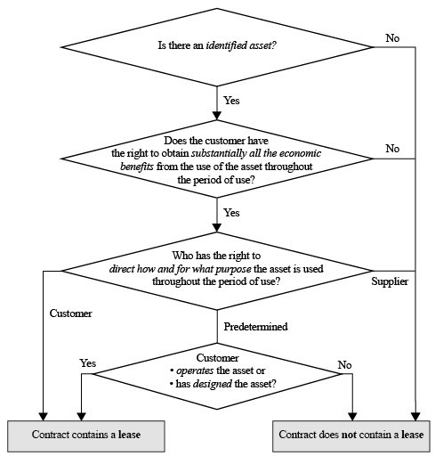
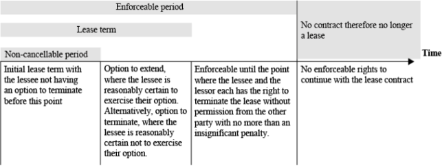

# 15 - Leases (IFRS 16)

[返回目录](README.md)

# 15 - Leases (IFRS 16)

Contents

- [15 - Leases (IFRS 16)](33.md#s106-chap_15_toc_h1)

- [Introduction and scope (paras 15.1-15.44)](33.md#s107-chap_15_navPoint_1)

- [Identifying a lease](33.md#s107-chap_15_navPoint_2)

- [Separating components of a contract](33.md#s107-chap_15_navPoint_3)

- [Combination of contracts](33.md#s107-chap_15_navPoint_4)

- [Lease term](33.md#s107-chap_15_navPoint_5)

- [Recognition and measurement exemptions (paras 15.45 - 15.55)](33.md#s108-chap_15_navPoint_6)

- [Short-term leases](33.md#s108-chap_15_navPoint_7)

- [Leases of low-value assets](33.md#s108-chap_15_navPoint_8)

- [Portfolio exemption](33.md#s108-chap_15_navPoint_9)

- [Accounting by lessees (paras 15.56 - 15.104)](33.md#s109-chap_15_navPoint_10)

- [Recognition](33.md#s109-chap_15_navPoint_11)

- [Initial measurement – lease liability](33.md#s109-chap_15_navPoint_12)

- [Variable lease payments](33.md#s109-chap_15_navPoint_idp1714674280)

- [Residual value guarantees](33.md#s109-chap_15_navPoint_idp1714783720)

- [Initial measurement – right-of-use asset](33.md#s109-chap_15_navPoint_13)

- [Restoration costs](33.md#s109-chap_15_navPoint_idp1714803048)

- [Initial direct costs](33.md#s109-chap_15_navPoint_idp1714806632)

- [Subsequent measurement – lease liability](33.md#s109-chap_15_navPoint_14)

- [Subsequent measurement – right-of-use asset](33.md#s109-chap_15_navPoint_15)

- [Other models for the subsequent measurement of right-of-use assets](33.md#s109-chap_15_navPoint_16)

- [Modification of a lease](33.md#s109-chap_15_navPoint_17)

- [Decrease in the scope of a lease](33.md#s109-chap_15_navPoint_idp1683662952)

- [Increase in the scope of a lease](33.md#s109-chap_15_navPoint_idp1687756808)

- [No change in scope](33.md#s109-chap_15_navPoint_idp1687771400)

- [Presentation](33.md#s109-chap_15_navPoint_18)

- [Disclosures by lessees](33.md#s109-chap_15_navPoint_19)

- [Accounting by lessors (paras 15.105 - 15.145)](33.md#s110-chap_15_navPoint_20)

- [Classification of leases](33.md#s110-chap_15_navPoint_21)

- [Classification indicators](33.md#s110-chap_15_navPoint_22)

- [Accounting for finance leases](33.md#s110-chap_15_navPoint_23)

- [Recognition and initial measurement](33.md#s110-chap_15_navPoint_idp1695152488)

- [Subsequent measurement](33.md#s110-chap_15_navPoint_idp1695174120)

- [Modification of a finance lease](33.md#s110-chap_15_navPoint_idp1695192296)

- [Accounting for operating leases](33.md#s110-chap_15_navPoint_24)

- [Manufacturer/dealer lessors](33.md#s110-chap_15_navPoint_25)

- [Disclosure by lessors](33.md#s110-chap_15_navPoint_26)

- [Practical application (paras 15.146 - 15.159)](33.md#s111-chap_15_navPoint_27)

- [Sale and leaseback transactions](33.md#s111-chap_15_navPoint_28)

- [Embedded derivatives](33.md#s111-chap_15_navPoint_29)

- [Transition and effective date (paras 15.160 - 172)](33.md#s112-chap_15_navPoint_30)

- [Definition](33.md#s112-chap_15_navPoint_31)

- [Lessee](33.md#s112-chap_15_navPoint_32)

- [Lessor](33.md#s112-chap_15_navPoint_33)

- [Sale and leaseback transactions](33.md#s112-chap_15_navPoint_34)

- [Illustrative text](34.md#s113-chap_15_navPoint_35)

- [Identifying a lease](34.md#s113-chap_15_navPoint_36)

- [FAQ 15.3.1 – Could an arrangement to use a company car which is in the scope of IAS 19 also be in the scope of IFRS 16?](34.md#s113-chap_15_navPoint_idp1714631912)

- [FAQ 15.3.2 – Is an underground space within the scope of IFRS 16?](34.md#s113-chap_15_navPoint_idp1714664168)

- [FAQ 15.5.1 – How is the term ‘consideration’ interpreted?](34.md#s113-chap_15_navPoint_idp1714704872)

- [FAQ 15.5.2 – How is the term ‘period of time’ interpreted?](34.md#s113-chap_15_navPoint_idp1714725992)

- [FAQ 15.5.3 – Is a perpetual period a ‘period of time’?](34.md#s113-chap_15_navPoint_idp1687983512)

- [FAQ 15.9.1 – Is there an identified asset where fulfilment of an arrangement is dependent on its use?](34.md#s113-chap_15_navPoint_idp1687991576)

- [FAQ 15.10.1 – What should be considered when assessing whether a lessor benefits economically from substituting the asset?](34.md#s113-chap_15_navPoint_idp1687995544)

- [FAQ 15.14.1 – Are substitution rights considered at a particular point in time or on the occurrence of a particular event?](34.md#s113-chap_15_navPoint_idp1688013208)

- [FAQ 15.18.1 – Which economic benefits are to be taken into account for the identification of a lease?](34.md#s113-chap_15_navPoint_idp1688025752)

- [FAQ 15.20.1 – Which decisions should be considered when assessing which party has the right to direct the use of an asset?](34.md#s113-chap_15_navPoint_idp1688032408)

- [FAQ 15.24.1 – What should be considered when analysing decisions that are made before the inception of the lease?](34.md#s113-chap_15_navPoint_idp1690418744)

- [FAQ 15.24.2 – How do you interpret predetermined, where many, but not all, of the decisions about how and for what purpose the asset is used are predetermined?](34.md#s113-chap_15_navPoint_idp1690434744)

- [EX 15.26.1 – Applying the lease definition to a retail unit](34.md#s113-chap_15_navPoint_idp1690451128)

- [EX 15.26.2 – Applying the lease definition to a rail car](34.md#s113-chap_15_navPoint_idp1690463160)

- [EX 15.26.3 – Applying the lease definition to a fibre-optic cable](34.md#s113-chap_15_navPoint_idp1687765256)

- [EX 15.26.4 – Applying the lease definition to a ship](34.md#s113-chap_15_navPoint_idp1683620968)

- [EX 15.26.5 – Applying the lease definition to a solar farm/power plant](34.md#s113-chap_15_navPoint_idp1683636456)

- [FAQ 15.27.1 – How should you assess whether a joint arrangement has the right to control the use of an identified asset?](34.md#s113-chap_15_navPoint_idp1683664360)

- [Separating components of a contract](34.md#s113-chap_15_navPoint_37)

- [FAQ 15.29.1 – How does a lessor separate components of a contract under IFRS 16 and IFRS 15?](34.md#s113-chap_15_navPoint_idp1683672296)

- [FAQ 15.33.1 – How is the consideration allocated if the lessor sells disposables to the lessee?](34.md#s113-chap_15_navPoint_idp1696041896)

- [Combination of contracts](34.md#s113-chap_15_navPoint_38)

- [EX 15.35.1 – Accounting for temporary building solutions provided based on separate contracts](34.md#s113-chap_15_navPoint_idp1696065832)

- [Lease term](34.md#s113-chap_15_navPoint_39)

- [FAQ 15.37.1 – How do termination options affect the length of the lease term?](34.md#s113-chap_15_navPoint_idp1696081704)

- [FAQ 15.37.2 – How is the lease term determined if one party has a termination option with a more than insignificant penalty?](34.md#s113-chap_15_navPoint_idp1696090152)

- [FAQ 15.37.3 – How are perpetual lease contracts with bilateral termination options accounted for?](34.md#s113-chap_15_navPoint_idp1695082856)

- [FAQ 15.37.4 – How is ‘penalty’ interpreted in the context of paragraph B34 of IFRS 16?](34.md#s113-chap_15_navPoint_idp1695121896)

- [EX 15.37.5 – What is the enforceable period?](34.md#s113-chap_15_navPoint_idp1695143016)

- [FAQ 15.39.1 – How is the lease term impacted by break clauses?](34.md#s113-chap_15_navPoint_idp1695167720)

- [FAQ 15.39.2 – How is the lease term impacted by extension options?](34.md#s113-chap_15_navPoint_idp1695182696)

- [FAQ 15.39.3 – How should the different indicators of reasonable certainty be weighted?](34.md#s113-chap_15_navPoint_idp1695190248)

- [FAQ 15.39.4 – Does the assessment of whether a lessee is ‘reasonably certain’ to exercise an option include non-monetary economic incentives?](34.md#s113-chap_15_navPoint_idp1695488056)

- [FAQ 15.39.5 – How should you consider enforceability beyond the written contract?](34.md#s113-chap_15_navPoint_idp1695508920)

- [EX 15.43.1 – What are significant events or changes in circumstances within the control of the lessee that could result in a reassessment of the lease term?](34.md#s113-chap_15_navPoint_idp1695521720)

- [Recognition and measurement exemptions](34.md#s113-chap_15_navPoint_40)

- [EX 15.47.1 – Can perpetual lease contracts that contain termination options qualify as short-term leases?](34.md#s113-chap_15_navPoint_idp1695539384)

- [FAQ 15.47.2 – What is the lease term if there are non-consecutive periods of use?](34.md#s113-chap_15_navPoint_idp1695563192)

- [FAQ 15.50.1 – How does IFRS 16 define the term ‘low value’?](34.md#s113-chap_15_navPoint_idp1695579320)

- [EX 15.53.1 – How does a lessee assess whether a leased asset meets the low-value asset criteria?](34.md#s113-chap_15_navPoint_idp1695585848)

- [FAQ 15.58.1 – If a lessee takes the practical expedient in paragraph 15 of IFRS 16 to not account for non-lease components separately, which lease payments should be used to calculate the interest rate implicit in the lease?](34.md#s113-chap_15_navPoint_idp1695606584)

- [Accounting by lessees](34.md#s113-chap_15_navPoint_41)

- [Initial measurement – lease liability](34.md#s113-chap_15_navPoint_idp1687110328)

- [FAQ 15.59.1 – Which discount rate should a lessee use if the interest rate implicit in the lease is negative?](34.md#s113-chap_15_navPoint_idp1687107768)

- [FAQ 15.60.1 – What factors should a lessee consider when determining an incremental borrowing rate?](34.md#s113-chap_15_navPoint_idp1687110840)

- [FAQ 15.60.2 - Is a lessee required to reflect the lease payment profile when determining an incremental borrowing rate?](34.md#s113-chap_15_navPoint_idp1687132216)

- [FAQ 15.61.1 – How should a lessee account for reimbursements from the lessor for leasehold improvements?](34.md#s113-chap_15_navPoint_idp1687162808)

- [FAQ 15.61.2 – How should a lessee account for costs such as insurance premiums, property taxes or maintenance?](34.md#s113-chap_15_navPoint_idp1687182520)

- [FAQ 15.61.3 - How should a lessee account for a lessor put option?](34.md#s113-chap_15_navPoint_idp1687195320)

- [FAQ 15.63.1 – How is the term ‘index or rate’ interpreted?](34.md#s113-chap_15_navPoint_idp1687214648)

- [FAQ 15.63.2 – Should the lessee include VAT in the lease liability and right-of-use asset?](34.md#s113-chap_15_navPoint_idp1689022200)

- [EX 15.65.1 – How are variable lease payments that depend on an index or a rate initially measured?](34.md#s113-chap_15_navPoint_idp1689047544)

- [FAQ 15.65.2 – How are lease payments denominated in a foreign currency accounted for?](34.md#s113-chap_15_navPoint_idp1689055352)

- [FAQ 15.65.3 – How are lease payments that entirely depend on an index or a rate accounted for?](34.md#s113-chap_15_navPoint_idp1689069048)

- [EX 15.65.4 – How are lease payments determined if there are extension options at market rates?](34.md#s113-chap_15_navPoint_idp1689091064)

- [EX 15.66.1 – What are examples of variable payments not linked to an index or a rate?](34.md#s113-chap_15_navPoint_idp1698007768)

- [FAQ 15.66.2 – How are variable lease payments that depend on more than one variable accounted for?](34.md#s113-chap_15_navPoint_idp1698020312)

- [FAQ 15.66.3 – How are variable payments of property tax and insurance measured?](34.md#s113-chap_15_navPoint_idp1698040024)

- [FAQ 15.67.1 – When do variable lease payments meet the definition of in-substance fixed payments?](34.md#s113-chap_15_navPoint_idp1698060888)

- [FAQ 15.69.1 – How is the amount payable under a residual value guarantee measured?](34.md#s113-chap_15_navPoint_idp1698097624)

- [Initial measurement – right-of-use asset](34.md#s113-chap_15_navPoint_idp1698111192)

- [EX 15.71.1 – Accounting for restoration costs relating to a leased asset](34.md#s113-chap_15_navPoint_idp1698107608)

- [FAQ 15.74.1 – Which costs typically qualify as initial direct costs?](34.md#s113-chap_15_navPoint_idp1698135640)

- [FAQ 15.74.2 – Can a lessee capitalise costs which do not qualify as initial direct costs?](34.md#s113-chap_15_navPoint_idp1698151768)

- [Subsequent measurement – lease liability](34.md#s113-chap_15_navPoint_idp1698174296)

- [EX 15.76.1 – Lease accounting by a lessee](34.md#s113-chap_15_navPoint_idp1698177112)

- [FAQ 15.76.2 - How should a lessee account for the purchase of an underlying asset part-way through the lease term when there is no purchase option in the lease contract?](35.md#s114-chap_15_navPoint_idp1714539224)

- [FAQ 15.77.1 – Which events trigger a re-assessment and how does the lessee calculate the new carrying amount of the lease liability?](35.md#s114-chap_15_navPoint_idp1714563800)

- [FAQ 15.77.2 – How are variable lease payments that depend on an index or a rate subsequently measured?](35.md#s114-chap_15_navPoint_idp1714587864)

- [EX 15.77.3 – How are lease payments measured if they depend on more than one index or rate?](35.md#s114-chap_15_navPoint_idp1714603096)

- [FAQ 15.78.1 – How are variable lease payments that become fixed for part of the remaining lease term accounted for?](35.md#s114-chap_15_navPoint_idp1686687560)

- [Modification of a lease](35.md#s114-chap_15_navPoint_idp1686703176)

- [FAQ 15.81.1 – When are expenses recognised for a lease with non-consecutive periods of use?](35.md#s114-chap_15_navPoint_idp1686704584)

- [FAQ 15.81.2 – Lessee’s accounting upon early termination option exercised by lessor](35.md#s114-chap_15_navPoint_idp1686723656)

- [FAQ 15.82.1 – How should a Lessee account for key money?](35.md#s114-chap_15_navPoint_idp1686742856)

- [FAQ 15.88.1 – What are examples of lease modifications?](35.md#s114-chap_15_navPoint_idp1686769736)

- [FAQ 15.88.2 – What does ‘proportionally’ mean in the context of ‘consideration for a lease’, when determining whether the overall consideration is changed or not?](35.md#s114-chap_15_navPoint_idp1686780360)

- [EX 15.93.1 – Lessee accounting for a modification that decreases the scope of a lease](35.md#s114-chap_15_navPoint_idp1686785736)

- [EX 15.95.1 – How is an increase in scope without a corresponding increase in the lease consideration accounted for?](35.md#s114-chap_15_navPoint_idp1686828488)

- [EX 15.95.2 – How to account for a modification that is not accounted for as a separate lease if the modification is not effective immediately](35.md#s114-chap_15_navPoint_idp1686843336)

- [FAQ 15.96.1 - How should a lessee account for voluntary forgiveness of lease payments by the lessor?](35.md#s114-chap_15_navPoint_idp1686867528)

- [FAQ 15.98.1 – How should a right-of-use asset resulting from a property lease be presented?](35.md#s114-chap_15_navPoint_idp1714911832)

- [Accounting by lessors](35.md#s114-chap_15_navPoint_42)

- [Classification of leases](35.md#s114-chap_15_navPoint_idp1714925912)

- [FAQ 15.110.1 – What is the difference between inception date and commencement date?](35.md#s114-chap_15_navPoint_idp1714929240)

- [FAQ 15.112.1 – Does the scope exemption for leases of intangible assets in paragraph 4 of IFRS 16 apply to the lessor in a sublease if the underlying asset is tangible?](35.md#s114-chap_15_navPoint_idp1714936664)

- [FAQ 15.113.1 – How does the accounting for sub-leases vary from that for regular leases?](35.md#s114-chap_15_navPoint_idp1714947800)

- [FAQ 15.113.2 – Is an intermediate lessor permitted to offset the remaining lease liability (from the head lease) and the lease receivable (from the sub-lease)?](35.md#s114-chap_15_navPoint_idp1714964312)

- [FAQ 15.113.3 – How is a sub-lease accounted for if the sub-lease term is less than the remaining head lease term?](35.md#s114-chap_15_navPoint_idp1714967896)

- [Classification indicators](35.md#s114-chap_15_navPoint_idp1714984664)

- [FAQ 15.114.1 – What needs to be considered when assessing a transfer of ownership or purchase options?](35.md#s114-chap_15_navPoint_idp1714993880)

- [FAQ 15.114.2 – What does ‘major part’ mean in the context of the lease term indicator for the lease classification?](35.md#s114-chap_15_navPoint_idp1715002840)

- [FAQ 15.114.3 – How much impact does the lease term classification indicator have if the lessor retains title to the asset?](35.md#s114-chap_15_navPoint_idp1715015512)

- [FAQ 15.114.4 – What does ‘substantially all’ mean in the context of the lease payments indicator for the lease classification?](35.md#s114-chap_15_navPoint_idp1715021528)

- [FAQ 15.114.5 – Which payments are regarded as lease payments in the context of lease classification?](35.md#s114-chap_15_navPoint_idp1715026776)

- [FAQ 15.114.6 – How are leases classified if the underlying asset is of a specialised nature?](35.md#s114-chap_15_navPoint_idp1715033944)

- [FAQ 15.114.7 - How should a lessor account for a lessor put option?](35.md#s114-chap_15_navPoint_idp1715051096)

- [FAQ 15.115.1 – Is the economic life for lease classification purposes the same as the period over which the entity would depreciate an asset?](35.md#s114-chap_15_navPoint_idp1715064792)

- [FAQ 15.115.2 – How does technical obsolescence impact lease classification?](35.md#s114-chap_15_navPoint_idp1715078616)

- [FAQ 15.117.1 – What factors require the most judgement in determining lease classification?](35.md#s114-chap_15_navPoint_idp1715084632)

- [FAQ 15.117.2 – How does it impact lease classification if the lessor and the lessee share the residual value?](35.md#s114-chap_15_navPoint_idp1715095384)

- [FAQ 15.117.3 – How are leases classified if the lessor’s residual value risk is evaluated as being remote?](35.md#s114-chap_15_navPoint_idp1715106392)

- [Accounting for finance leases](35.md#s114-chap_15_navPoint_idp1715116888)

- [FAQ 15.122.1 – What does the estimated unguaranteed residual value depend on?](35.md#s114-chap_15_navPoint_idp1715120216)

- [EX 15.125.1 – Calculation of lessor finance income](35.md#s114-chap_15_navPoint_idp1715130840)

- [FAQ 15.126.1 – Is the unguaranteed residual value of a finance lease receivable included in the calculation of expected credit losses under IFRS 9?](35.md#s114-chap_15_navPoint_idp1700703192)

- [EX 15.127.1 – Re-appraisal of unguaranteed residual value](35.md#s114-chap_15_navPoint_idp1700706520)

- [Accounting for operating leases](35.md#s114-chap_15_navPoint_idp1700824024)

- [FAQ 15.132.1 – How do changes in residual values affect operating lease lessors?](35.md#s114-chap_15_navPoint_idp1700820696)

- [EX 15.134.1 – Lease income recognised on a straight-line basis](35.md#s114-chap_15_navPoint_idp1700570584)

- [EX 15.134.2 – How should lease incentives be accounted for?](35.md#s114-chap_15_navPoint_idp1688526120)

- [FAQ 15.134.3 – Should a lessor in an operating lease continue to recognise lease income where its collectability is uncertain ?](35.md#s114-chap_15_navPoint_idp1688541480)

- [FAQ 15.134.4 – How should a lessor in an operating lease account for surrender premiums when a break clause is exercised and the lease term is shortened?](35.md#s114-chap_15_navPoint_idp1688552104)

- [FAQ 15.135.1 – Can a lessor capitalise costs which do not qualify as initial direct costs?](35.md#s114-chap_15_navPoint_idp1688581416)

- [FAQ 15.136.1 – How should a lessor account for forgiveness of amounts contractually due for past rent which they voluntarily forgive?](35.md#s114-chap_15_navPoint_idp1688600488)

- [FAQ 15.136.2 – How are initial direct costs accounted for when an operating lease is modified?](35.md#s114-chap_15_navPoint_idp1688622376)

- [Manufacturer/dealer lessors](35.md#s114-chap_15_navPoint_idp1688649256)

- [EX 15.140.1 – Sale of an asset by a manufacturer lessor under a finance lease](35.md#s114-chap_15_navPoint_idp1688647080)

- [EX 15.140.2 – Sale of an asset by a manufacturer lessor with advance deposit payment by the lessee](35.md#s114-chap_15_navPoint_idp1688681000)

- [Property leases](35.md#s114-chap_15_navPoint_43)

- [FAQ 15.148.1 – Can the lease classification be determined without performing a detailed split of the rentals?](35.md#s114-chap_15_navPoint_idp1688698152)

- [EX 15.148.2 – Lease classification using qualitative criteria](35.md#s114-chap_15_navPoint_idp1688708648)

- [FAQ 15.149.1 – Why are the lease payments allocated between the land and buildings in proportion to the relative fair values of the leasehold interests?](35.md#s114-chap_15_navPoint_idp1688728232)

- [FAQ 15.149.2 – How is the fair value of the lessee’s leasehold interest calculated?](35.md#s114-chap_15_navPoint_idp1688749992)

- [EX 15.149.3 – Rental allocation](35.md#s114-chap_15_navPoint_idp1688763304)

- [Sale and leaseback transactions](35.md#s114-chap_15_navPoint_44)

- [FAQ 15.153.1 – When would a sale and leaseback not qualify as a sale in accordance with IFRS 15?](35.md#s114-chap_15_navPoint_idp1697395160)

- [EX 15.155.1 – Accounting for a sale and leaseback transaction (example)](35.md#s114-chap_15_navPoint_idp1697406936)

- [FAQ 15.155.2 – How do you initially account for a sale and leaseback transaction where the lease payments are entirely variable?](35.md#s114-chap_15_navPoint_idp1697444568)

- [Transition and effective date](35.md#s114-chap_15_navPoint_45)

- [Lessee](35.md#s114-chap_15_navPoint_idp1697457112)

- [FAQ 15.166.1 – What is the lease term when estimating the incremental borrowing rate at the date of initial application?](35.md#s114-chap_15_navPoint_idp1697471960)

- [FAQ 15.167.1 – What are the impairment requirements for right-of-use assets resulting from leases previously classified as operating leases on transition on IFRS 16?](35.md#s114-chap_15_navPoint_idp1697479000)

- [FAQ 15.167.2 – If an entity incorporates its IAS 37 onerous lease provision into a right-of-use asset on transition, what is the deemed cost for future impairment reversals?](35.md#s114-chap_15_navPoint_idp1697507032)

- [FAQ 15.167.3 – How do you apply the low-value asset exemption on transition?](35.md#s114-chap_15_navPoint_idp1697524824)

- [EX 15.167.4 – Applying the practical expedients on transition](35.md#s114-chap_15_navPoint_idp1697539432)

- [FAQ 15.167.5 – How do you account for finance leases on transition?](35.md#s114-chap_15_navPoint_idp1697550056)

- [Lessor](35.md#s114-chap_15_navPoint_idp1697562472)

- [EX 15.169.1 – Initial recognition of a finance lease resulting from a sub-lease on transition to IFRS 16](35.md#s114-chap_15_navPoint_idp1697555944)

- [Sale and leaseback transactions](35.md#s114-chap_15_navPoint_idp1697604456)

- [EX 15.172.1 – Requirements for transactions before the date of initial application](35.md#s114-chap_15_navPoint_idp1697598952)

This eBook is licensed to peggy so, peggy.so@hk.ey.com, 

## Introduction and scope (paras 15.1-15.44)

 

**15.1** The objective of IFRS 16 is to set out the principles for the recognition, measurement, presentation and disclosure of leases.

[IFRS 16 para 1].

**15.2** A lease is defined as a “contract, or a part of a contract, that conveys the right to use an asset (the underlying asset) for a period of time in exchange for consideration”.

[IFRS 16 App A].

**15.3** The standard excludes from its scope:

- leases to explore for or use minerals, oil, natural gas and similar non-regenerative resources;

- leases of biological assets within the scope of IAS 41, ‘Agriculture’, held by lessees;

- service concession arrangements within the scope of IFRIC 12, ‘Service concession arrangements’;

- licences of intellectual property granted by a lessor within the scope of IFRS 15, ‘Revenue from contracts with customers’; and

- rights held by lessees under licensing agreements within the scope of IAS 38, ‘Intangible assets’, for example items such as motion picture films, video recordings, plays, manuscripts, patents and copyrights.

[IFRS 16 para 3].

[FAQ 15.3.1 – Could an arrangement to use a company car which is within the scope of IAS 19 also be within the scope of IFRS 16?](34.md#s113-FAQ_15.3.1)  
[FAQ 15.3.2 – Is an underground space within the scope of IFRS 16?](34.md#s113-FAQ_15.3.2)

**15.4** A lessee can choose to apply IFRS 16 to leases of intangible assets other than those mentioned above within the scope of IAS 38. If a lessee does not apply IFRS 16 to leases of intangible assets, it applies IAS 38. A lessor has no choice and has to apply IFRS 16 to leases of intangible assets other than those mentioned above within the scope of IFRS 15.

[IFRS 16 para 4].

 

### Identifying a lease

 

**15.5** A contract is, or contains, a lease if there is an identified asset and the contract conveys the right to control the use of the identified asset for a period of time in exchange for consideration.

[IFRS 16 para 9].

[FAQ 15.5.1 – How is the term ‘consideration’ interpreted?](34.md#s113-FAQ_15.5.1)  
[FAQ 15.5.2 – How is the term ‘period of time’ interpreted?](34.md#s113-FAQ_15.5.2)  
[FAQ 15.5.3 – Is a perpetual period a ‘period of time’?](34.md#s113-FAQ_15.5.3)

**15.6** An entity assesses whether a contract is, or contains, a lease at the inception date. The inception date is the earlier of the date of a lease agreement and the date of commitment by the parties to the principal terms and conditions of the lease.

[IFRS 16 para 9].

**15.7**An entity does not re-assess whether a contract contains a lease unless the terms and conditions of the contract are changed.

[IFRS 16 para 11].

**15.8** The flow chart below summarises the analysis to be made to evaluate whether a contract contains a lease:

  
 [IFRS 16 App B para B31].

**15.9** An asset can be identified either explicitly or implicitly. If explicit, the asset is specified in the contract (for example, by a serial number or a similar identification marking); if implicit, the asset is not mentioned in the contract but is implicitly specified when the supplier makes it available to the customer. Both cases could result in an identified asset.

[IFRS 16 App B para B13].

[FAQ 15.9.1 – Is there an identified asset where fulfilment of an arrangement is dependent on its use?](34.md#s113-FAQ_15.9.1)

**15.10** There is no identified asset if the supplier has a substantive right to substitute the asset throughout the period of use. Substitution rights are substantive if the supplier has the practical ability to substitute an alternative asset and would benefit economically from substituting the asset.

[IFRS 16 App B para B14].

[FAQ 15.10.1 – What should be considered when assessing whether a lessor benefits economically from substituting the asset?](34.md#s113-FAQ_15.10.1)

**15.11** The cost of substitution is generally higher where an asset is located at the customer’s premises. The cost of substitution in these circumstances could outweigh its benefits.

[IFRS 16 App B para B17].

**15.12** The assessment of whether a substitution right is substantive depends on the facts and circumstances at inception of the contract. It does not take into account circumstances that are not considered likely to occur.

[IFRS 16 App B para B16].

**15.13** A right to substitute an asset if it is not operating properly, or if there is a technical update required, does not prevent the contract from being dependent on an identified asset.

[IFRS 16 App B para B18].

**15.14** A supplier’s right or obligation to substitute an underlying asset, for any reason, on or after a particular date or on the occurrence of a specified event does not prevent the contract from being dependent on an identified asset. The supplier does not have the practical ability to substitute alternative assets throughout the period of use.

[IFRS 16 App B para B15].

[FAQ 15.14.1 – Are substitution rights considered at a particular point in time or on the occurrence of a particular event?](34.md#s113-FAQ_15.14.1)

**15.15** A customer presumes that a substitution right is not substantive if it cannot readily determine whether the supplier has a substantive substitution right.

[IFRS 16 App B para B19].

**15.16** An identified asset can be a physically distinct portion of a larger asset, such as one floor of a multi-level building, or physically distinct dark fibres within a cable. A capacity portion (that is, a portion of a larger asset that is not physically distinct) is not an identified asset unless it represents substantially all of the capacity of the entire asset. A capacity portion of a fibre-optic cable that does not represent substantially all of the capacity of the cable would not qualify as an identified asset, because it is not physically distinct.

[IFRS 16 App B para B20].

**15.17** A contract conveys the right to control the use of an identified asset if the customer has both the right to obtain substantially all of the economic benefits from use of the identified asset and the right to direct the use of the identified asset throughout the period of use.

[IFRS 16 App B para B9].

**15.18** An entity can obtain economic benefits directly or indirectly (for example, by using, holding or sub-leasing the asset). Benefits include the primary output and any by-products (including potential cash flows derived from these items), as well as payments from third parties that relate to the use of the identified asset, within the defined scope of the entity’s right to use the asset. Economic benefits relating to the ownership of the asset are ignored.

[IFRS 16 App B para B21]. [IFRS 16 App B para B22].

[FAQ 15.18.1 – Which economic benefits are to be taken into account for the identification of a lease?](34.md#s113-FAQ_15.18.1)

**15.19** The entity must determine which party (that is, the customer or the supplier) has the right to direct how and for what purpose the identified asset is used throughout the period of use.

[IFRS 16 App B para B24].

**15.20** The standard gives several examples of relevant decision-making rights:

- Right to change what type of output is produced.

- Right to change when the output is produced.

- Right to change where the output is produced.

- Right to change how much of the output is produced.

[IFRS 16 App B para B26].

[FAQ 15.20.1 – Which decisions should be considered when assessing which party has the right to direct the use of an asset?](34.md#s113-FAQ_15.20.1)

**15.21** The relevance of each of the decision-making rights depends on the underlying asset being considered and on the terms and conditions of the contract. If both parties have decision-making rights, an entity considers the rights that are most relevant to changing how and for what purpose the asset is used. Decision-making rights are relevant where they affect the economic benefits to be derived from the use of the asset.

[IFRS 16 App B para B25].

**15.22** An entity does not take into account protective rights in its assessment. A supplier might limit the use of an asset by a customer, in order to protect its personnel or to ensure compliance with relevant laws and regulations. For example, a customer who has hired a ship is prevented from sailing the ship into waters with a high risk of piracy or transporting hazardous materials. These protective rights do not affect the assessment of which party to the contract has the right to direct the use of the identified asset.

[IFRS 16 App B para B30].

**15.23** Decisions about maintaining and operating an asset do not grant the right to direct the use of the asset. An entity only takes them into account if the decisions about how and for what purpose the asset is used are predetermined.

[IFRS 16 App B para B27].

**15.24** The decisions about how and for what purpose the underlying asset is used could be predetermined before the inception of the lease. The customer in this case has the right to direct the use of an asset if either:

- it has the right to operate the identified asset throughout the period of use, without the supplier having the right to change the operating instructions; or

- it has designed the identified asset (or specific aspects of the asset) in a way that predetermines how and for what purpose the asset will be used throughout the period of use.

[IFRS 16 App B para B24].

[FAQ 15.24.1 – What should be considered when analysing decisions that are made before the inception of the lease?](34.md#s113-FAQ_15.24.1)   
[FAQ 15.24.2 – How do you interpret ‘predetermined’ where many, but not all, of the decisions about how and for what purpose the asset is used are predetermined?](34.md#s113-FAQ_15.24.2)

**15.25** Decisions made before the period of use are ignored, unless they are made in the context of the design of the asset by a customer that predetermines its use.

[IFRS 16 App B para B29].

**15.26** The analysis of whether a contract contains a lease can be complex. For various industries, examples are included below.

[EX 15.26.1 – Applying the lease definition to a retail unit](34.md#s113-EX15.26.1)  
[EX 15.26.2 – Applying the lease definition to a rail car](34.md#s113-EX15.26.2)  
[EX 15.26.3 – Applying the lease definition to a fibre-optic cable](34.md#s113-EX15.26.3)  
[EX 15.26.4 – Applying the lease definition to a ship](34.md#s113-EX15.26.4)  
[EX 15.26.5 – Applying the lease definition to a solar farm/power plant](34.md#s113-EX15.26.5)

**15.27** A joint arrangement, as defined by IFRS 11, ‘Joint arrangements’, or someone on behalf of the joint arrangement, could be the customer in a contract to receive goods or services. An assessment must be made as to whether the joint arrangement has the right to control the use of the identified asset.

[IFRS 16 App B para B11].

[FAQ 15.27.1 – How should you assess whether a joint arrangement has the right to control the use of an identified asset?](34.md#s113-FAQ_15.27.1)

 

### Separating components of a contract

 

**15.28** Contracts often combine different kinds of obligations of the supplier, which might be a combination of lease components or a combination of lease and non-lease components. For example, the lease of an industrial area might contain the lease of land, buildings and equipment, or a contract for a car lease might be combined with maintenance. In a multi-element arrangement, an entity has to identify each separate lease component (based on the guidance on the definition of a lease) and account for it separately.

[IFRS 16 para 12].

**15.29** An arrangement contains more than one lease component if both of the following criteria are met:

- the lessee can benefit from use of the asset, either on its own or together with other resources that are readily available to the lessee; and

- the underlying asset is neither highly dependent on, nor highly interrelated with, the other underlying assets in the contract.

[IFRS 16 App B para B32].

[FAQ 15.29.1 – How does a lessor separate components of a contract under IFRS 16 and IFRS 15?](34.md#s113-FAQ_15.29.1)

**15.30** When identifying non-lease components, an entity must consider whether a good or service is transferred to the lessee. For example, if a lessee pays for the right to use an asset and also for administrative tasks, which do not transfer a good or service to the lessee, the administrative tasks are not a separate non-lease component.

[IFRS 16 App B para B33].

[FAQ 15.61.2 - How should a lessee account for costs such as insurance premiums, property taxes or maintenance?](34.md#s113-FAQ_15.61.2)

**15.31** The consideration must be allocated between the components if the analysis concludes that there are separate components (unless the practical expedient in [para 15.34](33.md#s107-Para_15.34) is applied).

[IFRS 16 para 12].

**15.32** The lessee allocates the consideration on the basis of relative stand-alone prices. The lessee estimates prices if observable stand-alone prices are not readily available, and it should maximise the use of observable information.

[IFRS 16 para 13]. [IFRS 16 para 14].

**15.33** The lessor allocates the consideration on the basis of relative stand-alone selling prices in accordance with IFRS 15.

[IFRS 16 para 17].

[FAQ 15.33.1 – How is the consideration allocated if the lessor sells disposables to the lessee?](34.md#s113-FAQ_15.33.1)

**15.34** As a practical expedient, lessees do not need to separate lease and non-lease components. A lessee can account for each lease component and any associated non-lease components as a single lease component. For example, a lessee that leases several machines (each of which meets the definition of a separate lease component) and also receives maintenance services from the lessor has two alternatives: the lessee can account for each lease component and each service component separately; or it can decide to combine the lease of each machine and the maintenance service related to that lease, and account for it as a single lease component. The practical expedient is an accounting policy choice by class of underlying asset.

[IFRS 16 para 15].

 

### Combination of contracts

 

**15.35** Several contracts with the same counterparty might be entered into, at or near the same time and in contemplation of each other. An entity combines contracts entered into at or near the same time with the same counterparty (or related parties of the counterparty) if one or more of the following conditions are met:

- the contracts are negotiated as a package with an overall commercial objective;

- the consideration in one contract depends on the price/performance of the other contract; or

- the assets involved are a single lease component.

The combination affects both the assessment of whether there is a lease and the accounting for the potential lease.

[IFRS 16 App B para B2].

[EX 15.35.1 – Accounting for temporary building solutions provided based on separate contracts](34.md#s113-EX15.35.1)

 

### Lease term

 

**15.36** The lease term begins on the date on which the lessor makes the underlying asset available for use by a lessee (commencement date).

[IFRS 16 App B para B36].

**15.37** The following terms should be considered when determining the lease term:

- the non-cancellable period of a lease is any period during which the lessee is unable to terminate the contract (paragraph B35 of IFRS 16). Consequently, any non-cancellable period in effect sets a minimum lease term.

- the enforceable period of a lease is the period for which enforceable rights and obligations exist between the lessee and lessor. As described in paragraph B34 of IFRS 16, “in determining the lease term and assessing the length of the non-cancellable period of a lease, an entity shall apply the definition of a contract and determine the period for which the contract is enforceable. A lease is no longer enforceable when the lessee and the lessor each has the right to terminate the lease without permission from the other party with no more than an insignificant penalty”. To be part of the determination of the enforceable period, any optional periods that are included in the lease term must also be enforceable. Consequently, the enforceable period in effect sets a maximum lease term.

- the lease term is the non-cancellable period of a lease, together with any optional periods that the lessee is reasonably certain to use (paragraph 18 of IFRS 16). Periods covered by an option to extend the lease term are included in the lease term if the lessee is reasonably certain to exercise that option. The same rationale applies to termination options. Periods covered by a termination option are included in the lease term if the lessee is reasonably certain not to exercise the option. The lease term cannot extend beyond the end of the enforceable period.

Those concepts are depicted in the following diagram.

In addition, the November 2019 IFRIC Update includes the following when considering the enforceable period:

“The Committee observed that, in applying paragraph B34 and determining the enforceable period of the lease described in the request, an entity considers:

(a) the broader economics of the contract, and not only contractual termination payments. For example, if either party has an economic incentive not to terminate the lease such that it would incur a penalty on termination that is more than insignificant, the contract is enforceable beyond the date on which the contract can be terminated; and

(b) whether each of the parties has the right to terminate the lease without permission from the other party with no more than an insignificant penalty. Applying paragraph B34, a lease is no longer enforceable only when both parties have such a right. Consequently, if only one party has the right to terminate the lease without permission from the other party with no more than an insignificant penalty, the contract is enforceable beyond the date on which the contract can be terminated by that party.

If an entity concludes that the contract is enforceable beyond the notice period of a cancellable lease (or the initial period of a renewable lease), it then applies paragraphs 19 and B37-B40 of IFRS 16 to assess whether the lessee is reasonably certain not to exercise the option to terminate the lease.”

Specifically, the IFRS IC agenda decision refers to situations where a lessee expects to use non-removable leasehold improvements beyond the date on which the contract can be terminated and expects to incur the costs of abandoning or dismantling those leasehold improvements. In this case, applying paragraph B34 of IFRS 16, an entity should consider whether the contract is enforceable for at least the period of expected utility of the leasehold improvements, as the entity might incur a more than insignificant penalty if it terminates the lease. The agenda decision also re-emphasized that the entity should consider significant leasehold improvements undertaken (or expected to be undertaken) over the term of the contract when assessing whether the lessee is reasonably certain to exercise an option to extend the lease or purchase the underlying asset or not exercise an option to terminate the lease.

[IFRS 16 para 18].

[FAQ 15.37.1 – How do termination options affect the length of the lease term?](34.md#s113-FAQ_15.37.1)  
[FAQ 15.37.2 – How is the lease term determined if one party has a termination option with a more than insignificant penalty?](34.md#s113-FAQ_15.37.2)  
[FAQ 15.37.3 – How are perpetual lease contracts with bilateral termination options accounted for?](34.md#s113-FAQ_15.37.3)  
[FAQ 15.37.4 – How is ‘penalty’ interpreted in the context of paragraph B34 of IFRS 16?](34.md#s113-FAQ_15.37.4)  
[EX 15.37.5 – What is the enforceable period?](34.md#s113-EX15.37.5)

**15.38** An entity should consider all facts and circumstances that create an economic incentive for the lessee to exercise an extension option (or not to exercise a termination option) in order to assess whether the exercise (or the non-exercise) is reasonably certain.

[IFRS 16 para 19].

**15.39** Examples of factors that an entity takes into account are:

- Contractual terms and conditions for optional periods compared with market rates: it is more likely that a lessee will not exercise an extension option if lease payments exceed market rates. Other examples of terms that an entity takes into account are termination penalties or residual value guarantees.

- Significant leasehold improvements undertaken (or expected to be undertaken): it is more likely that a lessee will exercise an extension option if a lessee makes significant investments to improve the leased asset or to tailor it for its special needs.

- Costs relating to the termination of the lease/signing of a replacement lease: it is more likely that a lessee will exercise an extension option if doing so avoids costs such as negotiation costs, relocation costs, costs of identifying another suitable asset, costs of integrating a new asset, and costs of returning the original asset in a contractually specified condition or to a contractually specified location.

- The importance of the underlying asset to the lessee’s operations: it is more likely that a lessee will exercise an extension option if the underlying asset is specialised or if suitable alternatives are not available.

- Conditionality associated with exercising the option, and the likelihood that those conditions will exist.

[IFRS 16 App B para B37].

[FAQ 15.39.1 – How is the lease term impacted by break clauses?](34.md#s113-FAQ_15.39.1)  
[FAQ 15.39.2 – How is the lease term impacted by extension options?](34.md#s113-FAQ_15.39.2)  
[FAQ 15.39.3 – How should the different indicators of reasonable certainty be weighted?](34.md#s113-FAQ_15.39.3)  
[FAQ 15.39.4 – Does the assessment of whether a lessee is ‘reasonably certain’ to exercise an option include non-monetary economic incentives?](34.md#s113-FAQ_15.39.4)  
  
[FAQ 15.39.5 – How should you consider enforceability beyond the written contract?](34.md#s113-FAQ_15.39.5)

**15.40** There could be contracts that combine options with other features so that the lessee guarantees the lessor a minimum or fixed return that is substantially the same, whether or not the lessee exercises the option. An example is a combination of an extension option and a residual value guarantee. An entity should, in this case, assume that the lessee is reasonably certain to exercise the option to extend the lease.

[IFRS 16 App B para B38].

**15.41** A lessee’s past practice regarding the period over which it has typically used particular types of asset, and its economic reasons for doing so, might also provide helpful information.

[IFRS 16 App B para B40].

**15.42** The assessment of the lease term is made at the commencement date (see [para 15.36](33.md#s107-Para_15.36) for the definition of commencement date).

[IFRS 16 App B para B41].

**15.43** A lessee re-assesses extension options and termination options only when a significant event or change in circumstances occurs that is within the control of the lessee and affects whether it is reasonably certain to exercise an option. A lessor does not re-assess whether or not an option is reasonably certain to be exercised.

[IFRS 16 para 20].

[EX 15.43.1 – What are significant events or changes in circumstances within the control of the lessee that affect whether it is reasonably certain to exercise an option?](34.md#s113-EX15.43.1)

**15.44** A change in the non-cancellable lease period results in a change in the lease term for both lessee and lessor. Examples of a change in the non-cancellable lease period include:

- the lessee exercises an option in a different way than the entity had previously determined was reasonably certain; or

- an event occurs that contractually obliges the lessee to exercise an option (/prohibits the lessee from exercising an option) not previously included in the determination of the lease term (/previously included in the determination of the lease term). For example, a lessee of a retail store might be contractually obliged to extend the lease term if revenues from that store exceed a certain amount for the first time.

[IFRS 16 para 21].

 

This eBook is licensed to peggy so, peggy.so@hk.ey.com, 

## Recognition and measurement exemptions (paras 15.45 - 15.55)

 

**15.45** IFRS 16 contains two recognition and measurement exemptions: short-term leases; and leases for which the underlying asset is of low value. Both exemptions are optional, and they apply only to lessees.

[IFRS 16 para 5].

**15.46** A lessee that applies either or both of the exemptions recognises the lease payments as expenses on a straight-line basis or another systematic basis that is more representative of the pattern of the lessee’s benefit.

[IFRS 16 para 6].

 

### Short-term leases

 

**15.47** Short-term leases are leases with a lease term of 12 months or less. The lease term also includes periods covered by an option to extend, or an option to terminate, if the lessee is reasonably certain to exercise the extension option, or not to exercise the termination option. A lease that contains a purchase option is not a short-term lease.

[IFRS 16 App A].

[EX 15.47.1 – Can perpetual lease contracts that contain termination options qualify as short-term leases?](34.md#s113-EX15.47.1)  
  
[FAQ 15.47.2 – What is the lease term if there are non-consecutive periods of use?](34.md#s113-FAQ_15.47.2)

**15.48** The exemption for short-term leases must be applied by class of underlying asset.

[IFRS 16 para 8].

**15.49** If a lease for which the short-term lease exemption has been taken is subsequently modified or the lease term is changed, it is accounted for as a new lease.

[IFRS 16 para 7].

 

### Leases of low-value assets

 

**15.50** A lessee makes the assessment of whether the underlying asset is of low value based on the value of the asset when it is new, regardless of the age of the asset.

[IFRS 16 App B para B3].

[FAQ 15.50.1 – How does IFRS 16 define the term ‘low value’?](34.md#s113-FAQ_15.50.1)

**15.51** The low-value exemption can be applied on a lease-by-lease basis.

[IFRS 16 para 8].

**15.52** The analysis of low-value leases does not require the lessee to determine whether low-value assets in aggregate are material. The exemption is still available, even if the aggregate value of low-value leases is material to the lessee.

[IFRS 16 App B para B4].

**15.53** An underlying asset only qualifies for the low-value exemption if two additional criteria are met. First, the lessee must be able to benefit from the asset on its own or together with other resources that are readily available. Secondly, the underlying asset must not be dependent on, or highly interrelated with, other assets.

[IFRS 16 App B para B5].

[EX 15.53.1 – How does a lessee assess whether a leased asset meets the low-value asset criteria?](34.md#s113-EX15.53.1)

**15.54** A lease does not qualify as a lease of a low-value asset if a lessee sub-leases, or expects to sub-lease, the leased asset.

[IFRS 16 App B para B7].

 

### Portfolio exemption

**15.55** Both a lessee and a lessor can apply IFRS 16 to a portfolio of leases with similar characteristics if they reasonably expect that the resulting effect is not materially different from applying the standard on a lease-by-lease basis.

[IFRS 16 App B para B1].

This eBook is licensed to peggy so, peggy.so@hk.ey.com, 

## Accounting by lessees (paras 15.56 - 15.104)

### Recognition

**15.56** Lessees recognise a right-of-use asset and a corresponding lease liability for almost all lease contracts. A lease contract is the acquisition of a right to use an underlying asset, with the purchase price paid in instalments. The lessee recognises the right-of-use asset and the lease liability initially at the commencement date.

[IFRS 16 para 22].

### Initial measurement – lease liability

 

**15.57** At the commencement date, the lessee measures the lease liability at an amount equal to the present value of the lease payments during the lease term that are not paid at that date.

[IFRS 16 para 26].

**15.58** The discount rate that the lessee uses is the interest rate implicit in the lease, if that rate can be readily determined. This is the rate of interest that causes the present value of (a) lease payments and (b) the unguaranteed residual value to equal the sum of (i) the fair value of the underlying asset and (ii) any initial direct costs of the lessor.

[IFRS 16 para 26].

[FAQ 15.58.1 – If a lessee takes the practical expedient in paragraph 15 of IFRS 16 to not account for non-lease components separately, which lease payments should be used to calculate the interest rate implicit in the lease?](34.md#s113-FAQ_15.58.1)

**15.59** The lessee uses its incremental borrowing rate if the interest rate implicit in the lease cannot be readily determined.

[IFRS 16 para 26].

[FAQ 15.59.1 – Which discount rate should a lessee use if the interest rate implicit in the lease is negative?](34.md#s113-FAQ_15.59.1)

**15.60** The incremental borrowing rate is the rate of interest that a lessee would have to pay to borrow, over a similar term and with a similar security, the funds necessary to obtain an asset of a similar value to the right-of-use asset in a similar economic environment.

[IFRS 16 App A].

[FAQ 15.60.1 – What factors should a lessee consider when determining an incremental borrowing rate?](34.md#s113-FAQ_15.60.1)  
[FAQ 15.60.2 – Is a lessee required to reflect the lease payment profile when determining an incremental borrowing rate?](34.md#s113-FAQ_15.60.2)

**15.61** Lease payments consist of the following components:

- fixed payments (including in-substance fixed payments), less any lease incentives receivable;

- variable lease payments that depend on an index or a rate;

- amounts expected to be payable by the lessee under residual value guarantees;

- the exercise price of a purchase option (if the lessee is reasonably certain to exercise that option); and

- payments of penalties for terminating the lease (if the lease term reflects the lessee exercising the option to terminate the lease).

[IFRS 16 para 27].

[FAQ 15.61.1 – How should a lessee account for reimbursements from the lessor for leasehold improvements?](34.md#s113-FAQ_15.61.1)  
[FAQ 15.61.2 – How should a lessee account for costs such as insurance premiums, property taxes or maintenance?](34.md#s113-FAQ_15.61.2)  
[FAQ 15.61.3 – How should a lessee account for a lessor put option](34.md#s113-FAQ_15.61.3)

**15.62** Payments for the right to use the underlying asset qualify as lease payments, regardless of the timing of the payments.

[IFRS 16 App B para B44].

 

#### Variable lease payments

 

**15.63** There are three kinds of contingent payment, depending on the underlying variable:

- payments based on an index or a rate;

- payments not based on an index or a rate; and

- in-substance fixed payments.

[IFRS 16 para 27].

[FAQ 15.63.1 – How is the term ‘index or rate’ interpreted?](34.md#s113-FAQ_15.63.1)  
[FAQ 15.63.2 – Should the lessee include VAT in the lease liability and right-of-use asset?](34.md#s113-FAQ_15.63.2)

**15.64** Variable lease payments based on an index or a rate are part of the lease liability. Examples include payments linked to a consumer price index, a benchmark interest rate or a market rental rate. These payments are unavoidable from the perspective of the lessee, because any uncertainty relates only to the measurement of the liability, but not to its existence.

[IFRS 16 para 28].

**15.65** Variable lease payments based on an index or a rate are initially measured using the index or the rate at the commencement date. An entity does not forecast future changes of the index/rate; these changes are taken into account when the lease payments change.

[IFRS 16 para 27].

[EX 15.65.1 – How are variable lease payments that depend on an index or a rate initially measured?](34.md#s113-EX15.65.1)  
 [FAQ 15.65.2 – How are lease payments denominated in a foreign currency accounted for?](34.md#s113-FAQ_15.65.2)  
 [FAQ 15.65.3 – How are lease payments that entirely depend on an index or a rate accounted for?](34.md#s113-FAQ_15.65.3)  
 [EX 15.65.4 – How are lease payments determined if there are extension options at market rates?](34.md#s113-EX15.65.4)

**15.66** Variable lease payments that are not based on an index or a rate are not part of the lease liability, but they are recognised in the income statement when the event or condition that triggers those payments occurs. As an example, lease payments that are variable based on the revenue resulting from a retail store are recognised as the revenue is earned.

[IFRS 16 para 38].

[EX 15.66.1 – What are examples of variable payments not linked to an index or a rate?](34.md#s113-EX15.66.1)  
[FAQ 15.66.2 – How are variable lease payments that depend on more than one variable accounted for?](34.md#s113-FAQ_15.66.2)  
[FAQ 15.66.3 – How are variable payments of property tax and insurance measured?](34.md#s113-FAQ_15.66.3)

**15.67** Lease payments that, in form, contain variability but, in substance, are unavoidable are referred to as ‘in-substance’ fixed payments, and they are included in the lease liability. A lease payment structured as a variable payment is in-substance fixed if, for example, there is no genuine variability in that payment. Examples include payments which must be made if the asset is proven to be capable of operating, or payments which must be made only if an event occurs that has no genuine possibility of not occurring.

[IFRS 16 para 27]. [IFRS 16 App B para B42].

[FAQ 15.67.1 – When do variable lease payments meet the definition of in-substance fixed payments?](34.md#s113-FAQ_15.67.1)

**15.68** The existence of a choice for the lessee within a lease agreement can also result in an in-substance fixed payment. For example, after the initial lease term, a lessee might be obliged to choose between either extending the lease term or purchasing the underlying asset. Assuming that both choices are realistic, the lowest discounted cash outflow (either the discounted lease payments throughout the extension period, or the discounted purchase price) represents an in-substance fixed payment. The lessee cannot argue that neither the extension option nor the purchase option will be exercised. If only one of the lessee’s choices is realistic, the payments resulting from that choice are included in the lease liability.

[IFRS 16 App B para B42].

 

#### Residual value guarantees

**15.69** Amounts expected to be payable by the lessee under a residual value guarantee are also included in the initial measurement of the lease liability. A residual value guarantee captures any kind of guarantee made to the lessor that the underlying asset will have a specified minimum value at the end of the lease term.

[IFRS 16 para 27]. [IFRS 16 App A].

[FAQ 15.69.1 – How is the amount payable under a residual value guarantee measured?](34.md#s113-FAQ_15.69.1)

### Initial measurement – right-of-use asset

 

**15.70** At the commencement date, the lessee measures the right-of-use asset at cost.

[IFRS 16 para 23].

**15.71** The cost of the right-of-use asset consists of the initial lease liability plus any lease payments made to the lessor at or before the commencement date (less any lease incentives received), plus the initial estimate of restoration costs and any initial direct costs incurred by the lessee.

[IFRS 16 para 24].

[EX 15.71.1 – Accounting for restoration costs relating to a leased asset](34.md#s113-EX15.71.1)

 

#### Restoration costs

**15.72** The lessee might be obliged to return the underlying asset to the lessor in a specific condition or to restore the site on which the underlying asset has been located. The lessee recognises a provision in accordance with IAS 37, ‘Provisions, contingent liabilities and contingent assets’, to reflect this obligation.

[IFRS 16 para 25].

**15.73** The initial carrying amount of any provision is included in the measurement of the right-of-use asset when it incurs an obligation for those costs (either at the commencement date or during the term of the lease). This corresponds to the accounting for restoration costs under IAS 16, ‘Property, plant and equipment’.

[IFRS 16 para 25].

#### Initial direct costs

**15.74** Initial direct costs are defined as “... incremental costs of obtaining a lease that would not have been incurred if the lease had not been obtained ...”. Such costs include commissions or some payments made to existing lessees to obtain the lease. All initial direct costs are included in the initial measurement of the right-of-use asset.

[IFRS 16 App A].

[FAQ 15.74.1 – Which costs typically qualify as initial direct costs?](34.md#s113-FAQ_15.74.1)  
 [FAQ 15.74.2 – Can a lessee capitalise costs which do not qualify as initial direct costs?](34.md#s113-FAQ_15.74.2)

**15.75** The lessee might make payments to the lessor that do not relate to the right to use the underlying asset but instead to the (re)design or construction of the underlying asset. These payments do not qualify as lease payments. Instead, the lessee accounts for them in accordance with other applicable standards, such as IAS 16.

[IFRS 16 App B para B44].

### Subsequent measurement – lease liability

 

**15.76** The lessee subsequently measures the lease liability using the effective interest rate method. It remeasures the carrying amount to reflect any re-assessment, lease modification, or revised in-substance fixed lease payments.

[IFRS 16 para 36].

[EX 15.76.1 – Lease accounting by a lessee](34.md#s113-EX15.76.1)

[FAQ 15.76.2 – How should a lessee account for the purchase of an underlying asset part-way through the lease term when there is no purchase option in the lease contract?](35.md#s114-FAQ_15.76.2)

**15.77** A re-assessment of the lease liability takes place if the cash flows change based on the original terms and conditions of the lease, for example if the lease term changes (as described in [para 15.43](33.md#s107-Para_15.43) or [15.44](33.md#s107-Para_15.44)) or lease payments change based on an index or rate (as described in [para 15.65](33.md#s109-Para_15.65)). Changes that were not part of the original terms and conditions of the lease are lease modifications (see [para 15.88](33.md#s109-Para_15.88)).

[IFRS 16 para 39].

[FAQ 15.77.1 – Which events trigger a re-assessment and how does the lessee calculate the new carrying amount of the lease liability?](35.md#s114-FAQ_15.77.1)  
[FAQ 15.77.2 – How are variable lease payments that depend on an index or a rate subsequently measured?](35.md#s114-FAQ_15.77.2)  
[EX 15.77.3 – How are lease payments measured if they depend on more than one index or rate?](35.md#s114-EX15.77.3)

**15.78** The lease liability is also remeasured if payments initially structured as variable payments become in-substance fixed payments because of the variability being resolved at some point after the commencement date.

[IFRS 16 App B para B42(a)(ii)].

[FAQ 15.78.1 – How are variable lease payments that become fixed for part of the remaining lease term accounted for?](35.md#s114-FAQ_15.78.1)

 

### Subsequent measurement – right-of-use asset

 

**15.79**The right-of-use asset is subsequently measured at cost, less accumulated depreciation and any accumulated impairment losses (unless a model described in [para 15.86](33.md#s109-Para_15.86) or [15.87](33.md#s109-Para_15.87) is applied). Any remeasurement of the lease liability based on [paragraphs 15.77](33.md#s109-Para_15.77) and [15.78](33.md#s109-Para_15.78) results in a corresponding adjustment to the right-of-use asset. The adjustment can be positive or negative.

[IFRS 16 para 30].

**15.80** The carrying amount of the right-of-use asset cannot be negative. If it is already reduced to zero, the lessee recognises any further reduction resulting from the remeasurement of the lease liability in the income statement.

[IFRS 16 para 39].

**15.81** The lessee calculates depreciation of the right-of-use asset in accordance with IAS 16. This will result in a depreciation on a straight-line basis or another systematic basis that is more representative of the pattern in which the entity expects to consume the right-of-use asset. For further information, see [chapter 22 para 79](39.md#s143-Para_22.79).

[IFRS 16 para 31].

[FAQ 15.81.1 – When are expenses recognised for a lease with non-consecutive periods of use?](35.md#s114-FAQ_15.81.1)

[FAQ 15.81.2 – Lessee’s accounting upon early termination option exercised by lessor](35.md#s114-FAQ_15.81.2)

**15.82** The right-of-use asset is depreciated over the shorter of the lease term and the useful life of the right-of-use asset, unless there is a transfer of ownership or purchase option which is reasonably certain to be exercised at the end of the lease term. If there is a transfer of ownership or purchase option which is reasonably certain to be exercised at the end of the lease term, the lessee depreciates the right-of-use asset over the useful life of the underlying asset.

[IFRS 16 para 32].

[FAQ 15.82.1 – How should a lessee account for key money?](35.md#s114-FAQ_15.82.1)

**15.83** The lessee applies the impairment requirements in IAS 36, ‘Impairment of assets’, to the right-of-use asset (for further information, see [chapter 24 para 6](41.md#s154-Para_24.6)).

[IFRS 16 para 33].

**15.84** Any subsequent change in the measurement of the restoration provision, due to a revised estimation of expected restoration costs, is accounted for as an adjustment of the right-of-use asset, as required by IFRIC 1, ‘Changes in existing decommissioning, restoration and similar liabilities’.

[IFRIC 1 para 2].

**15.85** The right-of-use asset is adjusted under IFRIC 1 if the provision for restoration costs has changed due to, for example, a revised estimate of expected costs. The change in the carrying amount of the right-of-use asset would be equal to the change in the carrying amount of the provision. If adjustments result in an addition, the lessee considers whether this is an indication that the new carrying amount of the right-of-use asset might not be fully recoverable (for further information, see [chapter 22 para 27](39.md#s142-Para_22.27)).

[IFRIC 1 para 5].

 

### Other models for the subsequent measurement of right-of-use assets

 

**15.86** There are two alternative measurement models, in addition to cost, for certain right-of-use assets. A lessee that has elected the fair value model in IAS 40 for investment property must also apply the fair value model to any right-of-use assets that are investment properties (for further information, see [chapter 23 para 49](40.md#s150-Para_23.49)).

[IFRS 16 para 34].

**15.87** A lessee that applies the revaluation model to a class of property, plant and equipment can elect to subsequently measure the corresponding class of right-of-use assets under the revaluation model. The election is applied to all right-of-use assets in that class.

[IFRS 16 para 35].

 

### Modification of a lease

 

**15.88** A lease modification is a change in the scope of a lease, or the consideration for a lease, that was not part of the original terms and conditions of the lease. Any change that is triggered by a clause that is already part of the original lease contract, including changes due to a market rent review clause or the exercise of an extension option, is a re-assessment (see [para 15.77](33.md#s109-Para_15.77)) and not a modification.

[IFRS 16 App A].

**15.88.1** In May 2020, the IASB issued an amendment to IFRS 16 related to COVID-19-related rent concessions. As a practical expedient, a lessee can elect not to assess whether a rent concession related to COVID-19 is a lease modification. A lessee that makes this election should account for any change in lease payments resulting from the rent concession in the same way that it would account for it if it were not a lease modification. This practical expedient is only applicable to lessees. One of the qualifying conditions for the use of the practical expedient in the May 2020 amendment was that any reduction in lease payments affected only payments due on or before 30 June 2021. In March 2021, the IASB made a further amendment to IFRS 16 (the ‘March 2021 amendment’) to extend the date of the scope of the exemption to include reductions in lease payments due on or before 30 June 2022. For further details, see our In depth publication, 'IFRS 16 COVID-19-related Rent Concessions Amendment'.

**15.88.2** In addition to the amendment, on 10 April 2020, the IASB issued a document intended to support the consistent application of IFRS to lease concessions related to COVID-19. This document provides guidance on assessing whether there has been a change in the consideration for a lease, and how an entity should consider the overall effect of any change in the lease payments, including when the change might be proportionally the same.

[FAQ 15.88.1 – What are examples of lease modifications?](35.md#s114-FAQ_15.88.1)   
[FAQ 15.88.2 – What does ‘proportionally’ mean in the context of ‘consideration for a lease’, when determining whether the overall consideration is changed or not?](35.md#s114-FAQ_15.88.2)

**15.****88.3**Entities with lessee lease modifications in the context of IBOR reform should consider Phase 2 Interest Rate Benchmark Reform Amendments to IFRS 9, IAS 39, IFRS 7, IFRS 4 and IFRS 16. Refer to Appendix 3 para A3.39 for the Phase 2 amendments issued in August 2020.

**15.89** The accounting for a lease modification depends on how the contract is modified. There are four different scenarios:

- The modification decreases the scope of the lease.

- The modification increases the scope of the lease by adding the right to use more underlying assets, and the increase in the lease consideration is commensurate (that is, with the stand-alone price for the increase in scope and any appropriate adjustments to reflect the circumstances of the particular contract).

- The modification increases the scope of the lease without meeting the criteria above (that is, the increase does not arise from adding the right to use more underlying assets, or the increase in the lease consideration is not commensurate).

- The scope of the lease remains unchanged.

  
 

[IFRS 16 para 44].

**15.90** The effective date of the modification is the date on which the parties agree to the modification of the lease.

[IFRS 16 App A].

 

#### Decrease in the scope of a lease

 

**15.91** The scope of the lease decreases if the lease is modified to terminate the right of use of one or more underlying assets or to shorten the contractual lease term. For example, a lessee that already leases three floors of a building could decrease the scope of the lease by agreeing with the lessor to reduce the lease by one floor for the remaining lease term.

[IFRS 16 para 45].

**15.92** For a modification that decreases the scope of a lease, the lessee remeasures the lease liability at the effective date of the modification, using a revised discount rate. The revised discount rate is the interest rate implicit in the lease for the remainder of the lease term. The lessee uses its incremental borrowing rate at that time if the interest rate implicit in the lease is not readily determinable.

[IFRS 16 para 45].

**15.93** For a modification that decreases the scope of the lease, the lessee decreases the carrying amount of the right-of-use asset to reflect the partial or full termination of the lease. A lessee recognises any gain or loss relating to the partial or full termination in the income statement.

[IFRS 16 para 46].

[EX 15.93.1 – Lessee accounting for a modification that decreases the scope of a lease](35.md#s114-EX15.93.1)

 

#### Increase in the scope of a lease

 

**15.94** If a modification increases the scope of the lease by adding the right to use more underlying assets, and the increase in the lease consideration is commensurate, the modification is accounted for as a separate lease. To be commensurate, the increase in the lease consideration does not need to be equal to the stand-alone price of the increase in scope. For example, if a lessee already leases floors in a building and the modification adds the right to use an additional floor, the additional consideration could be different from the stand-alone price, because the lessor could avoid costs of looking for a new lessee (such as marketing costs).

[IFRS 16 para 44].

**15.95** If a modification increases the scope of the lease without adding the right to use more underlying assets, or the increase in lease consideration is not commensurate, the modification is accounted for by remeasuring the existing lease. The lessee remeasures the lease liability at the effective date of the modification, using a revised discount rate, and it makes a corresponding adjustment to the right-of-use asset. The revised discount rate is the interest rate implicit in the lease for the remainder of the lease term. The lessee uses its incremental borrowing rate at that time if the interest rate implicit in the lease is not readily determinable.

[IFRS 16 para 45].

[EX 15.95.1 – How is an increase in scope without a corresponding increase in the lease consideration accounted for?](35.md#s114-EX15.95.1)  
[EX 15.95.2 – How to account for a modification that is not accounted for as a separate lease if the modification is not effective immediately](35.md#s114-EX15.95.2)

 

#### No change in scope

 

**15.96** A change in the consideration for the lease, without increasing or decreasing the scope of the lease, results in a remeasurement of the lease liability and a corresponding adjustment to the right-of-use asset. The lessee remeasures the lease liability, using the interest rate implicit in the lease for the remainder of the lease term, and it makes a corresponding adjustment to the right-of-use asset. The lessee uses its incremental borrowing rate at the effective date of modification if the interest rate implicit in the lease is not readily determinable.

[IFRS 16 para 46]

[FAQ 15.96.1 –- How should a lessee account for voluntary forgiveness of lease payments by the lessor?](35.md#s114-FAQ_15.96.1)

**15.97** For all modifications that are not accounted for as a separate lease, the lessee allocates the consideration in the modified contract between separate lease and non-lease components, and it determines the lease term of the modified lease.

[IFRS 16 para 45].

 

### Presentation

 

**15.98** The lessee can present right-of-use assets either separately or in the same line item in which the underlying assets would be presented on the balance sheet. It can present lease liabilities either as a separate line item or together with other liabilities. If right-of-use assets or lease liabilities are not presented as separate line items, an entity discloses in the notes their carrying amounts and the line items in which they are included.

[IFRS 16 para 47].

[FAQ 15.98.1 – How should a right-of-use asset resulting from a property lease be presented?](35.md#s114-FAQ_15.98.1)

**15.99** The lessee presents right-of-use assets that meets the definition of investment property in accordance with IAS 40, ‘Investment property’, as investment properties (for further information on the definition of investment properties, see [chapter 23 para 4](40.md#s148-Para_23.4)).

[IFRS 16 para 48].

**15.100** The lessee presents the depreciation charge of the right-of-use assets in the same line item/items in which similar expenses are shown in the income statement. Interest expense on the lease liabilities is presented as part of finance costs (for further information on the presentation of depreciation and interest expense in the income statement, see [chapter 4 paras 108](10.md#s29-Para_4.108) and 113).

[IFRS 16 para 49].

**15.101** The amount of interest expense on lease liabilities must be separately disclosed in the notes.

[IFRS 16 para 53(b)].

**15.102** The lessee classifies lease payments consistently with payments on other financial liabilities in the cash flow statement:

- The parts of the lease payments that represent cash payments for the principal portion of the lease liabilities are presented as cash flows resulting from financing activities.

- The parts of the lease payments that represent the interest portion are presented either as operating cash flows or as cash flows resulting from financing activities in accordance with the entity’s accounting policy regarding the presentation of interest payments (see [chapter 7 para 34](15.md#s46-Para_7.34)).

- Lease payments which were not included in the measurement of the lease liabilities (including certain variable payments, short-term leases and leases of low-value assets) are presented as operating cash flows.

[IFRS 16 para 50].

[FAQ 7.14.1 – Leases and other amortising loans](15.md#s48-FAQ_7.14.1)

 

### Disclosures by lessees

 

**15.103** Lessees should disclose information that allows users of financial statements to assess the effect that leases have on the financial position, financial performance and cash flows of the lessee. The disclosure requirements for lessees are set out in paragraphs 51 to 60 of IFRS 16.

[IFRS 16 para 51].

**15.104** Except for embedded derivatives (see [para 15.159](33.md#s111-Para_15.159)), disclosures of obligations under leases are excluded from the scope of IAS 39 or IFRS 9; however, such obligations are financial instruments, and they should be included in the disclosures required by IFRS 7.

[IFRS 7 para 3].

 

This eBook is licensed to peggy so, peggy.so@hk.ey.com, 

## Accounting by lessors (paras 15.105 - 15.145)

### Classification of leases

 

**15.105** Lessors classify all leases as either finance leases or operating leases.

[IFRS 16 para 61].

**15.106** The classification of leases under IFRS 16 is driven by whether or not the risks and rewards of ownership of a leased asset lie with the lessor. The risks associated with assets include the possibility of losses from idle capacity or technological obsolescence, and of variations in return because of changing economic conditions. Rewards might be represented by the expectation of profitable operation over the asset's life and of gain from the appreciation in value of the asset's residual value.

[IFRS 16 App B para B53].

**15.107** A lease is classified as a finance lease if it transfers substantially all of the risks and rewards incidental to ownership of an underlying asset.

[IFRS 16 para 62].

**15.108** A lease is classified as an operating lease if it does not transfer substantially all of the risks and rewards incidental to ownership of an underlying asset. A significant element of risk should remain with the lessor. An operating lease is usually for a period substantially shorter than the asset's useful economic life. The lessor will be relying on recovering a significant proportion of its investment from either the proceeds from the asset's sale or the asset's further hire after the end of the lease term.

[IFRS 16 para 62].

**15.109** Lease classification is made at the inception of the lease and is re-assessed only if there is a lease modification. Changes in estimates (for example, regarding the economic life or the residual value of the underlying asset) or changes in circumstances (for example, default by the lessee) do not trigger a re-assessment.

[IFRS 16 para 66].

**15.110** The inception date of the lease is the earlier of the date of a lease agreement and the date of the commitment by the parties to the principal terms and conditions of the lease.

[IFRS 16 App A].

[FAQ 15.110.1 – What is the difference between inception date and commencement date?](35.md#s114-FAQ_15.110.1)

**15.111** Some lease agreements might include a provision to adjust the lease payments for changes that occur during the period between the inception of the lease and the commencement of the lease. Examples include a change in the lessor’s cost of constructing the underlying asset or cost of financing the lease. The effect of any such changes is assumed, for the purpose of classification, to have taken place at the inception of the lease.

[IFRS 16 App B para B54].

**15.112** An intermediate lessor evaluates a sub-lease with reference to the right-of-use asset rather than the leased asset.

[IFRS 16 App B para B58].

[FAQ 15.112.1 – Does the scope exemption for leases of intangible assets in paragraph 4 of IFRS 16 apply to the lessor in a sub-lease if the underlying asset is tangible?](35.md#s114-FAQ_15.112.1)

**15.113** A sub-lease is classified as an operating lease if the head lease is a short-term lease and the intermediate lessor has applied the recognition exemption to the short-term lease (see [para 15.47](33.md#s108-Para_15.47)).

[IFRS 16 App B para B58].

[FAQ 15.113.1 – How does the accounting for sub-leases vary from that for regular leases?](35.md#s114-FAQ_15.113.1)  
[FAQ 15.113.2 – Is an intermediate lessor permitted to offset the remaining lease liability (from the head lease) and the lease receivable (from the sub-lease)?](35.md#s114-FAQ_15.113.2)  
[FAQ 15.113.3 – How is a sub-lease accounted for if the sub-lease term is less than the remaining head lease term?](35.md#s114-FAQ_15.113.3)

 

### Classification indicators

 

**15.114** The following examples of situations, individually or in combination, would normally lead to a lease being classified as a finance lease:

- The lease transfers ownership of the underlying asset to the lessee by the end of the lease term.

- The lessee has the option to purchase the underlying asset at a price that is expected to be sufficiently lower than the fair value at the date when the option becomes exercisable for it to be reasonably certain, at the inception date, that the option will be exercised.

- The lease term is for the major part of the economic life of the underlying asset, even if title is not transferred.

- At the inception date, the present value of the lease payments amounts to at least substantially all of the fair value of the underlying asset.

- The underlying asset is of a specialised nature such that only the lessee can use it without major modifications.

[IFRS 16 para 63].

[FAQ 15.114.1 – What needs to be considered when assessing a transfer of ownership or purchase options?](35.md#s114-FAQ_15.114.1)  
[FAQ 15.114.2 – What does ‘major part’ mean in the context of the lease term indicator for the lease classification?](35.md#s114-FAQ_15.114.2)  
[FAQ 15.114.3 – How much impact does the lease term classification indicator have if the lessor retains title to the asset?](35.md#s114-FAQ_15.114.3)  
[FAQ 15.114.4 – What does ‘substantially all’ mean in the context of the lease payments indicator for the lease classification?](35.md#s114-FAQ_15.114.4)  
[FAQ 15.114.5 – Which payments are regarded as lease payments in the context of lease classification?](35.md#s114-FAQ_15.114.5)  
[FAQ 15.114.6 – How are leases classified if the underlying asset is of a specialised nature? ](35.md#s114-FAQ_15.114.6)  
[FAQ 15.114.7 - How should a lessor account for a lessor put option?](35.md#s114-FAQ_15.114.7)

**15.115** The economic life of an asset is either the period over which an asset is expected to be economically usable by one or more users, or the number of production or similar units expected to be obtained from the asset by one or more users.

[IFRS 16 App A].

[FAQ 15.115.1 – Is the economic life for lease classification purposes the same as the period over which the entity would depreciate an asset?](35.md#s114-FAQ_15.115.1)  
[FAQ 15.115.2 – How does technical obsolescence impact lease classification?](35.md#s114-FAQ_15.115.2)

**15.116** The following situations, individually or in combination, could also lead to a finance lease classification:

- If the lessee can cancel the lease, the lessee bears the lessor's losses associated with the cancellation.

- Gains or losses from the fluctuation in the residual's fair value fall to the lessee (for example, in the form of a rent rebate equalling most of the sales proceeds at the end of the lease).

- The lessee has the ability to continue the lease for a secondary period at a rent that is substantially lower than market rent.

[IFRS 16 para 64].

**15.117** Notwithstanding [paragraphs 15.114](33.md#s110-Para_15.114) and [15.116](33.md#s110-Para_15.116), other features of a lease could still lead to an operating lease classification (for example, if the lessor retains significant risks and rewards incidental to ownership through significant variable lease payments, or if the underlying asset is transferred to the lessee for fair value at the end of the lease).

[IFRS 16 para 65].

[FAQ 15.117.1 – What factors require the most judgement in determining lease classification?](35.md#s114-FAQ_15.117.1)  
[FAQ 15.117.2 – How does it impact lease classification if the lessor and the lessee share the residual value?](35.md#s114-FAQ_15.117.2)  
[FAQ 15.117.3 – How are leases classified if the lessor’s residual value risk is evaluated as being remote?](35.md#s114-FAQ_15.117.3)

 

### Accounting for finance leases

#### Recognition and initial measurement

**15.118** The lessor recognises assets held under a finance lease in its balance sheet at commencement date. It presents them as a receivable at an amount equal to the net investment in the lease.

[IFRS 16 para 67].

**15.119** A lessor’s net investment in a lease is its gross investment in the lease, discounted at the interest rate implicit in the lease. The gross investment in the lease is equal to the lease payments receivable by the lessor, plus any unguaranteed residual accruing to the lessor. At any time during the lease term, the net investment in the lease will represent the remaining lease payments less that part of the lease payments that is attributable to future gross earnings (namely, interest) and the unguaranteed residual value. The unguaranteed residual value, which is typically small in a finance lease, represents the amount that the lessor expects to recover from the value of the underlying asset at the end of the lease term that is not guaranteed in any way by either the lessee or third parties.

[IFRS 16 App A].

**15.120** The lessor uses the rate implicit in the lease to calculate the net investment in the lease. The implicit rate is the rate of interest that causes the present value of the lease payments and the unguaranteed residual value to equal the sum of the fair value of the underlying asset and any initial direct costs of the lessor. If the intermediate lessor is unable to determine the rate implicit in a sub-lease, it can apply the discount rate used for the head lease, adjusted for any initial direct costs associated with the sub-lease.

[IFRS 16 para 68].

**15.121** The lessor includes the following lease payments in the measurement of the net investment in the lease, provided that it has not received them at the commencement date:

- fixed payments (including in-substance fixed payments), less any lease incentives payable;

- variable lease payments that depend on an index or a rate, initially measured using the index or the rate at the commencement date;

- residual value guarantees provided to the lessor by the lessee, a party related to the lessee, or a third party unrelated to the lessor that is capable of discharging the obligations under the guarantee;

- the exercise price of a purchase option (if the lessee is reasonably certain to exercise that option); and

- payments of penalties for terminating the lease (if the lease term reflects the lessee exercising the option to terminate the lease).

[IFRS 16 para 70].

**15.122** Unguaranteed residual value is the “... portion of the residual value of the underlying asset, the realisation of which by a lessor is not assured or is guaranteed solely by a party related to the lessor”. Unguaranteed residual values can have a significant impact on the profitability of a lease transaction for a lessor.

[IFRS 16 App A].

[FAQ 15.122.1 – What does the estimated unguaranteed residual value depend on?](35.md#s114-FAQ_15.122.1)

**15.123** Lessors often incur initial direct costs in negotiating and arranging a lease (for further guidance on the definition of initial direct costs, see [para 15.74](33.md#s109-Para_15.74)). The definition in IFRS 16 is consistent with the definition of incremental costs of obtaining a contract in IFRS 15 (for further information, see [chapter 11 para 274](19.md#s71-Para_11.274)).

[IFRS 16 App A].

**15.124** Initial direct costs (other than those incurred by manufacturer or dealer lessors – see [para 15.143](33.md#s110-Para_15.143)) are included in the initial measurement of the net investment in the lease, through the definition of the interest rate implicit in the lease. The definition ensures that they are automatically included in the finance lease receivable, and there is no need to add them separately. The amount of income that is recognised over the lease term is reduced by the impact of the initial direct costs.

[IFRS 16 para 69].

#### Subsequent measurement

 

**15.125** Rentals are apportioned between a reduction in the net investment in the lease and finance income over the lease term. The recognition of finance income is based on a pattern reflecting a constant periodic rate of return on the lessor’s net investment in the lease.

[IFRS 16 para 75].

[EX 15.125.1 – Calculation of lessor finance income](35.md#s114-EX15.125.1)

**15.126** The impairment and de-recognition requirements in IFRS 9 are applied to the net investment in the lease (for further information, see [chapter 45 para 11](71.md#s291-Para_45.11) and [chapter 44 para 22](68.md#s285-Para_44.22)). The other requirements of IFRS 9 are not applied to the net investment in the lease.

[IFRS 16 para 77]. [IAS 39 para 2]. [IFRS 9 para 2.1].

[FAQ 15.126.1 – Is the unguaranteed residual value of a finance lease receivable included in the calculation of expected credit losses under IFRS 9?](35.md#s114-FAQ_15.126.1)

**15.127** The lessor reviews the estimated unguaranteed residual regularly. If there has been a reduction in the estimated unguaranteed residual value, it revises the income allocation over the lease term, and it recognises immediately any reduction in respect of amounts already accrued.

[IFRS 16 para 77].

[EX 15.127.1 – Re-appraisal of unguaranteed residual value](35.md#s114-EX15.127.1)

 

#### Modification of a finance lease

**15.128** A lease modification is defined in the same way for lessees and lessors. For the definition of a lease modification, see [paragraph 15.88](33.md#s109-Para_15.88).

[IFRS 16 App A].

**15.129** A lessor accounts for the modification of a finance lease as a separate lease if:

- the modification increases the scope of the lease by adding the right to use more underlying assets; and

- the consideration for the lease increases by an amount that is commensurate with the stand-alone price for the increase in scope, and any appropriate adjustments to that price to reflect the circumstances of the particular contract.

For further guidance on modifications accounted for as a separate lease, see [paragraph 15.89](33.md#s109-Para_15.89).

[IFRS 16 para 79].

**15.130** Further analysis is needed for a modification that does not result in a separate lease. The lessor assesses whether the modification would have resulted in either an operating or a finance lease if it had been in effect at inception of the lease:

- If the lease would have been classified as an operating lease, the lessor accounts for the modification as a new (operating) lease. It measures the carrying amount of the underlying asset that has to be recognised as the net investment in the original lease immediately before the lease modification.

- If the lease would have been classified as a finance lease, the lessor accounts for the lease modification in accordance with IFRS 9 (for further information, see [chapter 44 para 22](68.md#s285-Para_44.22)).

[IFRS 16 para 80].

### Accounting for operating leases

 

**15.131** A lessor should present assets subject to operating leases in its balance sheet according to the nature of the asset. Leased assets are usually presented as property, plant and equipment or investment property.

[IFRS 16 para 88].

**15.132** The lessor depreciates or amortises underlying assets on a basis consistent with its normal policy for similar assets, in accordance with IAS 16 or IAS 38 (for further information, see [chapter 21 para 95](38.md#s136-Para_21.95) and [chapter 22 para 79](39.md#s143-Para_22.79)).

[IFRS 16 para 84].

[FAQ 15.132.1 – How do changes in residual values affect operating lease lessors?](35.md#s114-FAQ_15.132.1)

**15.133** An entity applies IAS 36, in the same way as for assets that are owned by the entity, to determine whether an underlying asset has become impaired (for further information, see [chapter 24 para 6](41.md#s154-Para_24.6)).

[IFRS 16 para 85].

**15.134** A lessor recognises lease payments from operating leases as income on a straight-line basis over the lease term, unless another systematic basis is more representative of the pattern in which benefit from the use of the underlying asset is diminished. This is irrespective of when the payments are due. The use of a systematic basis other than straight-line is rare in practice.

[IFRS 16 para 81].

[FAQ 45.54.2 - If a lessor expects a lessee to pay all amounts due under an operating lease, but later than the contractual due date, does this give rise to an ECL?](73.md#s293-FAQ_45.54.2)

[EX 15.134.1 – Lease income recognised on a straight-line basis](35.md#s114-EX15.134.1)  
[EX 15.134.2 – How should lease incentives be accounted for?](35.md#s114-EX15.134.2)  
[FAQ 15.134.3 – Should a lessor in an operating lease continue to recognise lease income where its collectability is uncertain?](35.md#s114-FAQ_15.134.3)  
[FAQ 15.134.4 – How should a lessor in an operating lease account for surrender premiums when a break clause is exercised and the lease term is shortened?](35.md#s114-FAQ_15.134.4)

**15.135** Initial direct costs incurred by lessors in negotiating and arranging an operating lease are added to the carrying amount of the leased asset. These costs are recognised as expense over the lease term on the same basis as the lease income. Recognition of initial direct costs as an immediate expense is not acceptable. For further guidance on the definition of initial direct costs, see [paragraph 15.74](33.md#s109-Para_15.74).

[IFRS 16 para 83].

[FAQ 15.135.1 – Can a lessor capitalise costs which do not qualify as initial direct costs?](35.md#s114-FAQ_15.135.1)

**15.136** The lessor accounts for a modification (as defined in [para 15.88](33.md#s109-Para_15.88)) of an operating lease as a new lease. Any prepaid or accrued lease payments relating to the original lease are considered as payments for the new lease, and they are spread over the new term of the modified lease.

[FAQ 15.136.1 – How should a lessor account for forgiveness of amounts contractually due for past rent which they voluntarily forgive?](35.md#s114-FAQ_15.136.1)  
[FAQ 15.136.2 – How are initial direct costs accounted for when an operating lease is modified?](35.md#s114-FAQ_15.136.2)

[IFRS 16 para 87].

 

### Manufacturer/dealer lessors

 

**15.137** Manufacturer/dealer lessors are distinguished from other lessors. A manufacturer/dealer lessor is a lessor that either manufactures the leased asset or acquires the leased asset as part of its dealing activities. The main difference, compared to a normal lessor, is the cost at which the lessor acquires an asset for lease: the manufacturer/dealer obtains the asset at its cost of manufacture or at a wholesale price. Its cost will usually be below a normal selling price to other customers.

**15.138** There is specific guidance on whether and to what extent manufacturer/dealer lessors recognise profit or loss at the commencement date of a lease.

[IFRS 16 para 71].

**15.139** A manufacturer/dealer lessor that enters into an operating lease does not recognise selling profit. The risks and rewards associated with the asset's ownership have not passed to the customer, and the lease is not equivalent to a sale. The manufacturer/dealer accounts for the lease in the same way as any other operating lessor.

[IFRS 16 para 86].

**15.140** A manufacturer/dealer lessor that enters into a finance lease with a customer recognises selling profit or loss in income as follows:

- revenue is the fair value of the underlying asset or, if lower, the present value of the lease payments accruing to the lessor, discounted using a market rate of interest;

- cost of sale is the cost, or carrying amount (if different), of the underlying asset, less the present value of the unguaranteed residual value; and

- selling profit or loss is the difference between revenue and the cost of sale, recognised in accordance with an entity’s policy for outright sales to which IFRS 15 applies.

[IFRS 16 para 71].

[EX 15.140.1 – Sale of an asset by a manufacturer lessor under a finance lease](35.md#s114-EX15.140.1)  
[EX 15.140.2 – Sale of an asset by a manufacturer lessor with advance deposit payment by the lessee](35.md#s114-EX15.140.2)

**15.141** A manufacturer/dealer lessor recognises selling profit or loss on a finance lease at the commencement date, regardless of whether the lessor has sold the underlying asset in accordance with IFRS 15.

[IFRS 16 para 71].

**15.142** Manufacturer/dealer lessors could quote artificially low rates of interest in order to attract customers. The selling profit is restricted to the amount that would result if a market rate of interest were charged.

[IFRS 16 para 73].

**15.143** A manufacturer/dealer lessor recognises initial direct costs incurred in connection with the arrangement of a finance lease as an expense at the commencement of the lease term, because they mainly relate to earning the selling profit.

[IFRS 16 para 74].

 

### Disclosure by lessors

 

**15.144** Lessors should disclose information that allows users of financial statements to assess the effect that leases have on the financial position, financial performance and cash flows of the lessor. The disclosure requirements for lessors are set out in paragraphs 89 to 97 of IFRS 16 , and they include the risk management strategy for residual interest in leased assets.

**15.145** Except for embedded derivatives (see [para 15.159 ](33.md#s111-Para_15.159)), disclosures of rights under leases are excluded from the scope of IAS 39 or IFRS 9; however, such rights are financial instruments, and they should be included in the disclosures required by IFRS 7.

 

This eBook is licensed to peggy so, peggy.so@hk.ey.com, 

## Practical application (paras 15.146 - 15.159)

 

**15.146** A lessor considers the land and the buildings elements of a lease of land and buildings separately for the purpose of lease classification. The separate land and buildings elements of leases should be classified as finance leases or operating leases in the same way as leases of other assets. Leases that transfer substantially all of the risks and rewards incidental to ownership of the asset are classified as finance leases. All other leases are classified as operating leases.

[IFRS 16 App B para B55].

**15.147** A lease of land is usually classified as an operating lease (assuming that the ownership of the land is not transferred or is not expected to be transferred, through the exercise of a purchase option, to the lessee at the end of the lease term), because land normally has an indefinite economic life. However, a very long lease, such as a 999-year lease, could be a finance lease, because the significant risks and rewards associated with the land during the lease term have been transferred to the lessee. The lessee in a 999-year lease is in a position economically similar to an entity that has purchased the land and buildings. The present value of the property’s residual value would be negligible.

[IFRS 16 para BCZ243].

**15.148** The lessor splits rentals payable under the lease between the two elements, if required, to classify each element as either an operating or a finance lease and, if the classification of the land and the buildings elements of the lease is different, to measure the leases.

[IFRS 16 App B para B56].

[FAQ 15.148.1 – Can the lease classification be determined without performing a detailed split of the rentals?](35.md#s114-FAQ_15.148.1)  
[EX 15.148.2 – Lease classification using qualitative criteria](35.md#s114-EX15.148.2)

**15.149** An entity allocates lease payments (including any up-front lump sum payments) between the land and the buildings elements in proportion to the relative fair values of the leasehold interests at inception. The weighting should reflect the lessee's leasehold interest in the land and the buildings.

[IFRS 16 App B para B56].

[FAQ 15.149.1 – Why are the lease payments allocated between the land and buildings in proportion to the relative fair values of the leasehold interests?](35.md#s114-FAQ_15.149.1)  
[FAQ 15.149.2 – How is the fair value of the lessee’s leasehold interest calculated?](35.md#s114-FAQ_15.149.2)  
[EX 15.149.3 – Rental allocation](35.md#s114-EX15.149.3)

**15.150** It is normally possible to obtain a reasonable split of the lease rentals. However, the lessor might be unable to allocate lease payments reliably between the land and the building. The lessor in such cases should classify the entire lease as a finance lease, unless it is clear that both elements are operating leases.

[IFRS 16 App B para B56].

**15.151** The lessor can treat land and the buildings elements together for the purpose of lease classification if the land element is immaterial. In such cases, the economic life of the buildings is regarded as the economic life of the entire leased asset for classification purposes.

[IFRS 16 App B para B57].

 

### Sale and leaseback transactions

 

**15.152** A sale and leaseback is a transaction in which the owner of an asset sells the asset and leases it back from the buyer. The seller-lessee must determine if the transaction qualifies as a sale for which revenue is recognised, or whether the transaction is a collateralised borrowing.

  
 [IFRS 16 para 98].

**15.153** The accounting for sale and leaseback transactions depends on whether the transfer of the asset qualifies as a sale in accordance with IFRS 15. The potential seller-lessee applies the requirements for determining when a performance obligation is satisfied in IFRS 15 to make this assessment (for further information, see [chapter 11 para 188](19.md#s69-Para_11.188)).

[IFRS 16 para 99].

[FAQ 15.153.1 – When would a sale and leaseback not qualify as a sale in accordance with IFRS 15?](35.md#s114-FAQ_15.153.1)

**15.154** A sale and leaseback qualifies as a sale if the buyer-lessor obtains control of the underlying asset. The seller-lessee measures a right-of-use asset arising from the leaseback as the proportion of the previous carrying amount of the asset that relates to the right of use retained. The gain (or loss) that the seller-lessee recognises is limited to the proportion of the total gain (or loss) that relates to the rights transferred to the buyer-lessor.

[IFRS 16 para 100].

**15.155** Any difference between the sale consideration and the fair value of the asset is either a prepayment of lease payments (if the purchase price is below market terms) or an additional financing (if the purchase price is above market terms). The same logic applies if the lease payments are not at market rates.

[IFRS 16 para 101].

[EX 15.155.1 – Accounting for a sale and leaseback transaction](35.md#s114-EX15.155.1)  
[FAQ 15.155.2 – How is a sale and leaseback transaction initially accounted for where the lease payments are entirely variable?](35.md#s114-FAQ_15.155.2)

**15.156**The buyer-lessor accounts for the purchase in accordance with applicable standards (such as IAS 16, if the underlying asset is property, plant or equipment), and for the leaseback in accordance with IFRS 16.

[IFRS 16 para 100].

**15.157** If the transfer does not qualify as a sale under IFRS 15, the seller-lessee does not de-recognise the transferred asset, and it accounts for the cash received as a financial liability. The buyer-lessor does not recognise the transferred asset and, instead, it accounts for the cash paid as a financial asset (receivable).

[IFRS 16 para 103].

**15.158** The lessee accounts for a transaction as a sale and leaseback if it obtains control of an underlying asset before the asset has been transferred to the lessor. This situation might occur, for example, if a manufacturer, a lessor and a lessee negotiate a transaction for the purchase of an asset from the manufacturer by the lessor, which is in turn leased to the lessee, and the lessee obtains control of the asset before legal title is transferred to the lessor.

[IFRS 16 App B para B46].

 

### Embedded derivatives

 

**15.159** IAS 39/IFRS 9 applies to derivatives that are embedded in lease contracts. Parties to a lease should review the terms carefully, to determine whether it contains an embedded derivative (for further information on embedded derivatives often found in leases and how to assess whether these are embedded derivatives, see [chapter 41 para 52](62.md#s259-Para_41.52)).

[IAS 39 para 2(b)]. [IFRS 9 para 2.1].

 

This eBook is licensed to peggy so, peggy.so@hk.ey.com, 

## Transition and effective date (paras 15.160 - 172)

 

**15.160** IFRS 16 is effective for annual reporting periods beginning on or after 1 January 2019. Earlier application of IFRS 16 is permitted, but only in conjunction with IFRS 15. An entity is not allowed to apply IFRS 16 before applying IFRS 15.

[IFRS 16 App C para C1].

**15.161**The date of initial application is the beginning of the annual reporting period in which an entity first applies IFRS 16.

[IFRS 16 App C para C2].

 

### Definition

**15.162** Entities are not required to re-assess whether existing contracts contain a lease on transition. An entity can elect to apply the guidance on definition of a lease only to contracts entered into (or changed) on or after the date of initial application. For all other contracts, it can retain the assessment made under IAS 17/IFRIC 4 (that is, their assessment is ‘grandfathered’).

[IFRS 16 App C para C3].

**15.163** If an entity chooses this expedient, it applies it to all of its contracts.

[IFRS 16 App C para C4].

### Lessee

 

**15.164** Lessees can choose between a full retrospective application in accordance with IAS 8, ‘Accounting policies, changes in accounting estimates and errors’, and a ‘simplified approach’. The approach chosen must be applied consistently to all leases.

[IFRS 16 App C para C5]. [IFRS 16 App C para C6].

**15.165** Comparative information is not restated under the ‘simplified approach’. Instead, the cumulative effect of applying the standard is recognised as an adjustment to the opening balance of retained earnings (or other component of equity, as appropriate) at the date of initial application.

[IFRS 16 App C para C7].

**15.166** The table below illustrates the application of the ‘simplified approach’:

<table style="width:100%; border-collapse:collapse"><tr><td style="border:0.75pt solid #000000; padding-right:5.03pt; padding-left:5.03pt; vertical-align:top">
<b>Balance sheet item</b>
</td><td style="border:0.75pt solid #000000; padding-right:5.03pt; padding-left:5.03pt; vertical-align:top">
<b>Measurement</b>
</td></tr><tr><td colspan="2" style="border:0.75pt solid #000000; padding-right:5.03pt; padding-left:5.03pt; vertical-align:top">
<b>Leases previously classified as operating leases</b>
</td></tr><tr><td style="border:0.75pt solid #000000; padding-right:5.03pt; padding-left:5.03pt; vertical-align:top">
Lease liability
</td><td style="border:0.75pt solid #000000; padding-right:5.03pt; padding-left:5.03pt; vertical-align:top">
Present value of the remaining lease payments, discounted using lessee’s incremental borrowing rate at the date of initial application.
</td></tr><tr><td style="border:0.75pt solid #000000; padding-right:5.03pt; padding-left:5.03pt; vertical-align:top">
Right-of-use asset
</td><td style="border:0.75pt solid #000000; padding-right:5.03pt; padding-left:5.03pt; vertical-align:top">
Retrospective calculation, using a discount rate based on lessee’s incremental borrowing rate at the date of initial application.

or

Amount of lease liability (adjusted by the amount of any previously recognised prepaid or accrued lease payments relating to that lease).  (Lessee can choose one of the alternatives on a lease-by-lease basis.)

less

Impairment provision calculated under IAS 36 (or onerous provision under IAS 37 using the practical expedient).
</td></tr><tr><td colspan="2" style="border:0.75pt solid #000000; padding-right:5.03pt; padding-left:5.03pt; vertical-align:top">
<b>Leases previously classified as finance leases</b>
</td></tr><tr><td style="border:0.75pt solid #000000; padding-right:5.03pt; padding-left:5.03pt; vertical-align:top">
Lease liability
</td><td style="border:0.75pt solid #000000; padding-right:5.03pt; padding-left:5.03pt; vertical-align:top">
Carrying amount of the lease liability immediately before the date of initial application.
</td></tr><tr><td style="border:0.75pt solid #000000; padding-right:5.03pt; padding-left:5.03pt; vertical-align:top">
Right-of-use asset
</td><td style="border:0.75pt solid #000000; padding-right:5.03pt; padding-left:5.03pt; vertical-align:top">
Carrying amount of the lease asset immediately before the date of initial application.
</td></tr></table>

  
 [IFRS 16 App C para C8]. [IFRS 16 App C para C11].

[FAQ 15.166.1 – What is the lease term when estimating the incremental borrowing rate at the date of initial application?](35.md#s114-FAQ_15.166.1)

**15.167** A lessee applying the ‘simplified approach’ must make additional disclosures, but it can use various practical expedients. For example, it is not required to apply the new lessee accounting model to leases for which the lease term ends within 12 months after the date of initial application. Instead, it is allowed to account for those leases as short-term leases.

[IFRS 16 App C para C10].

[FAQ 15.167.1 – What are the impairment requirements for right-of-use assets resulting from leases previously classified as operating leases on transition to IFRS 16?](35.md#s114-FAQ_15.167.1)  
[FAQ 15.167.2 – If an entity incorporates its IAS 37 onerous lease provision into a right-of-use asset on transition, what is the deemed cost for future impairment reversals?](35.md#s114-FAQ_15.167.2)  
[FAQ 15.167.3 – How do you apply the low-value asset exemption on transition?](35.md#s114-FAQ_15.167.3)  
[EX 15.167.4 – Applying the practical expedients on transition](35.md#s114-EX15.167.4)  
[FAQ 15.167.5 – How do you account finance leases on transition?](35.md#s114-FAQ_15.167.5)

 

### Lessor

 

**15.168** The lessor is not required to make any adjustments on transition, except for the re-assessment of existing operating sub-leases at the date of initial application.

[IFRS 16 App C para C14].

**15.169** The lessor re-assesses operating sub-leases on the basis of the remaining contractual terms and conditions of the head lease and the sub-lease. If operating sub-leases are now classified as finance leases, the lessor accounts for the sub-lease as a new finance lease entered into on the date of initial application.

[IFRS 16 App C para C15].

[EX 15.169.1 – Initial recognition of a finance lease resulting from a sub-lease on transition to IFRS 16](35.md#s114-EX15.169.1)

 

### Sale and leaseback transactions

 

**15.170** An entity does not re-assess sale and leaseback transactions entered into before the date of initial application to determine whether or not the sale fulfilled the conditions of IFRS 15.

[IFRS 16 App C para C16].

**15.171** The seller-lessee continues to amortise any gain on sale over the term of the lease for a finance leaseback.

[IFRS 16 App C para C17].

**15.172**The seller-lessee accounts for any deferred gain or loss due to off-market terms as an adjustment to the leaseback right-of-use asset for an operating leaseback.

[IFRS 16 App C para C18].

[EX 15.172.1 – Requirements for transactions before the date of initial application](35.md#s114-EX15.172.1)

 

This eBook is licensed to peggy so, peggy.so@hk.ey.com, 

