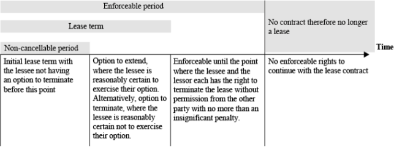
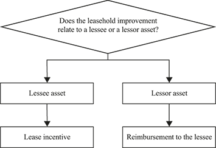

# 15 - Leases (IFRS 16)

[返回目录](README.md)

## Illustrative text

### Identifying a lease

#### FAQ 15.3.1 – Could an arrangement to use a company car which is in the scope of IAS 19 also be in the scope of IFRS 16?

 

Reference to standard: IFRS 16 para 3  
Reference to standing text: [15.3](33.md#s107-Para_15.3)  

  

**Question**

Could an arrangement to use a company car which is in the IAS 19 also be within the scope of IFRS 16?

**Answer**

The employer enters into a leasing agreement with a leasing company to use a car for 36 months. At the same time, the employer enters into an agreement with the employee to use this car as company car for the same period at a reduced charge (deducted from salary). The use of the car is at the full discretion of the employee (that is, the employee decides whether to use the car for private and/or business purposes).

If the employee resigns from employment before the end of the term of the agreement, the employee is obliged to return the car to the employer. The employer acts as principal and, thus, is lessee in a head lease. Each car is permanently assigned to a particular employee, and there is no substantive substitution right, so there is an identified asset.

The agreement between the employer and the employee includes an employee benefit under IAS 19.

In our view, it is not clear whether the employer also needs to consider whether there is a sublease of the car to the employee under IFRS 16. Therefore, we think that the employer has an accounting policy choice between the following options:

- Viewing the car as part of the overall compensation package. IAS 19, as the more relevant standard, is applicable and the employer does not apply IFRS 16 (that is, it does not consider whether there is a sublease of the car to the employee under IFRS 16).

- Viewing the scope of IFRS 16 and IAS 19 as not being mutually exclusive. The employer therefore applies IFRS 16 to determine whether there is a sublease under IFRS 16 in addition to an IAS 19 employee benefit.

The policy chosen should be consistently applied and disclosed. If this choice represents a critical accounting judgement, the entity should consider the IAS 1 disclosure requirements. See [chapter 4 para 152](10.md#s29-Para_4.152) for further details.

 

#### FAQ 15.3.2 – Is an underground space within the scope of IFRS 16?

 

Reference to standard: IFRS 16 para 9  
Reference to standing text: [15.3](33.md#s107-Para_15.3)  

  

 

**Background**

 

A customer obtains the right to place an asset, such as a pipeline, in an underground space for 10 years in exchange for consideration. The contract specifies the underground space’s exact location and dimensions (path, width and depth) within which the asset will be placed. The landowner retains the right to use the surface of the land above the pipeline, but it has no right to access or otherwise change the specified underground space’s use throughout the period of use. The customer will operate the pipeline and perform inspections, repairs and maintenance (including replacing damaged sections of the pipeline when necessary).

 

**Question**

 

Is the arrangement within IFRS 16’s scope?

 

**Answer**

 

Yes. The IFRS Interpretations Committee (IC) discussed this issue in June 2019.

 

The IC determined that the underground space did not meet the definition of an intangible asset that would be subject to an optional scope exemption in IFRS 16, because the defined underground space is tangible in nature. The contract therefore relates to the use of an identified tangible asset, and the customer should consider whether the contract is or contains a lease. A contract is or contains a lease where the contract conveys the right to control an identified asset for a period of time in exchange for consideration.

 

In this fact pattern, the definition of a lease is met because:

 

- the underground space is physically distinct and specified geographically;

- there are no substantive substitution rights, because moving the pipeline would be costly;

- the customer has the exclusive use of the underground space for a period of time;

- how and for what purpose the underground space will be used is predetermined in the contract;

- the customer has the right to operate the specified underground space by having the right to perform inspection, repairs and maintenance work, and

- the customer makes all the decisions about the use of the specified underground space that can be made during the 20-year period of use.

 

The contract is therefore within IFRS 16’s scope.

 

Both the lessor and the lessee (when lessee has not elected the practical expedient in IFRS 16 para 15) should consider whether the rights in the contract (such as rights to access the land for inspection, repairs and maintenance) result in distinct non-lease components that should be separately accounted for.

 

#### FAQ 15.5.1 – How is the term ‘consideration’ interpreted?

 

Reference to standard: IFRS 16 para 9  
 Reference to standing text: [15.5](33.md#s107-Para_15.5) 

  

**Question**  
How is the term 'consideration' interpreted?

**Answer**  
A contract is, or contains, a lease if it conveys the right to control the use of the identified asset for a period of time in exchange for consideration. The term ‘consideration’ should be interpreted broadly as including the possibility of receiving payments. Aside from those payments that meet the definition of lease payments and must be included in the measurement of the lease liability in accordance with paragraph 27 of IFRS 16, it also covers, for example, variable payments that do not depend on an index or a rate. So, even if all of the payments are variable payments that do not depend on an index or a rate, the contract still meets the definition of a lease, provided that the other conditions are met.

 

#### FAQ 15.5.2 – How is the term ‘period of time’ interpreted?

 

Reference to standard: IFRS 16 para 10  
 Reference to standing text: [15.5](33.md#s107-Para_15.5) 

  

**Question**  
How is the term 'period of time' interpreted?

**Answer**  
The term ‘period of time’ should not be interpreted too literally.

An amount of use of the underlying asset, such as the number of production units that an item of equipment will produce, can also describe a period of time as required by paragraph 9 of IFRS 16.

 

#### FAQ 15.5.3 – Is a perpetual period a ‘period of time’?

 

Reference to standard: IFRS 16 para 9  
 Reference to standing text: [15.5](33.md#s107-Para_15.5) 

  

**Question**  
Is a perpetual period a 'period of time'?

**Answer**  
In order to qualify as a lease, an arrangement must convey a right to use an identified asset for a ‘period of time’. However, some contracts such as certain land easements have no limitation on the time period (that is, they are for a perpetual time period). Since IFRS 16 does not define the term ‘period of time’, it is not clear whether perpetual use rights are covered by that term.

One approach would be to argue that truly perpetual use rights are not over a (specified) ‘period of time’, and so they do not meet the definition of a lease in accordance with paragraph 9 of IFRS 16. However, an entity must consider the substance of the contract in determining whether it is truly perpetual. For example, if the contract provides for ongoing payments, and the arrangement can be terminated by merely stopping the payments, the term would not be truly perpetual. Similarly, long-term leases of land (for example, 999-year leases) should not be considered to be perpetual. Truly perpetual use rights would need to be analysed to determine whether an asset should be recognised under another standard, such as IAS 16 or IAS 38.

An alternative approach would be to argue that, even though there is no limit on the time period, a ‘perpetual term’ is still a ‘period of time’. Under this approach, a perpetual use right would meet the definition of a lease, provided that all other parts of the lease definition are met.

In our view, in the absence of specific guidance in IFRS 16, both approaches would be acceptable, and so the entity has an accounting policy choice. The policy chosen should be consistently applied and disclosed. If this choice represents a critical accounting judgement, the entity should consider the IAS 1 disclosure requirements. See [chapter 4 para 152](10.md#s29-Para_4.152) for further details.

 

#### FAQ 15.9.1 – Is there an identified asset where fulfilment of an arrangement is dependent on its use?

 

Reference to standard: IFRS 16 App B para B13  
 Reference to standing text: [15.9](33.md#s107-Para_15.9) 

  

**Question**  
Entity A enters into an agreement to sell electricity to a steel works. In order to fulfil this agreement, entity A builds a power station next to the steel works. Entity A does not have access to any other electricity-generating assets. Is the power station an identified asset?

**Answer**  
Yes. It is clear that fulfilment of the agreement is dependent on the use of the power station built next to the steel works.

 

#### FAQ 15.10.1 – What should be considered when assessing whether a lessor benefits economically from substituting the asset?

 

Reference to standard: IFRS 16 App B para B14  
 Reference to standing text: [15.10](33.md#s107-Para_15.10) 

  

**Question**  
What should be considered when assessing whether a lessor benefits economically from substituting the asset?

**Answer**  
The term ‘benefit’ is interpreted broadly. For example, the fact that the supplier could deploy a pool of assets more efficiently, by substituting the leased asset from time to time, might create a sufficient benefit, as long as there are no significant costs. ‘Significant’ is assessed with reference to the related benefits (that is, costs must be lower than benefits; it is not sufficient if the costs are low or not material to the entity as a whole). Significant costs could occur, in particular, if the underlying asset is tailored for use by the customer. For example, a leased aircraft might have specific interior and exterior specifications defined by the customer. In such a scenario, substituting the aircraft throughout the lease term could create significant costs that would discourage the supplier from doing so.

 

#### FAQ 15.14.1 – Are substitution rights considered at a particular point in time or on the occurrence of a particular event?

 

Reference to standard: IFRS 16 App B para B15  
 Reference to standing text: [15.14](33.md#s107-Para_15.14) 

  

**Question**  
One of the criteria for a contract to be, or contain, a lease is that the contract conveys the right to control the use of an identified asset. Even if an asset is specified in the contract, it is not an identified asset under IFRS 16 if the supplier has a substantive substitution right. If the supplier has a right or an obligation to substitute the asset only on or after either a particular date or the occurrence of a specified event, the supplier’s substitution right is not substantive, because the supplier does not have the practical ability to substitute alternative assets throughout the period of use.

In the scenarios below, does the supplier have a substantial substitution right, with the effect that the contract does not meet the definition of a lease?

**Answer**

**Example 1**

The customer enters into a contract with the supplier for the right to control the use of an asset for six years. The supplier has the right to substitute the underlying asset only on a particular date three years after the commencement of the contract (that is, no substitution rights at any other point in time).

Because the supplier has a right to substitute the asset only on a particular date, and not throughout the entire period of use, the substitution right is not substantive. The lease term in this case is six years.

**Example 2**

The customer enters into a contract with the supplier for the right to control the use of an asset for six years. The supplier has the right to substitute the underlying asset throughout the term of the contract on the occurrence of a particular event.

Because the supplier has a right to substitute the asset only on the occurrence of a specified event, and not throughout the entire period of use, the substitution right is not substantive. The lease term in this case is six years.

 

#### FAQ 15.18.1 – Which economic benefits are to be taken into account for the identification of a lease?

 

Reference to standard: IFRS 16 para IE2 (example 9)  
 Reference to standing text: [15.18](33.md#s107-Para_15.18)

  

**Question**  
A customer rents a solar farm from the supplier. The supplier receives tax credits relating to the ownership of the solar farm, whereas the customer receives renewable energy credits from the use of the farm. Which economic benefits should be taken into account when assessing whether the customer obtains substantially all of the economic benefits from use of the identified asset?

**Answer**   
In this scenario, an entity only takes into account the renewable energy credits, because the tax credits relate not to the use of the solar farm but, instead, to ownership of the asset.

 

#### FAQ 15.20.1 – Which decisions should be considered when assessing which party has the right to direct the use of an asset?

 

Reference to standard: IFRS 16 App B para B26  
 Reference to standing text: [15.20](33.md#s107-Para_15.20) 

  

**Question**  
Which decisions should be considered when assessing which party has the right to direct the use of an asset?

**Answer**  
The table below provides some questions to consider when evaluating which party has the relevant decision-making rights:

<table style="width:100%; border-collapse:collapse"><tr><td style="border:0.75pt solid #000000; padding-right:5.03pt; padding-left:5.03pt; vertical-align:top">
Lease of trucks/aircraft/rail cars etc.
</td><td style="border:0.75pt solid #000000; padding-right:5.03pt; padding-left:5.03pt; vertical-align:top"><ul style="margin:0pt; padding-left:0pt"><li style="margin-left:27.6pt; padding-left:8.4pt; ">Which goods are transported?</li><li style="margin-left:27.6pt; padding-left:8.4pt; ">When are the goods transported and to where?</li><li style="margin-left:27.6pt; padding-left:8.4pt; ">How often is the asset used/how full does it need to be to run?</li><li style="margin-left:27.6pt; padding-left:8.4pt; ">Which route is taken?</li></ul></td></tr><tr><td style="border:0.75pt solid #000000; padding-right:5.03pt; padding-left:5.03pt; vertical-align:top">
Fibre-optic cable
</td><td style="border:0.75pt solid #000000; padding-right:5.03pt; padding-left:5.03pt; vertical-align:top"><ul style="margin:0pt; padding-left:0pt"><li style="margin-left:27.6pt; padding-left:8.4pt; ">When and whether to light the fibres?</li><li style="margin-left:27.6pt; padding-left:8.4pt; ">What and how much data will the cable transport?</li><li style="margin-left:27.6pt; padding-left:8.4pt; ">How to run the cable?</li><li style="margin-left:27.6pt; padding-left:8.4pt; ">Through which routes will the data be delivered?</li></ul></td></tr><tr><td style="border:0.75pt solid #000000; padding-right:5.03pt; padding-left:5.03pt; vertical-align:top">
Retail unit
</td><td style="border:0.75pt solid #000000; padding-right:5.03pt; padding-left:5.03pt; vertical-align:top"><ul style="margin:0pt; padding-left:0pt"><li style="margin-left:27.6pt; padding-left:8.4pt; ">Which goods will be sold?</li><li style="margin-left:27.6pt; padding-left:8.4pt; ">At what prices will the goods be sold?</li><li style="margin-left:27.6pt; padding-left:8.4pt; ">Where and how are the goods displayed?</li></ul></td></tr><tr><td style="border:0.75pt solid #000000; padding-right:5.03pt; padding-left:5.03pt; vertical-align:top">
Power plant
</td><td style="border:0.75pt solid #000000; padding-right:5.03pt; padding-left:5.03pt; vertical-align:top"><ul style="margin:0pt; padding-left:0pt"><li style="margin-left:27.6pt; padding-left:8.4pt; ">How much power will be delivered?</li><li style="margin-left:27.6pt; padding-left:8.4pt; ">When will the power be delivered?</li></ul></td></tr></table>

 

#### FAQ 15.24.1 – What should be considered when analysing decisions that are made before the inception of the lease?

 

Reference to standard: IFRS 16 App B para B24  
 Reference to standing text: [15.24](33.md#s107-Para_15.24) 

  

**Question**  
What should be considered when analysing decisions that are made before the inception of the lease?

**Answer**  
Applying the concept of ‘predetermined’ in IFRS 16 can be very complex and judgemental when decisions are made before the inception of the lease. When analysing these decisions, there are several questions to be considered, including:

- Do any decisions that are not predetermined have a significant effect on how and for what purpose the asset is used?

- Do the decisions predetermine how and for what purpose the identified asset is used, or do they only establish protective rights?

- Which party to the contract has made the decisions?

 

#### FAQ 15.24.2 – How do you interpret predetermined, where many, but not all, of the decisions about how and for what purpose the asset is used are predetermined?

 

Reference to standard: IFRS 16 App B para B24  
 Reference to standing text: [15.24](33.md#s107-Para_15.24)   

  

 

**Question**  
Entity A enters into a contract for an identified asset which gives it the right to obtain substantially all the economic benefits from using the asset. Many, but not all, of the decisions about how and for what purpose the asset is used are predetermined in the contract. Entity A has the right to make the remaining decisions about how and for what purpose the asset is used throughout the period of use.

 

Does entity A have the right to direct the use of such an asset throughout the period of use, or is the right to direct the use predetermined?

 

**Answer**

 

When evaluating which party has the right to direct the use of an asset, or if the right to direct the use is predetermined, entity A should identify all relevant decisions-making rights that could affect the economic benefits from using the asset. Decision-making rights are relevant where they affect the economic benefits to be derived from use of the asset (see para B25 of IFRS 16).

 

If all of the relevant decisions are made before the period of use, the ‘predetermined’ guidance applies to entity A.

 

If one or more of the relevant decisions are made during the period of use, the ‘predetermined’ guidance does not apply. Entity A would then evaluate which party overall directs the use of the asset during the period of use. The decisions that were made before the period of use are ignored (see [para 15.25](33.md#s107-Para_15.25)) in this evaluation.

 

#### EX 15.26.1 – Applying the lease definition to a retail unit

 

Reference to standard: IFRS 16 para IE2 (example 4), App B para B31  
 Reference to standing text: [15.26](33.md#s107-Para_15.26)

  

**Example**  
A customer enters into a contract that conveys the right to use an explicitly specified retail unit for a period of five years. The property owner can require the customer to move into another retail unit; there are several retail units of similar quality and specification available.

Because the property owner has to pay for any relocation costs, it can benefit economically from relocating the customer only if there is a new lessee that wants to occupy a large amount of retail space at a rate that is sufficient to cover the relocation costs. Those circumstances might arise, but they are not considered likely to occur.

The contract requires the customer to sell his goods during the opening hours of the larger retail space. The customer decides on the mix of goods sold, the pricing of the goods sold and the quantities of inventory held. He further controls physical access to the retail unit throughout the five-year period of use.

The rent that the customer has to pay includes a fixed amount plus a percentage of the sales from the retail unit.

**Analysis**

Is there an identified asset? The retail unit is explicitly specified in the contract. The property owner has a right to substitute the asset but the substitution right is not substantive because the property owner would benefit from the exercise of the right only under certain circumstances that are not considered likely to occur. The retail unit is an identified asset.

Has the customer the right to obtain substantially all of the economic benefits from the use of the retail unit? The customer has the exclusive use of the retail unit throughout the period of use. The fact that a part of the cash flows received from the use are passed to the property owner as consideration does not prevent the customer from having the right to substantially all of the economic benefits from the use of the retail unit.

Has the customer the right to direct the use of the retail unit? During the period of use, all decisions on how and for what purpose the retail unit is used are made by the customer. The restriction that goods can only be sold during the opening hours of the larger retail space defines the scope of the contract, but it does not limit the customer’s right to direct the use of the retail unit.

The contract contains a lease of a retail unit.

 

#### EX 15.26.2 – Applying the lease definition to a rail car

 

Reference to standard: IFRS 16 para IE2 (example 1), App B para B31  
 Reference to standing text: [15.26](33.md#s107-Para_15.26)

  

  
 **Example 1**

A customer enters into a contract that conveys the right to use an explicitly specified rail car for four years. The customer determines when, where and which goods are to be transported using the rail car. When the rail car is not in use, it is kept at the customer’s premises and it can be used for another purpose (for example, storage). The customer is, however, not allowed to transport particular types of goods, such as explosives.

The supplier is required to substitute the rail car if it needs to be serviced or repaired. Aside from this, the supplier cannot retrieve the rail car during the period of use.

**Analysis**

Is there an identified asset? The rail car is explicitly specified in the contract. The supplier cannot substitute the rail car during the period of use, except for service or repair. A supplier’s right or obligation to substitute an asset for repair or maintenance does not preclude the customer from having the right to use an identified asset. The rail car is an identified asset.

Has the customer the right to obtain substantially all of the economic benefits from the use of the rail car? The customer has the exclusive use of the rail car throughout the period of use, including when it is not being used for transporting the customer’s goods. It therefore has the right to obtain substantially all of the economic benefits from the use of the rail car.

Has the customer the right to direct the use of the rail car? During the period of use, all decisions regarding how and for what purpose the rail car is used are made by the customer. The restriction on the goods that can be transported defines the scope of the contract, but it does not limit the customer’s right to direct the use of the rail car.

The contract contains a lease of a rail car.

**Example 2**

A customer enters into a contract that requires the supplier to transport a specified nature and quantity of goods by using a specific type of rail car in accordance with a stated timetable for a period of four years. The timetable and quantity of goods specified is equivalent to the capacity of one rail car for four years. The supplier has a large pool of rail cars that it can use to fulfil the requirements of the contract. When the rail cars are not in use, they are stored at the supplier’s premises.

**Analysis**

Is there an identified asset? The rail car mentioned in the contract does not meet the definition of an identified asset, because the supplier has a substantive right to substitute the rail car. First, the supplier has the practical ability to substitute the rail car (because alternative rail cars are available and the supplier does not need the customer’s approval when substituting the rail car). Secondly, the supplier would benefit economically from substituting the car. Only minimal cost (if any) will occur, because the supplier has a large pool of rail cars stored at its premises. The supplier would benefit from a substitution, because it allows it to use its pool of rail cars more efficiently (for example, using the rail car to transport another customer’s goods based on its location, or using a rail car that would otherwise sit idle because it is not being used by the customer).

The contract does not contain a lease.

 

#### EX 15.26.3 – Applying the lease definition to a fibre-optic cable

 

Reference to standard: IFRS 16 para IE2 (example 3), App B para B31  
 Reference to standing text: [15.26](33.md#s107-Para_15.26)

  

  
 **Example 1**

A contract conveys the right to the exclusive use of three specified, physically distinct dark fibres within a larger cable for two years. The customer makes all decisions about the use of these fibres by connecting each end to its electronic equipment (that is, the customer ‘lights’ the fibres). Furthermore, it decides which data and how much data the fibres transport. The supplier owns extra fibres, but it can only substitute the customer’s fibres for reasons of repairs, maintenance or malfunction.

**Analysis**

Is there an identified asset? The fibres are explicitly specified in the contract and physically distinct from the other fibres within the cable. The supplier cannot substitute the fibres during the contractual period except for reasons of repairs, maintenance or malfunction. A supplier’s right or obligation to substitute an asset for repair or maintenance does not preclude the customer from having the right to use an identified asset. The fibres meet the definition of an identified asset.

Has the customer the right to obtain substantially all of the economic benefits from the use of the fibres? The customer has the exclusive use of the fibres throughout the period of use, and it thereby obtains substantially all of the economic benefits from the use of the fibres.

Has the customer the right to direct the use of the fibres? During the period of use, all decisions about how and for what purpose the fibres are used are made by the customer. The customer decides when or whether to light the fibres, and which data and how much data the fibres will transport. It therefore has the right to direct the use of the fibres.

The contract contains a lease of the three fibres.

**Example 2**

A customer enters into a contract for the right to use a specified amount of capacity within a cable that contains 10 fibres for two years; the amount is equivalent to having the use of the full capacity of three fibres within the cable. The supplier makes the decisions about the transmission of data (that is, it ‘lights’ the fibres, decides which fibres to use to transport the customer’s traffic, and decides about the electronic equipment connected to the fibres).

**Analysis**

Is there an identified asset? The capacity portion is not physically distinct from the remaining capacity of the cable, and it does not represent substantially all of the capacity of the cable. Hence, there is no identified asset.

The contract does not contain a lease.

 

#### EX 15.26.4 – Applying the lease definition to a ship

 

Reference to standard: IFRS 16 para IE2 (example 6), App B para B31  
 Reference to standing text: [15.26](33.md#s107-Para_15.26)

  

  
 **Example 1**

A customer enters into a contract with a ship owner for the transportation of cargo. The ship is explicitly mentioned in the contract, and the ship owner has no substitution rights. The cargo will occupy substantially all of the capacity of the ship.

The contract specifies the cargo that will be transported, the date and place of pick-up, and the date and place of delivery. The ship owner operates the ship during the contractual period, and the customer is prohibited from hiring another operator or from operating the ship itself.

**Analysis**

Is there an identified asset? The ship is explicitly specified in the contract and the ship owner has no substitution rights. The ship is an identified asset.

Has the customer the right to obtain substantially all of the economic benefits from the use of the ship? Because the cargo will occupy substantially all of the capacity of the ship, the customer obtains substantially all of the economic benefits from the use of the ship.

Has the customer the right to direct the use of the ship? How and for what purpose the ship is used is already predetermined in the contract, without the customer having the right to change it. The contract explicitly specifies which goods will be transported, when they will be transported and to where they will be transported. Because the customer did not design the ship, or aspects of it, and does not have the right to operate the ship, it does not have the right to direct the use of the ship.

The contract does not contain a lease.

**Example 2**

Same as above, but the customer decides which goods will be transported and whether, when and to which ports the ship will sail throughout the period of use.

**Analysis**

In this scenario, how and for what purpose the ship is used is no longer predetermined by the contract but will be decided by the customer. The customer therefore has the right to direct the use of the ship.

The contract contains a lease of a ship.

 

#### EX 15.26.5 – Applying the lease definition to a solar farm/power plant

 

Reference to standard: IFRS 16 para IE2 (example 9), App B para B31  
 Reference to standing text: [15.26](33.md#s107-Para_15.26)

  

  
 **Example 1**

An entity enters into a contract to buy all of the electricity electricity (including any renewable energy credits) produced by a new solar farm for a period of 20 years. The solar farm is explicitly mentioned in the contract and the supplier has no substitution rights. The customer designed the solar farm before it was constructed; the supplier builds the solar farm based on the customer’s specifications, and afterwards operates and maintains it.

There are no decisions to be made about whether, when and how much electricity the solar farm will produce.

**Analysis**

Is there an identified asset? The solar farm is explicitly specified in the contract and the supplier does not have the right to substitute the solar farm. The solar farm is an identified asset.

Has the customer the right to obtain substantially all of the economic benefits from the use of the solar farm? The customer has the exclusive use of the solar farm throughout the period of use, because it takes all of the electricity produced by the solar farm. It has the right to obtain substantially all of the economic benefits from the use of the solar farm.

Has the customer the right to direct the use of the solar farm? How and for what purpose the solar farm is used is predetermined by the design of the solar farm. Because the customer was responsible for the design of the solar farm, it has the right to direct the use of the solar farm.

The contract contains a lease of a solar farm.

**Example 2**

An entity enters into a contract to buy all of the electricity produced by a power plant for 20 years. The power plant is explicitly mentioned in the contract and the supplier has no substitution rights. The supplier operates the power plant and designed it several years ago when it was constructed.

The contract specifies the quantity and timing of power that the power plant produces; this specification cannot be changed throughout the period of use, in the absence of extraordinary circumstances.

**Analysis**

Is there an identified asset? The power plant is explicitly specified in the contract and the supplier does not have the right to substitute the power plant. The power plant is an identified asset.

Has the customer the right to obtain substantially all of the economic benefits from the use of the power plant? The customer has the exclusive use of the power plant throughout the period of use, because it takes all of the power produced by the power plant. It has the right to obtain substantially all of the economic benefits from the use of the power plant.

Has the customer the right to direct the use of the power plant? How and for what purpose the power plant is used (that is, whether, when and how much electricity is produced by the power plant) is predetermined in the contract. The customer neither operates the power plant nor was involved in the design of the power plant. The customer, therefore, does not have the right to direct the use of the power plant.

The contract does not contain a lease.

**Example 3**

An entity enters into a contract to buy all of the electricity produced by a power plant for 20 years. The power plant is explicitly mentioned in the contract and the supplier has no substitution rights. The supplier operates the power plant and designed it several years ago when it was constructed.

The customer instructs the supplier about the quantity and timing of the delivery of electricity; if the power plant is not producing electricity for the customer, it does not operate.

**Analysis**

Is there an identified asset? The power plant is explicitly specified in the contract and the supplier does not have the right to substitute the power plant. The power plant is an identified asset.

Has the customer the right to obtain substantially all of the economic benefits from the use of the power plant? The customer has the exclusive use of the power plant throughout the period of use, because it takes all of the electricity produced by the power plant. It has the right to obtain substantially all of the economic benefits from the use of the power plant.

Has the customer the right to direct the use of the power plant? Decisions about how and for what purpose the power plant is used (that is, whether, when and how much power will be produced by the power plant) are made by the customer. The customer, therefore, has the right to direct the use of the power plant.

The contract contains a lease of a power plant.

 

#### FAQ 15.27.1 – How should you assess whether a joint arrangement has the right to control the use of an identified asset?

 

Reference to standard: IFRS 16 App B para B11  
 Reference to standing text: [15.27](33.md#s107-Para_15.27) 

  

**Question**  
How should you assess whether a joint arrangement has the right to control the use of an identified asset?

**Answer**   
A joint arrangement can have the form of either a joint operation or a joint venture. Depending on whether the joint arrangement has its own legal identity, the contract might be signed either by the joint arrangement itself or by one or more of the parties to the joint arrangement on behalf of the joint arrangement.

If the parties to the joint arrangement collectively would meet the definition of a lease, the contract contains a lease. It cannot be argued that the contract does not contain a lease because each party of the joint arrangement by itself does not obtain substantially all of the economic benefits from the identified asset and does not direct the use of the underlying asset.

FAQ 32.62.7 considers how the operator and other joint operators should account for a lease.

 

### Separating components of a contract

#### FAQ 15.29.1 – How does a lessor separate components of a contract under IFRS 16 and IFRS 15?

 

Reference to standard: IFRS 16 App B para B32  
 Reference to standing text: [15.29](33.md#s107-Para_15.29) 

  

**Question**  
How should a lessor separate components of a contract under IFRS 16 and IFRS 15?

**Answer**  
IFRS 15 contains guidance on how to evaluate whether a good or service promised to a customer is distinct for lessors.

For a multi-element arrangement that contains (or might contain) a lease, the lessor has to perform the assessment as follows:

- Apply the guidance in IFRS 16 to assess whether the contract contains one (or more) lease component(s).

- Apply the guidance in IFRS 16 to assess whether different lease components have to be accounted for separately.

- After identifying the lease components under IFRS 16, the non-lease components should be assessed under IFRS 15 for separate performance obligations.

The criteria in IFRS 16 for the separation of lease components are similar to the criteria in IFRS 15 for analysing whether a good or service promised to a customer is distinct.

 

#### FAQ 15.33.1 – How is the consideration allocated if the lessor sells disposables to the lessee?

 

Reference to standard: IFRS 16 para 17  
 Reference to standing text: [15.33](33.md#s107-Para_15.33)

  

**Question**  
 Entity A (supplier) is a medical device company that provides hospitals (customers) with a standard medical device, and disposables that are needed in conjunction with the operation of that device. The supplier either sells these medical devices or leases them to its customers for an agreed period of time. There are other suppliers on the market offering the disposables required for use with the machine. It enters into an arrangement with key features as follows:

- Entity A grants its customer the right to use the medical device for 36 months at no cost. Title to the equipment remains with entity A, and the device will be returned at the end of the contract period.

- Contractually, the customer is not required to purchase disposables (that is, there are no minimum purchase requirements) but, if it does purchase disposables, it will need to do so from entity A for a period of 36 months after contract inception.

- The purchase price of the disposables is equal to market price.

- Based on past experience, entity A expects that the customer will consume 5,000 disposables per annum. Entity A has a history of such arrangements and can reliably estimate the respective quantities. It is highly likely that consumption will exceed 4,000 disposables per annum.

- Entity A has no right to take the machine back if it is not being used.

- Entity A has assessed the right to use the medical device for 36 months and determined that it meets the definition of a lease and that it would be classified as an operating lease.

- At or near the same time, the customer orders, and entity A delivers, 1,000 disposables.

**Do any of the payments resulting from the sale of the disposables have to be allocated to the lease contract?**

**Answer**  
In this scenario, the purchase of 1,000 disposables is directly linked to the lease of the medical device, because the parties entered into both agreements at or near the same time and the amount of consideration for the disposables depends on the price agreed in the initial contract. The contract contains lease (right of use of the medical device) and non-lease (delivery of disposables) components that are accounted for separately. [IFRS 16 para 12]. Paragraph 17 of IFRS 16 requires that entity A allocates the contract consideration applying paragraphs 73 to 90 of IFRS 15 (that is, based on the relative stand-alone selling prices of the lease and non-lease components).

In case of further orders of disposables, it is acceptable to argue that there is no lease modification, because there are no changes in scope of the lease or in the consideration that were not a part of the original terms. Therefore, the lease payments will not be adjusted when additional disposables are ordered during the contract period.

Alternatively, it could be argued that additional orders change the overall consideration and should be accounted for similarly to a modification of the contract. Based on this rationale, it would also be acceptable to allocate a component of the consideration from subsequent orders to the lease element. If an entity applies this alternative approach, any consideration allocated to the lease element represents variable lease payments which are recognised as income as incurred (that is, at the date of delivery of the related disposables). If the entity chooses this alternative approach, it only affects the presentation within the income statement (that is, the amount that is presented as either lease income or revenue from contracts with customers) but not the amount or the timing of revenue that is recognised.

 

### Combination of contracts

#### EX 15.35.1 – Accounting for temporary building solutions provided based on separate contracts

 

Reference to standard: IFRS 16 App B para B2  
 Reference to standing text: [15.35](33.md#s107-Para_15.35) 

  

**Example**  
 An entity provides temporary building solutions to its customers. These solutions include the right to use a temporary building for a fixed period of time, set up and install the temporary building (that is, install electricity, water, heating and furniture) and disassemble of the temporary building at the end of the contractual period. The entity enters into separate contracts with a customer for the lease of a temporary building, setting it up and disassembling it.

**Analysis**  
The contracts are negotiated as a package with an overall commercial objective. The customer leases not just a building, but a building that includes electricity, water, heating and furniture. Hence, the installation of these facilities (and, later on, the disassembly) is an integral part of the arrangement. The three separate contracts should therefore, in a first step, be combined based on paragraph B2(a) of IFRS 16.

In a second step, the question then arises whether the installation and the disassembly should be split off and accounted for as separate services. According to paragraph B33 of IFRS 16, “… amounts payable by the lessee for activities and costs that do not transfer a good or service to the lessee …” do not result in a separate service component, but they do form part of the total consideration. Activities that are necessary to make the leased asset capable of being used by the lessee are not separate services. Whether or not activities performed by the lessor (such as installation services, assembly at the customer’s premises or customising) are necessary to use the leased asset depends on facts and circumstances. Factors to be taken into account when making the assessment include:

- the type of asset (standard versus specialised) and the related complexity of the installation services involved;

- whether these activities could practically be performed by the customer or third party suppliers (contractual restrictions are generally not relevant); and

- whether, from the customer’s perspective, there is a delivery of an ‘installed asset’ rather than an uninstalled asset plus installation services.

In this example, the customer is unable to use the temporary building without the installation performed by the lessor; the installation service is an integral part of the lessor’s obligation to provide an asset that is capable of being used. The disassembly at the end of the lease term also does not transfer a good or service to the lessee. The installation and the disassembly of the temporary building are not separate services.

 

### Lease term

#### FAQ 15.37.1 – How do termination options affect the length of the lease term?

 

Reference to standard: IFRS 16 App B paras B34, B35  
 Reference to standing text: [15.37](33.md#s107-Para_15.37) 

  

**Question**  
 How do termination options affect the length of the lease term?

**Answer**  
Three scenarios are possible for termination options:

- Only the lessee has a termination option: the period covered by the termination option is included in the lease term only if the lessee is reasonably certain not to exercise the termination option.

- Only the lessor has a termination option: the period covered by the termination option is part of the non-cancellable lease period.

- Each party has the right to terminate the lease: the period covered by the termination options is not part of the lease term, provided that each party has the right to terminate the lease without permission from the other party with no more than an insignificant penalty.

 

#### FAQ 15.37.2 – How is the lease term determined if one party has a termination option with a more than insignificant penalty?

 

Reference to standard: IFRS 16 para 18  
Reference to standing text: [15.37](33.md#s107-Para_15.37)  

  

**Question**

An entity (lessee) enters into a lease contract with a lessor to lease a building on 1 January 20X1. The contract does not specify a particular contractual term but continues indefinitely until either party gives notice to terminate. The lessee and the lessor each have a right to terminate the contract, without permission from the other party, at the end of June in each calendar year, starting from 30 June 20X2, with a six-month termination notice (that is,. the earliest right to terminate would be at 30 June 20X2, and the six-month notice period means that it would be effective at 31 December 20X2).

In the case where the lessee terminates the contract before the end of year 10, it has to pay a termination penalty to the lessor equivalent to two years of lease payments, which is more than an insignificant penalty. If the lessee terminates the lease after that period, no penalty is incurred. For the lessor, no termination penalty is incurred, regardless of when it terminates the contract (See [FAQ 15.37.4](34.md#s113-FAQ_15.37.4) regarding the interpretation of the word 'penalty').

What is the lease term of the contract at the commencement date?

**Answer**

The following diagram illustrates the lease term, and associated non-cancellable and enforceable periods.

The lease term is determined taking into account the following:

- Paragraph B34 of IFRS 16 explains that a lease is no longer enforceable when the lessee and the lessor each has the right to terminate the lease without permission from the other party with no more than an insignificant penalty. Before 10 years, the lessee would incur a more than insignificant penalty to terminate. After 10 years, both parties can terminate with no more than an insignificant penalty. The enforceable period is therefore 10 years.

- The non-cancellable period is 24 months, because the lessee cannot terminate the lease effective earlier than 31 December 20X2 (considering the notice period).

- The guidance for lessee termination options should be applied to decide what the lease term is, between a minimum of the non-cancellable period of 2 years (18 months + 6 months’ notice) and a maximum of the enforceable period (10 years).

- The lessee’s termination right within the first 10 years of the contract affects the lease term if the lessee is not reasonably certain to continue to lease the building during the first 10 years (that is, they are reasonably certain not to exercise the termination option). [IFRS 16 App B para B37]. If the lessee is reasonably certain to continue the lease for the full enforceable period (after having taken into account all relevant facts and circumstances creating an economic incentive not to exercise the termination option), the lease term is 10 years. Conversely, if the lessee is not reasonably certain to continue the lease at a certain point in time, despite the termination penalty), the lease term ends at that point in time (taking into account the notice period).

- When evaluating whether the lessee is reasonably certain to not terminate, the termination penalty is one relevant factor. [IFRS 16 App B para B37(c)]. See also [paragraph 15.39](33.md#s107-Para_15.39). In this case, the magnitude of the penalty is likely to make the lessee reasonably certain to not terminate the lease before 10 years, but the entity should consider all relevant facts and circumstances.

 

#### FAQ 15.37.3 – How are perpetual lease contracts with bilateral termination options accounted for?

 

Reference to standard: IFRS 16 App B para B34  
Reference to standing text: [15.37](33.md#s107-Para_15.37)  

  

**Question** **1**  
Entity A enters into a lease of retail space. The lease continues in perpetuity, but both the lessor and the lessee have termination options. The termination options are exercisable at any time; the entity exercising it will bear no more than an insignificant penalty. For both options, there are notice periods:

- If the lessee exercises its option, the termination will be effective six months after exercise.

- If the lessor exercises its option, the termination will be effective 18 months after exercise.

What is the lease term of the contract at the commencement date?

**Answer**  
According to paragraph 18 of IFRS 16, an entity should determine the lease term as the non-cancellable period of a lease, together with both periods covered by an option to extend the lease (if the lessee is reasonably certain to exercise that option) and periods covered by an option to terminate the lease (if the lessee is reasonably certain not to exercise that option).

First, entity A should determine what the non-cancellable period is, which in this case is six months. Entity A should then determine the enforceable period. A lease is no longer enforceable when the lessee and the lessor each have the right to terminate the lease without permission from the other party with no more than an insignificant penalty. [IFRS 16 App B paragraph B34].

In this example, the enforceable period of the lease at the commencement date is 18 months. This is the period from the commencement date of the lease to the earliest point in time at which both parties can terminate the contract with no more than an insignificant penalty.

The guidance for lessee termination options should be applied to decide what the lease term is, between a minimum of the non-cancellable period (six months, the lessee’s notice period) and a maximum of the enforceable period (18 months). If the lessee is reasonably certain to continue (that is, not terminate) the lease for 18 months, the lease term would be 18 months.

**Question 2**

When is the lease term re-assessed?

**Answer**

At the commencement date, the non-cancellable period of the contract is six months (the lessee’s termination notice), and the enforceable period is 18 months. The enforceable period is effectively the period from the commencement date of the lease to the earliest point in time at which both parties can leave the contract and their contractual obligations with no more than an insignificant penalty and without permission from the other party. The lease term will therefore be determined based on the facts and circumstances specific to the lessee, between six and 18 months.

According to paragraph 21 of IFRS 16, the lease term is revised if the non-cancellable period of the lease changes. In this example, provided that no party terminates the contract, the non-cancellable period of the lease is maintained at six months (such that the date on which the non-cancellable period ends changes every day to be one day later), with the enforceable period maintained at 18 months (such that the date on which the enforceable period ends also changes every day to be one day later). The lease term can be revised, but it will always be of at least six months, depending on the facts and circumstances specific to the lessee.

**Question 3**

The fact pattern is similar to question 1, except that the lessee is reasonably certain to continue the lease for a period of 60 months (if the lessor does not exercise its termination option).

**Answer**

A lessee that is reasonably certain to continue the lease during 60 months has an economic incentive to remain in the premises during that period (IFRS 16.B37). Consequently, the lessee would suffer a more than an insignificant penalty if it terminates the contract before the end of the 60 months period, and based on IFRS 16.B34, the contract is enforceable for 60 months.  The lease term is therefore 60 months (the period during which the lessee is reasonably certain to remain in the premises).

 

#### FAQ 15.37.4 – How is ‘penalty’ interpreted in the context of paragraph B34 of IFRS 16?

 

Reference to standard: IFRS 16 para B34  
Reference to standing text: [15.37](33.md#s107-Para_15.37)  
 

  

**Question**  
How is ‘penalty’ interpreted in the context of paragraph B34 of IFRS 16?

**Answer**  
Based on paragraph B34 of IFRS 16, a lease is no longer enforceable when the lessee and the lessor each has the right to terminate the lease without permission from the other party with no more than an insignificant penalty. IFRS 16 does not specifically define the term ‘penalty’.

The IFRS Interpretations Committee (‘IC’) was asked how to determine the lease term of a cancellable or renewable lease, and whether ‘penalty’ in paragraph B34 includes only contractual termination penalty payments or should also consider the broader economics of the contract. [IFRIC update November 2019].

The IC observed that the broader economics of the contract should be considered, and not only contractual penalty payments. Such considerations include, for example, the cost of dismantling or abandoning leasehold improvements, costs relating to the termination of the contract (such as the costs of finding a replacement lease, renegotiating or relocating) and the importance of the asset to the lessee’s operations. Consequently, if either party would incur a penalty on termination that is more than insignificant at any point in time, the enforceable period would include those periods.

Consistent with the IC’s decision, in interpreting the term ‘penalty’, an entity can also consider the US GAAP guidance on leasing, ASC 842, which includes some examples of non-contractual economic penalties and defines a penalty as follows:  
 “Any requirement that is imposed or can be imposed on the lessee by the lease agreement or by factors outside the lease agreement to do any of the following:

- Disburse cash

- Incur or assume a liability

- Perform services

- Surrender or transfer an asset or rights to an asset or otherwise forego an economic benefit, or suffer an economic detriment. Factors to consider in determining whether an economic detriment may be incurred include, but are not limited to, all of the following:

- The uniqueness of purpose or location of the underlying asset

- The availability of a comparable replacement asset

- The relative importance or significance of the underlying asset to the continuation of the lessee’s line of business or service to its customers

- The existence of leasehold improvements or other assets whose value would be impaired by the lessee vacating or discontinuing use of the underlying asset

- Adverse tax consequences

- The ability or willingness of the lessee to bear the cost associated with relocation or replacement of the underlying asset at market rental rates or to tolerate other parties using the underlying asset.”

 

#### EX 15.37.5 – What is the enforceable period?

 

<table style="border-collapse:collapse"><tr><td style="border:0.75pt solid #000000; padding-right:5.03pt; padding-left:5.03pt; vertical-align:top">
Reference to standard: IFRS 16 para B34
</td></tr><tr><td style="border:0.75pt solid #000000; padding-right:5.03pt; padding-left:5.03pt; vertical-align:top">
Reference to standing text: <a href="33.md#s107-Para_15.37">15.37</a>
</td></tr><tr><td style="border:0.75pt solid #000000; padding-right:5.03pt; padding-left:5.03pt; vertical-align:top"></td></tr></table>

 

**Example 1**

 

Entity A enters into a lease with entity B for a five-year initial term. After the initial term, the lease states that it will continue indefinitely until either party gives notice to terminate. There are no contractual termination payments. From previous experience with similar leases, entity A typically uses similar assets for 10 years. Entity A invests in non-removable leasehold improvements with an economic life of 10 years, on the expectation that it will be able to continue using the leased asset for 10 years, even though legally entity B can choose to terminate the lease after five years.

 

Analysis

 

In considering the broader economics of the contract, entity A has an incentive to not terminate the lease after five years because it would have to abandon the leasehold improvements. This incentive is considered a penalty when applying paragraph B34 of IFRS 16.

 

Assuming that the penalty is more than insignificant, the lease is enforceable beyond five years. The lease will remain enforceable until the penalty becomes insignificant; this will be a judgement based on specific facts and circumstances but, in this example, it might be 10 years given that, that is the period for which entity A expects to use the leasehold improvements.

 

**Example 2**

 

Entity B enters into a lease contract on 1 January 20X0 to rent an office property. The contract specifies an initial term of two years, during which neither party can exit the contract. There are no extension options in the contract. The contract is silent on the rights and obligations of the parties after the two-year period.

 

The local legal framework stipulates that: “A lease is renewed tacitly where the lessee continues to occupy the premises for more than 10 days after the expiry of the lease without opposition from the lessor.  In that case, the lease is renewed for one year or for the term of the initial lease, if that was less than one year. This renewed lease is also subject to renewal.” Assume that, under the local legal framework the lease can be renewed indefinitely.

 

Assume entity B has constructed leasehold improvements with an economic life of six years, which would have to be abandoned if the lease was terminated after two years.  Assume entity B would incur more than an insignificant penalty if it were to terminate the lease after two years.

 

Analysis

 

The non-cancellable period of the lease is two years.  Entity B considers periods after the two-year non-cancellable period, because the local legal framework provides both the lessee and lessor with additional legal rights with respect to the property. Although the contract is silent on the rights and obligations of the parties after the two-year period, under the local legal framework, if entity B remains in the property for a period of 10 days after the contract expires, without objection from the lessor, the contract remains enforceable. In assessing the enforceable period, entity B would need to consider, at the commencement date, whether it would suffer a more than insignificant penalty from terminating the lease after the non-cancellable period. In this case, entity B would suffer a more than insignificant penalty from terminating the lease after the two-year non-cancellable period, because it would have to abandon leasehold improvements with a remaining economic life of four years and, therefore, the lease is enforceable beyond the non-cancellable period. The lease will remain enforceable until the penalty becomes insignificant, this will be a judgement based on specific facts and circumstances but, in this example, might be for an additional four years, given that that is the period for which entity B expects to use the leasehold improvements.

 

If there was no local legal framework, the facts and circumstances should be considered. If there genuinely was no legal framework in existence, the enforceable period might be equal to the contractually agreed term and would not extend beyond that contractual period. However, the facts and circumstances and the broader economics of the contract should be considered, since there might be other rights which should be taken into account, such sa unwritten terms. See [FAQ 15.39.5](34.md#s113-FAQ_15.39.5) for details on enforceability beyond the written contract.

 

#### FAQ 15.39.1 – How is the lease term impacted by break clauses?

 

Reference to standard: IFRS 16 App B para B37  
 Reference to standing text: [15.39](33.md#s107-Para_15.39) 

  

**Question**  
How is the lease term impacted by break clauses?

**Answer**  
If a lease contains a break clause (that is, a right of the lessee to terminate the lease after a certain point in time), the length of the lease depends on whether the lessee is reasonably certain not to exercise the option.

Where the lessee has a break clause without penalty or other economic incentive, it is more likely that the lessee will exercise the option to terminate. Unless a lessee is reasonably certain not to exercise a termination option, the lease term will be the period between the commencement of the lease and the earliest effective date of the break option.

Where the lessee has a break clause that requires the lessee to make a termination payment to compensate the lessor (sometimes referred to as the ‘stipulated loss value’), such that the recovery of the lessor's remaining investment in the lease was assured, it is less likely that the lessee will exercise the termination clause. If the lessee is reasonably certain not to exercise the termination option, the lease term will include the period covered by the termination option.

 

#### FAQ 15.39.2 – How is the lease term impacted by extension options?

 

Reference to standard: IFRS 16 App B para B37  
 Reference to standing text: [15.39](33.md#s107-Para_15.39) 

  

**Question**  
How is the lease term impacted by extension options?

**Answer**  
If the terms of the extension option are set at what is anticipated to be significantly below a fair market rental, it is reasonable to assume that the lessee will act in his own commercial interests and extend the lease, unless there are other factors that indicate that the lessee is not reasonably certain to exercise the extension option. In these situations, the lease term would include both the non-cancellable period and the extension period.

If the terms of the extension option are based on a fair market rental, such that, at first view, there is no compelling commercial reason why the lessee should extend the lease, the entity still has to analyse other factors that might impact the lessee’s decision. Other factors that might need to be considered, in determining whether extension periods should be included in the lease term, are other forms of commercial compulsion, such as penalties or disruption to business, or other forms of economic incentives. If the lessee is subject to a penalty for failing to renew a lease or exercise a purchase option, or if the return conditions stipulated in the lease are unduly unfavourable, it might be to the lessee's advantage to continue to lease the asset. Similarly, if the lessee's business is dependent on the asset, such that the cost of its removal and disruption of business are disproportionate to the costs of continuing the lease, the extension period should more likely be included in the lease term.

 

#### FAQ 15.39.3 – How should the different indicators of reasonable certainty be weighted?

 

Reference to standard: IFRS 16 App B para B37  
 Reference to standing text: [15.39](33.md#s107-Para_15.39) 

  

**Question**  
How should the different indicators of reasonable certainty be weighted?

**Answer**  
There is no guidance in the standard on how to weigh the individual factors when determining whether it is ‘reasonably certain’ that a lessee will exercise an option. For example, consider a flagship store in a prime and much sought-after location. Significant judgement would be needed to determine whether the prime geographical location of the store or other factors (such as termination penalties and leasehold improvements) indicate that it is reasonably certain that the lessee will renew the store lease.

 

#### FAQ 15.39.4 – Does the assessment of whether a lessee is ‘reasonably certain’ to exercise an option include non-monetary economic incentives?

 

Reference to standard: IFRS 16 para B37  
 Reference to standing text: [15.39](33.md#s107-Para_15.39) 

  

**Question**  
Does the assessment of whether a lessee is 'reasonably certain' to exercise an option include non-monetary economic incentives?

**Answer**  
An entity considers all relevant facts and circumstances that create an economic incentive for the lessee to exercise, or not to exercise, an extension or a termination option when determining the lease term. Does an economic incentive have to be monetary (which can be either contractual or non-contractual), or are non-monetary aspects also taken into account?

Non-monetary aspects are included in the analysis, provided that they reflect economic incentives and not irrational behaviour. Examples of non-monetary aspects include:

- time needed to change the lessor and enter into a new contract; and

- the inconvenience resulting from changing the lessor and entering into a new contract.

A lessee’s past practice might provide information that is helpful in assessing whether the lessee is reasonably certain to exercise, or not to exercise, an option. It is, however, key to understand the economic reasons for that past practice. Those economic reasons, if any, must be taken into account in the lease term assessment. [IFRS 16 App B para B40].

 

#### FAQ 15.39.5 – How should you consider enforceability beyond the written contract?

 

Reference to standard: IFRS 16 para B34  
 Reference to standing text: [15.39](33.md#s107-Para_15.39) 

  

**Question**  
A lessee enters into a lease contract with a related party to lease a head office building for one year. The written contract is for a one-year term and there are no contractual options for either party to extend the term of the lease. The rental payments are at market rates.

When the lease expires, both parties expect to sign a new one-year lease for the next year and to continue to do this for the foreseeable future. Any new leases will only be signed when the previous lease expires (that is, no advance notice is required). The lessee has invested in significant leasehold improvements and, although it could use other properties as a head office in future, it has an economic disincentive to move its head office.

Should the contractual lease term of one year be used when applying IFRS 16, or do other factors need to be considered?

**Answer**

IFRS 16 does not provide any specific guidance for related party leases. The related party relationship does not automatically change the assessment of the lease term, but it should be taken into account when considering the enforceable rights.

As a starting point, the parties should first focus on the written agreement and determine the legally enforceable lease term based on the written agreement. If the terms of the written agreement do not align with the economics of the transaction, the parties should consider whether the lessee has enforceable rights beyond the written agreement.

In this case, the lessee expects to use the property as its head office for the foreseeable future, and it has invested in significant leasehold improvements which reflect its expectation that it will be able to continue using the property. So the written contractual lease term of one year does not align with the economics of the transaction.

Potential sources of enforceable rights beyond the written agreement would include, but are not limited to, an oral agreement or understanding / representations between the related parties (for example, if letters of support are provided between the parties), and local laws or regulations.

The parties should consider seeking input from legal counsel about whether any potential sources of additional rights are enforceable. For example, the background notes that no advance notice is required to arrange the next year’s lease; the parties should consider whether, on the last day of the contractual lease term, local law as applied to the particular facts and circumstances would actually allow the lessor to refuse to agree a new lease and to evict the lessee with no advance notice.

If there are any additional enforceable rights, the parties should account for them based on the nature of those rights. For example, if they give the lessee an enforceable extension option, the guidance on extension options should be applied.

The entity will need to comply with the normal IFRS 16 disclosure requirements and, due to the related party relationship, additional disclosures might be required under IAS 24.

If deciding what is enforceable involves significant judgement, the entity should consider the IAS 1 disclosure requirements (see [chapter 4 para 152](10.md#s29-Para_4.152) for further details).

This same principle applies to leases between non-related parties – if the contractual lease term does not align with the economics of the transaction, the parties should consider whether there are any non-contractual enforceable rights.

 

#### EX 15.43.1 – What are significant events or changes in circumstances within the control of the lessee that could result in a reassessment of the lease term?

 

Reference to standard: IFRS 16 App B para B41(c)  
 Reference to standing text: [15.43](33.md#s107-Para_15.43) 

  

  
 An entity leases a building for a 10-year period, with the option to extend for five years. At the commencement date, the entity concludes that it is not reasonably certain that it will exercise the extension option. It determines the lease term to be 10 years.

**Example 1**

After using the building for seven years, the entity decides to sub-lease the building to another party, and it enters into a sub-lease contract with a term of eight years. Does the entity reassess the lease term?

Entering into a sub-lease is a significant event that is within the control of the lessee, and it affects the entity’s assessment of whether it is reasonably certain to exercise the extension option. The lessee has to reassess the lease term of the head lease on the occurrence of the significant event.

**Example 2**

After using the building for seven years, the entity prepares a five-year business plan which is signed off by the board. The five-year business plan assumes that the lessee will exercise the extension option at the end of the initial term. Does the entity reassess the lease term?

The board signing off the business plan is within the control of the lessee. Determining whether or not there has been a significant event or change in circumstances will require judgement. For example, consider the following situations:

**Example 2a**

At the inception of the lease, the building was the entity’s only factory for a new, separate business segment. At commencement date, the extension period was not included in the lease term, because the entity might reasonably have chosen not to extend the lease, to discontinue the new segment’s operations or to relocate to a different factory (for example, a larger factory or in a different geographical region).

Before signing off the business plan, the entity evaluated its options and decided to extend the lease of the current factory when the initial term expires. Although the entity has not actually extended the lease yet, it will now make commercial arrangements (such as extending supply contracts) based on continuing to use the factory. This business decision indicates a significant change in circumstances, in which case the entity does reassess the lease term.

**Example 2b**

The building is a general office headquarters. As time passes, the costs of identifying a new office, negotiation and relocation will increase the likelihood of the entity extending the lease. Towards the end of the initial lease term, the likelihood will continue to increase until it becomes reasonably certain. The entity expects to extend the lease but this specific building is not important to the business plan and, during the preparation of the business plan, and consequently its approval by the board, staying in the same location was taken as an assumption but was not specifically discussed and disclosed.

The above facts indicate that there has not been a significant event or change in circumstances, in which case the entity does not reassess the lease term.

However, if the decision of staying in the same location was specifically discussed in detail and disclosed to the board as a key assumption of the business plan, this indicates a significant event leading to the reassessment of the lease term.

 

### Recognition and measurement exemptions

#### EX 15.47.1 – Can perpetual lease contracts that contain termination options qualify as short-term leases?

 

Reference to standard: IFRS 16 paras 5, 7  
 Reference to standing text: [15.47](33.md#s108-Para_15.47) 

  

  
 **Example 1**

Entity A enters into a lease of small office space. The lease continues in perpetuity, but both the lessor and the lessee have termination options. The termination options are exercisable at any time, with a three-month notice period. The entity exercising the termination option will bear no more than an insignificant penalty.

Does the contract qualify as a short-term lease for the lessee?

Analysis

A short-term lease is defined as a lease that, at the commencement date, has a lease term of 12 months or less.

The lease term is defined as the non-cancellable period of a lease, together with both periods covered by an option to extend the lease if the lessee is reasonably certain to exercise that option and periods covered by an option to terminate the lease if the lessee is reasonably certain not to exercise that option. When the lessee and the lessor each have the right to terminate the lease without permission from the other party with no more than an insignificant penalty, the enforceable period of the lease ends at the earliest point in time at which both parties can leave the contract and its contractual obligations. The enforceability of a lease contract does not require assessment of what is reasonably certain.

In this example, both the lessee and the lessor have a termination right, with a three-month notice period, and the entity exercising it will bear no more than an insignificant penalty. Hence, the lease term is only three months, and so the lease qualifies as a short-term lease at the commencement date.

**Example 2**

The fact pattern is the same as in example 1, except that only the lessee has a termination option.

Does the contract qualify as a short-term lease?

Analysis

If only the lessee has a termination option, the lease term depends on whether, or for how long, the lessee is reasonably certain not to exercise the termination option. Depending on this analysis, the lease could qualify as a short-term lease if the lease term is 12 months or less.

So if, for example, it is reasonably certain that the lessee will not exercise the termination option before the end of month 57 (effective at the end of month 60), the lease term is five years. If the lessee is reasonably certain not to exercise the termination option only within the first nine months, the contract qualifies as a short-term lease.

**Example 3**

The fact pattern is the same as in example 1, except that only the lessor has a termination right. Furthermore, it is now assumed that the contractual term of the lease is 10 years.

Does the contract qualify as a short-term lease?

Analysis

If only the lessor has the right to terminate the lease, the non-cancellable period of the lease includes the period covered by the option to terminate the lease (see App B para B35 of IFRS 16). Hence, the lease term is equal to the contractual term of the lease (that is, 10 years).

The lease contract does not qualify as a short-term lease.

**Example 4**

The fact pattern is the same as in Example A, except that the lease is entered into on 1 January 20X8 and can only be terminated effective on 31 December each year. Both parties still have the right to terminate with a three-month notice period (that is, if neither party gives notice to terminate the lease by 30 September 20X8, it cannot be terminated until 31 December 20X9).

In the first year, the lease qualifies as a short-term lease, because the lease term is less than 12 months. Neither party gives notice to terminate the lease by 30 September 20X8. On 1 October 20X8, does the lease continue to qualify as a short-term lease?

Analysis

On 1 October 20X8, the lease term has changed and the lessee has to consider it as a new lease. The lease term is now 15 months and therefore does not qualify as a short-term lease.

 

#### FAQ 15.47.2 – What is the lease term if there are non-consecutive periods of use?

 

Reference to standard: IFRS 16 App A  
 Reference to standing text: [15.47](33.md#s108-Para_15.47) 

  

**Question**  
Customer Corp enters into a contract with Supplier Corp, which grants Customer Corp exclusive rights to use a specific grain storage facility over a five-year period in the months of September and October. This contract is accounted for as a lease under IFRS 16, because Customer Corp has the right to control the use of the identified asset during the period of use.

What is the lease term?

**Answer**  
The period of use is defined in Appendix A to IFRS 16 as “The total period of time that an asset is used to fulfill a contract with a customer (including the sum of any non-consecutive periods of time)”.

The total period of time that the warehouse will be used to fulfil the contract is 10 months (two months per year over the five-year period). The lease term is 10 months and therefore this lease could qualify as a short-term lease.

If the lease was instead for three months per year, so 15 months in total, it would not qualify as a short-term lease because the lease term is more than 12 months.

[FAQ 15.81.1](35.md#s114-FAQ_15.81.1) discusses when the lessee should recognise the lease expenses for a lease with non-consecutive periods of use.

 

#### FAQ 15.50.1 – How does IFRS 16 define the term ‘low value’?

 

Reference to standard: IFRS 16 App B para B3  
 Reference to standing text: [15.50](33.md#s108-Para_15.50) 

  

**Question**  
How does IFRS 16 define the term 'low value'?

**Answer**  
The standard does not define the term ‘low value’, but the Basis for Conclusions explains that the IASB had in mind assets of a value of US$5,000 or less when new. The amount of US$5,000 is, however, not a quantitative threshold but an example that the IASB has used to illustrate a general principle.

In order to assess whether a leased asset qualifies for the low-value asset exemption, an entity should focus on the nature of the asset. Examples of assets of low value can include IT equipment (tablets and personal computers), office furniture, or telephones. Cars would not qualify as low-value assets, because a new car would typically not be of low value. The types of asset that qualify for the low-value asset exemption might change over time if, due to technological or market developments, the price of a particular type of asset changes. A change in the US dollar foreign currency exchange rate or the inflation rate does not, by itself, affect whether an asset is within the scope of the exemption.

 

#### EX 15.53.1 – How does a lessee assess whether a leased asset meets the low-value asset criteria?

 

Reference to standard: IFRS 16 App B para B5  
 Reference to standing text: [15.53](33.md#s108-Para_15.53) 

  

  
 A leased asset can only qualify as a low-value asset if the lessee can benefit from the asset on its own or together with other resources that are readily available and if the asset is not highly dependent on, or highly interrelated with, other assets. The following examples explain how these criteria can be applied in practice:

**Example 1 – Lease of hotel room equipment**

A hotel has entered into a lease contract for the lease of room equipment, including TV, other audio and video equipment and small items (such as vending machines, coffee machines, hand dryers and linen). For each of these items the value, when new, is below US$5,000.

Can the lessee apply the low-value asset exemption?

**Analysis**   
The lessee can apply the low-value asset exemption to the leased room equipment. The different parts of the room equipment are not highly dependent on, or highly interrelated with, each other. Although, in practice, some of them are used together within one hotel room, the lessee can remove parts of the equipment from the hotel room and is still able to rent the room to its customers. Furthermore, the lessee can benefit from each of the leased assets on its own.

**Example 2 – Lease of a car**

An entity has entered into a lease contract for a car.

Can the lessee apply the low-value asset exemption to the separate components of the car (such as engine and tyres), provided that the value of each of these parts, when new, is below US$5,000?

**Analysis**   
The lessee cannot apply the low-value asset exemption to the separate components of the car. The different parts of a car are highly dependent on each other, because the car can only technically be used if it contains all of its components. For example, the lessee cannot use the car without the tyres or the engine.

 

#### FAQ 15.58.1 – If a lessee takes the practical expedient in paragraph 15 of IFRS 16 to not account for non-lease components separately, which lease payments should be used to calculate the interest rate implicit in the lease?

 

Reference to standard: IFRS 16 paras 15, 26  
 Reference to standing text: [15.58](33.md#s109-Para_15.58) 

  

**Question**  
A lessee enters into a lease which includes a lease component and non-lease component. The lessee takes the practical expedient in paragraph 15 of IFRS 16 to not separate the non-lease components from lease components, and includes the full amount of the payments to the lessor as a lease.

Assume that the lessee is able to readily determine the interest rate implicit in the lease, as explained in [paragraph 15.58](33.md#s109-Para_15.58).

Should the lease payments used to calculate the interest rate implicit in the lease include payments for the non-lease components?

**Answer**

IFRS 16 does not clearly specify whether the lease payments used to calculate the interest rate implicit in the lease should include the non-lease components, but we believe that the non-lease components should be excluded.

If the non-lease components were to be included, the calculation of the interest rate implicit in the lease would compare the fair value and residual value of the underlying asset to lease payments which include use of the underlying asset and also additional services. Excluding the non-lease components reflects how the contract is priced from the lessor’s perspective, which is the objective of IFRS 16.

The interest rate implicit in the lease is specific to a lease. We think that lessees who choose not to separate non-lease components should calculate the interest rate implicit in the lease in the same way as lessors, for whom IFRS 16 requires them to exclude non-lease components from the lease payments.

 

### Accounting by lessees

#### Initial measurement – lease liability

##### FAQ 15.59.1 – Which discount rate should a lessee use if the interest rate implicit in the lease is negative?

 

Reference to standard: IFRS 16 para BC160  
 Reference to standing text: [15.59](33.md#s109-Para_15.59) 

  

**Question**  
 A lessee leases equipment for 10 years. The annual rent is a fixed amount of C100,000 per annum, plus a variable amount of 2% of the revenue generated from the equipment. The unguaranteed residual value is C1,000,000 and the fair value of the equipment is C2,500,000. There are no initial direct costs.

Because the variable payments that depend on the revenue generated are excluded from the lease payments, the calculation of the interest rate implicit in the lease gives a negative rate (–2.79%). The risk-free interest rate in the entity’s economic environment is positive.

Should the lessee use the interest rate implicit in the lease to calculate its lease liability?

**Answer**  
According to paragraph BC160 of IFRS 16, it was the objective of the IASB to specify a discount rate that reflects how the contract is priced. If the requirements in IFRS 16 result in an interest rate implicit in the lease that is negative (for example, because a significant part of the payments are variable and do not meet the definition of lease payments), that rate should not be used. Instead, the lessee should use its incremental borrowing rate.

 

##### FAQ 15.60.1 – What factors should a lessee consider when determining an incremental borrowing rate?

 

Reference to standard: IFRS 16 App A  
 Reference to standing text: [15.60](33.md#s109-Para_15.60) 

  

**Question**  
What factors should a lessee consider when determining an incremental borrowing rate?

**Answer**  
The incremental borrowing rate is the rate of interest that a lessee would have to pay to borrow, over a similar term and with a similar security, the funds necessary to obtain an asset of a similar value to the right-of-use asset in a similar economic environment.

Given the definition in Appendix A to IFRS 16 as well as in paragraphs BC160 to BC162 of IFRS 16, when calculating the incremental borrowing rate, a lessee should consider the following factors:

- The rate calculated should be the rate at which the entity could borrow. The rate should not reflect the cost of equity finance and, as such, it would be inappropriate to use a WACC (or any other rate including a component ‘cost of capital’ alongside the cost of debt). The use of a property yield is also not acceptable. However, there might be scenarios in which these rates can be used as a starting point, provided that appropriate adjustments are made.

- The rate should reflect the amount that the entity could borrow over the term of the lease. It should be the rate at which an entity would borrow to acquire an asset of similar value to the right-of-use asset, rather than to acquire the entire underlying asset. An exception would be where the lease term is for substantially all of the life of the underlying asset.

- The rate should reflect that of a secured borrowing for a similar asset (being the right-of-use asset, not the underlying asset), rather than an unsecured borrowing or general line of credit.

- The rate should reflect the credit standing of the entity and the rate at which it would borrow in a similar economic environment. For example, if a company has GBP functional currency and typically borrows in GBP, but it enters into a US dollar lease, the incremental borrowing rate will reflect the cost of borrowing US dollars.

 

##### FAQ 15.60.2 - Is a lessee required to reflect the lease payment profile when determining an incremental borrowing rate?

 

Reference to standard: IFRS 16 App A  
  Reference to standing text: [15.60](33.md#s109-Para_15.60)  

  

**Question**  
Is a lessee required to reflect the lease payment profile when determining an incremental borrowing rate (IBR)?

**Answer**  
 A lessee enters into a lease and cannot readily determine the interest rate implicit in the lease, so it uses its IBR as the discount rate.

IFRS 16 does not specify any particular methodology to estimate the IBR. Depending on the facts and circumstances, one method that a lessee might consider is to refer to a rate that is readily observable as a starting point (which it then adjusts for the factors specified in the definition of the IBR).

The IFRS Interpretations Committee (‘IC’) was asked whether a lessee’s IBR should reflect the interest rate in a loan with both a similar maturity and payment profile to the lease. [IFRIC update September 2019].

The IC noted that IFRS 16 does not explicitly require the IBR to reflect the interest rate in a loan with a similar payment profile to the lease payments. Nonetheless, in applying judgement to determine the IBR, it would be consistent with the Board’s objective, when developing the definition of the IBR, to refer to the rate for a loan with a similar payment profile to that of the lease as a starting point, if such a rate was readily observable.

Determining an IBR involves estimation considering many factors, and it should consider the facts and circumstances relevant for the respective lease based on the information readily available to the entity.

The IC agenda decision refers to a readily observable rate with a ‘similar payment profile’ to the lease. If a readily observable amortising loan rate is available to the lessee which has a similar payment profile to the lease, we would normally expect the lessee to use that rate as a starting point to determine the IBR.

However, in practice, a rate with a similar payment profile might not be readily available to the entity, or it might not exactly match the payment profile of the lease. A lessee will need to exercise judgement to decide whether an observable rate that does not exactly match the payment profile of the lease is a reasonable starting point for calculating the IBR. In making this judgement, a lessee could consider, for example:

- the timing of payments: payments with significantly different timing from the lease are less likely to give a reasonable starting point;

- the maturity: a significantly different maturity is less likely to give a reasonable starting point; and

- the shape of the yield curve: if the yield curve is relatively flat, the different payment profile will have less impact, and so the rate is more likely to be a reasonable starting point.

A readily observable rate will need to be adjusted to calculate the IBR ([see para 15.60](33.md#s109-Para_15.60)). The larger and more judgemental the adjustments, the more estimation uncertainty will exist in the final IBR.

If estimating the IBR represents a critical accounting estimate, the entity should consider the IAS 1 disclosure requirements. See[ chapter 4 para 152](10.md#s29-Para_4.152) for further details.

The following examples illustrate reasonable approaches that might be used to estimate the IBR in different scenarios but other approaches might also be acceptable:

**Example 1**

A lessee enters into a five-year lease with equal monthly lease payments. It can readily observe a borrowing rate for a five-year amortising loan with equal quarterly payments.

Although the timing of payments is not exactly the same, it is similar and so the observable rate could be a reasonable starting point to estimate the IBR.

**Example 2**

A lessee enters into a 13-month lease with equal monthly lease payments. It can readily observe a borrowing rate for a 12-month amortising loan with equal monthly payments.

Although the maturity is not exactly the same, it is similar and so the observable rate could be a reasonable starting point to estimate the IBR.

**Example 3**

A lessee with a poor credit rating enters into a five-year lease with equal monthly lease payments. The lessee cannot readily observe a loan with the same payment profile for an entity with a similar credit rating. It can readily observe a borrowing rate for a five-year amortising loan with equal monthly payments for an entity with a significantly better credit rating. The lessee has recently taken out a four-year amortising loan with equal monthly payments.

The lessee is in an economic environment with relatively low risk-free rates and relatively flat yield curves, so the difference between a four- and five-year rate has less effect on the IBR than the credit adjustment that would be required to reflect the lessee’s credit rating.

Although the observable five-year loan exactly matches the lease payment profile, significant adjustments could be required to the observable rate to determine the IBR and so there would be significant estimation uncertainty in the final IBR. The rate on the recent four-year loan taken out by the entity will already reflect the entity’s credit rating, and so adjusting it to estimate a five-year rate could likely create less estimation uncertainty in the final IBR. The recent four-year loan taken out by the entity could be a reasonable starting point to calculate the IBR. When determining the IBR from this starting point, an adjustment will be required to reflect the five-year lease term compared to the four-year loan term.

**Example 4**

A lessee enters into a nine-year lease with equal annual lease payments in arrears.

The lessee cannot readily observe an amortising loan with a maturity similar to the lease. It can however readily observe bullet loans with a range of maturities (a bullet loan has periodic interest payments but the principal is only repaid at the end, so it does not reflect the timing of payments in this lease).

As the IFRS Interpretations Committee noted, IFRS 16 does not explicitly require the incremental borrowing rate to reflect the borrowing rate of a loan with a similar payment profile to the lease payments. Nonetheless, the Committee observed that, in applying judgement in determining its incremental borrowing rate as defined in IFRS 16, it would be consistent with the Board’s objective when developing the definition of incremental borrowing rate for a lessee to refer as a starting point to a readily observable rate for a loan with a similar payment profile to that of the lease.

One option could be to determine a discount rate that reflects the duration-specific rates from each point on the yield curve, constructed from the observable bullet loan rates.

Another option could be to use a single discount rate corresponding to the weighted average life of the lease payments. This might be a reasonable approximation if the lessee operates in an environment where the yield curve is relatively flat. In this example the weighted average life of the lease payments is five years, so the single rate corresponding to the five-year bullet loan could be a reasonable starting point to calculate the IBR.

In all cases if determining the IBR is a major source of estimation uncertainty, disclosure in accordance with paragraph 125 of IAS 1 should be given.

 

##### FAQ 15.61.1 – How should a lessee account for reimbursements from the lessor for leasehold improvements?

 

Reference to standard: IFRS 16 para 27  
 Reference to standing text: [15.61](33.md#s109-Para_15.61)

  

**Question**  
How should a lessee account for reimbursements from the lessor for leasehold improvements?

**Answer**  
To determine whether a payment from the lessor to the lessee for leasehold improvements represents a lease incentive, an entity should evaluate the nature of the improvement and determine whether it represents a lessee or a lessor asset. The IFRSs do not give any precise guidance on how to make this judgement. We believe that the following approach closely follows the economics.

Generally, if a lease does not specifically require a lessee to make an improvement, the improvement should not be considered to be an asset of the lessor. If the lease requires the lessee to make an improvement, factors that could indicate that it is a lessor asset include:

- if the amount to be paid is based on the actual costs incurred by the lessee on specific improvements (conversely, if a lessor agrees to pay a fixed or formula-based amount to the lessee once the lessee provides evidence of the expenditures, regardless of their nature, it is reasonable to conclude that the improvements represent lessee assets);

- improvements that are not specialised to the lessee’s intended use and for which it is probable that it could be used by a subsequent lessee;

- if the improvement increases the fair value of the underlying asset from the standpoint of the lessor; and

- the economic life of the improvement relative to the lease term.

If an improvement represents a lessee asset, the lessor payment is a lease incentive that should be recorded as a reduction to the lease payments (for lease incentives receivable) or only the right-of-use asset (for lease incentives received). On the other hand, reimbursement for an improvement that is a lessor asset is not a lease incentive; it should be recorded as a reimbursement to the lessee for the cost of the lessor asset.

 

##### FAQ 15.61.2 – How should a lessee account for costs such as insurance premiums, property taxes or maintenance?

 

Reference to standard: IFRS 16 para 27  
 Reference to standing text: [15.61](33.md#s109-Para_15.61)

  

**Question**  
 Real estate arrangements often require the lessee to reimburse the lessor for certain costs related to the leased asset, such as insurance, property taxes or common area maintenance provided by the lessor.

How are these payments accounted for?

**Answer**  
There are three steps.

Firstly, it is necessary to identify all lease and non-lease components in the contract (see [para 15.28](33.md#s107-Para_15.28) onwards). In the example, there will be (at least) one lease component (the right to use the real estate) and one non-lease component (the common area maintenance). However, payments for insurance and property taxes typically do not involve a transfer of a separate service and generally do not represent a separate component.

Secondly, the overall consideration in the contract needs to be determined. This will include payments for the lease component(s) and might also include payments for non-lease components and/or payments that do not represent separate components. In some real estate arrangements, the payments for property taxes and insurance might be variable payments. [FAQ 15.66.3](34.md#s113-FAQ_15.66.3) explains how these variable payments would be measured when determining the overall consideration.

Finally, the overall consideration in the contract is allocated to the identified lease and non-lease components based on the relative stand-alone prices of the identified components. In the example, where insurance and property taxes do not represent a separate component, no payments are allocated to them; the payments are only allocated to the identified lease and non-lease components.

 

##### FAQ 15.61.3 - How should a lessee account for a lessor put option?

 

Reference to standard: IFRS 16 para 27  
Reference to standing text: [15.61](33.md#s109-Para_15.61) 

  

 

**Question**

 

A lessee enters into a lease contract with a lessor where the lease term is 10 years. The lease contract contains a put option under which the lessor can require the lessee to purchase the leased asset at the end of the lease at a fixed price. 

 

How should the lessee account for the lessor put option at lease commencement?

 

**Answer**

 

The lessee should include the exercise price of the lessor put option in lease payments, regardless of whether it is expected that the option will be exercised. The put option represents a residual value guarantee for the lessor, and it has a similar effect for the lessee as an obligation to purchase the whole asset at the lessor's discretion. It could also be seen as a right of the lessor to extend the lease for the entire remaining useful life of the underlying asset. Under IFRS 16, if only the lessor has the right to terminate a lease, the non-cancellable period of the lease includes the period covered by the option [IFRS 16 App B para B35], because the lessee has an unconditional obligation to pay for the right to use the asset. [IFRS 16 para BC128]. Therefore, by analogy with the treatment of lessor termination options (which are ignored by the lessee), the lessee includes the exercise price of the lessor put option in lease payments.

 

Since the exercise of the lessor put option is taken into account for the liability and right of use (ROU) asset measurement, the ROU asset is depreciated over the useful life of the underlying asset. [IFRS 16 para 32].

 

##### FAQ 15.63.1 – How is the term ‘index or rate’ interpreted?

 

Reference to standard: IFRS 16 para 27  
 Reference to standing text: [15.63](33.md#s109-Para_15.63) 

  

**Question**

In accordance with IFRS 16, variable lease payments are included in the measurement of the lease liability if they depend on an index or rate. [IFRS 16 para 27(c)]. Paragraph 28 of IFRS 16 provides three examples of an index or rate: a consumer price index, a benchmark interest rate (such as LIBOR), and market rental rates. These are all examples which are market-based indices or rates.

Should payments that are based on changes in property values, tax rates or future negotiations considered to depend on an ‘index or rate’?

**Example 1**

In accordance with the terms of a property lease contract, lease payments are calculated based on a contractually agreed (fixed) percentage multiplied by the property value. At inception, the property value is determined by a valuation specialist. In subsequent periods, the payments are adjusted based on an adjusted property value. All adjustments take effect from 1 April in the relevant year. The adjustment is based on either:

- an index published by a government authority that reflects the annual change in average property values in the respective region to 31 December;

- an index published by a private sector real estate company that reflects the annual changes in market prices to 31 March for property nationally; or

- changes in market value of the individual property as determined by a valuations specialist on a regular basis (for example, every five years).

**Answer**

All three scenarios reflect an index or rate, because the variability mainly relates to changes in market prices. Even if variability is driven by changes in market prices to 31 December rather than 31 March, or if the variability is driven by value changes of an individual property, such payments reflect market prices. This is further supported by the fact that the underlying value of an individual property and market rentals of that property (or market rentals in a region) are generally closely correlated, and that ‘payments that vary to reflect changes in market rentals’ is one of the examples of variable payments depending on an index or rate in paragraph 28 of IFRS 16.

**Example 2**

Lease payments include fixed payments plus variable payments which are based on a tax rate set by a municipality multiplied by a fixed property value (which does not change during the lease). The tax rate might change regularly (for example, property taxes which are determined by the municipality and influenced by various non-market factors, such as the funding requirements of the respective municipality).

**Answer**

One view is that tax rates as described above are not ‘rates’, because the term ‘rate’ only refers to market-based rates, such as CPI, interest rates, etc (see paras 28 and BC163(a) of IFRS 16). This view is consistent with US GAAP, where example 12 in ASC 842-10-55-142 includes property taxes which are not payments based on an index or rate.

Alternatively, it can be argued that payments that solely vary with a tax rate meet the definition of liabilities, because they are unavoidable and do not depend on any future activity of the lessee; any uncertainty relates to the measurement of the liability and not to its existence. [IFRS 16 para BC 165]. Following this view, the property taxes in this example would depend on an index or rate, and so they would be included in the lease liability.

In our view, IFRS 16 is not clear whether property taxes as described above should be considered an index or rate, and therefore the entity has an accounting policy choice. The policy chosen should be consistently applied and disclosed. If this choice represents a critical accounting judgement, the entity should consider the IAS 1 disclosure requirements. See [chapter 4 para 152](10.md#s29-Para_4.152) for further details.

**Example 3**

Some real estate leases including land leases have renewal periods, whereby the amount of the rent for the renewal period is to be determined at a future date. The lease agreement states that the parties, acting reasonably, will negotiate the amount to be paid, and, in some cases, provide terms that, if the parties cannot agree on the amount for the renewal period, it might be subject to arbitration. The lease agreement does not state that the amount will be based on a market rent or adjusted for the market value of the leased asset at the time of the renewal. Due to the nature of the asset, it is considered reasonably certain that the lessee will use their renewal option, because there is a significant economic incentive to do so.

Are these contractual terms considered to be variable lease payments based on an index or rate, wheren they do not explicitly require rents to be at a market rate?

**Answer**

We would consider such payments to be variable payments linked to an index or rate. While it is not explicitly stated in the contract, the fact that the two parties must agree on the rent for the renewal period would reflect changes in market rental rates for that property (including any improvements to the property, such as the use of an investment property building). In substance, there is no realistic economic alternative but to negotiate renewal rates that would reflect, and so be linked to, changes in market rental rates. These are, therefore, variable lease payments that depend on an index or rate.

 

##### FAQ 15.63.2 – Should the lessee include VAT in the lease liability and right-of-use asset?

 

Reference to standard: IFRS 16 para 68; IAS 16 para 16(a)  
 Reference to standing text: [15.63](33.md#s109-Para_15.63) 

  

**Question**  
Should the lessee include VAT in the lease liability and right-of-use asset?

**Answer**  
Entities often collect amounts from customers that are required to be remitted to a third party (for example, collecting and remitting taxes to a governmental agency). Taxes collected from customers could include sales, use, value-added tax (VAT) and some excise taxes. In many jurisdictions, this is the case for lessors invoicing VAT on rentals to lessees.

There is no specific guidance in IFRS 16 on accounting for VAT and similar taxes. Management needs to look to the underlying characteristics of the tax and the tax laws in the relevant jurisdiction to determine whether the lessor is primarily obligated to pay the tax or whether the tax is levied on the lessee.

Consider, for example, a jurisdiction where lessors include VAT on invoices for lease payments, where VAT is only payable by the lessor to the taxation authority to the extent the invoice is paid by the lessee. In this situation, in substance the lessor is acting as a collection agent of the government in respect of VAT. The VAT in this situation is not a payment related to using the underlying asset, or a reimbursement of the lessor’s costs of owning the underlying asset.

In this scenario, the lessee does not include the VAT in the lease liability because it is not a lease payment. This is true regardless of whether the lessee expects to recover the VAT.

In our view, if the lessee cannot recover some or all of the VAT from the tax authority, it should apply IFRIC 21 (see [chapter 16 paras 77 to 83](36.md#s120-Para_16.77)). Non-deductible VAT represents an outflow of resources for the lessee, directly due to the levies imposed by the government and invoiced by the lessor on behalf of the government. Consequently, the lessee should record the VAT liability when the obligating event occurs, that is, at the date where the activity that triggers the payment of the levy by the lessee, as identified by the legislation, occurs.

When the VAT liability is triggered, IFRIC 21 does not address whether the liability gives rise to an asset or an expense. The lessee should first consider whether the non-deductible VAT is an initial direct cost, in which case it will be capitalised into the right-of-use asset. Otherwise, IAS 16 might have allowed it to be capitalised into the cost of the asset if the asset had been acquired (rather than leased). As discussed in [FAQ 15.74.2](34.md#s113-FAQ_15.74.2), we think that the lessee has an accounting policy choice of whether to capitalise such costs, by analogy to IAS 16, or to recognise the costs as an expense.

Consider the following examples:

**Example 1**

A lessee enters into a 5-year lease for CU 100 per year. VAT applies to the lease at a rate of 20% and all of the VAT (that is, CU 100 × 5 years × 20%) is payable at lease commencement. Applying IFRIC 21, in this jurisdiction the liability for any non-deductible VAT is triggered at lease commencement.

The lessee must decide whether the non-deductible VAT meets the definition of an initial direct cost in their specific circumstances. The VAT is payable at lease commencement as a consequence of signing the lease, and so in many jurisdictions will meet the definition of an initial direct cost and be capitalised into the right-of-use asset.

Otherwise, the lessee must decide whether, in their specific circumstances, IAS 16 would allow any non-deductible VAT to be capitalised if the asset had been acquired (rather than leased), and therefore whether the lessee can choose to capitalise by analogy to IAS 16.

**Example 2**

Similar to example 1, but in this jurisdiction VAT applies to each monthly invoice a rate of 20%. Applying IFRIC 21, in this jurisdiction the liability for any non-deductible VAT is triggered by each invoice.

The VAT is only triggered with each invoice and so is not a cost of obtaining the lease, therefore it is not an initial direct cost. If the asset had been acquired (rather than leased), costs cannot be capitalised after the asset is in the location and condition to be capable of operating as intended, therefore any non-deductible VAT cannot be capitalised by analogy to IAS 16 after the asset is in the location and condition to be capable of operating as intended. Each month, when a liability for non-deductible VAT is recognised under IFRIC 21, it is expensed.

 

##### EX 15.65.1 – How are variable lease payments that depend on an index or a rate initially measured?

 

Reference to standard: IFRS 16 para 27  
 Reference to standing text: [15.65](33.md#s109-Para_15.65) 

  

  
 **Example 1**

An entity operating in an inflationary environment entered into a 10-year lease contract with annual lease payments of C50,000, payable at the beginning of each year. Every two years, lease payments will be adjusted to reflect changes in the Consumer Price Index (CPI) for the preceding 24 months. At the commencement date, the CPI was 125. It is expected that, at the beginning of the third year (when the first adjustment will take place), the CPI will be 135. How is the lease liability initially measured?

On initial recognition, the lease liability is calculated based on the contractual lease payments of C50,000 per annum.

**Example 2**

The fact pattern is the same as in example 1 but, instead of reflecting changes in CPI, the lease payments are adjusted each year to reflect LIBOR, an observable interest rate. At the commencement date, the LIBOR rate is 2.0%.

On initial recognition, the lease liability is calculated based on the contractual lease payments of C50,000 per annum.

For subsequent measurement, see [FAQ 15.77.2](35.md#s114-FAQ_15.77.2).

 

##### FAQ 15.65.2 – How are lease payments denominated in a foreign currency accounted for?

 

Reference to standard: IFRS 16 para BC196  
 Reference to standing text: [15.65](33.md#s109-Para_15.65), [49.26](80.md#s321-Para_49.26)  
 

  

**Question**  
On 1 January 20X6, entity A (functional currency EUR) entered into a 10-year lease contract with lease payments denominated in US dollars.

How are the lease payments denominated in US dollars accounted for?

**Answer**  
IFRS 16 does not include specific guidance on how to account for lease payments denominated in a foreign currency. However, in the Basis for Conclusions it is explained that a lessee’s lease liability is a monetary item that is required to be remeasured using closing exchange rates at the end of each reporting period, consistent with other financial liabilities. [IFRS 16 para BC196]. Any resulting changes in the carrying amount are recognised in profit or loss. [IFRS 16 para BC198]. Based on this, lease payments denominated in a foreign currency are not interpreted as variable lease payments depending on an index or a rate.

At initial recognition (1 January 20X6), the lease liability is measured using the spot rate at the commencement date; at each subsequent reporting date, the remaining lease liability is translated into Euros using the US dollar/Euro spot rate as at the reporting date, and it is measured by applying IAS 21 in the same way as for any other monetary liability.

Because the right-of-use asset is non-monetary, it is not subsequently re-translated. So the effect of changes in foreign currency exchange rates on the right-of-use asset and the lease liability is asymmetric.

 

##### FAQ 15.65.3 – How are lease payments that entirely depend on an index or a rate accounted for?

 

Reference to standard: IFRS 16 para 27  
 Reference to standing text: [15.65](33.md#s109-Para_15.65)

  

**Question**  
An entity enters into a 10-year contract with a pipeline transportation company to receive oil transportation services. Because the entity is the only customer that uses the pipeline and directs how and for what purpose it is used throughout the contractual period, the contract meets the definition of a lease.

The monthly consideration is calculated as 1% of the volume of oil transported, multiplied by the current spot price of oil for that month. There is a minimum throughput volume of 100 barrels per month. The linkage to the spot price of oil meets the definition of an embedded derivative; for the purpose of this example, it is assumed that it is closely related.

What are the lease payments included in the measurement of the lease liability?

**Answer**  
Variable lease payments that depend on an index or a rate are part of the lease liability. This is the case, even if they entirely depend on an index or a rate. In the example above, there is a minimum throughput volume of 100 barrels per month. For the purpose of measuring the lease liability at the commencement date, the minimum throughput volume is calculated using the spot price of oil as at the commencement date.

Any consideration that results from an expected throughput that exceeds the minimum volume of 100 barrels per month is not included in the initial measurement of the lease liability. The reason is that these additional payments depend on two variables – that is, the volume of the actual throughput, and the spot price of oil – that are linked by being multiplied together, and one of which is not an index or a rate (see [FAQ 15.66.2](34.md#s113-FAQ_15.66.2)).

In the example above, the lease payments included in the lease liability are calculated as 100 barrels per month × 12 months × 10 years × spot price of oil at the commencement date.

Future changes in the spot price of oil result in a remeasurement of the lease liability (and a corresponding adjustment to the right-of-use asset) when they result in a change in cash flows (that is, when the adjustment to the lease payments takes effect).

 

##### EX 15.65.4 – How are lease payments determined if there are extension options at market rates?

 

Reference to standard: IFRS 16 para 27  
 Reference to standing text: [15.65](33.md#s109-Para_15.65) 

  

  
 On 1 January 20X1, entity A (lessee) enters into a lease of retail space. The non-cancellable lease term is seven years. The annual lease payment is CU10,000 in the first year, with a 5% increase in every following year; and CU10,000 reflects the market rent at the commencement date. Entity A has the option to extend the lease term for another five-year period. At the commencement date, it concludes that it is reasonably certain to exercise the extension option.

How does entity A determine the lease payments that are included in the lease liability in the scenarios below?

**Example A**

The revised rent for the extension period will be agreed by the lessor and the lessee at the date when the option is exercised, based on the market rent at that time. The revised rent will, however, be no more than 105% of the rent at the end of the preceding period.

Since entity A is reasonably certain to exercise the extension option, the lease term is 12 years. All lease payments within that period are included in the lease liability.

Because both lessor and lessee have to agree to the revised rent for the extension period, it can be assumed that the rent will be the market rent at that time. Variable lease payments that depend on an index or a rate, such as payments that vary to reflect changes in market rental rates, are initially measured using the index or rate as at the commencement date. [IFRS 16 para 27]. The lease payments for the extension period that are included in the initial measurement of the lease liability are therefore CU10,000 (market rent at the commencement date) for each year of the renewal period.

<table style="width:100%; border-collapse:collapse"><tr><td style="border:0.75pt solid #000000; padding-right:5.03pt; padding-left:5.03pt; vertical-align:top">
 
</td><td style="border:0.75pt solid #000000; padding-right:5.03pt; padding-left:5.03pt; vertical-align:top">
<b>1</b>
</td><td style="border:0.75pt solid #000000; padding-right:5.03pt; padding-left:5.03pt; vertical-align:top">
<b>2</b>
</td><td style="border:0.75pt solid #000000; padding-right:5.03pt; padding-left:5.03pt; vertical-align:top">
<b>3</b>
</td><td style="border:0.75pt solid #000000; padding-right:5.03pt; padding-left:5.03pt; vertical-align:top">
<b>4</b>
</td><td style="border:0.75pt solid #000000; padding-right:5.03pt; padding-left:5.03pt; vertical-align:top">
<b>5</b>
</td><td style="border:0.75pt solid #000000; padding-right:5.03pt; padding-left:5.03pt; vertical-align:top">
<b>6</b>
</td><td style="border:0.75pt solid #000000; padding-right:5.03pt; padding-left:5.03pt; vertical-align:top">
<b>7</b>
</td><td style="border:0.75pt solid #000000; padding-right:5.03pt; padding-left:5.03pt; vertical-align:top">
<b>8–12</b>
</td><td rowspan="2" style="border:0.75pt solid #000000; padding-right:5.03pt; padding-left:5.03pt; vertical-align:top">
 
</td></tr><tr><td style="border:0.75pt solid #000000; padding-right:5.03pt; padding-left:5.03pt; vertical-align:top">
<b>Lease payment [CU]</b>
</td><td style="border:0.75pt solid #000000; padding-right:5.03pt; padding-left:5.03pt; vertical-align:top">
10,000
</td><td style="border:0.75pt solid #000000; padding-right:5.03pt; padding-left:5.03pt; vertical-align:top">
10,500
</td><td style="border:0.75pt solid #000000; padding-right:5.03pt; padding-left:5.03pt; vertical-align:top">
11,025
</td><td style="border:0.75pt solid #000000; padding-right:5.03pt; padding-left:5.03pt; vertical-align:top">
11,577
</td><td style="border:0.75pt solid #000000; padding-right:5.03pt; padding-left:5.03pt; vertical-align:top">
12,155
</td><td style="border:0.75pt solid #000000; padding-right:5.03pt; padding-left:5.03pt; vertical-align:top">
12,763
</td><td style="border:0.75pt solid #000000; padding-right:5.03pt; padding-left:5.03pt; vertical-align:top">
13,401
</td><td style="border:0.75pt solid #000000; padding-right:5.03pt; padding-left:5.03pt; vertical-align:top">
10,000
</td></tr></table>

  
 When the entity agrees the amount of the first lease payment of the extension period (that is, the payment for year 8), it remeasures the lease liability to reflect the market rent at that time.

**Example B**

The revised rent for the extension period will be agreed by the lessor and the lessee at the date when the option is exercised, based on the market rent at that time. There is, however, a cap and a floor such that the revised rent cannot be below 85% or higher than 115% of the rent at the end of the preceding period. The lease payment throughout the extension period is therefore at least (CU10,000 × 1.056) × 0.85 = CU11,391.

In scenario B, the payments throughout the extension period are not fully variable but floored. Since the floor of CU11,391 is higher than the market rental rate at commencement date (CU10,000), the amount that is included in the initial measurement of the lease liability for years 8–12 is CU11,391.

<table style="width:100%; border-collapse:collapse"><tr><td style="border:0.75pt solid #000000; padding-right:5.03pt; padding-left:5.03pt; vertical-align:top">
 
</td><td style="border:0.75pt solid #000000; padding-right:5.03pt; padding-left:5.03pt; vertical-align:top">
<b>1</b>
</td><td style="border:0.75pt solid #000000; padding-right:5.03pt; padding-left:5.03pt; vertical-align:top">
<b>2</b>
</td><td style="border:0.75pt solid #000000; padding-right:5.03pt; padding-left:5.03pt; vertical-align:top">
<b>3</b>
</td><td style="border:0.75pt solid #000000; padding-right:5.03pt; padding-left:5.03pt; vertical-align:top">
<b>4</b>
</td><td style="border:0.75pt solid #000000; padding-right:5.03pt; padding-left:5.03pt; vertical-align:top">
<b>5</b>
</td><td style="border:0.75pt solid #000000; padding-right:5.03pt; padding-left:5.03pt; vertical-align:top">
<b>6</b>
</td><td style="border:0.75pt solid #000000; padding-right:5.03pt; padding-left:5.03pt; vertical-align:top">
<b>7</b>
</td><td style="border:0.75pt solid #000000; padding-right:5.03pt; padding-left:5.03pt; vertical-align:top">
<b>8–12</b>
</td><td rowspan="2" style="border:0.75pt solid #000000; padding-right:5.03pt; padding-left:5.03pt; vertical-align:top">
 
</td></tr><tr><td style="border:0.75pt solid #000000; padding-right:5.03pt; padding-left:5.03pt; vertical-align:top">
<b>Lease payment [CU]</b>
</td><td style="border:0.75pt solid #000000; padding-right:5.03pt; padding-left:5.03pt; vertical-align:top">
10,000
</td><td style="border:0.75pt solid #000000; padding-right:5.03pt; padding-left:5.03pt; vertical-align:top">
10,500
</td><td style="border:0.75pt solid #000000; padding-right:5.03pt; padding-left:5.03pt; vertical-align:top">
11,025
</td><td style="border:0.75pt solid #000000; padding-right:5.03pt; padding-left:5.03pt; vertical-align:top">
11,577
</td><td style="border:0.75pt solid #000000; padding-right:5.03pt; padding-left:5.03pt; vertical-align:top">
12,155
</td><td style="border:0.75pt solid #000000; padding-right:5.03pt; padding-left:5.03pt; vertical-align:top">
12,763
</td><td style="border:0.75pt solid #000000; padding-right:5.03pt; padding-left:5.03pt; vertical-align:top">
13,401
</td><td style="border:0.75pt solid #000000; padding-right:5.03pt; padding-left:5.03pt; vertical-align:top">
11,391
</td></tr></table>

  
 When the entity agrees the amount for the first lease payment of the extension period (that is, the payment for year 8), it remeasures the lease liability to reflect the market rent at that time.

**Scenario C**

The revised rent for the extension period is the higher of (i) the rent paid in year 7 (CU13,401) and (ii) the current market rent at the date of the commencement of the extension period (either to be agreed by the lessor and the lessee, or determined by an independent surveyor).

Similar to scenario B, the payments throughout the extension period are not fully variable but floored. In scenario C, the floor is the lease payment made in year 7 (CU13,401). Since the floor of CU13,401 is higher than the market rental rate at commencement date (CU10,000), the amount that is included in the initial measurement of the lease liability for years 8–12 is CU13,401.

<table style="width:100%; border-collapse:collapse"><tr><td style="border:0.75pt solid #000000; padding-right:5.03pt; padding-left:5.03pt; vertical-align:top">
 
</td><td style="border:0.75pt solid #000000; padding-right:5.03pt; padding-left:5.03pt; vertical-align:top">
<b>1</b>
</td><td style="border:0.75pt solid #000000; padding-right:5.03pt; padding-left:5.03pt; vertical-align:top">
<b>2</b>
</td><td style="border:0.75pt solid #000000; padding-right:5.03pt; padding-left:5.03pt; vertical-align:top">
<b>3</b>
</td><td style="border:0.75pt solid #000000; padding-right:5.03pt; padding-left:5.03pt; vertical-align:top">
<b>4</b>
</td><td style="border:0.75pt solid #000000; padding-right:5.03pt; padding-left:5.03pt; vertical-align:top">
<b>5</b>
</td><td style="border:0.75pt solid #000000; padding-right:5.03pt; padding-left:5.03pt; vertical-align:top">
<b>6</b>
</td><td style="border:0.75pt solid #000000; padding-right:5.03pt; padding-left:5.03pt; vertical-align:top">
<b>7</b>
</td><td style="border:0.75pt solid #000000; padding-right:5.03pt; padding-left:5.03pt; vertical-align:top">
<b>8–12</b>
</td><td rowspan="2" style="border:0.75pt solid #000000; padding-right:5.03pt; padding-left:5.03pt; vertical-align:top">
 
</td></tr><tr><td style="border:0.75pt solid #000000; padding-right:5.03pt; padding-left:5.03pt; vertical-align:top">
<b>Lease payment [CU]</b>
</td><td style="border:0.75pt solid #000000; padding-right:5.03pt; padding-left:5.03pt; vertical-align:top">
10,000
</td><td style="border:0.75pt solid #000000; padding-right:5.03pt; padding-left:5.03pt; vertical-align:top">
10,500
</td><td style="border:0.75pt solid #000000; padding-right:5.03pt; padding-left:5.03pt; vertical-align:top">
11,025
</td><td style="border:0.75pt solid #000000; padding-right:5.03pt; padding-left:5.03pt; vertical-align:top">
11,577
</td><td style="border:0.75pt solid #000000; padding-right:5.03pt; padding-left:5.03pt; vertical-align:top">
12,155
</td><td style="border:0.75pt solid #000000; padding-right:5.03pt; padding-left:5.03pt; vertical-align:top">
12,763
</td><td style="border:0.75pt solid #000000; padding-right:5.03pt; padding-left:5.03pt; vertical-align:top">
13,401
</td><td style="border:0.75pt solid #000000; padding-right:5.03pt; padding-left:5.03pt; vertical-align:top">
13,401
</td></tr></table>

  
 When the entity agrees the amount of the first lease payment of the extension period (that is, the payment for year 8), it remeasures the lease liability to reflect the market rent at that time if that is higher than CU13,401.

 

##### EX 15.66.1 – What are examples of variable payments not linked to an index or a rate?

 

Reference to standard: IFRS 16 para 27  
 Reference to standing text: [15.66](33.md#s109-Para_15.66) 

  

  
 Variable payments that are not linked to an index or a rate include, for example, payments linked to a lessee’s performance derived from the underlying asset, such as payments of a specified percentage of sales made from a retail store or based on the output of a solar or a wind farm. Another example is payments linked to the usage of the underlying asset, such as payments if the lessee exceeds a specified mileage of a leased car.

**Example 1**

A car is leased under a three-year contract. The lease rentals are fixed, provided that the mileage does not exceed a specified amount during that period. Any mileage incurred above the specified amount is subject to an additional charge per mile. How should the lease payments that are included in the lease liability be calculated initially?

The lease liability should only include the fixed rentals. The charges for excess mileage are variable lease payments that do not depend on an index or a rate, and they do not meet the criteria of in-substance fixed payments.

**Example 2**

Refer to the scenario described in [FAQ 15.33.1](34.md#s113-FAQ_15.33.1).

As noted in [FAQ 15.33.1](34.md#s113-FAQ_15.33.1), these payments could either be viewed as payments entirely for the disposables, or they could be viewed to include an element of lease payment. Assuming that an element of the payments is viewed as being a lease payment, they would be variable payments which are not linked to an index or a rate and are not in-substance fixed, and so they would be excluded from the initial measurement of the lease liability.

 

##### FAQ 15.66.2 – How are variable lease payments that depend on more than one variable accounted for?

 

Reference to standard: IFRS 16 para 27  
 Reference to standing text: [15.66](33.md#s109-Para_15.66) 

  

  
 **Question 1**

A lessee enters into a 10-year lease of a retail unit for which the lease payments contain a variable component. The variable component depends on the amount of revenue from the retail unit and on the change in market rents since the commencement date. It is calculated as follows:

Lease payment = (2% × revenue from the retail unit during the last 12 months) × (market rent at the payment date ÷ market rent at the commencement date)

The lease payments have to be made at the end of each year (31 December).

Are the variable payments part of the lease liability?

**Answer**

Variable payments that depend on an index or a rate (such as a market rent – see para 28 of IFRS 16) are included in the lease liabilities, whereas all other variable payments are excluded (provided that they do not meet the definition of in-substance fixed payments). If a payment depends on several variables, at least one of which is not an index or a rate (and the variable payment does not meet the definition of an in-substance fixed lease payment), an entity has to analyse how the different variables are linked together:

- If payments that depend on each variable are independent from each other, they are calculated separately. Only those payments that depend on an index or a rate (or meet the definition of in-substance fixed payments) are included in the lease liability.

- If payments that depend on each variable are not independent from each other, the entire payment is not part of the lease liability (unless it meets the definition of an in-substance fixed lease payment).

In this example, one of the variables is not based on an index or a rate (revenue). Furthermore, the variables are not independent from each other, because they are multiplied together. Hence, the entire variable payments are not included in the lease liability. Instead, they are recognised when they occur or become in-substance fixed.

**Question 2**

The fact pattern is the same as in Question 1. However, the calculation of lease payments is changed so that the variables are not multiplied together.

Lease payment = (2% × revenue from the retail unit during the last 12 months) + (market rent at the payment date – market rent at the commencement date)

**Answer**

Because the variables are not multiplied together, the variable payment that depends on revenue and the variable payment that depends on changes in market rents can be calculated separately.

At the commencement date, the variable payment that depends on changes in market rents is included in the lease liability. Because variable lease payments that depend on an index or a rate are measured based on the index or the rate as at the commencement date, the amount of the variable lease payments that has to be included in the initial lease liability is zero. When the cash flows change because of a change in the market rent, the lessee remeasures the lease liability based on the market rent as at that date for the remaining lease term.

The variable payments that depend on revenue are not based on an index or rate, and so they are not part of the lease liability. Instead, they are recognised when they occur or become in-substance fixed.

 

##### FAQ 15.66.3 – How are variable payments of property tax and insurance measured?

 

Reference to standard: IFRS 16 para 27  
 Reference to standing text: [15.66](33.md#s109-Para_15.66)

  

**Question**  
 How are variable payments of property tax and insurance measured?

**Answer**  
A lessee is obliged to reimburse the lessor for property taxes and insurance. Applying paragraph B33 of IFRS 16, the lessee has determined that, in its specific situation, the payments for property taxes and insurance do not transfer a separate good or service, so they are not accounted for as a separate non-lease component. The lease contract has no service or other non-lease components, and so these tax and insurance payments are allocated as lease payments.

Often, payments for reimbursing the lessor for property taxes and insurances are variable. Depending on the specific facts and circumstances in each lease and each jurisdiction, there could be different causes of variability. Below we present potential types of variable payment and how they could be measured, but there is significant judgement involved.

**Property tax example**

The property tax is calculated as the tax value of the property multiplied by a fixed percentage. The tax value of the property is determined based on specific requirements in tax law, and hence is not a market value. The tax values are redetermined regularly.

Even though the valuation of the property might take into account market indices or rates, it is not, in itself, an index or a rate. Hence, the payments should be accounted for as variable lease payments that do not depend on an index or a rate. Only the payments that are already in-substance fixed are included in the initial measurement of the lease liability. For example, if the property taxes are known for the first year and then will be redetermined from the second year, only the property taxes for the first year would be included initially, and the payments for future periods would be recognised when they occur or become in-substance fixed.

**Insurance example**

The initial amount of the insurance premium is known by both parties, but it is not explicitly stated in the contract. Furthermore, the amount might change over time for reasons other than the market value (for example, if the insurance company’s assessment of risk changes or the lessor moves to another insurance company).

The amount of premiums might vary in subsequent periods so the payments by the lessee meet the definition of variable lease payments. They are not, however, interpreted as being dependent on an index or a rate. Only the payments that are already in-substance fixed are included in the initial measurement of the lease liability. For example, if the insurance premium is known for the first year and then will vary from the second year, only the insurance premium for the first year would be included initially, and the payments for future periods would be recognised when they occur or become in-substance fixed.

For payments initially excluded from the lease liability, if the variability is resolved at a later point in time (for example, the insurance premiums become known and unavoidable for the upcoming year) they become in-substance fixed payments at that point in time in accordance with paragraph B42 of IFRS 16.

 

##### FAQ 15.67.1 – When do variable lease payments meet the definition of in-substance fixed payments?

 

Reference to standard: IFRS 16 App B para B42  
 Reference to standing text: [15.67](33.md#s109-Para_15.67) 

  

  
IFRS 16 does not contain explicit guidance that explains when variable payments meet the definition of in-substance fixed payments. Each contract has to be assessed carefully, taking into account all relevant facts. The analysis is highly judgemental. The examples below illustrate the principle of in-substance fixed payments.

**Question 1**

A lessee enters into a 10-year lease of retail space, for which the lease payments will be C1 per year, unless sales are more than C1,000 for that annual period. In that case, the annual lease payment is C1,000,000. The lessee is required to open the store during normal hours, so there is no genuine possibility of sales being below C1,000. Does the contingent lease payment of C1,000,000 meet the definition of an in-substance fixed payment?

**Answer**  
In this example, the payment of C1,000,000 is an in-substance fixed payment. The lease was written so as to make the lease payments appear to be performance-based. However, since the threshold is so low, it is clear that sales of less than C1,000 are not a genuine possibility and that the lease payments are in-substance unavoidable. Accordingly, the contract contains in-substance fixed payments of C1,000,000 per annum.

**Question** **2**

A lessee enters into a 10-year lease of property, for which the lease payments will be 3% of the lessee’s sales generated from the leased property. The lessee’s annual sales have been stable and have continuously exceeded C1,000,000 in prior years, and they are expected to continue to grow for the foreseeable future. What is the amount of the lease payments that the lessee includes in its lease liability?

**Answer**  
Although the probability of occurrence would appear to be high, on the basis of relevant history and experience, the variable lease payments in this case are based exclusively on, and vary directly with, performance. This creates genuine variability in the payments to be made by the lessee and received by the lessor. Consequently, those payments would not be variable lease payments that are in-substance fixed.

**Question** **3**

Entity T is a telecommunications company that has entered into a lease contract with entity S for exclusive use of a submarine cable for overseas communication. The contract is for 10 years, which corresponds to the cable’s economic life. The lease payments are dependent on the cable’s usage, subject to a ceiling amount of C10 million per year at 100% usage, and a minimum amount (floor) of C6 million per year, which corresponds to a usage of 60% or lower. Management of entity T estimates that the cable’s average usage will be approximately 85%, and the average annual lease payments are expected to be C8.5 million. How should the lease payments be calculated?

**Answer**  
Annual lease payments of C6 million, which is the amount that entity T is contractually required to pay, should be included when calculating the lease payments. Entity T should not include a best estimate of the variable rents in the lease payments. The additional C2.5 million that entity T expects to pay each year are variable rents, because they vary based on the future use of the leased asset.

**Question** **4**

A utility company (customer) enters into a contract with a power company (supplier) to purchase all of the electricity produced by a solar farm for 20 years. There are no minimum purchase requirements. However, if the solar farm produces electricity, the customer is required to purchase all of the produced electricity. Whether and how much electricity the solar farm produces is solely dependent on the duration and intensity of sunshine. As consideration for the electricity supply, the parties agree on lease payments that vary directly with the produced volumes of electricity (that is, C1 per kWh). There are no fixed payments agreed. The customer has assessed the terms of the contract and concluded that the contract contains a lease, and it has a right to use the solar farm for 20 years.

Does the customer have to recognise a lease liability?

**Answer**  
Lease payments that vary with the level of energy produced by the solar farm (which is driven by the level of sunshine) should be treated in the same way as the variable lease payments based on the lessee’s sales in Question 2. The fact that the conditions that trigger those payments are outside the control of the customer does not affect the decision. Consequently, those payments would not be variable lease payments that are in-substance fixed.

**Question 5**  
A lessee enters into a 10-year lease for the use of a specified store within a shopping centre. Annual lease payments are fixed. However, if a certain anchor tenant vacates its space in the shopping centre, lease payments for the remaining lease term would be revised to 5% of the lessee’s gross annual sales (co-tenancy clause).

What is the amount of the lease payments that the lessee includes in its lease liability?

**Answer**  
The lessee needs to consider the economic rationale for the co-tenancy clause being in the contract, because as- clauses inserted solely to achieve an accounting result are less likely to be genuine than clauses having a legitimate business rationale. Factors to consider when evaluating the likelihood of the anchor tenant vacating might include the anchor tenant’s remaining non-cancellable lease term (if known) and the anchor tenant’s financial situation (to evaluate potential bankruptcy). In many cases, it might not be realistic, at the commencement date of the lease, that the anchor tenant will vacate its premises in the shopping centre during the lessee’s lease term. In these cases, the co-tenancy clause is purely a protective right and there is no genuine variability in the lease payments, so the lessee would initially measure the lease liability based on the fixed payments.

In other cases, it might be realistic that the anchor tenant might vacate the premises during the lessee’s lease term. In these cases, the lessee considers which scenarios are realistic. Any unrealistic scenarios are ignored, and the lessee initially measures the lease liability based on the realistic scenario which aggregates to the lowest amount (on a present value basis).

**Question 6**  
A Telco operator (lessee) enters into a lease for the use of a specified slot on a cell tower. Annual lease payments are fixed. However, a discount is provided for the remaining lease term if one or more other Telco operators lease slots on the same tower.

How should the lessee account for the discount in measuring its lease liability?

**Answer**  
The lessee cannot control whether other Telco operators will lease slots in the same tower. However, in many cases the economic rationale behind such contracts will be an expectation that more than one entity will be co-located in the tower. In these cases, there will likely be realistic scenarios that the lessee will receive a discount during the lease term. The lessee considers which scenarios are realistic. Any unrealistic scenarios are ignored, and the lessee initially measures the lease liability based on the realistic scenario which aggregates to the lowest amount (on a present value basis).

 

##### FAQ 15.69.1 – How is the amount payable under a residual value guarantee measured?

 

Reference to standard: IFRS 16 paras 27, BC171  
 Reference to standing text: [15.69](33.md#s109-Para_15.69) 

  

**Question**  
How is the amount payable under a residual value guarantee measured?

**Answer**  
The Basis for Conclusions notes that the measurement of a residual value guarantee should reflect the entity’s reasonable expectation of the amount that will be paid. Measuring the residual value guarantee is an estimate, and entities should apply judgement to determine an appropriate estimate for their leases.

 

#### Initial measurement – right-of-use asset

##### EX 15.71.1 – Accounting for restoration costs relating to a leased asset

 

Reference to standard: IFRS 16 paras 24, 25, BC 148; IAS 16 para 16  
 Reference to standing text: [15.71](33.md#s109-Para_15.71) 

  

**Question**  
 A retailer leases a retail store and, as part of the lease contract, it is obliged to return the store in the same condition that it received it.

When the retailer creates a provision under IAS 37, should the corresponding entry be capitalised or recognised as an expense?

**Answer**  
Paragraph 24(d) of IFRS 16 states that the initial measurement of the right-of-use asset includes removal and restoration costs, which is comparable to the guidance in paragraph 16(c) of IAS 16.

**Mezzanine floor**

The retailer installs a mezzanine floor and recognises a provision under IAS 37 to remove it at the end of the lease. The retailer includes the corresponding entry as part of the right-of-use asset, applying paragraph 24(d) of IFRS 16.

Although the guidance in paragraph 24(d) is in the initial measurement section, paragraph 25 states that the restoration costs should be recognised as part of the cost of the right-of-use asset when the retailer incurs an obligation for those costs. For example, if the mezzanine floor is installed midway through the lease term, in our view the retailer can still capitalise it into the right-of-use asset.

**Wear and tear**

During the lease term, the retailer incurs wear and tear damage which it will need to repair at the end of the lease term, and it recognises a provision over the lease term (see FAQ 16.85.5).

In our view, the retailer should recognise the corresponding entry as an expense. The provision for wear and tear does not create an asset. The Basis for Conclusions to IFRS 16 explains that the measurement of right-of-use assets at cost is intended to be consistent with IAS 16, which only allows restoration and removal costs to be capitalised if they relate to an asset’s installation, construction or acquisition (see FAQ 22.28.2).

 

##### FAQ 15.74.1 – Which costs typically qualify as initial direct costs?

 

Reference to standard: IFRS 16 App A  
 Reference to standing text: [15.74](33.md#s109-Para_15.74) 

  

**Question**  
Which costs typically qualify as initial direct costs?

**Answer**  
IFRS 16 defines initial direct costs as “Incremental costs of obtaining a lease that would not have been incurred if the lease had not been obtained”. This means that costs which are payable regardless of whether the lease is ultimately obtained cannot be capitalised as initial direct costs.

The following costs do not meet the definition of initial direct costs in IFRS 16:

- Internal administration and overhead costs that are not incremental.

- External costs (such as legal, arrangement and brokers' fees) that are incremental but would still be payable even if the lease was not finalised.

Examples of costs which do meet the IFRS 16 definition of initial direct costs include:

- External legal costs to finalise the lease contract after the parties have already committed to the lease (for example, after a binding heads of terms has been signed).

- For a lessee, arrangement and brokers’ fees payable that are only payable if the lease is signed (that is, success fees).

- For a lessor, commission to an employee that is only payable if the lease is signed.

Payments from a new lessee to an old lessee might also qualify as initial direct costs.

 

##### FAQ 15.74.2 – Can a lessee capitalise costs which do not qualify as initial direct costs?

 

Reference to standard: IFRS 16 paras 24, BC149  
 Reference to standing text: [15.74](33.md#s109-Para_15.74)  

  

**Question**  
 A lessee enters into a lease and incurs costs related to the leased tangible asset with a third party, for example to transport it to the initial desired location so that the lessee can use the asset as intended or to install it.

How should the lessee account for these costs?

**Answer**  
The costs do not qualify as initial direct costs in IFRS 16 because they are not costs of obtaining the lease.

The lessee should first consider whether any accounting standard applies to the costs, for example, IAS 16 (see [chapter 22 para 19 onwards](39.md#s142-Para_22.19)).

If these costs are not within the scope of any other accounting standard, IFRS 16 does not provide guidance on how to account for these costs. In our view the lessee has an accounting policy choice between either:

a) Analogising to IAS 16

Applying paragraph 11 of IAS 8, there is a similar and related issue in IAS 16. If the costs could be capitalised in IAS 16, the lessee can capitalise equivalent costs relating to a leased asset. See [chapter 22 para 19 onwards](39.md#s142-Para_22.19) for guidance on IAS 16 and the nature of costs which might qualify for capitalisation.

Alternative A is supported by paragraph BC149 of IFRS 16, which suggests that the costs capitalised for a leased asset should be comparable to a purchased asset.

b) Expensing the costs as incurred

IFRS 16 provides no guidance allowing these costs to be capitalised. Considering the definition of expenses in the Conceptual Framework, these costs could be viewed as an increase in liabilities (trade creditors) which results in a decrease in equity, and therefore expensed as incurred.

The policy chosen should be consistently applied and disclosed. If this choice represents a critical accounting judgement, the entity should consider the IAS 1 disclosure requirements. See [chapter 4 para 152](10.md#s29-Para_4.152) for further details.

 

#### Subsequent measurement – lease liability

##### EX 15.76.1 – Lease accounting by a lessee

 

Reference to standard: IFRS 16 para 36  
 Reference to standing text: [15.76](33.md#s109-Para_15.76) 

  

  
 Consider a lease with the following details:

<table style="width:100%; border-collapse:collapse"><tr><td style="border:0.75pt solid #000000; padding-right:5.03pt; padding-left:5.03pt; vertical-align:top">
Fair value of the underlying asset
</td><td style="border:0.75pt solid #000000; padding-right:5.03pt; padding-left:5.03pt; vertical-align:top">
C100,000
</td></tr><tr><td style="border:0.75pt solid #000000; padding-right:5.03pt; padding-left:5.03pt; vertical-align:top">
Lease term
</td><td style="border:0.75pt solid #000000; padding-right:5.03pt; padding-left:5.03pt; vertical-align:top">
5 years
</td></tr><tr><td style="border:0.75pt solid #000000; padding-right:5.03pt; padding-left:5.03pt; vertical-align:top">
Rental six-monthly in advance
</td><td style="border:0.75pt solid #000000; padding-right:5.03pt; padding-left:5.03pt; vertical-align:top">
C12,000
</td></tr><tr><td style="border:0.75pt solid #000000; padding-right:5.03pt; padding-left:5.03pt; vertical-align:top">
Unguaranteed residual value at the end of the lease term
</td><td style="border:0.75pt solid #000000; padding-right:5.03pt; padding-left:5.03pt; vertical-align:top">
C300
</td></tr><tr><td style="border:0.75pt solid #000000; padding-right:5.03pt; padding-left:5.03pt; vertical-align:top">
Useful life of the underlying asset
</td><td style="border:0.75pt solid #000000; padding-right:5.03pt; padding-left:5.03pt; vertical-align:top">
6 years
</td></tr><tr><td style="border:0.75pt solid #000000; padding-right:5.03pt; padding-left:5.03pt; vertical-align:top">
Inception and commencement date
</td><td style="border:0.75pt solid #000000; padding-right:5.03pt; padding-left:5.03pt; vertical-align:top">
1 January 20X4
</td></tr><tr><td style="border:0.75pt solid #000000; padding-right:5.03pt; padding-left:5.03pt; vertical-align:top">
Lessee's financial year end
</td><td style="border:0.75pt solid #000000; padding-right:5.03pt; padding-left:5.03pt; vertical-align:top">
31 December
</td></tr></table>

  
 Initial direct costs are ignored for the purpose of this example. We assume that the lessee has adequate information to readily determine these details and is not using significant estimation (for example, the fair value and unguaranteed residual value are observable in an active marketplace).

Based on the information above, the interest rate implicit in the lease can be determined as follows:

<table style="width:100%; border-collapse:collapse"><tr><td style="border:0.75pt solid #000000; padding-right:5.03pt; padding-left:5.03pt; vertical-align:top">
 
</td><td style="border:0.75pt solid #000000; padding-right:5.03pt; padding-left:5.03pt; vertical-align:top">
 
</td><td style="border:0.75pt solid #000000; padding-right:5.03pt; padding-left:5.03pt; vertical-align:top">
<b>Present value factor</b>
</td><td style="border:0.75pt solid #000000; padding-right:5.03pt; padding-left:5.03pt; vertical-align:top">
<b>Present value at 4.3535%</b>
</td></tr><tr><td style="border:0.75pt solid #000000; padding-right:5.03pt; padding-left:5.03pt; vertical-align:top">
 
</td><td style="border:0.75pt solid #000000; padding-right:5.03pt; padding-left:5.03pt; vertical-align:top">
 
</td><td style="border:0.75pt solid #000000; padding-right:5.03pt; padding-left:5.03pt; vertical-align:top">
 
</td><td style="border:0.75pt solid #000000; padding-right:5.03pt; padding-left:5.03pt; vertical-align:top">
<b>C</b>
</td></tr><tr><td style="border:0.75pt solid #000000; padding-right:5.03pt; padding-left:5.03pt; vertical-align:top">
Lessee’s lease payments:
</td><td style="border:0.75pt solid #000000; padding-right:5.03pt; padding-left:5.03pt; vertical-align:top">
 
</td><td style="border:0.75pt solid #000000; padding-right:5.03pt; padding-left:5.03pt; vertical-align:top">
 
</td><td style="border:0.75pt solid #000000; padding-right:5.03pt; padding-left:5.03pt; vertical-align:top">
 
</td></tr><tr><td style="border:0.75pt solid #000000; padding-right:5.03pt; padding-left:5.03pt; vertical-align:top">
January 20X4 (1 period)
</td><td style="border:0.75pt solid #000000; padding-right:5.03pt; padding-left:5.03pt; vertical-align:top">
C12,000
</td><td style="border:0.75pt solid #000000; padding-right:5.03pt; padding-left:5.03pt; vertical-align:top">
1.0000
</td><td style="border:0.75pt solid #000000; padding-right:5.03pt; padding-left:5.03pt; vertical-align:top">
12,000
</td></tr><tr><td style="border:0.75pt solid #000000; padding-right:5.03pt; padding-left:5.03pt; vertical-align:top">
June 20X4 – Jan 20X8 (9 periods)
</td><td style="border:0.75pt solid #000000; padding-right:5.03pt; padding-left:5.03pt; vertical-align:top">
C12,000
</td><td style="border:0.75pt solid #000000; padding-right:5.03pt; padding-left:5.03pt; vertical-align:top">
7.31701
</td><td style="border:0.75pt solid #000000; padding-right:5.03pt; padding-left:5.03pt; vertical-align:top">
87,804
</td></tr><tr><td style="border:0.75pt solid #000000; padding-right:5.03pt; padding-left:5.03pt; vertical-align:top">
 
</td><td style="border:0.75pt solid #000000; padding-right:5.03pt; padding-left:5.03pt; vertical-align:top">
 
</td><td style="border:0.75pt solid #000000; padding-right:5.03pt; padding-left:5.03pt; vertical-align:top">
 
</td><td style="border:0.75pt solid #000000; padding-right:5.03pt; padding-left:5.03pt; vertical-align:top">
 
</td></tr><tr><td style="border:0.75pt solid #000000; padding-right:5.03pt; padding-left:5.03pt; vertical-align:top">
 
</td><td style="border:0.75pt solid #000000; padding-right:5.03pt; padding-left:5.03pt; vertical-align:top">
 
</td><td style="border:0.75pt solid #000000; padding-right:5.03pt; padding-left:5.03pt; vertical-align:top">
 
</td><td style="border:0.75pt solid #000000; padding-right:5.03pt; padding-left:5.03pt; vertical-align:top">
99,804
</td></tr><tr><td style="border:0.75pt solid #000000; padding-right:5.03pt; padding-left:5.03pt; vertical-align:top">
Lessor’s unguaranteed residual value
</td><td style="border:0.75pt solid #000000; padding-right:5.03pt; padding-left:5.03pt; vertical-align:top">
 
</td><td style="border:0.75pt solid #000000; padding-right:5.03pt; padding-left:5.03pt; vertical-align:top">
 
</td><td style="border:0.75pt solid #000000; padding-right:5.03pt; padding-left:5.03pt; vertical-align:top">
 
</td></tr><tr><td style="border:0.75pt solid #000000; padding-right:5.03pt; padding-left:5.03pt; vertical-align:top">
December 20X8
</td><td style="border:0.75pt solid #000000; padding-right:5.03pt; padding-left:5.03pt; vertical-align:top">
C300
</td><td style="border:0.75pt solid #000000; padding-right:5.03pt; padding-left:5.03pt; vertical-align:top">
0.65302
</td><td style="border:0.75pt solid #000000; padding-right:5.03pt; padding-left:5.03pt; vertical-align:top">
196
</td></tr><tr><td style="border:0.75pt solid #000000; padding-right:5.03pt; padding-left:5.03pt; vertical-align:top">
 
</td><td style="border:0.75pt solid #000000; padding-right:5.03pt; padding-left:5.03pt; vertical-align:top">
 
</td><td style="border:0.75pt solid #000000; padding-right:5.03pt; padding-left:5.03pt; vertical-align:top">
 
</td><td style="border:0.75pt solid #000000; padding-right:5.03pt; padding-left:5.03pt; vertical-align:top">
 
</td></tr><tr><td style="border:0.75pt solid #000000; padding-right:5.03pt; padding-left:5.03pt; vertical-align:top">
Fair value of the underlying asset
</td><td style="border:0.75pt solid #000000; padding-right:5.03pt; padding-left:5.03pt; vertical-align:top">
 
</td><td style="border:0.75pt solid #000000; padding-right:5.03pt; padding-left:5.03pt; vertical-align:top">
 
</td><td style="border:0.75pt solid #000000; padding-right:5.03pt; padding-left:5.03pt; vertical-align:top">
100,000
</td></tr><tr><td style="border:0.75pt solid #000000; padding-right:5.03pt; padding-left:5.03pt; vertical-align:top">
 
</td><td style="border:0.75pt solid #000000; padding-right:5.03pt; padding-left:5.03pt; vertical-align:top">
 
</td><td style="border:0.75pt solid #000000; padding-right:5.03pt; padding-left:5.03pt; vertical-align:top">
 
</td><td style="border:0.75pt solid #000000; padding-right:5.03pt; padding-left:5.03pt; vertical-align:top">
 
</td></tr><tr><td style="border:0.75pt solid #000000; padding-right:5.03pt; padding-left:5.03pt; vertical-align:top">
 
</td><td style="border:0.75pt solid #000000; padding-right:5.03pt; padding-left:5.03pt; vertical-align:top">
 
</td><td style="border:0.75pt solid #000000; padding-right:5.03pt; padding-left:5.03pt; vertical-align:top">
 
</td><td style="border:0.75pt solid #000000; padding-right:5.03pt; padding-left:5.03pt; vertical-align:top">
 
</td></tr></table>

  
 Notes

1 1/0.043535 × (1 − 1/(1.043535)9) = 7.3170  
 2 1/(1.043535)10 = 0.6530

The interest rate that amortises these amounts is 4.3535%, compounded on a six-monthly basis.

The amount that is capitalised as both an asset and a liability at the commencement of the lease is, therefore, C99,804.

The interest expense can now be allocated to each accounting period. In this example, the actuarial method has been used:

<table style="width:100%; border-collapse:collapse"><tr><td style="border:0.75pt solid #000000; padding-right:5.03pt; padding-left:5.03pt; vertical-align:top">
<b>Period commencing</b>
</td><td style="border:0.75pt solid #000000; padding-right:5.03pt; padding-left:5.03pt; vertical-align:top">
<b>Obligation at start of period</b>
</td><td style="border:0.75pt solid #000000; padding-right:5.03pt; padding-left:5.03pt; vertical-align:top">
<b>Rental paid</b>
</td><td style="border:0.75pt solid #000000; padding-right:5.03pt; padding-left:5.03pt; vertical-align:top">
<b>Obligation after payment</b>
</td><td style="border:0.75pt solid #000000; padding-right:5.03pt; padding-left:5.03pt; vertical-align:top">
<b>Interest expense at 4.3535%</b>
</td><td style="border:0.75pt solid #000000; padding-right:5.03pt; padding-left:5.03pt; vertical-align:top">
<b>Obligation at end of period</b>
</td></tr><tr><td style="border:0.75pt solid #000000; padding-right:5.03pt; padding-left:5.03pt; vertical-align:top">
 
</td><td style="border:0.75pt solid #000000; padding-right:5.03pt; padding-left:5.03pt; vertical-align:top">
C
</td><td style="border:0.75pt solid #000000; padding-right:5.03pt; padding-left:5.03pt; vertical-align:top">
C
</td><td style="border:0.75pt solid #000000; padding-right:5.03pt; padding-left:5.03pt; vertical-align:top">
C
</td><td style="border:0.75pt solid #000000; padding-right:5.03pt; padding-left:5.03pt; vertical-align:top">
C
</td><td style="border:0.75pt solid #000000; padding-right:5.03pt; padding-left:5.03pt; vertical-align:top">
C
</td></tr><tr><td style="border:0.75pt solid #000000; padding-right:5.03pt; padding-left:5.03pt; vertical-align:top">
January 20X4
</td><td style="border:0.75pt solid #000000; padding-right:5.03pt; padding-left:5.03pt; vertical-align:top">
99,804
</td><td style="border:0.75pt solid #000000; padding-right:5.03pt; padding-left:5.03pt; vertical-align:top">
(12,000)
</td><td style="border:0.75pt solid #000000; padding-right:5.03pt; padding-left:5.03pt; vertical-align:top">
87,804
</td><td style="border:0.75pt solid #000000; padding-right:5.03pt; padding-left:5.03pt; vertical-align:top">
3,823
</td><td style="border:0.75pt solid #000000; padding-right:5.03pt; padding-left:5.03pt; vertical-align:top">
91,627
</td></tr><tr><td style="border:0.75pt solid #000000; padding-right:5.03pt; padding-left:5.03pt; vertical-align:top">
June 20X4
</td><td style="border:0.75pt solid #000000; padding-right:5.03pt; padding-left:5.03pt; vertical-align:top">
91,627
</td><td style="border:0.75pt solid #000000; padding-right:5.03pt; padding-left:5.03pt; vertical-align:top">
(12,000)
</td><td style="border:0.75pt solid #000000; padding-right:5.03pt; padding-left:5.03pt; vertical-align:top">
79,627
</td><td style="border:0.75pt solid #000000; padding-right:5.03pt; padding-left:5.03pt; vertical-align:top">
3,467
</td><td style="border:0.75pt solid #000000; padding-right:5.03pt; padding-left:5.03pt; vertical-align:top">
83,094
</td></tr><tr><td style="border:0.75pt solid #000000; padding-right:5.03pt; padding-left:5.03pt; vertical-align:top">
January 20X5
</td><td style="border:0.75pt solid #000000; padding-right:5.03pt; padding-left:5.03pt; vertical-align:top">
83,094
</td><td style="border:0.75pt solid #000000; padding-right:5.03pt; padding-left:5.03pt; vertical-align:top">
(12,000)
</td><td style="border:0.75pt solid #000000; padding-right:5.03pt; padding-left:5.03pt; vertical-align:top">
71,094
</td><td style="border:0.75pt solid #000000; padding-right:5.03pt; padding-left:5.03pt; vertical-align:top">
3,095
</td><td style="border:0.75pt solid #000000; padding-right:5.03pt; padding-left:5.03pt; vertical-align:top">
74,189
</td></tr><tr><td style="border:0.75pt solid #000000; padding-right:5.03pt; padding-left:5.03pt; vertical-align:top">
June 20X5
</td><td style="border:0.75pt solid #000000; padding-right:5.03pt; padding-left:5.03pt; vertical-align:top">
74,189
</td><td style="border:0.75pt solid #000000; padding-right:5.03pt; padding-left:5.03pt; vertical-align:top">
(12,000)
</td><td style="border:0.75pt solid #000000; padding-right:5.03pt; padding-left:5.03pt; vertical-align:top">
62,189
</td><td style="border:0.75pt solid #000000; padding-right:5.03pt; padding-left:5.03pt; vertical-align:top">
2,707
</td><td style="border:0.75pt solid #000000; padding-right:5.03pt; padding-left:5.03pt; vertical-align:top">
64,896
</td></tr><tr><td style="border:0.75pt solid #000000; padding-right:5.03pt; padding-left:5.03pt; vertical-align:top">
January 20X6
</td><td style="border:0.75pt solid #000000; padding-right:5.03pt; padding-left:5.03pt; vertical-align:top">
64,896
</td><td style="border:0.75pt solid #000000; padding-right:5.03pt; padding-left:5.03pt; vertical-align:top">
(12,000)
</td><td style="border:0.75pt solid #000000; padding-right:5.03pt; padding-left:5.03pt; vertical-align:top">
52,896
</td><td style="border:0.75pt solid #000000; padding-right:5.03pt; padding-left:5.03pt; vertical-align:top">
2,303
</td><td style="border:0.75pt solid #000000; padding-right:5.03pt; padding-left:5.03pt; vertical-align:top">
55,199
</td></tr><tr><td style="border:0.75pt solid #000000; padding-right:5.03pt; padding-left:5.03pt; vertical-align:top">
June 20X6
</td><td style="border:0.75pt solid #000000; padding-right:5.03pt; padding-left:5.03pt; vertical-align:top">
55,199
</td><td style="border:0.75pt solid #000000; padding-right:5.03pt; padding-left:5.03pt; vertical-align:top">
(12,000)
</td><td style="border:0.75pt solid #000000; padding-right:5.03pt; padding-left:5.03pt; vertical-align:top">
43,199
</td><td style="border:0.75pt solid #000000; padding-right:5.03pt; padding-left:5.03pt; vertical-align:top">
1,881
</td><td style="border:0.75pt solid #000000; padding-right:5.03pt; padding-left:5.03pt; vertical-align:top">
45,080
</td></tr><tr><td style="border:0.75pt solid #000000; padding-right:5.03pt; padding-left:5.03pt; vertical-align:top">
January 20X7
</td><td style="border:0.75pt solid #000000; padding-right:5.03pt; padding-left:5.03pt; vertical-align:top">
45,080
</td><td style="border:0.75pt solid #000000; padding-right:5.03pt; padding-left:5.03pt; vertical-align:top">
(12,000)
</td><td style="border:0.75pt solid #000000; padding-right:5.03pt; padding-left:5.03pt; vertical-align:top">
33,080
</td><td style="border:0.75pt solid #000000; padding-right:5.03pt; padding-left:5.03pt; vertical-align:top">
1,440
</td><td style="border:0.75pt solid #000000; padding-right:5.03pt; padding-left:5.03pt; vertical-align:top">
34,520
</td></tr><tr><td style="border:0.75pt solid #000000; padding-right:5.03pt; padding-left:5.03pt; vertical-align:top">
June 20X7
</td><td style="border:0.75pt solid #000000; padding-right:5.03pt; padding-left:5.03pt; vertical-align:top">
34,520
</td><td style="border:0.75pt solid #000000; padding-right:5.03pt; padding-left:5.03pt; vertical-align:top">
(12,000)
</td><td style="border:0.75pt solid #000000; padding-right:5.03pt; padding-left:5.03pt; vertical-align:top">
22,520
</td><td style="border:0.75pt solid #000000; padding-right:5.03pt; padding-left:5.03pt; vertical-align:top">
980
</td><td style="border:0.75pt solid #000000; padding-right:5.03pt; padding-left:5.03pt; vertical-align:top">
23,500
</td></tr><tr><td style="border:0.75pt solid #000000; padding-right:5.03pt; padding-left:5.03pt; vertical-align:top">
January 20X8
</td><td style="border:0.75pt solid #000000; padding-right:5.03pt; padding-left:5.03pt; vertical-align:top">
23,500
</td><td style="border:0.75pt solid #000000; padding-right:5.03pt; padding-left:5.03pt; vertical-align:top">
(12,000)
</td><td style="border:0.75pt solid #000000; padding-right:5.03pt; padding-left:5.03pt; vertical-align:top">
11,500
</td><td style="border:0.75pt solid #000000; padding-right:5.03pt; padding-left:5.03pt; vertical-align:top">
500
</td><td style="border:0.75pt solid #000000; padding-right:5.03pt; padding-left:5.03pt; vertical-align:top">
12,000
</td></tr><tr><td style="border:0.75pt solid #000000; padding-right:5.03pt; padding-left:5.03pt; vertical-align:top">
June 20X8
</td><td style="border:0.75pt solid #000000; padding-right:5.03pt; padding-left:5.03pt; vertical-align:top">
12,000
</td><td style="border:0.75pt solid #000000; padding-right:5.03pt; padding-left:5.03pt; vertical-align:top">
(12,000)
</td><td style="border:0.75pt solid #000000; padding-right:5.03pt; padding-left:5.03pt; vertical-align:top">
–
</td><td style="border:0.75pt solid #000000; padding-right:5.03pt; padding-left:5.03pt; vertical-align:top">
–
</td><td style="border:0.75pt solid #000000; padding-right:5.03pt; padding-left:5.03pt; vertical-align:top">
–
</td></tr><tr><td style="border:0.75pt solid #000000; padding-right:5.03pt; padding-left:5.03pt; vertical-align:top">
 
</td><td style="border:0.75pt solid #000000; padding-right:5.03pt; padding-left:5.03pt; vertical-align:top">
 
</td><td style="border:0.75pt solid #000000; padding-right:5.03pt; padding-left:5.03pt; vertical-align:top">
 
</td><td style="border:0.75pt solid #000000; padding-right:5.03pt; padding-left:5.03pt; vertical-align:top">
 
</td><td style="border:0.75pt solid #000000; padding-right:5.03pt; padding-left:5.03pt; vertical-align:top">
 
</td><td style="border:0.75pt solid #000000; padding-right:5.03pt; padding-left:5.03pt; vertical-align:top">
 
</td></tr><tr><td style="border:0.75pt solid #000000; padding-right:5.03pt; padding-left:5.03pt; vertical-align:top">
 
</td><td style="border:0.75pt solid #000000; padding-right:5.03pt; padding-left:5.03pt; vertical-align:top">
 
</td><td style="border:0.75pt solid #000000; padding-right:5.03pt; padding-left:5.03pt; vertical-align:top">
(120,000)
</td><td style="border:0.75pt solid #000000; padding-right:5.03pt; padding-left:5.03pt; vertical-align:top">
 
</td><td style="border:0.75pt solid #000000; padding-right:5.03pt; padding-left:5.03pt; vertical-align:top">
20,196
</td><td style="border:0.75pt solid #000000; padding-right:5.03pt; padding-left:5.03pt; vertical-align:top">
 
</td></tr><tr><td style="border:0.75pt solid #000000; padding-right:5.03pt; padding-left:5.03pt; vertical-align:top">
 
</td><td style="border:0.75pt solid #000000; padding-right:5.03pt; padding-left:5.03pt; vertical-align:top">
 
</td><td style="border:0.75pt solid #000000; padding-right:5.03pt; padding-left:5.03pt; vertical-align:top">
 
</td><td style="border:0.75pt solid #000000; padding-right:5.03pt; padding-left:5.03pt; vertical-align:top">
 
</td><td style="border:0.75pt solid #000000; padding-right:5.03pt; padding-left:5.03pt; vertical-align:top">
 
</td><td style="border:0.75pt solid #000000; padding-right:5.03pt; padding-left:5.03pt; vertical-align:top">
 
</td></tr></table>

  
 The interest expense for each year and, by deduction, the capital repayment element of the rental can now be summarised as follows:

<table style="width:100%; border-collapse:collapse"><tr><td style="border:0.75pt solid #000000; padding-right:5.03pt; padding-left:5.03pt; vertical-align:top">
 
</td><td style="border:0.75pt solid #000000; padding-right:5.03pt; padding-left:5.03pt; vertical-align:top">
<b>Rental paid</b>
</td><td style="border:0.75pt solid #000000; padding-right:5.03pt; padding-left:5.03pt; vertical-align:top">
<b>Interest expense</b>
</td><td style="border:0.75pt solid #000000; padding-right:5.03pt; padding-left:5.03pt; vertical-align:top">
<b>Capital repayment</b>
</td></tr><tr><td style="border:0.75pt solid #000000; padding-right:5.03pt; padding-left:5.03pt; vertical-align:top">
 
</td><td style="border:0.75pt solid #000000; padding-right:5.03pt; padding-left:5.03pt; vertical-align:top">
<b>C</b>
</td><td style="border:0.75pt solid #000000; padding-right:5.03pt; padding-left:5.03pt; vertical-align:top">
<b>C</b>
</td><td style="border:0.75pt solid #000000; padding-right:5.03pt; padding-left:5.03pt; vertical-align:top">
<b>C</b>
</td></tr><tr><td style="border:0.75pt solid #000000; padding-right:5.03pt; padding-left:5.03pt; vertical-align:top">
20X4
</td><td style="border:0.75pt solid #000000; padding-right:5.03pt; padding-left:5.03pt; vertical-align:top">
24,000
</td><td style="border:0.75pt solid #000000; padding-right:5.03pt; padding-left:5.03pt; vertical-align:top">
7,290
</td><td style="border:0.75pt solid #000000; padding-right:5.03pt; padding-left:5.03pt; vertical-align:top">
16,710
</td></tr><tr><td style="border:0.75pt solid #000000; padding-right:5.03pt; padding-left:5.03pt; vertical-align:top">
20X5
</td><td style="border:0.75pt solid #000000; padding-right:5.03pt; padding-left:5.03pt; vertical-align:top">
24,000
</td><td style="border:0.75pt solid #000000; padding-right:5.03pt; padding-left:5.03pt; vertical-align:top">
5,802
</td><td style="border:0.75pt solid #000000; padding-right:5.03pt; padding-left:5.03pt; vertical-align:top">
18,198
</td></tr><tr><td style="border:0.75pt solid #000000; padding-right:5.03pt; padding-left:5.03pt; vertical-align:top">
20X6
</td><td style="border:0.75pt solid #000000; padding-right:5.03pt; padding-left:5.03pt; vertical-align:top">
24,000
</td><td style="border:0.75pt solid #000000; padding-right:5.03pt; padding-left:5.03pt; vertical-align:top">
4,184
</td><td style="border:0.75pt solid #000000; padding-right:5.03pt; padding-left:5.03pt; vertical-align:top">
19,816
</td></tr><tr><td style="border:0.75pt solid #000000; padding-right:5.03pt; padding-left:5.03pt; vertical-align:top">
20X7
</td><td style="border:0.75pt solid #000000; padding-right:5.03pt; padding-left:5.03pt; vertical-align:top">
24,000
</td><td style="border:0.75pt solid #000000; padding-right:5.03pt; padding-left:5.03pt; vertical-align:top">
2,420
</td><td style="border:0.75pt solid #000000; padding-right:5.03pt; padding-left:5.03pt; vertical-align:top">
21,580
</td></tr><tr><td style="border:0.75pt solid #000000; padding-right:5.03pt; padding-left:5.03pt; vertical-align:top">
20X8
</td><td style="border:0.75pt solid #000000; padding-right:5.03pt; padding-left:5.03pt; vertical-align:top">
24,000
</td><td style="border:0.75pt solid #000000; padding-right:5.03pt; padding-left:5.03pt; vertical-align:top">
500
</td><td style="border:0.75pt solid #000000; padding-right:5.03pt; padding-left:5.03pt; vertical-align:top">
23,500
</td></tr><tr><td style="border:0.75pt solid #000000; padding-right:5.03pt; padding-left:5.03pt; vertical-align:top">
 
</td><td style="border:0.75pt solid #000000; padding-right:5.03pt; padding-left:5.03pt; vertical-align:top">
 
</td><td style="border:0.75pt solid #000000; padding-right:5.03pt; padding-left:5.03pt; vertical-align:top">
 
</td><td style="border:0.75pt solid #000000; padding-right:5.03pt; padding-left:5.03pt; vertical-align:top">
 
</td></tr><tr><td style="border:0.75pt solid #000000; padding-right:5.03pt; padding-left:5.03pt; vertical-align:top">
 
</td><td style="border:0.75pt solid #000000; padding-right:5.03pt; padding-left:5.03pt; vertical-align:top">
120,000
</td><td style="border:0.75pt solid #000000; padding-right:5.03pt; padding-left:5.03pt; vertical-align:top">
20,196
</td><td style="border:0.75pt solid #000000; padding-right:5.03pt; padding-left:5.03pt; vertical-align:top">
99,804
</td></tr><tr><td style="border:0.75pt solid #000000; padding-right:5.03pt; padding-left:5.03pt; vertical-align:top">
 
</td><td style="border:0.75pt solid #000000; padding-right:5.03pt; padding-left:5.03pt; vertical-align:top">
 
</td><td style="border:0.75pt solid #000000; padding-right:5.03pt; padding-left:5.03pt; vertical-align:top">
 
</td><td style="border:0.75pt solid #000000; padding-right:5.03pt; padding-left:5.03pt; vertical-align:top">
 
</td></tr></table>

  
 In this example, the lessee's financial year end coincides with the end of a rental period, and so no interest accrual is necessary.

Depreciation can now be calculated over the shorter of the lease term (5 years) and the useful life of the underlying asset (6 years) on a straight-line basis as follows:

<table style="width:60%; border-collapse:collapse"><tr><td style="padding-right:5.03pt; padding-left:5.03pt; vertical-align:top">
C99,804
</td><td style="vertical-align:top"></td></tr><tr><td style="padding-right:5.03pt; padding-left:5.03pt; vertical-align:top">
____________________
</td><td style="padding-right:5.03pt; padding-left:5.03pt; vertical-align:top">
= C19,961 per annum
</td></tr><tr><td style="padding-right:5.03pt; padding-left:5.03pt; vertical-align:top">
5 years
</td><td style="vertical-align:top"></td></tr><tr style="height:0pt"><td></td><td></td></tr></table>

  
 The effects on the lessee's balance sheet and income statement for each year are summarised as follows:

<table style="width:100%; border-collapse:collapse"><tr><td style="border:0.75pt solid #000000; padding-right:5.03pt; padding-left:5.03pt; vertical-align:top">
 
</td><td style="border:0.75pt solid #000000; padding-right:5.03pt; padding-left:5.03pt; vertical-align:top">
 
</td><td style="border:0.75pt solid #000000; padding-right:5.03pt; padding-left:5.03pt; vertical-align:top">
 
</td><td style="border:0.75pt solid #000000; padding-right:5.03pt; padding-left:5.03pt; vertical-align:top">
 
</td><td style="border:0.75pt solid #000000; padding-right:5.03pt; padding-left:5.03pt; vertical-align:top">
 
</td><td style="border:0.75pt solid #000000; padding-right:5.03pt; padding-left:5.03pt; vertical-align:top">
 
</td></tr><tr><td style="border:0.75pt solid #000000; padding-right:5.03pt; padding-left:5.03pt; vertical-align:top">
 
</td><td style="border:0.75pt solid #000000; padding-right:5.03pt; padding-left:5.03pt; vertical-align:top">
<b>Lease liability</b>
</td><td style="border:0.75pt solid #000000; padding-right:5.03pt; padding-left:5.03pt; vertical-align:top">
<b>Right-of-use asset</b>
</td><td style="border:0.75pt solid #000000; padding-right:5.03pt; padding-left:5.03pt; vertical-align:top">
<b>Depreciation</b>
</td><td style="border:0.75pt solid #000000; padding-right:5.03pt; padding-left:5.03pt; vertical-align:top">
<b>Interest expense</b>
</td><td style="border:0.75pt solid #000000; padding-right:5.03pt; padding-left:5.03pt; vertical-align:top">
<b>Total expenses</b>
</td></tr><tr><td style="border:0.75pt solid #000000; padding-right:5.03pt; padding-left:5.03pt; vertical-align:top">
 
</td><td style="border:0.75pt solid #000000; padding-right:5.03pt; padding-left:5.03pt; vertical-align:top">
<b>C</b>
</td><td style="border:0.75pt solid #000000; padding-right:5.03pt; padding-left:5.03pt; vertical-align:top">
<b>C</b>
</td><td style="border:0.75pt solid #000000; padding-right:5.03pt; padding-left:5.03pt; vertical-align:top">
<b>C</b>
</td><td style="border:0.75pt solid #000000; padding-right:5.03pt; padding-left:5.03pt; vertical-align:top">
<b>C</b>
</td><td style="border:0.75pt solid #000000; padding-right:5.03pt; padding-left:5.03pt; vertical-align:top">
<b>C</b>
</td></tr><tr><td style="border:0.75pt solid #000000; padding-right:5.03pt; padding-left:5.03pt; vertical-align:top">
Start
</td><td style="border:0.75pt solid #000000; padding-right:5.03pt; padding-left:5.03pt; vertical-align:top">
99,804
</td><td style="border:0.75pt solid #000000; padding-right:5.03pt; padding-left:5.03pt; vertical-align:top">
99,804
</td><td style="border:0.75pt solid #000000; padding-right:5.03pt; padding-left:5.03pt; vertical-align:top">
 
</td><td style="border:0.75pt solid #000000; padding-right:5.03pt; padding-left:5.03pt; vertical-align:top">
 
</td><td style="border:0.75pt solid #000000; padding-right:5.03pt; padding-left:5.03pt; vertical-align:top">
 
</td></tr><tr><td style="border:0.75pt solid #000000; padding-right:5.03pt; padding-left:5.03pt; vertical-align:top">
20X4
</td><td style="border:0.75pt solid #000000; padding-right:5.03pt; padding-left:5.03pt; vertical-align:top">
83,094
</td><td style="border:0.75pt solid #000000; padding-right:5.03pt; padding-left:5.03pt; vertical-align:top">
79,843
</td><td style="border:0.75pt solid #000000; padding-right:5.03pt; padding-left:5.03pt; vertical-align:top">
19,961
</td><td style="border:0.75pt solid #000000; padding-right:5.03pt; padding-left:5.03pt; vertical-align:top">
7,290
</td><td style="border:0.75pt solid #000000; padding-right:5.03pt; padding-left:5.03pt; vertical-align:top">
27,251
</td></tr><tr><td style="border:0.75pt solid #000000; padding-right:5.03pt; padding-left:5.03pt; vertical-align:top">
20X5
</td><td style="border:0.75pt solid #000000; padding-right:5.03pt; padding-left:5.03pt; vertical-align:top">
64,896
</td><td style="border:0.75pt solid #000000; padding-right:5.03pt; padding-left:5.03pt; vertical-align:top">
59,882
</td><td style="border:0.75pt solid #000000; padding-right:5.03pt; padding-left:5.03pt; vertical-align:top">
19,961
</td><td style="border:0.75pt solid #000000; padding-right:5.03pt; padding-left:5.03pt; vertical-align:top">
5,802
</td><td style="border:0.75pt solid #000000; padding-right:5.03pt; padding-left:5.03pt; vertical-align:top">
25,763
</td></tr><tr><td style="border:0.75pt solid #000000; padding-right:5.03pt; padding-left:5.03pt; vertical-align:top">
20X6
</td><td style="border:0.75pt solid #000000; padding-right:5.03pt; padding-left:5.03pt; vertical-align:top">
45,080
</td><td style="border:0.75pt solid #000000; padding-right:5.03pt; padding-left:5.03pt; vertical-align:top">
39,921
</td><td style="border:0.75pt solid #000000; padding-right:5.03pt; padding-left:5.03pt; vertical-align:top">
19,961
</td><td style="border:0.75pt solid #000000; padding-right:5.03pt; padding-left:5.03pt; vertical-align:top">
4,184
</td><td style="border:0.75pt solid #000000; padding-right:5.03pt; padding-left:5.03pt; vertical-align:top">
24,145
</td></tr><tr><td style="border:0.75pt solid #000000; padding-right:5.03pt; padding-left:5.03pt; vertical-align:top">
20X7
</td><td style="border:0.75pt solid #000000; padding-right:5.03pt; padding-left:5.03pt; vertical-align:top">
23,500
</td><td style="border:0.75pt solid #000000; padding-right:5.03pt; padding-left:5.03pt; vertical-align:top">
19,960
</td><td style="border:0.75pt solid #000000; padding-right:5.03pt; padding-left:5.03pt; vertical-align:top">
19,961
</td><td style="border:0.75pt solid #000000; padding-right:5.03pt; padding-left:5.03pt; vertical-align:top">
2,420
</td><td style="border:0.75pt solid #000000; padding-right:5.03pt; padding-left:5.03pt; vertical-align:top">
22,381
</td></tr><tr><td style="border:0.75pt solid #000000; padding-right:5.03pt; padding-left:5.03pt; vertical-align:top">
20X8
</td><td style="border:0.75pt solid #000000; padding-right:5.03pt; padding-left:5.03pt; vertical-align:top">
–
</td><td style="border:0.75pt solid #000000; padding-right:5.03pt; padding-left:5.03pt; vertical-align:top">
 
</td><td style="border:0.75pt solid #000000; padding-right:5.03pt; padding-left:5.03pt; vertical-align:top">
19,960
</td><td style="border:0.75pt solid #000000; padding-right:5.03pt; padding-left:5.03pt; vertical-align:top">
500
</td><td style="border:0.75pt solid #000000; padding-right:5.03pt; padding-left:5.03pt; vertical-align:top">
20,460
</td></tr><tr><td style="border:0.75pt solid #000000; padding-right:5.03pt; padding-left:5.03pt; vertical-align:top">
 
</td><td style="border:0.75pt solid #000000; padding-right:5.03pt; padding-left:5.03pt; vertical-align:top">
 
</td><td style="border:0.75pt solid #000000; padding-right:5.03pt; padding-left:5.03pt; vertical-align:top">
 
</td><td style="border:0.75pt solid #000000; padding-right:5.03pt; padding-left:5.03pt; vertical-align:top">
 
</td><td style="border:0.75pt solid #000000; padding-right:5.03pt; padding-left:5.03pt; vertical-align:top">
 
</td><td style="border:0.75pt solid #000000; padding-right:5.03pt; padding-left:5.03pt; vertical-align:top">
 
</td></tr><tr><td style="border:0.75pt solid #000000; padding-right:5.03pt; padding-left:5.03pt; vertical-align:top">
 
</td><td style="border:0.75pt solid #000000; padding-right:5.03pt; padding-left:5.03pt; vertical-align:top">
 
</td><td style="border:0.75pt solid #000000; padding-right:5.03pt; padding-left:5.03pt; vertical-align:top">
 
</td><td style="border:0.75pt solid #000000; padding-right:5.03pt; padding-left:5.03pt; vertical-align:top">
99,804
</td><td style="border:0.75pt solid #000000; padding-right:5.03pt; padding-left:5.03pt; vertical-align:top">
20,196
</td><td style="border:0.75pt solid #000000; padding-right:5.03pt; padding-left:5.03pt; vertical-align:top">
120,000
</td></tr><tr><td style="border:0.75pt solid #000000; padding-right:5.03pt; padding-left:5.03pt; vertical-align:top">
 
</td><td style="border:0.75pt solid #000000; padding-right:5.03pt; padding-left:5.03pt; vertical-align:top">
 
</td><td style="border:0.75pt solid #000000; padding-right:5.03pt; padding-left:5.03pt; vertical-align:top">
 
</td><td style="border:0.75pt solid #000000; padding-right:5.03pt; padding-left:5.03pt; vertical-align:top">
 
</td><td style="border:0.75pt solid #000000; padding-right:5.03pt; padding-left:5.03pt; vertical-align:top">
 
</td><td style="border:0.75pt solid #000000; padding-right:5.03pt; padding-left:5.03pt; vertical-align:top">
 
</td></tr></table>

  
 This example illustrates that, in addition to its impact on the lessee's balance sheet, lease capitalisation can also have a significant impact on the lessee's income statement. The lease rentals are C24,000 per annum, but the combined charge for depreciation and interest varies from C27,251 to C20,460 per annum. These differences between rental payments and income statement charges will be more pronounced on leases with longer terms or higher discount rates.

 

This eBook is licensed to peggy so, peggy.so@hk.ey.com, 

