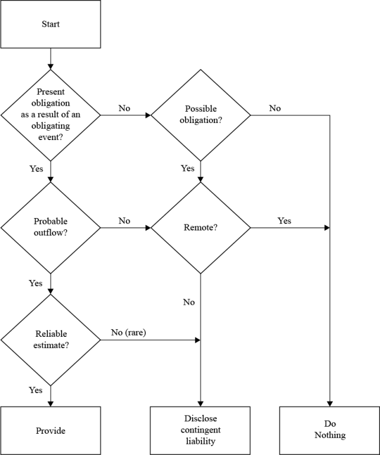
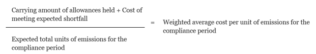

# 16 - Provisions, contingent liabilities and contingent assets (IAS 37)

[返回目录](README.md)

# 16 - Provisions, contingent liabilities and contingent assets (IAS 37)

Contents

- [16 - Provisions, contingent liabilities and contingent assets (IAS 37)](36.md#s115-chap_16_toc_h1)

- [Introduction and scope (paras 16.1-16.9)](36.md#s116-chap_16_navPoint_1)

- [Scope](36.md#s116-chap_16_navPoint_2)

- [Provisions versus other liabilities](36.md#s116-chap_16_navPoint_idp1714701544)

- [Recognition (paras 16.10 - 16.39)](36.md#s117-chap_16_navPoint_3)

- [Provision recognition criteria](36.md#s117-chap_16_navPoint_4)

- [Present obligation](36.md#s117-chap_16_navPoint_idp1688042136)

- [Legal obligations](36.md#s117-chap_16_navPoint_idp1688040984)

- [Constructive obligations](36.md#s117-chap_16_navPoint_idp1714751848)

- [Uncertainty as to whether a present obligation exists](36.md#s117-chap_16_navPoint_idp1714761960)

- [Past event](36.md#s117-chap_16_navPoint_idp1714788712)

- [Probable outflow of economic benefits](36.md#s117-chap_16_navPoint_idp1714863720)

- [Reliable estimate](36.md#s117-chap_16_navPoint_5)

- [Continued recognition and reversal](36.md#s117-chap_16_navPoint_idp1714888040)

- [Contingent liabilities and contingent assets](36.md#s117-chap_16_navPoint_6)

- [Contingent liabilities](36.md#s117-chap_16_navPoint_idp1714654184)

- [Contingent assets](36.md#s117-chap_16_navPoint_idp1714661224)

- [Reimbursements](36.md#s117-chap_16_navPoint_7)

- [Measurement (paras 16.40 - 16.54)](36.md#s118-chap_16_navPoint_8)

- [Best estimate](36.md#s118-chap_16_navPoint_9)

- [Future events](36.md#s118-chap_16_navPoint_idp1698301368)

- [Estimation techniques](36.md#s118-chap_16_navPoint_idp1698310072)

- [Present value](36.md#s118-chap_16_navPoint_10)

- [Unwinding the discount](36.md#s118-chap_16_navPoint_11)

- [Other changes in provisions](36.md#s118-chap_16_navPoint_12)

- [Expected disposal of assets](36.md#s118-chap_16_navPoint_13)

- [Future operating losses](36.md#s118-chap_16_navPoint_14)

- [Restructuring (paras 16.55 - 16.70)](36.md#s119-chap_16_navPoint_15)

- [Definition](36.md#s119-chap_16_navPoint_16)

- [Applying the recognition criteria](36.md#s119-chap_16_navPoint_17)

- [Third party expectation](36.md#s119-chap_16_navPoint_idp1714875624)

- [Board decision](36.md#s119-chap_16_navPoint_idp1714886120)

- [Restructuring time-frame](36.md#s119-chap_16_navPoint_idp1714638312)

- [Binding sale agreement](36.md#s119-chap_16_navPoint_idp1714698728)

- [Costs of restructuring](36.md#s119-chap_16_navPoint_18)

- [Practical application (paras 16.71 - 16.85)](36.md#s120-chap_16_navPoint_19)

- [Onerous contracts](36.md#s120-chap_16_navPoint_20)

- [Waste electrical and electronic equipment](36.md#s120-chap_16_navPoint_21)

- [Levies](36.md#s120-chap_16_navPoint_22)

- [Other practical application of the guidance](36.md#s120-chap_16_navPoint_23)

- [Disclosure (paras 16.86 - 16.88)](36.md#s121-chap_16_navPoint_24)

- [Illustrative text](36.md#s122-chap_16_navPoint_25)

- [Scope](36.md#s122-chap_16_navPoint_26)

- [FAQ 16.4.1 – Are financial guarantee contracts within the scope of IAS 37?](36.md#s122-chap_16_navPoint_idp1698273464)

- [Provision recognition criteria](36.md#s122-chap_16_navPoint_27)

- [FAQ 16.10.1 – What are the criteria for provision recognition, illustrated by flow chart?](36.md#s122-chap_16_navPoint_idp1714758504)

- [Legal obligation](36.md#s122-chap_16_navPoint_28)

- [FAQ 16.13.1 – Does new legislation enacted shortly after the balance sheet date create an obligation for provision?](36.md#s122-chap_16_navPoint_idp1714771048)

- [Constructive obligations](36.md#s122-chap_16_navPoint_29)

- [FAQ 16.14.1 – What are examples of constructive obligations?](36.md#s122-chap_16_navPoint_idp1714785384)

- [Uncertainty as to whether a present obligation exists](36.md#s122-chap_16_navPoint_30)

- [FAQ 16.19.1 – How should management account for a situation where it is not possible to reliably assess whether a present obligation exists?](36.md#s122-chap_16_navPoint_idp1714794472)

- [FAQ 16.22.1 – Does provision need to be made for costs arising from future operation?](36.md#s122-chap_16_navPoint_idp1714803688)

- [Continued recognition and reversal](36.md#s122-chap_16_navPoint_31)

- [FAQ 16.28.1 – How should the reversal of a provision be reflected in the income statement?](36.md#s122-chap_16_navPoint_idp1714830568)

- [Contingent liabilities](36.md#s122-chap_16_navPoint_32)

- [FAQ 16.30.1 – What is the spectrum of liability?](36.md#s122-chap_16_navPoint_idp1714844392)

- [Contingent assets](36.md#s122-chap_16_navPoint_33)

- [FAQ 16.36.1 – What is the spectrum of contingent assets?](36.md#s122-chap_16_navPoint_idp1714848488)

- [FAQ 16.36.2 – How should deposits relating to taxes other than income tax be accounted for?](36.md#s122-chap_16_navPoint_idp1714861416)

- [Reimbursements](36.md#s122-chap_16_navPoint_34)

- [FAQ 16.37.1 – How should provisions and related reimbursements be recognised?](36.md#s122-chap_16_navPoint_idp1714879080)

- [FAQ 16.37.2 – What are the implications of post balance sheet events for the recognition of insurance recoveries?](36.md#s122-chap_16_navPoint_idp1714626280)

- [Future events](36.md#s122-chap_16_navPoint_35)

- [FAQ 16.46.1 – What are the implications of future changes in technology?](36.md#s122-chap_16_navPoint_idp1714644328)

- [Estimation techniques](36.md#s122-chap_16_navPoint_36)

- [FAQ 16.47.1 – How should a warranty provision be estimated using expected value (example reproduced from IAS 37)?](36.md#s122-chap_16_navPoint_idp1714653032)

- [FAQ 16.47.2 – When might the expected value approach not be appropriate?](36.md#s122-chap_16_navPoint_idp1714705384)

- [FAQ 16.47.3 – When might the most likely outcome approach not be appropriate?](36.md#s122-chap_16_navPoint_idp1714716648)

- [FAQ 16.47.4 – How are risks reflected under the two estimation methods?](36.md#s122-chap_16_navPoint_idp1687998104)

- [Present value](36.md#s122-chap_16_navPoint_37)

- [FAQ 16.49.1 – What factors influence the discount rate to be used for measuring the present value of provisions?](36.md#s122-chap_16_navPoint_idp1688006808)

- [FAQ 16.49.2 – Does a negative discount rate reflect time value?](36.md#s122-chap_16_navPoint_idp1688020760)

- [FAQ 16.49.3 – How does the discount rate reflect risks specific to the liability?](36.md#s122-chap_16_navPoint_idp1688031384)

- [FAQ 16.49.4 – How does inflation affect the discount rate?](36.md#s122-chap_16_navPoint_idp1687981080)

- [FAQ 16.49.5 – Should own credit risks be considered?](36.md#s122-chap_16_navPoint_idp1695237624)

- [FAQ 16.49.6 – What factors might impact setting the discount rate?](36.md#s122-chap_16_navPoint_idp1695248888)

- [Unwinding the discount](36.md#s122-chap_16_navPoint_38)

- [FAQ 16.50.1 – What discount rate should be used to calculate the borrowing costs that arise from the unwinding of a provision?](36.md#s122-chap_16_navPoint_idp1695265144)

- [Other changes in provisions](36.md#s122-chap_16_navPoint_39)

- [FAQ 16.51.1 – How should re-assessment of provision from changes in estimated cash flows and discount rates be accounted for?](36.md#s122-chap_16_navPoint_idp1695274360)

- [FAQ 16.51.2 – What is the effect of a change in the discount rate?](36.md#s122-chap_16_navPoint_idp1695282168)

- [Future operating loss](36.md#s122-chap_16_navPoint_40)

- [FAQ 16.53.1 – Can future operating losses of a disposal group be recognised as a provision?](36.md#s122-chap_16_navPoint_idp1696095272)

- [Restructuring](36.md#s122-chap_16_navPoint_41)

- [FAQ 16.60.1 – Is an announcement of a restructuring plan to some of those parties affected by the plan sufficient to recognise a liability for the total expected restructuring provision?](36.md#s122-chap_16_navPoint_idp1688341656)

- [FAQ 16.61.1 – Is an announcement of an intention sufficient to recognise a restructuring provision?](36.md#s122-chap_16_navPoint_idp1688357400)

- [FAQ 16.61.2 – Do individual employees have to be notified to recognise a restructuring provision?](36.md#s122-chap_16_navPoint_idp1688368280)

- [FAQ 16.62.1 – What are the implications of a management announcement of restructuring after the balance sheet date?](36.md#s122-chap_16_navPoint_idp1688381464)

- [FAQ 16.63.1 – What are the circumstances in which board approval crystallises the obligation?](36.md#s122-chap_16_navPoint_idp1688392472)

- [FAQ 16.64.1 – Does a restructuring that takes a long time to implement create a constructive obligation?](36.md#s122-chap_16_navPoint_idp1688401688)

- [FAQ 16.69.1 – What are the costs generally included in, and those generally excluded from, a restructuring provision?](36.md#s122-chap_16_navPoint_idp1688416280)

- [Onerous contracts](36.md#s122-chap_16_navPoint_42)

- [FAQ 16.71.1 – How should the term ‘economic benefits expected to be received’ be understood?](36.md#s122-chap_16_navPoint_idp1687129144)

- [FAQ 16.72.1 – Is it necessary to include overheads to determine whether a contract is onerous and to measure any resulting provision?](36.md#s122-chap_16_navPoint_idp1687137464)

- [FAQ 16.73.1 – What are assets dedicated to a contract?](36.md#s122-chap_16_navPoint_idp1687152824)

- [FAQ 16.74.1 – How should a provision for a long-term purchase contract be assessed?](36.md#s122-chap_16_navPoint_idp1687162552)

- [FAQ 16.74.2 – How should an onerous contract provision for a contract with a customer be measured?](36.md#s122-chap_16_navPoint_idp1687183544)

- [Waste electrical and electronic equipment](36.md#s122-chap_16_navPoint_43)

- [FAQ 16.76.1 – What is WEEE obligation?](36.md#s122-chap_16_navPoint_idp1687195064)

- [Levies](36.md#s122-chap_16_navPoint_44)

- [FAQ 16.77.1 – Are property taxes within the scope of IFRIC 21?](36.md#s122-chap_16_navPoint_idp1687223224)

- [FAQ 16.77.2 – Is payroll tax within the scope of IAS 37 and IFRIC 21?](36.md#s122-chap_16_navPoint_idp1718430968)

- [FAQ 16.77.3 – Are payments imposed by the government and paid to third parties within the scope of IFRIC 21?](36.md#s122-chap_16_navPoint_idp1718432888)

- [EX 16.78.1 – IFRIC agenda decision on levy with a pro rata and annual activity threshold](36.md#s122-chap_16_navPoint_idp1718444152)

- [EX 16.78.2 – Obligating event: generation of revenue](36.md#s122-chap_16_navPoint_idp1718464888)

- [EX 16.78.3 – Property tax – obligating event: point in time](36.md#s122-chap_16_navPoint_idp1718468728)

- [EX 16.79.1 – Obligating event: operation on a particular date](36.md#s122-chap_16_navPoint_idp1718478456)

- [EX 16.79.2 – Levy triggered if the entity operates as a bank at a specified date (example reproduced from IFRIC 21)](36.md#s122-chap_16_navPoint_idp1718496120)

- [EX 16.81.1 – Levy triggered progressively as the entity generates revenues (example reproduced from IFRIC 21)](36.md#s122-chap_16_navPoint_idp1718504056)

- [EX 16.81.2 – Property tax: over time](36.md#s122-chap_16_navPoint_idp1718508024)

- [EX 16.81.3 – Recognition over time?](36.md#s122-chap_16_navPoint_idp1718522232)

- [EX 16.82.1 – Levy triggered if the entity generates revenue above a minimum amount](36.md#s122-chap_16_navPoint_idp1718527480)

- [EX 16.82.2 – Levy triggered if the entity generates revenue for certain products that can be avoided by selling a different product](36.md#s122-chap_16_navPoint_idp1718539000)

- [EX 16.83.1 – Recognition of an asset under IAS 2](36.md#s122-chap_16_navPoint_idp1718552696)

- [EX 16.83.2 – Recognition of an asset under IAS 16](36.md#s122-chap_16_navPoint_idp1700310888)

- [Other practical application of the guidance](36.md#s122-chap_16_navPoint_45)

- [EX 16.85.1 – Applying the recognition criteria to litigation](36.md#s122-chap_16_navPoint_idp1700316648)

- [EX 16.85.2 – Applying the recognition criteria to warranties](36.md#s122-chap_16_navPoint_idp1700338792)

- [EX 16.85.3 – Applying the recognition criteria to refunds](36.md#s122-chap_16_navPoint_idp1700366568)

- [EX 16.85.4 – Applying the recognition criteria to major repairs and maintenance in different situations](36.md#s122-chap_16_navPoint_idp1700384616)

- [EX 16.85.5 – Applying the recognition criteria to lease dilapidations](36.md#s122-chap_16_navPoint_idp1700397416)

- [EX 16.85.6 – Applying the recognition criteria to leasehold improvements](36.md#s122-chap_16_navPoint_idp1700410472)

- [EX 16.85.7 – Applying the recognition criteria to abandonment and decommissioning costs](36.md#s122-chap_16_navPoint_idp1700419176)

- [EX 16.85.8 – Applying the recognition criteria to environmental liabilities](36.md#s122-chap_16_navPoint_idp1698026200)

- [EX 16.85.9 – Detailed discussion of applying the recognition criteria to emissions obligations](36.md#s122-chap_16_navPoint_idp1698070360)

- [EX 16.85.10 – Applying the recognition criteria to self-insurance](36.md#s122-chap_16_navPoint_idp1698138328)

- [Disclosure requirements](36.md#s122-chap_16_navPoint_46)

- [FAQ 16.87.1 – When would aggregating provisions in different classes for disclosure be appropriate?](36.md#s122-chap_16_navPoint_idp1698158680)

- [FAQ 16.88.1 – What is meant by ‘not practicable’?](36.md#s122-chap_16_navPoint_idp1698162392)

This eBook is licensed to peggy so, peggy.so@hk.ey.com, 

## Introduction and scope (paras 16.1-16.9)

 

**16.1**A liability is a “present obligation of the entity arising from past events, the settlement of which is expected to result in an outflow from the entity of resources embodying economic benefits”. A provision is “a liability of uncertain timing or amount”. IAS 37 sets out the requirements for recognition, measurement and disclosure of provisions. It also sets out the presentation and disclosure requirements for contingent liabilities and contingent assets.

[IAS 37 para 10].

 

### Scope

 

**16.2**IAS 37 applies to the accounting for provisions, contingent liabilities and contingent assets, except for executory contracts and those arrangements covered by another standard.

[IAS 37 para 1].

**16.3**Executory contracts are contracts under which neither party has performed any of its obligations, or both parties have partially performed their obligations to an equal extent. Executory contracts encompass commitments to purchase goods or to deliver services where performance has not yet happened. An executory contract might be onerous, in which case the requirements in IAS 37 for onerous contracts are applied (see further [para 16.71 onwards](36.md#s120-Para_16.71)).

[IAS 37 para 3].

**16.4** IAS 37 does not apply to financial instruments, including financial guarantee contracts, that are within the scope of IFRS 9. Some financial guarantee contracts might be within the scope of either IFRS 9 or IFRS 4. Provisions, contingent liabilities and contingent assets that require settlement in cash which does not yet arise from a contract (for example, a contingent payable or receivable for a court judgment) is not a financial instrument. Consistent with FAQ 40.21.1, a legal dispute becomes a financial instrument when it is enforced by a government or a court of law and the parties agree to payment terms as part of a contract. A fine is not contractual.

[IAS 32 para 11]. [IFRS 9 para 2.1(e)]. [IFRS 4 para 4(d)]. [IAS 37 para 2].

[FAQ 16.4.1 – Are financial guarantee contracts within the scope of IAS 37?](36.md#s122-FAQ_16.4.1)

[FAQ 40.21.1 – Are contingent events which might require the payment of cash but not yet contractual, classified as financial instruments?](61.md#s253-FAQ_40.21.1)

**16.5**IAS 37 also does not apply to provisions, contingent liabilities or contingent assets covered specifically by another standard, such as:

- business combinations (IFRS 3);

- revenue from contracts with customers (IFRS 15) (except for contracts with customers that are, or have become, onerous);

- income taxes (IAS 12);

- leases (IFRS 16) (except for onerous leases to which the low-value or short-term exemption has been applied and leases which became onerous before the commencement date of the lease);

- employee benefits (IAS 19); and

- insurance contracts (IFRS 4) (insurers should apply IAS 37 to provisions, contingent liabilities and contingent assets, other than those arising from contractual obligations and rights under insurance contracts within IFRS 4’s scope).

[IAS 37 para 5].

**[****The next paragraph is 16.7.]**

**16.7**The word ‘provision’ could be used to describe amounts that are deducted from assets to arrive at their balance sheet carrying amount. For example, provisions are made for depreciation or amortisation or the impairment of financial or non-financial assets. These are not provisions and are not within the scope of IAS 37. These relate to the measurement of assets, and they are adjustments made to determine the assets’ carrying value.

[IAS 37 para 7].

**16.8**IAS 37 does not specify whether a debit arising when a provision is recognised is treated as an expense or an asset.

[IAS 37 para 8].

 

#### Provisions versus other liabilities

**16.9**A provision is “a liability of uncertain timing or amount”. Provisions differ from other liabilities in the degree of certainty about the amount or the timing of the payment. So, there is a clear distinction between provisions and other liabilities such as trade payables and accruals.

[IAS 37 para 11].

This eBook is licensed to peggy so, peggy.so@hk.ey.com, 

## Recognition (paras 16.10 - 16.39)

### Provision recognition criteria

 

**16.10**A provision is recognised where all of the following conditions are met:

- An entity has a present obligation (see [para 16.11 onwards](36.md#s117-Para_16.11)) as a result of a past event (see [para 16.20 onwards](36.md#s117-Para_16.20)).

- It is probable that an outflow of resources embodying economic benefits will be required to settle the obligation (see [para 16.23 onwards](36.md#s117-Para_16.23)).

- A reliable estimate can be made of the amount of the obligation (see [para 16.25 onwards](36.md#s117-Para_16.25)).

[IAS 37 para 14].

[FAQ 16.10.1 – What are the criteria for provision recognition, illustrated by flow chart?](36.md#s122-FAQ_16.10.1)

 

#### Present obligation

**16.11**A present obligation can arise from a legal agreement (a ‘legal obligation’) or might arise from an entity’s past practice, published policy or current statement (a ‘constructive obligation’).

[IAS 37 para 10].

##### Legal obligations

 

**16.12**It will usually be straightforward to establish whether a legal obligation exists, because it derives either from a contract (through its explicit or implicit terms), from legislation or from the operation of the law.

[IAS 37 para 10].

**16.13**Proposed legislation moves through various stages before it is finally enacted. A proposed law only creates an obligation for which provision is made when it is virtually certain to be enacted as drafted. This means that an obligation to comply with legislation only arises when that legislation is enacted or virtually certain to be enacted. IAS 37 does not specify a single event to identify when enactment of a law is virtually certain.

[IAS 37 para 22].

[FAQ 16.13.1 – Does new legislation enacted shortly after the balance sheet date create an obligation for provision?](36.md#s122-FAQ_16.13.1)

 

##### Constructive obligations

 

**16.14**A constructive obligation arises where:

“(a) by an established pattern of past practice, published policies or a sufficiently specific current statement, the entity has indicated to other parties that it will accept certain responsibilities; and

(b) as a result, the entity has created a valid expectation on the part of those other parties that it will discharge those responsibilities.”

[IAS 37 para 10].

[FAQ 16.14.1 – What are examples of constructive obligations?](36.md#s122-FAQ_16.14.1)

**16.15**The expectation of other parties is critical to the existence of a past event, but it is not necessary to know the other party’s identity for an obligation to arise.

[IAS 37 para 20].

**16.16**A constructive obligation might arise where a potentially obligating event has taken place (such as environmental damage), but where no legal obligation exists. The entity could create a constructive obligation by making a public statement that it will rectify the damage. The public announcement creates a constructive obligation if it is sufficiently specific that it leaves the entity no realistic alternative but to carry out the rectification work.

[IAS 37 para 21].

 

##### Uncertainty as to whether a present obligation exists

 

**16.17**In rare circumstances, it might not be clear whether a past event results in a present obligation. In these situations, a past event gives rise to a present obligation if, after taking account of all the available evidence, it is more likely than not that a present obligation exists at the balance sheet date.

[IAS 37 para 15].

**16.18**IAS 37 requires that:

- Where it is more likely than not that a present obligation exists at the balance sheet date, the entity should recognise a provision (if the recognition criteria are met).

- Where it is more likely that no present obligation exists at the balance sheet date, the entity should disclose a contingent liability, unless the possibility of an outflow of resources embodying economic benefit is remote, in which case no disclosure is required (see [para 16.31](36.md#s117-Para_16.31)).

- It is sometimes unclear whether a present obligation exists in connection with litigation where the events are disputed by the parties. In this situation, it might be necessary for an entity to obtain an expert’s opinion to determine whether a present obligation exists.

[IAS 37 para 16].

**16.19**Further information might become available between the balance sheet date and the date on which an entity’s financial statements are finalised. Where this happens, that information should be taken into account in determining whether or not a present obligation exists at the balance sheet date. A provision should not be made at the period end where the obligating event occurs after the balance sheet date. [See chapter 9 para 2](17.md#s54-Para_9.2) for further guidance on events after the reporting period.

[IAS 37 para 16].

[FAQ 16.19.1 – How should management account for a situation where it is not possible to reliably assess whether a present obligation exists?](36.md#s122-FAQ_16.19.1)

 

#### Past event

 

**16.20**A liability exists only when something has happened in the past (a ‘past event’) to trigger a present obligation. The past event is known in IAS 37 as the ‘obligating event’. An ‘obligating event’ is “an event that creates a legal or constructive obligation that results in an entity having no realistic alternative to settling that obligation”. Many obligating events are obvious; for example, the obligating event giving rise to the need to make a warranty provision is the original sale of the warrantied goods. Similarly, with the contamination of land, the obligating event is the original contamination.

[IAS 37 para 10].

**16.21**No obligation arises from a past event if there is a realistic possibility that the entity can avoid settlement. An entity has no realistic alternative to settling an obligation only where:

- the settlement of the obligation can be enforced by law; or

- the event, in the case of a constructive obligation, creates a valid expectation in others that the entity will discharge the obligation.

[IAS 37 para 17].

**16.22**Only past events existing independently of an entity’s future actions will trigger provisions.

[IAS 37 para 19].

[FAQ 16.22.1 – Does provision need to be made for costs arising from future operation?](36.md#s122-FAQ_16.22.1)

 

#### Probable outflow of economic benefits

 

**16.23**Once it has been established that a present obligation exists as a result of a past event, it is necessary to determine whether it will result in a probable outflow of resources embodying economic benefits to settle the obligation. IAS 37 states that “an outflow of resources or other event is regarded as probable if the event is more likely than not to occur …”. No provision is necessary where the outflow is not probable, but a contingent liability exists and should be disclosed unless the possibility of an outflow is remote.

[IAS 37 para 23].

**16.24**Obligations arising from a group of similar transactions should be considered together. IAS 37 requires the probability that an outflow of resources will be required in settlement to be determined by considering the class of obligations as a whole. A typical example of this is product warranties.

[IAS 37 para 24].

 

### Reliable estimate

 

**16.25**In extremely rare cases, it will not be possible to make a reliable estimate of the obligation. In such cases, the liability is disclosed as a contingent liability. IAS 37 does not provide further guidance on what might be ‘extremely rare cases’.

[IAS 37 para 26].

**16.26**IAS 37 states that, in nearly all cases, an entity will be able to determine a range of possible outcomes and to make an estimate of an obligation that will be sufficiently reliable to use in recognising a provision. Judgement will be needed where the amount is uncertain. A variety of estimation techniques might be used to make the estimate (see [para 16.47](36.md#s118-Para_16.47)).

[IAS 37 para 25].

 

#### Continued recognition and reversal

 

**16.27**Provisions should be based on circumstances at the balance sheet date but adjusted to reflect the current best estimate. The current best estimate will be based on information available up to the date when the financial statements are authorised for issue. If it is no longer probable that an outflow of economic benefits will be required to settle the obligation, the provision should be reversed.

[IAS 37 para 59].

**16.28**A provision should only be used for the expenditures for which it was originally recognised. Where the original provision was charged as an expense, any subsequent reversal should be credited to the same line in the income statement. Changes in provisions that were originally recognised as part of the cost of an asset are dealt with in [EX 16.85.7](36.md#s122-EX16.85.7).

[IAS 37 para 61]. [IAS 1 para 45].

[FAQ 16.28.1 – How should the reversal of a provision be reflected in the income statement?](36.md#s122-FAQ_16.28.1)

 

### Contingent liabilities and contingent assets

**16.29**IAS 37 uses the term ‘contingent’ for liabilities and assets that are not recognised because their existence will be confirmed only by the occurrence or non-occurrence of one or more uncertain future events that are not wholly within the entity’s control. The term ‘contingent liability’ is also used for liabilities that do not meet the recognition criteria in IAS 37.

[IAS 37 para 12].

#### Contingent liabilities

 

**16.30**Contingent liabilities arise where there is a:

- possible obligation as a result of a past event that might, but will probably not, require an outflow of resources embodying economic benefits; or

- present obligation as a result of a past event:

- that probably requires an outflow of resources embodying economic benefits, but where the obligation cannot be measured reliably; or

- that might, but will probably not, require an outflow of resources embodying economic benefits.

[IAS 37 para 10].

[FAQ 16.30.1 – What is the spectrum of liability?](36.md#s122-FAQ_16.30.1)

**16.31**A contingent liability should not be recognised. It should be disclosed, unless the possibility of an outflow is remote.

[IAS 37 para 27]. [IAS 37 para 28].

**16.32**Sometimes, entities are jointly and severally liable for an obligation. Joint and several obligations often arise in joint arrangements where two or more parties co-operate to build, develop or exploit a particular product. Where joint and several obligations arise, the part of the obligation that is expected to be met by other parties is treated as a contingent liability. The guidance in IAS 37 is applied to the part of the obligation that will be met by the entity itself.

[IAS 37 para 29].

 

#### Contingent assets

 

**16.33**A contingent asset is “[a] possible asset that arises from past events and whose existence will be confirmed only by the occurrence or non-occurrence of one or more uncertain future events not wholly within the control of the entity”.

[IAS 37 para 10].

**16.34**Contingent assets generally arise from unplanned or other unexpected events that give rise to the possibility of an inflow of resources embodying economic benefits to the entity.

[IAS 37 para 32].

**16.35**IAS 37 does not permit the recognition of contingent assets. Contingent assets are disclosed only when an inflow of economic benefits is probable. This is different from contingent liabilities, where disclosure is required unless an outflow is remote.

[IAS 37 para 31]. [IAS 37 para 34].

**16.36**A contingent asset is not recognised, because it might result in the recognition of income that is never realised. When it becomes virtually certain that an inflow of economic benefits will arise, the asset is no longer a contingent asset and should be recognised in the period in which the change occurs (that is, when the future event occurs and confirms the asset’s existence, or when it becomes virtually certain that the future event will confirm the asset’s existence and it is virtually certain that the asset will be realised).

[IAS 37 para 33].

[FAQ 16.36.1 – What is the spectrum of contingent assets?](36.md#s122-FAQ_16.36.1)

  
 

[FAQ 16.36.2 – How should deposits relating to taxes other than income tax be accounted for?](36.md#s122-FAQ_16.36.2)

 

### Reimbursements

 

**16.37**Where some or all of the expenditure required to settle a provision is expected to be reimbursed by another party, the reimbursement should be recognised only when it is virtually certain that reimbursement will be received if the entity settles the obligation. The entity typically remains liable for the entire obligation, and reimbursements are therefore presented separately as assets. The amount recognised should not exceed the amount of the related provision.

[IAS 37 para 53].

[FAQ 16.37.1 – How should provisions and related reimbursements be recognised? ](36.md#s122-FAQ_16.37.1)  
  
[FAQ 16.37.2 – What are the implications of post balance sheet date events for the recognition of insurance recoveries?](36.md#s122-FAQ_16.37.2)

  
 

**16.38**Expenses relating to a provision can be presented net of the amount recognised for a reimbursement in the income statement (see also [FAQ 16.37.2)](36.md#s122-FAQ_16.37.2).

[IAS 37 para 54].

**16.39**An entity is sometimes able to transfer the obligation to another party and, as a result, it will no longer be liable for the loss, even if the party assuming the obligation fails to pay. The entity no longer has a liability for the costs arising under the obligation or bears the credit risk of the counterparty assuming the obligation, so those costs should not be included in the provision.

[IAS 37 para 57].

 

This eBook is licensed to peggy so, peggy.so@hk.ey.com, 

## Measurement (paras 16.40 - 16.54)

### Best estimate

**16.40**A provision should be measured at the best estimate of the expenditure required to settle the present obligation at the balance sheet date.

[IAS 37 para 36].

**16.41**This is the amount that an entity would rationally pay to settle the obligation or to transfer it to a third party at the balance sheet date. It will sometimes be impossible to settle or transfer the obligation at the reporting date and, in these cases, entities often provide for the cost of fulfilling the obligation as an estimate of the amount that an entity would rationally pay to settle.

[IAS 37 para 37].

**16.42**Estimating the cost to settle, transfer or fulfil an obligation requires judgement, taking into account experience in similar situations and, in some cases, the views of independent experts. For example, management will often have experience of the type and number of warranty claims that have been made in the past that can be used to develop an estimate of future claims. Management might seek the advice of an expert (for example, in connection with litigation).

[IAS 37 para 38].

**16.43**The risks and uncertainties about the amount and timing of cash flows are taken into account in estimating the expenditure required to settle the present obligation at the balance sheet date. Where provisions involves significant judgements and estimation uncertainties, an entity should make disclosures in accordance with IAS 1. These requirements are considered in more detail in [chapter 4 para 149](10.md#s29-Para_4.149).

[IAS 37 para 42].

**16.44**In deciding the amount to be provided, the entity takes into account any additional evidence provided by events that take place after the balance sheet date.

[IAS 37 para 38].

**16.45**A provision is measured before tax. The tax consequences of a provision are dealt with in accordance with IAS 12. Accounting for deferred tax is considered in [chapter 14 para 25](27.md#s98-Para_14.25).

[IAS 37 para 41].

#### Future events

 

**16.46**Future events which might impact on measuring the provisions should be reflected where there is sufficient objective evidence that they will occur.

[IAS 37 para 48].

[FAQ 16.46.1 – What are the implications of future changes in technology?](36.md#s122-FAQ_16.46.1)

 

#### Estimation techniques

 

**16.47**Provisions are generally estimated using:

- the single most likely outcome; or

- a weighted average of all of the possible outcomes (the ‘expected value’ method). This method can be applied to a large population of similar claims, as well as a single obligation with various possible outcomes.

[IAS 37 para 39].

[FAQ 16.47.1 – How should a warranty provision be estimated using expected value (example reproduced from IAS 37)? ](36.md#s122-FAQ_16.47.1)  
  
[FAQ 16.47.2 – When might the expected value approach not be appropriate?](36.md#s122-FAQ_16.47.2)  
  
[FAQ 16.47.3 – When might the most likely outcome approach not be appropriate?](36.md#s122-FAQ_16.47.3)  
[FAQ 16.47.4 – How are risks reflected under the two estimation methods?](36.md#s122-FAQ_16.47.4)

 

### Present value

 

**16.48**A provision is measured at the present value of the expected outflow where the effect of the time value of money is material.

[IAS 37 para 45].

**16.49**The discount rate should be a pre-tax rate that reflects the current market assessments of the time value of money and the risks specific to the liability. The discount rate should not, however, reflect risks for which future cash flow estimates have been adjusted. Therefore, where risk has been built into the cash flows, the discount rate should not be adjusted for the same risks.

[IAS 37 para 47].

[FAQ 16.49.1 – What factors influence the discount rate to be used for measuring the present value of provisions?](36.md#s122-FAQ_16.49.1)  
[FAQ 16.49.2 – Does a negative discount rate reflect time value?](36.md#s122-FAQ_16.49.2)  
[FAQ 16.49.3 – How does the discount rate reflect risks specific to the liability?](36.md#s122-FAQ_16.49.3)  
[FAQ 16.49.4 – How does inflation affect the discount rate?](36.md#s122-FAQ_16.49.4)  
[FAQ 16.49.5 – Should own credit risks be considered? ](36.md#s122-FAQ_16.49.5)  
[FAQ 16.49.6 – What factors might impact setting the discount rate?](36.md#s122-FAQ_16.49.6)

 

### Unwinding the discount

 

**16.50**The unwinding of the discount due to the passage of time should be included as an element of borrowing costs in arriving at profit or loss for the year.

[IAS 37 para 60].

[FAQ 16.50.1 – What discount rate should be used to calculate the borrowing costs that arise from the unwinding of a provision?](36.md#s122-FAQ_16.50.1)

 

### Other changes in provisions

 

**16.51**Provisions should be re-assessed at the end of each reporting period and adjusted to reflect current best estimates. This re-assessment should include the estimated cash flows and the discount rate. A re-assessment should be undertaken at least once every reporting period. The discount rate should be a current rate (rather than a longer-term average) at each reporting date.

[IAS 37 para 59].

[FAQ 16.51.1 – How should re-assessment of provision from changes in estimated cash flows and discount rates be accounted for? ](36.md#s122-FAQ_16.51.1)  
  
[FAQ 16.51.2 – What is the effect of a change in the discount rate?](36.md#s122-FAQ_16.51.2)

 

### Expected disposal of assets

**16.52**The measurement of a provision should not take account of any gains from the expected disposal of assets, even if the expected disposal is closely linked to the event giving rise to the provision. For example, a restructuring provision cannot be reduced by an expected gain on disposal of a factory that is being sold as part of the restructuring. The gain is recognised when the factory is sold.

[IAS 37 para 51].

### Future operating losses

 

**16.53**Future operating losses do not meet the definition of a liability and the recognition criteria for provisions. This is because future operating losses do not result from a past event (see [para 16.20](36.md#s117-Para_16.20)). Therefore, a provision for termination of operations cannot include future operating losses up to the date of closure.

[IAS 37 para 64].

[FAQ 16.53.1 – Can future operating losses of a disposal group be recognised as a provision?](36.md#s122-FAQ_16.53.1)

**16.54**Expected future operating losses are an indication that an impairment review is required in accordance with IAS 36. Such a review would determine whether those assets have suffered an impairment and need to be written down. Anticipated future operating losses might indicate that an entity has an onerous contract. Onerous contracts are covered in detail in [paragraph 16.71 onwards](36.md#s120-Para_16.71).

[IAS 37 para 65].

 

This eBook is licensed to peggy so, peggy.so@hk.ey.com, 

## Restructuring (paras 16.55 - 16.70)

 

**16.55**IAS 37 explains how to determine when an obligating event has occurred in connection with a restructuring. IAS 37 also applies to provisions for restructuring when there is a discontinued operation. Where a restructuring meets the definition of a discontinued operation in IFRS 5, additional disclosures might be required. Discontinued operations are dealt with in [chapter 30 para 39](53.md#s218-Para_30.39).

[IAS 37 para 9].

 

### Definition

 

**16.56**A ‘restructuring’ is:

“A programme that is planned and controlled by management, and materially changes either: (a) the scope of a business undertaken by an entity; or (b) the manner in which that business is conducted.”

[IAS 37 para 10].

**16.57**IAS 37 gives some examples of situations that fall within the restructuring definition:

- The sale or termination of a line of business.

- The closure of business locations or the relocation of business activities.

- Changes in management structure.

- Fundamental re-organisations that have a material effect on the nature and focus of the entity’s operations.

[IAS 37 para 70].

 

### Applying the recognition criteria

**16.58**A restructuring provision is recognised only when an obligating event has arisen. The obligation for a restructuring is often constructive. A constructive restructuring obligation arises only when both of the conditions below exists:

- A detailed formal plan for the restructuring, which identifies at least:

- the business or part of a business concerned;

- the principal locations affected;

- the location, function and approximate number of employees who will be compensated for terminating their services;

- the expenditures that will be undertaken; and

- when the plan will be implemented.

- A valid expectation, in those affected, that the entity will carry out the restructuring by starting to implement that plan or announcing its main features to those affected by it.

[IAS 37 para 72].

**16.59**Evidence demonstrating that an entity has started to implement a restructuring plan includes:

- Dismantling plant;

- Selling assets;

- Public announcement of the plan’s main features.

[IAS 37 para 73].

#### Third party expectation

 

**16.60**A constructive obligation arises from a public announcement only when it raises a valid expectation in employees (or their representatives), customers, suppliers or others affected by it in a ‘sufficiently specific manner’ that the entity has no alternative but to discharge its responsibilities.

[IAS 37 para 73].

[FAQ 16.60.1 – Is an announcement of a restructuring plan to some of those parties affected by the plan sufficient to recognise a liability for the total expected restructuring provision?](36.md#s122-FAQ_16.60.1)

**16.61**The announcement must therefore address the main features of the restructuring plan in a sufficiently specific manner to raise a valid expectation that the entity will carry out the restructuring.

[IAS 37 para 75].

[FAQ 16.61.1 – Is an announcement of an intention sufficient to recognise a restructuring provision?](36.md#s122-FAQ_16.61.1)  
  
[FAQ 16.61.2 – Do individual employees have to be notified to recognise a restructuring provision?](36.md#s122-FAQ_16.61.2)

 

#### Board decision

 

**16.62**A management or board decision to restructure taken before the balance sheet date does not, in itself, give rise to a constructive obligation.

[IAS 37 para 75].

[FAQ 16.62.1 – What are the implications of a management announcement of restructuring after the balance sheet date?](36.md#s122-FAQ_16.62.1)

**16.63**A board decision and a formal plan might be all that is necessary to give rise to an obligation in some territories. This might also occur, for example, where the board includes worker representatives and management representatives.

[IAS 37 para 77].

[FAQ 16.63.1 – What are the circumstances in which board approval crystallises the obligation?](36.md#s122-FAQ_16.63.1)

 

#### Restructuring time-frame

 

**16.64**Many entity re-organisations take a number of years to complete. Some or all of the re-organisation might not be an obligation at the first year end following a board decision if the entity is realistically able to change its plans. It is unlikely that the plan will raise a sufficiently valid expectation on the part of others that the entity is committed to restructuring in these circumstances.

[IAS 37 para 74].

[FAQ 16.64.1 – Does a restructuring that takes a long time to implement create a constructive obligation?](36.md#s122-FAQ_16.64.1)

 

#### Binding sale agreement

**16.65**An obligation to sell exists only when there is a binding sale agreement evidencing a commitment to sell part of the business. An entity has an obligation for restructuring related to the sale only when it has found a purchaser and signed an unconditional contract. The unconditional sale agreement must be signed before the year end for an obligation to arise at the year end.

[IAS 37 para 78].

**16.66**It might be necessary to consider the carrying value of the cash-generating unit to which the operations relate in the period between the board decision and the unconditional contract, particularly if management expects a loss on disposal. Impairment reviews are considered in more detail in [chapter 24 para 9](41.md#s157-Para_24.9).

[IAS 37 para 79].

**16.67**The sale of an operation might be a small part of a larger restructuring, in which case a constructive obligation might arise for other aspects of the restructuring plan before a formal sale agreement has been reached.

[IAS 37 para 79].

### Costs of restructuring

 

**16.68**A restructuring provision should include only the direct expenditures arising from the restructuring, which are those that are both:

- necessarily entailed by the restructuring; and

- not associated with the ongoing activities of the entity.

[IAS 37 para 80].

**16.69**Retraining or relocating continuing staff, marketing, or investment in new systems and distribution networks should not be included in a restructuring provision. This is because these costs relate to the future conduct of the business; they do not represent an obligation arising from a past event.

[IAS 37 para 81].

[FAQ 16.69.1 – What are the costs generally included in, and those generally excluded from, a restructuring provision?](36.md#s122-FAQ_16.69.1)

**16.70**Employee termination benefits are often lump-sum payments, but can also include enhancement of pensions and salary until the end of a specified period if the employee renders no further service that provides economic benefits to the entity. Employee termination benefits are dealt with by IAS 19 and considered in detail in [chapter 12 para 4](23.md#s78-Para_12.4).

 

This eBook is licensed to peggy so, peggy.so@hk.ey.com, 

## Practical application (paras 16.71 - 16.85)

 

### Onerous contracts

 

**16.71**An onerous contract is a contract under which the unavoidable costs of meeting the obligations under the contract exceed the economic benefits expected to be received under it. The present obligation under an onerous contract is recognised and measured as a provision.

[IAS 37 para 66].

[FAQ 16.71.1 – How should the term ‘economic benefits expected to be received’ be understood?](36.md#s122-FAQ_16.71.1)

**16.72**‘Unavoidable costs’ under a contract are defined as being the least net cost of exiting the contract. This will be the lower of the cost to exit or breach the contract and the cost of fulfilling it.

[IAS 37 para 68].

[FAQ 16.72.1 – Is it necessary to include overheads to determine whether a contract is onerous and to measure any resulting provision?](36.md#s122-FAQ_16.72.1)

**16.73**An entity should recognise any impairment that has occurred on assets ‘dedicated to that contract’ before an onerous contract provision is recognised.

[IAS 37 para 69].

[FAQ 16.73.1 – What are assets dedicated to a contract?](36.md#s122-FAQ_16.73.1)

**16.74**IAS 37 does not apply to executory contracts unless those contracts are onerous (for example, a long-term purchase contract that has a higher unit cost than unit sales price).

[IAS 37 para 3].

[FAQ 16.74.1 – How should a provision for a long-term purchase contract be assessed?](36.md#s122-FAQ_16.74.1)  
[FAQ 16.74.2 – How should an onerous contract provision for a contract with a customer be measured?](36.md#s122-FAQ_16.74.2)

 

### Waste electrical and electronic equipment

 

**16.75**The European Union’s Directive on Waste Electrical and Electronic Equipment (2002/96/EC) (the ‘WEEE Directive’) regulates the collection, treatment, recovery and environmentally sound disposal of electronic and electrical equipment waste. The IFRS IC issued an interpretation, IFRIC 6, providing guidance on the obligating event in certain circumstances under the WEEE Directive.

**16.76**IFRIC 6 provides guidance on the recognition, in the financial statements of producers, of liabilities for waste management of WEEE in respect of sales of historical household equipment.

[IFRIC 6 para 6].

[FAQ 16.76.1 – What is WEEE obligation?](36.md#s122-FAQ_16.76.1)

 

### Levies

 

**16.77**A public authority could impose a levy on entities based on measures such as gross revenues for a specified period or on assets or liabilities at a specified date. IFRIC 21 addresses the accounting for a liability to pay a levy recognised in accordance with IAS 37 and the liability to pay a levy whose timing and/or amount is certain. It sets out guidance for recognising an obligation to pay a levy that is not within the scope of other standards (such as income taxes), and it excludes fines or penalties for breaches of the legislation, and payments in exchange for an asset or service. Application of IFRIC 21 to liabilities arising from emission trading schemes is optional.

The following transactions are likely to be within the scope of IFRIC 21:

- levies on receipts;

- capital taxes;

- property taxes;

- production taxes;

- non-deductible VAT;

- non-refundable import duties;

- oil pollution tax;

- bank levies; and

- other taxes based on assets, liabilities or physical measures.

One of the difficulties, in considering what items are within the scope of the interpretation, is that ‘levies’ are often given different names, such as tax, rents, royalties, contributions and fees.

[IFRIC 21 para 2]. [IFRIC 21 para 4]. [IFRIC 21 para 5]. [IFRIC 21 para 6].

  
[FAQ 16.77.1 – Are property taxes within the scope of IFRIC 21?](36.md#s122-FAQ_16.77.1)  
[FAQ 16.77.2 – Is payroll tax within the scope of IAS 37 and IFRIC 21?](36.md#s122-FAQ_16.77.2)  
[FAQ 16.77.3 – Are payments imposed by the government and paid to third parties within the scope of IFRIC 21?](36.md#s122-FAQ_16.77.3)

**16.78**The obligating event that gives rise to a liability to pay a levy is the activity that triggers the payment of the levy, as identified by the legislation. For example, if the activity that triggers the payment of the levy is the generation of revenues in the current period, but the calculation of that levy is based on revenues generated in a previous period, the obligating event is the generation of revenues in the current period. The generation of revenues in the prior period is necessary, but not sufficient, to create a present obligation.

[IFRIC 21 para 8].

[EX 16.78.1 – IFRIC agenda decision on levy with a pro rata and annual activity threshold](36.md#s122-EX16.78.1)  
[EX 16.78.2 – Obligating event: generation of revenue](36.md#s122-EX16.78.2)  
[EX 16.78.3 – Property tax – obligating event: point in time](36.md#s122-EX16.78.3)

**16.79**An entity does not have a constructive obligation to pay a levy that will arise from operating in a future period, even where it is economically compelled to continue operating in that future period, or it prepares its financial statements under the going concern principle.

The interpretation is clear that only those obligations arising from past events that exist independently of an entity’s future activities should be recognised as provisions. The going concern assumption is a fundamental basis of preparation of financial statements, and it cannot lead to the recognition of a liability that does not meet the definitions and recognition criteria in IAS 37.

[IFRIC 21 para 9]. [IFRIC 21 para 10].

[EX 16.79.1 – Obligating event: operation on a particular date](36.md#s122-EX16.79.1)  
[EX 16.79.2 – Levy triggered if the entity operates as a bank at a specified date (example reproduced from IFRIC 21)](36.md#s122-EX16.79.2)

**16.80**The same recognition principles apply in interim and annual financial statements. Levy costs are recognised in interim financial statements if, and only if, a present obligation to pay the levy exists at the end of the interim reporting period.

[IFRIC 21 para 13].

**16.81**The liability to pay a levy is recognised over time if the obligating event occurs over time. For example, if a levy is triggered as an entity earns revenues in a specific market in the current period, the liability is recognised in the current period as the entity earns those revenues.

[IFRIC 21 para 11].

[EX 16.81.1 – Levy triggered progressively as the entity generates revenues (example reproduced from IFRIC 21)](36.md#s122-EX16.81.1)  
[EX 16.81.2 – Property tax: over time](36.md#s122-EX16.81.2)  
[EX 16.81.3 – Recognition over time?](36.md#s122-EX16.81.3)

**16.82**Where a levy is triggered once an entity reaches a specified threshold (for example, a minimum amount of revenue), a liability is not recognised until that threshold is reached. This is the case even where the calculation of the levy takes into account amounts generated before the threshold is reached.

[IFRIC 21 para 12].

[EX 16.82.1 – Levy triggered if the entity generates revenue above a minimum amount](36.md#s122-EX16.82.1)  
[EX 16.82.2 – Levy triggered if the entity generates revenue for certain products that can be avoided by selling a different product](36.md#s122-EX16.82.2)

**16.83**IFRIC 21 does not address whether the liability to pay a levy gives rise to an asset or an expense. Entities need to apply other standards to determine the accounting for the expense.

An entity recognises an asset if it has prepaid a levy but does not yet have a present obligation to pay that levy.

[IFRIC 21 para 3]. [IFRIC 21 para 14].

[EX 16.83.1 – Recognition of an asset under IAS 2](36.md#s122-EX16.83.1)  
[EX 16.83.2 – Recognition of an asset under IAS 16](36.md#s122-EX16.83.2)

 

### Other practical application of the guidance

 

**16.84**The EXs below illustrate how each of the specific aspects of IAS 37 is likely to apply to different types of transaction in their entirety. Some of these transactions are also considered in Appendix C to IAS 37. It might be helpful to consider the flow chart of recognition criteria of provisions in [FAQ 16.10.1](36.md#s122-FAQ_16.10.1).

[FAQ 16.10.1 – What are the criteria for provision recognition, illustrated by flow chart?](36.md#s122-FAQ_16.10.1)

**16.85**When considering the EXs below, it is also helpful to consider what would happen if the entity were to stop trading as of its balance sheet date. Would it have an obligation to incur further expenditure? This simple test often gives a very good indication of whether or not an obligation exists that arises from a past event. This is referred to in the paragraphs below as the ‘year end’ test.

[EX 16.85.1 – Applying the recognition criteria to litigation](36.md#s122-EX16.85.1)  
[EX 16.85.2 – Applying the recognition criteria to warranties](36.md#s122-EX16.85.2)  
[EX 16.85.3 – Applying the recognition criteria to refunds](36.md#s122-EX16.85.3)  
[EX 16.85.4 – Applying the recognition criteria to major repairs and maintenance in different situations](36.md#s122-EX16.85.4)  
[EX 16.85.5 – Applying the recognition criteria to lease dilapidations](36.md#s122-EX16.85.5)  
[EX 16.85.6 – Applying the recognition criteria to leasehold improvements](36.md#s122-EX16.85.6)  
[EX 16.85.7 – Applying the recognition criteria to abandonment and decommissioning costs](36.md#s122-EX16.85.7)  
[EX 16.85.8 – Applying the recognition criteria to environmental liabilities](36.md#s122-EX16.85.8)  
[EX 16.85.9 – Detailed discussion of applying the recognition criteria to emissions obligations](36.md#s122-EX16.85.9)  
[EX 16.85.10 – Applying the recognition criteria to self-insurance](36.md#s122-EX16.85.10)

 

This eBook is licensed to peggy so, peggy.so@hk.ey.com, 

## Disclosure (paras 16.86 - 16.88)

 

**16.86**The detailed disclosure requirements of provisions, contingent liabilities and contingent assets are set out in paragraphs 84 to 92 of IAS 37.

**16.87**Some disclosure of provisions and contingent liabilities should be made by class. In order to determine which provisions can be aggregated together to form a class, it is necessary to consider whether the nature of the items is sufficiently similar for a single statement about them to fulfil IAS 37’s disclosure requirements.

[IAS 37 para 87].

[FAQ 16.87.1 – When would aggregating provisions in different classes for disclosure be appropriate?](36.md#s122-FAQ_16.87.1)

**16.88**Where any of the information required to be disclosed by IAS 37 is not given because it is not practicable to do so, that fact must be stated.

[FAQ 16.88.1 – What is meant by ‘not practicable’?](36.md#s122-FAQ_16.88.1)

 

This eBook is licensed to peggy so, peggy.so@hk.ey.com, 

## Illustrative text

### Scope

#### FAQ 16.4.1 – Are financial guarantee contracts within the scope of IAS 37?

 

Reference to standard: IAS 37 para 2  
Reference to standing text: [16.4](36.md#s116-Para_16.4)  

  

**Question**

When an entity issues a financial guarantee contract, is it within the scope of IAS 37?

**Answer**

No, such a financial guarantee contract is outside the scope of IAS 37.

A financial guarantee contract is defined as: “...a contract that requires the issuer to make specified payments to reimburse the holder for a loss it incurs because a specified debtor fails to make payment when due in accordance with the original or modified terms of a debt instrument”. [IFRS 9 App A].

This definition typically applies to financial guarantees given by or to financial institutions, but could also apply to contractual guarantees given by parent entities to their subsidiaries and other intra-group guarantees and are within the scope of IFRS 9. Financial guarantee contracts are dealt with in [chapter 42 para 88](63.md#s266-Para_42.88). The definition does not apply to guarantees that are not contractual; these are dealt with under  the provision recognition and measurement criteria under IAS 37.

An exception to the IFRS 9 rules is where an issuer has previously asserted explicitly that it regards a financial guarantee contract as an insurance contract and has used accounting applicable to insurance contracts. In that case, the issuer can elect to apply either IFRS 9 or IFRS 4 to such financial guarantee contracts. The issuer can make that election on a contract-by-contract basis, but the election for each contract is irrevocable. [IFRS 9 para 2.1(e)].

The disclosure requirements of IFRS 7 apply to guarantees within the scope of IFRS 9. These requirements are covered in [chapter 47](78.md#s306-chap_47).

 

### Provision recognition criteria

#### FAQ 16.10.1 – What are the criteria for provision recognition, illustrated by flow chart?

 

Reference to standard: IAS 37 para 14  
Reference to standing text: [16.10](36.md#s117-Para_16.10)  

  

**Question**

What are the criteria for provision recognition, illustrated by flow chart?

**Answer**

The criteria for provision recognition are illustrated in IAS 37 by the use of a flow chart, which is reproduced below:

  
 [IAS 37 App B].

 

### Legal obligation

#### FAQ 16.13.1 – Does new legislation enacted shortly after the balance sheet date create an obligation for provision?

 

Reference to standard: IAS 37 para 22  
Reference to standing text: [16.13](36.md#s117-Para_16.13)  

  

**Question**

Environmental damage has occurred before period end, but there is no current law that requires clean-up, and the entity has not taken any action that creates a constructive obligation. However, a new law requiring the entity to rectify the damage will be passed shortly after the period end. The new legislation will create a present obligation that results from a past event (because the contamination has already taken place). Does any provision need to be made at the balance sheet date?

**Answer**

Management should determine whether it is virtually certain, at the balance sheet date, that the new law will be enacted as drafted. There is an obligating event and a present obligation if the legislation is virtually certain to be enacted. However, there is no obligation where enactment is not virtually certain because, although the potentially obligating event has taken place (that is, the contamination of the land), there is no obligation that can be enforced by law.

 

### Constructive obligations

#### FAQ 16.14.1 – What are examples of constructive obligations?

 

Reference to standard: IAS 37 para 10  
Reference to standing text: [16.14](36.md#s117-Para_16.14)  

  

**Question**

What are examples of constructive obligations?

**Answer**

Some constructive obligations will be obvious – for example, some retailers have a policy of giving cash refunds to dissatisfied customers, whether or not the goods that they bought are faulty. Such a policy might be over and above any legal obligation, but a constructive obligation arises from the retailer’s established or published practice. It might be less clear whether there is an obligation for ad hoc refunds, and judgement is required.

A constructive obligation might also arise where an entity has published its environmental policies, even though no legal obligation exists.

 

### Uncertainty as to whether a present obligation exists

#### FAQ 16.19.1 – How should management account for a situation where it is not possible to reliably assess whether a present obligation exists?

 

Reference to standard: IAS 37 para 16  
Reference to standing text: [16.19](36.md#s117-Para_16.19)  

  

**Question**

Entity A has received notice from the governmental environment agency that it will investigate claims of pollution caused by the entity. Neighbours living near entity A’s factory claim that its operations have caused ground water contamination. The investigation will only consider whether entity A has caused contamination and, if so, what penalties and fines should be levied.

Manufacturing operations have been conducted at the site for 150 years, but entity A acquired the factory only 50 years ago. Entity A has recently used toxins at the plant, but only to an extent that is unlikely to cause pollution. However, management is not sure whether it has all of the information about the entire history of the plant, so neither management nor external experts can assess whether entity A has a present obligation until the investigation is completed.

How should management account for a situation where it is not possible to reliably assess whether a present obligation exists?

**Answer**

The obligating event is the contamination in the past, not the outcome of the future investigation, and management cannot determine whether the obligating event has occurred until the investigation is complete. Paragraph 15 of IAS 37 states that, in rare cases, it is not clear whether there is a present obligation. In these cases, a past event gives rise to a present obligation if, taking account of all available evidence, it is more likely than not that a present obligation exists at the balance sheet date. Management therefore considers all the available evidence, including evidence obtained after the balance sheet date, in assessing whether or not a present obligation exists. Management concludes that this evidence does not support a conclusion that a present obligation exists, so a liability is not recognised. Management should disclose the contingent liability for potential penalties and fines that might be imposed if past contamination is proved.

Any new evidence about the existence of the obligating event that becomes available after the balance sheet date, up to the date when the financial statements are authorised for issue, is an adjusting event in assessing whether a present obligation existed at the balance sheet date.

If, and to the extent that, the entity is obligated at the balance sheet date to perform an investigation, irrespective of the outcome of the investigation, and no other benefits will arise as a result of the investigation, the entity recognises a liability for such costs at the balance sheet date.

 

#### FAQ 16.22.1 – Does provision need to be made for costs arising from future operation?

 

Reference to standard: IAS 37 para 19  
Reference to standing text: [16.22](36.md#s117-Para_16.22)  

  

**Question**

Does provision need to be made for costs arising from future operation?

**Answer**

An entity might be required to operate in a particular way or to take specific actions in the future, but these do not create a legal or constructive obligation if they can be avoided.

For example, an airline might be required, by local legislation, to undertake major engine overhauls on all of its aircraft at regular intervals. The airline cannot renew its licence and continue to fly each aircraft without completing the overhaul. There is no present obligation, because no obligating event arises before the overhaul is carried out. The airline can avoid the cost of the overhaul by, for example, selling the aircraft or otherwise discontinuing its use.

Accounting for overhaul costs in connection with owned assets is dealt with in IAS 16 (see [chapter 22 para 62](39.md#s142-Para_22.62)). A provision is not recognised, but the costs of each overhaul are capitalised and depreciated over the period to the next overhaul. [IAS 37 App C Example 11B]. (See [EX 16.85.4](36.md#s122-EX16.85.4).)

 

### Continued recognition and reversal

#### FAQ 16.28.1 – How should the reversal of a provision be reflected in the income statement?

 

Reference to standard: IAS 37 para 61  
Reference to standing text: [16.28](36.md#s117-Para_16.28)  

  

**Question**

During 20X1, 15 customers of a food manufacturer suffered from severe food poisoning, allegedly from products that the entity sold. Management withdrew the product from supermarket shelves as a precaution. Legal action for damages was brought against the entity before the end of 20X1. At 31 December 20X1, the entity’s lawyers advised management that the manufacturer was more likely than not to be required to pay the damages. Management recognised a provision for damages in the 31 December 20X1 balance sheet.

At 31 December 20X2, the entity’s lawyers advised management that the chances of being required to pay the damages were now negligible, as a result of a favourable decision made in a similar case. How should this change in assessment be reflected in the financial statements?

**Answer**

Management should reverse the provision and recognise the reversal in the income statement where the expense was charged. Management should also disclose the litigation as a contingent liability, unless the possibility of an outflow of economic benefits is remote. The disclosure should explain the reasons for the change in the assessment and the amount of the reversal.

 

### Contingent liabilities

#### FAQ 16.30.1 – What is the spectrum of liability?

 

Reference to standard: IAS 37 para 10  
Reference to standing text: [16.30](36.md#s117-Para_16.30)  

  

**Question**

What is the spectrum of liability?

**Answer**

Payables, provisions, disclosed contingencies and remote contingencies lie on a spectrum, and the probability of an outflow of economic benefits to settle an obligation might move between all four of those categories during its existence. At one extreme, where the possibility of an outflow of economic benefits to settle the obligation is remote, no disclosure is required. When the possibility of an outflow of economic benefits becomes more than remote but less than probable, a contingent liability is disclosed. If it becomes probable that there will be an outflow of economic benefits, a provision is recognised. When the amount and timing of the liability become certain, the obligation is presented as a ‘trade or other payable’ or as a financial liability.

 

### Contingent assets

#### FAQ 16.36.1 – What is the spectrum of contingent assets?

 

Reference to standard: IAS 37 para 33  
Reference to standing text: [16.36](36.md#s117-Para_16.36)  

  

**Question**

What is the spectrum of contingent assets?

**Answer**

Contingent assets might move through a spectrum during their existence.

At one extreme, where an entity begins to pursue a claim through the legal process, the probability of an inflow might be low. The inflow of economic benefits is not probable, and a contingent asset is not required to be disclosed.

The claim might subsequently become probable of success before the judgment is made. It would be rare for the outcome of the case to be virtually certain before the judgment is made. The asset is therefore not recognised, but a contingent asset is disclosed.

At the other extreme, where the inflow is virtually certain because the entity has received an award following a favourable judgment in court and the definitive conclusion of the case, the asset is no longer contingent and is recognised along with a gain.

Where a court judgment is subject to appeal, the entity will need to consider the specifics of the judgment, the applicable laws and appeal process to determine if the inflow is virtually certain:

- An appeal might indicate that the judgment is not definitive, and therefore a contingent asset continues to exist (for example, an award that is not legally enforceable as a result of an appeals process might indicate that the judgment is not definitive).

- The appeal might also be a separate legal process, in which case management would need to assess whether the inflow is virtually certain.

- Receipt of an unrestricted cash award, where the entity controls the cash, generally results in the recognition of a gain. However, the entity will also need to assess the likelihood of a successful appeal. If it is more likely than not that an appeal will be successful, a provision should be established for the amount expected to be repaid.

A judgment in the entity’s favour after the balance sheet date, up to the date of approval of the financial statements, is normally a non-adjusting event. See [chapter 9 para 9](17.md#s55-Para_9.9) for further guidance on non-adjusting post balance sheet events.

 

#### FAQ 16.36.2 **–** How should deposits relating to taxes other than income tax be accounted for?

 

Reference to standard: IAS 37 paras 10, 32, 33  
Reference to standing text: [16.36](36.md#s117-Para_16.36)  

  

**Question**

How should deposits relating to taxes other than income tax be accounted for?

**Answer**

There is no guidance within IAS 37 about accounting for deposits made by an entity that relate to taxes other than income taxes and are therefore outside the scope of IAS 12.

For example, an entity and a tax authority are disputing whether the entity is required to pay a tax, which is not an income tax. When the entity takes into account all available evidence, it is more likely than not that the dispute will be resolved in the entity’s favour. Given the evidence, the entity applies IAS 37 and discloses a contingent liability, without recognising a liability. To avoid possible penalties, the entity has also deposited the disputed amount with the tax authority. When the dispute is resolved, the tax authority will be required to either refund the tax deposit to the entity (if the dispute is resolved in the entity’s favour) or use the deposit to settle the entity’s liability (if the dispute is resolved in the tax authority’s favour).

In January 2019, the IFRS IC issued an agenda decision which noted that such a deposit to the tax authority gives the entity a right to obtain future economic benefits, either by receiving a cash refund or by using the payment to settle the tax liability. Therefore the right is not a contingent asset as defined by IAS 37, because it is an asset, and not a possible asset, of the entity. The nature of the tax deposit (whether voluntary or required) does not affect the entity’s right and therefore does not affect the conclusion that there is an asset.

As part of the IFRS IC agenda decision, the Committee noted that no standard specifically applies to the asset. As a consequence, an entity would need to apply IAS 8 and use judgement in developing and applying an accounting policy for the asset. The agenda decision observes that the accounting for the tax deposit could be similar or related to that for monetary assets. If this is the case, the entity would need to refer to requirements relating to monetary assets.

 

### Reimbursements

#### FAQ 16.37.1 – How should provisions and related reimbursements be recognised?

 

Reference to standard: IAS 37 para 53  
Reference to standing text: [16.37](36.md#s117-Para_16.37)

  

**Question**

How should provisions and related reimbursements be recognised?

**Answer**

An entity should recognise an obligation (and an expense) before recognising a related reimbursement (for example, insurance recoveries). This is because entities must provide for an outflow that is probable, but the right to be reimbursed is recognised only when the recovery is virtually certain in the event that the entity settles the obligation.

 

#### FAQ 16.37.2 – What are the implications of post balance sheet events for the recognition of insurance recoveries?

 

Reference to standard: IAS 37 para 53  
Reference to standing text: [16.37](36.md#s117-Para_16.37)  

  

**Question**

What are the implications of post balance sheet events for the recognition of insurance recoveries?

**Answer**

It might not be clear at the balance sheet date whether there is an obligation (and a related reimbursement asset). Evidence that becomes available after the balance sheet date that confirms that the entity had a present obligation at the balance sheet date is an adjusting event, so a liability is recognised. A reimbursement asset is also recognised if it is virtually certain at the year end that the reimbursement will be received if the entity settles the obligation.

For example, legal action against an entity was in progress at the year end and an outflow was probable. The entity was also negotiating a reimbursement with its insurer. The insurer had agreed that reimbursement would be made if the entity lost the case, although the amount was uncertain until the settlement was agreed. Management concludes that credit risk is negligible.

An asset for the reimbursement should be recognised, because it is virtually certain at the balance sheet date that reimbursement will be received if the entity settles the obligation. [IAS 37 para 53]. The post-year end settlement confirms the existence and amount of the liability and the related reimbursement asset. The reimbursement asset cannot exceed the liability.

The provision for the obligation and the receivable for the expected recovery are presented gross on the balance sheet, but could be netted in the income statement. This presentation in the income statement better reflects the substance of the transaction and is consistent with the guidance in IAS 1. [IAS 1 para 34(b)].

 

### Future events

#### FAQ 16.46.1 – What are the implications of future changes in technology?

 

Reference to standard: IAS 37 para 48  
Reference to standing text: [16.46](36.md#s118-Para_16.46)  
  

  

**Question**

What are the implications of future changes in technology?

**Answer**

The measurement of provisions requires judgement, and it might sometimes be difficult to predict the impact of future developments (for example, changes in technology). This will typically occur where provision is being made for rectification work that will be incurred over many years. By virtue of IAS 37, the amount recognised (for both the provision and the asset, if one is recognised) should reflect “a reasonable expectation of technically qualified, objective observers, taking account of all available evidence as to the technology that will be available at the time of the clean-up”. It is appropriate to include, for example, “expected cost reductions associated with increased experience in applying existing technology or the expected cost of applying existing technology to a larger or more complex clean-up operation than has previously been carried out”. [IAS 37 para 49]. The entity cannot anticipate the development of a completely new technology, unless this is supported by sufficient objective evidence.

Great care needs to be taken in ascertaining that changes in technology that are taken into account are appropriate. It is reasonable to anticipate the use of existing methods with some refinement, adaptation and cost reduction, if there is sufficient evidence that such things are likely to occur.

 

### Estimation techniques

#### FAQ 16.47.1 – How should a warranty provision be estimated using expected value (example reproduced from IAS 37)?

 

Reference to standard: IAS 37 para 39  
Reference to standing text: [16.46](36.md#s118-Para_16.46)  

  

**Question**

How should a warranty provision be estimated using expected value (example reproduced from IAS 37)?

**Answer**

The following example (reproduced from IAS 37) illustrates how to estimate a warranty provision using expected value.

An entity sells goods with a warranty which reimburses customers for the cost of repairing any manufacturing defects that become apparent within the first six months after purchase. The warranty is not a separate component of the revenue transaction. If minor defects were detected in all products sold, repair costs of C1 million would result. If major defects were detected in all products sold, repair costs of C4 million would result. The entity’s past experience and future expectations indicate that, for sales in the last six months, 75% of the goods sold will have no defects, 20% of the goods sold will have minor defects, and 5% of the goods sold will have major defects.

The expected value of the cost of repairs, and therefore the warranty provision, is calculated as follows:

<table style="width:100%; border-collapse:collapse"><tr><td style="border:0.75pt solid #000000; padding-right:5.03pt; padding-left:5.03pt; vertical-align:top">
 
</td><td style="border:0.75pt solid #000000; padding-right:5.03pt; padding-left:5.03pt; vertical-align:top">
<b>Expected value</b>
</td></tr><tr><td style="border:0.75pt solid #000000; padding-right:5.03pt; padding-left:5.03pt; vertical-align:top">
 
</td><td style="border:0.75pt solid #000000; padding-right:5.03pt; padding-left:5.03pt; vertical-align:top">
<b>C</b>
</td></tr><tr><td style="border:0.75pt solid #000000; padding-right:5.03pt; padding-left:5.03pt; vertical-align:top">
75% × nil
</td><td style="border:0.75pt solid #000000; padding-right:5.03pt; padding-left:5.03pt; vertical-align:top">
nil
</td></tr><tr><td style="border:0.75pt solid #000000; padding-right:5.03pt; padding-left:5.03pt; vertical-align:top">
20% × C1,000,000
</td><td style="border:0.75pt solid #000000; padding-right:5.03pt; padding-left:5.03pt; vertical-align:top">
200,000
</td></tr><tr><td style="border:0.75pt solid #000000; padding-right:5.03pt; padding-left:5.03pt; vertical-align:top">
5% × C4,000,000
</td><td style="border:0.75pt solid #000000; padding-right:5.03pt; padding-left:5.03pt; vertical-align:top">
200,000
</td></tr><tr><td style="border:0.75pt solid #000000; padding-right:5.03pt; padding-left:5.03pt; vertical-align:top">
 
</td><td style="border:0.75pt solid #000000; padding-right:5.03pt; padding-left:5.03pt; vertical-align:top">
 
</td></tr><tr><td style="border:0.75pt solid #000000; padding-right:5.03pt; padding-left:5.03pt; vertical-align:top">
Total
</td><td style="border:0.75pt solid #000000; padding-right:5.03pt; padding-left:5.03pt; vertical-align:top">
400,000
</td></tr><tr><td style="border:0.75pt solid #000000; padding-right:5.03pt; padding-left:5.03pt; vertical-align:top">
 
</td><td style="border:0.75pt solid #000000; padding-right:5.03pt; padding-left:5.03pt; vertical-align:top">
 
</td></tr></table>

  
The accounting for warranties is dealt with in more detail in [EX 16.85.2](36.md#s122-EX16.85.2).

 

#### FAQ 16.47.2 – When might the expected value approach not be appropriate?

 

Reference to standard: IAS 37 para 39  
Reference to standing text: [16.47](36.md#s118-Para_16.47)  

  

**Question**

When might the expected value approach not be appropriate?

**Answer**

There are situations, especially where there are binary outcomes, for which a most likely amount yields a better answer than a probability weighted estimate. For example, an entity has outstanding litigation. If it loses, it will pay C1 million. If it wins, it will pay nothing. As at the balance sheet date, the entity estimates that it is 70% likely that it will lose. The expected value method leads to a provision of C700,000. However, this amount might not be meaningful, because it is not an amount that the entity expects to, or can ever, pay. The most likely amount of C1 million is more appropriate.

 

#### FAQ 16.47.3 – When might the most likely outcome approach not be appropriate?

 

Reference to standard: IAS 37 para 39  
Reference to standing text: [16.47](36.md#s118-Para_16.47)  

  

**Question**

When might the most likely outcome approach not be appropriate?

**Answer**

The most likely outcome might give the best estimate of the liability for a single obligation, but this might not always be the case. Where other possible outcomes are either mostly higher or mostly lower than the most likely outcome, the best estimate will be a higher or lower amount. For example, an entity that has to rectify a fault in a plant that it has constructed for a customer might conclude that the most likely outcome is that the repair will succeed at the first attempt, but a provision for a larger amount might be necessary if there is a significant chance that further work will be necessary.

 

#### FAQ 16.47.4 – How are risks reflected under the two estimation methods?

 

Reference to standard: IAS 37 para 43  
Reference to standing text: [16.47](36.md#s118-Para_16.47)  

  

**Question**

How are risks reflected under the two estimation methods?

**Answer**

The expected value method builds risk into the estimated cash flows by considering the potential outcomes. Risk should not typically be included in the discount rate where the expected value method is used. However, where a most likely outcome approach is applied, the risk of variability in outcome is typically is reflected in the discount rate.

 

### Present value

#### FAQ 16.49.1 – What factors influence the discount rate to be used for measuring the present value of provisions?

 

Reference to standard: IAS 37 para 47  
Reference to standing text: [16.49](36.md#s118-Para_16.49)  

  

**Question**

What factors influence the discount rate to be used for measuring the present value of provisions?

**Answer**

IAS 37 refers to discounting for:

- the time value of money; and

- possible adjustment in respect of ‘risks specific to the liability’. [IAS 37 para 47].

Although IAS 37 does not specify the discount rate that reflects the time value of money, we believe that a risk-free pre-tax rate is appropriate and is typically used. Government bond ‘yields’ (not the coupon rate) for the currency in which the obligation arises and for the duration of the obligation are a good proxy for a risk-free pre-tax rate that matches the maturity of the liability. This is relatively straightforward where the obligation will be settled with a single payment, because a government bond will have a single capital repayment at the end of its term. Where the provision is made up of a string of cash flows arising in different periods, it might be necessary to adjust the discount rate to reflect the different timing of the cash flows.

[FAQ 16.49.2](36.md#s122-FAQ_16.49.2) to [FAQ 16.49.6](36.md#s122-FAQ_16.49.6) consider, in more detail, some of the issues relevant to the determination of the discount rate.

 

#### FAQ 16.49.2 – Does a negative discount rate reflect time value?

 

Reference to standard: IAS 37 para 47  
Reference to standing text: [16.49](36.md#s118-Para_16.49)  

  

**Question**

Does a negative discount rate reflect time value?

**Answer**

IAS 37 is not clear whether the discount rate can be negative.

Paragraph 46 of IAS 37 states that cash flows arising soon after the reporting date are more onerous than outflows of the same amount that arise later. This implies that time value cannot be negative. The IFRS IC noted in an agenda decision (September 2015) that a negative interest charge could be presented as an expense other than finance expense, which suggests that negative interest reflects something other than time value. This is consistent with paragraph B4.1.7A of IFRS 9 which says that interest can be negative and gives as an example where “the holder of a financial asset either explicitly or implicitly pays for the deposit of its money for a particular period of time (and that fee exceeds the consideration that the holder receives for the time value of money, credit risk and other basic lending risks and costs)”.

However, these statements would apply equally to positive discount rates.

Paragraph 37 of IAS 37 suggests that a provision is measured as the amount required to settle the present obligation at the end of the reporting period. When the interest rate is negative, a third party would require a payment greater than the expected future cost to compensate for the loss in value of the payment. This implies that a negative discount rate should be used. However, paragraph 36 of IAS 37 implies a fulfilment cost model, in which the provision would be measured at the future cost to the entity, and negative discount rates would not be used.

The guidance is not clear and practice is mixed. IAS 37 does not preclude using a negative discount rate.

 

#### FAQ 16.49.3 – How does the discount rate reflect risks specific to the liability?

 

Reference to standard: IAS 37 para 47  
Reference to standing text: [16.49](36.md#s118-Para_16.49)  

  

**Question**

How does the discount rate reflect risks specific to the liability?

**Answer**

It might not be appropriate for management to use the same rate to discount the warranty provision for model A as that used to discount the warranty provision for model B. The provisions are for the warranty obligations arising from different products. The products might have different risks and, therefore, unless otherwise reflected in the gross cash flow estimates, it might be appropriate to use different discount rates, even though both provisions are for warranty obligations. For example, warranty for model A vacuum cleaners might have a higher risk of variability in the cash flows compared to model B given the older technology used in model A.

 

#### FAQ 16.49.4 – How does inflation affect the discount rate?

 

Reference to standard: IAS 37 para 47  
Reference to standing text: [16.49](36.md#s118-Para_16.49)  

  

**Question**

How does inflation affect the discount rate?

**Answer**

Cash outflows expressed in expected future prices (that is, including inflation) should be discounted using a ‘nominal’ rate that includes inflation. Cash flows that have been estimated at current prices are discounted using a ‘real’ discount rate that excludes the effects of inflation (for example, a government bond rate adjusted to eliminate the effect of inflation). A real discount rate will be lower than a nominal discount rate in a normal inflationary environment. Discounting cash flows adjusted for price changes using a nominal rate should result in the same net present value as that derived by using a real rate to discount cash flows that have not been adjusted for inflation. The following example illustrates.

An entity has estimated that it needs to pay C1,000 (in current prices) at the end of each of the next three years to settle an obligation. Inflation will increase these cash flows to the amounts shown in the table below. The entity has established that the nominal discount rate (that is, including inflation) is 4.5%. Discounting the cash flows gives a net present value of C2,887. By using an estimation process called iteration, it is possible to calculate the discount rate (that is, the real rate) that would have to be applied to the cash flows, excluding inflation, to arrive at the same present value.

<table style="width:100%; border-collapse:collapse"><tr><td style="border:0.75pt solid #000000; padding-right:5.03pt; padding-left:5.03pt; vertical-align:top">
 
</td><td style="border:0.75pt solid #000000; padding-right:5.03pt; padding-left:5.03pt; vertical-align:top">
<b>Net present value</b>
</td><td colspan="3" style="border:0.75pt solid #000000; padding-right:5.03pt; padding-left:5.03pt; vertical-align:top">
<b>Cash flows</b>
</td></tr><tr><td style="border:0.75pt solid #000000; padding-right:5.03pt; padding-left:5.03pt; vertical-align:top">
 
</td><td style="border:0.75pt solid #000000; padding-right:5.03pt; padding-left:5.03pt; vertical-align:top"> </td><td style="border:0.75pt solid #000000; padding-right:5.03pt; padding-left:5.03pt; vertical-align:top">
<b>Year 1</b>
</td><td style="border:0.75pt solid #000000; padding-right:5.03pt; padding-left:5.03pt; vertical-align:top">
<b>Year 2</b>
</td><td style="border:0.75pt solid #000000; padding-right:5.03pt; padding-left:5.03pt; vertical-align:top">
<b>Year 3</b>
</td></tr><tr><td style="border:0.75pt solid #000000; padding-right:5.03pt; padding-left:5.03pt; vertical-align:top">
 
</td><td style="border:0.75pt solid #000000; padding-right:5.03pt; padding-left:5.03pt; vertical-align:top">
<b>C</b>
</td><td style="border:0.75pt solid #000000; padding-right:5.03pt; padding-left:5.03pt; vertical-align:top">
<b>C</b>
</td><td style="border:0.75pt solid #000000; padding-right:5.03pt; padding-left:5.03pt; vertical-align:top">
<b>C</b>
</td><td style="border:0.75pt solid #000000; padding-right:5.03pt; padding-left:5.03pt; vertical-align:top">
<b>C</b>
</td></tr><tr><td style="border:0.75pt solid #000000; padding-right:5.03pt; padding-left:5.03pt; vertical-align:top">
Cash flows reflecting inflation of 2.5% per annum
</td><td style="border:0.75pt solid #000000; padding-right:5.03pt; padding-left:5.03pt; vertical-align:top">
 
</td><td style="border:0.75pt solid #000000; padding-right:5.03pt; padding-left:5.03pt; vertical-align:top">
 
</td><td style="border:0.75pt solid #000000; padding-right:5.03pt; padding-left:5.03pt; vertical-align:top">
 
</td><td style="border:0.75pt solid #000000; padding-right:5.03pt; padding-left:5.03pt; vertical-align:top">
 
</td></tr><tr><td style="border:0.75pt solid #000000; padding-right:5.03pt; padding-left:5.03pt; vertical-align:top">
NPV based on nominal discount rate of 4.5%
</td><td style="border:0.75pt solid #000000; padding-right:5.03pt; padding-left:5.03pt; vertical-align:top">
2,887
</td><td style="border:0.75pt solid #000000; padding-right:5.03pt; padding-left:5.03pt; vertical-align:top">
1,025
</td><td style="border:0.75pt solid #000000; padding-right:5.03pt; padding-left:5.03pt; vertical-align:top">
1,051
</td><td style="border:0.75pt solid #000000; padding-right:5.03pt; padding-left:5.03pt; vertical-align:top">
1,077
</td></tr><tr><td style="border:0.75pt solid #000000; padding-right:5.03pt; padding-left:5.03pt; vertical-align:top">
 
</td><td style="border:0.75pt solid #000000; padding-right:5.03pt; padding-left:5.03pt; vertical-align:top">
 
</td><td style="border:0.75pt solid #000000; padding-right:5.03pt; padding-left:5.03pt; vertical-align:top">
 
</td><td style="border:0.75pt solid #000000; padding-right:5.03pt; padding-left:5.03pt; vertical-align:top">
 
</td><td style="border:0.75pt solid #000000; padding-right:5.03pt; padding-left:5.03pt; vertical-align:top">
 
</td></tr><tr><td style="border:0.75pt solid #000000; padding-right:5.03pt; padding-left:5.03pt; vertical-align:top">
Cash flows excluding inflation
</td><td style="border:0.75pt solid #000000; padding-right:5.03pt; padding-left:5.03pt; vertical-align:top">
 
</td><td style="border:0.75pt solid #000000; padding-right:5.03pt; padding-left:5.03pt; vertical-align:top">
 
</td><td style="border:0.75pt solid #000000; padding-right:5.03pt; padding-left:5.03pt; vertical-align:top">
 
</td><td style="border:0.75pt solid #000000; padding-right:5.03pt; padding-left:5.03pt; vertical-align:top">
 
</td></tr><tr><td style="border:0.75pt solid #000000; padding-right:5.03pt; padding-left:5.03pt; vertical-align:top">
NPV based on real discount rate of 1.95%
</td><td style="border:0.75pt solid #000000; padding-right:5.03pt; padding-left:5.03pt; vertical-align:top">
2,887
</td><td style="border:0.75pt solid #000000; padding-right:5.03pt; padding-left:5.03pt; vertical-align:top">
1,000
</td><td style="border:0.75pt solid #000000; padding-right:5.03pt; padding-left:5.03pt; vertical-align:top">
1,000
</td><td style="border:0.75pt solid #000000; padding-right:5.03pt; padding-left:5.03pt; vertical-align:top">
1,000
</td></tr></table>

  
 The example shows the equivalent real rate is 1.95%. It would not be appropriate to discount the cash flows that exclude inflation (that is, C1,000 per annum) using the nominal discount rate of 4.5% (that includes inflation), because this would understate the net present value.

 

#### FAQ 16.49.5 – Should own credit risks be considered?

 

Reference to standard: IAS 37 para 47  
Reference to standing text: [16.49](36.md#s118-Para_16.49)  

  

**Question**

Should own credit risks be considered?

**Answer**

There is no guidance within IAS 37 about the risks that are specific to the liability.

In March 2011 the IFRS IC issued an agenda decision, which noted that IAS 37 does not state whether own credit risk should be included in the measurement of the provision, but that predominant practice is to exclude it. The decision also noted that own credit risk is “generally viewed in practice as a risk of the entity rather than a risk specific to the liability”.

IAS 19 does consider own credit risk and, in paragraph 84, it says “the discount rate does not reflect the entity-specific credit risk borne by the entity’s creditors”. Paragraph BC134 of IAS 19 says “Furthermore, the discount rate should not reflect the entity’s own credit rating, because otherwise an entity with a lower credit rating would recognise a smaller liability”. These suggest that own credit risk should be excluded from the measurement of a provision.

This is consistent with our view that risk in the context of a provision reflects uncertainty about the resources that will be required to settle or fulfil the obligation, which generally does not include the entity’s own credit risk.

 

#### FAQ 16.49.6 – What factors might impact setting the discount rate?

 

Reference to standard: IAS 37 para 47  
Reference to standing text: [16.49](36.md#s118-Para_16.49)  

  

**Question**

What factors might impact setting the discount rate?

**Answer**

Judgement should be applied consistently when assessing an appropriate discount rate for provisions under IAS 37. The following principles should be followed:

- Adjusting the discount rate to reflect risks specific to the liability should generally reduce the discount rate from the risk-free rate and lead to an increase in a ‘riskier’ liability.

- Assumptions regarding inflation and the possible impact on future cash flows should be consistent with any inflation assumption implicit in yields underlying the discount rate.

- The starting point and process for determining a discount rate should be consistent from year to year, unless there is a change in circumstances.

- The consistency of the assumptions used should be considered. For example, the yield on high-quality corporate bonds is used to estimate the discount rate for employee benefit obligations. The risk-free rate that is used as the starting point to determine the discount rate for a provision should typically be lower, since IAS 19 does not require a risk-free rate.

- When looking at relatively short-term obligations, consider the materiality of any time value; with low interest rates (whether positive or negative), discounting might not be material.

 

### Unwinding the discount

#### FAQ 16.50.1 – What discount rate should be used to calculate the borrowing costs that arise from the unwinding of a provision?

 

Reference to standard: IAS 37 para 60  
Reference to standing text: [16.50](36.md#s118-Para_16.50)  

  

**Question**

The risk-free pre-tax rate reflects the time value of money. Therefore, the same rate should be used to unwind discount and determine the borrowing costs. The discount rate might sometimes be adjusted to remove inflation, when discounting real cash flows, or to reflect risk when risk has not been taken into consideration in the cash flows. How is the discount unwound when the discount rate has been adjusted?

**Answer**

In our opinion, irrespective of the discount rate used to calculate the present value of the provision, the borrowing cost is calculated using the weighted average outstanding liability during the reporting period (before taking account of discounting) and the risk-free pre-tax rate. IAS 37 requires that only the increase in the value of a provision as a result of the passage of time is to be taken to borrowing costs.

 

### Other changes in provisions

#### FAQ 16.51.1 – How should re-assessment of provision from changes in estimated cash flows and discount rates be accounted for?

 

Reference to standard: IAS 37 para 59  
Reference to standing text: [16.51](36.md#s118-Para_16.51)  

  

**Question**

How should re-assessment of provision from changes in estimated cash flows and discount rates be accounted for?

**Answer**

Changes in the estimated cash flow and discount rate could also result in changes in the amount of provision as of each reporting date. IAS 37 provides no guidance about changes in the estimated cash flows and discount rates. However, the resulting adjustment is a re-assessment of the provision and the movement should not be charged or credited as a borrowing cost. It should be taken to operating costs.

However, there is an exception for provisions for decommissioning obligations where IFRIC 1 applies. The effect of any changes in estimated cash flows and discount rates should be added to (or deducted from) the related asset, and the resulting carrying value should be depreciated prospectively over its remaining life. Also see [EX 16.85.7](36.md#s122-EX16.85.7) for further guidance on decommissioning obligations.

 

#### FAQ 16.51.2 – What is the effect of a change in the discount rate?

 

Reference to standard: IAS 37 para 59  
Reference to standing text: [16.51](36.md#s118-Para_16.51)  

  

**Question**

What is the effect of a change in the discount rate?

**Answer**

The following example illustrates the effect of a change in the discount rate.

An entity has a C1,000 obligation which is due at the end of year 5. The present value of the obligation is C802, based on a risk-free pre-tax rate of 4.5%. At the end of year 3, the discount rate is 4%. The present value at the beginning of year 3 (using a discount rate of 4.5%) is C876, and at the end of year 3 the present value is C925 (using a discount rate of 4%).

<table style="width:100%; border-collapse:collapse"><tr><td style="border:0.75pt solid #000000; padding-right:5.03pt; padding-left:5.03pt; vertical-align:top">
 
</td><td style="border:0.75pt solid #000000; padding-right:5.03pt; padding-left:5.03pt; vertical-align:top">
 
</td><td style="border:0.75pt solid #000000; padding-right:5.03pt; padding-left:5.03pt; vertical-align:top">
<b>Net present value</b>
</td><td colspan="8" style="border:0.75pt solid #000000; padding-right:5.03pt; padding-left:5.03pt; vertical-align:top">
<b>Provision at end of</b>
</td></tr><tr><td style="border:0.75pt solid #000000; padding-right:5.03pt; padding-left:5.03pt; vertical-align:top">
 
</td><td style="border:0.75pt solid #000000; padding-right:5.03pt; padding-left:5.03pt; vertical-align:top">
 
</td><td style="border:0.75pt solid #000000; padding-right:5.03pt; padding-left:5.03pt; vertical-align:top"> </td><td style="border:0.75pt solid #000000; padding-right:5.03pt; padding-left:5.03pt; vertical-align:top">
<b>Year 1</b>
</td><td colspan="2" style="border:0.75pt solid #000000; padding-right:5.03pt; padding-left:5.03pt; vertical-align:top">
<b>Year 2</b>
</td><td colspan="2" style="border:0.75pt solid #000000; padding-right:5.03pt; padding-left:5.03pt; vertical-align:top">
<b>Year 3</b>
</td><td colspan="2" style="border:0.75pt solid #000000; padding-right:5.03pt; padding-left:5.03pt; vertical-align:top">
<b>Year 4</b>
</td><td style="border:0.75pt solid #000000; padding-right:5.03pt; padding-left:5.03pt; vertical-align:top">
<b>Year 5</b>
</td></tr><tr><td style="border:0.75pt solid #000000; padding-right:5.03pt; padding-left:5.03pt; vertical-align:top">
 
</td><td style="border:0.75pt solid #000000; padding-right:5.03pt; padding-left:5.03pt; vertical-align:top">
 
</td><td style="border:0.75pt solid #000000; padding-right:5.03pt; padding-left:5.03pt; vertical-align:top">
<b>C</b>
</td><td style="border:0.75pt solid #000000; padding-right:5.03pt; padding-left:5.03pt; vertical-align:top">
<b>C</b>
</td><td colspan="2" style="border:0.75pt solid #000000; padding-right:5.03pt; padding-left:5.03pt; vertical-align:top">
<b>C</b>
</td><td colspan="2" style="border:0.75pt solid #000000; padding-right:5.03pt; padding-left:5.03pt; vertical-align:top">
<b>C</b>
</td><td colspan="2" style="border:0.75pt solid #000000; padding-right:5.03pt; padding-left:5.03pt; vertical-align:top">
<b>C</b>
</td><td style="border:0.75pt solid #000000; padding-right:5.03pt; padding-left:5.03pt; vertical-align:top">
<b>C</b>
</td></tr><tr><td style="border:0.75pt solid #000000; padding-right:5.03pt; padding-left:5.03pt; vertical-align:top">
Original risk-free rate
</td><td style="border:0.75pt solid #000000; padding-right:5.03pt; padding-left:5.03pt; vertical-align:top">
4.50%
</td><td style="border:0.75pt solid #000000; padding-right:5.03pt; padding-left:5.03pt; vertical-align:top">
802
</td><td style="border:0.75pt solid #000000; padding-right:5.03pt; padding-left:5.03pt; vertical-align:top">
839
</td><td colspan="2" style="border:0.75pt solid #000000; padding-right:5.03pt; padding-left:5.03pt; vertical-align:top">
<b>876</b>
</td><td colspan="2" style="border:0.75pt solid #000000; padding-right:5.03pt; padding-left:5.03pt; vertical-align:top">
916
</td><td colspan="2" style="border:0.75pt solid #000000; padding-right:5.03pt; padding-left:5.03pt; vertical-align:top">
957
</td><td style="border:0.75pt solid #000000; padding-right:5.03pt; padding-left:5.03pt; vertical-align:top">
1,000
</td></tr><tr><td style="border:0.75pt solid #000000; padding-right:5.03pt; padding-left:5.03pt; vertical-align:top">
Revised risk-free rate
</td><td style="border:0.75pt solid #000000; padding-right:5.03pt; padding-left:5.03pt; vertical-align:top">
4.00%
</td><td style="border:0.75pt solid #000000; padding-right:5.03pt; padding-left:5.03pt; vertical-align:top">
 
</td><td style="border:0.75pt solid #000000; padding-right:5.03pt; padding-left:5.03pt; vertical-align:top">
 
</td><td colspan="2" style="border:0.75pt solid #000000; padding-right:5.03pt; padding-left:5.03pt; vertical-align:top">
 
</td><td colspan="2" style="border:0.75pt solid #000000; padding-right:5.03pt; padding-left:5.03pt; vertical-align:top">
<b>925</b>
</td><td colspan="2" style="border:0.75pt solid #000000; padding-right:5.03pt; padding-left:5.03pt; vertical-align:top">
962
</td><td style="border:0.75pt solid #000000; padding-right:5.03pt; padding-left:5.03pt; vertical-align:top">
1,000
</td></tr><tr><td colspan="11" style="border:0.75pt solid #000000; padding-right:5.03pt; padding-left:5.03pt; vertical-align:top">
 
</td></tr><tr><td colspan="11" style="border:0.75pt solid #000000; padding-right:5.03pt; padding-left:5.03pt; vertical-align:top">
Movement of the provision for year 3 is analysed as follows:
</td></tr><tr><td colspan="6" style="border:0.75pt solid #000000; padding-right:5.03pt; padding-left:5.03pt; vertical-align:top">
Opening balance as of year 3 
</td><td colspan="2" style="border:0.75pt solid #000000; padding-right:5.03pt; padding-left:5.03pt; vertical-align:top">
876
</td><td colspan="2" style="border:0.75pt solid #000000; padding-right:5.03pt; padding-left:5.03pt; vertical-align:top">
 
</td><td style="border:0.75pt solid #000000; padding-right:5.03pt; padding-left:5.03pt; vertical-align:top">
 
</td></tr><tr><td colspan="6" style="border:0.75pt solid #000000; padding-right:5.03pt; padding-left:5.03pt; vertical-align:top">
Borrowing cost (C876 × 4.5%1) 
</td><td colspan="2" style="border:0.75pt solid #000000; padding-right:5.03pt; padding-left:5.03pt; vertical-align:top">
39
</td><td colspan="2" style="border:0.75pt solid #000000; padding-right:5.03pt; padding-left:5.03pt; vertical-align:top">
 
</td><td style="border:0.75pt solid #000000; padding-right:5.03pt; padding-left:5.03pt; vertical-align:top">
 
</td></tr><tr><td colspan="6" style="border:0.75pt solid #000000; padding-right:5.03pt; padding-left:5.03pt; vertical-align:top">
Balancing figure (in operating cost) 
</td><td colspan="2" style="border:0.75pt solid #000000; padding-right:5.03pt; padding-left:5.03pt; vertical-align:top">
10
</td><td colspan="2" style="border:0.75pt solid #000000; padding-right:5.03pt; padding-left:5.03pt; vertical-align:top">
 
</td><td style="border:0.75pt solid #000000; padding-right:5.03pt; padding-left:5.03pt; vertical-align:top">
 
</td></tr><tr><td colspan="6" style="border:0.75pt solid #000000; padding-right:5.03pt; padding-left:5.03pt; vertical-align:top">
Ending balance as of year 3
</td><td colspan="2" style="border:0.75pt solid #000000; padding-right:5.03pt; padding-left:5.03pt; vertical-align:top">
<b>925</b>
</td><td colspan="2" style="border:0.75pt solid #000000; padding-right:5.03pt; padding-left:5.03pt; vertical-align:top">
 
</td><td style="border:0.75pt solid #000000; padding-right:5.03pt; padding-left:5.03pt; vertical-align:top">
 
</td></tr><tr style="height:0pt"><td></td><td></td><td></td><td></td><td></td><td></td><td></td><td></td><td></td><td></td><td></td></tr></table>

  
 1 In this example, we assume that the discount rate drops at the end of the year. If the discount rate changes gradually over the year, it might also be appropriate to use a weighted average discount rate.

This example deals with a scenario where the present value of the provision is calculated by discounting estimated cash flows using a risk-free rate. However, entities could discount using a real rate or a rate adjusted for risk. Even where this is the case, the risk-free rate should still be used to unwind the discount because IAS 37 requires that finance cost reflects only the time value of money.

 

### Future operating loss

#### FAQ 16.53.1 – Can future operating losses of a disposal group be recognised as a provision?

 

Reference to standard: IAS 37 para 63  
Reference to standing text: [16.53](36.md#s118-Para_16.53)  

  

**Question**

An entity manufactures and sells furniture. The entity’s board of directors approved and announced a formal plan to sell the entity’s kitchens division at the end of the first quarter of 20X7. Management expects to sell the division in the first quarter of the next financial year, 20X8. The division will be disclosed as a disposal group held for sale at the end of 20X7, as it meets the conditions to be classified as held for sale under IFRS 5. Operating losses of the kitchens division are expected to be approximately C250,000 during the period from the balance sheet date to the expected date of disposal. Can management include these operating losses in a restructuring provision?

**Answer**

Management should not recognise a provision for future operating losses, even if the losses relate to a disposal group.

IFRS 5 does not provide guidance for recognising provisions, although it requires disposal groups to be measured at the lower of the carrying amount and fair value less costs to sell. This might require impairments to be recognised under IAS 36. The recognition and measurement principles in IAS 37 still apply to provisions.

The entity should recognise a restructuring provision once the board has developed and announced a restructuring plan. This might be at the same time as the disposal group is classified as held for sale. However, operating losses should not be included in the provision. Future operating losses do not meet the definition of a liability.

 

### Restructuring

#### FAQ 16.60.1 – Is an announcement of a restructuring plan to some of those parties affected by the plan sufficient to recognise a liability for the total expected restructuring provision?

 

Reference to standard: IAS 37 paras 73, 75;  IAS 19 para 165  
Reference to standing text: [16.60](36.md#s119-Para_16.60)  

  

 

**Question**

 

Is an announcement of a restructuring plan to some of the parties affected by the plan sufficient to recognise a liability for the total expected restructuring provision?

 

Entity A’s management has prepared a plan for a reorganisation of its operations. In 2020 the board has approved the plan, which involves closing 10 of entity A’s 30 retail outlets in specified shopping centres. The intention to cancel, or not to renew, the lease contracts associated with locations to be closed was communicated to lessors in 2020. Entity A did not indicate, to employees at the affected locations, any plans regarding their future employment. No public statement was made in 2020, and the announcement of the plan to the affected employees (that is, for the retail outlets to be closed, management plans to dismiss all of the employees) occurred in 2021.

 

Entity A has already addressed the impact on its lease accounting, and it now wants to assess whether it can provide for other restructuring costs, specifically redundancies related to the affected employees at 31 December 2020.

 

**Answer**

 

Paragraphs 72 and 73 of IAS 37 explain that a public announcement of a detailed plan to restructure constitutes a constructive obligation only if it is made in such a way and in sufficient detail that it gives rise to valid expectations in other parties that the entity will carry out the restructuring.

 

IAS 37 does not provide further guidance on the interpretation of ‘other parties’. However, the principles in IAS 37 related to a restructuring require liabilities to be recognised only where there is a present obligation on the part of the entity. Consequently, if the entity has an alternative action to the restructuring that could avoid a potential outflow, no liability is recognised. This is demonstrated in Example 5B of IAS 37, which illustrates that communication is needed with both employees and customers before a restructuring provision can be recognised. Paragraph 79 of IAS 37 also explains that a constructive obligation might arise for different aspects of the restructuring plan and be accounted for at different times.

 

Termination payments to employees are within the scope of IAS 19. In this scenario, no offer has been provided to the employees. Following paragraph 165(b) of IAS 19, entity A should recognise a liability and expense for termination benefits when it recognises the costs of the restructuring within the scope of IAS 37.

 

If the affected group of employees have not received any communication at the reporting period end, there is no constructive obligation related to the restructuring for employees as at 31 December 2020.

 

#### FAQ 16.61.1 – Is an announcement of an intention sufficient to recognise a restructuring provision?

 

Reference to standard: IAS 37 paras 73, 75  
Reference to standing text: [16.61](36.md#s119-Para_16.61)  

  

**Question**

Entity A’s management has prepared a plan for a re-organisation of its operations. The board has approved the plan, which involves closing ten of entity A’s 50 retail outlets. Management will conduct further analysis before deciding which outlets to close. Management has announced its intentions publicly and believes that this has given rise to a valid expectation for those affected. Should a provision for restructuring costs be recognised?

**Answer**

No, a provision for restructuring should not be recognised. A constructive obligation arises only when an entity has both a detailed formal plan for restructuring and makes an announcement of the plan to those affected by it. The plan does not provide sufficient detail (for example, the principal locations affected) that would permit recognition of a constructive obligation.

 

#### FAQ 16.61.2 – Do individual employees have to be notified to recognise a restructuring provision?

 

Reference to standard: IAS 37 paras 73, 75  
Reference to standing text: [16.61](36.md#s119-Para_16.61)  

  

**Question**

An entity is planning a head office restructuring. The year end is 31 March 20X1. The entity announced the restructuring, including the functions and the number of employees likely to be affected, before the year end (say, in January 20X1). But there is a 90-day consultation period, so individual employees were not notified by the year end. Can the entity provide for the restructuring costs at 31 March 20X1?

**Answer**

IAS 37 states that a public announcement of a detailed plan to restructure constitutes a constructive obligation to restructure only if it is made in such a way and in sufficient detail (that is, setting out the main features of the plan) that it gives rise to valid expectations in other parties – such as customers, suppliers and employees (or their representatives) – that the entity will carry out the restructuring.

Our view is that it is not necessary for individual employees to have been notified at the year end. The notification of employee representatives could create a constructive obligation. It will be necessary to consider what is involved in the specific consultation. For example, the announcement will create a constructive obligation if the negotiation is about terms rather than something that could change the entity’s plans (which have already been announced in detail).

 

#### FAQ 16.62.1 – What are the implications of a management announcement of restructuring after the balance sheet date?

 

Reference to standard: IAS 37 paras 73, 75  
Reference to standing text: [16.62](36.md#s119-Para_16.62)  

  

**Question**

An entity has prepared a formal plan for a re-organisation involving site closures and redundancies. The plan has been approved by the board at the year end, but the entity will not implement or announce the re-organisation until after the year end. What are the implications of a management announcement of restructuring after the balance sheet date?

**Answer**

There is no constructive obligation, even if there is an announcement after the entity’s year end but before its financial statements are approved. The announcement is a non-adjusting post balance sheet event and there was no commitment to restructure at the year end. The entity could change its plans completely after the year end.

A constructive obligation would exist if the entity has raised a valid expectation in those affected by beginning to implement the re-organisation by the end of the year (for example, by scrapping the plant or informing employees and suppliers of the re-organisation), despite the absence of a formal announcement.

 

#### FAQ 16.63.1 – What are the circumstances in which board approval crystallises the obligation?

 

Reference to standard: IAS 37 paras 73, 75  
Reference to standing text: [16.63](36.md#s119-Para_16.63)  

  

**Question**

What are the circumstances in which board approval crystallises the obligation?

**Answer**

Where employees have been consulted about the restructuring, and the restructuring plan has been developed with their participation, board approval will crystallise an obligation when the decision has been made and it has been communicated to the entity’s employees.

An obligation might also arise from a board decision where negotiations for the sale of part of the business have been agreed with a purchaser, but the contract is subject to board approval, because the agreement will be unconditional once the decision is made.

 

#### FAQ 16.64.1 – Does a restructuring that takes a long time to implement create a constructive obligation?

 

Reference to standard: IAS 37 paras 73, 75  
Reference to standing text: [16.64](36.md#s119-Para_16.64)  

  

**Question**

A retailer has a significant number of small retail outlets and it has decided to consolidate its retailing activities into a smaller number of larger outlets. The time taken to execute the plan will depend on a number of factors, some of which will be outside the entity’s control (for example, the availability of suitable retail outlets of the appropriate size and location). Does a restructuring that takes a long time to implement create a constructive obligation?

**Answer**

The time taken to execute the plan might affect whether there is an obligation from which the entity cannot realistically withdraw. Management should assess each phase of the plan to determine whether the initial or subsequent announcements contain sufficient detail and are sufficiently certain to create a constructive obligation.

The costs of some restructuring programmes might therefore be charged to profit or loss over a number of accounting periods.

 

#### FAQ 16.69.1 – What are the costs generally included in, and those generally excluded from, a restructuring provision?

 

Reference to standard: IAS 37 paras 80, 81, 82  
Reference to standing text: [16.69](36.md#s119-Para_16.69)  

  

**Question**

What are the costs generally included in, and those generally excluded from, a restructuring provision?

**Answer**

A restructuring provision might include the following:

- Expenditure necessarily entailed by the restructuring and not associated with the ongoing activities of the business.

- Costs of making employees redundant (although the treatment of redundancy costs is governed by IAS 19 – see [para 16.70](36.md#s119-Para_16.70)).

- Costs of terminating leases and other contracts that arise directly from the restructuring.

- Contractual obligations that would continue after the restructuring with no economic benefit to the entity.

- The costs of contracts that become onerous contracts as a result of the restructuring.

The following table distinguishes between costs that are generally included in, and those generally excluded from, a restructuring provision:

<table style="width:100%; border-collapse:collapse"><tr><td style="border:0.75pt solid #000000; padding-right:5.03pt; padding-left:5.03pt; vertical-align:top">
<b>Description of costs</b>
</td><td style="border:0.75pt solid #000000; padding-right:5.03pt; padding-left:5.03pt; vertical-align:top">
<b>Included</b>
</td><td style="border:0.75pt solid #000000; padding-right:5.03pt; padding-left:5.03pt; vertical-align:top">
<b>Excluded</b>
</td><td style="border:0.75pt solid #000000; padding-right:5.03pt; padding-left:5.03pt; vertical-align:top">
<b>Reason for exclusion</b>
</td></tr><tr><td style="border:0.75pt solid #000000; padding-right:5.03pt; padding-left:5.03pt; vertical-align:top">
Voluntary redundancies.
</td><td style="border:0.75pt solid #000000; padding-right:5.03pt; padding-left:5.03pt; vertical-align:top">
✓
</td><td style="border:0.75pt solid #000000; padding-right:5.03pt; padding-left:5.03pt; vertical-align:top">
 
</td><td style="border:0.75pt solid #000000; padding-right:5.03pt; padding-left:5.03pt; vertical-align:top">
 
</td></tr><tr><td style="border:0.75pt solid #000000; padding-right:5.03pt; padding-left:5.03pt; vertical-align:top">
Compulsory redundancies, if the target for voluntary redundancies is not met.
</td><td style="border:0.75pt solid #000000; padding-right:5.03pt; padding-left:5.03pt; vertical-align:top">
✓
</td><td style="border:0.75pt solid #000000; padding-right:5.03pt; padding-left:5.03pt; vertical-align:top">
 
</td><td style="border:0.75pt solid #000000; padding-right:5.03pt; padding-left:5.03pt; vertical-align:top">
 
</td></tr><tr><td style="border:0.75pt solid #000000; padding-right:5.03pt; padding-left:5.03pt; vertical-align:top">
Lease cancellation fees for a factory that will no longer be used.
</td><td style="border:0.75pt solid #000000; padding-right:5.03pt; padding-left:5.03pt; vertical-align:top">
✓
</td><td style="border:0.75pt solid #000000; padding-right:5.03pt; padding-left:5.03pt; vertical-align:top">
 
</td><td style="border:0.75pt solid #000000; padding-right:5.03pt; padding-left:5.03pt; vertical-align:top">
 
</td></tr><tr><td style="border:0.75pt solid #000000; padding-right:5.03pt; padding-left:5.03pt; vertical-align:top">
Relocation of employees and related equipment from a factory (to be closed) to a factory that will continue to be used.
</td><td style="border:0.75pt solid #000000; padding-right:5.03pt; padding-left:5.03pt; vertical-align:top">
 
</td><td style="border:0.75pt solid #000000; padding-right:5.03pt; padding-left:5.03pt; vertical-align:top">
✓
</td><td style="border:0.75pt solid #000000; padding-right:5.03pt; padding-left:5.03pt; vertical-align:top">
Costs associated with ongoing activities.
</td></tr><tr><td style="border:0.75pt solid #000000; padding-right:5.03pt; padding-left:5.03pt; vertical-align:top">
Relocation incentive for employees.
</td><td style="border:0.75pt solid #000000; padding-right:5.03pt; padding-left:5.03pt; vertical-align:top">
 
</td><td style="border:0.75pt solid #000000; padding-right:5.03pt; padding-left:5.03pt; vertical-align:top">
✓
</td><td style="border:0.75pt solid #000000; padding-right:5.03pt; padding-left:5.03pt; vertical-align:top">
Costs associated with ongoing activities.
</td></tr><tr><td style="border:0.75pt solid #000000; padding-right:5.03pt; padding-left:5.03pt; vertical-align:top">
Retraining of remaining employees.
</td><td style="border:0.75pt solid #000000; padding-right:5.03pt; padding-left:5.03pt; vertical-align:top">
 
</td><td style="border:0.75pt solid #000000; padding-right:5.03pt; padding-left:5.03pt; vertical-align:top">
✓
</td><td style="border:0.75pt solid #000000; padding-right:5.03pt; padding-left:5.03pt; vertical-align:top">
Costs associated with ongoing activities.
</td></tr><tr><td style="border:0.75pt solid #000000; padding-right:5.03pt; padding-left:5.03pt; vertical-align:top">
Recruitment costs for a new manager.
</td><td style="border:0.75pt solid #000000; padding-right:5.03pt; padding-left:5.03pt; vertical-align:top">
 
</td><td style="border:0.75pt solid #000000; padding-right:5.03pt; padding-left:5.03pt; vertical-align:top">
✓
</td><td style="border:0.75pt solid #000000; padding-right:5.03pt; padding-left:5.03pt; vertical-align:top">
Costs associated with ongoing activities.
</td></tr><tr><td style="border:0.75pt solid #000000; padding-right:5.03pt; padding-left:5.03pt; vertical-align:top">
Stay-on bonuses
</td><td style="border:0.75pt solid #000000; padding-right:5.03pt; padding-left:5.03pt; vertical-align:top">
 
</td><td style="border:0.75pt solid #000000; padding-right:5.03pt; padding-left:5.03pt; vertical-align:top">
✓
</td><td style="border:0.75pt solid #000000; padding-right:5.03pt; padding-left:5.03pt; vertical-align:top">
Costs associated with ongoing activities.
</td></tr><tr><td style="border:0.75pt solid #000000; padding-right:5.03pt; padding-left:5.03pt; vertical-align:top">
Marketing costs to develop a new corporate image.
</td><td style="border:0.75pt solid #000000; padding-right:5.03pt; padding-left:5.03pt; vertical-align:top">
 
</td><td style="border:0.75pt solid #000000; padding-right:5.03pt; padding-left:5.03pt; vertical-align:top">
✓
</td><td style="border:0.75pt solid #000000; padding-right:5.03pt; padding-left:5.03pt; vertical-align:top">
Costs associated with ongoing activities.
</td></tr><tr><td style="border:0.75pt solid #000000; padding-right:5.03pt; padding-left:5.03pt; vertical-align:top">
Investments in a new distribution network.
</td><td style="border:0.75pt solid #000000; padding-right:5.03pt; padding-left:5.03pt; vertical-align:top">
 
</td><td style="border:0.75pt solid #000000; padding-right:5.03pt; padding-left:5.03pt; vertical-align:top">
✓
</td><td style="border:0.75pt solid #000000; padding-right:5.03pt; padding-left:5.03pt; vertical-align:top">
Costs associated with ongoing activities.
</td></tr><tr><td style="border:0.75pt solid #000000; padding-right:5.03pt; padding-left:5.03pt; vertical-align:top">
Future identifiable operating losses, up to the date of a restructuring.
</td><td style="border:0.75pt solid #000000; padding-right:5.03pt; padding-left:5.03pt; vertical-align:top">
 
</td><td style="border:0.75pt solid #000000; padding-right:5.03pt; padding-left:5.03pt; vertical-align:top">
✓
</td><td style="border:0.75pt solid #000000; padding-right:5.03pt; padding-left:5.03pt; vertical-align:top">
Costs associated with ongoing activities.
</td></tr><tr><td style="border:0.75pt solid #000000; padding-right:5.03pt; padding-left:5.03pt; vertical-align:top">
Impairment write-down of certain property, plant and equipment.
</td><td style="border:0.75pt solid #000000; padding-right:5.03pt; padding-left:5.03pt; vertical-align:top">
 
</td><td style="border:0.75pt solid #000000; padding-right:5.03pt; padding-left:5.03pt; vertical-align:top">
✓
</td><td style="border:0.75pt solid #000000; padding-right:5.03pt; padding-left:5.03pt; vertical-align:top">
The impairment provision should be accounted for in accordance with IAS 36.
</td></tr><tr><td style="border:0.75pt solid #000000; padding-right:5.03pt; padding-left:5.03pt; vertical-align:top">
Consulting fees to identify future corporate strategies and organisational structures.
</td><td style="border:0.75pt solid #000000; padding-right:5.03pt; padding-left:5.03pt; vertical-align:top">
 
</td><td style="border:0.75pt solid #000000; padding-right:5.03pt; padding-left:5.03pt; vertical-align:top">
✓
</td><td style="border:0.75pt solid #000000; padding-right:5.03pt; padding-left:5.03pt; vertical-align:top">
Costs associated with ongoing activities.
</td></tr><tr><td style="border:0.75pt solid #000000; padding-right:5.03pt; padding-left:5.03pt; vertical-align:top">
Costs of relocating inventory and equipment that will be used at another location.
</td><td style="border:0.75pt solid #000000; padding-right:5.03pt; padding-left:5.03pt; vertical-align:top">
 
</td><td style="border:0.75pt solid #000000; padding-right:5.03pt; padding-left:5.03pt; vertical-align:top">
✓
</td><td style="border:0.75pt solid #000000; padding-right:5.03pt; padding-left:5.03pt; vertical-align:top">
Costs associated with ongoing activities.
</td></tr><tr><td style="border:0.75pt solid #000000; padding-right:5.03pt; padding-left:5.03pt; vertical-align:top">
Acquisition integration costs (for example, integrating the combining entities’ computer systems).
</td><td style="border:0.75pt solid #000000; padding-right:5.03pt; padding-left:5.03pt; vertical-align:top">
 
</td><td style="border:0.75pt solid #000000; padding-right:5.03pt; padding-left:5.03pt; vertical-align:top">
✓
</td><td style="border:0.75pt solid #000000; padding-right:5.03pt; padding-left:5.03pt; vertical-align:top">
Costs associated with ongoing activities.
</td></tr></table>

 

### Onerous contracts

#### FAQ 16.71.1 – How should the term ‘economic benefits expected to be received’ be understood?

 

Reference to standard: IAS 37 para 66  
Reference to standing text: [16.71](36.md#s120-Para_16.71)  

  

**Question**

How should the term ‘economic benefits expected to be received’ be understood?

**Answer**

In our view, the term ‘economic benefits expected to be received’ should usually be construed to include both direct and indirect benefits under the contract.

An entity might, for example, knowingly choose to enter into a contract with a customer to supply goods or services to them at a price lower than cost because the seller is obtaining some indirect benefits as well as the cash consideration from the customer. The benefits that might be obtained over the period of such an arrangement might include building a relationship with potential customers or additional know-how about production of the goods or services being supplied. Looking only at direct benefits, this contract would appear to be onerous, but entities often have the commercial reason behind such contracts (for example, marketing strategy that includes ‘loss leader’ pricing).

 

#### FAQ 16.72.1 – Is it necessary to include overheads to determine whether a contract is onerous and to measure any resulting provision?

 

Reference to standard: IAS 37 para 68  
Reference to standing text: [16.72](36.md#s120-Para_16.72)  

  

**Question**

Is it necessary to include overheads to determine whether a contract is onerous and to measure any resulting provision?

**Answer**

Not necessarily. IAS 37 defines an onerous contract as a contract in which the unavoidable costs of meeting the obligations under the contract exceed the economic benefits expected to be received under it. The unavoidable costs under a contract reflect the least net cost of exiting from the contract, which is the lower of the cost of fulfilling the contract and any compensation or penalties arising from failure to fulfil it.

In May 2020, the IASB issued ‘Amendments to IAS 37, Onerous Contracts – Cost of Fulfilling a Contract’, which clarified that the cost of fulfilling a contract comprises the costs that relate directly to a contract, consisting of both the incremental costs of fulfilling that contract, such as direct labour and materials, and an allocation of other costs that relate directly to fulfilling contracts, such as an allocation of the depreciation charge for an item of property, plant and equipment used in fulfilling that contract, among others. The amendment will be effective from 1 January 2022, and earlier application is permitted.

However, until the amendment is effective, given that the current standard does not include specific guidance on the cost of fulfilling a contract, entities have a policy choice to define the cost of fulfilling a contract as either:

- only the incremental costs required to satisfy the obligation;

- or both the incremental costs as well as an allocation of other costs that relate directly to fulfilling contracts (that is, in line with the amendment described above).

 

#### FAQ 16.73.1 – What are assets dedicated to a contract?

 

Reference to standard: IAS 36  
Reference to standing text: [16.73](36.md#s120-Para_16.73)  

  

**Question**

What are assets dedicated to a contract?

**Answer**

In our view, an asset is only dedicated to a contract if there is a contractual requirement to use a specific asset or no other asset can be used.

When there appears to be an onerous contract, assets dedicated to the contract should first be tested for impairment. An onerous contract provision is recognised for any excess of unavoidable costs over expected benefits after the assets have been tested for impairment.

 

#### FAQ 16.74.1 – How should a provision for a long-term purchase contract be assessed?

 

Reference to standard: IAS 37 paras 68, 69  
Reference to standing text: [16.74](36.md#s120-Para_16.74)  

  

**Question**

How should a provision for long-term purchase contract be assessed?

**Answer**

The examples that follow illustrate when a contract is onerous, whether dedicated assets need to be impaired, and how payments in relation to various contract terms or termination of contracts should be dealt with in the financial statements.

**Example 1 – Contract not onerous**

An entity has a contract to purchase one million units of gas at 23c per unit, giving a contract price of C230,000. The current market price for a similar contract is 16c per unit, giving a price of C160,000. The gas will be used to generate electricity, which will be sold at a profit.

The economic benefits from the contract include the benefits to the entity of using the gas in its business and, because the electricity will be sold at a profit, the contract is not onerous.

**Example 2 – Impairment of assets**

The contract’s terms and market prices are the same as in example 1. However, the electricity is sold at a loss, and the entity makes an overall operating loss. All of the gas purchased by the entity is used to generate electricity using dedicated assets. The electricity is sold to a wide range of customers.

The entity first considers whether the assets used to generate electricity are impaired. To the extent that there is still a loss after the assets have been written down, a provision for an onerous contract should be recorded.

**Example 3 – Sale to third party at below purchase price**

The contract terms and market price are the same as in example 1. However, in this example, the entity sells the gas under contract, which it no longer needs, to a third party for 18c per unit (5c below cost). The entity determines that it would have to pay C55,000 to exit the purchase contract.

The only economic benefit from the purchase contract costing C230,000 are the proceeds from the sales contract, which are C180,000. Therefore, a provision should be made for the onerous element of C50,000, being the lower of the cost of fulfilling the contract and the penalty cost of cancellation (C55,000).

**Example 4 – Contract termination costs**

In the year ended 31 December 20X1, an entity has a contract with a third party supplier. The entity wishes to terminate this contract in 20X2, even though it will still have two years to run, because it can enter into a cheaper contract with a new supplier. It will incur a charge for terminating the contract.

Does the entity have to provide in 20X1 for the contract that it will be exiting in 20X2?

A provision should be recognised only if the contract is onerous. If the goods received under the supply contract are sold at a profit, the contract is not onerous and provision should not be made in 20X1. The termination cost should be recognised as incurred in 20X2.

 

#### FAQ 16.74.2 – How should an onerous contract provision for a contract with a customer be measured?

 

Reference to standard: IAS 37 para 66  
Reference to standing text: [16.74](36.md#s120-Para_16.74)  

  

**Question**

How should an onerous contract provision for a contract with a customer be measured?

**Answer**

When a contract with a customer is onerous, IFRS 15 requires IAS 37 to be applied. Paragraph 66 of IAS 37 requires the present obligation under an onerous contract to be recognised as a provision. The provision would be measured in accordance with IAS 37 as the best estimate of the expenditure required to settle the obligation. This estimate would reflect management's expectations about the costs of satisfying the obligation less the amount to be received from the customer. The estimated amounts to be received from the customer should take into account the customer's credit risk, but they would be measured using the guidance in IAS 37 rather than IFRS 9. [FAQ 16.72.1](36.md#s122-FAQ_16.72.1) further explains some considerations for making the provision.

 

### Waste electrical and electronic equipment

#### FAQ 16.76.1 – What is WEEE obligation?

 

Reference to standard: IFRIC 6 para 5  
Reference to standing text: [16.76](36.md#s120-Para_16.76)  

  

**Question**

What is WEEE obligation?

**Answer**

The WEEE Directive distinguishes between ‘new’ and ‘historical’ waste, and between waste from private households and waste from other sources. New waste relates to products sold on or after 13 August 2005. All equipment sold before that date gives rise to historical waste for the purposes of the WEEE Directive.

[IFRIC 6 para 3].

The WEEE Directive states that the cost of waste management for historical household equipment should be borne by producers of that type of equipment that are in the market during a period as specified in the applicable legislation of each Member State (the ‘measurement period’). The WEEE Directive states that each Member State should establish a mechanism for producers to contribute to costs proportionately (for example, in proportion to their respective market share by type of equipment).

[IFRIC 6 para 4].

Individual Member States will have their own interpretation of the WEEE Directive enacted into their law.

[IFRIC 6 para 5].

The WEEE Directive on its own cannot impose any legal obligation on individual producers; it imposes an obligation only on the government/country to transpose it into local law. The detailed requirements associated with the Directive will, therefore, vary from State to State. For example, if local law has not put the obligation to dispose of the WEEE on the producers, entities might not have an obligation under the WEEE Directive but will need to consider whether there is any other legal/constructive obligation. For other jurisdictions, the local law might impose the obligation on producers to dispose of the WEEE but might provide the opportunity for each producer to join – and potentially transfer its obligation to – a collective scheme, or it might require producers to make certain exit payments for withdrawing from the market. In those cases, a provision might be necessary when goods are put on the market. Whether an obligation should be recorded will depend on the specific requirements of the local law.

IFRIC 6 only addresses sales of historical household equipment; it does not address new waste or historical waste from sources other than private households. Entities will need to determine appropriate accounting policies for other types of waste in accordance with IAS 37’s general requirements and with IAS 8.

[IFRIC 6 para 7].

The IFRS IC concluded that participation in the market during the measurement period is the obligating event. A liability for waste management costs for historical household equipment does not arise when the products are manufactured or sold. The obligation for historical household equipment is linked to participation in the market during the measurement period, rather than to production or sale of the items to be disposed of, so there is no obligation unless and until an entity participates in the market share during the measurement period.

[IFRIC 6 para 9].

The timing of the obligating event might also be independent of the particular period in which the activities to perform the waste management are undertaken and the related costs incurred. Incurring costs in the performance of the waste management activities is a separate matter from incurring the obligation to share in the ultimate cost of those activities.

[IFRIC 6 para 9]. [IFRIC 6 para BC6].

**Example – Determining the obligating event in WEEE (reproduced from IFRIC 6)**

An entity selling electrical equipment in 20X4 has a market share of 4% for that calendar year. It subsequently discontinues operations, so is no longer in the market when the waste management costs for its products are allocated to those entities with market share in 20X7. With a market share of 0% in 20X7, the entity’s obligation is nil. However, if another entity enters the market for electronic products in 20X7 and achieves a market share of 3% in that period, then that entity’s obligation for the costs of waste management from earlier periods will be 3% of the total costs of waste management allocated to 20X7, even though the entity was not in the market in those earlier periods and has not produced any of the products for which waste management costs are allocated to 20X7.

 

### Levies

#### FAQ 16.77.1 – Are property taxes within the scope of IFRIC 21?

 

Reference to standard: IFRIC 21 para 2, IFRIC 21 para 4, IFRIC 21 para 5  
Reference to standing text: [16.77](36.md#s120-Para_16.77)  

  

**Question**

Entities often pay property taxes that are collected to fund public services, such as road maintenance.

Are such taxes within the scope of IFRIC 21?

**Answer**

Most property taxes are within the scope of IFRIC 21. The application of the interpretation to such taxes will generally require a detailed analysis of the arrangements for each tax, to determine when the obligation is recognised. Some payments might arise from a contractual agreement with the government, or they might be related to specific services received from the government. Such transactions would be outside the scope of IFRIC 21.

 

#### FAQ 16.77.2 – Is payroll tax within the scope of IAS 37 and IFRIC 21?

 

Reference to standard: IFRIC 21 para 2, IFRIC 21 para 4, IFRIC 21 para 5  
Reference to standing text: [16.77](36.md#s120-Para_16.77)  

  

**Question**

An entity pays tax to the government based on wages paid to employees. The amount is due only if annual wages exceed a minimum amount.

Is this tax within the scope of IAS 37 and IFRIC 21?

**Answer**

Levies imposed on employee benefits are not explicitly outside the scope of the interpretation. The scope of IAS 37, however, excludes provisions addressed by another standard. IAS 19 addresses all forms of consideration given by an entity in exchange for service rendered by employees. This includes benefits settled by payments made directly to the employees or to others. The scope of IAS 19 is broad and, as a result, the majority of payroll taxes will be within the scope of IAS 19 and thus fall outside the scope of IAS 37 and IFRIC 21.

 

#### FAQ 16.77.3 – Are payments imposed by the government and paid to third parties within the scope of IFRIC 21?

 

Reference to standard: IFRIC 21 paras 2, 4, 5

  
Reference to standing text: [16.77](36.md#s120-Para_16.77)  

  

**Question**

Are payments imposed by the government and paid to third parties within the scope of IFRIC 21?

**Answer**

The scope of IFRIC 21 applies to levies not only paid to the government but also ‘imposed by’ the government. Such payments to third parties would therefore be within the scope of the interpretation (for example, a television tax paid by households to the national broadcaster).

 

#### EX 16.78.1 – IFRIC agenda decision on levy with a pro rata and annual activity threshold

 

Reference to standard: IFRIC 21 para 9  
 Reference to standing text: [16.78](36.md#s120-Para_16.78) 

  

  
Following the issuance of IFRIC 21, the Interpretations Committee was asked how paragraph 8 of IFRIC 21 should be interpreted in identifying an obligating event for a levy. The Interpretations Committee discussed regimes in which an obligation to pay a levy arises as a result of activity during a period, but is not payable until a minimum activity threshold (as identified by the legislation) is reached. The threshold is set as an annual threshold, but this threshold is reduced pro rata to the number of days in the year that the entity participated in the relevant activity, if its participation in the activity started or stopped during the course of the year.

The Interpretations Committee observed that, in the light of the guidance in paragraph 12 of IFRIC 21, the obligating event for the levy is the reaching of the threshold that applies at the end of the assessment period. The Interpretations Committee noted that there is a distinction between a levy with an annual threshold that is reduced pro rata when a specified condition is met and a levy for which an obligating event occurs progressively over a period of time, as described in paragraph 11 of IFRIC 21; until the specified condition is met, the pro rata reduction in the threshold does not apply.

 

#### EX 16.78.2 – Obligating event: generation of revenue

 

Reference to standard: IFRIC 21 para 8  
 Reference to standing text: [16.78](36.md#s120-Para_16.78) 

  

An entity reports annually on 31 December. A levy is triggered in full as soon as an entity generates revenue in 20X1. The levy is calculated based on a certain percentage of revenue generated by the entity in 20X0. The entity generated revenue in 20X0 and, in 20X1, starts to generate revenue on 3 January 20X1.

**Question**

What is the obligating event in this case?

**Answer**

The obligating event, and thus the activity that triggers the payment of the levy, is the first generation of revenue in 20X1. The generation of revenue in 20X0 is not the activity that triggers the payment of the levy and the recognition of the liability. This is necessary, but not sufficient, for recognition. The amount of revenue generated in 20X0 only affects the measurement of the liability.

 

#### EX 16.78.3 – Property tax – obligating event: point in time

 

Reference to standard: IFRIC 21 para 8

  
 Reference to standing text: [16.78](36.md#s120-Para_16.78)

  

Legislation requires an entity to pay a levy if it owns property on 31 December. The property tax is 1% of the most recent property valuation, payable by the owner of the property on 31 December. The most recent property valuation is from 30 June of the same year.

**Question**

When is the liability recognised?

**Answer**

The obligating event is ownership of the property on 31 December. The owner of the property has no present obligation to pay the levy during the year, because it could sell the property before 31 December, or the legislation could change. The liability is therefore recognised on 31 December. The date of the property valuation is not relevant. It is only used to measure the liability.

 

#### EX 16.79.1 – Obligating event: operation on a particular date

 

Reference to standard: IFRIC 21 para 9  
Reference to standing text: [16.79](36.md#s120-Para_16.79)  

  

A levy is triggered if an entity is operating at the end of the annual reporting period. The levy is calculated based on total equity in the entity’s statement of financial position at the end of the annual reporting period. The end of the entity’s annual reporting period is 31 December 20X1.

**Question**

What is the obligating event that gives rise to a liability to pay the levy?

**Answer**

The obligating event is the entity operating at the end of the annual reporting period. Before that point, the entity has no present obligation to pay a levy, even if it is economically compelled to continue to operate in the future.

 

#### EX 16.79.2 – Levy triggered if the entity operates as a bank at a specified date (example reproduced from IFRIC 21)

 

Reference to standard: IFRIC 21 para 9  
Reference to standing text: [16.79](36.md#s120-Para_16.79)  

  

Entity C has an annual reporting period that ends on 31 December. A levy is triggered only if entity C operates as a bank at the end of the annual reporting period. The amount of the levy is decided by reference to amounts in entity C’s statement of financial position at the end of the annual reporting period (say, 31 December 20X1).

The liability is recognised on 31 December 20X1, because the obligating event, as identified by the legislation, is to operate as a bank at the end of the annual reporting period. Before the end of the annual reporting period, entity C has no present obligation to pay a levy, even if it is economically compelled to continue to operate as a bank in the future. The activity that triggers the payment of the levy, as identified by the legislation, is to operate as a bank at the end of the annual reporting period, which does not occur until 31 December 20X1. The conclusion would not change even if the amount of the liability is based on the length of the reporting period, because the obligating event is to operate as a bank at the end of the annual reporting period.

In the interim financial report, the liability is recognised in full in the interim period in which 31 December 20X1 falls, because the liability is recognised in full on 31 December 20X1. The same recognition principles should be applied in the annual financial statements and in the interim financial report.

 

#### EX 16.81.1 – Levy triggered progressively as the entity generates revenues (example reproduced from IFRIC 21)

 

Reference to standard: IFRIC 21 para 9  
Reference to standing text: [16.81](36.md#s120-Para_16.81)  

  

Entity A has an annual reporting period that ends on 31 December. A levy is triggered progressively as entity A generates revenues in 20X1. The amount of the levy is determined by reference to revenues generated by entity A in 20X1.

In this example, the liability is recognised progressively during 20X1 as the entity generates revenues, because the obligating event, as identified by the legislation, is the generation of revenues during 20X1. At any point in 20X1, entity A has a present obligation to pay a levy on revenues generated to date. Entity A has no present obligation to pay a levy that will arise from generating revenues in the future. In other words, the obligating event occurs progressively during 20X1, because the activity that triggers the payment of the levy, as identified by the legislation, occurs progressively during 20X1.

In the interim financial report, entity A has a present obligation to pay the levy on revenues generated from 1 January 20X1 to the end of the interim period. As a result, the liability is recognised progressively over the interim period.

 

#### EX 16.81.2 – Property tax: over time

 

Reference to standard: IFRIC 21 para 11  
Reference to standing text: [16.81](36.md#s120-Para_16.81)  

  

Legislation requires an entity to pay a levy if it owns property. The obligating event is not specified in the legislation. Entities have a choice of settling the tax either once a year or on a monthly basis. An entity that sells the property during the year would be required to settle the tax for the period up to the sale.

**Question**

Would monthly recognition be appropriate?

**Answer**

Where the legislation does not specify the obligating event, entities will need to consider a range of factors, including for example payment terms and the impact on the obligation if the property is sold. The consideration of these factors in this case support recognition over time, even though the entity has an option to pay on an annual basis.

 

#### EX 16.81.3 – Recognition over time?

 

Reference to standard: IFRIC 21 para 11  
Reference to standing text: [16.81](36.md#s120-Para_16.81)  

  

A levy is triggered if an entity is operating at the end of the annual reporting period. The levy is calculated based on total equity in the entity’s statement of financial position at the end of the annual reporting period. The end of the entity’s annual reporting period is 31 December 20X1. The legislation also includes specific provisions for entities that cease business during the year. For those entities, the levy is calculated on a pro rata basis (for example, after six months as 0.5% of total equity, instead of 1% at the end of the year).

**Question**

Would this change the recognition pattern for all entities, even those who continue doing business throughout the year?

**Analysis**

As explained in [EX 16.78.1](36.md#s122-EX16.78.1), the IC discussed a similar issue and noted that, until the specific condition is met, the pro rata reduction in the threshold does not apply. In our example, the entity cannot recognise the liability earlier than on 31 December, unless it ceases business during the year.

 

#### EX 16.82.1 – Levy triggered if the entity generates revenue above a minimum amount

 

Reference to standard: IFRIC 21 para 12  
 Reference to standing text: [16.82](36.md#s120-Para_16.82) 

  

  
Entity B has an annual reporting period that ends on 31 December. A levy is triggered if an entity generates revenue above C50 million in 20X1. The amount of the levy is calculated by reference to all revenue generated (including the first C50 million of revenue generated in 20X1). Entity B’s revenue reaches the revenue threshold of C50 million on 17 July 20X1.

The liability for the payment of the levy related to the first C50 million revenue is recognised on 17 July 20X1 when the threshold is met, because the obligating event for the payment of that amount is the reaching of the threshold. The liability for the payment of the levy related to revenue generated above the threshold is recognised between 17 July 20X1 and 31 December 20X1 as the entity generates revenue above the threshold, because the obligating event is the activity undertaken after the threshold is reached. The amount of the liability is based on the revenue generated to date, including the first C50 million of revenue.

In entity B’s interim financial report for 30 June 20X1, no liability for the 20X1 levy is recognised, because the threshold had not been reached by that date.

 

#### EX 16.82.2 – Levy triggered if the entity generates revenue for certain products that can be avoided by selling a different product

 

Reference to standard: IFRIC 21 para 8  
Reference to standing text: [16.82](36.md#s120-Para_16.82)  

  

Entity X reports annually on 31 December. Entity X sells two different products that are substitutes (product A and product B). The products are manufactured in different production plants and it is not possible to adapt the facilities to change the production from product A to product B or vice versa. The use of product A is more harmful to the environment than product B. To encourage entity X to sell more of product B and less of product A, entity X is required to pay a levy equal to 10% of the amount by which revenue from selling product A exceeds revenue from selling product B. The levy payable each year is based on revenue for the year to 31 December, and no levy is payable if the revenue from product B is equal to or exceeds that of product A. If entity X were to cease operations before 31 December in any year, the levy would be paid to the extent that year to date revenue from product A was higher than revenue from product B.

**Question**

Should entity X recognise a liability for the levy in the interim financial statements?

**Answer**

If revenue from sales of product B exceeds the revenue from the sale of product A at the interim reporting date, no liability would be recorded, because entity X could realistically avoid the levy by choosing not to sell any more product A. If revenue from the sales of product A exceeds that of product B at the interim date, entity X applies judgement to determine whether there is an obligation at the reporting date which cannot be realistically avoided. This judgement should reflect, for example, the fact that entity X cannot force customers to buy any more product B, but it could reduce the price to increase demand, and whether entity X has the capacity at its facility to produce enough product B. If it is realistically possible for entity X to take actions to avoid the payment in the future, no liability for the levy is recognised in the entity's interim financial statements.

If, however, it is not realistically possible to avoid the liability, the entity should account for the liability in the interim financial statements.

 

#### EX 16.83.1 – Recognition of an asset under IAS 2

 

Reference to standard: IFRIC 21 para 3  
Reference to standing text: [16.83](36.md#s120-Para_16.83)  

  

**Question**

A manufacturing entity imports once a year the raw materials used for production. The import is subject to import duties. How should the entity account for these?

**Answer**

The definition of the costs to purchase inventories includes non-refundable import duties. Thus the entity might need to recognise the liability for this levy at the obligating event, which is the date of the import; however, it should recognise the costs as part of the inventory purchased. Subsequently, this forms part of the cost of production and is released as the inventory is sold.

 

#### EX 16.83.2 – Recognition of an asset under IAS 16

 

Reference to standard: IFRIC 21 para 3  
Reference to standing text: [16.79](36.md#s120-Para_16.79)  

  

**Question**

A government imposes a tax every time a property is purchased. How should the buyer account for this levy?

**Answer**

The definition of the purchase price of property, plant and equipment includes non-refundable purchase taxes. IFRIC 21 requires recognition of a liability at the obligating event, which is the date of the transfer of the property. The buyer should recognise the levy as part of the cost of the property, and it should thus recognise the expense over the time during which the property is depreciated.

 

### Other practical application of the guidance

#### EX 16.85.1 – Applying the recognition criteria to litigation

 

Reference to standard: IAS 37  
Reference to standing text: [16.85](36.md#s120-Para_16.85)  

  

Litigation is often used to illustrate how to apply certain aspects of IAS 37. The litigation process can be long and the outcome is sometimes unpredictable. Information relating to the litigation cases can be sensitive.

An entity might take legal action against another party or defend an action taken by a third party. Whichever position the entity is in, there will be costs associated with the litigation process (for example, lawyers’ fees and fees for expert witnesses) and finally costs (or proceeds) from either settling the action out of court or arising from the court’s decision. There might also be, for the party losing the action, an insurance claim and potential insurance recoveries if the action was covered by insurance.

The entity will need to consider carefully whether there is a present obligation and a probable outflow for which provision is required. The likelihood of settlement might initially be remote, so a contingent liability is not disclosed. Once an action has been started, the outflow might become possible, requiring disclosure, and then probable, requiring a provision to be recognised. The outcome will not be determined until the final judgment has been given. Even then, there might still be uncertainties concerning whether claims against insurers will be successful. The example and paragraphs that follow consider a number of these aspects.

**Example – Product liability**

An entity sells an additive for leaded petrol engines, which allows customers to comply with new emissions requirements. Ten customers have claimed that the canisters were faulty and burst open on use, and the additive has burnt their hands. The entity is insured for such liabilities and does not expect to lose any money, even if the claims succeed.

**Present obligation**

The entity should first determine whether there is a present obligation. The past event is the sale to the customer of the potentially faulty goods. A present obligation exists if the canisters were faulty. Where the facts are unclear, the entity will determine whether it is probable that there is a present obligation, and this might entail seeking expert advice. In this example, the entity might contend that there is nothing wrong with the canisters and the customers did not follow the entity’s instruction leaflet, which clearly shows how to avoid the reported problem. If it was probable that the canisters were faulty, there is a present obligation and the entity should determine whether there is a probable outflow.

**Probable outflow of economic benefits**

Once it has been established that a present obligation exists, it is then necessary to determine whether the outflow of economic benefits is probable. This judgement is based on whether it is more likely than not that there will be an outflow of economic benefits. It might be necessary to seek an expert’s advice to make these assessments. Further information that becomes available between the balance sheet date and the date on which an entity’s financial statements are finalised should be taken into account to determine whether the outflow was probable.

**Reliable estimate**

When there is a present obligation and an outflow is probable, the next step is to decide whether the entity can estimate the possible outcomes reliably. Again, the entity might need to seek an expert’s advice. IAS 37 mentions that it is only in extremely rare cases that no reliable estimate can be made.

**Measurement**

Once it is determined that a provision should be recognised, the next question is measurement. It is helpful here to consider the simple ‘year end’ test. If the entity stopped trading at its year end, how much would it have to pay to settle the obligation? The entity will need to consider the risk and uncertainties associated with the case. This will obviously depend on the possible outcome of the claim. For example, if the entity decided that it was going to settle out of court, it would provide for the estimated cost of settlement.

**Considerations relating to legal cost**

In our view, no liability for legal costs should be recognised until the lawyers have rendered services. Therefore, legal costs cannot be recognised where the provision for the underlying legal claim is not recognised. However, where management determines that a provision should be recognised for the underlying legal claim, it might be appropriate to include an estimate of future direct and incremental legal costs within the provision if a third party would factor future legal costs into any amount that it charged to take on the obligation. If the entity measured the provision at the amount that it expected to settle with the claimant, provision for future legal costs would not be appropriate (for example, where a claim is expected to be settled shortly after the period end).

**Insurance recovery**

A receivable for insurance recovery is recognised where it is virtually certain that it will be received if the entity settles the obligation. If the receipt is not virtually certain, a contingent asset is disclosed. An insurance recovery is typically virtually certain of receipt once it has been accepted by the insurance company.

**Disclosure**

In the entity’s financial statements, its provision for this litigation and related receivable for insurance recovery might need to be disclosed. In addition to the movement of this provision, a brief description of the nature, expected timing of settlement and indication of the uncertainties needs to be disclosed.

The disclosures required might seriously prejudice the entity’s position in the litigation. In those extremely rare cases, the entity can be exempted from the above disclosure. However, it needs to disclose the general nature of the dispute and the reason why the information has not been disclosed (see [FAQ 16.88.1](36.md#s122-FAQ_16.88.1)).

 

#### EX 16.85.2 – Applying the recognition criteria to warranties

 

Reference to standard: IAS 37  
Reference to standing text: [16.85](36.md#s120-Para_16.85)  

  

A warranty is often provided to customers in conjunction with the sale of goods or services. The nature of the warranty can vary for different entities, industries, products or contracts. The warranty obligation can arise either through the operation of the law (contract or statute) or through an entity’s stated policies or practices (as explained in [para 16.11 onwards](36.md#s117-Para_16.11)).

If an item sold proves to have been defective at the time of sale (usually based on evidence coming to light within a standard period), the purchaser might have the right to require the seller to rectify the defect or replace the faulty item. Such a warranty is considered to be an ‘assurance-type warranty’ that relates to the condition of the item sold at the date of sale. It is not usually considered separable from the sale of goods. These warranties are accounted for in accordance with IAS 37 if the customer does not have the option to purchase the warranty separately.

A service-type warranty goes further than an assurance-type warranty by providing a customer with services in addition to the assurance that the product will function as expected. Service-type warranties are normally sold separately and are considered as a separable component of the transaction. These warranties are accounted for in accordance with IFRS 15 and are further considered in [chapter 11 para 219 onwards](19.md#s71-Para_11.219).

Provision for an assurance-type warranty is recognised at the time of sale on a portfolio basis. The principles included in the example given in IAS 37 are explained below.

**Example 1 – Product repairs or replacement**

An entity sells gardening merchandise. It warrants at the time of the sale that it will make good, by repair or replacement, manufacturing defects that become apparent within one year from the date of sale. Its past experience shows that it does receive warranty claims on these products.

A provision should be recognised because:

- A contractual obligation exists.

- The obligating event is the sale of the product.

- The costs of repair do not relate to the entity’s future operations.

- Past experience confirms that it is more likely than not that the obligation will result in an outflow of economic benefits.

- A reliable estimate of the obligation can be made from the entity’s previous claims experience.

The entity would typically use its experience of past claims to estimate the amount of the provision.

**Example 2 – Insured warranty obligation**

The facts are the same as in example 1, except that the entity makes a payment to a third party insurer, which insures the risk. In the event of a claim by a customer, the entity would claim a corresponding amount from the insurer.

Provision would be made for the warranty for the reasons given in example 1. The existence of the insurance arrangement does not mean that the entity can ignore the warranty obligation. The customer has recourse directly to the entity for the warranty. The entity, in turn, has a claim on the insurer, but this does not remove the entity’s obligation to its customer.

The entity therefore recognises a provision for the warranty obligation. It will also consider whether or not it can recognise a recovery from its insurer. It cannot recognise a separate receivable for such claims, unless it is virtually certain that it will recover in the event that warranty claims are settled. If it is not virtually certain but is probable, the entity should disclose a contingent asset.

An example of how to measure a provision for warranty claims is given in [FAQ 16.47.1](36.md#s122-FAQ_16.47.1).

 

#### EX 16.85.3 – Applying the recognition criteria to refunds

 

Reference to standard: IAS 37  
Reference to standing text: [16.85](36.md#s120-Para_16.85)  

  

Many entities have refund policies which go beyond the customers’ rights under consumer law. A number of retailers, for example, give cash refunds for products returned, whether or not they are defective, whereas others make cash refunds even where the customer does not have the receipt showing when the goods were purchased.

These policies might have been applied in such a way and for so long that customers expect that they will continue.

IAS 37 includes an example which considers how such refund policies should be dealt with:

**Example 1 – Refund obligations based on past practice**

A retail entity has a policy of refunding purchases by dissatisfied customers, even where it is under no legal obligation to do so. It has adopted this policy for a number of years, and the policy is well known to its customers.

The entity should recognise a provision because:

- It has a present constructive obligation.

- The obligating event is the sale of the goods, which has raised a valid expectation on the part of its customers from which the entity cannot realistically withdraw.

- The obligation does not relate to costs of future operations.

- Past experience confirms that it is more likely than not that the obligation will result in an outflow of economic benefits.

- A reliable estimate of the obligation can be made on the basis of past refunds.

An entity might sometimes be required to recall faulty goods. The example below considers the implications where goods sold prior to the period end are recalled after the period end.

**Example 2 – Product recalls**

A retailer has to make a product recall on goods sold before its year end, because the goods have subsequently been found to be faulty. The recall notice was issued after the year end. Costs of the recall can be recovered from the entity’s supplier under the retailer’s supply contract.

Does the retailer need to make a provision at the year end for the recall costs?

Provision for the costs of the recall should be made at the year end. The obligating event was the sale of the faulty goods, and not the recall notice. At the balance sheet date, the entity has an obligation to recall the faulty goods, there is a probable outflow and the obligation can be measured reliably.

How should the retailer account for the recovery from the supplier?

Recovery of the costs from the supplier can only be recorded if it is virtually certain that the costs will be recovered in the event that the recall expenditure is incurred. If it is not virtually certain (for example, if there was some doubt as to the legal enforceability of the recovery or the ability of the supplier to pay), but is probable, the recovery of the costs is disclosed as a contingent asset.

 

#### EX 16.85.4 – Applying the recognition criteria to major repairs and maintenance in different situations

 

Reference to standard: IAS 37  
Reference to standing text: [16.85](36.md#s120-Para_16.85)  

  

Often, entities incur major repairs and maintenance to their own assets or leased assets under IFRS 16. Do they need to recognise a provision for such expenses? This is considered in the following examples.

**Owned assets**

It is highly unlikely that provision would ever be made for repairs and maintenance on owned assets, because it would not meet the recognition criteria in paragraph 14 of IAS 37. Entities have discretion over whether to incur the expenditure. It could avoid the expenditure, for example, by selling the asset. However, when an item of property, plant and equipment (‘PPE’) requires regular replacement or overhaul, the overhaul component should be depreciated over the remaining period to the next overhaul date. [IAS 16 para 43].

**Example 1 – Overhaul of PPE**

An entity has a blast furnace, for which the lining needs to be replaced every five years.

No provision can be made for replacement of the furnace lining before the entity incurs the expenditure; until that time, the entity has no present obligation, because it does not have to replace the lining. For example, it could avoid the obligation by shutting the blast furnace. No provision is made before the expenditure is incurred, but the blast furnace lining should be separately identified and depreciated over the period between replacements. When the expenditure is incurred to replace the lining, this will be capitalised as part of the cost of the furnace and depreciated over the period until it is next replaced.

The cost and depreciation attributed to the original blast furnace lining should be removed once the cost of the new blast furnace lining has been capitalised.

Maintenance expenditure in respect of owned assets cannot be provided in advance of being incurred, even if there is an external requirement for maintenance of those assets. This is illustrated in the following example.

**Example 2 – Covenants requiring maintenance**

An entity has purchased some assets outright and borrowed from a bank to do so. The bank covenants include conditions that the entity should maintain the assets in good condition. Should the entity provide for maintenance on the owned assets because of the maintenance covenant?

Where an owned fixed asset is used as security for a loan, and the covenants require the asset to be maintained, there is no penalty as such in respect of non-maintenance. Of course, if the covenant is broken in any way, the bank could call its loan. The purpose of such a term is to ensure that the bank has sufficient security in case of default.

A failure to maintain an asset used for secured lending might trigger a repayment of the lending, which has already been recognised as a liability. It does not trigger a claim for compensation for the maintenance work. Because the entity can avoid the maintenance by repaying the loan, the entity does not have a present obligation. No provision should be recognised in this situation.

**Leased assets**

Maintenance requirements can also arise for leased assets and might be required as part of the lease terms.

**Example 3 – Overhaul costs for leased assets**

An entity leases a ship for 25 years. It has to obtain a certificate of seaworthiness, which entails the entity carrying out significant maintenance and overhaul work in a dry dock every five years. Without such a certificate, the ship cannot operate.

The ship cannot continue to operate without a certificate of seaworthiness, but this in itself does not obligate the entity to carry out the maintenance. It could, for example, decide to lay up the ship and not use it. The entity would consider the terms of the lease to determine whether there is anything that creates a contractual obligation. Where no obligation is created by the lease, there is no present obligation. No provision should be made until there is an obligation for an overhaul. When the overhaul is actually carried out, the costs will be capitalised as part of the right-of-use asset (under IFRS 16) and depreciated over the period until the next overhaul.

 

#### EX 16.85.5 – Applying the recognition criteria to lease dilapidations

 

Reference to standard: IAS 37  
Reference to standing text: [16.85](36.md#s120-Para_16.85)  

  

Many property leases include tenant repairing clauses for dilapidations. These clauses typically require the tenant to return the property to the landlord at the end of the tenancy in a specified condition. Should a provision be made for the costs of repairing dilapidations over the tenancy period, or should these costs be expensed when the repairing work is undertaken?

The following example illustrates the issues.

**Example – Repairs required under property lease terms**

The entity is currently a tenant of a leased property and is due to vacate it in five years’ time. There is a clause in the tenancy agreement relating to work that must be undertaken before the property is vacated. There is also a clause that enables the landlord to recharge the tenant for costs related to repairing the building.

Provision should be made for the estimated costs of the repairs over the period of the tenancy, because:

- The tenant has a present contractual obligation, arising from the lease agreement.

- The obligating event is the wear and tear to the property, which arises over the period of the tenancy.

- The obligation arises from the wear and tear to the property, and is not related to future operating costs.

- It is probable that the obligation will result in an outflow of economic benefits.

- It is possible to make a reliable estimate of the obligation arising from the wear and tear.

- It should be clear from the lease whether or not an obligation exists. A provision should be recognised when any damage is identified.

 

#### EX 16.85.6 – Applying the recognition criteria to leasehold improvements

 

Reference to standard: IAS 37  
Reference to standing text: [16.85](36.md#s120-Para_16.85)  

  

Some leases allow the tenant to improve the property by adding, for example, additional partitioning, but include obligations on the lessee to return the property at the end of the lease in its original state. This might entail dismantling the improvements.

**Example – Returning property to its condition at lease inception**

An entity has entered into a lease for a warehouse. It wishes to use the warehouse for office accommodation. The lease permits the entity to build a mezzanine floor and partition the building for offices at a cost of C1.5 million. The lease is for a period of 15 years and specifies that the property must be returned to the lessor in its original condition. The entity estimates that the present value of the cost of removing the improvements is C500,000.

The entity should capitalise leasehold improvements of C1.5 million and amortise them over the term of the lease under IAS 16. The entity has a present obligation under the lease to remove the improvements at the end of the lease term. The obligation arises when the entity completes the improvements, which is the past event. The present value of C500,000 should be recognised when the improvements are completed. The same amount should be recognised as part of the right-of-use asset under IFRS 16.

 

#### EX 16.85.7 – Applying the recognition criteria to abandonment and decommissioning costs

 

Reference to standard: IAS 37  
Reference to standing text: [16.85](36.md#s120-Para_16.85)  

  

Abandonment is the term used to describe: the plugging and abandonment of wells; the dismantlement of wellheads, production and transportation facilities; and restoration of producing areas in accordance with the licence requirements and the relevant legislation. These activities normally commence at the date when the facility ceases to produce, treat, transport or store saleable quantities of oil or gas.

Similar costs are incurred in other industries, such as: decommissioning costs in the electricity and nuclear industries; abandonment costs in the mining and other extractive industries; clean-up and restoration costs of landfill sites; and environmental clean-up costs in other industries.

Does the liability arise in the future when the asset is constructed or developed gradually over a period?

The creation of the asset typically results in a present obligation to incur abandonment and decommissioning costs.

IAS 37 includes an example of how the rules apply, and this example is explained below.

**Example 1 – Decommissioning oil rigs and repairing environmental damage**

An entity operates an oil field in the North Sea. Its operating licence requires it to remove the oil rig at the end of its production life and to restore the seabed. 90% of the costs of undertaking this work arise from the installation of the rig. A further 10% of the costs arise through the extraction of oil. The rig has been constructed at the balance sheet date, but no oil has been extracted.

A provision should be made for 90% of the costs of abandoning the rig, because:

- A present legal obligation exists because of the operating licence.

- The obligating event is installing the rig, which has caused the damage.

- The costs do not relate to the entity’s future operations; even if the rig is no longer operated after the balance sheet date, the costs would still have to be incurred.

- The obligation will result in an outflow of economic benefits.

- It is possible to make a reliable estimate of the costs.

The costs are treated as part of the cost of the oil rig to be depreciated over the production life of the rig.

There is no obligation to rectify the damage that will be caused by the extraction of the oil, until that oil is extracted. Provision for these costs will be recognised as the damage is caused (that is, as the oil is extracted).

How should subsequent remeasurement of the provision be accounted for?

**Example 2 – How would a change in provisions affect the related assets from the decommissioning obligation?**

An entity has constructed a nuclear facility for C100 million. It expects that the plant will run for the next 30 years. It has estimated, using existing technology, that the cost of decommissioning the plant will be C200 million following the end of plant operation and C100 million in 50 years’ time in today’s currency. For simplicity of this example, it has been assumed that the obligation arises on day 1 and decommissioning cost will take place at the end of year 30 and year 50. It has also been assumed that the risk-free rate for cash flow in year 30 and year 50 is 4.5% and it does not change throughout out the years.

<table style="width:100%; border-collapse:collapse"><tr><td style="border:0.75pt solid #000000; padding-right:5.03pt; padding-left:5.03pt; vertical-align:top">
 
</td><td style="border:0.75pt solid #000000; padding-right:5.03pt; padding-left:5.03pt; vertical-align:top">
<b>Risk-free rate</b>
</td><td style="border:0.75pt solid #000000; padding-right:5.03pt; padding-left:5.03pt; vertical-align:top">
<b>Cash flow of C200 million at year 30</b>
</td><td style="border:0.75pt solid #000000; padding-right:5.03pt; padding-left:5.03pt; vertical-align:top">
<b>Cash flow of C100 million at year 50</b>
</td><td style="border:0.75pt solid #000000; padding-right:5.03pt; padding-left:5.03pt; vertical-align:top">
<b>Total present value</b>
</td></tr><tr><td style="border:0.75pt solid #000000; padding-right:5.03pt; padding-left:5.03pt; vertical-align:top">
Present value at day 1
</td><td style="border:0.75pt solid #000000; padding-right:5.03pt; padding-left:5.03pt; vertical-align:top">
4.50%
</td><td style="border:0.75pt solid #000000; padding-right:5.03pt; padding-left:5.03pt; vertical-align:top">
53.40
</td><td style="border:0.75pt solid #000000; padding-right:5.03pt; padding-left:5.03pt; vertical-align:top">
11.07
</td><td style="border:0.75pt solid #000000; padding-right:5.03pt; padding-left:5.03pt; vertical-align:top">
64.47
</td></tr><tr><td style="border:0.75pt solid #000000; padding-right:5.03pt; padding-left:5.03pt; vertical-align:top">
Present value at end of year 10
</td><td style="border:0.75pt solid #000000; padding-right:5.03pt; padding-left:5.03pt; vertical-align:top">
 
</td><td style="border:0.75pt solid #000000; padding-right:5.03pt; padding-left:5.03pt; vertical-align:top">
82.93
</td><td style="border:0.75pt solid #000000; padding-right:5.03pt; padding-left:5.03pt; vertical-align:top">
17.19
</td><td style="border:0.75pt solid #000000; padding-right:5.03pt; padding-left:5.03pt; vertical-align:top">
100.12
</td></tr><tr><td style="border:0.75pt solid #000000; padding-right:5.03pt; padding-left:5.03pt; vertical-align:top">
Present value at end of year 30
</td><td style="border:0.75pt solid #000000; padding-right:5.03pt; padding-left:5.03pt; vertical-align:top">
 
</td><td style="border:0.75pt solid #000000; padding-right:5.03pt; padding-left:5.03pt; vertical-align:top">
200.00
</td><td style="border:0.75pt solid #000000; padding-right:5.03pt; padding-left:5.03pt; vertical-align:top">
41.46
</td><td style="border:0.75pt solid #000000; padding-right:5.03pt; padding-left:5.03pt; vertical-align:top">
241.46
</td></tr><tr><td style="border:0.75pt solid #000000; padding-right:5.03pt; padding-left:5.03pt; vertical-align:top">
Present value at end of year 50
</td><td style="border:0.75pt solid #000000; padding-right:5.03pt; padding-left:5.03pt; vertical-align:top">
 
</td><td style="border:0.75pt solid #000000; padding-right:5.03pt; padding-left:5.03pt; vertical-align:top">
-
</td><td style="border:0.75pt solid #000000; padding-right:5.03pt; padding-left:5.03pt; vertical-align:top">
100.00
</td><td style="border:0.75pt solid #000000; padding-right:5.03pt; padding-left:5.03pt; vertical-align:top">
100.00
</td></tr></table>

  
The net present value of the decommissioning obligation is C64,470,000, using a discount rate of 4.5%. The facility should be recorded at its original cost of C100 million, together with the initial cost of the obligation of C64,470,000 – giving a total cost of C164,470,000. This amount should then be amortised over the 30-year operating life of the facility, giving an annual amortisation charge using the straight line method of C5,480,000 (of which C2,150,000 per annum relates to the capitalised obligation).

The increase in the obligation over the years arises solely from the unwinding of the discount. The effect is relatively small in the early years (for example, at the end of year 1, C2,900,000 is added to the obligation, but the discount effect is back-end loaded and, in the 30th year, the obligation increases by C10,400,000. The unwinding of the discount appears as a borrowing cost, whilst the benefits of the asset and the depreciation appear in operating profit.

There is a mismatch between the useful life of the facility and the period before the decommissioning will take place. After payment of C200 million, the obligation will be C41,460,000 at the end of year 30, which is the end of the useful life of the facility. In years 31 to 50, the discount for the provision is unwound at the risk-free rate as a borrowing cost until the obligation crystallises at the end of year 50. This means that the entity will recognise C58,540,000 (that is, C100 million less C41,460.000) of borrowing cost in years 31 to 50.

Several assumptions are required to estimate the decommissioning cost. These assumptions will be reassessed each period until the asset is decommissioned. Management will consider, for example, developments in decommissioning technology.

Although there is no specific guidance in IAS 37, IFRIC 1 requires changes in the estimated cost of decommissioning or changes in the discount rate to be added to or deducted from the cost of the asset and to be depreciated prospectively over its remaining useful life. This method is consistent with the treatment of similar changes to estimates in IAS 16. See [chapter 22 para 27](39.md#s142-Para_22.27) for further guidance on IFRIC 1.

Any amount deducted from the cost of the asset must not exceed the asset’s carrying amount. Any excess should be recognised immediately in the income statement. Management will need to consider whether any increase in the asset might be recoverable, in which case an impairment test will be performed.

Assume the facts (including discount rate) are the same as in example 2. At the end of year 10, the obligation is C100,120,000. The carrying value of the asset is C109,650,000 (accumulated amortisation of C54,820,000 having been charged, of which C21,490,000 relates to the decommissioning element of the asset). Researchers have found a new way of decommissioning. It is believed that this new method, which is far safer and less labour intensive, will cost C175 million at end of year 30 and another C50 million at end of year 45.

The net present value of the obligation should be reduced from C100,120,000 to C83,280,000 (representing the present value of C175 million in 30 years’ time and C50 million in 45 years’ time at a discount rate of 4.5%). The double entry is:

<table style="width:100%; border-collapse:collapse"><tr><td colspan="2" style="border:0.75pt solid #000000; padding-right:5.03pt; padding-left:5.03pt; vertical-align:top">
Dr Balance sheet provision
</td><td colspan="2" style="border:0.75pt solid #000000; padding-right:5.03pt; padding-left:5.03pt; vertical-align:top">
C16,840,000
</td><td colspan="2" style="border:0.75pt solid #000000; padding-right:5.03pt; padding-left:5.03pt; vertical-align:top">
 
</td></tr><tr><td colspan="2" style="border:0.75pt solid #000000; padding-right:5.03pt; padding-left:5.03pt; vertical-align:top">
Cr Fixed asset
</td><td colspan="2" style="border:0.75pt solid #000000; padding-right:5.03pt; padding-left:5.03pt; vertical-align:top">
 
</td><td colspan="2" style="border:0.75pt solid #000000; padding-right:5.03pt; padding-left:5.03pt; vertical-align:top">
C16,840,000
</td></tr><tr style="height:0pt"><td></td><td></td><td></td><td></td><td></td><td></td></tr></table>

  
The revised book value of the asset will be C92,810,000, to be depreciated straight line over the remaining 20-year useful life of the asset.

Whether the asset is held at cost or revalued once the asset has reached the end of its useful life, all changes to the estimated liability should be recognised in profit or loss in the period of the change.

 

#### EX 16.85.8 – Applying the recognition criteria to environmental liabilities

 

Reference to standard: IAS 37  
Reference to standing text: [16.85](36.md#s120-Para_16.85)  

  

Environmental damage can occur in a number of ways, including contamination of land, pollution of rivers and waterways, emission of harmful gases into the atmosphere (see [EX 16.85.9](36.md#s122-EX16.85.9)), and excavating holes and drilling in the ground. Some aspects of environmental damage are controlled by legislation, whereas others are not.

A present obligation can arise either from legislation (where damage that is controlled by legislation is caused) or from a constructive obligation (where an entity makes a statement that it will rectify damage or creates an obligation through an established practice of rectifying the damage).

Some obligating events can occur over a period of time (for example, where damage is caused by the extraction of oil and gas). This is in addition to the obligating event that might arise when an oil rig is first built.

IAS 37 covers these issues in a number of examples, which are explored below.

**Example 1 – Environmental legislation due to be enacted**

An oil company causes contamination, which it will clean up only when compelled to do so by law. No legislation currently exists that requires remediation but, at the entity’s year end, it is virtually certain that a draft law requiring clean-up will be enacted.

The entity should recognise a provision, because:

- There is a legal obligation, as it is virtually certain that the legislation will be enacted. [IAS 37 para 22].

- The obligating event is the contamination of the land.

- The related costs do not form part of the entity’s future operations.

- It is more likely than not that the obligation will result in an outflow of economic benefits.

- It will be possible to make a reliable estimate of the obligation.

If, at the balance sheet date, the draft legislation was not virtually certain to be enacted, no provision would be made, but the potential change in the law would be disclosed.

**Example 2 – Published environmental policy**

The facts are similar to example 1, except that there is no planned environmental legislation, but the entity has a published environmental policy under which it undertakes to clean up all contamination that it causes. The entity has a record of honouring its published policy.

The entity should recognise a provision, because:

- It has a present constructive obligation that arises from its commitment to the public at large by the publication of its environmental policies. It has raised a valid expectation that it will incur clean-up costs from which it cannot realistically withdraw.

- The obligating event is the contamination of the land.

- The related costs do not form part of the entity’s future operations.

- It is more likely than not that the obligation will result in an outflow of economic benefits.

- It will be possible to make a reliable estimate of the obligation.

**Example 3 – Legislation in respect of future activity**

A new law has been passed that requires smoke filters (that will not be capitalised by the entity) to be fitted to factories by the middle of the entity’s next year. The entity has not yet fitted the smoke filters.

The legislation has not yet come into operation, so there is no present legal obligation for the entity to fit the filters. The entity’s management has done nothing to suggest that a constructive obligation exists. Consequently, no provision should be made.

**Example 4 – Legislation in force**

The facts are the same as in example 3, except that the entity is now in the subsequent year and the law is effective, but the entity still has not fitted the filters.

The entity should not make a provision for the cost of fitting the filters (assuming that the smoke filters will not be capitalised). Even though it might appear that there is a present obligation, as the law compelling the filters to be fitted is now operational, no obligation arises for the cost of fitting the filters, because no obligating event has taken place (that is, the filters have not yet been fitted). However, a provision might still be necessary for the cost of paying fines, because:

- There is present obligation for the penalties that the entity will incur for not complying with the legislation.

- The obligating event is the failure to comply with the law.

- The fines do not relate to future operations.

- It is more likely than not that the obligation will result in an outflow of economic benefits, based on an assessment of factors such as the stringency of the enforcement regime.

- It is possible to make a reliable estimate of the fines, based on factors such as whether the rates have been published.

**Example 5 – Legislation in force in respect of past contamination**

Health and safety legislation has been introduced that requires asbestos to be removed from all buildings. Where its existence is known, asbestos removal is required, whether the property is in use or operations have ceased. The legislation is effective from 31 December 20X2. Entity A owns a 20-year-old factory and has confirmed that it contains asbestos. The estimated cost of removing the asbestos is C70,000, plus a further C30,000 in lost profits because the factory will not be able to operate at full capacity while the asbestos is being removed. At 31 December 20X2, work has not begun on asbestos removal; however, contracts have been signed with contractors for the work to be performed in the first few months of 20X3.

The health and safety legislation has been enacted, and so there is a requirement to remove the asbestos. The obligating (past) event is the contamination caused by the presence of the asbestos. The legal requirement to remove it creates an obligation. So, entity A should recognise a provision for C70,000, being the direct cost of removing the asbestos.

No provision should be made for the operating losses that will be incurred during the period of asbestos removal, because there is no obligation to incur these losses.

The existence of signed contracts does not affect the conclusion of whether to provide for the costs. The contracts are executory contracts, so no liability to the contractor arises until the contractor performs work under the contract.

The introduction of the new law does not create the obligating event on its own. It is the combination of the past contamination and the new law that creates the obligation to remove the asbestos. This can be contrasted with the smoke filters (in example 4 above), where there is no past contamination, and so the obligation created when the legislation comes into force is only for penalties and fines.

 

#### EX 16.85.9 – Detailed discussion of applying the recognition criteria to emissions obligations

 

Reference to standard: IAS 37  
Reference to standing text: [16.85](36.md#s120-Para_16.85)  

  

**Analysis**

Many jurisdictions have introduced cap and trade schemes to encourage a reduction in greenhouse gas emissions. The schemes generally involve the allocation of a limited number of allowances at the start of a compliance period and require entities to have sufficient allowances at the end of the compliance period to cover the volume of emissions made. Some schemes permit entities to purchase additional allowances (on top of their free allocation) or to sell any surplus allowances generated from reducing their emissions.

The emission of greenhouse gases creates an obligation to deliver allowances. Entities recognise a liability (and related expense) in respect of this obligation to the extent of emissions made as at the balance sheet date. There are a number of accounting models that can be used for accounting for participation in these schemes. The liability’s measurement will depend on the accounting model used.

One model is the IFRIC 3 model, which dealt with the accounting for a ‘cap and trade’ emissions rights scheme. It required entities to account for the emissions allowances that they received from governments as intangible assets, recorded initially at fair value. Where allowances are issued for less than fair value, the difference between the amount paid and the fair value is treated as a government grant and accounted for under IAS 20. The grant is initially recognised as deferred income in the balance sheet and subsequently taken to income on a systematic basis, either evenly over the compliance period for which the allowances were issued or on a FIFO basis as emissions are made, regardless of whether the allowances are held or sold. A liability is recognised for the obligation to deliver allowances equal to emissions that have been made. The liability is measured at the best estimate of the expenditure required to settle the present obligation at the balance sheet date (usually, the market price of the number of allowances required to cover emissions made up to the balance sheet date).

IFRIC 3 did not address broker-traders that are not themselves participants in a cap and trade scheme. However, in our view whenever emission rights are assets held for sale in the ordinary course of business, they fall under the definition of inventories and must be measured at the lower of cost or net realisable value in accordance with IAS 2. If the requirements for broker-traders apply to the entity, the emission rights are measured at fair value (IAS 2.3).

IFRIC 3 was withdrawn by the IASB in June 2005, but it remains a valid interpretation of existing IFRS. However, other accounting models are acceptable. Three acceptable accounting models for emissions schemes are summarised in the table below:

**Acceptable accounting models for emissions accounting**

<table style="width:100%; border-collapse:collapse"><tr><td style="border:0.75pt solid #000000; padding-right:5.03pt; padding-left:5.03pt; vertical-align:top">
 
</td><td style="border:0.75pt solid #000000; padding-right:5.03pt; padding-left:5.03pt; vertical-align:top">
<b>‘Full market value’ approach (IFRIC 3)</b>
</td><td colspan="2" style="border:0.75pt solid #000000; padding-right:5.03pt; padding-left:5.03pt; vertical-align:top">
<b>‘Cost of settlement’ approach</b>
</td></tr><tr><td style="border:0.75pt solid #000000; padding-right:5.03pt; padding-left:5.03pt; vertical-align:top">
<b>‘Initial market value’</b>
</td><td style="border:0.75pt solid #000000; padding-right:5.03pt; padding-left:5.03pt; vertical-align:top">
<b>‘Nominal amount’</b>
</td><td colspan="2" style="border:0.75pt solid #000000; padding-right:5.03pt; padding-left:5.03pt; vertical-align:top">
 
</td></tr><tr><td colspan="4" style="border:0.75pt solid #000000; padding-right:5.03pt; padding-left:5.03pt; vertical-align:top">
<b>Allowances (asset)</b>
</td></tr><tr><td style="border:0.75pt solid #000000; padding-right:5.03pt; padding-left:5.03pt; vertical-align:top">
When to recognise
</td><td style="border:0.75pt solid #000000; padding-right:5.03pt; padding-left:5.03pt; vertical-align:top">
Recognise when able to exercise control.
</td><td style="border:0.75pt solid #000000; padding-right:5.03pt; padding-left:5.03pt; vertical-align:top">
Recognise when able to exercise control.
</td><td style="border:0.75pt solid #000000; padding-right:5.03pt; padding-left:5.03pt; vertical-align:top">
Recognise when able to exercise control.
</td></tr><tr><td style="border:0.75pt solid #000000; padding-right:5.03pt; padding-left:5.03pt; vertical-align:top">
 
</td><td style="border:0.75pt solid #000000; padding-right:5.03pt; padding-left:5.03pt; vertical-align:top">
 
</td><td style="border:0.75pt solid #000000; padding-right:5.03pt; padding-left:5.03pt; vertical-align:top">
 
</td><td style="border:0.75pt solid #000000; padding-right:5.03pt; padding-left:5.03pt; vertical-align:top">
 
</td></tr><tr><td style="border:0.75pt solid #000000; padding-right:5.03pt; padding-left:5.03pt; vertical-align:top">
How much to recognise
</td><td style="border:0.75pt solid #000000; padding-right:5.03pt; padding-left:5.03pt; vertical-align:top">
Measure initially at market value at the date of initial recognition.

Measure subsequently based on either: (i) the amount initially recognised (cost model); or (ii) the revalued amount (revaluation model).
</td><td style="border:0.75pt solid #000000; padding-right:5.03pt; padding-left:5.03pt; vertical-align:top">
Measure initially at market value at the date of initial recognition.

Measure subsequently based on either: (i) the amount initially recognised (cost model); or (ii) the revalued amount (revaluation model).
</td><td style="border:0.75pt solid #000000; padding-right:5.03pt; padding-left:5.03pt; vertical-align:top">
Measure initially and subsequently at cost which, for allowances awarded, is a nominal amount (usually nil).
</td></tr><tr><td colspan="4" style="border:0.75pt solid #000000; padding-right:5.03pt; padding-left:5.03pt; vertical-align:top">
<b>Government grant</b>
</td></tr><tr><td style="border:0.75pt solid #000000; padding-right:5.03pt; padding-left:5.03pt; vertical-align:top">
When to recognise
</td><td style="border:0.75pt solid #000000; padding-right:5.03pt; padding-left:5.03pt; vertical-align:top">
Recognise at the same time as allowances.
</td><td style="border:0.75pt solid #000000; padding-right:5.03pt; padding-left:5.03pt; vertical-align:top">
Recognise at the same time as allowances.
</td><td style="border:0.75pt solid #000000; padding-right:5.03pt; padding-left:5.03pt; vertical-align:top">
Recognise at the same time as allowances.
</td></tr><tr><td style="border:0.75pt solid #000000; padding-right:5.03pt; padding-left:5.03pt; vertical-align:top">
 
</td><td style="border:0.75pt solid #000000; padding-right:5.03pt; padding-left:5.03pt; vertical-align:top">
 
</td><td style="border:0.75pt solid #000000; padding-right:5.03pt; padding-left:5.03pt; vertical-align:top">
 
</td><td style="border:0.75pt solid #000000; padding-right:5.03pt; padding-left:5.03pt; vertical-align:top">
 
</td></tr><tr><td style="border:0.75pt solid #000000; padding-right:5.03pt; padding-left:5.03pt; vertical-align:top">
How to recognise
</td><td style="border:0.75pt solid #000000; padding-right:5.03pt; padding-left:5.03pt; vertical-align:top">
Measure initially based on the market value of the allowances at the date of initial recognition. Amortise over the compliance period on a systematic and rational basis.
</td><td style="border:0.75pt solid #000000; padding-right:5.03pt; padding-left:5.03pt; vertical-align:top">
Measure initially based on the market value of the allowances at the date of initial recognition. Amortise over the compliance period on a systematic and rational basis.
</td><td style="border:0.75pt solid #000000; padding-right:5.03pt; padding-left:5.03pt; vertical-align:top">
Measure initially and subsequently at a nominal amount (usually nil).
</td></tr><tr><td colspan="4" style="border:0.75pt solid #000000; padding-right:5.03pt; padding-left:5.03pt; vertical-align:top">
<b>Emissions obligations (liability)</b>
</td></tr><tr><td style="border:0.75pt solid #000000; padding-right:5.03pt; padding-left:5.03pt; vertical-align:top">
When to recognise
</td><td style="border:0.75pt solid #000000; padding-right:5.03pt; padding-left:5.03pt; vertical-align:top">
Recognise when the liability is incurred.
</td><td style="border:0.75pt solid #000000; padding-right:5.03pt; padding-left:5.03pt; vertical-align:top">
Recognise when the liability is incurred.
</td><td style="border:0.75pt solid #000000; padding-right:5.03pt; padding-left:5.03pt; vertical-align:top">
Recognise when the liability is incurred.
</td></tr><tr><td style="border:0.75pt solid #000000; padding-right:5.03pt; padding-left:5.03pt; vertical-align:top">
 
</td><td style="border:0.75pt solid #000000; padding-right:5.03pt; padding-left:5.03pt; vertical-align:top">
 
</td><td style="border:0.75pt solid #000000; padding-right:5.03pt; padding-left:5.03pt; vertical-align:top">
 
</td><td style="border:0.75pt solid #000000; padding-right:5.03pt; padding-left:5.03pt; vertical-align:top">
 
</td></tr><tr><td style="border:0.75pt solid #000000; padding-right:5.03pt; padding-left:5.03pt; vertical-align:top">
How to recognise
</td><td style="border:0.75pt solid #000000; padding-right:5.03pt; padding-left:5.03pt; vertical-align:top">
Remeasure the liability based on the market value of allowances at each period end (or a value based on a forward rate – see paras below), whether they are to be settled using the allowances on hand or purchased from the market.
</td><td style="border:0.75pt solid #000000; padding-right:5.03pt; padding-left:5.03pt; vertical-align:top">
Remeasure the liability at each period end. The liability to be settled using allowances on hand is measured at the carrying amount of those allowances; any excess emission is measured at the market value of allowances at the period end (or a value based on a forward rate – see paras below).
</td><td style="border:0.75pt solid #000000; padding-right:5.03pt; padding-left:5.03pt; vertical-align:top">
Remeasure the liability at each period end. The liability to be settled using allowances on hand is measured at the carrying amount of those allowances, which is usually nil; any excess emission is measured at the market value of allowances at the period end (or a value based on a forward rate – see paras below).
</td></tr></table>

  
 The intangible assets recognised are not amortised, provided residual value is at least equal to carrying value. [IAS 38 para 103]. Emissions allowances recognised as an asset should be tested for impairment where there are indicators of impairment, in accordance with the requirements of IAS 36, which is dealt with in [chapter 24 para 9](41.md#s157-Para_24.9).

Where an entity records some or all of its emissions obligations at market value, it should ordinarily calculate its provision using the market price of the relevant allowances that it will need to purchase. However, to the extent that the entity has entered into a forward contract to buy allowances at a fixed price on a future date, it is permissible to provide at the forward contracted rate (rather than the market rate), because this is the best estimate of the amount that the entity expects to pay to settle its obligation.

Using the forward rate is not appropriate where the entity trades in these emission allowance. Once the entity commences trading, these instruments fall outside the ‘own use exemption’ in 2.4 of IFRS 9. The forward contracts will be within IFRS 9’s scope and are required to be measured at fair value.

Any provision based on the market rate could alternatively be based on a forward rate, provided the entity meets the ‘own use exemption’ in IFRS 9 with respect to its emissions allowances forward contracts.

The accounting policy chosen for emissions obligations (which should be consistently applied) will depend on the overall accounting model that is being used for emissions (including allowances).

Entities should make clear in their accounting policy note which approach is applied.

The ‘full market value’ approach (that is, the method set out in IFRIC 3) is illustrated in the following example.

**Example – Emissions accounting**

An entity participates in a ‘cap and trade’ scheme for emissions rights; on 1 January 20X6, it is allocated, free of charge, allowances to emit 10,000 tonnes of carbon dioxide during the calendar year 20X6, which is also its financial accounting period. The market price of an allowance (equivalent to one tonne of carbon dioxide) at 1 January 20X6 is C10, giving a fair value of C100,000.

At 30 June 20X6, the entity has emitted 6,000 tonnes of carbon dioxide and expects its emissions for the full year to be 12,500 tonnes. The market price for allowances has risen to C11 (per tonne).

At the year end, the entity has emitted the expected 12,500 tonnes and the market price of allowances is C12 (per tonne). How should the entity account for the scheme under the method set out in IFRIC 3 (the ‘full market value’ approach), assuming that the entity uses the revaluation model in IAS 38 to measure the intangible asset at fair value after its initial recognition?

The entity would record the initial receipt of allowances at the fair value of C100,000, setting up an intangible asset for this amount and recording a government grant as deferred income for the same amount.

At 30 June 20X6, the entity would record a liability for the emissions to date of C66,000 (6,000 tonnes at C11 per tonne). The intangible asset of C100,000 is revalued to C110,000 (10,000 tonnes at C11 per tonne). The revaluation surplus of C10,000 on the intangible asset is reported in other comprehensive income. There is diversity in practice with respect to how an entity recognises the deferred income related to the government grant:

- One approach is the deferred income is released in the proportion that emissions to date bear to total emissions expected for the compliance period – that is, C100,000 × 6,000/12,500 = C48,000. This approach considers the matching principle in IAS 20 to be applied to the compliance period as a whole. The profit or loss to 30 June 20X6, therefore, reflects deferred income released of C48,000 less the accrued emissions liability expense of C66,000, giving a net charge to profit or loss of C18,000 for the period.

- Another approach would be to release the deferred income per allowance as the allowances are used - that is, C100,000 × 6,000/10,000 = C60,000. This approach recognises the fact that 60% of the allowances (that is, 60% of the government grant) has been used by the end of the interim reporting period. The profit or loss to 30 June 20X6, therefore, reflects deferred income released of C60,000 less the accrued emissions liability expense of C66,000, giving a net charge to profit or loss of C6,000 for the period.

At 31 December 20X6 (and ignoring the 30 June 20X6 entries), the entity records a liability for emissions of C150,000 (12,500 tonnes at C12 per tonne). The asset is revalued to C120,000 (10,000 tonnes at C12 per tonne). All of the deferred income of C100,000 is released.

The effect on profit or loss for the full year is to record a liability of C150,000 (based on the market price of allowances at the balance sheet date) in respect of the emissions obligation and to release deferred income of C100,000. The revaluation surplus of C20,000 is reported in other comprehensive income. There is a net charge to profit or loss of C50,000. Taken together with the revaluation surplus in other comprehensive income of C20,000, the net figure of C30,000 represents the cost to the entity of excess emissions of 2,500 tonnes (over the free allowances granted) multiplied by the market price at the year end of C12 per tonne.

If the cost model in IAS 38 had been used for the intangible asset, and the asset had been measured after its initial recognition at cost less amortisation and/or impairment (cost being fair value on initial recognition for this purpose), there would be no revaluation surplus of C20,000 at the year end and the intangible asset would be stated at C100,000. Because part of the liability of C150,000 would be settled by using allowances stated at C100,000 (but worth C120,000), the entity would need to pay C30,000. The remaining balance of the liability of C20,000 would be released to the income statement when settlement occurs. So the net charge in profit or loss would be C30,000. Again, this represents the cost of the excess emissions of 2,500 tonnes multiplied by C12 per tonne. Therefore, the overall net effect on total comprehensive income would be the same (C30,000 loss), whether the cost model or the revaluation model in IAS 38 is adopted. But there would be a timing difference because, under the cost model, the gain (C20,000) on release of the liability would only be recognised when the liability is settled, which would be after the year end.

Entities using the ‘cost of settlement’ approach only measure the obligation at the current (that is, balance sheet date) market price of allowances to the extent that emissions made to date exceed the volume of allowances held. If emissions do not exceed allowances held, there is no obligation to purchase additional allowances and therefore no liability. In the example above, the allowances would be initially recognised at nil cost and the liability would be measured at 10,000 × nil (for allowances held by the entity) + 2,500 × C12 (for allowances to be purchased on the market), giving a total liability at the year end of C30,000 (rather than C150,000 under the ‘full market value’ approach).

There is an additional consideration for entities using the ‘cost of settlement’ approach, because the measurement of the obligation for which allowances are held will depend on whether the carrying amount of allowances is allocated to the obligation on a FIFO or on a weighted average basis. This is a particular issue where a balance sheet date is not the end of a compliance period – for example, at an interim balance sheet date (where the financial year is the same as the compliance period) or at a financial year end (where the financial year is not the same as the compliance period).

Entities using the FIFO method measure the obligation at the carrying amount per unit of emissions, up to the number of allowances (if any) held at the balance sheet date and at the expected cost (that is, the market price at the balance sheet date) per unit for the shortfall (if any) at the balance sheet date.

Entities using the weighted average method measure the obligation using the weighted average cost per unit of emissions expected to be incurred for the compliance period as a whole. To do this, the entity determines the expected total emissions for the compliance period and compares this with the number of allowance units granted by the government (and/or purchased) and still held by the entity for that compliance period, to determine the expected shortfall (if any) in allowances held for the compliance period. The weighted average cost per unit of emissions for the compliance period is the carrying amount of the allowances held (which might be nil for those granted for nil consideration) plus the cost of meeting the expected shortfall (using the market price at the balance sheet date), divided by the expected total number of units of emissions for the compliance period. In other words:

  
 The weighted average method is consistent with the approach to measuring items at an interim date (listed in paras B1 to B23 of IAS 34), such as tax, bonuses and volume rebates. The principle under this approach is that, where an entity has an obligation whose effective rateable measurement is determined by reference to a full period’s activities, measurement is made on the basis of the volume of activity giving rise to the obligation up to the interim date at the expected effective rate for the period (determined on the basis of expected activity for the full year). This principle can be rationalised on the basis that there is a presumption that the entity will continue operating and that the best estimate of the amount that the entity expects to pay should recognise this, as well as the fact that settlement can, in reality, only be for a specified period which straddles the interim period.

 

#### EX 16.85.10 – Applying the recognition criteria to self-insurance

 

Reference to standard: IAS 37  
Reference to standing text: [16.85](36.md#s120-Para_16.85)  

  

An entity might take out insurance to cover potential future losses. The cost is accounted for, based on the nature of the insurance premium. An entity might decide to self-insure rather than take out an insurance contract with a third party.

An entity that self-insures some of its risks makes provision for claims in respect of events that occurred before the balance sheet date, even if those claims are reported after the year end. The entity should take into account any additional evidence that comes to light after the balance sheet date, to determine which obligating events have occurred by the balance sheet date. The entity also makes provision for an estimate of expected claims that have been incurred before the balance sheet date but are still not yet reported (known as ‘IBNR claims’).

**Example 1 – Self-insurance**

An entity that operates a chain of retail outlets decides not to insure itself with a third party for the risk of minor accidents to customers. Instead, it self-insures. Its past experience suggests that it will pay C200,000 on average per annum in respect of such accidents.

An obligation to another party does not arise until an accident occurs. Therefore, if no accidents have occurred at the year end, there is no present obligation and no provision should be made.

Where an accident has happened, the retailer might not know of its occurrence, but should still be making a provision. The retailer should estimate (probably actuarially) the level of accidents that have occurred but which have not yet been reported (that is, IBNR claims by customers) and make a provision for its estimate of the obligation.

During the period between the entity’s year end and the date on which its financial statements are finalised, a number of IBNR claims might have surfaced, so that a better estimate for these claims can be made.

In summary:

- The entity has a legal obligation, which its past experience shows is likely to have arisen by the balance sheet date.

- The obligating event is the accident.

- The costs do not relate to future operations.

- The outflow of economic benefits is probable.

- A reliable estimate can be made based on the evidence of past claims experience.

This approach is not the same as building up a reserve for insurance claims, and will mean that the expenses of different periods might vary, depending on the number of accidents that occur. This is different from the more constant expense that would arise if the entity’s policy had been to insure these risks with an insurance company. This variability in expense is a consequence of the entity’s exposure to risk.

 

### Disclosure requirements

#### FAQ 16.87.1 – When would aggregating provisions in different classes for disclosure be appropriate?

 

Reference to standard: IAS 37  
Reference to standing text: [16.87](36.md#s121-Para_16.87)  

  

**Question**

When would aggregating provisions in different classes for disclosure be appropriate?

**Answer**

Provisions could be aggregated by class, for disclosure purposes, if the nature of the item is sufficiently similar. Examples of different classes of provision include restructuring, integration of acquisitions,, warranties, and environmental liabilities. It might, for example, be appropriate to treat warranties for different products as a single class, but IAS 37 comments that it would not be appropriate to treat as a single class amounts relating to normal warranties and amounts that are subject to legal proceedings. Also the materiality of each class needs to be considered, and some aggregation might be necessary where provisions are individually immaterial.

 

#### FAQ 16.88.1 – What is meant by ‘not practicable’?

 

Reference to standard: IAS 37  
Reference to standing text: [16.88](36.md#s121-Para_16.88)  

  

**Question**

What is meant by ‘not practicable’?

**Answer**

The standard does not elaborate on what is meant by ‘not practicable’ for IAS 37 disclosure purposes. There might be situations where it is not possible to ascertain what uncertainties relate to the timing of a provision, or perhaps difficulties with estimating the financial effect. But the IASB’s intention is that entities should use their best efforts to determine all of the required information.

Some information concerning provisions and contingent liabilities and assets (for example, litigation and litigation recoveries, particularly through insurance) might be very sensitive, and full disclosure could prejudice the outcome of a particular case. The IASB has acknowledged this and concedes that, in extremely rare cases, disclosure of some or all of the information required by IAS 37 might seriously prejudice the position of the entity in a dispute with other parties on the subject matter of the provision, contingent liability or contingent asset. In such situations, it is accepted that an entity need not provide as much disclosure. However, it needs to disclose the general nature of the dispute, together with the fact that, and reason why, the information has not been disclosed.

 

This eBook is licensed to peggy so, peggy.so@hk.ey.com, 

