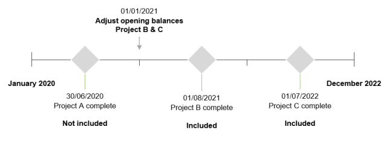

# 22 - Property, plant and equipment (IAS 16)

[返回目录](README.md)

# 22 - Property, plant and equipment (IAS 16)

Contents

- [22 - Property, plant and equipment (IAS 16)](39.md#s140-chap_22_toc_h1)

- [Introduction and scope (paras 22.1- 22.15)](39.md#s141-chap_22_navPoint_1)

- [Scope](39.md#s141-chap_22_navPoint_2)

- [Initial recognition](39.md#s141-chap_22_navPoint_3)

- [Measurement of cost (paras 22.16 - 22.64)](39.md#s142-chap_22_navPoint_4)

- [Decommissioning costs](39.md#s142-chap_22_navPoint_5)

- [Changes in estimate of decommissioning obligations](39.md#s142-chap_22_navPoint_idp1714665448)

- [Cost – treatment of variable or contingent consideration for the purchase of property, plant and equipment](39.md#s142-chap_22_navPoint_6)

- [Deferred payment terms](39.md#s142-chap_22_navPoint_7)

- [Government grants](39.md#s142-chap_22_navPoint_8)

- [Assets acquired in a non-cash exchange](39.md#s142-chap_22_navPoint_9)

- [Capitalisation of borrowing costs](39.md#s142-chap_22_navPoint_10)

- [Qualifying assets](39.md#s142-chap_22_navPoint_idp1695656792)

- [Borrowing costs](39.md#s142-chap_22_navPoint_idp1695660120)

- [Cost incurred subsequent to initial recognition](39.md#s142-chap_22_navPoint_11)

- [Major inspections or overhauls](39.md#s142-chap_22_navPoint_idp1684312072)

- [Measurement subsequent to initial recognition (paras 22.65-22.102)](39.md#s143-chap_22_navPoint_12)

- [Applying the revaluation model](39.md#s143-chap_22_navPoint_13)

- [Treatment of accumulated depreciation under revaluation model](39.md#s143-chap_22_navPoint_14)

- [Revaluation gains](39.md#s143-chap_22_navPoint_idp1718498936)

- [Revaluation losses](39.md#s143-chap_22_navPoint_idp1718511608)

- [Revaluation and deferred tax](39.md#s143-chap_22_navPoint_15)

- [Depreciation](39.md#s143-chap_22_navPoint_16)

- [Definition of depreciation](39.md#s143-chap_22_navPoint_idp1718538488)

- [Depreciation of components](39.md#s143-chap_22_navPoint_idp1718553976)

- [Determining useful life](39.md#s143-chap_22_navPoint_idp1718425976)

- [Determining residual value](39.md#s143-chap_22_navPoint_idp1714681832)

- [Methods of depreciation](39.md#s143-chap_22_navPoint_17)

- [Depreciation of revalued assets](39.md#s143-chap_22_navPoint_18)

- [Change in estimate of useful life](39.md#s143-chap_22_navPoint_19)

- [Change in estimate of residual value](39.md#s143-chap_22_navPoint_20)

- [Change in depreciation method](39.md#s143-chap_22_navPoint_21)

- [Impairment and derecognition of property, plant and equipment (paras 22.103 - paras 22.110)](39.md#s144-chap_22_navPoint_22)

- [Compensation for impairment losses](39.md#s144-chap_22_navPoint_23)

- [De-recognition of property, plant and equipment](39.md#s144-chap_22_navPoint_24)

- [Intended disposals of property, plant and equipment](39.md#s144-chap_22_navPoint_idp1714638312)

- [Disclosures (paras 22.111 - 22.115)](39.md#s145-chap_22_navPoint_25)

- [Illustrative text](39.md#s146-chap_22_navPoint_26)

- [EX 22.14.1 – Replacement roof as a component](39.md#s146-chap_22_navPoint_27)

- [EX 22.14.2 – Component depreciation of an asset that requires periodic replacement](39.md#s146-chap_22_navPoint_28)

- [FAQ 22.18.1 - How should an entity account for the depreciation of leasehold land during the construction of a new building?](39.md#s146-chap_22_navPoint_29)

- [FAQ 22.18.2 - How should the entity account for the depreciation of a newly leased store when an entity develops the initial leasehold improvements?](39.md#s146-chap_22_navPoint_30)

- [EX 22.19.1 – Capitalisation of directly attributable costs](39.md#s146-chap_22_navPoint_31)

- [FAQ 22.20.1 – What employee benefit costs can be capitalised as part of a self-constructed asset?](39.md#s146-chap_22_navPoint_32)

- [FAQ 22.20.1.1 – How are costs allocated to output generated before an item of PP&amp;E is ready for its intended use measured?](39.md#s146-chap_22_navPoint_33)

- [FAQ 22.20.2 – What employee benefit costs can be capitalised for acquired or self-constructed assets?](39.md#s146-chap_22_navPoint_34)

- [FAQ 22.20.3 – What professional fees can be capitalised?](39.md#s146-chap_22_navPoint_35)

- [FAQ 22.20.3.1 – What retrospective adjustments are required at the date when the amendment to IAS 16 becomes effective (that is, annual reporting periods beginning on or after 1 January 2022)?](39.md#s146-chap_22_navPoint_36)

- [FAQ 22.20.4 – What directly attributable labour costs should be capitalised?](39.md#s146-chap_22_navPoint_37)

- [EX 22.20.5 – Exposure draft on amendments to IAS 16: proceeds before intended use](39.md#s146-chap_22_navPoint_38)

- [FAQ 22.20.5 – What factors should entities consider in determining when an item of PP&amp;E is ready for its intended use if the entity is generating output during the development phase?](39.md#s146-chap_22_navPoint_39)

- [EX 22.21.1 – Capitalisation of feasibility costs](39.md#s146-chap_22_navPoint_40)

- [FAQ 22.21.2 – Can start-up costs be capitalised?](39.md#s146-chap_22_navPoint_41)

- [FAQ 22.21.3 – Can overheads be capitalised as part of the cost of property, plant and equipment?](39.md#s146-chap_22_navPoint_42)

- [EX 22.22.1 – Operating costs incurred in the start-up period](39.md#s146-chap_22_navPoint_43)

- [FAQ 22.22.2 – Can initial operating losses be capitalised?](39.md#s146-chap_22_navPoint_44)

- [FAQ 22.22.3 – Temporary relocation costs](39.md#s146-chap_22_navPoint_45)

- [FAQ 22.22.4 – Can site development costs be capitalised?](39.md#s146-chap_22_navPoint_46)

- [FAQ 22.22.5 – What costs can be capitalised during the start-up phase of a mobile network?](39.md#s146-chap_22_navPoint_47)

- [EX 22.26.1 – Remediation expenses for a lease](39.md#s146-chap_22_navPoint_48)

- [EX 22.26.2 – Decommissioning and restoration obligations](39.md#s146-chap_22_navPoint_49)

- [FAQ 22.28.1 – How do you determine the amount of a decommissioning provision to be capitalised as an asset?](39.md#s146-chap_22_navPoint_50)

- [EX 22.28.2 – Decommissioning costs arising later in the asset’s life](39.md#s146-chap_22_navPoint_51)

- [EX 22.37.1 – Consideration received including both non-monetary and monetary assets](39.md#s146-chap_22_navPoint_52)

- [FAQ 22.38.1 – When does an exchange of assets have substance?](39.md#s146-chap_22_navPoint_54)

- [EX 22.39.1 – Exchange of assets that lack commercial substance](39.md#s146-chap_22_navPoint_55)

- [EX 22.49.1 – Capitalised interest in hyper-inflation](39.md#s146-chap_22_navPoint_56)

- [FAQ 22.49.2 – Is it appropriate to capitalise as borrowing costs the gains and losses on derivative instruments (for example, interest rate swaps and foreign currency swaps) that have not been designated in a hedging relationship under IFRS 9 or IAS 39?](39.md#s146-chap_22_navPoint_57)

- [FAQ 22.49.3 – Should the effects of a cash flow or fair value hedging relationship on interest for a specific project borrowing be capitalised into the cost of the property, plant and equipment?](39.md#s146-chap_22_navPoint_58)

- [FAQ 22.49.4 – Does management have to capitalise the modification gain or loss on a borrowing to property, plant and equipment under IAS 23?](39.md#s146-chap_22_navPoint_59)

- [EX 22.51.1 – Measurement of foreign exchange differences for capitalisation as borrowing costs](39.md#s146-chap_22_navPoint_60)

- [EX 22.51.2 – Exchange differences on foreign currency borrowings](39.md#s146-chap_22_navPoint_61)

- [EX 22.53.1 – Capitalisation of specific borrowing costs](39.md#s146-chap_22_navPoint_62)

- [EX 22.53.2 – How to treat gearing when capitalising borrowing costs into property, plant and equipment](39.md#s146-chap_22_navPoint_63)

- [EX 22.53.3 – Calculation of borrowing costs when there are specific and general borrowings](39.md#s146-chap_22_navPoint_64)

- [EX 22.55.1 – Qualifying asset constructed by a third party](39.md#s146-chap_22_navPoint_65)

- [EX 22.58.1 – Period of capitalisation](39.md#s146-chap_22_navPoint_66)

- [EX 22.58.2 – Capitalisation during interruption in construction activities](39.md#s146-chap_22_navPoint_67)

- [FAQ 22.58.3 – What is considered to be an ‘extended period’ for the purpose of suspending capitalisation of borrowing costs in terms of IAS 23?](39.md#s146-chap_22_navPoint_68)

- [FAQ 22.59.1 – When is an asset ‘ready for use’?](39.md#s146-chap_22_navPoint_69)

- [EX 22.60.1 – Interest capitalisation for an asset constructed in phases](39.md#s146-chap_22_navPoint_70)

- [EX 22.60.2 – Interest capitalisation for an asset completed in phases](39.md#s146-chap_22_navPoint_71)

- [EX 22.60.3 – Borrowing costs on land](39.md#s146-chap_22_navPoint_72)

- [FAQ 22.60.4 – Where funds are borrowed specifically to finance construction of an apartment building considered to be inventory, does this arrangement give rise to a qualifying asset on which interest can be capitalised?](39.md#s146-chap_22_navPoint_73)

- [EX 22.61.1 - Capitalisation of additional costs incurred to develop property, plant and equipment and investment property as a result of a government regulation triggered by a significant event](39.md#s146-chap_22_navPoint_74)

- [EX 22.62.1 – Initial costs of safety or environmental regulation equipment](39.md#s146-chap_22_navPoint_75)

- [EX 22.62.2 – Capitalising the cost of remodelling a supermarket](39.md#s146-chap_22_navPoint_76)

- [EX 22.62.3 – Subsequent expenditure and probable future economic benefits](39.md#s146-chap_22_navPoint_77)

- [EX 22.64.1 – Mandatory inspection and overhaul as a component](39.md#s146-chap_22_navPoint_78)

- [EX 22.66.1 – Asset classes](39.md#s146-chap_22_navPoint_79)

- [EX 22.71.1 – Defining asset classes for the purposes of applying the revaluation model](39.md#s146-chap_22_navPoint_80)

- [FAQ 22.71.2 – How does a business combination affect period revaluation of fixed assets?](39.md#s146-chap_22_navPoint_81)

- [EX 22.74.1 – Treatment of gross cost and accumulated depreciation in revaluation model](39.md#s146-chap_22_navPoint_82)

- [EX 22.74.2 – Treatment of accumulated depreciation when asset is revalued](39.md#s146-chap_22_navPoint_83)

- [EX 22.77.1 – Treatment of a revaluation decrease](39.md#s146-chap_22_navPoint_84)

- [EX 22.80.1 – Depreciation of restoration obligation and cost of land](39.md#s146-chap_22_navPoint_85)

- [EX 22.83.1 – Omission of depreciation for certain assets](39.md#s146-chap_22_navPoint_86)

- [EX 22.83.2 – Depreciation when replacement expenditures equal annual depreciation charge](39.md#s146-chap_22_navPoint_87)

- [EX 22.84.1 – Capitalisation of depreciation as part of the cost of an asset](39.md#s146-chap_22_navPoint_88)

- [EX 22.84.2 – Depreciation charge absorbed in the production of another asset](39.md#s146-chap_22_navPoint_89)

- [EX 22.87.1 – Depreciable components of land](39.md#s146-chap_22_navPoint_90)

- [EX 22.89.1 – Depreciation charged from when an asset is ready for use](39.md#s146-chap_22_navPoint_91)

- [EX 22.89.2 – Depreciation when an asset is in use](39.md#s146-chap_22_navPoint_92)

- [EX 22.89.3 – Period of depreciation](39.md#s146-chap_22_navPoint_93)

- [EX 22.89.4 – Useful life of leasehold improvements](39.md#s146-chap_22_navPoint_94)

- [FAQ 22.92.1 – Can an entity stop depreciating an asset if it is idle?](39.md#s146-chap_22_navPoint_95)

- [EX 22.94.1 – Depreciation methods](39.md#s146-chap_22_navPoint_96)

- [EX 22.94.2 – Can an entity change to a ‘units of production method’ for calculating depreciation?](39.md#s146-chap_22_navPoint_97)

- [EX 22.98.1 – Determining appropriate depreciation method](39.md#s146-chap_22_navPoint_98)

- [EX 22.99.1 – Basis of depreciation for revalued assets](39.md#s146-chap_22_navPoint_99)

- [EX 22.100.1 – Change in estimate of useful life](39.md#s146-chap_22_navPoint_100)

- [EX 22.100.2 – Reduction in useful life of acquired fixed asset](39.md#s146-chap_22_navPoint_101)

- [FAQ 22.100.3 – How do climate-related factors affect the useful life and residual value of assets?](39.md#s146-chap_22_navPoint_102)

- [EX 22.101.1 – Revising the residual value of an asset](39.md#s146-chap_22_navPoint_103)

- [EX 22.104.1 – Gain on replacement of insured assets](39.md#s146-chap_22_navPoint_104)

- [EX 22.105.1 – Uncertainty of insurance recovery](39.md#s146-chap_22_navPoint_105)

This eBook is licensed to peggy so, peggy.so@hk.ey.com, 

## Introduction and scope (paras 22.1- 22.15)

 

**22.1** This chapter addresses the IFRS requirements for property, plant and equipment as follows:

- Initial recognition and measurement of property, plant and equipment.

- Measurement subsequent to initial recognition, including the cost and revaluation models.

- Depreciation.

- De-recognition.

- Disclosures.

Impairment of property, plant and equipment is addressed by IAS 36 (see [chapter 24 para 3](41.md#s154-Para_24.3)). Fair value is addressed in IFRS 13 ([see chapter 5 para 1](11.md#s32-Para_5.1)).

**22.2** Initial recognition and measurement, subsequent measurement including revaluation, depreciation and impairment, de-recognition and disclosures are addressed in IAS 16, ‘Property, plant and equipment’.

[IAS 16 para 1].

**22.3**Borrowing costs directly attributable to the acquisition, construction or production of a qualifying asset form part of the cost of that asset. Qualifying assets are primarily property, plant and equipment.

[IAS 23 para 1].

**22.4** The initial estimate of the costs of decommissioning, restoration or similar activity arising from the acquisition of an item of property, plant and equipment, or as a consequence of having used the item during a particular period for purposes other than to produce inventories are also included in the cost of an item of property, plant and equipment. IFRIC 1, ‘Changes in existing decommissioning, restoration and similar liabilities’, provides guidance on accounting for changes in decommissioning and restoration provisions, including capitalisation of estimated costs.

[IFRIC 1 para 2].

**22.5** Computer software that is integral to machinery or other fixed assets is treated as property, plant and equipment. This would include the operating system of a computer. Software that is not an integral part of the related hardware is treated as an intangible asset.

[IAS 38 para 4].

 

### Scope

 

**22.6** Property, plant and equipment are defined as:

“… tangible items that:

- are held for use in the production or supply of goods or services, for rental to others, or for administrative purposes; and

- are expected to be used during more than one period.”

[IAS 16 para 6].

**22.7** Property, plant and equipment are accounted for under IAS 16, except where another IFRS requires or permits a different accounting treatment.

[IAS 16 para 2].

**22.8** The standard does not apply to:

- Biological assets related to agricultural activity other than bearer plants.([See chapter 33 para 4](58.md#s236-Para_33.4)).

- Recognition and measurement of exploration and evaluation assets.

- Mineral rights and mineral reserves such as oil, natural gas and similar non-regenerative resources.

- Property, plant and equipment classified as held for sale in accordance with IFRS 5.

However, the standard does apply to property, plant and equipment used to develop or maintain the assets listed in (a) to (c).

[IAS 16 para 3].

**22.9** Assets acquired under a lease are recognised and measured based on the guidance in IFRS 16. A lessee applies the depreciation requirements in IAS 16 in depreciating the right-of-use asset.

[IFRS 16 para 31].

**22.10** An entity that uses the cost model for investment property under IAS 40 applies IAS 16.

[IAS 16 para 5].

 

### Initial recognition

 

**22.11**An item of property, plant and equipment is recognised as an asset if:

- “it is probable that future economic benefits associated with the item will flow to the entity; and

- the cost of the item can be measured reliably.”

[IAS 16 para 7].

**22.12**Sufficient certainty that future economic benefits will flow to the entity is normally achieved only when the risks and rewards of the asset have passed to the entity. Normally, the transfer of risks and rewards is assumed to occur when an unconditional and irrevocable contract is in place. In practice, the transfer of risks and rewards often occurs when the asset is delivered. Contractual commitments for the acquisition of property, plant and equipment are disclosed, but the asset is not recognised until the transfer of risks and rewards has occurred. Property, plant and equipment might be acquired that, by themselves, might not generate economic benefits, but are necessary to enable other assets to do so. This might include assets necessary to ensure safety or to comply with environmental regulations. These should be recognised as assets because they enable other assets to generate economic benefits. The carrying amount of those assets should be reviewed for impairment to ensure that the combined carrying amount does not exceed their combined recoverable amount (see [chapter 24 para 6](41.md#s154-Para_24.6)).

[IAS 16 para 11]. [IAS 16 para 74(c)].

**22.13** Judgement is required when determining the unit of account (that is, how individual items are identified and the extent to which items are aggregated). These judgements might include whether individual items are aggregated or whether large items should be recognised as separate components. It might be appropriate to aggregate individually insignificant items of property, plant and equipment, such as moulds, tools and dies, and to apply the recognition criteria to the aggregate value.

[IAS 16 para 9].

**22.14**Disaggregation or componentisation is the separation of an asset into its significant components. Each component of an item of property, plant and equipment that has a cost that is significant in relation to the total cost of the item is depreciated separately if the component is consumed in a different manner or over a different time period to the rest of the asset. An aircraft and its engines, for example, would often be assessed as separate components and depreciated separately.

[IAS 16 para 43].

[EX 22.14.1 – Replacement roof as a component](39.md#s146-EX22.14.1)  
  
[EX 22.14.2 – Component depreciation of an asset that requires periodic replacement](39.md#s146-EX22.14.2)

**22.15** Spare parts and servicing equipment are normally treated as inventory and expensed as consumed. However, major spare parts and stand-by equipment are treated as property, plant and equipment where they meet the definition of property, plant and equipment.

[IAS 16 para 8].

 

This eBook is licensed to peggy so, peggy.so@hk.ey.com, 

## Measurement of cost (paras 22.16 - 22.64)

 

**22.16**Items of property, plant and equipment that qualify for recognition should be initially measured at cost.

[IAS 16 para 15].

**22.17**Cost is defined as “... the amount of cash or cash equivalents paid or the fair value of the other consideration given to acquire an asset at the time of its acquisition or construction or, where applicable, the amount attributed to that asset when initially recognised in accordance with the specific requirements of other IFRSs, for example, IFRS 2 Share-based Payment”. (See [chapter 13 para 14](24.md#s88-Para_13.14).)

[IAS 16 para 6].

**2****2.18** Cost includes the costs of acquiring or constructing the asset and costs incurred subsequently to add to or replace part of the asset. In addition, cost of an item of property, plant and equipment could include costs incurred relating to leases of assets that are used to construct, add to, replace part of or service an item of property, plant and equipment, such as depreciation of right-of-use assets.

[IAS 16 para 10].

[FAQ 22.18.1 - How should an entity account for the depreciation of leasehold land during the construction of a new building?](39.md#s146-FAQ_22.18.1)  
[FAQ 22.18.2 - How should the entity account for the depreciation of a newly leased store when an entity develops the initial leasehold improvements?](39.md#s146-FAQ_22.18.2)

**22.19** Cost is usually the price paid. The cost of a self-constructed asset is the aggregate of the cost of material, labour and other inputs used in the construction. The cost of an item of property, plant and equipment comprises:

- The purchase price, including import duties and non-refundable purchase taxes less any trade discounts and rebates.

- Directly attributable costs of bringing the asset to the location and condition necessary for it to be capable of operating in the manner intended by management.

- The initial estimate of the costs of dismantling and removing the item and restoring the site on which it is located (decommissioning obligations) if the obligation is incurred either when the item is acquired or as a consequence of having used the item during a particular period for purposes other than to produce inventories during that period.

- Borrowing costs on qualifying assets.

[IAS 16 para 16].

[EX 22.19.1 – Capitalisation of directly attributable costs](39.md#s146-EX22.19.1)

**22.20** Examples of directly attributable costs are:

- The cost of employee benefits as defined in IAS 19 that arise directly from the construction or acquisition of the item.

- The costs of site preparation.

- Initial delivery and handling costs.

- Installation and assembly costs.

- Professional fees.

- Costs of testing whether the asset is working properly (commissioning costs), after deducting the net proceeds of sale of any items produced while bringing the asset to the location and condition necessary for it to be capable of operating in the manner intended by management (such as samples produced during testing).

[IAS 16 para 17].

[FAQ 22.20.1 – What employee benefit costs can be capitalised as part of a self-constructed asset?](39.md#s146-FAQ_22.20.1)  
  
[FAQ 22.20.2 – What employee benefit costs can be capitalised for acquired or self-constructed assets? ](39.md#s146-FAQ_22.20.2)  
  
[FAQ 22.20.3 – What professional fees can be capitalised? ](39.md#s146-FAQ_22.20.3)  
  
[FAQ 22.20.4 – What directly attributable labour costs should be capitalised?](39.md#s146-FAQ_22.20.4)  
  
[EX 22.20.5 – Exposure draft on amendments to IAS 16: proceeds before intended use](39.md#s146-EX22.20.5)

Amendment effective for annual periods beginning on or after 1 January 2022 (subject to any endorsement process). Earlier application is permitted with disclosure of that fact. New text is underlined and deleted text struck-through:

  

**22.20** Examples of directly attributable costs are:

- The cost of employee benefits as defined in IAS 19 that arise directly from the construction or acquisition of the item.

- The costs of site preparation.

- Initial delivery and handling costs.

- Installation and assembly costs.

- Professional fees.

- Costs of testing whether the asset is functioning properly (that is, assessing whether the technical and physical performance of the asset is such that it is capable of being used in the production or supply of goods or services, for rental to others, or for administrative purposes). working properly (commissioning costs), after deducting the net proceeds of sale of any items produced while bringing the asset to the location and condition necessary for it to be capable of operating in the manner intended by management (such as samples produced during testing)

[IAS 16 para 17].

[FAQ 22.20.1 – What employee benefit costs can be capitalised as part of a self-constructed asset?](39.md#s146-FAQ_22.20.1)  
  
[FAQ 22.20.2 – What employee benefit costs can be capitalised for acquired or self-constructed assets? ](39.md#s146-FAQ_22.20.2)  
  
[FAQ 22.20.3 – What professional fees can be capitalised? ](39.md#s146-FAQ_22.20.3)  
  
[FAQ 22.20.4 – What directly attributable labour costs should be capitalised?](39.md#s146-FAQ_22.20.4)  
  
EX 22.20.5 – Exposure draft on amendments to IAS 16: proceeds before intended use

[FAQ 22.20.5 – What factors should entities consider in determining when an item of PP&amp;E is ready for its intended use if the entity is generating output during the development phase?](39.md#s146-FAQ_22.20.5)

**22.20.1** Any proceeds received from selling items produced while the entity is preparing the asset for its intended use (for example, the proceeds from selling samples produced when testing a machine to see if it is functioning properly) are not deducted from the costs of the asset. The proceeds from the sales of such products and the related costs should be recognised in profit or loss. The entity should measure the cost of the products sold during testing, applying the normal measurement requirements in IAS 2, except that the cost will not include depreciation of the asset being tested.

[IAS 16 para 20A].

[FAQ 22.20.1.1 – How are costs allocated to output generated before an item of PP&amp;E is ready for its intended use measured?](39.md#s146-FAQ_22.20.1.1)

**22.20.2** These amendments were added by ‘Property, Plant and Equipment – Proceeds before Intended Use’ (Amendments to IAS 16) (issued May 2020) and are applicable for annual reporting periods beginning on or after 1 January 2022. Earlier application is permitted, with disclosure of that fact.

[IAS 16 para 81N].

**22.20.3** The amendments should be applied retrospectively, but only to those items of property, plant and equipment which are ready for use, in the location and condition necessary for them to be capable of operating in the manner intended by management, on or after the beginning of the earliest period presented in the financial statements when the amendment is applied. The amendment does not apply to property, plant and equipment that was ready for use before the beginning of the earliest period presented. The cumulative effect of initially applying the amendments will be recognised as an adjustment to the opening balance of retained earnings (or other component of equity, as appropriate) at the beginning of that earliest period presented.

[IAS 16 para 80D].

[FAQ 22.20.3.1 – What retrospective adjustments are required at the date when the amendment to IAS 16 becomes effective (that is, annual reporting periods beginning on or after 1 January 2022)?](39.md#s146-FAQ_22.20.3.1)

  

**22.21**Only costs that are directly attributable can be capitalised. Many costs incurred in start-up situations (such as opening a new mine or a manufacturing or retailing operation) must be expensed. Costs that are not ‘directly attributable’, and cannot be capitalised as described in the standard, are as follows:

- Costs of opening a new facility.

- Costs of introducing a new product or service (including costs of advertising and promotional activities).

- Costs of conducting business in a new location or with a new class of customer (including costs of staff training).

- Administration and other general overhead costs.

[IAS 16 para 19].

[EX 22.21.1 – Capitalisation of feasibility costs](39.md#s146-EX22.21.1)  
  
[FAQ 22.21.2 – Can start-up costs be capitalised?](39.md#s146-FAQ_22.21.2)  
  
[FAQ 22.21.3 – Can overheads be capitalised as part of the cost of property, plant and equipment?](39.md#s146-FAQ_22.21.3)

**22.22** Directly attributable costs can be capitalised only until the asset is “capable of operating in the manner intended by management”. If an asset is purchased or constructed and can operate in that manner immediately, but is not brought into use immediately, costs incurred while the asset is standing idle cannot be capitalised. Costs that might fall into this category are as follows:

- Costs incurred while an item that is capable of operating in the manner intended by management has yet to be brought into use or is operated at less than full capacity.

- Initial operating losses, such as might be incurred while demand for an item’s output builds up.

- Costs of relocating or reorganising part or all of an entity’s operations.

[IAS 16 para 20].

[EX 22.22.1 – Operating costs incurred in the start-up period](39.md#s146-EX22.22.1)  
  
[FAQ 22.22.2 – Can initial operating losses be capitalised?](39.md#s146-FAQ_22.22.2)  
  
[FAQ 22.22.3 – Temporary relocation costs](39.md#s146-FAQ_22.22.3)  
  
[FAQ 22.22.4 – Can site development costs be capitalised?](39.md#s146-FAQ_22.22.4)  
  
[FAQ 22.22.5 – What costs can be capitalised during the start-up phase of a mobile network?](39.md#s146-FAQ_22.22.5)

**22.23**The cost of a self-constructed asset is determined using the same principles as for an acquired asset. Any internal profits are eliminated in arriving at such cost. The cost of abnormal amounts of wasted material, labour or other resources incurred in the production of a self-constructed asset are not included in the cost of the asset. Other specific types of abnormal costs that would also be excluded are costs related to design errors, industrial disputes, idle capacity and production delays.

[IAS 16 para 22].

**22.24** Constructing or acquiring a new asset might result in other incremental costs that would have been avoided only if the asset had not been constructed or acquired. These should not be included in the cost of the asset if they do not bring the asset into the location and condition necessary for it to be capable of operating in the manner intended by management. The costs of retraining employees, in particular, cannot be capitalised, because the entity does not have control over the employees and so the recognition criteria are not met.

[IAS 16 para 19(c)].

**22.25** An item of property, plant and equipment can be put to an alternative use during construction or development activity. An example is the use of a construction site as a car park until construction begins. These incidental operations are not necessary to bring the asset to the location and condition necessary for it to be capable of operating in the manner intended by management. Any revenue and costs attributable to such incidental operations are recognised in profit and loss.

[IAS 16 para 21].

 

**Re****lated information**

### Decommissioning costs

 

**22.26** Decommissioning costs are included in the cost of an item of property, plant and equipment if there is a corresponding obligation recognised as a provision under IAS 37, Appendix C, Example 3. The entity might have an obligation as a direct consequence of acquiring or constructing property, plant and equipment to incur further costs that it cannot avoid. The decommissioning costs to be paid at the end of the asset’s life are as much a cost of acquiring or constructing the asset as the costs incurred at the start of the asset’s life.

[IAS 16 para 16(c)].

[EX 22.26.1 – Remediation expenses for an operating lease](39.md#s146-EX22.26.1)  
  
[EX 22.26.2 – Decommissioning and restoration obligations](39.md#s146-EX22.26.2)

 

#### Changes in estimate of decommissioning obligations

 

**22.27** There are often changes in the initial and subsequent estimates of decommissioning costs of an asset, particularly where asset lives are long. These changes in estimate could be due to changes in legislation, inflation, technology, the timing of the decommissioning, or other factors. Changes in the measurement of decommissioning liabilities, and changes in the discount rate for assets accounted for under the cost model, are broadly added to or deducted from the cost of the related asset in the period of the change in estimate for assets accounted for under the cost model.

[IFRIC 1 para 5].

**22.28** Changes in the measurement of decommissioning liabilities and related discount rates for assets accounted for under the revaluation model are recognised as changes to the revaluation surplus in OCI unless they represent an impairment charge. Impairments are recognised in the income statement.

[IFRIC 1 para 6].

[FAQ 22.28.1 – How do you determine the amount of a decommissioning provision to be capitalised as an asset?](39.md#s146-FAQ_22.28.1)  
  
[EX 22.28.2 – Decommissioning costs arising later in the asset’s life](39.md#s146-EX22.28.2)

**22.29** The amount of any deduction cannot exceed the asset’s carrying amount. Any deduction that would give rise to a ‘negative asset’ is immediately recognised in the income statement. Additions increase the carrying amount of existing assets, and the entity should assess if there are impairment indicators and test the asset accordingly.

[IFRIC 1 para 5].

**22.30**The adjusted depreciable amount of the asset is depreciated over its remaining useful life. Once the asset has reached the end of its useful life (that is, when it is no longer being used by the entity), changes in the decommissioning or restoration liability are recognised in profit and loss as they occur. This applies irrespective of whether the assets are measured using the cost or the revaluation model.

[IFRIC 1 para 7].

**22.31**The periodic unwinding of the discount is not a borrowing cost for the purpose of IAS 23 and does not qualify for capitalisation under IAS 23. It is charged to the income statement as a finance cost as it occurs.

[IFRIC 1 para 8].

 

### Cost – treatment of variable or contingent consideration for the purchase of property, plant and equipment

 

**22.32** An entity might acquire property, plant and equipment for an initial payment plus additional payments that are contingent on future events or outcomes, or on the ultimate sale of the acquired asset above a threshold price. Usually, the entity will be contractually or statutorily obliged to make the additional payment if the future event occurs or the condition is met. This is often described as 'variable' or 'contingent' consideration for an asset.

 

The accounting for contingent consideration to acquire an asset has been discussed by the IFRS IC. The IC determined that this issue is too broad, and it did not add the issue to its agenda. In particular, it was unable to reach a consensus on whether an entity (the purchaser) "recognises a liability at the date of purchasing the asset for variable payments that depend on its future activity or, instead, recognises such a liability only when the related activity occurs". The IC also chose not to clarify, through the agenda decision, the initial accounting for variable payments that are not dependent on the purchaser’s future activity. The IC also noted that it was unable to reach a consensus on how the purchaser measures a liability for such variable payments, and that there are questions about the accounting for variable payments subsequent to the purchase of an asset. The IC suggested that the IASB should address this issue comprehensively.

 

[IFRIC agenda decision – March 2016].

 

**22.33** The arrangement needs to be analysed carefully, to determine whether or not the future payment is related to the cost of the asset. Payments which are not related to the cost of the asset should be expensed as incurred. The IC decided not to provide guidance in the form of an interpretation or an agenda decision that explains how the existing guidance is applied. As a result, there is no IFRS that applies specifically to this transaction. An entity should therefore follow IAS 8, 'Accounting policies, changes in accounting estimates and errors', to develop a policy for contingent consideration to acquire property, plant and equipment if it is determined that the future payment relates to the cost of the asset. There is diversity in practice in accounting for contingent consideration of an asset, with three possible approaches.

 

1) Financial liability model  
Property, plant and equipment is initially recognised including the fair value of the future contingent payments, and a financial liability is recognised at the same fair value of contingent payments. Subsequently, the financial liability is measured at amortised cost, following the requirements of IFRS 9. The entity should adjust the carrying amount of the financial liability to reflect actual and updated estimated cash flows whenever the cash flow estimates are revised. The entity recalculates the carrying amount of the liability by computing the present value of estimated future cash flows at the financial instrument’s original effective interest rate or, where applicable, the revised effective interest rate calculated in accordance with paragraph B5.4.6 of IFRS 9. Subsequent changes in the measurement of the liability are unrelated to the cost of the asset. The adjustment is therefore recognised in profit or loss as income or expense.

2) Cost accumulation model

Property, plant and equipment is initially recognised, at the date of acquisition, at the amount of consideration paid. [IAS 16 para 16]. Variable payments contingent on future events are not included in the carrying amount of the asset on day 1, and no liability is recognised for these payments. The entity does not recognise a liability because, following the agenda decision, it is not clear that there is an obligation before the uncertainty is resolved. The IC also noted, in the 2016 agenda decision, that there are unanswered questions about the accounting for subsequent payments. An entity could therefore choose to capitalise the variable payments as part of the cost of the asset when paid, on the basis that these payments represent the direct cost of acquisition. This treatment is typically only acceptable if a change in the variable payment is as a consequence of the utility of the asset. If the variation is as a consequence of another factor not associated with the asset, the accounting for that aspect of the variable payment would generally follow the applicable guidance in IFRS.

3) IFRIC 1 approach

Property, plant and equipment is initially recognised, at the date of acquisition including, an estimate for the future anticipated variable costs. A liability will be recognised at the same time. The liability is subsequently measured at amortised cost, in a similar way to approach 1 above. However, subsequent changes in the liability will be recognised against the cost of the asset. This treatment is typically only acceptable if a change in the variable payment is as a consequence of the utility of the asset. If the variation is as a consequence of another factor not associated with the asset, the change in cost would generally follow the applicable IFRS guidance.

 

When accounting for variable or contingent consideration, all approaches are acceptable. This is a policy choice that should be applied consistently to all similar transactions and appropriately disclosed.

 

[IFRIC 1 para 4]. [IFRIC 1 para 5].

 

### Deferred payment terms

 

**22.34** The cost of an item of property, plant and equipment is the cash price equivalent at the date when the asset is recognised. An item of property, plant and equipment could be acquired on payment terms that are deferred beyond normal credit terms. The cost, in those circumstances, is the discounted amount, being the cash price equivalent. The difference between this amount and the total payments is treated as interest payable over the period of credit, unless it is capitalised during the period of construction in accordance with IAS 23.

[IAS 16 para 23].

**[The next paragraph is 22.36.]**

 

### Government grants

**22.36** The carrying amount of assets can be reduced by the amount of any related government grants. Government grants are dealt with in IAS 20. (See [chapter 17 para 14](37.md#s129-Para_17.14).)

[IAS 16 para 28].

### Assets acquired in a non-cash exchange

 

**22.37** An item of property, plant and equipment could be acquired in exchange for another non-monetary asset or for a combination of non-monetary and monetary assets. The cost of the acquired item is measured at fair value, unless the transaction has no commercial substance or the fair value of neither the asset received nor the asset given up can be reliably measured. Fair value is adjusted by the amount of the monetary assets given up or received. If the acquired item is not measured at fair value, it is measured at the carrying amount of the asset given up.

[IAS 16 para 24].

[EX 22.37.1– Consideration received including both non-monetary and monetary assets](39.md#s146-EX22.37.1)

**22.38** A transaction has commercial substance if the entity’s future cash flows are expected to change as a result of the transaction. Exchange transactions will have a business purpose, and the exchange of assets that are not identical is likely to result in a change in the entity’s cash flows. If the expected difference in the cash flows is significant, the exchange has commercial substance.

[IAS 16 para 25].

[FAQ 22.38.1 – When does an exchange of assets have substance?](39.md#s146-FAQ_22.38.1)

**22.39** Commercial substance will often be clear without the entity having to perform detailed calculations. Swapping commodities in different locations or exchanging similar assets are FAQs of where the cash flow change test will not be met.

[IAS 16 para 25].

[EX 22.39.1 – Exchange of assets that lack commercial substance](39.md#s146-EX22.39.1)

**22.40** The fair value of an asset is reliably measurable if (a) the variability in the range of reasonable fair value measurements is not significant for that asset or (b) the probabilities of the various estimates within the range can be reasonably assessed and used when measuring fair value. Where both the fair value of the asset given up and the fair value of the asset received can be estimated with equal reliability, the fair value of the asset given up is used to measure the cost of the asset received. However, if the fair value of the asset received can be measured with more reliability, that value is used.

[IAS 16 para 26].

**Cost of donated assets**

**22.41** An asset might, in unusual circumstances, be acquired by an entity through donation or contribution for no consideration and no issuance of shares. There is no specific guidance in IFRS for this type of transaction. The entity should develop an accounting policy and apply it consistently. There are two approaches generally observed in practice: assets are recognised at fair value when the entity obtains control of the asset; or they are recognised at nil value. (See [chapter 17 para 11](37.md#s127-Para_17.11).)

 

### Capitalisation of borrowing costs

 

**22.4****2** Borrowing costs that are attributable to the acquisition, construction or production of a qualifying asset are capitalised as part of the cost of that asset. All other borrowing costs should be expensed in the period incurred.

[IAS 23 para 8].

**22.43** An entity can choose, but is not required, to apply the standard to borrowing costs directly attributable to the acquisition, construction or production of:

- a qualifying asset measured at fair value (for example, a biological asset); or

- inventories that are manufactured, or otherwise produced, in large quantities on a repetitive basis.

[IAS 23 para 4].

**22.44**Borrowing costs are capitalised when all of the following criteria are met:

- the entity has a qualifying asset (that is, an asset that necessarily takes a substantial period of time to get ready for its intended use or sale);

- expenditures have been incurred on the qualifying asset;

- borrowing costs have been incurred; and

- activities are undertaken that are necessary to prepare the asset for its intended use or sale.

[IAS 23 para 17].

 

#### Qualifying assets

**22.45** A qualifying asset is defined as “an asset that necessarily takes a substantial period of time to get ready for its intended use or sale”.

[IAS 23 para 5].

**22.46** Qualifying assets are not limited to property, plant and equipment, but also include assets such as inventories that require a ‘substantial period of time’ to bring them to a saleable condition. An asset that normally takes more than a year to be ready for use will usually be a qualifying asset. Once management chooses the criteria and types of asset, it applies this consistently to those types of asset. Assets that are ready for their intended use or sale when acquired are not qualifying assets.

[IAS 23 para 7].

**22****.47** A service concession arrangement where the operator recognises an intangible asset could also be a qualifying asset. If the operator recognises an intangible asset in exchange for the construction services, it will capitalise borrowing costs incurred during the construction phase.

[IFRIC 12 para 22].

#### Borrowing costs

 

**22.48** Borrowing costs are “interest and other costs that an entity incurs in connection with the borrowing of funds”.

[IAS 23 para 5].

**22.49**Examples of borrowing costs include:

- Interest expense calculated using the effective interest rate method (described in IAS 39).

- Finance charges in respect of leases under IFRS 16.

- Exchange differences arising from foreign currency borrowings to the extent that they are regarded as an adjustment to interest costs.

[IAS 23 para 6].

[EX 22.49.1 – Capitalised interest in hyperinflation](39.md#s146-EX22.49.1)  
[FAQ 22.49.2 – Is it appropriate to capitalise as borrowing costs the gains and losses on derivative instruments (for example, interest rate swaps and foreign currency swaps) that have not been designated in a hedging relationship under IFRS 9 or IAS 39?](39.md#s146-FAQ_22.49.2)  
[FAQ 22.49.3 – Should the effects of a cash flow or fair value hedging relationship on interest for a specific project borrowing be capitalised into the cost of the property, plant and equipment?](39.md#s146-FAQ_22.49.3)  
[FAQ 22.49.4 – Does management have to capitalise the modification gain or loss on a borrowing to property, plant and equipment under IAS 23?](39.md#s146-FAQ_22.49.4)

**22.50** Borrowing costs include finance costs on preferred shares that are classified as liabilities under IAS 32, but exclude the actual or imputed costs (including issue costs) of equity and preferred shares that are not classified as liabilities.

[IAS 23 para 3].

**22.51** Capitalisation of borrowing costs includes capitalising foreign exchange differences relating to borrowings to the extent that they are regarded as an adjustment to interest costs. The gains and losses that are an adjustment to interest costs include the interest rate differential between borrowing costs that would be incurred if the entity borrowed funds in its functional currency, and borrowing costs actually incurred on foreign currency borrowings. Other differences that are not adjustments to interest cost might include changes in foreign currency rates as a result of changes in other economic indicators, such as employment or productivity, or a change in government.

[EX 22.51.1 – Measurement of foreign exchange differences for capitalisation as borrowing costs](39.md#s146-EX22.51.1)  
  
[EX 22.51.2 – Exchange differences on foreign currency borrowings](39.md#s146-EX22.51.2)

**22.52** All directly attributable borrowing costs should be capitalised. ‘Directly attributable’ means those borrowing costs that would have been avoided (for example, by avoiding additional borrowings or by using the funds paid out for the asset to repay existing borrowings) if there had been no expenditure on the asset. A specific borrowing becomes a general borrowing once the related asset is completed and until the specific borrowing is repaid.

[IAS 23 para 8].

**22.53**The standard distinguishes between general borrowings and specific borrowings. All borrowings that are not specific represent general borrowings. The distinction between specific and general relates to how the capitalisation rate is determined. The capitalisation rate for specific borrowings is the effective interest rate of the specific borrowings. The capitalisation rate for general borrowings is the weighted average of the borrowing costs applicable to the borrowings of the entity that are outstanding during the period. However, an entity should exclude from this calculation those borrowing costs that were made specifically for obtaining a qualifying asset, except where substantially all activities to prepare the qualifying asset for its intended use are complete. Costs eligible for capitalisation are calculated by applying a capitalisation rate to the expenditures on qualifying assets. The amount of borrowing costs eligible for capitalisation is always limited to the amount of actual borrowing costs incurred during the period.

[IAS 23 para 10].

[EX 22.53.1 – Capitalisation of specific borrowing costs](39.md#s146-EX22.53.1)  
  
[EX 22.53.2 – How to treat gearing when capitalising borrowing costs into property, plant and equipment](39.md#s146-EX22.53.2)  
  
[EX 22.53.3 – Calculation of borrowing costs when there are specific and general borrowings](39.md#s146-EX22.53.3)

**22.54**A parent entity might have little or no borrowing but have subsidiaries with qualifying assets. A subsidiary can capitalise interest in its separate financial statements, based on borrowings provided by another group entity, in such circumstances. The intra-group interest is eliminated in the consolidated financial statements, however, because the group as a whole has not incurred interest on those borrowings. But, if another group company borrows externally and lends to an entity with qualifying assets, any interest capitalised will remain in consolidation, subject to the overall limit that capitalised borrowing costs cannot exceed the consolidated borrowing costs incurred.

[IAS 23 para 14].

**Period of capitalisation**

**22.55**Three criteria must be met before borrowing costs can be capitalised:

“The commencement date for capitalisation is the date when the entity first meets all of the following conditions:

- it incurs expenditures for the asset;

- it incurs borrowing costs; and

- it undertakes activities that are necessary to prepare the asset for its intended use or sale.”

[IAS 23 para 17].

[EX 22.55.1 – Qualifying asset constructed by a third party](39.md#s146-EX22.55.1)

**22.56**Borrowing costs, both general and specific, are not capitalised in the period before the commencement of the activities necessary to prepare the asset for use. Activities might include technical and administrative work prior to the commencement of physical construction (for example, drawing up site plans and obtaining planning permission). Activities exclude holding the asset where no production or development that changes the asset’s condition is being undertaken.

[IAS 23 para 19].

**22.57**An asset’s construction might span more than one financial period. Borrowing costs capitalised in respect of the asset’s construction in earlier periods are included in the total expenditure on the asset. The capitalisation rate in the current period is then applied to the total expenditure. Previously capitalised interest is included when calculating the expenditures to which a capitalisation rate is applied in the next period.

[IAS 23 para 18].

**22.58** Borrowing costs might be incurred during an extended period in which activities necessary to prepare an asset for its intended use are interrupted. These borrowing costs do not qualify for capitalisation. However, capitalisation continues during periods when substantial technical and administrative work is being carried out. Capitalisation also continues when a temporary delay is a necessary part of the process of preparing an asset for its intended use.

[IAS 23 para 20].

[EX 22.58.1 – Period of capitalisation ](39.md#s146-EX22.58.1)  
  
[EX 22.58.2 – Capitalisation during interruption in construction activities](39.md#s146-EX22.58.2)

[FAQ 22.58.3 –- What is considered to be an ‘extended period’ for the purpose of suspending capitalisation of borrowing costs in terms of IAS 23?](39.md#s146-FAQ_22.58.3)

**22.59** Capitalisation of borrowing costs ceases when the qualifying asset is ready for use. ‘Ready for use’ is when the asset’s physical construction is complete, even though routine administrative work or minor modification might still continue.

[IAS 23 para 22].

[FAQ 22.59.1 – When is an asset ‘ready for use’?](39.md#s146-FAQ_22.59.1)

**22.60** A major qualifying asset or group of assets might be completed in several phases. If a phase or part is capable of being used while construction continues on other parts, capitalisation of borrowing costs ceases on the completed parts.

[IAS 23 para 24].

[EX 22.60.1 – Interest capitalisation for an asset constructed in phases](39.md#s146-EX22.60.1)  
  
[EX 22.60.2 – Interest capitalisation for an asset completed in phases](39.md#s146-EX22.60.2)  
[EX 22.60.3 – Borrowing costs on land](39.md#s146-EX22.60.3)  
[FAQ 22.60.4 – Where funds are borrowed specifically to finance construction of an apartment building considered to be inventory, does this arrangement give rise to a qualifying asset on which interest can be capitalised?](39.md#s146-FAQ_22.60.4)

 

### Cost incurred subsequent to initial recognition

 

**22.61**Recognition of cost ceases once an item of property, plant and equipment is in the location and condition to be used as intended by management. However, an entity might incur further costs on that asset at a later date. Subsequent costs should be capitalised only if they meet the recognition criteria as an asset. All other subsequent costs should be recognised as an expense in the period in which they are incurred.

[IAS 16 para 20].

[EX 22.61.1 - Capitalisation of additional costs incurred to develop property, plant and equipment and investment property as a result of a government regulation triggered by a significant event.](39.md#s146-EX22.61.1)

**22.62** The decision to capitalise or expense involves consideration of the future economic benefits originally expected from the asset. Subsequent costs that merely maintain the economic benefits originally expected are considered repairs and maintenance and are recognised as an expense. Subsequent costs are included in an asset’s carrying amount (or recognised as a separate asset, as appropriate) only when it is probable that additional future economic benefits associated with the item will flow to the entity and the cost of the item can be measured reliably. Additional future economic benefits would normally arise in situations where the subsequent costs result in an increase in productive capacity, an additional ability to generate future economic benefits, or an extension in the expected useful life.

[EX 22.62.1 – Initial costs of safety or environmental regulation equipment](39.md#s146-EX22.62.1)  
  
[EX 22.62.2 – Capitalising the cost of remodelling a supermarket](39.md#s146-EX22.62.2)  
  
[EX 22.62.3 – Subsequent expenditure and probable future economic benefits](39.md#s146-EX22.62.3)

**22.63**The costs of the day-to-day servicing of an item of property, plant and equipment are not recognised as an asset, because they do not add to the future economic benefits of the item. These costs maintain the asset’s potential to deliver the future economic benefits that were expected when the asset was originally acquired. Day-to-day servicing costs include costs of labour and consumables, and might include the cost of small replacement parts. This type of expenditure is often described as ‘repairs and maintenance’.

[IAS 16 para 12].

 

#### Major inspections or overhauls

 

**22.64** The term ‘overhaul’ is frequently used to describe the process of inspecting and maintaining an asset. Overhaul costs typically include replacement of parts and major repairs and maintenance. Major repair and maintenance programmes carried out as part of a periodic inspection and overhaul, and that meet the recognition criteria, might well qualify for recognition as an asset. The cost of each major inspection is recognised as part of the carrying amount of the item of property, plant and equipment as a replacement if it meets the asset recognition criteria in the standard. Any remaining carrying amount relating to the previous inspection is de-recognised. The cost of the previous inspection does not need to have been separately identified and depreciated when the item was acquired or constructed. The estimated cost of a future similar inspection can be used as a proxy for the carrying value that needs to be de-recognised if this was not separately identified previously.

[IAS 16 para 14].

[EX 22.64.1 – Mandatory inspection and overhaul as a component](39.md#s146-EX22.64.1)

 

This eBook is licensed to peggy so, peggy.so@hk.ey.com, 

## Measurement subsequent to initial recognition (paras 22.65-22.102)

 

**22.65** An entity adopts either the cost model or the revaluation model for property, plant and equipment subsequent to initial recognition. The policy choice is by class of assets, not individual assets within a class. An entity might, therefore, have one or more classes of asset on a cost basis, and other classes of asset on the revaluation basis.

[IAS 16 para 29].

**22.66** A class of assets is a grouping of assets of a similar nature and use in an entity’s operations. Revaluation must be applied to an entire class of assets. If a single item of property, plant and equipment is revalued, the entire class of property, plant and equipment to which that item belongs should be revalued. This applies to consolidated financial statements, so that items of property, plant and equipment in the same class across different entities in the group need to be accounted for on a consistent basis.

[IAS 16 para 37].

[EX 22.66.1 – Asset classes](39.md#s146-EX22.66.1)

**22.67** The definition of fixed assets does not permit classes of assets to be determined solely on a geographical basis, but is otherwise reasonably flexible. An entity can adopt meaningful classes that are appropriate to the type of business and assets held by an entity. Separate disclosures must be made, however, for each class of assets, with each class of assets presented as a separate category in the table of movements in the notes to the financial statements.

[IAS 16 para 73].

**22.68** Items of property, plant and equipment under the cost model are carried at cost less accumulated depreciation and accumulated impairment losses.

[IAS 16 para 30].

**22.69** Items of property, plant and equipment under the revaluation model are carried at fair value at the date of revaluation, less any subsequent accumulated depreciation and any subsequent accumulated impairment losses. Revaluations should be carried out with sufficient regularity that the carrying amount does not differ materially from that which would be determined using fair value at the end of the reporting period.

[IAS 16 para 31].

 

### Applying the revaluation model

 

**22.70** Valuations do not need to be performed every year or every reporting period, but they should be performed with sufficient regularity that the carrying amount does not differ materially from fair value at the end of the reporting period.

[IAS 16 para 31].

**22.71** Property, plant and equipment within a single class should all be valued at the same time, to avoid selective revaluation of assets. However, a class of assets can be revalued on a rolling basis, provided that the revaluation is completed within a short period of time and the revaluations are kept up to date.

[IAS 16 para 38].

[EX 22.71.1 – Defining asset classes for the purposes of applying the revaluation model](39.md#s146-EX22.71.1)  
[FAQ 22.71.2 – How does a business combination affect period revaluation of fixed assets?](39.md#s146-FAQ_22.71.2)

**22.72** Frequent valuations might be necessary where fair values are volatile, as might be the case with land and buildings or in hyper-inflationary economies. Where fair values are stable over a long period, as might be the case with plant and machinery, valuations might be required less frequently. The standard suggests that annual revaluations might be needed where there are significant and volatile movements in values. If movements in fair value are insignificant, revaluations every three or five years might be sufficient.

[IAS 16 para 34].

**22.73** Fair value is “the price that would be received to sell an asset or transfer a liability in an orderly transaction between market participants at the measurement date”. ([See chapter 5 para 8.](11.md#s33-Para_5.8)) There is no requirement in IAS 16 to use a third party valuation specialist.

[IFRS 13 para 9].

 

### Treatment of accumulated depreciation under revaluation model

 

**22.74**There are two methods of adjusting the carrying amount of an asset upon revaluation: the ‘gross’ method; and the ‘net’ method. The gross method restates the gross value (before depreciation) of the asset and restates accumulated depreciation as well. The ‘net’ approach eliminates accumulated depreciation against the carrying amount of the asset and then revalues the net carrying amount. The net amount under both approaches should be the same, but the difference is presentation.

[IAS 16 para 35].

[EX 22.74.1 – Treatment of gross cost and accumulated depreciation in revaluation model](39.md#s146-EX22.74.1)  
  
[EX 22.74.2 – Treatment of accumulated depreciation when asset is revalued](39.md#s146-EX22.74.2)

 

**Relat****ed information**

#### Revaluation gains

**22.75** A revaluation surplus is credited to other comprehensive income and accumulated in equity under the heading of revaluation surplus. An exception is a gain on revaluation that reverses a revaluation decrease (impairment) on the same asset previously recognised as an expense. Gains are first credited to the income statement to the extent that the gain reverses a loss previously recognised in the income statement.

[IAS 16 para 39].

**22.76** The revaluation surplus included in equity can be transferred directly to retained earnings when the surplus is realised, usually when the asset is de-recognised. The transfer is made through reserves, not through the income statement. The revaluation surplus can also be transferred as the asset is used by the entity. The amount transferred is the difference between depreciation based on the asset’s revalued carrying amount and depreciation based on the asset’s original cost. This amount can be transferred from revaluation surplus to retained earnings each year, by means of a reserve transfer.

[IAS 16 para 41].

#### Revaluation losses

 

**22.77**A revaluation decrease should be charged against any related revaluation surplus to the extent that the decrease does not exceed the amount held in the revaluation surplus (that is, in reserves) in respect of that same asset. Any balance of the decrease should then be recognised as an expense in profit and loss. A negative revaluation reserve cannot be created.

[IAS 16 para 40].

[EX 22.77.1 – Treatment of a revaluation decrease](39.md#s146-EX22.77.1)

 

### Revaluation and deferred tax

**22.78**There could be significant deferred tax complexity arising from the application of the revaluation model. (See [chapter 14 para 58](27.md#s98-Para_14.58).)

[IAS 16 para 42].

### Depreciation

 

**22.79** The depreciable amount of an asset should be allocated on a systematic basis over its useful life. The method of depreciation that is used should reflect the pattern in which the asset’s future economic benefits are consumed by the entity.

[IAS 16 para 60].

**22.80** Depreciation applies to all property, plant and equipment, whether held at historical cost or revalued amount, with two exceptions:

- Investment properties measured at fair value in accordance with IAS 40 which are not depreciated.

- Any asset that has an unlimited useful life, such as land.

[EX 22.80.1 – Depreciation of restoration obligation and cost of land](39.md#s146-EX22.80.1)

**22.81** Expenditure (for example, repairs and maintenance) does not remove the need to charge depreciation.

[IAS 16 para 52].

 

#### Definition of depreciation

 

**22.82** Depreciation is defined as: “… the systematic allocation of the depreciable amount of an asset over its useful life”; and the depreciable amount is defined as “the cost of an asset or other amount substituted for cost, less its residual value”.

[IAS 16 para 6].

**22.83** Depreciation is charged even if an asset that is held at cost less depreciation has a fair value in excess of that carrying amount, provided the asset’s residual value does not exceed its carrying amount. Repairs and maintenance do not remove the need to depreciate an asset.

[IAS 16 para 52].

[EX 22.83.1 – Omission of depreciation for certain assets](39.md#s146-EX22.83.1)  
[EX 22.83.2 – Depreciation when replacement expenditures equal annual depreciation charge](39.md#s146-EX22.83.2)

**22.84** Depreciation charged in a period is recognised in the income statement, unless it is included in the carrying amount of another asset. Depreciation can be included in inventory or work-in-progress as part of an allocation of overheads, in accordance with IAS 2 or IFRS 15. Depreciation can also form part of the cost of another item of self-constructed property, plant and equipment.

[IAS 16 para 49].

[EX 22.84.1 – Capitalisation of depreciation as part of the cost of an asset](39.md#s146-EX22.84.1)  
[EX 22.84.2 – Depreciation charge absorbed in the production of another asset](39.md#s146-EX22.84.2)

 

#### Depreciation of components

 

**22.85**An asset might consist of several different significant components. Each component is treated separately for depreciation purposes and depreciated over its individual useful life. If the useful life and pattern of consumption are similar, the components can be grouped for depreciation purposes. When a significant component is replaced or restored, the old component is de-recognised and the new component capitalised, if its cost is recoverable.

[IAS 16 para 43].

**22.86** The costs of a replacement component are recognised as an asset if they meet the recognition criteria. The carrying amount of the part or parts replaced is de-recognised; cost and accumulated depreciation of the replaced parts are eliminated. If the cost and depreciation of the replaced part or component cannot be identified, the cost of the replacement is a reasonable proxy for the cost of the replaced part.

[IAS 16 para 13]. [IAS 16 para 70].

**22.87** Land and buildings are treated as separate assets for depreciation purposes. Land, with some exceptions such as quarries and landfill sites, normally has an unlimited useful life and is not depreciated. Buildings, however, have a limited useful life and are depreciable assets. An increase in the value of land does not affect the determination of the depreciable amount of a building nor remove the need for depreciation to be charged on the building.

[IAS 16 para 58].

[EX 22.87.1 – Depreciable components of land](39.md#s146-EX22.87.1)

 

##### Determining useful life

 

**22.88** Useful life is defined as:

“a. … the period over which an asset is expected to be available for use by an entity; or  
  
 b. the number of production or similar units expected to be obtained from the asset by an entity.”

[IAS 16 para 6].

**22.89**An asset’s useful life starts from the date of acquisition when the asset is capable of operating in the manner intended by the entity. The definition of useful life includes the phrase ‘expected to be available for use’. Useful life is the period when the asset is used by the entity. The useful life of a tangible fixed asset might be less than the asset’s total physical life. The entity might have a practice of replacing assets before they reach the end of their physical lives. The estimate of an asset’s useful life is a matter of judgement, based on experience with similar assets.

[IAS 16 para 57].

[EX 22.89.1 – Depreciation charged from when an asset is ready for use](39.md#s146-EX22.89.1)  
[EX 22.89.2 – Depreciation when an asset is in use](39.md#s146-EX22.89.2)  
[EX 22.89.3 – Period of depreciation](39.md#s146-EX22.89.3)  
[EX 22.89.4 – Useful life of leasehold improvements](39.md#s146-EX22.89.4)

**22.90**Depreciation ceases when an asset is de-recognised or classified as held for sale under IFRS 5. Depreciation does not necessarily cease when an asset is idle.

[IAS 16 para 55].

 

##### Determining residual value

 

**22.91**The depreciable amount of an asset is determined after deducting its residual value. Residual value is the estimated amount realised from the current disposal of the asset, assuming that the asset is in the age and condition to be expected at the end of its useful life. Residual values takes account of price changes up to balance sheet date but not future price changes. Residual value, in practice, is often insignificant and is therefore immaterial to the calculation of the depreciable amount.

[IAS 16 para 53].

**22.92**The residual value of an asset could increase to an amount that is equal to or greater than the asset’s carrying amount. If it does, the depreciation charge on the asset is zero, unless the residual value of the asset subsequently falls below the carrying amount of the asset.

[IAS 16 para 54].

**22.92.1** An entity selects a method of depreciation that most closely reflects the expected pattern of consumption of the future economic benefits embodied in the asset. The depreciation method applied to an asset should be reviewed at least at each financial year end. However, the depreciation method is applied consistently from period to period, unless there is a change in the expected pattern of consumption of the future economic benefits. Where an entity is using the straight-line method of depreciation, it has determined that the economic benefits of the asset are consumed as a result of the passage of time (that is, on a straight line). An entity would need to demonstrate that an asset is no longer consumed over time in order to change to a units of production method, which would be rare. If an entity changes its depreciation method, this change is accounted for as a change in an accounting estimate in accordance with IAS 8. If an entity does change its depreciation method, it would be rare to change back to the original depreciation method in a subsequent period, because this would be acceptable only if it was accompanied by a change in the expected pattern of consumption.

[IAS 16 para 60]. [IAS 16 para 62].

[FAQ 22.92.1 – Can an entity stop depreciating an asset if it is idle?](39.md#s146-FAQ_22.92.1)  
[EX 22.94.2 – Can an entity change to a ‘units of production method’ for calculating depreciation?](39.md#s146-EX22.94.2)

 

### Methods of depreciation

 

**22.93**The depreciation method adopted should reflect the pattern in which the asset’s future economic benefits are expected to be consumed by the entity.

[IAS 16 para 60].

**22.94** The most common method of depreciation is on a straight line basis over the useful life of the asset. This is a time-based approach but is a proxy for usage and obsolescence. However, for some assets, actual usage might be a more reliable measurement. Time-based depreciation is appropriate if the expected and actual patterns of usage are similar.

[IAS 16 para 62].

**22.94.1** An entity selects a method of depreciation that most closely reflects the expected pattern of consumption of the future economic benefits embodied in the asset. [IAS 16 para 60]. The depreciation method applied to an asset should be reviewed at least at each financial year end. However, the depreciation method is applied consistently from period to period, unless there is a change in the expected pattern of consumption of the future economic benefits. [IAS 16 para 62]. Where an entity is using the straight-line method of depreciation, it has determined that the economic benefits of the asset are consumed as a result of the passage of time (that is, on a straight line). An entity would need to demonstrate that an asset is no longer consumed over time in order to change to a unit of production method, which would be rare. If an entity changes its depreciation method, this change is accounted for as a change in an accounting estimate in accordance with IAS 8. If an entity does change its depreciation method, it would be rare to change back to the original depreciation method in a subsequent period, because this would be acceptable only if it was accompanied by a change in the expected pattern of consumption.

[EX 22.94.1 – Detailed discussion of depreciation methods](39.md#s146-EX22.94.1)  
[EX 22.94.2 - Can an entity change to a 'units of production method' for calculating depreciation?](39.md#s146-EX22.94.2)

 

**22.95** Depreciation methods adopted should be reviewed at least at each financial year end and, if there has been a significant change in the expected pattern of consumption of the future economic benefits embodied in the asset, the depreciation method should be changed to reflect the changed pattern of consumption of economic benefits. These changes are accounted for as a change in an accounting estimate in accordance with IAS 8.[IAS 16 para 61].

 

**22.96** There are a variety of acceptable depreciation methods identified in IAS 16. Management should select the method regarded as most appropriate, based on the expected pattern of consumption of future economic benefits, so as to allocate depreciation on a systematic basis over the asset’s useful life.[IAS 16 para 62].

 

**22.97** Economic benefits are consumed mainly through the use of an asset. However, other factors, such as technical obsolescence and wear and tear during idle periods, might reduce the economic benefits that could otherwise have been obtained from the asset. A fall in the demand for, or price of, the output of the asset might be an indicator of obsolescence.[IAS 16 para 56].

 

**22.98**The following factors should be considered when determining the pattern of economic consumption, and hence the depreciation method and useful life of an item of property, plant and equipment:

 

- The asset’s expected use by the entity. This is the principal factor and is generally assessed by reference to the asset’s expected capacity or physical output.

- The asset’s expected physical deterioration through use or the passing of time (that is, ‘wear and tear’), when the asset is both in use and idle. This will depend on operational factors, such as the number of shifts for which the asset is to be used and how well the asset is maintained and repaired throughout its life.

- Technical or commercial obsolescence. The asset itself, or the product or service generated by the asset, might become commercially or technically obsolete by being superseded by new or more advanced products or production techniques. Similarly, changes in market demand (for example, changes in trends or competitor actions) might render an asset commercially obsolete.

- Legal or similar limits on the asset’s use, such as the expiry of a patent, licence or lease.

- Use of a revenue-based method of depreciation is not appropriate.

[IAS 16 para 56]. [IAS 16 para 62A].

[EX 22.98.1 – Determining appropriate depreciation method](39.md#s146-EX22.98.1)

 

### Depreciation of revalued assets

 

**22.99**Depreciation is charged on the carrying amount of revalued property, plant and equipment, with the exception of investment properties accounted for at fair value under IAS 40. The depreciation charge on revalued assets is recognised as an expense in the income statement. An entity could, however, also transfer an amount equal to the excess depreciation from the revaluation reserve to retained earnings.

[IAS 16 para 48].

[EX 22.99.1 – Basis of depreciation for revalued assets](39.md#s146-EX22.99.1)

 

### Change in estimate of useful life

 

**22.100** The useful lives of property, plant and equipment should be reviewed at least at each year end and, if expectations are different from previous estimates, the change should be accounted for prospectively as a change in estimate in accordance with IAS 8.

[IAS 16 para 51].

[EX 22.100.1 – Change in estimate of useful life](39.md#s146-EX22.100.1)  
  
[EX 22.100.2 – Reduction in useful life of acquired fixed asset](39.md#s146-EX22.100.2)  
[FAQ 22.100.3 – How do climate-related factors affect the useful life and residual value of assets?](39.md#s146-FAQ_22.100.3)

 

### Change in estimate of residual value

 

**22.101**Residual values should be reviewed at least at each year end. Reviews of residual value would take account, for example, of reasonably expected technological changes, and of price changes and inflation since the last balance sheet date. If expectations differ from previous estimates, the changes should be accounted for in the same way as changes in useful lives – that is, prospectively as a change in accounting estimate in accordance with IAS 8.

[IAS 16 para 51].

[EX 22.101.1 – Revising the residual value of an asset](39.md#s146-EX22.101.1)

 

### Change in depreciation method

 

**22.102** The depreciation method applied to an asset should be reviewed at least at each year end and, if there has been a significant change in the expected pattern of consumption of the asset’s future economic benefits, the method should be changed to reflect the changed pattern. Any such change in method should be accounted for prospectively as a change in accounting estimate in accordance with IAS 8.

[IAS 16 para 61].

 

This eBook is licensed to peggy so, peggy.so@hk.ey.com, 

## Impairment and derecognition of property, plant and equipment (paras 22.103 - paras 22.110)

 

**22.103** Impairment of property, plant and equipment is covered in IAS 36. If there are indicators of impairment, the recoverable amount of the asset should be determined under IAS 36. If the recoverable amount is below the asset’s carrying amount, the asset should be written down to its recoverable amount. ([See chapter 24 para 6](41.md#s154-Para_24.6)).

 

### Compensation for impairment losses

 

**22.104** Compensation received from third parties for the impairment of items of property, plant and equipment is included in the income statement when it becomes receivable. Reimbursement might take a number of different forms:

- Reimbursement by insurance companies for damage from natural disasters, theft or mishandling.

- Indemnities from governments for expropriation of assets or for compulsory purchase of land.

- Compensation for compulsory relocation of property, plant and equipment (for example, from an urban to a non-urban area in connection with a national land policy).

- Physical replacement, in whole or in part, of an impaired or lost asset.

[IAS 16 para 65].

[EX 22.104.1 – Gain on replacement of insured assets](39.md#s146-EX22.104.1)

**22.105**The impairment or loss of the asset, the claims for or payment of compensation from third parties, and subsequent purchase or construction of replacement assets are separate activities, and each is accounted for separately as follows:

- Impairments in accordance with IAS 36.

- De-recognition of the carrying amount of the asset that has been retired or disposed of.

- Monetary or non-monetary compensation from third parties is included in the income statement when receivable. Compensation might represent a contingent asset and should be considered under IAS 37. (See [chapter 16 para 33](36.md#s117-Para_16.33).)

- The cost of assets restored, purchased or constructed as replacements, as per the requirements for initial recognition under IAS 16.

[IAS 16 para 66].

[EX 22.105.1 – Uncertainty of insurance recovery](39.md#s146-EX22.105.1)

 

### De-recognition of property, plant and equipment

 

**22.106** An item of property, plant and equipment should be de-recognised when:

- It is disposed of.

- No future economic benefits are expected from its use or disposal.

The disposal date is the date when the recipient obtains control of the item in accordance with the requirements for determining when a performance obligation is satisfied in IFRS 15.

[IAS 16 para 67]. [IAS 16 para 69].

**22.107** The consideration to be included in the gain or loss arising from the de-recognition of an asset is determined in accordance with the requirements for determining the transaction price in paragraphs 47–72 of IFRS 15. Subsequent changes to the estimated amount of the consideration included in the gain or loss are accounted for in accordance with the requirements for changes in the transaction price in IFRS 15.

[IAS 16 para 72].

**22.108** An entity might routinely sell items of property, plant and equipment that it originally held for rental to others in the course of its ordinary activities. Those assets are transferred to inventories at their carrying amount when renting is ceased, and the assets become held for sale. The proceeds from this sale should be recognised as revenue in accordance with IFRS 15. ([See chapter 11](19.md#s64-chap_11).)

[IAS 16 para 68A].

**22.109**An asset disposed of via a sale and leaseback is accounted for under IFRS 16. ([See chapter 15 para 63](33.md#s109-Para_15.63)).

[IAS 16 para 68].

 

#### Intended disposals of property, plant and equipment

**22.110** Items of property, plant and equipment that are classified as held for sale in accordance with IFRS 5 are outside the scope of IAS 16. (See [chapter 30 para 4](53.md#s218-Para_30.4).)

This eBook is licensed to peggy so, peggy.so@hk.ey.com, 

## Disclosures (paras 22.111 - 22.115)

 

**22.****111** A table is required that explains the movements in cost, or revalued amount and depreciation, for each class of property, plant and equipment.

[IAS 16 para 73].

**22.112** Details of the nature and amount of a change in accounting estimate that has an effect in the current period, or is expected to have an effect in future periods, should be disclosed in accordance with IAS 8. Changes in accounting estimates include changes in useful lives, residual values and depreciation methods.

[IAS 16 para 76].

**22.113** There are additional disclosure requirements for property, plant and equipment carried at revalued amount. These include a requirement to disclose the carrying amounts of each class of property, plant and equipment that would have been determined under the cost model. Such costs also include borrowing costs that would have been capitalised.

[IAS 16 para 77].

**22.114**There are additional specific disclosure requirements for capitalised borrowing costs.

[IAS 23 para 26].

Amendment effective for annual periods beginning on or after 1 January 2022 (subject to any endorsement process). Earlier application is permitted with disclosure of that fact. New text is underlined and deleted text struck-through:

  

**22.114**There are additional specific disclosure requirements for:

- capitalised borrowing costs; and

- proceeds and cost related to items produced that are not an output of the entity's ordinary activities.

[IAS 23 para 26]. [IAS 16 para 74A].

  

**22.115**Users of financial statements might also find additional disclosures relevant to their needs. These disclosures are encouraged but not required by the standard.

[IAS 16 para 79].

 

This eBook is licensed to peggy so, peggy.so@hk.ey.com, 

## Illustrative text

### EX 22.14.1 – Replacement roof as a component

 

Reference to standard: IAS 16 para 43  
Reference to standing text: [22.14](39.md#s141-Para_22.14)  

  

  
An entity might acquire an asset at a price that reflects future expenditure that is necessary to bring the asset to the location and condition necessary for it to be capable of operating in the manner that management intends. A building might be acquired that requires substantial renovation such as a new roof. The subsequent cost of replacing the roof is capitalised, because the cost meets the asset recognition criteria in the standard. It increases the future economic benefits expected to be obtained from the building and can be reliably measured.

Components of an asset are not separate classes of assets and are not separately disclosed in the financial statements.

 

### EX 22.14.2 – Component depreciation of an asset that requires periodic replacement

 

Reference to standard: IAS 16 para 43  
 Reference to standing text: [22.14](39.md#s141-Para_22.14) 

  

  
 A small manufacturing company has recently acquired a new factory building for a cost of C1m with a residual value of C100,000. This factory has a flat roof, which needs replacing every ten years at a cost of C100,000. The cost of the roof is significant in relation to the total cost of the factory.

The company is considering two alternative approaches:

- To regard the item as one asset and, therefore, to depreciate the whole factory over its useful economic life of 30 years, charging C30,000 per annum.

- To regard the roof as a significant part of the item and depreciate the cost of the roof of C100,000 over 10 years, giving a depreciation charge of C10,000 per annum, and to depreciate the remainder of the factory of C900,000 down to its residual value of C100,000 over 30 years, giving a depreciation charge of C26,667.

The second approach is correct. Significant components of a PPE item should be depreciated separately. [IAS 16 para 43].

The second approach appropriately reflects the consumption of economic benefits of the factory, with an even charge to the income statement of C36,667 per annum, over the 30 years of the useful economic life of the factory.

 

### FAQ 22.18.1 - How should an entity account for the depreciation of leasehold land during the construction of a new building?

 

Reference to standard: IAS 16 para 10  
Reference to standing text: 22.18  
 

  

 

**Background**

 

An entity leases a piece of land and will construct a new office building for its own use on the land. The construction starts at the same time that the lease commences. The land is not used for any other purpose.

 

**Questi****on**

 

How should an entity account for the depreciation of the leasehold land during the construction of a new building?

 

**Answer**

 

Right-of-use asset depreciation should be accounted for in accordance with IAS 16 [IFRS 16 para 31]. A lessee should generally depreciate a right-of-use asset from the lease commencement date until the earlier of the useful life of the right-of-use asset or the lease term [IFRS 16 para 32].

 

The useful life of a right-of-use asset is inherently driven by time (the lease term). In this case, the landlord has made the leasehold land available for use for the entity. Constructing the building is one of the reasons for which the management leased it. Consequently, the construction of a building does not alter the duration of a right-of-use asset’s useful life. Therefore, the entity would start depreciating the leasehold land at the lease commencement date and it should continue during the construction period as usual.

IAS 16 requires capitalisation of directly attributable costs to bring an asset to the location and condition necessary for it to be capable of operating in the manner intended by management [IAS 16 para 16]. Whether the depreciation of a right-of-use asset should be expensed or capitalised into the cost of a building could require judgement in light of all relevant facts and circumstances. In this fact pattern, the depreciation of the leasehold land is considered a cost directly attributable to bringing the asset to the condition necessary for it to be capable of operating in the manner intended by management. Therefore, this depreciation should be capitalised into the cost of the building [IAS 16 para 10].

### FAQ 22.18.2 - How should the entity account for the depreciation of a newly leased store when an entity develops the initial leasehold improvements?

 

Reference to standard: IAS 16.10  
Reference to standing text: 22.18  
 

  

 

**Background**

 

An entity plans to open a new retail store and leases an existing retail store for this purpose. The existing store is in a ready-to-use condition, but the entity needs to refurbish it, so that it is aligned with the general fit-out of the brand. The entity spends six months completing the fit-out. During this period, the new retail store remains closed.

 

**Question**

 

How should the entity account for the depreciation of a newly leased store when an entity develops the initial leasehold improvements?

 

**Answer**

 

The useful life of a right-of-use asset is inherently driven by time (the lease term). In this case, the entity would start depreciating the leasehold property at the lease commencement date. It should continue depreciating during the six months in which the retail store is under refurbishment, since the landlord has made the retail store available for the entity’s use, regardless of the fit-out required to adapt it for management’s intention (see [FAQ 22.18.1](39.md#s146-FAQ_22.18.1)).

 

Whether the depreciation of a right-of-use asset should be expensed or capitalised into the cost of another asset could require judgement in light of all relevant facts and circumstances. For this fact pattern, in which the first fit-out of the store is made, the construction of the leasehold improvements is similar to the construction of a building on leasehold land (see [FAQ 22.18.1](39.md#s146-FAQ_22.18.1)). Consequently, the depreciation of the right-of-use asset is considered a cost directly attributable to bringing the premises to the condition necessary to be capable of operating in the manner intended by management [IAS 16 para 16]. Therefore, this depreciation should be capitalised into the cost of the leasehold improvement asset [IAS 16 para 10]. More judgement may be required for the fit-out of a store that is already in operation, including an assessment of the level of work carried out and whether the store is closed or remains open during the fit-out.

This cost is different from start-up costs, which should be expensed as incurred [IAS 16 para 19].  The depreciation of the leasehold property is a cost incurred for the specific leasehold improvement asset, while start-up costs are general costs not directly attributable to specific assets. In this case, the depreciation of the right-of-use asset is considered directly attributable to bringing the leasehold improvement asset into use in the manner intended by management.

### EX 22.19.1 – Capitalisation of directly attributable costs

 

Reference to standard: IAS 16 para 16  
 Reference to standing text: [22.19](39.md#s142-Para_22.19) 

  

  
 Entity A, which operates a major chain of supermarkets, has acquired a new store location. The new location requires significant renovation expenditure. Management expects that the renovations will last for three months, during which the supermarket will be closed. Management has prepared the budget for this period, including expenditure related to construction and remodelling costs, salaries of staff who will be preparing the store before its opening, and related utilities costs.

Management should capitalise the costs of construction and remodelling the supermarket, because they are necessary to bring the store to the condition necessary for it to be capable of operating in the manner intended by management. The supermarket cannot be opened without incurring the remodelling expenditure, and thus the expenditure should be considered part of the asset.

However, the cost of utilities and storage of goods are operating expenditures and are not necessary to bring the store to the condition necessary for it to be capable of operating in the manner intended by management. These costs should be expensed. However, careful consideration should be given to the cost of salaries of staff directly related to construction and remodelling.

 

### FAQ 22.20.1 – What employee benefit costs can be capitalised as part of a self-constructed asset?

Reference to standard: IAS 16 para 17  
 Reference to standing text: [22.20](39.md#s142-Para_22.20) 

  

  
 Employee benefits are all forms of consideration given by an entity in exchange for service rendered by employees. The types of benefit include:

- Short-term employee benefits, such as wages, salaries and social security contributions, paid annual leave and paid sick leave, profit sharing and annual bonuses, and non-monetary benefits such as medical care, cars, housing, and free or subsidised goods or services.

- Post-employment benefits, such as pensions, other retirement benefits, post-employment life insurance and post-employment medical care.

- Termination benefits.

- Share-based payments.

Employee benefit costs are most relevant where an asset is being self-constructed, although some costs might also be capitalised during the commissioning phase. Not all of the above costs will be eligible or relevant during that period. For example, termination benefits paid to employees who have left employment would not be relevant, because they would not be involved in constructing the asset.

### FAQ 22.20.1.1 – How are costs allocated to output generated before an item of PP&amp;E is ready for its intended use measured?

 

Reference to standard: IAS 16 amendment to paras 17(e) and 20A   
Reference to standing text: 22.20.1  

  

 

**Question**

 

Where output is produced before an item of PP&amp;E is ready for its intended use, which costs should be capitalised to inventory and then subsequently expensed when the output is sold, and how should these costs be measured?

 

**Answer**

 

IAS 16 requires the cost of output generated before the item of PP&amp;E is ready for its intended use (that is, when the item of PP&amp;E is still being developed and is not in the condition and location intended by management) to be measured in accordance with the principles of IAS 2.

 

All costs incurred in bringing the inventory into its present location and condition should be included in the measurement of inventory. [IAS 2 para 10]. Paragraph 16(b) of IAS 16 requires that, before an item of PP&amp;E is ready for its intended use, any directly attributable costs should be capitalised to PP&amp;E. The Board did not provide any guidance on whether or how costs should be allocated between the item of PP&amp;E being developed and inventory. It indicated, in the Basis for Conclusions, that IAS 2 sets out a framework for measuring cost without being overly prescriptive. [IAS 16 para BC16I].

 

As a result, during the development phase, costs incurred will need to be allocated to the PP&amp;E and output generated on a rational basis. An entity might need to apply judgement to determine the cost allocation method to be used.

 

The allocation method selected might need to be reconsidered if it results in a net realisable value (‘NRV’) write-down on initial recognition of the pre-production output (that is, a day 1 impairment). This might be the case where the allocation method results in more cost being allocated to the output than the expected proceeds.

 

Applying an incremental cost approach to measuring the cost of the output generated would not be acceptable, because this would not comply with the measurement requirement of IAS 2. [IAS 2 para 10].

 

An entity might determine that an acceptable cost allocation approach would be to apply the following by-product guidance in paragraph 14 of IAS 2; an entity might consider the output produced in the pre-production phase to be a ‘by-product’ of the main product/activity, which is development of the PP&amp;E:

 

“A production process may result in more than one product being produced simultaneously. This is the case, for example, when joint products are produced or when there is a main product and a by-product. When the costs of conversion of each product are not separately identifiable, they are allocated between the products on a rational and consistent basis. The allocation may be based, for example, on the relative sales value of each product either at the stage in the production process when the products become separately identifiable, or at the completion of production. Most by-products, by their nature, are immaterial. When this is the case, they are often measured at net realisable value and this value is deducted from the cost of the main product. As a result, the carrying amount of the main product is not materially different from its cost.”

 

The resulting accounting would therefore reflect the cost allocated to the output at an amount equivalent to its NRV (for example, the expected proceeds to be realised from its sale). A key requirement when applying this approach is that the pre-production output is ‘immaterial’, as defined by IFRS. Information is material if omitting, misstating or obscuring it could reasonably be expected to influence decisions that the primary users of general-purpose financial statements make on the basis of those financial statements, which provide financial information about a specific reporting entity. [IAS 1 para 7].

 

Entities should consider whether their cost allocation method is a significant judgement, which should be disclosed per  paragraph 122 of IAS 1.

 

### FAQ 22.20.2 – What employee benefit costs can be capitalised for acquired or self-constructed assets?

Reference to standard: IAS 16 para 17  
 Reference to standing text: [22.20](39.md#s142-Para_22.20) 

  

  
 Only directly attributable labour costs (wages and employee benefits) that relate to the time spent by employees on constructing or acquiring a specific asset should be capitalised. Time spent on other potential acquisitions or developments cannot be included. For example, an internal surveyor might carry out surveys on five different properties as part of the process to determine which one of those properties the company will buy. The cost of these surveys should not be capitalised as part of the cost of the property which is subsequently bought. However, the cost of a survey of a property after the decision to purchase it (for example, to confirm that decision) would be capitalised. Only the proportion of employee costs that is related to a particular project should be capitalised. If a site engineer spends 30% of his time on a particular development project, only 30% of his employee costs should be capitalised.

### FAQ 22.20.3 – What professional fees can be capitalised?

Reference to standard: IAS 16 para 17  
 Reference to standing text: [22.20](39.md#s142-Para_22.20) 

  

  
 External professional fees incurred in finding a suitable asset, which is then acquired or constructed, can be capitalised. External professional fees should only be capitalised as part of the cost of an asset where they relate directly to the acquisition or construction of the asset. Costs on speculative projects and costs of aborted plans should not be capitalised. Other professional fees incurred in acquiring an asset, such as legal fees and stamp duty, would be included in the cost of an asset.

**Related****information**

### FAQ 22.20.3.1 – What retrospective adjustments are required at the date when the amendment to IAS 16 becomes effective (that is, annual reporting periods beginning on or after 1 January 2022)?

 

Reference to standard: IAS 16 amendment to paras 17(e) and 20A   
Reference to standing text: 22.20.3  

  

 

According to the guidance in paragraph 80D of IAS 16, an entity should apply the amendment made to IAS 16 retrospectively, but only to items of PP&amp;E that are brought to the location and condition necessary for them to be capable of operating in the manner intended by management on or after the beginning of the earliest period presented in the financial statements in which the entity first applies the amendment. The entity should recognise the cumulative effect of initially applying the amendment as an adjustment to the opening balance of retained earnings (or other component of equity, as appropriate) at the beginning of that earliest period presented.

 

**Question**

 

What retrospective adjustments are required at the date when the amendment to IAS 16 becomes effective (that is, annual reporting periods beginning on or after 1 January 2022)?

 

**Answer**

 

On transition to the IAS 16 amendment, retrospective application is required, but only to items of PP&amp;E that are brought to the location and condition necessary for them to be capable of operating in the manner intended by management on or after the beginning of the earliest period presented in the financial statements in which the entity first applies the amendments. [IAS 16 para 80D].

 

Consider, for example, an entity with a year end of 31 December 2022 which presents 2021 comparatives in its 2022 annual financial statements. The entity has three projects: Project A, that was ready for its intended use in 2020; Project B, that was ready for its intended use in mid-2021; and Project C, that was ready for its intended use in 2022.

 

 

Project A: the entity would not have to apply the revised standard to Project A, because it was ready for its intended use in 2020, which is before the earliest period presented in the 2022 annual financial statements.

 

Project B: the entity would have to apply the revised standard to Project B, because it was ready for its intended use in the prior year which is the earliest period presented in the 2022 annual financial statements.

 

Project C: the entity would have to apply the revised standard to Project C, because it was ready for its intended use in 2022 which is the period in which the amendment becomes effective.

 

In the 2022 annual financial statements, the 2021 comparatives would need to be adjusted retrospectively to apply the amendments. To the extent that Project B or C earned proceeds before intended use prior to 1 January 2021, an adjustment to the opening balances of retained earnings and PP&amp;E at 1 January 2021 would be required if the entity’s previous policy was not aligned with the IAS 16 amendment.

 

The retrospective application required by the amendment should be applied to interim financial statements issued in 2022 where the beginning of the financial year is on or after 1 January 2022. This will also require comparative amounts to be adjusted in the interim financial statements.

 

### FAQ 22.20.4 – What directly attributable labour costs should be capitalised?

Reference to standard: IAS 16 para 16  
 Reference to standing text: [22.20](39.md#s142-Para_22.20) 

  

  
 Entity A is constructing an asset and is capitalising labour costs that are directly attributable to bringing the asset to its working condition. Do such costs include social security contributions and pension costs of the staff whose labour costs are being capitalised in accordance with IAS 16?

Costs that are directly attributable to bringing the asset into the location and condition necessary for it to be capable of operating in the manner intended by management should be included in its measurement. Attributable costs for a self-constructed asset include the labour costs of own employees (for example, site workers, in-house architects and surveyors) arising directly from the construction of the specific asset. Employers’ social security contributions and pension costs are both part of staff costs and so fall within the meaning of labour costs in this context. Therefore, they should be included in the amount capitalised under IAS 16.

Pension costs are accounted for under IAS 19. Any post-employment costs included in the cost of assets under IAS 2 or IAS 16 should include the appropriate proportion of the components of pension costs under IAS 19.

### EX 22.20.5 – Exposure draft on amendments to IAS 16: proceeds before intended use

 

Reference to standard: IAS 16 para 17  
 Reference to standing text: [22.20](39.md#s142-Para_22.20) 

  

  
 In June 2017, the IASB issued proposed amendments to IAS 16 regarding proceeds before intended use. The amendments would prohibit deducting from the cost of an item of property, plant and equipment any proceeds from selling items produced while bringing that asset to the location and condition necessary for it to be capable of operating in the manner intended by management. Instead, an entity would recognise those sales proceeds and the costs of producing those items in profit or loss in accordance with applicable standards.

 

### FAQ 22.20.5 – What factors should entities consider in determining when an item of PP&amp;E is ready for its intended use if the entity is generating output during the development phase?

 

Reference to standard: IAS 16 amendment to paras 17(e)

Reference to standing text: [22.20](39.md#s142-Para_22.20) and [22.89](39.md#s143-Para_22.89)

  

 

During the development phase of an item of PP&amp;E (for example a manufacturing plant), incidental income might be generated from the disposal of output produced before the assets are ready for their intended use.

 

Paragraph 17(e) of IAS 16 states that the costs of testing whether an asset is functioning properly (that is, assessing whether the technical and physical performance of the asset is such that it is ready for its intended use) would be seen as an example of directly attributable costs.

 

The point at which an asset is ready for its intended use might be more of a focus area, given the requirements relating to revenue during the ‘testing’ phase. The Board decided to clarify in paragraph 17(e) of IAS 16 that, when testing whether an asset is functioning properly, an entity assesses the technical and physical performance of the asset. Furthermore, in paragraph BC16R of IAS 16 it is noted that whether an asset is functioning properly is not an assessment of the financial performance of an asset. An example of the assessment of the financial performance of the asset would be assessing whether the asset has achieved the level of operating margin or profitability initially anticipated by management.

 

There is, however, no brightline to determine when an asset is ready for its intended use, and management should exercise judgement in making this determination. The assessment could be impacted by a number of factors, but these factors should focus on the technical and physical performance, rather than the financial performance, of the assets. 

 

Some factors that might be relevant include:

 

- The nature of the asset and complexity in achieving technical and performance thresholds (for example, whether it is a new processing plant or one which is based on standard designs).

- Whether a set percentage of the design capacity compared to the expected capacity or the designed throughput percentage (that is, the output obtained compared to the input required) has been achieved in comparison to the actual throughput achieved.

- Consideration as to whether an external party is constructing the asset on the entity’s behalf, and whether any milestones have been achieved or compliance certificates issued throughout the construction process that would indicate that the asset is ready for its intended use.

- Whether the output is of sufficient quality as intended by management, even if small refinements to the asset are required to be able to produce the output with the intended physical properties. Some examples of this would be whether the output has the chemical composition or product quality as intended by management.

- Whether key components related to the asset have been constructed.

- The level of capital expenditure incurred to date, compared to the total project cost estimate.

- The project has continued to produce output (even if less than design specifications) for a set period of time, without interruption, complication or requiring major temporary modifications.

- The project met the necessary regulatory requirements (for example, relevant  emission standards).

 

In practice, this assessment will likely be focused on a combination of factors, instead of a single one. In order to consider changes in circumstances and to avoid unidentified impairments or assets being brought into use too late, management will be required to continuously reassess the appropriateness of the initial factors considered in its assessment. 

 

As an example of reassessment of such factors, assume for a particular asset that the planned average level of output is initially expected to be 100 units per month, and the entity considers achieving 55% of the planned average level of output to be indicative of when the asset is ready for its intended use. If it becomes apparent during the construction process that only 60 units of average output will ever be realistically achievable, it would likely be inappropriate for the entity to continue to rely on achieving an average of 55 units of output (55% of 100) as its benchmark for when the asset is ready for its intended use. As part of the reassessment and considering multiple factors, the entity might determine that 36 units of output (60% of 60) would now be indicative of when the asset is ready for its intended use.

 

Entities should consider whether significant judgement should be disclosed in terms of paragraph 122 of IAS 1 in their determination of when an asset is ready for its intended use.

 

### EX 22.21.1 – Capitalisation of feasibility costs

 

Reference to standard: IAS 16 para 19  
 Reference to standing text: [22.21](39.md#s142-Para_22.21) 

  

  
 Entity A is developing a building for its own use. It incurs costs for the development prior to obtaining planning permission. There are effectively two phases to the development: a feasibility stage, where all costs should be expensed; and a development phase, where qualifying costs are capitalised. The entity establishes during the feasibility stage if the property can be built to its proposed specifications and in compliance with the respective building codes and environmental regulations. The construction of the building is still uncertain and it is not probable that future economic benefits will flow to the entity. Once feasibility is established and the developer has committed to the building, the probability criterion has been met. Costs incurred during the development stage would be recognised as part of the cost of the property, plant and equipment.

Obtaining planning permission might fall into either category, depending on whether it is seen as part of the feasibility stage or part of the development stage. Judgement in applying the recognition criteria determines the categorisation. If the costs do not meet the definition of an asset, they are an expense and should be recognised as such in the income statement.

 

### FAQ 22.21.2 – Can start-up costs be capitalised?

 

Reference to standard: IAS 16 para 19  
Reference to standing text: [22.21](39.md#s142-Para_22.21)

  

Start-up and similar pre-production costs do not form part of the cost of an asset. Initial operating losses incurred prior to an asset achieving its planned performance are recognised as an expense, and are not capitalised.

 

### FAQ 22.21.3 – Can overheads be capitalised as part of the cost of property, plant and equipment?

Reference to standard: IAS 16 para 19  
 Reference to standing text: [22.21](39.md#s142-Para_22.21) 

  

  
 Capitalisation of general and administrative overheads is prohibited by IAS 16. However, it might be permissible to capitalise a systematic allocation of fixed and variable production overheads. Fixed production overheads are indirect costs of production and include depreciation and maintenance of factory buildings and equipment and the cost of factory management and administration. A proportion of relevant overheads would be included in cost.

[IAS 2 para 10]. [IAS 2 para 12].

### EX 22.22.1 – Operating costs incurred in the start-up period

 

Reference to standard: IAS 16 para 20  
 Reference to standing text: [22.22](39.md#s142-Para_22.22) 

  

  
 An amusement park has a ‘soft’ opening to the public, to trial run its attractions. Tickets are sold at a 50% discount during this period, and the operating capacity is 80%. The official opening day of the amusement park is three months later. Management claims that the soft opening is a trial run necessary for the amusement park to be in the condition capable of operating in the intended manner. Accordingly, it believes that the net operating costs incurred should be capitalised.

The net operating costs should not be capitalised, but should be recognised in the income statement. Even though the amusement park is running at less than full operating capacity (in this case, 80% of operating capacity), there is sufficient evidence that it is capable of operating in the manner intended by management. Therefore, operating costs in this period should be expensed as incurred.

 

### FAQ 22.22.2 – Can initial operating losses be capitalised?

Reference to standard: IAS 16 para 20  
 Reference to standing text: [22.22](39.md#s142-Para_22.22) 

  

  
 Initial operating losses in the start-up phase for a new hotel or bookshop are not costs that can be capitalised. Similarly, marketing and similar costs associated with generating demand for the services of the item of property, plant and equipment cannot be capitalised as part of the asset. Expenses incurred while a plant that is able to be operated at normal levels but is not yet doing so are expensed.

### FAQ 22.22.3 – Temporary relocation costs

 

Reference to standard: IAS 16 para 20  
Reference to standing text: [22.22](39.md#s142-Para_22.22)  

  

Entity A has an existing freehold factory property, which it intends to knock down and redevelop. The entity will move its production facilities to another (temporary) site leased during the redevelopment period. Entity A incurred various costs relocating to this temporary location, including:

- right-of-use asset depreciation of the leased site;

- removal costs of the production facilities;

- transport costs from the old location to the temporary location;

- installation costs in the temporary location; and

- similar costs when moving the production facilities back to the newly developed factory once the construction is completed.

Can these costs be capitalised into the cost of the new building?

Constructing or acquiring a new asset might result in incremental costs that would have been avoided if the asset had not been constructed or acquired. These costs are only included in the cost of the asset if they are directly attributable to bringing the asset to the location and condition necessary for it to be capable of operating in the manner intended by management. The costs described above relate to the operation of the production facilities in a temporary location and are not directly attributable to the construction of the new factory. Thus, these costs do not meet the requirements of IAS 16 and should be expensed.

 

### FAQ 22.22.4 – Can site development costs be capitalised?

Reference to standard: IAS 16 para 20   
 Reference to standing text: [22.22](39.md#s142-Para_22.22) 

  

  
 Entity B operates bars and is expanding by developing new sites. When looking at expanding in a particular area, the entity generally identifies a number of potential sites, commissions drawings, enters into discussions with the site owners, and picks one site to develop. The entity then goes through the planning process and develops the site. Can the external costs, including site selection, be capitalised?

External costs that are directly attributable to a specific site that is being developed can be capitalised.

Site preparation is a directly attributable cost. Site preparation might reasonably include external costs of identifying a specific site that was developed. However, the costs of site selection relating to sites not eventually selected cannot be capitalised, as these costs are not directly attributable to the developed site. An entity might incur expenditure in carrying out a feasibility study prior to deciding whether to invest in an asset or in deciding which asset to acquire. Expenses incurred for feasibility assessments should be expensed as incurred, because they are not linked to a specific item of property, plant and equipment. However, where the costs are directly attributable to specific assets, they are capitalised. For example, a fee payable to a broker or agent only if a suitable property is identified and purchased should be included in the cost of the property acquired.

### FAQ 22.22.5 – What costs can be capitalised during the start-up phase of a mobile network?

Reference to standard: IAS 16 para 20  
 Reference to standing text: [22.22](39.md#s142-Para_22.22) 

  

  
 A mobile phone operator might be setting up a new network in a new territory, involving the construction of the network system (such as new transmitter towers). Costs that do not relate to the construction of the physical asset, but rather relate to setting up the new business as a whole, even though they are incurred during the construction phase of the new network, do not qualify as part of the cost of the asset.

### EX 22.26.1 – Remediation expenses for a lease

 

Reference to standard: IAS 16 para 16(c)  
 Reference to standing text: [22.26](39.md#s142-Para_22.26) 

  

  
 Decommissioning or similar costs (such as dilapidation expenditure) can often arise in connection with leases and leasehold improvements. For example, a lease might allow the tenant to tailor the property to meet their specific needs but require that the tenant returns the property at the end of the lease in its original state.

The tenant constructs internal walls and makes other cosmetic changes to the property. Remediation at the end of the lease will require dismantling the internal walls. The tenant creates an obligation to remove the wall, which it cannot avoid, and must therefore recognise a provision for that obligation in accordance with IAS 37. The cost to the tenant of the leasehold improvement is the cost of building the wall and the cost of restoring the property at the end of the lease.

Both costs are capitalised when the internal wall is built and will be recognised in the income statement over the useful life of the asset (generally the expected lease term) as part of the depreciation charge.

 

### EX 22.26.2 – Decommissioning and restoration obligations

 

Reference to standard: IAS 16 para 16(c)  
 Reference to standing text: [22.26](39.md#s142-Para_22.26) 

  

  
 Decommissioning costs typically arise in the oil and gas, mining, telecommunications and electricity industries, where environmental damage might result from the construction and commissioning of the facility. Examples are oil platforms, mobile phone masts and nuclear power plants. Similar costs are incurred in a number of other industries, such as environmental clean-up and restoration costs of landfill sites.

 

### FAQ 22.28.1 – How do you determine the amount of a decommissioning provision to be capitalised as an asset?

 

Reference to standard: IFRIC 1 para 5  
 Reference to standing text: [22.28](39.md#s142-Para_22.28) 

  

  
 There are two ways of determining the amount of the provision to be capitalised as an asset when a decommissioning obligation arises. An asset has a life of 30 years and, due to a change in legislation, after ten years an obligation arises in respect of decommissioning costs relating to the installation of the asset. A provision of C900,000 is calculated and recorded as a liability. The two methods relate to how much of the provision can be capitalised as an asset; either:

- the whole C900,000 is capitalised as part of the asset’s cost and depreciated over the remaining useful economic life of 20 years (subject to recoverability); or

- only C600,000 of the provision is capitalised and depreciated over the remaining useful economic life of 20 years, as the asset is one third of the way through its useful life. The remainder of the provision (C300,000), which is the amount that would have been recognised as depreciation in the first ten years of the asset’s life if the obligation had been in existence then, is recognised immediately in the current year’s profit and loss account.

Neither approach is prescribed by IAS 16 or IFRIC 1. The first approach might best reflect the specific circumstances, given that there is a current change in legislation and the change arises from new developments.

 

### EX 22.28.2 – Decommissioning costs arising later in the asset’s life

 

Reference to standard: IFRIC 1 para 5  
 Reference to standing text: [22.28](39.md#s142-Para_22.28) 

  

  
 An obligation for decommissioning might only become apparent later in the asset’s life. This might result from a change in legislation in respect of environmental damage. Costs that meet the recognition criteria under IAS 37 for a provision are capitalised as part of the asset’s cost to the extent that they related to the asset’s installation, construction or acquisition.

Obligations that arise during an asset’s life, as a result of damage incurred through the asset’s use to produce inventory, are production costs of that inventory and are not capitalised. Provisions arising in respect of the wear and tear of a leasehold property, which must be rectified at the end of the lease under the lease terms, are costs of using the property. The costs are expensed as incurred.

 

### EX 22.37.1 – Consideration received including both non-monetary and monetary assets

 

Reference to standard: IAS 16 para 24  
 Reference to standing text: [22.37](39.md#s142-Para_22.37) 

  

  
 Entity A exchanges surplus land with a book value of C100,000 for cash of C200,000 and plant and machinery valued at C250,000. The transaction has commercial substance. The plant and machinery would be recorded at C250,000, which is equivalent to the fair value of the land of C450,000 less the cash received of C200,000.

 

### FAQ 22.38.1 – When does an exchange of assets have substance?

Reference to standard: IAS 16 para 25  
 Reference to standing text: [22.38](39.md#s142-Para_22.38) 

  

  
 An exchange of non-cash assets has commercial substance when:

- The configuration of the cash flows of the asset received is expected to differ from the configuration of the cash flows of the asset given up. ‘Configuration of the cash flows’ means the risk, timing and amount of the cash flows. The exchange of a factory that is fully operational in exchange for a greenfield site to construct a new factory manifestly meets the ‘change in cash flow’ test.

- The entity-specific value of the part of the entity’s operations affected by the transaction changes as a result of the exchange. The exchange of a working mine and equipment for a rail line near another mine, that allows the entity to transport product at considerable cost savings, is an example of a change in the cash flows of the entity’s operations.

### EX 22.39.1 – Exchange of assets that lack commercial substance

 

Reference to standard: IAS 16 para 25  
 Reference to standing text: [22.39](39.md#s142-Para_22.39)  
 

  

  
 Entity A exchanges car X with a book value of C13,000 and a fair value of C13,250 for cash of C150 and car Y which has a fair value of C13,100. The transaction lacks commercial substance, because the entity’s cash flows are not expected to change as a result of the exchange; in other words, the entity is in the same position as it was before the transaction.

The entity recognises the assets received at the book value of car X. Therefore, it recognises cash of C150 and car Y as property, plant and equipment with a carrying value of C12,850.

 

**Relate****d information**

### EX 22.49.1 – Capitalised interest in hyper-inflation

 

Reference to standard: IAS 16 para 21  
 Reference to standing text: [22.49](39.md#s142-Para_22.49) 

  

  
 An entity that is applying IAS 29 and accounting for hyper-inflation needs to distinguish borrowing costs that are compensation for inflation and expense those costs. Interest rates normally include an element that compensates for inflation. It is not appropriate both to restate the capital expenditure financed by borrowing and to capitalise that part of the borrowing costs that compensates for the inflation during the same period. The element of borrowing costs that compensates for inflation is recognised as an expense in the period in which the costs are incurred. In economies where the inflation rate is above the interest rate, no borrowing cost should be capitalised. See [chapter 10](18.md#s58-chap_10) for hyper-inflation accounting.

 

### FAQ 22.49.2 – Is it appropriate to capitalise as borrowing costs the gains and losses on derivative instruments (for example, interest rate swaps and foreign currency swaps) that have not been designated in a hedging relationship under IFRS 9 or IAS 39?

 

Reference to standard: IAS 23 para 6  
 Reference to standing text: [22.49](39.md#s142-Para_22.49) 

  

  
 

No. Such instruments fall into the category of ‘fair value through profit or loss’. The gains and losses on such derivatives are not considered a borrowing cost as defined under IAS 23, as they are not linked to the borrowing activities of the entity through an IFRS 9 (IAS 39) hedging relationship.

 

### FAQ 22.49.3 – Should the effects of a cash flow or fair value hedging relationship on interest for a specific project borrowing be capitalised into the cost of the property, plant and equipment?

 

Reference to standard: IAS 23 para 6  
 Reference to standing text: [22.49](39.md#s142-Para_22.49) 

  

Yes, the purpose of a qualifying hedging relationship is to modify the borrowing costs of the entity related to a specific debt. An entity should capitalise interest on borrowings in a qualifying hedging relationship, after taking into account the effects of hedge accounting. Ineffectiveness on such hedging relationships should continue to be recognised in the income statement.

 

### FAQ 22.49.4 – Does management have to capitalise the modification gain or loss on a borrowing to property, plant and equipment under IAS 23?

 

Reference to standard: IAS 23 paras 6, 8  
 Reference to standing text: [22.49](39.md#s142-Para_22.49) 

  

  
 An entity has a specific borrowing to finance its qualifying asset. The borrowing cost is capitalised in accordance with IAS 23. The specific borrowing is modified in such a way that this does not result in derecognition. The entity recalculates the loan’s carrying amount by discounting the new modified cash flows at the original effective interest rate.

Does management have to capitalise the modification gain or loss on a borrowing to property, plant and equipment under IAS 23?

It depends. There are two valid views that can be supported to account for the modification gain or loss on a specific borrowing relating to a qualifying asset under IAS 23:

1) No capitalisation: paragraph 6 of IAS 23 specifically refers to ‘borrowing costs’ as including ‘interest expense calculated using the effective interest method as described in IFRS 9’. We can interpret this strictly, and any modification gain or loss does not fit into this definition, so it should be recognised in profit or loss. This is also consistent with paragraph 5.4.3 of IFRS 9, which explicitly states that a modification gain or loss should be recognised in profit or loss and, whilst this paragraph refers to a modification of a financial asset, paragraph BC4.253 of IFRS 9 states that the requirements also apply to the modification of a financial liability.

2) Capitalisation: an alternative view sees the modification gain or loss as the result of cash flows discounted using the original effective interest rate, and it is therefore part of applying the effective interest rate method. The list of possible borrowing costs in paragraph 6 of IAS 23 is also not exhaustive, and so the modification gain/loss can be included under borrowing costs as an 'other cost an entity incurs in connection with the borrowing of funds' in accordance with paragraph 5 of IAS 23.

Both views are acceptable and so an accounting policy choice should be made. The policy choice should be applied consistently to all modification gains or losses on specific borrowings to finance qualifying assets.

If the second view is applied, only the portion that relates to the acquisition, construction or production period is capitalised, with the remainder recognised in profit or loss.

 

### EX 22.51.1 – Measurement of foreign exchange differences for capitalisation as borrowing costs

 

Reference to standard: IAS 23 para 6(e)  
 Reference to standing text: [22.51](39.md#s142-Para_22.51) 

  

  
 There are two methods that are used to estimate the amount of foreign exchange differences that can be included in borrowing costs, as follows:

- the portion of the foreign exchange movement can be estimated based on forward currency rates at the inception of the loan; or

- the portion of the foreign exchange movement can be estimated based on interest rates on similar borrowings in the entity’s functional currency.

An entity cannot capitalise costs that are identified as a portion of the foreign exchange movements as borrowing costs that are in excess of actual total costs incurred, using any method. Other methods might be possible. Management uses judgement to assess which foreign exchange differences can be capitalised. The method used to determine the amount that is an adjustment to borrowing costs is an accounting policy choice. The method should be applied consistently to foreign exchange differences, whether they are gains or losses.

 

### EX 22.51.2 – Exchange differences on foreign currency borrowings

 

Reference to standard: IAS 23 para 6(e)  
 Reference to standing text: [22.51](39.md#s142-Para_22.51) 

  

  
 A UK entity has a US$1m foreign currency loan at the beginning of the year. The interest rate on the loan is 4% and is paid at the end of the period. An equivalent borrowing in sterling would carry an interest rate of 6%. The spot rate at the beginning of the year is £1 = US$1.55 and at the end of the year it is £1 = US$1.50.

The expected interest cost on a sterling borrowing would be £645,161 at 6% = £38,710.

<table style="width:100%; border-collapse:collapse"><tr><td style="border:0.75pt solid #000000; padding-right:5.03pt; padding-left:5.03pt; vertical-align:top">
The actual cost of the $ loan is:
</td><td style="border:0.75pt solid #000000; padding-right:5.03pt; padding-left:5.03pt; vertical-align:top">
<b>£</b>
</td></tr><tr><td style="border:0.75pt solid #000000; padding-right:5.03pt; padding-left:5.03pt; vertical-align:top">
Loan at the beginning of the year: $1,000,000 at 1.55 =
</td><td style="border:0.75pt solid #000000; padding-right:5.03pt; padding-left:5.03pt; vertical-align:top">
645,161
</td></tr><tr><td style="border:0.75pt solid #000000; padding-right:5.03pt; padding-left:5.03pt; vertical-align:top">
Loan at the end of the year: $1,000,000 at 1.50
</td><td style="border:0.75pt solid #000000; padding-right:5.03pt; padding-left:5.03pt; vertical-align:top">
666,667
</td></tr><tr><td style="border:0.75pt solid #000000; padding-right:5.03pt; padding-left:5.03pt; vertical-align:top">
 
</td><td style="border:0.75pt solid #000000; padding-right:5.03pt; padding-left:5.03pt; vertical-align:top">
 
</td></tr><tr><td style="border:0.75pt solid #000000; padding-right:5.03pt; padding-left:5.03pt; vertical-align:top">
Exchange loss
</td><td style="border:0.75pt solid #000000; padding-right:5.03pt; padding-left:5.03pt; vertical-align:top">
21,506
</td></tr><tr><td style="border:0.75pt solid #000000; padding-right:5.03pt; padding-left:5.03pt; vertical-align:top">
Interest paid: $1,000,000 at 4% = $40,000 at 1.50 =
</td><td style="border:0.75pt solid #000000; padding-right:5.03pt; padding-left:5.03pt; vertical-align:top">
26,667
</td></tr><tr><td style="border:0.75pt solid #000000; padding-right:5.03pt; padding-left:5.03pt; vertical-align:top">
 
</td><td style="border:0.75pt solid #000000; padding-right:5.03pt; padding-left:5.03pt; vertical-align:top">
 
</td></tr><tr><td style="border:0.75pt solid #000000; padding-right:5.03pt; padding-left:5.03pt; vertical-align:top">
Total
</td><td style="border:0.75pt solid #000000; padding-right:5.03pt; padding-left:5.03pt; vertical-align:top">
48,173
</td></tr><tr><td style="border:0.75pt solid #000000; padding-right:5.03pt; padding-left:5.03pt; vertical-align:top">
Interest on sterling equivalent: £645,161 at 6% =
</td><td style="border:0.75pt solid #000000; padding-right:5.03pt; padding-left:5.03pt; vertical-align:top">
38,710
</td></tr><tr><td style="border:0.75pt solid #000000; padding-right:5.03pt; padding-left:5.03pt; vertical-align:top">
 
</td><td style="border:0.75pt solid #000000; padding-right:5.03pt; padding-left:5.03pt; vertical-align:top">
 
</td></tr><tr><td style="border:0.75pt solid #000000; padding-right:5.03pt; padding-left:5.03pt; vertical-align:top">
Difference
</td><td style="border:0.75pt solid #000000; padding-right:5.03pt; padding-left:5.03pt; vertical-align:top">
9,463
</td></tr></table>

  
 The total actual cost of the loan exceeds the interest cost on a sterling equivalent loan by £9,463. Therefore, only £12,043 (£21,506 − £9,463) of the exchange difference of £21,506 can be treated as interest.

 

### EX 22.53.1 – Capitalisation of specific borrowing costs

 

Reference to standard: IAS 23 para 10  
 Reference to standing text: [22.53](39.md#s142-Para_22.53) 

  

  
 An entity has borrowed C1m specifically to finance the cost of constructing a new head office. The loan is drawn on 1 February 20X9 and, during the year, the entity pays interest on that loan at a rate of 12% until 1 November 20X9, when the interest rate is increased to 13% due to a rise in LIBOR. Construction of the building does not begin until 1 September 20X9 and continues, without interruption, until after the year end on 31 December 20X9. During the period of construction, the entity incurs directly attributable costs of C100,000 in September 20X9 and C250,000 in each month from October 20X9 to December 20X9 (for simplicity, it is assumed that these costs are incurred on the first day of each month). Each month, the borrowings (less any amount that is to be expended for the building works in that month) are re-invested and earn interest at a rate of 5% per annum.

During the year ended 31 December 20X9, the entity, therefore, incurs interest on the C1m loan totalling C111,667 and earns interest on the re-invested portion of the loan of C37,917.

The interest paid and received during the period of construction is as follows:

<table style="width:100%; border-collapse:collapse"><tr><td style="border:0.75pt solid #000000; padding-right:5.03pt; padding-left:5.03pt; vertical-align:top">
 
</td><td style="border:0.75pt solid #000000; padding-right:5.03pt; padding-left:5.03pt; vertical-align:top">
<b>C</b>
</td></tr><tr><td style="border:0.75pt solid #000000; padding-right:5.03pt; padding-left:5.03pt; vertical-align:top">
Interest payable for September 20X9 at 12%
</td><td style="border:0.75pt solid #000000; padding-right:5.03pt; padding-left:5.03pt; vertical-align:top">
10,000
</td></tr><tr><td style="border:0.75pt solid #000000; padding-right:5.03pt; padding-left:5.03pt; vertical-align:top">
Interest payable for October 20X9 at 12%
</td><td style="border:0.75pt solid #000000; padding-right:5.03pt; padding-left:5.03pt; vertical-align:top">
10,000
</td></tr><tr><td style="border:0.75pt solid #000000; padding-right:5.03pt; padding-left:5.03pt; vertical-align:top">
Interest payable for November 20X9 at 13%
</td><td style="border:0.75pt solid #000000; padding-right:5.03pt; padding-left:5.03pt; vertical-align:top">
10,833
</td></tr><tr><td style="border:0.75pt solid #000000; padding-right:5.03pt; padding-left:5.03pt; vertical-align:top">
Interest payable for December 20X9 at 13%
</td><td style="border:0.75pt solid #000000; padding-right:5.03pt; padding-left:5.03pt; vertical-align:top">
10,834
</td></tr><tr><td style="border:0.75pt solid #000000; padding-right:5.03pt; padding-left:5.03pt; vertical-align:top">
 
</td><td style="border:0.75pt solid #000000; padding-right:5.03pt; padding-left:5.03pt; vertical-align:top">
 
</td></tr><tr><td style="border:0.75pt solid #000000; padding-right:5.03pt; padding-left:5.03pt; vertical-align:top">
Total interest payable during period of construction to end December
</td><td style="border:0.75pt solid #000000; padding-right:5.03pt; padding-left:5.03pt; vertical-align:top">
41,667
</td></tr><tr><td style="border:0.75pt solid #000000; padding-right:5.03pt; padding-left:5.03pt; vertical-align:top">
Interest receivable on re-invested funds of C900,000 in September 20X9
</td><td style="border:0.75pt solid #000000; padding-right:5.03pt; padding-left:5.03pt; vertical-align:top">
3,750
</td></tr><tr><td style="border:0.75pt solid #000000; padding-right:5.03pt; padding-left:5.03pt; vertical-align:top">
Interest receivable on re-invested funds of C650,000 in October 20X9
</td><td style="border:0.75pt solid #000000; padding-right:5.03pt; padding-left:5.03pt; vertical-align:top">
2,708
</td></tr><tr><td style="border:0.75pt solid #000000; padding-right:5.03pt; padding-left:5.03pt; vertical-align:top">
Interest receivable on re-invested funds of C400,000 in November 20X9
</td><td style="border:0.75pt solid #000000; padding-right:5.03pt; padding-left:5.03pt; vertical-align:top">
1,667
</td></tr><tr><td style="border:0.75pt solid #000000; padding-right:5.03pt; padding-left:5.03pt; vertical-align:top">
Interest receivable on re-invested funds of C150,000 in December 20X9
</td><td style="border:0.75pt solid #000000; padding-right:5.03pt; padding-left:5.03pt; vertical-align:top">
625
</td></tr><tr><td style="border:0.75pt solid #000000; padding-right:5.03pt; padding-left:5.03pt; vertical-align:top">
 
</td><td style="border:0.75pt solid #000000; padding-right:5.03pt; padding-left:5.03pt; vertical-align:top">
 
</td></tr><tr><td style="border:0.75pt solid #000000; padding-right:5.03pt; padding-left:5.03pt; vertical-align:top">
Total interest receivable to end December 20X9
</td><td style="border:0.75pt solid #000000; padding-right:5.03pt; padding-left:5.03pt; vertical-align:top">
8,750
</td></tr><tr><td style="border:0.75pt solid #000000; padding-right:5.03pt; padding-left:5.03pt; vertical-align:top">
 
</td><td style="border:0.75pt solid #000000; padding-right:5.03pt; padding-left:5.03pt; vertical-align:top">
 
</td></tr><tr><td style="border:0.75pt solid #000000; padding-right:5.03pt; padding-left:5.03pt; vertical-align:top">
Net interest cost
</td><td style="border:0.75pt solid #000000; padding-right:5.03pt; padding-left:5.03pt; vertical-align:top">
32,917
</td></tr><tr><td style="border:0.75pt solid #000000; padding-right:5.03pt; padding-left:5.03pt; vertical-align:top">
 
</td><td style="border:0.75pt solid #000000; padding-right:5.03pt; padding-left:5.03pt; vertical-align:top">
 
</td></tr></table>

  
 The borrowing is specific to the qualifying asset, and the borrowing costs eligible for capitalisation are the actual cost during the period of construction less any investment income on the temporary investment of the borrowings. The amount of borrowing costs that can be capitalised is, therefore, C32,917, being interest expense incurred of C41,667 from 1 September to 31 December 20X9 less interest earned of C8,750 from 1 September to 31 December 20X9.

Although the funds were drawn down under the borrowing on 1 February 20X9, the borrowing costs incurred prior to 1 September 20X9 cannot be said to be directly attributable to the asset’s construction, as no expenditure on the asset is being incurred.

 

### EX 22.53.2 – How to treat gearing when capitalising borrowing costs into property, plant and equipment

 

Reference to standard: IAS 23 para 10  
 Reference to standing text: [22.53](39.md#s142-Para_22.53) 

  

  
 An entity uses general borrowings and cash from operating activities to finance its qualifying assets. It has a capital structure of 20% equity and 80% current and non-current liabilities, including interest-bearing debt from general borrowings. The borrowing rate is applied to the full carrying amount of the qualifying asset, up to the total amount of borrowing costs incurred. It is not possible to argue that only 80% of the qualifying assets are financed with borrowings, and apply the capitalisation rate to only 80% of the amount of qualifying assets.

IAS 23 does not deal with the actual or imputed cost of capital.

 

### EX 22.53.3 – Calculation of borrowing costs when there are specific and general borrowings

 

Reference to standard: IAS 23 para 10  
 Reference to standing text: [22.53](39.md#s142-Para_22.53) 

  

  
 An entity might have a combination of specific borrowings and general borrowings. The following example shows how to calculate the amount of borrowing costs to be capitalised in this situation.

On 1 July 20X9, entity A contracted for the construction of a building for C2.2m. The land under the building is regarded as a separate asset and is not part of the qualifying assets. The building was completed at the end of June 20Y0, and during the period the following payments were made to the contractor:

<table style="width:100%; border-collapse:collapse"><tr><td style="border:0.75pt solid #000000; padding-right:5.03pt; padding-left:5.03pt; vertical-align:top">
<b>Payment</b><b> date</b>
</td><td style="border:0.75pt solid #000000; padding-right:5.03pt; padding-left:5.03pt; vertical-align:top">
<b>Amount (C’000)</b>
</td></tr><tr><td style="border:0.75pt solid #000000; padding-right:5.03pt; padding-left:5.03pt; vertical-align:top">
1 July 20X9
</td><td style="border:0.75pt solid #000000; padding-right:5.03pt; padding-left:5.03pt; vertical-align:top">
200
</td></tr><tr><td style="border:0.75pt solid #000000; padding-right:5.03pt; padding-left:5.03pt; vertical-align:top">
30 September 20X9
</td><td style="border:0.75pt solid #000000; padding-right:5.03pt; padding-left:5.03pt; vertical-align:top">
600
</td></tr><tr><td style="border:0.75pt solid #000000; padding-right:5.03pt; padding-left:5.03pt; vertical-align:top">
31 March 20Y0
</td><td style="border:0.75pt solid #000000; padding-right:5.03pt; padding-left:5.03pt; vertical-align:top">
1,200
</td></tr><tr><td style="border:0.75pt solid #000000; padding-right:5.03pt; padding-left:5.03pt; vertical-align:top">
30 June 20Y0
</td><td style="border:0.75pt solid #000000; padding-right:5.03pt; padding-left:5.03pt; vertical-align:top">
200
</td></tr><tr><td style="border:0.75pt solid #000000; padding-right:5.03pt; padding-left:5.03pt; vertical-align:top">
 
</td><td style="border:0.75pt solid #000000; padding-right:5.03pt; padding-left:5.03pt; vertical-align:top">
 
</td></tr><tr><td style="border:0.75pt solid #000000; padding-right:5.03pt; padding-left:5.03pt; vertical-align:top">
Total
</td><td style="border:0.75pt solid #000000; padding-right:5.03pt; padding-left:5.03pt; vertical-align:top">
2,200
</td></tr><tr><td style="border:0.75pt solid #000000; padding-right:5.03pt; padding-left:5.03pt; vertical-align:top">
 
</td><td style="border:0.75pt solid #000000; padding-right:5.03pt; padding-left:5.03pt; vertical-align:top">
 
</td></tr></table>

  
 Entity A’s borrowings as at its year end of 30 June 20Y0 were as follows:

- 10% 4-year note with simple interest payable annually, which relates specifically to the project; debt outstanding at 30 June 20Y0 amounted to C700,000. Interest of C65,000 was incurred on these borrowings during the year, and interest income of C20,000 was earned on these funds while they were held in anticipation of payments;

- 12.5% 10-year note with simple interest payable annually; debt outstanding at 1 July 20X9 amounted to C1,000,000 and remained unchanged during the year; and

- 10% 10-year note with simple interest payable annually; debt outstanding at 1 July 20X9 amounted to C1,500,000 and remained unchanged during the year.

What amount of the borrowing costs can be capitalised at year end?

IAS 23 requires different treatment for borrowing costs incurred on specific borrowings when compared to general borrowings.

Borrowing costs eligible for capitalisation on specific borrowings are the actual costs incurred. Any interest income earned on specific borrowings taken out and then put on deposit should be deducted in calculating the net amount eligible for capitalisation. Once the specific borrowings have been fully utilised, the general borrowings should be considered.

The amount of borrowing costs eligible for capitalisation, in cases where the funds are borrowed generally, should be determined based on the expenditures incurred in obtaining a qualifying asset. The costs incurred should first be allocated to the specific borrowings.

Analysis of expenditure:

<table style="width:100%; border-collapse:collapse"><tr><td style="border:0.75pt solid #000000; padding-right:5.03pt; padding-left:5.03pt; vertical-align:top">
<b>Date</b>
</td><td style="border:0.75pt solid #000000; padding-right:5.03pt; padding-left:5.03pt; vertical-align:top">
<b>Expenditure</b>
</td><td style="border:0.75pt solid #000000; padding-right:5.03pt; padding-left:5.03pt; vertical-align:top">
<b>Amount allocated to general borrowings</b>
</td><td style="border:0.75pt solid #000000; padding-right:5.03pt; padding-left:5.03pt; vertical-align:top">
<b>Weighted for period outstanding</b>
</td></tr><tr><td style="border:0.75pt solid #000000; padding-right:5.03pt; padding-left:5.03pt; vertical-align:top">
 
</td><td style="border:0.75pt solid #000000; padding-right:5.03pt; padding-left:5.03pt; vertical-align:top">
(C‘000)
</td><td style="border:0.75pt solid #000000; padding-right:5.03pt; padding-left:5.03pt; vertical-align:top">
(C‘000)
</td><td style="border:0.75pt solid #000000; padding-right:5.03pt; padding-left:5.03pt; vertical-align:top">
(C‘000)
</td></tr><tr><td style="border:0.75pt solid #000000; padding-right:5.03pt; padding-left:5.03pt; vertical-align:top">
1 July 20X9
</td><td style="border:0.75pt solid #000000; padding-right:5.03pt; padding-left:5.03pt; vertical-align:top">
200
</td><td style="border:0.75pt solid #000000; padding-right:5.03pt; padding-left:5.03pt; vertical-align:top">
0
</td><td style="border:0.75pt solid #000000; padding-right:5.03pt; padding-left:5.03pt; vertical-align:top">
0
</td></tr><tr><td style="border:0.75pt solid #000000; padding-right:5.03pt; padding-left:5.03pt; vertical-align:top">
30 September 20X9
</td><td style="border:0.75pt solid #000000; padding-right:5.03pt; padding-left:5.03pt; vertical-align:top">
600
</td><td style="border:0.75pt solid #000000; padding-right:5.03pt; padding-left:5.03pt; vertical-align:top">
100*
</td><td style="border:0.75pt solid #000000; padding-right:5.03pt; padding-left:5.03pt; vertical-align:top">
100 × 9 / 12
</td></tr><tr><td style="border:0.75pt solid #000000; padding-right:5.03pt; padding-left:5.03pt; vertical-align:top">
31 March 20Y0
</td><td style="border:0.75pt solid #000000; padding-right:5.03pt; padding-left:5.03pt; vertical-align:top">
1,200
</td><td style="border:0.75pt solid #000000; padding-right:5.03pt; padding-left:5.03pt; vertical-align:top">
1,200
</td><td style="border:0.75pt solid #000000; padding-right:5.03pt; padding-left:5.03pt; vertical-align:top">
1,200 × 3 / 12
</td></tr><tr><td style="border:0.75pt solid #000000; padding-right:5.03pt; padding-left:5.03pt; vertical-align:top">
30 June 20Y0
</td><td style="border:0.75pt solid #000000; padding-right:5.03pt; padding-left:5.03pt; vertical-align:top">
200
</td><td style="border:0.75pt solid #000000; padding-right:5.03pt; padding-left:5.03pt; vertical-align:top">
200
</td><td style="border:0.75pt solid #000000; padding-right:5.03pt; padding-left:5.03pt; vertical-align:top">
200 × 0 / 12
</td></tr><tr><td style="border:0.75pt solid #000000; padding-right:5.03pt; padding-left:5.03pt; vertical-align:top">
 
</td><td colspan="3" style="border:0.75pt solid #000000; padding-right:5.03pt; padding-left:5.03pt; vertical-align:top">
 
</td></tr><tr><td style="border:0.75pt solid #000000; padding-right:5.03pt; padding-left:5.03pt; vertical-align:top">
Total
</td><td style="border:0.75pt solid #000000; padding-right:5.03pt; padding-left:5.03pt; vertical-align:top">
2,200
</td><td style="border:0.75pt solid #000000; padding-right:5.03pt; padding-left:5.03pt; vertical-align:top">
 
</td><td style="border:0.75pt solid #000000; padding-right:5.03pt; padding-left:5.03pt; vertical-align:top">
375
</td></tr><tr><td style="border:0.75pt solid #000000; padding-right:5.03pt; padding-left:5.03pt; vertical-align:top">
 
</td><td colspan="3" style="border:0.75pt solid #000000; padding-right:5.03pt; padding-left:5.03pt; vertical-align:top">
 
</td></tr></table>

  
 * Specific borrowings of C700,000 fully utilised, hence remainder of expenditure now allocated to general borrowings.

The capitalisation rate relating to general borrowings should be the weighted average of the borrowing costs applicable to the entity’s borrowings that are outstanding during the period, other than borrowings made specifically for the purpose of obtaining a qualifying asset.

<table style="width:100%; border-collapse:collapse"><tr><td style="border:0.75pt solid #000000; padding-right:5.03pt; padding-left:5.03pt; vertical-align:top">
Weighted average borrowing cost
</td><td style="border:0.75pt solid #000000; padding-right:5.03pt; padding-left:5.03pt; vertical-align:top">
= 12.5% (1,000 / 2,500) + 10% (1,500 / 2,500)
</td></tr><tr><td style="border:0.75pt solid #000000; padding-right:5.03pt; padding-left:5.03pt; vertical-align:top">
 
</td><td style="border:0.75pt solid #000000; padding-right:5.03pt; padding-left:5.03pt; vertical-align:top">
= 11%
</td></tr><tr><td style="border:0.75pt solid #000000; padding-right:5.03pt; padding-left:5.03pt; vertical-align:top">
<b>Borrowing cost to be capitalis</b><b>ed:</b>
</td><td style="border:0.75pt solid #000000; padding-right:5.03pt; padding-left:5.03pt; vertical-align:top">
<b>Amount</b>
</td></tr><tr><td style="border:0.75pt solid #000000; padding-right:5.03pt; padding-left:5.03pt; vertical-align:top">
 
</td><td style="border:0.75pt solid #000000; padding-right:5.03pt; padding-left:5.03pt; vertical-align:top">
(C)
</td></tr><tr><td style="border:0.75pt solid #000000; padding-right:5.03pt; padding-left:5.03pt; vertical-align:top">
Specific loan
</td><td style="border:0.75pt solid #000000; padding-right:5.03pt; padding-left:5.03pt; vertical-align:top">
65,000
</td></tr><tr><td style="border:0.75pt solid #000000; padding-right:5.03pt; padding-left:5.03pt; vertical-align:top">
General borrowings (C375,000 × 11%)
</td><td style="border:0.75pt solid #000000; padding-right:5.03pt; padding-left:5.03pt; vertical-align:top">
41,250
</td></tr><tr><td style="border:0.75pt solid #000000; padding-right:5.03pt; padding-left:5.03pt; vertical-align:top">
 
</td><td style="border:0.75pt solid #000000; padding-right:5.03pt; padding-left:5.03pt; vertical-align:top">
 
</td></tr><tr><td style="border:0.75pt solid #000000; padding-right:5.03pt; padding-left:5.03pt; vertical-align:top">
Total
</td><td style="border:0.75pt solid #000000; padding-right:5.03pt; padding-left:5.03pt; vertical-align:top">
116,250
</td></tr><tr><td style="border:0.75pt solid #000000; padding-right:5.03pt; padding-left:5.03pt; vertical-align:top">
 
</td><td style="border:0.75pt solid #000000; padding-right:5.03pt; padding-left:5.03pt; vertical-align:top">
 
</td></tr><tr><td style="border:0.75pt solid #000000; padding-right:5.03pt; padding-left:5.03pt; vertical-align:top">
Less interest income on specific borrowings
</td><td style="border:0.75pt solid #000000; padding-right:5.03pt; padding-left:5.03pt; vertical-align:top">
(20,000)
</td></tr><tr><td style="border:0.75pt solid #000000; padding-right:5.03pt; padding-left:5.03pt; vertical-align:top">
 
</td><td style="border:0.75pt solid #000000; padding-right:5.03pt; padding-left:5.03pt; vertical-align:top">
 
</td></tr><tr><td style="border:0.75pt solid #000000; padding-right:5.03pt; padding-left:5.03pt; vertical-align:top">
Amount eligible for capitalisation
</td><td style="border:0.75pt solid #000000; padding-right:5.03pt; padding-left:5.03pt; vertical-align:top">
86,250
</td></tr><tr><td style="border:0.75pt solid #000000; padding-right:5.03pt; padding-left:5.03pt; vertical-align:top">
 
</td><td style="border:0.75pt solid #000000; padding-right:5.03pt; padding-left:5.03pt; vertical-align:top">
 
</td></tr><tr><td style="border:0.75pt solid #000000; padding-right:5.03pt; padding-left:5.03pt; vertical-align:top">
Therefore, the borrowing costs to be capitalised are C86,250.
</td><td style="border:0.75pt solid #000000; padding-right:5.03pt; padding-left:5.03pt; vertical-align:top">
 
</td></tr></table>

 

### EX 22.55.1 – Qualifying asset constructed by a third party

 

Reference to standard: IAS 23 para 17  
 Reference to standing text: [22.55](39.md#s142-Para_22.55)  
 

  

  
 A third party might construct a qualifying asset on behalf of the entity. Borrowing costs incurred are capitalised on the same basis as the borrowing costs incurred on the asset constructed by the entity. Capitalisation starts when the following three conditions are met:

- expenditures are incurred;

- borrowing costs are incurred; and

- activities necessary to prepare the asset for its intended use or sale are in progress.

In March 20X9, entity A ordered four aircraft from a manufacturer for delivery in the period 20Y2 to 20Y6. There is a down-payment for each aircraft upon signing the contract. The remaining payment schedule for each aircraft varies based on the expected delivery date for the individual aircraft. Entity A funds all payments with bank borrowings.

Entity A received information from the manufacturer that the production of the parts for the first planes started in February 20Y0. No action has yet been undertaken by the manufacturer for the production of the other three aircraft.

The aircraft is a qualifying asset, as its construction takes a substantial period of time to complete. The borrowing costs incurred by entity A are, therefore, capitalised. Entity A incurs expenditure on the aircraft by making a pre-payment. It also incurs the borrowing cost as the bank borrowing was obtained.

Capitalisation of borrowing costs starts when the manufacturer starts the construction activity. The construction activity (production of parts) started in February 20Y0, but only in relation to one aircraft. The borrowing costs incurred in relation to this one aircraft can, therefore, be capitalised from February 20Y0. The borrowing costs incurred on the pre-payments made in relation to the remaining three aircraft are expensed until the construction process begins.

 

**Rel****ated information**

### EX 22.58.1 – Period of capitalisation

 

Reference to standard: IAS 23 para 20  
 Reference to standing text: [22.58](39.md#s142-Para_22.58) 

  

  
 Entity A has purchased a piece of land, formerly used for agricultural purposes, in order to construct a new factory. Entity A has applied to the local authorities for permission to change the use of the land from agricultural to industrial. The process is expected to last six months, but entity A’s management is confident that approval will be given, as the new factory will bring 1,000 new jobs to the area.

Entity A has financed the purchase of the land with a bank loan, which will be repaid over seven years.

The application to the local authorities for the change in use of the land is an activity necessary to prepare the asset for its intended use. Entity A can, therefore, capitalise borrowing costs in respect of the loan used to finance the land’s purchase while local authority approval is awaited.

This conclusion relies on the expectation that the local authorities will approve the change in use of the land. If entity A was to become aware, during the approval process, that approval is unlikely to be given, it should cease capitalising borrowing costs and test the asset for impairment.

 

### EX 22.58.2 – Capitalisation during interruption in construction activities

 

Reference to standard: IAS 23 para 20  
 Reference to standing text: [22.58](39.md#s142-Para_22.58) 

  

  
 Normally, interest capitalisation ceases when construction activities cease. However, capitalisation can continue when construction activities are interrupted and the interruption is a necessary and foreseeable part of the process of bringing the asset to working condition for its intended use. Interest can continue to be capitalised during interruptions in construction activities that are normally interrupted during winter months or for periodic and predictable flooding.

A long-term strike by construction workers would generally not be regarded as necessary and foreseeable. Capitalising borrowing costs would cease during an extended strike. Similarly, capitalising borrowing costs should be suspended in situations of political unrest that disrupts the construction work for an extended period.

 

### FAQ 22.58.3 – What is considered to be an ‘extended period’ for the purpose of suspending capitalisation of borrowing costs in terms of IAS 23?

 

Reference to standard: IAS 23 para 20  
 Reference to standing text: [22.58](39.md#s142-Para_22.58) 

  

 

Borrowing costs that are attributable to the acquisition, construction or production of a qualifying asset are capitalised as part of the cost of that asset. [IAS 23 para 8].

 

As a result of a significant local or global event, governments might impose restrictions on business activity. Government actions might, for example, involve lockdown restrictions that prohibit the performance of non-essential services, such as construction. In other situations, entities might be working at reduced capacity or they might have temporarily placed certain capital projects on hold, thereby affecting development / construction activities on qualifying assets.

 

An entity should suspend capitalisation of borrowing costs during extended periods in which it suspends active development of a qualifying asset. [IAS 23 para 20]. IAS 23 does not provide guidance regarding what it envisages to be an extended period.

 

Where construction activities are interrupted, but the cessation is a necessary and foreseeable part of the process, capitalisation of borrowing costs can continue, as set out in paragraph 21 of IAS 23.

 

The events that trigger government restrictions and their associated lockdowns and/or restrictions are not considered to be a necessary part of the process of getting an asset ready for its intended use or sale. Nor is the related cessation of activities considered necessary during the construction period of an asset. However, the term activities does encompass more than physical construction of the asset. Where substantial technical and administrative work continues to be carried out, capitalisation of borrowing costs should continue, even if physical construction has ceased. [IAS 23 para 21].

 

The assessment of whether or not the events and restrictions result in an extended period in which active development on a qualifying asset has ceased is a matter of judgement.

 

The following factors might be taken into account when making the judgement (not an exhaustive list):

 

- Although the events or restrictions might be the initial reason why the activities have ceased, management might take into account updated budgets and revised business plans which might cause the activities to be delayed for longer than just the period of restrictions.

- The total period of suspension, not only the period of government-imposed restrictions, will need to be considered. Further to this, if a reporting date falls within a period in which activities have ceased, management might need to estimate when activities are likely to resume again, which might only be during the next reporting period. The period from the start of the suspension to the estimate of when the activities are expected to resume will need to be considered. Caution should be exercised in forecasting the projected length of delay. Management should consider the requirements of IAS 10, Events after the reporting period, and, in particular, whether the latest developments provide more information about the circumstances that existed at the reporting date. [See FAQ 9.5.5 – How should events after the reporting date affecting impairment calculations related to non-financial assets with a measurement basis other than fair value be accounted for?](17.md#s57-FAQ_9.5.5)

- The nature of the activities that are still being performed during the event, and the period of any restrictions – that is, if substantial technical and administrative work continues during the period of restrictions, borrowing costs would likely continue to be capitalised, even though physical construction might have been suspended. [IAS 23 para 21].

- The projected length of the delay relative to the time period ordinarily expected for the construction of the specific asset. The shorter the projected length of delay relative to the project as whole, the more likely it is that borrowing costs should continue to be capitalised.

- The possibility of the restriction period being extended or the implementation of a phased approach that might allow some construction to be performed. A phased approach to lifting any restrictions might mean that activities to prepare the asset could resume sooner than waiting for the restrictions to be lifted in their entirety.

 

### FAQ 22.59.1 – When is an asset ‘ready for use’?

Reference to standard: IAS 23 para 22  
 Reference to standing text: [22.59](39.md#s142-Para_22.59) 

  

  
 Management should assess whether an asset, at the date of acquisition, is “ready for its intended use or sale”. The asset might be a qualifying asset, depending on how management intends to use it. For example, where an acquired asset can only be used in combination with a larger group of fixed assets (or was acquired specifically for the construction of one specific qualifying asset), the assessment of whether the acquired asset is a qualifying asset is made on a combined basis.

Example 1 – Qualifying asset based on management intention

A telecom entity has acquired a 3G licence. The licence could be sold or licensed to a third party. However, management intends to use it to operate a wireless network. Development of the network starts on acquisition of the licence. The licence has been exclusively acquired to operate the wireless network. Whilst the spectrum covered by the licence is ‘ready for use’, it has been acquired with the intention of combining it with a network of fixed assets. The acquisition of the licence is the first step in the wider investment project of developing the network. The network investment meets the definition of a qualifying asset under IAS 23. Interest should be capitalised on the cost of the licence during the development period.

Example 2 – Permits as qualifying assets

An entity has incurred expenses for the acquisition of a permit allowing the construction of an office building to use as its local headquarters. The permit is specific to the building being constructed. It is the first step in a wider investment project and is part of the construction cost of the office building, which meets the definition of a qualifying asset. Interest should be capitalised on the cost of the permit during the construction phase.

### EX 22.60.1 – Interest capitalisation for an asset constructed in phases

 

Reference to standard: IAS 23 para 24  
 Reference to standing text: [22.60](39.md#s142-Para_22.60) 

  

  
 A retail store might be constructed in three phases: the first phase is the construction of the car park; the second phase is the construction of the core building; and the final phase is the construction and installation of internal fixtures and fittings. On completion of the first phase, the car park is made available to a nearby theatre to use as overflow parking. Capitalisation of borrowing costs in respect of phase one should cease when the car park is brought into use, despite the fact that phases two and three are incomplete. Phase one is being used for its intended use, which is the provision of parking facilities.

Capitalising borrowing costs associated with each part should cease when each part is capable of being used, even if it has not yet been put into use. However, this does not apply to a part of an asset that is not capable of being put into use without the completion of another part – for example, if the retail store is constructed as follows: the first phase is the construction of the core building and the main car park closest to the store; the second phase is the construction of the internal fixtures and fittings; and the final phase is the completion of the overflow car park. The first phase (that is, the basic building and initial car park) is not capable of being used as a store until the internal store fixtures and fittings are complete and, therefore, capitalising borrowing costs in respect of phases one and two should cease when both phases are complete, but before phase three is complete.

 

### EX 22.60.2 – Interest capitalisation for an asset completed in phases

 

Reference to standard: IAS 23 para 24  
 Reference to standing text: [22.60](39.md#s142-Para_22.60)  
 

  

  
 Telecom entity A is in the process of rolling out its 3G network. Entity A plans to commence the offering of 3G services once it has achieved 60% population coverage. Throughout the roll-out period, which lasts for 18 months, entity A completes the roll-out of cell sites, testing the sites and the leased lines and microwave links between the sites and the core network. Testing the network sites continues up to the point that entity A achieves 60% population coverage. Certain final tests on all sites are completed just in advance of the commercial launch and are vital to confirming the network’s operational readiness.

Entity A capitalises borrowing costs incurred from the inception of the roll-out through to the confirmation of the network’s overall operational readiness. While parts of the network are built over time, and much of the network testing is also completed over the 18-month roll-out period, the final testing and sign-off of the network’s operational readiness is not completed until just before entity A is ready to launch the network.

The network assets are not ‘ready for use in the manner intended by management’ until the final network tests covering 60% of the population. Capitalisation on the remaining 40% will commence when construction activities for that 40% starts.

 

### EX 22.60.3 – Borrowing costs on land

 

Reference to standard: IAS 23 para 24  
 Reference to standing text: [22.60](39.md#s142-Para_22.60)  
 

  

  
 Entity A acquires and develops land and thereafter constructs a building on that land. Both the land and the building meet the definition of a qualifying asset, and entity A uses general borrowings to fund the expenditures on the land and construction of the building. Should entity A cease capitalising borrowing costs incurred in respect of expenditures on the land once it starts constructing the building, or should it continue to capitalise borrowing costs incurred in respect of land expenditures while it constructs the building?

In June 2018, this issue was discussed by the IFRS IC. The IC observed that entity A should consider the intended use of the land – for example, whether land and building are intended to be used for owner-occupation, rent/capital appreciation or sale. According to paragraph 24 of IAS 23, entity A considers if the land is capable of being used for its intended purpose while construction on the building is still continuing. If the land is not capable of being used for its intended purpose, entity A considers the land and building together to assess when to cease capitalising borrowing costs on the land expenditures. In this situation, the land would not be ready for its intended use or sale until substantially all of the activities necessary to prepare both the land and the building for that intended use or sale are complete. Based on the discussion, entity A would continue to capitalise borrowing costs in respect of the land development expenditures while it constructs the building, until both the land and the building are ready for their intended use or sale. The IC finally concluded not to add this issue to its agenda.

 

### FAQ 22.60.4 – Where funds are borrowed specifically to finance construction of an apartment building considered to be inventory, does this arrangement give rise to a qualifying asset on which interest can be capitalised?

 

Reference to standard: IAS 23 para 24  
Reference to standing text: [22.60](39.md#s142-Para_22.60)  

  

Entity A, a real estate developer, is constructing a building and sells individual units in the building to customers. Entity A entered into contracts with customers to sell some of the units prior to beginning construction. For these units, it was determined that control of each unit transfers over time, in applying paragraph 35(c) of IFRS 15. For the unsold units, entity A has these units listed for sale and, on entering into a contract with a customer, would transfer control of the partially constructed unit to the customer. Entity A expects that it will enter into contracts for the unsold units in the near term, and that those contracts will also result in the transfer of control over time.

Any receivable or IFRS 15 contract asset recognised in connection with the sold units under this arrangement is not a qualifying asset within the scope of IAS 23. Any inventory (work in progress) for unsold units under construction would not be qualifying assets, because these units are ready for sale in their current condition (that is, the entity intends to sell the partially constructed units as soon as it finds a suitable customer and, on signing a contract with a customer, will transfer control of any work in progress to the customer).

In a different situation (for example, where an entity enters into a contract with a customer to transfer control on completion of construction), it is likely that the units would meet the definition of a qualifying asset, and so interest would be capitalised. Judgement is required as to whether interest could be capitalised on the cost of the land on which the building is being constructed, based on specific facts and circumstances. Entities should consider when control of the land transfers in determining whether it meets the definition of a qualifying asset.

 

### EX 22.61.1 - Capitalisation of additional costs incurred to develop property, plant and equipment and investment property as a result of a government regulation triggered by a significant event

 

Reference to standard: IAS 16 paras 16, 22  
Reference to standing text: [22.62](39.md#s142-Para_22.62)

  

 

As a result of a significant event (locally or in another country), the government response might have imposed restrictions on operations, including restrictions that impact the construction of property, plant and equipment (PPE) and investment property. Entities might continue to incur costs in relation to the construction, even though construction activity might be limited or suspended. Entities might continue construction and incur additional costs due to restrictions and/or health and safety compliance. These costs might be incurred internally (for example, salaries of project managers) and/or externally (for example, on-charge by contractors, as allowed by the construction contract).

 

How should entities account for these additional costs incurred to develop PPE and investment property?

 

Paragraph 16 of IAS 16 and paragraph 21 of IAS 40 discuss the cost elements of PPE and investment property, respectively. Both standards require entities to capitalise the purchase price and expenditure that is directly attributable to the acquisition/construction of assets. Entities should assess the nature of costs incurred during the specific situation, to determine whether these costs are directly attributable to the assets.

 

Paragraph 22 of IAS 16 and paragraph 23 of IAS 40 further require entities to expense, as incurred, abnormal amounts of wasted materials and labour or other resources. IFRS does not contain any specific definition of abnormal. Entities should assess the nature of costs incurred, the territory in which they operate, and comparison to other entities, to determine whether these costs are abnormal. The assessment of whether additional costs incurred are abnormal might be judgemental, especially for labour and overhead costs. For costs paid to third party constructors, the assessment is generally less judgemental. This is because these costs are likely to be negotiated and agreed between parties on an arm's length basis and, consequently, are less likely to represent wasted materials for which the customer would be prepared to pay.

 

Applying these principles to both acquired and self-constructed assets, entities might capitalise the following costs, among others:

 

- certain project management costs relating to originally planned activities that are not impacted by the event if they remain directly attributable to the asset being constructed; and

- additional labour costs incurred to complete the construction that are required to comply with ongoing health and safety requirements in that territory.

 

Entities should not capitalise the following costs, among others:

 

- errors (such as design errors);

- storage and leasing costs of certain equipment located at construction sites that continue to be incurred during the event while construction is paused, since they are no longer directly attributable; and

- additional indirect labour costs incurred to comply with ongoing health and safety requirements where management concludes that these costs are not specifically related to the asset construction but are instead part of the cost of doing business (that is, administration or other general overhead costs).

 

[See FAQ 22.58.3 for details of considerations of borrowing cost capitalisation](39.md#s146-FAQ_22.58.3).

 

The following three examples indicate further how the above principles might be applied.

 

Example 1 – Idle workers retained by entity

 

An entity is in the process of a construction project for a new head office. As a result of government regulation, the entity is legally allowed to have only a restricted number of workers on site, which is less than the number in normal operating conditions. This has resulted in some workers being idle. The entity has decided not to terminate the idle workers employment, in anticipation of a relaxing of the requirements in the near future.

 

In this case, the labour costs for the idle workers would be expensed as incurred, since the costs do not meet the directly attributable criterion.

 

Example 2 – Outsourced construction project

 

An entity has a third party constructing a new head office building on its behalf. As a result of government regulation, the third party construction company is legally only allowed to have a restricted number of workers on site, which is less than the number in normal operating conditions. The total cost of the construction project has increased, because it is expected to take longer than initially anticipated.

 

The costs due to the additional time taken to construct the office should be capitalised, since they are directly attributable, and not abnormal, based on the nature of the expenses.

 

Example 3 – Additional health and safety-related costs

 

An entity has an ongoing construction project for its PPE. The entity operates in a territory where the government has mandated that additional health and safety measures need to be taken as a result of government regulation. Items including face masks and other personal protective equipment are required for people working on site.

 

The costs are directly attributable to the construction of the building. The costs would also be incurred by any entity in that territory performing a similar construction project, and so they are not abnormal. The costs should therefore be capitalised.

 

### EX 22.62.1 – Initial costs of safety or environmental regulation equipment

 

Reference to standard: IAS 16 para 11  
 Reference to standing text: [22.62](39.md#s142-Para_22.62)  
 

  

  
 Items of property, plant and equipment might be acquired that do not generate economic benefits on their own but are necessary to enable other assets to do so. Examples are assets necessary to ensure safety or to comply with environmental regulations. These are recognised because they enable other assets to generate economic benefits. However, the resultant carrying amount of those assets and the related assets are reviewed for impairment to ensure that the combined carrying amount does not exceed the combined recoverable amount. An example is a chemical manufacturer that has to install new chemical handling processes to comply with environmental requirements. The plant enhancements are capitalised to the extent that they are recoverable (when grouped with the related chemical plant), because without them the entity is unable to manufacture and sell chemicals.

 

### EX 22.62.2 – Capitalising the cost of remodelling a supermarket

 

Reference to standard: IAS 16 para 11  
 Reference to standing text: [22.62](39.md#s142-Para_22.62) 

  

  
 Entity A, a supermarket chain, is renovating one of its major stores. The store will have more available space for in-store promotion outlets after the renovation and will include a restaurant.

Management is preparing the budgets for the year after the store re-opens, which include the cost of remodelling and the expectation of a 15% increase in sales resulting from the store renovations, which will attract new customers.

The expenditure in remodelling the store will create future economic benefits (in the form of a 15% increase in sales) and the cost of remodelling can be measured reliably, so it should be capitalised.

 

### EX 22.62.3 – Subsequent expenditure and probable future economic benefits

 

Reference to standard: IAS 16 para 11  
 Reference to standing text: [22.62](39.md#s142-Para_22.62) 

  

  
 It might be clear whether subsequent expenditure should be capitalised or expensed. For example, the cost of adding a new wing to a hotel should be capitalised. The additional rooms increase the revenue-earning capacity of the hotel, so it is probable that future economic benefits will arise and the cost can be reliably measured. By contrast, the cost of cleaning the hotel is a period cost of servicing the hotel and should be expensed as incurred. However, some expenditure will fall between these two extremes, and judgement will be required to determine whether such expenditure should be capitalised or expensed.

 

### EX 22.64.1 – Mandatory inspection and overhaul as a component

 

Reference to standard: IAS 16 para 14  
 Reference to standing text: [22.64](39.md#s142-Para_22.64) 

  

  
 An aircraft might be required by law to be inspected/overhauled every three years. A proportion of the cost of the asset, equivalent to the expected overhaul cost, is identified and depreciated over the period to the next inspection/overhaul if it represents a significant part of the asset’s cost. The actual cost of the overhaul or inspection is then capitalised, provided that it is probable that future economic benefits will flow to the entity and the cost can be measured reliably. This inspection/overhaul cost is then depreciated over the period to the next inspection/overhaul. The cost and depreciation originally attributed to the overhaul is de-recognised once the cost of the new overhaul has been capitalised, to avoid double counting. The remainder of the asset is depreciated over the full useful life of the asset, on the basis that the appropriate overhauls will be carried out as they are due.

 

### EX 22.66.1 – Asset classes

 

Reference to standard: IAS 16 para 37  
 Reference to standing text: [22.66](39.md#s143-Para_22.66) 

  

  
 Examples of classes of assets given in IAS 16 are:

- land;

- land and buildings;

- machinery;

- ships;

- aircraft;

- motor vehicles;

- furniture and fittings;

- office equipment; and

- bearer plants.

 

### EX 22.71.1 – Defining asset classes for the purposes of applying the revaluation model

 

Reference to standard: IAS 16 para 38  
 Reference to standing text: [22.71](39.md#s143-Para_22.71) 

  

  
 Entity A is a large manufacturing group. It owns a number of industrial buildings, such as factories and warehouses, and office buildings in several capital cities. The industrial buildings are located in industrial zones, whereas the office buildings are in central business districts of the cities. Entity A’s management wants to apply the IAS 16 revaluation model to the subsequent measurement of the office buildings, but to continue to apply the historical cost model to the industrial buildings. Is this acceptable under IAS 16?

Entity A can apply the revaluation model to just the office buildings. The office buildings can be clearly distinguished from the industrial buildings in terms of their function, their nature and their general location. IAS 16 permits assets to be revalued on a class-by-class basis. The different characteristics of the buildings enable them to be classified as different classes of property, plant and equipment. The different measurement models can, therefore, be applied to these classes for subsequent measurement. All properties within the class of office buildings must, therefore, be carried at the revalued amount. Separate disclosure of the two classes must be given.

 

### FAQ 22.71.2 – How does a business combination affect period revaluation of fixed assets?

Reference to standard: IAS 16 para 38  
 Reference to standing text: [22.71](39.md#s143-Para_22.71) 

  

  
 Entity A is acquiring entity B, which has fixed assets that are a similar class of fixed assets to those already owned by entity A. Generally, where fixed assets are revalued, all the assets of that class have to be revalued. Does this mean that, when the entity fair values the acquired subsidiary’s fixed assets, it is required to revalue its own fixed assets that are in the same class?

The fair value, on acquisition, is the cost to the group of the fixed assets acquired, so no revaluation has taken place from a group perspective. Therefore, the existing tangible fixed assets of the same class held by the group do not need to be revalued.

### EX 22.74.1 – Treatment of gross cost and accumulated depreciation in revaluation model

 

<table style="width:100%; border-collapse:collapse"><tr><td style="border:0.75pt solid #000000; padding-right:5.03pt; padding-left:5.03pt; vertical-align:top">
Reference to standard: IAS 16 para 35  Reference to standing text: <a href="39.md#s143-Para_22.74">22.74</a> 
</td><td style="border-bottom:0.75pt solid #000000; vertical-align:top"></td><td style="border-bottom:0.75pt solid #000000; vertical-align:top"></td><td style="border-bottom:0.75pt solid #000000; vertical-align:top"></td></tr><tr><td colspan="4" style="border:0.75pt solid #000000; padding-right:5.03pt; padding-left:5.03pt; vertical-align:top">
Property, plant and equipment is revalued to C1,500, consisting of C2,500 gross cost and C1,000 depreciation, based on observable market data.
</td></tr><tr><td style="border:0.75pt solid #000000; padding-right:5.03pt; padding-left:5.03pt; vertical-align:top">
 
</td><td style="border:0.75pt solid #000000; padding-right:5.03pt; padding-left:5.03pt; vertical-align:top">
 
</td><td style="border:0.75pt solid #000000; padding-right:5.03pt; padding-left:5.03pt; vertical-align:top">
 
</td><td style="border:0.75pt solid #000000; padding-right:5.03pt; padding-left:5.03pt; vertical-align:top">
 
</td></tr><tr><td colspan="4" style="border:0.75pt solid #000000; padding-right:5.03pt; padding-left:5.03pt; vertical-align:top">
Details of the property, plant and equipment, before and after revaluation, are as follows:
</td></tr><tr><td style="border:0.75pt solid #000000; padding-right:5.03pt; padding-left:5.03pt; vertical-align:top">
 
</td><td style="border:0.75pt solid #000000; padding-right:5.03pt; padding-left:5.03pt; vertical-align:top">
<b>Cost/Revalued cost</b>
</td><td style="border:0.75pt solid #000000; padding-right:5.03pt; padding-left:5.03pt; vertical-align:top">
<b>Accumulated depreciation</b>
</td><td style="border:0.75pt solid #000000; padding-right:5.03pt; padding-left:5.03pt; vertical-align:top">
<b>Net book value</b>
</td></tr><tr><td style="border:0.75pt solid #000000; padding-right:5.03pt; padding-left:5.03pt; vertical-align:top">
 
</td><td style="border:0.75pt solid #000000; padding-right:5.03pt; padding-left:5.03pt; vertical-align:top">
<b>C</b>
</td><td style="border:0.75pt solid #000000; padding-right:5.03pt; padding-left:5.03pt; vertical-align:top">
<b>C</b>
</td><td style="border:0.75pt solid #000000; padding-right:5.03pt; padding-left:5.03pt; vertical-align:top">
<b>C</b>
</td></tr><tr><td style="border:0.75pt solid #000000; padding-right:5.03pt; padding-left:5.03pt; vertical-align:top">
Property, plant and equipment before revaluation
</td><td style="border:0.75pt solid #000000; padding-right:5.03pt; padding-left:5.03pt; vertical-align:top">
1,000
</td><td style="border:0.75pt solid #000000; padding-right:5.03pt; padding-left:5.03pt; vertical-align:top">
(400)
</td><td style="border:0.75pt solid #000000; padding-right:5.03pt; padding-left:5.03pt; vertical-align:top">
600
</td></tr><tr><td style="border:0.75pt solid #000000; padding-right:5.03pt; padding-left:5.03pt; vertical-align:top">
Fair value
</td><td style="border:0.75pt solid #000000; padding-right:5.03pt; padding-left:5.03pt; vertical-align:top">
 
</td><td style="border:0.75pt solid #000000; padding-right:5.03pt; padding-left:5.03pt; vertical-align:top">
 
</td><td style="border:0.75pt solid #000000; padding-right:5.03pt; padding-left:5.03pt; vertical-align:top">
1,500
</td></tr><tr><td style="border:0.75pt solid #000000; padding-right:5.03pt; padding-left:5.03pt; vertical-align:top">
Revaluation gain
</td><td style="border:0.75pt solid #000000; padding-right:5.03pt; padding-left:5.03pt; vertical-align:top">
 
</td><td style="border:0.75pt solid #000000; padding-right:5.03pt; padding-left:5.03pt; vertical-align:top">
 
</td><td style="border:0.75pt solid #000000; padding-right:5.03pt; padding-left:5.03pt; vertical-align:top">
900
</td></tr><tr><td style="border:0.75pt solid #000000; padding-right:5.03pt; padding-left:5.03pt; vertical-align:top">
 
</td><td colspan="3" style="border:0.75pt solid #000000; padding-right:5.03pt; padding-left:5.03pt; vertical-align:top">
 
</td></tr><tr><td style="border:0.75pt solid #000000; padding-right:5.03pt; padding-left:5.03pt; vertical-align:top">
Gain allocated proportionately to cost and depreciation
</td><td style="border:0.75pt solid #000000; padding-right:5.03pt; padding-left:5.03pt; vertical-align:top">
1,500
</td><td style="border:0.75pt solid #000000; padding-right:5.03pt; padding-left:5.03pt; vertical-align:top">
(600)
</td><td style="border:0.75pt solid #000000; padding-right:5.03pt; padding-left:5.03pt; vertical-align:top">
900
</td></tr><tr><td style="border:0.75pt solid #000000; padding-right:5.03pt; padding-left:5.03pt; vertical-align:top">
 
</td><td colspan="3" style="border:0.75pt solid #000000; padding-right:5.03pt; padding-left:5.03pt; vertical-align:top">
 
</td></tr><tr><td style="border:0.75pt solid #000000; padding-right:5.03pt; padding-left:5.03pt; vertical-align:top">
Property, plant and equipment after revaluation
</td><td style="border:0.75pt solid #000000; padding-right:5.03pt; padding-left:5.03pt; vertical-align:top">
2,500
</td><td style="border:0.75pt solid #000000; padding-right:5.03pt; padding-left:5.03pt; vertical-align:top">
(1,000)
</td><td style="border:0.75pt solid #000000; padding-right:5.03pt; padding-left:5.03pt; vertical-align:top">
1,500
</td></tr><tr><td style="border:0.75pt solid #000000; padding-right:5.03pt; padding-left:5.03pt; vertical-align:top">
 
</td><td style="border:0.75pt solid #000000; padding-right:5.03pt; padding-left:5.03pt; vertical-align:top">
 
</td><td style="border:0.75pt solid #000000; padding-right:5.03pt; padding-left:5.03pt; vertical-align:top">
 
</td><td style="border:0.75pt solid #000000; padding-right:5.03pt; padding-left:5.03pt; vertical-align:top">
 
</td></tr><tr><td style="border:0.75pt solid #000000; padding-right:5.03pt; padding-left:5.03pt; vertical-align:top">
 
</td><td style="border:0.75pt solid #000000; padding-right:5.03pt; padding-left:5.03pt; vertical-align:top">
 
</td><td style="border:0.75pt solid #000000; padding-right:5.03pt; padding-left:5.03pt; vertical-align:top">
 
</td><td style="border:0.75pt solid #000000; padding-right:5.03pt; padding-left:5.03pt; vertical-align:top">
 
</td></tr><tr><td style="border:0.75pt solid #000000; padding-right:5.03pt; padding-left:5.03pt; vertical-align:top">
The increase on revaluation is C900 (namely, C1,500 − C600).
</td><td style="border:0.75pt solid #000000; padding-right:5.03pt; padding-left:5.03pt; vertical-align:top">
 
</td><td style="border:0.75pt solid #000000; padding-right:5.03pt; padding-left:5.03pt; vertical-align:top">
 
</td><td style="border:0.75pt solid #000000; padding-right:5.03pt; padding-left:5.03pt; vertical-align:top">
 
</td></tr><tr style="height:0pt"><td></td><td></td><td></td><td></td></tr></table>

 

### EX 22.74.2 – Treatment of accumulated depreciation when asset is revalued

 

<table style="width:100%; border-collapse:collapse"><tr><td style="border:0.75pt solid #000000; padding-right:5.03pt; padding-left:5.03pt; vertical-align:top">
Reference to standard: IAS 16 para 35  Reference to standing text: <a href="39.md#s143-Para_22.74">22.74</a> 
</td><td style="border-bottom:0.75pt solid #000000; vertical-align:top"></td><td style="border-bottom:0.75pt solid #000000; vertical-align:top"></td><td style="border-bottom:0.75pt solid #000000; vertical-align:top"></td></tr><tr><td colspan="4" style="border:0.75pt solid #000000; padding-right:5.03pt; padding-left:5.03pt; vertical-align:top">
Details of the property, plant and equipment, before and after revaluation, are as follows:
</td></tr><tr><td style="border:0.75pt solid #000000; padding-right:5.03pt; padding-left:5.03pt; vertical-align:top">
 
</td><td style="border:0.75pt solid #000000; padding-right:5.03pt; padding-left:5.03pt; vertical-align:top">
<b>Cost/Revalued cost</b>
</td><td style="border:0.75pt solid #000000; padding-right:5.03pt; padding-left:5.03pt; vertical-align:top">
<b>Accumulated depreciation</b>
</td><td style="border:0.75pt solid #000000; padding-right:5.03pt; padding-left:5.03pt; vertical-align:top">
<b>Net book value</b>
</td></tr><tr><td style="border:0.75pt solid #000000; padding-right:5.03pt; padding-left:5.03pt; vertical-align:top">
 
</td><td style="border:0.75pt solid #000000; padding-right:5.03pt; padding-left:5.03pt; vertical-align:top">
<b>C</b>
</td><td style="border:0.75pt solid #000000; padding-right:5.03pt; padding-left:5.03pt; vertical-align:top">
<b>C</b>
</td><td style="border:0.75pt solid #000000; padding-right:5.03pt; padding-left:5.03pt; vertical-align:top">
<b>C</b>
</td></tr><tr><td style="border:0.75pt solid #000000; padding-right:5.03pt; padding-left:5.03pt; vertical-align:top">
Property, plant and equipment before revaluation
</td><td style="border:0.75pt solid #000000; padding-right:5.03pt; padding-left:5.03pt; vertical-align:top">
1,000
</td><td style="border:0.75pt solid #000000; padding-right:5.03pt; padding-left:5.03pt; vertical-align:top">
(400)
</td><td style="border:0.75pt solid #000000; padding-right:5.03pt; padding-left:5.03pt; vertical-align:top">
600
</td></tr><tr><td style="border:0.75pt solid #000000; padding-right:5.03pt; padding-left:5.03pt; vertical-align:top">
Property, plant and equipment after revaluation
</td><td style="border:0.75pt solid #000000; padding-right:5.03pt; padding-left:5.03pt; vertical-align:top">
1,500
</td><td style="border:0.75pt solid #000000; padding-right:5.03pt; padding-left:5.03pt; vertical-align:top">
-
</td><td style="border:0.75pt solid #000000; padding-right:5.03pt; padding-left:5.03pt; vertical-align:top">
1,500
</td></tr><tr><td style="border:0.75pt solid #000000; padding-right:5.03pt; padding-left:5.03pt; vertical-align:top">
 
</td><td colspan="3" style="border:0.75pt solid #000000; padding-right:5.03pt; padding-left:5.03pt; vertical-align:top">
 
</td></tr><tr><td style="border:0.75pt solid #000000; padding-right:5.03pt; padding-left:5.03pt; vertical-align:top">
Revaluation gain
</td><td style="border:0.75pt solid #000000; padding-right:5.03pt; padding-left:5.03pt; vertical-align:top">
500
</td><td style="border:0.75pt solid #000000; padding-right:5.03pt; padding-left:5.03pt; vertical-align:top">
400
</td><td style="border:0.75pt solid #000000; padding-right:5.03pt; padding-left:5.03pt; vertical-align:top">
 
</td></tr><tr><td style="border:0.75pt solid #000000; padding-right:5.03pt; padding-left:5.03pt; vertical-align:top">
 
</td><td colspan="3" style="border:0.75pt solid #000000; padding-right:5.03pt; padding-left:5.03pt; vertical-align:top">
 
</td></tr><tr><td style="border:0.75pt solid #000000; padding-right:5.03pt; padding-left:5.03pt; vertical-align:top">
The increase on revaluation is C900 (namely, C500 + C400).
</td><td style="border:0.75pt solid #000000; padding-right:5.03pt; padding-left:5.03pt; vertical-align:top">
 
</td><td style="border:0.75pt solid #000000; padding-right:5.03pt; padding-left:5.03pt; vertical-align:top">
 
</td><td style="border:0.75pt solid #000000; padding-right:5.03pt; padding-left:5.03pt; vertical-align:top">
 
</td></tr><tr style="height:0pt"><td></td><td></td><td></td><td></td></tr></table>

 

### EX 22.77.1 – Treatment of a revaluation decrease

 

Reference to standard: IAS 16 para 40  
 Reference to standing text: [22.77](39.md#s143-Para_22.77) 

  

  
 An item of property, plant and equipment cost C100 and is depreciated over 10 years on a straight-line basis, with nil residual value. At the end of year 1, the asset is revalued to C135. The revaluation gain of C45 (C135 – C90 (that is, C100 less C10 depreciation)) is recognised in other comprehensive income and accumulated in equity.

At the end of year 2, the asset’s value has fallen to C50. After depreciation for the year of C15 (C135 / 9), there is a revaluation loss of C70 (C120 − C50).

Under IAS 16, the revaluation loss of C70 is first matched against the previous surplus on the same asset contained in the revaluation surplus in reserves. This amount is C45, and so C45 of the revaluation loss is charged against the revaluation surplus in reserves, with the balance of C25 being charged to the income statement.

<table style="width:100%; border-collapse:collapse"><tr><td style="border:0.75pt solid #000000; padding-right:5.03pt; padding-left:5.03pt; vertical-align:top">
 
</td><td style="border:0.75pt solid #000000; padding-right:5.03pt; padding-left:5.03pt; vertical-align:top">
<b>C</b>
</td></tr><tr><td style="border:0.75pt solid #000000; padding-right:5.03pt; padding-left:5.03pt; vertical-align:top">
Carrying amount at beginning of year 2
</td><td style="border:0.75pt solid #000000; padding-right:5.03pt; padding-left:5.03pt; vertical-align:top">
135
</td></tr><tr><td style="border:0.75pt solid #000000; padding-right:5.03pt; padding-left:5.03pt; vertical-align:top">
Depreciation for year
</td><td style="border:0.75pt solid #000000; padding-right:5.03pt; padding-left:5.03pt; vertical-align:top">
(15)
</td></tr><tr><td style="border:0.75pt solid #000000; padding-right:5.03pt; padding-left:5.03pt; vertical-align:top">
 
</td><td style="border:0.75pt solid #000000; padding-right:5.03pt; padding-left:5.03pt; vertical-align:top">
 
</td></tr><tr><td style="border:0.75pt solid #000000; padding-right:5.03pt; padding-left:5.03pt; vertical-align:top">
Carrying amount at end of year 2, just before revaluation
</td><td style="border:0.75pt solid #000000; padding-right:5.03pt; padding-left:5.03pt; vertical-align:top">
120
</td></tr><tr><td style="border:0.75pt solid #000000; padding-right:5.03pt; padding-left:5.03pt; vertical-align:top">
Fall in value charged to revaluation surplus
</td><td style="border:0.75pt solid #000000; padding-right:5.03pt; padding-left:5.03pt; vertical-align:top">
(45)
</td></tr><tr><td style="border:0.75pt solid #000000; padding-right:5.03pt; padding-left:5.03pt; vertical-align:top">
 
</td><td style="border:0.75pt solid #000000; padding-right:5.03pt; padding-left:5.03pt; vertical-align:top">
 
</td></tr><tr><td style="border:0.75pt solid #000000; padding-right:5.03pt; padding-left:5.03pt; vertical-align:top">
 
</td><td style="border:0.75pt solid #000000; padding-right:5.03pt; padding-left:5.03pt; vertical-align:top">
75
</td></tr><tr><td style="border:0.75pt solid #000000; padding-right:5.03pt; padding-left:5.03pt; vertical-align:top">
Fall in value charged to income statement
</td><td style="border:0.75pt solid #000000; padding-right:5.03pt; padding-left:5.03pt; vertical-align:top">
(25)
</td></tr><tr><td style="border:0.75pt solid #000000; padding-right:5.03pt; padding-left:5.03pt; vertical-align:top">
 
</td><td style="border:0.75pt solid #000000; padding-right:5.03pt; padding-left:5.03pt; vertical-align:top">
 
</td></tr><tr><td style="border:0.75pt solid #000000; padding-right:5.03pt; padding-left:5.03pt; vertical-align:top">
Carrying amount (revalued amount) at end of year 2
</td><td style="border:0.75pt solid #000000; padding-right:5.03pt; padding-left:5.03pt; vertical-align:top">
50
</td></tr><tr><td style="border:0.75pt solid #000000; padding-right:5.03pt; padding-left:5.03pt; vertical-align:top">
 
</td><td style="border:0.75pt solid #000000; padding-right:5.03pt; padding-left:5.03pt; vertical-align:top">
 
</td></tr></table>

  
 The standard permits a transfer to be made from the revaluation surplus to retained earnings as the related asset is used and the surplus is realised. The surplus could be realised as the related asset is depreciated. In this example, C5 of the surplus would have been realised in year 2 (depreciation for the year of C15 less depreciation of C10 on the historical cost amount). If this amount had been transferred to retained earnings, the balance left on the revaluation surplus would be only C40. The amount of the revaluation loss of C70 that could be charged against the revaluation surplus would be only C40, and C30 would be charged to the income statement.

Also, deferred tax that might have been charged to the revaluation surplus should be considered, to determine the balance of the revaluation surplus that is available for reduction.

 

### EX 22.80.1 – Depreciation of restoration obligation and cost of land

 

Reference to standard: IAS 16 para 52  
 Reference to standing text: [22.80](39.md#s143-Para_22.80) 

  

  
 A landfill site will need to be restored when it is no longer used. The costs of the obligation to restore the site should be depreciated over the period during which refuse is dumped in the site. The site itself has a limited useful life to the landfill site operator. Its residual value will be considerably less than its original cost. The cost of the land would also be depreciated over the life of the site to its residual value.

 

### EX 22.83.1 – Omission of depreciation for certain assets

 

Reference to standard: IAS 16 para 52  
Reference to standing text: [22.83](39.md#s143-Para_22.83)  

  

  
 A challenging issue is whether it might be appropriate to omit annual charges for depreciation in respect of certain assets. The issue most frequently arises in the context of buildings. It might be appropriate not to record a depreciation charge where the residual value of the building is in excess of the carrying amount.

A company buys a property costing C1m in 20X6. The property’s estimated total physical life is 50 years. However, the company considers it likely that it will sell the property after 20 years. The estimated residual value in 20 years’ time, based on 20X6 prices, is (a) C1m, or (b) C900,000. A residual value that is the same as, or close to, the original cost is rare, because it assumes that, in 20 years’ time, potential purchasers would pay, for a 20-year-old property, an amount similar to what they would pay for a new property.

In case (a), the company considers that the residual value, based on prices prevailing at the balance sheet date, will equal the cost. There is, therefore, no depreciable amount and depreciation is correctly zero.

In case (b), the company considers that the residual value, based on prices prevailing at the balance sheet date, will be C900,000; and the depreciable amount is, therefore, C100,000. Annual depreciation (on a straight-line basis) will be C5,000 (1,000,000 − 900,000 / 20).

 

### EX 22.83.2 – Depreciation when replacement expenditures equal annual depreciation charge

 

Reference to standard: IAS 16 para 52  
 Reference to standing text: [22.83](39.md#s143-Para_22.83)  
 

  

  
 An entity operates several hotels. The total carrying amount of hotel equipment (such as bed linen and dishes) remains consistent from year to year. All equipment is replaced every few years, to ensure that high standards are maintained. Management has introduced a rolling replacement programme, such that the cost of replacement assets remains at a consistent level from year to year.

Management is keen to reduce administration and proposes that it no longer depreciates the hotel equipment, but expenses the cost of replacements each year.

The entity should capitalise all assets with useful lives of more than one year and depreciate them over their useful lives. Management could, for efficiency purposes, capitalise groups of similar assets as a single asset and then calculate depreciation for those assets as if they were a single asset.

The proposed policy of expensing all replacement assets purchased during the year, and not providing depreciation on the asset capitalised, is not appropriate.

 

### EX 22.84.1 – Capitalisation of depreciation as part of the cost of an asset

 

Reference to standard: IAS 16 para 49  
 Reference to standing text: [22.84](39.md#s143-Para_22.84) 

  

  
 A mining company acquires earth-moving equipment for the purpose of excavating a new mine. The depreciation of the equipment is, therefore, a directly attributable cost of digging the mine. The equipment’s depreciation charge should be capitalised as part of the mine’s cost. Depreciation of equipment used for development activities can be included in the cost of an intangible asset under IAS 38.

 

### EX 22.84.2 – Depreciation charge absorbed in the production of another asset

 

Reference to standard: IAS 16 para 49  
 Reference to standing text: [22.84](39.md#s143-Para_22.84) 

  

  
 Entity A manufactures car components for the automotive industry and uses some self-made tools in its production process. Entity A’s customers, the car manufacturers, continually introduce new models or redesign existing models. Entity A must, therefore, continually develop new tools for use in its production processes.

The costs of the tools are capitalised and depreciated over three years, which is the expected useful life of the tools.

Entity A has one factory in which all of its production takes place. 10% of this factory is used for the development and construction of the tools. The building is depreciated using the straight-line method.

The entity should include 10% of the factory depreciation charge in the costs of the tools, which are capitalised and depreciated. The factory’s depreciation charge is part of the cost of producing the tools.

 

### EX 22.87.1 – Depreciable components of land

 

Reference to standard: IAS 16 para 58  
 Reference to standing text: [22.87](39.md#s143-Para_22.87) 

  

  
 The carrying value of a land asset might include the costs of site dismantling, removal and restoration. The restoration cost component is depreciated over the period during which the economic benefits are obtained from the land. The land itself might have a limited useful life in some situations, in which case it is depreciated over that useful life. An example might be a landfill site that has to be restored. The costs of the obligation to restore the site might be depreciated over the period during which refuse is dumped in the site. The site itself might have a limited useful life to the landfill site operator and its residual value might be considerably less than its original cost. The cost of the land would also be depreciated over the life of the site to its residual value.

 

### EX 22.89.1 – Depreciation charged from when an asset is ready for use

 

Reference to standard: IAS 16 para 57  
 Reference to standing text: [22.89](39.md#s143-Para_22.89) 

  

  
 Entity B constructs a machine for its own use. Construction is completed on 1 November 20X6, but the entity does not begin using the machine until 1 March 20X7.

The entity should begin charging depreciation from the date when the machine is ready for use, which is 1 November 20X6. The fact that the machine was not used for a period after it was ready to be used is not relevant in considering when to begin charging depreciation.

 

### EX 22.89.2 – Depreciation when an asset is in use

 

Reference to standard: IAS 16 para 57  
 Reference to standing text: [22.89](39.md#s143-Para_22.89) 

  

  
 Entity C acquired plant for an original cost of C100m in June 20X1, with an estimated useful life of 20 years and a nil residual value. The plant, which had a net book value of C75m, was closed in June 20X6 due to the downturn in demand for its product. Entity C determined that the plant met the IFRS 5 criteria for classification as held for sale based on a plan put in place to it. An impairment charge of C50m was recognised in 20X6, to write the plant down to fair value less cost to sell of C25m and depreciation ceased. However, in December 20X6, demand unexpectedly increased and outstripped current productive capacity. Management decided to forego plans for its sale and recommission the plant. Forecast future cash flows will justify reversing all of the original C50m impairment. Recommissioning is expected to take six months ending in June 20X7.

The entity would reverse the previous impairment of C50m less depreciation for the period that the asset remained idle between June 20X6 and June 20X7 (C5m). The plant’s net book value of C70m (C25m + C50m – C5m) would be depreciated over its remaining expected life of 14 years.

 

### EX 22.89.3 – Period of depreciation

 

Reference to standard: IAS 16 para 43  
 Reference to standing text: [22.89](39.md#s143-Para_22.89) 

  

  
 Entity A is considering a policy of not providing for depreciation on property, plant and equipment capitalised in the year until the following year, but provides for a full year’s depreciation in the year of disposal of an asset. Is this acceptable?

The depreciable amount of a tangible fixed asset should be allocated on a systematic basis over its useful life. The depreciation method should reflect the pattern in which the asset’s future economic benefits are expected to be consumed by the entity. ‘Useful life’ means the period over which the asset is expected to be available for use by the entity. Depreciation should commence as soon as the asset is acquired and is available for use. Entity A should depreciate assets over the period of use.

 

### EX 22.89.4 – Useful life of leasehold improvements

 

Reference to standard: IAS 16 para 56 (d), 57    
 Reference to standing text: [22.89 ](39.md#s143-Para_22.89) 

  

  
 Entity A enters into a lease agreement for nine years, with a right to extend the contract for another six years. At the commencement date, entity A is not reasonably certain to exercise the option to extend the agreement, and it therefore concludes the lease term to be nine years. Entity A will make significant leasehold improvements to comply with its brand standards. The expected useful life of these leasehold improvements is 10 years.

Paragraph 56(d) of IAS 16 states that the legal or similar limits on the use of the asset, such as the expiry dates of related leases, should be considered in determining the useful life of the asset. Therefore, it would generally be expected that the useful life (that is, the depreciation period) of the leasehold improvements is the same as the lease term under IFRS 16. However, there might be situations where the useful life of a leasehold improvement exceeds the assessed lease term (for example, where management will dismantle and redeploy the leasehold improvement at the end of the lease term).

The IFRS IC agenda decision issued in November 2019 addressed the question on whether the useful life of any related non-removable leasehold improvements is limited to the lease term determined applying IFRS 16. The IFRIC agenda decision confirmed that reporting entities should apply paragraphs 56–57 of IAS 16 in determining the useful life of non-removable leasehold improvements. If the lease term of the related lease is shorter than the economic life of those leasehold improvements, reporting entities should consider whether they expect to use the leasehold improvements beyond that lease term and if not, the useful life of the non-removable leasehold improvements should be considered the same as the lease term based on paragraph 57 of IAS 16. The Committee observed that, applying paragraphs 56–57 of IAS 16, the entities might often reach this conclusion for leasehold improvements that they will use and benefit from only for as long as they use the underlying asset in the lease.

See para [15.37](33.md#s107-Para_15.37) for the guidance provided in the Agenda decision regarding the interaction between lease term and useful life of the leasehold improvements.

 

### FAQ 22.92.1 – Can an entity stop depreciating an asset if it is idle?

 

Reference to standard: IAS 16 para 55  
Reference to standing text: [22.92](39.md#s143-Para_22.92)  

  

 

No, depreciation does not cease when an asset is idle. [IAS 16 para 55]. If an asset is being depreciated on a straight line basis, it will continue to record depreciation while it is idle. If an asset is depreciated using the units of production method, the depreciation charge can be zero while there is no production.

 

### EX 22.94.1 – Depreciation methods

 

Reference to standard: IAS 16 para 62  
 Reference to standing text: [22.94](39.md#s143-Para_22.94) 

  

  
 The straight-line method is the most common method used in practice as it can be easier to assess useful life by reference to time periods. However, usage might be a more reliable form of measurement. Cost or revalued amount less the estimated residual value is allocated over the useful life, so as to charge each accounting period on a systematic basis over the asset’s useful life.

There are a number of different methods for determining depreciation other than straight line. These might allocate the depreciable amount based on usage (as in a units of production method), or they are designed to charge higher amounts of depreciation in the earlier years of an asset’s use. Common methods include diminishing balance, sum of the units, sum of the years, and sum of the digits methods. Methods of accelerated depreciation are appropriate where the economic benefits are consumed more rapidly in the earlier years of an asset’s life. An asset might become less reliable and more likely to break down, less capable of producing a high-quality product, or less technologically advanced. Falling prices for the output of an asset are one factor to be considered, but they do not alone require the adoption of an accelerated depreciation method. A number of these methods are discussed in this example.

**Diminishing balance method**: This method is designed to charge higher amounts of depreciation in the earlier years of an asset’s use, as follows (the example assumes no residual value):

<table style="width:100%; border-collapse:collapse"><tr><td style="border:0.75pt solid #000000; padding-right:5.03pt; padding-left:5.03pt; vertical-align:top">
 
</td><td style="border:0.75pt solid #000000; padding-right:5.03pt; padding-left:5.03pt; vertical-align:top">
<b>C</b>
</td></tr><tr><td style="border:0.75pt solid #000000; padding-right:5.03pt; padding-left:5.03pt; vertical-align:top">
Cost
</td><td style="border:0.75pt solid #000000; padding-right:5.03pt; padding-left:5.03pt; vertical-align:top">
125
</td></tr><tr><td style="border:0.75pt solid #000000; padding-right:5.03pt; padding-left:5.03pt; vertical-align:top">
Depreciation charge (20%)
</td><td style="border:0.75pt solid #000000; padding-right:5.03pt; padding-left:5.03pt; vertical-align:top">
25
</td></tr><tr><td style="border:0.75pt solid #000000; padding-right:5.03pt; padding-left:5.03pt; vertical-align:top">
 
</td><td style="border:0.75pt solid #000000; padding-right:5.03pt; padding-left:5.03pt; vertical-align:top">
 
</td></tr><tr><td style="border:0.75pt solid #000000; padding-right:5.03pt; padding-left:5.03pt; vertical-align:top">
Carrying amount at end of year 1
</td><td style="border:0.75pt solid #000000; padding-right:5.03pt; padding-left:5.03pt; vertical-align:top">
100
</td></tr><tr><td style="border:0.75pt solid #000000; padding-right:5.03pt; padding-left:5.03pt; vertical-align:top">
Depreciation charge (20% of 100)
</td><td style="border:0.75pt solid #000000; padding-right:5.03pt; padding-left:5.03pt; vertical-align:top">
20
</td></tr><tr><td style="border:0.75pt solid #000000; padding-right:5.03pt; padding-left:5.03pt; vertical-align:top">
 
</td><td style="border:0.75pt solid #000000; padding-right:5.03pt; padding-left:5.03pt; vertical-align:top">
 
</td></tr><tr><td style="border:0.75pt solid #000000; padding-right:5.03pt; padding-left:5.03pt; vertical-align:top">
Carrying amount at end of year 2
</td><td style="border:0.75pt solid #000000; padding-right:5.03pt; padding-left:5.03pt; vertical-align:top">
80
</td></tr><tr><td style="border:0.75pt solid #000000; padding-right:5.03pt; padding-left:5.03pt; vertical-align:top">
Depreciation charge (20% of 80)
</td><td style="border:0.75pt solid #000000; padding-right:5.03pt; padding-left:5.03pt; vertical-align:top">
16
</td></tr><tr><td style="border:0.75pt solid #000000; padding-right:5.03pt; padding-left:5.03pt; vertical-align:top">
 
</td><td style="border:0.75pt solid #000000; padding-right:5.03pt; padding-left:5.03pt; vertical-align:top">
 
</td></tr><tr><td style="border:0.75pt solid #000000; padding-right:5.03pt; padding-left:5.03pt; vertical-align:top">
Carrying amount at end of year 3
</td><td style="border:0.75pt solid #000000; padding-right:5.03pt; padding-left:5.03pt; vertical-align:top">
64
</td></tr></table>

  
 **Reverse****declining balance method:** The reverse declining balance method is not a commonly used method of depreciation. It results in a depreciation charge that increases over time. This method might be appropriate where an asset is consumed primarily by usage, and production begins at a low level but builds up over time. However, such cases are unusual and a units of production method of depreciation might be more appropriate, as it reflects the consumption of an asset’s economic benefits.

**Sum of the digits method**: This method is similar in its effect to the reducing balance method although the mechanics are different. If an asset is expected to last, say, 12 periods (years, months, etc), the digits 1 to 12 are added (total 78); the first period is charged with 12/78, the next period with 11/78 and so on.

**Sum of the units (or units of production) method:** This method relates depreciation to the asset’s estimated use or output. The rate of depreciation per hour of usage or unit of production is given by dividing the depreciable amount by the asset’s estimated total service capability, measured in terms of hours or units. This method is sometimes employed, where the asset’s usage varies considerably from period to period, as a better measure of the consumption of economic benefits. Examples of the types of asset that are often depreciated in this way are: for hourly rates, airline engines; and, for unit of production, landfill sites and natural resources.

**Example – Depreciation charged based on the unit of****production method**

A machine cost C100,000 and its expected residual value is C10,000. The total usage of the machine is expected to be 500,000 hours. The depreciation rate per hour’s usage is, therefore, C0.18 (C100,000 – C10,000 divided by 500,000).

**Examp****le – Depreciation charged based on estimated usage**

Costs amounting to C5 million are incurred in acquiring a landfill site. The landfill site comprises 2 million cubic metres of space. The rate of depreciation to be applied to the cost of the site is worked out as C2.5 per cubic metre of space used. In the first year, 200,000 cubic metres are used up and depreciation charged at C2.5 per cubic metre is C500,000.

 

### EX 22.94.2 – Can an entity change to a ‘units of production method’ for calculating depreciation?

 

Example A

 

Entity A owns and operates a local airline. The aircraft engine can fly 5,000 flight hours before it must be replaced. The entity plans to fully utilise the 5,000 hours inherent in the engine before replacement. The aircraft flies a consistent number of miles year on year. Entity A determines that depreciating the engine on flight hours (production method) most appropriately reflects how the economic benefits are consumed. However, entity A uses straight-line depreciation as a proxy for flight hours, because the hours are materially consistent year on year.

 

During a quarter, entity As fleet of planes is grounded due to travel restrictions imposed. It is unknown when these restrictions will be lifted. Entity A reassesses the method of depreciation at the end of the quarter and determines that the straight-line method is now not a reasonable proxy for a production method. In addition, entity A determines that a straight-line method no longer reflects the consumption of economic benefits embodied in the asset. Management therefore changes its depreciation method to units of production, and it follows the requirements for a change in estimate in IAS 8.

 

Once the lockdown is over, it is unlikely that entity A would be able to change its depreciation method back to the straight-line method for these assets. This is because units of production would continue to reflect the expected pattern of consumption of the economic benefits embodied in the engine.

 

Example B

 

Entity B owns and operates a local airline. The aircraft engine can fly 5,000 flight hours before it must be replaced, which would cover seven years of flight paths. However, the entity has a policy to replace its engines every five years, irrespective of the number of flight hours. Entity B therefore determines that the engines economic benefits are limited by time, and straight-line depreciation is the most appropriate depreciation method.

 

During a quarter, entity Bs fleet of planes is grounded due to travel restrictions imposed. It is unknown when these restrictions will be lifted. Entity B still considers the useful life of the engine to be five years, following its policy to replace its engines at this time. Given that entity B has determined that the economic benefits of the engine are limited by time, it would be inappropriate to change to a units of production method of depreciation. Entity B should continue to depreciate during the time when the aircraft are grounded.

 

Example C

 

The government imposes a lockdown, and so lessee C cannot open its leased store. In addition, access to the store is very limited, and lessee C is not permitted to do any renovation work in the store or to use the store as a warehouse for online sales; however, lessee Cs goods remain stored in the premises. Lessee C depreciates its right of use asset on a straight-line basis over the lease term, because that is the method that most closely reflects the expected pattern of consumption of the future economic benefits embodied in the lease asset; for this right of use asset, the predominant limiting factor is the period of time for which the lessee has contractual rights to use the underlying asset over the lease term.  

 

During the period of the lockdown, it would not be appropriate for lessee C to stop depreciating the asset or to change its method of depreciation. This is because depreciation does not cease when the asset becomes idle under the straight-line method of depreciation. [IAS 16 para 55]. 

 

### EX 22.98.1 – Determining appropriate depreciation method

 

Reference to standard: IAS 16 para 56  
 Reference to standing text: [22.98](39.md#s143-Para_22.98) 

  

  
 Entity B manufactures industrial chemicals and uses blending machines in the production process. The output of the blending machines is consistent from year to year, and the machines can be used for different products. However, maintenance costs increase from year to year, and a new generation of machines (with significant improvements over existing machines) is available every five years.

Management should determine the depreciation method based on production output. The straight-line depreciation method might be a reasonable proxy for a usage-based method, because production output is consistent from year to year.

Factors such as maintenance costs or technical obsolescence should be considered in determining the blending machines’ useful life.

 

### EX 22.99.1 – Basis of depreciation for revalued assets

 

Reference to standard: IAS 16 para 48  
 Reference to standing text: [22.99](39.md#s143-Para_22.99) 

  

  
 The standard does not specify what asset value should be used as the basis for calculating the year’s depreciation charge. The average value for the year might be the best measure but, in practice, either the opening or closing balance could be used, provided that it is used consistently in each period. The opening balance is most commonly used, together with the cost of subsequent additions, for determining the current year’s depreciation charge. This avoids the need to recalculate depreciation charged in the earlier part of the year that has been used, for example, in interim reports. An issue could arise, however, where there is a material change arising from the revaluation at the end of the year.

 

### EX 22.100.1 – Change in estimate of useful life

 

Reference to standard: IAS 16 para 51  
 Reference to standing text: [22.100](39.md#s143-Para_22.100) 

  

  
Entity A purchased an asset on 1 January 20X0 for C100,000, and the asset had an estimated useful life of 10 years and a residual value of nil. The entity has charged depreciation using the straight-line method at C10,000 per annum. On 1 January 20X4, when the asset’s net book value is C60,000, the directors review the estimated life and decide that the asset will probably be useful for a further four years, and so the total life is revised to eight years. The entity should amend the annual provision for depreciation to charge the unamortised cost (namely, C60,000) over the revised remaining life of four years. Consequently, it should charge depreciation for the next four years at C15,000 per annum.

Alternatively, assuming that the life remains as 10 years, the entity might decide that, from 1 January 20X4, the sum of the digits method of calculation would give a fairer presentation than the straight-line method. If so, the depreciation charge for 20X4 would be C17,143 (namely, C60,000 × 6 / 6 + 5 + 4 + 3 + 2 + 1), because the asset still has a remaining useful life of six years.

 

### EX 22.100.2 – Reduction in useful life of acquired fixed asset

 

Reference to standard: IAS 16 para 51  
 Reference to standing text: [22.100](39.md#s143-Para_22.100) 

  

  
 Entity A made an acquisition during the year. The acquired entity has a large computer system that the acquirer now intends to replace in a few years’ time. The fair value of the computer equipment was determined at the date of acquisition and the decision to replace it is a post-acquisition event. Management would like to charge additional depreciation immediately and show this as an exceptional item related to the acquisition. Is this appropriate?

The decision to replace the computer system is a post-acquisition decision. It does not impact the fair value assigned in the purchase price allocation. There is no immediate impairment, even after the decision has been made, because future cash flows of the cash-generating unit support the carrying value of its assets. However, as the decision has been made to scrap the equipment in a few years, the carrying value should now be depreciated over the revised, shorter, useful life. Residual value and useful life must be reviewed at least at each financial year end. If either is revised, the change is accounted for prospectively as a change in an accounting estimate.

 

### FAQ 22.100.3 – How do climate-related factors affect the useful life and residual value of assets?

 

Reference to standard: IAS 16 para 51  
Reference to standing text: [22.100](39.md#s143-Para_22.100)  

  

 

The useful lives and residual values of plant and equipment may need to be reassessed as a result of climate change, either as a result of natural climate events, or government action. For example, changing consumer behaviour or the introduction of carbon emission-related regulations could affect the useful life and/or the residual value of several assets within the scope of IAS 16. Climate impacts could result in earlier obsolescence of assets, legal restrictions may be placed on their use, or lead to inaccessibility of the assets. The following example illustrates the possible effects of climate change.

 

 

  

ABC plc., a global cruise shipping company, is considering changes in environmental legislation on its business. A considerable number of harbours have already banned older and higher emission cruise ships and the company expects that this number will increase in the future. In fact, the company anticipates that whole regions like Europe and North America will prohibit bunker fuel operated cruise ships from entering their harbours within the next ten years.

In order to continue its business in these regions, the company is forced to replace its current fleet with less polluting ships over the next ten years.

Due to the upcoming legislation and the replacement programme the company might be required to reduce the useful life of its ships as well as their residual value as the company expects that prices for older and high emission ships will decline on the second-hand market.

  

 

In reassessing the useful lives and residual values of plant and equipment, entities might consider climate-related factors such as:

 

- (potential) changes to regulations in the industry;

- emissions commitments made by the company, by their peer group, and the industry as a whole;

- (potential) changes in consumer behaviour;

- (potential) changes to technologies (e.g. usage of new sources of energy); and

- the age of the plant and equipment at the end of their useful lives and whether they might still have economic benefits to other companies.

 

Entities should also consider whether a change in the useful life or residual value of an asset results in an impairment indicator for the cash-generating unit in which the asset resides (see IAS 36.12).

 

**Disclosure requirements**

 

Changes in useful life and/or residual value of an asset are changes in accounting estimates and need to be made prospectively as required by IAS 16 and IAS 8. Changes in accounting estimates need to be disclosed in accordance with IAS 8 para 39. The disclosures should include the reason for making the changes as well as the nature and amount of the changes in accounting estimates (see [para 3.30](09.md#s21-Para_3.30) onwards).

 

In case of significant estimation uncertainty, the entity should give details of the nature of the assumptions for reassessing the useful life/residual value, including sources of estimation uncertainties and sensitivities in accordance with IAS 1 paras 125 and 129 (see [para 4.155](10.md#s29-Para_4.155) onwards).

 

### EX 22.101.1 – Revising the residual value of an asset

 

Reference to standard: IAS 16 para 54  
Reference to standing text: [22.101](39.md#s143-Para_22.101)   

  

On 1 January 20X1, an entity with a 31 December year end bought an asset for C1,000 with an estimated useful life of six years. The asset’s estimated residual value at the date of acquisition was C100, and this estimate has not changed up to the end of year 2. Due to breakthrough advancements in technology, the residual value has decreased; and, at 31 October 20X3, the estimated residual value is C81. An impairment assessment was carried out and there was no impairment identified.

The carrying amount at 31 October 20X3 is C575 (that is, C12.50 in monthly depreciation over 34 months), before making any adjustment for the revised residual value. Deducting the revised residual value from the carrying value leaves C494 (that is C575 – C81) to be depreciated over the remaining useful life of three years and two months. Therefore, for the final two months of 20X3, the depreciation is C26, and the carrying value at the end of 20X3 is C549.

When a new estimate of the residual value is made, this might have an impact on the depreciation charge for both the current and future years. [IAS 8 para 38]. If the re-estimation is not event driven and is done at year end (which is the minimum requirement), judgement is needed to determine if there is a prior point in time during the year when the residual value changed.

It might be the case that, at some point in time, the revised residual value exceeds the carrying value. In such circumstances, the depreciation charge is adjusted to nil, and any excess is not reinstated. A gain might be recognised on disposal if the proceeds exceed the carrying amount at that time.

 

### EX 22.104.1 – Gain on replacement of insured assets

 

Reference to standard: IAS 16 para 65  
 Reference to standing text: [22.104](39.md#s144-Para_22.104) 

  

  
 Entity A carried plant and machinery in its books at C200,000. The plant and machinery were destroyed in a fire. The assets were insured ‘new for old’ and were replaced by the insurance company with new machines that cost C2 million. The replacement machines were sourced by the insurance company and the entity did not receive the C2 million as cash compensation.

Entity A accounts for the loss in the income statement on de-recognition of the carrying value of the plant and machinery. Entity A separately recognises a receivable and a gain in the income statement, resulting from the insurance proceeds under IAS 37, once receipt is virtually certain. The receivable should be measured at the fair value of the assets that will be provided by the insurer.

 

### EX 22.105.1 – Uncertainty of insurance recovery

 

Reference to standard: IAS 16 para 65  
 Reference to standing text: [22.105](39.md#s144-Para_22.105) 

  

  
 An asset has been destroyed in a fire and an insurance claim has been made. There is uncertainty as to whether the asset’s loss is covered by the insurance policy. The compensation is a contingent asset. However, if the insurance company accepts the claim and agrees to pay the compensation, the asset is no longer contingent and the compensation is recognised in the income statement.

 

This eBook is licensed to peggy so, peggy.so@hk.ey.com, 

