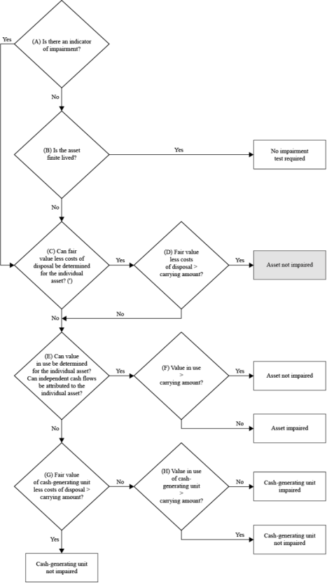

# 24 - Impairment of assets (IAS 36)

[返回目录](README.md)

# 24 - Impairment of assets (IAS 36)

Contents

- [24 - Impairment of assets (IAS 36)](41.md#s153-chap_24_toc_h1)

- [Introduction and scope (paras 24.1-24.24)](41.md#s154-chap_24_navPoint_1)

- [Scope](41.md#s154-chap_24_navPoint_2)

- [Basic principles of impairment](41.md#s154-chap_24_navPoint_3)

- [Identifying assets that might be impaired](41.md#s154-chap_24_navPoint_4)

- [Events after the reporting period](41.md#s154-chap_24_navPoint_5)

- [Annual impairment review for goodwill and certain intangibles](41.md#s154-chap_24_navPoint_6)

- [Interim reporting](41.md#s154-chap_24_navPoint_idp1687925960)

- [Cash-generating units (paras 24.25 - 24.52)](41.md#s155-chap_24_navPoint_7)

- [General principles](41.md#s155-chap_24_navPoint_8)

- [Identifying CGUs](41.md#s155-chap_24_navPoint_9)

- [CGU with goodwill or indefinite-lived assets](41.md#s155-chap_24_navPoint_10)

- [Allocating assets and liabilities to CGUs](41.md#s155-chap_24_navPoint_11)

- [Compare like with like](41.md#s155-chap_24_navPoint_12)

- [Working capital](41.md#s155-chap_24_navPoint_13)

- [Financing](41.md#s155-chap_24_navPoint_14)

- [Tax](41.md#s155-chap_24_navPoint_15)

- [Measuring recoverable amount (paras 24.53- 24.62)](41.md#s156-chap_24_navPoint_16)

- [General matters](41.md#s156-chap_24_navPoint_17)

- [Fair value less costs of disposal](41.md#s156-chap_24_navPoint_18)

- [Value in use (paras 24.63 - 24.138)](41.md#s157-chap_24_navPoint_19)

- [Basis for estimates of future cash flows](41.md#s157-chap_24_navPoint_20)

- [Reasonable and supportable](41.md#s157-chap_24_navPoint_idp1688129736)

- [Based on most up-to-date budget](41.md#s157-chap_24_navPoint_idp1688165448)

- [Length of forecast](41.md#s157-chap_24_navPoint_idp1688171848)

- [Asset in its current condition](41.md#s157-chap_24_navPoint_21)

- [Restructuring](41.md#s157-chap_24_navPoint_idp1687927112)

- [Future enhancements](41.md#s157-chap_24_navPoint_idp1687942856)

- [Composition of estimates of future cash flows](41.md#s157-chap_24_navPoint_22)

- [Asset not available for use](41.md#s157-chap_24_navPoint_idp1688049480)

- [Financing](41.md#s157-chap_24_navPoint_idp1688055624)

- [Tax](41.md#s157-chap_24_navPoint_idp1688063560)

- [Independence](41.md#s157-chap_24_navPoint_idp1712706216)

- [Liabilities](41.md#s157-chap_24_navPoint_idp1712716328)

- [Corporate overheads](41.md#s157-chap_24_navPoint_idp1712720424)

- [Disposal](41.md#s157-chap_24_navPoint_idp1712724136)

- [Inflation](41.md#s157-chap_24_navPoint_idp1712739112)

- [Foreign currency](41.md#s157-chap_24_navPoint_idp1712741800)

- [Transfer pricing](41.md#s157-chap_24_navPoint_idp1712745896)

- [Risk](41.md#s157-chap_24_navPoint_idp1712755752)

- [‘Traditional’ and ‘expected cash flow’ approaches to present value](41.md#s157-chap_24_navPoint_idp1712766248)

- [Discount rate](41.md#s157-chap_24_navPoint_23)

- [Pre-tax rate](41.md#s157-chap_24_navPoint_idp1684297736)

- [Goodwill](41.md#s157-chap_24_navPoint_24)

- [Non-controlling interests](41.md#s157-chap_24_navPoint_25)

- [Corporate assets](41.md#s157-chap_24_navPoint_26)

- [Recognition of impairment losses (paras 24.139 - 24.149)](41.md#s158-chap_24_navPoint_27)

- [Allocation of impairment losses to assets of cash-generating units](41.md#s158-chap_24_navPoint_28)

- [Assets or CGUs held for disposal](41.md#s158-chap_24_navPoint_29)

- [Reversals of impairment losses (paras 24.150 - 24.163)](41.md#s159-chap_24_navPoint_30)

- [General rules](41.md#s159-chap_24_navPoint_31)

- [Special rules for goodwill](41.md#s159-chap_24_navPoint_32)

- [Allocation of reversal of impairment losses to assets of a CGU](41.md#s159-chap_24_navPoint_33)

- [Presentation and disclosure (paras 24.164 - 24.171)](41.md#s160-chap_24_navPoint_34)

- [Separate financial statements](41.md#s160-chap_24_navPoint_35)

- [Disclosure](41.md#s160-chap_24_navPoint_36)

- [Illustrative text](42.md#s161-chap_24_navPoint_37)

- [EX 24.12.1 – Impairment indicator: reduced selling price of recently acquired asset](42.md#s161-chap_24_navPoint_38)

- [EX 24.12.2 – Impairment indicator: trends that develop over time](42.md#s161-chap_24_navPoint_39)

- [EX 24.12.3 – Impairment indicator: government price controls](42.md#s161-chap_24_navPoint_40)

- [EX 24.12.4 – Impairment indicator: change of asset’s use](42.md#s161-chap_24_navPoint_41)

- [EX 24.12.5 – Impairment indicator: introduction of a superior competitor product](42.md#s161-chap_24_navPoint_42)

- [FAQ 24.12.6 – Is an economic downturn always an impairment indicator?](42.md#s161-chap_24_navPoint_43)

- [EX 24.17.1 – Customer announces plant closure after the year end](42.md#s161-chap_24_navPoint_44)

- [EX 24.17.2 – Impairment triggers after the year end](42.md#s161-chap_24_navPoint_45)

- [EX 24.21.1 – Timing of impairment test](42.md#s161-chap_24_navPoint_46)

- [FAQ 24.21.2 – Can the timing of an impairment test be changed?](42.md#s161-chap_24_navPoint_47)

- [FAQ 24.21.3 – Is an impairment test needed at the time of a reorganisation?](42.md#s161-chap_24_navPoint_48)

- [EX 24.21.4 – Events after the annual impairment review](42.md#s161-chap_24_navPoint_49)

- [EX 24.25.1 – Test impairment at the individual asset level where possible](42.md#s161-chap_24_navPoint_50)

- [EX 24.26.1 – Asset that does not generate separate cash inflows: infrastructure](42.md#s161-chap_24_navPoint_51)

- [EX 24.26.2 – Asset that does not generate separate cash inflows: licence](42.md#s161-chap_24_navPoint_52)

- [FAQ 24.28.1 – When should a building be considered separately for impairment testing?](42.md#s161-chap_24_navPoint_53)

- [FAQ 24.28.2 – How should individual assets be considered for impairment in a closure of a division?](42.md#s161-chap_24_navPoint_54)

- [FAQ 24.28.3 – How does a decision to vacate a floor in a leased office building impact the impairment testing?](42.md#s161-chap_24_navPoint_55)

- [EX 24.29.1 – Indefinite-lived intangible asset](42.md#s161-chap_24_navPoint_56)

- [EX 24.30.1 – Determination of CGU](42.md#s161-chap_24_navPoint_57)

- [EX 24.32.1 – Individual hotels and retail operations](42.md#s161-chap_24_navPoint_58)

- [EX 24.32.2 – Magazine titles that are separate CGUs](42.md#s161-chap_24_navPoint_59)

- [EX 24.32.3 – Indefinite-lived intangible asset (brand)](42.md#s161-chap_24_navPoint_60)

- [EX 24.32.4 – Integrated businesses treated as country CGUs](42.md#s161-chap_24_navPoint_61)

- [EX 24.32.5 – Transport entities](42.md#s161-chap_24_navPoint_62)

- [EX 24.32.6 – Different locations but centralised functions](42.md#s161-chap_24_navPoint_63)

- [EX 24.35.1 – CGUs in a vertically integrated group](42.md#s161-chap_24_navPoint_64)

- [FAQ 24.35.2 – How should vertically integrated CGUs be analysed?](42.md#s161-chap_24_navPoint_65)

- [EX 24.43.1 – Restoration obligation part of the CGU’s carrying amount](42.md#s161-chap_24_navPoint_66)

- [FAQ 24.43.2 – What is IFRIC\'s view on paragraph 78 of IAS 36?](42.md#s161-chap_24_navPoint_67)

- [FAQ 24.43.3 – How does a restoration obligation impact a ViU model?](42.md#s161-chap_24_navPoint_68)

- [FAQ 24.43.4 – How does a restoration obligation impact a FVLCD model?](42.md#s161-chap_24_navPoint_69)

- [FAQ 24.44.1 – How do hedging instruments impact impairment testing?](42.md#s161-chap_24_navPoint_70)

- [FAQ 24.44.2 – How does IFRS 16 impact impairment testing?](42.md#s161-chap_24_navPoint_71)

- [EX 24.45.1 – Comparing like with like when including working capital balances](42.md#s161-chap_24_navPoint_72)

- [FAQ 24.45.2 – How should negative working capital balances be treated in a ViU model?](42.md#s161-chap_24_navPoint_73)

- [FAQ 24.46.1 – How does capitalised interest impact a fixed asset impairment review?](42.md#s161-chap_24_navPoint_74)

- [FAQ 24.46.2 – How does inter-company funding impact an impairment review?](42.md#s161-chap_24_navPoint_75)

- [EX 24.48.1 – Tax: Comparing like with like](42.md#s161-chap_24_navPoint_76)

- [FAQ 24.50.1 – How do deferred taxes on intangibles acquired in a business combination impact a goodwill impairment review?](42.md#s161-chap_24_navPoint_77)

- [FAQ 24.53.1 – Does intention affect recoverable amount?](42.md#s161-chap_24_navPoint_78)

- [FAQ 24.53.2 – Is it possible for the lower of value in use and fair value less costs of disposal to give a lower impairment charge?](42.md#s161-chap_24_navPoint_79)

- [FAQ 24.64.1 – Can dividend discount models be used as a basis for impairment testing?](42.md#s161-chap_24_navPoint_80)

- [EX 24.65.1 – Impact of IFRS 16 on value in use](42.md#s161-chap_24_navPoint_81)

- [FAQ 24.66.1 – What factors might influence cash flows?](42.md#s161-chap_24_navPoint_82)

- [EX 24.68.1 – Use of reasonable and supportable forecasts](42.md#s161-chap_24_navPoint_83)

- [EX 24.70.1 – Value in use: business plan not approved by management](42.md#s161-chap_24_navPoint_84)

- [EX 24.79.1 – Future restructuring planned in a value in use model](42.md#s161-chap_24_navPoint_85)

- [EX 24.82.1 – Treatment of components in value in use](42.md#s161-chap_24_navPoint_86)

- [EX 24.83.1 – Improvement-type expenditure](42.md#s161-chap_24_navPoint_87)

- [FAQ 24.84.1 – Does an entity incorporate cash flows from government assistance or grants when determining the value in use of a cash-generating unit?](42.md#s161-chap_24_navPoint_88)

- [FAQ 24.84.2 – What are the practical ways to include cash outflows to replace leased assets in a value in use model?](42.md#s161-chap_24_navPoint_89)

- [FAQ 24.84.3 – How should online sales and returns be allocated to a retail store when assessing that store for impairment?](42.md#s161-chap_24_navPoint_90)

- [FAQ 24.84.4 - How should an entity perform an impairment test on a CGU which benefits other CGUs in the group?](42.md#s161-chap_24_navPoint_91)

- [EX 24.87.1 – Calculating value in use with post-tax cash flows](42.md#s161-chap_24_navPoint_92)

- [FAQ 24.87.2 – Should an entity adjust the tax rates used in a post-tax VIU calculation for expected future tax rate changes?](42.md#s161-chap_24_navPoint_93)

- [FAQ 24.91.1 – How should corporate overheads be reflected in value in use calculations?](42.md#s161-chap_24_navPoint_94)

- [EX 24.97.1 – Transfer pricing difficulties](42.md#s161-chap_24_navPoint_95)

- [FAQ 24.100.1 – What are the advantages of the expected cash flow approach in times of higher uncertainty?](42.md#s161-chap_24_navPoint_96)

- [EX 24.100.2 – Modelling of uncertainty in ViU](42.md#s161-chap_24_navPoint_97)

- [EX 24.105.1 – Impact of country and currency risk on discount rate](42.md#s161-chap_24_navPoint_98)

- [EX 24.105.2 – Rates vary to reflect specific risk factors](42.md#s161-chap_24_navPoint_99)

- [FAQ 24.106.1 – How might IFRS 16 impact discount rates?](42.md#s161-chap_24_navPoint_100)

- [FAQ 24.107.1 – How do you avoid double counting when determining a discount rate?](42.md#s161-chap_24_navPoint_101)

- [FAQ 24.107.2 – How are discount rates impacted in times of uncertainty?](42.md#s161-chap_24_navPoint_102)

- [EX 24.111.1 – Calculating a pre-tax discount rate](42.md#s161-chap_24_navPoint_103)

- [FAQ 24.112.1 – What is the calculation process for iteratively deriving a pre-tax discount rate?](42.md#s161-chap_24_navPoint_104)

- [FAQ 24.112.2 – What are the common errors in iteratively deriving a pre-tax discount rate?](42.md#s161-chap_24_navPoint_105)

- [FAQ 24.112.3 – Is it always necessary to calculate pre-tax cash flows when there is a potential impairment?](43.md#s162-chap_24_navPoint_106)

- [EX 24.112.4 – Deriving a pre-tax rate from a post-tax rate](43.md#s162-chap_24_navPoint_107)

- [FAQ 24.115.1 – How should goodwill be allocated to new and existing businesses?](43.md#s162-chap_24_navPoint_108)

- [FAQ 24.115.2 – What methods might be used for allocation of goodwill?](43.md#s162-chap_24_navPoint_109)

- [EX 24.116.1 – Testing a segment for impairment](43.md#s162-chap_24_navPoint_110)

- [FAQ 24.116.2 – What is a non-arbitrary basis for the allocation of goodwill?](43.md#s162-chap_24_navPoint_111)

- [EX 24.116.3 – Allocation of goodwill after acquisition](43.md#s162-chap_24_navPoint_112)

- [FAQ 24.118.1 – What is the maximum period allowed for allocating goodwill?](43.md#s162-chap_24_navPoint_113)

- [FAQ 24.120.1 – How should goodwill be allocated on part-disposal of a CGU?](43.md#s162-chap_24_navPoint_114)

- [EX 24.121.1 – Alternative to relative fair value approach](43.md#s162-chap_24_navPoint_115)

- [EX 24.121.2 – Allocation of goodwill after change in management structure](43.md#s162-chap_24_navPoint_116)

- [FAQ 24.124.1 – Do you meed to keep a record of goodwill and its allocation to CGUs?](43.md#s162-chap_24_navPoint_117)

- [FAQ 24.126.1 – How do you apply the two-stage approach to impairment testing?](43.md#s162-chap_24_navPoint_118)

- [EX 24.129.1 – Calculation of impairment when there is a non-controlling interest in the CGU](43.md#s162-chap_24_navPoint_119)

- [FAQ 24.132.1 – How should an impairment loss be allocated to controlling and non-controlling interests with pre-existing goodwill?](43.md#s162-chap_24_navPoint_120)

- [FAQ 24.137.1 – How should corporate assets be allocated within CGUs?](43.md#s162-chap_24_navPoint_121)

- [EX 24.138.1 – Testing corporate assets for impairment](43.md#s162-chap_24_navPoint_122)

- [EX 24.138.2 – Two-stage test (corporate assets)](43.md#s162-chap_24_navPoint_123)

- [EX 24.144.1 – Allocation of impairment to goodwill and then to a brand](43.md#s162-chap_24_navPoint_124)

- [FAQ 24.145.1 – Should an impaired asset be tested as part of a CGU?](43.md#s162-chap_24_navPoint_125)

- [FAQ 24.145.2 – Could impairment losses be allocated based on depreciated replacement cost?](43.md#s162-chap_24_navPoint_126)

- [EX 24.145.3 – Allocation of impairment losses](43.md#s162-chap_24_navPoint_127)

- [FAQ 24.148.1 – How should impairment of a discontinued operation be presented in the income statement?](43.md#s162-chap_24_navPoint_128)

- [EX 24.153.1 – Reverse indicators](43.md#s162-chap_24_navPoint_129)

- [FAQ 24.153.2 – Indications of impairment reversal](43.md#s162-chap_24_navPoint_130)

- [EX 24.154.1 – Subsequent depreciation is not an indication that an impairment has reversed](43.md#s162-chap_24_navPoint_131)

- [FAQ 24.154.2 – Reversal of impairment due to passage of time](43.md#s162-chap_24_navPoint_132)

- [EX 24.159.1 – Reversal of impairment loss on revalued asset](43.md#s162-chap_24_navPoint_133)

- [EX 24.161.1 – Reversal of impairment for a CGU with goodwill](43.md#s162-chap_24_navPoint_134)

- [EX 24.163.1 – Allocation of the reversal of an impairment loss for a CGU](43.md#s162-chap_24_navPoint_135)

- [FAQ 24.165.1 – What is the impact of an impairment of goodwill in consolidated financial statements on an investment in a subsidiary in separate financial statements?](43.md#s162-chap_24_navPoint_136)

- [FAQ 24.165.2 – How is value in use calculated for an investment in a subsidiary?](43.md#s162-chap_24_navPoint_137)

- [FAQ 24.165.3 – What assumptions should be used to align an investment’s cash flows to those of the investee when calculating value in use for an investment in an associate or a joint venture?](43.md#s162-chap_24_navPoint_138)

- [FAQ 24.167.1 – What are the regulators focused on in relation to the disclosure of key assumptions?](43.md#s162-chap_24_navPoint_139)

This eBook is licensed to peggy so, peggy.so@hk.ey.com, 

## Introduction and scope (paras 24.1-24.24)

 

**24.1** A non-financial asset is impaired if its carrying amount exceeds its recoverable amount. Recoverable amount is the higher of value in use and fair value less costs of disposal. IAS 36 requires annual impairment tests for certain assets and for any non-financial asset where there is an indicator of impairment.

[IAS 36 para 1].

**24.2**Where recoverable amount is determined on the basis of fair value less costs of disposal, the measurement guidance in IFRS 13 applies. (See chapter 5 para 140.)

[IAS 36 para 6].

 

### Scope

 

**24.3** IAS 36 applies to the impairment of all assets, unless specifically excluded from the standard’s scope. Assets that are excluded are:

- Inventories (IAS 2).

- Contract assets and assets arising from costs to obtain or fulfil a contract that are recognised in accordance with IFRS 15.

- Deferred tax assets (IAS 12).

- Financial assets that are included within the scope of IFRS 9. (Examples include cash, debtors and equity investments other than investments in subsidiaries, associates or joint ventures not accounted for under IFRS 9 (IAS 39).)

- Investment property that is measured at fair value (IAS 40).

- Biological assets related to agricultural activity measured at fair value (IAS 41).

- Deferred acquisition costs and intangible assets arising from an insurer’s contractual rights under insurance contracts that are within IFRS 4’s scope.

- Non-current assets (or disposal groups) classified as held for sale under IFRS 5.

- Assets arising from employee benefits under IAS 19.

[IAS 36 para 2].

**24.4** IAS 36 applies to financial assets classified as subsidiaries (as defined in IFRS 10 – see [chapter 26 para 16](45.md#s169-Para_26.16)), associates (as defined in IAS 28 – see [chapter 31 para 9](56.md#s225-Para_31.9)) and joint ventures (as defined in IFRS 11 – see [chapter 32 para 25](57.md#s231-Para_32.25)).

[IAS 36 para 4].

**24.5** Revalued assets measured at fair value in IAS 16 and IAS 38 are within IAS 36’s scope. The only difference between an asset’s fair value and its fair value less costs of disposal is the direct incremental costs attributable to the asset’s disposal. Costs of disposal could, therefore, cause an impairment if fair value less cost of disposal is higher than value in use.

[IAS 36 para 5].

 

### Basic principles of impairment

**24.6** An asset cannot be carried in the balance sheet at more than its recoverable amount. An impairment review compares the asset’s recoverable amount with its carrying value. If the recoverable amount is lower, the asset is impaired and should be written down to the recoverable amount.

[IAS 36 para 8].

**24.7** An asset’s carrying amount is the amount at which the asset is recognised on the balance sheet, after deducting any accumulated depreciation or amortisation and accumulated impairment losses thereon.

[IAS 36 para 6].

**24.8** An asset’s recoverable amount represents its greatest value to the business in terms of the cash flows that it can generate. That is the higher of:

- fair value less costs of disposal (measured in accordance with IFRS 13); and

- value in use (the present value of the future cash flows that are expected to be derived from the asset).

[IAS 36 para 6].

### Identifying assets that might be impaired

 

**24.9** All assets within the standard’s scope are to be tested for impairment where there is an impairment indicator.

[IAS 36 para 9].

**24.10** Goodwill, indefinite life intangible assets and intangible assets that are not yet ready for use should also be tested annually for impairment.

[IAS 36 para 10].

**24.11** An entity should assess, at each reporting date, whether there is any indication that an asset might be impaired. The term ‘reporting date’ includes the year end date and interim (half-year or quarterly) reporting dates. An entity might be required to complete an impairment test more than once per annum.

[IAS 36 para 9].

**24.12** In assessing whether there is any indication that an asset might be impaired, an entity should consider at least the following:

External sources of information, including:

- Observable indications that the asset’s value has declined during the period significantly more than would be expected as a result of the passage of time or normal use. Changes in market values reflect economic conditions, so a significant fall in value could be a symptom of another more pervasive change (for example, change in demand for the asset’s output).

- Significant adverse changes that have taken place (or are expected in the near future) in the technological, market, economic or legal environment in which the entity operates or in its markets.

- Increases in interest rates, or other market rates of return, that might materially affect the discount rate used in calculating the asset’s recoverable amount.

- Where the carrying amount of the entity’s net assets exceeds the entity’s market capitalisation.

Internal sources of information, including:

- Obsolescence or physical damage affecting the asset.

- Significant adverse changes that have taken place (or are expected in the near future) in the extent to which, or in the way that, an asset is used or expected to be used. This includes the asset becoming idle, plans to discontinue or restructure the operation to which the asset belongs, or the asset’s disposal. It also includes reassessing the asset’s useful life from indefinite to finite.

- Deterioration in the expected level of the asset’s performance.

- Where management’s own forecasts of future net cash inflows or operating profits show a significant decline from previous budgets and forecasts.

This list is not exhaustive, and other indicators might be apparent that are relevant to a business’ particular circumstances.

[IAS 36 para 12].

[EX 24.12.1 – Impairment indicator: reduced selling price of recently acquired asset](42.md#s161-EX24.12.1)  
[EX 24.12.2 – Impairment indicator: trends that develop over time](42.md#s161-EX24.12.2)  
[EX 24.12.3 – Impairment indicator: government price controls](42.md#s161-EX24.12.3)  
[EX 24.12.4 – Impairment indicator: change of asset’s use](42.md#s161-EX24.12.4)  
  
[EX 24.12.5 – Impairment indicator: introduction of a superior competitor product](42.md#s161-EX24.12.5)  
[FAQ 24.12.6 – Is an economic downturn always an impairment indicator?](42.md#s161-FAQ_24.12.6)

**24.13** Evidence from internal reporting, which indicates that an asset might be impaired, includes:

- The actual net cash outflows or operating profit or loss are significantly worse than budgeted.

- Operating losses or net cash outflows are forecasted.

- Cash flows for constructing the asset, or for maintaining or operating it, are significantly higher than those budgeted.

[IAS 36 para 14].

**24.14** An increase in market interest rates might not trigger an impairment test in all circumstances. For example, a marginal increase in short-term interest rates is unlikely to lead to an impairment charge where there was significant headroom in the last test.

[IAS 36 para 16].

**24.15** Materiality applies in determining whether an impairment review is required. If previous impairment reviews have shown a significant excess of recoverable amount over carrying amount, no review would be necessary in the absence of an event that would eliminate the excess. Previous reviews might also have shown that an asset’s recoverable amount is not sensitive to one or more of the impairment indicators.

[IAS 36 para 15].

**24.16** If there is an indication that an asset might be impaired, the useful life, the depreciation method and the residual value for the asset need to be reviewed and adjusted, if necessary, under the appropriate IFRS. This applies, even if no impairment loss is recognised for the asset.

[IAS 36 para 17].

 

### Events after the reporting period

 

**24.17** Events after the reporting period might provide indications that an asset was impaired at the period end. The impairment test should be updated after the period end only if material changes in assumptions provide additional evidence relating to conditions that existed at the balance sheet date. This requires an analysis of facts and circumstances in order to distinguish between adjusting and non-adjusting information. A continuation of a previously observed trend does not usually warrant further adjustment, because the trend should have been incorporated into the most recent impairment calculation. Foreign exchange and commodity movements after the year end would also seldom be a reason to update year end impairment calculations. See [chapter 9 para 5](17.md#s54-Para_9.5).

[IAS 10 para 8].

[EX 24.17.1 – Customer announces plant closure after the year end](42.md#s161-EX24.17.1)  
[EX 24.17.2 – Impairment triggers after the year end](42.md#s161-EX24.17.2)

 

### Annual impairment review for goodwill and certain intangibles

 

**24.18** Goodwill and indefinite-lived intangible assets are tested annually for impairment, irrespective of indicators.

[IAS 36 para 10].

**24.19** Intangibles that are not yet ready for use should be tested annually, because they are not being amortised. The ability of an intangible asset to generate sufficient future economic benefits to recover its carrying amount is usually more uncertain before it is brought into use.

[IAS 36 para 11].

**24.20** The impairment tests on goodwill and intangibles can be performed at any time in the financial year, provided that they are performed at the same time each year. An entity might choose to perform its impairment test at less busy times of the year. Different CGUs might be tested at different times.

[IAS 36 para 96].

**24.21** An intangible or goodwill that was recognised during the current financial period should be tested for impairment before the end of the current period. If any assumptions change, or if there is a further impairment trigger before the year end, the calculation should be updated accordingly.

[IAS 36 para 96].

[EX 24.21.1 – Timing of impairment test](42.md#s161-EX24.21.1)  
  
[FAQ 24.21.2 – Can the timing of an impairment test be changed?](42.md#s161-FAQ_24.21.2)  
  
[FAQ 24.21.3 – Is an impairment test needed at the time of a reorganisation?](42.md#s161-FAQ_24.21.3)  
  
[EX 24.21.4 – Events after the annual impairment review](42.md#s161-EX24.21.4)

**24.22** The annual impairment test requirement for goodwill and intangibles with indefinite useful lives, or that have yet to be brought into use, is in addition to the overriding requirement to test those assets whenever there are indications of impairment. Goodwill and intangible assets might need to be tested for impairment more than once a year where an indicator of impairment exists.

[IAS 36 para 98].

 

#### Interim reporting

 

**24.23** The same impairment testing, recognition and reversal criteria are applied at interim reporting dates. An entity will not necessarily have to make a detailed impairment calculation at the end of each interim period. An entity should review for indications of impairment, at each interim reporting date, to decide whether such a calculation is needed.

[IAS 34 para 30].

**24.24** An entity might be required to recognise an impairment in an interim period but, by the year end, the impairment might have reversed, either in full or partially. An impairment of goodwill recognised in an interim period should not be reversed. See [chapter 35 para 29](60.md#s245-Para_35.29) for more details.

[IFRIC 10 para 8].

 

This eBook is licensed to peggy so, peggy.so@hk.ey.com, 

## Cash-generating units (paras 24.25 - 24.52)

### General principles

 

**24.25** Impairment should be identified at the individual asset level, where possible. The recoverable amount should be calculated for the CGU to which the asset belongs only where the recoverable amount for the individual asset cannot be identified.

[IAS 36 para 66].

[EX 24.25.1 – Test impairment at the individual asset level where possible](42.md#s161-EX24.25.1)

**24.26** The recoverable amount of an individual asset cannot be determined if the asset does not generate cash inflows that are largely independent from other assets. Assets should be grouped for an impairment test in these circumstances. The recoverable amount is estimated for the smallest group of assets that generate cash inflows that are largely independent of each other. These are referred to as cash-generating units (CGUs). The vast majority of assets are tested for impairment as part of a CGU or group of CGUs.

The independence of cash inflows will often be evident. Shared support assets and infrastructure does not undermine the independence of cash inflows.

[IAS 36 para 67].

[EX 24.26.1 – Asset that does not generate separate cash inflows: infrastructure](42.md#s161-EX24.26.1)  
[EX 24.26.2 – Asset that does not generate separate cash inflows: licence](42.md#s161-EX24.26.2)

**24.27** An impairment review of a CGU should cover all of its tangible assets, intangible assets and attributable goodwill. The carrying value of each CGU containing the assets and goodwill being reviewed should be compared with the higher of its value in use and fair value less costs of disposal.

[IAS 36 para 22].

**24.28** An impairment test is performed for an individual asset, unless the asset does not generate independent cash inflows. If this is the case the impairment test is performed for the CGU to which the asset belongs unless:

- the asset’s fair value less costs of disposal is higher than its carrying amount; or

- the asset’s value in use can be estimated as being close to its fair value less costs of disposal, and the fair value less costs of disposal can be determined.

[IAS 36 para 22].

[FAQ 24.28.1 – When should a building be considered separately for impairment testing?](42.md#s161-FAQ_24.28.1)  
  
[FAQ 24.28.2 – How should individual assets be considered for impairment in a closure of a division?](42.md#s161-FAQ_24.28.2)  
[FAQ 24.28.3 – How does a decision to vacate a floor in a leased office building impact the impairment testing?](42.md#s161-FAQ_24.28.3)

**24.29**The diagram below shows the decisions needed to decide the level of testing:

  
[EX 24.29.1 – Indefinite-lived intangible asset](42.md#s161-EX24.29.1)

 

### Identifying CGUs

 

**24.30** Identifying CGUs is the first key step in carrying out impairment reviews. This establishes the level of aggregation at which impairment reviews would normally be carried out. An impairment test must be done at the lowest level of independent cash inflows.

[IAS 36 para 68].

[EX 24.30.1 – Determination of CGU](42.md#s161-EX24.30.1)

**24.31** A cash-generating unit is “the smallest identifiable group of assets that generates cash inflows that are largely independent of the cash inflows from other assets or group of assets”.

[IAS 36 para 6].

**24.32** Cash inflows are cash flows received from external parties. The independence of cash flows will be indicated by various factors – for example, how management monitor’s the entity’s operations (this could be by product lines, businesses, individual locations, districts or regional areas), or how management makes decisions about continuing or disposing of the entity’s assets and operations. Management’s day-to-day operation of the business might not reflect the legal structure through which the operations are conducted.

[IAS 36 para 69].

[EX 24.32.1 – Individual hotels and retail operations](42.md#s161-EX24.32.1)  
  
[EX 24.32.2 – Magazine titles that are separate CGUs](42.md#s161-EX24.32.2)  
  
[EX 24.32.3 – Indefinite-lived intangible asset (brand)](42.md#s161-EX24.32.3)  
  
[EX 24.32.4 – Integrated businesses treated as country CGUs](42.md#s161-EX24.32.4)  
 [EX 24.32.5 – Transport entities](42.md#s161-EX24.32.5)  
 [EX 24.32.6 – Different locations but centralised functions](42.md#s161-EX24.32.6)

**24.33** An asset or group of assets is identified as a separate CGU if there is an active market for the output generated by the asset(s), even if the output is used internally.

[IAS 36 para 70].

**24.34** An active market is defined as follows: “A market in which transactions for the asset or liability take place with sufficient frequency and volume to provide pricing information on an ongoing basis”.

[IFRS 13 App A].

**24.35** Value in use is based on management’s best estimate of future cash flows. Management should use its best estimate of future arm’s length prices for the internal cash flow to:

- estimate the future cash inflows that relate to the sale of the output by the CGU to the entity’s other CGUs; and

- estimate the future cash outflows that relate to the purchase of the output by the other CGUs.

[IAS 36 para 71].

[EX 24.35.1 – CGUs in a vertically integrated group](42.md#s161-EX24.35.1)  
  
[FAQ 24.35.2 – How should vertically integrated CGUs be analysed?](42.md#s161-FAQ_24.35.2)

**24.36** CGUs should be identified on a consistent basis, from one period to the next for the same assets or types of assets, unless a change is justified. If there is a change, it must be disclosed.

[IAS 36 para 72].

**24.37** Assessing the recoverable amount for an individual CGU is difficult where management has multiple assets and has the ability to choose the assets that are used. Determination of what is a CGU can be an area of significant judgement, but it is not an accounting policy choice. Significant judgements should be disclosed.

[IAS 1 para 22].

**24.38** IAS 36 is focused on identifying and recognising impairment losses from a group perspective. The whole group is divided into separate CGUs for the purpose of impairment reviews. The CGUs in aggregate cover the whole group and are non-overlapping. The allocation of a group’s activities between separate entities within a group does not necessarily coincide with the way in which the group’s CGUs are defined.

[IAS 36 para 6].

 

### CGU with goodwill or indefinite-lived assets

 

**24.39** Goodwill and indefinite-lived intangible assets are required to be tested annually for impairment. In some circumstances there is an accommodation to carry forward the calculation of recoverable amount made in the previous period, which can be used in the current period if the following conditions are met:

- For goodwill allocated to a CGU and those intangibles that do not generate cash inflows independently of other assets, and so are tested as part of a CGU:

- The CGU’s assets and liabilities, to which such goodwill or intangibles were allocated, have not changed significantly since the last impairment test.

- The most recent impairment test resulted in an amount that exceeded the CGU’s carrying amount by a substantial margin.

- Analysis of events that have occurred and changes in circumstances since the last review indicates that the likelihood that the current CGU’s recoverable amount would be less than its carrying amount is remote.

- If an intangible asset is assessed for impairment as a single asset (that is, it generates cash flows independently of other assets and is not reviewed for impairment as part of a CGU):

- The most recent impairment test resulted in an amount that exceeded the asset’s carrying amount by a substantial margin.

- Analysis of events that have occurred and changes in circumstances since the last review indicates that the likelihood that the asset’s current recoverable amount would be less than its carrying amount is remote.

[IAS 36 para 24].

 

### Allocating assets and liabilities to CGUs

 

**24.40** The determination of the carrying amount of a CGU should be consistent with the determination of its recoverable amount. The test should compare like with like.

[IAS 36 para 75].

**24.41** The carrying amount of a CGU is established by allocating assets and liabilities to individual CGUs. The carrying amount of a CGU consists of:

- Assets that are directly and exclusively attributable to the CGU.

- An allocation of assets that are indirectly attributable, on a reasonable and consistent basis, to the CGU including:

- corporate assets; and

- capitalised goodwill.

[IAS 36 para 77].

**24.42**Liabilities are generally excluded from the carrying amount of the CGU.

[IAS 36 para 76].

**24.43** There might be circumstances where it is not possible to determine recoverable amount without taking account of a recognised liability. For example, if the disposal of a CGU would require the buyer to take over a liability, the fair value less costs of disposal is the price for the assets and the liability together, less costs of disposal. So that the comparison of recoverable amount and carrying amount is on a consistent basis, the liability should also be included in the CGU’s carrying amount. If a ViU model is used, as clarified by IFRIC, the liability is deducted from both the carrying amount and cash flows. Within the ViU model, the associated cash flows relating to the liability should not be included to avoid double counting.

[IAS 36 para 78].

[EX 24.43.1 – Restoration obligation part of the CGU’s carrying amount](42.md#s161-EX24.43.1)  
  
[FAQ 24.43.2 – What is IFRIC's view on paragraph 78 of IAS 36?](42.md#s161-FAQ_24.43.2)  
  
[FAQ 24.43.3 – How a restoration impact a ViU model?](42.md#s161-FAQ_24.43.3)  
  
[FAQ 24.43.4 – How does a restoration obligation impact a FVLCD model?](42.md#s161-FAQ_24.43.4)

 

### Compare like with like

 

**24.44** The assets (and liabilities, where appropriate) attributed to CGUs should be consistent with the cash flows that are identified for calculating recoverable amount. Cash flows prepared for fair value less costs of disposal are prepared on a different basis from those for value in use. As a result, the CGU’s carrying value, in a value in use test, differs from that on a fair value less costs of disposal basis. Non-current assets in a CGU will be the same, whether using value in use or fair value less costs of disposal.

[IAS 36 para 75].

[FAQ 24.44.1 – How do hedging instruments impact impairment testing?](42.md#s161-FAQ_24.44.1)  
  
[FAQ 24.44.2 – How does IFRS 16 impact impairment testing?](42.md#s161-FAQ_24.44.2)

 

### Working capital

 

**24.45**Working capital is sometimes included for practical reasons. It might be appropriate to include movements in working capital in the value in use model, as working capital is required to operate plant and equipment and generate the cash flow from those assets. If an entity includes the cash flows from trade debtors, trade creditors and inventory in the value in use calculation for a CGU, it should include the trade debtors, trade creditors and inventory as part of the CGU’s carrying amount.

[IAS 36 para 79].

[EX 24.45.1 – Comparing like with like when including working capital balances](42.md#s161-EX24.45.1)  
  
[FAQ 24.45.2 – How should negative working capital balances be treated in a ViU model?](42.md#s161-FAQ_24.45.2)  
 

 

### Financing

 

**24.46** The cash outflows associated with financing the CGU’s operations (including interest-bearing debt, dividends and interest payable) are excluded from the value in use calculations. The carrying amount of a CGU should exclude liabilities that relate to financing the CGU’s operations. No distinction is made between external and inter-company financing. The associated cash outflows, both principal and interest, are not considered in determining recoverable amount. Finance costs are indirectly considered, in measuring recoverable amount, by using the present value method to discount future cash flows.

[IAS 36 para 50(a)].

[FAQ 24.46.1 – How does capitalised interest impact fixed asset impairment review?](42.md#s161-FAQ_24.46.1)  
  
[FAQ 24.46.2 – How does inter-company funding impact an impairment review?](42.md#s161-FAQ_24.46.2)

 

### Tax

 

**24.47** The cash flows in a value in use calculation are prepared on a pre-tax basis. Tax assets and liabilities are therefore not included as part of the CGU’s carrying value.

[IAS 36 para 50(b)].

**24.48**Deferred tax reflects the future tax consequences of recovering assets. Future tax payable in relation to a CGU will be recognised as a deferred tax liability. Value in use is a pre-tax measure, so tax (current and deferred) cannot be included in the carrying amount of the CGU.

[IAS 36 para 50].

[EX 24.48.1 – Tax: Comparing like with like](42.md#s161-EX24.48.1)

**24.49** Current and deferred tax balances, with the exception of unused tax losses, and their associated cash flows are taken into account, when calculating fair value less costs of disposal, if a market participant would also include them.

[IFRS 13 para 22].

**24.****50** Fair value adjustments in a business combination often result in the recognition of deferred tax liabilities and a corresponding increase in goodwill. A value in use calculation might lead to an impairment charge soon after an acquisition, due to the higher amount of goodwill that is recorded and the exclusion of deferred tax liability in the CGU. A test should be performed using fair value less costs of disposal in these circumstances.

[IAS 12 para 22(a)].

[FAQ 24.50.1 – How do deferred taxes on intangibles acquired in a business combination impact a goodwill impairment review?](42.md#s161-FAQ_24.50.1)

**24.51** Entities might have unused tax losses that could reduce taxes to be paid in the future. A CGU that consists of a business that has a taxable identity might have brought forward tax losses. These tax losses might result in a lower level of cash tax being payable over future periods. Alternatively, there might be no tax losses specifically attributable to the CGU or asset being tested, but tax losses are available from elsewhere within the entity that could be allocated to the CGU or asset being tested.

[IAS 36 para 53A].

**24.52** A CGU’s recoverable amount should not change because there are tax losses attaching to the CGU’s assets. Any difference in value between otherwise identical CGUs, with or without tax losses, relates to the value of the tax losses and not to the value of the assets subject to impairment testing. Any such losses should, therefore, be excluded from the impairment test. This applies to value in use and fair value less costs of disposal. Tax losses are sometimes sold in conjunction with the disposal of a business. However, these are typically treated as a separate transaction, because there is uncertainty as to whether the new owner will be able to realise the benefit of those losses.

[IAS 36 para 53A].

 

This eBook is licensed to peggy so, peggy.so@hk.ey.com, 

## Measuring recoverable amount (paras 24.53- 24.62)

### General matters

 

**24.53**Recoverable amount is the higher of an asset’s fair value less costs of disposal and its value in use. This reflects the greatest value of an asset in terms of the cash flows that can be derived from it, either by selling it or by continuing to use it in the business.

[IAS 36 para 6].

[FAQ 24.53.1 – Does intention affect recoverable amount?](42.md#s161-FAQ_24.53.1)  
[FAQ 24.53.2 – Is it possible for the lower of value in use and fair value less costs of disposal to give a lower impairment charge?](42.md#s161-FAQ_24.53.2)

**24.54** There are a number of differences between the two methods. The main differences are summarised as:

<table style="width:100%; border-collapse:collapse"><tr><td style="border:0.75pt solid #000000; padding-right:5.03pt; padding-left:5.03pt; vertical-align:top">
 
</td><td style="border:0.75pt solid #000000; padding-right:5.03pt; padding-left:5.03pt; vertical-align:top">
<b>Fair value less costs of disposa</b><b>l</b>
</td><td style="border:0.75pt solid #000000; padding-right:5.03pt; padding-left:5.03pt; vertical-align:top">
<b>Value in use</b>
</td></tr><tr><td style="border:0.75pt solid #000000; padding-right:5.03pt; padding-left:5.03pt; vertical-align:top">
Which standard governs measurement?
</td><td style="border:0.75pt solid #000000; padding-right:5.03pt; padding-left:5.03pt; vertical-align:top">
IFRS 13.
</td><td style="border:0.75pt solid #000000; padding-right:5.03pt; padding-left:5.03pt; vertical-align:top">
IAS 36.
</td></tr><tr><td style="border:0.75pt solid #000000; padding-right:5.03pt; padding-left:5.03pt; vertical-align:top">
Whose perspective is considered?
</td><td style="border:0.75pt solid #000000; padding-right:5.03pt; padding-left:5.03pt; vertical-align:top">
This approach, using a present value technique, reflects future cash flows from a market participant’s perspective. (See <a href="41.md#s156-Para_24.61">para 24.61</a>).
</td><td style="border:0.75pt solid #000000; padding-right:5.03pt; padding-left:5.03pt; vertical-align:top">
This approach reflects the entity’s expectation of future cash flows.
</td></tr><tr><td style="border:0.75pt solid #000000; padding-right:5.03pt; padding-left:5.03pt; vertical-align:top">
Which discount rate should be used?
</td><td style="border:0.75pt solid #000000; padding-right:5.03pt; padding-left:5.03pt; vertical-align:top">
An appropriate post-tax discount rate is used.
</td><td style="border:0.75pt solid #000000; padding-right:5.03pt; padding-left:5.03pt; vertical-align:top">
An appropriate pre-tax discount rate is used. (See paras 24.110–24.112.)
</td></tr><tr><td style="border:0.75pt solid #000000; padding-right:5.03pt; padding-left:5.03pt; vertical-align:top">
What should be the starting point for cash flows?
</td><td style="border:0.75pt solid #000000; padding-right:5.03pt; padding-left:5.03pt; vertical-align:top">
Normally, entities use own budgets and forecasts as a starting point when applying a present value technique, adjusting for market conditions.
</td><td style="border:0.75pt solid #000000; padding-right:5.03pt; padding-left:5.03pt; vertical-align:top">
Entity forecasts and budgets are used. Any significant differences between a market participant’s perspective and the entity’s perspective should be justified. (See paras 24.67–24.69.)
</td></tr><tr><td style="border:0.75pt solid #000000; padding-right:5.03pt; padding-left:5.03pt; vertical-align:top">
Should deferred and current income taxes be included in carrying value?
</td><td style="border:0.75pt solid #000000; padding-right:5.03pt; padding-left:5.03pt; vertical-align:top">
Deferred and current income taxes should be included in carrying value. Tax losses are excluded. (See paras 24.47–24.52.)
</td><td style="border:0.75pt solid #000000; padding-right:5.03pt; padding-left:5.03pt; vertical-align:top">
Deferred and current income taxes should be excluded from carrying value. Tax losses are excluded. (See paras 24.47–24.52.)
</td></tr><tr><td style="border:0.75pt solid #000000; padding-right:5.03pt; padding-left:5.03pt; vertical-align:top">
Should enhancements be included in cash flows?
</td><td style="border:0.75pt solid #000000; padding-right:5.03pt; padding-left:5.03pt; vertical-align:top">
Enhancements should be included if a market participant would reasonably expect such enhancements to take place.
</td><td style="border:0.75pt solid #000000; padding-right:5.03pt; padding-left:5.03pt; vertical-align:top">
Enhancements, and the inflows they are expected to generate, should be excluded until they are incurred. (See paras 24.80–24.83.)
</td></tr><tr><td style="border:0.75pt solid #000000; padding-right:5.03pt; padding-left:5.03pt; vertical-align:top">
Should the effects of a restructuring that has not yet been recognised in accordance with IAS 37 be included in the cash flows?
</td><td style="border:0.75pt solid #000000; padding-right:5.03pt; padding-left:5.03pt; vertical-align:top">
Restructurings should be included if a market participant would reasonably expect such restructurings to take place.
</td><td style="border:0.75pt solid #000000; padding-right:5.03pt; padding-left:5.03pt; vertical-align:top">
The effects of restructuring should be excluded, unless a related provision has been recognised under IAS 37. (See paras 24.77–24.79.)
</td></tr></table>

  
 **24.55** It is not always necessary to calculate both measures when performing an impairment review. If an asset’s fair value less costs of disposal or its value in use exceeds the asset’s carrying amount, the asset is not impaired and there is no need to estimate the recoverable amount using the other method.

[IAS 36 para 19].

**24.56** Estimates, averages or computational shortcuts might provide a reasonable approximation of the detailed computations that would otherwise be required to determine recoverable amount.

[IAS 36 para 23].

**24.57** If there is no reason to believe that an asset’s value in use materially exceeds its fair value less costs of disposal, the asset’s recoverable amount can be taken to be its fair value less costs of disposal. This will often be the case for an asset that is held for disposal where the value in use will consist mainly of the net disposal proceeds.

[IAS 36 para 21].

**24.58** The recoverable amount should be determined by estimating the asset’s value in use if the fair value cannot be determined.

[IAS 36 para 20].

 

### Fair value less costs of disposal

 

**24.59** Fair value measurement is covered by IFRS 13 (see [chapter 5 para 1](11.md#s32-Para_5.1)). This defines fair value of an asset as “the price that would be received to sell the asset in an orderly transaction between market participants at the measurement date”.

[IFRS 13 para 9].

**24.60** Fair value considers the characteristics of the asset or CGU that a market participant would consider when pricing it. Such characteristics could include:

- the condition and location of the asset or CGU; and

- restrictions, if any, on the sale or use of the asset or CGU.

[IFRS 13 para 11].

**24.61** Fair value less costs of disposal differs from value in use. Value in use reflects the effect of factors that might be specific to the entity and would not be applicable to entities in general. Fair value reflects the assumptions that market participants would use when pricing the asset.

[IAS 36 para 53A].

**24.62** Fair value does not reflect any of the following factors to the extent that they would not generally be available to market participants:

- additional value derived from the grouping of assets (such as the creation of a portfolio of investment properties in different locations);

- synergies between the asset being measured and different assets;

- corporate overheads that are specific to the asset's current owner;

- legal rights or legal restrictions that are specific only to the asset’s current owner; and

- tax benefits or tax burdens that are specific to the asset’s current owner.

[IAS 36 para 53A].

 

This eBook is licensed to peggy so, peggy.so@hk.ey.com, 

## Value in use (paras 24.63 - 24.138)

 

**24.63** The definition of value in use is “the present value of the future cash flows expected to be derived from an asset or cash-generating unit”.

[IAS 36 para 6].

**24.64** Determining value in use involves estimating the future cash flows that are expected to arise from the asset or CGU being tested for impairment. The cash flows consist of those expected to arise from the continued use of the asset or CGU in its current condition and those, if any, expected to result from its ultimate disposal. An appropriate discount rate is then applied to those cash flows, in order to arrive at their present value.

[IAS 36 para 31].

[FAQ 24.64.1 – Can dividend discount models be used as a basis for impairment testing?](42.md#s161-FAQ_24.64.1)

**24.65** Calculating value in use involves the following processes:

- Estimating the future cash flows expected to be derived from the asset in its current condition.

- Estimating the potential variation in the amount and timing of the future cash flows.

- Taking account of the time value of money (discounting), using current market risk-free interest rates.

- Estimating the price for bearing the uncertainty inherent in the asset (for example, whether the asset will perform as intended).

- Taking account of other factors, such as illiquidity, which would be reflected by the market in pricing the future cash flows expected to be derived from the asset.

[IAS 36 para 30].

[EX 24.65.1 – Impact of IFRS 16 on value in use](42.md#s161-EX24.65.1)

**24.66** Risks related to expected variations in the amount or timing of cash flows, uncertainty inherent in the asset and other factors, such as illiquidity, might be reflected in the calculation, either by adjusting the cash flows or by adjusting the discount rate. A risk should be incorporated in either the cash flows or the discount rate, but not both, to avoid double counting.

[IAS 36 para 32].

[FAQ 24.66.1 – What factors might influence cash flows?](42.md#s161-FAQ_24.66.1)

 

### Basis for estimates of future cash flows

#### Reasonable and supportable

 

**24.67** Relevant cash flow forecasts should be made on the basis of reasonable and supportable assumptions that represent management’s best estimate of the economic circumstances that will prevail over the asset’s or CGU’s remaining life.

[IAS 36 para 38].

**24.68** Management should examine the causes of any differences between actual cash flows and past projections, to assess whether assumptions are reasonable. The current assumptions should be consistent with past actual outcomes, except where circumstances have changed or subsequent events have occurred that make this inappropriate.

[IAS 36 para 34].

[EX 24.68.1 – Use of reasonable and supportable forecasts](42.md#s161-EX24.68.1)

**24.69** Value in use is an entity-specific measure, but the assumptions used by management should be reasonable and supportable; for example:

- Management assumptions should be consistent with market evidence, such as independent macro-economic forecasts, industry commentators or analysts, brokers' analysis and other third party experts. Greater weight should be given to credible external evidence that is available.

- Any differences between the forecast’s underlying assumptions and market evidence should be analysed and understood. Management might find it helpful to explain these differences in financial statement disclosures or other material accompanying the financial statements.

- Management should understand any differences between fair value less costs of disposal and value in use, and it should ensure that they are supportable.

There should be consistency of assumptions and forecasts where they are in common with impairment tests of different assets required by IAS 36 and other standards.

[IAS 36 para 33(a)].

 

#### Based on most up-to-date budget

 

**24.70** The cash flows used for impairment testing be based on the most up-to-date budgets and forecasts that have been formally approved by management, excluding cash inflows and outflows arising from future restructuring or enhancements. If budgets are revised, they should also be approved by management before they can be used in the value in use calculation. In times of significant rapid developments in market, macro-economic, socio-economic, political, regulatory and other domestic and global conditions, it is particularly important to update forecasts and plans to incorporate the impact of such conditions based on the most current assumptions that could have reasonably been expected at the reporting period end. Reliance on previously approved forecasts might not be appropriate in such circumstances.

[IAS 36 para 33(b)].

[EX 24.70.1 – Value in use: business plan not approved by management](42.md#s161-EX24.70.1)

**24.71** Projections based on these budgets and forecasts should cover a maximum of five years. Management could use a longer period, where appropriate, but only where it can demonstrate its ability to forecast cash flows accurately for longer periods. For example, where a CGU is a power plant which is not yet completed, it might expect to incur losses for two or three years, followed by several years of significant growth. The cash flow forecasts with explicit growth assumptions might exceed five years. The circumstances for overriding the presumed five-year cut-off should be rare.

[IAS 36 para 35].

 

#### Length of forecast

**24.72** The cash flow projections of a CGU with a defined life should be an estimate of the value for that defined life. For example, if the CGU has a finite life based on its principal operating asset (for example, a mine or a power plant), the cash flow projection period might need to be limited to the life of that asset. If it is reasonable to assume that an entity would replace the principal operating asset, it might be appropriate to consider a terminal value that is intended to project cash flows into perpetuity.

[IAS 36 para 49].

**24.73** The length of the projection period for the cash flow forecast, where a CGU has goodwill or intangible assets with indefinite lives, will, in most cases, be into perpetuity. This is typically achieved by identifying a ‘steady state’ set of assumptions for the cash flows in the last year of the forecasts and applying a terminal value multiple to those cash flows.

[IAS 36 para 33(c)].

**24.74** Terminal value could be calculated by applying a terminal value multiple to the cash flows expected in the last year (CF) covered by the entity’s explicit forecasts, by using the formula CF * (1 + g) / (r – g), where ‘r’ is the discount rate and ‘g’ is the estimated long-term annual rate of growth in the cash flows. The terminal value, calculated as at the end of the period covered by formal budgets and plans, is discounted to its present value.

[IAS 36 para 36].

**24.75** There are no restrictions on growth rates in the period that is covered by formal budgets and plans. In that initial period, the cash flows will reflect the variability in growth rates that is included in the entity’s explicit forecasts. The cash flows for periods beyond those covered by formal budgets and plans (whether they cover the full five years or a shorter period) should assume a steady or declining growth rate. This rate will not exceed the long-term average growth rate for the product, industries, country or countries in which the business operates or for the market in which the asset is used.

[IAS 36 para 33(c)].

**24.76** A higher rate could be used only if it is justified (for example, by objective information about patterns over a product or industry life-cycle).

[IAS 36 para 36].

### Asset in its current condition

#### Restructuring

 

**24.77** The costs and benefits of a future restructuring should not be recognised in value in use cash flow forecasts, unless the entity is committed to the restructuring, and related provisions have been made. These restrictions could lead to entities using a fair value less costs of disposal basis for the calculation of recoverable amount, because it might be higher.

[IAS 36 para 44].

**24.78** A restructuring is a programme that is planned and controlled by management and that materially changes either the scope of the business undertaken by the entity or the manner in which the business is conducted. IAS 37 sets out the conditions that should be complied with before provisions for restructurings can be recognised in financial statements. See [chapter 16 para 58](36.md#s119-Para_16.58).

[IAS 37 para 70].

**24.79** Impairment reviews should be based on the most recent budgets and forecasts that have been formally approved by management. These budgets might include costs and benefits of restructuring before they are recognised in the financial statements. If this is the case, the relevant costs and benefits must be removed from the value in use calculation. The costs and benefits can be included in value in use if the restructuring provision has been recognised on the balance sheet.

[IAS 36 para 44].

[EX 24.79.1 – Future restructuring planned in a value in use model](42.md#s161-EX24.79.1)

 

#### Future enhancements

 

**24.80** The costs and benefits of future expenditure that is intended to improve or enhance the assets or business should not be taken into account in the cash flow forecasts, because future cash flows are estimated for assets in their current condition.

[IAS 36 para 44].

**24.81** Estimates of future cash flows include those cash flows that are necessary to maintain the current level of economic benefits expected to arise from the asset in its current condition. An asset will usually deteriorate through use, or component parts will wear out. Cash outflows for servicing the asset, to maintain its current capability, are taken into account in the estimates.

[IAS 36 para 49].

**24.82** Expenditure is included in the cash flows where it is necessary to replace or restore separate components of a single fixed asset that have shorter useful lives than the rest of the asset, such as the lining of a furnace. The expected future cost of replacement or restoration expenditure is treated as if it were part of the day-to-day servicing of the larger asset, and it is included in the cash flows used to assess the larger asset’s recoverable amount.

[IAS 36 para 49].

[EX 24.82.1 – Treatment of components in value in use](42.md#s161-EX24.82.1)

**24.83** Where a CGU consists of assets with different useful lives, all of which are essential to the ongoing operation of the CGU, the replacement of assets with shorter useful lives is considered to be part of the day-to-day servicing of the CGU when the future cash flows attributable to the CGU are estimated.

[IAS 36 para 49].

[EX 24.83.1 – Improvement-type expenditure](42.md#s161-EX24.83.1)

 

### Composition of estimates of future cash flows

 

**24.84** The cash flows should include:

- Projections of cash inflows from the continuing use of the asset or the activities of the CGU.

- Projections of cash outflows necessarily incurred to generate the cash inflows from continuing use of the asset or CGU (including cash outflows to prepare the asset for use), and that are directly attributable to the asset or CGU.

- Projections of such cash outflows that are indirectly attributable (such as those relating to central overheads), but that can be allocated on a reasonable and consistent basis to the asset or CGU.

- Net cash flows expected to be received (or paid) for the disposal of assets or CGUs at the end of their useful lives.

- Cash outflows to maintain the operating capacity of existing assets, including, for example, cash flows for day-to-day servicing.

- Cash outflows for expected future variable rents and short-term and low value leases that are not included in the lease liabilities per IFRS 16.

- Cash outflows to replace leased assets at the end of the lease term which are essential to maintaining the operations. This can be included as a capital expenditure or a perpetual payment (representing the ongoing payments post the lease term).

[IAS 36 para 39].

[FAQ 24.84.1 – Does an entity incorporate cash flows from government assistance or grants when determining the value in use of a cash-generating unit?](42.md#s161-FAQ_24.84.1)

[FAQ 24.84.2 - What are the practical ways to include cash outflows to replace leased assets in a value in a use model?](42.md#s161-FAQ_24.84.2)

[FAQ 24.84.3 – How should online sales and returns be allocated to a retail store when assessing that store for impairment?](42.md#s161-FAQ_24.84.3)

[FAQ 24.84.4 How should an entity perform an impairment test on a CGU which benefits other CGUs in the group?](42.md#s161-FAQ_24.84.4)

 

#### Asset not available for use

**24.85** Cash flows that are to be incurred before an asset or CGU is ready for use or sale should be estimated and included in the forecast provided that the project is already in progress. Examples might be future cash flows relating to a building under construction or a development project that is not yet completed. For consistency, the expected cash inflows once the asset is complete should also be included.

[IAS 36 para 42].

**Re****lated information**

#### Financing

**24.86** The cash flows should exclude cash flows relating to financing (which include interest payments), since the related liabilities are excluded from the carrying amount and because the cost of capital is taken into account by discounting the cash flows.

[IAS 36 para 51].

#### Tax

 

**24.87** Tax cash flows should also be excluded, because value in use is calculated on the basis of discounting pre-tax cash flows at a pre-tax discount rate. However, observable market rates of return are generally post-tax rates; so, in practice, value in use is typically calculated by discounting post-tax cash flows at a post-tax discount rate as a proxy for discounting pre-tax cash flows with a pre-tax discount rate. This only works if the pre-tax discount rate is the post-tax discount rate adjusted to reflect the specific amount and timing of the future tax cash flows. Where there are significant temporary differences (recognised and unrecognised), the tax cash flows need to be adjusted to remove the discrepancies in this calculation.

[IAS 36 para 50].

[EX 24.87.1 – Calculating value in use with post-tax cash flows](42.md#s161-EX24.87.1)  
[FAQ 24.87.2 – Should an entity adjust the tax rates used in a post-tax VIU calculation for expected future tax rate changes?](42.md#s161-FAQ_24.87.2)

 

#### Independence

**24.88**Cash flows relating to assets that generate cash flows independently from the asset under review are excluded from the forecasts (because they are also excluded from the carrying amount of a CGU). Examples would include financial assets such as receivables, except for trade debtors included in the CGU for practical reasons (see [para 24.45](41.md#s155-Para_24.45)).

[IAS 36 para 43(a)].

#### Liabilities

**24.89** Cash outflows relating to obligations that have already been recognised as liabilities would be excluded, because the related liability is excluded from the CGU, unless included as part of working capital (see [para 24.45](41.md#s155-Para_24.45)). This ensures the comparison of like with like. Examples of such liabilities include payables, pensions or provisions.

[IAS 36 para 43(b)].

**24.9****0** There are two streams of cash flows for defined benefit pension obligations: the cash flows that will settle the liability that is recognised in the balance sheet, and the cash flows relating to future service. If the pension liability is excluded from the CGU’s carrying amount, the cash flows relating to settling the recognised liability should be excluded from the value in use calculation. The cash flows relating to future service should still be included in the value in use calculation, because these are part of the CGU’s ongoing employee costs.

[IAS 36 para 43(b)].

#### Corporate overheads

 

**24.91** The cash outflows attributable to a CGU should include sensible allocations of corporate overheads, in the same way that the carrying values of CGUs should, where practicable, include apportionments of corporate assets.

[IAS 36 para 41].

[FAQ 24.91.1 – How should corporate overheads be reflected in value in use calculations?](42.md#s161-FAQ_24.91.1)

 

#### Disposal

**24.92** The estimate of cash flows expected to be received (or paid) for the disposal of assets or CGUs at the end of their useful lives should be the amount of the expected disposal proceeds in an arm’s length transaction between knowledgeable, willing parties, reduced by the estimated costs of disposal.

[IAS 36 para 52].

**24.93** The estimate of cash flows from the disposal of an asset at the end of its useful life is determined in a similar way to its fair value less costs of disposal, except that:

- The entity uses prices prevailing at the date of the estimate for similar assets or CGUs that have reached the end of their useful lives and that have operated under similar conditions to those in which the asset or CGU will be used.

- Those estimated selling prices are adjusted both for future inflation and for expected specific future price increases. (However, if the effect of future inflation is excluded from the estimates of future cash flows and from the discount rate, it is also excluded from the estimate of net cash flows on disposal.)

[IAS 36 para 53].

#### Inflation

**24.94** Assumptions about inflation can be dealt with in one of two ways:

- One method is to forecast cash flows in current prices and not forecast future inflation. The cash flows are then discounted at a real discount rate (that is, a rate of return that excludes inflation).

- The second method is to forecast cash flows to include estimates of inflation in revenues and costs. The cash flows are then discounted at a nominal discount rate (that is, a rate of return that includes inflation).

It is important that inflation is treated consistently in the cash flow projections and the choice of discount rate.

[IAS 36 para 40].

#### Foreign currency

 

**24.95** Where future cash flows are expected to be denominated in a foreign currency, they should be estimated in that currency and then discounted at a rate appropriate for that currency. The entity then translates the present value (expressed in the foreign currency) at the spot rate of exchange at the date of the value in use calculation.

[IAS 36 para 54].

**24.96** Forecasting future foreign cash flows and translating them at estimated spot exchange rates at future dates is prohibited, because such estimates cannot be reliably made.

[IAS 36 para BC Z49].

 

#### Transfer pricing

 

**24.97** Internal transfer pricing directly affects the cash inflows and operating cash outflows relating to separate CGUs – for example, a vertically integrated group where one CGU transfers part of its output to another CGU in the same group at a price that is lower than the market price for its output. The cash inflows of the transferor CGU and the cash outflows of the transferee CGU that are used in the value in use calculations should be adjusted to reflect arm’s length (usually market) prices rather than internal transfer prices.

[IAS 36 para 71].

[EX 24.97.1 – Transfer pricing difficulties](42.md#s161-EX24.97.1)

 

#### Risk

 

**24.98**Estimated cash flows or discount rates should reflect the range of possible outcomes rather than a single, most likely, minimum or maximum possible amount. Risk must be incorporated into the cash flow model, to reflect uncertainty. Risks include variations in amount and timing of cash flows, and uncertainty inherent in the asset. This can be reflected either in the discount rate or in the cash flows. An expected cash flow approach incorporates a majority of the risk in the cash flows, and a traditional approach incorporates a majority of the risk in the discount rate.

[IAS 36 App A para A2].

 

#### ‘Traditional’ and ‘expected cash flow’ approaches to present value

 

**24.99** There are two approaches to estimating cash flows: the traditional approach, and the expected cash flow approach. The traditional approach uses a single set of cash flows and a single discount rate. It assumes that a single discount rate can incorporate all of the expectations about the future cash flows and the appropriate risk premium, and so it places more emphasis on the selection of the discount rate.

[IAS 36 App A para A4].

**24.100** The expected cash flow approach starts with cash flows that reflect the risks that management anticipates (for example, cash flows based on probability). Risk-adjusted probability cash flow projections are not certain, and so it is not appropriate to use a risk-free rate to discount such cash flows. The discount rate will be lower than the rate used in a traditional approach, but it will not be risk-free.

[IAS 36 App A para A7].

[FAQ 24.100.1 – What are the advantages of the expected cash flow approach in times of higher uncertainty?](42.md#s161-FAQ_24.100.1)  
  
[EX 24.100.2 – Modelling of uncertainty in value in use](42.md#s161-EX24.100.2)

 

### Discount rate

 

**24.101** Projected future cash flows are discounted at a pre-tax rate that reflects both current market assessments of the time value of money and the risks specific to the asset for which the future cash flow estimates have not been adjusted. This means that an asset is regarded as impaired if it is not expected to earn a current market-related rate of return on its carrying value.

[IAS 36 para 55].

**24.102** The rate of return expected by the market is the return that investors would require if they chose an investment that would generate cash flows of the same amounts, timing and risk profile as those that the entity expects from the asset or CGU under review. The rate is independent of the way in which the asset is financed. It is estimated from current market transactions for similar assets or from the weighted average cost of capital (WACC) of a listed entity that has a single asset or portfolio of assets that are similar, in terms of service potential and risks, to the asset under review.

[IAS 36 para 56].

**24.103** If an asset-specific rate is not available directly from the market, an entity should estimate an appropriate discount rate that reflects, as far as possible, a market assessment of:

- The time value of money to the end of the asset’s useful life.

- The risks that the future cash flows will differ in amount or timing from estimates.

- The price for bearing the uncertainty inherent in the asset.

- Other factors that market participants would reflect in the rate, such as illiquidity.

[IAS 36 para 57].

**24.104** The entity might take into account the following factors in determining this rate:

- The WACC for the entity, determined using techniques such as the capital asset pricing model.

- The entity’s incremental borrowing rate.

- Other market borrowing rates.

[IAS 36 App A para A17].

**24.105** The rates are adjusted to take into account the way in which the market would assess the specific risks associated with the estimated cash flows and to exclude risks that are not relevant to the estimated cash flows or for which the estimated cash flows have been adjusted. Factors to consider might include:

- Country risk, such as the risk of political unrest.

- Currency risk, such as the risk of devaluation.

- The nature of the asset being tested; intangible assets are higher risk.

- Whether the cash flows are optimistic or stretch targets.

- Price risk, such as the risk that prices might be forced down by competitive pressures.

[IAS 36 App A para A18].

[EX 24.105.1 – Impact of country and currency risk on discount rate](42.md#s161-EX24.105.1)  
[EX 24.105.2 – Rates vary to reflect specific risk factors](42.md#s161-EX24.105.2)

**24.106** The discount rate is independent of the entity’s capital structure and the way in which the purchase of the asset or CGU was financed. The future cash flows from the asset do not depend on how the asset was purchased.

[IAS 36 App A para A19].

[FAQ 24.106.1 – How might IFRS 16 impact discount rates?](42.md#s161-FAQ_24.106.1)

**24.107** The discount rate should not reflect risks for which the estimates of future cash flows have already been adjusted, to avoid double counting. Discount rates should reflect assumptions that are consistent with those inherent in the estimated cash flows.

[IAS 36 para 56]. [IAS 36 App A para A15].

[FAQ 24.107.1 – How do you avoid double counting when determining a discount rate?](42.md#s161-FAQ_24.107.1)  
[FAQ 24.107.2 – How are discount rates impacted in times of uncertainty?](42.md#s161-FAQ_24.107.2)

**24.108** An entity normally uses a single discount rate for estimating an asset’s value in use. Separate discount rates are used for different future periods if the value in use is sensitive to risks for different periods or to the structure of interest rates over the asset’s life.

[IAS 36 App A para A21].

**24.109**Inflation should also be treated consistently in the present value calculations. The discount rate is a real rate (inflation should be excluded) if the future cash flows are estimated at current values. The discount rate is a nominal rate (including inflation) if the estimated future cash flows include inflation.

[IAS 36 para 40].

 

#### Pre-tax rate

 

**24.110** The discount rate for value in use calculations should be calculated on a pre-tax basis.

[IAS 36 para 55].

**24.111** Observable market rates of return are generally post-tax rates (for example, an entity’s WACC). A post-tax rate should be adjusted to a pre-tax rate. The pre-tax discount rate is not always the post-tax discount rate grossed up by a standard rate of tax.

[IAS 36 para BC Z85].

[EX 24.111.1 – Calculating a pre-tax discount rate](42.md#s161-EX24.111.1)

**24.112** Discounting post-tax cash flows at a post-tax discount rate should lead to the same result as discounting pre-tax cash flows with a pre-tax discount rate, and so it can be used as a proxy. This only works if the pre-tax discount rate is the post-tax discount rate adjusted to reflect the specific amount and timing of the future tax cash flows. Significant deferred tax balances can cause discrepancies in this calculation.

[FAQ 24.112.1 – What is the calculation process for iteratively deriving a pre-tax discount rate?](42.md#s161-FAQ_24.112.1)  
  
[FAQ 24.112.2 – What are the common errors in iteratively deriving a pre-tax discount rate?](42.md#s161-FAQ_24.112.2)  
  
[FAQ 24.112.3 – Is it always necessary to calculate pre-tax cash flows when there is a potential impairment?](43.md#s162-FAQ_24.112.3)  
[EX 24.112.4 – Deriving a pre-tax rate from a post-tax rate](43.md#s162-EX24.112.4)

 

### Goodwill

 

**24.113** Goodwill acquired in a business combination represents future economic benefits arising from assets that are not capable of being individually identified and separately recognised, such as a skilled workforce.

[IAS 36 para 81].

**24.114** Goodwill does not generate cash inflows independently from other assets or groups of assets, and so the recoverable amount of goodwill as an individual asset cannot be determined. Goodwill acquired in a business combination should be allocated, from the acquisition date, to each of the acquirer’s CGUs or groups of CGUs that are expected to benefit from the synergies of the business combination. This is done irrespective of where the other acquired assets and liabilities are allocated.

[IAS 36 para 80].

**24.115** Goodwill should be allocated on a reasonable basis. The allocation of goodwill to a CGU, or groups of CGUs, is made based on the synergies expected to be derived from the combination.

[IAS 36 para 80].

[FAQ 24.115.1 – How should goodwill be allocated to new and existing businesses?](43.md#s162-FAQ_24.115.1)  
[FAQ 24.115.2 – What methods might be used for allocation of goodwill?](43.md#s162-FAQ_24.115.2)

**24.116** Goodwill sometimes cannot be allocated on a non-arbitrary basis to individual CGUs, and so it is allocated to groups of CGUs. Each CGU (or group of CGUs) to which goodwill is allocated from the date of acquisition should:

- represent the lowest level within the entity at which management monitors goodwill for internal purposes; and

- not be larger than an operating segment (as defined by para 5 of IFRS 8) before aggregation.

Goodwill can then be monitored and tested for impairment in a way that is consistent with management’s internal management systems, thus avoiding development of additional systems specifically to deal with goodwill.

[IAS 36 para 82].

[EX 24.116.1 – Testing a segment for impairment](43.md#s162-EX24.116.1)  
  
[FAQ 24.116.2 – What is a non-arbitrary basis for the allocation of goodwill?](43.md#s162-FAQ_24.116.2)  
  
[EX 24.116.3 – Allocation of goodwill after acquisition](43.md#s162-EX24.116.3)

**24.117** Allocating goodwill to CGUs for impairment purposes might not coincide with how it is allocated for the purpose of IAS 21 and measuring foreign currency gains and losses. If goodwill is allocated at relatively low levels for the purpose of IAS 21, that does not mean that it has to be reviewed for impairment at those low levels, unless management monitors the goodwill at that level for internal management purposes.

[IAS 36 para 83].

**24.118** The allocation of goodwill should normally be completed before the end of the financial year in which the combination takes place. If the initial allocation of goodwill cannot be completed within the year of acquisition, that initial allocation is completed before the end of the first financial year beginning after the acquisition date. In accordance with IAS 36 para 133, the reasons why a portion has not been allocated, and the amount of unallocated goodwill, should be disclosed. We would not expect an entity can avoid an impairment charge simply as a result of goodwill not being allocated. Generally, entities should allocate the goodwill, even if provisionally, and perform impairment testing if indications of impairment exist.

[IAS 36 para 84].

[FAQ 24.118.1 – What is the maximum period allowed for allocating goodwill?](43.md#s162-FAQ_24.118.1)

**24.119** Where a CGU to which goodwill has been allocated is disposed of, the goodwill is included in the CGU’s assets and liabilities used in calculating the profit or loss on disposal. Goodwill should be apportioned to the disposed operation by measuring it on the basis of the relative values of the operation disposed of and the portion of the CGU retained. This method is to be used, unless the entity can demonstrate that some other method better reflects the goodwill associated with the operation disposed of.

[IAS 36 para 86(a)].

**24.120** Relative value is usually based on recoverable amounts of the operation disposed of and the operation retained at the date of disposal. The recoverable amount of the operation disposed will be the fair value less costs of disposal. The recoverable amount of the operation retained might be based on the latest estimate of recoverable amount of the whole CGU. This latest estimate would have to be updated for any events or circumstances up to the date of disposal of the operation that formed part of the CGU. Any consequential effects of the disposal on the remaining part of the CGU would have to be taken into account. If such a process is impracticable or unreliable, a new calculation of the recoverable amount of the retained part of the CGU might be necessary.

[IAS 36 para 86(b)].

[FAQ 24.120.1 – How should goodwill be allocated on part-disposal of a CGU?](43.md#s162-FAQ_24.120.1)

**24.121** Goodwill might need to be reallocated if a group restructures or reorganises. The entity should reallocate the goodwill amongst the units affected. Reallocation should be based on a relative value approach, as for disposal. Relative values should be adopted, unless the entity can demonstrate that some other method better reflects the goodwill attributable to the reorganised CGUs.

[IAS 36 para 87].

[EX 24.121.1 – Alternative to relative fair value approach](43.md#s162-EX24.121.1)  
[EX 24.121.2 – Allocation of goodwill after change in management structure](43.md#s162-EX24.121.2)

**24.122** Restructuring of an operation is an impairment indicator if it has an adverse effect on the entity. An impairment review should be performed prior to any restructuring, to ensure that the reallocation process does not mask any pre-existing impairments.

[IAS 36 para 12(f)].

**24.123** Goodwill might be allocated to a group of CGUs. So, individual CGUs within the group might not have goodwill directly allocated to them. A CGU with no goodwill allocated is tested where there is an indication of impairment. The impairment test compares the unit’s carrying amount (excluding any goodwill) with its recoverable amount, and any impairment loss is recognised.

[IAS 36 para 88].

**24.124** Goodwill might be allocated to individual CGUs or to groups of CGUs. Any CGU or group of CGUs to which goodwill has been allocated should be tested for impairment annually. It should also be tested where there is an indication of impairment. The impairment test compares the carrying amount of the CGU or group of CGUs, including the allocated goodwill, with the recoverable amount of the CGU or group of CGUs. If the recoverable amount is less than the carrying amount, an impairment loss is recognised.

[IAS 36 para 90].

[FAQ 24.124.1 – Do you need to keep a record of goodwill and its allocation to CGUs?](43.md#s162-FAQ_24.124.1)

**24.125** The annual impairment test for CGUs containing goodwill can be carried out at any time in the financial year, but it should be done at the same time each year. Different CGUs can be tested for impairment at different times in the year. However, if some or all of the goodwill allocated to a CGU was acquired in the current financial year, the CGU should be tested for impairment before the end of that financial year.

[IAS 36 para 96].

**24.126** There might be an indication of impairment of an asset within a CGU to which goodwill has been allocated. The asset should be tested for impairment before the CGU is tested. This also applies to a CGU within a group of CGUs to which goodwill has been allocated. The impairment test is a two-step process:

- Step 1: Test the individual asset, or related CGU if the recoverable amount for the individual asset cannot be determined. Any impairment should be recognised at this step, to reduce the carrying amount to the recoverable amount. Testing performed at the CGU level would include goodwill to the extent that goodwill is monitored at this level.

- Step 2: Test the CGU or group of CGUs including goodwill. This second stage is a comparison of the recoverable amount with the restated carrying amount after the step 1 impairment test.

The two-stage approach ensures that, where there are indicators of impairment, assets and CGUs within a group of CGUs are tested separately for impairment first, with any impairment recognised before the larger group, including goodwill, is tested.

Due to the different levels of impairment testing required, it is important that CGUs are correctly identified as the smallest group of assets that generate cash inflows that are largely independent of each other. Impairments should not be masked by incorporating additional assets and cash flows from the same operating segment.

[IAS 36 para 98].

[FAQ 24.126.1 – How do you apply the two-stage approach to impairment testing?](43.md#s162-FAQ_24.126.1)

 

### Non-controlling interests

 

**24.127** Where an entity acquires less than 100% of a business, goodwill could be one of the following two amounts, depending on the choice that an entity makes when it decides how to measure non-controlling interest. Non-controlling interest could be measured using the fair value method or the proportionate share method (see chapter 29 para 159):

- Goodwill will only include amounts relating to the acquiring entity’s interest in the business acquired, where non-controlling interest is measured at the non-controlling interest’s proportionate shares in the acquiree’s identifiable net assets (the ‘proportionate share method’).

- Goodwill will include amounts relating to both the acquiring entity’s interest and the non-controlling interest in the business acquired, where non-controlling interest is measured at fair value (the 'fair value method').

[IFRS 3 para 19].

**24.128** The proportionate share method causes a mismatch in impairment testing. The carrying amount includes 100% of the assets and liabilities but only the parent’s share of goodwill. The recoverable amount will include 100% of the CGU, including 100% of goodwill. So, adjustments are needed, to compare like with like.

[IAS 36 App C].

**24.129** In carrying out an impairment test of a CGU with a non-controlling interest that has been accounted for using the proportionate share method, the following steps are taken:

- The CGU’s carrying amount is notionally adjusted to include goodwill attributable to the non-controlling interest. This is done by grossing up the carrying amount of goodwill allocated to the CGU, to include the goodwill attributable to the non-controlling interest.

- The CGU’s notional carrying amount is then compared with the CGU’s recoverable amount.

- If the recoverable amount is lower than the notional carrying amount, an impairment loss is recognised.

- This impairment loss will include a loss attributable to the non-controlling interest’s notional share of goodwill. That element of the loss needs to be identified and excluded from the amount of the loss that is recognised. This is done in proportion to the amount of the loss that is attributable to the notional goodwill as a whole.

- The impairment loss (as adjusted for the non-controlling interest’s share) is first applied to write down the goodwill that has been recognised. This is the goodwill attributable to the parent’s interest that is actually recognised in the financial statements, and not the ‘notional’ goodwill that includes the non-controlling interest’s share. Any excess of impairment losses over the carrying amount of goodwill is then applied pro rata against the remaining non-monetary assets on the basis of their carrying amounts.

No adjustment is needed if the non-controlling interest is measured using the fair value approach.

[IAS 36 App C].

[EX 24.129.1 – Calculation of impairment when there is a non-controlling interest in the CGU](43.md#s162-EX24.129.1)

**24.130** An entity with goodwill recognised under the fair value method and the proportionate method will need to track goodwill by transaction, so that the gross-up method can be applied, as necessary, to the relevant pieces of goodwill.

[IAS 36 App C].

**24.131** This diagram below outlines the process for determining whether goodwill needs to be grossed up for impairment testing, the calculation of impairment losses for goodwill, and the allocation of losses between the controlling and non-controlling interests, if the proportionate share method is chosen.

  
**24.132** Goodwill arising from an acquisition with a non-controlling interest might be allocated to a group of CGUs which are wholly-owned. Any impairment loss would first be allocated between the wholly-owned portion of the group of CGUs and the portion with controlling and non-controlling interests according to the relative carrying amounts of goodwill. The impairment loss related to the goodwill for the wholly-owned CGUs is allocated to the controlling interest, while the impairment loss related to the partially-owned CGUs is allocated to the controlling interest and non-controlling interest, based on their respective profit and loss allocations.

[IAS 36 App C7].

[FAQ 24.132.1 – How should an impairment loss be allocated to controlling and non-controlling interests with pre-existing goodwill?](43.md#s162-FAQ_24.132.1)

 

### Corporate assets

 

**24.133** Corporate assets, such as head office buildings, are defined as “… assets other than goodwill that contribute to the future cash flows of both the cash-generating unit under review and other cash-generating units”.

[IAS 36 para 6].

**24.134** Corporate assets do not generate cash inflows independently of other assets or groups of assets, and their carrying amount cannot be fully attributed to the CGU that is being reviewed for impairment.

[IAS 36 para 100].

**24.135** A corporate asset is usually tested for impairment only if there is an indicator that it is impaired, unless it is an indefinite-lived asset (such as a brand) that should be tested annually. If there is an impairment indicator, the corporate asset should be tested as part of a CGU, because it does not generate independent cash flows, and so its stand-alone value in use cannot be estimated.

[IAS 36 para 101].

**24.136**A fair value might be established for corporate assets, such as a brand or corporate headquarters. If the fair value less costs of disposal is higher than the carrying amount, the corporate asset is not impaired and a test at the CGU level will not be necessary.

[IAS 36 para 22(a)].

**24.137**The following approach should be used to allocate corporate assets to CGUs:

- Allocate corporate asset to a CGU on a reasonable and consistent basis, if possible. The entity should compare the CGU’s recoverable amount with the carrying amount of the CGU including the allocated portion of corporate assets. Any impairment loss arising is then recognised.

- If corporate assets cannot be allocated on a reasonable and consistent basis to the CGU, the entity should apply a two-stage test:

- first, it compares the CGU’s recoverable amount with the carrying value of its net assets (excluding any allocation of corporate assets), and recognises any impairment loss; and

- second, it identifies the next smallest group of CGUs to which corporate assets can be allocated on a reasonable and consistent basis; it then compares the recoverable amount of that group of CGUs with the carrying amount of their net assets (including the allocation of corporate assets), and recognises any further impairment loss.

[IAS 36 para 102].

[FAQ 24.137.1 – How should corporate assets be allocated within CGUs?](43.md#s162-FAQ_24.137.1)

**24.138** A reasonable basis of allocation could be carrying amounts of the CGUs’ net assets, weighted according to the CGUs’ expected useful lives. This is an appropriate basis where the relative carrying amounts of the net assets are a reasonable indication of the proportion of the corporate assets that are devoted to each CGU. Other bases might be appropriate, depending on the entity’s structure and type of corporate asset. For example, the corporate assets in a central personnel department might be allocated on the basis of headcount in individual CGUs, rather than by reference to their net assets.

[IAS 36 para IE75].

[EX 24.138.1 – Testing corporate assets for impairment](43.md#s162-EX24.138.1)  
[EX 24.138.2 – Two-stage test (corporate assets)](43.md#s162-EX24.138.2)

 

This eBook is licensed to peggy so, peggy.so@hk.ey.com, 

## Recognition of impairment losses (paras 24.139 - 24.149)

 

**24.139** An impairment should be recognised if the recoverable amount of an asset or CGU is less than its carrying amount. An impairment reduces the asset’s carrying amount to the recoverable amount.

[IAS 36 para 59].

**24.140** The impairment loss should be recognised in profit or loss immediately for assets carried on the depreciated historical cost basis. The loss is charged in arriving at profit or loss before tax.

[IAS 36 para 60].

**24.141** The impairment loss is treated as a revaluation decrease for assets that are carried at revalued amounts. The loss is first set against any revaluation surplus relating to the asset in other comprehensive income to the extent of the surplus, and the remaining balance of the loss (if any) is then treated as an expense in profit or loss.

[IAS 36 para 61].

**24.142** The remaining carrying value after impairment should be amortised over the remaining useful economic life. Asset lives and residual values should be reviewed at least annually, to ensure that they are realistic, and they should be revised if this is not the case in the light of experience or changed circumstances. An impairment might indicate that previously estimated asset lives are unrealistically long and need to be shortened.

[IAS 36 para 63]. [IAS 16 para 51].

**24.143** Where an impairment loss is recognised, any related deferred tax assets or liabilities are determined in accordance with IAS 12, by comparing the asset’s carrying amount to its tax base (see further [chapter 14 para 28](27.md#s98-Para_14.28)).

[IAS 36 para 64].

 

### Allocation of impairment losses to assets of cash-generating units

 

**24.144** An impairment loss attributable to a CGU should be allocated to write down the assets in the following order:

- Recorded goodwill.

- The other assets in the CGU on a pro rata basis, based on the carrying amount of each asset in the CGU.

[IAS 36 para 104].

[EX 24.144.1 – Allocation of impairment to goodwill and then to a brand](43.md#s162-EX24.144.1)

**24.145** However, within this allocation framework, each asset should be reduced only to the highest of:

- Its fair value less costs of disposal, if measurable.

- Its value in use, if this can be determined.

- Zero.

The amount of impairment loss that would otherwise have been allocated to the asset should be allocated pro rata to the CGU’s other assets.

[IAS 36 para 105].

[FAQ 24.145.1 – Should an impaired asset be tested as part of a CGU?](43.md#s162-FAQ_24.145.1)  
  
[FAQ 24.145.2 – Could impairment losses be allocated based on depreciated replacement cost?](43.md#s162-FAQ_24.145.2)  
  
[EX 24.145.3 – Allocation of impairment losses](43.md#s162-EX24.145.3)

**24.146** An impairment charge is not fully allocated if the assets do not have sufficient value to absorb the charge in its entirety. In these circumstances, no liability for the unallocated impairment charge will be recognised, unless the liability meets the definition of a liability under another standard.

[IAS 36 para 108].

 

### Assets or CGUs held for disposal

 

**24.147**An asset or CGU qualifies as ‘held for sale’ under IFRS 5 if its carrying amount will be recovered principally through a sale transaction, rather than through continued use. This applies only to assets or CGUs that are to be sold, and not to assets or CGUs that are to be abandoned or liquidated. This is because, in the latter situation, the carrying amount will be recovered through continued use by the entity up to the date of abandonment or closure.

[IFRS 5 para 6].

**24.148** An impairment test, under IAS 36, is required for non-current assets and disposal groups before classification as ‘held for sale’. A plan to dispose of an asset or CGU is an internal indicator of impairment. The value in use and fair value less costs of disposal of an asset or CGU that is expected to be sold converge to the same number, because the value will be realised from sale and the cash flows up to the point of sale will be much less significant. The convergence of value in use and fair value less costs of disposal of an asset or CGU is progressive. The values gradually move closer, until IFRS 5’s criteria are met (see [chapter 30 para 11](53.md#s218-Para_30.11)).

[IAS 36 para 12(f)].

[FAQ 24.148.1 – How should impairment of a discontinued operation be presented in the income statement?](43.md#s162-FAQ_24.148.1)

**24.149** Once an asset or CGU qualifies as a non-current asset (or disposal group), held for sale in accordance with IFRS 5, it is excluded from IAS 36’s scope.

[IAS 36 para 3].

 

This eBook is licensed to peggy so, peggy.so@hk.ey.com, 

## Reversals of impairment losses (paras 24.150 - 24.163)

### General rules

 

**24.150** An entity should assess, at each reporting date, whether there is any indication that an impairment loss for an asset other than goodwill either no longer exists or has decreased. If there is any such indication, the entity should estimate the recoverable amount. This applies both to individual assets, other than goodwill, and to CGUs.

[IAS 36 para 110].

**24.151** Indicators that impairment losses might have reversed are generally the opposite of those that gave rise to the impairment loss in the first place. Entities should consider whether there have been favourable events or changes in circumstances, since the impairment loss was recognised, that would indicate that the impairment loss no longer exists or might have decreased.

[IAS 36 para 111].

**24.152** If there are indicators, the recoverable amount of the relevant assets or CGUs should be estimated again.

[IAS 36 para 113].

**24.153** The reversal of an impairment loss should be recognised if there has been a change in the estimates used to determine the asset’s recoverable amount since the last impairment test was carried out. A reversal of an impairment loss recognises an increase in the estimated service potential of an asset, either from use or sale, since the last impairment test. Entities are required to identify the change in the estimates that causes the increase in estimated service potential. Changes might result from:

- A change in the basis for recoverable amount (that is, whether it is based on fair value less costs of disposal or value in use).

- If recoverable amount was based on value in use, a change in the amount or timing of estimated future cash flows or in the discount rate.

- If recoverable amount was based on fair value less costs of disposal, a change in the estimate of the fair value less costs of disposal.

Impairment losses relating to goodwill are not permitted to be reversed.

[IAS 36 para 115].

[EX 24.153.1 – Reverse indicators](43.md#s162-EX24.153.1)

[FAQ 24.153.2 – Indications of impairment reversal](43.md#s162-FAQ_24.153.2)

**24.154** Reversals of impairment losses that arise simply from the passage of time should not be recognised. They result from the unwinding of the discount rate that was applied to arrive at the present value of expected future cash flows. The underlying reasons for the original impairment have not been removed, and the service potential of the asset has not increased. An increase in value resulting from the passage of time does not need to be identified as a separate component if there is a reversal resulting from another indicator.

[IAS 36 para 116].

[EX 24.154.1 – Subsequent depreciation is not an indication that an impairment has reversed](43.md#s162-EX24.154.1)

[FAQ 24.154.2 – Reversal of impairment due to passage of time](43.md#s162-FAQ_24.154.2)

**24.155** The amount of any reversal that can be recognised is restricted to increasing the relevant asset’s carrying value to the carrying value that would have been recognised if the original impairment had not occurred (that is, after taking account of normal depreciation that would have been charged if no impairment had occurred).

[IAS 36 para 117].

**24.156** The reversal of an impairment loss on a depreciable asset will not be as large as the original impairment loss. Any increase above the carrying amount (if no impairment charge had been recognised originally net of depreciation) is treated as a revaluation.

[IAS 36 para 118].

**24.157** An asset’s useful life, depreciation method and the residual value should be reviewed if there is an indicator of a reversal. This might be necessary, even if no impairment loss is reversed for the asset.

[IAS 36 para 113].

**24.1****58** Accounting for the reversal of an impairment loss should be consistent with the treatment adopted when the impairment was recognised. The reversal should be recognised in the current year’s profit or loss where the asset is held at historical cost.

[IAS 36 para 119].

**24.159** The reversal of an impairment loss for a revalued asset should be recognised in profit or loss to the extent that the original impairment loss (adjusted for subsequent depreciation) was recognised in profit or loss. Any remaining balance of the reversal should be recognised in other comprehensive income. The increased carrying amount of the asset cannot exceed the carrying amount as it would have been without the original impairment (as adjusted for the depreciation that would have applied).

[IAS 36 para 120].

[EX 24.159.1 – Reversal of impairment loss on revalued asset](43.md#s162-EX24.159.1)

**24.160**After a reversal of an impairment loss has been recognised, the future depreciation charge for the asset should be adjusted to allocate the revised carrying amount less residual value over its remaining useful life on a systematic basis.

[IAS 36 para 121].

 

### Special rules for goodwill

 

**24.161** Impairments of goodwill are not permitted to be reversed in any circumstances. Subsequent increases in recoverable amount of goodwill are likely to be from internally generated goodwill. The recognition of internally generated goodwill is prohibited, and so the reversal cannot be recorded. See also [para 24.24](41.md#s154-Para_24.24) for interim reporting considerations.

[IAS 36 para 125].

[EX 24.161.1 – Reversal of impairment for a CGU with goodwill](43.md#s162-EX24.161.1)

 

### Allocation of reversal of impairment losses to assets of a CGU

 

**24.162** The reversal is allocated to assets other than goodwill on a pro rata basis, based on the carrying amount of each asset in the CGU.

[IAS 36 para 122].

**24.163** In allocating the reversal of an impairment loss, an asset’s carrying amount should not be increased above the lower of:

- its recoverable amount (if determinable); and

- the carrying amount that would have been determined if no impairment loss had been recognised previously, adjusted for subsequent depreciation or amortisation.

Any surplus reversal arising from the application of this limitation to a particular asset should be allocated to the CGU’s remaining assets (except goodwill) on a pro rata basis.

[IAS 36 para 123].

[EX 24.163.1 – Allocation of the reversal of an impairment loss for a CGU](43.md#s162-EX24.163.1)

 

This eBook is licensed to peggy so, peggy.so@hk.ey.com, 

## Presentation and disclosure (paras 24.164 - 24.171)

 

### Separate financial statements

 

**24.164** Investments in subsidiaries, associates and joint ventures that are carried at cost in separate financial statements are within IAS 36’s scope for impairment testing. In addition to the impairment indicators listed in [24.12](41.md#s154-Para_24.12), a dividend receipt from a subsidiary, joint venture or associate might be an impairment indicator in relation to an investment in that subsidiary, joint venture or associate where evidence is available that:

- the carrying amount of the investment in the separate financial statements exceeds the carrying amounts in the consolidated financial statements of the investee’s net assets, including associated goodwill; or

- the dividend exceeds the total comprehensive income of the subsidiary, joint venture or associate in the period when the dividend is declared.

[IAS 36 para 4]. [IAS 36 para 12].

**24.165** Value in use would be determined by the present value of expected dividend receipts. The present value of the estimated cash flows of the subsidiary, associate or joint venture might be a proxy for this, provided that appropriate assumptions are used.

[IAS 28 para 42].

[FAQ 24.165.1 – What is the impact of an impairment of goodwill in consolidated financial statements on an investment in a subsidiary in separate financial statements?](43.md#s162-FAQ_24.165.1)  
  
[FAQ 24.165.2 – How is value in use calculated for an investment in a subsidiary?](43.md#s162-FAQ_24.165.2)  
  
[FAQ 24.165.3 – What assumptions should be used to align an investment’s cash flows to those of the investee when calculating value in use for an investment in an associate or a joint venture?](43.md#s162-FAQ_24.165.3)

 

### Disclosure

 

**24.166** The judgements and estimates involved in impairment calculations are often significant, and so they should be disclosed (see further chapter 4).

[IAS 1 para 112]. [IAS 1 para 122]. [IAS 1 para 125].

**24.167** The disclosure requirements for impairment are extensive. Regulators across the world raise comments on the inadequacy of entities’ impairment disclosures. The disclosure requirements under value in use and fair value less costs of disposal are similar, but some differences do exist. Example disclosures are contained in the standard and in PwC's illustrative financial statements.

[IAS 36 Illustrative example 9].

[FAQ 24.167.1 – What are the regulators focused on in relation to the disclosure of key assumptions?](43.md#s162-FAQ_24.167.1)

**24.168** Disclosures are split between CGUs where an impairment has been recognised and CGUs with goodwill or indefinite-lived assets allocated to them. The amount of impairment recorded or reversed must be disclosed, including the circumstances leading to that impairment or reversal. The recoverable amount methodology must also be disclosed.

[IAS 36 para 130].

**24.169** For each CGU that contains goodwill or intangible assets with indefinite useful lives, extensive disclosures are required – for example, each key assumption used in the forecasts and how management determined the value; the period of the cash flows; and the growth rate used. If the CGU’s recoverable amount is based on fair value less costs of disposal, the disclosures are not covered by IFRS 13, but they are similar.

[IAS 36 para 134].

**24.170** If there is any reasonably possible change to a key assumption used in determining recoverable amount that would cause the CGU’s carrying amount to exceed its recoverable amount, a sensitivity analysis must be disclosed.

[IAS 36 para 134].

**24.171** The disclosures for CGUs with goodwill or intangible assets with indefinite useful lives are given in Illustrative Example 9 of IAS 36. The example is very long and detailed, and it indicates that the disclosures are intended to be full and comprehensive. Boilerplate disclosure, of a generalised nature, will not be adequate.

 

This eBook is licensed to peggy so, peggy.so@hk.ey.com, 

