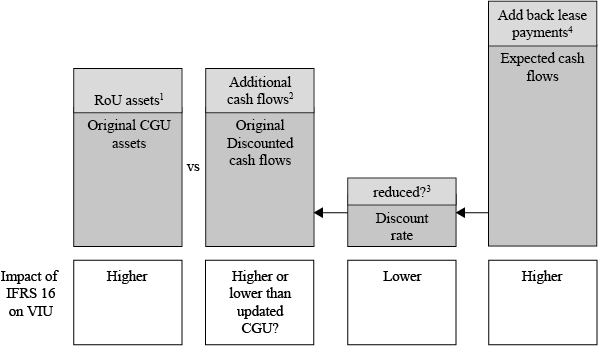
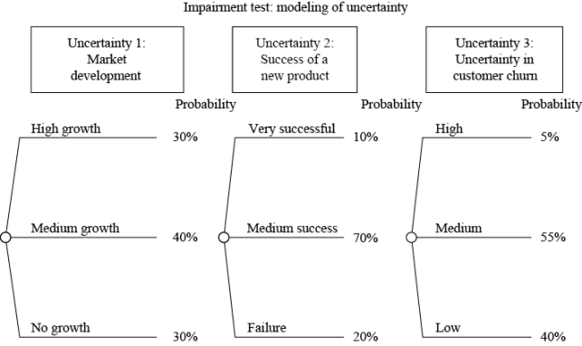

# 24 - Impairment of assets (IAS 36)

[返回目录](README.md)

## Illustrative text

### EX 24.12.1 – Impairment indicator: reduced selling price of recently acquired asset

 

Reference to standard: IAS 36 para 12  
 Reference to standing text: [24.12](41.md#s154-Para_24.12)

  

**Example**

Entity A bought (and capitalised) a computer system off the shelf for £2 million. Shortly afterwards, the manufacturer dropped the selling price to £1.5 million.

**Analysis**

A change in the market value of an asset is an indicator of impairment.

 

### EX 24.12.2 – Impairment indicator: trends that develop over time

 

Reference to standard: IAS 36 para 12  
 Reference to standing text: [24.12](41.md#s154-Para_24.12)

  

Indicators might assume more significance over time (for example, as general market conditions worsen or as an entity’s performance gradually deteriorates). Entities should be alert to such trends and to their potential for becoming indicators of impairment.

Management should have such trend information readily available. It is a judgement as to when a particular trend becomes significant enough to be deemed an impairment indicator.

**Example**

An entity is in the business of manufacturing diesel engines. Industry forecasts indicate a decrease in demand for the entity’s product over the next five years, due to the introduction of low emission zones in many cities all over the world. The low emission zones operate to encourage diesel vehicles to be replaced with vehicles that use an alternative fuel type that produces less greenhouse gas emissions. In response to this change in the market, growth in demand for electric vehicles is expected with a corresponding decrease in demand for diesel vehicles .

**Analysis**

Management should consider this trend in assessing impairment. External trends, as well as discrete events, might indicate that an asset is impaired.

Trends such as overcapacity in a particular industry, or a change in the demand for a product due to technological, market or other conditions, should be considered in assessing impairment.

Management’s ability and plans to reverse negative trends should be considered in assessing impairment.

 

### EX 24.12.3 – Impairment indicator: government price controls

 

Reference to standard: IAS 36 paras 12,13  
 Reference to standing text: [24.12](41.md#s154-Para_24.12) Power and utilities

  

**Example**

Entity A is a water and sewage entity, with a countrywide water and sewage network. Although entity A is a listed entity, the government is the controlling shareholder.

Management has asked the government to allow a 3% increase in prices in order to cover recent cost increases. This is a regulated business, and any price rise must be authorised by the government. The government has only authorised a 0.5% price increase.

**Analysis**

The fact that the government has not approved the requested price increase is an indication that the entity’s assets used in the water and sewage network might be impaired. The assets should be tested for impairment.

 

### EX 24.12.4 – Impairment indicator: change of asset’s use

 

Reference to standard: IAS 36 paras 12, 13  
 Reference to standing text: [24.12](41.md#s154-Para_24.12) 

  

**Example**

Entity X uses asset M to manufacture product A. There has been a significant reduction in demand for product A as a result of a change in consumer taste. Asset M can be used by entity X in the manufacture of its new product T with minimal reconfiguration.

**Analysis**

Entity X should review asset M for impairment. The change in use is an indicator of impairment. Entity X’s management will need to assess the impact of both the change in consumer tastes and the asset’s proposed change of use on the asset’s recoverable amount.

 

### EX 24.12.5 – Impairment indicator: introduction of a superior competitor product

 

Reference to standard: IAS 36 paras 12, 13  
 Reference to standing text: [24.12](41.md#s154-Para_24.12)

  

**Example**

Entity Q produces printers for home computers and has, for some time, been the market leader. Its chief competitor, entity R, has recently developed a new product that is widely acknowledged as being superior to that of entity Q, because it has the ability to also photocopy documents, send and receive facsimile and colour-print photographs.

Entity Q’s management has not performed an impairment review on its plant, on the grounds that annual production and sales are ahead of budget.

**Analysis**

Entity Q should review its plant and equipment for impairment. The change in the market for its product can have a significant impact on the equipment’s value, based on the economic benefit to be obtained from its continued use.

The existence of a conflicting indicator (sales ahead of budget) is not sufficient to negate the need for an impairment review. Management will be required to assess the impact of this new competing product on demand for its existing product and on expected future cash flows.

 

### FAQ 24.12.6 – Is an economic downturn always an impairment indicator?

 

Reference to standard: IAS 36 paras 12, 13  
 Reference to standing text: [24.12](41.md#s154-Para_24.12) 

  

**Question**

Is an economic downturn always an impairment indicator?

**Answer**

An economic downturn would not always be considered a triggering event for impairment testing in its own right. However, it might result in any number of the following indicators:

- Actual figures are significantly lower than the original budget.

- Cash flow is significantly lower than earlier forecasts.

- Material decreases in mid-term and/or long-term growth rates, as compared to the previous estimates.

- Significant or prolonged decrease in the entity’s stock price.

- Market capitalisation less than book value of net assets.

- Announced change in business model, restructuring or discontinued operations.

- Increases in the cost of capital.

- Change of market interest rates or other market rates of return.

- Fluctuations in the foreign exchange rates or commodity prices that impact the entity’s cash flows.

- Deferral of investment projects.

- Significant or prolonged decrease in the entity's stock price.

This list is not comprehensive and other indicators might present themselves. The indicators above and in the standard are examples only.

 

### EX 24.17.1 – Customer announces plant closure after the year end

 

Reference to standard: IAS 10 paras 8, 10  
 Reference to standing text: [24.17](41.md#s154-Para_24.17)   
Automotive

  

**Example**

Entity A is a major supplier to a car manufacturer, entity Z. Its year end is 30 June. In August, entity Z announces the closure of its manufacturing plant in the UK in two years’ time. As a result of this, entity A’s plant and machinery, which is dedicated to supplying entity Z, will have a remaining useful life of only two years. In addition, the entity’s factory premises will be impaired, because they have no alternative use.

**Analysis**

Entity Z’s decision to close the plant is an indicator of impairment. If the entity was not aware of the decision until the August announcement, the impact from plant closure is a non-adjusting event, and any impairment that might result should be recognised in the year when entity Z announces its decision.

However, if entity A was aware at 30 June that entity Z was intending to close its plant, it would be appropriate to book an impairment at the year end.

 

### EX 24.17.2 – Impairment triggers after the year end

 

Reference to standard: IAS 10 paras 8, 10  
Reference to standing text: [24.17](41.md#s154-Para_24.17)  

  

**Example**

ABC Plc has a subsidiary, XYZ Ltd, which has a carrying value on consolidation of £30m, including £5m of goodwill. Management has performed an annual impairment review using ViU, which showed no impairment.

Post-year end, prior to the accounts being signed, ABC Plc is approached by a third party to purchase XYZ Ltd for £28m. Management has agreed to sell XYZ Ltd, because it wants to raise cash to settle some existing debt in the remaining group. By settling the debt early, the group is likely to save up to £1m per year for five years; management therefore believes that it would be sensible to sell XYZ Ltd.

Is the goodwill associated with XYZ Ltd impaired at the year end, and does this result in an adjusting post balance sheet event?

**Analysis**

The fact that management is accepting an offer lower than the carrying value of the entity might indicate an impairment at the balance sheet date. Normally, an impairment loss might be recognised if the entity becomes aware of conditions after the balance sheet date that must have existed at the balance sheet date. The lower offer does not necessarily reflect the fair value of the subsidiary at the balance sheet date, nor does it indicate that there were impairment triggers in place at the balance sheet date. Management could accept a lower price, in some circumstances, because it might want to obtain cash quickly; this is the case here, whereby management wishes to realise cash in order to settle debt in the remaining group. This would not be regarded as an impairment indicator.

This transaction would result in a disclosable, non-adjusting post-balance-sheet event according to paragraph 22 of IAS 10, if it is material (see [chapter 9 para 11](17.md#s55-Para_9.11)).

 

### EX 24.21.1 – Timing of impairment test

 

Reference to standard: IAS 36 para 96  
 Reference to standing text: [24.21](41.md#s154-Para_24.21)

  

**Example**

Entity A, a telecommunications entity, has goodwill and intangibles with indefinite useful lives. Entity A’s year end is 31 December. These assets are required to be tested annually for impairment under IAS 36, irrespective of indicators of impairment.

**Analysis**

It is acceptable to perform impairment tests at any time in the financial year, provided that they are prepared at the same time each year. An entity might choose to perform its impairment test at a less busy time of the year (for example, not at year end). Entity A could perform an impairment review using 30 September balances, which would be at the same time as it completes its budgeting process for the subsequent year.

Performing the review based on September balances gives the entity sufficient time before the year end to assess the appropriateness of cash flows, the discount rate and assumptions behind the calculation.

Management can additionally start to consider the disclosure requirements.

If any of the assumptions change or there is a further impairment trigger at the year end, the calculation is required to be updated.

 

**Relate****d information**

### FAQ 24.21.2 – Can the timing of an impairment test be changed?

 

Reference to standard: IAS 36 para 96  
 Reference to standing text: [24.21](41.md#s154-Para_24.21) 

  

**Question**

Entities might wish to change the timing of their impairment test. This might be, for example, to align impairment testing with the budget cycle. The annual impairment test of goodwill is carried out at the same time each year. To the extent that the period between tests is less than one year, and the change is not made to achieve a specific result (that is, to avoid an impairment charge), we would consider it acceptable to change the date of the annual impairment test. It would generally not be appropriate to change testing dates in consecutive years. It would be necessary to perform the impairment test again before the year end if a triggering event occurs after the date of the revised impairment test.

Consider the following example. Company A has historically performed its annual goodwill impairment test at 31 October rather than at its 31 December year end. The company identifies an impairment of goodwill when performing the annual impairment test at 31 October. Later in December, there was a significant improvement in market conditions and the adverse impact on the company A’s business has materially reduced.

The company does not prepare IAS 34 compliant interim reports. Is the company permitted to change the timing of the impairment test of goodwill, and consequent recognition of any impairment to year end, to reflect the year end recoverable amount?

**Answer**

No. It is not acceptable to extend the period between annual tests beyond 12 months. Company A should not defer the test because it believes that the adverse impact of the market conditions on its business will have reduced by year end. Company A is required to perform its annual testing at the same time every year and so cannot avoid the 31 October test, and it must book any impairment loss identified. Company A would not be able to reverse any goodwill impairments recognised at the annual goodwill test date, but it might be able to reverse any non-goodwill impairments (such as property, plant and equipment) at future reporting dates.

Company A might be required to test again at year end if additional indicators of impairment (or impairment reversal) arose in the intervening period.

Note that, if an entity had already performed an impairment test for previous IAS 34 interim reporting during the year because there was an impairment indicator, the annual goodwill impairment test must still be performed.

See also [FAQ 24.100.1](42.md#s161-FAQ_24.100.1) on how impairment tests that incorporate cash flow forecasts can be more reliably performed in periods of uncertainty.

 

### FAQ 24.21.3 – Is an impairment test needed at the time of a reorganisation?

 

Reference to standard: IAS 36 paras 96, 12  
 Reference to standing text: [24.21](41.md#s154-Para_24.21) 

  

**Question**

Is an impairment test needed at the time of a reorganisation?

**Answer**

If an entity reorganises its structure, this might result in the reallocation of goodwill between CGUs. We would not usually consider the reorganisation process itself to be an impairment trigger, but the reasons for the reorganisation might well identify impairment indicators. An impairment test would be performed if there were any impairment indicators prior to the year end. The entity might wish to perform an impairment review under the new structure.

 

### EX 24.21.4 – Events after the annual impairment review

 

Reference to standard: IAS 36 para 98  
 Reference to standing text: [24.21](41.md#s154-Para_24.21)

  

**Example**

An entity in the automotive component supply business has a 31 December year end. The annual impairment review was carried out in September 20X8, in line with budgeted information. In October 20X8, two major customers announced the closure of their sites for a prolonged period.

**Analysis**

This is an indicator of impairment, and so the entity should perform an additional impairment test in the period (for example, October to December 20X8, based on updated forecasts, instead of waiting until September 20X9).

 

### EX 24.25.1 – Test impairment at the individual asset level where possible

 

Reference to standard: IAS 36 para 66  
 Reference to standing text: [24.25](41.md#s155-Para_24.25) 

  

**Example**

Machine B is one of the assets used within a CGU. Machine B has become redundant and is being abandoned by management. The recoverable amount of the CGU (which is profitable) that contains machine B, exceeds its carrying amount.

**Analysis**

Machine B will be removed from the CGU and tested for impairment separately as its recoverable amount can be determined. Machine B’s recoverable amount will be the higher of value in use (zero) or fair value less cost of disposal (scrap value).

 

### EX 24.26.1 – Asset that does not generate separate cash inflows: infrastructure

 

Reference to standard: IAS 36 para 67  
 Reference to standing text: [24.26](41.md#s155-Para_24.26)   

  

**Example**

An entity owns and operates a large waste recycling plant and a private railway that transports the processed waste in containers from the plant to the main public rail network. The private railway could be sold only for scrap value, and it does not generate cash inflows from continuing use that are largely independent of the plant’s cash inflows as a whole.

**Analysis**

It is not possible to estimate the private railway’s recoverable amount, because the railway’s value in use cannot be determined. The entity should estimate the recoverable amount of the CGU (that is, the plant and railway as a whole) to which the railway belongs.

 

### EX 24.26.2 – Asset that does not generate separate cash inflows: licence

 

Reference to standard: IAS 36 para 67  
 Reference to standing text: [24.26](41.md#s155-Para_24.26)  

  

**Example**

An entity that provides mobile telephone services in a number of countries under a single strong global brand is acquired. The acquirer recognises the licence to provide services in each country, and it recognises a group of trademarks and trade names that it groups as the brand. The brand is assigned an indefinite useful life. The licences have fixed terms with significant costs to renew or a requirement to renew at an auction, and they have all been assigned finite useful lives.

**Analysis**

The licence in each country should be grouped with the CGU or CGUs in each country for the purpose of impairment testing. The individual CGUs should be tested first for impairment if there are indicators of impairment. The brand would need to be included in the group of CGUs comprising all of the countries that benefit from the brand. The existence of the brand, an indefinite-lived intangible asset, imposes a requirement for annual impairment testing for the groups of CGUs that benefit from it.

 

### FAQ 24.28.1 – When should a building be considered separately for impairment testing?

 

Reference to standard: IAS 36 paras 22, 66  
 Reference to standing text: [24.28](41.md#s155-Para_24.28) 

  

**Question**

A CGU includes a building, and that asset has a readily determinable market value. There is a trigger that the building is impaired. Should the building be considered separately for impairment testing?

**Answer**

The building will be considered separately from the CGU, for the purpose of impairment testing, if its fair value less costs of disposal is clearly higher than its carrying amount. The head office building would be tested as part of the CGU if the fair value was less than its carrying amount, because it does not generate cash inflows independently.

 

### FAQ 24.28.2 – How should individual assets be considered for impairment in a closure of a division?

 

Reference to standard: IAS 36 para 105  
 Reference to standing text: [24.28](41.md#s155-Para_24.28) 

  

**Question**

An entity is closing a division after the year end. No provision has been made for redundancies at the year end, because the announcement of the closure was not made until after the year end. However, the entity is looking at impairment of the division’s assets. The plant and equipment is likely to be impaired, because the recoverable amount is expected to be lower than the carrying amount, but the property is expected to be sold at a profit and meets the IFRS 5 criteria of an asset held for sale at the year end.

In determining the charge for impairment at the year end, does the entity consider the division’s total assets, including the property, as one CGU, or does it look at individual assets? The profit expected to be made on the property is large enough to offset the impairment on the plant.

**Answer**

Assets should be individually considered for impairment if there is any indication that the asset is impaired and the asset generates independent cash inflows. Since the property is to be sold separately from the plant and equipment, the cash flows are independent. The plant and equipment is impaired, and the impairment should be booked in the current year financial statements.

 

### FAQ 24.28.3 – How does a decision to vacate a floor in a leased office building impact the impairment testing?

 

Reference to standard: IAS 36 para 22, IFRS 16 para B32  
Reference to standing text: [24.28](41.md#s155-Para_24.28)  

  

 

**Background**

 

Entity A leases three floors of an office building under a single lease contract. The lease is based on fixed lease payments and is non-cancellable. During the financial year, the entity made a decision that, going forward, employees will spend less time in the office and would partially work from home; therefore, one of the three floors would be surplus to requirements and was fully vacated before the year-end. Each floor is capable of being used separately, because each floor has access to the lift and its own facilities, and each floor does not depend on the other floors. Entity A remains profitable despite the new ways of working. The remaining lease term is material. 

 

**Question**

 

How does the decision to vacate one of the leased floors in the office building impact the impairment testing of the right-of-use asset?

 

**Answer**   

 

Lease accounting should be applied at the lowest component (that is, unit of account). At inception, a lessee should consider whether the lease contains more than one component, applying the criteria in paragraph B32 of IFRS 16.

 

The different floors are separate lease components, according to paragraph B32 of IFRS 16, because each floor is capable of being used separately and each floor does not depend on the other floors. Accordingly, and despite the fact that entity A might have accounted for the building as a single leased asset (for practical purposes) at lease inception, entity A should now account for the floor being vacant as a separate lease component.

 

If entity A accounted for the building as a single right-of-use asset at lease commencement, the carrying amount of the right-of-use asset would need to be allocated to the two lease components (that is, (1) the vacant floor, and (2) the occupied floors) identified by entity A. Generally, we believe that the allocation should be based on the relative fair value of the lease components at the lease commencement date.

 

Subsequent measurement of the carrying value allocated to the vacant floor is further considered in the two scenarios below. It might be necessary to revise the useful economic lives of the right-of-use assets (see Scenario 2).

 

Scenario 1

 

Entity A is permitted to sublease individual floors, based on the terms of the head lease.

 

One of the three floors was fully vacated before the year-end, and management started marketing the property for sublease. This should be treated as an impairment indicator [IAS 36 para 12], and the associated right-of-use asset should be assessed for impairment.  

 

Because entity A determined the vacant floor to be a separate unit of account, and there is a market for subleasing the individual floors, the recoverable amount would be determined separately for the floor that is expected to be subleased; the remaining floors would likely be considered corporate assets that form part of a larger CGU, which might also have an impairment trigger as a result of the decision to sublease the vacant floor and no longer use it in the larger CGU. 

 

The recoverable amount for the vacant floor would be the higher of value in use (‘VIU’) and fair value less cost of disposal (‘FVLCD’). If management made a decision to vacate the floor and committed to the sublease plan, the VIU and FVLCD are likely to give a similar recoverable value and would be based on the expected cash flows from the sublease based on the available market data. Calculation of the recoverable value would include an estimate of the idle time required to find a new tenant. If the expected sublease payments receivable are insufficient to recover the right-of-use asset attributable to that floor, it would likely be impaired.

 

If there is no market for subleasing the individual floors, this is similar to being unable to sublease according to the head lease (see Scenario 2).

 

Scenario 2

 

Entity A is not permitted to sublease individual floors based on the terms of the head lease.

 

In this case, the vacant floor would not represent a separate CGU and would not be tested for impairment on its own. This is because the criteria in paragraph 22 of IAS 36 (that is, to test the asset individually) are not met, the asset would not be able to generate independent cash inflows, and its VIU (of nil) would not be close to its FVLCD. Where there is a market for renting office floors, there would be a reliably measurable FVLCD. There would be no immediate impairment of the vacant floor if the value is supportable by the overall CGU to which the floor belongs, given that the floor cannot generate independent cash inflows in this scenario. The decision to vacate the floor might be an impairment indicator for the CGU in which the right-of-use asset is included.

 

The vacant floor still represents a separate lease component under the head lease for IFRS 16 purposes and a separate unit of account for IAS 16 purposes. [IFRS 16 App B para B32]. [IFRS 16 App B para B20]. [IAS 16 para 9]. [IAS 16 para 44]. Consequently, the change in expected use of this specific floor would trigger review of its useful life in accordance with paragraph 51 of IAS 16. The decision to vacate the floor would lead to the useful life being shortened to the period between the date when the decision was made and the date when the floor is actually vacated. The right-of-use asset would be depreciated over this shorter useful life from the date of the decision. This is similar to the conclusion in FAQ 22.100.2.

 

This FAQ is focused on leased properties; however, similar impairment considerations might also apply to vacant floors in owned buildings.

 

### EX 24.29.1 – Indefinite-lived intangible asset

 

Reference to standard: IAS 36 para 68  
 Reference to standing text: [24.29](41.md#s155-Para_24.29) 

  

**Example**

An entity has a brand with an indefinite useful life that does not generate independent cash inflows since it is only used for marketing products produced by the entity.

**Analysis**

There is no indicator for impairment, but because the useful life is indefinite, the brand must be tested annually. The only circumstances under which a brand that does not generate independent cash inflows can be tested for impairment as an individual asset rather than as part of a CGU are when all of the following conditions are met:

- The asset has an indefinite useful life.

- There is no indicator of impairment (that is, annual test is being performed).

- Fair value less costs of disposal can be determined for the brand.

- Fair value less costs of disposal exceeds the carrying amount, that is, there is no impairment.

All other conditions will lead to testing the brand at the level of the CGU, or group of CGUs, associated with the brand.

 

### EX 24.30.1 – Determination of CGU

 

Reference to standard: IAS 36 para 68  
 Reference to standing text: [24.30](41.md#s155-Para_24.30)

  

**Example**

Entity H uses asset O to manufacture plastic components that are sold to third parties. Entity H’s management has discontinued production of the components as a result of a fall in demand, and it has reconfigured the asset for use in the manufacture of product T. Revenues from the sale of product T cannot be directly attributed to any single asset used in its manufacture.

**Anal****ysis**

Asset O will only render economic benefit as part of product T’s CGU. Because revenues from the sale of product T cannot be directly attributed to any asset, asset O will be tested for impairment as part of T’s CGU. It is not possible to determine asset O’s recoverable amount on a stand-alone basis.

The recoverable amount of the entire CGU will be compared with the carrying value of the entire CGU, including asset O, in order to identify any impairment.

 

### EX 24.32.1 – Individual hotels and retail operations

 

Reference to standard: IAS 36 para 69  
 Reference to standing text: [24.32](41.md#s155-Para_24.32)

  

**Example**

Individual hotels usually generate cash inflows that are largely independent of others, and their performance is monitored closely by management on an individual basis.

**Analysis**

It is, therefore, probable that they form individual CGUs, even if there are central sales and marketing and finance functions.

Similarly, in retail operations each individual store would generally be a CGU, because it generates independent cash inflows.

Management might monitor goodwill on a regional basis by aggregating stores, hotels, or transport routes by region or by some other criteria that relate to how the entity is managed. Goodwill is reviewed at the higher level.

 

### EX 24.32.2 – Magazine titles that are separate CGUs

 

Reference to standard: IAS 36 paras 69, IE17–IE19  
 Reference to standing text: [24.32](41.md#s155-Para_24.32)

  

**Example**

Entity A owns 150 titles, 70 of which were purchased and 80 were created internally. The costs of purchasing the 70 titles are capitalised as an intangible, and the costs of creating titles internally are written off. Cash inflows from sales and advertising are separately identifiable for each title. Titles are managed by customer segments. The level of advertising income for a title depends on the range of titles in the customer segment to which the title relates. The management policy is to abandon titles before the end of their useful economic lives and replace them with new, internally generated titles for the same customer segment.

**Analysis**

Individual titles are CGUs. Cash inflows for each individual title can be identified, even though the advertising income for each title might be influenced by the range of titles in the customer segment to which it belongs. In addition, although titles are managed by customer segment, decisions to abandon titles are made on an individual title basis.

 

### EX 24.32.3 – Indefinite-lived intangible asset (brand)

 

Reference to standard: IAS 36 para 69  
 Reference to standing text: [24.32](41.md#s155-Para_24.32) 

  

**Example**

A CGU is defined as the smallest group of assets that generate cash inflows that are largely independent of each other. A brand is normally used to support production of a branded product, and the revenues from sales of the branded product are not capable of being split between revenue for the brand and revenue for the costs of production.

**Analysis**

A brand is typically not a CGU, and it should not normally be tested alone. The brand should be tested with the associated manufacturing CGU or group of CGUs.

 

### EX 24.32.4 – Integrated businesses treated as country CGUs

 

Reference to standard: IAS 36 para 68  
 Reference to standing text: [24.32](41.md#s155-Para_24.32)

  

**Example**

Entity A, a telecommunications entity, owns an integrated voice and data network over several countries. The network is connected end-to-end over entity A’s footprint. Each country network comprises city rings, regional rings and a long-distance network.

The network assets and associated revenue streams in each country are recorded and monitored independently.

Entity A makes decisions on the deployment of resources on a geographical basis. Entity A can distinguish between voice and data revenues. However, because the voice and data networks are integrated, it is not possible to identify specific assets or groupings of assets that generate either voice or data revenues.

**Analysis**

Entity A should classify each country as a separate CGU in these circumstances. Entity A can reliably identify and measure cash flows generated from each country’s asset base. This represents the smallest identifiable group of assets that generate independent cash flows that are monitored by management.

Entity A cannot reliably measure, and does not monitor separately, the cash flows from the city and regional rings or from the long-distance network. Although entity A can identify revenue from voice and data services separately, it cannot attribute those cash flows to distinct network assets. The appropriate CGUs are, therefore, on a country-by-country basis.

 

### EX 24.32.5 – Transport entities

 

Reference to standard: IAS 36 para 69  
 Reference to standing text: [24.32](41.md#s155-Para_24.32) 

  

**Example**

Entities involved in the transport business commonly provide services on a number of routes. The assets deployed to each route and that route’s cash inflows can usually be separately identified.

**Analysis**

Each route can be identified as a CGU, even though the entity might market its services on a regional basis.

Loss-making routes will be an indicator of impairment, except if a regulatory requirement dictates that these routes be serviced alongside the entity’s more profitable routes.

 

### EX 24.32.6 – Different locations but centralised functions

 

Reference to standard: IAS 36 para 69  
 Reference to standing text: [24.32](41.md#s155-Para_24.32)

  

**Example**

Entity A runs a fast food restaurant chain. Each restaurant is supplied by Entity A’s central purchasing and distribution system. There are five restaurants in London (but in different neighbourhoods), and another 50 in other cities and towns in the United Kingdom. All of the restaurants are managed in the same way. Pricing, marketing, advertising, and personnel policy (except for the local recruitment of waiters and kitchen staff) is decided centrally by Entity A. Seven of the restaurants were purchased five years ago, and goodwill was recognised.

**Analysis**

In determining the CGU in this situation, several factors should be considered, including whether:

- Performance is monitored on an individual restaurant basis, or at regional or other levels—for example, considering the lowest level at which meaningful profitability statements are produced.

- Product offering and investment decisions are made at individual, regional, or other grouping levels.

- Individual outlets generate business for other parts of the network.

- Units are managed on a combined basis, share systems, centralized purchasing, and distribution functions.

- Product pricing is determined locally or on a regional or national basis.

All the restaurants are in different neighbourhoods and probably have different customer bases. Each restaurant generates cash inflows that are largely independent from the cash flows of the other restaurants, and therefore it is likely that each restaurant is a CGU in this situation. The goodwill arising on the acquisition of the seven restaurants would have been allocated to the group of CGUs that incorporated the seven restaurants or other CGUs that benefited from the business combination.

Each restaurant (CGU) should be tested for impairment when there is an indicator. Only after the underlying assets are tested for impairment should the group of restaurants and goodwill be tested for impairment.

 

### EX 24.35.1 – CGUs in a vertically integrated group

 

Reference to standard: IAS 36 para 70  
 Reference to standing text: [24.35](41.md#s155-Para_24.35)

  

**Example**

Entity P is a vertically integrated electricity utility. It has three distinguishable businesses: generation, distribution and supply. There are active markets for the output of the generation and distribution businesses. The generation business sells power to the distribution business, which distributes electricity to the supply business.

**Analysis**

Each business is considered a separate CGU.

Management should use external prices when determining value in use for a CGU in a vertically integrated operation.

 

### FAQ 24.35.2 – How should vertically integrated CGUs be analysed?

 

Reference to standard: IAS 36 para 70  
 Reference to standing text: [24.35](41.md#s155-Para_24.35) 

  

  
 The reporting entity has two plants. Plant A produces raw material, that is sold to plant B of the same entity, at a price that transfers all of the margins to plant A. Of plant A’s production, 60% is sold to plant B, and 40% is sold to external customers outside the reporting entity. Of plant B’s production, 80% is sold to the reporting entity’s external customers.

**Question 1**

What are the CGUs for plants A and B, where plant A could sell its production in an active market instead of to plant B?

**Answer**

There is an active market for plant A’s production, so it is likely that plant A is a separate CGU. Plant B would also be a separate CGU, because it sells 80% of its output externally, and so it generates cash inflows that are largely independent of the cash inflows from the reporting entity’s other assets. In the financial forecasts and budgets used for determining the recoverable amount for both plants A and B, the internal transfer prices for the production sold by plant A to plant B should be adjusted to arm’s length prices.

**Question 2**

What are the CGUs for plants A and B, where there is no active market for the production of plant A?

**Answer**

There is no active market for the output of plant A, and the cash inflows of plant A depend on the demand for the product sold by plant B. Plant A does not generate cash inflows that are largely independent of the cash inflows of assets operated by plant B. Also, the two plants are managed together, as the use of internal transfer prices demonstrates. Therefore, the two plants should be treated as one CGU.

 

### EX 24.43.1 – Restoration obligation part of the CGU’s carrying amount

 

Reference to standard: IAS 36 para 78  
 Reference to standing text: [24.43](41.md#s155-Para_24.43)

  

**Example**

An entity operates a mine and has made a provision, in accordance with IAS 37, for the costs of restoration of the site when mining operations are completed. The provision represents the cost of restoring the damage that was done to the site when the mine was opened, and the same amount has been capitalised as part of the cost of the mine and is being depreciated over the mine’s life. The mine is a single CGU, and any purchaser would be required to take over the obligation for restoration if the mine was sold.

**Analysis**

The restoration is taken into consideration in the fair value less costs of disposal. The carrying amount of the CGU must also take into account the recognised liability for restoration costs in determining the carrying amount of the CGU, to compare like with like.

 

### FAQ 24.43.2 – What is IFRIC's view on paragraph 78 of IAS 36?

 

Reference to standard: IAS 36 para 78  
 Reference to standing text: [24.43](41.md#s155-Para_24.43) 

  

**Question**

What is IFRIC's view on paragraph 78 of IAS 36?

**Answer**

In May 2015, the IFRS Interpretations Committee (‘IFRIC’) issued a rejection to clarify the application of paragraph 78 of IAS 36.

In the agenda decision the IFRIC observed that an entity should deduct the carrying amount of the recognised liability in determining both the CGU’s carrying amount and its ViU. For example, if a decommissioning liability is calculated using IAS 37, the IAS 37 value would be removed from both the carrying amount of the CGU and the ViU, and the cash flows relating to the liability would not be included in the ViU model.

 

### FAQ 24.43.3 – How does a restoration obligation impact a ViU model?

 

Reference to standard: IAS 36 para 78  
 Reference to standing text: [24.43](41.md#s155-Para_24.43) 

  

**Question**

How does a restoration obligation impact a ViU model?

**Answer**

The recoverable amount of the asset is determined under the ViU cash flow model approach described in paragraphs 30 to 57 of IAS 36. The ViU cash flow model excludes the cash outflows for decommissioning provision. The recorded amount of the provision is deducted from the amount determined in the ViU model to produce a net recoverable amount. The net recoverable amount is then compared to the carrying amount of the cash generating unit including the decommissioning provision under IAS 37.

It is not appropriate to include the cash outflows for the decommissioning obligation in the ViU cash flow model. The model uses a discount rate that is specific to the assets being tested, reflects the time value of money and the return investors would require to invest in the asset. The performance of the asset will have a number of uncertainties associated with it; demand, price and operational risk among others.

The cash outflows associated with the decommissioning obligation have different uncertainties associated with them, but these are more around amount and timing rather than occurrence or performance risk. Future sales might be uncertain but the need to restore at the end of the asset’s life is not. The effect of discounting these cash outflows using the asset rate rather than the risk free rate required by IAS 37 is likely to materially decrease the amount of the liability; this effect is known as the ‘discount rate cushion’.

 

### FAQ 24.43.4 – How does a restoration obligation impact a FVLCD model?

 

Reference to standard: IAS 36 para 78  
 Reference to standing text: [24.43](41.md#s155-Para_24.43) 

  

**Question**

How does a restoration obligation impact a FVLCD model?

**Answer**

The impairment standard has little specific guidance on determining FVLCD generally and none on how to use FVLCD as the recoverable amount for a cash generating unit with a non-separable liability. Fair value is almost always developed using a cash flow model to produce an enterprise value unless there is a binding offer in place to sell the relevant asset or business. Fair value is defined in IAS 36 as the price that would be paid to sell an asset or assume a liability. The challenge arises both from the different approaches that might be taken to measure assets and liabilities at fair value as well as the practical approach often used by valuers.

Valuation practice is to produce a single cash flow model that produces a fair value for the business (cash generating unit) that includes the cash outflows for the liability. This approach is consistent with how a market participant would think about determining the fair value of the business. The core asset might have a very long life, and decommissioning or restoration is many years in the future. Cash outflows for an obligation that will commence in 20 years in the future would seldom be specifically modelled, even by a party looking to buy the assets, but would be incorporated in a terminal value in the cash flow model.

However, if the cash-generating unit is coming to the end of its life and the cash flows are imminent (say expected to begin within the next five years or the period covered by the specific projections), a market participant might take a different approach to consider at what price it is willing to transact for the assets and the non-separable liabilities.

An alternative approach would be to calculate the fair value of the asset excluding the cash outflows to satisfy the liability and discount those using a market participant discount rate. Separately, the liability would be calculated using market participant assumptions, rather than an IAS 37 approach. The liability measurement should reflect the amount the entity would need to pay a third party to assume the obligation, this would include a profit margin to the third party, plus a margin for estimation risk (that it might be underestimated) and similar market participant type assumptions. This is likely to produce a higher value for the liability than under IAS 37. The amount determined for the liability would then be deducted from the amount determined for the asset to produce a ‘net’ fair value.

The recoverable amount determined under FVLCD under either of the valuation approaches described is then compared to the carrying amount of the CGU including the decommissioning obligation measured under IAS 37.

 

### FAQ 24.44.1 – How do hedging instruments impact impairment testing?

 

Reference to standard: IAS 36 para 79  
 Reference to standing text: [24.44](41.md#s155-Para_24.44) 

  

**Question**

Management might use hedging instruments, such as swaps and collars, to hedge cash flows. How do such hedging instruments impact impairment testing?

**Answer**

The cash flows prepared for the value in use calculation should reflect management’s best estimate of the future cash flows expected to be generated from the assets in the CGU. Management should use the contracted price for the relevant cash flows in its value in use calculation, unless the contract (for example, the hedging instrument) is already on the balance sheet at fair value.

The instrument is accounted for under IFRS 9 (IAS 39). The hedged cash flows are included in the value in use calculation at the spot price at the date of the impairment test. Impairment of financial instruments is addressed by IFRS 9 (IAS 39). Including the contracted prices of a contract already on the balance sheet at fair value would double count the effects of the contract.

One approach is to exclude working capital balances (including commodity contracts recognised at fair value in accordance with IFRS 9 (IAS 39) from both the CGU’s carrying amount and the cash flows of the value in use calculation. Alternatively, following the principle of comparing like with like, the balances can be left in the CGU, with the associated cash flows (that is, the hedged cash flows at the hedged rates) being included in the value in use calculation.

 

### FAQ 24.44.2 – How does IFRS 16 impact impairment testing?

 

Reference to standard: IAS 36 para 75  
 Reference to standing text: [24.44](41.md#s155-Para_24.44) 

  

**Question**

How does IFRS 16 impact impairment testing?

**Answer**

Under IFRS 16, most leases are on the lessee’s balance sheet as right of use assets. Each right of use asset will be allocated to a cash generating unit. Guidance on how to account for leased assets and liabilities in an impairment test is not included in IAS 36. An acceptable approach would be as follows:

- Include the right of use asset in the carrying amount of the CGU.

- Exclude the lease liability from the carrying amount of the CGU because it relates to financing.

- Exclude the cash outflow for the lease payments which are included in the lease liability in the ViU calculation. This compares like with like as the liability has not been included.

- Include the cash outflow for lease payments which are excluded from the lease liability in the ViU calculation. Lease payments which are excluded from the lease liability include variable payments which are not based on an index or rate or leases using the low-value or short-term exemptions.

- Include cash outflows to replace leased assets which are essential to the ongoing operation of the CGU, which could be in the form of future lease payments or future capital expenditures.

 

### EX 24.45.1 – Comparing like with like when including working capital balances

 

Reference to standard: IAS 36 para 79  
 Reference to standing text: [24.45](41.md#s155-Para_24.45) 

  

**Example**

Entity A is performing a value in use test for a CGU with a finite life and no terminal value. The carrying value of assets, excluding working capital balances, is C180. The carrying value of working capital balances is C9. The expected future discounted cash flows and movements in working capital are given below.

<table style="width:100%; border-collapse:collapse"><tr><td style="border:0.75pt solid #000000; padding-right:5.03pt; padding-left:5.03pt; vertical-align:top">
 
</td><td style="border:0.75pt solid #000000; padding-right:5.03pt; padding-left:5.03pt; vertical-align:top">
<b>Year 1</b>
</td><td style="border:0.75pt solid #000000; padding-right:5.03pt; padding-left:5.03pt; vertical-align:top">
<b>Year 2</b>
</td><td style="border:0.75pt solid #000000; padding-right:5.03pt; padding-left:5.03pt; vertical-align:top">
<b>Year 3</b>
</td><td style="border:0.75pt solid #000000; padding-right:5.03pt; padding-left:5.03pt; vertical-align:top">
<b>Year 4</b>
</td><td style="border:0.75pt solid #000000; padding-right:5.03pt; padding-left:5.03pt; vertical-align:top">
<b>Total</b>
</td></tr><tr><td style="border:0.75pt solid #000000; padding-right:5.03pt; padding-left:5.03pt; vertical-align:top">
 
</td><td style="border:0.75pt solid #000000; padding-right:5.03pt; padding-left:5.03pt; vertical-align:top">
<b>C</b>
</td><td style="border:0.75pt solid #000000; padding-right:5.03pt; padding-left:5.03pt; vertical-align:top">
<b>C</b>
</td><td style="border:0.75pt solid #000000; padding-right:5.03pt; padding-left:5.03pt; vertical-align:top">
<b>C</b>
</td><td style="border:0.75pt solid #000000; padding-right:5.03pt; padding-left:5.03pt; vertical-align:top">
<b>C</b>
</td><td style="border:0.75pt solid #000000; padding-right:5.03pt; padding-left:5.03pt; vertical-align:top">
<b>C</b>
</td></tr><tr><td style="border:0.75pt solid #000000; padding-right:5.03pt; padding-left:5.03pt; vertical-align:top">
Net cash flow
</td><td style="border:0.75pt solid #000000; padding-right:5.03pt; padding-left:5.03pt; vertical-align:top">
90
</td><td style="border:0.75pt solid #000000; padding-right:5.03pt; padding-left:5.03pt; vertical-align:top">
108
</td><td style="border:0.75pt solid #000000; padding-right:5.03pt; padding-left:5.03pt; vertical-align:top">
117
</td><td style="border:0.75pt solid #000000; padding-right:5.03pt; padding-left:5.03pt; vertical-align:top">
126
</td><td style="border:0.75pt solid #000000; padding-right:5.03pt; padding-left:5.03pt; vertical-align:top">
441
</td></tr><tr><td style="border:0.75pt solid #000000; padding-right:5.03pt; padding-left:5.03pt; vertical-align:top">
Movements in working capital
</td><td style="border:0.75pt solid #000000; padding-right:5.03pt; padding-left:5.03pt; vertical-align:top">
10
</td><td style="border:0.75pt solid #000000; padding-right:5.03pt; padding-left:5.03pt; vertical-align:top">
12
</td><td style="border:0.75pt solid #000000; padding-right:5.03pt; padding-left:5.03pt; vertical-align:top">
13
</td><td style="border:0.75pt solid #000000; padding-right:5.03pt; padding-left:5.03pt; vertical-align:top">
14
</td><td style="border:0.75pt solid #000000; padding-right:5.03pt; padding-left:5.03pt; vertical-align:top">
49
</td></tr><tr><td style="border:0.75pt solid #000000; padding-right:5.03pt; padding-left:5.03pt; vertical-align:top">
Cash flows, excluding movement in working capital
</td><td style="border:0.75pt solid #000000; padding-right:5.03pt; padding-left:5.03pt; vertical-align:top">
100
</td><td style="border:0.75pt solid #000000; padding-right:5.03pt; padding-left:5.03pt; vertical-align:top">
120
</td><td style="border:0.75pt solid #000000; padding-right:5.03pt; padding-left:5.03pt; vertical-align:top">
130
</td><td style="border:0.75pt solid #000000; padding-right:5.03pt; padding-left:5.03pt; vertical-align:top">
140
</td><td style="border:0.75pt solid #000000; padding-right:5.03pt; padding-left:5.03pt; vertical-align:top">
490
</td></tr></table>

**Analysis**

Method 1 – Including opening working capital

The cash flows are determined based on actual cash movements for each year, with no adjustment for the opening working capital. Total cash flows of C441 are compared to the carrying value of assets, including the opening working capital (C189). This results in a surplus of C252.

Method 2 – Excluding opening working capital

Under this method, the cash projections should include a one-off cash flow in year 1, because the entity ‘buys’ the working capital to perform its business. Year 1 also includes the normal working capital movement for that year.

<table style="width:100%; border-collapse:collapse"><tr><td style="border:0.75pt solid #000000; padding-right:5.03pt; padding-left:5.03pt; vertical-align:top">
 
</td><td style="border:0.75pt solid #000000; padding-right:5.03pt; padding-left:5.03pt; vertical-align:top">
<b>Year 1</b>
</td><td style="border:0.75pt solid #000000; padding-right:5.03pt; padding-left:5.03pt; vertical-align:top">
<b>Year 2</b>
</td><td style="border:0.75pt solid #000000; padding-right:5.03pt; padding-left:5.03pt; vertical-align:top">
<b>Year 3</b>
</td><td style="border:0.75pt solid #000000; padding-right:5.03pt; padding-left:5.03pt; vertical-align:top">
<b>Year 4</b>
</td><td style="border:0.75pt solid #000000; padding-right:5.03pt; padding-left:5.03pt; vertical-align:top">
<b>Total</b>
</td></tr><tr><td style="border:0.75pt solid #000000; padding-right:5.03pt; padding-left:5.03pt; vertical-align:top">
 
</td><td style="border:0.75pt solid #000000; padding-right:5.03pt; padding-left:5.03pt; vertical-align:top">
<b>C</b>
</td><td style="border:0.75pt solid #000000; padding-right:5.03pt; padding-left:5.03pt; vertical-align:top">
<b>C</b>
</td><td style="border:0.75pt solid #000000; padding-right:5.03pt; padding-left:5.03pt; vertical-align:top">
<b>C</b>
</td><td style="border:0.75pt solid #000000; padding-right:5.03pt; padding-left:5.03pt; vertical-align:top">
<b>C</b>
</td><td style="border:0.75pt solid #000000; padding-right:5.03pt; padding-left:5.03pt; vertical-align:top">
<b>C</b>
</td></tr><tr><td style="border:0.75pt solid #000000; padding-right:5.03pt; padding-left:5.03pt; vertical-align:top">
Net cash flow (as above)
</td><td style="border:0.75pt solid #000000; padding-right:5.03pt; padding-left:5.03pt; vertical-align:top">
90
</td><td style="border:0.75pt solid #000000; padding-right:5.03pt; padding-left:5.03pt; vertical-align:top">
108
</td><td style="border:0.75pt solid #000000; padding-right:5.03pt; padding-left:5.03pt; vertical-align:top">
117
</td><td style="border:0.75pt solid #000000; padding-right:5.03pt; padding-left:5.03pt; vertical-align:top">
126
</td><td style="border:0.75pt solid #000000; padding-right:5.03pt; padding-left:5.03pt; vertical-align:top">
441
</td></tr><tr><td style="border:0.75pt solid #000000; padding-right:5.03pt; padding-left:5.03pt; vertical-align:top">
Opening working capital
</td><td style="border:0.75pt solid #000000; padding-right:5.03pt; padding-left:5.03pt; vertical-align:top">
(9)
</td><td style="border:0.75pt solid #000000; padding-right:5.03pt; padding-left:5.03pt; vertical-align:top">
−
</td><td style="border:0.75pt solid #000000; padding-right:5.03pt; padding-left:5.03pt; vertical-align:top">
−
</td><td style="border:0.75pt solid #000000; padding-right:5.03pt; padding-left:5.03pt; vertical-align:top">
−
</td><td style="border:0.75pt solid #000000; padding-right:5.03pt; padding-left:5.03pt; vertical-align:top">
(9)
</td></tr><tr><td style="border:0.75pt solid #000000; padding-right:5.03pt; padding-left:5.03pt; vertical-align:top">
Net cash flow
</td><td style="border:0.75pt solid #000000; padding-right:5.03pt; padding-left:5.03pt; vertical-align:top">
81
</td><td style="border:0.75pt solid #000000; padding-right:5.03pt; padding-left:5.03pt; vertical-align:top">
108
</td><td style="border:0.75pt solid #000000; padding-right:5.03pt; padding-left:5.03pt; vertical-align:top">
117
</td><td style="border:0.75pt solid #000000; padding-right:5.03pt; padding-left:5.03pt; vertical-align:top">
126
</td><td style="border:0.75pt solid #000000; padding-right:5.03pt; padding-left:5.03pt; vertical-align:top">
432
</td></tr></table>

  
The cash flows included in year 1 include the movement from nil to the closing working capital at the end of the year. Closing working capital is C19 (being the opening position of C9 plus the working capital movement during the year of C10), and so the total cash flows included in the model for year 1 are C81 – that is, the C100 of cash flows excluding working capital movements less the working capital closing balance and movement in year 1 of C19 (C10 + C9).

The carrying value of assets excluding working capital (C180) is compared to the cash flow of C432 calculated above. The result is a surplus in the calculation of C252.

The outcome is the same under both methods.

 

### FAQ 24.45.2 – How should negative working capital balances be treated in a ViU model?

 

Reference to standard: IAS 36 para 79  
 Reference to standing text: [24.45](41.md#s155-Para_24.45) 

  

**Question**

It is common for entities in certain industries, such as retail or gambling, to have negative working capital, because they operate largely on a cash basis, with few receivables. How should negative working capital balances be treated in a ViU model?

**Answer**

Negative working capital is a benefit to the cash flows, and it increases the business’ value. Negative working capital should be included in the impairment test. However, care should be exercised in determining the extent to which the negative balances are expected to continue into perpetuity, to avoid artificially inflating the business’ value in the impairment test.

 

### FAQ 24.46.1 – How does capitalised interest impact a fixed asset impairment review?

 

Reference to standard: IAS 36 paras 50, 51  
 Reference to standing text: [24.46](41.md#s155-Para_24.46) 

  

**Question**

Entity A has constructed a fixed asset. In constructing the asset, entity A capitalised interest relating to the borrowings that it used to finance the construction, in accordance with IAS 23. The borrowings are still outstanding. How does capitalised interest impact the fixed asset impairment review?

**Answer**

The fixed asset’s carrying amount includes capitalised interest. This will be included when carrying amount is compared to recoverable amount. The borrowings are not deducted from the CGU’s carrying value being tested for impairment. The future net cash flows used in the impairment test should exclude cash flows relating to the outstanding borrowings, to compare like with like. The interest cost is effectively included in the calculation of the recoverable amount by discounting the future cash flows.

 

### FAQ 24.46.2 – How does inter-company funding impact an impairment review?

 

Reference to standard: IAS 36 paras 50, 51  
 Reference to standing text: [24.46](41.md#s155-Para_24.46) 

  

**Question**

Group A is carrying out a first-year impairment review of the goodwill allocated to entity B, which was acquired last year. Entity B has net liabilities, which include inter-company funding from group A to allow the business to meet its short-term needs and to fund post-acquisition restructuring costs. How does the inter-company funding impact the impairment review?

**Answer**

The carrying amount of entity B should exclude the inter-company funding, because the carrying value of a CGU should exclude the carrying amount of a recognised liability, unless the recoverable amount cannot be determined without it. The cash flows associated with the funding are excluded from the calculation of value in use.

 

### EX 24.48.1 – Tax: Comparing like with like

 

Reference to standard: IAS 36 para 75  
 Reference to standing text: [24.48](41.md#s155-Para_24.48) 

  

**Example**

Entity T usually tests its goodwill on a value in use basis. This year, the value in use test would lead to an impairment and the fair value less costs of disposal is expected to be different from the value in use, so a post-tax fair value less costs of disposal value needs to be determined. What are the consequences for the assets’ carrying amounts tested?

**Analysis**

It is important to compare like with like. Whereas value in use is a pre-tax model, fair value less costs of disposal is a post-tax model. Deferred tax liabilities would generally be included in the carrying amount of the CGU when a FVLCD is being performed.

IAS 36 excludes deferred tax assets from its scope, which means that they are usually not included in the carrying value. In some cases, a deferred tax asset arises from a tax allowance which is specifically linked to, and transferable with, the underlying asset. The entitlement to the allowance and related deferred tax asset might go with the asset on sale and would no longer exist after the sale. Under these circumstances, it might be appropriate to include the deferred tax assets in the carrying value of a CGU when a FVLCD is being performed. Calculating the impairment charge could be complex, because temporary differences will change once the impairment charge has been recognised. Deferred tax assets arising from tax losses are not included, because the losses are entity- rather than asset-specific.

Another consequence is the discount rate that should be used. For a fair value less costs of disposal test, this would need to be a post-tax rate. A post-tax discount rate is usually readily available at the market and is, therefore, less of a problem to determine than the pre-tax discount rate for ViU.

 

### FAQ 24.50.1 – How do deferred taxes on intangibles acquired in a business combination impact a goodwill impairment review?

 

Reference to standard: IAS 12 para 22; IAS 36 para 76  
 Reference to standing text: 24.50  
 

  

**Question**

Where intangible assets are acquired within a business combination, an entity should apply IAS 12. If the intangible in question is not tax deductible on either consumption or sale, a deferred tax liability based on the intangible’s value and the prevailing tax rate will be recognised. The corresponding debit entry will increase goodwill.

Deferred tax liabilities on intangible assets in a business combination might be significant, as there might be no tax deduction for these assets. This leads to the recognition of a higher amount of goodwill. A value in use calculation, which is a pre-tax value, might indicate an impairment charge soon after an acquisition is made, due to the higher amount of goodwill that is recorded as a result of recognising a deferred tax liability. How can this issue be addressed?

**Answer**

In order to address this anomaly, a test should be performed using fair value less costs of disposal. The fair value less costs of disposal is a post-tax measure of recoverable value. The carrying value of a CGU under the fair value less costs of disposal method should include the deferred tax liabilities. The comparison of discounted post-tax cash flows and the CGU’s carrying value including deferred tax liabilities might eliminate or reduce the amount of the impairment charge.

 

### FAQ 24.53.1 – Does intention affect recoverable amount?

 

Reference to standard: IAS 36 para 59  
 Reference to standing text: [24.53](41.md#s156-Para_24.53)

  

**Question**

Entity A is involved in the generation and distribution of electricity. Management is reviewing all of its assets for impairment, as a result of a fall in the market price of electricity. One of the entity’s power stations is two years old, has a carrying value of C2.5 million and a value in use of C2.2 million, taking into account the revised electricity price. The market for these assets is an active one, because investors are keen to enter the market to pursue the opportunities arising from market deregulation. A similar asset was recently sold to a US-based global power utility for C2.6 million. The estimated incremental costs that would be directly attributable to the disposal are C50,000.

**Answer**

Management has no intention of selling the power station. Should management recognise an impairment charge based on its value in use?

Management should not recognise an impairment charge, because the recoverable amount (that is, the higher of value in use and fair value less costs of disposal) exceeds the carrying amount. Management could recover the asset’s carrying amount if it chose to sell it rather than use it in its operations, and so no impairment would be recorded in this situation.

 

### FAQ 24.53.2 – Is it possible for the lower of value in use and fair value less costs of disposal to give a lower impairment charge?

 

Reference to standard: IAS 12 para 22; IAS 36 para 76

  
 Reference to standing text: [24.53](41.md#s156-Para_24.53) 

  

**Question**

IAS 36 defines the recoverable amount as the higher of value in use and fair value less costs of disposal. Entity A has performed an impairment calculation on a CGU. The CGU’s carrying value, excluding tax balances, is C1,000. The CGU also has an associated C200 deferred tax liability.

The value in use, calculated on a pre-tax basis, is C900. The fair value less costs of disposal, calculated on a post-tax basis, is C750.

Is it possible for the lower of value in use and fair value less costs of disposal to give a lower impairment charge?

**Answer**

Given the computational differences between the two measures in relation to tax balances and cash flows, it is possible that the impairment test using the higher measure shows an impairment but the test using the lower measure shows a smaller impairment or no impairment at all. We would consider it appropriate to recognise the smaller (or no) impairment. This is because we believe that the requirement to consider the higher of the two measures is designed to ensure that the lowest impairment charge generated by the two measures is the amount that is actually recognised in profit or loss.

When the value in use is compared to the carrying value excluding the tax balances, this shows a deficit of C100 (C900 – C1,000). When the fair value less costs of disposal is compared to the carrying value including tax balances, this shows a deficit of C50 (C750 – C800).

We would consider it appropriate to recognise the lower impairment charge of C50.

The impaired carrying value of the CGU’s assets might need to be further adjusted to reflect any future tax effects resulting from the impairment charge. This approach will result in an iterative calculation to determine the gross impairment charge and resulting tax effect. This is not usually necessary when only goodwill is impaired.

 

### FAQ 24.64.1 – Can dividend discount models be used as a basis for impairment testing?

 

Reference to standard: IAS 36 para 31  
 Reference to standing text: [24.64](41.md#s157-Para_24.64) 

  

**Question**

IAS 36 provides detailed guidance on the principles to be applied when calculating value in use. In some industries, specific valuation models are used for internal purposes. An example of this is the use of the dividend discount model in the financial services sector. There are numerous variations of the dividend discount model, some discounting only future expected dividend receipts and others based on a more detailed analysis of recoverable value. Is it appropriate to use a dividend discount model as a basis for impairment testing?

**Answer**

Regardless of the name, it is important to understand the basis for any valuation model used. Internal valuation models could be adopted to calculate the value in use of a CGU for purposes of impairment testing, provided that they are consistent with the principles and requirements of IAS 36.

 

### EX 24.65.1 – Impact of IFRS 16 on value in use

 

Reference to standard: IAS 36 para 30  
 Reference to standing text: [24.65](41.md#s157-Para_24.65) 

  

 

The interaction of IFRS 16 with the value in use calculation can be illustrated as follows:

 

 

1 There will be more assets in the CGU as it now includes right of use assets.  
 2 There could be a change in gross cash flows because the lease payments that are part of the lease liability are excluded. Although these could be offset by an increase in cash outflows to replace leased assets where the lease term is shorter than the time period within the value in use model.  
 3 The discount rate could be lower due to the impact of lease liabilities when determining the debt:equity mix.  
4 If the increase in present value cash flows is lower than the increase in CGU assets being tested, headroom might be reduced.

 

### FAQ 24.66.1 – What factors might influence cash flows?

 

Reference to standard: IAS 36 paras 39, 41, 49  
 Reference to standing text: [24.66](41.md#s157-Para_24.66) 

  

**Question**

What factors might influence cash flows?

**Answer**

Cash flows will be determined and influenced by the following factors:

- Sales volumes: determined by current demand, market share, growth in market size, advertising effects, and competition. Growth in sales volumes should be restricted to existing capacity and should not anticipate future capital expenditure that might expand capacity.

- Sales prices: determined by current prices, competition, promotions and inflation.

- Operating costs: determined by prices of goods and service consumed, level of activity, discounts available, competition among suppliers, and inflation.

- Other cash flows: decommissioning costs, disposal proceeds and costs necessary to get assets under construction ready for use.

The above list is not exhaustive.

 

### EX 24.68.1 – Use of reasonable and supportable forecasts

 

Reference to standard: IAS 36 paras 33, 34, A3  
 Reference to standing text: [24.68](41.md#s157-Para_24.68) 

  

**Example**

Entity E owns 90% of its subsidiary L. Entity E’s management has approved the group’s five-year business plan, which also includes information regarding entity L.

Entity L’s management has prepared its own budgets, which are more aggressive than those approved by its parent entity’s management.

**Analysis**

In this situation, entity L should use the business plan approved by entity E, to determine its assets’ value in use.

Estimated cash flows should be based on budgets approved by management. Where there are two sets of budget information, the question arises of which should be used for the purposes of impairment testing. In such a situation, it is important to understand the reason behind the differences in the two budgets.

Entity E’s management might have included, in its assumptions, information that has not yet been disclosed to entity L’s management. Alternatively, entity L’s management might have prepared the more aggressive budget to try and set a challenging ‘stretch’ target for its workforce. The cash flows used in the impairment calculation should be those that represent the most reasonable and supportable forecast approved by management. Although entity L’s management has prepared its own budgets, the group’s official estimates are those included in entity E’s approved business plan. In this situation, we would expect entity E’s budget to be used, unless it could be supported that the budget set by entity L’s management was more in line with actual expectations of future cash flows.

 

### EX 24.70.1 – Value in use: business plan not approved by management

 

Reference to standard: IAS 36 paras 33, 38  
 Reference to standing text: [24.70](41.md#s157-Para_24.70) 

  

**Example**

Entity A has determined that a CGU’s fair value less costs of disposal is lower than its carrying amount. However, based on its value in use, the CGU would not be impaired. The value in use was determined using a business plan that had not been finally approved by management.

**Analysis**

The value in use should not be calculated based on a non-approved business plan. This does not represent a reliable source of information. It might be subject to change, for example, because senior management disagrees with the figures presented and the assumptions used.

The only reliable information available would be the CGU’s fair value less costs of disposal, if the business plan is not yet approved. An impairment loss should, therefore, be recognised.

 

### EX 24.79.1 – Future restructuring planned in a value in use model

 

Reference to standard: IAS 36 para 47  
 Reference to standing text: [24.79](41.md#s157-Para_24.79) 

  

**Example**

At 31 December 20X1, the assets of a CGU are being reviewed for impairment. The carrying value of the CGU’s net assets is C6.5 million (excluding any restructuring provision), and the recognised assets’ remaining useful economic life is eight years.

Management’s approved budgets at 31 December 20X1 include restructuring costs of C350,000 to be incurred in 20X2; the restructuring is expected to generate cost savings of C100,000 per annum from 20X3 onwards. Formal budgets have been prepared for the three years to 31 December 20X4. A zero growth rate is assumed, because market conditions are extremely competitive, and this is expected to continue for the foreseeable future. The future cash flow estimates are set out below. For example, in 20X2 the net cash flows without restructuring (C870,000) exceed the net cash flows with restructuring (C520,000) by the amount of the restructuring costs (C350,000).

The future cash flows (which exclude inflation) have been discounted at a rate of 4%. For simplicity, it has been assumed that the cash flows arise at the end of each year; therefore, the figures in the ‘present value’ columns for the cash flows (CF) in ‘n’ years’ time from 31 December 20X1 are derived from the formula CFn / (1 + i) n, where i (the discount rate) is 0.04.

<table style="width:100%; border-collapse:collapse"><tr><td style="border:0.75pt solid #000000; padding-right:5.03pt; padding-left:5.03pt; vertical-align:top">
 
</td><td colspan="2" style="border:0.75pt solid #000000; padding-right:5.03pt; padding-left:5.03pt; vertical-align:top">
<b>With re-organisation</b>
</td><td colspan="2" style="border:0.75pt solid #000000; padding-right:5.03pt; padding-left:5.03pt; vertical-align:top">
<b>Without re-organisation</b>
</td></tr><tr><td style="border:0.75pt solid #000000; padding-right:5.03pt; padding-left:5.03pt; vertical-align:top">
 
</td><td style="border:0.75pt solid #000000; padding-right:5.03pt; padding-left:5.03pt; vertical-align:top">
<b>Future net cash flows</b>
</td><td style="border:0.75pt solid #000000; padding-right:5.03pt; padding-left:5.03pt; vertical-align:top">
<b>Present value</b>
</td><td style="border:0.75pt solid #000000; padding-right:5.03pt; padding-left:5.03pt; vertical-align:top">
<b>Future net cash flows</b>
</td><td style="border:0.75pt solid #000000; padding-right:5.03pt; padding-left:5.03pt; vertical-align:top">
<b>Present value</b>
</td></tr><tr><td style="border:0.75pt solid #000000; padding-right:5.03pt; padding-left:5.03pt; vertical-align:top">
Year
</td><td style="border:0.75pt solid #000000; padding-right:5.03pt; padding-left:5.03pt; vertical-align:top">
<b>C’000</b>
</td><td style="border:0.75pt solid #000000; padding-right:5.03pt; padding-left:5.03pt; vertical-align:top">
<b>C’000</b>
</td><td style="border:0.75pt solid #000000; padding-right:5.03pt; padding-left:5.03pt; vertical-align:top">
<b>C’000</b>
</td><td style="border:0.75pt solid #000000; padding-right:5.03pt; padding-left:5.03pt; vertical-align:top">
<b>C’000</b>
</td></tr><tr><td style="border:0.75pt solid #000000; padding-right:5.03pt; padding-left:5.03pt; vertical-align:top">
20X2
</td><td style="border:0.75pt solid #000000; padding-right:5.03pt; padding-left:5.03pt; vertical-align:top">
520
</td><td style="border:0.75pt solid #000000; padding-right:5.03pt; padding-left:5.03pt; vertical-align:top">
500
</td><td style="border:0.75pt solid #000000; padding-right:5.03pt; padding-left:5.03pt; vertical-align:top">
870
</td><td style="border:0.75pt solid #000000; padding-right:5.03pt; padding-left:5.03pt; vertical-align:top">
836
</td></tr><tr><td style="border:0.75pt solid #000000; padding-right:5.03pt; padding-left:5.03pt; vertical-align:top">
20X3
</td><td style="border:0.75pt solid #000000; padding-right:5.03pt; padding-left:5.03pt; vertical-align:top">
1,000
</td><td style="border:0.75pt solid #000000; padding-right:5.03pt; padding-left:5.03pt; vertical-align:top">
925
</td><td style="border:0.75pt solid #000000; padding-right:5.03pt; padding-left:5.03pt; vertical-align:top">
900
</td><td style="border:0.75pt solid #000000; padding-right:5.03pt; padding-left:5.03pt; vertical-align:top">
832
</td></tr><tr><td style="border:0.75pt solid #000000; padding-right:5.03pt; padding-left:5.03pt; vertical-align:top">
20X4
</td><td style="border:0.75pt solid #000000; padding-right:5.03pt; padding-left:5.03pt; vertical-align:top">
1,050
</td><td style="border:0.75pt solid #000000; padding-right:5.03pt; padding-left:5.03pt; vertical-align:top">
933
</td><td style="border:0.75pt solid #000000; padding-right:5.03pt; padding-left:5.03pt; vertical-align:top">
950
</td><td style="border:0.75pt solid #000000; padding-right:5.03pt; padding-left:5.03pt; vertical-align:top">
845
</td></tr><tr><td style="border:0.75pt solid #000000; padding-right:5.03pt; padding-left:5.03pt; vertical-align:top">
20X5
</td><td style="border:0.75pt solid #000000; padding-right:5.03pt; padding-left:5.03pt; vertical-align:top">
1,050
</td><td style="border:0.75pt solid #000000; padding-right:5.03pt; padding-left:5.03pt; vertical-align:top">
898
</td><td style="border:0.75pt solid #000000; padding-right:5.03pt; padding-left:5.03pt; vertical-align:top">
950
</td><td style="border:0.75pt solid #000000; padding-right:5.03pt; padding-left:5.03pt; vertical-align:top">
812
</td></tr><tr><td style="border:0.75pt solid #000000; padding-right:5.03pt; padding-left:5.03pt; vertical-align:top">
20X6
</td><td style="border:0.75pt solid #000000; padding-right:5.03pt; padding-left:5.03pt; vertical-align:top">
1,050
</td><td style="border:0.75pt solid #000000; padding-right:5.03pt; padding-left:5.03pt; vertical-align:top">
863
</td><td style="border:0.75pt solid #000000; padding-right:5.03pt; padding-left:5.03pt; vertical-align:top">
950
</td><td style="border:0.75pt solid #000000; padding-right:5.03pt; padding-left:5.03pt; vertical-align:top">
781
</td></tr><tr><td style="border:0.75pt solid #000000; padding-right:5.03pt; padding-left:5.03pt; vertical-align:top">
20X7
</td><td style="border:0.75pt solid #000000; padding-right:5.03pt; padding-left:5.03pt; vertical-align:top">
1,050
</td><td style="border:0.75pt solid #000000; padding-right:5.03pt; padding-left:5.03pt; vertical-align:top">
830
</td><td style="border:0.75pt solid #000000; padding-right:5.03pt; padding-left:5.03pt; vertical-align:top">
950
</td><td style="border:0.75pt solid #000000; padding-right:5.03pt; padding-left:5.03pt; vertical-align:top">
751
</td></tr><tr><td style="border:0.75pt solid #000000; padding-right:5.03pt; padding-left:5.03pt; vertical-align:top">
20X8
</td><td style="border:0.75pt solid #000000; padding-right:5.03pt; padding-left:5.03pt; vertical-align:top">
1,050
</td><td style="border:0.75pt solid #000000; padding-right:5.03pt; padding-left:5.03pt; vertical-align:top">
798
</td><td style="border:0.75pt solid #000000; padding-right:5.03pt; padding-left:5.03pt; vertical-align:top">
950
</td><td style="border:0.75pt solid #000000; padding-right:5.03pt; padding-left:5.03pt; vertical-align:top">
722
</td></tr><tr><td style="border:0.75pt solid #000000; padding-right:5.03pt; padding-left:5.03pt; vertical-align:top">
20X9
</td><td style="border:0.75pt solid #000000; padding-right:5.03pt; padding-left:5.03pt; vertical-align:top">
1,050
</td><td style="border:0.75pt solid #000000; padding-right:5.03pt; padding-left:5.03pt; vertical-align:top">
767
</td><td style="border:0.75pt solid #000000; padding-right:5.03pt; padding-left:5.03pt; vertical-align:top">
950
</td><td style="border:0.75pt solid #000000; padding-right:5.03pt; padding-left:5.03pt; vertical-align:top">
694
</td></tr><tr><td colspan="5" style="border:0.75pt solid #000000; padding-right:5.03pt; padding-left:5.03pt; vertical-align:top">
 
</td></tr><tr><td style="border:0.75pt solid #000000; padding-right:5.03pt; padding-left:5.03pt; vertical-align:top">
Value in use
</td><td style="border:0.75pt solid #000000; padding-right:5.03pt; padding-left:5.03pt; vertical-align:top">
 
</td><td style="border:0.75pt solid #000000; padding-right:5.03pt; padding-left:5.03pt; vertical-align:top">
6,514
</td><td style="border:0.75pt solid #000000; padding-right:5.03pt; padding-left:5.03pt; vertical-align:top">
 
</td><td style="border:0.75pt solid #000000; padding-right:5.03pt; padding-left:5.03pt; vertical-align:top">
6,273
</td></tr></table>

**Analysis**

The impairment calculations at 31 December 20X1 differ, according to whether or not provision for the restructuring costs is recognised in the financial statements. This will depend on whether the requirements of IAS 37 have been met for recognition.

**A – Provision for restructuring costs recognised at 31 December 20X1**

If provision has been made for restructuring costs, the costs and benefits of the restructuring are taken into account in determining the CGU’s value in use. In this example, the post-restructuring value in use (C6,514,000) exceeds the CGU’s carrying value (C6,500,000 less restructuring provision of C350,000). Hence, there is no impairment of the CGU’s assets.

In the year to 31 December 20X1, the financial statements reflect the following charges:

<table style="width:100%; border-collapse:collapse"><tr><td style="border:0.75pt solid #000000; padding-right:5.03pt; padding-left:5.03pt; vertical-align:top">
Restructuring provision
</td><td style="border:0.75pt solid #000000; padding-right:5.03pt; padding-left:5.03pt; vertical-align:top">
C350,000
</td></tr><tr><td style="border:0.75pt solid #000000; padding-right:5.03pt; padding-left:5.03pt; vertical-align:top">
Impairment loss
</td><td style="border:0.75pt solid #000000; padding-right:5.03pt; padding-left:5.03pt; vertical-align:top">
Nil
</td></tr></table>

  
 **B – No****provision for restructuring costs recognised at 31 December 20X1**

If no provision for restructuring costs is permitted by IAS 37, the costs and benefits of the restructuring have to be stripped out of the projections in determining the CGU’s value in use. In this example, the CGU’s carrying value (C6,500,000) exceeds its pre-restructuring value in use (C6,273,000). Therefore, there is an impairment loss of C227,000.

In the year to 31 December 20X1, the financial statements reflect the following charges:

<table style="width:100%; border-collapse:collapse"><tr><td style="border:0.75pt solid #000000; padding-right:5.03pt; padding-left:5.03pt; vertical-align:top">
Restructuring provision
</td><td style="border:0.75pt solid #000000; padding-right:5.03pt; padding-left:5.03pt; vertical-align:top">
Nil
</td></tr><tr><td style="border:0.75pt solid #000000; padding-right:5.03pt; padding-left:5.03pt; vertical-align:top">
Impairment loss
</td><td style="border:0.75pt solid #000000; padding-right:5.03pt; padding-left:5.03pt; vertical-align:top">
C227,000
</td></tr></table>

 

### EX 24.82.1 – Treatment of components in value in use

 

Reference to standard: IAS 36 para 49  
 Reference to standing text: [24.82](41.md#s157-Para_24.82) 

  

**Example**

The carrying value of a furnace is being reviewed for impairment. The furnace has a useful life of 20 years, and it requires relining every five years. The lining is treated as a separate asset component under IAS 16. Thus the cost of the lining is depreciated over five years; the remainder of the furnace is depreciated over 20 years.

**Analysis**

For calculating the furnace’s value in use, the net cash flows forecast for the remainder of the furnace’s 20-year useful life would include the costs relating to relining the furnace every five years, because that expenditure is necessary to maintain the current standard of performance.

 

### EX 24.83.1 – Improvement-type expenditure

 

Reference to standard: IAS 36 paras 43, 49  
 Reference to standing text: [24.83](41.md#s157-Para_24.83)

  

**Example**

A cruise ship is being reviewed for impairment at 31 December 20X1. The ship is a CGU. Its carrying value is C72 million, and its estimated remaining useful life is 10 years, with a residual value estimated at C6 million.

Management has approved a major investment plan to increase the ship’s passenger capacity. The work will be carried out in 20X4 and is expected to result in a significant increase in passenger revenues and a decrease in running costs. The remaining useful life is expected to be extended by two years. The estimated cost of the new investment is C8 million. There will also be a period of inactivity for the ship while the upgrade is being carried out, resulting in a net cash outflow in 20X4.

Management assesses the recoverable amount by determining the ship’s value in use. The future cash flow estimates for the value in use calculation are set out below, along with figures that exclude from those estimates the cost and benefits of the planned C8 million of future expenditure to enhance the asset’s current level of performance (referred to below as ‘capex’). The future cash flows (which exclude inflation) have been discounted at a rate of 6%. For simplicity, it has been assumed that the cash flows arise at the end of each year; therefore, the figures in the ‘present value’ columns for the cash flows (CF) in ‘n’ years’ time from 31 December 20X1 are derived from the formula CFn / (1 + i) n, where i (the discount rate) is 0.06.

<table style="width:100%; border-collapse:collapse"><tr><td style="border:0.75pt solid #000000; padding-right:5.03pt; padding-left:5.03pt; vertical-align:top">
 
</td><td colspan="2" style="border:0.75pt solid #000000; padding-right:5.03pt; padding-left:5.03pt; vertical-align:top">
<b>Including new capex</b>
</td><td colspan="2" style="border:0.75pt solid #000000; padding-right:5.03pt; padding-left:5.03pt; vertical-align:top">
<b>Excluding new capex</b>
</td></tr><tr><td style="border:0.75pt solid #000000; padding-right:5.03pt; padding-left:5.03pt; vertical-align:top">
<b>Year</b>
</td><td style="border:0.75pt solid #000000; padding-right:5.03pt; padding-left:5.03pt; vertical-align:top">
<b>Future net cash flows</b>
</td><td style="border:0.75pt solid #000000; padding-right:5.03pt; padding-left:5.03pt; vertical-align:top">
<b>Present value</b>
</td><td style="border:0.75pt solid #000000; padding-right:5.03pt; padding-left:5.03pt; vertical-align:top">
<b>Future net cash flows</b>
</td><td style="border:0.75pt solid #000000; padding-right:5.03pt; padding-left:5.03pt; vertical-align:top">
<b>Present value</b>
</td></tr><tr><td style="border:0.75pt solid #000000; padding-right:5.03pt; padding-left:5.03pt; vertical-align:top">
 
</td><td style="border:0.75pt solid #000000; padding-right:5.03pt; padding-left:5.03pt; vertical-align:top">
C’000
</td><td style="border:0.75pt solid #000000; padding-right:5.03pt; padding-left:5.03pt; vertical-align:top">
C’000
</td><td style="border:0.75pt solid #000000; padding-right:5.03pt; padding-left:5.03pt; vertical-align:top">
C’000
</td><td style="border:0.75pt solid #000000; padding-right:5.03pt; padding-left:5.03pt; vertical-align:top">
C’000
</td></tr><tr><td style="border:0.75pt solid #000000; padding-right:5.03pt; padding-left:5.03pt; vertical-align:top">
20X2
</td><td style="border:0.75pt solid #000000; padding-right:5.03pt; padding-left:5.03pt; vertical-align:top">
8,300
</td><td style="border:0.75pt solid #000000; padding-right:5.03pt; padding-left:5.03pt; vertical-align:top">
7,830
</td><td style="border:0.75pt solid #000000; padding-right:5.03pt; padding-left:5.03pt; vertical-align:top">
8,300
</td><td style="border:0.75pt solid #000000; padding-right:5.03pt; padding-left:5.03pt; vertical-align:top">
7,830
</td></tr><tr><td style="border:0.75pt solid #000000; padding-right:5.03pt; padding-left:5.03pt; vertical-align:top">
20X3
</td><td style="border:0.75pt solid #000000; padding-right:5.03pt; padding-left:5.03pt; vertical-align:top">
8,500
</td><td style="border:0.75pt solid #000000; padding-right:5.03pt; padding-left:5.03pt; vertical-align:top">
7,565
</td><td style="border:0.75pt solid #000000; padding-right:5.03pt; padding-left:5.03pt; vertical-align:top">
8,500
</td><td style="border:0.75pt solid #000000; padding-right:5.03pt; padding-left:5.03pt; vertical-align:top">
7,565
</td></tr><tr><td style="border:0.75pt solid #000000; padding-right:5.03pt; padding-left:5.03pt; vertical-align:top">
20X4
</td><td style="border:0.75pt solid #000000; padding-right:5.03pt; padding-left:5.03pt; vertical-align:top">
(4,000)
</td><td style="border:0.75pt solid #000000; padding-right:5.03pt; padding-left:5.03pt; vertical-align:top">
(3,358)
</td><td style="border:0.75pt solid #000000; padding-right:5.03pt; padding-left:5.03pt; vertical-align:top">
8,500
</td><td style="border:0.75pt solid #000000; padding-right:5.03pt; padding-left:5.03pt; vertical-align:top">
7,137
</td></tr><tr><td style="border:0.75pt solid #000000; padding-right:5.03pt; padding-left:5.03pt; vertical-align:top">
20X5
</td><td style="border:0.75pt solid #000000; padding-right:5.03pt; padding-left:5.03pt; vertical-align:top">
10,500
</td><td style="border:0.75pt solid #000000; padding-right:5.03pt; padding-left:5.03pt; vertical-align:top">
8,317
</td><td style="border:0.75pt solid #000000; padding-right:5.03pt; padding-left:5.03pt; vertical-align:top">
8,500
</td><td style="border:0.75pt solid #000000; padding-right:5.03pt; padding-left:5.03pt; vertical-align:top">
6,732
</td></tr><tr><td style="border:0.75pt solid #000000; padding-right:5.03pt; padding-left:5.03pt; vertical-align:top">
20X6
</td><td style="border:0.75pt solid #000000; padding-right:5.03pt; padding-left:5.03pt; vertical-align:top">
10,800
</td><td style="border:0.75pt solid #000000; padding-right:5.03pt; padding-left:5.03pt; vertical-align:top">
8,070
</td><td style="border:0.75pt solid #000000; padding-right:5.03pt; padding-left:5.03pt; vertical-align:top">
8,285
</td><td style="border:0.75pt solid #000000; padding-right:5.03pt; padding-left:5.03pt; vertical-align:top">
6,191
</td></tr><tr><td style="border:0.75pt solid #000000; padding-right:5.03pt; padding-left:5.03pt; vertical-align:top">
20X7
</td><td style="border:0.75pt solid #000000; padding-right:5.03pt; padding-left:5.03pt; vertical-align:top">
11,050
</td><td style="border:0.75pt solid #000000; padding-right:5.03pt; padding-left:5.03pt; vertical-align:top">
7,790
</td><td style="border:0.75pt solid #000000; padding-right:5.03pt; padding-left:5.03pt; vertical-align:top">
8,078
</td><td style="border:0.75pt solid #000000; padding-right:5.03pt; padding-left:5.03pt; vertical-align:top">
5,695
</td></tr><tr><td style="border:0.75pt solid #000000; padding-right:5.03pt; padding-left:5.03pt; vertical-align:top">
20X8
</td><td style="border:0.75pt solid #000000; padding-right:5.03pt; padding-left:5.03pt; vertical-align:top">
11,250
</td><td style="border:0.75pt solid #000000; padding-right:5.03pt; padding-left:5.03pt; vertical-align:top">
7,482
</td><td style="border:0.75pt solid #000000; padding-right:5.03pt; padding-left:5.03pt; vertical-align:top">
7,876
</td><td style="border:0.75pt solid #000000; padding-right:5.03pt; padding-left:5.03pt; vertical-align:top">
5,238
</td></tr><tr><td style="border:0.75pt solid #000000; padding-right:5.03pt; padding-left:5.03pt; vertical-align:top">
20X9
</td><td style="border:0.75pt solid #000000; padding-right:5.03pt; padding-left:5.03pt; vertical-align:top">
11,450
</td><td style="border:0.75pt solid #000000; padding-right:5.03pt; padding-left:5.03pt; vertical-align:top">
7,184
</td><td style="border:0.75pt solid #000000; padding-right:5.03pt; padding-left:5.03pt; vertical-align:top">
7,679
</td><td style="border:0.75pt solid #000000; padding-right:5.03pt; padding-left:5.03pt; vertical-align:top">
4,818
</td></tr><tr><td style="border:0.75pt solid #000000; padding-right:5.03pt; padding-left:5.03pt; vertical-align:top">
20Y0
</td><td style="border:0.75pt solid #000000; padding-right:5.03pt; padding-left:5.03pt; vertical-align:top">
10,990
</td><td style="border:0.75pt solid #000000; padding-right:5.03pt; padding-left:5.03pt; vertical-align:top">
6,505
</td><td style="border:0.75pt solid #000000; padding-right:5.03pt; padding-left:5.03pt; vertical-align:top">
7,487
</td><td style="border:0.75pt solid #000000; padding-right:5.03pt; padding-left:5.03pt; vertical-align:top">
4,431
</td></tr><tr><td style="border:0.75pt solid #000000; padding-right:5.03pt; padding-left:5.03pt; vertical-align:top">
20Y1
</td><td style="border:0.75pt solid #000000; padding-right:5.03pt; padding-left:5.03pt; vertical-align:top">
10,550
</td><td style="border:0.75pt solid #000000; padding-right:5.03pt; padding-left:5.03pt; vertical-align:top">
5,891
</td><td style="border:0.75pt solid #000000; padding-right:5.03pt; padding-left:5.03pt; vertical-align:top">
13,300
</td><td style="border:0.75pt solid #000000; padding-right:5.03pt; padding-left:5.03pt; vertical-align:top">
7,427
</td></tr><tr><td style="border:0.75pt solid #000000; padding-right:5.03pt; padding-left:5.03pt; vertical-align:top">
20Y2
</td><td style="border:0.75pt solid #000000; padding-right:5.03pt; padding-left:5.03pt; vertical-align:top">
10,130
</td><td style="border:0.75pt solid #000000; padding-right:5.03pt; padding-left:5.03pt; vertical-align:top">
5,336
</td><td style="border:0.75pt solid #000000; padding-right:5.03pt; padding-left:5.03pt; vertical-align:top">
 
</td><td style="border:0.75pt solid #000000; padding-right:5.03pt; padding-left:5.03pt; vertical-align:top">
 
</td></tr><tr><td style="border:0.75pt solid #000000; padding-right:5.03pt; padding-left:5.03pt; vertical-align:top">
20Y3
</td><td style="border:0.75pt solid #000000; padding-right:5.03pt; padding-left:5.03pt; vertical-align:top">
15,725
</td><td style="border:0.75pt solid #000000; padding-right:5.03pt; padding-left:5.03pt; vertical-align:top">
7,815
</td><td style="border:0.75pt solid #000000; padding-right:5.03pt; padding-left:5.03pt; vertical-align:top">
 
</td><td style="border:0.75pt solid #000000; padding-right:5.03pt; padding-left:5.03pt; vertical-align:top">
 
</td></tr><tr><td colspan="5" style="border:0.75pt solid #000000; padding-right:5.03pt; padding-left:5.03pt; vertical-align:top">
 
</td></tr><tr><td style="border:0.75pt solid #000000; padding-right:5.03pt; padding-left:5.03pt; vertical-align:top">
Value in use
</td><td style="border:0.75pt solid #000000; padding-right:5.03pt; padding-left:5.03pt; vertical-align:top">
 
</td><td style="border:0.75pt solid #000000; padding-right:5.03pt; padding-left:5.03pt; vertical-align:top">
76,427
</td><td style="border:0.75pt solid #000000; padding-right:5.03pt; padding-left:5.03pt; vertical-align:top">
 
</td><td style="border:0.75pt solid #000000; padding-right:5.03pt; padding-left:5.03pt; vertical-align:top">
63,064
</td></tr><tr><td colspan="5" style="border:0.75pt solid #000000; padding-right:5.03pt; padding-left:5.03pt; vertical-align:top">
 
</td></tr></table>

**Analysis**

For the purpose of the impairment review at 31 December 20X1, the future expenditure and the related benefits should be excluded from the calculation of value in use, so the ship is tested for impairment in its present form and condition. On this basis, the ship’s estimated value in use in its existing state (C63,064,000) is lower than its carrying value (C72,000,000), and so an impairment loss of C8,936,000 should be recognised (assuming the ViU is higher than FVLCD).

The improvement work is carried out in the year to 31 December 20X4. Assuming that the cash flow projections at 31 December 20X4 are the same as those previously estimated at 31 December 20X1, the calculation of the ship’s value in use at 31 December 20X4 is as follows:

<table style="width:100%; border-collapse:collapse"><tr><td style="border:0.75pt solid #000000; padding-right:5.03pt; padding-left:5.03pt; vertical-align:top">
 
</td><td style="border:0.75pt solid #000000; padding-right:5.03pt; padding-left:5.03pt; vertical-align:top">
<b>Future net cash flows</b>
</td><td style="border:0.75pt solid #000000; padding-right:5.03pt; padding-left:5.03pt; vertical-align:top">
<b>Pres</b><b>ent value</b>
</td></tr><tr><td style="border:0.75pt solid #000000; padding-right:5.03pt; padding-left:5.03pt; vertical-align:top">
Year
</td><td style="border:0.75pt solid #000000; padding-right:5.03pt; padding-left:5.03pt; vertical-align:top">
C’000
</td><td style="border:0.75pt solid #000000; padding-right:5.03pt; padding-left:5.03pt; vertical-align:top">
C’000
</td></tr><tr><td style="border:0.75pt solid #000000; padding-right:5.03pt; padding-left:5.03pt; vertical-align:top">
20X5
</td><td style="border:0.75pt solid #000000; padding-right:5.03pt; padding-left:5.03pt; vertical-align:top">
10,500
</td><td style="border:0.75pt solid #000000; padding-right:5.03pt; padding-left:5.03pt; vertical-align:top">
9,906
</td></tr><tr><td style="border:0.75pt solid #000000; padding-right:5.03pt; padding-left:5.03pt; vertical-align:top">
20X6
</td><td style="border:0.75pt solid #000000; padding-right:5.03pt; padding-left:5.03pt; vertical-align:top">
10,800
</td><td style="border:0.75pt solid #000000; padding-right:5.03pt; padding-left:5.03pt; vertical-align:top">
9,612
</td></tr><tr><td style="border:0.75pt solid #000000; padding-right:5.03pt; padding-left:5.03pt; vertical-align:top">
20X7
</td><td style="border:0.75pt solid #000000; padding-right:5.03pt; padding-left:5.03pt; vertical-align:top">
11,050
</td><td style="border:0.75pt solid #000000; padding-right:5.03pt; padding-left:5.03pt; vertical-align:top">
9,278
</td></tr><tr><td style="border:0.75pt solid #000000; padding-right:5.03pt; padding-left:5.03pt; vertical-align:top">
20X8
</td><td style="border:0.75pt solid #000000; padding-right:5.03pt; padding-left:5.03pt; vertical-align:top">
11,250
</td><td style="border:0.75pt solid #000000; padding-right:5.03pt; padding-left:5.03pt; vertical-align:top">
8,911
</td></tr><tr><td style="border:0.75pt solid #000000; padding-right:5.03pt; padding-left:5.03pt; vertical-align:top">
20X9
</td><td style="border:0.75pt solid #000000; padding-right:5.03pt; padding-left:5.03pt; vertical-align:top">
11,450
</td><td style="border:0.75pt solid #000000; padding-right:5.03pt; padding-left:5.03pt; vertical-align:top">
8,556
</td></tr><tr><td style="border:0.75pt solid #000000; padding-right:5.03pt; padding-left:5.03pt; vertical-align:top">
20Y0
</td><td style="border:0.75pt solid #000000; padding-right:5.03pt; padding-left:5.03pt; vertical-align:top">
10,990
</td><td style="border:0.75pt solid #000000; padding-right:5.03pt; padding-left:5.03pt; vertical-align:top">
7,748
</td></tr><tr><td style="border:0.75pt solid #000000; padding-right:5.03pt; padding-left:5.03pt; vertical-align:top">
20Y1
</td><td style="border:0.75pt solid #000000; padding-right:5.03pt; padding-left:5.03pt; vertical-align:top">
10,550
</td><td style="border:0.75pt solid #000000; padding-right:5.03pt; padding-left:5.03pt; vertical-align:top">
7,016
</td></tr><tr><td style="border:0.75pt solid #000000; padding-right:5.03pt; padding-left:5.03pt; vertical-align:top">
20Y2
</td><td style="border:0.75pt solid #000000; padding-right:5.03pt; padding-left:5.03pt; vertical-align:top">
10,130
</td><td style="border:0.75pt solid #000000; padding-right:5.03pt; padding-left:5.03pt; vertical-align:top">
6,356
</td></tr><tr><td style="border:0.75pt solid #000000; padding-right:5.03pt; padding-left:5.03pt; vertical-align:top">
20Y3
</td><td style="border:0.75pt solid #000000; padding-right:5.03pt; padding-left:5.03pt; vertical-align:top">
15,725
</td><td style="border:0.75pt solid #000000; padding-right:5.03pt; padding-left:5.03pt; vertical-align:top">
9,307
</td></tr><tr><td style="border:0.75pt solid #000000; padding-right:5.03pt; padding-left:5.03pt; vertical-align:top">
Value in use
</td><td style="border:0.75pt solid #000000; padding-right:5.03pt; padding-left:5.03pt; vertical-align:top">
 
</td><td style="border:0.75pt solid #000000; padding-right:5.03pt; padding-left:5.03pt; vertical-align:top">
76,690
</td></tr></table>

  
The ship’s carrying value at 31 December 20X4 is as follows (straight-line depreciation at 10% per annum to the estimated residual value of C6 million has been assumed):

<table style="width:100%; border-collapse:collapse"><tr><td style="border:0.75pt solid #000000; padding-right:5.03pt; padding-left:5.03pt; vertical-align:top">
 
</td><td style="border:0.75pt solid #000000; padding-right:5.03pt; padding-left:5.03pt; vertical-align:top">
<b>Carrying value</b>
</td></tr><tr><td style="border:0.75pt solid #000000; padding-right:5.03pt; padding-left:5.03pt; vertical-align:top">
 
</td><td style="border:0.75pt solid #000000; padding-right:5.03pt; padding-left:5.03pt; vertical-align:top">
C’000
</td></tr><tr><td style="border:0.75pt solid #000000; padding-right:5.03pt; padding-left:5.03pt; vertical-align:top">
31 December 20X1
</td><td style="border:0.75pt solid #000000; padding-right:5.03pt; padding-left:5.03pt; vertical-align:top">
63,064
</td></tr><tr><td style="border:0.75pt solid #000000; padding-right:5.03pt; padding-left:5.03pt; vertical-align:top">
Depreciation 20X2 to 20X4 ((63,064,000 – 6,000,000) × 10% × 3)
</td><td style="border:0.75pt solid #000000; padding-right:5.03pt; padding-left:5.03pt; vertical-align:top">
(17,119)
</td></tr><tr><td style="border:0.75pt solid #000000; padding-right:5.03pt; padding-left:5.03pt; vertical-align:top">
Capital expenditure in 20X4
</td><td style="border:0.75pt solid #000000; padding-right:5.03pt; padding-left:5.03pt; vertical-align:top">
8,000
</td></tr><tr><td style="border:0.75pt solid #000000; padding-right:5.03pt; padding-left:5.03pt; vertical-align:top">
31 December 20X4
</td><td style="border:0.75pt solid #000000; padding-right:5.03pt; padding-left:5.03pt; vertical-align:top">
53,945
</td></tr></table>

  
The ship’s value in use, following the improvement, exceeds its impaired carrying value. In accordance with paragraphs 111 and 114 of IAS 36, an increase in the recoverable amount as a result of further improvement expenditure (the benefits of which had been excluded from the original measurement of value in use) should result in a reversal of the original impairment loss at 31 December 20X4. The amount of the reversal is restricted to the extent that the ship’s carrying value is increased to what it would have been if the original impairment had not occurred. [IAS 36 para 117]. This is calculated as follows, resulting in a reversal of C6,255,000 (C60,200,000 – C53,945,000).

<table style="width:100%; border-collapse:collapse"><tr><td style="border:0.75pt solid #000000; padding-right:5.03pt; padding-left:5.03pt; vertical-align:top">
 
</td><td style="border:0.75pt solid #000000; padding-right:5.03pt; padding-left:5.03pt; vertical-align:top">
<b>Carrying val</b><b>ue</b>
</td></tr><tr><td style="border:0.75pt solid #000000; padding-right:5.03pt; padding-left:5.03pt; vertical-align:top">
 
</td><td style="border:0.75pt solid #000000; padding-right:5.03pt; padding-left:5.03pt; vertical-align:top">
C’000
</td></tr><tr><td style="border:0.75pt solid #000000; padding-right:5.03pt; padding-left:5.03pt; vertical-align:top">
31 December 20X1
</td><td style="border:0.75pt solid #000000; padding-right:5.03pt; padding-left:5.03pt; vertical-align:top">
72,000
</td></tr><tr><td style="border:0.75pt solid #000000; padding-right:5.03pt; padding-left:5.03pt; vertical-align:top">
Depreciation 20X2 to 20X4 ((72,000,000 – 6,000,000) × 10% × 3)
</td><td style="border:0.75pt solid #000000; padding-right:5.03pt; padding-left:5.03pt; vertical-align:top">
(19,800)
</td></tr><tr><td style="border:0.75pt solid #000000; padding-right:5.03pt; padding-left:5.03pt; vertical-align:top">
Capital expenditure in 20X4
</td><td style="border:0.75pt solid #000000; padding-right:5.03pt; padding-left:5.03pt; vertical-align:top">
8,000
</td></tr><tr><td style="border:0.75pt solid #000000; padding-right:5.03pt; padding-left:5.03pt; vertical-align:top">
 
</td><td style="border:0.75pt solid #000000; padding-right:5.03pt; padding-left:5.03pt; vertical-align:top">
 
</td></tr><tr><td style="border:0.75pt solid #000000; padding-right:5.03pt; padding-left:5.03pt; vertical-align:top">
31 December 20X4
</td><td style="border:0.75pt solid #000000; padding-right:5.03pt; padding-left:5.03pt; vertical-align:top">
60,200
</td></tr><tr><td style="border:0.75pt solid #000000; padding-right:5.03pt; padding-left:5.03pt; vertical-align:top">
 
</td><td style="border:0.75pt solid #000000; padding-right:5.03pt; padding-left:5.03pt; vertical-align:top">
 
</td></tr></table>

 

### FAQ 24.84.1 – Does an entity incorporate cash flows from government assistance or grants when determining the value in use of a cash-generating unit?

 

Reference to standard: IAS 36 paras 39  
 Reference to standing text: [24.84](41.md#s157-Para_24.84) 

  

 

**Question**

 

In times of higher uncertainty, governments around the world might take a variety of measures to support businesses. Does an entity incorporate cash flows from government assistance or grants when determining the value in use of a cash-generating unit?

 

**Answer**

 

IAS 36 does not contain specific guidance on whether, or how, government assistance or grants are reflected in the value in use of a cash-generating unit (‘CGU’).

 

The following principles might be useful in determining whether cash flows from government assistance or grants are incorporated into the measurement of ViU of a CGU:

 

- ViU reflects ‘an estimate of the future cash flows the entity expects to derive’ from the asset or CGU.

- In measuring ViU, an entity should ‘base cash flow projections on reasonable and supportable assumptions that represent management’s best estimate of the range of economic conditions that will exist over the remaining useful life of the asset’.

- Incorporating government assistance or grants that change existing cash flows in a ViU model is likely to be appropriate, whereas government assistance or grants that do not affect existing ViU cash flows should be excluded.

- Ensure consistency between the cash flows included in the ViU calculation and the carrying amount being considered for recoverability. For example, if a government grant has not yet been received and there is a recognised grant receivable, the entity should include this grant receivable in the carrying amount if the related cash flows are included in the ViU calculation.

 

Entities should analyse the government assistance and grants available to them. If, based on that analysis, management determines that the government assistance or grants represent future cash inflows or a reduction in cash outflows derived from a CGU, they are included in the ViU. Examples might include a government grant towards employee costs within a CGU or a reduction in the local authority rates payable for a building that is included in the CGU. Management should ensure that the cash flows related to government reliefs included in a CGU’s ViU are based on reasonable and supportable assumptions and are appropriate based on the terms and conditions of the various reliefs. Examples of government assistance that would be excluded from ViU include favourable income tax or financing arrangements, because these cash flows are not part of a ViU assessment.

 

Where an entity has recognised a receivable related to a government grant, management should determine whether that asset should be included within the CGU being tested for impairment. [IAS 36 para 79]. If, for practical reasons, the cash inflow associated with the receivable is included in the ViU, the carrying amount of the receivable should be included in the carrying amount of the CGU.

 

The following examples illustrate the above principles in different grant scenarios which might arise.

 

**Example 1: Background**

 

Entity A is a hotel, and it prepares IFRS financial statements for a 30 June year end. Government regulations mean that the hotel will be closed for the period from 1 May to 31 August. The carrying amount of the hotel, which is a single CGU, is C50 million. The initial ViU, calculated before any government assistance or government grant, is C50 million.

 

**Example 1A:** **Monthly grant received**

 

On the last day of each month that it is closed, entity A is entitled to a government grant of C500,000 towards employee costs paid in the month. Entity A has included a cash outflow of C1 million for employee costs in July and August in its initial ViU of C50 million.

 

Entity A has concluded, based on the government grant received to date, that it is reasonable and supportable to include a cash inflow of C1 million for the expected grant in July and August in its ViU, and so the ViU after grant is C51 million. ViU therefore exceeds the carrying amount by C1 million.

 

**Example 1B: Total government grant received upfront**

 

Before year end, entity A received a government grant of C2 million towards employee costs for the period from 1 May to 31 August. At 30 June, entity A has recognised a government grant of C1 million in its income statement related to employee costs in May and June, and it has a deferred income liability of C1 million related to future employee costs to be incurred in July and August.

 

Since entity A has received the cash for the government grant upfront, there are no future grant cash inflows to be included in the ViU, and so the ViU is C50 million. However, in accordance with paragraphs 75 and 76 of IAS 36, it is appropriate to include the deferred income liability of C1 million in the carrying amount of the hotel CGU, because the recoverable amount cannot be determined without consideration of this liability. The carrying amount of the hotel CGU is therefore C49 million. ViU therefore exceeds the carrying amount by C1 million.

 

### FAQ 24.84.2 – What are the practical ways to include cash outflows to replace leased assets in a value in use model?

 

Reference to standard: IAS 36 para 39 and IAS 36 para 49  
Reference to standing text: [24.84](41.md#s157-Para_24.84)  

  

 

**Question**

 

Entity A has a right of use (RoU) asset within a cash-generating unit (CGU). The lease cash outflows in respect of this lease should be excluded from the CGU cash flows in a value in use (ViU) model, as explained in [FAQ 24.44.2](42.md#s161-FAQ_24.44.2). The CGU requires an equivalent asset after the lease ends to continue operating, entity A should therefore include the replacement of the lease asset as a cash outflow in a value in use model. If the use of replacement assets is expected to continue for the foreseeable future, cash outflows might need to be reflected in the terminal value. What are the practical ways to include cash outflows to replace leased assets in a ViU model?

 

**Answer**

 

Entity A has the option to either purchase a replacement asset via capital expenditure or enter into another lease for a similar asset.

 

Irrespective of the method chosen by management for financing the acquisition of the replacement asset (that is, purchase or lease renewal), the ViU model should include cash outflows for replacement of the asset in the year when the existing lease expires and in subsequent years. The modelling might be complex for CGUs with large RoU asset portfolios.

 

One of the possible practical solutions is to use annual depreciation of the CGU’s RoU assets as a proxy for replacement asset cash outflows after the lease term. This simplification is only possible for ‘steady state’ lease portfolios (relatively constant flow of renewals). Inflation should also be considered, since depreciation is an historical measure. Where inflation is not negligible, depreciation should be adjusted for inflation, to avoid understatement of future cash outflows.

 

This method can be illustrated by the following simplified example. At 31 December 20X0, entity A has a lease with an annual lease payment of CU100 a year and an RoU asset of CU190 with a useful life of two years (the remaining lease term) and annual depreciation charge of CU95. The existing RoU asset would depreciate to nil over Years 1 and 2.

 

<table style="border-collapse:collapse"><thead><tr><td style="border:0.75pt solid #000000; padding-right:5.03pt; padding-left:5.03pt; vertical-align:top">
ViU model
</td><td style="border:0.75pt solid #000000; padding-right:5.03pt; padding-left:5.03pt; vertical-align:top">
Year 1
</td><td style="border:0.75pt solid #000000; padding-right:5.03pt; padding-left:5.03pt; vertical-align:top">
Year 2
</td><td style="border:0.75pt solid #000000; padding-right:5.03pt; padding-left:5.03pt; vertical-align:top">
Year 3
</td><td style="border:0.75pt solid #000000; padding-right:5.03pt; padding-left:5.03pt; vertical-align:top">
Year 4
</td><td style="border:0.75pt solid #000000; padding-right:5.03pt; padding-left:5.03pt; vertical-align:top">
Year 5
</td><td style="border:0.75pt solid #000000; padding-right:5.03pt; padding-left:5.03pt; vertical-align:top">
Terminal
</td></tr></thead><tbody><tr><td style="border:0.75pt solid #000000; padding-right:5.03pt; padding-left:5.03pt; vertical-align:top">
CGU assets
</td><td colspan="2" style="border:0.75pt solid #000000; padding-right:5.03pt; padding-left:5.03pt; vertical-align:top">
Existing RoU assets in CGU
</td><td colspan="4" style="border:0.75pt solid #000000; padding-right:5.03pt; padding-left:5.03pt; vertical-align:top; background-color:grey">
Replacement leased asset not in the CGU assets being tested
</td></tr><tr><td style="border:0.75pt solid #000000; padding-right:5.03pt; padding-left:5.03pt; vertical-align:top">
 
</td><td colspan="2" style="border:0.75pt solid #000000; padding-right:5.03pt; padding-left:5.03pt; vertical-align:top">
Lease payments excluded from cash flow
</td><td colspan="4" style="border:0.75pt solid #000000; padding-right:5.03pt; padding-left:5.03pt; vertical-align:top; background-color:grey">
Cash outflows should be included for replacement of the asset on expiry of the existing lease. RoU asset annual depreciation charge might be used as a proxy
</td></tr><tr><td style="border:0.75pt solid #000000; padding-right:5.03pt; padding-left:5.03pt; vertical-align:top">
ViU cash flows
</td><td style="border:0.75pt solid #000000; padding-right:5.03pt; padding-left:5.03pt; vertical-align:top; background-color:grey">
Exclude cash outflow of CU100
</td><td style="border:0.75pt solid #000000; padding-right:5.03pt; padding-left:5.03pt; vertical-align:top; background-color:grey">
Exclude cash outflow of CU100
</td><td style="border:0.75pt solid #000000; padding-right:5.03pt; padding-left:5.03pt; vertical-align:top">
Include cash outflow of CU95 adjusted for inflation
</td><td style="border:0.75pt solid #000000; padding-right:5.03pt; padding-left:5.03pt; vertical-align:top">
Include cash outflow of CU95 adjusted for inflation
</td><td style="border:0.75pt solid #000000; padding-right:5.03pt; padding-left:5.03pt; vertical-align:top">
Include cash outflow of CU95 adjusted for inflation
</td><td style="border:0.75pt solid #000000; padding-right:5.03pt; padding-left:5.03pt; vertical-align:top">
Include cash outflow of CU95 adjusted for inflation in calculation of the terminal value
</td></tr></tbody></table>

 

If the RoU asset has a remaining life (say, seven years) longer than the ViU model forecast period (say, five years), a question would arise as to how replacement asset cash flows would be incorporated in the terminal value. A possible solution would be to include cash outflows for replacement assets (by reference to the annual depreciation of the CGU’s RoU assets adjusted for inflation) in the annuity calculation when preparing the terminal value calculation. An adjustment would then be required to eliminate these payments in Years 6 and 7, given that they are already incorporated into the impairment model via the existing RoU asset.

 

The method described above is only one of the possible approaches, and other methods might be appropriate. For example, this method might not be appropriate for lumpy lease portfolios or where renewals are expected to be entered into with materially dissimilar terms, in which case more detailed forecasting would be required. Additionally, if a VIU model assumes growth of the business, it should be considered if additional assets would be required in future periods to support such growth while maintaining existing service potential. If this is the case, an increase in lease replacement cash flows would be expected.

 

### FAQ 24.84.3 – How should online sales and returns be allocated to a retail store when assessing that store for impairment?

 

Reference to standard: IAS 36 para 39  
Reference to standing text: [24.84](41.md#s157-Para_24.84)  

  

 

**Question**

 

Company X has traditionally only sold goods physically in its 50 retail stores. However, over the last 10 years, it has invested heavily in its online presence, and it has seen exponential online sales growth in recent years as consumers continue to move their shopping preferences from store to online. Company X’s customers are able to order their goods online:

 

- from home and have them delivered to their home or other convenient collection point (that is, not one of company X’s stores);

- from home and pick them up from a store;

- from an in-store order point and have them delivered to their home/collection point; or

- from an in-store order point and pick them up from a store.

 

Online sales that are delivered to the customer’s home can be sourced from the retailer’s central distribution centre or from an individual store’s inventory.

 

In the case where goods purchased online are returned, customers have the option to return the goods by post or by taking the goods to a store.

 

How should online sales and returns be allocated to a retail store when assessing that store (that is, a cash-generating unit (CGU)) for impairment?

 

**Answer**

 

IAS 36 requires identification of CGUs for impairment testing purposes that are the “smallest identifiable group of assets that generate cash inflows that are largely independent of the cash inflows from other assets or groups of assets”. Typically, this will be individual retail stores, because each location is considered to operate independently.

 

The growth of online sales introduces cash flows that might or might not be independent of physical stores, and determining CGUs (as well as allocating such online sales to stores/CGUs) can be difficult to apply in practice, and judgement might be required.

 

In order to evidence that a sale is derived from a particular retail store, it is important that there is a demonstrable and direct link between the sale and the store.

 

In the fact pattern outlined in the question above, company X concludes that it is appropriate to include the following cash inflows in an impairment assessment of a store CGU as follows:

 

- Goods ordered online from the customer’s home, and delivered directly from a specific store to the customer or to an agreed collection point serviced by a specific store would be allocated to the specific store CGU – the link between online order and store is established, since the store provides the goods. However, goods ordered online from the customer’s home and delivered from a central warehouse would not typically be allocated to a specific store, even if the customer has them shipped to a location in the vicinity of a specific retail store or the customer’s shipping address is closest to a particular store.

- Goods ordered online from home by the customer and picked up by the customer directly from a store CGU – the link between sale and store is established, because the store typically sells the product and the customer picks it up from that store.

- Goods ordered online from an in-store order point (that is, in the store CGU under review) and delivered directly to the customer’s home – it might not matter whether the goods are shipped from a central warehouse or from the store directly, since the link between sale and store has been established by the fact that the customer ordered the goods from the store’s premises itself and the store typically sells these products.

- Goods ordered online from an in-store order point (that is, in the store CGU under review) and picked up from that store – the link between the sale and store is clearly established.

 

In these cases, company X has a demonstrable and direct link that evidences that these sales are derived from a particular store (that is, the goods are either ordered from that store and/or picked up from that store), with the exception of the case where a customer orders from home and the goods are being shipped from a centralised warehouse to the customer’s home.

 

There could be other, different ways in which customers can order and receive products, and different ways in which retailers will distribute the product. Each entity needs to make a judgement about whether there is a demonstrable and direct link between a store and an online sale. Only if such a link is established and evidenced can online sales be allocated to a particular store. To the extent material, entities should disclose the approach as part of their accounting policies and consider whether the policy represents a significant accounting judgement as defined by IAS 1.

 

The principle of comparing ‘like for like’ applies for the cash outflows associated with returns. Cash outflows associated with goods that are returned to a store should be deducted from the store’s cash flows, for the purposes of impairment, only if the cash flows from the original sale were recognised as part of that store’s cash inflows when assessing impairment.

 

### FAQ 24.84.4 - How should an entity perform an impairment test on a CGU which benefits other CGUs in the group?

 

Reference to standard: IAS 36 paras 9, 12, 41 and 71  
Reference to standing text: [24.84](41.md#s157-Para_24.84) 

  

 

**Background**

 

In a number of industries, entities invest in CGUs that not only generate their own independent cash inflows but also provide benefit to other CGUs within the entity (‘cross-subsidisation CGUs’). Cross-subsidisation CGUs are typically loss-making from their acquisition or construction; however, when taken together with the benefit that they provide to other CGUs, they add economic value to the entity. It is expected that the identification of a cross-subsidisation CGU would be rare in practice.

 

For example, a retailer might open a new flagship store in an attractive location. The store will generate independent cash inflows, but it is also designed to increase publicity for the brand and to drive sales growth in other stores or to increase online sales. Another example might be a petrochemical company that builds a downstream processing plant with the purpose of utilising by-products that otherwise would be wasted and would generate a cost of disposal.

 

**Question?**

 

How should an entity perform an impairment test on a CGU which benefits other CGUs in the group?

 

**Answer**

 

A cross-subsidisation CGU generates cash inflows that are independent of the cash inflows from other assets or groups of assets [IAS 36 para 6], and it therefore meets the definition of a CGU in its own right. An impairment test will therefore need to be performed for the cross-subsidisation CGU if there is an indicator of impairment.

 

An entity generally identifies that a CGU is a cross-subsidisation CGU when it is acquired or constructed. It would be rare for an entity to identify any cross-subsidisation benefits after a CGU is acquired or constructed.

 

The entity will need to analyse the benefits that the cross-subsidisation CGU provides to other CGUs, to determine what cash flows should be included in the cross-subsidisation CGU’s recoverable amount – for example, it might bear costs (cash outflows) which benefit the other CGUs. In this case, the cross-subsidisation CGU might impute an internal transfer cash inflow in the recoverable amount calculation, based on the principle in IAS 36 Example 1B. This notional cash inflow should be based on “management's best estimate of future prices that could be achieved in an arm’s length transaction”. [IAS 36 para 71]. It might be challenging to quantify accurately the cost savings that the cross-subsidisation CGU generates for other CGUs. The approach to estimating the notional cash flow might be different in different industries, depending on whether there is external evidence available for the services or products provided (for example, waste management) or not (for example, advertising in a flagship store). Where there is no external or public information available, an entity might use the initial business plan approved by management at the time of construction or acquisition of the cross-subsidisation CGU. The estimated internal transfer cash inflow allocated to the cross-subsidisation CGU should be carefully monitored on an ongoing basis, in order to ensure that the cross-subsidisation CGU provides incremental benefit to the broader business and that the notional recharge is reasonable.

 

Where an impairment does arise from a test, the cross-subsidisation CGU impairment would be the incremental loss that is not covered by actual sales plus the notional recharges.

 

Management should also consider whether an impairment indicator is identified for the CGUs which benefit from the presence and activities of the cross-subsidisation CGU. The individual impairment assessments for those CGUs should reflect their share, on a reasonable and consistent basis, of the notional cash outflow.

 

### EX 24.87.1 – Calculating value in use with post-tax cash flows

 

Reference to standard: IAS 36 para BCZ81, IAS 36 para BCZ82, IAS 36 para BCZ84  
Reference to standing text: [24.87](41.md#s157-Para_24.87)  

  

 

When the IASB compared pre-tax approaches and post-tax approaches for the value in use model during the development of IAS 36, it was acknowledged that, if a post-tax approach were adopted, the future tax consequences of temporary differences should not be considered in determining recoverable amount, because they had been considered and, in most cases, recognised separately under IAS 12.

 

[IAS 36 para BCZ81]. [IAS 36 para BCZ82]. [IAS 36 para BCZ84].

 

In principle, value in use should include the present value of the future tax cash flows that would result if the tax base of the asset were equal to its value in use. As such, when post-tax cash flows are used in practice to determine value in use, it is appropriate to calculate the tax cash flows as if the tax base of the CGU’s assets and liabilities were equal to their value in use.

 

Using this method, tax cash flows are first calculated assuming that the asset’s tax base equals its carrying amount. Further adjustments are then needed if an impairment arises, because the carrying amount will now be below the assumed tax base. Therefore, an iterative calculation is performed, by recalculating the tax cash flows, assuming that the asset’s tax base equals its impaired carrying amount, until the discrepancy between the assumed tax base and the impaired carrying amount becomes acceptably small.

 

**Example**

 

Entity T has production equipment with a carrying amount of C100,000. Its tax base is C40,000, due to accelerated tax depreciation in the past. The corporate tax rate in entity T’s jurisdiction is 30%. This gives rise to a deferred tax liability of C18,000. Entity T expects the asset to generate a net pre-tax cash flow of C17,500 per year (excluding financing cash flows) over 10 years, and depreciation is charged at C10,000 per year on a straight-line basis.

 

Assuming that the asset’s tax base equals its carrying amount of C100,000 (‘adjusted tax base’), this results in an assumed tax deduction equal to the asset’s accounting depreciation of C10,000 (‘adjusted tax deduction’) in each year. Therefore, the initial iteration of the post-tax cash flow in entity T’s value in use calculation is as follows (per year):

 

**First calculation**

 

<table style="border-collapse:collapse"><thead><tr><td style="border:0.75pt solid #000000; padding-right:5.03pt; padding-left:5.03pt; vertical-align:top">
Pre-tax net cash flow (excluding financing)
</td><td style="border:0.75pt solid #000000; padding-right:5.03pt; padding-left:5.03pt; vertical-align:top">
<b>17,500</b>
</td></tr></thead><tbody><tr><td style="border:0.75pt solid #000000; padding-right:5.03pt; padding-left:5.03pt; vertical-align:top">
Adjusted tax deduction (equals accounting depreciation)
</td><td style="border:0.75pt solid #000000; padding-right:5.03pt; padding-left:5.03pt; vertical-align:top">
(10,000)
</td></tr><tr><td style="border:0.75pt solid #000000; padding-right:5.03pt; padding-left:5.03pt; vertical-align:top">
Adjusted taxable profits
</td><td style="border:0.75pt solid #000000; padding-right:5.03pt; padding-left:5.03pt; vertical-align:top">
7,500
</td></tr><tr><td style="border:0.75pt solid #000000; padding-right:5.03pt; padding-left:5.03pt; vertical-align:top">
Tax rate
</td><td style="border:0.75pt solid #000000; padding-right:5.03pt; padding-left:5.03pt; vertical-align:top">
30%
</td></tr><tr><td style="border:0.75pt solid #000000; padding-right:5.03pt; padding-left:5.03pt; vertical-align:top">
Adjusted tax outflow
</td><td style="border:0.75pt solid #000000; padding-right:5.03pt; padding-left:5.03pt; vertical-align:top">
<b>(2,250)</b>
</td></tr><tr><td style="border:0.75pt solid #000000; padding-right:5.03pt; padding-left:5.03pt; vertical-align:top">
Adjusted post-tax net cash flow (per year, undiscounted)
</td><td style="border:0.75pt solid #000000; padding-right:5.03pt; padding-left:5.03pt; vertical-align:top">
<b>15,250</b> (17,500 – 2,250)
</td></tr></tbody></table>

 

Discounting the adjusted post-tax net cash flow of C15,250 over 10 years, using a 14% post-tax discount rate for the CGU, entity T’s value in use (based on the initial adjusted tax base) is C80,000. This results in an impairment of C20,000. The impairment reduces the carrying amount of the asset to C80,000, which is now C20,000 below its adjusted tax base, resulting in a notional deductible temporary difference of C20,000. A second iteration of the value in use calculation is needed, whereby the asset’s adjusted tax base is assumed to equal the impaired carrying amount of C80,000. This results in an adjusted tax deduction equal to the asset’s revised accounting depreciation of C8,000 per year, and the tax cash flow is now calculated as follows (per year):

 

**Second calculation**

 

<table style="border-collapse:collapse"><thead><tr><td style="border:0.75pt solid #000000; padding-right:5.03pt; padding-left:5.03pt; vertical-align:top">
Pre-tax net cash flow (excluding financing)
</td><td style="border:0.75pt solid #000000; padding-right:5.03pt; padding-left:5.03pt; vertical-align:top">
<b>17,500</b>
</td></tr></thead><tbody><tr><td style="border:0.75pt solid #000000; padding-right:5.03pt; padding-left:5.03pt; vertical-align:top">
Adjusted tax deduction (equals accounting depreciation)
</td><td style="border:0.75pt solid #000000; padding-right:5.03pt; padding-left:5.03pt; vertical-align:top">
(8,000)
</td></tr><tr><td style="border:0.75pt solid #000000; padding-right:5.03pt; padding-left:5.03pt; vertical-align:top">
Adjusted taxable profits
</td><td style="border:0.75pt solid #000000; padding-right:5.03pt; padding-left:5.03pt; vertical-align:top">
9,500
</td></tr><tr><td style="border:0.75pt solid #000000; padding-right:5.03pt; padding-left:5.03pt; vertical-align:top">
Tax rate
</td><td style="border:0.75pt solid #000000; padding-right:5.03pt; padding-left:5.03pt; vertical-align:top">
30%
</td></tr><tr><td style="border:0.75pt solid #000000; padding-right:5.03pt; padding-left:5.03pt; vertical-align:top">
Adjusted tax outflow
</td><td style="border:0.75pt solid #000000; padding-right:5.03pt; padding-left:5.03pt; vertical-align:top">
<b>(2,850)</b>
</td></tr><tr><td style="border:0.75pt solid #000000; padding-right:5.03pt; padding-left:5.03pt; vertical-align:top">
Adjusted post-tax net cash flow (per year, undiscounted)
</td><td style="border:0.75pt solid #000000; padding-right:5.03pt; padding-left:5.03pt; vertical-align:top">
<b>14,650</b> (17,500 – 2,850)
</td></tr></tbody></table>

 

Discounting the adjusted post-tax net cash flow of C14,650 over 10 years, using the same discount rate of 14%, entity T’s value in use (based on the second adjusted tax base) is C76,500. This results in an increase in the impairment loss to C23,500. This further reduces the carrying amount of the asset to C76,500, which is now C3,500 below the second adjusted tax base of C80,000, resulting in a notional deductible temporary difference of C3,500. Assuming that the tax impact of C1,050 (30% of C3,500) is immaterial to entity T’s financial statements, the value in use calculation is completed – that is, the impairment is considered to be C23,500, and the asset is impaired from C100,000 to C76,500. By using an adjusted tax base of C76,500 instead of the actual tax base of C40,000 in the post-tax value in use calculation, the impact of future tax consequences of temporary differences is eliminated from the impairment assessment.

 

The pre-tax discount rate for disclosure purposes is 18.8% – that is, the rate that discounts the pre-tax net cash flows (excluding financing) of C17,500 over 10 years to C76,500.

 

### FAQ 24.87.2 – Should an entity adjust the tax rates used in a post-tax VIU calculation for expected future tax rate changes?

 

Reference to standard: IAS 36 para BCZ81, IAS 36 para BCZ82, IAS 36 para BCZ84  
Reference to standing text: [24.87](41.md#s157-Para_24.87)  

  

Yes. For the purpose of determining a recoverable amount using a post-tax model, tax rates should be determined based on market participants' views. The rate is based on the assumption that a market participant would include all relevant knowledge about the likelihood of future rates and the timing of future rate changes in each of the periods of the models. Since this is a question on discounting post-tax cash flows rather than tax accounting, there is no requirement for the tax rate to have been enacted or substantively enacted. Judgement will be required in estimating how a market participant would assess and incorporate the likelihood and timing of future tax rate changes when determining the tax rates used in a post-tax cash flow model. Tax rate assumptions should be consistently applied to the discount rate and to tax cash flows.

 

### FAQ 24.91.1 – How should corporate overheads be reflected in value in use calculations?

 

Reference to standard: IAS 36 para 41  
 Reference to standing text: [24.91](41.md#s157-Para_24.91) 

  

**Question**

How should corporate overheads be reflected in value in use calculations?

**Answer**

It is important to ensure that corporate overheads are not omitted or double counted in the value in use calculations.

For example, if part of the carrying value of head office property is allocated to CGUs for the purpose of impairment reviews, any internal management charges paid by the CGUs relating to the use of that property should be excluded from their cash outflows, where inclusion would result in double counting.

 

### EX 24.97.1 – Transfer pricing difficulties

 

Reference to standard:  IAS 36 para 71  
 Reference to standing text: [24.97](41.md#s157-Para_24.97) 

  

**Example**

A subsidiary might be only breaking even because it sells its output to a fellow subsidiary at cost, yet they are part of the same CGU from a group perspective. Where subsidiaries are separate CGUs, one subsidiary might be unprofitable because it sells its output to a fellow subsidiary at below-market prices. Conversely, the transferee subsidiary might be profitable, because it buys goods and services from its fellow subsidiary at below-market prices. From a group’s perspective, the cash inflows of the transferor CGU and the cash outflows of the transferee CGU that are used in the value in use calculations should be adjusted to reflect market prices rather than internal transfer prices.

**Analysis**

If the subsidiary earns an economic return on its assets after adjusting for market prices, it might be possible to argue that no impairment is required. This would be on the basis that the subsidiary could obtain a market rate of return on its investment, and therefore the recoverable amount (being the higher of value in use and fair value less costs of disposal) is higher than the actual cash flows being generated. In such a situation, disclosure would be required to explain the basis on which the recoverable amount was determined. Where a subsidiary is not earning an economic return on its assets, even after adjusting to market prices in terms of its separate cash flows, the subsidiary should be booking an impairment on those assets in its entity financial statements.

 

### FAQ 24.100.1 – What are the advantages of the expected cash flow approach in times of higher uncertainty?

 

Reference to standard: IAS 36 paras A1, A2  
 Reference to standing text: [24.100](41.md#s157-Para_24.100) 

  

**Question**

What are the advantages of the expected cash flow approach in times of higher uncertainty?

**Answer**

Theoretically, both the traditional approach and the expected cash flow approach to constructing the cash flow model should provide the same result. However, this relies on a degree of precision in the estimates under the ‘traditional’ approach that might be difficult to achieve.

In an environment of higher uncertainty, management should consider probability-weighting different scenarios to estimate the expected cash flows. This should enable an understanding of the range of potential outcomes for an asset or a CGU and its attached risks – for example, a ‘business as usual’ scenario, a scenario with short- or medium-term disruption, and a scenario with a broader and longer period of negative impact.

The expected cash flow approach has, among others, the following advantages over the traditional approach, in an environment of higher uncertainty:

- The sensitivity of the recoverable amount to uncertainties is explicit in the measurement, compared with the ‘traditional’ approach where it is factored into the discount rate.

- It enables management to assess the uncertain assumptions that might have the most significant impacts on the recoverable amount.

- It calculates a range of expected cash flows, instead of only considering the most likely case.

- It might be more aligned with the way in which management prepares forecasts in times of higher uncertainty.

- It lessens the impact of the judgemental exercise inherent in choosing a single specific risk premium to the discount rate, which might be difficult to quantify and support in documentation.

Management might seek to apply the ‘traditional’ approach in response to an unexpected change in circumstances in a short space of time, which means that it cannot rigorously adjust cash flows in a timely fashion. In these situations, additional analysis might need to be performed to consider and assess the reasonableness of the cash flow impacts implied by the risk premium.

For these reasons, we recommend that discount rate adjustments to correct for optimistic cash flow scenarios are not best practice; this is because, without additional analysis, the concluded risk premium might under- or over-state the correction.

 

### EX 24.100.2 – Modelling of uncertainty in ViU

 

Reference to standard: IAS 36 paras A1, A2  
 Reference to standing text: [24.100](41.md#s157-Para_24.100) 

  

**Example**

Management has identified three crucial uncertainties that might affect the forecast:

- market developments;

- the success of a new product; and

- customer churn.

For each uncertainty, three cash flow projections have been identified, with the probability that they will occur:

  
 

**Analysis**

The recoverable amount will equal the expected value resulting from the combination of the 27 (3 × 3 × 3) possible scenarios.

 

### EX 24.105.1 – Impact of country and currency risk on discount rate

 

Reference to standard: IAS 36 para A18  
 Reference to standing text: [24.105](41.md#s157-Para_24.105)  

  

**Example**

An Australian entity carries significant goodwill and indefinite-lived intangible asset balances in its consolidated balance sheet. These arose from multiple acquisitions in recent years. The entity manufactures goods in Australia that are sold locally and exported to Europe. The entity’s functional currency is the Australian dollar, and its financial statements are presented in Australian dollars.

In carrying out its first impairment review under IAS 36, management proposes to use a discount rate based on the local Australian dollar risk-free rate, the local market risk premium and a country risk premium. This discount rate will be applied to the Australian dollar-denominated cash flow projections for each CGU.

**Analysis**

Management’s approach is incorrect. The Australian dollar risk-free rate will include the perceived risks associated with investing in the country and in the local currency. To add a country risk premium is, therefore, double counting. A separate country risk premium is only usually relevant where cash flow projections are prepared in a different currency, such as the Euro.

It is always important to ensure consistency between the assumptions underlying the projected cash flows and the discount rate.

 

### EX 24.105.2 – Rates vary to reflect specific risk factors

 

Reference to standard: IAS 36 para A18  
 Reference to standing text: [24.105](41.md#s157-Para_24.105) 

  

**Example**

Rates applicable to different business units within a group might vary, to reflect any risk factors that are specific to those units. Trading activities and investments in different countries are likely to have different risks (for example, currency and political risks).

**Analysis**

The rate should be appropriate to the country in which the CGU operates (or in whose currency it derives its major cash flows), rather than the country in which the finance is sourced. Different business sectors also attract different risks – for example, a biotechnology entity will carry a greater market risk than a regulated utility. In general, the more uncertain the cash flows are, the more risky the investment is, and the greater the risk adjustment is to increase the discount rate.

 

### FAQ 24.106.1 – How might IFRS 16 impact discount rates?

 

Reference to standard: IAS 36 para 56, A19

Reference to standing text: [24.106](41.md#s157-Para_24.106) 

  

 

**Question**

 

How might IFRS 16 impact discount rates?

 

**Answer**

 

When considering a suitable discount rate, an entity can estimate the rate from the WACC of a listed entity that has a single asset or portfolio of assets similar in terms of service potential and risk to the asset/CGU under review. The WACC should incorporate the effects of lease accounting under IFRS 16:

 

- Lease liabilities would need to be considered as part of the capital structure. Since historical lease liabilities under IFRS 16 might not have been available in the year of IFRS 16 initial application, some companies derived an estimate of the historical capital structure (based on IAS 17 note disclosures). As capital structure data becomes available in subsequent periods after the adoption of IFRS 16, it should be used to refine WACC estimates going forward.

- The impact of the application of IFRS 16 on a similar listed entity and the entity might be different if the entity has relatively more or fewer lease liabilities in comparison.

 

### FAQ 24.107.1 – How do you avoid double counting when determining a discount rate?

 

Reference to standard: IAS 36 paras 56, A15  
 Reference to standing text: [24.107](41.md#s157-Para_24.107) 

  

**Question**

How do you avoid double counting when determining a discount rate?

**Answer**

If contractual cash flows are adjusted to incorporate the risk of default in order to derive expected (as opposed to contractual) cash flows for impairment testing, to avoid double counting, the rate used to discount those expected cash flows to present value should not include a factor for default risk. This means that the rate used to determine the risk-adjusted expected cash flows is not the same as the rate used to discount those expected cash flows to present value terms.

 

### FAQ 24.107.2 – How are discount rates impacted in times of uncertainty?

 

Reference to standard: IAS 36 paras 56, A15  
 Reference to standing text: [24.107](41.md#s157-Para_24.107)

  

 

**Question**

 

How are discount rates impacted in times of uncertainty?

 

**Answer**

 

The discount rate should reflect the current market assessments of time value of money for the periods until the end of the useful life of the asset/cash-generating unit (‘CGU’), market risks, country risks, and any other risks specific to the asset/CGU for which the future cash flow estimates have not been adjusted, as well as other factors that market participants would reflect in pricing the expected future cash flows. As a starting point in calculating such a rate, management might use the weighted average cost of capital.

 

In uncertain times, the established methods for calculating the cost of capital should continue to be used. However, a re-assessment of each input into the calculation and assessment of the overall result is needed. In times of higher uncertainty, certain observable inputs that go into the calculation of the cost of capital (such as risk-free rate) might decline. For many companies, the cost of debt might increase, but this needs to be considered on a company-by-company basis. Companies with the highest credit ratings might, by contrast, see a decline in their cost of debt in line with sovereign debt. At the same time, increased volatility and other indicators point to an increase in the cost of equity. In addition, the heightened focus on liquidity might, for some industries, result in an optimal capital structure that is more weighted towards equity than in the past. Taken together, this might mean that, for most companies and sectors, the cost of capital might be higher in uncertain times. Companies should consider this when completing their impairment assessments.

 

The discount rate does not, however, simply result from the application of a formula. It requires the exercise of judgement based on the overall valuation exercise. In particular, if the cash flows are not believed to incorporate a sufficient level of risks (for instance, by probability-weighting different scenarios to estimate the expected cash flows) and therefore cannot be considered as the expected cash flows, the discount rate might need to be adjusted upwards. However, management should first attempt to adjust the cash flows prior to making any adjustments to the discount rate, because it is generally difficult to estimate and support the amount by which the discount rate should be adjusted ([see FAQ 24.100.1](42.md#s161-FAQ_24.100.1)). To the extent that uncertainties are not reflected in cash flows (for example, through probability-weighting), they might have to be reflected as an additional specific risk premium in the discount rate. The premium needs to be calibrated to the nature and amount of uncertainty not fully captured in the forecast.

 

### EX 24.111.1 – Calculating a pre-tax discount rate

 

Reference to standard: IAS 36 para BC Z85  
 Reference to standing text: [24.111](41.md#s157-Para_24.111) 

  

**Example**

Entity A has calculated a weighted average cost of capital (WACC) of 8%, based on market assumptions. Management is aware that this is a post-tax rate and, therefore, wants to determine a pre-tax discount rate, by grossing up the 8% by the statutory tax rate in entity A’s country, which is 35%. The result is 12.3% (8% / 0.65).

**Analysis**

The 12.3% is the correct pre-tax discount rate only if the specific amount and timing of the future tax cash flows are reflected by this rate. [IAS 36 para BC Z85]. So a grossed up discount rate works only if there is no deferred tax.

As soon as there is deferred tax, an iterative calculation needs to be done that considers the fact that a carrying amount after impairment would trigger new deferred taxes, and this would again change the carrying amount.

 

### FAQ 24.112.1 – What is the calculation process for iteratively deriving a pre-tax discount rate?

 

Reference to standard: IAS 36 para BC Z86  
 Reference to standing text: [24.112](41.md#s157-Para_24.112) 

  

**Question**

The implicit pre-tax discount rate can be derived iteratively, using the post-tax discount rates that are directly observable from capital markets, by using a two-step iterative calculation process to convert the post-tax discount rate into an implicit pre-tax rate. What is the calculation process for this?

**Answer**

This calculation process is based on:

- step 1: discounting the post-tax cash flows using a post-tax discount rate; and

- step 2: determining the implicit pre-tax rate that needs to be applied to pre-tax cash flows to arrive at the same result. Post-tax cash flows should reflect the specific amount and timing of the future tax cash flows. Where deferred tax exists, this can complicate the situation.

In step 1, the expected actual tax cash payments are calculated to arrive at post-tax cash flows from pre-tax cash flow projections. These post-tax cash flows are discounted at an appropriate post-tax discount rate, derived using information observable on the capital markets.

As a starting point for the derivation of the post-tax discount rate, the entity’s weighted average cost of capital (WACC) could be taken into account (as opposed to the entity’s incremental borrowing rate or other market borrowing rates). This is because the WACC is usually a good reflection of the risk specific to the asset or CGU, provided that it is similar to the rate that a market participant would use. This WACC should be adjusted for specific risks associated with the asset’s or CGU’s estimated cash flows (for example, country, currency or price risk). If such a WACC for the entity is not available, it might be necessary to estimate a WACC using peer group data.

In step 2, the pre-tax discount rate is derived by determining the rate required to be applied to the pre-tax cash flows to arrive at the result obtained in step 1. In practice, the rate is calculated using the same methodology as for the calculation of an internal rate of return.

Upfront deferred tax causes a double-counting issue. Deferred tax is the way in which the future tax consequences of recovering assets are recorded on the balance sheet. Therefore, if more tax will be payable in the future in relation to a CGU (say, because all available tax deductions have already been taken), this future tax payable will be recognised as a deferred tax liability. If value in use is calculated with reference to post-tax cash flows, the higher future tax payments will be included as cash outflows in the value in use measure, reducing the value in use. The carrying value of the CGU will be higher, by excluding the deferred tax liabilities from the carrying amount of the CGU. This means that the test no longer compares like with like. If the higher CGU carrying value is compared to a value in use measure that is depressed by tax cash outflows, the result might show an impairment. Any such impairment would include the discounted impact of the future tax outflows. It would not seem appropriate to book this element of the impairment, because the future tax outflows have already been accounted for, on an undiscounted basis, as deferred tax.

Where there is significant deferred tax upfront, due to this double-counting issue, an IAS 36 value in use test might not be the most appropriate method.

 

### FAQ 24.112.2 – What are the common errors in iteratively deriving a pre-tax discount rate?

 

Reference to standard: IAS 36 para BC Z86  
 Reference to standing text: [24.112](41.md#s157-Para_24.112) 

  

**Question**

The required pre-tax rate is the rate of return that will, after tax has been deducted, give the required post-tax rate of return. The following calculation illustrates how the pre-tax rate could correctly be derived from the post-tax rate.

A CGU is being tested for impairment at the end of 20X0. The CGU comprises a specific asset, which was purchased two years ago for C2,400. The asset has a 10-year useful life for accounting purposes. Tax relief on the asset is available, on a straight line basis, over the asset’s first three years of the life. The tax rate is 35%.

The carrying value for tax purposes at the end of 20X0 is C800 (C2,400 × 1/3 years), and the carrying value for accounting purposes is C1,920 (C2,400 × 8/10 years). Applying the tax rate of 35% to the difference gives a deferred tax liability with a carrying value of C392 ((C1,920 − C800) × 35%). The post-tax discount rate, determined from the entity’s WACC, is 8%. What are the common errors in deriving a pre-tax discount rate?

**Answer**

There are two potential applications of the requirements of IAS 36 that are commonly seen. Neither of these gives the correct value in use according to the requirements of IAS 36.

**Common error 1:**

Discount an imputed ‘post-tax cash flow’ at a post-tax discount rate of 8%. The ‘post-tax cash flow’ is determined by assuming that cash outflow for tax will be equal to the pre-tax profit at the standard tax rate. This is illustrated in the table below.

Pre-tax profits from the asset are expected to be C125 at the end of 20X1, increasing by C5 for each of the following seven years. The appropriateness of such an increasing rate has been considered and determined reasonable. The results for the seven years in question are, therefore, as follows:

<table style="width:100%; border-collapse:collapse"><tr><td style="border:0.75pt solid #000000; padding-right:5.03pt; padding-left:5.03pt; vertical-align:top">
Currency (C)
</td><td style="border:0.75pt solid #000000; padding-right:5.03pt; padding-left:5.03pt; vertical-align:top">
<b>20X1</b>
</td><td style="border:0.75pt solid #000000; padding-right:5.03pt; padding-left:5.03pt; vertical-align:top">
<b>20X2</b>
</td><td style="border:0.75pt solid #000000; padding-right:5.03pt; padding-left:5.03pt; vertical-align:top">
<b>20X3</b>
</td><td style="border:0.75pt solid #000000; padding-right:5.03pt; padding-left:5.03pt; vertical-align:top">
<b>20X4</b>
</td><td style="border:0.75pt solid #000000; padding-right:5.03pt; padding-left:5.03pt; vertical-align:top">
<b>20X5</b>
</td><td style="border:0.75pt solid #000000; padding-right:5.03pt; padding-left:5.03pt; vertical-align:top">
<b>20X6</b>
</td><td style="border:0.75pt solid #000000; padding-right:5.03pt; padding-left:5.03pt; vertical-align:top">
<b>20X7</b>
</td><td style="border:0.75pt solid #000000; padding-right:5.03pt; padding-left:5.03pt; vertical-align:top">
<b>20X8</b>
</td><td rowspan="7" style="border:0.75pt solid #000000; padding-right:5.03pt; padding-left:5.03pt; vertical-align:top">
 
</td></tr><tr><td style="border:0.75pt solid #000000; padding-right:5.03pt; padding-left:5.03pt; vertical-align:top">
Pre-tax profit
</td><td style="border:0.75pt solid #000000; padding-right:5.03pt; padding-left:5.03pt; vertical-align:top">
125
</td><td style="border:0.75pt solid #000000; padding-right:5.03pt; padding-left:5.03pt; vertical-align:top">
130
</td><td style="border:0.75pt solid #000000; padding-right:5.03pt; padding-left:5.03pt; vertical-align:top">
135
</td><td style="border:0.75pt solid #000000; padding-right:5.03pt; padding-left:5.03pt; vertical-align:top">
140
</td><td style="border:0.75pt solid #000000; padding-right:5.03pt; padding-left:5.03pt; vertical-align:top">
145
</td><td style="border:0.75pt solid #000000; padding-right:5.03pt; padding-left:5.03pt; vertical-align:top">
150
</td><td style="border:0.75pt solid #000000; padding-right:5.03pt; padding-left:5.03pt; vertical-align:top">
155
</td><td style="border:0.75pt solid #000000; padding-right:5.03pt; padding-left:5.03pt; vertical-align:top">
160
</td></tr><tr><td style="border:0.75pt solid #000000; padding-right:5.03pt; padding-left:5.03pt; vertical-align:top">
Add back depreciation
</td><td style="border:0.75pt solid #000000; padding-right:5.03pt; padding-left:5.03pt; vertical-align:top">
240
</td><td style="border:0.75pt solid #000000; padding-right:5.03pt; padding-left:5.03pt; vertical-align:top">
240
</td><td style="border:0.75pt solid #000000; padding-right:5.03pt; padding-left:5.03pt; vertical-align:top">
240
</td><td style="border:0.75pt solid #000000; padding-right:5.03pt; padding-left:5.03pt; vertical-align:top">
240
</td><td style="border:0.75pt solid #000000; padding-right:5.03pt; padding-left:5.03pt; vertical-align:top">
240
</td><td style="border:0.75pt solid #000000; padding-right:5.03pt; padding-left:5.03pt; vertical-align:top">
240
</td><td style="border:0.75pt solid #000000; padding-right:5.03pt; padding-left:5.03pt; vertical-align:top">
240
</td><td style="border:0.75pt solid #000000; padding-right:5.03pt; padding-left:5.03pt; vertical-align:top">
240
</td></tr><tr><td style="border:0.75pt solid #000000; padding-right:5.03pt; padding-left:5.03pt; vertical-align:top">
<b>Pre-tax cash flow</b>
</td><td style="border:0.75pt solid #000000; padding-right:5.03pt; padding-left:5.03pt; vertical-align:top">
<b>365</b>
</td><td style="border:0.75pt solid #000000; padding-right:5.03pt; padding-left:5.03pt; vertical-align:top">
<b>370</b>
</td><td style="border:0.75pt solid #000000; padding-right:5.03pt; padding-left:5.03pt; vertical-align:top">
<b>375</b>
</td><td style="border:0.75pt solid #000000; padding-right:5.03pt; padding-left:5.03pt; vertical-align:top">
<b>380</b>
</td><td style="border:0.75pt solid #000000; padding-right:5.03pt; padding-left:5.03pt; vertical-align:top">
<b>385</b>
</td><td style="border:0.75pt solid #000000; padding-right:5.03pt; padding-left:5.03pt; vertical-align:top">
<b>390</b>
</td><td style="border:0.75pt solid #000000; padding-right:5.03pt; padding-left:5.03pt; vertical-align:top">
<b>395</b>
</td><td style="border:0.75pt solid #000000; padding-right:5.03pt; padding-left:5.03pt; vertical-align:top">
<b>400</b>
</td></tr><tr><td colspan="9" style="border:0.75pt solid #000000; padding-right:5.03pt; padding-left:5.03pt; vertical-align:top">
 
</td></tr><tr><td style="border:0.75pt solid #000000; padding-right:5.03pt; padding-left:5.03pt; vertical-align:top">
Estimated tax on profit (pre-tax profit @ 35%)
</td><td style="border:0.75pt solid #000000; padding-right:5.03pt; padding-left:5.03pt; vertical-align:top">
(44)
</td><td style="border:0.75pt solid #000000; padding-right:5.03pt; padding-left:5.03pt; vertical-align:top">
(46)
</td><td style="border:0.75pt solid #000000; padding-right:5.03pt; padding-left:5.03pt; vertical-align:top">
(47)
</td><td style="border:0.75pt solid #000000; padding-right:5.03pt; padding-left:5.03pt; vertical-align:top">
(49)
</td><td style="border:0.75pt solid #000000; padding-right:5.03pt; padding-left:5.03pt; vertical-align:top">
(51)
</td><td style="border:0.75pt solid #000000; padding-right:5.03pt; padding-left:5.03pt; vertical-align:top">
(53)
</td><td style="border:0.75pt solid #000000; padding-right:5.03pt; padding-left:5.03pt; vertical-align:top">
(54)
</td><td style="border:0.75pt solid #000000; padding-right:5.03pt; padding-left:5.03pt; vertical-align:top">
(56)
</td></tr><tr><td style="border:0.75pt solid #000000; padding-right:5.03pt; padding-left:5.03pt; vertical-align:top">
<b>Estimated post-tax cash flow</b>
</td><td style="border:0.75pt solid #000000; padding-right:5.03pt; padding-left:5.03pt; vertical-align:top">
<b>321</b>
</td><td style="border:0.75pt solid #000000; padding-right:5.03pt; padding-left:5.03pt; vertical-align:top">
<b>325</b>
</td><td style="border:0.75pt solid #000000; padding-right:5.03pt; padding-left:5.03pt; vertical-align:top">
<b>328</b>
</td><td style="border:0.75pt solid #000000; padding-right:5.03pt; padding-left:5.03pt; vertical-align:top">
<b>331</b>
</td><td style="border:0.75pt solid #000000; padding-right:5.03pt; padding-left:5.03pt; vertical-align:top">
<b>334</b>
</td><td style="border:0.75pt solid #000000; padding-right:5.03pt; padding-left:5.03pt; vertical-align:top">
<b>338</b>
</td><td style="border:0.75pt solid #000000; padding-right:5.03pt; padding-left:5.03pt; vertical-align:top">
<b>341</b>
</td><td style="border:0.75pt solid #000000; padding-right:5.03pt; padding-left:5.03pt; vertical-align:top">
<b>344</b>
</td></tr></table>

  
Applying the post-tax discount rate to the estimated cash flows above gives a value in use of C1,904.

**Common error 2:**

Discount pre-tax cash flow at post-tax discount rate grossed up for the tax rate. This rate would be 8% / (1 − 0.35) = 12.3%. This gives a value in use of C1,866.

These applications fail to achieve the correct result, either by not accounting for varying period-on-period cash flows or by ignoring deferred tax. The correct value in use can be achieved by taking the value in use from common error 1 and adjusting for the discounted cash outflows related to deferred tax. This is a complex iterative calculation, because the discounted cash outflows in question relate to the pre-tax value in use – the result of the calculation feeds back into the calculation itself. The calculation is best solved with the aid of a computer, but the following summarises the final calculation for the example above, once the iteration has been completed:

<table style="width:100%; border-collapse:collapse"><tr><td style="border:0.75pt solid #000000; padding-right:5.03pt; padding-left:5.03pt; vertical-align:top">
Currency (C)
</td><td style="border:0.75pt solid #000000; padding-right:5.03pt; padding-left:5.03pt; vertical-align:top">
<b>20X0</b>
</td><td style="border:0.75pt solid #000000; padding-right:5.03pt; padding-left:5.03pt; vertical-align:top">
<b>20X1</b>
</td><td style="border:0.75pt solid #000000; padding-right:5.03pt; padding-left:5.03pt; vertical-align:top">
<b>20X2</b>
</td><td style="border:0.75pt solid #000000; padding-right:5.03pt; padding-left:5.03pt; vertical-align:top">
<b>20X3</b>
</td><td style="border:0.75pt solid #000000; padding-right:5.03pt; padding-left:5.03pt; vertical-align:top">
<b>20X4</b>
</td><td style="border:0.75pt solid #000000; padding-right:5.03pt; padding-left:5.03pt; vertical-align:top">
<b>20X5</b>
</td><td style="border:0.75pt solid #000000; padding-right:5.03pt; padding-left:5.03pt; vertical-align:top">
<b>20X6</b>
</td><td style="border:0.75pt solid #000000; padding-right:5.03pt; padding-left:5.03pt; vertical-align:top">
<b>20X7</b>
</td><td style="border:0.75pt solid #000000; padding-right:5.03pt; padding-left:5.03pt; vertical-align:top">
<b>20X8</b>
</td></tr><tr><td style="border:0.75pt solid #000000; padding-right:5.03pt; padding-left:5.03pt; vertical-align:top">
Pre-tax ViU (α)
</td><td style="border:0.75pt solid #000000; padding-right:5.03pt; padding-left:5.03pt; vertical-align:top">
1,729
</td><td style="border:0.75pt solid #000000; padding-right:5.03pt; padding-left:5.03pt; vertical-align:top">
1,513
</td><td style="border:0.75pt solid #000000; padding-right:5.03pt; padding-left:5.03pt; vertical-align:top">
1,296
</td><td style="border:0.75pt solid #000000; padding-right:5.03pt; padding-left:5.03pt; vertical-align:top">
1,080
</td><td style="border:0.75pt solid #000000; padding-right:5.03pt; padding-left:5.03pt; vertical-align:top">
864
</td><td style="border:0.75pt solid #000000; padding-right:5.03pt; padding-left:5.03pt; vertical-align:top">
648
</td><td style="border:0.75pt solid #000000; padding-right:5.03pt; padding-left:5.03pt; vertical-align:top">
432
</td><td style="border:0.75pt solid #000000; padding-right:5.03pt; padding-left:5.03pt; vertical-align:top">
216
</td><td style="border:0.75pt solid #000000; padding-right:5.03pt; padding-left:5.03pt; vertical-align:top">
0
</td></tr><tr><td style="border:0.75pt solid #000000; padding-right:5.03pt; padding-left:5.03pt; vertical-align:top">
Tax base (β)
</td><td style="border:0.75pt solid #000000; padding-right:5.03pt; padding-left:5.03pt; vertical-align:top">
800
</td><td style="border:0.75pt solid #000000; padding-right:5.03pt; padding-left:5.03pt; vertical-align:top">
 
</td><td style="border:0.75pt solid #000000; padding-right:5.03pt; padding-left:5.03pt; vertical-align:top">
 
</td><td style="border:0.75pt solid #000000; padding-right:5.03pt; padding-left:5.03pt; vertical-align:top">
 
</td><td style="border:0.75pt solid #000000; padding-right:5.03pt; padding-left:5.03pt; vertical-align:top">
 
</td><td style="border:0.75pt solid #000000; padding-right:5.03pt; padding-left:5.03pt; vertical-align:top">
 
</td><td style="border:0.75pt solid #000000; padding-right:5.03pt; padding-left:5.03pt; vertical-align:top">
 
</td><td style="border:0.75pt solid #000000; padding-right:5.03pt; padding-left:5.03pt; vertical-align:top">
 
</td><td style="border:0.75pt solid #000000; padding-right:5.03pt; padding-left:5.03pt; vertical-align:top">
 
</td></tr><tr><td style="border:0.75pt solid #000000; padding-right:5.03pt; padding-left:5.03pt; vertical-align:top">
α – β
</td><td style="border:0.75pt solid #000000; padding-right:5.03pt; padding-left:5.03pt; vertical-align:top">
929
</td><td style="border:0.75pt solid #000000; padding-right:5.03pt; padding-left:5.03pt; vertical-align:top">
1,513
</td><td style="border:0.75pt solid #000000; padding-right:5.03pt; padding-left:5.03pt; vertical-align:top">
1,296
</td><td style="border:0.75pt solid #000000; padding-right:5.03pt; padding-left:5.03pt; vertical-align:top">
1,080
</td><td style="border:0.75pt solid #000000; padding-right:5.03pt; padding-left:5.03pt; vertical-align:top">
864
</td><td style="border:0.75pt solid #000000; padding-right:5.03pt; padding-left:5.03pt; vertical-align:top">
648
</td><td style="border:0.75pt solid #000000; padding-right:5.03pt; padding-left:5.03pt; vertical-align:top">
432
</td><td style="border:0.75pt solid #000000; padding-right:5.03pt; padding-left:5.03pt; vertical-align:top">
216
</td><td style="border:0.75pt solid #000000; padding-right:5.03pt; padding-left:5.03pt; vertical-align:top">
0
</td></tr><tr><td style="border:0.75pt solid #000000; padding-right:5.03pt; padding-left:5.03pt; vertical-align:top">
Change in α – β
</td><td style="border:0.75pt solid #000000; padding-right:5.03pt; padding-left:5.03pt; vertical-align:top"> </td><td style="border:0.75pt solid #000000; padding-right:5.03pt; padding-left:5.03pt; vertical-align:top">
584
</td><td style="border:0.75pt solid #000000; padding-right:5.03pt; padding-left:5.03pt; vertical-align:top">
(216)
</td><td style="border:0.75pt solid #000000; padding-right:5.03pt; padding-left:5.03pt; vertical-align:top">
(216)
</td><td style="border:0.75pt solid #000000; padding-right:5.03pt; padding-left:5.03pt; vertical-align:top">
(216)
</td><td style="border:0.75pt solid #000000; padding-right:5.03pt; padding-left:5.03pt; vertical-align:top">
(216)
</td><td style="border:0.75pt solid #000000; padding-right:5.03pt; padding-left:5.03pt; vertical-align:top">
(216)
</td><td style="border:0.75pt solid #000000; padding-right:5.03pt; padding-left:5.03pt; vertical-align:top">
(216)
</td><td style="border:0.75pt solid #000000; padding-right:5.03pt; padding-left:5.03pt; vertical-align:top">
(216)
</td></tr><tr><td style="border:0.75pt solid #000000; padding-right:5.03pt; padding-left:5.03pt; vertical-align:top">
@ 35% (tax)
</td><td style="border:0.75pt solid #000000; padding-right:5.03pt; padding-left:5.03pt; vertical-align:top">
 
</td><td style="border:0.75pt solid #000000; padding-right:5.03pt; padding-left:5.03pt; vertical-align:top">
204
</td><td style="border:0.75pt solid #000000; padding-right:5.03pt; padding-left:5.03pt; vertical-align:top">
(76)
</td><td style="border:0.75pt solid #000000; padding-right:5.03pt; padding-left:5.03pt; vertical-align:top">
(76)
</td><td style="border:0.75pt solid #000000; padding-right:5.03pt; padding-left:5.03pt; vertical-align:top">
(76)
</td><td style="border:0.75pt solid #000000; padding-right:5.03pt; padding-left:5.03pt; vertical-align:top">
(76)
</td><td style="border:0.75pt solid #000000; padding-right:5.03pt; padding-left:5.03pt; vertical-align:top">
(76)
</td><td style="border:0.75pt solid #000000; padding-right:5.03pt; padding-left:5.03pt; vertical-align:top">
(76)
</td><td style="border:0.75pt solid #000000; padding-right:5.03pt; padding-left:5.03pt; vertical-align:top">
(76)
</td></tr><tr><td style="border:0.75pt solid #000000; padding-right:5.03pt; padding-left:5.03pt; vertical-align:top">
Discounted (8%)
</td><td style="border:0.75pt solid #000000; padding-right:5.03pt; padding-left:5.03pt; vertical-align:top">
175
</td><td style="border:0.75pt solid #000000; padding-right:5.03pt; padding-left:5.03pt; vertical-align:top">
 
</td><td style="border:0.75pt solid #000000; padding-right:5.03pt; padding-left:5.03pt; vertical-align:top"> </td><td style="border:0.75pt solid #000000; padding-right:5.03pt; padding-left:5.03pt; vertical-align:top"> </td><td style="border:0.75pt solid #000000; padding-right:5.03pt; padding-left:5.03pt; vertical-align:top"> </td><td style="border:0.75pt solid #000000; padding-right:5.03pt; padding-left:5.03pt; vertical-align:top"> </td><td style="border:0.75pt solid #000000; padding-right:5.03pt; padding-left:5.03pt; vertical-align:top"> </td><td style="border:0.75pt solid #000000; padding-right:5.03pt; padding-left:5.03pt; vertical-align:top"> </td><td style="border:0.75pt solid #000000; padding-right:5.03pt; padding-left:5.03pt; vertical-align:top"> </td></tr><tr><td style="border:0.75pt solid #000000; padding-right:5.03pt; padding-left:5.03pt; vertical-align:top">
Post-tax ViU
</td><td style="border:0.75pt solid #000000; padding-right:5.03pt; padding-left:5.03pt; vertical-align:top">
1,904
</td><td style="border:0.75pt solid #000000; padding-right:5.03pt; padding-left:5.03pt; vertical-align:top">
 
</td><td style="border:0.75pt solid #000000; padding-right:5.03pt; padding-left:5.03pt; vertical-align:top">
 
</td><td style="border:0.75pt solid #000000; padding-right:5.03pt; padding-left:5.03pt; vertical-align:top">
 
</td><td style="border:0.75pt solid #000000; padding-right:5.03pt; padding-left:5.03pt; vertical-align:top"> </td><td style="border:0.75pt solid #000000; padding-right:5.03pt; padding-left:5.03pt; vertical-align:top"> </td><td style="border:0.75pt solid #000000; padding-right:5.03pt; padding-left:5.03pt; vertical-align:top"> </td><td style="border:0.75pt solid #000000; padding-right:5.03pt; padding-left:5.03pt; vertical-align:top"> </td><td style="border:0.75pt solid #000000; padding-right:5.03pt; padding-left:5.03pt; vertical-align:top"> </td></tr><tr><td style="border:0.75pt solid #000000; padding-right:5.03pt; padding-left:5.03pt; vertical-align:top">
Pre-tax ViU
</td><td style="border:0.75pt solid #000000; padding-right:5.03pt; padding-left:5.03pt; vertical-align:top">
<b>1,729</b>
</td><td style="border:0.75pt solid #000000; padding-right:5.03pt; padding-left:5.03pt; vertical-align:top">
 
</td><td style="border:0.75pt solid #000000; padding-right:5.03pt; padding-left:5.03pt; vertical-align:top">
 
</td><td style="border:0.75pt solid #000000; padding-right:5.03pt; padding-left:5.03pt; vertical-align:top">
 
</td><td style="border:0.75pt solid #000000; padding-right:5.03pt; padding-left:5.03pt; vertical-align:top"> </td><td style="border:0.75pt solid #000000; padding-right:5.03pt; padding-left:5.03pt; vertical-align:top"> </td><td style="border:0.75pt solid #000000; padding-right:5.03pt; padding-left:5.03pt; vertical-align:top"> </td><td style="border:0.75pt solid #000000; padding-right:5.03pt; padding-left:5.03pt; vertical-align:top"> </td><td style="border:0.75pt solid #000000; padding-right:5.03pt; padding-left:5.03pt; vertical-align:top"> </td></tr></table>

  
 The ‘post-tax ViU’ number is as calculated in ‘common error 1’ above. The iterative process will complete when a set of figures for the first line have been derived which, when discounted at 8%, produce the same number as in the bottom ‘pre-tax ViU’ line.

Having derived the correct pre-tax ViU and having the correct pre-tax cash flows, it is possible to ‘back-solve’ to obtain a pre-tax discount rate that discounts the latter to the former. It is logical that the pre-tax discount rate is higher, because a higher return would be required from the asset in order to cover the future tax payments to be made.

The result of C1,729 is a lower value in use than that originally calculated under common error 1. This is because the larger tax cash outflows for the remainder of the asset’s life were not taken into account in common error 1.

The outcome of this test is a deficit of C191 (based on a carrying value of C1,920 and a value in use of C1,729). This implies that there might be an impairment to recognise. However, this is not necessarily the case, given the recoverable amount test in IAS 36 – that is, the asset’s fair value less costs of disposal also needs to be considered. This is because part or all of the deficit arising under the value in use method might already be recognised in the balance sheet as a deferred tax liability, but this is not taken into account under that method. Therefore, management should also determine the asset’s fair value less costs of disposal, to assess if an impairment charge is necessary.

In this situation, it would be a reasonable assumption that the asset’s tax base would re-set to cost if the asset were acquired by a market participant. Therefore, the impact of the tax cash flows in a fair value less costs of disposal calculation is unlikely to be as significant; and, as a result, an impairment might not be required.

 

This eBook is licensed to peggy so, peggy.so@hk.ey.com, 

