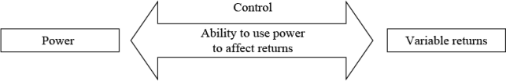

# 26 - Consolidated financial statements (IFRS 10)

[返回目录](README.md)

# 26 - Consolidated financial statements (IFRS 10)

Contents

- [26 - Consolidated financial statements (IFRS 10)](45.md#s168-chap_26_toc_h1)

- [Introduction and scope (paras 26.1- 26.21)](45.md#s169-chap_26_navPoint_1)

- [Concept of a group and consolidated financial statements](45.md#s169-chap_26_navPoint_2)

- [Concept of control](45.md#s169-chap_26_navPoint_3)

- [Scope](45.md#s169-chap_26_navPoint_4)

- [Exemption from preparing consolidated financial statements](45.md#s169-chap_26_navPoint_5)

- [Reporting entities and entities](45.md#s169-chap_26_navPoint_7)

- [Parent and subsidiaries](45.md#s169-chap_26_navPoint_8)

- [Investor and investees](45.md#s169-chap_26_navPoint_9)

- [Control (paras 26.22 - 26.127)](45.md#s170-chap_26_navPoint_10)

- [Definition of control](45.md#s170-chap_26_navPoint_11)

- [Framework for assessment of control](45.md#s170-chap_26_navPoint_12)

- [Assessment of purpose and design of the investee](45.md#s170-chap_26_navPoint_13)

- [Relevant activities](45.md#s170-chap_26_navPoint_14)

- [Defining relevant activities](45.md#s170-chap_26_navPoint_idp1688032840)

- [Identifying relevant activities](45.md#s170-chap_26_navPoint_idp1688038088)

- [How decisions about relevant activities are made](45.md#s170-chap_26_navPoint_idp1688054472)

- [Rights that give an investor the ability to direct relevant activities](45.md#s170-chap_26_navPoint_idp1688079048)

- [Substantive rights](45.md#s170-chap_26_navPoint_idp1688101448)

- [Evidence that a right could be substantive](45.md#s170-chap_26_navPoint_idp1688107848)

- [Barriers that might prevent the investor from exercising its rights](45.md#s170-chap_26_navPoint_idp1688121544)

- [Practical mechanisms exist to exercise rights where agreement requires more than one investor](45.md#s170-chap_26_navPoint_idp1688133448)

- [The investor benefits from the exercise of the rights that it holds](45.md#s170-chap_26_navPoint_idp1688144712)

- [Other factors to consider when assessing an investor’s rights](45.md#s170-chap_26_navPoint_idp1714431576)

- [Voting rights](45.md#s170-chap_26_navPoint_idp1714456152)

- [Power with a majority of the voting rights](45.md#s170-chap_26_navPoint_idp1714468056)

- [Power without a majority of the voting rights](45.md#s170-chap_26_navPoint_idp1714318552)

- [Contractual arrangements with other vote holders](45.md#s170-chap_26_navPoint_idp1714357848)

- [Rights arising from other contractual arrangements](45.md#s170-chap_26_navPoint_idp1645960904)

- [De facto control](45.md#s170-chap_26_navPoint_15)

- [Potential voting rights](45.md#s170-chap_26_navPoint_16)

- [Protective and veto rights](45.md#s170-chap_26_navPoint_idp1714557800)

- [Franchises](45.md#s170-chap_26_navPoint_17)

- [Exposure to variable returns](45.md#s170-chap_26_navPoint_18)

- [Silos](45.md#s170-chap_26_navPoint_19)

- [Link between power and variable returns – Principal and agent](45.md#s170-chap_26_navPoint_20)

- [Assessment of whether a decision maker is acting as principal or agent](45.md#s170-chap_26_navPoint_idp1718472184)

- [Ability to remove without cause (kick out rights)](45.md#s170-chap_26_navPoint_idp1718501496)

- [Scope of decision-making authority](45.md#s170-chap_26_navPoint_idp1718512760)

- [Rights held by other parties](45.md#s170-chap_26_navPoint_idp1718525688)

- [Remuneration](45.md#s170-chap_26_navPoint_idp1718549240)

- [Exposure to variability of returns from other interests](45.md#s170-chap_26_navPoint_idp1712447272)

- [Situations where there is more than one principal](45.md#s170-chap_26_navPoint_idp1712456744)

- [De facto agent](45.md#s170-chap_26_navPoint_21)

- [Structured entities (paras 26.128- 26.153)](45.md#s171-chap_26_navPoint_22)

- [Identifying structured entities](45.md#s171-chap_26_navPoint_23)

- [Consolidation criteria for structured entities](45.md#s171-chap_26_navPoint_24)

- [Purpose and design of the investee](45.md#s171-chap_26_navPoint_idp1721307992)

- [Relevant activities and ability to direct those activities](45.md#s171-chap_26_navPoint_idp1721320792)

- [Involvement in, and decisions made at, the structured entity’s inception](45.md#s171-chap_26_navPoint_idp1721325528)

- [Rights to direct relevant activities](45.md#s171-chap_26_navPoint_idp1721346264)

- [Commitment to ensure that a structured entity operates as designed](45.md#s171-chap_26_navPoint_idp1721358296)

- [Whether the investor is exposed to variable returns](45.md#s171-chap_26_navPoint_25)

- [Investor’s ability to use its power to affect the structured entity’s returns](45.md#s171-chap_26_navPoint_26)

- [Unconsolidated structured entities](45.md#s171-chap_26_navPoint_27)

- [Subsidiaries acquired with a view to disposal](45.md#s171-chap_26_navPoint_28)

- [Continuous assessment](45.md#s171-chap_26_navPoint_29)

- [Loss of control (paras 26.154 - 26.170)](45.md#s172-chap_26_navPoint_30)

- [Accounting for loss of control](45.md#s172-chap_26_navPoint_31)

- [Multiple transactions or agreements that result in loss of control](45.md#s172-chap_26_navPoint_idp1721206872)

- [Multiple transactions or agreements that result in gaining control](45.md#s172-chap_26_navPoint_idp1721229784)

- [Consolidation approach (paras 26.171 - 26.182)](45.md#s173-chap_26_navPoint_32)

- [Procedure for consolidation](45.md#s173-chap_26_navPoint_33)

- [Consolidation adjustments](45.md#s173-chap_26_navPoint_34)

- [Uniform accounting policies](45.md#s173-chap_26_navPoint_idp1712452008)

- [Subsidiary year ends](45.md#s173-chap_26_navPoint_idp1712471080)

- [Elimination of intra-group transactions](45.md#s173-chap_26_navPoint_idp1712481576)

- [Non-controlling interests (paras 26.183 - 26.212)](45.md#s174-chap_26_navPoint_35)

- [Introduction](45.md#s174-chap_26_navPoint_36)

- [Definition and classification](45.md#s174-chap_26_navPoint_37)

- [Non-controlling interest holding the majority of equity](45.md#s174-chap_26_navPoint_38)

- [Measurement of the non-controlling interest](45.md#s174-chap_26_navPoint_40)

- [Attribution of profit or loss and comprehensive income to controlling and non-controlling interests](45.md#s174-chap_26_navPoint_41)

- [Loss-making subsidiaries](45.md#s174-chap_26_navPoint_42)

- [Indirect holdings](45.md#s174-chap_26_navPoint_43)

- [Acquisition of subsidiaries](45.md#s174-chap_26_navPoint_44)

- [Treatment of dividends](45.md#s174-chap_26_navPoint_45)

- [Transactions with non-controlling interests](45.md#s174-chap_26_navPoint_46)

- [Options and forward contracts over shares relating to non-controlling interests](45.md#s174-chap_26_navPoint_47)

- [Presentation in financial statements](45.md#s174-chap_26_navPoint_48)

- [Disclosure (paras 26.213 - 26.215)](45.md#s175-chap_26_navPoint_49)

- [Illustrative text](46.md#s176-chap_26_navPoint_51)

- [FAQ 26.11.1 – How does the exemption from preparing consolidated financial statements apply?](46.md#s176-chap_26_navPoint_52)

- [FAQ 26.11.2 – How does local legislation impact preparation of consolidated financial statements?](46.md#s176-chap_26_navPoint_53)

- [FAQ 26.13.1 – Can the use of a framework similar to IFRS be seen as ‘IFRS compliant’ for the purposes of satisfying paragraph 4(a)(iv) of IFRS 10?](46.md#s176-chap_26_navPoint_54)

- [FAQ 26.13.2 – Publicly available information](46.md#s176-chap_26_navPoint_55)

- [FAQ 26.16.1 – What factors should be considered in determining whether a structure is an entity for the purposes of assessing whether it is within the scope of IFRS 10?](46.md#s176-chap_26_navPoint_57)

- [EX 26.18.1 – Forms of interest in another entity](46.md#s176-chap_26_navPoint_58)

- [FAQ 26.31.1 – Do decisions made when an entity is formed provide power?](46.md#s176-chap_26_navPoint_59)

- [EX 26.33.1 – Identification of relevant activities](46.md#s176-chap_26_navPoint_60)

- [EX 26.38.1 – Assessing which activity most significantly affects returns](46.md#s176-chap_26_navPoint_61)

- [FAQ 26.40.1 – Can an investor have power currently if its decision-making rights relate to an activity that will only occur at a future date?](46.md#s176-chap_26_navPoint_62)

- [FAQ 26.40.2 –Should an entity re-assess whether it has control of an investee?](46.md#s176-chap_26_navPoint_63)

- [EX 26.40.3 – Level of involvement in relevant activities](46.md#s176-chap_26_navPoint_64)

- [FAQ 26.51.1 – Does an entity control another entity via the right to appoint a majority of the board?](46.md#s176-chap_26_navPoint_65)

- [FAQ 26.51.2 – Does an entity control another entity via the power to direct the board’s votes?](46.md#s176-chap_26_navPoint_66)

- [EX 26.52.1 – Assessing whether approval rights over budgets are substantive](46.md#s176-chap_26_navPoint_67)

- [EX 26.53.1 – Options and risk of losing key management personnel](46.md#s176-chap_26_navPoint_68)

- [FAQ 26.53.2 – Can an option provide power where the option holder does not have the operational ability to exercise?](46.md#s176-chap_26_navPoint_69)

- [FAQ 26.53.3 – Can an option provide power where the option holder does not have the financial ability to exercise?](46.md#s176-chap_26_navPoint_70)

- [EX 26.56.1 – Substantive rights currently exercisable](46.md#s176-chap_26_navPoint_71)

- [EX 26.56.2 – Substantive rights not currently exercisable: forward contract to be settled in 25 days](46.md#s176-chap_26_navPoint_72)

- [EX 26.56.3 – Substantive rights not currently exercisable: option exercisable in 25 days](46.md#s176-chap_26_navPoint_73)

- [EX 26.56.4 – Substantive rights not currently exercisable: forward contract to be settled in six months](46.md#s176-chap_26_navPoint_74)

- [FAQ 26.57.1 – Can an option provide power when it is out of the money?](46.md#s176-chap_26_navPoint_75)

- [FAQ 26.59.1 – Can economic dependence provide power?](46.md#s176-chap_26_navPoint_76)

- [FAQ 26.63.1 – What form can voting rights take?](46.md#s176-chap_26_navPoint_77)

- [EX 26.63.2 – Voting rights of different classes of shares](46.md#s176-chap_26_navPoint_78)

- [EX 26.63.3 – Voting rights for pledged shares](46.md#s176-chap_26_navPoint_79)

- [EX 26.65.1 – Impact of regulation on assessment of power](46.md#s176-chap_26_navPoint_80)

- [EX 26.67.1 – Majority of voting rights by agreement with other shareholders](46.md#s176-chap_26_navPoint_81)

- [EX 26.67.2 - Reduction of ownership to below 50% of voting rights with contractual arrangement](46.md#s176-chap_26_navPoint_82)

- [EX 26.68.1 – Power to govern under a shareholder agreement](46.md#s176-chap_26_navPoint_83)

- [EX 26.68.2 – Restrictions on power due to shareholder agreements](46.md#s176-chap_26_navPoint_84)

- [EX 26.70.1 – Ownership of less than 50% of voting rights with dispersed public shareholding](46.md#s176-chap_26_navPoint_85)

- [EX 26.70.2 – Ownership of less than 50% of voting rights with dispersed shareholding](46.md#s176-chap_26_navPoint_86)

- [EX 26.70.3 – Ownership of less than 50% of voting rights with dispersed shareholding and a shareholder agreement](46.md#s176-chap_26_navPoint_87)

- [EX 26.70.4 – Passive majority shareholder](46.md#s176-chap_26_navPoint_88)

- [EX 26.70.5 – Sophisticated shareholders](46.md#s176-chap_26_navPoint_89)

- [EX 26.70.6 – Temporary shareholding at general meeting](46.md#s176-chap_26_navPoint_90)

- [EX 26.70.7 – Super majority voting in a joint venture](46.md#s176-chap_26_navPoint_91)

- [EX 26.70.8 – Assessing de facto control for an operating entity](46.md#s176-chap_26_navPoint_92)

- [FAQ 26.78.1 – What types of rights to acquire or dispose of shares might represent potential voting rights?](46.md#s176-chap_26_navPoint_93)

- [EX 26.78.2 – Situations where one investor holds a call option and another holds a put option in the event of a deadlock](46.md#s176-chap_26_navPoint_94)

- [FAQ 26.78.3 – Do ‘tag along’ rights represent potential voting rights which might provide power?](46.md#s176-chap_26_navPoint_95)

- [FAQ 26.78.4 – Do ‘Russian roulette’ provisions in shareholder agreements represent potential voting rights which might provide power?](46.md#s176-chap_26_navPoint_96)

- [FAQ 26.78.5 – Do ‘drag along’ rights held by multiple investors represent potential voting rights which might provide power?](46.md#s176-chap_26_navPoint_97)

- [EX 26.78.6 – Out-of-the-money options](46.md#s176-chap_26_navPoint_98)

- [EX 26.78.7 – Options whose exercise price is fair value](46.md#s176-chap_26_navPoint_99)

- [EX 26.78.8 – Management intention](46.md#s176-chap_26_navPoint_100)

- [FAQ 26.78.9 – Can an option provide power when it is out of the money?](46.md#s176-chap_26_navPoint_101)

- [EX 26.78.10 – Assessing control with put and call options](46.md#s176-chap_26_navPoint_102)

- [EX 26.82.1 – Relevant activities contingent on certain events](46.md#s176-chap_26_navPoint_103)

- [EX 26.90.1 – Other types of variable return](46.md#s176-chap_26_navPoint_104)

- [EX 26.90.2 – Non-financial returns](46.md#s176-chap_26_navPoint_105)

- [FAQ 26.90.3 – Where an investor’s exposure to variable returns includes fees for services provided, should associated costs incurred to deliver those services be included in the assessment of exposure?](46.md#s176-chap_26_navPoint_106)

- [FAQ 26.91.1 – What assets should an investor look to in assessing control?](46.md#s176-chap_26_navPoint_107)

- [FAQ 26.93.1 – What types of instrument absorb variability from an investee, and which instruments create variability in an investee?](46.md#s176-chap_26_navPoint_108)

- [EX 26.93.2 – Contract that both creates and absorbs variability](46.md#s176-chap_26_navPoint_109)

- [EX 26.94.1 – Common instances of silos](46.md#s176-chap_26_navPoint_110)

- [EX 26.95.1 – Breaching of ring-fences dependent on contingent events](46.md#s176-chap_26_navPoint_111)

- [EX 26.95.2 – Jurisdiction’s laws and regulations](46.md#s176-chap_26_navPoint_112)

- [EX 26.95.3 – Contractual terms that introduce ring-fencing](46.md#s176-chap_26_navPoint_113)

- [EX 26.95.4 – Credit enhancements](46.md#s176-chap_26_navPoint_114)

- [EX 26.95.5 – Contingent rights and obligations](46.md#s176-chap_26_navPoint_115)

- [EX 26.95.6 – Breach in the event of fraud](46.md#s176-chap_26_navPoint_116)

- [FAQ 26.98.1 – Which types of entity are affected by the principal/agent guidance?](46.md#s176-chap_26_navPoint_117)

- [FAQ 26.98.2 – How might the principal/agent guidance affect the asset management industry?](46.md#s176-chap_26_navPoint_118)

- [FAQ 26.103.1 – Is an intermediate holding company an agent of its parent?](46.md#s176-chap_26_navPoint_119)

- [FAQ 26.104.1 – Where power and benefits are split between two parties in a group, what factors should be considered in determining which one is the de facto agent of the other?](46.md#s176-chap_26_navPoint_120)

- [EX 26.105.1 – Indicators of power and exposure to variable returns in the asset management industry](46.md#s176-chap_26_navPoint_121)

- [EX 26.108.1 – Delegated rights insufficient to provide power](46.md#s176-chap_26_navPoint_122)

- [EX 26.110.1 – Restrictions on power over relevant activities](46.md#s176-chap_26_navPoint_123)

- [EX 26.114.1 – Removal rights](46.md#s176-chap_26_navPoint_124)

- [EX 26.114.2 – Annual re-appointment](46.md#s176-chap_26_navPoint_125)

- [EX 26.114.3 – Removal right with a one-year notice period](46.md#s176-chap_26_navPoint_126)

- [EX 26.116.1 – Rights similar to removal rights: liquidation rights](46.md#s176-chap_26_navPoint_127)

- [FAQ 26.119.1 – Is a decision maker that is remunerated at market rate necessarily an agent?](46.md#s176-chap_26_navPoint_128)

- [EX 26.123.1 – Agent versus principal: fund manager as agent](46.md#s176-chap_26_navPoint_129)

- [EX 26.123.2 – Agent versus principal: fund manager (various)](46.md#s176-chap_26_navPoint_130)

- [EX 26.123.3 – Agent versus principal: asset manager as principal](46.md#s176-chap_26_navPoint_131)

- [EX 26.123.4 – Agent versus principal: sponsor of multi-seller conduit as principal](46.md#s176-chap_26_navPoint_132)

- [EX 26.124.1 – Determination of principal in the asset management industry](46.md#s176-chap_26_navPoint_133)

- [EX 26.124.2 – Determination of principal of a fund](46.md#s176-chap_26_navPoint_134)

- [EX 26.127.1 – Employees as de facto agents](46.md#s176-chap_26_navPoint_135)

- [EX 26.129.1 – Common indicators of a structured entity](46.md#s176-chap_26_navPoint_136)

- [EX 26.131.1 – Form of structured entities](46.md#s176-chap_26_navPoint_137)

- [FAQ 26.131.2 – Can a change in facts and circumstances cause an entity previously considered to be a structured entity to no longer meet those criteria?](46.md#s176-chap_26_navPoint_138)

- [FAQ 26.138.1 – When assessing control over a structured entity, should the assessment of power and exposure to variability be based on the accounting assets, the legal assets or the economic exposures of the structured entity?](46.md#s176-chap_26_navPoint_139)

- [FAQ 26.138.2 – When a structured entity leases out an asset, what are its relevant activities?](46.md#s176-chap_26_navPoint_140)

- [FAQ 26.138.3 – Does an option to purchase an asset at the end of the lease term provide control over a structured entity?](46.md#s176-chap_26_navPoint_141)

- [FAQ 26.138.4 – Does an option to extend a lease provide control over a structured entity?](46.md#s176-chap_26_navPoint_142)

- [FAQ 26.139.1 – Can a structured entity have no relevant activities?](46.md#s176-chap_26_navPoint_143)

- [EX 26.139.2 – Assessing control for a debt restructuring structured entity with limited activities](46.md#s176-chap_26_navPoint_144)

- [EX 26.139.3 – Assessing control of an issuer of commercial mortgage-backed securities managed by a third-party servicer acting on behalf of investors](46.md#s176-chap_26_navPoint_145)

- [EX 26.139.4 – Assessing control of an issuer of credit-linked notes with limited activities and derivatives that enhance risk](47.md#s177-chap_26_navPoint_146)

- [EX 26.142.1 – Contingent power](47.md#s177-chap_26_navPoint_147)

- [EX 26.143.1 – Commitment to ensure that a structured entity operates as designed](47.md#s177-chap_26_navPoint_148)

- [FAQ 26.143.2 – Can reputational risk give control?](47.md#s177-chap_26_navPoint_149)

- [FAQ 26.144.1 – What creates variability in returns in a structured entity?](47.md#s177-chap_26_navPoint_150)

- [FAQ 26.144.2 – What represents an interest in a structured entity?](47.md#s177-chap_26_navPoint_151)

- [FAQ 26.144.3 – How should the exposure to the variability of a structured entity which holds a financial asset be assessed?](47.md#s177-chap_26_navPoint_152)

- [FAQ 26.151.1 – When should the restructuring of a loan result in consolidation by the lender?](47.md#s177-chap_26_navPoint_153)

- [FAQ 26.154.1 – How might an investor lose control of an investee?](47.md#s177-chap_26_navPoint_154)

- [EX 26.154.2 – Loss of control when a subsidiary declares bankruptcy](47.md#s177-chap_26_navPoint_155)

- [EX 26.165.1 – Loss of control of a wholly owned subsidiary with an interest retained in an associate](47.md#s177-chap_26_navPoint_156)

- [EX 26.165.2 – Partial disposal of a partially owned subsidiary with an interest retained in an associate](47.md#s177-chap_26_navPoint_157)

- [EX 26.165.3 – Partial disposal of subsidiary with off market lease arrangement](47.md#s177-chap_26_navPoint_158)

- [FAQ 26.177.1 – When might adjustments be required to conform with amounts reported by subsidiaries?](47.md#s177-chap_26_navPoint_159)

- [FAQ 26.180.1 – What types of consolidation adjustment might be required for non-coterminous year ends?](47.md#s177-chap_26_navPoint_160)

- [EX 26.180.2 – Subsidiaries with non-coterminous year ends](47.md#s177-chap_26_navPoint_161)

- [EX 26.180.3 – Change in period for subsidiary with non-coterminous year end](47.md#s177-chap_26_navPoint_162)

- [FAQ 26.182.1 – Why are unrealised profits or losses eliminated in full where transactions are between subsidiaries with non-controlling interests?](47.md#s177-chap_26_navPoint_163)

- [EX 26.182.2 – Elimination of intra-group profit on sale of assets by a subsidiary to its parent](47.md#s177-chap_26_navPoint_164)

- [EX 26.182.3 – Elimination of intra-group profit on sale of assets by a parent to its subsidiary](47.md#s177-chap_26_navPoint_165)

- [EX 26.187.1 – Accounting for a majority non-controlling interest](47.md#s177-chap_26_navPoint_166)

- [EX 26.191.1 – Proportion allocated to parent shareholder and non-controlling interest based on economic interest](47.md#s177-chap_26_navPoint_168)

- [FAQ 26.193.1 – How should earnings be attributed between controlling and non-controlling interests where profits are shared based on a contractual arrangement?](47.md#s177-chap_26_navPoint_169)

- [EX 26.194.1 – Calculation of profit attributable to non-controlling interest subsequent to acquisition](47.md#s177-chap_26_navPoint_170)

- [FAQ 26.195.1 – How should a net deficit NCI be accounted for on liquidation of a subsidiary that is financed solely by loan funding from the parent company?](47.md#s177-chap_26_navPoint_171)

- [EX 26.196.1 – Treatment of non-controlling interests where a parent holds an indirect interest in a subsidiary](47.md#s177-chap_26_navPoint_172)

- [EX 26.203.1 – Sale of a 20% interest in a wholly owned subsidiary](47.md#s177-chap_26_navPoint_173)

- [EX 26.203.2 – Acquisition of a further 20% interest in a subsidiary](47.md#s177-chap_26_navPoint_174)

- [EX 26.203.3 – Acquisition of a further 40% interest in a subsidiary](47.md#s177-chap_26_navPoint_175)

- [FAQ 26.206.1 – What is the accounting treatment for the non-controlling interest where there is a written put option or forward contract over the shares?](47.md#s177-chap_26_navPoint_176)

- [EX 26.206.2 – Analysing the risks and rewards of forwards and options (applicable where it is asserted that IFRS 10 takes precedence over IAS 32)](47.md#s177-chap_26_navPoint_177)

- [EX 26.206.3 – Accounting for a forward contract or a written put option liability](47.md#s177-chap_26_navPoint_178)

- [EX 26.206.4 – Accounting for dividends paid and allocation of profits where there is a forward or put option liability](47.md#s177-chap_26_navPoint_179)

- [EX 26.206.5 – Accounting for contracts exercised or lapsed](47.md#s177-chap_26_navPoint_180)

- [EX 26.206.6 – Accounting when the Non-controlling interest is derecognised](47.md#s177-chap_26_navPoint_181)

- [EX 26.206.7 – Accounting when the Non-controlling interest is recognised (applicable where it is asserted that IFRS 10 takes precedence over IAS 32)](47.md#s177-chap_26_navPoint_182)

- [EX 26.206.8 – Issuance of written call option on a subsidiary (issued by parent)](47.md#s177-chap_26_navPoint_183)

- [EX 26.206.9 – Issuance of written call option on a subsidiary (issued by subsidiary)](47.md#s177-chap_26_navPoint_184)

- [FAQ 26.215.1 – Does an interest purchased for trading purposes require disclosure under IFRS 12?](47.md#s177-chap_26_navPoint_185)

- [FAQ 26.215.2 – Does the definition of an ‘interest in another entity’, for IFRS 12 disclosure purposes, include non-financial benefits?](47.md#s177-chap_26_navPoint_186)

- [FAQ 26.215.3 – Does the requirement in paragraph B26(b) of IFRS 12, to disclose losses incurred during the reporting period for interests in unconsolidated structured entities, apply to interests disposed of during the period?](47.md#s177-chap_26_navPoint_187)

- [FAQ 26.215.4 – Should the assessment of whether a non-controlling interest in a subsidiary is material be performed on the net equity interest or on the gross assets and liabilities associated with the interest?](47.md#s177-chap_26_navPoint_190)

- [FAQ 26.215.5 – Where there is a sub-group and there is a non-controlling interest (NCI) within the sub-group’s parent company, should the reporting entity’s assessment of whether the NCI is material be based on the NCI share in the individual parent only or in the entire sub-group?](47.md#s177-chap_26_navPoint_191)

This eBook is licensed to peggy so, peggy.so@hk.ey.com, 

## Introduction and scope (paras 26.1- 26.21)

 

**26.1** A reporting entity prepares consolidated financial statements where it meets the definition of a group, subject to certain exemptions (see [para 26.11](45.md#s169-Para_26.11)). The consolidation process involves the parent and its subsidiaries being combined, using uniform accounting policies for similar transactions and by adding together like items of assets, liabilities, equity, income, expenses and cash flows. Further guidance on the presentation of financial statements can be found in [chapter 4 para 1](10.md#s27-Para_4.1).

[IFRS 10 para 19]. [IFRS 10 App B para B86].

 

### Concept of a group and consolidated financial statements

 

**26.2** The ‘group’ in IFRS 10 is “a parent and its subsidiaries”. The financial statements of a parent and its subsidiaries must be presented as a single economic entity. The consolidated financial statements are presented as though the parent entity investors, and the other non-controlling investors in partially owned subsidiaries, have similar economic interests in a single entity. Non-controlling interests are viewed as having an equity interest in the consolidated entity.

[IFRS 10 para 2(a)]. [IFRS 10 para App A].

**26.3** Equity transactions between a parent entity and the non-controlling interests are treated as transactions between shareholders, provided that the transactions do not result in a change of control. No gains or losses are recognised in profit or loss for transactions between the parent entity and the non-controlling interest, unless control is lost. Transactions where control is not lost are recorded within equity.

[IFRS 10 App B para B96].

**26.4**The statement of comprehensive income or income statement (if separately presented) arrives at the profit or loss for the financial year and requires the allocation of profit or loss to be analysed between:

- Profit or loss attributable to non-controlling interest.

- Profit or loss attributable to equity holders of the parent.

- Comprehensive income attributable to non-controlling interest.

- Comprehensive income attributable to equity holders of the parent.

[IAS 1 para 81B].

 

### Concept of control

 

**26.5** IFRS 10 provides a single definition of control that applies to all entities. This definition is supported by extensive application guidance that explains the different ways in which a reporting entity (investor) might control another entity (investee).

[IFRS 10 App A].

**26.6** The key principle is that control exists, and consolidation is required only if the investor possesses power over the investee, has exposure or rights to variable returns from its involvement with the investee, and has the ability to use its power over the investee to affect its returns. A consolidated entity presents a parent and its subsidiaries as if they are a single economic entity.

[IFRS 10 para 7].

 

### Scope

 

**26.7** IFRS 10 requires all entities that are a parent to present consolidated financial statements, with the following exceptions. The first exception is for post-employment benefit plans or other long-term employee benefit plans to which IAS 19 applies.

[IFRS 10 para 4A].

**26.8** Secondly, a parent need not present consolidated financial statements if it meets certain criteria, as explained in [paragraph 26.11](45.md#s169-Para_26.11).

**26.9** Thirdly, if the parent entity meets the definition of an investment entity, it does not consolidate most of its controlled investments. Instead, it records most controlled investments at fair value through profit or loss.

[IFRS 10 para 4B].

**26.10** Where an entity has set up an employee benefit plan for the purposes of a share option scheme or similar share-based payment scheme that is not within IAS 19’s scope, such plans are within IFRS 10’s scope. Further guidance can be found in [chapter 13 para 64](24.md#s91-Para_13.64).

 

### Exemption from preparing consolidated financial statements

 

**26.11** A parent entity is exempt from having to present consolidated financial statements if it meets all of the following criteria:

- It is a wholly owned subsidiary or a partially owned subsidiary of another entity and all of its other owners, including those not otherwise entitled to vote, have been informed about, and do not object to, the parent not presenting consolidated financial statements.

- The parent’s debt or equity instruments are not publicly traded.

- The parent did not file, and is not filing, its financial statements for the purpose of issuing publicly traded instruments.

- The entity’s ultimate parent, or any intermediate parent, produces IFRS financial statements in which subsidiaries are consolidated or measured at fair value through profit or loss that are available for public use.

[IFRS 10 para 4(a)].

[FAQ 26.11.1 – How does the exemption from preparing consolidated financial statements apply?](46.md#s176-FAQ_26.11.1)

[FAQ 26.11.2 – How does local legislation impact preparation of consolidated financial statements?](46.md#s176-FAQ_26.11.2)

**26.12** If the parent is exempt from preparing consolidated financial statements, it has the choice of presenting separate financial statements instead of consolidated financial statements ([see chapter 28 para 9](49.md#s198-Para_28.9)).

[IAS 27 para 8].

**26.13** The exemption in paragraph 4(a)(iv) of IFRS 10 is available where either:

- an explicit and unreserved statement of compliance with IFRS can be made by the ultimate/intermediate parent that produces consolidated financial statements and those financial statements are available for public use; or

- an ultimate or intermediate parent’s consolidated financial statements are prepared in accordance with a framework other than IFRS (for example, ‘IFRS as endorsed by the EU’) where:

- the framework adopted does not contain material differences when compared to IFRS as issued by the IASB,

- those financial statements do not contain material differences when compared to financial statements prepared under IFRS; and

- those financial statements are also available for public use.

This assessment should be performed annually. Refer to [FAQ 26.13.1](46.md#s176-FAQ_26.13.1) and [FAQ 26.13.2](46.md#s176-FAQ_26.13.2).

[IFRS 10 para 4 (a), (iv)].

[FAQ 26.13.1 – Can the use of a framework similar to IFRS be seen as ‘IFRS compliant’ for the purposes of satisfying paragraph 4(a)(iv) of IFRS 10?](46.md#s176-FAQ_26.13.1)

[FAQ 26.13.2 – Publicly available information](46.md#s176-FAQ_26.13.2)

**26.14**Entities that meet the definition of an investment entity record most controlled investments as at fair value through profit or loss. This requirement also applies to investments in associates and joint ventures. All other investments are subject to the normal rules of IFRS 9 (IAS 39).

[IFRS 10 para 31].

 

### Reporting entities and entities

**26.15** IFRS 10 uses the term ‘entity’ but does not define it. The term ‘entity’ generally refers to some form of organisation or institution that has real or distinct existence.

### Parent and subsidiaries

 

**26.16** The term ‘parent’ is defined as “an entity that controls one or more entities”. A subsidiary is defined as “an entity that is controlled by another entity”.

[IFRS 10 App A].

[FAQ 26.16.1 – What factors should be considered in determining whether a structure is an entity for the purposes of assessing whether it is within the scope of IFRS 10?](46.md#s176-FAQ_26.16.1)

**26.17** Control exists if the investor has power over the investee, exposure or rights to variable returns from its involvement with the investee, and the ability to use its power over the investee to affect the amount of the investor’s returns.

[IFRS 10 para 7].

 

### Investor and investees

 

**26.18** IFRS 10 uses the term ‘investor’. This is not defined by the standard; however, an investor is generally regarded as a reporting entity that has an interest in another entity. IFRS 12 describes an interest in another entity as “contractual and non-contractual involvement that exposes an entity to variability of returns from the performance of the other entity”.

[IFRS 12 App A].

[EX 26.18.1 – Forms of interest in another entity](46.md#s176-EX26.18.1)

**26.19** Some interests simply provide the investor with a fixed or stated rate of return, while others give the investor rights or access to the entity’s future economic benefits. IFRS 12 also states “An entity does not necessarily have an interest in another entity solely because of a typical customer-supplier relationship”.

[IFRS 12 App A].

**26.20** An investor assesses whether it has control over an investee (see [para 26.22](45.md#s170-Para_26.22) onwards for guidance on assessment of control). After this assessment, if an investor determines that it has control over an investee, it will be a parent and that investee will be its subsidiary.

[IFRS 10 para 5].

**26.21** This chapter uses the terms ‘entity’, ‘investor’ and ‘investee’ with the meanings set out above.

 

This eBook is licensed to peggy so, peggy.so@hk.ey.com, 

## Control (paras 26.22 - 26.127)

### Definition of control

 

**26.22** The definition of control is not based solely on legal ownership. IFRS 10 explains that “an investor controls an investee when it is exposed, or has rights, to variable returns from its involvement with the investee and has the ability to affect those returns through its power over the investee”.

[IFRS 10 para 6].

**26.23** IFRS 10’s definition of control provides a link between power and returns, on the one hand, and an investor’s ability to affect those returns, on the other.

**26.24** Control encompasses three distinct principles which, if present, identify the existence of control by an investor over an investee, hence forming a parent-subsidiary relationship:

- Power over the investee.

- Exposure, or rights, to variable returns from its involvement with the investee.

- The ability to use its power over the investee to affect the amount of the investor’s returns.

[IFRS 10 para 7].

**26.25** These three factors cannot be considered in isolation by an investor in its assessment of control over an investee: all three must be present for an investor to conclude that it has control. If any one of the criteria noted above is not met, the investor does not control the investee. Where an investor does not have control over an investee, it should consider whether its interest in the investee meets the definition of a joint arrangement under IFRS 11, an associate under IAS 28, a financial instrument under IFRS 9 (IAS 39), or is addressed by other applicable IFRSs.

[IFRS 10 para 7].

 

### Framework for assessment of control

 

**26.26** The factors that an investor should consider during its assessment of control over an investee are:

- the investee’s purpose and design;

- what the relevant activities are;

- how decisions about those relevant activities are made;

- whether the rights of the investor give it the current ability to direct the relevant activities;

- whether the investor is exposed, or has rights, to variable returns from its involvement with the investee; and

- whether the investor has the ability to use its power over the investee to affect the amount of the investor’s returns.

[IFRS 10 App B para B3].

 

### Assessment of purpose and design of the investee

 

**26.27** An investor should consider the investee’s purpose and design when assessing whether it has control. In doing so, an investor should consider the following questions:

- What are the relevant activities of the investee (see [para 26.32](45.md#s170-Para_26.32))?

- How are decisions about those relevant activities made?

- Who has the current ability to direct those activities?

- Who receives returns from those activities?

[IFRS 10 App B para B5].

**26.28** Sometimes, it is clear that an investee is controlled by means of equity instruments that give the holder proportionate voting rights, such as an ordinary share in an investee. Where this is the case, and there are no other arrangements in place that alter decision-making, the assessment of control focuses on which party, if any, is able to exercise voting rights sufficient to direct the investee’s relevant activities. The investor that holds a majority of those voting rights, in the absence of any other factors, controls the investee.

[IFRS 10 App B para B6].

**26.29** Where situations are not straightforward, an investor might need to consider some or all of the factors identified in paragraph B3 of IFRS 10 (see [para 26.26](45.md#s170-Para_26.26) for a list of factors).

**26.30** Voting rights might not significantly impact on relevant activities or an investee’s returns. The investee might be on ‘auto-pilot’, such that relevant activities are pre-determined or directed via contractual arrangements. Assessment of the purpose and design of such an investee might, therefore, help to determine who has control. In such a case, the following should be considered in assessing an entity’s purpose and design:

- Downside risks and upside potential that the investee was designed to create.

- Downside risks and upside potential that the investee was designed to pass on to other parties in the transaction.

- Whether the investor is exposed to those risks and upside potential.

[IFRS 10 App B para B8].

**26.31** Considering an entity’s purpose and design might make it clear that the entity is controlled by voting rights, potential voting rights or a contractual arrangement.

[IFRS 10 App B para B6]. [IFRS 10 App B para B8].

[FAQ 26.31.1 –  Do decisions made when an entity is formed provide power?](46.md#s176-FAQ_26.31.1)

 

### Relevant activities

#### Defining relevant activities

**26.32** An entity assesses whether it has the power to direct the ‘relevant activities’ of an investee. IFRS 10 defines relevant activities as “activities of the investee that significantly affect the investee’s returns”.

[IFRS 10 App A].

#### Identifying relevant activities

 

**26.33** An investor should identify what the relevant activities of an investee are, because this will help the investor to understand whether it is involved in decision-making activities that significantly affect those activities. Examples of relevant activities include, but are not limited to, the following:

- Establishing budgets.

- Selling and purchasing goods and services.

- Managing financial assets during their life (including on default).

- Selecting, acquiring or disposing of assets.

- Researching and developing products or processes.

- Determining or managing capital and obtaining funding.

- Appointing/terminating and remunerating key management personnel.

[IFRS 10 App B para B11]. [IFRS 10 App B para B12].

[EX 26.33.1 - Identification of relevant activities](46.md#s176-EX26.33.1)

**26.34** Entities should assess whether the level of involvement in the investee’s relevant activities is enough to significantly affect the returns that it will generate for the investor, because there might be multiple relevant activities that impact the investee’s returns. However, not all relevant activities will significantly affect an investee’s returns. IFRS 10 does not provide guidance on the term ‘significantly’. This is a matter of judgement and is likely to vary from one investment to another.

[IFRS 10 App B para B13].

 

#### How decisions about relevant activities are made

 

**26.35** Having considered how investors might identify an investee’s relevant activities, the next step is to understand how decisions about the relevant activities are made. Assessing this decision-making process will lead an investor to identify whether it has power over an investee.

[IFRS 10 App B para B10].

**26.36** An investor might have the ability to make decisions about an investee’s relevant activities through voting rights, which it holds via equity instruments.

[IFRS 10 App B para B6].

**26.37** The relationship between an investor and investee might be designed in such a way that voting rights are not the dominant factor in deciding who directs the investee’s relevant activities; voting rights might relate to administrative tasks only, and the relevant activities are directed by means of contractual arrangements. For further guidance on this, see [paragraph 26.128](45.md#s171-Para_26.128).

[IFRS 10 App B para B8].

**26.38** Where more than one investor has the power to direct relevant activities of an investee, determining which investor has control might prove challenging and require significant judgement. It is important to assess which activity most significantly affects an investee’s returns. Consider the total returns that an investee generates and which investor is directing the activity that has the greatest impact on those returns.

[IFRS 10 App B para B13].

[EX 26.38.1 - Assessing which activity most significantly affects returns](46.md#s176-EX26.38.1)

**26.39** The relevant activities of an investee can change, which would trigger a re-assessment of control.

[IFRS 10 App B para B80].

**26.40** An investor has power over an investee where the investor has existing rights that give it the current ability to direct the investee’s relevant activities.

[IFRS 10 para 10].

[FAQ 26.40.1 – Can an investor have power currently if its decision making rights relate to an activity that will only occur at a future date?](46.md#s176-FAQ_26.40.1)  
[FAQ 26.40.2 – Should an entity re-assess whether it has control of an investee?](46.md#s176-FAQ_26.40.2)  
[EX 26.40.3 – Level of involvement in relevant activities](46.md#s176-EX26.40.3)

 

#### Rights that give an investor the ability to direct relevant activities

 

**26.41** When an investor is assessing whether it has power over an investee, it should only consider substantive rights and rights that are not protective.

[IFRS 10 App B para B9].

**26.42** A variety of different rights can give an investor the current ability to direct the investee’s relevant activities.

[IFRS 10 App B para B14].

**26.43** These rights include voting or potential voting rights, rights to appoint or remove decision makers (including key management), veto rights and other contractual rights.

[IFRS 10 App B para B15].

**26.44** Generally, where the investee has a range of relevant activities that require continuous substantive decisions, voting or similar rights will provide power.

[IFRS 10 App B para B16].

**26.45** In other cases, where voting rights do not have a significant effect on returns and relate to administrative tasks only, other contractual arrangements need to be considered.

[IFRS 10 App B para B8]. [IFRS 10 App B para B17].

**26.46** The investee’s purpose and design should also be considered in determining how its relevant activities are directed, and hence what rights convey power. An investee’s purpose and design is dealt with in [paragraph 26.27](45.md#s170-Para_26.27).

[IFRS 10 App B para B3].

**26.47** An investor’s rights over an investee can be either substantive or protective. Only substantive rights are taken into account by an investor when it is assessing its power over an investee.

[IFRS 10 App B para B22].

**26.48** An investor that holds only protective rights over an investee does not have power over that investee. Protective rights relate to fundamental changes to an investee’s activities or apply in exceptional circumstances (see further [para 26.80](45.md#s170-Para_26.80)).

[IFRS 10 App B para B27].

 

##### Substantive rights

 

**26.49** Substantive rights are those rights that an investor holds that give it the current ability to direct the investee’s relevant activities. There are a number of factors that an investor should consider when assessing whether it has substantive rights over an investee. Judgement is required where it is unclear which rights give power over an investee. This section focuses on some key areas that might indicate whether a right is substantive.

[IFRS 10 App B para B23].

**26.50** Substantive rights might arise through a combination of factors. For example, ownership of more than half of the voting rights would usually give an investor power, but the majority owner should also consider the existence of statutes, contractual agreements, board control, rights held by other parties, and whether it has the practical ability to direct the investee’s relevant activities. These additional factors might show that another investor has power. It is important to consider rights held by other parties involved with the investee, because this will impact the investor’s assessment of control. Substantive rights exercisable by other parties can prevent an investor from having control, even if the holders of those rights are not able to initiate decisions.

[IFRS 10 App B para B25].

 

###### Evidence that a right could be substantive

 

**26.51** The following factors might provide evidence that an investor has rights that are substantive and provide power over an investee:

- The ability to appoint and remove the investee’s key management personnel who have the ability to direct the relevant activities and affect the investee’s returns.

- The ability to direct the investee to enter into significant transactions that affect an investor’s returns, or to veto such transactions.

- The ability to dominate the nomination of members to the investee’s governing body, or to obtain proxies from other vote holders.

- If the investee’s key management or majority of its governing body are related parties of the investor.

- The ability to appoint or remove another entity that directs the investee’s relevant activities.

- Other rights (such as decision-making rights within a management contract) that give the holder the ability to direct relevant activities of the investee.

[IFRS 10 App B para B18].

[FAQ 26.51.1 – Does an entity control another entity via the right to appoint a majority of the board?](46.md#s176-FAQ_26.51.1)  
[FAQ 26.51.2 – Does an entity control another entity via the power to direct the board's votes?](46.md#s176-FAQ_26.51.2)

**26.52** An investor might also hold rights that relate to decisions over an entity’s relevant activities, such as establishing budgets. Judgement might be required in determining whether those rights are substantive or protective.

[IFRS 10 App B para B12].

[EX 26.52.1 – Assessing whether approval rights over budgets are substantive](46.md#s176-EX26.52.1)

 

###### Barriers that might prevent the investor from exercising its rights

 

**26.53** An investor should consider whether it has the practical ability to exercise the rights that it holds over an investee, because this will determine whether such rights are substantive. In particular, where there are barriers that might prevent an investor from exercising the rights that it holds, the effect of these will need to be carefully assessed.

Examples of barriers to exercising rights are:

- Financial penalties and incentives that prevent or deter the exercise of rights.

- Exercise/conversion prices that create a financial barrier.

- Terms and conditions that prevent the exercise of rights (for example, conditions that narrowly limit the timing of exercise).

- The lack of an explicit, reasonable mechanism through which holders can exercise their rights.

- An inability to obtain information needed to exercise rights.

- Operational barriers, such as lack of expertise to replace existing management after gaining control.

- Legal/regulatory requirements that prevent exercise (for example, where a foreign investor is prohibited from exercising its rights).

[IFRS 10 App B para B23].

[EX 26.53.1 – Options and risk of losing key management personnel](46.md#s176-EX26.53.1)  
[FAQ 26.53.2 – Can an option provide power where the option holder does not have the operational ability to exercise?](46.md#s176-FAQ_26.53.2)  
[FAQ 26.53.3 – Can an option provide power where the option holder does not have the financial ability to exercise?](46.md#s176-FAQ_26.53.3)

 

###### Practical mechanisms exist to exercise rights where agreement requires more than one investor

 

**26.54** It might be necessary for more than one party to agree in order for rights to be exercised. It is important that a mechanism is in place for the holders of those rights to be able to exercise them. The lack of such a mechanism might be an indicator that the rights are not substantive. The presence of an independent board appointed by investors might allow a diverse group of investors to act collectively in exercising their rights.

[IFRS 10 App B para B23(b)].

 

###### The investor benefits from the exercise of the rights that it holds

 

**26.55** A right is more likely to be substantive where the holder of that right would benefit from its exercise. Where an investor is exposed to a greater degree of variability of returns from its involvement with an investee, it has a greater incentive to obtain rights that give it power. Therefore, where an investor has an incentive to exercise its rights, because it will obtain some benefit from doing so, it is more likely that it will have power over the investee.

[IFRS 10 App B para B20].

**26.56** Substantive rights that provide the holder with the ability to direct relevant activities are usually currently exercisable, but not always so.

[IFRS 10 App B para B24].

[EX 26.56.1 – Substantive rights currently exercisable](46.md#s176-EX26.56.1)  
[EX 26.56.2 – Substantive rights not currently exercisable: forward contract to be settled in 25 days](46.md#s176-EX26.56.2)  
[EX 26.56.3 – Substantive rights not currently exercisable: option exercisable in 25 days](46.md#s176-EX26.56.3)  
[EX 26.56.4 – Substantive rights not currently exercisable: forward contract to be settled in six months](46.md#s176-EX26.56.4)

**2****6.57** The financial position of potential voting rights (that is, whether such voting rights are in or out of the money, and any wider benefits to be gained from their exercise) are important in assessing control. Some potential voting rights that are deeply out of the money can result in those rights being regarded as non-substantive.

[IFRS 10 App B para B50 example 9]. [IFRS 10 App B para B50 example 10].

[FAQ 26.57.1 – Can an option provide power when it is out of the money?](46.md#s176-FAQ_26.57.1)

 

###### Other factors to consider when assessing an investor’s rights

 

**26.58** Indicators of power might include the presence of a ‘special relationship’. An investor might have more than just a passive interest in the investee, which could be an indicator of the existence of a special relationship. Some examples of when an investor might have more than just a passive interest, which could indicate power, are:

- The investee’s key management personnel are the investor’s current or ex-employees.

- The investee’s activities either involve, or are conducted on behalf of, the investor.

- The investor has a disproportionate level of exposure from involvement with the investee – for example, where an investor has less than 50% of the voting rights, yet it is exposed to greater than 50% of the returns (positive or negative).

- The investee is economically dependent on the investor. The investor provides resources that are critical to the investee’s operations, such as:

- Funding.

- Guarantees.

- Critical services, such as head office administrative support.

- Technology, such as IT systems, or use of a mainframe server or a help desk.

- Supplies or raw materials.

- Licences or trademarks.

- Key management personnel.

- Specialised knowledge.

- Other critical assets.

All relevant factors should be considered in assessing if there is power. However, it is unlikely that any of the above factors, when considered in isolation, will be sufficient to conclude that an investor has power.

[IFRS 10 App B para B19].

**26.59** Economic dependence of one company on another is not uncommon. However, in the absence of any other rights, economic dependence does not lead to an investor having power over an investee.

[IFRS 10 App B para para B40].

[FAQ 26.59.1 – Can economic dependence provide power?](46.md#s176-FAQ_26.59.1)

**26.60** If an investor has only large exposure to variability of the investee’s returns, or the investee only has economic dependence on the investor, it does not result in an investor holding power over an investee; other rights must also be present for power to exist.

[IFRS 10 App B para B20]. [IFRS 10 App B para B40].

**26.61** The level of exposure to variability of returns needs to be considered when an investor is assessing its power over an investee. The greater an investor’s exposure to variability of returns through its involvement with an investee, the more likely it will want to obtain greater rights to give it power. For example, an investor will want sufficient rights to protect itself from the downside exposure of variability of returns and enhance its exposure to the upside of variability in returns. Further guidance on variability of returns can be found in [paragraph 26.88](45.md#s170-Para_26.88) onwards.

[IFRS 10 App B para B20].

 

##### Voting rights

**26.62** The existence of voting rights and potential voting rights can be an indicator of power. The section below deals with some key concepts in relation to voting rights. Potential voting rights are dealt with in [paragraph 26.75](45.md#s170-Para_26.75) onwards.

###### Power with a majority of the voting rights

 

**26.63** An investor with more than half of the voting rights is considered to have power, where the following conditions are present:

- Relevant activities are directed by a majority vote, or a majority of the governing body that directs the relevant activities is appointed by majority vote.

- The voting rights provide the investor with the current ability to direct relevant activities (see [para 26.35](45.md#s170-Para_26.35) for guidance on directing relevant activities).

- The voting rights are substantive (see [para 26.51](45.md#s170-Para_26.51) for guidance on substantive rights).

[IFRS 10 App B para B35].

[FAQ 26.63.1 – What form can voting rights take?](46.md#s176-FAQ_26.63.1)  
[EX 26.63.2 – Voting rights of different classes of shares](46.md#s176-EX26.63.2)  
[EX 26.63.3 – Voting rights for pledged shares](46.md#s176-EX26.63.3)

**26.64** An investor that holds more than one half of an investee’s voting rights does not have power over that investee where those voting rights are not substantive.

[IFRS 10 App B para B37].

**26.65** Virtually all entities are subject to some form of government regulation. Regulation and control by the government or a third party are very different concepts from each other. An investor cannot have power if the relevant activities are subject to direction by a government, court, administrator, receiver, liquidator or regulator.

[IFRS 10 App B para B37].

[EX 26.65.1 – Impact of regulation on assessment of power](46.md#s176-EX26.65.1)

 

###### Power without a majority of the voting rights

 

**26.66** An investor with less than a majority of voting rights can also have power through:

- Contractual arrangements with other vote holders. For example, such a contract might enable the investor to control sufficient votes held by other investors to provide itself with power over the investee. See further [paragraph 26.67](45.md#s170-Para_26.67). [IFRS 10 App B para B39].

- Rights arising from other contractual arrangements. For example, such a contractual arrangement might allow the investor to direct some of an investee’s activities (for example, manufacturing). If these are the relevant activities, this could result in control by the investor. See further [paragraph 26.68](45.md#s170-Para_26.68). [IFRS 10 App B para B40].

- Ownership of the largest block of voting rights in a situation where the remaining rights are widely dispersed (‘de facto control’). See further [paragraph 26.69](45.md#s170-Para_26.69) onwards.

- Potential voting rights. See further [paragraph 26.75](45.md#s170-Para_26.75) onwards.

- A combination of the above. For example, a combination of 40% voting rights and 20% potential voting rights might provide power.

[IFRS 10 App B para B38].

 

###### Contractual arrangements with other vote holders

 

**26.67** The existence of contractual arrangements between an investor and other vote holders might provide the investor with the right to exercise voting rights to give it power, even if it is not in possession of such rights.

[IFRS 10 App B para B39].

[EX 26.67.1 – Majority of voting rights by agreement with other shareholders](46.md#s176-EX26.67.1)  
 [EX 26.67.2 – Reduction of ownership to below 50% of voting rights with contractual arrangement](46.md#s176-EX26.67.2)

 

##### Rights arising from other contractual arrangements

 

**26.68** The presence of some voting rights, together with other decision-making rights arising from a contractual arrangement, might provide an investor with the current ability to direct the investee’s relevant activities.

[IFRS 10 App B para B40].

 

[EX 26.68.1 – Power to govern under a shareholder agreement](46.md#s176-EX26.68.1)

 

[EX 26.68.2 – Restrictions on power due to shareholder agreements](46.md#s176-EX26.68.2)

### De facto control

 

**26.69** De facto control describes the situation where an investor owning less than 50% of the voting shares in an investee that is controlled by voting rights is deemed to have control where it has the practical ability to direct the relevant activities.

[IFRS 10 App B para B41].

**26.70** IFRS 10 includes specific guidance on de facto control; however, this remains a highly judgemental area of accounting. When an investor considers whether it has de facto control over an investee, it must consider all the relevant facts and circumstances, including:

- The respective size of the investor’s holding of voting rights relative to the holdings of other vote holders, taking into account the following:

- The more rights the investor holds, the more likely it will have the rights needed to direct the investee’s relevant activities.

- The more rights the investor holds relative to other vote holders, the more likely it will have the rights needed to direct the investee’s relevant activities.

- The number of other investors that must act together to outvote the investor.

- The potential voting rights held by the investor and other parties involved in the investee, including other vote holders.

- Any rights arising from other contractual arrangements.

- Any other additional facts and circumstances that might indicate that the investor has the ability (or does not have the ability) to direct the relevant activities at key decision-making events, such as voting patterns at previous shareholder meetings.

[IFRS 10 App B para B42]

[EX 26.70.1 – Ownership of less than 50% of voting rights with dispersed public shareholding](46.md#s176-EX26.70.1)  
 

[EX 26.70.2 – Ownership of less than 50% of voting rights with dispersed shareholding](46.md#s176-EX26.70.2)  
[EX 26.70.3 – Ownership of less than 50% of voting rights with dispersed shareholding and a shareholder agreement](46.md#s176-EX26.70.3)  
[EX 26.70.4 – Passive majority shareholder](46.md#s176-EX26.70.4)  
[EX 26.70.5 – Sophisticated shareholders](46.md#s176-EX26.70.5)  
[EX 26.70.6 – Temporary shareholding at general meeting](46.md#s176-EX26.70.6)  
[EX 26.70.7 – Super majority voting in a joint venture](46.md#s176-EX26.70.7)  
[EX 26.70.8 – Assessing de facto control for an operating entity](46.md#s176-EX26.70.8)

**26.71** The factors in [paragraph 26.70](45.md#s170-Para_26.70) might not be conclusive in determining whether de facto control is present. An investor might need to consider other factors that could result in de facto control, such as passive shareholders, voting patterns at previous meetings and whether there is a practical ability to direct the investee’s relevant activities, as set out in [paragraph 26.53](45.md#s170-Para_26.53).

[IFRS 10 App B para B18].

**26.72** Where an investor holds a smaller number of voting rights, and a smaller number of parties are needed to act together the investor would need to consider whether it has the practical ability to direct the investee’s relevant activities, the existence of any special relationship with the investee, and the level of exposure to variable returns.

[IFRS 10 App B para B19]. [IFRS 10 App B para B20].

**26.73** When the factors and indicators set out above are considered, greater weight is given to whether the investor has the practical ability to direct the relevant investee’s activities.

[IFRS 10 App B para B21].

**26.74** If, having performed an assessment based on the guidance identified above, an investor still cannot conclude that it has power, it does not have control over the investee.

[IFRS 10 App B para B46].

 

### Potential voting rights

 

**26.75** An entity might own instruments that, if exercised or converted, give the entity voting power over the relevant activities of another entity; these are termed ‘potential voting rights’. Potential voting rights are “rights to obtain voting rights of an investee, such as those arising from convertible instruments or options, including forward contracts”. Potential voting rights might take various forms, including share warrants, share call options, forward contracts, and debt or equity instruments that are convertible into ordinary shares.

[IFRS 10 App B para B47].

**26.76** There are three specific points to take into account when determining whether potential voting rights should be considered when assessing power. These are noted below:

- Only potential voting rights that are substantive should be considered by an investor in its assessment of control over an investee. Substantive rights alone, or in combination with other rights, might give the investor power over the investee.

- The investor should also consider the purpose and design of the instrument that includes the potential voting rights, and the purpose and design of any other involvement that the investor has with the investee.

- Finally, the investor considers other voting or decision-making rights that it holds and whether those rights give it other decision-making rights relating to the investee’s relevant activities.

[IFRS 10 App B para B47]. [IFRS 10 App B para B48]. [IFRS 10 App B para B49].

**26.77** An investor should consider the instrument’s terms and conditions, including the apparent expectations, motives and reasons for agreeing to those terms and conditions, when assessing an instrument’s purpose and design. Understanding these factors helps to understand the goal of each investor, why they are involved with the investee, what that involvement is, and how they will benefit from that involvement.

[IFRS 10 App B para B48].

**26.78** If the terms of the potential voting rights are such that the holder could not conceivably be expected to exercise them, they are disregarded. This might arise where the terms lack economic substance (for example, if the exercise price is set deliberately at a prohibitively high level, or exercise of the rights would be severely detrimental to the investor for other reasons). The assessment of substance is based on the terms rather than on the specific holder’s intentions or financial ability.

[IFRS 10 App B para B23].

[FAQ 26.78.1 – What types of rights to acquire or dispose of shares might represent potential voting rights?](46.md#s176-FAQ_26.78.1)  
[EX 26.78.2 – Situations where one investor holds a call option and another holds a put option](46.md#s176-EX26.78.2)  
[FAQ 26.78.3 – Do ‘tag along’ rights represent potential voting rights which might provide power?](46.md#s176-FAQ_26.78.3)  
[FAQ 26.78.4 – Do ‘Russian roulette’ provisions in shareholder agreements represent potential voting rights which might provide power?](46.md#s176-FAQ_26.78.4)  
[FAQ 26.78.5 – Do ‘drag along’ rights held by multiple investors represent potential voting rights which might provide power?](46.md#s176-FAQ_26.78.5)  
[EX 26.78.6 – Out-of-the-money options](46.md#s176-EX26.78.6)  
[EX 26.78.7 – Options whose exercise price is fair value](46.md#s176-EX26.78.7)  
[EX 26.78.8 – Management intention](46.md#s176-EX26.78.8)  
[FAQ 26.78.9 – Can an option provide power when it is out of the money?](46.md#s176-FAQ_26.78.9)  
[EX 26.78.10 – Assessing control with put and call options](46.md#s176-EX26.78.10)

**26.79** After considering the current and potential voting rights that an investor holds, the investor might decide that it has power over an investee. However, this might not be the case if a third party also has potential voting rights which would have the effect of diluting the investor’s power and are exercisable or convertible when the decisions about the relevant activities need to be made. Hence, when performing the control assessment it is necessary to consider all of the potential voting rights held in the investee by other parties that are exercisable or convertible when the decisions about the relevant activities need to be made.

[IFRS 10 App B para B47].

 

#### Protective and veto rights

 

**26.80** An investor needs to assess whether any rights that it has are protective (rather than substantive), whether rights held by other investors are protective, or whether other parties have substantive rights that can prevent it from directing the relevant investee’s activities (for example, veto rights). Protective rights are different from substantive rights. Protective rights are defined as “rights designed to protect the interest of the party holding those rights without giving that party power over the entity to which those rights relate”.

[IFRS 10 App A].

**26.81** An investor that has only protective rights cannot have power, or prevent another party from having power, over an investee. Protective rights are those that apply in exceptional circumstances or relate to fundamental changes in the investee.

[IFRS 10 App B para B26].[IFRS 10 App B para B27].

**26.82** However, rights are not protective simply because they are contingent on events or apply in exceptional circumstances. An investee might have relevant activities that occur only when specific events or circumstances arise, such as when assets held by the investee default. It follows that an investor might have rights to make decisions only once those events or circumstances have happened. Such rights can be substantive, and hence convey power, even if those events or circumstances have not occurred.

[IFRS 10 App B para B26]. [IFRS 10 App B para B53].

[EX 26.82.1 – Relevant activities contingent on certain events](46.md#s176-EX26.82.1)

**[The next paragraph is 26.84.]**

### Franchises

 

**26.84** IFRS 10 contains specific guidance on franchises, which aims to provide more clarity on whether franchisors should consolidate their franchisees.

**26.85** Judgement is required to determine whether the franchisor’s rights over its franchisee are substantive or protective in nature. IFRS 10 distinguishes decision-making rights held by the franchisor that protect the franchise brand from decision-making rights that significantly affect the franchisee’s returns (for example, the franchisee’s funding structure).

[IFRS 10 App B para B33].

**26.86** The franchisor does not have power over the franchisee if other parties have the current ability to direct the franchisee’s relevant activities.

[IFRS 10 App B para B31].

**26.87** The lower the financial support provided by the franchisor and the lower the franchisor’s exposure to variability of returns from the franchisee, the more likely it is that the franchisor only holds protective rights.

[IFRS 10 App B para B33].

 

### Exposure to variable returns

 

**26.88** The definition of control requires an investor to have exposure, or rights, to variable returns from its involvement with the investee.

[IFRS 10 para 15]. [IFRS 10 para 16].

**26.89** Variable returns are defined as returns that are not fixed and have the potential to vary as a result of the investee’s performance. Such returns can be positive, negative or both, and do not have to be financial.

[IFRS 10 App B para B56].

**26.90** A wide variety of possible returns are identified in IFRS 10. Examples include:

- Dividends.

- Interest.

- Servicing fees.

- Changes in the fair value of an investment.

- Exposures arising from credit or liquidity support.

- Tax benefits.

- Access to future liquidity.

- Economies of scale.

- Cost savings.

- Gaining proprietary knowledge.

[IFRS 10 App B para B57].

[EX 26.90.1 – Other types of variable return](46.md#s176-EX26.90.1)  
[EX 26.90.2 – Non-financial returnsFAQ 26.90.3 – Where an investor’s exposure to variable returns includes fees for services provided, should associated costs incurred to deliver those services be included in the assessment of exposure?](46.md#s176-FAQ_26.90.3)  

**26.91** Variability is assessed based on the arrangement’s substance, regardless of its legal form. For example, contractually fixed interest payments are variable returns, because they expose the holder to the investee’s credit risk. Similarly, asset management fees that are contractually fixed are variable returns, for the same reason.

[IFRS 10 App B para B56].

[FAQ 26.91.1 – What assets should an investor look to in assessing control?](46.md#s176-FAQ_26.91.1)

**26.92** The greater the investor’s exposure, or rights, to variability of returns from its involvement with an investee, the greater the incentive for the investor to obtain rights sufficient to give it power. Therefore, a large exposure to variability in returns is likely to indicate that the investor will seek to obtain power to protect its returns. However, this alone is not conclusive, and does not mean that an investor has control over an investee. Other factors would need to be considered, such as whether an investor has the ability to direct the investee’s relevant activities and whether it has the ability to use its power to affect the amount of its returns (that is, whether it is acting as principal or agent). For example, in the asset management industry, fund managers almost always have some exposure to variable returns, but the level of exposure might not be sufficient for them to have control.

[IFRS 10 App B para B20].

**26.93** In order for an investor to have exposure to variable returns under IFRS 10, the investor’s involvement in the investee needs to be one that absorbs variability from the investee rather than contributes variability to it.

[IFRS 10 para BC67].

[FAQ 26.93.1 – What types of instrument absorb variability from an investee, and which instruments create variability in an investee?](46.md#s176-FAQ_26.93.1)  
[EX 26.93.2 – Contract that both creates and absorbs variability](46.md#s176-EX26.93.2)

 

### Silos

 

**26.94** Specific assets and liabilities of an investee might, in certain circumstances, be ring-fenced from the investee’s other assets and liabilities. This type of arrangement can exist within a legal entity and is often referred to as a ‘silo’. Where the conditions set out below are met, the silo is viewed as a ‘deemed separate entity’ for the purpose of applying IFRS 10 – that is, an investor in the silo assesses whether it has control of the silo rather than assessing control at the level of the broader legal entity.

[IFRS 10 App B para B76].

[EX 26.94.1 – Common instances of silos](46.md#s176-EX26.94.1)

**26.95** IFRS 10 contains guidance for identifying when a silo should be accounted for as a deemed separate entity. It states that an investor should treat a portion of an investee (that is, a silo) as a deemed separate entity only if the following conditions are satisfied:

- The investee’s specified assets (and any related credit enhancements) are the only source of payment for specified liabilities of, or specified other interests in, the investee.

- Parties other than the investee with the specified liability do not have rights or obligations related to the investee’s specified assets or to residual cash flows from those assets.

- In substance, none of the returns from the investee’s specified assets can be used by any remaining investee, and none of the liabilities of the deemed separate entity are payable from the assets of any remaining investee.

- In substance, all of the assets, liabilities and equity of the deemed separate entity are ring-fenced from other investors.

[IFRS 10 App B para B77].

[EX 26.95.1 – Breaching of ring-fences dependent on contingent events](46.md#s176-EX26.95.1)

[EX 26.95.2 – Jurisdiction’s laws and regulations](46.md#s176-EX26.95.2)

[EX 26.95.3 – Contractual terms that introduce ring-fencing](46.md#s176-EX26.95.3)

[EX 26.95.4 – Credit enhancements](46.md#s176-EX26.95.4)

[EX 26.95.5 – Contingent rights and obligations](46.md#s176-EX26.95.5)

[EX 26.95.6 – Breach in the event of fraud](46.md#s176-EX26.95.6)

 

**26.96**An investor in a silo should identify the activities that significantly impact the silo’s returns, and how those activities are directed, in order to assess whether the investor has control of the silo. Control is determined by power, returns and the ability to vary the returns of the silo. Therefore, in its assessment of control, an investor would consider the relevant activities of only the silo rather than those of the wider legal entity of which the silo is a part.

[IFRS 10 App B para B78].

**26.97** If it is concluded that the investor has control, it should consolidate the silo. The other investors in the entity will then need to exclude that portion of the investee in their own assessment of control.

[IFRS 10 App B para B79].

 

### Link between power and variable returns – Principal and agent

 

**26.98** IFRS 10 contains explicit guidance on how to assess whether a decision maker is an agent (acting on behalf of others) or a principal (acting on its own behalf).

[IFRS 10 App B para B58].

[FAQ 26.98.1 – Which types of entity are affected by the principal/agent guidance?](46.md#s176-FAQ_26.98.1)  
 [FAQ 26.98.2 – How might the principal/agent guidance affect the asset management industry?](46.md#s176-FAQ_26.98.2)

**26.99** The guidance on delegated power mostly provides indicators of power and returns; in the main, it does not provide bright lines on how much power or exposure to variable returns is required to indicate whether a decision maker is acting as a principal or agent. Significant judgement might be required.

 

#### Assessment of whether a decision maker is acting as principal or agent

 

**26.100** A decision maker is “an entity with decision-making rights that is either a principal or an agent for other parties”.

[IFRS 10 App A].

**26.101** An agent is a party engaged to act on behalf of another party (the principal or principals). A principal can delegate some of its decision-making authority over an investee to an agent; the agent does not control the investee when it exercises such powers on behalf of the principal.

[IFRS 10 App B para B58].

**26.102** An agent does not consolidate the investee, because the necessary link between power and exposure to variable returns is not present. Conversely, a principal might control the relevant activities of an investee, which are carried out by an agent, and might be exposed to variable returns. Where this is the case, the principal is required to consolidate the investee as its subsidiary.

[IFRS 10 App B para B59].

**26.103** A decision maker will not necessarily be an agent because it has to act in the interests of other parties due to contractual or other legal reasons. In some circumstances, the decision maker might receive a large proportion of the investee’s variable returns as a result of the decisions that it has made, so it might be assessed as a principal rather than an agent. The decision maker might be primarily acting for its own benefit.

[IFRS 10 para BC130].

[FAQ 26.103.1 – Is an intermediate holding company an agent of its parent?](46.md#s176-FAQ_26.103.1)

**26.104** The overall relationship between the decision maker and other parties involved with the investee needs to be considered to determine whether the decision maker acts as an agent or as a principal.

[IFRS 10 App B para B60].

[FAQ 26.104.1 – Where power and benefits are split between two parties in a group, what factors should be considered in determining which one is the de facto agent of the other?](46.md#s176-FAQ_26.104.1)

**26.105** IFRS 10 sets out four factors to consider. It describes two situations that are determinative (see 26.110 and [26.122](45.md#s170-Para_26.122)), but in all other cases the assessment is judgemental, and all four factors need to be considered together in assessing whether a decision maker is a principal or an agent. The factors can be categorised between the power and returns criteria identified in paragraph 7 of IFRS 10 as follows:

- Indicators relating to power:

- Scope of decision-making authority.

- Rights held by other parties.

- Indicators relating to exposure to variable returns:

- Remuneration of the decision maker.

- Decision maker’s exposure to variable returns from other interests that it holds in the investee.

[IFRS 10 App B para B60].

[EX 26.105.1 – Indicators of power and exposure to variable returns in the asset management industry](46.md#s176-EX26.105.1)

**26.106** Different weight should be applied to each factor based on the facts and circumstances.

[IFRS 10 App B para B60].

 

#### Ability to remove without cause (kick out rights)

 

**26.107** If a single investor holds the substantive right to remove the decision maker without cause, the decision maker is an agent. This is a determinative factor: if it is present, IFRS 10 does not require any further assessment.

[IFRS 10 App B para B65].

 

#### Scope of decision-making authority

 

**26.108** IFRS 10 requires the decision maker to consider the scope of its decision-making authority, including:

- The activities that are permitted by the decision-making agreement and by law, and whether these are relevant activities. For further guidance on relevant activities, see [paragraph 26.32](45.md#s170-Para_26.32).

- The level of discretion that the decision maker has in directing the relevant activities.

[IFRS 10 App B para B62].

[EX 26.108.1 – Delegated rights insufficient to provide power](46.md#s176-EX26.108.1)

**26.109** It is important to understand the purpose and design of an investee and the risks that it was designed to be exposed to and to pass on to its investors. This will help to determine the decision maker’s role and whether it is acting as a principal or as an agent.

[IFRS 10 App B para B63].

**26.****110** If a decision maker’s authority is limited by a contractual arrangement, it is not always considered an agent. The decision maker might still have power over an investee if it has the ability to direct its relevant activities, even if these are restricted.

[IFRS 10 para BC138].

[EX 26.110.1 – Restrictions on power over relevant activities](46.md#s176-EX26.110.1)

 

#### Rights held by other parties

 

**26.111** Parties other than the decision maker might have voting or other rights over the investee. These can prevent the decision maker from exercising power on its own behalf. Such rights held by other parties might be substantive, in the same way that voting rights can be. An investor needs to consider whether such rights give the holder the practical ability to prevent the decision maker from directing the investee’s relevant activities. The factors below are relevant in determining whether rights are substantive:

- Are there any barriers to exercising the rights, such as financial penalties or incentives that might deter the holder from exercising its rights?

- Do one or more parties need to agree in order to exercise the rights, and is there a mechanism in place for the rights to be exercised?

- Would the parties with the rights benefit from their exercise?

Substantive rights are discussed further in [paragraph 26.49](45.md#s170-Para_26.49).

[IFRS 10 App B para B23].

**26.112** The rights held by other parties do not have to be exercised in order to be substantive. A party with the current ability to direct relevant activities has the power, even if its rights to direct are yet to be exercised.

[IFRS 10 para 12].

**26.113** Removal rights are a key example of substantive rights held by other parties. Removal rights are described as “rights to deprive the decision maker of its decision-making authority”.

[IFRS 10 App B para B64]. [IFRS 10 para BC140].

**26.114** If a single investor holds the substantive right to remove the decision maker without cause, the decision maker is an agent. Where the agreement of more than one party is required to remove a decision maker, it is necessary to consider the number of parties involved and whether there is any mechanism in place to allow those parties to exercise their removal right collectively if they choose to do so. The greater the number of parties required to agree to remove a decision maker, the less weight that is placed on that right.

[IFRS 10 App B para B65].

[EX 26.114.1 – Removal rights](46.md#s176-EX26.114.1)  
[EX 26.114.2 – Annual re-appointment](46.md#s176-EX26.114.2)  
[EX 26.114.3 – Removal right with a one-year notice period](46.md#s176-EX26.114.3)

**26.115** The decision maker should consider parties other than the investors when determining whether a decision maker is an agent or a principal. For example, the rights held by the investee’s board of directors should be assessed. Removal or other rights held by an independent board of directors (that is, independent of the decision maker) acting on behalf of the investors are often substantive. Rights held by boards might, however, in some situations be protective in nature and not substantive; some boards are appointed to ensure that the decision maker acts in accordance with the entity’s governing documents (such as a fund’s investment mandate) and are not empowered to make decisions themselves or to remove the fund manager other than for breach of contract.

[IFRS 10 App B para B67].

**26.1****16** Removal rights exercisable by an independent board are more likely to be substantive than if the same rights had been granted to a large group of investors.

[IFRS 10 App B para B23(b)].

[EX 26.116.1 – Rights similar to removal rights: liquidation rights](46.md#s176-EX26.116.1)

 

#### Remuneration

 

**26.117** The decision maker’s level of remuneration should be considered in determining whether they are a principal or an agent. The greater the magnitude and variability of a decision maker’s remuneration compared to the returns generated from the investee’s activities, the more likely it is that the decision maker is a principal.

[IFRS 10 App B para B68].

**26.118** For the decision maker to be an agent, its remuneration:

- needs to be commensurate with the services provided; and

- must include only terms, conditions or amounts that are customarily present in arm’s length arrangements for similar services and requiring similar skills.

[IFRS 10 App B para B69].

**26.119** If the remuneration conditions noted above are not present, the decision maker cannot be an agent. However, the presence of these conditions alone is not sufficient to conclude that the decision maker is an agent. The scope of decision-making authority, rights held by other parties and exposure to variability of returns (as described in [para 26.120 onwards](45.md#s170-Para_26.120)) should also be considered.

[IFRS 10 App B para B70].

[FAQ 26.119.1 – Is a decision maker that is remunerated at market rate necessarily an agent?](46.md#s176-FAQ_26.119.1)

 

#### Exposure to variability of returns from other interests

 

**26.120** A decision maker should consider its exposure to variability of returns arising from all interests in an investee, including those from remuneration (see [para 26.117](45.md#s170-Para_26.117)), and those from other interests. Examples of other interests include:

- An investment in the investee.

- Guarantees of the investee’s performance or its assets.

- Funding support provided to the investee.

[IFRS 10 App B para B71].

**26.121** A decision maker should consider the following in evaluating exposure to variability of returns from other interests in the investee:

- The magnitude and variability of its exposure to variable returns. The greater the magnitude and variability associated with its economic interests, considering its remuneration and other interests in aggregate, the more likely it is that the decision maker is a principal.

- Whether its exposure to variability of returns is different from that of the other investors and, if so, whether this might influence its actions (for example, where a decision maker holds subordinated interests in, or provides other forms of credit enhancement to, an investee).

[IFRS 10 App B para B72].

**26.122** A decision maker should evaluate its exposure relative to the investee’s total variability of returns. This evaluation is made primarily on the basis of returns expected from the investee’s activities, but it should not ignore the decision maker’s maximum exposure to the investee’s variability of returns.

[IFRS 10 App B para B72].

**26.123** Where a decision maker has power but receives returns that are insignificant in magnitude, or the exposure to variability is insignificant, this would indicate that the decision maker does not exercise power for its own benefit. In other words, it would indicate that the decision maker is an agent. Conversely, where a decision maker has power and has a big exposure to variability and magnitude of returns, it can be argued that the decision maker exercises power for its own benefit and is therefore a principal. IFRS 10 does not include bright lines in terms of percentage of interests held, or levels and types of fees, to determine whether a decision maker’s returns are sufficient for it to be acting as a principal. Rather, IFRS 10 requires all factors to be considered and includes some examples that help to explain how to make the assessment.

[IFRS 10 para BC132].

[EX 26.123.1 – Agent versus principal: fund manager as agent](46.md#s176-EX26.123.1)  
[EX 26.123.2 – Agent versus principal: fund manager (various)](46.md#s176-EX26.123.2)  
[EX 26.123.3 – Agent versus principal: asset manager as principal](46.md#s176-EX26.123.3)  
[EX 26.123.4 – Agent versus principal: sponsor of multi-seller conduit as principal](46.md#s176-EX26.123.4)

 

#### Situations where there is more than one principal

 

**26.124** Where there is more than one principal, each of the principals should assess whether it has power over the investee by considering all of the factors in the consolidation framework, namely: power, exposure to variable returns, and the ability to use power to affect returns.

[IFRS 10 App B para B59].

[EX 26.124.1 – Determination of principal in the asset management industry](46.md#s176-EX26.124.1)  
[EX 26.124.2 – Determination of principal of a fund](46.md#s176-EX26.124.2)

 

### De facto agent

 

**26.125** An investor should consider the nature of its relationship with other parties and whether those parties are acting on the investor’s behalf (that is, they are de facto agents). It is necessary to consider the nature of relationships between the investor and various parties, and how they interact with each other, to establish if a de facto agent relationship exists.

[IFRS 10 App B para B73].

**26.126** The term ‘de facto agent’ describes agents who are acting on behalf of investors, even where there is no contractual arrangement in place. A party can be a de facto agent where the investor has, or those that direct the relevant activities of the investor have, the ability to direct that party to act on the investor’s behalf. The investor should consider its de facto agent’s decision-making rights and its indirect exposure, or rights, to variable returns through the de facto agent, together with its own, when assessing control of an investee.

[IFRS 10 App B para B74].

**26.127** IFRS 10 identifies a number of possible de facto agent/principal relationships, including:

- Related parties of the principal (see [further chapter 6 para 6](14.md#s39-Para_6.6)).

- Parties that received interests in the investee as a contribution or loan from the principal.

- Parties that agreed not to sell, transfer or encumber their interests in the investee without the principal’s approval.

- Parties that cannot finance operations without subordinated financial support from the principal.

- Parties that have largely similar governing body members or key management personnel as the principal.

- Parties that have close business relationships with the principal.

[IFRS 10 App B para B75].

[EX 26.127.1 – Employees as de facto agents](46.md#s176-EX26.127.1)

 

This eBook is licensed to peggy so, peggy.so@hk.ey.com, 

## Structured entities (paras 26.128- 26.153)

 

**26.128** A structured entity is “an entity that has been designed so that voting or similar rights are not the dominant factor in deciding who controls the entity, such as when any voting rights relate to administrative tasks only and the relevant activities are directed by means of contractual arrangements”.

[IFRS 12 App A].

 

### Identifying structured entities

 

**26.1****29**IFRS 12 outlines some common characteristics of structured entities; normally, they have some or all of the following features:

- Restricted activities.

- A narrow and well defined objective, such as:

- to effect a specific structure (for example, a tax-efficient lease);

- to perform research and development activities; or

- to provide a source of capital or funding to an entity or to provide investment opportunities for investors by passing risks and rewards associated with the assets of the structured entity to investors.

- Thin capitalisation (that is, the proportion of ‘real’ equity is too small to support the structured entity’s overall activities without subordinated financial support).

- Financing in the form of multiple contractually linked instruments to investors that create concentrations of credit risk or other risks (tranches).

[IFRS 12 App B para B22].

[EX 26.129.1 – Common indicators of a structured entity](46.md#s176-EX26.129.1)

**26.130** The key criterion in determining whether an entity is a structured entity is whether voting or similar rights are dominant, such that they convey substantive decision-making powers, or whether substantive powers have been prescribed through contractual terms (for example, an ‘autopilot’ arrangement). Where voting rights are the dominant factor in decision-making powers over an entity, that entity is not a structured entity.

[IFRS 12 App B para B24]

**26.131** Some examples of structured entities are:

- Securitisation vehicles.

- Asset-backed financings.

- Some investment funds.

[IFRS 12 App B para B23].

[EX 26.131.1 – Form of structured entities](46.md#s176-EX26.131.1)  
[FAQ 26.131.2 – Can a change in facts and circumstances cause an entity previously concluded to be a structured entity to no longer meet those criteria?](46.md#s176-FAQ_26.131.2)

 

### Consolidation criteria for structured entities

 

**26.132** Consolidation is not decided solely by legal ownership. The key to determining whether an investor should consolidate a structured entity is whether the investor controls that structured entity. IFRS 10 states that “an investor controls an investee when the investor is exposed, or has rights, to variable returns from its involvement with the investee and has the ability to affect those returns through its power over the investee”. This definition applies to all entities, including structured entities. The difference with structured entities is that, often, the normal substantive powers (such as voting rights) are not the means by which the investee is controlled. Rather, relevant activities are directed by means of contracts. If those contracts are tightly drawn, it might initially appear that none of the parties has power over the structured entity. As a result, additional analysis is required to ascertain which party controls the structured entity.

[IFRS 10 App A].

**26.133** Control of a structured entity is determined using the same framework in IFRS 10 that is used for all other entities; it is necessary to consider:

- The purpose and design of the structured entity.

- What the relevant activities are.

- How decisions about those activities are made.

- Whether the rights of the investor give it the current ability to direct the relevant activities.

- Whether the investor is exposed, or has rights, to variable returns from its involvement with the investee.

- Whether the investor has the ability to use its power over the investee to affect the amount of the investor’s returns.

Other considerations include:

- Whether the decision maker is a de facto agent of someone else (see [para 26.125](45.md#s170-Para_26.125)).

- Whether there are any silos (see [para 26.94](45.md#s170-Para_26.94) for further explanation) that should be separately considered for consolidation.

[IFRS 10 App B para B3].

**26.134** The general control framework is discussed further in [paragraph 26.24 onwards](45.md#s170-Para_26.24). This section focuses on the application of the control framework to the unique characteristics of structured entities.

 

#### Purpose and design of the investee

 

**26.135** The purpose and design of an investee could impact on the assessment of its relevant activities (see [para 26.32](45.md#s170-Para_26.32) for guidance on relevant activities), how decisions about relevant activities are made, and who can direct those activities.

[IFRS 10 App B para B5].

**26.136** Considering an entity’s purpose and design might make it clear that the entity is controlled by voting rights, potential voting rights or other rights granted through a contractual arrangement.

[IFRS 10 App B para B6]. [IFRS 10 App B para B8].

**26.137** The following should be considered in assessing a structured entity’s purpose and design:

- Downside risks and upside potential that the investee was designed to create.

- Downside risks and upside potential that the investee was designed to pass on to other parties in the transaction or arrangement.

- Whether the investor is exposed to those risks and upside potential.

[IFRS 10 App B para B8].

 

#### Relevant activities and ability to direct those activities

 

**26.138** The following matters need to be considered when assessing who has the power to direct a structured entity’s relevant activities:

- Involvement in, and decisions made at, the structured entity’s inception as part of its design.

- Contractual arrangements established at the structured entity’s inception.

- Rights to direct the structured entity’s relevant activities that are only activated when certain events occur.

- Commitment to ensure that the structured entity operates as designed.

[IFRS 10 App B para B51]. [IFRS 10 App B para B52]. [IFRS 10 App B para B53]. [IFRS 10 App B para B54].

[FAQ 26.138.1 – When assessing control over a structured entity, should the assessment of power and exposure to variability be based on the accounting assets, the legal assets or the economic exposures of the structured entity?](46.md#s176-FAQ_26.138.1)  
[FAQ 26.138.2 – When a structured entity leases out an asset, what are its relevant activities?](46.md#s176-FAQ_26.138.2)  
[FAQ 26.138.3 – Does an option to purchase an asset at the end of the lease term provide control over a structured entity?](46.md#s176-FAQ_26.138.3)  
[FAQ 26.138.4 – Does an option to extend a lease provide control over a structured entity?](46.md#s176-FAQ_26.138.4)

 

#### Involvement in, and decisions made at, the structured entity’s inception

 

**26.139** The involvement of various participants in the structured entity’s design at its inception is an important aspect of assessing control. Such involvement, by itself, is not sufficient to determine control, even if that involvement was significant. However, participants that are involved in the design might have the opportunity to obtain rights sufficient to give them power. Decisions made at the structured entity’s inception need to be evaluated, to determine whether they provide any of the participants with rights that are sufficient to constitute power.

[IFRS 10 App B para B51]

[FAQ 26.139.1 – Can a structured entity have no relevant activities?](46.md#s176-FAQ_26.139.1)  
 

[EX 26.139.2 – Assessing control for a debt restructuring structured entity with limited activities](46.md#s176-EX26.139.2)

[EX 26.139.3 – Assessing control of an issuer of commercial mortgage-backed securities managed by a third-party servicer acting on behalf of investors](46.md#s176-EX26.139.3)

[EX 26.139.4 – Assessing control of an issuer of credit-linked notes with limited activities and derivatives that enhance risk](47.md#s177-EX26.139.4)

 

#### Rights to direct relevant activities

 

**26.140** Decision-making rights that take effect only when particular circumstances arise or events occur need to be considered carefully in assessing control.

[IFRS 10 App B para B53].

**26.141** An investor with these rights can have power over the structured entity, even if those circumstances have not yet arisen, where the rights give the investor the practical ability to direct the investee’s relevant activities.

[IFRS 10 App B para B13 example 1].

**26.142** Rights to take such decisions are not necessarily protective only.

[IFRS 10 App B para B26].

[EX 26.142.1 – Contingent power](47.md#s177-EX26.142.1)

 

#### Commitment to ensure that a structured entity operates as designed

 

**26.143** A commitment to ensure that a structured entity operates as designed might result in exposure to variability of returns and increase the likelihood that the investor has power. However, on its own, this factor is insufficient to demonstrate power or to prevent other parties from having power.

[IFRS 10 App B para B54].

[EX 26.143.1 – Commitment to ensure that a structured entity operates as designed](47.md#s177-EX26.143.1)  
[FAQ 26.143.2 – Can reputational risk give control?](47.md#s177-FAQ_26.143.2)

 

### Whether the investor is exposed to variable returns

 

**26.144** IFRS 10 considers a broad range of returns, from dividends, fees and tax benefits to economies of scale and cost savings. The analysis therefore covers not only financial, but also operational, benefits and risks. For further guidance on variability, see [paragraph 26.88](45.md#s170-Para_26.88). The guidance below relates specifically to structured entities.

[IFRS 10 App B para B57].

[FAQ 26.144.1 – What creates variability in returns in a structured entity?](47.md#s177-FAQ_26.144.1)  
[FAQ 26.144.2 – What represents an interest in a structured entity?](47.md#s177-FAQ_26.144.2)  
[FAQ 26.144.3 – How should the exposure to the variability of an structured entity which holds a financial asset be assessed?](47.md#s177-FAQ_26.144.3)

 

### Investor’s ability to use its power to affect the structured entity’s returns

 

**26.145** The question of whether the investor has the ability to use its power for its own benefit (that is, whether it is acting as a principal or an agent), is discussed in paragraph [26.103](45.md#s170-Para_26.103). This is usually a key consideration, because structured entities might have minimal executive management, few employees and not many (or no) processes of their own. A structured entity might outsource key services and functions, along with the associated decision-making rights, to either its investors or third parties. Such outsourced powers could represent substantive rights over relevant activities, even if these powers are exercised outside the legal boundary of the structured entity, and/or their exercise is contingent on the occurrence of certain events. See paragraph [26.82](45.md#s170-Para_26.82) for further guidance. In such situations, it is necessary to determine whether the holder of these powers is acting as an agent or a principal.

[IFRS 10 App B para B52]. [IFRS 10 App B para B53].

 

### Unconsolidated structured entities

 

**26.146** Where an entity concludes that it is not required to consolidate a structured entity, disclosure requirements in IFRS 12 apply. IFRS 12 requires disclosure of information that enables users of the entity’s financial statements to understand the nature and extent of the entity’s interests in unconsolidated structured entities and evaluate the risks associated with these interests.

[IFRS 12 para 24 -31].

 

### Subsidiaries acquired with a view to disposal

 

**26.147** A subsidiary that is acquired, is held exclusively with a view to disposal, and meets the definition of an asset held for sale is not excluded from consolidation. However, it is measured and accounted for under IFRS 5, initially at fair value less costs to sell.

[IFRS 5 para BC53].

**26.148** A subsidiary held for resale that is treated as a disposal group is not excluded from consolidation. It is consolidated, but its results and assets and liabilities are presented separately. The results of the subsidiary will be treated as a discontinued operation and shown as a single amount on the face of the income statement, which includes the total of:

- The post-tax profit or loss of the discontinued operations.

- The post-tax gain or loss recognised on measuring the disposal group at fair value less costs to sell.

[IFRS 5 para 33].

**26.149** Disposals of subsidiaries and disposal groups are considered in more detail in [chapter 30 para 92](53.md#s220-Para_30.92).

 

### Continuous assessment

 

**26.150** An investor is required to reassess whether it controls an investee if facts and circumstances indicate a change to one or more of the three elements of control.

[IFRS 10 App B para B80].

**26.151** Changes in how power is exercised over an investee should be reflected in an investor’s assessment of power over that investee. For example, changes in how decisions over relevant activities are made might mean that voting rights are no longer the dominant factor. Instead, other agreements or contracts might give other parties the current ability to direct relevant activities.

[IFRS 10 App B para B81].

[FAQ 26.151.1 – When should the restructuring of a loan result in consolidation by the lender?](47.md#s177-FAQ_26.151.1)

**26.152** Investors should also consider if the assessment of whether they act as principal or agent has changed. Changes in relationships between, or rights held by, investors and other parties can affect the conclusion as to whether the investor is acting as a principal or an agent.

[IFRS 10 App B para B84].

**26.153** An investor’s status as a principal or an agent would not change simply because of a change in market conditions, unless that change affects one or more of the three elements of control, or it changes the relationship between a principal and agent.

[IFRS 10 App B para B85].

 

This eBook is licensed to peggy so, peggy.so@hk.ey.com, 

## Loss of control (paras 26.154 - 26.170)

 

**26.154** An investor loses control of an investee (its subsidiary) when it no longer has the power to direct the investee’s relevant activities and hence loses the ability to vary its returns.

[IFRS 10 App B para B80].

[FAQ 26.154.1 – How might an investor lose control of an investee?](47.md#s177-FAQ_26.154.1)

[EX 26.154.2 – Loss of control when a subsidiary declares bankruptcy](47.md#s177-EX26.154.2)

 

**26.155** An investor might lose control over a foreign investee if it becomes subject to the control of a government of a particular country. An investor is required to consider changes affecting its exposure, or rights, to variable returns from its involvement with an investee. For example, an investor that has power over an investee can lose control of an investee if the investor ceases to be exposed, or have rights, to variable returns from its involvement with the investee. Government imposed restrictions over the repatriation of funds in isolation is unlikely to mean an investor is no longer exposed to variable returns. The investor may still be exposed (have rights) to the variable returns, despite uncertainty as to how or when the investor can realise those returns. However, each situation should be addressed on its individual merits.

 

[IFRS 10 App B para B83]. [IFRS 10 para 6]

 

**26.156** Although this might be a temporary loss of control, the parent will be required to deconsolidate the investee from the date when it loses control. A parent is required to continuously assess whether it has control over its investees.

 

[IFRS 10 App B para B80].

 

**26.157** Control can change as a result of events in which the investor might not be involved, such as the lapse of decision-making rights of the investor.

 

[IFRS 10 App B para B82].

 

### Accounting for loss of control

 

**26.158** A subsidiary’s income and expenses should be included in the consolidated financial statements until the parent ceases to control the subsidiary. When an entity ceases to be a subsidiary, its former parent might retain an ownership interest and the entity might still be an associate or a joint venture or merely an investment.

[IFRS 10 App B para B98].

**26.159** The loss of control of a subsidiary results in recognising a gain or loss on sale of the interest and on the revaluation of any retained non-controlling investment in the consolidated financial statements. A loss of control is an economic event, similar to that of gaining control, and so it is a remeasurement event.

[IFRS 10 para 25].

**26.160** If a parent loses control of a subsidiary, it:

- Derecognises any assets (including goodwill) and liabilities of the subsidiary at their carrying amounts at the date when control is lost.

- Derecognises the carrying amount of any non-controlling interest at the date when control is lost (including any components of accumulated other comprehensive income attributable to it).

- Recognises the fair value of the proceeds from the transaction, event or circumstances that resulted in the loss of control.

- Recognises any investment retained in the former subsidiary at its fair value at the date when control is lost.

- Recognises any distribution of shares of the subsidiary to owners in their capacity as owners.

- Reclassifies to income or transfers directly to retained earnings, if required in accordance with other standards, the amounts recognised in other comprehensive income in relation to that subsidiary.

- Recognises any resulting difference as a gain or loss in the income statement attributable to the parent.

[IFRS 10 App B para B98].

**26.161** IFRS 12 requires a parent entity to separately disclose both the total gain or loss on the subsidiary’s loss of control and the portion of the gain or loss related to the retained non-controlling investment. To obtain the information necessary for disclosure, a calculation of the portion related to the gain or loss on the retained non-controlling investment is, therefore, necessary.

[IFRS 12 para 19(a)].

**26.162** It is also important to identify any gains or losses deferred in accumulated other comprehensive income attributable to the subsidiary. The cumulative amount deferred in other comprehensive income relating to the subsidiary is crystallised by the disposal. Any amount which would be reclassified to profit or loss on the disposal of the related assets or liabilities, is transferred to profit or loss, thereby forming part of the gain on disposal. This includes the parent’s and the non-controlling interest’s share of gains or losses previously recognised in other comprehensive income on foreign exchange differences, cash flow hedges and other individual assets and liabilities (for example, financial assets carried at fair value through OCI). The revaluation surplus relating to fixed and intangible assets is reclassified from reserves directly to retained earnings, and it does not form part of the gain or loss recognised on disposal.

[IFRS 10 App B para B99].

**26.163** Where a subsidiary is partially owned prior to the loss of control, the non-controlling interests held by third parties are not revalued to fair value. As part of the deconsolidation of the subsidiary, the carrying value of the non-controlling interest portion of the subsidiary’s net assets is derecognised against the carrying amount of the non-controlling interest, with no gain or loss. Therefore, if an 80% stake is sold in a subsidiary, the 20% non-controlling interest will be derecognised against 100% of the net assets, leaving 80% of the net assets to be taken into the calculation of the profit or loss on disposal.

[IFRS 10 App B para B98].

**26.164** Where an entity adopts IFRS for the first time and it previously recognised goodwill in accordance with previous GAAP as a deduction from equity, it should not recognise that goodwill in its opening IFRS statement of financial position. Furthermore, it should not reclassify that goodwill to profit or loss if it disposes of the subsidiary or if the investment in the subsidiary becomes impaired.

[IFRS 1 App C para C4(i)(i)].

**26.165** If the parent entity expects that it will sell or lose control of a subsidiary, that triggers the need to test the subsidiary’s goodwill and long-lived assets for impairment in accordance with IAS 36 and IFRS 5. If the goodwill or long-lived assets are impaired, the impairment loss should be recognised in the income statement. See [chapter 24 para 1](41.md#s159-Para_24.1) for further information on accounting for impairment of assets and [chapter 30 para 1](53.md#s218-Para_30.1) for accounting for disposal groups and non-current assets held for sale.

[EX 26.165.1 – Loss of control of a wholly owned subsidiary with an interest retained in an associate](47.md#s177-EX26.165.1)  
[EX 26.165.2 – Partial disposal of a partially owned subsidiary with an interest retained in an associate](47.md#s177-EX26.165.2)

[EX 26.165.3 – Partial disposal of subsidiary with off-market lease arrangement](47.md#s177-EX26.165.3)

 

#### Multiple transactions or agreements that result in loss of control

 

**26.166** An entity might lose control of a subsidiary as a result of two or more transactions (for example, the sale of 40% of the subsidiary and a second sale of 20% of the subsidiary shortly thereafter). Circumstances sometimes indicate that multiple arrangements should be accounted for as a single transaction. In determining whether to account for arrangements as a single transaction, the arrangement’s terms and conditions and their economic effects should be considered.

[IFRS 10 App B para B97].

**26.167**If multiple transactions resulting in a loss of control are considered separate transactions, each transaction should be accounted for separately in accordance with its nature. The transactions that do not result in a loss of control are accounted for as equity transactions, and any differences between the amount received and the carrying value of the non-controlling interest on these transactions should be recorded in equity and not in the income statement. The impacts on equity of such transactions are presented separately in the reporting entity’s financial statements.

[IFRS 10 App B para B96]. [IFRS 12 para 18].

**26.168** If, however, there are multiple transactions and the entity determines that they should be considered as a single transaction that results in a loss of control, the gains and losses on all of the transactions (including the revaluation of any retained investment) should be recognised in the income statement.

[IFRS 10 App B para B97].

**26.169** The existence of one or more of the following indicators might signal that multiple arrangements should be treated as a single arrangement:

- The arrangements are entered into at the same time or in contemplation of each other.

- The arrangements form a single transaction designed to achieve an overall commercial effect.

- The occurrence of one arrangement is dependent on the occurrence of at least one other arrangement.

- One arrangement considered on its own is not economically justified, but it is economically justified when considered together with other arrangements. An example is when one disposal of shares is priced below market and is compensated for by a subsequent disposal priced above market.

[IFRS 10 App B para B97].

 

#### Multiple transactions or agreements that result in gaining control

**26.170** Sometimes, a company might gain control of a business as a result of two or more transactions (for example, the purchase of 40% of a business and a second purchase of 20% of the business shortly thereafter). The same principles discussed above for a loss of control can be applied to gaining control of a business in multiple transactions. Companies might consider the factors set out in [paragraph 26.169](45.md#s172-Para_26.169) to assess whether a series of transactions that results in gaining control should be considered as a single transaction.

This eBook is licensed to peggy so, peggy.so@hk.ey.com, 

## Consolidation approach (paras 26.171 - 26.182)

 

**26.171** Consolidated financial statements should present fairly the group’s financial position, financial performance and cash flows.

[IAS 1 para 15].

**26.172** In addition to the overriding requirement to present fairly its consolidated financial statements, a group should combine the financial statements of the parent and its subsidiaries and present that information as if the group were a single economic entity.

[IFRS 10 App A].

**26.173** The accounting principles that are used in the consolidation process should be disclosed in the accounting policy note. The accounting principles that need to be considered when performing a consolidation, many of which should be covered in the accounting policy note, are as follows:

- The effective dates and methods of accounting used to consolidate new subsidiaries – that is, acquisition accounting (see chapter 29 para 26) and how to account for disposals (see [chapter 30 para 1](53.md#s218-Para_30.1)).

- The treatment of any goodwill arising on consolidation (see chapter 29 para 169) and the treatment of other differences arising on consolidation.

- The translation of foreign subsidiaries’ financial statements (see [chapter 49 para 2](80.md#s319-Para_49.2)).

- How to account for non-controlling interests (see chapter 29 para 158).

- How associates and joint arrangements are dealt with (see [chapters 31 para 2](56.md#s224-Para_31.2) and 32 para 5).

- How any non-coterminous year ends of the parent and subsidiaries are dealt with (see [ para 26.178](45.md#s173-Para_26.178)).

[IAS 1 para 117].

 

### Procedure for consolidation

 

**26.174** The consolidated statement of financial position and the consolidated statement of comprehensive income should incorporate the information contained in the individual financial statements of the entities included in the consolidation, subject to certain consolidation adjustments. However, IFRS 10 does not specify in detail how the aggregation of this information should be undertaken.

[IFRS 10 App B  B86].

**26.175** There are a number of reasons why a parent might need to make consolidation adjustments to its subsidiaries’ financial statements in preparing the group’s consolidated financial statements. Some of these reasons, and the rules relating to such adjustments, are considered in the paragraphs that follow.

 

### Consolidation adjustments

**R****elated information**

#### Uniform accounting policies

 

**26.176** Uniform group accounting policies should be used to determine the amounts to be included in the consolidated financial statements for like transactions and other events in similar circumstances.

[IFRS 10 para App B B87].

**26.177** Consolidation adjustments must be made where a subsidiary’s transactions and other events in similar circumstances have been measured using accounting rules that differ from those used by the group.

[IFRS 10 para App B B87].

[FAQ 26.177.1 – When might adjustments be required to conform with amounts reported by subsidiaries?](47.md#s177-FAQ_26.177.1)

 

#### Subsidiary year ends

 

**26.178** The financial statements of all subsidiaries to be used in preparing the consolidated financial statements should, wherever practicable, be prepared to the same financial year end as those of the parent.

[IFRS 10 App B para B92].

**26.179** The financial statements used should also cover the same financial period. Where the reporting date of a subsidiary differs from that of the parent, additional financial statements should be prepared to the same date as those of the parent for use by the parent in preparing its consolidated financial statements.

[IFRS 10 App B para B92].

**26.180** If it is not practicable to use additional financial statements, the subsidiary’s financial statements should be used, provided that its year ended not more than three months before or after the parent’s relevant year end. Any changes that have taken place in the intervening period (that materially affect the view given by the consolidated financial statements) should be taken into account by adjusting the consolidated financial statements. The length of the reporting periods and any differences in reporting dates should be the same from one reporting period to the next.

[IFRS 10 para App B B93].

[FAQ 26.180.1 – What types of consolidation adjustment might be required for non-coterminous year ends?](47.md#s177-FAQ_26.180.1)  
[EX 26.180.2 – Subsidiaries with non-coterminous year ends](47.md#s177-EX26.180.2)  
[EX 26.180.3 – Change in period for subsidiary with non-coterminous year end](47.md#s177-EX26.180.3)

**26.181**The following information should be given for each subsidiary that is included in the consolidated financial statements on the basis of information prepared to a different date or for a different reporting period from that of the parent:

- Its reporting date.

- The reason for using a different reporting date or period.

[IFRS 12 para 11].

 

#### Elimination of intra-group transactions

 

**26.182** Intra-group balances, transactions, income and expenses should be eliminated in full. The rules are as follows:

- Intra-group balances and transactions, including income and expenses and dividends, should be eliminated in full.

- Profits and losses resulting from intra-group transactions that are recognised in assets, such as inventory and fixed assets, should be eliminated in full.

- Intra-group losses indicate the possibility of an impairment that might need to be recognised in the consolidated financial statements.

- IAS 12 should be applied to any temporary differences that arise from the elimination of profits and losses resulting from intra-group transactions. See [chapter 14 para 117](27.md#s99-Para_14.117) for further guidance on deferred tax recognised on such eliminations.

[IFRS 10 App B para B86(c)].

  
 

[FAQ 26.182.1 – Why are unrealised profits or losses eliminated in full where transactions are between subsidiaries with non-controlling interests?](47.md#s177-FAQ_26.182.1)  
[EX 26.182.2 – Elimination of intra-group profit on sale of assets by a subsidiary to its parent](47.md#s177-EX26.182.2)  
[EX 26.182.3 – Elimination of intra-group profit on sale of assets by a parent to its subsidiary](47.md#s177-EX26.182.3)

 

This eBook is licensed to peggy so, peggy.so@hk.ey.com, 

## Non-controlling interests (paras 26.183 - 26.212)

### Introduction

 

**26.183** IFRS 10 requires the use of the economic entity model in accounting for transactions with non-controlling interests. This means that subsequent increases or decreases of interests in the subsidiary that do not result in a change in control are accounted for as equity transactions.

[IFRS 10 app B para B96].

 

### Definition and classification

 

**26.184** ‘Non-controlling interest’ is defined as “the equity in a subsidiary not attributable, directly or indirectly, to a parent”. So, for example, where a parent owns 70% of a subsidiary, it has to consolidate 100% of the subsidiary’s results and net assets and show non-controlling interests of 30%.

[IFRS 10 App A].

**26.185** The non-controlling interest is reported as part of equity of the consolidated group, recorded separately from the parent’s interests, and clearly identified and labelled (for example, non-controlling interest in subsidiaries) to distinguish it from other components of equity. Since the non-controlling interest is classified as equity in the consolidated group, net income/comprehensive income will include profit or loss that is attributable to the parent and the non-controlling interest. An entity with a non-controlling interest in more than one subsidiary can aggregate its various non-controlling interests in the consolidated financial statements.

[IFRS 10 para 22]. [IAS 1 para 54].

**26.186** When classifying a financial instrument in consolidated financial statements, an entity should consider all terms and conditions agreed between members of the group and holders of the instruments in determining whether the group as a whole has an obligation to deliver cash or another financial asset or otherwise settle in a manner that results in liability classification. To the extent that there is such an obligation, the instrument is classified as a financial liability in the consolidated financial statements, and not as a non-controlling interest.

[IAS 32 para AG29].

 

### Non-controlling interest holding the majority of equity

 

**26.187** An entity has to be treated as a subsidiary where it is controlled by its parent. Consequently, it is possible for a parent to own a minority of the equity of an entity and still have the power over the relevant activities through statute or an agreement.

[EX 26.187.1 – Accounting for a majority non-controlling interest](47.md#s177-EX26.187.1)

**26.188** The relationship with the subsidiary must be fully explained in the consolidated financial statements. IFRS 12 requires disclosure of the nature of the relationship between a parent and a subsidiary where less than 50% of the voting power is owned.

[IFRS 12 para 10 - 19]. 

 

### Measurement of the non-controlling interest

 

**26.189** Entities have the option of measuring the non-controlling interest at fair value or at its proportionate share of the recognised amount of the acquiree’s identifiable net assets at the acquisition date. This accounting can be elected on a transaction-by-transaction basis and does not require an entity to make an accounting policy choice. See chapter 29 para 160 for more details.

[IFRS 3 para 19].

**26.190** The non-controlling interest is not remeasured to fair value in subsequent periods. However, the non-controlling interest will be allocated its share of profit or loss and its share of each component of other comprehensive income in subsequent periods.

[IFRS 10 App B para B94].

 

### Attribution of profit or loss and comprehensive income to controlling and non-controlling interests

 

**26.191** The proportion of income, losses and items of other comprehensive income allocated to the parent and non-controlling interests in preparing consolidated financial statements is determined solely on the basis of present ownership interests.

[IFRS 10 App B para B89].

[EX 26.191.1 – Proportion allocated to parent shareholder and non-controlling interest based on economic interest](47.md#s177-EX26.191.1)

**26.192**Potential voting rights are considered when assessing control but they are not taken into account when determining the economic interest as this is based solely on present ownership interest. However, where potential voting rights give access to the economic benefits associated with an actual ownership interest, the proportion allocated to the non-controlling interest should be determined taking into account the eventual exercise of potential voting rights and other derivatives.

[IFRS 10 App B para B90].

**26.193** IFRS 10 does not specify any particular method for attributing earnings between the controlling interest and the non-controlling interest.

[IFRS 10 App B para B94]. [IFRS 10 App B para B95].

[FAQ 26.193.1 – How should earnings be attributed between controlling and non-controlling interests where profits are shared based on a contractual arrangement?](47.md#s177-FAQ_26.193.1)

**26.194** A third party that has an interest in a subsidiary’s redeemable preference shares will not, under IFRS, be a non-controlling interest. It will simply represent a liability of the group in the consolidated statement of financial position, and the coupon relating to that liability will pass through the consolidated income statement as a finance charge. However, where a company has outstanding cumulative preference shares that are held by the non-controlling interest, which are classified as equity, the parent calculates its share of profits or losses after adjusting for the dividends on such shares, whether or not those dividends have been declared.

[IFRS App B 10 para B95].

[EX 26.194.1 – Calculation of profit attributable to the non-controlling interest subsequent to acquisition](47.md#s177-EX26.194.1)

 

### Loss-making subsidiaries

 

**26.195** All of the subsidiary’s earnings and losses should be attributed to the parent and the non-controlling interest, even if the attribution of losses to the non-controlling interest results in a debit balance in shareholders’ equity.

[IFRS 10 App B para B94].

[FAQ 26.195.1 – How should a net deficit NCI be accounted for on liquidation of a subsidiary that is financed solely by loan funding from the parent company?](47.md#s177-FAQ_26.195.1)

 

### Indirect holdings

 

**26.196** Where a parent holds an indirect interest in a subsidiary, the treatment of non-controlling interests becomes more complicated. Before the non-controlling interests can be calculated, it is first necessary to establish whether the entity is a subsidiary of the parent and, therefore, should be consolidated.

[EX 26.196.1 – Treatment of non-controlling interests where a parent holds an indirect interest in a subsidiary](47.md#s177-EX26.196.1)

 

### Acquisition of subsidiaries

 

**26.197** See chapter 29 para 159 for discussion of the measurement of non-controlling interests on the acquisition of direct and indirect subsidiaries.

 

### Treatment of dividends

 

**26.198** Even where there is a non-controlling interest, the group’s consolidated profit or loss should include all of the profits and losses that are attributable to a subsidiary. The non-controlling interest’s share of these profits and losses is then an attribution of the reporting entity’s profit or loss for the period. Where the subsidiary has paid a dividend during the period, the dividend paid to a non-controlling interest results in a reduction of cash on consolidation, representing the part of the dividend paid by the subsidiary that was not received by the parent and a corresponding decrease in the carrying amount of the non-controlling interest.

[IAS 1 para 81B].

 

### Transactions with non-controlling interests

 

**26.199** Non-controlling interests are recorded at fair value (or proportionate share of net assets, if chosen) at the date of the business combination. Changes in a parent’s ownership interest after control is obtained, that do not result in a change in control of the subsidiary, are accounted for as equity transactions. Thus, if the parent maintains control, it will recognise no gain or loss in the income statement on selling a subsidiary’s shares. Similarly, the parent will not record any additional goodwill to reflect its subsequent purchases of additional shares in a subsidiary if there is no change in control. Instead, the carrying amount of the non-controlling interest will be adjusted to reflect the change in the ownership interest in the subsidiary. Any difference between the amount by which the non-controlling interest is adjusted and the fair value of the consideration paid or received is recognised in equity and attributed to the parent’s equity holders.

[IFRS 10 para 23].

**26.200** Paragraphs 106(d)(iii) and 109 of IAS 1 state that changes in equity resulting “from transactions with owners in their capacity as owners (such as equity contributions, reacquisitions of the entity’s own equity instruments and dividends) … and transaction costs directly related to such transactions” are not part of the income and expense generated by the entity’s activities during that period. Hence, transaction costs incurred in relation to transactions with non-controlling interests that do not result in a change in control are deducted from equity.

[IAS 1 para 106(d)(iii)]. [IAS 1 para 109].

**26.201** Changes in a parent’s ownership interest in a subsidiary can also arise as a result of a share-based payment, whereby the parent might grant some of its shares in its subsidiary to the employees of that subsidiary, thus reducing its interest. Such transactions fall within the scope of IFRS 2. See [chapter 13 para 10](24.md#s87-Para_13.10) for further guidance.

**[The next paragraph is 26.203.]**

**26.203** A subsidiary might issue additional shares to a third party, thereby diluting the controlling interest’s ownership percentage. If this dilution does not result in a change in control, it is accounted for as an equity transaction.

[IFRS 10 App B para B96].

[EX 26.203.1 – Sale of a 20% interest in a wholly owned subsidiary](47.md#s177-EX26.203.1)  
  
[EX 26.203.2 – Acquisition of a further 20% interest in a subsidiary](47.md#s177-EX26.203.2)  
  
[EX 26.203.3 – Acquisition of a further 40% interest in a subsidiary](47.md#s177-EX26.203.3)

 

### Options and forward contracts over shares relating to non-controlling interests

 

**26.204** A parent might write a put option on shares in an existing subsidiary that are held by non-controlling interests. The put option provides the non-controlling shareholder with the right to force the parent to purchase the shares in accordance with the terms and conditions of the put option. The option might be issued at the time that the parent acquires the controlling interest in the subsidiary or at some later date. The option’s exercise price might be a fixed price, fair value or a formula (for example, a multiple of EBITDA). A purchased call option might also accompany the put option, on exactly the same (or similar) terms as the put. The call option provides the parent with the right to force the non-controlling shareholder to sell its shares to the parent in accordance with the terms and conditions of the call option. Alternatively, a forward purchase contract could be entered into which specifies that the parent will acquire the non-controlling shareholding at a date in the future at a price which might be fixed, fair value or formula-based, with no ability for either party to avoid the transaction.

**26.205** IFRS 3 does not give guidance on how such contracts should be accounted for in a business combination. There is also a lack of guidance when such contracts are entered into by a parent subsequent to the business combination. IFRS 10, IAS 32 and IFRS 9 (IAS 39) need to be considered in determining the appropriate accounting treatment. Irrespective of whether the non-controlling interest is recognised, a financial liability (recognised at the present value of the redemption amount) is recorded to reflect the forward or put option.

**26.206** There is diversity in practice accounting for these types of transactions.  The guidance in our FAQs provides two approaches to account for these transactions. The two areas in which diversity is commonly observed are as follows:

- Whether or not to derecognise the non-controlling interest. See [FAQ 26.206.1.](47.md#s177-FAQ_26.206.1)

- Whether subsequent changes to the financial liability should be presented in profit and loss or equity. See [EX 26.206.3](47.md#s177-EX26.206.3).

[FAQ 26.206.1 – What is the accounting treatment for the non-controlling interest where there is a written put option or forward contracts over the shares?](47.md#s177-FAQ_26.206.1)  
[EX 26.206.2 – Analysing the risks and rewards of forwards and options (applicable where it is asserted that IFRS 10 takes precedence over IAS 32)](47.md#s177-EX26.206.2)  
[EX 26.206.3 – Accounting for a forward contract or a written put option liability](47.md#s177-EX26.206.3)  
[EX 26.206.4 – Accounting for dividends paid and allocation of profits where there is a forward or put option liability](47.md#s177-EX26.206.4)  
[EX 26.206.5 – Accounting for contracts exercised or lapsed](47.md#s177-EX26.206.5)  
[EX 26.206.6 – Accounting when the Non-controlling interest is derecognised](47.md#s177-EX26.206.6)  
[EX 26.206.7 – Accounting when the Non-controlling interest is recognised (applicable where it is asserted that IFRS 10 takes precedence over IAS 32)](47.md#s177-EX26.206.7)  
[EX 26.206.8 – Issuance of written call option on a subsidiary (issued by parent)](47.md#s177-EX26.206.8)  
[EX 26.206.9 – Issuance of written call option on a subsidiary (issued by subsidiary)](47.md#s177-EX26.206.9)  
 

 

### Presentation in financial statements

 

**26.207** A non-controlling interest in a subsidiary is an ownership interest in the consolidated entity that should be reported as equity in the consolidated financial statements. Consolidated profit or loss and comprehensive income represent the total results of the parent and all of the subsidiaries in which the parent has control, irrespective of the percentage of ownership of those subsidiaries. These amounts are then attributed to the parent and the non-controlling interest. Similarly, on the statement of financial position (balance sheet), the non-controlling interest is presented as part of equity.

[IFRS 10 para 22]. [IAS 1 para 81B].

**26.208** The revenues, expenses, profit or loss and other comprehensive income or loss of a subsidiary should be recorded in the consolidated financial statements from the acquisition date until the date on which the parent ceases to control the subsidiary. The consolidated financial statements include amounts attributable to both the owners of the parent entity and the non-controlling interest.

[IFRS App B 10 para B88].

**26.209** Entities are required to present, on the face of the consolidated financial statements, the amounts of profit or loss and comprehensive income or loss and the related amounts attributable to the parent and the non-controlling interest.

[IAS 1 para 81B].

**26.210** Profit or loss from continuing operations and discontinued operations attributable to the parent should be presented either in the notes or on the face of the consolidated income statement (in either the statement of comprehensive income or income statement). See [chapter 30 para 41](53.md#s218-Para_30.41).

[IFRS 5 para 33(d)].

**26.211** On the face of the consolidated statement of changes in equity, an entity should present a separate reconciliation of the carrying amount at the beginning and end of the period for each of the following categories of equity: (i) total equity, (ii) equity attributable to the parent, and (iii) equity attributable to the non-controlling interest. In this reconciliation, the following details should be presented separately:

- Profit or loss.

- Other comprehensive income.

- Transactions with owners acting in their capacity as owners (contributions from and distributions to owners should be shown separately).

A further specification of each item of other comprehensive income for each category of equity is required, but can be presented in the notes.

[IAS 1 para 106].

**26.212** Entities are required to present, in the notes to the consolidated financial statements, a supplemental schedule that shows the effects that transactions with the non-controlling interest have on the equity attributable to the parent for each period that an income statement is presented. The schedule is required if the parent has transactions with the non-controlling shareholders for any of the periods presented in the consolidated financial statements, when there is no loss of control.

[IFRS 12 para 18].

 

This eBook is licensed to peggy so, peggy.so@hk.ey.com, 

## Disclosure (paras 26.213 - 26.215)

 

**26.213** IFRS 12, ‘Disclosure of interests in other entities’, contains disclosure requirements for consolidated financial statements.

**26.214** The intention of the IFRS 12 disclosures is to give relevant information to users to help them understand significant judgements and assumptions made in:

- judging that the entity has control of another entity;

- determining that it does not control another entity, even where it holds more than half of the voting rights of that entity; and

- determining that it does control another entity, even where it holds less than half of the voting rights of that entity.

[IFRS 12 para 7]. [IFRS 10 para 9].

**26.215** IFRS 12 requires a number of other disclosures relating to interests in subsidiaries, as follows:

- general disclosures (paras 10 and 11);

- interests that non-controlling interests have in the group’s activities and cash flows (para 12);

- nature and extent of significant restrictions (para 13);

- risks associated with interests in consolidated structured entities (paras 14 to 17);

- consequences of changes in ownership that do not result in a loss of control (para 18);

- consequences of losing control of a subsidiary (para 19); and

- interests in unconsolidated structured entities (paras 24 to 31).

[FAQ 26.215.1 – Does an interest purchased for trading purposes require disclosure under IFRS 12?](47.md#s177-FAQ_26.215.1)  
 [FAQ 26.215.2 – Does the definition of an ‘interest in another entity’, for IFRS 12 disclosure purposes, include non-financial benefits?](47.md#s177-FAQ_26.215.2)  
 [FAQ 26.215.3 – Does the requirement in paragraph B26(b) of IFRS 12, to disclose losses incurred during the reporting period for interests in unconsolidated structured entities, apply to interests disposed of during the period?](47.md#s177-FAQ_26.215.3)  
 [FAQ 26.215.4 – Should the assessment of whether a non-controlling interest in a subsidiary is material be performed on the net equity interest or on the gross assets and liabilities associated with the interest?](47.md#s177-FAQ_26.215.4)  
 [FAQ 26.215.5 – Where there is a sub-group and there is a non-controlling interest (NCI) within the sub-group’s parent company, should the reporting entity’s assessment of whether the NCI is material be based on the NCI share in the individual parent only or in the entire sub-group?](47.md#s177-FAQ_26.215.5)

 

This eBook is licensed to peggy so, peggy.so@hk.ey.com, 

