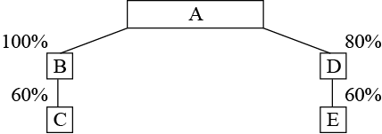
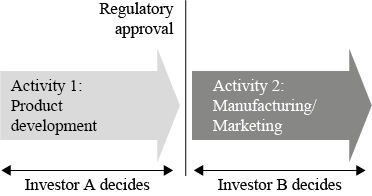
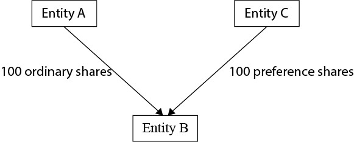
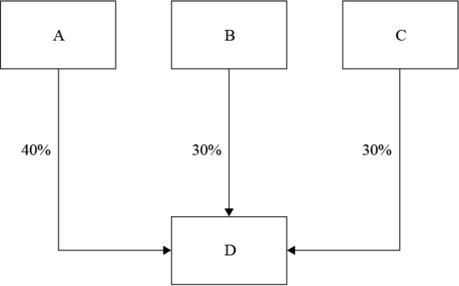
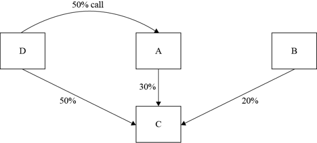
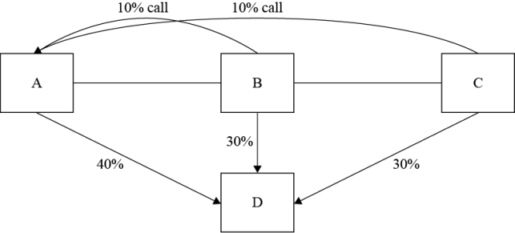

# 26 - Consolidated financial statements (IFRS 10)

[返回目录](README.md)

## Illustrative text

### FAQ 26.11.1 – How does the exemption from preparing consolidated financial statements apply?

 

Reference to standard: IFRS 10 para 4  
 Reference to standing text: [26.11](45.md#s169-Para_26.11)  

  

**Question**

Entity A has the following interests in other entities:

- 100% interest in entity B; and entity B owns a 60% interest in entity C.

- 80% interest in entity D; and entity D owns a 60% interest in entity E.

- Entity A is a listed company and prepares IFRS consolidated financial statements.

- Entities B and D do not have their securities publicly traded, and they are not in the process of issuing securities in public markets.

The structure is illustrated as follows:

How does the exemption from preparing consolidated financial statements apply to entities B and D?

**Answer**

Entity B is a wholly owned subsidiary of entity A, and is not required to prepare consolidated financial statements. Entity D is not required to prepare consolidated financial statements, provided that all of its other owners also do not object to it.

 

### FAQ 26.11.2 – How does local legislation impact preparation of consolidated financial statements?

 

Reference to standard: IFRS 10 para 4  
 Reference to standing text: [26.11](45.md#s169-Para_26.11)  

  

  
**Question**

How does local legislation impact preparation of consolidated financial statements?

**Answer**

Local regulations generally mandate when, and for what periods, an entity must present consolidated or separate financial statements. Local regulations might allow (or require) an intermediate parent to produce separate financial statements prepared in accordance with IFRS instead of consolidated financial statements.

Where local legislation or regulations allow an entity not to produce consolidated financial statements, the entity should still consider the exemptions in paragraph 4 of IFRS 10 and determine whether it is exempt from preparing consolidated financial statements under IFRS.

 

### FAQ 26.13.1 – Can the use of a framework similar to IFRS be seen as ‘IFRS compliant’ for the purposes of satisfying paragraph 4(a)(iv) of IFRS 10?

 

**Background**

 

The ultimate or intermediate parent’s consolidated financial statements might not contain an explicit and unreserved statement of compliance with IFRS; however, the accounting framework applied by the parent might be based on IFRS (for example, IFRS as endorsed by the EU).

 

**Question**

 

Can the use of a framework similar to IFRS be seen as ‘IFRS compliant’ for the purposes of complying with paragraph 4(a)(iv) of IFRS 10?

 

**Answer**

 

The ultimate or intermediate parent’s consolidated financial statements would generally need to comply with IFRS as issued by the IASB, to satisfy the requirement in paragraph 4(a)(iv) of IFRS 10. However, in limited cases, paragraph 4(a)(iv) might be satisfied if the ultimate or intermediate parent’s consolidated financial statements are prepared using a framework that is not materially different from that of IFRS. The differences between frameworks would generally be limited such that there are no material differences in the policies applied by the ultimate or intermediate parent relative to IFRS. Similarly, any differences in the frameworks should not be expected to result in material differences in the ultimate or intermediate parent’s consolidated financial statements in future periods.

 

IFRS as endorsed by the EU is currently one example of a framework that would typically be seen as IFRS compliant for the purposes of applying the exemption in paragraph 4(a)(iv) of IFRS 10.

 

### FAQ 26.13.2 – Publicly available information

 

Paragraph 4(a)(iv) of IFRS 10 of the consolidation exemption requires the ultimate or intermediate parent to produce financial statements that are available for public use. The concept of ‘available for public use’ is not defined by IFRS.

 

In our view, we think that a reasonable interpretation of ‘available for public use’ is that a member of the public should be able to obtain the financial statements without undue cost or effort.

 

The following examples would generally meet the above interpretation of ‘available for public use’:

 

- An entity with listed debt/equity on a stock exchange.

- Financial statements which are available on the website of the company shortly after year end and the financial statements are not subsequently removed from the website.

- An electronic copy of the financial statements can be obtained within a short period of time for no fee through a contact person or an email address that is easily accessible.

- Access to financial statements is given by regulators in exchange for a negligible fee, where the application process for such requests is commonly understood and administrative in nature, and the financial statements are provided within a short period of time.

 

In our view, the following examples would generally fail the above interpretation of ‘available for public use’:

 

- The local government requires the financial statements of each company to be lodged with a regulatory body. Any company or individual can apply to the government for access to the financial statements. Typically, a formal application, together with a fee and a reason why the financial statements are being requested, is required. The government can approve or deny the request.

- Available at the company reception for inspection; however, access to the premises is at the discretion of the entity, and a member of the general public would not be able to access the premises without undue cost or effort.

- Published on the company’s website for a short period of time – that is, replaced shortly after year end with a summary.

 

An entity that uses the exemption from preparing consolidated financial statements must disclose in its separate financial statements the address where the financial statements of the parent can be obtained. [IAS 27 para 16(a)]. Depending on the situation, the following information can be disclosed:

 

- a website address where the financial statements are available; or

- contact details of an individual or an email address from which the financial statements can be obtained.

 

### FAQ 26.16.1 – What factors should be considered in determining whether a structure is an entity for the purposes of assessing whether it is within the scope of IFRS 10?

 

Reference to standard: IFRS 10 App A  
 Reference to standing text: [26.16](45.md#s169-Para_26.16)   

  

  
**Group entities**

Some arrangements, such as syndicates, might not have a separate legal personality:

- Syndicate members might enter into contracts and investments in their own names.

- Legal action might only be taken against the syndicate members rather than the syndicate itself.

- The day-to-day running of the syndicate’s assets might be performed by a managing agent, who might or might not be a subsidiary of one of the syndicate members.

**Question**

What factors should be considered in determining whether a structure is an entity for the purposes of assessing whether it is within the scope of IFRS 10?

**Answer**

An entity will exist if there is some mechanism by which members of the entity can come together and make decisions over relevant activities that bind all of the members. This could include the ability to appoint and remove a managing agent or similar persons. If there is no mechanism to allow this, a member will simply have an interest in assets (for example, a pro rata share of a property or of investments) rather than there being an entity.

An entity will exist if one of the following conditions is met:

- The structure has a separate legal existence which is distinct from its investors. Factors which indicate this include:

- legal personality;

- governing documents which establish the structure;

- the structure is able to contract in its own name; and

- the structure can be sued.

- A contractual agreement exists allowing the investors to make decisions over the relevant activities of the structure. Factors which indicate this include:

- a management committee or similar body exists;

- the investors are able to remove the managing agent;

- dissenting investors are bound by majority decisions;

- the arrangement has a tax status separate from that of its investors;

- the arrangement is able to open a bank account in its own name; and

- the liabilities of the investors are not limited to the amount of their investment.

The indicating factors set out above are not exhaustive lists. All facts and circumstances should be considered when determining if an entity exists for the purposes of applying IFRS 10.

Entities might include:

- Corporations.

- Partnerships.

- Trusts.

- Governmental bodies or agencies.

- Universities.

- Any other organisations or bodies of persons.

- A ring-fenced portion of a larger entity (sometimes referred to as a ‘silo’).

- A group including one or more of the entities identified above.

Appendix A to IFRS 10 defines a group as “a parent and its subsidiaries”, so any of the entities noted above would need to meet the definition of a parent or a subsidiary to be part of a group.

 

### EX 26.18.1 – Forms of interest in another entity

 

Reference to standard: IFRS 12 App A  
 Reference to standing text: [26.18](45.md#s169-Para_26.18)   

  

  
 A reporting entity can have an interest in another entity by an equity holding or by involvement through other means. Examples of potential interests in an entity include, but are not limited to:

- Equity or debt instruments.

- Credit enhancement and guarantees.

- Certain derivatives.

- Liquidity support.

- Obligations arising from sponsoring an employee benefit trust.

- A participation right.

- A residual interest.

- A lease.

- The provision of funding.

- Other contractual arrangements.

- Any non-contractual means by which an entity has control, joint control or significant influence over any entity.

 

### FAQ 26.31.1 – Do decisions made when an entity is formed provide power?

 

Reference to standard: IFRS 10 para B6  
 Reference to standing text: [26.31](45.md#s170-Para_26.31)  

  

  
**Question**

A structured entity (SE) was set up by a sponsoring bank to invest in bonds. The most important activity that affects the returns of the SE is the bond selection process. The bonds were selected on set-up of the SE by the sponsoring bank, and the incorporation documents state that no further bonds can be purchased. No further bond selection decisions are therefore required after the SE is set up.

Does the sponsoring bank have power over the SE solely by virtue of its power to select the bonds in which the SE invests?

**Answer**

Asset selection, on its own, is unlikely to give the sponsoring bank power in this scenario. The bonds cannot be replaced, so the power to select bonds (the relevant activity) ceased when the SE was established. However, the sponsoring bank’s active involvement in the design of the SE indicates that the bank had the opportunity to give itself power. All of the contractual arrangements related to the SE and other relevant facts and circumstances should be carefully assessed to determine if the bank has power over the SE. [IFRS 10 App para B51].

Power might arise from rights that are contingent on future events (see [EX 26.82.1](46.md#s176-EX26.82.1)).

 

### EX 26.33.1 – Identification of relevant activities

 

Reference to standard: IFRS 10 para B11  
 Reference to standing text: [26.33](45.md#s170-Para_26.33)  

  

  
Entity A issues loan notes to investors in pounds sterling, but it purchases financial assets in Euros and US dollars. It hedges the cash flow differences through currency and interest rate swaps.

Entity A’s relevant activities include the following:

- Selling and purchasing assets.

- Managing financial assets during their life (including on default).

- Determining a funding structure and obtaining funding for its activities.

- Hedging the currency and interest rate risks arising from its activities.

These activities are likely to most significantly affect entity A’s returns.

 

### EX 26.38.1 – Assessing which activity most significantly affects returns

 

Reference to standard: IFRS 10 para B13  
 Reference to standing text: [26.38](45.md#s170-Para_26.38)  

  

  
 Two investors form an investee to develop and market a medical product. One of the investors has the responsibility, and the unilateral ability, to make all decisions relating to product development and to obtaining regulatory approval. Once the regulator has approved the product, the other investor has the responsibility, and the unilateral ability, to make all manufacturing and marketing decisions.

  
 The factors that need to be considered, to determine which investor has power over the investee, are summarised below. The key question is which investor has the ability to direct the activity or activities that most significantly affect returns.

It is important to consider the investee’s purpose and design, and the factors that determine the investee’s profit margin, revenue and value, as well as the value of the medical product. The impact of these will affect the investee’s returns, resulting from each investor’s decision-making authority and the investors’ exposure to variability of returns. It might be difficult to conclude which investor most significantly affects returns, because this is judgemental and will depend on the individual facts and circumstances. The answer could be affected by the investee’s strategy and the party which has most influence over it. For example, consider a low-cost manufacturer of a commoditised product and a manufacturer of a high-end branded product. Low-cost manufacturing could be the critical process for the first manufacturer, while effective marketing could be the critical process in the second manufacturer.

Factors to consider, in assessing which activity or activities most significantly affect returns, include:

- The investee’s purpose and design.

- The factors that determine the investee’s profit margin, revenue and value, as well as the value of the medical product.

- The effect on the investee’s returns resulting from each investor’s decision-making authority.

- The investors’ exposure to variability of returns.

- The uncertainty and effort required in obtaining regulatory approval (considering the investor’s record of successfully developing and obtaining regulatory approval of medical products).

- Which investor controls the medical product once the development phase is successful.

The decision will be highly judgemental in practice. It can be difficult to identify which activity has more effect on returns.

 

### FAQ 26.40.1 – Can an investor have power currently if its decision-making rights relate to an activity that will only occur at a future date?

 

Reference to standard: IFRS 10 para 10  
 Reference to standing text:  [26.40](45.md#s170-Para_26.40)  

  

  
An investor has power over an investee when the investor has existing rights that give it the current ability to direct the relevant activities of the investee. [IFRS 10 para 10].

**Question**

Entities X and Y set up a new company to construct and operate a toll road. Entity X is responsible for the construction of the toll road, which is expected to take two years. Thereafter, entity Y has authority on all matters related to toll road operation.

Is it possible for entity Y to have power over the company during the construction phase, even though entity X is responsible for construction and has authority to make decisions that need to be made during the construction phase?

**Answer**

Entity Y might have power during the construction phase, even though it cannot yet exercise its decision-making rights. The investor that has the ability to direct the activities that most significantly affect the returns of the investee has power over the investee. [IFRS 10 App B para B13]. The criteria in example 1 in paragraph B13 of IFRS 10 should be applied, which include consideration of:

- the purpose and design of the investee;

- the factors that determine profit margin, revenue and value of the investee. For example, the construction of the road might be under the supervision of the national roads authority. Entity X is contracted to build the road under government supervision and, subject to government audit, will recover its costs plus a specified percentage of margin. That margin will be returned through adjustment of the amount of tolls that will flow to entity X, so that entity X has first call on the cash flows generated by tolls. Entity Y will manage the toll road operations, including maintenance, and will be able to claim a management fee equivalent to any residual cash in the entity after all operating expenses have been paid, including payments to entity X. Entity Y has the ability to set tolls. Alternatively, the arrangement could set out that the government regulates the tolls that can be charged, with little variation in expected revenue, but gives the investee more discretion over how the toll road is constructed, with entities X and Y sharing equally in the net cash flows of the investee;

- the effect on the investee’s returns resulting from each investor’s decision-making authority with respect to the factors above; and

- the investors’ exposure to variability of returns.

 

### FAQ 26.40.2 –Should an entity re-assess whether it has control of an investee?

 

Reference to standard: IFRS 10 para B80  
 Reference to standing text:  [26.40](45.md#s170-Para_26.40)  

  

  
**Question**

Entities X and Y set up a new company to construct and operate a toll road. Entity X is responsible for the construction of the toll road, which is expected to take two years. Thereafter, entity Y has authority on all matters related to toll road operation. Entity Y was assessed to have power, because it had the ability to direct the relevant activities that would most significantly affect the returns of the company, even though it could not exercise its decision-making rights at that point in time.

Two years pass, and the toll road has been fully constructed. Entity Y has entered bankruptcy, and entity X has assumed management of the toll road operations and is in discussions with the national roads authority to continue managing those operations.

Should entity X re-assess whether it has control of the investee in this situation?

**Answer**

Yes, entity X should make a re-assessment, because there has been a change that affects the power criterion.

 

### EX 26.40.3 – Level of involvement in relevant activities

 

Reference to standard: IFRS 10 para 10  
 Reference to standing text:  [26.40](45.md#s170-Para_26.40)  

  

  
 Levels of involvement in relevant activities can vary; for example, there could be day-to-day involvement in managing the investee’s relevant activities, which is likely to be a strong indicator that the investor has a level of input that is significant.

On the other hand, involvement in relevant activities might not be as obvious as day-to-day management; instead, it might be through a contractual arrangement that determines the investee’s investment policies. Contractual arrangements might, in turn, impact on the investee’s returns significantly.

 

### FAQ 26.51.1 – Does an entity control another entity via the right to appoint a majority of the board?

 

Reference to standard: IFRS 10 para B15  
 Reference to standing text:  [26.51](45.md#s170-Para_26.51)  

  

**Question**

  
Entity A owns 45% of the shares in entity B but, based on the shareholders’ agreement, controls the composition of its board of directors by having the power to appoint or remove the majority of entity B’s directors. Entity B’s articles of incorporation state that acquisitions and disposals of assets in an amount higher than 50% of the fair value of entity B’s total assets, and the decision to liquidate entity B, are reserved for shareholder vote. All other decisions over the relevant activities require only majority approval by the directors.

Does entity A control entity B via the right to appoint a majority of the board?

**Answer**

The ability of entity A to control the composition of entity B’s board confers control of entity B to entity A. Although certain decisions are reserved for a shareholder vote, where entity A has control of only 45% of the votes, such decisions seem to be protective in nature. That is, they relate only to fundamental changes to an investee’s activities or apply only in exceptional circumstances (see guidance in [para 26.80](45.md#s170-Para_26.80) on protective rights). Accordingly, entity A has control because it is able to direct entity B’s ‘relevant activities’ and hence is able to affect its returns. In this situation, entity B would be regarded as entity A’s subsidiary.

 

### FAQ 26.51.2 – Does an entity control another entity via the power to direct the board’s votes?

 

Reference to standard: IFRS 10 para B15  
 Reference to standing text:  [26.51](45.md#s170-Para_26.51)  

  

  
 Where an entity has the right to appoint a director with a casting vote in the event of a board deadlock, and it therefore controls more than half of the voting power on the board, it will effectively control the board because it can control board decisions.

**Question**

Entity A owns 50% of entity B’s voting shares. The board of directors consists of eight members. Entity A appoints four directors, and two other investors appoint two directors each. One of entity A’s nominated directors always serves as chairman of entity B’s board and has the casting vote at board meetings. Voting decisions are made by a simple majority on all relevant activities.

Does entity A control entity B via the power to direct the board’s votes?

**Answer**

Entity A has the casting vote at board meetings if the directors cannot reach a majority decision. This provides entity A with control of board decisions and, therefore, power over entity B’s relevant activities. Hence, entity B is a subsidiary of entity A and will be consolidated into entity A’s consolidated financial statements.

 

### EX 26.52.1 – Assessing whether approval rights over budgets are substantive

 

Reference to standard: IFRS 10 App B para B26  
 Reference to standing text: [26.52](45.md#s170-Para_26.52) 

  

  
 Approval rights over budgets are sometimes included within shareholders’ agreements. This might arise in certain specialised industries, such as gaming or insurance, where one shareholder will have the relevant industry knowledge and act as the operator/manager of the entity. Another party is then required to hold an equity interest in the entity, either from a regulatory perspective or from a funding perspective, and might also hold particular budget approval rights.

The following factors might be relevant in determining whether budget approval rights are substantive or protective:

- The level of detail of the budget that is required to be approved. The greater the level of detail, the more likely it is that such rights are substantive.

- The frequency of budget preparation, period covered and frequency of budgetary review.

- Whether previous budgets have been challenged and, if so, the practical method of resolution. Previous evidence of substantive challenge, with resolution of such challenge prior to budget approval being required, would indicate such rights being more substantive in nature.

- Consequences when budgets are not achieved. If such a scenario would result in the operator/manager being removed, this would suggest that the rights are more substantive in nature.

- The availability of other returns, such as management fees, to the investor and extent thereof. The greater the exposure to variability of returns, the greater the indication of substantive rights that might result in power.

- Returns that are disproportionate to the contractual shareholding. For example, where the shareholdings of the operator/manager and the other party are 49% and 51% respectively, but returns from the entity are shared 75% and 25% respectively, this might indicate that approval rights are not intended to be substantive.

- The nature of the counterparty and its practical involvement in the business. Where the entity operates in a specialised industry and the operator/manager has the relevant specialised knowledge, this indicates that the operator/manager is providing critical services and so might have power over the investee.

- The existence of any other rights noted in [paragraph 26.51](45.md#s170-Para_26.51), such as the right to appoint or remove key management personnel.

 

### EX 26.53.1 – Options and risk of losing key management personnel

 

Reference to standard: IFRS 10 para B23  
 Reference to standing text: [26.53](45.md#s170-Para_26.53) 

  

  
**Question**

Entity J has acquired 45% of entity X, with an option to purchase the remaining 55%. Entity X is a specialist entity that develops the latest technology in its industry and is a key player in research for the latest products. Entity J has acquired the stake in entity X, because it wants to gain access to this key technological research, which would complement its own operations and business.

The remaining 55% of equity is held by key management personnel, who are key to running a major project that will bring to market a product which entity J considers to be ground-breaking within its industry.

However, if entity J exercises the option, these management personnel are likely to leave. They have unique technological knowledge in relation to the specific product.

The option strike price is four times the current value of entity X’s share price.

Does the option provide entity J with power over entity X?

**Answer**

The option might not be substantive if entity J would enjoy no economic benefit (or, indeed, would lose economic benefits) from exercising it. The high strike price and likely loss of key management personnel indicate that the option might not be substantive.

 

### FAQ 26.53.2 – Can an option provide power where the option holder does not have the operational ability to exercise?

 

Reference to standard: IFRS 10 para B23  
 Reference to standing text: [26.53](45.md#s170-Para_26.53)  

  

  
**Question**

Investors X and Y own 30% and 70% respectively of a manufacturing company (‘Investee’). Investee is controlled by voting rights, manufactures a specific product for which the patent is owned by investor Y, and is currently managed by investor Y. Investor X has an out-of-the-money call option over the shares held by investor Y. The patent used by Investee will revert to investor Y if the call option is exercised, unless (a) there is a change in control of investor Y, (b) investor Y breaches the terms of the contract between the parties, or (c) investor Y enters bankruptcy. Investee cannot manufacture the product without investor Y’s patent, which is not replaceable. Neither party expects the call option to be exercised. The purpose of the call option is to allow investor X to take control of Investee in exceptional situations.

Does the option provide investor X with power over Investee?

**Answer**

The option held by investor X is unlikely to be regarded as substantive. There are substantial operational barriers to the exercise of the call option by investor X, being the reversion of the patent to investor Y unless one of the specified conditions has occurred. Further, investor X will not obtain benefits from the exercise of the call option unless one or more of the events described above occurs. The design of the call option suggests that it is not intended to be exercised. [IFRS 10 App B para B48]. The option is therefore unlikely to confer power on investor X.

 

### FAQ 26.53.3 – Can an option provide power where the option holder does not have the financial ability to exercise?

 

Reference to standard: IFRS 10 para B23  
 Reference to standing text: [26.53](45.md#s170-Para_26.53)  

  

  
**Question**

Investors X and Y own 30% and 70% respectively of a company (‘Investee’) that is controlled by voting rights. Investor X has a currently exercisable, in-the-money call option over the shares held by investor Y. However, investor X is in financial distress and does not have the financial ability to exercise the option. Investee is profitable.

Does the option provide investor X with power over Investee?

**Answer**

A currently exercisable, in-the-money option is likely to convey power. Investor X might not be able to exercise the option itself, without seeking finance from a third party, or it might exercise the option and immediately re-sell its interest in investor Y. If investor X could sell the option itself or otherwise obtain economic benefits from the exercise, the option would provide power over Investee. An option that was out-of-the-money might mean that there were significant barriers that would prevent the holder from exercising it. [IFRS 10 App B para B23(c)]. An option is therefore generally not substantive if it is not possible for the option holder to benefit from exercising it.

The purpose and design of such an option also needs to be considered.

[IFRS 10 App B para B48].

 

### EX 26.56.1 – Substantive rights currently exercisable

 

Reference to standard: IFRS 10 para B24  
Reference to standing text:  [26.56](45.md#s170-Para_26.56)  

  

  
**Question**

An investee makes decisions about relevant activities at special meetings and annual general meetings (AGMs). The next AGM is in eight months. Shareholders that individually or collectively hold at least 5% of the voting rights can call a special meeting by giving not less than 30 days' notice. Policies over relevant activities can be changed only at special or scheduled meetings.

  
An investor holds the majority of the voting rights.

Does the majority of voting rights at the Special meeting and AGM provide the investor with power over the investee?

**Answer**

The voting rights are substantive, because the investor can make decisions on relevant activities when they need to be made, and a 30-day delay before exercise does not preclude existence of the power from the moment when the shares are acquired.

 

### EX 26.56.2 – Substantive rights not currently exercisable: forward contract to be settled in 25 days

 

Reference to standard: IFRS 10 para B24  
 Reference to standing text:  [26.56](45.md#s170-Para_26.56)  

  

  
**Question**

An investee makes decisions about relevant activities at special meetings and annual general meetings (AGMs). The next AGM is in eight months. Shareholders that individually or collectively hold at least 5% of the voting rights can call a special meeting by giving not less than 30 days’ notice. Policies over relevant activities can be changed only at special or scheduled meetings.

  
 An investor holds a forward contract to acquire the majority of the voting rights in the investee. The settlement date of the forward contract is in 25 days.

Does the forward contract to acquire the majority of voting rights provide the investor with power over the investee?

**Answer**

The forward contract is substantive, because the existing shareholders are unable to change existing policies within the next 30 days. The forward contract will have settled by that time, and the investor’s rights are essentially equivalent to those of a majority shareholder. The forward contract gives the investor power, even though settlement has not yet occurred.

 

### EX 26.56.3 – Substantive rights not currently exercisable: option exercisable in 25 days

 

Reference to standard: IFRS 10 para B24  
 Reference to standing text:  [26.56](45.md#s170-Para_26.56)  

  

  
**Question**

An investee makes decisions about relevant activities at special meetings and annual general meetings (AGMs). The next AGM is in eight months. Shareholders that individually or collectively hold at least 5% of the voting rights can call a special meeting by giving not less than 30 days' notice. Policies over relevant activities can be changed only at special or scheduled meetings.

  
 An investor holds an option to acquire the majority of the shares that is exercisable in 25 days. The option is deeply in the money.

Does the option to acquire the majority of the voting rights provide the investor with power over the investee?

**Answer**

The option is substantive, because the existing shareholders are unable to change existing policies within the next 30 days. The option will be exercisable in that time, and the investor’s rights are essentially equivalent to those of a majority shareholder. The option gives the investor power, even though it has not yet been exercised.

 

### EX 26.56.4 – Substantive rights not currently exercisable: forward contract to be settled in six months

 

Reference to standard: IFRS 10 para B24  
 Reference to standing text:  [26.56](45.md#s170-Para_26.56)  

  

  
**Question**

An investee makes decisions about relevant activities at special meetings and annual general meetings (AGMs). The next AGM is in eight months. Shareholders that individually or collectively hold at least 5% of the voting rights can call a special meeting by giving not less than 30 days' notice. Policies over relevant activities can be changed only at special or scheduled meetings.

  
An investor holds a forward contract to acquire the majority of the voting rights in the investee. The settlement date of the forward contract is in six months from now.

Does the forward contract to acquire the majority of the voting rights provide the investor with power over the investee now?

**Answer**

The forward contract is not currently substantive, because the existing shareholders can change existing policies over the relevant activities by calling a special meeting with 30 days’ notice before the forward contract is settled. Therefore, the investor does not have the current ability to direct relevant activities until the forward contract completes. Once the forward contract completes, the investor will have power at future meetings.

 

### FAQ 26.57.1 – Can an option provide power when it is out of the money?

 

Reference to standard: IFRS 10 para B50  
 Reference to standing text:  26.57  

  

  
**Question**

Investors X and Y hold 30% and 70% respectively of a company (‘Investee’) that is controlled by voting rights. Investor X has a currently exercisable, out-of-the-money call option over the shares held by investor Y.

Can the option provide investor X with power over Investee?

**Answer**

Yes, such an option can provide investor X with power if it is determined to be substantive. This will require judgement, based on all of the facts and circumstances. The relevant considerations are set out below.

Investor X must benefit from the exercise of the option in order for it to be substantive. [IFRS 10 App B para B23(c)]. The option is out of the money, which might indicate that the potential voting rights are not substantive.

[IFRS 10 App B para B23(a)(ii)].

However, investor X might benefit from exercising the option, even though it is out of the money. Investor X might achieve other benefits − such as synergies or operational efficiencies from exercising the call option – and might, overall, benefit from exercising the option. The option is likely to be substantive in those circumstances.

[IFRS 10 App B para B23(c)].

 

### FAQ 26.59.1 – Can economic dependence provide power?

 

Reference to standard: IFRS 10 para B40  
 Reference to standing text:  [26.59](45.md#s170-Para_26.59)  

  

  
**Question:**

Entity P manufactures widgets for entity Q. 80% of entity P’s output is supplied to entity Q, and the remainder is supplied to various small customers. Entity Q has no involvement in entity P other than placing orders for widgets. The contract to supply entity Q with widgets states specific order quantities, quality criteria and prices. If entity Q does not order the minimum order quantities, it has to pay entity P a penalty. Entity P has to replace any widgets that do not meet the specified quality criteria; and, if sub-standard widgets exceed certain specified levels, entity Q has the right to terminate the contract for no further consideration. However, entity Q does not have decision-making power over how the widgets are produced or sourced. The contract that entity P holds with entity Q runs for three years, and it is normally renewed on a rolling basis. If the contract is terminated early by either entity, certain penalties would be paid by the terminating entity. If the contract is not renewed, either entity is able to seek other customers and suppliers respectively.

Entity P has its own management board that operates the business, makes key decisions about the contracts that it enters into, and actively looks for new customers. Entity P’s management regularly reviews the equipment that manufactures the widgets, and it replaces machinery when necessary.

Does entity P’s economic dependence on entity Q provide entity Q with power over entity P?

**Answer:**

In this situation, entity Q does not control entity P, because the control criteria in IFRS 10 are not met.

Entity Q does not have power over entity P, because it is not involved in directing the relevant activities of entity P, such as the day-to-day operations required to manufacture widgets and the activities to seek new customers. Entity Q does not have any additional rights through its contractual arrangement that might infer that it has power over entity P.

Despite entity P appearing to be economically dependent on entity Q, this is not a conclusive factor when assessing control under IFRS 10.

 

### FAQ 26.63.1 – What form can voting rights take?

 

Reference to standard: IFRS 10 para B35  
 Reference to standing text:  [26.63](45.md#s170-Para_26.63)  

  

  
**Question:**

What form can voting rights take?

**Answer:**

‘Voting rights’ means the ability to exercise the rights conferred on shareholders, in respect of their shares, to vote at the entity’s general meetings on all, or substantially all, matters.

If the entity does not have periodic general meetings where matters are decided by exercising voting rights, ‘power conveyed by voting rights’ can be taken to mean having the ability to exercise the right under the entity’s constitution to direct its overall policy, or to alter the terms of its constitution.

 

### EX 26.63.2 – Voting rights of different classes of shares

 

Reference to standard: IFRS 10 para B35  
 Reference to standing text:  [26.63](45.md#s170-Para_26.63)  
 

  

  

 

  
 Voting rights provide an investor in entity B with the current ability to direct relevant activities (see further [para 26.41](45.md#s170-Para_26.41)).

The rights attached to entity B’s shares are as follows:

- Ordinary shares (wholly owned by entity A):

- 100 ordinary shares.

- All dividends after payment of preference dividends.

- Right to all surplus assets on a winding up of the entity after repayment of preference shares.

- Right to vote on significant matters in relation to relevant activities for entity B. These include appointment of the board of directors (on a day-to-day basis, the relevant activities are directed by the board).

- Preference shares (all held by entity C):

- 100 C1 preference shares.

- Fixed preference dividend.

- Right, on winding up, to the repayment of par value and up to 25% of any sum standing to the credit of the share premium account.

- No rights to vote at entity meetings.

The preference shares have no voting rights, while the ordinary shares do. Consequently, when considering voting rights (that is, the means of exercising power in this case), along with rights to variable returns and the ability to affect those returns, entity B is controlled by entity A.

 

### EX 26.63.3 – Voting rights for pledged shares

 

Reference to standard: IFRS 10 para B35  
 Reference to standing text:  [26.63](45.md#s170-Para_26.63)  

  

  
 An investor might sometimes pledge shares to another entity as collateral. Where the voting rights on those shares (except on default by the investor) are exercisable only in accordance with the instructions of the investor that pledged them, they are treated as held by that investor.

**Question:**

Entity A grants a loan to entity B. Entity B provides its shares in entity C as security for the loan. However, entity A does not gain the voting rights on the shares in entity C, unless entity B defaults on the loan.

Can entity A direct the relevant activities of entity C?

**Answer:**

Entity B retains control of the voting rights in entity C (unless and until it defaults), even though the shares are held as security by entity A.

Therefore, entity A does not have the current ability to direct the relevant activities of entity C.

 

### EX 26.65.1 – Impact of regulation on assessment of power

 

Reference to standard: IFRS 10 para B37  
 Reference to standing text:  [26.65](45.md#s170-Para_26.65)  

  

  
 In most cases, government regulation will not be sufficient to prevent the investors from having control.

For example, an investor that owns more than half the voting rights of a regulated utility (whose regulator imposes price controls) will generally not be prevented from directing the utility’s relevant activities because of those price controls. Although the regulator affects the returns that the utility company generates, the regulator does not have sufficient rights to direct the entity’s relevant activities to convey power and, therefore, does not have control.

Only regulation that prevents the investors from directing the relevant activities would be sufficient to prevent them from having control. For example, a law might require the state to appoint half of the board of directors of a defence contracting entity, but give the government a casting vote if the board is deadlocked. This regulation would prevent an entity that owned the other half of the voting rights from directing the relevant activities and, therefore, from controlling the investee.

 

### EX 26.67.1 – Majority of voting rights by agreement with other shareholders

 

Reference to standard: IFRS 10 para B34  
 Reference to standing text:  [26.67](45.md#s170-Para_26.67)  

  

  
**Question:**

Entity A owns 45% of the voting shares of entity B. Entity B’s relevant activities are controlled through voting rights, and a simple majority vote is required on all decisions on the relevant activities. Entity A also has an agreement with other shareholders that they will always vote a further 20% holding in the same way as entity A.

Does entity A control entity B?

**Answer:**

The agreement between entity A and the other shareholders provides entity A with control over 65% of entity B’s voting rights. Entity A, therefore, controls entity B, so entity B is its subsidiary and should be consolidated in entity A’s consolidated financial statements.

 

### EX 26.67.2 - Reduction of ownership to below 50% of voting rights with contractual arrangement

 

Reference to standard: IFRS 10 para B39  
 Reference to standing text:  [26.67](45.md#s170-Para_26.67)  

  

  
**Question:**

Entity L has a 51% interest in entity M, a listed entity. The other shareholdings are dispersed and tend not to attend meetings or appoint proxies to represent them. Entity L has been consolidating entity M, because it controls entity M through its 51% ownership interest.

Entity M is highly leveraged and begins to make losses; entity L decides to sell a 2% interest in entity M to an investment bank, reducing its interest to 49%.

Entity L has a contractual agreement with the investment bank to continue to direct entity M’s relevant activities and protect its investment by managing entity M’s relevant activities.

Does entity L retain control over entity M?

**Answer:**

The 49% interest enables entity L to continue to have the ability to direct entity M’s relevant activities. Entity L has control over entity M. Entity L owns 49% of entity M, with an otherwise widely dispersed group of shareholders, and it has an agreement with the investment bank that enables it to appoint the majority of the board to direct its relevant activities. Entity L should continue to consolidate entity M.

 

### EX 26.68.1 – Power to govern under a shareholder agreement

 

Reference to standard: IFRS 10 para B40  
 Reference to standing text:  [26.68](45.md#s170-Para_26.68)  

  

  
**Question:**

Three entities – A, B and C – invest in entity D to manufacture footballs. Entity A has considerable experience in manufacturing footballs and has developed new technology to improve their production. Entities B and C are both banks that have previously financed entity A’s operations.

Entity A will contribute technology and know-how to entity D, whilst entities B and C will provide finance. The share ownership will be: entity A – 40%; entity B – 30%; and entity C – 30%. Each entity will appoint directors in proportion to its ownership percentage. An agreement between the shareholders states that all directors will be non-executive, except for the managing director and the finance director, both of whom will be appointed by entity A in recognition of its expertise in the area of football manufacture. A simple majority vote is required to make decisions in relation to entity D.

  
The shareholder agreement delegates to entity D’s managing director and its finance director (who have been appointed by entity A) the power to direct entity D’s relevant activities, which include operating policies and the operating budget. However, requests for significant additional financing above that which is needed to run entity D’s day-to-day operations must be considered by the full board.

Does the shareholder agreement provide entity A with power over entity D?

**Answer:**

The delegation of powers over the entity’s operating policies and budget (which are relevant activities), to the directors appointed by entity A, appears to provide entity A with power over entity D, because this can be seen to give entity A the right to direct entity D’s relevant activities. Although there are some powers retained by the full board, including decisions over significant increases in financing, these might be limited and might provide rights that are more protective than substantive in nature. However, a greater analysis of these restrictions imposed would need to be performed to identify whether entity A does, in fact, have the ability to direct entity D’s relevant activities. If it is concluded that these restrictions are only protective in nature, entity A would have power over the relevant activities and, therefore, would have control over entity D.

Determining power, in situations similar to this, should be considered carefully, because identifying rights as substantive or protective can be difficult and subject to interpretation (see further [para 26.80](45.md#s170-Para_26.80)).

 

### EX 26.68.2 – Restrictions on power due to shareholder agreements

Reference to standard: IFRS 10 para B37  
 Reference to standing text: [26.68](45.md#s170-Para_26.68)  
 

  

 

An investor’s charter or memorandum of understanding might restrict its or others’ ability to exercise all of the voting rights that it holds. It might reserve the right to appoint the board of directors to the holders of a certain class of voting share, or restrict the circumstances in which the investor could exercise its voting rights.

An entity might appear to have power over an investee by having a holding of more than 50% of the share capital, but an arrangement with the other shareholders might significantly restrict the exercise of this power. An arrangement could, for example, require unanimous agreement between the shareholders over all major decisions relating to the investee (including things such as paying a dividend, significantly changing the investee’s business activities, incurring capital expenditure over a specified level, changing the pay of its directors and other employees, or changing other major relevant activities). In this type of situation, if these matters were deemed to be the investee’s relevant activities, the investor holding more than 50% of the share capital would not control the investee. However, it might still have joint control or significant influence (see further

[chapter 32 para 5](57.md#s230-Para_32.5)

and

[chapter 31 para 9](56.md#s225-Para_31.9)

).

### EX 26.70.1 – Ownership of less than 50% of voting rights with dispersed public shareholding

 

Reference to standard: IFRS 10 para B42  
 Reference to standing text:  [26.70](45.md#s170-Para_26.70)  

  

  
**Question:**

Entity P holds 48% of voting rights in entity Q. Entity Q is a listed company, controlled by voting rights, and no other shareholder owns more than 5% of its equity shares. The other shareholders have not formed any group that might vote collectively for their combined 52% shareholding. Other shareholder representation at general meetings, in person or by proxy, has not been more than 30% of the total voting rights for many years. Entity P nominates a majority of directors and, due to its presence at general meetings, these nominations are approved.

Does entity P control entity Q?

**Answer:**

Under IFRS 10, entity P has de facto control over entity Q. Entity P is able to control the majority of votes cast at general meetings, which in turn allows it to nominate and appoint the majority of the board.

 

### EX 26.70.2 – Ownership of less than 50% of voting rights with dispersed shareholding

 

Reference to standard: IFRS 10 para B42  
 Reference to standing text:  [26.70](45.md#s170-Para_26.70)  
 

  

  
**Question:**

Entity P holds 45% of voting rights in entity Q. Entity Q is a private company, and 11 other shareholders own 5% each of Q’s equity shares. The other shareholders have not formed any group that might vote collectively for their combined 55% shareholding.

Does entity P control entity Q?

**Answer:**

Although some of the facts in this example are similar to FAQ 26.70.1, a conclusion that entity P has de facto control cannot be reached just from the absolute size of entity P’s holding and the relative size of the other shareholdings.

Additional factors would need to be considered, to determine whether de facto control is present. These factors would include:

- Whether there is an arrangement between the 11 other shareholders to vote together.

- What the voting patterns of the 11 other shareholders in the past have been. [IFRS 10 App B para B42(d)].

- Whether entity P has any other rights arising from other contractual arrangements. [IFRS 10 App B para B40].

 

### EX 26.70.3 – Ownership of less than 50% of voting rights with dispersed shareholding and a shareholder agreement

 

Reference to standard: IFRS 10 para B42  
 Reference to standing text:  [26.70](45.md#s170-Para_26.70)  

  

  
**Question:**

Entity P holds 45% of voting rights in entity Q. Entity Q is a private company, and 11 other shareholders own 5% each of equity Q's equity shares. The other shareholders have not formed any group that might vote collectively for their combined 55% shareholding.

A shareholder agreement grants entity P the right to appoint, remove and set the remuneration of key management personnel responsible for directing entity Q’s relevant activities. To make changes to the agreement, the approval of two-thirds of the shareholders is required.

Does entity P control entity Q?

**Answer:**

Although some of the facts in this example are similar to FAQ 26.70.2, the presence of a shareholder arrangement that allows entity P to make decisions about entity Q’s relevant activities might be seen to imply that entity P has de facto control. However, this conclusion cannot be drawn on the basis of voting rights alone; the presence of the shareholder agreement has to be taken into account. Other decision-making rights, in combination with voting rights, can give an investor the current ability to direct the relevant activities of an investee. [IFRS 10 App B para B40]. In this case, the right to appoint, remove and set the remuneration of key management personnel is likely to be substantive.

[IFRS 10 App B para B15(b)].

 

### EX 26.70.4 – Passive majority shareholder

 

Reference to standard: IFRS 10 para B42  
 Reference to standing text:  [26.70](45.md#s170-Para_26.70)  

  

  
**Question:**

Entity R owns 40% of voting rights in the equity share capital of entity S, which is an entity controlled by voting rights. The remaining 60% is owned by a single investor. That investor does not attend general meetings. There is no shareholder (or similar) agreement between entities R and S.

Does entity R control entity S?

**Answer:**

Entity R does not have de facto control over entity S. The passive shareholder has the power to outvote entity R at any shareholder meeting. In the absence of compelling evidence to the contrary, it is assumed that the passive shareholder would prevent entity R from acting against its interests. The passive shareholder has actual control, because it has the ability to direct entity S’s relevant activities through its voting rights, even if it chooses not to do so. Entity S should be consolidated by the passive majority shareholder if that shareholder is an entity which prepares consolidated financial statements.

 

### EX 26.70.5 – Sophisticated shareholders

 

Reference to standard: IFRS 10 para B42  
 Reference to standing text:  [26.70](45.md#s170-Para_26.70)  

  

  
**Question:**

Entity T owns 30% of voting rights in entity V. Entity V has five other shareholders, all of whom are venture capital companies or institutional investors with a track record of being actively involved in the running of the investments that they hold. None owns more than 20% of entity V. Although they do not participate at general meetings, they are known to meet regularly with representatives of entity V and with each other, and there is evidence that these meetings have affected the decisions taken by entity V’s management.

Does entity T control entity V?

**Answer:**

Entity T does not have de facto control over entity V. Whilst entity V has no single shareholder with greater voting power than entity T, the nature of the shareholders, their number, and the fact that they communicate with entity V and each other in a way that affects the decisions taken by entity V’s management, means that entity T does not have rights that enable it to direct entity V’s relevant activities. Entity T is not able to act in its own interests, dominate policy decisions and use entity V’s assets and activities. Rather, the nature of the other investors is that they are well placed to scrutinise entity V’s operations and collectively take appropriate action as necessary.

 

### EX 26.70.6 – Temporary shareholding at general meeting

 

Reference to standard: IFRS 10 para B42  
 Reference to standing text:  [26.70](45.md#s170-Para_26.70)  

  

  
**Question:**

Entity W has the following ownership structure:

- entity X: 35%;

- entity Y: 40%; and

- various small shareholders: 25%.

Entity Y and a majority of the small shareholders have attended and voted at past general meetings. At entity W’s most recent general meeting, entity Y did not vote, and entity X had sufficient votes to elect three of its named directors to a board of nine directors, being all of the board members that were put forward for election in the current year. All other matters that were put to a shareholder vote were for routine business, and the proposals of executive management were carried.

Does entity X control entity W?

**Answer:**

The fact that, at one general meeting, entity X was able to carry the vote and name its representatives on the board does not give it control over entity W. It is not necessarily able, by virtue of voting at one meeting, to direct entity W’s relevant activities on an ongoing basis. Entity Y, equally, does not have de facto control over entity W. Although it has the largest block of votes, entity X and a majority of the small shareholders could exercise their votes and prevent entity Y from enforcing its view.

 

### EX 26.70.7 – Super majority voting in a joint venture

 

Reference to standard: IFRS 10 para B42  
 Reference to standing text:  [26.70](45.md#s170-Para_26.70)  

  

  
**Question:**

Entity K is owned as follows:

- 40% by entity G (it can appoint four directors);

- 30% by entity H (it can appoint two directors); and

- 30% by entity J (it can appoint two directors).

There is an agreement in place governing the running of entity K. The entity’s investment, financing and distribution policies are subject to unanimous annual vote by the shareholders. Entity G manages the entity on a day-to-day basis, but all significant operational decisions are subject to a vote at board level, where all directors are required to agree.

Does entity G control entity K?

**Answer:**

Entity G does not have de facto control over entity K. Entity K’s relevant activities are controlled by all three shareholders through the agreement and by unanimous voting. The fact that entity G manages entity K, and can appoint more board members than either of the other two investors, does not mean that it controls entity K. Although some of the shareholders do not participate in entity K’s day-to-day management, this only relates to operational matters and not to directing entity K’s relevant activities. The company is a joint arrangement, because it is jointly controlled, and is not a subsidiary of entity G (see [chapter 32 para 5](57.md#s230-Para_32.5)).

 

### EX 26.70.8 – Assessing de facto control for an operating entity

 

Reference to standard: IFRS 10 para B42  
 Reference to standing text:  [26.70](45.md#s170-Para_26.70)  

  

**Question:**

  
 

- Entity D manufactures and sells glass bottles to entity G at market price. The majority of sales (95%) are made to entity G; however, entity D can also sell to other customers without additional cost.

- Entity D was established to allow entity G to gain a steady supply of glass bottles.

- Entity D issued two classes of shares: entity G holds Class A shares; and the 17 other investors hold Class B shares. Both classes have equal voting rights. Details of the shares are as follows:

<table style="width:100%; border-collapse:collapse"><tr><td style="border:0.75pt solid #000000; padding-right:5.03pt; padding-left:5.03pt; vertical-align:top">
 
</td><td style="border:0.75pt solid #000000; padding-right:5.03pt; padding-left:5.03pt; vertical-align:top">
<b>Class A shares</b>
</td><td style="border:0.75pt solid #000000; padding-right:5.03pt; padding-left:5.03pt; vertical-align:top">
<b>Class B shares</b>
</td></tr><tr><td style="border:0.75pt solid #000000; padding-right:5.03pt; padding-left:5.03pt; vertical-align:top">
Holder of shares
</td><td style="border:0.75pt solid #000000; padding-right:5.03pt; padding-left:5.03pt; vertical-align:top">
Entity G
</td><td style="border:0.75pt solid #000000; padding-right:5.03pt; padding-left:5.03pt; vertical-align:top">
17 other investors
</td></tr><tr><td style="border:0.75pt solid #000000; padding-right:5.03pt; padding-left:5.03pt; vertical-align:top">
% of total shareholder voting rights attributable to each class
</td><td style="border:0.75pt solid #000000; padding-right:5.03pt; padding-left:5.03pt; vertical-align:top">
41%
</td><td style="border:0.75pt solid #000000; padding-right:5.03pt; padding-left:5.03pt; vertical-align:top">
59%
</td></tr><tr><td style="border:0.75pt solid #000000; padding-right:5.03pt; padding-left:5.03pt; vertical-align:top">
Number of directors appointed by each class of shareholders
</td><td style="border:0.75pt solid #000000; padding-right:5.03pt; padding-left:5.03pt; vertical-align:top">
5
</td><td style="border:0.75pt solid #000000; padding-right:5.03pt; padding-left:5.03pt; vertical-align:top">
7
</td></tr></table>

  
 The six largest Class B investors hold 14%, 8%, 7%, 6%, 5% and 4% respectively. All other investors hold less than 3% each. The Class B investors have, in the past, participated actively in meetings.

Strategic decisions are made at shareholders’ meetings, and operational decisions are made at directors’ meetings. Daily operations are handled by a manager, based on powers granted by the shareholders and directors.

Does entity G control entity D?

**Answer:**

 

Entity G does not seem to control entity D in this situation. Power over entity D is exercised mainly through shareholders’ and directors’ meetings. Entity G does not have majority representation at such meetings. Paragraph B41 of IFRS 10 indicates that an investor with less than a majority of the voting rights might have de facto control if the criteria in paragraphs B42 to B46 of IFRS 10 are met.

However, de facto control does not seem to exist. A minimum of six Class B investors could collaborate and outvote entity G. Similarly, six directors (out of the seven directors not appointed by G) could collaborate to outvote the five directors appointed by entity G.

Under example 6 in paragraph B44 of IFRS 10, de facto control did not exist where only two other investors needed to collaborate. Under example 7 in paragraph B45 of IFRS 10, the situation was unclear where 11 other shareholders needed to collaborate.

Collaboration by six investors falls in-between. However, the remaining 17 investors have participated actively in past meetings. This suggests that entity G does not have de facto control of entity D.

[IFRS 10 para B45].

Paragraph B46 of IFRS 10 indicates that, if the situation is unclear after considering all factors, there is no de facto control. Entity G does not seem to meet the ‘clear’ evidence of de facto control required by the standard. Economic dependence alone does not lead to the investor having power over the investee.

[IFRS 10 para B40].

 

### FAQ 26.78.1 – What types of rights to acquire or dispose of shares might represent potential voting rights?

 

Reference to standard: IFRS 10 para B23  
 Reference to standing text:  [26.78](45.md#s170-Para_26.78)  

  

  
 Paragraph B47 of IFRS 10 requires investors to consider potential voting rights when determining whether they have power. Potential voting rights are rights to obtain voting rights of an investee.

**Question:**

What types of rights to acquire or dispose of shares might represent potential voting rights?

**Answer:**

The following types of rights to acquire or dispose of shares represent potential voting rights (unless no voting rights are attached to the associated shares). Such rights are often included in shareholder agreements:

Call options – These provide the holder with the right to acquire shares held by the writer of the option at a price specified by the terms of the option.

Put options – These provide the holder with the right to sell their shares to the writer of the option at a price specified by the terms of the option.

‘Drag along’ rights – These provide that, if an investor (the ‘selling shareholder’) wishes to sell its shares, it must first offer those shares to the other investors (the ‘other shareholders’). If the other shareholders decline to purchase the shares, and the selling shareholder enters into negotiations with a third party (the ‘purchaser’) to sell its shares, the selling shareholder can compel other shareholders to also sell their shares to the same purchaser on the same terms and conditions.

‘Tag along’ rights – These provide that, if an investor (the ‘selling shareholder’) wishes to sell its shares, it must first offer those shares to the other investors (the ‘other shareholders’). If the other shareholders decline to purchase the shares, the selling shareholder can enter into negotiations with a third party (the ‘purchaser’). If the selling shareholder is able to reach an agreement with the purchaser, the other shareholders can require the purchaser to also purchase their shares as a condition of that transaction.

Russian roulette – This type of arrangement is generally only applicable to a two-party shareholder agreement. Either shareholder (the ‘offering shareholder’) serves a sale notice on the other shareholder (the ‘recipient’). The notice will require the recipient either to sell all of its shares to the offering shareholder at the price specified in the notice, or to buy all of the shares held by the offering shareholder at the same price.

Specific facts and circumstances should be assessed to determine whether the potential voting rights are substantive and provide power.

 

### EX 26.78.2 – Situations where one investor holds a call option and another holds a put option in the event of a deadlock

 

Reference to standard: IFRS 10 para B23  
 Reference to standing text:  [26.78](45.md#s170-Para_26.78)  

  

**Question:**

Investors X and Y each own 50% of a manufacturing company (‘Investee’). The investors enter into a shareholder agreement, which specifies the following:

- All decisions are taken by the board of directors. The board is formed by four members, two representatives from each investor.

- Proposals can be submitted to the board by either investor, however, unanimous agreement is needed to take all decisions.

- If the board cannot reach agreement on a resolution, the dispute is determined by a binding arbitration.

- In a deadlock situation, investor X will have the right to issue a call notice for all (but no less than all), of the other investors' shares, and investor Y will have the right to issue a put notice for all (but no less than all) of its own shares.

- The exercise price for the call and put options is determined at fair value by an independent valuer.

 

Do the call and put options represent potential voting rights which might provide power over Investee?

**Answer:**

 

Yes. The rights held by investors X and Y are not symmetrical. The call option held by investor X represents a potential voting right which will enable it to obtain full ownership of the investee. If investor X has the current ability to exercise this option, it would generally provide it with power over the investee, although all of the facts and circumstances and the guidance in paragraphs B14 to B54 of IFRS 10 should be considered.

The put option held by investor Y only provides the ability to sell its interest in the investee, and not to acquire any additional voting rights. This will generally not provide any additional power over Investee. Additionally, where investor X controls Investee due to the power conveyed by the deadlock call option, a corresponding financial liability is recognised by investor X in its consolidated financial statements for the deadlock put option written to investor Y (that is, a put over the non-controlling interest).

 

### FAQ 26.78.3 – Do ‘tag along’ rights represent potential voting rights which might provide power?

 

Reference to standard: IFRS 10 para B23  
 Reference to standing text:  [26.78](45.md#s170-Para_26.78)  

  

  
**Question:**

Investors A and B each own 50% of a manufacturing company (‘Investee’). The investors enter into a shareholder agreement which specifies the following:

- All decisions are taken by the board of directors. The board is formed of four members, comprising two representatives from each investor.

- Unanimous agreement is needed to take all decisions.

- In the event that either investor enters into negotiations with a third party to sell its interest, the other investor can exercise its ‘tag along’ rights.

Do the ‘tag along’ rights represent potential voting rights which might provide either of the investors with power over Investee?

**Answer:**

 

No. The ‘tag along’ rights represent a symmetrical exit right that could be exercised by either party. They do not give either party the ability to obtain the voting rights of the other. Therefore, the ‘tag along’ rights do not impact on the assessment of power over Investee.

 

### FAQ 26.78.4 – Do ‘Russian roulette’ provisions in shareholder agreements represent potential voting rights which might provide power?

 

Reference to standard: IFRS 10 para B23  
 Reference to standing text:  [26.78](45.md#s170-Para_26.78)  

  

  
 **Question:**

Investors A and B each own 50% of a manufacturing company (‘Investee’). The investors enter into a shareholder agreement which specifies the following:

- All decisions are taken by the board of directors. The board is formed by four members, comprising two representatives from each investor.

- Unanimous agreement is needed to take all decisions.

- If the board cannot reach agreement on a resolution, either shareholder can exercise the ‘Russian roulette’ clause in the shareholder agreement.

 

Could the ‘Russian roulette’ provisions provide either of the investors with power over the Investee?

**Answer:**

 

It depends. Exercising the ‘Russian roulette’ clause in the shareholder agreement will result in one party selling its shares to the other; however, this could result in either shareholder selling or buying. This is a symmetrical right. Provided that both parties have the practical ability to exercise the right, it will not give either party the ability to obtain the voting rights held by the other. Therefore, it does not impact on the assessment of who has power over Investee.

However, there might be situations where one of the holders does not have the practical ability to exercise its rights. For example, a shareholder might not have access to sufficient financial resources to execute an offer to buy. The initiating party might serve a sale notice to the other party, knowing that it will not be accepted (due to financial difficulties). The transaction will necessarily result in the initiating party buying the other party’s shares. This situation is not expected to occur frequently.

 

### FAQ 26.78.5 – Do ‘drag along’ rights held by multiple investors represent potential voting rights which might provide power?

 

Reference to standard: IFRS 10 para B23  
 Reference to standing text:  [26.78](45.md#s170-Para_26.78)  

  

  
 **Question:**

Investors A and B each own 50% of a manufacturing company (‘Investee’). The investors enter into a shareholder agreement which specifies the following:

- All decisions are taken by the board of directors. The board is formed of four members, comprising two representatives from each investor.

- Unanimous agreement is needed to take all decisions.

- If the board cannot reach agreement on a resolution, the dispute is determined by a binding arbitration.

- In the event that either investor enters into negotiations with a third party to sell its interest, that investor can invoke the ‘drag along’ rights.

 

Do the ‘drag along’ rights represent potential voting rights which might provide either of the investors with power over Investee?

**Answer:**

No. The ‘drag along’ rights represent a symmetrical exit right that could be exercised by either party. They do not give either party the ability to obtain the voting rights of the other. Therefore, the rights do not represent potential voting rights which would impact on the assessment of power over Investee.

 

### EX 26.78.6 – Out-of-the-money options

 

Reference to standard: IFRS 10 para B23  
 Reference to standing text:  [26.78](45.md#s170-Para_26.78)  

  

  
**Question:**

Entities A and B own 80% and 20% respectively of the ordinary shares that carry voting rights at a shareholders’ general meeting of entity C. Entity A sells an interest of 50% of entity C to entity D, and buys a call option from entity D that is exercisable, at any time, at a price that reflects a premium to the market price at the issue date of the call option. If the option is exercised, it would give entity A its original 80% ownership interest and equivalent voting rights. The exercise price has economic substance and is not set deliberately high.

  
 Does entity A lose control over entity C on the sale of the 50% interest to entity D?

**Answer****:**

The option held by entity A is at a premium to the market price on issue and is slightly out of the money at the reporting date. However, it is necessary to consider whether entity A benefits, for other reasons, from the exercise of the option (for example, protection of interests or acquisition of assets). The purpose and design of the option should also be considered. Where the option is substantive, entity A should continue to consolidate entity C.

 

### EX 26.78.7 – Options whose exercise price is fair value

 

Reference to standard: IFRS 10 para B23  
 Reference to standing text:  [26.78](45.md#s170-Para_26.78)  

  

  
**Question:**

Entities A, B and C own 40%, 30% and 30% respectively of the ordinary shares that carry voting rights at a shareholders’ general meeting of entity D. Entity A also owns call options that are exercisable, at any time, at the fair value of the underlying shares at the time of exercise and which, if exercised, would give it an additional 20% of the voting rights in entity D and reduce entity B’s and entity C’s interests to 20% each. If the options are exercised, entity A would have control over more than 50% of the voting power of entity D.

  
Do the call options held by entity A provide power over entity D?

**Answer:**

The call options are exercisable at fair value. Since they are neither in nor out of the money, entity A has no apparent financial incentive or disincentive to exercise the option. Entity A should consider whether it would obtain any other benefit (such as synergies) by exercising the options and whether there are any barriers (economic or otherwise) that prevent it from exercising the option and prevent the options from being substantive. Examples of such barriers are indicated in paragraph B23 of IFRS 10 (see [para 26.53](45.md#s170-Para_26.53)).

If it is concluded that the options are substantive, entity A would also have to consider the purpose and design of the option instrument, to assess whether the options provide it with power over entity D (see [para 26.76](45.md#s170-Para_26.76)).

 

### EX 26.78.8 – Management intention

 

Reference to standard: IFRS 10 para B23  
 Reference to standing text:  [26.78](45.md#s170-Para_26.78)  

  

  
**Question:**

Entities A, B and C each own 33% of the ordinary shares that carry voting rights at a shareholders’ general meeting of entity D. Entities A, B and C each have the right to appoint two directors to the board of entity D. Entity A also owns call options that are exercisable at a fixed price at any time and which, if exercised, would give it all of the voting rights in entity D. The call options are in the money. Entity A’s management does not intend to exercise the call options, even if entities B and C do not vote in the same manner as entity A.

  
Do the call options held by entity A provide power over entity D?

**Answer:**

The call options appear to be substantive, because they are in the money. Management’s intention does not affect the assessment of whether the options are substantive, unless this intention is caused by barriers or other practical difficulties, as identified in paragraph B23 of IFRS 10 (see para [26.53](45.md#s170-Para_26.53)).

If the options are substantive, entity A would have to consider other factors (such as the option instrument’s purpose and design and the apparent expectations, motives and reasons for agreeing to those terms) to assess whether the options provide it with power over entity D.

 

### FAQ 26.78.9 – Can an option provide power when it is out of the money?

 

Reference to standard: IFRS 10 para B23  
 Reference to standing text:  [26.78](45.md#s170-Para_26.78)  

  

  
**Ques****tion:**

Investors X and Y hold 30% and 70% respectively of a company (‘Investee’) that is controlled by voting rights. Investor X has a currently exercisable, out-of-the-money call option over the shares held by investor Y.

Can the option provide investor X with power over Investee?

**Answer:**

Yes, such an option can provide investor X with power if it is determined to be substantive. This will require judgement, based on all of the facts and circumstances. The relevant considerations are set out below.

Investor X must benefit from the exercise of the option in order for it to be substantive. [IFRS 10 App B para B23(c)]. The option is out of the money, which might indicate that the potential voting rights are not substantive. [IFRS 10 App B para B23(a)(ii)]. However, investor X might benefit from exercising the option, even though it is out of the money; it might achieve other benefits − such as synergies from exercising the call option – and might, overall, benefit from exercising the option. The option is likely to be substantive in those circumstances.

[IFRS 10 App B para B23(c)].

 

### EX 26.78.10 – Assessing control with put and call options

 

Reference to standard: IFRS 10 para B23  
 Reference to standing text:  [26.78](45.md#s170-Para_26.78)  

  

  
**Question:**

Entity G set up entity I, a malt producer. Entity G initially owned 100% of entity I. Thereafter, entity G sold 50% to entity C and, at the same time, it:

- entered into a put and call over entity C’s 50% interest; and

- entered into a series of agreements that stipulate the terms set out in the rest of this case study.

  
 The purpose of this transaction was to allow entity G to bring in entity C, an expert in agriculture, to advise entity G and to assist entity G in managing production costs, and also to provide a more consistent supply of raw materials.

Further information on entity I is as follows:

- Entity G appoints the CEO; entity C appoints the plant manager (second-in-command).

- Entity I is contractually required to produce and sell sufficient malt to meet entity G’s needs, although it is also allowed to sell malt to entity C, or to other customers nominated by entity C, if entity I has excess capacity.

- The selling price of the malt to entity G is based on a formula that takes all costs incurred by entity I, and adds a margin that is calculated to give entity I a 10% gross margin on costs incurred.

- Agreements require entity C to provide entity I with market intelligence and advice, and to develop and execute supply chain plans to help entity I to acquire raw materials.

- Entity C receives fees that are commensurate with the services provided.

- The contracts with entity C are automatically terminated, with no penalties, if either of the options is exercised.

Some of entity I’s relevant activities are controlled by contract (for example, customer selection and the sale price of malt). However, operational decisions (for example, capital expenditure, repairs and maintenance expenditure, choice of suppliers, and employee hiring and firing, etc.) are made at shareholders’ and/or directors’ meetings. Unanimous consent is required for both shareholder and board decisions.

**Terms of put and call options**

- The call option held by entity G allows it to buy 50% of entity I from entity C at fair value. Similarly, the put option held by entity C allows it to sell 50% of entity I to entity G at fair value. On exercise of either the put or the call, entity G gains control of entity I, and the contracts with entity C are terminated.

- Both puts and calls are exercisable only on the occurrence of any of the following events:

- change of control, liquidation or bankruptcy of the option writer (for example, entity G can exercise its call if there is a change of control in entity C);

- entity G and entity C reach a decision deadlock which cannot be resolved; or

- for the call only, 10 years after the agreement.

- The options are designed to allow entity C to exit at fair value where the above unanticipated events, or a decision deadlock, make such an exit necessary, so that entity G gains control of entity I.

- Because the options’ exercise price is at fair value, they are always at the money, including at inception of the options and at each reporting date.

- In the event of a decision deadlock, it will be beneficial for entity G to exercise the call option to gain control of entity I, because the call option will be at the money (since the strike price is at fair value), due to the synergies between entity G and entity I.

Does entity G control entity I?

**Answer:**

 

Some of the relevant activities are controlled by contract, and these appear to be fixed and cannot be changed. Unless there is excess capacity, entity I must sell to entity G at the designated price.

However, an assessment should be made of all of the contracts and other arrangements (for example, shareholdings and board representation) that give rights over the relevant activities of entity I, to determine whether each investor has sufficient rights to give it power over entity I.

**Purpose and design**

Arguably, the purpose and design of the entire transaction, including the options, were to ensure that entity G retains control of entity I (IFRS 10 App B para B48), as follows:

- Entity I was set up to supply malt to entity G, while entity C supplies expertise. This suggests that entity I is likely to be set up on behalf of entity G, while entity C’s involvement is mainly advisory.

- The strike prices of the options are at fair value, which ensure that the strike price does not pose an economic barrier for either party to exercise the option.

**Parties involved in the design of entity I**

Entity I was established by entity G when it was wholly owned; however, both entity G and entity C were involved in setting up the above contractual arrangements.

**Options**

The put and call options allow entity G to take control of all voting rights in the event of a decision deadlock. If either option is exercised, the other agreements terminate, allowing entity G to gain control of the critical factors such as customer selection and the selling price of malt. Although the options are only exercisable in limited situations (such as a decision deadlock), they are substantive. A decision deadlock is the main event that necessitates the power to decide on the direction of relevant activities.

[IFRS 10 App B para B24].

**Parties that have a commitment to ensure that entity I operates as designed**

Entity G has a greater interest to ensure that entity I operates as designed, because it is taking malt output from entity I. The put and call options, that provide entity C with an exit plan, also seems to suggest that entity G has the greatest commitment in this respect.

**Other factors in**paragraphs B18 to B20**of IFRS 10**

Entity I’s activities appear to be conducted on behalf of entity G (for example, to ensure the malt supply).

Entity G appears to satisfy the power criterion in relation to entity I. Entity G also has exposure to the variability of entity I through its 50% interest, and nothing in the facts suggests that entity G is not a principal. Entity G therefore controls entity I.

 

### EX 26.82.1 – Relevant activities contingent on certain events

 

Reference to standard: IFRS 10 para B53  
 Reference to standing text: [26.82](45.md#s170-Para_26.82), [26.142](45.md#s171-Para_26.142)  

  

  
**Question:**

The only activity of entity A (the investee) is to hold receivables that it purchases when it is set up, and to service them on a day-to-day basis. Servicing involves collection and passing on of the principal and interest payments to entity B (the investor) as they fall due. If the receivables default, entity A automatically puts the receivables to entity B , under a separate agreement with entity B. Entity A is prohibited from selling receivables (other than under the put), and no party has the right to liquidate entity A if any receivable remains outstanding.

Does entity B have power over entity A?

**Answer:**

Entity B has power over entity A. This is because the only activity that significantly affects entity A’s returns is managing the receivables on default. Servicing receivables before default is not considered to be a relevant activity, because the actions required to do this are pre-determined and do not require substantive decisions that affect returns. Entity B controls the only relevant activity and, therefore, it has power over the investee.

This example demonstrates three additional points. For structured entities, the consolidation analysis is not affected by the following:

- Entity B can only exercise its power on a contingent event (that is, default). This is because a default is the only time when decisions are required. Entity B can decide when decisions are needed, and so it has power, even though it might not be able to make decisions currently. [IFRS 10 App B para B53].

- Entity B’s power arises from a separate contract (the put agreement) rather than entity A’s incorporation documents. The put agreement is integral to the overall transaction and to establishing the investee at its inception, and so it should be considered. [IFRS 10 App B para B52].

- Management of the defaulted receivables takes place within entity B and not within entity A. However, the put option is integral to the overall transaction, so the entity that manages the defaulted receivables (entity B) has power over the investee (entity A).

 

### EX 26.90.1 – Other types of variable return

 

Reference to standard: IFRS 10 para B53  
 Reference to standing text: [26.90](45.md#s170-Para_26.90)  

  

  
 Variability in returns can result from volatility in exchange rates, interest rates, equity prices, commodity prices, credit risk or residual values. It is important to understand where the variability arises from and whether an investor is creating or absorbing variability.

IFRS 10 implies that returns do not have to be generated within the investee: an investor could be exposed to the returns indirectly from its involvement with an investee. Some examples of this are if the investor creates a positive image, benefits from economies of scale, or gains the benefit of access to future liquidity from its involvement in the investee. Also, returns do not need to be financial in nature; for example, synergistic benefits and enhanced reputation are examples of possible variable returns.

 

### EX 26.90.2 – Non-financial returns

 

Reference to standard: IFRS 10 para B57  
 Reference to standing text: [26.90](45.md#s170-Para_26.90)  

  

  
**Question:**

Entity H is the sole guarantor of a well-known charity. The charity was established by entity H. Under the charity’s articles of association, entity H can appoint or approve members of the charity’s board. There are five board members, and each board member has a voting right. The board is responsible for directing the charity’s relevant activities and is required to act in the charity’s best interests. Entity H allows the charity to use its name in marketing and sponsorship literature; and, similarly, entity H associates itself with the charity in promotional literature. Entity H provides funding to the charity on a regular basis in the form of donations. In addition, entity H provides the charity with administrative support, such as marketing, payroll, HR and finance functions.

Entity H’s guarantee gives it exposure to the charity’s variable returns. If the charity is unable to pay its debts, the guarantee might be called and entity H might suffer a loss.

Does entity H have an exposure to variable returns from the charity?

**Answer:**

Paragraph B57(b) of IFRS 10, states that an example of a variable return is exposure to loss from providing credit or liquidity support.

The fact that entity H provides the charity with administrative support, and associates itself with the charity in its promotional literature, also indicates that it has an exposure to variable returns from the charity. This is because paragraph B57(c) of IFRS 10 states that an investor might use its assets, with the investee’s assets, to enhance the value of its other assets. From entity H’s perspective, this could include the intangible benefit of being associated with a well-known charity and providing it with a support function. How the charity behaves will determine whether it has a positive or negative impact on the Entity H’s reputation, and so this is a variable return (albeit intangible) to which Entity H is exposed.

 

### FAQ 26.90.3 – Where an investor’s exposure to variable returns includes fees for services provided, should associated costs incurred to deliver those services be included in the assessment of exposure?

 

Reference to standard: IFRS 10 para B57  
 Reference to standing text: [26.90](45.md#s170-Para_26.90)  

  

  
**Question:**

A fund manager receives C5 million remuneration for managing the assets of a property fund. This fee covers various services, including:

- Rent administration and collection.

- Accounting and book-keeping.

The fund manager incurs costs, such as employment expenses, in providing these services. Total costs incurred were C3 million. The fund manager’s contract does not allow costs incurred to be recharged to the fund.

Are the variable returns of the fund manager from the above arrangement the gross remuneration of C5 million or the net return (after deducting the associated costs) of C2 million?

**Answer:**

 

The fund manager should take a gross approach to its assessment of variable returns. This is consistent with our response to [FAQ 26.144.3](47.md#s177-FAQ_26.144.3).

The costs incurred in providing the management services do not form part of the returns from the fund. Similarly, the cost of funding an investment is not considered in the variable returns from the investment.

Therefore, the fund manager’s variable returns from this arrangement are C5 million.

Although the scenario above might be of specific interest to fund managers, the principles are also relevant for other types of investor that provide services to investees.

 

### FAQ 26.91.1 – What assets should an investor look to in assessing control?

 

Reference to standard: IFRS 10 para B56  
 Reference to standing text: [26.91](45.md#s170-Para_26.91)  

  

  
**Question:**

A Seller transfers legal title to receivables with a principal amount of C100 to a structured entity (‘Buyer SE’). In return, Buyer SE pays C93 cash and agrees that, if it collects more than C93 of principal on the underlying receivables, it will pay the excess to the Seller. The Seller therefore remains exposed to the risk that the underlying receivables might not be collected in full, up to an amount of C7. It has been assessed that the exposure created by this deferred consideration of C7 causes the Seller to retain substantially all of the risks and rewards of those receivables under IFRS 9. The Seller cannot therefore de-recognise those receivables under IFRS 9 ; and the Buyer SE, correspondingly, cannot recognise those receivables. [IFRS 9 App B  para B3.2.15]. Instead, the Buyer SE records a receivable from the Seller.

From a legal perspective, the Buyer SE owns 100% of the underlying receivables, of which the Seller is exposed to C7. From an accounting perspective, the Buyer SE has a receivable due from the Seller − that is, the Seller is a debtor of the Buyer SE, and the Seller is not therefore exposed to the variability of the Buyer SE.

 

Does the Seller have exposure to the variability of the Buyer SE for the purposes of assessing control under IFRS 10?

**Answer:**

 

Yes, the Seller has exposure to the variability of the Buyer SE.

IFRS 10 requires a consideration of the purpose and design of an entity. [IFRS 10 App B para B5]. This includes consideration of the risks to which the investee was designed to be exposed, the risks it was designed to pass on to the parties involved with the investee, and whether the investor is exposed to some or all of those risks.

[IFRS 10 App B para B8].

It is therefore necessary to look at the underlying risks to which the Buyer SE is exposed and the risks that the Buyer SE passes on to investors. This assessment of risks should be based on an assessment of the economic risks of the Buyer SE.

In economic terms, the Buyer SE is exposed to all of the risks of the receivables, but some of those risks are passed on to the Seller via the deferred consideration mechanism. The Seller is therefore exposed to the variability of the Buyer SE. The Seller is also potentially exposed to the credit risk of the Buyer SE (for example, if the Buyer SE collects all of the monies from the underlying receivables but is unable to pay out the last C7 to the Seller due to unforeseen circumstances).

 

### FAQ 26.93.1 – What types of instrument absorb variability from an investee, and which instruments create variability in an investee?

 

Reference to standard: IFRS 10 para BC67  
 Reference to standing text: [26.93](45.md#s170-Para_26.93)  

  

  
 **Question:**

What type of instrument absorb variability from an investee, and which instruments create variability in an investee?

**Answer:**

A party that borrows money from an investee at a plain vanilla interest rate contributes variability from its own credit risk to the investee; accordingly, it is not exposed to variable returns. Conversely, an ordinary shareholder in an investee absorbs fluctuations in the investee’s residual returns, and so the shareholding absorbs variability.

Whether an instrument creates or absorbs variability might not always be clear. We would generally expect the instruments in list I below to absorb variability of an investee, and those in list II to create variability.

List I. Instruments that, in general, absorb variability of an investee and, if the holder’s degree of exposure to variable returns is great enough and the other tests in IFRS 10 are met, could cause the holder of such instruments to consolidate the investee:

- equity instruments issued by the investee;

- debt instruments issued by the investee (irrespective of whether they have a fixed or variable interest rate);

- beneficial interests in the investee;

- guarantees of the liabilities of the investee given by the holder (protecting the investors from suffering losses);

- liquidity commitments provided to the investee; and

- guarantees of the value of the investee’s assets.

List II. Instruments that generally contribute variability to an investee and so do not, in themselves, give the holder variable returns and cause the holder of such instruments to consolidate the investee:

- amounts owed to an investee;

- forward contracts entered into by the investee to buy or sell assets that are not owned by it;

- a call option held by the investee to purchase assets at a specified price; and

- a put option written by the investee (transferring risk of loss to the investee).

 

### EX 26.93.2 – Contract that both creates and absorbs variability

 

Reference to standard: IFRS 10 para BC67  
 Reference to standing text: [26.93](45.md#s170-Para_26.93)  

  

  
**Question:**

A structured entity (SE) holds C2 million of high-quality government bonds. It enters into a contract whereby, in return for an upfront premium from the contract counterparty (entity A), it agrees to pay C2 million to entity A if there is default on a specified debt instrument issued by an unrelated company (company Z). The SE has no other assets or liabilities, and it is financed by equity investments from investors.

The SE was set up for the purpose of entering into the contract with entity A, to protect entity A against company Z’s default on a specified debt instrument, and to expose the SE’s investors to the credit risk of company Z.

Entity A is potentially exposed to the credit risk of the SE if company Z defaults on a specified debt instrument.

Does entity A have exposure to variable returns of the SE through its purchased credit default swap?

[IFRS 10 para 7(b)].

**Answer:**

Yes, entity A does have exposure to variable returns of the SE through its potential exposure to the SE’s credit risk. However, this credit exposure is likely to be small relative to the credit risk of company Z, given the quality of the government bonds. Additionally, the SE is financed by equity investors and has no other liabilities, which reduces the credit risk to which entity A is potentially exposed. The contract is likely to have contributed more variability into the SE than it absorbs, so is unlikely, on its own, to cause entity A to consolidate the SE.

Further, the purpose and design of the SE is to transfer company Z’s credit risk to the SE, and not to transfer the SE’s exposure to government bonds to entity A. Such a purpose and design supports a conclusion that the contract with entity A was designed primarily to transfer risk into the SE.

It is therefore unlikely that the contract would cause entity A to consolidate the SE.

 

**Relat****ed information**

### EX 26.94.1 – Common instances of silos

 

Reference to standard: IFRS 10 para B76  
 Reference to standing text: [26.94](45.md#s170-Para_26.94)  

  

  
 A silo typically has no separate legal identity, but consists of a portfolio of assets and liabilities that are contractually separated from (and do not share risk with) other assets and liabilities in the same legal entity.

In practice, silos might occur in the financial services, asset management and insurance industries, where they are set up to reduce administrative costs and to provide other financial benefits to the sponsors or investors in such structures. The assets of each individual silo are not available to the creditors of any other part of the same entity.

 

### EX 26.95.1 – Breaching of ring-fences dependent on contingent events

 

Reference to standard: IFRS 10 para B77  
 Reference to standing text: [26.95](45.md#s170-Para_26.95)  

  

  
 When applying the guidance for identifying when a silo should be accounted for as a deemed separate entity in practice, questions arise when the ring-fence around the assets and liabilities in the silo is not absolute, but might be breached on the occurrence of a contingent event. Where such breaches could occur only in improbable scenarios that have no commercial substance, the words ‘in substance’ in paragraph B77 of IFRS 10 indicate, in our view, that substance should be emphasised over form, and the silo will nevertheless be a ‘deemed separate entity’ under IFRS 10.

However, the words ‘if and only if’ and ‘only source of payment’ in paragraph B77 of IFRS 10 also suggest a very high hurdle for regarding a breach as having no commercial substance. An event with a low likelihood might have commercial substance if it is introduced for a genuine purpose.

This would be indicated if the presence of that clause was due to a factor that investors considered in making investment decisions. This is an area where judgement might be required, based on the particular facts and circumstances.

 

### EX 26.95.2 – Jurisdiction’s laws and regulations

 

Reference to standard: IFRS 10 para B77  
 Reference to standing text: [26.95](45.md#s170-Para_26.95) 

  

  
**Question:**

A telecom operator has entered into an agreement with an insurance company, under which the insurance company sets up an insurance cell within the insurance company’s legal entity. The telecom operator uses this cell to offer mobile handset insurance to its customers.

The cell management agreement states that the insurer will charge 5% of gross premiums written by the cell as a fee to manage the activities of the cell. The telecom operator is entitled to all returns generated by the cell, after payment of the insurer’s management fee and any claims made by policyholders. In addition, the telecom operator is contractually required to maintain the cell’s solvency requirements (that is, regulatory capital). If the cell’s solvency falls below the prescribed threshold, the telecom operator is required to invest additional capital.

When assessing whether a silo is a deemed separate entity, does the entity need to consider whether the silo’s assets are legally ring-fenced?

**Answer:**

An entity needs to understand whether a silo’s assets are ring-fenced, in terms of the jurisdiction’s laws and regulations, when considering whether the cell is a deemed separate entity for the purposes of IFRS 10.

In some jurisdictions, the laws of the jurisdiction recognise these structures as protected insurance cells. In a protected insurance cell, the creditors of the cell (current and future insurance claimants) only have recourse to the assets of the cell and the cell sponsor – in this case, the telecom operator. In addition, the creditors of other similar cells within the insurance entity have no right to the assets of the cell. Therefore, a protected insurance cell will be a deemed separate entity, which the telecom operator will need to consider for consolidation.

In other cases, these structures can be set up as unprotected cell structures, whereby the telecom operator subscribes for a separate class of share (for example, Preference share A123). All claims arising from insurance contracts written by cell A123 are paid out of cell A123’s assets. If the assets of cell A123 are insufficient to pay the cell’s creditors, the telecom operator will be required to invest additional capital. However, in the event that the telecom operator fails to make good such a request (for example, it has entered bankruptcy), cell A123’s creditors have a claim against the insurer’s general assets and/or other cells’ assets. While the series of events that would lead to cell A123’s ring-fencing being breached is remote, these events are nevertheless possible and the financial effect could be substantive. Therefore, an unprotected cell is not a deemed separate entity and the cell is treated as part of the wider insurance entity.

 

### EX 26.95.3 – Contractual terms that introduce ring-fencing

 

Reference to standard: IFRS 10 para B77  
 Reference to standing text: [26.95](45.md#s170-Para_26.95)  

  

  
**Question:**

A new fund is being set up to invest in various financial instruments. The fund plans to issue units to investors, which entitle the unit holders to a portion of a specified portfolio of assets (a sub-fund). The contracts setting up the fund make it clear that the fund’s obligations to the unit holders are limited to the specified portfolio of assets.

Can an entity achieve ring-fencing for the purposes of IFRS 10 via contract, if specific liabilities are exempt from the ring-fence under local laws?

**Answer:**

 

Whether a sub-fund is a deemed separate entity will depend on the potential creditors of each sub-fund. While the contractual liabilities (the units) only have a claim on the silo’s assets, statutory liabilities (such as tax and regulatory fees) might not be subject to the same ring-fencing provisions. In this case, the sub-funds are not deemed separate entities. However, if the fund is not subject to tax and regulatory fees (for example, where the only taxes and levies are charged directly to the investors), the contractual agreement might be sufficient for the silos to be classified as deemed separate entities.

 

### EX 26.95.4 – Credit enhancements

 

Reference to standard: IFRS 10 para B77  
 Reference to standing text: [26.95](45.md#s170-Para_26.95)  
 

  

  
**Question:**

A bank sets up a vehicle to fund the acquisition of a ‘pool’ of debt assets from third-party asset sellers. These assets include mortgages, credit card receivables, car loans, trade receivables and securities. The vehicle will be divided into five conduits, each holding a different pool of assets subject to unique risks. Each conduit will issue approximately C500 million of loan notes to investors, to fund the acquisition of the pool of debt assets.

The bank makes available a credit enhancement to each of the conduits.

Does the presence of a credit enhancement mean that the silo is not a deemed separate entity?

**Answer:**

The analysis under IFRS 10 will depend on how the credit enhancement is structured. While paragraph B77 of IFRS 10 includes ‘related credit enhancements’ within the pool of assets that are the only source of payment for specified liabilities of (or interests in) the investee, the credit enhancement is often made as a programme-wide enhancement (that is, the credit enhancement is shared across all of the conduits).

For example, in order to reduce the interest rate on the loans, the bank agrees to provide a pool of C 100 million of assets or guarantees as a programme-wide credit enhancement. This enhancement ensures that each conduit’s loan notes receive an AAA rating. Without the programme-wide credit enhancement, the loan notes would have been rated as A.

Where a conduit’s pool of loans suffers losses, after being made good from any silo-specific credit enhancements, the conduit’s assets will be made good by the programme-wide credit enhancement. There is no limit on the amount that any one conduit could draw on; however, once exhausted, the guarantee will not be replenished. In this example, the conduits will not meet the definition of a deemed separate entity, because the credit enhancement is not specific to the silo.

However, if the programme-wide credit enhancement were only C 100,000, and the loan notes did not obtain an improved credit rating, the conduits might be deemed separate entities. Paragraph B77 of IFRS 10 introduces the requirement for the assets of the deemed separate entity to be ring-fenced from other assets of the overall entity with the words ‘in substance’. Because the minimal amount of programme-wide credit enhancement does not impact on the credit rating of the loan notes issued, and the amount appears to be nominal, the presence of this programme-wide credit enhancement would not prevent these conduits from being classified as deemed separate entities. Care should be taken to understand why the nominal programme-wide credit enhancement was provided. Only where there is no commercial reason for the programme-wide credit enhancement would conduits satisfy the condition of treatment as a deemed separate entity. If the programme-wide credit enhancement has a commercial rationale, even if such a rationale applies in rare or exceptional circumstances, the conduits will not be classified as deemed separate entities.

In other situations, the credit enhancement might be provided via the bank investing in a subordinated note issued by the conduits. While the credit enhancement might improve the credit rating of the notes issued, the credit enhancement is specific to the conduit and its pool of assets. In these cases, because of the specific nature of the credit enhancement, the conduits would be deemed separate entities.

 

### EX 26.95.5 – Contingent rights and obligations

 

Reference to standard: IFRS 10 para B77  
 Reference to standing text: [26.95](45.md#s170-Para_26.95)  
 

  

  
**Question:**

The creditors of a silo have a legal claim only against the assets of the silo in the ordinary course of business. However, if a defined event occurs (the contingency), the silo’s creditors have a right to claim against the general assets of the overall entity or another silo (for example, under a cross default clause). The regulator requires the entity to hold regulatory capital of 5% of total silo assets.

Is the condition for treatment as a silo satisfied where a silo’s creditors have a claim against the general assets of the wider legal entity, if a contingent event occurs?

**Answer:**

The analysis will depend on what the contingent event is. The silo will not be a deemed separate entity where the event is remote, but possible. For example, the creditors have a claim against the general assets of the entity in the event that the FTSE 100 loses 20% of its value in the four-week period prior to the default.

If the event is the regulator removing the silo’s ring-fence protection (that is, a public interest right) and the regulator has never used, and is unlikely to use, this power, the condition for treatment as a deemed separate entity might be satisfied. However, the reasons why the regulator requires the entity to hold 5% of total assets as regulatory capital should be understood, because these reasons might suggest that a possible breach of the silo is substantive.

 

### EX 26.95.6 – Breach in the event of fraud

 

Reference to standard: IFRS 10 para B77  
Reference to standing text:[26.95](45.md#s170-Para_26.95)  

  

  
**Question:**

A bank sets up a vehicle to fund the acquisition of mortgage loans from third-party asset sellers. The vehicle will be divided into a number of conduits, each holding a different pool of assets subject to unique risks. Each conduit will issue approximately C 500 million of loan notes to investors, to fund the acquisition of the mortgage loans. A significant portion of the acquired loans will be self-certified mortgage loans.

The note-holders’ claims are ring-fenced to the specific conduit’s assets. However, due to concerns arising from misrepresentation of income levels, the bank will make available a C50 million pool of assets, to cover losses suffered by a conduit where a borrower fraudulently obtained its loan.

Where a silo’s ring-fencing can be breached in the event of fraud, will the silo be a deemed separate entity?

**Answer:**

The conduits will not be deemed separate entities, because the misrepresentation of income levels is a general business risk associated with self-certified mortgage loans. A breach of a silo due to fraud will be substantive where the purpose and design of the silo envisages the silo’s ring-fencing being breached on a fraudulent event (in this case, the misrepresentation by the borrower).

However, where the silo’s ring-fence might be breached only in the event of a significant fraud committed by the bank setting up the conduits, the silos might be deemed separate entities. In such cases, the entity would need to consider both the likelihood of fraud occurring and whether the silo’s purpose and design has been structured to deal with fraud.

 

### FAQ 26.98.1 – Which types of entity are affected by the principal/agent guidance?

 

Reference to standard: IFRS 10 para B58  
 Reference to standing text: [26.98](45.md#s170-Para_26.98)  

  

  
**Question:**

Which types of entity are affected by the principal/agent guidance?

**Answer:**

The entities that will be affected by this guidance will vary. In the asset management industry, it might have an impact on fund managers, asset management entities, unit trusts, partnerships or any kind of structure that involves two or more parties where one party has delegated power to direct an investee’s activities. Other industries where this guidance could have an impact include the financial services, construction, extractive and real estate industries.

Common situations where the principal/agent guidance might be relevant are noted below:

- A fund manager establishes, markets, manages and invests in a fund that also has third-party investors.

- A corporate delegates powers to another entity to manage a specific business activity (for example, where an entity enters into an outsourcing arrangement).

- A servicer collects and distributes cash flows, performs other administrative tasks and works out defaulted assets in a securitisation structure.

 

### FAQ 26.98.2 – How might the principal/agent guidance affect the asset management industry?

 

Reference to standard: IFRS 10 para B58  
 Reference to standing text: [26.98](45.md#s170-Para_26.98)  

  

  
**Question:**

How might the principal/agent guidance affect the asset management industry?

**Answer:**

Power, returns and the ability to vary the returns need to be present, in order to establish control.

Most funds in the asset management industry will provide asset managers with wide-ranging powers; often, these powers will be set out in an investment mandate that was established when the fund was set up, perhaps by the fund manager itself. Such investment mandates detail the investment manager’s powers and decision-making authority over investments.

Applying the control principles to asset managers is complex; this is because, in addition to the asset managers having power, they are generally exposed to variable returns from the funds that they manage via their asset management fees, even if they have no direct interest in them.

The principal/agent guidance helps to distinguish whether a party is acting primarily for the other investors or whether it is acting primarily for its own benefit.

 

### FAQ 26.103.1 – Is an intermediate holding company an agent of its parent?

 

Reference to standard: IFRS 10 para BC130  
 Reference to standing text: [26.103](45.md#s170-Para_26.103)  

  

  
**Question:**

Holdco, a wholly owned subsidiary of Parent, owns 100% of Opco, an operating company. The only business purpose of Holdco is to hold investments in Opco. Holdco issues listed debt and is required, by local law, to prepare consolidated financial statements, where required by IFRS.

Is Holdco an agent, or de facto agent, of Parent (and therefore does not control Opco) if:

- Parent and Holdco have the same managing directors;

- Holdco’s managing directors are Parent’s employees; or

- Holdco is managed by a trust office that is contractually bound to act fully in accordance with Parent’s decisions?

 

**Answer:**

No. A decision maker is an agent (or de facto agent) only when it has been delegated those decision-making powers by another party. Paragraph B59 of IFRS 10 states: “An investor may delegate its decision-making authority to an agent on some specific issues or on all relevant activities. When assessing whether it controls an investee, the investor shall treat the decision-making rights delegated to its agent as held by the investor directly.”

Holdco controls Opco directly in all three scenarios, because it holds the shares in Opco, and Holdco’s management can dictate Opco’s policies through the voting power given by Opco’s shares. Regardless of the degree of Parent’s representation on, or control of, Holdco’s governing body, the direct investment in, and power over, Opco are both held by the corporate entity, Holdco. Any party that governs Holdco accesses that power by becoming a representative of Holdco. Similarly, any party that owns Holdco accesses the returns of Opco through Holdco.

As power over Opco belongs, in the first place, to Holdco rather than Parent, Parent has not delegated any power to Holdco; Holdco is not therefore an agent of Parent. Since Holdco is also exposed to variability of Opco’s returns, Holdco should consolidate Opco.

 

### FAQ 26.104.1 – Where power and benefits are split between two parties in a group, what factors should be considered in determining which one is the de facto agent of the other?

 

Reference to standard: IFRS 10 para B60  
 Reference to standing text: [26.104](45.md#s170-Para_26.104)  

  

  
**Question:**

Parent Company has two wholly owned subsidiaries, Fund Manager and Sister Company.

Fund Manager acts as the manager of Investment Fund and has a 15% holding in the fund. Fund Manager earns a small market-based fee for acting as manager of Investment Fund, which does not provide significant additional exposure to variable returns. The terms of the management agreement provide Fund Manager with decision-making power over Investment Fund’s relevant activities.

Sister Company has a 36% holding in Investment Fund, and multiple third-party investors hold the remaining 49% of Investment Fund.

  
 Fund Manager and Sister Company both prepare consolidated financial statements.

In determining who controls Investment Fund, what factors should be considered in assessing whether Sister Company is a de facto agent of Fund Manager, or vice versa? Is it possible, under IFRS 10, that neither Sister Company nor Investment Fund would be judged to be the de facto agent of the other?

**Answer:**

Paragraph B73 of IFRS 10 states that determining whether one party is a de facto agent of another requires judgement, considering not only the nature of the relationship but also how the parties interact with each other. Accordingly, additional information will be required to make this assessment, and the assessment itself will depend on the individual facts and circumstances.

Factors to be considered, in making the assessment in group situations, include, but are not limited to:

- Purpose of the split of power and exposure to variable returns between the entities. For example, has Sister Company engaged Fund Manager to act on its behalf by managing its assets, or has Sister Company been instructed by Parent Company to hold units on behalf of Fund Manager?

- Contractual agreements between the entities that might provide information on which party is providing instructions to the other.

- How the entities interact with each other in practice. For example, does Sister Company meet directly with Fund Manager to discuss performance and strategy? Does Sister Company have the ability to remove Fund Manager and replace it with an alternative manager? Has Sister Company agreed to vote in accordance with instructions from Fund Manager or Parent Company?

- Relative size of holdings of the entities and exposure to variable returns. For example, do the relative sizes indicate that one entity is more likely to be an agent of the other?

Depending on the facts and circumstances, it might be the case that no subsidiary within the group is judged to be acting as a de facto agent of another subsidiary, and hence no subsidiary would consolidate the investee (although the parent will do so).

If a de facto agent has been identified, the principal will assess whether it has control of the investee. Paragraph B74 of IFRS 10 requires the principal to consider its de facto agent’s decision-making rights, and its indirect exposure to variable returns through the de facto agent, as its own for the purposes of the control assessment. For example, if Fund Manager were to be considered the principal, it would include the holding of Sister Company in making its assessment of whether it had sufficient exposure to variable returns to have control of Investment Fund.

The inclusion of this holding would only be for the purposes of the control assessment. If Fund Manager concluded that it had control of Investment Fund, it would still account for a non-controlling interest of 85% (100% less its 15% direct holding in Investment Fund); and, if Sister Company concluded that it had control of Investment Fund, it would still account for a non-controlling interest of 64% (100% less its direct holding of 36% in Investment Fund).

 

### EX 26.105.1 – Indicators of power and exposure to variable returns in the asset management industry

 

Reference to standard: IFRS 10 para B60  
 Reference to standing text: [26.105](45.md#s170-Para_26.105)  

  

  
 An assessment of the extent of an investor’s power over an investee should consider whether there are any restrictions on that power.

For example, in the asset management industry, an asset management agreement gives the asset manager power over the fund’s relevant activities (day-to-day management). However, it might be that the investors can remove the asset manager at any time without cause, by a majority vote, and there are only a few investors (say, five) in the fund. In that case, the asset manager’s power over the fund seems to be limited through substantive removal rights held by other parties

An assessment of the investor’s exposure to variable returns should consider the magnitude and variability of the returns that it receives (expected and maximum) from the investee, relative to the total returns expected from the investee’s activities.

For example, in the asset management industry, a manager’s exposure to a fund’s variable returns might be limited to the on-market management fees that it receives. The manager might be an agent, where the fees do not expose it sufficiently to magnitude and variability of returns. In other circumstances, the manager might be exposed to variable returns through some or all of management fees, performance fees, carried interest, and investments in the fund. Management should analyse carefully whether all sources of returns in aggregate, along with consideration of the asset manager’s power over the fund, are sufficient to indicate that the manager is a principal.

 

### EX 26.108.1 – Delegated rights insufficient to provide power

 

Reference to standard: IFRS 10 para B63  
 Reference to standing text: [26.108](45.md#s170-Para_26.108)  

  

  
**Question**

Entity A holds 100% of the shares of entity B. Entity A elects the board members of entity B, and entity B’s management makes decisions in line with entity A’s strategy. Entity B is a call centre that operates on behalf of entity A. Entity B’s relevant activities are to provide entity A with a support function. Entity A has made a strategic decision that, at present, entity B will act only as a call centre. However, entity A could change this, as evidenced by the fact that, previously, entity B provided entity A and the wider group with payroll services.

Entity A’s board has instructed entity B to outsource the management of the call centre to entity P, a third party that specialises in the management of call centres. The outsourcing contract between entity P and entity B allows entity P to employ the call centre employees and requires entity P to operate the call centre within a given budget set out in the contract. Entity B’s management can either renew the contract, seek another supplier or manage the call centre itself at the end of the contract term.

Do delegated rights provide entity P with power over entity B?

**Answer**

In this scenario, entity P is not regarded as having power over entity B, because it does not have the ability to direct the relevant activities (that is, providing a support function to entity A). The relevant activities are still controlled by entity A, because it elects the board members and makes decisions about what entity B does, including deciding whether to implement or cancel the outsourcing arrangement.

 

### EX 26.110.1 – Restrictions on power over relevant activities

 

Reference to standard: IFRS 10 para B63  
 Reference to standing text: 26.110  

  

  
 A fund’s investment mandate might limit the types of investment that the asset manager can make, but the asset manager still has power over all of the relevant activities that can vary the fund’s returns.

The asset manager might have been involved in setting up the fund and determining the mandate, so the decision maker had the opportunity to obtain rights that give it power.

Most asset managers will have a wide scope of decision-making authority, whether or not they were involved in determining the asset management mandate and whether that mandate is considered to be broad or narrow.

However, to determine whether they have control, the other factors in paragraph B60 of IFRS 10 will need to be considered.

 

### EX 26.114.1 – Removal rights

 

Reference to standard: IFRS 10 para B65  
 Reference to standing text: [26.114](45.md#s170-Para_26.114)  

  

  
 Paragraph B59 of IFRS 10 states “... In situations where there is more than one principal, each of the principals shall assess whether it has power over the investee by considering the requirements in paragraphs B5–B54 ...”.

A decision maker (a fund manager) is determined to be an agent in relation to the fund that it manages, in which there are multiple investors.

**Question**

Investors A, B and C invest in 15%, 30%, and 55% respectively of a fund that is managed by an external fund manager. The fund manager has wide powers to make investment decisions, and the investors cannot direct or veto these decisions. The fund manager can be removed only by a unanimous vote from all three investors, and it has been assessed to be an agent under IFRS 10.

Should any of investors A, B and C attribute the fund manager’s decision-making powers to itself when it considers whether it has power over the fund?

**Answer**

An agent does not control an investee. [IFRS 10 App B para B58]. The manager does not therefore control the fund. Rather, it is primarily acting on behalf of the other investors (the principals).

However, although an agent “is a party primarily engaged to act on behalf of and for the benefit of another party or parties (the principal(s))”, this does not necessarily mean that any one of the principals controls the entity.

Where there are multiple principals, each principal should assess whether it has power over the investee by considering all the factors in the consolidation framework (IFRS 10 App B para B59) − that is, power, exposure to variable returns, and the ability to use power to affect returns.

For example, if a fund has many widely dispersed investors, all of whom have a small holding, and none of the investors has substantive rights to remove the fund manager, to liquidate the fund or to direct the fund manager’s decisions, none of the investors would have control.

Conversely, if a single investor has a large holding in the fund and the other investors are dispersed, and the single investor has the practical ability to remove the fund manager or direct its decisions, it is likely that the investor has power and controls the fund.

Therefore, with regard to the facts in this example, the investors should not attribute the fund manager’s decision-making powers to themselves. The fund manager is an agent for all three investors. Because the agent acts for multiple principals, each of the principals must assess whether it has power. [IFRS 10 App B para B59]. None of the investors has the unilateral power to direct or remove the fund manager. Therefore, none of them on its own has the ability to direct the fund’s relevant activities. [IFRS 10 App B para B9].

 

### EX 26.114.2 – Annual re-appointment

 

Reference to standard: IFRS 10 para B65  
 Reference to standing text: [26.114](45.md#s170-Para_26.114)  

  

  
**Question**

Substantive removal rights held by other parties might indicate that the decision maker is an agent. Is a requirement to re-appoint the decision maker on an annual basis an example of a substantive removal right?

Fund X is managed by a fund manager, which is required to be appointed by the board of Fund X on an annual basis. All of the members of the board are independent of the fund manager and appointed by other investors. The fund management service can be performed by other fund managers in the industry. Effectively, the annual appointment requirement provides the board with a mechanism to replace the fund manager if necessary.

Is the annual appointment requirement a substantive removal right?

**Answer**

Yes, this is likely to be a substantive removal right. [IFRS 10 App B para B72 example 14C]. The fund manager should consider the removal right, along with other relevant factors (including its fees and other exposure to variable returns), in order to determine whether it is an agent.

 

### EX 26.114.3 – Removal right with a one-year notice period

 

Reference to standard: IFRS 10 para B65  
 Reference to standing text: [26.114](45.md#s170-Para_26.114)  

  

  
**Question**

Fund X is managed by a fund manager, which can be removed by the board of Fund X with a one-year notice period. All of the board members are independent of the fund manager and are appointed by the investors of Fund X, the majority of whom are independent of the fund manager. The fund management service can be performed by other fund managers in the industry.

Is the removal right a substantive right, given that a one-year notice period is required?

**A****nswer**

In our view, a positive appointment of an asset manager for a limited period is different from an indefinite contract with a removal right exercisable with a notice period. The reappointment right creates a mechanism by which the asset manager’s performance is positively considered. A removal right is only exercised from the point that the service is unsatisfactory. It could be assumed that, where an asset manager is appointed for one year, its services will not be unsatisfactory on the first day of appointment. Our view is that a one-year re-appointment right is more likely to be substantive than a one-year notice period, because the long notice period might provide a barrier to its exercise.

The guidance on substantive rights is relevant when considering notice periods. Questions that an asset manager should ask, in assessing the impact of notice periods on the principal/agent determination, include:

- How long is the notice period?

- Is there only a short window during which notice can be given?

- Will the decisions taken within the notice period significantly affect the returns of the fund?

 

### EX 26.116.1 – Rights similar to removal rights: liquidation rights

 

Reference to standard: IFRS 10 para B23(b)  
 Reference to standing text: 26.116  
 

  

  
**Question**

A fund manager, entity F, establishes, markets and manages a closed-end fund, fund B. Fund B has four investors, R, S, T and U. Investor R owns 40%, and the others have an equal share of 20% each. The investment mandate states that, if investor R withdraws its investment from the fund, the fund will be liquidated. The investments in the fund could be realised in a reasonable period of time, without significant loss of value, and investor R would benefit if it chose to exercise its right.

Is the liquidation right a substantive right for assessing power?

**Answer**

Investor R has specific liquidation rights, which might be considered to be substantive, and therefore indicate that the fund manager does not have power. However, other facts would need to be considered, in order to conclude whether the fund manager is an agent.

 

### FAQ 26.119.1 – Is a decision maker that is remunerated at market rate necessarily an agent?

 

Reference to standard: IFRS 10 para B70  
 Reference to standing text: [26.119](45.md#s170-Para_26.119)  

  

  
**Question**

A fund manager (‘FM’) is given wide investment powers over an equity fund that it manages. The fund manager receives an annual fee of 2% of the net asset value of the fund, which is consistent with the fee structure of similar funds.

Can the fund manager conclude that it is an agent for fund investors, and therefore does not control the fund, by virtue of the fact that it only receives market remuneration?

**Answer**

No, the fund manager cannot conclude that it is an agent on this basis alone.

The other factors in IFRS 10 should also be considered. For example, if the fund manager has a direct investment in the fund, that should be considered. [IFRS 10 App B para B71]. [IFRS 10 App B para B72]. The fund manager also needs to consider the magnitude and potential variability of its remuneration, relative to the returns of the investee. [IFRS 10 App B para B68]. [IFRS 10 App B para B72]. A fund manager might choose to reduce its fee, for relationship purposes, if the returns of the fund are very low. This would preserve a return for the other investors and effectively increase the variability of the fund manager’s return. Examples 13 to 16 in paragraph B72 of IFRS 10 provide guidance on how to assess such exposure.

A fund manager is a principal if it accepts a fee structure that is not commensurate with the services provided and the management agreement does not include only terms, conditions or amounts that are customarily present in arrangements for similar services and levels of skill negotiated on an arm’s length basis. [IFRS 10 App B para B69]. However, the converse is not true − that is, the fact that remuneration is market-based is not sufficient to conclude that the fund manager is an agent. [IFRS 10 App B para B70]. Nevertheless, a manager with no direct interest in a fund that receives a market-based fee is likely to be an agent.

 

### EX 26.123.1 – Agent versus principal: fund manager as agent

 

Reference to standard: IFRS 10 para B72  
 Reference to standing text: 26.123.1  

  

  
**Question**

A fund manager establishes, markets and manages a publicly traded regulated fund. The fund was marketed to investors as an investment in a diversified portfolio of publicly traded equity securities.

<table style="width:100%; border-collapse:collapse"><tr><td style="border:0.75pt solid #000000; padding-right:5.03pt; padding-left:5.03pt; vertical-align:top">
<b>IFRS 10 criteria</b>
</td><td style="border:0.75pt solid #000000; padding-right:5.03pt; padding-left:5.03pt; vertical-align:top">
<b>Additional facts relevant to assessment of IFRS 10 criteria</b>
</td></tr><tr><td style="border:0.75pt solid #000000; padding-right:5.03pt; padding-left:5.03pt; vertical-align:top">
Scope of decision maker’s authority
</td><td style="border:0.75pt solid #000000; padding-right:5.03pt; padding-left:5.03pt; vertical-align:top"><ul style="margin:0pt; padding-left:0pt"><li style="margin-left:27.6pt; padding-left:8.4pt">Fund manager is subject to the defined parameters set out in the investment mandate.</li><li style="margin-left:27.6pt; padding-left:8.4pt">Within the defined parameters, the fund manager has discretion about the assets in which to invest.</li></ul></td></tr><tr><td style="border:0.75pt solid #000000; padding-right:5.03pt; padding-left:5.03pt; vertical-align:top">
Rights held by other parties
</td><td style="border:0.75pt solid #000000; padding-right:5.03pt; padding-left:5.03pt; vertical-align:top"><ul style="margin:0pt; padding-left:0pt"><li style="margin-left:27.6pt; padding-left:8.4pt">Investors do not hold any substantive rights to remove the fund manager, but can redeem their interests within particular limits set by the fund.</li><li style="margin-left:27.6pt; padding-left:8.4pt">The fund is not required to establish, and has not established, an independent board of directors.</li></ul></td></tr><tr><td style="border:0.75pt solid #000000; padding-right:5.03pt; padding-left:5.03pt; vertical-align:top">
Remuneration of decision maker
</td><td style="border:0.75pt solid #000000; padding-right:5.03pt; padding-left:5.03pt; vertical-align:top"><ul style="margin:0pt; padding-left:0pt"><li style="margin-left:27.6pt; padding-left:8.4pt">A market-based fee equal to 1% of the fund’s net asset value.</li><li style="margin-left:27.6pt; padding-left:8.4pt">The fees are commensurate with the services provided, and the remuneration agreement includes only terms, conditions and amounts that are customarily present in arm’s length arrangements for similar services.</li></ul></td></tr><tr><td style="border:0.75pt solid #000000; padding-right:5.03pt; padding-left:5.03pt; vertical-align:top">
Decision maker’s exposure to variability from other interests
</td><td style="border:0.75pt solid #000000; padding-right:5.03pt; padding-left:5.03pt; vertical-align:top"><ul style="margin:0pt; padding-left:0pt"><li style="margin-left:27.6pt; padding-left:8.4pt">Fund manager has a 10% pro rata investment in the fund.</li><li style="margin-left:27.6pt; padding-left:8.4pt">Fund manager does not have any obligation to fund losses.</li></ul></td></tr></table>

  
Is the fund manager acting as an agent?

**Answer**

The fund manager’s remuneration and investment do not appear to create such a significant exposure to variability of returns as to indicate that the fund manager is a principal. Together with the fact that the fund manager’s decision-making authority is restricted to the defined parameters set out in the investment mandate, that indicates that the fund manager is an agent.

[IFRS 10 App B para B72 example 14].

 

### EX 26.123.2 – Agent versus principal: fund manager (various)

 

Reference to standard: IFRS 10 para B72  
 Reference to standing text: [26.123](45.md#s170-Para_26.123)  

  

  
**Question**

A fund manager establishes, markets and manages a fund that provides investment opportunities to a number of investors. These examples are considered in isolation. Facts relevant to each example are provided in the table below.

<table style="width:100%; border-collapse:collapse"><tr><td style="border:0.75pt solid #000000; padding-right:5.03pt; padding-left:5.03pt; vertical-align:top">
<b>IFRS 10 criteria</b>
</td><td style="border:0.75pt solid #000000; padding-right:5.03pt; padding-left:5.03pt; vertical-align:top">
<b>Additional facts relevant to assessment of IFRS 10 criteria</b>
</td></tr><tr><td style="border:0.75pt solid #000000; padding-right:5.03pt; padding-left:5.03pt; vertical-align:top">
Scope of decision maker’s authority
</td><td style="border:0.75pt solid #000000; padding-right:5.03pt; padding-left:5.03pt; vertical-align:top">
Examples A–C
<ul style="margin:0pt; padding-left:0pt"><li style="margin-left:27.6pt; padding-left:8.4pt">The fund manager must make decisions in the best interests of all investors and in accordance with the fund’s governing agreements.</li><li style="margin-left:27.6pt; padding-left:8.4pt">Despite this, the fund manager has extensive decision-making authority to direct the fund’s relevant activities.</li></ul></td></tr><tr><td style="border:0.75pt solid #000000; padding-right:5.03pt; padding-left:5.03pt; vertical-align:top">
Rights held by other parties
</td><td style="border:0.75pt solid #000000; padding-right:5.03pt; padding-left:5.03pt; vertical-align:top">
Examples A, B
<ul style="margin:0pt; padding-left:0pt"><li style="margin-left:27.6pt; padding-left:8.4pt">The investors can remove the fund manager by a simple majority vote, but only for breach of contract.</li></ul>
Example C
<ul style="margin:0pt; padding-left:0pt"><li style="margin-left:27.6pt; padding-left:8.4pt">The fund has a board of directors comprised of directors that are independent of the fund manager.</li><li style="margin-left:27.6pt; padding-left:8.4pt">The board appoints the fund manager annually.</li><li style="margin-left:27.6pt; padding-left:8.4pt">The services performed by the fund manager could be performed by other fund managers.</li></ul></td></tr><tr><td style="border:0.75pt solid #000000; padding-right:5.03pt; padding-left:5.03pt; vertical-align:top">
Remuneration of decision maker
</td><td style="border:0.75pt solid #000000; padding-right:5.03pt; padding-left:5.03pt; vertical-align:top">
Examples A–C
<ul style="margin:0pt; padding-left:0pt"><li style="margin-left:27.6pt; padding-left:8.4pt">A market-based fee of:</li><li style="margin-left:27.6pt; padding-left:8.4pt">1% of assets under management; and</li><li style="margin-left:27.6pt; padding-left:8.4pt">20% of profits, if a specified profit level is achieved.</li><li style="margin-left:27.6pt; padding-left:8.4pt">Fees are commensurate with services provided, and the remuneration agreement includes only terms, conditions and amounts that are customarily present in arm’s length arrangements for similar services. The remuneration is intended to align the interests of the fund manager with those of the other investors.</li></ul></td></tr><tr><td style="border:0.75pt solid #000000; padding-right:5.03pt; padding-left:5.03pt; vertical-align:top">
Decision maker’s exposure to variability from other interests
</td><td style="border:0.75pt solid #000000; padding-right:5.03pt; padding-left:5.03pt; vertical-align:top">
Example A
<ul style="margin:0pt; padding-left:0pt"><li style="margin-left:27.6pt; padding-left:8.4pt">The fund manager does not have any obligation to fund losses beyond its 2% investment.</li></ul>
Example B
<ul style="margin:0pt; padding-left:0pt"><li style="margin-left:27.6pt; padding-left:8.4pt">The fund manager has a more substantial investment in the fund.</li><li style="margin-left:27.6pt; padding-left:8.4pt">The fund manager does not have any obligation to fund losses beyond that investment.</li></ul>
Example C
<ul style="margin:0pt; padding-left:0pt"><li style="margin-left:27.6pt; padding-left:8.4pt">The fund manager has a 20% investment in the fund.</li><li style="margin-left:27.6pt; padding-left:8.4pt">The fund manager does not have any obligation to fund losses beyond its 20% investment.</li></ul></td></tr></table>

  
 Is the fund manager acting as an agent or as a principal in the above examples?

**Answer**

<table style="width:100%; border-collapse:collapse"><tr><td style="border:0.75pt solid #000000; padding-right:5.03pt; padding-left:5.03pt; vertical-align:top">
<b>IFRS 10 criteria</b>
</td><td style="border:0.75pt solid #000000; padding-right:5.03pt; padding-left:5.03pt; vertical-align:top">
<b>Additional facts relevant to assessment of IFRS 10 </b><b>criteria</b>
</td></tr><tr><td style="border:0.75pt solid #000000; padding-right:5.03pt; padding-left:5.03pt; vertical-align:top">
Example A
</td><td style="border:0.75pt solid #000000; padding-right:5.03pt; padding-left:5.03pt; vertical-align:top">
The fund manager is an agent:
<ul style="margin:0pt; padding-left:0pt"><li style="margin-left:27.6pt; padding-left:8.4pt">The 2% investment, together with its remuneration, does not create sufficient exposure for the fund manager to be a principal.</li><li style="margin-left:27.6pt; padding-left:8.4pt">The other investors’ rights to remove the fund manager are protective, because they are exercisable only for breach of contract.</li><li style="margin-left:27.6pt; padding-left:8.4pt">The fund manager’s decision-making authority is restricted to the parameters set out in the fund’s governing agreements.</li></ul></td></tr><tr><td style="border:0.75pt solid #000000; padding-right:5.03pt; padding-left:5.03pt; vertical-align:top">
Example B
</td><td style="border:0.75pt solid #000000; padding-right:5.03pt; padding-left:5.03pt; vertical-align:top">
Whether the fund manager is an agent depends on the amount of the fund manager’s investment in the fund:
<ul style="margin:0pt; padding-left:0pt"><li style="margin-left:27.6pt; padding-left:8.4pt">For example, a 20% investment together with its remuneration might be sufficient to conclude that the fund manager is a principal.</li><li style="margin-left:27.6pt; padding-left:8.4pt">The amount of exposure that will result in the fund manager being assessed as a principal will vary in different circumstances.</li><li style="margin-left:27.6pt; padding-left:8.4pt">The other investors’ rights to remove the fund manager are protective, as in example A.</li></ul></td></tr><tr><td style="border:0.75pt solid #000000; padding-right:5.03pt; padding-left:5.03pt; vertical-align:top">
Example C
</td><td style="border:0.75pt solid #000000; padding-right:5.03pt; padding-left:5.03pt; vertical-align:top"><ul style="margin:0pt; padding-left:0pt"><li style="margin-left:27.6pt; padding-left:8.4pt">The fund manager is an agent:</li><li style="margin-left:27.6pt; padding-left:8.4pt">The investors have substantive rights to remove the fund manager, and the board of directors provides a mechanism to exercise these rights.</li></ul></td></tr></table>

  
[IFRS 10 App B para B72 examples 14A to 14C].

 

### EX 26.123.3 – Agent versus principal: asset manager as principal

 

Reference to standard: IFRS 10 para B72  
 Reference to standing text: [26.123](45.md#s170-Para_26.123)  

  

  
**Question**

<table style="width:100%; border-collapse:collapse"><tr><td style="border:0.75pt solid #000000; padding-right:5.03pt; padding-left:5.03pt; vertical-align:top">
<b>IFRS 10 criteria</b>
</td><td style="border:0.75pt solid #000000; padding-right:5.03pt; padding-left:5.03pt; vertical-align:top">
<b>Additional facts relevant to assessment of IFRS 10 criteria</b>
</td></tr><tr><td style="border:0.75pt solid #000000; padding-right:5.03pt; padding-left:5.03pt; vertical-align:top">
Scope of decision maker’s authority
</td><td style="border:0.75pt solid #000000; padding-right:5.03pt; padding-left:5.03pt; vertical-align:top"><ul style="margin:0pt; padding-left:0pt"><li style="margin-left:27.6pt; padding-left:8.4pt">The asset manager manages the asset portfolio by making investment decisions within the parameters set out in the investee’s prospectus.</li></ul></td></tr><tr><td style="border:0.75pt solid #000000; padding-right:5.03pt; padding-left:5.03pt; vertical-align:top">
Rights held by other parties
</td><td style="border:0.75pt solid #000000; padding-right:5.03pt; padding-left:5.03pt; vertical-align:top"><ul style="margin:0pt; padding-left:0pt"><li style="margin-left:27.6pt; padding-left:8.4pt">The asset manager can be removed, without cause, by a simple majority decision of the other investors.</li><li style="margin-left:27.6pt; padding-left:8.4pt">The other equity and debt investors are made up of a large number of widely dispersed, unrelated third-party investors who do not have a mechanism to act collectively.</li></ul></td></tr><tr><td style="border:0.75pt solid #000000; padding-right:5.03pt; padding-left:5.03pt; vertical-align:top">
Remuneration of decision maker
</td><td style="border:0.75pt solid #000000; padding-right:5.03pt; padding-left:5.03pt; vertical-align:top"><ul style="margin:0pt; padding-left:0pt"><li style="margin-left:27.6pt; padding-left:8.4pt">The asset manager receives fees of:</li><li style="margin-left:27.6pt; padding-left:8.4pt">1% of assets under management; and</li><li style="margin-left:27.6pt; padding-left:8.4pt">10% of profits, if profits exceed a specified level.</li><li style="margin-left:27.6pt; padding-left:8.4pt">The fees are market-based and are commensurate with the services provided, and the remuneration agreement includes only terms, conditions and amounts that are customarily present in arm’s length arrangements for similar services.</li><li style="margin-left:27.6pt; padding-left:8.4pt">The remuneration aligns the interests of the fund manager with those of other investors.</li></ul></td></tr><tr><td style="border:0.75pt solid #000000; padding-right:5.03pt; padding-left:5.03pt; vertical-align:top">
Decision maker’s exposure to variability from other interests
</td><td style="border:0.75pt solid #000000; padding-right:5.03pt; padding-left:5.03pt; vertical-align:top"><ul style="margin:0pt; padding-left:0pt"><li style="margin-left:27.6pt; padding-left:8.4pt">The asset manager holds 35% of equity in the investee.</li></ul></td></tr></table>

  
Is the asset manager acting as a principal?

**Answer**

The asset manager appears to be a principal and thus has control:

- Holding 35% of the equity, in addition to the exposure provided by the fees, provides sufficient exposure to variability for the asset manager to be classified as a principal.

- The right to remove the asset manager without cause receives less emphasis in this situation, because this right is not easily exercisable, requiring the concerted effort of a large number of widely dispersed investors.

[IFRS 10 para B72 App B example 15].

 

### EX 26.123.4 – Agent versus principal: sponsor of multi-seller conduit as principal

 

Reference to standard: IFRS 10 para B72  
 Reference to standing text: [26.123](45.md#s170-Para_26.123)  

  

**Question**

A decision maker (the ‘sponsor’) sponsors a multi-seller conduit (‘MSC’).

<table style="width:100%; border-collapse:collapse"><tr><td style="border:0.75pt solid #000000; padding-right:5.03pt; padding-left:5.03pt; vertical-align:top">
<b>IFRS 10 criteria</b>
</td><td style="border:0.75pt solid #000000; padding-right:5.03pt; padding-left:5.03pt; vertical-align:top">
<b>Additional facts relevant to assessment of IFRS 10 criteria</b>
</td></tr><tr><td style="border:0.75pt solid #000000; padding-right:5.03pt; padding-left:5.03pt; vertical-align:top">
Scope of decision maker’s authority
</td><td style="border:0.75pt solid #000000; padding-right:5.03pt; padding-left:5.03pt; vertical-align:top"><ul style="margin:0pt; padding-left:0pt"><li style="margin-left:27.6pt; padding-left:8.4pt">The sponsor establishes the terms of the MSC.</li><li style="margin-left:27.6pt; padding-left:8.4pt">The sponsor:</li><li style="margin-left:27.6pt; padding-left:8.4pt">manages the operations of the MSC;</li><li style="margin-left:27.6pt; padding-left:8.4pt">approves the transferors permitted to sell to the MSC;</li><li style="margin-left:27.6pt; padding-left:8.4pt">approves the assets to be purchased by the MSC; and</li><li style="margin-left:27.6pt; padding-left:8.4pt">makes decisions about the MSC’s funding.</li><li style="margin-left:27.6pt; padding-left:8.4pt">The sponsor must act in the best interests of all investors.</li></ul></td></tr><tr><td style="border:0.75pt solid #000000; padding-right:5.03pt; padding-left:5.03pt; vertical-align:top">
Rights held by other parties
</td><td style="border:0.75pt solid #000000; padding-right:5.03pt; padding-left:5.03pt; vertical-align:top"><ul style="margin:0pt; padding-left:0pt"><li style="margin-left:27.6pt; padding-left:8.4pt">The investors do not hold substantive rights that could affect the sponsor’s decision-making authority.</li></ul></td></tr><tr><td style="border:0.75pt solid #000000; padding-right:5.03pt; padding-left:5.03pt; vertical-align:top">
Remuneration of decision maker
</td><td style="border:0.75pt solid #000000; padding-right:5.03pt; padding-left:5.03pt; vertical-align:top"><ul style="margin:0pt; padding-left:0pt"><li style="margin-left:27.6pt; padding-left:8.4pt">The sponsor receives a market-based fee that is commensurate with the services that it provides, and the remuneration agreement includes only terms, conditions and amounts that are customarily present in arm’s length arrangements for similar services.</li></ul></td></tr><tr><td style="border:0.75pt solid #000000; padding-right:5.03pt; padding-left:5.03pt; vertical-align:top">
Decision maker’s exposure to variability from other interests
</td><td style="border:0.75pt solid #000000; padding-right:5.03pt; padding-left:5.03pt; vertical-align:top"><ul style="margin:0pt; padding-left:0pt"><li style="margin-left:27.6pt; padding-left:8.4pt">The sponsor is entitled to any residual returns of the MSC.</li><li style="margin-left:27.6pt; padding-left:8.4pt">The sponsor provides credit enhancement that absorbs losses of up to 5% of all of the MSC’s assets, after losses are absorbed by the transferors.</li><li style="margin-left:27.6pt; padding-left:8.4pt">The sponsor provides liquidity facilities to the MSC. Liquidity facilities are not advanced against defaulted assets.</li></ul></td></tr></table>

  
Does the sponsor have control over MSC?

**Answer**

The sponsor appears to be a principal and thus has control:

- The sponsor’s exposure to variability of returns is different from that of other investors, arising from both the sponsor’s entitlement to residual returns and the credit enhancement and liquidity facilities that it provides. The exposure to liquidity risk is exacerbated by the fact that MSC uses short-term debt to fund medium-term assets.

- The sponsor has extensive authority over decisions such as transferor selection, asset selection, and funding, which are likely to be the activities that most significantly affect the MSC’s returns.

The obligation to act in the best interest of all investors does not prevent the sponsor from being a principal.

[IFRS 10 App B para B72 example 16].

 

### EX 26.124.1 – Determination of principal in the asset management industry

 

Reference to standard: IFRS 10 para B59  
 Reference to standing text: [26.124](45.md#s170-Para_26.124)  

  

  
 A decision maker (a fund manager) might be determined to be an agent in relation to the fund that it manages, in which there are multiple investors. Consideration should then be given to determine which (if any) of the investors controls (and should therefore consolidate) the fund.

For example, if a fund has many widely dispersed investors, all of whom have a small holding, and none of the investors has substantive rights to remove the fund manager, to liquidate the fund or to direct the fund manager’s decisions, none of the investors would have control.

Conversely, if a single investor has a large holding in the fund and the other investors are dispersed, and the single investor has the practical ability to remove the fund manager or direct its decisions, it is likely that the investor has power and controls the fund.

 

### EX 26.124.2 – Determination of principal of a fund

 

Reference to standard: IFRS 10 para B59  
 Reference to standing text: [26.124](45.md#s170-Para_26.124)  

  

  
**Question**

Investors A, B and C invest 15%, 30% and 55% respectively in a fund that is managed by an external fund manager. The fund manager has wide powers to make investment decisions, and the investors cannot direct or veto these decisions. The fund manager can be removed only by a unanimous vote from all three investors and has been assessed to be an agent under IFRS 10.

The fund manager is determined to be an agent, so it does not control the fund. Rather, it is primarily acting on behalf of the other investors (the principals).

[IFRS 10 App B para B58].

Should investors A, B and C attribute the fund manager’s decision-making powers to themselves in assessing power?

**Answer**

An agent “is a party primarily engaged to act on behalf of and for the benefit of another party or parties (the principal(s))”. This does not necessarily mean that one of the principals controls the entity.

The investors should not attribute the fund manager’s decision-making powers to themselves. The fund manager is an agent for all three investors. Because the agent acts for multiple principals, each of the principals should assess whether it has power. [IFRS 10 App B para B59]. None of the investors has the unilateral power to direct or remove the fund manager. Therefore, none of them on its own has the ability to direct the relevant activities of the fund.

[IFRS 10 App B para B9].

 

### EX 26.127.1 – Employees as de facto agents

 

Reference to standard: IFRS 10 para B75  
Reference to standing text: [26.127](45.md#s170-Para_26.127)  

  

  
Employees of the reporting entity might take on management roles in an investee. Are employees in key management personnel (KMP) roles considered the de facto agents of a reporting entity, in relation to the reporting entity’s investees?

**Question**

Entity X manages and has full decision-making authority over a fund. Entity X grants performance-based awards to its KMP, whereby they receive shares in the managed funds if certain conditions are met. Entity X also requires part of the KMP’s cash bonuses to be invested directly in the funds. The KMP can also invest their own funds. Entity X does not hold any direct interest in the fund.

Because entity X does not have any direct interest in the fund (other than a management fee), this might suggest that entity X does not have significant exposure to variable returns. However, the KMP might, in substance, be holding their shares on behalf of entity X. The KMP’s right to invest in the funds might be a form of compensation, and so it might provide indirect benefits to entity X. This will impact on both the exposure to variable returns criterion (IFRS 10 para 7(b)) and the principal/agent analysis (IFRS 10 para 7(c) and App B para B74) of control.

Do the KMP act as de facto agents of entity X?

**Answer**

Judgement is required to assess whether:

- the KMP might use their investments on behalf of X; or

- the investments are the personal assets of the KMP, over which the reporting entity has no power.

This judgement should be made, based on facts and circumstances, such as:

- the position of the KMP within the company;

- the reason why the KMP are holding those investments;

- whether those shares have vested (and whether the KMP could resign and retain their investments);

- whether the shares were granted by entity X or purchased using the KMP’s own resources;

- any restrictions on transfers of those shares by the KMP without entity X’s approval; and

- how the KMP vote on those investments in practice.

If the KMP are de facto agents, their shareholdings will be attributed to entity X when deciding whether entity X controls and should consolidate the fund.

 

### EX 26.129.1 – Common indicators of a structured entity

 

Reference to standard: IFRS 10 para B22  
 Reference to standing text: 26.129  

  

  
 The following characteristics are common indicators of a structured entity:

- Use of professional directors, trustees or partners.

- Absence of an apparent profit-making motive, such that the structured entity is engineered to pay out all profits in the form of interest or fees.

- Domicile in ‘offshore’ tax havens.

- A specified life.

- Existence for the purpose of achieving a specific financial objective. For example, an institutional investor might approach a bank, wanting to obtain investments of a particular risk profile; the bank might set up a structured entity to aid such a transaction.

 

### EX 26.131.1 – Form of structured entities

 

Reference to standard: IFRS 10 para B22  
 Reference to standing text: [26.131](45.md#s171-Para_26.131)  

  

  
 A structured entity’s legal form can be a company, a trust, a partnership, an unincorporated entity, or a multi-user structure such as a protected cell company. It can also be a ring-fenced portion of a larger entity (sometimes referred to as a ‘silo’) – see [paragraph 26.94](45.md#s170-Para_26.94) for further guidance.

The investor on whose behalf the structured entity was created frequently transfers assets to the structured entity, obtains the right to use assets held by the structured entity or performs services for the structured entity, while other third parties provide the structured entity’s funding (for example, as in a securitisation arrangement).

 

### FAQ 26.131.2 – Can a change in facts and circumstances cause an entity previously considered to be a structured entity to no longer meet those criteria?

 

Reference to standard: IFRS 10 para B23  
 Reference to standing text: [26.131](45.md#s171-Para_26.131)  

  

  
**Question**

OpCo was previously considered to be a structured entity. The activities which most significantly affected returns were directed by means of a contractual arrangement. Voting rights were not the dominant factor in deciding the investor which controlled OpCo.

Following a change in facts and circumstances, the activities of OpCo which most significantly affect returns have changed. Those activities are directed by voting rights.

Would OpCo cease to be considered a structured entity?

**Answer**

Yes. IFRS 10 requires control to be reassessed if facts and circumstances indicate that there are changes to one or more of the three elements of control. A change in facts and circumstances might change the relevant activities of an entity or, if there are multiple activities, change the relative importance of those activities.

There might also be a change in the nature of the rights held by investors. Voting rights which were not previously exercisable could now be used to make decisions over relevant activities.

IFRS 12 defines a structured entity as:

“An entity that has been designed so that voting or similar rights are not the dominant factor in deciding who controls the entity, such as when any voting rights relate to administrative tasks only and the relevant activities are directed by means of contractual arrangements.”

Following a change in facts and circumstances, if an entity’s relevant activities are now determined by voting rights, the arrangement will cease to meet the definition of a structured entity.

IFRS 12 requires the disclosure of interests in unconsolidated structured entities. If a reporting entity holds an interest in an unconsolidated entity that is not a structured entity, it will not be subject to these disclosure requirements.

 

### FAQ 26.138.1 – When assessing control over a structured entity, should the assessment of power and exposure to variability be based on the accounting assets, the legal assets or the economic exposures of the structured entity?

 

Reference to standard: IFRS 10 para B51  
 Reference to standing text: [26.138](45.md#s171-Para_26.138)  

  

  
**Question**

A structured entity (SE) obtains funding from a bank to purchase and obtain legal title to an asset (for example, a building or an aircraft). It then leases the asset to another party, Y, who will operate it on a day-to-day basis in its business.

  
From a legal perspective, the SE owns the asset. From an accounting perspective, the SE recognises a finance lease receivable if the lease qualifies as a finance lease, and a tangible asset if the lease qualifies as an operating lease. From an economic perspective, the SE has rights to cash flows under the lease and to the asset’s residual value at the end of the lease term.

Should the assessment of power and exposure to variability be based on the legal asset (the building or aircraft), the accounting asset (the finance lease receivable or tangible asset) or the SE’s economic exposures?

**Answer**

The assessment of power and exposure to variability should be based on the SE’s economic exposures, rather than the accounting treatment or the legal form of the transaction. This approach focuses on the SE’s rights to cash flows and other benefits (for example, tax advantages), and on who has power over the activities associated with those rights and the exposure to variable returns arising from them.

 

### FAQ 26.138.2 – When a structured entity leases out an asset, what are its relevant activities?

 

Reference to standard: IFRS 10 para B51  
 Reference to standing text: [26.138](45.md#s171-Para_26.138)  

  

  
**Question**

A structured entity (SE) obtains funding from a bank to purchase and obtain legal title to an asset (for example, a building or an aircraft). It then leases the asset to another party, Y, who will operate it on a day-to-day basis in its business.

  
 From a legal perspective, the SE owns the asset. From an accounting perspective, the SE recognises a finance lease receivable if the lease qualifies as a finance lease, and a tangible asset if the lease qualifies as an operating lease. From an economic perspective, the SE has rights to cash flows under the lease and to the asset’s residual value at the end of the lease term.

Are the activities associated with operating the asset and managed by the lessee (such as using the asset to generate cash flows and incurring associated costs) relevant in assessing control of the SE?

**Answer**

Such activities are not likely to be relevant in the control assessment in this fact pattern, and this is consistent with the SE’s purpose and design. The activities, benefits and risks associated with operating the asset have been assumed by the lessee and are not relevant, as they would not affect the SE’s returns. Although the SE has legal title to the asset, the act of leasing it to another party has transformed the nature of the asset held by the SE to be:

- a lease receivable, where the relevant activity is the management of the associated credit risk; and

- a residual value at the end of the lease term, where the relevant activity is realising the value either through the re-lease or the sale of the asset.

The relative importance of the two activities in the control assessment will be affected by the term of the lease and the credit risk of the lessee:

- The longer the lease term in relation to the useful life of an asset or the higher the credit risk of the lessee, the more likely the lease receivable would most significantly affect the SE’s returns. The activity of managing the lease receivable is likely to be more important in assessing who has control.

- The shorter the lease term in relation to the useful life of the asset or the lower the credit risk of the lessee, the more likely the residual value would most significantly affect the SE’s returns. The activity of re-leasing or selling the asset is likely to be more important in assessing who has control.

 

### FAQ 26.138.3 – Does an option to purchase an asset at the end of the lease term provide control over a structured entity?

 

Reference to standard: IFRS 10 para B52  
 Reference to standing text: [26.138](45.md#s171-Para_26.138)  

  

  
**Question**

A structured entity (SE) obtains funding from a bank to purchase and obtain legal title to an asset (for example, a building or an aircraft). It then leases the asset to another party, Y, who will operate it on a day-to-day basis in its business.

  
 From a legal perspective, the SE owns the asset. From an accounting perspective, the SE recognises a finance lease receivable if the lease qualifies as a finance lease, and a tangible asset if the lease qualifies as an operating lease. From an economic perspective, the SE has rights to cash flows under the lease and to the asset’s residual value at the end of the lease term (this is expanded on in [FAQ 26.138.2](46.md#s176-FAQ_26.138.2)).

Entity Y has an option to purchase the asset at the end of the lease term at market value.

Would the purchase option convey control over the SE?

**Answ****er**

No, the option by itself would not convey control over the SE. Management of the asset’s residual value is a relevant activity of the SE, and an option to purchase the asset at fair value would provide power over this activity.

However, it would not be considered to affect the returns, as it would not transfer variability into or out of the SE. As exposure to variable returns is one of the three criteria for control in IFRS 10, an option to purchase the asset at market value, by itself, would not convey control.

If the option to purchase had been at a fixed price, however, entity Y would absorb variability from the SE, and this could convey control.

Where the residual value of the asset is high in relation to the exercise price, entity Y (as the holder of the option) would absorb the variability associated with the returns. The power to affect the returns in this manner would therefore be an important indicator of control over the SE. The credit risk associated with the lease receivable, as well as other sources of variability of returns of the SE, should also be considered as part of the control assessment (see [FAQ 26.138.2](46.md#s176-FAQ_26.138.2)). Hence, if the magnitude and variability of the asset’s residual value were low, compared to those of the cash flows associated with the lease receivable, it is less likely that the option would convey control over the SE.

 

### FAQ 26.138.4 – Does an option to extend a lease provide control over a structured entity?

 

Reference to standard: IFRS 10 para B52  
 Reference to standing text: [26.138](45.md#s171-Para_26.138)  

  

  
**Question**

A structured entity (SE) obtains funding from a bank to purchase and obtain legal title to an asset (for example, a building or an aircraft). It then leases the asset to another party, Y, who will operate it on a day-to-day basis in its business.

  
 From a legal perspective, the SE owns the asset. From an accounting perspective, the SE recognises a finance lease receivable if the lease qualifies as a finance lease, and a tangible asset if the lease qualifies as an operating lease. From an economic perspective, the SE has rights to cash flows under the lease and to the asset’s residual value at the end of the lease term.

Entity Y has an option to extend the lease at a fixed price.

Would the extension option convey control over the SE?

**Answer**

This option might convey control over the SE. Management of an asset’s residual value is a relevant activity in assessing power over the SE. An option to extend the lease at a fixed price would result in entity Y both having the ability to make decisions over a relevant activity and absorbing from the SE the variability associated with the residual value.

The option by itself might not convey control; the credit risk associated with the lessee should also be considered. If the credit risk is low and the residual value is expected to have a greater effect on the magnitude and variability of returns of the SE than the lease receivable, it is likely that the lessee would be considered to control the SE.

If the option to extend the lease was at market value, however, it would not transfer variability into or out of the SE and would not, by itself, convey control.

 

### FAQ 26.139.1 – Can a structured entity have no relevant activities?

 

Reference to standard: IFRS 10 para B51  
 Reference to standing text: [26.139](45.md#s171-Para_26.139)  

  

  
**Question**

Can a structured entity have no relevant activities?

**Answer**

A structured entity might have been established in such a way that there are no decisions that need to be made after the initial set-up, with the result that there are no relevant activities for any investor to have power over. Where this is so, no party that is involved with the entity has power and so no party would consolidate the structured entity.

However, such entities are expected to be rare. Before coming to this conclusion, it is very important for investors to consider the criteria noted in paragraphs B17 to B20 and B51 to B54 of Appendix B to IFRS 10.

If, after considering these factors, an investor still considers that the structured entity does not have any relevant activities, only then might it be possible to conclude that no-one has power.

Contractual arrangements established at an entity’s inception might involve activities that are closely related to the structured entity. These are considered ‘relevant activities’. This is true, even if the activities do not occur within the entity itself but in another entity.

The contractual arrangements might include call rights, put rights, liquidation rights or rights to manage assets. Such contracts might provide investors with power over the relevant activities.

 

### EX 26.139.2 – Assessing control for a debt restructuring structured entity with limited activities

 

Reference to standard: IFRS 10 para B51  
 Reference to standing text: [26.139](45.md#s171-Para_26.139)  

  

  
**Background and purpose**

A corporate entity (‘the Corporate’) wishes to raise long-term debt with a non-vanilla interest rate – for example, debt whose coupon varies with an underlying index, such as an inflation or equity index. This might be to provide an economic hedge (for example, if some or all of the Corporate’s income tends to vary with inflation) or as part of a wider structured transaction (for example, to achieve tax benefits).

However, the market for such non-vanilla debt is illiquid. The Corporate enters into a transaction involving a structured entity (SE), as described below.

**Facts**

- The Corporate, in conjunction with a Bank, sets up an SE. Corporate issues the desired non-vanilla notes (the ‘Structured Notes’) to the SE. The returns on the Structured Notes are linked to returns on a specified index (for example, inflation or equity index).

- The SE’s shares are held by an independent third party − in this case, a charitable trust. However, the share capital is negligible, and the voting rights confer no substantive rights, as all these have been specified by contractual arrangements.

- The Bank enters into a swap (‘the Swap’) with the SE to exchange the index-linked rate on the notes issued for a fixed coupon using a derivative. Payments under the Swap are made on a net basis and are made quarterly to match the coupon payment dates on the ‘Plain Notes’ (see below). If, in any period (including on maturity or liquidation), a net payment is due from the SE under the Swap, that payment ranks senior to all other amounts payable by the SE.

- The SE issues vanilla fixed-rate notes (‘the Plain Notes’) to note-holders.

- The note-holders are a dispersed group of numerous investors who do not represent a reporting entity. No individual note-holder owns more than 5% of the notes. They are represented by a trustee (‘the Trustee’). The Trustee can be removed by a majority vote of the note-holders without cause, receives fixed remuneration and has been assessed to act as an agent for the note-holders under IFRS 10. The Trustee is not a related party of the Corporate, the Bank or the note-holders. This example does not consider the agent/principal requirements in IFRS 10.

- As long as the Corporate and the Bank perform under the Structured Notes and the Swap respectively, there is no need (or permission required) for any party to direct the SE’s activities. The SE will use the cash receipts from the Structured Notes, net of the cash paid or received under the Swap, to service the Plain Notes issued to the market. The SE does not require other activities.

- The Plain Notes are not guaranteed by either the Bank or the Corporate. However, if the Plain Notes default, the Trustee appointed by the note-holders could seize the assets of the SE and seek payment from the Corporate on the underlying Structured Notes to recover the monies due on the Plain Notes. If the Swap is in a net receivable position from the SE, the Bank can also seek to recover its net receivable position from the assets of the SE. In such a case, the Bank’s claim ranks senior to that of the note-holders.

- If the Bank defaults while the swap is in a payable position to the SE, the Trustee of the note-holders also has the ability to claim from the Bank on behalf of the note-holders.

- The Structured Notes give rise to both credit risk (the risk that the Corporate, and hence the SE, will default) and variability due to the structured coupon. Assume, for the purposes of this example, that both are significant.

  
**Qu****estion 1**

Does the SE have relevant activities?

**Answer**

After the SE is set up, no decisions can or will be made unless the Corporate defaults. If the Corporate defaults on the Structured Notes, the SE will default on the Plain Notes. The Trustee of the note-holders, in such cases, has the ability to seize the SE’s assets and decide how to recover monies from the Corporate.

Although this decision is based on a contingent event, this does not prevent it from being a relevant activity. [IFRS 10 App B para B53]. This decision can potentially affect the returns of the SE significantly, if the contingency arises. [IFRS 10 App A]. The SE therefore has relevant activities.

**Question 2**

Who controls the SE?

**Answer**

There are a number of factors that need to be assessed in order to identify which party controls the SE and thus consolidates it. We have assessed each party in turn below, using the three factors necessary for control in IFRS 10: power, exposure to variable returns, and the ability to use power to affect returns. The Trustee is assessed as acting as an agent, in this situation, and has not been considered further in the analysis of control.

**The Corporate**

<table style="width:100%; border-collapse:collapse"><tr><td style="border:0.75pt solid #000000; padding-right:5.03pt; padding-left:5.03pt; vertical-align:top">
<b>IFRS 10 indicator</b>
</td><td style="border:0.75pt solid #000000; padding-right:5.03pt; padding-left:5.03pt; vertical-align:top">
<b>Assessment</b>
</td></tr><tr><td style="border:0.75pt solid #000000; padding-right:5.03pt; padding-left:5.03pt; vertical-align:top">
Power
</td><td style="border:0.75pt solid #000000; padding-right:5.03pt; padding-left:5.03pt; vertical-align:top">
The Corporate was involved in the design of the SE at the inception of the transaction and, ultimately, is the initiator of the transaction; this might indicate that the Corporate has power, or had the opportunity to obtain rights that would have given it power, over the SE. However, paragraph B51 of IFRS 10 states that: “… being involved in the design of an investee alone is not sufficient to give an investor control ...”.

Furthermore, paragraph BC77 of IFRS 10 supports this statement, given that there are several parties (Corporate, Bank and Trustee) involved in the design of the SE and final structure. We would therefore need to look to other rights that might give the Corporate power in this situation.

It could be argued that the SE’s activities are conducted on behalf of the Corporate for the purpose of raising funds. The SE was designed to conduct activities that are closely related to the Corporate; the Corporate therefore has direct involvement in the SE’s relevant activities. An important point is that, if the Corporate did not exist, the SE would not exist, indicating that there might be a ‘special relationship’ between the Corporate and the SE. [IFRS 10 App B para B19(b), (c)]. However, paragraph B19 of IFRS 10 notes that the existence of an indicator of a special relationship does not necessarily mean that the power criterion is met. It can also be argued that the SE has a special relationship simultaneously with the note-holders and with the Bank. The ‘special relationship’ indicator is not, therefore, sufficient to determine that the Corporate has power over the SE.

Despite the indicators that the Corporate might have been able to give itself power, the Corporate has no ongoing power over the relevant activities of the SE. There are no conclusive indicators that the Corporate has power. So, in the absence of other indicators, the Corporate does not have power over the SE.
</td></tr><tr><td style="border:0.75pt solid #000000; padding-right:5.03pt; padding-left:5.03pt; vertical-align:top">
Exposure to variable returns
</td><td style="border:0.75pt solid #000000; padding-right:5.03pt; padding-left:5.03pt; vertical-align:top">
The Structured Notes issued by the Corporate and held by the SE create, rather than absorb, variability in the SE, because:
<ul style="margin:0pt; padding-left:0pt"><li style="margin-left:27.6pt; padding-left:8.4pt">the Corporate becomes a debtor of the SE, hence exposing the SE to the Corporate’s credit risk; and</li><li style="margin-left:27.6pt; padding-left:8.4pt">the coupons of the Structured Notes are variable, based on the underlying index, creating further variability for the SE.</li></ul>
As the Corporate has no other interests in the SE, the Corporate is not exposed to the variability of the returns generated by the SE. [IFRS 10 App B para B56]. This is further supported by paragraph B9 of IFRS 12, which states:

“Some instruments are designed to transfer risk from a reporting entity to another entity. Such instruments create variability of returns for the other entity but do not typically expose the reporting entity to variability of returns from the performance of the other entity.”

The Corporate is not therefore exposed to variable returns in the manner envisaged by paragraphs B55 and B56 of IFRS 10.
</td></tr><tr><td style="border:0.75pt solid #000000; padding-right:5.03pt; padding-left:5.03pt; vertical-align:top">
Conclusion
</td><td style="border:0.75pt solid #000000; padding-right:5.03pt; padding-left:5.03pt; vertical-align:top">
The Corporate has neither power nor exposure to variable returns; so the Corporate does not control the SE.
</td></tr></table>

  
**The Bank**

<table style="width:100%; border-collapse:collapse"><tr><td style="border:0.75pt solid #000000; padding-right:5.03pt; padding-left:5.03pt; vertical-align:top">
<b>IFRS 10 indicator</b>
</td><td style="border:0.75pt solid #000000; padding-right:5.03pt; padding-left:5.03pt; vertical-align:top">
<b>Assessment</b>
</td></tr><tr><td style="border:0.75pt solid #000000; padding-right:5.03pt; padding-left:5.03pt; vertical-align:top">
Power
</td><td style="border:0.75pt solid #000000; padding-right:5.03pt; padding-left:5.03pt; vertical-align:top">
Similar to the Corporate, the Bank is a key party involved in the design of the SE at inception. However, the presence of this indicator alone is not sufficient to conclude that the Bank has power over the investee.

It can be argued that the relationship between the Bank and the SE is also special, in that the SE has been set up to allow the Bank to engage in a swap. [IFRS 10 App B para B19(c)]. However, paragraph B19 of IFRS 10 also notes that the existence of such an indicator of a special relationship does not mean that the power criterion is met.

The bank is also exposed to some variability of the SE (see below). Paragraph B20 of IFRS 10 states that a large exposure to variability of returns is an indicator that an investor might have power. However, it also notes that this factor, in itself, does not determine whether there is power (and, indeed, the note-holders are also exposed to variability – see below).

The analysis suggests that the Bank has incentives to obtain power, but power is not ‘deduced’, in the absence of further evidence of such power.

One factor suggesting that the Bank has power is that the Bank has asset-recovery powers in the event that the SE defaults (for example, if the Structured Notes default) when the swap is a receivable from the SE. However, the exposure of the Bank in such situations is likely to be small (see below) and, correspondingly, the extent of power that the Bank can exercise is likely to be limited, compared to the power exercisable by note-holders to recover their much larger exposure from the Plain Notes. The senior status of the Swap also suggests that the purpose and design was to transfer credit risk exposure and associated powers to the note-holders, and not to the Bank. The Bank therefore appears to have protective rights to protect its interests, rather than power over relevant activities. [IFRS 10 App B para B27].

The Bank therefore fails the power criterion in paragraph 7(a) of IFRS 10, on the grounds that the Bank does not have substantive rights that allow it to direct those activities of the SE that have the greatest impact on the SE’s returns. [IFRS 10 para 13].
</td></tr><tr><td style="border:0.75pt solid #000000; padding-right:5.03pt; padding-left:5.03pt; vertical-align:top">
Exposure to variable returns
</td><td style="border:0.75pt solid #000000; padding-right:5.03pt; padding-left:5.03pt; vertical-align:top">
The Bank is exposed to variable returns, given the nature of the Swap. The Swap is designed to absorb some of the variability in relation to the SE’s returns, as it absorbs the variability inherent in the index that is included in the structured coupon and exchanges it for a fixed amount.

Some plain-vanilla derivatives might be seen to contribute to, rather than absorb, variability, or might be a ‘typical customer-supplier relationship’ in the definition of ‘interest in another entity’ in Appendix A to IFRS 12. This would imply that such derivatives do not constitute ‘interests’ and do not therefore give rise to exposure to variable returns. However, the Swap is not a ‘plain-vanilla derivative’ or a ‘typical customer-supplier relationship’, as the Bank was involved in setting up the SE to whom it issued this Swap, with the objective of transferring the SE’s specific exposure to index variability to the Bank.

In addition, if the Bank was owed monies under the Swap agreement on the occurrence of default, it would be exposed to the risk of loss (credit risk). However, its exposure to credit risk is limited, because: (a) the Swap is settled regularly, so the amount outstanding is likely to be relatively small; (b) the Bank might owe money under the Swap rather than be owed an amount by the SE; and (c) the Bank would be paid before the note-holders.

There is therefore some support to indicate that the Bank is exposed to some variability in returns, primarily via absorbing the variability associated with the structured coupon on the notes.
</td></tr><tr><td style="border:0.75pt solid #000000; padding-right:5.03pt; padding-left:5.03pt; vertical-align:top">
Conclusion
</td><td style="border:0.75pt solid #000000; padding-right:5.03pt; padding-left:5.03pt; vertical-align:top">
The Bank does not appear to have power over the SE; it does not therefore control the SE.

Although the Bank does not control the SE, it holds an interest in an unconsolidated structured entity. The Bank should therefore make the disclosures required by paragraphs 24 to 31 of IFRS 12.
</td></tr></table>

  
**Each note-holder**

<table style="width:100%; border-collapse:collapse"><tr><td style="border:0.75pt solid #000000; padding-right:5.03pt; padding-left:5.03pt; vertical-align:top">
<b>IFRS 10 indicator</b>
</td><td style="border:0.75pt solid #000000; padding-right:5.03pt; padding-left:5.03pt; vertical-align:top">
<b>Assessment</b>
</td></tr><tr><td style="border:0.75pt solid #000000; padding-right:5.03pt; padding-left:5.03pt; vertical-align:top">
Power
</td><td style="border:0.75pt solid #000000; padding-right:5.03pt; padding-left:5.03pt; vertical-align:top">
The SE is economically dependent on note-holders to finance its operations (IFRS 10 App B para B19(b)(i)), which indicates that a ‘special relationship’ might exist between the note-holders and the SE. However, the fact that there is an indicator of a special relationship does not necessarily mean that the power criterion is met.

The note-holders are also exposed to variability (see below). A large exposure to variability of returns is an indicator of power. However, this exposure in itself does not determine whether the investor has power. Further, all note-holders, as well as the Bank, have exposure. This indicator is not therefore conclusive in determining who controls the SE and should consolidate.

The Trustee, acting as agent of the note-holders, has powers on default by the Corporate. However, due to the diverse and unrelated nature of the note-holders, and the fact that a majority vote is required to remove the Trustee, none of the note-holders has the unilateral power to direct the Trustee or its powers over the SE. The Trustee’s powers cannot therefore be attributed to any individual note-holder. This is consistent with paragraph B59 of IFRS 10, which states that, when an agent acts for multiple principals, each of those principals still needs to assess whether it has power.

The individual note-holders are therefore unlikely to have power.
</td></tr><tr><td style="border:0.75pt solid #000000; padding-right:5.03pt; padding-left:5.03pt; vertical-align:top">
Exposure to variable returns
</td><td style="border:0.75pt solid #000000; padding-right:5.03pt; padding-left:5.03pt; vertical-align:top">
Each note-holder has exposure to significant downside variability, as this relationship has been designed so they absorb most or all of the variability arising from a default by the Corporate. On such a default, the only other party that might be owed amounts by the SE is the Bank; but its exposure to credit risk is limited, as: (a) the Swap is settled regularly, so the amount outstanding is likely to be relatively small; (b) the Bank might owe money under the Swap rather than be owed an amount by the SE; and (c) the Bank would be paid before the note-holders.
</td></tr><tr><td style="border:0.75pt solid #000000; padding-right:5.03pt; padding-left:5.03pt; vertical-align:top">
Conclusion
</td><td style="border:0.75pt solid #000000; padding-right:5.03pt; padding-left:5.03pt; vertical-align:top">
None of the note-holders individually has sufficient power to constitute control. If one note-holder had the power to direct the Trustee unilaterally, a different analysis might result.

Although the note-holders do not control the SE, they hold an interest in an unconsolidated structured entity. The note-holders should therefore give the disclosures required by paragraphs 24 to 31 of IFRS 12.
</td></tr></table>

  
**Overall conclusion**

None of the parties controls or consolidates the SE.

 

### EX 26.139.3 – Assessing control of an issuer of commercial mortgage-backed securities managed by a third-party servicer acting on behalf of investors

 

Reference to standard: IFRS 10 para B51  
 Reference to standing text: [26.139](45.md#s171-Para_26.139)  

  

  
**Background and purpose**

Commercial mortgage-backed securitisations exist for a number of reasons. A bank that has originated or acquired commercial mortgages might require funding for those assets. The bank might also seek to pass on some of its exposure to loss on the mortgages. Finally, there might be an opportunity for the bank to create marketable securities of a particular risk profile that are attractive to investors, and thereby reduce its funding costs and earn fees from its involvement in the transaction.

Note that many commercial mortgage-backed securitisations contain additional features that are not illustrated here.

**Facts**

- A bank sets up a structured entity (SE) and transfers to it commercial mortgages with a value of C100. The shares of the SE, which are held by independent third parties (a charitable trust), have no decision-making authority, due to the rigid contractual arrangements in place.

- The mortgages held by the SE are contractually specified and do not change over the life of the SE (a static portfolio).

- The historical, as well as the expected, future default rate of these mortgages is approximately 5%. The likelihood of a default rate of more than 10% is considered remote.

- A third-party servicer administers the mortgage portfolio in the SE under a servicing agreement that sets out servicing standards. The servicer will receive management fees of 8bps (that is, 0.08%) of the outstanding principal of loans, which are not dependent on the servicer’s performance.

- The SE issues two tranches of debt. A senior tranche of C80 is issued to a dispersed, unrelated group of note-holders in the market that do not constitute a reporting entity and are represented by a trustee. No individual senior debt-holder owns more than 5% of the senior notes. A junior tranche (subordinated liabilities) of C20 is held by the bank. The SE’s liability in respect of both tranches is limited to the collections from the mortgages that it holds. If the SE is not able to repay either tranche due to defaults in the underlying mortgages, this does not constitute a legal default by the SE (that is, debt holders cannot take actions against the SE, such as seizing its assets, or placing the SE under liquidation). Any residual amount in the SE, after payment of all parties, is allocated to the junior notes on termination of the SE.

- The servicer assumes the status of the ‘super-servicer’ in case of default on one or more of the underlying commercial mortgages. Management fees on the defaulted mortgages are increased from 8bps (0.08%) to 25 bps (0.25%) of the outstanding principal of defaulted mortgages; and a performance-related fee is paid equivalent to 1% of any collections from mortgages that have defaulted. The higher management fees are designed to cover the higher costs of managing the structure, and the performance fees are designed to incentivise the super-servicer to maximise collections. The servicer can therefore obtain a minimum fee of 0.25% of the outstanding principal of defaulted mortgages and a maximum of 1.25%. For the purposes of this example, assume that:

- The magnitude of the management fee (between 8bps and 25bps) has been assessed to be insignificant, compared to the SE’s much higher overall expected returns on its mortgage portfolio. The magnitude of the performance fee is also expected to be insignificant, as this is only 1% of collections on defaulted mortgages, which in turn are expected to comprise only 5% of the portfolio.

- The variability of the management fee relative to the SE’s returns has also been assessed to be insignificant, because the fee is based on principal, which is relatively stable. The variability of the performance fee is assessed to be insignificant, as it is only 1% of collections on defaulted mortgages, which in turn are expected to comprise only 5% of the portfolio.

- The servicer’s fee ranks ahead of payments on the junior and senior notes.

- The servicer’s fees are commensurate with the services provided, and the remuneration agreement does not include terms or conditions that are not customarily present in similar agreements.

- The servicer must make decisions in the best interests of all investors (that is, the bank and senior note-holders) and in accordance with the SE’s governing agreements. Nevertheless, if there is a default, the servicer has significant decision-making discretion.

- The bank can remove the servicer if a breach of contract occurs. ‘Breach of contract’ includes a return on the senior notes of less than 20%, a condition that is met as soon as any defaults occur. The effect is, therefore, that the bank can unilaterally remove the servicer on default of the underlying receivables. No other party has kick-out rights. It is improbable that none of the mortgages will default at the reporting date. The servicer is easily replaceable.

  
**Question** **1**

Does the SE have relevant activities?

**Answer**

There are two key functions within the SE: servicing of mortgages; and, in the event of default, collection. The act of servicing mortgages on a day-to-day basis does not constitute a relevant activity, because this does not significantly affect the SE’s returns and is generally pre-determined by a contractual arrangement. However, collection of receivables on default is a relevant activity, because it is the only activity that will significantly affect the SE’s returns. The fact that this right is exercisable only on default does not prevent this from being a substantive (rather than a protective) right over the relevant activity of the SE. [IFRS 10 App B para B53].

An investor who has the ability to direct the activities of the SE after default would potentially have power where activities are pre-determined until default.

The SE therefore has relevant activities.

**Question 2**

Who controls the SE?

**Answer**

There are a number of factors that need to be assessed in order to identify which party controls the SE and thus consolidates it. We have assessed each party below.

**The servicer/super-servicer**

<table style="width:100%; border-collapse:collapse"><tr><td style="border:0.75pt solid #000000; padding-right:5.03pt; padding-left:5.03pt; vertical-align:top">
<b>IFRS 10 indicator</b>
</td><td style="border:0.75pt solid #000000; padding-right:5.03pt; padding-left:5.03pt; vertical-align:top">
<b>Assessment</b>
</td></tr><tr><td style="border:0.75pt solid #000000; padding-right:5.03pt; padding-left:5.03pt; vertical-align:top">
Power
</td><td style="border:0.75pt solid #000000; padding-right:5.03pt; padding-left:5.03pt; vertical-align:top">
The servicer gains significant decision-making discretion on default of mortgages. Paragraph B53 of IFRS 10 indicates that the servicer has power to direct the relevant activities of the SE.

The servicer therefore has power over the SE (although it might be using that power as agent – see below).
</td></tr><tr><td style="border:0.75pt solid #000000; padding-right:5.03pt; padding-left:5.03pt; vertical-align:top">
Exposure to variable returns
</td><td style="border:0.75pt solid #000000; padding-right:5.03pt; padding-left:5.03pt; vertical-align:top">
An example of returns is: “... remuneration for servicing an investee’s assets or liabilities, fees and exposure to loss from providing credit or liquidity support, residual interest in the investee’s assets and liabilities on liquidation of the investee ...”. [IFRS 10 para App B B57(b)].

Although the servicer obtains a fixed management fee, paragraph B56 of IFRS 10 clarifies that even fixed performance fees comprise variable returns. The servicer receives a variable performance fee that also gives it exposure to variable returns. As such, the servicer is exposed to variable returns.
</td></tr><tr><td style="border:0.75pt solid #000000; padding-right:5.03pt; padding-left:5.03pt; vertical-align:top">
Link between power and returns
</td><td style="border:0.75pt solid #000000; padding-right:5.03pt; padding-left:5.03pt; vertical-align:top">
Based on the principal/agent guidance in IFRS 10, the servicer has wide discretion to manage and renegotiate defaulted assets, which might indicate that its role is more in the nature of principal. [IFRS 10 App B para B60(a)].

However, paragraph B65 of IFRS 10 indicates that, where a single party can remove the decision maker without cause, this on its own is sufficient to conclude that the decision maker is an agent. The servicing contract states that the servicer can only be removed on breach of contract. However, ‘breach of contract’ is defined to include a return on the senior notes of less than 20%, a condition that is met as soon as any defaults occur. The effect is, therefore, that the bank has the unilateral right to remove the servicer on default of the underlying receivables. As explained above, the only relevant activity is managing receivables on default; and the only time when the servicer can exercise such power is on default. At such time, the bank immediately acquires the power to remove the servicer. Such removal rights are, in substance, equivalent to those unilateral, unconditional removal rights referred to in paragraph B65 of IFRS 10. The right is also substantive from the bank’s point of view, because the bank can benefit from exercising it through recovering more or less on its junior notes.

The servicer’s remuneration does not need to be considered – it is an agent by virtue of the single-party removal right. However, it is insignificant when compared to the much higher overall returns expected on the SE’s mortgage portfolio.

The servicer is therefore an agent.
</td></tr><tr><td style="border:0.75pt solid #000000; padding-right:5.03pt; padding-left:5.03pt; vertical-align:top">
Conclusion
</td><td style="border:0.75pt solid #000000; padding-right:5.03pt; padding-left:5.03pt; vertical-align:top">
The servicer does not control the SE, because it is an agent.
</td></tr></table>

  
**The bank (junior note-holder)**

<table style="width:100%; border-collapse:collapse"><tr><td style="border:0.75pt solid #000000; padding-right:5.03pt; padding-left:5.03pt; vertical-align:top">
<b>IFRS 10 indicator</b>
</td><td style="border:0.75pt solid #000000; padding-right:5.03pt; padding-left:5.03pt; vertical-align:top">
<b>Assessment</b>
</td></tr><tr><td style="border:0.75pt solid #000000; padding-right:5.03pt; padding-left:5.03pt; vertical-align:top">
Power
</td><td style="border:0.75pt solid #000000; padding-right:5.03pt; padding-left:5.03pt; vertical-align:top">
The bank has the power to unilaterally remove the servicer, but this is contingent on some of the mortgages defaulting, or the servicer otherwise breaching the servicing contract. Such a right is substantive, because:
<ul style="margin:0pt; padding-left:0pt"><li style="margin-left:27.6pt; padding-left:8.4pt">there are no barriers in the fact pattern to prevent the bank from exercising this right [IFRS 10 App B para B23(a)];</li><li style="margin-left:27.6pt; padding-left:8.4pt">the bank does not require any other party’s approval to exercise the right [IFRS 10 App B para B23(b)];</li><li style="margin-left:27.6pt; padding-left:8.4pt">the bank will benefit from the exercise of the rights, because it acquires the power to affect the returns from its junior notes [IFRS 10 App B para B23(c)];</li><li style="margin-left:27.6pt; padding-left:8.4pt">the right is exercisable when decisions about relevant activities need to be made, even though it is not currently exercisable. [IFRS 10 para App B B24]. As explained above, the only relevant activity in this scenario is the management of receivables on default, and the bank is able to exercise this right once such default occurs.</li></ul>
Treatment of this right as substantive is also in accordance with paragraph B26 of IFRS 10, which specifies that not all contingent powers are protective. This substantive removal right allows the bank to direct the servicer via the threat of removal. The servicer’s powers are therefore imputed to the bank for the purposes of the IFRS 10 analysis. [IFRS 10 App B para B59]. As explained above, the servicer has wide powers over the relevant activities.

Based on the above considerations, the Bank has power due to its substantive ability to remove the servicer.
</td></tr><tr><td style="border:0.75pt solid #000000; padding-right:5.03pt; padding-left:5.03pt; vertical-align:top">
Exposure to variable returns
</td><td style="border:0.75pt solid #000000; padding-right:5.03pt; padding-left:5.03pt; vertical-align:top">
The bank is exposed to variable returns, because it owns the junior notes, which are expected to absorb the majority of residual variability.
</td></tr><tr><td style="border:0.75pt solid #000000; padding-right:5.03pt; padding-left:5.03pt; vertical-align:top">
Conclusion
</td><td style="border:0.75pt solid #000000; padding-right:5.03pt; padding-left:5.03pt; vertical-align:top">
The bank therefore controls the SE.
</td></tr></table>

  
**The note-holders (senior note-holder)**

<table style="width:100%; border-collapse:collapse"><tr><td style="border:0.75pt solid #000000; padding-right:5.03pt; padding-left:5.03pt; vertical-align:top">
<b>IFRS 10 indicator</b>
</td><td style="border:0.75pt solid #000000; padding-right:5.03pt; padding-left:5.03pt; vertical-align:top">
<b>Assessment</b>
</td></tr><tr><td style="border:0.75pt solid #000000; padding-right:5.03pt; padding-left:5.03pt; vertical-align:top">
Power
</td><td style="border:0.75pt solid #000000; padding-right:5.03pt; padding-left:5.03pt; vertical-align:top">
The following factors suggest that the note-holders have opportunities/ incentives to obtain power:
<ul style="margin:0pt; padding-left:0pt"><li style="margin-left:27.6pt; padding-left:8.4pt">The SE is economically dependent on the note-holders for financing via the senior tranche. [IFRS 10 App B para B19(b)(i)]. However, the existence of a single indicator does not mean that the power criterion is met. [IFRS 10 App B para B19]. This is not, therefore, a conclusive indicator. Further, this criterion is also met for the bank as well as for every note-holder.</li><li style="margin-left:27.6pt; padding-left:8.4pt">The note-holders have limited exposure to downside variability through their holdings of senior notes. [IFRS 10 App B para B20]. However, the extent of an investee’s exposure in itself does not necessarily result in power. [IFRS 10 para App B B20].</li></ul>
There are no conclusive indications that any of the note-holders has power over the SE. Further, paragraph B16 of IFRS 10 indicates that only one investor can control an investee. As explained above, there are strong indications that the bank has power.

None of the note-holders therefore has power over the SE.
</td></tr><tr><td style="border:0.75pt solid #000000; padding-right:5.03pt; padding-left:5.03pt; vertical-align:top">
Exposure to variable returns
</td><td style="border:0.75pt solid #000000; padding-right:5.03pt; padding-left:5.03pt; vertical-align:top">
The note-holders are exposed to variability through their holdings of senior notes, because the SE might not be able to pay off the senior notes in full if the underlying mortgages default.

However, the bank is exposed to even more variable returns via its holding of junior notes.
</td></tr><tr><td style="border:0.75pt solid #000000; padding-right:5.03pt; padding-left:5.03pt; vertical-align:top">
Conclusion
</td><td style="border:0.75pt solid #000000; padding-right:5.03pt; padding-left:5.03pt; vertical-align:top">
As none of the note-holders has power over the SE, none of the note-holders controls the SE.

Although the note-holders do not control the SE, they hold an interest in an unconsolidated structured entity. The note-holders should therefore make the disclosures required by paragraphs 24 to 31 of IFRS 12.
</td></tr></table>

  
**Overall conclusion**

Based on the above analysis, the bank controls and consolidates the SE.

 

This eBook is licensed to peggy so, peggy.so@hk.ey.com, 

