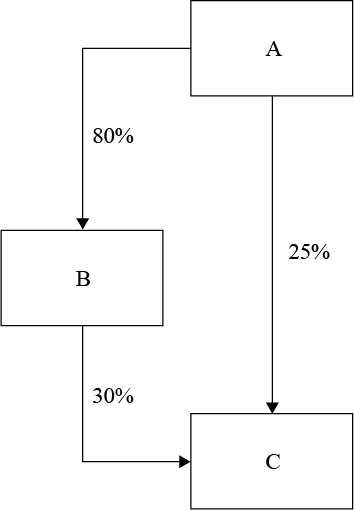
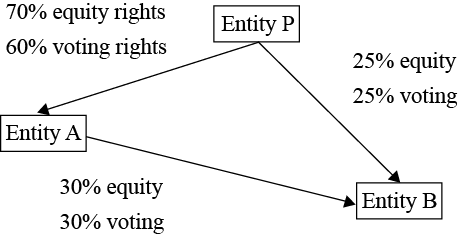

# 26 - Consolidated financial statements (IFRS 10)

[返回目录](README.md)

### EX 26.139.4 – Assessing control of an issuer of credit-linked notes with limited activities and derivatives that enhance risk

 

Reference to standard: IFRS 10 para B51  
 Reference to standing text: [26.139](45.md#s171-Para_26.139)  

  

  
**Background and purpose**

A credit-linked note structure might be set up for various reasons, the most common being:

- to enable a bank to obtain credit protection on loans that it holds; and

- to enable a bank to create marketable securities of a particular risk profile that are attractive to investors. The bank will earn fees from creating and marketing the structure.

**Facts**

- A Bank sets up a structured entity (SE), and enters into a credit default swap (CDS) with the SE, for which it pays the SE a premium at market rates. Under the CDS, if a stipulated commercial debt security (‘the Risky Asset’) defaults, the SE will pay to the Bank the par value of that security. Any liability of the SE to the Bank in respect of the CDS has priority over all of the SE’s other liabilities.

- Shares of the SE, which are held by independent third parties (for example, a charitable trust), have no significant decision-making rights, due to the restrictions imposed by the contractual agreements.

- The SE invests in AAA bonds whose maturity matches that of the CDS and the notes issued by the SE (see next bullet point). In the event that the AAA bonds are downgraded below AAA, the Trustee of the charitable trust is required to sell the bonds and buy replacement bonds with an AAA rating.

- The SE issues a single tranche of credit-linked notes (‘the Notes’) to a large number of dispersed, unrelated investors (the ‘note-holders’), which do not form a reporting entity. No individual note-holder owns more than 5% of the notes. The returns on the Notes are linked to the returns from the AAA bonds and the payments on the CDS. The note-holders are represented by a Trustee, which can be removed by a majority vote of the note-holders without cause. The Trustee receives a fixed level of remuneration that is consistent with market rates for its level of services. The Trustee has been assessed to act as an agent for the note-holders under IFRS 10. This example does not, therefore, consider the requirements for agent/principal in IFRS 10.

- The SE’s liability in respect of the Notes is limited to the par amount adjusted for CDS receipts/payments. If the SE is not able to repay the notes in full, due to a credit event on the CDS, it does not constitute a legal default by the SE (that is, debt holders cannot take actions against the SE, such as seizing its assets or placing the SE under liquidation).

- However, a default on the notes will arise if the SE is not able to repay the notes, due to default of the bonds. If this occurs, both the Bank (if the CDS is a net receivable from the SE) and the note-holders as a group, as represented by the Trustee, have normal powers under bankruptcy laws (for example, seizure of assets, or liquidation of the SE) to recover any amounts due from the SE.

**Question 1**

What are the SE’s relevant activities?

**Answer 1**

The following relevant activities exist within the SE:

- asset-replacement decision in the event that bonds are downgraded; and

- asset seizure and recovery powers on a default by the SE (for example, if the bonds were to default and amounts were due to the note-holders and/or the Bank).

Although these decisions are based on contingent events, this does not prevent them from being relevant activities [IFRS 10 App B para B53], and these decisions can potentially affect the SE’s returns significantly if the contingency arises. [IFRS 10 App A]. Accordingly, the SE does have relevant activities.

**Question 2**

Who controls the SE?

**Answer 2**

There are a number of factors that need to be assessed in order to identify which party controls the SE and thus consolidates it. The Trustee is assessed as acting as an agent in this situation, and has not been considered further in the analysis of control. We have assessed each other party below.

**The Bank**

<table style="width:100%; border-collapse:collapse"><tr><td style="border:0.75pt solid #000000; padding-right:5.03pt; padding-left:5.03pt; vertical-align:top">
<b>IFRS 10 indicator</b>
</td><td style="border:0.75pt solid #000000; padding-right:5.03pt; padding-left:5.03pt; vertical-align:top">
<b>Assessment</b>
</td></tr><tr><td style="border:0.75pt solid #000000; padding-right:5.03pt; padding-left:5.03pt; vertical-align:top">
Power
</td><td style="border:0.75pt solid #000000; padding-right:5.03pt; padding-left:5.03pt; vertical-align:top">
The following indicators suggest that the Bank has the opportunity and incentive to provide itself with power. However, these indicators do not, by themselves, provide the Bank with power:
<ul style="margin:0pt; padding-left:0pt"><li style="margin-left:27.6pt; padding-left:8.4pt">The Bank was involved in the design of the SE at the inception of the transaction and is the initiator of the transaction; this gives the Bank the opportunity to obtain power over the SE. However, paragraph B51 of IFRS 10 states that “... being involved in the design of an investee alone is not sufficient to give an investor control ...”. This is not, therefore, conclusive.</li><li style="margin-left:27.6pt; padding-left:8.4pt">The Bank has an implicit commitment to ensure that the SE operates as designed. [IFRS 10 App B para B54]. However, paragraph B54 also states that this indicator, by itself, does not give an investor power.</li></ul>
If both the Risky Asset and the AAA bonds default, the Bank has asset-recovery powers over the SE. The Bank therefore has some decision-making rights over the SE. However, the Bank has fewer decision-making rights than the Trustee for the note-holders (see below), which has power over asset seizure and recovery, as well as asset replacement in the event of the AAA bonds being downgraded.

Where multiple parties have decision-making rights, the party that has the right to direct the activity that most significantly affects returns has power over the investee. [IFRS 10 para 13]. The Trustee is likely to be in a stronger position than the Bank to affect returns, because:
<ul style="margin:0pt; padding-left:0pt"><li style="margin-left:27.6pt; padding-left:8.4pt">the Trustee also has asset-replacement powers; and</li><li style="margin-left:27.6pt; padding-left:8.4pt">the credit risk that the Trustee needs to mitigate by exercising its recovery powers is more significant than the credit risk to which the Bank is exposed (see ‘Exposure to variable returns’ below).</li></ul>
The power criterion in paragraph 7(a) of IFRS 10 does not, therefore, support consolidation by the Bank.
</td></tr><tr><td style="border:0.75pt solid #000000; padding-right:5.03pt; padding-left:5.03pt; vertical-align:top">
Exposure to variable returns
</td><td style="border:0.75pt solid #000000; padding-right:5.03pt; padding-left:5.03pt; vertical-align:top">
The CDS principally contributes variability to the SE for the following reasons:
<ul style="margin:0pt; padding-left:0pt"><li style="margin-left:27.6pt; padding-left:8.4pt">The CDS exposes the SE to losses arising from the Risky Asset − for example, if there is a credit event on the risky asset.</li><li style="margin-left:27.6pt; padding-left:8.4pt">Although the CDS potentially subjects the Bank to the SE’s credit risk, this risk is considered small, relative to the risk contributed by the Risky Asset. This risk is further mitigated by the senior status of the CDS and the high quality of the AAA bonds.</li><li style="margin-left:27.6pt; padding-left:8.4pt">The SE’s purpose in entering into the CDS is usually one of the following:<ul style="margin-right:0pt; margin-left:0pt; padding-left:0pt"><li style="margin-left:29pt; padding-left:7pt">to mitigate the Bank’s exposure to the Risky Asset by transferring it to the SE; or</li><li style="margin-left:29pt; padding-left:7pt">to improve returns to note-holders by transferring more risk (and returns) to the SE.</li></ul></li></ul>
In both cases, a view of the CDS as contributor of variability will be more consistent with the purpose and design. For the purpose of assessing exposure to variable returns, it is irrelevant that the Bank’s exposure to CDS variability might be mitigated/ minimised by the Bank’s other assets/ liabilities (that is, whether or not the Bank holds the Risky Asset does not affect the analysis of control).

The CDS therefore principally contributes variability to the SE. As such, the Bank does not have significant exposure to variable returns of the SE.
</td></tr><tr><td style="border:0.75pt solid #000000; padding-right:5.03pt; padding-left:5.03pt; vertical-align:top">
Conclusion
</td><td style="border:0.75pt solid #000000; padding-right:5.03pt; padding-left:5.03pt; vertical-align:top">
The Bank does not control the SE, because the power criterion does not support consolidation and the Bank does not have significant exposure to variable returns. [IFRS 10 App B para B56].
</td></tr></table>

  
**Each note-holder**

<table style="width:100%; border-collapse:collapse"><tr><td style="border:0.75pt solid #000000; padding-right:5.03pt; padding-left:5.03pt; vertical-align:top">
<b>IFRS 10 indicator</b>
</td><td style="border:0.75pt solid #000000; padding-right:5.03pt; padding-left:5.03pt; vertical-align:top">
<b>Assessment</b>
</td></tr><tr><td style="border:0.75pt solid #000000; padding-right:5.03pt; padding-left:5.03pt; vertical-align:top">
Power
</td><td style="border:0.75pt solid #000000; padding-right:5.03pt; padding-left:5.03pt; vertical-align:top">
The SE is economically dependent on the notes to finance its operations, which indicates that there might be a ‘special relationship’ between the note-holders and the SE. [IFRS 10 App B para B19(b)(i)]. However, paragraph B19 notes that the existence of an indicator of a special relationship does not necessarily mean that the power criterion is met.

The note-holders have greater exposure to variability than any other party (see below). Paragraph B20 of IFRS 10 states that having a large exposure to variability of returns is an indicator that the investor might have power. However, it also states that this is not conclusive, because the extent of the investor’s exposure does not, in itself, determine whether an investor has power over the investee.

The Trustee has the following powers:
<ul style="margin:0pt; padding-left:0pt"><li style="margin-left:27.6pt; padding-left:8.4pt">collateral replacement rights in the event of a downgrade; and</li><li style="margin-left:27.6pt; padding-left:8.4pt">asset seizure and liquidation rights in the event of a default on the AAA bonds.</li></ul>
Since the Trustee is an agent of the note-holders, the question exists as to whether the above powers can be attributed to the note-holders. However, due to the diverse and unrelated nature of the note-holders, none of the note-holders has either the unilateral power to direct the Trustee or a substantive right to remove the Trustee. The Trustee’s powers cannot therefore be attributed to any individual note-holder. This is consistent with paragraph B59 of IFRS 10, which states that, when an agent acts for multiple principals, each of those principals still needs to assess whether it has power.

In the absence of any conclusive indicator of power, the individual note-holders are unlikely to have power.
</td></tr><tr><td style="border:0.75pt solid #000000; padding-right:5.03pt; padding-left:5.03pt; vertical-align:top">
Exposure to variable returns
</td><td style="border:0.75pt solid #000000; padding-right:5.03pt; padding-left:5.03pt; vertical-align:top">
The note-holders absorb the variability from the CDS (IFRS 10 para App B B8), as well as from credit risk on the underlying AAA bonds (although the latter would be low). The structure is designed such that the note-holders absorb variability, because the loan notes are linked directly to the Risky Asset. The note-holders are therefore exposed to variable returns from the SE.
</td></tr><tr><td style="border:0.75pt solid #000000; padding-right:5.03pt; padding-left:5.03pt; vertical-align:top">
Conclusion
</td><td style="border:0.75pt solid #000000; padding-right:5.03pt; padding-left:5.03pt; vertical-align:top">
The individual note-holders do not control the SE, because none has power over the SE. A different analysis might result if a single note-holder could unilaterally direct the Trustee.

Although the note-holders do not control the SE, they hold an interest in an unconsolidated structured entity. The note-holders should therefore give the disclosures required by paragraphs 24 to 31 of IFRS 12.
</td></tr></table>

  
**Overall co****nclusion**

None of the parties controls or consolidates the SE.

 

### EX 26.142.1 – Contingent power

 

Reference to standard: IFRS 10 para B26  
 Reference to standing text: [26.142](45.md#s171-Para_26.142)  

  

  
**Question**

Can an investor have power if it can make decisions only on a contingent event but cannot make any decisions currently?

**Answer**

An investor might have power in this situation. Where an investor can direct an activity that will only occur in the future on the occurrence of an event, that power should be considered even before the occurrence of that event.

[IFRS 10 App B para B13 example 1].

Contingent power is a key consideration in assessing who controls those structured entities where decisions might be required or permitted when the contingent event occurs.

[IFRS 10 App B para B53].

Contingent power is not necessarily protective only.

[IFRS 10 App B para B26].

 

### EX 26.143.1 – Commitment to ensure that a structured entity operates as designed

 

Reference to standard: IFRS 10 para B54  
 Reference to standing text: [26.143](45.md#s171-Para_26.143)  

  

**Question**

Entity Z is a bank and transfers debt securities to entity A, a trust. Entity A is not controlled through voting rights. Entity A has been created specifically for the purpose of this transaction, and its relevant activities are managed through the parameters of a contractual arrangement between entity Z and entity A. Entity A meets the definition of a structured entity. The documents establishing the trust and marketing documents to investors state the credit quality required for assets in the trust. The trust, in turn, issues new securities to investors. A key part of the marketing literature is that the trust is sponsored by entity Z, which commits to ensuring that it operates as set out in the marketing literature. A trust administrator collects payments on the securities in the trust and ensures that they are paid promptly to the investors.

Does entity Z have power over entity A?

**Answer**

Entity Z has designed the trust to operate in a certain way and is committed to ensuring that the trust administrator collects the payments and operates the trust in the designed manner. Entity Z was involved in selecting the assets to be transferred into the trust, and it was involved in the design and marketing of the documents provided to external investors. These points might indicate that entity Z has power over the trust, because it has an incentive to obtain rights to protect its position; but, on their own, they are not sufficient to conclude that entity Z has power over entity A. For example, the investors in the securities might have been granted some rights that result in them having power.

 

### FAQ 26.143.2 – Can reputational risk give control?

 

Reference to standard: IFRS 10 para B54  
 Reference to standing text: [26.143](45.md#s171-Para_26.143)  

  

  
 

**Question**

A bank sets up a structured entity (SE) to acquire and hold pre-specified financial assets that the entity purchases from traded markets, and to issue asset-backed securities to investors. The bank has no further interest in, or decision-making rights over, the SE once it is set up. However, the bank’s reputation will suffer if the SE fails. The bank will, in such circumstances, consider providing financial support to the SE, even though it has no obligation to do so, in order to protect its own reputation.

How does reputational risk impact the conclusion on control?

**Answer**

Reputational exposure might create an implicit commitment for the bank to ensure that the SE operates as designed; however, this alone does not provide conclusive evidence that the bank has power. [IFRS 10 App B para B54]. The bank was also involved in the design and set-up of the SE; however, this consideration, again, does not provide conclusive evidence of power. [IFRS 10 para App B B51]. If no other indicators of power exist, the bank is unlikely to control the SE. Reputational exposure on its own is generally not an appropriate basis for consolidation. [IFRS 10 para BC37].

However, all of the facts and circumstances should be carefully examined to establish whether the bank has control. Reputational exposure might increase the investor’s exposure to variability of returns, and so give it an incentive to obtain rights sufficient to give it power. [IFRS 10 para BC39].

 

### FAQ 26.144.1 – What creates variability in returns in a structured entity?

 

Reference to standard: IFRS 10 para B57  
 Reference to standing text: [26.144](45.md#s171-Para_26.144)  

  

  
**Question**

What creates variability in returns in a structured entity?

**Answer**

Variability in returns from structured entities, like other entities, might result from volatility in:

- exchange rates;

- interest rates;

- equity prices;

- commodity prices;

- credit risk; or

- residual values.

It is important to understand where the variability arises from and whether an investor in a structured entity is creating or absorbing variability.

 

### FAQ 26.144.2 – What represents an interest in a structured entity?

 

Reference to standard: IFRS 10 para B57  
 Reference to standing text: [26.144](45.md#s171-Para_26.144)  

  

  
**Question**

What represents an interest in a structured entity?

**Answer**

An interest in a structured entity, like other entities, can include any of the following:

- A debt instrument.

- An equity instrument.

- A contractual arrangement.

- A participation right.

- A residual interest.

- A lease.

- The provision of funding.

- Liquidity support.

- Credit enhancement.

- A guarantee.

However, a typical customer-supplier relationship is not considered to be an interest in a structured entity.

Some such interests simply provide the investor with a fixed or stated rate of return, while others give the investor rights or access to the structured entity’s future economic benefits. In practice, the investor that sets up the structured entity often retains a significant interest in the structured entity’s activities, even though it might own little or none of the structured entity’s equity.

 

### FAQ 26.144.3 – How should the exposure to the variability of a structured entity which holds a financial asset be assessed?

 

Reference to standard: IFRS 10 para B57  
 Reference to standing text: [26.144](45.md#s171-Para_26.144)  

  

  
**Question**

In a securitisation arrangement, a seller has transferred legal title to C100 of long-term interest-bearing mortgage receivables into a structured entity (SE) in exchange for C93 of cash.

The SE funds the purchase of the receivables by issuing long-term notes to investors of C93. The SE will use interest received on the mortgage receivables to pay the interest due on the notes issued to investors.

The seller will continue to manage the underlying receivables. It has been assessed that the seller acts as principal in the servicing of the receivables (that is, the seller is not an agent of the investors).

Any amount recovered above C93 will be paid to the seller – so, if C97 was recovered, the seller would receive an additional C4. Expected losses on the receivables are C3.

Is the SE’s exposure to variable returns:

- the gross amount of C100, of which C7 is absorbed by the seller and C93 is absorbed by the note-holders; or

- the net amount of C93, being the amount of reduction in the previous exposure of the seller, all of which is absorbed by the note-holders?

**Answer**

The exposure to variable returns of the SE relate to all C100 of the receivables. The SE has rights to the cash flows on the full C100 of the receivables and the associated economic exposure to risk, should any of the receivables fail to pay.

The seller has absorbed exposure to the first C7 of the losses which might arise on any of the C100 receivables. The seller’s exposure, therefore, relates to all of the receivables. In addition, whilst the seller’s maximum exposure is limited to C7, since the seller is exposed to the initial amount of any losses, and its maximum exposure of C7 is significantly greater than the expected losses of C3, the seller absorbs substantially all of the variability of returns.

The seller also has the power to manage the underlying receivables, and hence has power over the SE’s relevant activities. Accordingly, it is likely that the seller has control over the SE and should consolidate.

Conversely, the note-holders have only absorbed exposure to the last C93 of losses. Whilst the absolute amount of this exposure is greater than that of the seller, it represents very little of the expected variability of returns.

 

### FAQ 26.151.1 – When should the restructuring of a loan result in consolidation by the lender?

 

Reference to standard: IFRS 10 para B81  
 Reference to standing text: [26.151](45.md#s171-Para_26.151)  

  

  
**Question**

When should the restructuring of a loan result in consolidation by the lender?

**Answer**

Loans extended by banks might become distressed, resulting in restructuring of the lending arrangements. In some cases, debt might have been modified and/or extended but the relationship between the borrower and the bank might clearly remain that of a borrower and a lender (for example, the bank takes no equity interest or convertible instruments and has only protective rights over the underlying business of the borrower).

However, in other cases, the debt might have been fully or partially replaced with equity instruments, preferred shares or convertible instruments, and the lender has taken a more active role in the monitoring of the underlying business activities of the borrower. The borrower might also have obtained the right to demand such a replacement, even if this has not yet been implemented.

There could also be situations where an administrative receiver or liquidator has been appointed. The restructuring of debt will trigger a need for the bank to evaluate whether, post restructuring, it has control over the borrower, and thus should consolidate. The purpose of this analysis is to outline the factors to consider when making this evaluation, once a default has occurred. The overall objective of the evaluation is to identify those situations which fundamentally remain a lending arrangement (even though the bank’s rights have changed as a result of it being a troubled lending relationship) as opposed to those situations where the bank has stepped into a relationship where, in substance, it controls the underlying operating business or has obtained the right to do so. In most cases, the former situations are unlikely to result in consolidation by the bank, whereas the latter situations are likely to do so.

In making this determination under IFRS 10, it is necessary to decide whether the bank now controls the borrower. Control is held by an investor where it has:

- power over the investee;

- exposure, or rights, to variable returns as a result of its involvement with the investee; and

- the ability to use its power over the investee to affect the amount of the investor’s returns.

The loan extended by a bank would provide it with exposure to variable returns. An assessment will be required as to whether the bank has power over the investee, and whether its exposure to variability of returns is sufficient to indicate that it is a principal which has control.

Although the bank’s involvement might be intended to protect it from further loss, if the bank has the power to make decisions over relevant activities and is considered to have sufficient exposure to variability, it has control. It is useful to consider what decisions are in the nature of participation in the management of the business, as opposed to those that are protective in nature. Protective rights would include the ability to veto expenditure over a certain amount that is not expected to occur in the course of business (for example, as evidenced by it not being included in the business or operating plan established at the time of the restructuring).

Whilst an evaluation of the decision-making rights over the borrower’s relevant activities is fundamental to this decision, the nature of the investment provided by the bank and its exposure should also be evaluated when assessing control. Further evidence of control is likely to be given by the bank’s level of exposure to variability of returns from its involvement with the borrower. The greater the exposure, the more incentive for the bank to obtain rights sufficient to provide it with power. In considering the level of exposure, the bank would include all capital of the entity (including subordinated debt, preference shares, common shares and convertible debt).

This guidance is primarily focused on corporate lending, including corporate real estate lending. Features that should be considered in making this assessment for such loans are set out below, as are considerations for situations where an entity is in formal liquidation. Loans to other structured entities, such as securitisation, might have different features to allow a lender to recover in the event of distress. However, some of the features and considerations set out below might still be applicable.

The substance of the relationship between the bank and the borrower is key to the control decision, and various factors will require consideration. No two situations will be identical, and all relevant factors and the interaction between them should be considered. Some cases might not be clear cut and will require judgement.

Lastly, the focus of this analysis is on reassessment of control on formal restructuring of a lending relationship or where an administrative receiver or liquidator has been appointed. This guidance might also be relevant for other situations where a bank takes a more active role in monitoring the underlying business activities of a borrower in a way that could potentially result in control. However, we would not typically expect a default, in itself, to result in the bank obtaining control – unless the default provisions in the agreement indicate otherwise.

**Restructuring of the lending arrangements**

Indicators of power

Examples of factors that might indicate that the restructuring resulted in the bank obtaining power over the borrower are set out below. As noted above, all relevant factors and the interaction between them should be considered in determining the substance of the relationship between the bank and the borrower.

Decision-making considerations:

- The management team is acting in the capacity of an agent for the bank. Indicators of such an agency relationship might include:

- The bank has appointed the turnaround management team (to replace the current management team), even if the turnaround management team holds the majority of the ordinary shares.

- The bank has the ability to remove, replace or veto the management team.

- The bank has guaranteed management’s compensation in the event that the entity is unable to pay.

- Although the bank does not have a majority of the seats on the board, board decisions are subsequently submitted to the bank for consent. These decisions include decisions that are participating in nature. Participating decisions relate to operating and financial policy decisions made in the ordinary course of business (such as decisions that implement the business or operating plan established at the time of the restructuring). Examples are:

- approval of annual operating budgets;

- approval of capital expenditure, disposals, etc. that would be expected to be in the ordinary course of the entity’s business;

- approval/termination of management;

- approval of management compensation; and

- approval/termination of board members.

In this case, the ultimate participating decisions are not made by the board and, thus, the fact that the bank has less than a majority of the board seats is not relevant. If the bank does not support or concur with a decision, the management team must propose an alternative that is satisfactory to the bank. The bank could exhibit this power in different ways. One example is, if the board or management team were to act on a decision that has been vetoed by the bank, this would constitute a default, and the bank would be able to call the loan and force liquidation.

- The bank has options, warrants or other currently exercisable rights that would allow it to take power. Factors to consider when evaluating whether such rights are substantive include the bank’s financial and operational capability to exercise. It is necessary to consider the terms of exercise to ensure that they have commercial substance. If the terms are such that no party would conceivably be expected to exercise the rights, they are disregarded. An example might be where the exercise price is set at a non-commercial, deliberately high level.

**Indicators of no power**

Examples of factors that might indicate that the restructuring has not resulted in the bank obtaining power over the borrower are set out below. All relevant factors and the interaction between them should be considered in determining the substance of the relationship between the bank and the borrower.

Decision-making considerations:

- The existing management team and directors remain in place to make decisions and have a substantial financial interest in the long-term success of the business. For example, this might be the case where the underlying business model and management team are sound, but the borrower has encountered difficulties as a result of general market conditions. The bank does not have approval rights of decisions that are deemed to be participating in nature. All approval rights are of decisions that are protective in nature, such as approval of major capital spending, acquisitions or disposals that are not expected to occur in the ordinary course of business (for example, as evidenced by them being outside the business or operating plan established at the time of the restructuring).

- If the bank can veto ‘participating’ decisions, but there is a deadlock provision such that disputes over participating decisions are resolved through independent arbitration (that is, the bank does not have the ability to enforce the ultimate decision).

- As part of initial restructuring, the bank requests that the existing directors replace the management team. However, the new management team reports to the existing directors. The bank has no removal rights or further involvement in decision-making. The board and/or the management team is acting as an independent, substantive controlling shareholder, as evidenced by it having a substantial financial interest in the long-term success of the business. In this case, however, whilst it appears that the bank does not have control, if the bank has the continuing ability to force the board to change the management team, the bank would need to consider whether it has enough power to control the board.

- The bank is part of a syndicate of lenders that makes decisions collectively, and the bank does not have power over the ultimate decisions made by the syndicate.

- A default has occurred but the bank has entered into a ‘standstill agreement’ under which the bank (along with other creditors) has formally agreed that it will not take action against the company to enforce a claim for payment for a specified period of time. A bank will waive breaches of loan covenants as part of this standstill. The existence of a standstill might indicate that the bank is unable to exercise power over the borrower until the end of the standstill period.

However, it should be assessed as to whether the end of this standstill period will occur before the date at which decisions about relevant activities will need to be made. If the standstill period ends before this date, the rights held by the bank might still be considered substantive and provide power. In some situations, the length of the standstill period might be short (such as two to three months), and there might not be any significant decisions to be made about relevant activities in that period. In such circumstances, the standstill agreement is unlikely to affect the rights held by the bank.

However, in the case of a longer standstill period (such as several years), it is more likely that significant decisions will need to be made about relevant activities in the standstill period, and hence that the bank does not have power. The particular facts and circumstances will need to be assessed carefully, and significant judgement might be required.

**Exposure to variable returns**

- The bank might be exposed to variable returns in a number of ways, including equity interests and debt. It is the bank’s total exposure to variability of returns which should be considered, not just the exposure arising from equity interests. If a bank is concluded to have power, it is likely that it will be such a significant lender that it will also have sufficient exposure to variable returns to have control.

- For example, the bank might have provided most or all of the current financing of the entity (both debt and equity) when considering the overall capital structure. Although the bank might hold a relatively small percentage of the common ‘voting’ stock, the common stock might not be substantive in comparison to the other tranches of capital (including preference shares or debt).

- It should also be considered whether there are ‘swamping rights’ whereby, on an exit event, the bank’s economic interest increases significantly, such that it obtains the majority of any benefits from exit.

- It is unlikely that a bank will have power and will not have exposure to variable returns. However, indicators that the level of exposure might not be sufficient to provide control include:

- The bank has modified the terms of the debt instrument (for example, by deferring repayment or extending the term), but its investment remains debt before and after the transaction and it takes no significant equity stake. The bank’s return is no more than what it might demand for other high-risk loans.

- The bank takes no significant equity stake (common or preference shares, or other convertible or optional instruments) or debt, and there is substantive equity investment from other investors.

- There are other substantive subordinate investors (for example, the bank might provide lending in as part of a syndicate of banks). The other equity holders/management team are credible, independent holders.

**Current ability to exert control versus intent**

- Although the considerations mentioned above might indicate that the bank does not intend to have power over the borrower, it will still be important to confirm that the bank does not hold (or have the ability to obtain) rights which would convey power. The definitions of ‘power’ and ‘control’ in IFRS 10 are based on rights held (or able to be acquired) by an investor rather than the intent of the investor. Control is based on whether the bank’s rights are exercisable when decisions about the direction of the relevant activities need to be made, and can include both rights which are currently exercisable and those which are not currently exercisable but are considered substantive. Although experience might indicate that a bank has not actively exercised control or is unlikely to do so, the bank would have control if it has the current ability and power to do so.

**Administrative receivership and liquidation scenarios**

Where an administrative receiver or liquidator has been (or is to be) appointed following a loan default, the effect on the power held by the lender should also be considered:

- Who has the ability to appoint and remove the administrative receiver or liquidator? Although the procedures to appoint or remove will typically involve an application to the courts, this might vary according to local legislation. The holder of a fixed or floating charge might have the power to nominate a chosen receiver or liquidator, or to order their removal and replacement.

- Has the entity been put into formal administrative receivership or liquidation and, if so, who controls it during the period? Typically, an entity in receivership or liquidation is controlled by the courts, and the administrative receiver or liquidator will be required to act in the interests of all creditors, not just the bank. However, the process might vary by jurisdiction.

The bank should understand the legal process and evaluate its rights to participate in the process (for example, through representation on a credit committee), to ensure that it does not assume control through the process as a primary creditor. If the administrative receiver or liquidator is required to clear decisions with the bank (for example, where the bank has a majority representation on the credit committee), it would be considered to be an agent of the bank, and the bank would be viewed as holding the power.

- Another factor to consider, in determining whether the administrative receiver or liquidator is acting as an agent of the bank, is whether the bank is responsible for negotiating the fee to be charged. If the ability to negotiate this fee allows the bank to influence the administrative receiver or liquidator, this might provide the bank with power.

- If the entity has not been put into formal administrative receivership or liquidation, has a new management team been appointed to sell off the assets? If so, have the detailed plans for sale been established by the bank at the point of renegotiation – with management acting in accordance with the established plans? Is the bank required to approve proposed sales of assets? If the bank was extensively involved in developing the plan and/or approving the disposal activities, this might be an indication of control (as described in more detail above).

- Has the bank appointed a management team to act as an agent to sell-off the assets of the business in return for a fee, with perhaps some (although minimal) upside? If so, can the bank remove the management team?

See the more detailed analysis above.

**Other considerations**

Non-core activities – Although the banks are not typically ‘in the business’ of running these types of business and might not have the capacity or expertise to do so, consolidation is based on whether the bank has the ability, in fact, to control. There is no exception from consolidation if the activities are non-core or unrelated to the bank’s other activities.

Temporary control – Although the bank does not often have a long-term objective of investing in these businesses, and might seek a short-term exit, there is no scope exception from consolidation for ‘temporary control’.

IFRS 5 disposal group – IFRS 5 specifies that a subsidiary acquired exclusively with a view to sale could be classified as held for sale and a discontinued operation if:

- The sale is expected to be completed within one year, although the period could be extended if delay is caused by events or circumstances outside the bank’s control and the bank remains committed to sell.

- It is highly probable that the other criteria in IFRS 5 will be met within a short period (of no more than three months) following the acquisition, including:

- available for sale in present condition; and

- sale is highly probable (that is, management has committed to a plan to sell, an active programme to locate a buyer and complete the plan has been initiated, and the subsidiary is actively marketed at a fair value price).

If these criteria are met, the balance sheet and income statement presentation could be collapsed, and some relief from a full fair value exercise could be provided.

Significant influence – This analysis focuses on indicators that a bank has control. However, if the bank does not have control but has an equity interest in the borrower, it should consider whether it has significant influence. Where the bank has significant influence and an equity interest, the equity method of accounting would be applied (unless the investment is designated as at fair value through profit or loss under paragraph 1 of IAS 28). ‘Significant influence’ is defined as the power to participate in, but not to control, the financial and operating decisions of the investee. Many of the same indicators as those set out above will be relevant in assessing whether significant influence exists.

 

### FAQ 26.154.1 – How might an investor lose control of an investee?

 

Reference to standard: IFRS 10 para 7  
 Reference to standing text: [26.154](45.md#s172-Para_26.154)  

  

  
**Question**

How might an investor lose control of an investee?

**Answer**

Loss of control can arise from the sale of an interest in an investee, or by other means. A loss of control might arise even where there has not been a change in the absolute or relative ownership interest in the investee.

There are a number of situations where an investor’s control over an investee might be lost; these could include the following:

- An investor sells all or part of its ownership interest in its investee, thereby losing its controlling interest in its investee.

- A contractual agreement that gave control of the investee to the investor expires.

- The investee issues shares to investors other than the investee, thereby reducing the investor’s ownership interest in the investee so that the investor no longer has a controlling interest in the investee.

- A power of veto is granted to a third party.

- The investor enters into an agreement with a non-controlling interest holder that gives both parties joint control.

- An investee becomes subject to control by a government.

- Insolvency or administration procedures are in progress.

Where an investee is subject to an insolvency procedure, and control over the entity has passed to a designated official, the effect is that the entity will no longer be a subsidiary of the investor and, therefore, should not be consolidated. Whether formal insolvency procedures in a particular country represent such a loss of control will depend on the nature of legislation in the jurisdiction in question.

 

### EX 26.154.2 – Loss of control when a subsidiary declares bankruptcy

 

Reference to standard: IFRS 10 para B80  
 Reference to standing text: [26.154](45.md#s172-Para_26.154)  

  

  
 

**Question 1**

When should a parent company, which is not in bankruptcy, deconsolidate a subsidiary that is a business that has filed for bankruptcy?

**Answer**

A parent should deconsolidate a subsidiary that is a business as of the date the parent no longer has control of the subsidiary in accordance with IFRS 10. Examples of events that result in deconsolidation of a subsidiary include when a subsidiary becomes subject to the control of a government, court, administrator or regulator. Normally, once a subsidiary files for bankruptcy protection, a parent no longer has control over the subsidiary (because the bankruptcy court must approve all significant actions), and the subsidiary should be deconsolidated on that date.

**Question 2**

Should a parent company, which is not in bankruptcy and has a negative investment in a subsidiary, recognise a gain on deconsolidating a subsidiary that files for bankruptcy if that subsidiary is a business?

**Answer**

Following the guidance in IFRS 10, a parent would derecognise the negative investment and determine the amount of gain or loss to recognise on the date of the bankruptcy filing. The parent should consider the fair value of its retained investment when making this determination. This includes consideration of whether it needs to separately recognise any obligations related to its ownership of the subsidiary, which would reduce the gain or increase the loss on deconsolidation (for example, the parent has guaranteed, or the court will hold the parent liable for, certain obligations of the subsidiary).

 

### EX 26.165.1 – Loss of control of a wholly owned subsidiary with an interest retained in an associate

 

Reference to standard: IFRS 10 para 25  
 Reference to standing text: [26.165](45.md#s172-Para_26.165)  
 

  

  
 Entity A owns 100% of a subsidiary. It disposes of 60% of its interest in the subsidiary for C360 million, and loses control of the subsidiary. It will de-consolidate the subsidiary and account for the remaining 40% interest as an associate using the equity method of accounting. At the disposal date, the fair value of the retained investment is determined to be C240 million. The carrying value of the identifiable net assets of the subsidiary is C440 million, excluding goodwill. There is C60 million of goodwill recorded related to the previously acquired interests in the subsidiary. Entity A tested the subsidiary’s goodwill and long-lived assets prior to disposal and there was no impairment. There is C4 million credit in the FVOCI reserve and C10 million credit in the revaluation reserve relating to the subsidiary. The tax consequences of the gain have been ignored.

The accounting entry on the disposal date for the 60% interest sold, the gain recognised on the 40% retained investment and the de-recognition of the subsidiary is as follows:

<table style="width:100%; border-collapse:collapse"><tr><td colspan="2" style="border:0.75pt solid #000000; padding-right:5.03pt; padding-left:5.03pt; vertical-align:top">
 
</td><td style="border:0.75pt solid #000000; padding-right:5.03pt; padding-left:5.03pt; vertical-align:top">
<b>Cm</b>
</td><td style="border:0.75pt solid #000000; padding-right:5.03pt; padding-left:5.03pt; vertical-align:top">
<b>Cm</b>
</td></tr><tr><td colspan="4" style="border:0.75pt solid #000000; padding-right:5.03pt; padding-left:5.03pt; vertical-align:top">
 
</td></tr><tr><td colspan="2" style="border:0.75pt solid #000000; padding-right:5.03pt; padding-left:5.03pt; vertical-align:top">
Dr Cash
</td><td style="border:0.75pt solid #000000; padding-right:5.03pt; padding-left:5.03pt; vertical-align:top">
360
</td><td style="border:0.75pt solid #000000; padding-right:5.03pt; padding-left:5.03pt; vertical-align:top">
 
</td></tr><tr><td colspan="2" style="border:0.75pt solid #000000; padding-right:5.03pt; padding-left:5.03pt; vertical-align:top">
Dr Investment in associate
</td><td style="border:0.75pt solid #000000; padding-right:5.03pt; padding-left:5.03pt; vertical-align:top">
240
</td><td style="border:0.75pt solid #000000; padding-right:5.03pt; padding-left:5.03pt; vertical-align:top">
 
</td></tr><tr><td colspan="2" style="border:0.75pt solid #000000; padding-right:5.03pt; padding-left:5.03pt; vertical-align:top">
Dr FVOCI reserve
</td><td style="border:0.75pt solid #000000; padding-right:5.03pt; padding-left:5.03pt; vertical-align:top">
4
</td><td style="border:0.75pt solid #000000; padding-right:5.03pt; padding-left:5.03pt; vertical-align:top">
 
</td></tr><tr><td colspan="2" style="border:0.75pt solid #000000; padding-right:5.03pt; padding-left:5.03pt; vertical-align:top">
Dr Revaluation reserve
</td><td style="border:0.75pt solid #000000; padding-right:5.03pt; padding-left:5.03pt; vertical-align:top">
10
</td><td style="border:0.75pt solid #000000; padding-right:5.03pt; padding-left:5.03pt; vertical-align:top">
 
</td></tr><tr><td style="border:0.75pt solid #000000; padding-right:5.03pt; padding-left:5.03pt; vertical-align:top">
 
</td><td style="border:0.75pt solid #000000; padding-right:5.03pt; padding-left:5.03pt; vertical-align:top">
Cr Net assets (including goodwill)
</td><td style="border:0.75pt solid #000000; padding-right:5.03pt; padding-left:5.03pt; vertical-align:top">
 
</td><td style="border:0.75pt solid #000000; padding-right:5.03pt; padding-left:5.03pt; vertical-align:top">
500
</td></tr><tr><td style="border:0.75pt solid #000000; padding-right:5.03pt; padding-left:5.03pt; vertical-align:top">
 
</td><td style="border:0.75pt solid #000000; padding-right:5.03pt; padding-left:5.03pt; vertical-align:top">
Cr Retained earnings
</td><td style="border:0.75pt solid #000000; padding-right:5.03pt; padding-left:5.03pt; vertical-align:top">
 
</td><td style="border:0.75pt solid #000000; padding-right:5.03pt; padding-left:5.03pt; vertical-align:top">
10
</td></tr><tr><td style="border:0.75pt solid #000000; padding-right:5.03pt; padding-left:5.03pt; vertical-align:top">
 
</td><td style="border:0.75pt solid #000000; padding-right:5.03pt; padding-left:5.03pt; vertical-align:top">
Cr Gain on disposal of controlling interest
</td><td style="border:0.75pt solid #000000; padding-right:5.03pt; padding-left:5.03pt; vertical-align:top">
 
</td><td style="border:0.75pt solid #000000; padding-right:5.03pt; padding-left:5.03pt; vertical-align:top">
104
</td></tr></table>

  
 The gain or loss on the interest sold, and on the retained investment recognised in the income statement, is calculated as follows:

<table style="width:100%; border-collapse:collapse"><tr><td style="border:0.75pt solid #000000; padding-right:5.03pt; padding-left:5.03pt; vertical-align:top">
 
</td><td style="border:0.75pt solid #000000; padding-right:5.03pt; padding-left:5.03pt; vertical-align:top"> </td><td style="border:0.75pt solid #000000; padding-right:5.03pt; padding-left:5.03pt; vertical-align:top">
<b>Cm</b>
</td></tr><tr><td colspan="3" style="border:0.75pt solid #000000; padding-right:5.03pt; padding-left:5.03pt; vertical-align:top">
 
</td></tr><tr><td style="border:0.75pt solid #000000; padding-right:5.03pt; padding-left:5.03pt; vertical-align:top">
Fair value of the consideration
</td><td style="border:0.75pt solid #000000; padding-right:5.03pt; padding-left:5.03pt; vertical-align:top">
 
</td><td style="border:0.75pt solid #000000; padding-right:5.03pt; padding-left:5.03pt; vertical-align:top">
360
</td></tr><tr><td style="border:0.75pt solid #000000; padding-right:5.03pt; padding-left:5.03pt; vertical-align:top">
Fair value of retained investment
</td><td style="border:0.75pt solid #000000; padding-right:5.03pt; padding-left:5.03pt; vertical-align:top">
 
</td><td style="border:0.75pt solid #000000; padding-right:5.03pt; padding-left:5.03pt; vertical-align:top">
240
</td></tr><tr><td colspan="3" style="border:0.75pt solid #000000; padding-right:5.03pt; padding-left:5.03pt; vertical-align:top">
 
</td></tr><tr><td style="border:0.75pt solid #000000; padding-right:5.03pt; padding-left:5.03pt; vertical-align:top">
 
</td><td style="border:0.75pt solid #000000; padding-right:5.03pt; padding-left:5.03pt; vertical-align:top">
 
</td><td style="border:0.75pt solid #000000; padding-right:5.03pt; padding-left:5.03pt; vertical-align:top">
600
</td></tr><tr><td style="border:0.75pt solid #000000; padding-right:5.03pt; padding-left:5.03pt; vertical-align:top">
Less: Carrying value of former subsidiary’s net assets (C440m + C60m)
</td><td style="border:0.75pt solid #000000; padding-right:5.03pt; padding-left:5.03pt; vertical-align:top">
 
</td><td style="border:0.75pt solid #000000; padding-right:5.03pt; padding-left:5.03pt; vertical-align:top">
(500)
</td></tr><tr><td style="border:0.75pt solid #000000; padding-right:5.03pt; padding-left:5.03pt; vertical-align:top">
FVOCI reserve transferred to income
</td><td style="border:0.75pt solid #000000; padding-right:5.03pt; padding-left:5.03pt; vertical-align:top">
 
</td><td style="border:0.75pt solid #000000; padding-right:5.03pt; padding-left:5.03pt; vertical-align:top">
4
</td></tr><tr><td colspan="3" style="border:0.75pt solid #000000; padding-right:5.03pt; padding-left:5.03pt; vertical-align:top">
 
</td></tr><tr><td style="border:0.75pt solid #000000; padding-right:5.03pt; padding-left:5.03pt; vertical-align:top">
Gain on interest sold and on retained investment
</td><td style="border:0.75pt solid #000000; padding-right:5.03pt; padding-left:5.03pt; vertical-align:top">
 
</td><td style="border:0.75pt solid #000000; padding-right:5.03pt; padding-left:5.03pt; vertical-align:top">
104
</td></tr><tr><td colspan="3" style="border:0.75pt solid #000000; padding-right:5.03pt; padding-left:5.03pt; vertical-align:top">
 
</td></tr></table>

  
The C104 million gain on the interest sold and the retained investment is recognised in the income statement and is disclosed in the consolidated financial statements. Additionally, IFRS 12 requires the disclosure of the portion of the gain or loss related to the remeasurement of the retained non-controlling investment to fair value. This is calculated as follows:

<table style="width:100%; border-collapse:collapse"><tr><td style="border:0.75pt solid #000000; padding-right:5.03pt; padding-left:5.03pt; vertical-align:top">
 
</td><td style="border:0.75pt solid #000000; padding-right:5.03pt; padding-left:5.03pt; vertical-align:top"> </td><td style="border:0.75pt solid #000000; padding-right:5.03pt; padding-left:5.03pt; vertical-align:top">
<b>Cm</b>
</td></tr><tr><td colspan="3" style="border:0.75pt solid #000000; padding-right:5.03pt; padding-left:5.03pt; vertical-align:top">
 
</td></tr><tr><td style="border:0.75pt solid #000000; padding-right:5.03pt; padding-left:5.03pt; vertical-align:top">
Fair value of retained investment
</td><td style="border:0.75pt solid #000000; padding-right:5.03pt; padding-left:5.03pt; vertical-align:top">
 
</td><td style="border:0.75pt solid #000000; padding-right:5.03pt; padding-left:5.03pt; vertical-align:top">
240
</td></tr><tr><td style="border:0.75pt solid #000000; padding-right:5.03pt; padding-left:5.03pt; vertical-align:top">
Percentage retained of carrying value of subsidiary ((C440m +C60m) × 40%)
</td><td style="border:0.75pt solid #000000; padding-right:5.03pt; padding-left:5.03pt; vertical-align:top">
 
</td><td style="border:0.75pt solid #000000; padding-right:5.03pt; padding-left:5.03pt; vertical-align:top">
(200)
</td></tr><tr><td colspan="3" style="border:0.75pt solid #000000; padding-right:5.03pt; padding-left:5.03pt; vertical-align:top">
 
</td></tr><tr><td style="border:0.75pt solid #000000; padding-right:5.03pt; padding-left:5.03pt; vertical-align:top">
Gain on retained investment
</td><td style="border:0.75pt solid #000000; padding-right:5.03pt; padding-left:5.03pt; vertical-align:top">
 
</td><td style="border:0.75pt solid #000000; padding-right:5.03pt; padding-left:5.03pt; vertical-align:top">
40
</td></tr><tr><td colspan="3" style="border:0.75pt solid #000000; padding-right:5.03pt; padding-left:5.03pt; vertical-align:top">
 
</td></tr></table>

 

### EX 26.165.2 – Partial disposal of a partially owned subsidiary with an interest retained in an associate

 

Reference to standard: IFRS 10 para 25  
 Reference to standing text: [26.165](45.md#s172-Para_26.165)  

  

  
**Question**

Entity B owns 80% of a subsidiary. It disposes of 50% of the subsidiary for C300 million and loses control of the subsidiary. It will de-consolidate the subsidiary and account for the remaining 30% interest as an associate, using the equity method. At the disposal date, the fair value of the retained investment is determined to be C180 million. The carrying value of the identifiable net assets of the subsidiary is C440 million, and there is no goodwill. The carrying value of the 20% non-controlling interests held by third parties prior to the transaction is C88 million. There is C4 million credit in the FVOCI reserve and C10 million credit in the revaluation reserve relating to the subsidiary. The tax consequences of the gain have been ignored.

How should entity B account for the disposal of the 50% interest in the subsidiary?

**Answ****er**

The accounting entry recorded on the disposal date for the 50% interest sold, the gain recognised on the 30% retained investment, and the de-recognition of the subsidiary is as follows:

<table style="width:100%; border-collapse:collapse"><tr><td colspan="2" style="border:0.75pt solid #000000; padding-right:5.03pt; padding-left:5.03pt; vertical-align:top">
 
</td><td style="border:0.75pt solid #000000; padding-right:5.03pt; padding-left:5.03pt; vertical-align:top">
<b>Cm</b>
</td><td style="border:0.75pt solid #000000; padding-right:5.03pt; padding-left:5.03pt; vertical-align:top">
<b>Cm</b>
</td></tr><tr><td colspan="4" style="border:0.75pt solid #000000; padding-right:5.03pt; padding-left:5.03pt; vertical-align:top">
 
</td></tr><tr><td colspan="2" style="border:0.75pt solid #000000; padding-right:5.03pt; padding-left:5.03pt; vertical-align:top">
Dr Cash
</td><td style="border:0.75pt solid #000000; padding-right:5.03pt; padding-left:5.03pt; vertical-align:top">
300
</td><td style="border:0.75pt solid #000000; padding-right:5.03pt; padding-left:5.03pt; vertical-align:top">
 
</td></tr><tr><td colspan="2" style="border:0.75pt solid #000000; padding-right:5.03pt; padding-left:5.03pt; vertical-align:top">
Dr Investment in associate
</td><td style="border:0.75pt solid #000000; padding-right:5.03pt; padding-left:5.03pt; vertical-align:top">
180
</td><td style="border:0.75pt solid #000000; padding-right:5.03pt; padding-left:5.03pt; vertical-align:top">
 
</td></tr><tr><td colspan="2" style="border:0.75pt solid #000000; padding-right:5.03pt; padding-left:5.03pt; vertical-align:top">
Dr FVOCI reserve
</td><td style="border:0.75pt solid #000000; padding-right:5.03pt; padding-left:5.03pt; vertical-align:top">
4
</td><td style="border:0.75pt solid #000000; padding-right:5.03pt; padding-left:5.03pt; vertical-align:top">
 
</td></tr><tr><td colspan="2" style="border:0.75pt solid #000000; padding-right:5.03pt; padding-left:5.03pt; vertical-align:top">
Dr Revaluation reserve
</td><td style="border:0.75pt solid #000000; padding-right:5.03pt; padding-left:5.03pt; vertical-align:top">
10
</td><td style="border:0.75pt solid #000000; padding-right:5.03pt; padding-left:5.03pt; vertical-align:top">
 
</td></tr><tr><td colspan="2" style="border:0.75pt solid #000000; padding-right:5.03pt; padding-left:5.03pt; vertical-align:top">
Dr Non-controlling interest
</td><td style="border:0.75pt solid #000000; padding-right:5.03pt; padding-left:5.03pt; vertical-align:top">
88
</td><td style="border:0.75pt solid #000000; padding-right:5.03pt; padding-left:5.03pt; vertical-align:top">
 
</td></tr><tr><td style="border:0.75pt solid #000000; padding-right:5.03pt; padding-left:5.03pt; vertical-align:top">
 
</td><td style="border:0.75pt solid #000000; padding-right:5.03pt; padding-left:5.03pt; vertical-align:top">
Cr Net assets
</td><td style="border:0.75pt solid #000000; padding-right:5.03pt; padding-left:5.03pt; vertical-align:top">
 
</td><td style="border:0.75pt solid #000000; padding-right:5.03pt; padding-left:5.03pt; vertical-align:top">
440
</td></tr><tr><td style="border:0.75pt solid #000000; padding-right:5.03pt; padding-left:5.03pt; vertical-align:top">
 
</td><td style="border:0.75pt solid #000000; padding-right:5.03pt; padding-left:5.03pt; vertical-align:top">
Cr Retained earnings
</td><td style="border:0.75pt solid #000000; padding-right:5.03pt; padding-left:5.03pt; vertical-align:top">
 
</td><td style="border:0.75pt solid #000000; padding-right:5.03pt; padding-left:5.03pt; vertical-align:top">
10
</td></tr><tr><td style="border:0.75pt solid #000000; padding-right:5.03pt; padding-left:5.03pt; vertical-align:top">
 
</td><td style="border:0.75pt solid #000000; padding-right:5.03pt; padding-left:5.03pt; vertical-align:top">
Cr Gain on investment
</td><td style="border:0.75pt solid #000000; padding-right:5.03pt; padding-left:5.03pt; vertical-align:top">
 
</td><td style="border:0.75pt solid #000000; padding-right:5.03pt; padding-left:5.03pt; vertical-align:top">
132
</td></tr><tr><td colspan="4" style="border:0.75pt solid #000000; padding-right:5.03pt; padding-left:5.03pt; vertical-align:top">
 
</td></tr></table>

  
The gain or loss on the interest sold, and on the retained investment recognised in the income statement, is calculated as follows:

<table style="width:100%; border-collapse:collapse"><tr><td style="border:0.75pt solid #000000; padding-right:5.03pt; padding-left:5.03pt; vertical-align:top">
 
</td><td style="border:0.75pt solid #000000; padding-right:5.03pt; padding-left:5.03pt; vertical-align:top"> </td><td style="border:0.75pt solid #000000; padding-right:5.03pt; padding-left:5.03pt; vertical-align:top">
<b>Cm</b>
</td></tr><tr><td colspan="3" style="border:0.75pt solid #000000; padding-right:5.03pt; padding-left:5.03pt; vertical-align:top">
 
</td></tr><tr><td style="border:0.75pt solid #000000; padding-right:5.03pt; padding-left:5.03pt; vertical-align:top">
Fair value of the consideration
</td><td style="border:0.75pt solid #000000; padding-right:5.03pt; padding-left:5.03pt; vertical-align:top">
 
</td><td style="border:0.75pt solid #000000; padding-right:5.03pt; padding-left:5.03pt; vertical-align:top">
300
</td></tr><tr><td style="border:0.75pt solid #000000; padding-right:5.03pt; padding-left:5.03pt; vertical-align:top">
Fair value of retained investment
</td><td style="border:0.75pt solid #000000; padding-right:5.03pt; padding-left:5.03pt; vertical-align:top">
 
</td><td style="border:0.75pt solid #000000; padding-right:5.03pt; padding-left:5.03pt; vertical-align:top">
180
</td></tr><tr><td style="border:0.75pt solid #000000; padding-right:5.03pt; padding-left:5.03pt; vertical-align:top">
Carrying value of the non-controlling interest
</td><td style="border:0.75pt solid #000000; padding-right:5.03pt; padding-left:5.03pt; vertical-align:top">
 
</td><td style="border:0.75pt solid #000000; padding-right:5.03pt; padding-left:5.03pt; vertical-align:top">
88
</td></tr><tr><td colspan="3" style="border:0.75pt solid #000000; padding-right:5.03pt; padding-left:5.03pt; vertical-align:top">
 
</td></tr><tr><td style="border:0.75pt solid #000000; padding-right:5.03pt; padding-left:5.03pt; vertical-align:top">
 
</td><td style="border:0.75pt solid #000000; padding-right:5.03pt; padding-left:5.03pt; vertical-align:top">
 
</td><td style="border:0.75pt solid #000000; padding-right:5.03pt; padding-left:5.03pt; vertical-align:top">
568
</td></tr><tr><td style="border:0.75pt solid #000000; padding-right:5.03pt; padding-left:5.03pt; vertical-align:top">
Less: Carrying value of former subsidiary’s net assets
</td><td style="border:0.75pt solid #000000; padding-right:5.03pt; padding-left:5.03pt; vertical-align:top">
 
</td><td style="border:0.75pt solid #000000; padding-right:5.03pt; padding-left:5.03pt; vertical-align:top">
(440)
</td></tr><tr><td style="border:0.75pt solid #000000; padding-right:5.03pt; padding-left:5.03pt; vertical-align:top">
FVOCI reserve transferred to income
</td><td style="border:0.75pt solid #000000; padding-right:5.03pt; padding-left:5.03pt; vertical-align:top">
 
</td><td style="border:0.75pt solid #000000; padding-right:5.03pt; padding-left:5.03pt; vertical-align:top">
4
</td></tr><tr><td colspan="3" style="border:0.75pt solid #000000; padding-right:5.03pt; padding-left:5.03pt; vertical-align:top">
 
</td></tr><tr><td style="border:0.75pt solid #000000; padding-right:5.03pt; padding-left:5.03pt; vertical-align:top">
Gain on interest sold and on retained investment
</td><td style="border:0.75pt solid #000000; padding-right:5.03pt; padding-left:5.03pt; vertical-align:top">
 
</td><td style="border:0.75pt solid #000000; padding-right:5.03pt; padding-left:5.03pt; vertical-align:top">
132
</td></tr><tr><td colspan="3" style="border:0.75pt solid #000000; padding-right:5.03pt; padding-left:5.03pt; vertical-align:top">
 
</td></tr></table>

  
The C132 million gain on the interest sold and on the retained investment is recognised in the income statement and is disclosed in the financial statements. Additionally, IFRS 12 requires the disclosure of the portion of the gain or loss related to the remeasurement of the retained investment to fair value. This is calculated as follows:

<table style="width:100%; border-collapse:collapse"><tr><td style="border:0.75pt solid #000000; padding-right:5.03pt; padding-left:5.03pt; vertical-align:top">
 
</td><td style="border:0.75pt solid #000000; padding-right:5.03pt; padding-left:5.03pt; vertical-align:top"> </td><td style="border:0.75pt solid #000000; padding-right:5.03pt; padding-left:5.03pt; vertical-align:top">
<b>Cm</b>
</td></tr><tr><td style="border:0.75pt solid #000000; padding-right:5.03pt; padding-left:5.03pt; vertical-align:top">
 
</td><td style="border:0.75pt solid #000000; padding-right:5.03pt; padding-left:5.03pt; vertical-align:top">
 
</td><td style="border:0.75pt solid #000000; padding-right:5.03pt; padding-left:5.03pt; vertical-align:top">
 
</td></tr><tr><td style="border:0.75pt solid #000000; padding-right:5.03pt; padding-left:5.03pt; vertical-align:top">
Fair value of retained investment
</td><td style="border:0.75pt solid #000000; padding-right:5.03pt; padding-left:5.03pt; vertical-align:top">
 
</td><td style="border:0.75pt solid #000000; padding-right:5.03pt; padding-left:5.03pt; vertical-align:top">
180
</td></tr><tr><td style="border:0.75pt solid #000000; padding-right:5.03pt; padding-left:5.03pt; vertical-align:top">
Percentage retained of carrying value of subsidiary (C440m × 30%)
</td><td style="border:0.75pt solid #000000; padding-right:5.03pt; padding-left:5.03pt; vertical-align:top">
 
</td><td style="border:0.75pt solid #000000; padding-right:5.03pt; padding-left:5.03pt; vertical-align:top">
(132)
</td></tr><tr><td colspan="3" style="border:0.75pt solid #000000; padding-right:5.03pt; padding-left:5.03pt; vertical-align:top">
 
</td></tr><tr><td style="border:0.75pt solid #000000; padding-right:5.03pt; padding-left:5.03pt; vertical-align:top">
Gain on retained investment
</td><td style="border:0.75pt solid #000000; padding-right:5.03pt; padding-left:5.03pt; vertical-align:top">
 
</td><td style="border:0.75pt solid #000000; padding-right:5.03pt; padding-left:5.03pt; vertical-align:top">
48
</td></tr><tr><td colspan="3" style="border:0.75pt solid #000000; padding-right:5.03pt; padding-left:5.03pt; vertical-align:top">
 
</td></tr></table>

 

### EX 26.165.3 – Partial disposal of subsidiary with off market lease arrangement

 

Reference to standard: IFRS 10 para 25  
 Reference to standing text: [26.165](45.md#s172-Para_26.165)  
 

  

  
 

**Question**

Entity A owns 100% of subsidiary B. Subsidiary B rents an office building from entity A at a nominal cost (that is, below market rental rate). Entity A sells 60% of its ownership in subsidiary B to an unrelated third party. The lease contract, which is classified as an operating lease by entity A, remains unchanged after the sale. Entity A deconsolidates subsidiary B on the sale date.

How does entity A account for the gain on disposal of subsidiary B?

**Answer**

In determining the amount of gain or loss on deconsolidation of subsidiary B, entity A should determine what portion of the consideration received from the buyer relates to compensation for entity A continuing to rent to its former subsidiary B under its unfavourable lease contract, versus consideration for the sale of the 60% ownership in subsidiary B. The amount ascribed to the off-market lease contract should be recorded at fair value on the balance sheet. This reduces the consideration attributed to the deconsolidation of subsidiary B and therefore reduces the gain recognised by entity A.

 

### FAQ 26.177.1 – When might adjustments be required to conform with amounts reported by subsidiaries?

 

Reference to standard: IFRS 10 para B87  
 Reference to standing text: [26.177](45.md#s173-Para_26.177)  

  

  
**Question**

When might adjustments be required to conform with amounts reported by subsidiaries?

**Answer**

The need for an adjustment might arise where a subsidiary that prepares its financial statements in accordance with local GAAP continues to value its land and buildings using a revaluation methodology prescribed by that GAAP, but where the group has taken advantage under IFRS 1 to deem such valuations as cost on the adoption of IFRS and subsequently uses the cost model under IAS 16.

In this case, the ongoing consolidated financial statements prepared in accordance with IFRS would have to be adjusted to exclude any further revaluations included within the subsidiaries’ financial statements prepared in accordance with local GAAP.

Where a new subsidiary is acquired by a group and the two have different accounting policies, the new subsidiary has sufficient reason to change its accounting policy for its separate financial statements and make a prior year adjustment in accordance with IAS 8. Alternatively, the new subsidiary could continue with its original accounting policies in its separate financial statements, in which case the group would need to make an adjustment, on consolidation, to reflect the subsidiary’s results in accordance with the group’s accounting policies.

 

### FAQ 26.180.1 – What types of consolidation adjustment might be required for non-coterminous year ends?

 

Reference to standard: IFRS 10 para B93  
 Reference to standing text: [26.180](45.md#s173-Para_26.180)  

  

  
**Question**

What types of consolidation adjustment might be required for non-coterminous year ends?

**Answer**

Consolidation adjustments for non-coterminous year ends might be required for dividends paid by the subsidiary to the parent and settlement of intra-group balances outstanding at the subsidiary’s year end, which would need to be dealt with as part of the consolidation process.

Other transactions might not be so evident, such as a post balance sheet event in the subsidiary. For example, an adjustment would have to be made for a substantial loss on a contract undertaken by a subsidiary that has occurred between the subsidiary’s year end and that of its parent.

Another example, where a subsidiary is incorporated overseas, is where there has been a devaluation of the currency in which it trades between its year end and that of its parent.

 

### EX 26.180.2 – Subsidiaries with non-coterminous year ends

 

Reference to standard: IFRS 10 para B93  
 Reference to standing text: [26.180](45.md#s173-Para_26.180)  

  

  
**Question**

A parent company has a year end of 31 December 20X1. One of its subsidiaries has a year end of 30 June 20X1 and another has a year end of 30 September 20X1. What figures should the parent include in its consolidated financial statements in respect of these subsidiaries?

**Answer**

The first subsidiary should prepare additional financial statements covering the year ended 31 December 20X1 (that is, coinciding with that of its parent). It cannot prepare additional financial statements to, say, 30 November, despite this date being within three months of the parent’s year end. Under no circumstances (unless the subsidiary is immaterial) can the parent consolidate the subsidiary’s own separate financial statements, because the subsidiary’s year end is more than three months before that of the parent.

With respect to the second subsidiary, the parent should consolidate additional financial statements prepared by the subsidiary for the year ended 31 December 20X1; but, if this is not practicable, it can consolidate the subsidiary’s financial statements for the year ended 30 September 20X1 (because it ends no more than three months prior to the parent’s year end). If the financial statements for 30 September 20X1 are used, consideration should be given to the requirement to adjust for material transactions between the subsidiary’s year end and that of the parent.

 

### EX 26.180.3 – Change in period for subsidiary with non-coterminous year end

 

Reference to standard: IFRS 10 para B93  
 Reference to standing text: [26.180](45.md#s173-Para_26.180)  

  

  
**Question**

A parent whose year end is 31 March has, for a number of years, consolidated a subsidiary’s financial statements drawn up to 31 December. It has now decided to use the subsidiary’s management accounts to 31 March 20X2 for consolidation in the group’s financial statements to 31 March 20X2.

How would this change affect the consolidated financial statements of the parent?

**Answer**

The consolidated financial statements for the year to 31 March 20X2 would include 15 months of the subsidiary’s trading. By comparison, the group’s published financial statements for the year to 31 March 20X1 include 12 months of the subsidiary’s trading ending on 31 December 20X0. Therefore, the consolidated financial statements prepared for the year to 31 March 20X2 include comparatives that are not truly comparable. Also, if the subsidiary was particularly material to the group, it might be misleading to describe the group’s consolidated financial statements as representing the group’s trading for merely 12 months.

If the subsidiary’s trading is particularly material to the group, there are two possible approaches:

- Include the result of the material subsidiary for the 15-month period ending on 31 March 20X2, but show the impact that the additional three months has on the reported results. This can be done in a variety of ways. One approach would be to split the trading into three columns and show the subsidiary’s trading for the three months to 31 March 20X1 in one column, the trading for the 12 months to March 20X2 (including the subsidiary) in the next column, and a total column.

- Include the result of the material subsidiary for the 12-month period ending 31 March 20X2, and disclose the subsidiary’s trading for the three months to 31 March 20X1.

The comparatives remain unchanged. Some would argue that the comparatives are not truly comparable under either approach. To resolve this issue, it would also be necessary to make additional disclosures. However, the need for additional disclosure will depend on the individual circumstances.

 

### FAQ 26.182.1 – Why are unrealised profits or losses eliminated in full where transactions are between subsidiaries with non-controlling interests?

 

Reference to standard: IFRS 10 para B86(c)  
 Reference to standing text: [26.182](45.md#s173-Para_26.182)  
 

  

  
**Question**

Why are unrealised profits or losses eliminated in full where transactions are between subsidiaries with non-controlling interests?

**Answer**

The rationale for full elimination of unrealised profits or losses, even where the related transactions are between subsidiary entities with non-controlling interests, might not initially be obvious.

However, transactions between subsidiaries included in the consolidation are wholly within the control of the parent company, whether or not the subsidiaries are wholly owned. All of a subsidiary’s assets and liabilities and transactions between subsidiaries are brought into the consolidation in full – again, whether or not they are wholly owned.

Therefore, because the group includes 100% of each subsidiary’s assets and liabilities, intra-group transactions that give rise to profits or losses that are unrealised at the balance sheet date are wholly unrealised to the group and do not represent any increase or decrease in the group’s net assets.

They should, therefore, be eliminated in full, even where the transactions involve subsidiaries with non-controlling interests.

The rules apply equally to any profit that might be included in the group’s non-current assets as a result of one group company selling assets to another group company at a profit.

 

### EX 26.182.2 – Elimination of intra-group profit on sale of assets by a subsidiary to its parent

 

Reference to standard: IFRS 10 para B86(c)  
 Reference to standing text: [26.182](45.md#s173-Para_26.182)  
 

  

  
**Question**

A parent owns 60% of a subsidiary. The subsidiary sells some inventory to the parent for C70,000, and it makes a profit of C30,000 on the sale. The inventory is in the parent’s balance sheet at the year end.

How would unrealised profits arising on sale of inventory by the subsidiary to its parent be considered in the consolidated financial statements?

**Answer**

The parent should eliminate 100% of the unrealised profit on consolidation. The inventory will, therefore, be carried in the group’s balance sheet at C40,000 (C70,000 – C30,000). The consolidated income statement will show a corresponding reduction in profit of C30,000.

The double entry on consolidation is as follows:

<table style="width:100%; border-collapse:collapse"><tr><td colspan="2" style="border:0.75pt solid #000000; padding-right:5.03pt; padding-left:5.03pt; vertical-align:top">
 
</td><td style="border:0.75pt solid #000000; padding-right:5.03pt; padding-left:5.03pt; vertical-align:top">
<b>C’000</b>
</td><td style="border:0.75pt solid #000000; padding-right:5.03pt; padding-left:5.03pt; vertical-align:top">
<b>C’000</b>
</td></tr><tr><td colspan="4" style="border:0.75pt solid #000000; padding-right:5.03pt; padding-left:5.03pt; vertical-align:top">
 
</td></tr><tr><td colspan="2" style="border:0.75pt solid #000000; padding-right:5.03pt; padding-left:5.03pt; vertical-align:top">
Dr Revenue
</td><td style="border:0.75pt solid #000000; padding-right:5.03pt; padding-left:5.03pt; vertical-align:top">
70
</td><td style="border:0.75pt solid #000000; padding-right:5.03pt; padding-left:5.03pt; vertical-align:top">
 
</td></tr><tr><td style="border:0.75pt solid #000000; padding-right:5.03pt; padding-left:5.03pt; vertical-align:top">
 
</td><td style="border:0.75pt solid #000000; padding-right:5.03pt; padding-left:5.03pt; vertical-align:top">
Cr Cost of sales
</td><td style="border:0.75pt solid #000000; padding-right:5.03pt; padding-left:5.03pt; vertical-align:top">
 
</td><td style="border:0.75pt solid #000000; padding-right:5.03pt; padding-left:5.03pt; vertical-align:top">
40
</td></tr><tr><td style="border:0.75pt solid #000000; padding-right:5.03pt; padding-left:5.03pt; vertical-align:top">
 
</td><td style="border:0.75pt solid #000000; padding-right:5.03pt; padding-left:5.03pt; vertical-align:top">
Cr Inventory
</td><td style="border:0.75pt solid #000000; padding-right:5.03pt; padding-left:5.03pt; vertical-align:top">
 
</td><td style="border:0.75pt solid #000000; padding-right:5.03pt; padding-left:5.03pt; vertical-align:top">
30
</td></tr><tr><td colspan="4" style="border:0.75pt solid #000000; padding-right:5.03pt; padding-left:5.03pt; vertical-align:top">
 
</td></tr></table>

  
The reduction of group profit of C30,000 is allocated between the parent company and non-controlling interest in the ratio of their interests: 60% and 40%.

 

### EX 26.182.3 – Elimination of intra-group profit on sale of assets by a parent to its subsidiary

 

Reference to standard: IFRS 10 para B86(c)  
 Reference to standing text: [26.182](45.md#s173-Para_26.182)  
 

  

  
**Question**

A parent owns 60% of a subsidiary. The parent sells some inventory to the subsidiary for C70,000, and it makes a profit of C30,000 on the sale. The inventory is in the subsidiary’s balance sheet at the year end.

How would unrealised profits arising on sale of inventory by the parent to its subsidiary be considered in the consolidated financial statements?

**Answer**

The parent should eliminate 100% of the unrealised profit on consolidation. The inventory will, therefore, be carried in the group’s balance sheet at C40,000 (C70,000 – C30,000). The consolidated income statement will show a corresponding reduction in profit of C30,000.

The double entry on consolidation is as follows:

<table style="width:100%; border-collapse:collapse"><tr><td colspan="2" style="border:0.75pt solid #000000; padding-right:5.03pt; padding-left:5.03pt; vertical-align:top">
 
</td><td style="border:0.75pt solid #000000; padding-right:5.03pt; padding-left:5.03pt; vertical-align:top">
<b>C’000</b>
</td><td style="border:0.75pt solid #000000; padding-right:5.03pt; padding-left:5.03pt; vertical-align:top">
<b>C’000</b>
</td></tr><tr><td colspan="4" style="border:0.75pt solid #000000; padding-right:5.03pt; padding-left:5.03pt; vertical-align:top">
 
</td></tr><tr><td colspan="2" style="border:0.75pt solid #000000; padding-right:5.03pt; padding-left:5.03pt; vertical-align:top">
Dr Revenue
</td><td style="border:0.75pt solid #000000; padding-right:5.03pt; padding-left:5.03pt; vertical-align:top">
70
</td><td style="border:0.75pt solid #000000; padding-right:5.03pt; padding-left:5.03pt; vertical-align:top">
 
</td></tr><tr><td style="border:0.75pt solid #000000; padding-right:5.03pt; padding-left:5.03pt; vertical-align:top">
 
</td><td style="border:0.75pt solid #000000; padding-right:5.03pt; padding-left:5.03pt; vertical-align:top">
Cr Cost of sales
</td><td style="border:0.75pt solid #000000; padding-right:5.03pt; padding-left:5.03pt; vertical-align:top">
 
</td><td style="border:0.75pt solid #000000; padding-right:5.03pt; padding-left:5.03pt; vertical-align:top">
40
</td></tr><tr><td style="border:0.75pt solid #000000; padding-right:5.03pt; padding-left:5.03pt; vertical-align:top">
 
</td><td style="border:0.75pt solid #000000; padding-right:5.03pt; padding-left:5.03pt; vertical-align:top">
Cr Inventory
</td><td style="border:0.75pt solid #000000; padding-right:5.03pt; padding-left:5.03pt; vertical-align:top">
 
</td><td style="border:0.75pt solid #000000; padding-right:5.03pt; padding-left:5.03pt; vertical-align:top">
30
</td></tr><tr><td colspan="4" style="border:0.75pt solid #000000; padding-right:5.03pt; padding-left:5.03pt; vertical-align:top">
 
</td></tr></table>

  
 In this case, since it is the parent that has made the sale, the reduction in profit of C30,000 is allocated entirely to the parent company.

 

### EX 26.187.1 – Accounting for a majority non-controlling interest

 

Reference to standard: IFRS 10 para B89  
 Reference to standing text: [26.187](45.md#s174-Para_26.187)  

  

  
 It is quite possible, although it would be rare, for a parent to own, for example, only 20% of the equity of an entity and yet have the power over the relevant activities through statute or under an agreement, and control over the entity. Where this is so, the non-controlling shareholders will hold 80% of the entity’s equity.

Accordingly, the non-controlling interests shown in the consolidated financial statements will be calculated using this percentage. This would result in the group consolidating 100% of the entity’s assets and liabilities, but showing also non-controlling interests of 80% of those assets and liabilities.

A similar situation could arise where the parent has power over a majority of the voting rights, but owns substantially less than 100% of the total equity.

 

### EX 26.191.1 – Proportion allocated to parent shareholder and non-controlling interest based on economic interest

 

Reference to standard: IFRS 10 para B89  
 Reference to standing text: [26.191](45.md#s174-Para_26.191)  

  

  
 Entity A has an 80% interest in its subsidiary, entity B. Entity A holds a direct interest of 25% in entity C. Entity B also holds a 30% interest in entity C.

  
**Question 1**

Is entity C a subsidiary of entity A?

**Answer**

Entity C is a subsidiary of entity A.

Entity A controls entity B and, therefore, it also controls the 30% voting power of entity B over entity C. In addition, entity A has a 25% direct interest and related voting power in entity C. Entity A’s total voting power in entity C is (30% + 25%) = 55%. Entity A controls entity C and should consolidate this subsidiary.

**Question 2**

What is the share of entity C’s economic benefits attributed to entity A (group) and the non-controlling interest?

**Answer**

Although entity A controls entity C, it is entitled to the subsidiary’s economic benefits based on its actual ownership interest. For the purposes of the consolidated financial statements, the group’s share of entity C is determined as 49% (25% + (80% × 30%)). As a result, entity A consolidates its entity C and attributes 51% to the non-controlling interests.

 

### FAQ 26.193.1 – How should earnings be attributed between controlling and non-controlling interests where profits are shared based on a contractual arrangement?

 

Reference to standard: IFRS 10 para B94 and B95  
Reference to standing text: [26.193](45.md#s174-Para_26.193)  
 

  

**Question**

 

How should earnings be attributed between controlling and non-controlling interests where profits are shared based on a contractual arrangement?

 

  
**Answer**

 

If there are contractual arrangements that determine the attribution of earnings, such as a profit-sharing agreement, the attribution specified by the arrangement should be considered if it is determined to be substantive. Otherwise, the relative ownership interests in the entity should be used if the parent’s ownership and the non-controlling interest’s ownership in the assets and liabilities are proportional. For example, if the controlling interest owns 60% of entity A and the non-controlling interest owns 40%, 60% of the earnings should be allocated to the controlling interest and 40% to the non-controlling interest. If, however, the parties have a contractual arrangement specifying a 50/50 split of the earnings, 50% of the earnings should be allocated to the controlling interest and 50% to the non-controlling interest, provided that the contractual arrangement is substantive.

 

In some instances, the contractual profit-sharing arrangement could be variable over time. In this scenario, the earnings allocation to the non-controlling interest is based on its present entitlement, as illustrated in the example below.

 

**Example**

 

Background

 

During the current financial reporting period, entity A and the non-controlling interest holders (‘NCI’) set up a subsidiary. The subsidiary will develop a trucking project with a view to a subsequent sale around four years after inception. Entity A contributed CU800,000 and the NCI contributed CU200,000 towards the subsidiary’s total share capital of CU1,000,000. The subsidiary’s ownership is split in accordance with the respective shareholdings of entity A (80%) and the NCI (20%). It has been assessed that entity A controls the subsidiary.

 

At inception of the subsidiary, entity A and the NCI signed a shareholders’ agreement, whereby:

 

- no dividends will be distributed until the project sale, which is expected to take place in four years (the ‘exit date’);

- waterfall rules for the final distribution of the subsidiary’s accumulated profit will be applied (at the exit date, the subsidiary’s net assets will represent net cash); and

- the original capital will be returned, based on an 80%/20% share.

 

Based on the contractual waterfall rules, the percentage of profit allocated to entity A and the NCI will vary depending on the final profit from the trucking project:

 

- the first CU50,000 of profit will be allocated only to the NCI;

- the next CU100,000 will be allocated using a 50/50 split; and

- anything above CU150,000 will be allocated based on an 80%/20% share.

 

The shareholders’ agreement does not indicate the rules of the contractual waterfall in the event that the trucking project makes a loss.

 

At the end of the current financial reporting period, the subsidiary reported a profit of CU40,000. Based on the latest four-year business plan of the trucking project, the final accumulated profit of the subsidiary is expected to be CU400,000, with the following expected distribution in accordance with the requirements of the shareholders’ agreement:

 

- 37.5% to be allocated to the NCI (CU150,000 = CU50,000 + CU100,000 * 50% + (CU400,000 – CU150,000) * 20%); and

- 62.5% to be allocated to entity A (CU250,000 = CU100,000 * 50% + (CU400,000 – CU150,000) * 80%).

 

What is the NCI’s share in the subsidiary’s profit and net assets in entity A’s consolidated financial statements for the current period?

 

Conclusion

 

At the end of the current financial reporting period, the NCI’s interest in the consolidated financial statements of the subsidiary should reflect their present entitlement to the subsidiary’s net assets and profit for the period. This principle is based on paragraph B95 of IFRS 10, whereby the NCI’s share of profit is based on their present entitlement after adjusting for dividends on cumulative preference shares classified as equity, whether or not the dividends have been declared.

 

In this example, the subsidiary’s profit will not be allocated to entity A until the cumulative profit exceeds the hurdle of CU50,000, as stipulated in the shareholders’ agreement. At the end of the current financial reporting period, the NCI’s share of net assets in the subsidiary’s consolidated financial statements amounts to CU240,000 (CU200,000 initial equity contribution + CU40,000 share in the current-year profit).

 

### EX 26.194.1 – Calculation of profit attributable to non-controlling interest subsequent to acquisition

 

Reference to standard: IFRS 10 para B95  
 Reference to standing text: [26.194](45.md#s174-Para_26.194)  

  

  
**Question**

A parent entity acquires a 60% subsidiary for C300 million at the beginning of the year. The fair value of the subsidiary’s identifiable net assets at the date of acquisition is C370 million. In its first year after purchase, the subsidiary’s income statement, as it is included in the group’s consolidated financial statements (that is, after all consolidation adjustments, such as the amortisation of intangible assets), is as follows:

<table style="width:100%; border-collapse:collapse"><tr><td style="border:0.75pt solid #000000; padding-right:5.03pt; padding-left:5.03pt; vertical-align:top">
 
</td><td style="border:0.75pt solid #000000; padding-right:5.03pt; padding-left:5.03pt; vertical-align:top">
<b>C’m</b>
</td></tr><tr><td colspan="2" style="border:0.75pt solid #000000; padding-right:5.03pt; padding-left:5.03pt; vertical-align:top">
 
</td></tr><tr><td style="border:0.75pt solid #000000; padding-right:5.03pt; padding-left:5.03pt; vertical-align:top">
Profit before taxation
</td><td style="border:0.75pt solid #000000; padding-right:5.03pt; padding-left:5.03pt; vertical-align:top">
26
</td></tr><tr><td style="border:0.75pt solid #000000; padding-right:5.03pt; padding-left:5.03pt; vertical-align:top">
Tax
</td><td style="border:0.75pt solid #000000; padding-right:5.03pt; padding-left:5.03pt; vertical-align:top">
(1)
</td></tr><tr><td colspan="2" style="border:0.75pt solid #000000; padding-right:5.03pt; padding-left:5.03pt; vertical-align:top">
 
</td></tr><tr><td style="border:0.75pt solid #000000; padding-right:5.03pt; padding-left:5.03pt; vertical-align:top">
Profit for the financial year
</td><td style="border:0.75pt solid #000000; padding-right:5.03pt; padding-left:5.03pt; vertical-align:top">
25
</td></tr><tr><td style="border:0.75pt solid #000000; padding-right:5.03pt; padding-left:5.03pt; vertical-align:top">
Profit attributable to the non-controlling interests (40% × C25m)
</td><td style="border:0.75pt solid #000000; padding-right:5.03pt; padding-left:5.03pt; vertical-align:top">
10
</td></tr><tr><td style="border:0.75pt solid #000000; padding-right:5.03pt; padding-left:5.03pt; vertical-align:top">
Profit attributable to the parent’s equity holders
</td><td style="border:0.75pt solid #000000; padding-right:5.03pt; padding-left:5.03pt; vertical-align:top">
15
</td></tr><tr><td colspan="2" style="border:0.75pt solid #000000; padding-right:5.03pt; padding-left:5.03pt; vertical-align:top">
 
</td></tr><tr><td style="border:0.75pt solid #000000; padding-right:5.03pt; padding-left:5.03pt; vertical-align:top">
 
</td><td style="border:0.75pt solid #000000; padding-right:5.03pt; padding-left:5.03pt; vertical-align:top">
25
</td></tr><tr><td colspan="2" style="border:0.75pt solid #000000; padding-right:5.03pt; padding-left:5.03pt; vertical-align:top">
 
</td></tr></table>

  
What would be the carrying amount of the non-controlling interest at the date of acquisition and at the end of the first year after purchase?

**Answer**

The non-controlling interest at the date of acquisition is stated at either:

- the initial amount of C200 million, if the parent entity recognises the non-controlling interest at fair value which, assuming there is no control premium, is calculated as follows (40% × (C300m/60%)); or

- the initial amount of C148 million, if the parent entity recognises the non-controlling interest at its proportionate share of the acquiree’s net assets at acquisition (calculated as 40% × C370m).

The non-controlling interest’s share of changes in equity at the year end (which are all due to the profit for the year) is C10 million. Depending on the basis used for the initial recognition, the non-controlling interest will be carried at C210 million or C158 million at the end of the first year after the subsidiary’s purchase.

 

### FAQ 26.195.1 – How should a net deficit NCI be accounted for on liquidation of a subsidiary that is financed solely by loan funding from the parent company?

 

Reference to standard: IFRS 10 App B para B94  
Reference to standing text: [26.195](45.md#s174-Para_26.195)  

  

 

**Background**

 

A parent grants a loan of CU100 to its subsidiary, in which it holds a 51% ownership interest with 49% held by non-controlling interest NCI . The subsidiary has been loss-making, and the financing of the subsidiary has always been solely provided by the parent through the shareholder loan.

 

The subsidiary’s separate financial statements reflect a net liability position of CU100, representing the shareholder loan from the parent. The NCI share of the net deficit is CU49 in the consolidated financial statements of the parent. There is no reasonable expectation that the shareholder loan can be recovered from the subsidiary. The parent and NCI decide to liquidate the subsidiary. The parent simultaneously waives the shareholder loan.

 

The liquidation results in the loss of control of the subsidiary.

 

**Question**

 

How should the deficit NCI be treated on loss of control?

 

**Answer**

 

There is diversity in practice observed in accounting for a disposal of a subsidiary that has a net deficit and related parent funding. The following two approaches are commonly seen.

 

The first approach follows the guidance on disposal of a subsidiary. The parent derecognises the net deficit of NCI of CU49, since the subsidiary does not have any net asset in the consolidated financial statements of the parent. The corresponding loss is charged to profit or loss, and it is wholly attributable to the parent. [IFRS 10 App B para 98]. A consequence of this approach is that the loss attributable to the NCI would be presented twice in the statement of profit and loss. The accounting entries are:

 

**Dr. Loss on disposal**                          **CU49**

 

Cr. NCI                                               CU 49

 

Another approach considers that the nature of the transaction is similar to a transaction with NCI. On the liquidation and waiver of the shareholder loan, it could be viewed as the parent transacting with the NCI by agreeing to contribute towards the accumulated deficit attributable to the NCI. Hence, the net deficit of NCI of CU49 would be accounted for in equity. [IFRS 10 App B para B96]. The accounting entries are:

 

**Dr. Parent’s equity**                           **CU49**

 

Cr. NCI                                               CU 49

 

There is no specific guidance mandating how to account for the transaction with NCI on liquidation of the subsidiary.

 

Management should determine an appropriate accounting policy and apply it consistently. Entities should also take into consideration any local regulators’ views on the appropriateness of the policy.

 

### EX 26.196.1 – Treatment of non-controlling interests where a parent holds an indirect interest in a subsidiary

 

Reference to standard: IFRS 10 para B94  
 Reference to standing text: [26.196](45.md#s174-Para_26.196)  

  

  
**Question**

Consider the following group structure:

  
Entity P owns 70% of the equity and 60% of the voting rights in entity A. Entity A is, therefore, a subsidiary of entity P, because entity P controls more than 50% of the voting rights in entity A.

Entity P owns 25% of the equity and 25% of the voting rights in entity B, while entity A owns 30% of the equity and 30% of the voting rights in entity B. Entity B is not a direct subsidiary of entity A, because entity A only controls 30% of its votes (assuming that entity B is not a subsidiary of entity A for other reasons, such as power to direct the relevant activities). However, entity P controls 25% of the votes in entity B directly and, by virtue of its control of entity A, 30% of the votes in entity B indirectly. Entity B is, therefore, a subsidiary of entity P, because entity P controls a total of 55% of the voting rights in entity B. On the other hand, if entity A had not been a subsidiary of entity P, entity P would not have controlled entity B and, as a consequence, entity B would not have been a subsidiary of entity P.

The summarised statement of financial position (balance sheet) of each of the group companies is as follows:

**Summarised statement of financial position**

<table style="width:100%; border-collapse:collapse"><tr><td style="border:0.75pt solid #000000; padding-right:5.03pt; padding-left:5.03pt; vertical-align:top">
 
</td><td style="border:0.75pt solid #000000; padding-right:5.03pt; padding-left:5.03pt; vertical-align:top">
<b>Entity P</b>
</td><td style="border:0.75pt solid #000000; padding-right:5.03pt; padding-left:5.03pt; vertical-align:top">
<b>Entity A</b>
</td><td style="border:0.75pt solid #000000; padding-right:5.03pt; padding-left:5.03pt; vertical-align:top">
<b>Entity B</b>
</td></tr><tr><td style="border:0.75pt solid #000000; padding-right:5.03pt; padding-left:5.03pt; vertical-align:top">
 
</td><td style="border:0.75pt solid #000000; padding-right:5.03pt; padding-left:5.03pt; vertical-align:top">
<b>C’000</b>
</td><td style="border:0.75pt solid #000000; padding-right:5.03pt; padding-left:5.03pt; vertical-align:top">
<b>C’000</b>
</td><td style="border:0.75pt solid #000000; padding-right:5.03pt; padding-left:5.03pt; vertical-align:top">
<b>C’000</b>
</td></tr><tr><td colspan="4" style="border:0.75pt solid #000000; padding-right:5.03pt; padding-left:5.03pt; vertical-align:top">
 
</td></tr><tr><td style="border:0.75pt solid #000000; padding-right:5.03pt; padding-left:5.03pt; vertical-align:top">
Investment in subsidiaries
</td><td style="border:0.75pt solid #000000; padding-right:5.03pt; padding-left:5.03pt; vertical-align:top">
60*
</td><td style="border:0.75pt solid #000000; padding-right:5.03pt; padding-left:5.03pt; vertical-align:top">
30
</td><td style="border:0.75pt solid #000000; padding-right:5.03pt; padding-left:5.03pt; vertical-align:top">
-
</td></tr><tr><td style="border:0.75pt solid #000000; padding-right:5.03pt; padding-left:5.03pt; vertical-align:top">
Net assets
</td><td style="border:0.75pt solid #000000; padding-right:5.03pt; padding-left:5.03pt; vertical-align:top">
190
</td><td style="border:0.75pt solid #000000; padding-right:5.03pt; padding-left:5.03pt; vertical-align:top">
120
</td><td style="border:0.75pt solid #000000; padding-right:5.03pt; padding-left:5.03pt; vertical-align:top">
200
</td></tr><tr><td colspan="4" style="border:0.75pt solid #000000; padding-right:5.03pt; padding-left:5.03pt; vertical-align:top">
 
</td></tr><tr><td style="border:0.75pt solid #000000; padding-right:5.03pt; padding-left:5.03pt; vertical-align:top">
 
</td><td style="border:0.75pt solid #000000; padding-right:5.03pt; padding-left:5.03pt; vertical-align:top">
250
</td><td style="border:0.75pt solid #000000; padding-right:5.03pt; padding-left:5.03pt; vertical-align:top">
150
</td><td style="border:0.75pt solid #000000; padding-right:5.03pt; padding-left:5.03pt; vertical-align:top">
200
</td></tr><tr><td colspan="4" style="border:0.75pt solid #000000; padding-right:5.03pt; padding-left:5.03pt; vertical-align:top">
 
</td></tr><tr><td style="border:0.75pt solid #000000; padding-right:5.03pt; padding-left:5.03pt; vertical-align:top">
Share capital
</td><td style="border:0.75pt solid #000000; padding-right:5.03pt; padding-left:5.03pt; vertical-align:top">
100
</td><td style="border:0.75pt solid #000000; padding-right:5.03pt; padding-left:5.03pt; vertical-align:top">
50
</td><td style="border:0.75pt solid #000000; padding-right:5.03pt; padding-left:5.03pt; vertical-align:top">
100
</td></tr><tr><td style="border:0.75pt solid #000000; padding-right:5.03pt; padding-left:5.03pt; vertical-align:top">
Retained profits
</td><td style="border:0.75pt solid #000000; padding-right:5.03pt; padding-left:5.03pt; vertical-align:top">
150
</td><td style="border:0.75pt solid #000000; padding-right:5.03pt; padding-left:5.03pt; vertical-align:top">
100
</td><td style="border:0.75pt solid #000000; padding-right:5.03pt; padding-left:5.03pt; vertical-align:top">
100
</td></tr><tr><td colspan="4" style="border:0.75pt solid #000000; padding-right:5.03pt; padding-left:5.03pt; vertical-align:top">
 
</td></tr><tr><td style="border:0.75pt solid #000000; padding-right:5.03pt; padding-left:5.03pt; vertical-align:top">
Shareholders’ funds
</td><td style="border:0.75pt solid #000000; padding-right:5.03pt; padding-left:5.03pt; vertical-align:top">
250
</td><td style="border:0.75pt solid #000000; padding-right:5.03pt; padding-left:5.03pt; vertical-align:top">
150
</td><td style="border:0.75pt solid #000000; padding-right:5.03pt; padding-left:5.03pt; vertical-align:top">
200
</td></tr><tr><td colspan="4" style="border:0.75pt solid #000000; padding-right:5.03pt; padding-left:5.03pt; vertical-align:top">
 
</td></tr></table>

  
* The investment in subsidiaries represents the investments in entities A and B, which were acquired for their nominal value at incorporation.

What would be the carrying amount of the non-controlling interests in the consolidated financial statements of entity P?

**Answer**

In theory, the non-controlling interests as presented in the statement of financial position (balance sheet) can be ascertained in two ways: either by considering the non-controlling interest arising when entity B is consolidated with entity A, and when entity A is consolidated by entity P; or by considering entity P’s indirect holding in its subsidiaries. However, the methods will arrive at different results where there is capitalised goodwill. The illustration below assumes that the non-controlling interest has been recognised at its proportionate share of the recognised amount of the acquiree’s net assets at the acquisition date.

**Indirect method**

The indirect method involves calculating the total non-controlling interests by considering the indirect non-controlling interests from the parent’s perspective. In this case, there is an indirect non-controlling interest in entity B of 54% (100% − (30% × 70% + 25%)) and a direct non-controlling interest of 30% in entity A. The non-controlling interests calculated under the indirect method are as follows:

<table style="width:100%; border-collapse:collapse"><tr><td style="border:0.75pt solid #000000; padding-right:5.03pt; padding-left:5.03pt; vertical-align:top">
 
</td><td style="border:0.75pt solid #000000; padding-right:5.03pt; padding-left:5.03pt; vertical-align:top">
<b>C’000</b>
</td></tr><tr><td colspan="2" style="border:0.75pt solid #000000; padding-right:5.03pt; padding-left:5.03pt; vertical-align:top">
 
</td></tr><tr><td style="border:0.75pt solid #000000; padding-right:5.03pt; padding-left:5.03pt; vertical-align:top">
Non-controlling interest’s share of entity A’s net assets × direct non-controlling interest (C120,000 × 30%)
</td><td style="border:0.75pt solid #000000; padding-right:5.03pt; padding-left:5.03pt; vertical-align:top">
36
</td></tr><tr><td style="border:0.75pt solid #000000; padding-right:5.03pt; padding-left:5.03pt; vertical-align:top">
Non-controlling interest’s share of entity B’s net assets × indirect non-controlling interest (C200,000 × 54%)
</td><td style="border:0.75pt solid #000000; padding-right:5.03pt; padding-left:5.03pt; vertical-align:top">
108
</td></tr><tr><td colspan="2" style="border:0.75pt solid #000000; padding-right:5.03pt; padding-left:5.03pt; vertical-align:top">
 
</td></tr><tr><td style="border:0.75pt solid #000000; padding-right:5.03pt; padding-left:5.03pt; vertical-align:top">
 
</td><td style="border:0.75pt solid #000000; padding-right:5.03pt; padding-left:5.03pt; vertical-align:top">
144
</td></tr><tr><td colspan="2" style="border:0.75pt solid #000000; padding-right:5.03pt; padding-left:5.03pt; vertical-align:top">
 
</td></tr></table>

  
**Direct method**

<table style="width:100%; border-collapse:collapse"><tr><td style="border:0.75pt solid #000000; padding-right:5.03pt; padding-left:5.03pt; vertical-align:top">
 
</td><td style="border:0.75pt solid #000000; padding-right:5.03pt; padding-left:5.03pt; vertical-align:top">
<b>C’000</b>
</td></tr><tr><td colspan="2" style="border:0.75pt solid #000000; padding-right:5.03pt; padding-left:5.03pt; vertical-align:top">
 
</td></tr><tr><td style="border:0.75pt solid #000000; padding-right:5.03pt; padding-left:5.03pt; vertical-align:top">
Entity B consolidated into entity A
</td><td style="border:0.75pt solid #000000; padding-right:5.03pt; padding-left:5.03pt; vertical-align:top">
 
</td></tr><tr><td style="border:0.75pt solid #000000; padding-right:5.03pt; padding-left:5.03pt; vertical-align:top">
Equity share capital of entity B (C100,000 × 70%)
</td><td style="border:0.75pt solid #000000; padding-right:5.03pt; padding-left:5.03pt; vertical-align:top">
70
</td></tr><tr><td style="border:0.75pt solid #000000; padding-right:5.03pt; padding-left:5.03pt; vertical-align:top">
Reserves of entity B (C100,000 × 70%)
</td><td style="border:0.75pt solid #000000; padding-right:5.03pt; padding-left:5.03pt; vertical-align:top">
70
</td></tr><tr><td colspan="2" style="border:0.75pt solid #000000; padding-right:5.03pt; padding-left:5.03pt; vertical-align:top">
 
</td></tr><tr><td style="border:0.75pt solid #000000; padding-right:5.03pt; padding-left:5.03pt; vertical-align:top">
Non-controlling interest in group A
</td><td style="border:0.75pt solid #000000; padding-right:5.03pt; padding-left:5.03pt; vertical-align:top">
140
</td></tr><tr><td style="border:0.75pt solid #000000; padding-right:5.03pt; padding-left:5.03pt; vertical-align:top">
 
</td><td style="border:0.75pt solid #000000; padding-right:5.03pt; padding-left:5.03pt; vertical-align:top">
 
</td></tr><tr><td style="border:0.75pt solid #000000; padding-right:5.03pt; padding-left:5.03pt; vertical-align:top">
Group A consolidated into entity P
</td><td style="border:0.75pt solid #000000; padding-right:5.03pt; padding-left:5.03pt; vertical-align:top">
 
</td></tr><tr><td style="border:0.75pt solid #000000; padding-right:5.03pt; padding-left:5.03pt; vertical-align:top">
Equity share capital of entity A (C50,000 × 30%)
</td><td style="border:0.75pt solid #000000; padding-right:5.03pt; padding-left:5.03pt; vertical-align:top">
15
</td></tr><tr><td style="border:0.75pt solid #000000; padding-right:5.03pt; padding-left:5.03pt; vertical-align:top">
Reserves of entity A (C100,000 × 30%)
</td><td style="border:0.75pt solid #000000; padding-right:5.03pt; padding-left:5.03pt; vertical-align:top">
30
</td></tr><tr><td style="border:0.75pt solid #000000; padding-right:5.03pt; padding-left:5.03pt; vertical-align:top">
Reserves of entity B ((C100,000 × 30%) × 30%)*
</td><td style="border:0.75pt solid #000000; padding-right:5.03pt; padding-left:5.03pt; vertical-align:top">
9
</td></tr><tr><td style="border:0.75pt solid #000000; padding-right:5.03pt; padding-left:5.03pt; vertical-align:top">
 
</td><td style="border:0.75pt solid #000000; padding-right:5.03pt; padding-left:5.03pt; vertical-align:top">
 
</td></tr><tr><td style="border:0.75pt solid #000000; padding-right:5.03pt; padding-left:5.03pt; vertical-align:top">
Adjustment to eliminate 25% of entity B owned directly by entity P †
</td><td style="border:0.75pt solid #000000; padding-right:5.03pt; padding-left:5.03pt; vertical-align:top">
 
</td></tr><tr><td style="border:0.75pt solid #000000; padding-right:5.03pt; padding-left:5.03pt; vertical-align:top">
Ordinary share capital of entity B (C100,000 × 25%)
</td><td style="border:0.75pt solid #000000; padding-right:5.03pt; padding-left:5.03pt; vertical-align:top">
(25)
</td></tr><tr><td style="border:0.75pt solid #000000; padding-right:5.03pt; padding-left:5.03pt; vertical-align:top">
Reserves of entity B (C100,000 × 25%)
</td><td style="border:0.75pt solid #000000; padding-right:5.03pt; padding-left:5.03pt; vertical-align:top">
(25)
</td></tr><tr><td colspan="2" style="border:0.75pt solid #000000; padding-right:5.03pt; padding-left:5.03pt; vertical-align:top">
 
</td></tr><tr><td style="border:0.75pt solid #000000; padding-right:5.03pt; padding-left:5.03pt; vertical-align:top">
 
</td><td style="border:0.75pt solid #000000; padding-right:5.03pt; padding-left:5.03pt; vertical-align:top">
144
</td></tr><tr><td colspan="2" style="border:0.75pt solid #000000; padding-right:5.03pt; padding-left:5.03pt; vertical-align:top">
 
</td></tr></table>

  
* The non-controlling interest in group A will take its proportion of entity B’s reserves that have been consolidated with entity A’s reserves.

† The adjustment is necessary because the 70% non-controlling interest in entity B consolidated into entity A includes the 25% held by entity P.

The two methods arrive at the same result – namely, a non-controlling interest of C144,000. However, the use of the indirect and direct methods would not arrive at the same result where there is goodwill arising on the acquisition of entity B by entity A, which is capitalised in entity A’s consolidated financial statements.

 

### EX 26.203.1 – Sale of a 20% interest in a wholly owned subsidiary

 

Reference to standard: IFRS 10 para B96  
 Reference to standing text: [26.203](45.md#s174-Para_26.203)  
 

  

  
**Question**

Entity A sells a 20% interest in a wholly owned subsidiary to outside investors for C200 million in cash. It still maintains an 80% controlling interest in the subsidiary. The carrying value of the subsidiary’s net assets is C600 million, including goodwill of C130 million from the subsidiary’s initial acquisition.

How does entity A record the sale of the 20% interest in its wholly owned subsidiary?

**Answer**

The accounting entry recorded on the disposal date for the 20% interest sold is as follows:

<table style="width:100%; border-collapse:collapse"><tr><td colspan="2" style="border:0.75pt solid #000000; padding-right:5.03pt; padding-left:5.03pt; vertical-align:top">
 
</td><td style="border:0.75pt solid #000000; padding-right:5.03pt; padding-left:5.03pt; vertical-align:top">
<b>C’m</b>
</td><td style="border:0.75pt solid #000000; padding-right:5.03pt; padding-left:5.03pt; vertical-align:top">
<b>C’m</b>
</td></tr><tr><td colspan="4" style="border:0.75pt solid #000000; padding-right:5.03pt; padding-left:5.03pt; vertical-align:top">
 
</td></tr><tr><td colspan="2" style="border:0.75pt solid #000000; padding-right:5.03pt; padding-left:5.03pt; vertical-align:top">
Dr Cash
</td><td style="border:0.75pt solid #000000; padding-right:5.03pt; padding-left:5.03pt; vertical-align:top">
200
</td><td style="border:0.75pt solid #000000; padding-right:5.03pt; padding-left:5.03pt; vertical-align:top">
 
</td></tr><tr><td style="border:0.75pt solid #000000; padding-right:5.03pt; padding-left:5.03pt; vertical-align:top">
 
</td><td style="border:0.75pt solid #000000; padding-right:5.03pt; padding-left:5.03pt; vertical-align:top">
Cr Non-controlling interest (20% × C600m)
</td><td style="border:0.75pt solid #000000; padding-right:5.03pt; padding-left:5.03pt; vertical-align:top">
 
</td><td style="border:0.75pt solid #000000; padding-right:5.03pt; padding-left:5.03pt; vertical-align:top">
120
</td></tr><tr><td style="border:0.75pt solid #000000; padding-right:5.03pt; padding-left:5.03pt; vertical-align:top">
 
</td><td style="border:0.75pt solid #000000; padding-right:5.03pt; padding-left:5.03pt; vertical-align:top">
Cr Equity
</td><td style="border:0.75pt solid #000000; padding-right:5.03pt; padding-left:5.03pt; vertical-align:top">
 
</td><td style="border:0.75pt solid #000000; padding-right:5.03pt; padding-left:5.03pt; vertical-align:top">
80
</td></tr><tr><td colspan="4" style="border:0.75pt solid #000000; padding-right:5.03pt; padding-left:5.03pt; vertical-align:top">
 
</td></tr></table>

  
 The carrying value of the 20% non-controlling interest that is recognised is calculated as the proportionate interest in the subsidiary’s carrying value/net assets.

 

### EX 26.203.2 – Acquisition of a further 20% interest in a subsidiary

 

Reference to standard: IFRS 10 para B96  
 Reference to standing text: [26.203](45.md#s174-Para_26.203)  
 

  

  
**Question**

Entity A acquired 60% of entity B some years ago for C3,000. At the time, entity B’s fair value was C5,000. It had net assets with a fair value of C3,000 (which, for the purposes of this example, was the same as book value). Goodwill of C1,200 was recorded (being C3,000 − (60% × C3,000)). On 1 July 20X5, entity A acquires a further 20% interest in entity B, taking its holding to 80%. At that time, entity B’s fair value is C10,000, and entity A pays C2,000 for the 20% interest. At the time of the acquisition, the fair value of entity B’s net assets is C6,000 and the carrying amount of the non-controlling interest is C2,000.

How does entity A recognise the acquisition of a further 20% interest in entity B?

**Answer**

The accounting entry recorded for the acquisition of the non-controlling interest is as follows:

<table style="width:100%; border-collapse:collapse"><tr><td colspan="2" style="border:0.75pt solid #000000; padding-right:5.03pt; padding-left:5.03pt; vertical-align:top">
 
</td><td style="border:0.75pt solid #000000; padding-right:5.03pt; padding-left:5.03pt; vertical-align:top">
<b>C</b>
</td><td style="border:0.75pt solid #000000; padding-right:5.03pt; padding-left:5.03pt; vertical-align:top">
<b>C</b>
</td></tr><tr><td colspan="4" style="border:0.75pt solid #000000; padding-right:5.03pt; padding-left:5.03pt; vertical-align:top">
 
</td></tr><tr><td colspan="2" style="border:0.75pt solid #000000; padding-right:5.03pt; padding-left:5.03pt; vertical-align:top">
Dr Non-controlling interest
</td><td style="border:0.75pt solid #000000; padding-right:5.03pt; padding-left:5.03pt; vertical-align:top">
1,000
</td><td style="border:0.75pt solid #000000; padding-right:5.03pt; padding-left:5.03pt; vertical-align:top">
 
</td></tr><tr><td colspan="2" style="border:0.75pt solid #000000; padding-right:5.03pt; padding-left:5.03pt; vertical-align:top">
Dr Equity
</td><td style="border:0.75pt solid #000000; padding-right:5.03pt; padding-left:5.03pt; vertical-align:top">
1,000
</td><td style="border:0.75pt solid #000000; padding-right:5.03pt; padding-left:5.03pt; vertical-align:top">
 
</td></tr><tr><td style="border:0.75pt solid #000000; padding-right:5.03pt; padding-left:5.03pt; vertical-align:top">
 
</td><td style="border:0.75pt solid #000000; padding-right:5.03pt; padding-left:5.03pt; vertical-align:top">
Cr Cash
</td><td style="border:0.75pt solid #000000; padding-right:5.03pt; padding-left:5.03pt; vertical-align:top">
 
</td><td style="border:0.75pt solid #000000; padding-right:5.03pt; padding-left:5.03pt; vertical-align:top">
2,000
</td></tr><tr><td colspan="4" style="border:0.75pt solid #000000; padding-right:5.03pt; padding-left:5.03pt; vertical-align:top">
 
</td></tr></table>

  
 The carrying value of the 20% non-controlling interest that is derecognised is calculated at the proportionate interest in the non-controlling interest’s carrying value.

 

### EX 26.203.3 – Acquisition of a further 40% interest in a subsidiary

 

Reference to standard: IFRS 3 para 19  
 Reference to standing text: [26.203](45.md#s174-Para_26.203)  

  

  
**Question**

A parent entity acquires a 60% subsidiary for C300 million at the beginning of the year. The fair value of the subsidiary’s identifiable net assets at the date of acquisition is C370 million. In its first year after purchase, the subsidiary’s income statement, as it is included in the group’s consolidated financial statements (that is, after all consolidation adjustments, such as the amortisation of intangible assets), is as follows:

<table style="width:100%; border-collapse:collapse"><tr><td style="border:0.75pt solid #000000; padding-right:5.03pt; padding-left:5.03pt; vertical-align:top">
 
</td><td style="border:0.75pt solid #000000; padding-right:5.03pt; padding-left:5.03pt; vertical-align:top">
<b>C’m</b>
</td></tr><tr><td colspan="2" style="border:0.75pt solid #000000; padding-right:5.03pt; padding-left:5.03pt; vertical-align:top">
 
</td></tr><tr><td style="border:0.75pt solid #000000; padding-right:5.03pt; padding-left:5.03pt; vertical-align:top">
Profit before taxation
</td><td style="border:0.75pt solid #000000; padding-right:5.03pt; padding-left:5.03pt; vertical-align:top">
26
</td></tr><tr><td style="border:0.75pt solid #000000; padding-right:5.03pt; padding-left:5.03pt; vertical-align:top">
Tax
</td><td style="border:0.75pt solid #000000; padding-right:5.03pt; padding-left:5.03pt; vertical-align:top">
(1)
</td></tr><tr><td colspan="2" style="border:0.75pt solid #000000; padding-right:5.03pt; padding-left:5.03pt; vertical-align:top">
 
</td></tr><tr><td style="border:0.75pt solid #000000; padding-right:5.03pt; padding-left:5.03pt; vertical-align:top">
Profit for the financial year
</td><td style="border:0.75pt solid #000000; padding-right:5.03pt; padding-left:5.03pt; vertical-align:top">
25
</td></tr><tr><td style="border:0.75pt solid #000000; padding-right:5.03pt; padding-left:5.03pt; vertical-align:top">
Profit attributable to the non-controlling interests (40% × C25m)
</td><td style="border:0.75pt solid #000000; padding-right:5.03pt; padding-left:5.03pt; vertical-align:top">
10
</td></tr><tr><td style="border:0.75pt solid #000000; padding-right:5.03pt; padding-left:5.03pt; vertical-align:top">
Profit attributable to the parent’s equity holders
</td><td style="border:0.75pt solid #000000; padding-right:5.03pt; padding-left:5.03pt; vertical-align:top">
15
</td></tr><tr><td colspan="2" style="border:0.75pt solid #000000; padding-right:5.03pt; padding-left:5.03pt; vertical-align:top">
 
</td></tr><tr><td style="border:0.75pt solid #000000; padding-right:5.03pt; padding-left:5.03pt; vertical-align:top">
 
</td><td style="border:0.75pt solid #000000; padding-right:5.03pt; padding-left:5.03pt; vertical-align:top">
25
</td></tr><tr><td colspan="2" style="border:0.75pt solid #000000; padding-right:5.03pt; padding-left:5.03pt; vertical-align:top">
 
</td></tr></table>

  
 The non-controlling interest at the date of acquisition is stated at either:

- the initial amount of C200 million, if the parent entity recognises the non-controlling interest at fair value which, assuming there is no control premium, is calculated as follows (40% × (C300m/60%)); or

- the initial amount of C148 million, if the parent entity recognises the non-controlling interest at its proportionate share of the acquiree’s net assets at acquisition (calculated as 40% × C370m).

The non-controlling interest’s share of changes in equity at the year end (which are all due to the profit for the year) is C10 million. Depending on the basis used for the initial recognition, the non-controlling interest will be carried at C210 million or C158 million at the end of the first year after the subsidiary’s purchase.

The parent entity now acquires the remaining 40% interest in the subsidiary for C280 million.

How does the parent recognise the acquisition of a further 40% interest in its subsidiary?

**Answer**

The accounting entry recorded for the purchase of the non-controlling interest is as follows (if NCI was initially recorded at fair value):

<table style="width:100%; border-collapse:collapse"><tr><td colspan="2" style="border:0.75pt solid #000000; padding-right:5.03pt; padding-left:5.03pt; vertical-align:top">
 
</td><td style="border:0.75pt solid #000000; padding-right:5.03pt; padding-left:5.03pt; vertical-align:top">
<b>C’m</b>
</td><td style="border:0.75pt solid #000000; padding-right:5.03pt; padding-left:5.03pt; vertical-align:top">
<b>C’m</b>
</td></tr><tr><td colspan="4" style="border:0.75pt solid #000000; padding-right:5.03pt; padding-left:5.03pt; vertical-align:top">
 
</td></tr><tr><td colspan="2" style="border:0.75pt solid #000000; padding-right:5.03pt; padding-left:5.03pt; vertical-align:top">
Dr Non-controlling interest
</td><td style="border:0.75pt solid #000000; padding-right:5.03pt; padding-left:5.03pt; vertical-align:top">
210
</td><td style="border:0.75pt solid #000000; padding-right:5.03pt; padding-left:5.03pt; vertical-align:top">
 
</td></tr><tr><td colspan="2" style="border:0.75pt solid #000000; padding-right:5.03pt; padding-left:5.03pt; vertical-align:top">
Dr Equity
</td><td style="border:0.75pt solid #000000; padding-right:5.03pt; padding-left:5.03pt; vertical-align:top">
70
</td><td style="border:0.75pt solid #000000; padding-right:5.03pt; padding-left:5.03pt; vertical-align:top">
 
</td></tr><tr><td style="border:0.75pt solid #000000; padding-right:5.03pt; padding-left:5.03pt; vertical-align:top">
 
</td><td style="border:0.75pt solid #000000; padding-right:5.03pt; padding-left:5.03pt; vertical-align:top">
Cr Cash
</td><td style="border:0.75pt solid #000000; padding-right:5.03pt; padding-left:5.03pt; vertical-align:top">
 
</td><td style="border:0.75pt solid #000000; padding-right:5.03pt; padding-left:5.03pt; vertical-align:top">
280
</td></tr><tr><td colspan="4" style="border:0.75pt solid #000000; padding-right:5.03pt; padding-left:5.03pt; vertical-align:top">
 
</td></tr></table>

  
 The accounting entry recorded for the purchase of the non-controlling interest is as follows (if NCI was initially recorded at the proportionate share of the acquiree’s identifiable net assets):

<table style="width:100%; border-collapse:collapse"><tr><td colspan="2" style="border:0.75pt solid #000000; padding-right:5.03pt; padding-left:5.03pt; vertical-align:top">
 
</td><td style="border:0.75pt solid #000000; padding-right:5.03pt; padding-left:5.03pt; vertical-align:top">
<b>C’m</b>
</td><td style="border:0.75pt solid #000000; padding-right:5.03pt; padding-left:5.03pt; vertical-align:top">
<b>C’m</b>
</td></tr><tr><td colspan="4" style="border:0.75pt solid #000000; padding-right:5.03pt; padding-left:5.03pt; vertical-align:top">
 
</td></tr><tr><td colspan="2" style="border:0.75pt solid #000000; padding-right:5.03pt; padding-left:5.03pt; vertical-align:top">
Dr Non-controlling interest
</td><td style="border:0.75pt solid #000000; padding-right:5.03pt; padding-left:5.03pt; vertical-align:top">
158
</td><td style="border:0.75pt solid #000000; padding-right:5.03pt; padding-left:5.03pt; vertical-align:top">
 
</td></tr><tr><td colspan="2" style="border:0.75pt solid #000000; padding-right:5.03pt; padding-left:5.03pt; vertical-align:top">
Dr Equity
</td><td style="border:0.75pt solid #000000; padding-right:5.03pt; padding-left:5.03pt; vertical-align:top">
122
</td><td style="border:0.75pt solid #000000; padding-right:5.03pt; padding-left:5.03pt; vertical-align:top">
 
</td></tr><tr><td style="border:0.75pt solid #000000; padding-right:5.03pt; padding-left:5.03pt; vertical-align:top">
 
</td><td style="border:0.75pt solid #000000; padding-right:5.03pt; padding-left:5.03pt; vertical-align:top">
Cr Cash
</td><td style="border:0.75pt solid #000000; padding-right:5.03pt; padding-left:5.03pt; vertical-align:top">
 
</td><td style="border:0.75pt solid #000000; padding-right:5.03pt; padding-left:5.03pt; vertical-align:top">
280
</td></tr><tr><td colspan="4" style="border:0.75pt solid #000000; padding-right:5.03pt; padding-left:5.03pt; vertical-align:top">
 
</td></tr></table>

  
 The purchase of the 40% non-controlling interest results in a larger reduction of the controlling interest’s equity where the non-controlling interest was initially recorded as the proportionate share of the acquiree’s identifiable net assets.

 

### FAQ 26.206.1 – What is the accounting treatment for the non-controlling interest where there is a written put option or forward contract over the shares?

 

Reference to standard: IFRS 10 App B para B94  
Reference to standing text: [26.206](45.md#s174-Para_26.206)  
 

  

 

IFRS 10 requires non-controlling interests to be recognised within equity, separately from the equity of the owners of the parent.

 

IAS 32 requires a liability to be recognised for written puts over non-controlling interests. This liability is recorded, irrespective of whether that contract meets the definition of an equity instrument. Under a forward contract, the liability reflects the entity’s unconditional obligation to deliver cash or a financial asset.

 

[IAS 32.23]

 

**Question**

 

Should a non-controlling interest be recognised where there is a written put option or forward contract over the shares?

 

**Solution**

 

In November 2006 the IFRS IC considered a request for clarification of the accounting when a parent entity has entered into a forward contract to acquire the shares held by the non-controlling interest in a subsidiary or the holder of the non-controlling interest can put its shares to the parent entity.

 

The IFRS IC agreed that there is likely to be diversity in practice accounting for the non-controlling interest and for the liability recognised relating to the put or forward contract. However, the IFRIC did not believe that it could reach a consensus view on this matter on a timely basis. Therefore, this request was not considered in the November 2006 meeting nor were any subsequent amendments to IAS 32 issued in relation to this matter.

 

While the financial liability to settle the forward or put option is always recorded, the diversity observed in practice relates to the recognition of a non-controlling interest and the subsequent measurement of the put liability. Two approaches are generally taken in accounting for the non-controlling interest. Preparers decide that either the principles in IFRS 10 or those in IAS 32 will take precedence and be applied when determining their accounting policy.

 

- If IFRS 10 takes precedence, then the terms of the forward and option contracts should be analysed to assess whether they provide the parent or the non-controlling interest with access to the risks and rewards associated with the actual ownership of the shares. The non-controlling interest should be recognised if risks and rewards associated with ownership have been retained by the non-controlling interest. The non-controlling interest should not be recognised if the risks and rewards associated with ownership have transferred to the parent.

 

Irrespective of the outcome of the risks and rewards analysis, a financial liability (recognised at the present value of the redemption amount) is recorded to reflect the forward or put option.

 

Refer to [EX 26.206.2](47.md#s177-EX26.206.2) for further guidance on analysing risks and rewards.

 

- If IAS 32 takes precedence, a risks and rewards analysis is not performed and the non-controlling interest is derecognised when the forward or put option liability is recognised. The financial liability is recognised at the present value of the redemption amount.  If the forward or put option was entered into at the business combination date there would not be a non-controlling interest recognised.

 

To the extent that the amounts are material, entities should disclose their accounting policy related to the non-controlling interests.

 

### EX 26.206.2 – Analysing the risks and rewards of forwards and options (applicable where it is asserted that IFRS 10 takes precedence over IAS 32)

 

Reference to standard: IFRS 10 App B para B94  
 Reference to standing text: [26.206](45.md#s174-Para_26.206)  
 

  

If it is asserted that IFRS 10 takes precedence over IAS 32 (see [FAQ 26.206.1](47.md#s177-FAQ_26.206.1)) then a risks and rewards analysis should be carried out to determine whether or not a non-controlling interest should be recognised. This FAQ provides guidance on how entities could perform this analysis.

The terms of forward and option contracts should be analysed in detail to assess whether they provide the parent with access to the risks and rewards associated with the actual ownership of the shares during the contract period. The non-controlling shareholder might have retained the risks and rewards associated with ownership until the contract is settled or option is exercised. Factors to consider, in making this assessment, include the pricing of the forward contract or options, and whether share price movements during the contract or option period result in risks and rewards being borne by the parent or by the non-controlling shareholder.

Typically, forwards or options that will be settled with a transfer of the non-controlling interest’s shares for a fair value price do not result in a transfer of the risks and rewards of ownership to the parent until the contract is settled or option is exercised. However, fixed-price forwards do result in a transfer of risks and rewards of ownership of the shares to the parent from the date when the contract is written. Written put options with a fixed exercise price, that are accompanied by a similarly priced call option, exercisable at the same future date, are similar, in substance, to a fixed-price forward. If symmetrical put and call options exist, it is often virtually certain that either the parent or the non-controlling shareholder will exercise the option. This is because it will be in the economic interests of one of them to do so.

If the share price falls below the fixed strike price, the non-controlling shareholder will exercise the put option and sell the shares (that is, the parent has retained the risks of decline in value during the option period). If the share price increases above the fixed strike price, the parent will exercise the call option and buy the shares (that is, the parent has retained access to the benefits from increases in value during the option period).

If it is asserted that IFRS 10 takes precedence over IAS 32, a non-controlling interest is recognised in equity when the risks and rewards of ownership substantially remain with the non-controlling interest during the contract period. Where the risks and rewards of ownership have transferred to the parent, a non-controlling interest is not recognised.

If the forward or symmetrical put and call options are entered into at the same time as the business combination, and an amount is recognised for non-controlling interest, it is recorded either at fair value or at its proportionate share of the fair value of identifiable net assets of the subsidiary, in accordance with IFRS 3.

If the contracts are entered into after the date of the business combination, the non-controlling interest is de-recognised if the risks and rewards of ownership have transferred to the parent.

Evaluating whether the risks and rewards of ownership transfer to the parent or remain with the non-controlling interest is judgemental and requires consideration of all of the contract’s terms and conditions. There might also be circumstances where the exercise price of the forward or symmetrical put and call options to acquire the non-controlling interest is based on a formula that is not akin to a fair value price. These are complex situations, and determining where the risks and rewards of ownership lie depends on the facts and circumstances. Hence, these types of situations cannot be fully addressed in this guidance.

The following table summarises different types of contract that might be issued in relation to the acquisition of a non-controlling interest and the likely impact on the transfer of risks and rewards:

<table style="width:100%; border-collapse:collapse"><tr><td style="border:0.75pt solid #000000; padding-right:5.03pt; padding-left:5.03pt; vertical-align:top">
<b>Instrument</b>
</td><td style="border:0.75pt solid #000000; padding-right:5.03pt; padding-left:5.03pt; vertical-align:top">
<b>Risks and rewards</b>
</td><td style="border:0.75pt solid #000000; padding-right:5.03pt; padding-left:5.03pt; vertical-align:top">
<b>FAQ example</b>
</td></tr><tr><td style="border:0.75pt solid #000000; padding-right:5.03pt; padding-left:5.03pt; vertical-align:top">
Fixed-price forward
</td><td style="border:0.75pt solid #000000; padding-right:5.03pt; padding-left:5.03pt; vertical-align:top">
Transfer to parent.
</td><td style="border:0.75pt solid #000000; padding-right:5.03pt; padding-left:5.03pt; vertical-align:top">
FAQ 26.206.6
</td></tr><tr><td style="border:0.75pt solid #000000; padding-right:5.03pt; padding-left:5.03pt; vertical-align:top">
Fixed-price written put with fixed-price purchased call (symmetrical terms) (synthetic forward)
</td><td style="border:0.75pt solid #000000; padding-right:5.03pt; padding-left:5.03pt; vertical-align:top">
Transfer to parent.
</td><td style="border:0.75pt solid #000000; padding-right:5.03pt; padding-left:5.03pt; vertical-align:top">
FAQ 26.206.6
</td></tr><tr><td style="border:0.75pt solid #000000; padding-right:5.03pt; padding-left:5.03pt; vertical-align:top">
Fair value forward (or formula based on performance)
</td><td style="border:0.75pt solid #000000; padding-right:5.03pt; padding-left:5.03pt; vertical-align:top">
Reside with non-controlling interest.
</td><td style="border:0.75pt solid #000000; padding-right:5.03pt; padding-left:5.03pt; vertical-align:top">
FAQ 26.206.7
</td></tr><tr><td style="border:0.75pt solid #000000; padding-right:5.03pt; padding-left:5.03pt; vertical-align:top">
Fair value (or formula based on performance) written put with fair value (or formula based on performance) purchased call
</td><td style="border:0.75pt solid #000000; padding-right:5.03pt; padding-left:5.03pt; vertical-align:top">
Reside with non-controlling interest.
</td><td style="border:0.75pt solid #000000; padding-right:5.03pt; padding-left:5.03pt; vertical-align:top">
FAQ 26.206.7
</td></tr><tr><td style="border:0.75pt solid #000000; padding-right:5.03pt; padding-left:5.03pt; vertical-align:top">
Fixed-price written put
</td><td style="border:0.75pt solid #000000; padding-right:5.03pt; padding-left:5.03pt; vertical-align:top">
Risks might transfer to the parent. However, a further assessment of the facts and circumstances is required to understand where the rewards reside.
</td><td style="border:0.75pt solid #000000; padding-right:5.03pt; padding-left:5.03pt; vertical-align:top">
No example provided, because it depends on the facts and circumstances of the transaction.
</td></tr><tr><td style="border:0.75pt solid #000000; padding-right:5.03pt; padding-left:5.03pt; vertical-align:top">
Fixed-price purchased call
</td><td style="border:0.75pt solid #000000; padding-right:5.03pt; padding-left:5.03pt; vertical-align:top">
Rewards might reside with controlling interest. However, a further assessment of the facts and circumstances is required to understand where the risks reside.
</td><td style="border:0.75pt solid #000000; padding-right:5.03pt; padding-left:5.03pt; vertical-align:top">
No example provided, because it depends on the facts and circumstances of the transaction.
</td></tr></table>

 

### EX 26.206.3 – Accounting for a forward contract or a written put option liability

 

Reference to standard: IFRS 10 App B para B94  
 Reference to standing text: [26.206](45.md#s174-Para_26.206)  
 

  

  
A contract that contains an obligation for the entity to deliver cash or another financial asset in exchange for its own equity shares gives rise to a financial liability for the present value of the redemption amount. [IAS 32 para 23]. This liability is recorded, irrespective of whether that contract meets the definition of an equity instrument. Under a forward contract, the liability reflects the entity’s unconditional obligation to deliver cash or a financial asset. But, an issue arises as to whether a similar liability should be recognised for an entity that enters into a written put option over its own shares.

The IFRS Interpretations Committee considered this issue and, although it did not add it to its agenda, it did comment that “a parent must recognise a financial liability when it has an obligation to pay cash in the future to purchase the minority’s shares, even if the payment is conditional on the option being exercised by the holder”. This clarified that a parent/acquirer that enters into a written put option over a non-controlling interest shareholding should record a financial liability in the same way as a forward contract.

The financial liability is recognised at the present value of the redemption amount.

If IFRS 10 takes precedence, the initial redemption liability is a reduction of the parent’s equity, if the risks and rewards of ownership remain with the non-controlling interest, or a reduction of non-controlling interest equity if the risks and rewards of ownership transfer to the parent.

If IAS 32 takes precedence (see [FAQ 26.206.1](47.md#s177-FAQ_26.206.1)), the initial redemption liability is a reduction of non-controlling interest equity.

However, for the accounting for subsequent changes in the put liability’s carrying amount, we have observed some diversity in practice. This diversity likely exists due to conflicting guidance in IFRS 9 and IFRS 10. The predominant approach observed in practice has been that finance charges are recognised in the income statement which is in line with the guidance of paragraph B5.4.6 of IFRS 9 (para AG8 of IAS 39) and reflected in the examples in this publication.

We have observed in practice adjustments to the redemption liability being recorded in equity. Those who have taken this approach argue that it is supported by the guidance of paragraph 23 of IFRS 10 to recognise any adjustments related to changes in the parent’s ownership interest that do not result in the parent losing control over a subsidiary as ownership transactions. The application of this approach is only supportable where, on initial recognition of the redemption liability it is asserted that IFRS 10 takes precedence and further that, the risks and rewards are not transferred to the parent such that non-controlling interests are still recognised and profit and loss is allocated between controlling and non-controlling interests.

Where the non-controlling interest has not been recognised, or has been derecognised, subsequent changes in the redemption liability should not be recorded in equity. This is because there is no non-controlling interest to transact with and therefore there is no conflict between IFRS 9 and IFRS 10.

The accounting for changes in redemption liabilities is complex and highly dependent on a thorough understanding of the contractual terms. We expect that the IASB might provide additional clarification on this matter when it completes its project on accounting for financial instruments with characteristics of equity, which the Board has undertaken with a discussion paper issued in June 2018.

 

### EX 26.206.4 – Accounting for dividends paid and allocation of profits where there is a forward or put option liability

 

Reference to standard: IFRS 10 App B para B94  
 Reference to standing text: [26.206](45.md#s174-Para_26.206)  
 

  

  
A non-controlling interest might receive dividends during the period of the contract. Dividends are deducted from the non-controlling interest.

Where a non-controlling interest is recognised (see EX.26.206.2), dividends paid are deducted from the non-controlling interest.

Where non-controlling interest is not recognised (see [FAQ 26.206.1](47.md#s177-FAQ_26.206.1), [EX 26.206.2](47.md#s177-EX26.206.2)), dividends paid should reduce the redemption liability.

Profits should be allocated to the non-controlling interest if a non-controlling interest is recognised.

 

### EX 26.206.5 – Accounting for contracts exercised or lapsed

 

Reference to standard: IFRS 10 App B para B94  
 Reference to standing text: [26.206](45.md#s174-Para_26.206)  
 

  

  
An entity enters into a written put option over a non-controlling interest holding in its own shares.

If the contract is exercised, any non-controlling interest equity is allocated to the parent’s equity (see FAQ 26.206.7). No adjustments are made to goodwill on settlement of the contract. The redemption liability is offset by the cash payment.

If the contract lapses unexercised, and a non-controlling interest was previously not recognised, a non-controlling interest in equity is now recognised. In substance, the parent has re-sold those shares back to the non-controlling interest, and it is a transaction with a non-controlling interest. The non-controlling interest equity amount is recognised at an amount equal to its share of the carrying values of the subsidiary’s net assets at the date of lapse including any goodwill relating to the subsidiary. Any difference between the redemption liability and the non-controlling interest equity adjustment is recognised against the parent’s equity. No adjustments are made to goodwill.

Where the non-controlling interest was previously recognised, no adjustment is made to the carrying value of the non-controlling interest, and the redemption liability is de-recognised against the parent’s equity.

 

### EX 26.206.6 – Accounting when the Non-controlling interest is derecognised

 

Reference to standard: IFRS 10 App B para B94  
 Reference to standing text: [26.206](45.md#s174-Para_26.206)  
 

  

**Background information**

Parent A acquires a controlling 70% interest in subsidiary B at the end of 20X0 for C6,000. The fair value of 100% of the identifiable net assets is C6,500. At the date of the acquisition, parent A and the non-controlling shareholder enter into a forward contract (or a symmetrical, fixed-price put/call option arrangement) under which parent A is required to purchase the shareholder’s 30% non-controlling interest for a fixed price of C2,500 at the end of 20X2 (assume that the present value of the redemption amount, using a discount rate of 10%, is C2,066). If dividends are paid they will adjust the forward price.

Total profits for 20X1 and 20X2 are C300 and C500 respectively.

Dividends paid by the subsidiary on a pro rata basis to the shareholders in 20X1 and 20X2 are C100 and C150 respectively.

If IFRS 10 is applied (see [FAQ 26.206.1](47.md#s177-FAQ_26.206.1)), a risks and reward analysis is required. The forward (put and call options) would results in a transfer of the risks and rewards of ownership, of the 30% interest, to parent A during the contract period, because the forward contract (put and call options) has a fixed exercise price and if paid, dividends adjust the forward price.

Forward contract (symmetrical put and call options) is entered into at the date of the business combination.

Parent A should reflect an economic interest of 100%, according to the above analysis. Hence, there is no amount recorded for the non-controlling interest.

The accounting depicted below would be equally applicable to situations where it is asserted that IAS 32 takes precedence over IFRS 10.

Date of acquisition in 20X0

<table style="width:100%; border-collapse:collapse"><tr><td colspan="2" style="border:0.75pt solid #000000; padding-right:5.03pt; padding-left:5.03pt; vertical-align:top">
 
</td><td style="border:0.75pt solid #000000; padding-right:5.03pt; padding-left:5.03pt; vertical-align:top">
<b>C</b>
</td><td style="border:0.75pt solid #000000; padding-right:5.03pt; padding-left:5.03pt; vertical-align:top">
<b>C</b>
</td></tr><tr><td colspan="4" style="border:0.75pt solid #000000; padding-right:5.03pt; padding-left:5.03pt; vertical-align:top">
 
</td></tr><tr><td colspan="2" style="border:0.75pt solid #000000; padding-right:5.03pt; padding-left:5.03pt; vertical-align:top">
Dr Net assets
</td><td style="border:0.75pt solid #000000; padding-right:5.03pt; padding-left:5.03pt; vertical-align:top">
6,500
</td><td style="border:0.75pt solid #000000; padding-right:5.03pt; padding-left:5.03pt; vertical-align:top">
 
</td></tr><tr><td colspan="2" style="border:0.75pt solid #000000; padding-right:5.03pt; padding-left:5.03pt; vertical-align:top">
Dr Goodwill
</td><td style="border:0.75pt solid #000000; padding-right:5.03pt; padding-left:5.03pt; vertical-align:top">
1,566
</td><td style="border:0.75pt solid #000000; padding-right:5.03pt; padding-left:5.03pt; vertical-align:top">
 
</td></tr><tr><td style="border:0.75pt solid #000000; padding-right:5.03pt; padding-left:5.03pt; vertical-align:top">
 
</td><td style="border:0.75pt solid #000000; padding-right:5.03pt; padding-left:5.03pt; vertical-align:top">
Cr Redemption liability
</td><td style="border:0.75pt solid #000000; padding-right:5.03pt; padding-left:5.03pt; vertical-align:top">
 
</td><td style="border:0.75pt solid #000000; padding-right:5.03pt; padding-left:5.03pt; vertical-align:top">
2,066
</td></tr><tr><td style="border:0.75pt solid #000000; padding-right:5.03pt; padding-left:5.03pt; vertical-align:top">
 
</td><td style="border:0.75pt solid #000000; padding-right:5.03pt; padding-left:5.03pt; vertical-align:top">
Cr Cash
</td><td style="border:0.75pt solid #000000; padding-right:5.03pt; padding-left:5.03pt; vertical-align:top">
 
</td><td style="border:0.75pt solid #000000; padding-right:5.03pt; padding-left:5.03pt; vertical-align:top">
6,000
</td></tr><tr><td colspan="4" style="border:0.75pt solid #000000; padding-right:5.03pt; padding-left:5.03pt; vertical-align:top">
 
</td></tr></table>

  
to recognise the initial acquisition.

A symmetrical put and call option is, in substance, a forward contract and is accounted for in the same way as a forward. The call option does not have an accounting impact on the consolidated financial statements.

Accounting in 20X1

<table style="width:100%; border-collapse:collapse"><tr><td colspan="2" style="border:0.75pt solid #000000; padding-right:5.03pt; padding-left:5.03pt; vertical-align:top">
 
</td><td style="border:0.75pt solid #000000; padding-right:5.03pt; padding-left:5.03pt; vertical-align:top">
<b>C</b>
</td><td style="border:0.75pt solid #000000; padding-right:5.03pt; padding-left:5.03pt; vertical-align:top">
<b>C</b>
</td></tr><tr><td colspan="4" style="border:0.75pt solid #000000; padding-right:5.03pt; padding-left:5.03pt; vertical-align:top">
 
</td></tr><tr><td colspan="2" style="border:0.75pt solid #000000; padding-right:5.03pt; padding-left:5.03pt; vertical-align:top">
Dr Finance expense (profit &amp; loss)
</td><td style="border:0.75pt solid #000000; padding-right:5.03pt; padding-left:5.03pt; vertical-align:top">
207
</td><td style="border:0.75pt solid #000000; padding-right:5.03pt; padding-left:5.03pt; vertical-align:top">
 
</td></tr><tr><td style="border:0.75pt solid #000000; padding-right:5.03pt; padding-left:5.03pt; vertical-align:top">
 
</td><td style="border:0.75pt solid #000000; padding-right:5.03pt; padding-left:5.03pt; vertical-align:top">
Cr Redemption liability
</td><td style="border:0.75pt solid #000000; padding-right:5.03pt; padding-left:5.03pt; vertical-align:top">
 
</td><td style="border:0.75pt solid #000000; padding-right:5.03pt; padding-left:5.03pt; vertical-align:top">
207
</td></tr><tr><td colspan="4" style="border:0.75pt solid #000000; padding-right:5.03pt; padding-left:5.03pt; vertical-align:top">
 
</td></tr></table>

  
 to accrete the liability to its redemption amount (C2,066 × 10%).

<table style="width:100%; border-collapse:collapse"><tr><td colspan="2" style="border:0.75pt solid #000000; padding-right:5.03pt; padding-left:5.03pt; vertical-align:top">
 
</td><td style="border:0.75pt solid #000000; padding-right:5.03pt; padding-left:5.03pt; vertical-align:top">
<b>C</b>
</td><td style="border:0.75pt solid #000000; padding-right:5.03pt; padding-left:5.03pt; vertical-align:top">
<b>C</b>
</td></tr><tr><td colspan="4" style="border:0.75pt solid #000000; padding-right:5.03pt; padding-left:5.03pt; vertical-align:top">
 
</td></tr><tr><td colspan="2" style="border:0.75pt solid #000000; padding-right:5.03pt; padding-left:5.03pt; vertical-align:top">
Dr Redemption liability
</td><td style="border:0.75pt solid #000000; padding-right:5.03pt; padding-left:5.03pt; vertical-align:top">
30
</td><td style="border:0.75pt solid #000000; padding-right:5.03pt; padding-left:5.03pt; vertical-align:top">
 
</td></tr><tr><td style="border:0.75pt solid #000000; padding-right:5.03pt; padding-left:5.03pt; vertical-align:top">
 
</td><td style="border:0.75pt solid #000000; padding-right:5.03pt; padding-left:5.03pt; vertical-align:top">
Cr Cash
</td><td style="border:0.75pt solid #000000; padding-right:5.03pt; padding-left:5.03pt; vertical-align:top">
 
</td><td style="border:0.75pt solid #000000; padding-right:5.03pt; padding-left:5.03pt; vertical-align:top">
30
</td></tr><tr><td colspan="4" style="border:0.75pt solid #000000; padding-right:5.03pt; padding-left:5.03pt; vertical-align:top">
 
</td></tr></table>

to recognise the payment of dividend to the non-controlling interest (C100 × 30%).

Accounting in 20X2

<table style="width:100%; border-collapse:collapse"><tr><td colspan="2" style="border:0.75pt solid #000000; padding-right:5.03pt; padding-left:5.03pt; vertical-align:top">
 
</td><td style="border:0.75pt solid #000000; padding-right:5.03pt; padding-left:5.03pt; vertical-align:top">
<b>C</b>
</td><td style="border:0.75pt solid #000000; padding-right:5.03pt; padding-left:5.03pt; vertical-align:top">
<b>C</b>
</td></tr><tr><td colspan="4" style="border:0.75pt solid #000000; padding-right:5.03pt; padding-left:5.03pt; vertical-align:top">
 
</td></tr><tr><td colspan="2" style="border:0.75pt solid #000000; padding-right:5.03pt; padding-left:5.03pt; vertical-align:top">
Dr Finance expense (profit &amp; loss)
</td><td style="border:0.75pt solid #000000; padding-right:5.03pt; padding-left:5.03pt; vertical-align:top">
227
</td><td style="border:0.75pt solid #000000; padding-right:5.03pt; padding-left:5.03pt; vertical-align:top">
 
</td></tr><tr><td style="border:0.75pt solid #000000; padding-right:5.03pt; padding-left:5.03pt; vertical-align:top">
 
</td><td style="border:0.75pt solid #000000; padding-right:5.03pt; padding-left:5.03pt; vertical-align:top">
Cr Redemption liability
</td><td style="border:0.75pt solid #000000; padding-right:5.03pt; padding-left:5.03pt; vertical-align:top">
 
</td><td style="border:0.75pt solid #000000; padding-right:5.03pt; padding-left:5.03pt; vertical-align:top">
227
</td></tr><tr><td colspan="4" style="border:0.75pt solid #000000; padding-right:5.03pt; padding-left:5.03pt; vertical-align:top">
 
</td></tr></table>

  
 to accrete the liability to its redemption amount ((C2,066 + C207) × 10%).

<table style="width:100%; border-collapse:collapse"><tr><td colspan="2" style="border:0.75pt solid #000000; padding-right:5.03pt; padding-left:5.03pt; vertical-align:top">
 
</td><td style="border:0.75pt solid #000000; padding-right:5.03pt; padding-left:5.03pt; vertical-align:top">
<b>C</b>
</td><td style="border:0.75pt solid #000000; padding-right:5.03pt; padding-left:5.03pt; vertical-align:top">
<b>C</b>
</td></tr><tr><td colspan="4" style="border:0.75pt solid #000000; padding-right:5.03pt; padding-left:5.03pt; vertical-align:top">
 
</td></tr><tr><td colspan="2" style="border:0.75pt solid #000000; padding-right:5.03pt; padding-left:5.03pt; vertical-align:top">
Dr Redemption liability
</td><td style="border:0.75pt solid #000000; padding-right:5.03pt; padding-left:5.03pt; vertical-align:top">
45
</td><td style="border:0.75pt solid #000000; padding-right:5.03pt; padding-left:5.03pt; vertical-align:top">
 
</td></tr><tr><td style="border:0.75pt solid #000000; padding-right:5.03pt; padding-left:5.03pt; vertical-align:top">
 
</td><td style="border:0.75pt solid #000000; padding-right:5.03pt; padding-left:5.03pt; vertical-align:top">
Cr Cash
</td><td style="border:0.75pt solid #000000; padding-right:5.03pt; padding-left:5.03pt; vertical-align:top">
 
</td><td style="border:0.75pt solid #000000; padding-right:5.03pt; padding-left:5.03pt; vertical-align:top">
45
</td></tr><tr><td colspan="4" style="border:0.75pt solid #000000; padding-right:5.03pt; padding-left:5.03pt; vertical-align:top">
 
</td></tr></table>

to recognise the payment of dividend to the non-controlling interest (C150 × 30%).

**Exercise of contract (in practice, these fixed-price contracts are assumed to be exercised)**

<table style="width:100%; border-collapse:collapse"><tr><td colspan="2" style="border:0.75pt solid #000000; padding-right:5.03pt; padding-left:5.03pt; vertical-align:top">
 
</td><td style="border:0.75pt solid #000000; padding-right:5.03pt; padding-left:5.03pt; vertical-align:top">
<b>C</b>
</td><td style="border:0.75pt solid #000000; padding-right:5.03pt; padding-left:5.03pt; vertical-align:top">
<b>C</b>
</td></tr><tr><td colspan="4" style="border:0.75pt solid #000000; padding-right:5.03pt; padding-left:5.03pt; vertical-align:top">
 
</td></tr><tr><td colspan="2" style="border:0.75pt solid #000000; padding-right:5.03pt; padding-left:5.03pt; vertical-align:top">
Dr Redemption liability
</td><td style="border:0.75pt solid #000000; padding-right:5.03pt; padding-left:5.03pt; vertical-align:top">
2,425
</td><td style="border:0.75pt solid #000000; padding-right:5.03pt; padding-left:5.03pt; vertical-align:top">
 
</td></tr><tr><td style="border:0.75pt solid #000000; padding-right:5.03pt; padding-left:5.03pt; vertical-align:top">
 
</td><td style="border:0.75pt solid #000000; padding-right:5.03pt; padding-left:5.03pt; vertical-align:top">
Cr Cash
</td><td style="border:0.75pt solid #000000; padding-right:5.03pt; padding-left:5.03pt; vertical-align:top">
 
</td><td style="border:0.75pt solid #000000; padding-right:5.03pt; padding-left:5.03pt; vertical-align:top">
2,525
</td></tr><tr><td colspan="4" style="border:0.75pt solid #000000; padding-right:5.03pt; padding-left:5.03pt; vertical-align:top">
 
</td></tr></table>

  
 to pay the redemption obligation (C2,066 + C207 + C227 - C75).

Lapse of contract

<table style="width:100%; border-collapse:collapse"><tr><td colspan="2" style="border:0.75pt solid #000000; padding-right:5.03pt; padding-left:5.03pt; vertical-align:top">
 
</td><td style="border:0.75pt solid #000000; padding-right:5.03pt; padding-left:5.03pt; vertical-align:top">
<b>C</b>
</td><td style="border:0.75pt solid #000000; padding-right:5.03pt; padding-left:5.03pt; vertical-align:top">
<b>C</b>
</td></tr><tr><td colspan="4" style="border:0.75pt solid #000000; padding-right:5.03pt; padding-left:5.03pt; vertical-align:top">
 
</td></tr><tr><td colspan="2" style="border:0.75pt solid #000000; padding-right:5.03pt; padding-left:5.03pt; vertical-align:top">
Dr Redemption liability
</td><td style="border:0.75pt solid #000000; padding-right:5.03pt; padding-left:5.03pt; vertical-align:top">
2,425
</td><td style="border:0.75pt solid #000000; padding-right:5.03pt; padding-left:5.03pt; vertical-align:top">
 
</td></tr><tr><td colspan="2" style="border:0.75pt solid #000000; padding-right:5.03pt; padding-left:5.03pt; vertical-align:top">
Dr Parent equity
</td><td style="border:0.75pt solid #000000; padding-right:5.03pt; padding-left:5.03pt; vertical-align:top">
160
</td><td style="border:0.75pt solid #000000; padding-right:5.03pt; padding-left:5.03pt; vertical-align:top">
 
</td></tr><tr><td style="border:0.75pt solid #000000; padding-right:5.03pt; padding-left:5.03pt; vertical-align:top">
 
</td><td style="border:0.75pt solid #000000; padding-right:5.03pt; padding-left:5.03pt; vertical-align:top">
Cr Non-controlling interest equity
</td><td style="border:0.75pt solid #000000; padding-right:5.03pt; padding-left:5.03pt; vertical-align:top">
 
</td><td style="border:0.75pt solid #000000; padding-right:5.03pt; padding-left:5.03pt; vertical-align:top">
2,585
</td></tr><tr><td colspan="4" style="border:0.75pt solid #000000; padding-right:5.03pt; padding-left:5.03pt; vertical-align:top">
 
</td></tr></table>

  
If the contracts had lapsed, the non-controlling interest carrying value would be recognised at C2,585. This amount is calculated as 30% of the net assets of the subsidiary at the date of lapse, calculated as net assets plus goodwill from the subsidiary’s initial acquisition adjusted for profits and dividends since acquisition, which is C6,500 + C1,566 (goodwill) + C800 (profits) – C250 (dividends) = C8,616. Goodwill is included in the calculation, because the substance of the transaction is a sale of shares to the non-controlling interest (see [chapter 30 para 95](53.md#s220-Para_30.95)).

**Forward contract (symmetrical put and call options) is entered into after the business combination**

The following accounting entries arise:

<table style="width:100%; border-collapse:collapse"><tr><td colspan="2" style="border:0.75pt solid #000000; padding-right:5.03pt; padding-left:5.03pt; vertical-align:top">
 
</td><td style="border:0.75pt solid #000000; padding-right:5.03pt; padding-left:5.03pt; vertical-align:top">
<b>C</b>
</td><td style="border:0.75pt solid #000000; padding-right:5.03pt; padding-left:5.03pt; vertical-align:top">
<b>C</b>
</td></tr><tr><td colspan="4" style="border:0.75pt solid #000000; padding-right:5.03pt; padding-left:5.03pt; vertical-align:top">
 
</td></tr><tr><td colspan="2" style="border:0.75pt solid #000000; padding-right:5.03pt; padding-left:5.03pt; vertical-align:top">
Dr Net assets
</td><td style="border:0.75pt solid #000000; padding-right:5.03pt; padding-left:5.03pt; vertical-align:top">
6,500
</td><td style="border:0.75pt solid #000000; padding-right:5.03pt; padding-left:5.03pt; vertical-align:top">
 
</td></tr><tr><td colspan="2" style="border:0.75pt solid #000000; padding-right:5.03pt; padding-left:5.03pt; vertical-align:top">
Dr Goodwill
</td><td style="border:0.75pt solid #000000; padding-right:5.03pt; padding-left:5.03pt; vertical-align:top">
1,450
</td><td style="border:0.75pt solid #000000; padding-right:5.03pt; padding-left:5.03pt; vertical-align:top">
 
</td></tr><tr><td style="border:0.75pt solid #000000; padding-right:5.03pt; padding-left:5.03pt; vertical-align:top">
 
</td><td style="border:0.75pt solid #000000; padding-right:5.03pt; padding-left:5.03pt; vertical-align:top">
Cr Non-controlling interest
</td><td style="border:0.75pt solid #000000; padding-right:5.03pt; padding-left:5.03pt; vertical-align:top">
 
</td><td style="border:0.75pt solid #000000; padding-right:5.03pt; padding-left:5.03pt; vertical-align:top">
1,950
</td></tr><tr><td style="border:0.75pt solid #000000; padding-right:5.03pt; padding-left:5.03pt; vertical-align:top">
 
</td><td style="border:0.75pt solid #000000; padding-right:5.03pt; padding-left:5.03pt; vertical-align:top">
Cr Cash
</td><td style="border:0.75pt solid #000000; padding-right:5.03pt; padding-left:5.03pt; vertical-align:top">
 
</td><td style="border:0.75pt solid #000000; padding-right:5.03pt; padding-left:5.03pt; vertical-align:top">
6,000
</td></tr><tr><td colspan="4" style="border:0.75pt solid #000000; padding-right:5.03pt; padding-left:5.03pt; vertical-align:top">
 
</td></tr></table>

  
For the purposes of this illustration, the parent entity has elected to measure the non-controlling interest at its proportionate share of the fair value of identifiable net assets, which is C1,950 (C6,500 × 30%). However, the parent entity could have chosen to measure the non-controlling interest at its full fair value in accordance with IFRS 3 (that is, C2,300). Goodwill attributable to the parent and non-controlling interest is C1,800 (C1,450 + (C2,300 – C1,950)). Profits should be allocated to the non-controlling interest for as long as the non-controlling interest is recognised.

Date of entering into the forward contract (symmetrical put and call options)

At the time when the forward (put and call options) is entered into and either:

- IFRS 10 takes precedence and the risks and rewards are transferred to the parent; or

- IAS 32 is asserted to take precedence over IFRS 10; (see FAQ 26.206.1–EX.26.206.3),

the following entry should be recognised:

<table style="width:100%; border-collapse:collapse"><tr><td colspan="2" style="border:0.75pt solid #000000; padding-right:5.03pt; padding-left:5.03pt; vertical-align:top">
 
</td><td style="border:0.75pt solid #000000; padding-right:5.03pt; padding-left:5.03pt; vertical-align:top">
<b>C</b>
</td><td style="border:0.75pt solid #000000; padding-right:5.03pt; padding-left:5.03pt; vertical-align:top">
<b>C</b>
</td></tr><tr><td colspan="4" style="border:0.75pt solid #000000; padding-right:5.03pt; padding-left:5.03pt; vertical-align:top">
 
</td></tr><tr><td colspan="2" style="border:0.75pt solid #000000; padding-right:5.03pt; padding-left:5.03pt; vertical-align:top">
Dr Non-controlling interest (de-recognise entirely)
</td><td style="border:0.75pt solid #000000; padding-right:5.03pt; padding-left:5.03pt; vertical-align:top">
1,950
</td><td style="border:0.75pt solid #000000; padding-right:5.03pt; padding-left:5.03pt; vertical-align:top">
 
</td></tr><tr><td colspan="2" style="border:0.75pt solid #000000; padding-right:5.03pt; padding-left:5.03pt; vertical-align:top">
Dr Parent equity (the difference)
</td><td style="border:0.75pt solid #000000; padding-right:5.03pt; padding-left:5.03pt; vertical-align:top">
115
</td><td style="border:0.75pt solid #000000; padding-right:5.03pt; padding-left:5.03pt; vertical-align:top">
 
</td></tr><tr><td style="border:0.75pt solid #000000; padding-right:5.03pt; padding-left:5.03pt; vertical-align:top">
 
</td><td style="border:0.75pt solid #000000; padding-right:5.03pt; padding-left:5.03pt; vertical-align:top">
Cr Redemption liability (PV of the redemption amount)
</td><td style="border:0.75pt solid #000000; padding-right:5.03pt; padding-left:5.03pt; vertical-align:top">
 
</td><td style="border:0.75pt solid #000000; padding-right:5.03pt; padding-left:5.03pt; vertical-align:top">
2,066
</td></tr><tr><td colspan="4" style="border:0.75pt solid #000000; padding-right:5.03pt; padding-left:5.03pt; vertical-align:top">
 
</td></tr></table>

  
Subsequent accounting

The ongoing accounting would be consistent with that described in (a) above, that is:

- The redemption liability should be accreted over the contract period through finance expense. See [EX 26.206.3](47.md#s177-EX26.206.3).

- Dividend payments should reduce the value of carrying value of the redemption liability.

 

**R****elated information**

### EX 26.206.7 – Accounting when the Non-controlling interest is recognised (applicable where it is asserted that IFRS 10 takes precedence over IAS 32)

 

Reference to standard: IFRS 10 App B para B94  
 Reference to standing text: [26.206](45.md#s174-Para_26.206)  

  

  
 

**Background information**

Parent A acquires a controlling 70% interest in subsidiary B at the end of 20X0 for C6,000. The fair value of 100% of the identifiable net assets is C6,500. At the date of the acquisition, parent A and the non-controlling shareholder enter into a forward contract (or fair value, symmetrical put/call option) under which parent A is required to purchase the non-controlling shareholder’s 30% interest for its fair value, as determined at the forward date at the end of 20X2.

The fair value of the non-controlling interest is estimated to be C2,500 during 20X0 and 20X1 but is re-estimated to be C2,600 in 20X2. The present value of the estimated redemption amount of C2,500, at a discount rate of 10%, is C2,066.

Total profits for 20X1 and 20X2 are C300 and C500 respectively.

Dividends paid on a pro rata basis to the shareholders in 20X1 and 20X2 are C100 and C150 respectively. The forward (symmetrical put and call options) does not allow dividend payments to reduce the exercise price.

Parent A elects to recognise the non-controlling interest at the proportionate share of identifiable net assets.

Does the forward contract result in a transfer of ownership risks and rewards to the parent?

**Risks and reward analys****is**

The forward (put and call options) results in no transfer of the risks and rewards of ownership, of the 30% interest, to parent A during the contract period, because the forward contract (put and call options) has a fair value exercise price.

**Forward co****ntract (symmetrical put and call options) is entered into at the date of the business combination**

Date of acquisition in 20X0

<table style="width:100%; border-collapse:collapse"><tr><td colspan="2" style="border:0.75pt solid #000000; padding-right:5.03pt; padding-left:5.03pt; vertical-align:top">
 
</td><td style="border:0.75pt solid #000000; padding-right:5.03pt; padding-left:5.03pt; vertical-align:top">
<b>C</b>
</td><td style="border:0.75pt solid #000000; padding-right:5.03pt; padding-left:5.03pt; vertical-align:top">
<b>C</b>
</td></tr><tr><td colspan="4" style="border:0.75pt solid #000000; padding-right:5.03pt; padding-left:5.03pt; vertical-align:top">
 
</td></tr><tr><td colspan="2" style="border:0.75pt solid #000000; padding-right:5.03pt; padding-left:5.03pt; vertical-align:top">
Dr Net assets
</td><td style="border:0.75pt solid #000000; padding-right:5.03pt; padding-left:5.03pt; vertical-align:top">
6,500
</td><td style="border:0.75pt solid #000000; padding-right:5.03pt; padding-left:5.03pt; vertical-align:top">
 
</td></tr><tr><td colspan="2" style="border:0.75pt solid #000000; padding-right:5.03pt; padding-left:5.03pt; vertical-align:top">
Dr Goodwill
</td><td style="border:0.75pt solid #000000; padding-right:5.03pt; padding-left:5.03pt; vertical-align:top">
1,450
</td><td style="border:0.75pt solid #000000; padding-right:5.03pt; padding-left:5.03pt; vertical-align:top">
 
</td></tr><tr><td style="border:0.75pt solid #000000; padding-right:5.03pt; padding-left:5.03pt; vertical-align:top">
 
</td><td style="border:0.75pt solid #000000; padding-right:5.03pt; padding-left:5.03pt; vertical-align:top">
Cr Non-controlling interest equity
</td><td style="border:0.75pt solid #000000; padding-right:5.03pt; padding-left:5.03pt; vertical-align:top">
 
</td><td style="border:0.75pt solid #000000; padding-right:5.03pt; padding-left:5.03pt; vertical-align:top">
1,950
</td></tr><tr><td style="border:0.75pt solid #000000; padding-right:5.03pt; padding-left:5.03pt; vertical-align:top">
 
</td><td style="border:0.75pt solid #000000; padding-right:5.03pt; padding-left:5.03pt; vertical-align:top">
Cr Cash
</td><td style="border:0.75pt solid #000000; padding-right:5.03pt; padding-left:5.03pt; vertical-align:top">
 
</td><td style="border:0.75pt solid #000000; padding-right:5.03pt; padding-left:5.03pt; vertical-align:top">
6,000
</td></tr><tr><td colspan="4" style="border:0.75pt solid #000000; padding-right:5.03pt; padding-left:5.03pt; vertical-align:top">
 
</td></tr></table>

  
 to recognise the initial acquisition. The non-controlling interest is recognised at 30% × C6,500 because, in this example, it is measured at the proportionate share of identifiable net assets.

<table style="width:100%; border-collapse:collapse"><tr><td colspan="2" style="border:0.75pt solid #000000; padding-right:5.03pt; padding-left:5.03pt; vertical-align:top">
 
</td><td style="border:0.75pt solid #000000; padding-right:5.03pt; padding-left:5.03pt; vertical-align:top">
<b>C</b>
</td><td style="border:0.75pt solid #000000; padding-right:5.03pt; padding-left:5.03pt; vertical-align:top">
<b>C</b>
</td></tr><tr><td colspan="4" style="border:0.75pt solid #000000; padding-right:5.03pt; padding-left:5.03pt; vertical-align:top">
 
</td></tr><tr><td colspan="2" style="border:0.75pt solid #000000; padding-right:5.03pt; padding-left:5.03pt; vertical-align:top">
Dr Parent equity
</td><td style="border:0.75pt solid #000000; padding-right:5.03pt; padding-left:5.03pt; vertical-align:top">
2,066
</td><td style="border:0.75pt solid #000000; padding-right:5.03pt; padding-left:5.03pt; vertical-align:top">
 
</td></tr><tr><td style="border:0.75pt solid #000000; padding-right:5.03pt; padding-left:5.03pt; vertical-align:top">
 
</td><td style="border:0.75pt solid #000000; padding-right:5.03pt; padding-left:5.03pt; vertical-align:top">
Cr Redemption liability
</td><td style="border:0.75pt solid #000000; padding-right:5.03pt; padding-left:5.03pt; vertical-align:top">
 
</td><td style="border:0.75pt solid #000000; padding-right:5.03pt; padding-left:5.03pt; vertical-align:top">
2,066
</td></tr><tr><td colspan="4" style="border:0.75pt solid #000000; padding-right:5.03pt; padding-left:5.03pt; vertical-align:top">
 
</td></tr></table>

  
 to recognise the liability for the forward (symmetrical put and call options) at the present value of the expected redemption amount.

Accounting in 20X1

<table style="width:100%; border-collapse:collapse"><tr><td colspan="2" style="border:0.75pt solid #000000; padding-right:5.03pt; padding-left:5.03pt; vertical-align:top">
 
</td><td style="border:0.75pt solid #000000; padding-right:5.03pt; padding-left:5.03pt; vertical-align:top">
<b>C</b>
</td><td style="border:0.75pt solid #000000; padding-right:5.03pt; padding-left:5.03pt; vertical-align:top">
<b>C</b>
</td></tr><tr><td colspan="4" style="border:0.75pt solid #000000; padding-right:5.03pt; padding-left:5.03pt; vertical-align:top">
 
</td></tr><tr><td colspan="2" style="border:0.75pt solid #000000; padding-right:5.03pt; padding-left:5.03pt; vertical-align:top">
Dr Current year profit
</td><td style="border:0.75pt solid #000000; padding-right:5.03pt; padding-left:5.03pt; vertical-align:top">
90
</td><td style="border:0.75pt solid #000000; padding-right:5.03pt; padding-left:5.03pt; vertical-align:top">
 
</td></tr><tr><td style="border:0.75pt solid #000000; padding-right:5.03pt; padding-left:5.03pt; vertical-align:top">
 
</td><td style="border:0.75pt solid #000000; padding-right:5.03pt; padding-left:5.03pt; vertical-align:top">
Cr Non-controlling interest equity
</td><td style="border:0.75pt solid #000000; padding-right:5.03pt; padding-left:5.03pt; vertical-align:top">
 
</td><td style="border:0.75pt solid #000000; padding-right:5.03pt; padding-left:5.03pt; vertical-align:top">
90
</td></tr><tr><td colspan="4" style="border:0.75pt solid #000000; padding-right:5.03pt; padding-left:5.03pt; vertical-align:top">
 
</td></tr></table>

  
 to allocate profits to the non-controlling interest (C300 × 30%).

<table style="width:100%; border-collapse:collapse"><tr><td colspan="2" style="border:0.75pt solid #000000; padding-right:5.03pt; padding-left:5.03pt; vertical-align:top">
 
</td><td style="border:0.75pt solid #000000; padding-right:5.03pt; padding-left:5.03pt; vertical-align:top">
<b>C</b>
</td><td style="border:0.75pt solid #000000; padding-right:5.03pt; padding-left:5.03pt; vertical-align:top">
<b>C</b>
</td></tr><tr><td colspan="4" style="border:0.75pt solid #000000; padding-right:5.03pt; padding-left:5.03pt; vertical-align:top">
 
</td></tr><tr><td colspan="2" style="border:0.75pt solid #000000; padding-right:5.03pt; padding-left:5.03pt; vertical-align:top">
Dr Non-controlling interest equity
</td><td style="border:0.75pt solid #000000; padding-right:5.03pt; padding-left:5.03pt; vertical-align:top">
30
</td><td style="border:0.75pt solid #000000; padding-right:5.03pt; padding-left:5.03pt; vertical-align:top">
 
</td></tr><tr><td style="border:0.75pt solid #000000; padding-right:5.03pt; padding-left:5.03pt; vertical-align:top">
 
</td><td style="border:0.75pt solid #000000; padding-right:5.03pt; padding-left:5.03pt; vertical-align:top">
Cr Cash
</td><td style="border:0.75pt solid #000000; padding-right:5.03pt; padding-left:5.03pt; vertical-align:top">
 
</td><td style="border:0.75pt solid #000000; padding-right:5.03pt; padding-left:5.03pt; vertical-align:top">
30
</td></tr><tr><td colspan="4" style="border:0.75pt solid #000000; padding-right:5.03pt; padding-left:5.03pt; vertical-align:top">
 
</td></tr></table>

  
 to recognise the payment of the dividend to the non-controlling interest (C100 × 30%).

<table style="width:100%; border-collapse:collapse"><tr><td colspan="2" style="border:0.75pt solid #000000; padding-right:5.03pt; padding-left:5.03pt; vertical-align:top">
 
</td><td style="border:0.75pt solid #000000; padding-right:5.03pt; padding-left:5.03pt; vertical-align:top">
<b>C</b>
</td><td style="border:0.75pt solid #000000; padding-right:5.03pt; padding-left:5.03pt; vertical-align:top">
<b>C</b>
</td></tr><tr><td colspan="4" style="border:0.75pt solid #000000; padding-right:5.03pt; padding-left:5.03pt; vertical-align:top">
 
</td></tr><tr><td colspan="2" style="border:0.75pt solid #000000; padding-right:5.03pt; padding-left:5.03pt; vertical-align:top">
Dr Finance expense (parent equity or profit &amp; loss) (choice to record in parent equity, if viewed as a transaction with the NCI, or in profit &amp; loss if viewed as a remeasurement of the redemption liability - see <a href="47.md#s177-EX26.206.3">EX 26.206.3</a>)
</td><td style="border:0.75pt solid #000000; padding-right:5.03pt; padding-left:5.03pt; vertical-align:top">
207
</td><td style="border:0.75pt solid #000000; padding-right:5.03pt; padding-left:5.03pt; vertical-align:top">
 
</td></tr><tr><td style="border:0.75pt solid #000000; padding-right:5.03pt; padding-left:5.03pt; vertical-align:top">
 
</td><td style="border:0.75pt solid #000000; padding-right:5.03pt; padding-left:5.03pt; vertical-align:top">
Cr Redemption liability
</td><td style="border:0.75pt solid #000000; padding-right:5.03pt; padding-left:5.03pt; vertical-align:top">
 
</td><td style="border:0.75pt solid #000000; padding-right:5.03pt; padding-left:5.03pt; vertical-align:top">
207
</td></tr><tr><td colspan="4" style="border:0.75pt solid #000000; padding-right:5.03pt; padding-left:5.03pt; vertical-align:top">
 
</td></tr></table>

  
 to accrete the liability at estimated discount rate (C2,066 × 10%).*

Accounting in 20X2

<table style="width:100%; border-collapse:collapse"><tr><td colspan="2" style="border:0.75pt solid #000000; padding-right:5.03pt; padding-left:5.03pt; vertical-align:top">
 
</td><td style="border:0.75pt solid #000000; padding-right:5.03pt; padding-left:5.03pt; vertical-align:top">
<b>C</b>
</td><td style="border:0.75pt solid #000000; padding-right:5.03pt; padding-left:5.03pt; vertical-align:top">
<b>C</b>
</td></tr><tr><td colspan="4" style="border:0.75pt solid #000000; padding-right:5.03pt; padding-left:5.03pt; vertical-align:top">
 
</td></tr><tr><td colspan="2" style="border:0.75pt solid #000000; padding-right:5.03pt; padding-left:5.03pt; vertical-align:top">
Dr Current year profit
</td><td style="border:0.75pt solid #000000; padding-right:5.03pt; padding-left:5.03pt; vertical-align:top">
150
</td><td style="border:0.75pt solid #000000; padding-right:5.03pt; padding-left:5.03pt; vertical-align:top">
 
</td></tr><tr><td style="border:0.75pt solid #000000; padding-right:5.03pt; padding-left:5.03pt; vertical-align:top">
 
</td><td style="border:0.75pt solid #000000; padding-right:5.03pt; padding-left:5.03pt; vertical-align:top">
Cr Non-controlling interest equity
</td><td style="border:0.75pt solid #000000; padding-right:5.03pt; padding-left:5.03pt; vertical-align:top">
 
</td><td style="border:0.75pt solid #000000; padding-right:5.03pt; padding-left:5.03pt; vertical-align:top">
150
</td></tr><tr><td colspan="4" style="border:0.75pt solid #000000; padding-right:5.03pt; padding-left:5.03pt; vertical-align:top">
 
</td></tr></table>

  
 to allocate profits to the non-controlling interest (C500 × 30%).

<table style="width:100%; border-collapse:collapse"><tr><td colspan="2" style="border:0.75pt solid #000000; padding-right:5.03pt; padding-left:5.03pt; vertical-align:top">
 
</td><td style="border:0.75pt solid #000000; padding-right:5.03pt; padding-left:5.03pt; vertical-align:top">
<b>C</b>
</td><td style="border:0.75pt solid #000000; padding-right:5.03pt; padding-left:5.03pt; vertical-align:top">
<b>C</b>
</td></tr><tr><td colspan="4" style="border:0.75pt solid #000000; padding-right:5.03pt; padding-left:5.03pt; vertical-align:top">
 
</td></tr><tr><td colspan="2" style="border:0.75pt solid #000000; padding-right:5.03pt; padding-left:5.03pt; vertical-align:top">
Dr Non-controlling interest equity
</td><td style="border:0.75pt solid #000000; padding-right:5.03pt; padding-left:5.03pt; vertical-align:top">
45
</td><td style="border:0.75pt solid #000000; padding-right:5.03pt; padding-left:5.03pt; vertical-align:top">
 
</td></tr><tr><td style="border:0.75pt solid #000000; padding-right:5.03pt; padding-left:5.03pt; vertical-align:top">
 
</td><td style="border:0.75pt solid #000000; padding-right:5.03pt; padding-left:5.03pt; vertical-align:top">
Cr Cash
</td><td style="border:0.75pt solid #000000; padding-right:5.03pt; padding-left:5.03pt; vertical-align:top">
 
</td><td style="border:0.75pt solid #000000; padding-right:5.03pt; padding-left:5.03pt; vertical-align:top">
45
</td></tr><tr><td colspan="4" style="border:0.75pt solid #000000; padding-right:5.03pt; padding-left:5.03pt; vertical-align:top">
 
</td></tr></table>

  
 to recognise payment of the dividend to the non-controlling interest (C150 × 30%).

<table style="width:100%; border-collapse:collapse"><tr><td colspan="2" style="border:0.75pt solid #000000; padding-right:5.03pt; padding-left:5.03pt; vertical-align:top">
 
</td><td style="border:0.75pt solid #000000; padding-right:5.03pt; padding-left:5.03pt; vertical-align:top">
<b>C</b>
</td><td style="border:0.75pt solid #000000; padding-right:5.03pt; padding-left:5.03pt; vertical-align:top">
<b>C</b>
</td></tr><tr><td colspan="4" style="border:0.75pt solid #000000; padding-right:5.03pt; padding-left:5.03pt; vertical-align:top">
 
</td></tr><tr><td colspan="2" style="border:0.75pt solid #000000; padding-right:5.03pt; padding-left:5.03pt; vertical-align:top">
Dr Finance expense

(parent equity or profit &amp; loss)

(choice to record in parent equity, if viewed as a transaction with the NCI, or in profit &amp; loss if viewed as a remeasurement of the redemption liability – see <a href="47.md#s177-EX26.206.3">EX 26.206.3</a>)
</td><td style="border:0.75pt solid #000000; padding-right:5.03pt; padding-left:5.03pt; vertical-align:top">
227
</td><td style="border:0.75pt solid #000000; padding-right:5.03pt; padding-left:5.03pt; vertical-align:top">
 
</td></tr><tr><td style="border:0.75pt solid #000000; padding-right:5.03pt; padding-left:5.03pt; vertical-align:top">
 
</td><td style="border:0.75pt solid #000000; padding-right:5.03pt; padding-left:5.03pt; vertical-align:top">
Cr Redemption liability
</td><td style="border:0.75pt solid #000000; padding-right:5.03pt; padding-left:5.03pt; vertical-align:top">
 
</td><td style="border:0.75pt solid #000000; padding-right:5.03pt; padding-left:5.03pt; vertical-align:top">
227
</td></tr><tr><td colspan="4" style="border:0.75pt solid #000000; padding-right:5.03pt; padding-left:5.03pt; vertical-align:top">
 
</td></tr></table>

  
 to accrete the liability at estimated discount rate ((C2,066 + C207) × 10%).*

<table style="width:100%; border-collapse:collapse"><tr><td colspan="2" style="border:0.75pt solid #000000; padding-right:5.03pt; padding-left:5.03pt; vertical-align:top">
 
</td><td style="border:0.75pt solid #000000; padding-right:5.03pt; padding-left:5.03pt; vertical-align:top">
<b>C</b>
</td><td style="border:0.75pt solid #000000; padding-right:5.03pt; padding-left:5.03pt; vertical-align:top">
<b>C</b>
</td></tr><tr><td colspan="4" style="border:0.75pt solid #000000; padding-right:5.03pt; padding-left:5.03pt; vertical-align:top">
 
</td></tr><tr><td colspan="2" style="border:0.75pt solid #000000; padding-right:5.03pt; padding-left:5.03pt; vertical-align:top">
Dr Finance expense (parent equity or profit &amp; loss)
</td><td style="border:0.75pt solid #000000; padding-right:5.03pt; padding-left:5.03pt; vertical-align:top">
100
</td><td style="border:0.75pt solid #000000; padding-right:5.03pt; padding-left:5.03pt; vertical-align:top">
 
</td></tr><tr><td style="border:0.75pt solid #000000; padding-right:5.03pt; padding-left:5.03pt; vertical-align:top">
 
</td><td style="border:0.75pt solid #000000; padding-right:5.03pt; padding-left:5.03pt; vertical-align:top">
Cr Redemption liability
</td><td style="border:0.75pt solid #000000; padding-right:5.03pt; padding-left:5.03pt; vertical-align:top">
 
</td><td style="border:0.75pt solid #000000; padding-right:5.03pt; padding-left:5.03pt; vertical-align:top">
100
</td></tr><tr><td colspan="4" style="border:0.75pt solid #000000; padding-right:5.03pt; padding-left:5.03pt; vertical-align:top">
 
</td></tr></table>

  
 to adjust the liability for the changes in estimated cash flows for the redemption in accordance with paragraph B5.4.6 of IFRS 9 (paragraph AG8 of IAS 39) (C2,600 – (C2,066 + C207 + C227)).*

Exercise of the contract

<table style="width:100%; border-collapse:collapse"><tr><td colspan="2" style="border:0.75pt solid #000000; padding-right:5.03pt; padding-left:5.03pt; vertical-align:top">
 
</td><td style="border:0.75pt solid #000000; padding-right:5.03pt; padding-left:5.03pt; vertical-align:top">
<b>C</b>
</td><td style="border:0.75pt solid #000000; padding-right:5.03pt; padding-left:5.03pt; vertical-align:top">
<b>C</b>
</td></tr><tr><td colspan="4" style="border:0.75pt solid #000000; padding-right:5.03pt; padding-left:5.03pt; vertical-align:top">
 
</td></tr><tr><td colspan="2" style="border:0.75pt solid #000000; padding-right:5.03pt; padding-left:5.03pt; vertical-align:top">
Dr Redemption liability
</td><td style="border:0.75pt solid #000000; padding-right:5.03pt; padding-left:5.03pt; vertical-align:top">
2,600
</td><td style="border:0.75pt solid #000000; padding-right:5.03pt; padding-left:5.03pt; vertical-align:top">
 
</td></tr><tr><td style="border:0.75pt solid #000000; padding-right:5.03pt; padding-left:5.03pt; vertical-align:top">
 
</td><td style="border:0.75pt solid #000000; padding-right:5.03pt; padding-left:5.03pt; vertical-align:top">
Cr Cash
</td><td style="border:0.75pt solid #000000; padding-right:5.03pt; padding-left:5.03pt; vertical-align:top">
 
</td><td style="border:0.75pt solid #000000; padding-right:5.03pt; padding-left:5.03pt; vertical-align:top">
2,600
</td></tr><tr><td colspan="4" style="border:0.75pt solid #000000; padding-right:5.03pt; padding-left:5.03pt; vertical-align:top">
 
</td></tr></table>

  
 to pay the redemption obligation (C2,066 + C207 + C227 + C100).

<table style="width:100%; border-collapse:collapse"><tr><td colspan="2" style="border:0.75pt solid #000000; padding-right:5.03pt; padding-left:5.03pt; vertical-align:top">
 
</td><td style="border:0.75pt solid #000000; padding-right:5.03pt; padding-left:5.03pt; vertical-align:top">
<b>C</b>
</td><td style="border:0.75pt solid #000000; padding-right:5.03pt; padding-left:5.03pt; vertical-align:top">
<b>C</b>
</td></tr><tr><td colspan="4" style="border:0.75pt solid #000000; padding-right:5.03pt; padding-left:5.03pt; vertical-align:top">
 
</td></tr><tr><td colspan="2" style="border:0.75pt solid #000000; padding-right:5.03pt; padding-left:5.03pt; vertical-align:top">
Dr Non-controlling interest equity
</td><td style="border:0.75pt solid #000000; padding-right:5.03pt; padding-left:5.03pt; vertical-align:top">
2,115
</td><td style="border:0.75pt solid #000000; padding-right:5.03pt; padding-left:5.03pt; vertical-align:top">
 
</td></tr><tr><td style="border:0.75pt solid #000000; padding-right:5.03pt; padding-left:5.03pt; vertical-align:top">
 
</td><td style="border:0.75pt solid #000000; padding-right:5.03pt; padding-left:5.03pt; vertical-align:top">
Cr Parent equity
</td><td style="border:0.75pt solid #000000; padding-right:5.03pt; padding-left:5.03pt; vertical-align:top">
 
</td><td style="border:0.75pt solid #000000; padding-right:5.03pt; padding-left:5.03pt; vertical-align:top">
2,115
</td></tr><tr><td colspan="4" style="border:0.75pt solid #000000; padding-right:5.03pt; padding-left:5.03pt; vertical-align:top">
 
</td></tr></table>

  
to eliminate the non-controlling interest (C1,950 + C90 – C30 + C150 – C45).

Lapse of contract

<table style="width:100%; border-collapse:collapse"><tr><td colspan="2" style="border:0.75pt solid #000000; padding-right:5.03pt; padding-left:5.03pt; vertical-align:top">
 
</td><td style="border:0.75pt solid #000000; padding-right:5.03pt; padding-left:5.03pt; vertical-align:top">
<b>C</b>
</td><td style="border:0.75pt solid #000000; padding-right:5.03pt; padding-left:5.03pt; vertical-align:top">
<b>C</b>
</td></tr><tr><td colspan="4" style="border:0.75pt solid #000000; padding-right:5.03pt; padding-left:5.03pt; vertical-align:top">
 
</td></tr><tr><td colspan="2" style="border:0.75pt solid #000000; padding-right:5.03pt; padding-left:5.03pt; vertical-align:top">
Dr Redemption liability
</td><td style="border:0.75pt solid #000000; padding-right:5.03pt; padding-left:5.03pt; vertical-align:top">
2,600
</td><td style="border:0.75pt solid #000000; padding-right:5.03pt; padding-left:5.03pt; vertical-align:top">
 
</td></tr><tr><td style="border:0.75pt solid #000000; padding-right:5.03pt; padding-left:5.03pt; vertical-align:top">
 
</td><td style="border:0.75pt solid #000000; padding-right:5.03pt; padding-left:5.03pt; vertical-align:top">
Cr Parent equity
</td><td style="border:0.75pt solid #000000; padding-right:5.03pt; padding-left:5.03pt; vertical-align:top">
 
</td><td style="border:0.75pt solid #000000; padding-right:5.03pt; padding-left:5.03pt; vertical-align:top">
2,600
</td></tr><tr><td colspan="4" style="border:0.75pt solid #000000; padding-right:5.03pt; padding-left:5.03pt; vertical-align:top">
 
</td></tr></table>

  
 to de-recognise the redemption obligation (C2,066 + C207 + C227 + C100). The non-controlling interest put liability is extinguished and, therefore, reclassified through equity.

* As described in EX 26.206.3, an acceptable approach is to recognise in this scenario any adjustment to the redemption liability in equity.

**Forward contract (symmetrical put and call options) is entered into after the business combination**

If the forward contract (or put/call arrangement) was entered into after the date of acquisition, the accounting would be consistent with that noted above.

 

### EX 26.206.8 – Issuance of written call option on a subsidiary (issued by parent)

 

Reference to standard: IFRS 10 App B para B94  
 Reference to standing text: [26.206](45.md#s174-Para_26.206) 

  

  
 **Accounting for a free-standing written call option on a subsidiary’s shares issued by a parent**

A free-standing written call option on a subsidiary’s shares (that is a business) issued by a parent that qualifies for equity classification should be accounted for by the parent as a non-controlling interest for the amount of consideration received for the written call option. However, during the period when the option is outstanding, the option holder should not be attributed any profit or loss of the subsidiary pertaining to the call option. The non-controlling interest remains in existence until the option expires.

If the option is exercised and the parent retains control of the subsidiary, the change in the parent’s ownership interest should be accounted for as an equity transaction in accordance with paragraph 23 of IFRS 10. On exercise, the newly issued shares should be reported as a non-controlling interest equal to the non-controlling interest holder’s proportionate share of the parent’s basis in the subsidiary’s equity. Conversely, if the option expires, the carrying amount of the written option should be reclassified from non-controlling interest to the equity of the controlling interest.

**Question:**

Entity A issues a warrant (written call option), to purchase 10% of a wholly owned subsidiary’s shares with an exercise price of C150, to investor B for C60. Before and after investor B’s exercise of the warrant, entity A’s carrying amount in the subsidiary, including goodwill, is C1,000. There are no basis differences between entity A’s investment in the subsidiary and the subsidiary’s equity.

How will entity A record the warrant issued to investor B?

**Answer:**

In consolidation, entity A would record the following journal entries:

<table style="width:100%; border-collapse:collapse"><tr><td style="border:0.75pt solid #000000; padding-right:5.03pt; padding-left:5.03pt; vertical-align:top">
Dr Cash
</td><td style="border:0.75pt solid #000000; padding-right:5.03pt; padding-left:5.03pt; vertical-align:top">
C60
</td><td style="border:0.75pt solid #000000; padding-right:5.03pt; padding-left:5.03pt; vertical-align:top">
 
</td></tr><tr><td style="border:0.75pt solid #000000; padding-right:5.03pt; padding-left:5.03pt; vertical-align:top">
Cr Non-controlling interest to record the issuance of the warrant
</td><td style="border:0.75pt solid #000000; padding-right:5.03pt; padding-left:5.03pt; vertical-align:top">
 
</td><td style="border:0.75pt solid #000000; padding-right:5.03pt; padding-left:5.03pt; vertical-align:top">
C60
</td></tr><tr><td style="border:0.75pt solid #000000; padding-right:5.03pt; padding-left:5.03pt; vertical-align:top">
Dr Cash
</td><td style="border:0.75pt solid #000000; padding-right:5.03pt; padding-left:5.03pt; vertical-align:top">
C150
</td><td style="border:0.75pt solid #000000; padding-right:5.03pt; padding-left:5.03pt; vertical-align:top">
 
</td></tr><tr><td style="border:0.75pt solid #000000; padding-right:5.03pt; padding-left:5.03pt; vertical-align:top">
Cr Non-controlling interest to record the exercise of the warrant
</td><td style="border:0.75pt solid #000000; padding-right:5.03pt; padding-left:5.03pt; vertical-align:top">
 
</td><td style="border:0.75pt solid #000000; padding-right:5.03pt; padding-left:5.03pt; vertical-align:top">
C140 (1)
</td></tr><tr><td style="border:0.75pt solid #000000; padding-right:5.03pt; padding-left:5.03pt; vertical-align:top">
Cr Equity to record the exercise of the warrant
</td><td style="border:0.75pt solid #000000; padding-right:5.03pt; padding-left:5.03pt; vertical-align:top">
 
</td><td style="border:0.75pt solid #000000; padding-right:5.03pt; padding-left:5.03pt; vertical-align:top">
C110 (2)
</td></tr><tr><td style="border:0.75pt solid #000000; padding-right:5.03pt; padding-left:5.03pt; vertical-align:top">
(1) Entity A’s basis in the subsidiary’s equity after exercise of warrant
</td><td style="border:0.75pt solid #000000; padding-right:5.03pt; padding-left:5.03pt; vertical-align:top">
C1,000
</td><td style="border-top:0.75pt solid #000000; vertical-align:top"></td></tr><tr><td style="border:0.75pt solid #000000; padding-right:5.03pt; padding-left:5.03pt; vertical-align:top">
Investor B’s ownership percentage
</td><td style="border:0.75pt solid #000000; padding-right:5.03pt; padding-left:5.03pt; vertical-align:top">
× 10%
</td><td style="vertical-align:top"></td></tr><tr><td style="border:0.75pt solid #000000; padding-right:5.03pt; padding-left:5.03pt; vertical-align:top">
 
</td><td style="border:0.75pt solid #000000; padding-right:5.03pt; padding-left:5.03pt; vertical-align:top">
 
</td><td style="vertical-align:top"></td></tr><tr><td style="border:0.75pt solid #000000; padding-right:5.03pt; padding-left:5.03pt; vertical-align:top">
Non-controlling interest after exercise
</td><td style="border:0.75pt solid #000000; padding-right:5.03pt; padding-left:5.03pt; vertical-align:top">
100
</td><td style="vertical-align:top"></td></tr><tr><td style="border:0.75pt solid #000000; padding-right:5.03pt; padding-left:5.03pt; vertical-align:top">
Less: Non-controlling interest prior to exercise
</td><td style="border:0.75pt solid #000000; padding-right:5.03pt; padding-left:5.03pt; vertical-align:top">
(60)
</td><td style="vertical-align:top"></td></tr><tr><td style="border:0.75pt solid #000000; padding-right:5.03pt; padding-left:5.03pt; vertical-align:top">
 
</td><td style="border:0.75pt solid #000000; padding-right:5.03pt; padding-left:5.03pt; vertical-align:top">
 
</td><td style="vertical-align:top"></td></tr><tr><td style="border:0.75pt solid #000000; padding-right:5.03pt; padding-left:5.03pt; vertical-align:top">
Increase in non-controlling interest
</td><td style="border:0.75pt solid #000000; padding-right:5.03pt; padding-left:5.03pt; vertical-align:top">
C40
</td><td style="vertical-align:top"></td></tr><tr><td style="border:0.75pt solid #000000; padding-right:5.03pt; padding-left:5.03pt; vertical-align:top">
 
</td><td style="border:0.75pt solid #000000; padding-right:5.03pt; padding-left:5.03pt; vertical-align:top">
 
</td><td style="vertical-align:top"></td></tr><tr><td style="border:0.75pt solid #000000; padding-right:5.03pt; padding-left:5.03pt; vertical-align:top">
(2) Warrant consideration received by entity A
</td><td style="border:0.75pt solid #000000; padding-right:5.03pt; padding-left:5.03pt; vertical-align:top">
C60
</td><td style="vertical-align:top"></td></tr><tr><td style="border:0.75pt solid #000000; padding-right:5.03pt; padding-left:5.03pt; vertical-align:top">
Plus: Exercise price
</td><td style="border:0.75pt solid #000000; padding-right:5.03pt; padding-left:5.03pt; vertical-align:top">
150
</td><td style="vertical-align:top"></td></tr><tr><td style="border:0.75pt solid #000000; padding-right:5.03pt; padding-left:5.03pt; vertical-align:top">
 
</td><td style="border:0.75pt solid #000000; padding-right:5.03pt; padding-left:5.03pt; vertical-align:top">
 
</td><td style="vertical-align:top"></td></tr><tr><td style="border:0.75pt solid #000000; padding-right:5.03pt; padding-left:5.03pt; vertical-align:top">
Total consideration received by entity A
</td><td style="border:0.75pt solid #000000; padding-right:5.03pt; padding-left:5.03pt; vertical-align:top">
210
</td><td style="vertical-align:top"></td></tr><tr><td style="border:0.75pt solid #000000; padding-right:5.03pt; padding-left:5.03pt; vertical-align:top">
Less: 10% of entity A's basis in the subsidiary's equity
</td><td style="border:0.75pt solid #000000; padding-right:5.03pt; padding-left:5.03pt; vertical-align:top">
(100)
</td><td style="vertical-align:top"></td></tr><tr><td style="border:0.75pt solid #000000; padding-right:5.03pt; padding-left:5.03pt; vertical-align:top">
 
</td><td style="border:0.75pt solid #000000; padding-right:5.03pt; padding-left:5.03pt; vertical-align:top">
 
</td><td style="vertical-align:top"></td></tr><tr><td style="border:0.75pt solid #000000; padding-right:5.03pt; padding-left:5.03pt; vertical-align:top">
Change in entity A’s equity reserves
</td><td style="border:0.75pt solid #000000; padding-right:5.03pt; padding-left:5.03pt; vertical-align:top">
C110
</td><td style="vertical-align:top"></td></tr><tr><td style="border:0.75pt solid #000000; padding-right:5.03pt; padding-left:5.03pt; vertical-align:top">
 
</td><td style="border:0.75pt solid #000000; padding-right:5.03pt; padding-left:5.03pt; vertical-align:top">
 
</td><td style="vertical-align:top"></td></tr><tr style="height:0pt"><td></td><td></td><td></td></tr></table>

  
 If the warrant was not exercised but expires, entity A would record the following entry to reclassify the premium received for the warrant:

<table style="width:100%; border-collapse:collapse"><tr><td style="border:0.75pt solid #000000; padding-right:5.03pt; padding-left:5.03pt; vertical-align:top">
Dr Non-controlling interest
</td><td style="border:0.75pt solid #000000; padding-right:5.03pt; padding-left:5.03pt; vertical-align:top">
C60
</td><td style="border:0.75pt solid #000000; padding-right:5.03pt; padding-left:5.03pt; vertical-align:top">
 
</td></tr><tr><td style="border:0.75pt solid #000000; padding-right:5.03pt; padding-left:5.03pt; vertical-align:top">
Cr Equity to record the expiration of the warrant
</td><td style="border:0.75pt solid #000000; padding-right:5.03pt; padding-left:5.03pt; vertical-align:top">
 
</td><td style="border:0.75pt solid #000000; padding-right:5.03pt; padding-left:5.03pt; vertical-align:top">
C60
</td></tr></table>

 

### EX 26.206.9 – Issuance of written call option on a subsidiary (issued by subsidiary)

 

Reference to standard: IFRS 10 App B para B94  
 Reference to standing text: [26.206](45.md#s174-Para_26.206) 

  

  
 **Accounting for a free-standing written call option on a****subsidiary’s shares issued by the subsidiary**

A free-standing written call option (including an employee stock option) on a subsidiary’s shares issued by the subsidiary that qualifies for equity classification should also be accounted for by the parent as a non-controlling interest for the amount of consideration received for the written call option. During the period when the option is outstanding, the option holder should not be attributed any profit or loss of the subsidiary. The non-controlling interest remains in existence until the option expires.

If the option is exercised and the parent maintains control of the subsidiary, the change in the parent’s ownership interest should be accounted for as an equity transaction. On exercise, the newly issued shares should be reported as a non-controlling interest equal to the non-controlling interest holder’s proportionate share of the parent’s investment in the subsidiary’s equity. Conversely, if the option expires, the parent should record a reduction in the non-controlling interest for the parent’s proportionate share of the carrying amount of the written option in accordance with paragraph 23 of IFRS 10.

**Question:**

A subsidiary, which is wholly owned and controlled by entity A, issues a warrant (written call option), to purchase 10% of the subsidiary’s shares with an exercise price of C150, to investor B for C60. After investor B’s exercise of the warrant, the subsidiary’s equity, including goodwill, is C1,210 (C1,000 of net assets plus CU60 of cash received for issuance of the warrant and C150 received for the exercise price). There are no basis differences between entity A’s investment and the subsidiary’s equity.

How will entity A record the warrant issued by the subsidiary?

**Answer:**

In consolidation, entity A would record the following journal entries:

  
 

<table style="width:100%; border-collapse:collapse"><tr><td style="border:0.75pt solid #000000; padding-right:5.03pt; padding-left:5.03pt; vertical-align:top">
Dr Cash
</td><td style="border:0.75pt solid #000000; padding-right:5.03pt; padding-left:5.03pt; vertical-align:top">
C60
</td><td style="border:0.75pt solid #000000; padding-right:5.03pt; padding-left:5.03pt; vertical-align:top">
 
</td></tr><tr><td style="border:0.75pt solid #000000; padding-right:5.03pt; padding-left:5.03pt; vertical-align:top">
Cr Non-controlling interest to record the issuance of the warrant
</td><td style="border:0.75pt solid #000000; padding-right:5.03pt; padding-left:5.03pt; vertical-align:top">
 
</td><td style="border:0.75pt solid #000000; padding-right:5.03pt; padding-left:5.03pt; vertical-align:top">
C60
</td></tr><tr><td style="border:0.75pt solid #000000; padding-right:5.03pt; padding-left:5.03pt; vertical-align:top">
 
</td><td style="border:0.75pt solid #000000; padding-right:5.03pt; padding-left:5.03pt; vertical-align:top">
 
</td><td style="border:0.75pt solid #000000; padding-right:5.03pt; padding-left:5.03pt; vertical-align:top">
 
</td></tr><tr><td style="border:0.75pt solid #000000; padding-right:5.03pt; padding-left:5.03pt; vertical-align:top">
Dr Cash
</td><td style="border:0.75pt solid #000000; padding-right:5.03pt; padding-left:5.03pt; vertical-align:top">
C150
</td><td style="border:0.75pt solid #000000; padding-right:5.03pt; padding-left:5.03pt; vertical-align:top">
 
</td></tr><tr><td style="border:0.75pt solid #000000; padding-right:5.03pt; padding-left:5.03pt; vertical-align:top">
Cr Non-controlling interest to record the exercise of the warrant
</td><td style="border:0.75pt solid #000000; padding-right:5.03pt; padding-left:5.03pt; vertical-align:top">
 
</td><td style="border:0.75pt solid #000000; padding-right:5.03pt; padding-left:5.03pt; vertical-align:top">
C61 (1)
</td></tr><tr><td style="border:0.75pt solid #000000; padding-right:5.03pt; padding-left:5.03pt; vertical-align:top">
Cr Equity to record the exercise of the warrant
</td><td style="border:0.75pt solid #000000; padding-right:5.03pt; padding-left:5.03pt; vertical-align:top">
 
</td><td style="border:0.75pt solid #000000; padding-right:5.03pt; padding-left:5.03pt; vertical-align:top">
C89 (2)
</td></tr><tr><td style="border:0.75pt solid #000000; padding-right:5.03pt; padding-left:5.03pt; vertical-align:top">
(1) Entity A’s basis in the subsidiary’s equity after exercise of warrant
</td><td style="border:0.75pt solid #000000; padding-right:5.03pt; padding-left:5.03pt; vertical-align:top">
C1,210
</td><td style="border-top:0.75pt solid #000000; vertical-align:top"></td></tr><tr><td style="border:0.75pt solid #000000; padding-right:5.03pt; padding-left:5.03pt; vertical-align:top">
Investor B’s ownership percentage
</td><td style="border:0.75pt solid #000000; padding-right:5.03pt; padding-left:5.03pt; vertical-align:top">
× 10%
</td><td style="vertical-align:top"></td></tr><tr><td style="border:0.75pt solid #000000; padding-right:5.03pt; padding-left:5.03pt; vertical-align:top">
 
</td><td style="border:0.75pt solid #000000; padding-right:5.03pt; padding-left:5.03pt; vertical-align:top">
 
</td><td style="vertical-align:top"></td></tr><tr><td style="border:0.75pt solid #000000; padding-right:5.03pt; padding-left:5.03pt; vertical-align:top">
Non-controlling interest after exercise
</td><td style="border:0.75pt solid #000000; padding-right:5.03pt; padding-left:5.03pt; vertical-align:top">
121
</td><td style="vertical-align:top"></td></tr><tr><td style="border:0.75pt solid #000000; padding-right:5.03pt; padding-left:5.03pt; vertical-align:top">
Less: Non-controlling interest prior to exercise
</td><td style="border:0.75pt solid #000000; padding-right:5.03pt; padding-left:5.03pt; vertical-align:top">
(60)
</td><td style="vertical-align:top"></td></tr><tr><td style="border:0.75pt solid #000000; padding-right:5.03pt; padding-left:5.03pt; vertical-align:top">
 
</td><td style="border:0.75pt solid #000000; padding-right:5.03pt; padding-left:5.03pt; vertical-align:top">
 
</td><td style="vertical-align:top"></td></tr><tr><td style="border:0.75pt solid #000000; padding-right:5.03pt; padding-left:5.03pt; vertical-align:top">
Increase in non-controlling interest
</td><td style="border:0.75pt solid #000000; padding-right:5.03pt; padding-left:5.03pt; vertical-align:top">
C61
</td><td style="vertical-align:top"></td></tr><tr><td style="border:0.75pt solid #000000; padding-right:5.03pt; padding-left:5.03pt; vertical-align:top">
 
</td><td style="border:0.75pt solid #000000; padding-right:5.03pt; padding-left:5.03pt; vertical-align:top">
 
</td><td style="vertical-align:top"></td></tr><tr><td style="border:0.75pt solid #000000; padding-right:5.03pt; padding-left:5.03pt; vertical-align:top">
(2) Subsidiary carrying amount of net assets after exercise
</td><td style="border:0.75pt solid #000000; padding-right:5.03pt; padding-left:5.03pt; vertical-align:top">
C1,210
</td><td style="vertical-align:top"></td></tr><tr><td style="border:0.75pt solid #000000; padding-right:5.03pt; padding-left:5.03pt; vertical-align:top">
Entity A’s ownership percentage after exercise
</td><td style="border:0.75pt solid #000000; padding-right:5.03pt; padding-left:5.03pt; vertical-align:top">
90%
</td><td style="vertical-align:top"></td></tr><tr><td style="border:0.75pt solid #000000; padding-right:5.03pt; padding-left:5.03pt; vertical-align:top">
 
</td><td style="border:0.75pt solid #000000; padding-right:5.03pt; padding-left:5.03pt; vertical-align:top">
 
</td><td style="vertical-align:top"></td></tr><tr><td style="border:0.75pt solid #000000; padding-right:5.03pt; padding-left:5.03pt; vertical-align:top">
Entity A’s ownership in the subsidiary’s net assets after exercise
</td><td style="border:0.75pt solid #000000; padding-right:5.03pt; padding-left:5.03pt; vertical-align:top">
1,089
</td><td style="vertical-align:top"></td></tr><tr><td style="border:0.75pt solid #000000; padding-right:5.03pt; padding-left:5.03pt; vertical-align:top">
Entity A’s ownership investment in the subsidiary before exercise
</td><td style="border:0.75pt solid #000000; padding-right:5.03pt; padding-left:5.03pt; vertical-align:top">
(1,000)
</td><td style="vertical-align:top"></td></tr><tr><td style="border:0.75pt solid #000000; padding-right:5.03pt; padding-left:5.03pt; vertical-align:top">
 
</td><td style="border:0.75pt solid #000000; padding-right:5.03pt; padding-left:5.03pt; vertical-align:top">
 
</td><td style="vertical-align:top"></td></tr><tr><td style="border:0.75pt solid #000000; padding-right:5.03pt; padding-left:5.03pt; vertical-align:top">
Change in entity A’s ownership interest
</td><td style="border:0.75pt solid #000000; padding-right:5.03pt; padding-left:5.03pt; vertical-align:top">
C89
</td><td style="vertical-align:top"></td></tr><tr><td style="border:0.75pt solid #000000; padding-right:5.03pt; padding-left:5.03pt; vertical-align:top">
 
</td><td style="border:0.75pt solid #000000; padding-right:5.03pt; padding-left:5.03pt; vertical-align:top">
 
</td><td style="vertical-align:top"></td></tr><tr style="height:0pt"><td></td><td></td><td></td></tr></table>

  
 If the warrant was not exercised but expires, entity A would record the following entry to reclassify the premium received for the warrant:

<table style="width:100%; border-collapse:collapse"><tr><td style="border:0.75pt solid #000000; padding-right:5.03pt; padding-left:5.03pt; vertical-align:top">
Dr Non-controlling interest
</td><td style="border:0.75pt solid #000000; padding-right:5.03pt; padding-left:5.03pt; vertical-align:top">
C60
</td><td style="border:0.75pt solid #000000; padding-right:5.03pt; padding-left:5.03pt; vertical-align:top">
 
</td></tr><tr><td style="border:0.75pt solid #000000; padding-right:5.03pt; padding-left:5.03pt; vertical-align:top">
Cr Equity to record the expiration of the warrant
</td><td style="border:0.75pt solid #000000; padding-right:5.03pt; padding-left:5.03pt; vertical-align:top">
 
</td><td style="border:0.75pt solid #000000; padding-right:5.03pt; padding-left:5.03pt; vertical-align:top">
C60
</td></tr></table>

  
 Note that the change in interest calculation might be more complex if there is an existing non-controlling interest prior to the issuance of the option, or if there is a basis difference between the parent’s investment in the subsidiary and the equity in the subsidiary’s separate financial statements.

 

### FAQ 26.215.1 – Does an interest purchased for trading purposes require disclosure under IFRS 12?

 

Reference to standard: IFRS 12 para 24  
 Reference to standing text: [26.215](45.md#s175-Para_26.215)  
 

  

  
**Question:**

A trading company (TC) regularly buys and sells securities to earn trading profits. At the reporting date, TC holds a small amount (&lt;1%) of a structured entity (SE) that it had acquired shortly before the reporting date and that was sold shortly after the reporting date.

Is TC required to make the disclosures relating to interests in unconsolidated structured entities (SEs) (under paras 24 to 31 of IFRS 12) for the units that it holds in SE?

**Answer:**

Yes, the disclosures are required if the interest held in SE is material to TC. TC would consider all relevant factors in assessing materiality. The general requirement in paragraph 24 of IFRS 12 is to disclose information that enables the users of its financial statements:

- to understand the nature and extent of interests in unconsolidated SEs; and

- to evaluate the nature of, and changes in, the risks associated with interests in unconsolidated SEs. Such factors include: the size of the investment in the SE; how long it is held for; whether it is a senior or junior interest, and the degree of risk associated with it; and the purpose for holding it.

- Some of the IFRS 12 disclosure requirements overlap with existing IFRS 7 disclosures and need not be repeated.

 

### FAQ 26.215.2 – Does the definition of an ‘interest in another entity’, for IFRS 12 disclosure purposes, include non-financial benefits?

 

Reference to standard: IFRS 12 App A  
 Reference to standing text: [26.215](45.md#s175-Para_26.215)  
 

  

  
 IFRS 12 requires an entity to disclose information about the nature, extent, financial effects and risks of its interests in different types of entity (for example, joint arrangements, associates and unconsolidated structured entities).

The definition of an ‘interest in another entity’ in IFRS 12 refers to “contractual and non-contractual involvement that exposes an entity to variability of returns from performance of the other entity”.

IFRS 10 includes various examples of returns, which include “economies of scale, cost savings, sourcing scarce products, gaining access to proprietary knowledge or limiting some operations or assets” and “tax benefits and access to future liquidity”.

**Question:**

 

Do such non-financial benefits, included as examples of a return in IFRS 10, also represent an ‘interest in another entity’ for the purposes of the disclosure requirements of IFRS 12?

**Answer:**

 

Yes, the definition of an ‘interest in another entity’, for the purposes of IFRS 12 disclosure, does include non-financial benefits arising from involvement with an entity.

In determining what disclosures are appropriate, entities should consider the purpose and design of arrangements and materiality.

 

### FAQ 26.215.3 – Does the requirement in paragraph B26(b) of IFRS 12, to disclose losses incurred during the reporting period for interests in unconsolidated structured entities, apply to interests disposed of during the period?

 

Reference to standard: IFRS 12 para B26(b)  
 Reference to standing text: [26.215](45.md#s175-Para_26.215)  

  

  
 

**Question:**

Does the requirement in paragraph B26(b) of IFRS 12, to disclose losses incurred during the reporting period for interests in unconsolidated structured entities, apply to interests disposed of during the period?

**Answer:**

Yes, we believe that the disclosure requirement applies to interests disposed of during the period, in addition to those interests held at the period end. Paragraph B25 of IFRS 12 requires disclosure of information necessary to meet the objective of paragraph 24(b) of IFRS 12 and to allow a user “to evaluate the nature of, and changes in, the risks associated with its interests in unconsolidated structured entities”. Paragraph B25 of IFRS 12 further states that the disclosure requirements would include involvement with unconsolidated structured entities in previous periods, even if there is no remaining contractual involvement at the reporting date. This indicates that disclosure of losses for interests disposed of during the period is required.

Paragraph 27 of IFRS 12 also clarifies that disclosure of income from structured entities is required for those interests for which the information required by paragraph 29 has not been provided. This would include interests which are no longer held at the period end but have been disposed of during the year. Because this requirement exists for income from interests in structured entities, we believe that it would also apply to losses from interests in structured entities (Appendix A to IFRS 12 defines ‘income from a structured entity as including “gains or losses on the ... derecognition of interests in structured entities”).

 

### FAQ 26.215.4 – Should the assessment of whether a non-controlling interest in a subsidiary is material be performed on the net equity interest or on the gross assets and liabilities associated with the interest?

 

Reference to standard: IFRS 12 para B10  
 Reference to standing text: [26.215](45.md#s175-Para_26.215)  
 

  

  
 

**Question:**

Should the assessment of whether a non-controlling interest in a subsidiary is material be performed on the net equity interest or on the gross assets and liabilities associated with the interest?

**Answer:**

We believe that the assessment of materiality will depend on the specific facts and circumstances, but it is likely that it would be appropriate to assess the materiality of a non-controlling interest (NCI) based on gross assets and liabilities.

IFRS 12 requires disclosure of summarised financial information about an NCI for each subsidiary where the NCI is material to the reporting entity. The objective of IFRS 12 is to disclose information which allows a user to evaluate the risks associated with an entity’s interests in other entities, and what the effect of those interests might be on financial position and cash flows.

The objective of the requirement is to enable users to understand the interests that an NCI has in the group’s activities (for example, cash flows which the parent might not have access to). Hence, if the subsidiary had low net assets comprised of large amounts of assets and liabilities, an assessment of materiality performed on a net basis could result in this objective not being met.

 

### FAQ 26.215.5 – Where there is a sub-group and there is a non-controlling interest (NCI) within the sub-group’s parent company, should the reporting entity’s assessment of whether the NCI is material be based on the NCI share in the individual parent only or in the entire sub-group?

 

Reference to standard: IFRS 12 para B10  
 Reference to standing text: [26.215](45.md#s175-Para_26.215)  
 

  

**Question:**

Where there is a sub-group and there is a non-controlling interest (NCI) within the sub-group's parent company, should the reporting entity's assessment of whether the NCI is material be based on the NCI share in the individual parent only or in the entire sub-group?

**Ans****wer:**

We believe that the assessment should be performed based on the share that the NCI has in the entire sub-group.

[FAQ 26.215.4](47.md#s177-FAQ_26.215.4) noted the objective and requirements of IFRS 12.

The financial performance and position of the entire sub-group will be consolidated within the reporting entity, and the share of the NCI in the parent of the sub-group will also extend to the rest of the sub-group. It would therefore be appropriate to perform the materiality assessment on this basis.

Where the NCI for the sub-group is considered material, the IFRS Interpretations Committee confirmed (in their September 2014 meeting) that an entity should apply judgement in determining the basis on which to provide financial information which paragraph 12 of IFRS 12 requires. Depending on this judgement, the disclosure might be provided for the entire sub-group or on a disaggregated basis for individual subsidiaries within the sub-group.

 

This eBook is licensed to peggy so, peggy.so@hk.ey.com, 

