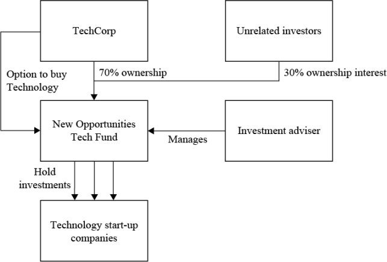
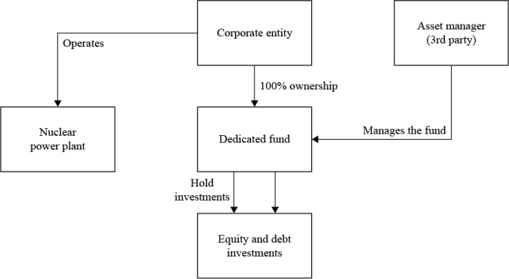

# 27 - Investment entities (IFRS 10)

[返回目录](README.md)

# 27 - Investment entities (IFRS 10)

Contents

- [27 - Investment entities (IFRS 10)](48.md#s178-chap_27_toc_h1)

- [Introduction](48.md#s179-chap_27_navPoint_1)

- [Accounting by an investment entity](48.md#s180-chap_27_navPoint_2)

- [Definition of an investment entity](48.md#s181-chap_27_navPoint_3)

- [Determining whether an entity is an investment entity](48.md#s182-chap_27_navPoint_4)

- [Business purpose](48.md#s183-chap_27_navPoint_5)

- [Exit strategy](48.md#s184-chap_27_navPoint_6)

- [Earnings from investments](48.md#s185-chap_27_navPoint_7)

- [Fair value measurement](48.md#s186-chap_27_navPoint_8)

- [Typical characteristics of an investment entity](48.md#s187-chap_27_navPoint_9)

- [More than one investment](48.md#s188-chap_27_navPoint_10)

- [More than one investor](48.md#s189-chap_27_navPoint_11)

- [Unrelated investors](48.md#s190-chap_27_navPoint_12)

- [Ownership interests](48.md#s191-chap_27_navPoint_13)

- [Loss of control](48.md#s192-chap_27_navPoint_14)

- [Separate financial statements](48.md#s193-chap_27_navPoint_15)

- [Reassessment of investment entity status](48.md#s194-chap_27_navPoint_16)

- [Disclosure](48.md#s195-chap_27_navPoint_17)

- [Illustrative text](48.md#s196-chap_27_navPoint_18)

- [Accounting by the parent of an investment entity](48.md#s196-chap_27_navPoint_19)

- [EX 27.3.1 – Unit of account](48.md#s196-chap_27_navPoint_idp1721247576)

- [FAQ 27.8.1 – How does the parent of an investment entity which is not itself an investment entity account for its subsidiary and entities controlled through that subsidiary?](48.md#s196-chap_27_navPoint_idp1721255896)

- [Definition of an investment entity](48.md#s196-chap_27_navPoint_20)

- [FAQ 27.11.1 – Does IFRS 10 define the specific type of instrument that an entity must hold as its investment?](48.md#s196-chap_27_navPoint_idp1721271000)

- [FAQ 27.13.1 – Can an entity which invests in items other than financial instruments meet the definition of an investment entity?](48.md#s196-chap_27_navPoint_idp1721280984)

- [Determining whether an entity is an investment entity – business purpose](48.md#s196-chap_27_navPoint_21)

- [FAQ 27.15.1 – How might an entity’s documents indicate that its business objective is that of an investment entity?](48.md#s196-chap_27_navPoint_idp1721297752)

- [FAQ 27.16.1 – How does an entity assess its business purpose where it has investing activities and also provides investment-related services?](48.md#s196-chap_27_navPoint_idp1721304536)

- [FAQ 27.18.1 – Which subsidiaries of an investment entity should be consolidated by an investment entity?](48.md#s196-chap_27_navPoint_idp1721348696)

- [FAQ 27.18.2 – Assessing whether a subsidiary is providing investment-related services](48.md#s196-chap_27_navPoint_idp1721368664)

- [FAQ 27.18.3 – Should an investment entity fair value or consolidate an intermediate holding company that it uses to hold investments in securities?](48.md#s196-chap_27_navPoint_idp1721188952)

- [Determining whether an entity is an investment entity – exit strategies](48.md#s196-chap_27_navPoint_22)

- [FAQ 27.23.1 – How might entities demonstrate that they have an exit strategy?](48.md#s196-chap_27_navPoint_idp1721227480)

- [FAQ 27.23.2 – Does the absence of an exit strategy for debt investments disqualify a fund from being an investment entity?](48.md#s196-chap_27_navPoint_idp1721234904)

- [FAQ 27.24.1 – What exit strategies are required in master-feeder structures to meet the definition of an investment entity?](48.md#s196-chap_27_navPoint_idp1712444968)

- [Determining whether an entity is an investment entity – earnings from investments](48.md#s196-chap_27_navPoint_23)

- [FAQ 27.27.1 – Assessing whether returns are solely for capital appreciation and/or investment income– high technology fund](48.md#s196-chap_27_navPoint_idp1712493736)

- [FAQ 27.27.2 – Assessing whether returns are solely for capital appreciation and/or investment income– real estate fund](48.md#s196-chap_27_navPoint_idp1645959368)

- [FAQ 27.27.3 – Assessing whether returns are solely for capital appreciation and/or investment income– real estate entity](48.md#s196-chap_27_navPoint_idp1698393688)

- [Typical characteristics of an investment entity](48.md#s196-chap_27_navPoint_24)

- [FAQ 27.35.1 – Holding a single investment: start-ups](48.md#s196-chap_27_navPoint_idp1698374232)

- [FAQ 27.35.2 – Holding a single investment: fund pools](48.md#s196-chap_27_navPoint_idp1695749096)

- [FAQ 27.37.1 – Funds with a single investor: seed capital](48.md#s196-chap_27_navPoint_idp1695774184)

- [FAQ 27.38.1 – Funds with a single investor: sovereign wealth fund](48.md#s196-chap_27_navPoint_idp1698659080)

- [FAQ 27.39.1 – Related investors: nuclear power plant](48.md#s196-chap_27_navPoint_idp1698680328)

- [FAQ 27.42.1 – Can non-equity liabilities represent ownership interests?](48.md#s196-chap_27_navPoint_idp1698705544)

- [Re-assessment of investment entity status](48.md#s196-chap_27_navPoint_25)

- [FAQ 27.48.1 – Re-assessment on redemption of units leaving one significant investor](48.md#s196-chap_27_navPoint_idp1698715400)

- [FAQ 27.48.2 – Re-assessment for funds nearing end of life](48.md#s196-chap_27_navPoint_idp1687483704)

- [FAQ 27.50.1 – Accounting for a change in status in consolidated financial statements](48.md#s196-chap_27_navPoint_idp1687491256)

- [FAQ 27.51.1 – Accounting for a change in status in separate financial statements](48.md#s196-chap_27_navPoint_idp1687508408)

- [Disclosures](48.md#s196-chap_27_navPoint_26)

- [FAQ 27.54.1 – Are investment entities with no subsidiaries able to use the disclosure exemption in paragraph 21A of IFRS 12 for investments in associates and joint ventures?](48.md#s196-chap_27_navPoint_idp1687516856)

This eBook is licensed to peggy so, peggy.so@hk.ey.com, 

## Introduction

**27.1** IFRS 10 requires an entity that is a parent to present consolidated financial statements in which it consolidates all of its subsidiaries. However, if an entity is an investment entity under IFRS 10, it is prohibited from consolidating its subsidiaries, with one exception. Instead, it accounts for these subsidiaries at fair value through profit or loss in accordance with IFRS 9 and prepares separate financial statements only. If a parent that is an investment entity chooses to consolidate its investments, these consolidated financial statements cannot be described as being in compliance with IFRS.

**27.2** An investment entity holds investments for the sole purpose of capital appreciation, investment income (such as dividends, interest or rental income), or both. The most useful information for such an entity is provided by measuring all investments, including investments in subsidiaries, at fair value. Preparing consolidated financial statements for such entities could hinder users’ ability to assess their financial position and results. Consolidated financial statements emphasise the financial position, operations and cash flow position of their investees, rather than those of the investors themselves. Consolidation also hinders comparability within the financial statements; some of the items consolidated might be measured at historical cost, whilst others will be carried at fair value. This makes assessment of the performance of an investment entity difficult, and it does not reflect the way in which the entity’s business is managed.

This eBook is licensed to peggy so, peggy.so@hk.ey.com, 

## Accounting by an investment entity

 

**27.3**A parent that is an ‘investment entity’ under the standard is prohibited from consolidating underlying subsidiaries, with one exception (see [para 27.6](48.md#s180-Para_27.6) below); instead, it is required to account for these subsidiaries at fair value through profit or loss under IFRS 9.

[IFRS 10 para 31].

EX.27.3.1 – Unit of account

**27.4** The exception in IFRS 10 only applies to a parent that is an investment entity.

[IFRS 10 para 4B].

**27.5** There are also disclosure requirements in IFRS 12 that apply to an investment entity that is a parent and has unconsolidated subsidiaries.

[IFRS 12 para 19].

**27.6** An investment entity only consolidates subsidiaries that are not themselves investment entities and whose main purpose is to provide services relating to the entity’s investment activities.

[IFRS 10 para 32].

**27.7** This includes investment management services, investment advisory services and administrative support. Such services might form a substantial part of the business and might be provided to third parties as well; this will not disqualify the entity from being an investment entity.

[IFRS 10 App B para B85C].

**27.8** The exception from consolidation extends to the consolidated financial statements prepared by the investment entity’s parent only where the parent qualifies as an investment entity itself. If the parent entity does not qualify as an investment entity, it will be required to consolidate all entities that it controls (including all underlying investees controlled through the investment entity and any other investment entities) under IFRS 10.

[IFRS 10 para 33].

[FAQ 27.8.1 – How does the parent of an investment entity which is not itself an investment entity account for its subsidiary and entities controlled through that subsidiary?](48.md#s196-FAQ_27.8.1)

 

This eBook is licensed to peggy so, peggy.so@hk.ey.com, 

## Definition of an investment entity

**27.9** An investment entity is “an entity that:

- obtains funds from one or more investors for the purpose of providing those investor(s) with investment management services;

- commits to its investor(s) that its business purpose is to invest funds solely for returns from capital appreciation, investment income or both; and

- measures and evaluates the performance of substantially all of its investments on a fair value basis.”

[IFRS 10 para 27].

**27.10** An entity must meet the definition to qualify as an investment entity. The following typical characteristics of an investment entity must also be considered:

- holding more than one investment;

- having more than one investor;

- having investors that are not the entity’s related parties; and

- having ownership interests in the form of equity or similar interests.

[IFRS 10 para 28].

**27.11** The typical characteristics are indicative and supplement the definition to allow the use of judgement in assessing whether an entity qualifies as an investment entity. If management concludes that the entity is an investment entity in the absence of one or more of the above typical characteristics, it is required to explain in the financial statements why the definition of an investment entity is met. It is highly unlikely that an entity will meet the definition of an investment entity where it has none of the typical characteristics; but it might be possible.

[IFRS 10 para BC234]. [IFRS 12 para 9A].

[FAQ 27.11.1 – Does IFRS 10 define the specific type of instrument that an entity must hold as its investment?](48.md#s196-FAQ_27.11.1)

This eBook is licensed to peggy so, peggy.so@hk.ey.com, 

## Determining whether an entity is an investment entity

 

**27.12** The above definition and typical characteristics require consideration of all the facts and circumstances when assessing whether the entity is an investment entity, including its purpose and design. The definition has three key elements:

- investment management services;

- business purpose; and

- fair value measurement.

[IFRS 10 App B para B85A].

**27.13** There is no detailed guidance on the first element of the definition, but the standard notes that the provision of investment management services differentiates investment entities from other entities.

[IFRS 10 para BC237].

[FAQ 27.13.1 – Can an entity which invests in items other than financial instruments meet the definition of an investment entity?](48.md#s196-FAQ_27.13.1)

**27.14** The standard provides guidance around the second and third elements of the definition: business purpose and fair value measurement.

[IFRS 10 App B para B85B].

 

This eBook is licensed to peggy so, peggy.so@hk.ey.com, 

## Business purpose

 

**27.15** The purpose of the entity’s business should be to obtain funds from its investors, and to invest them solely to obtain returns from capital appreciation and/or investment income. Its business purpose might be evidenced in:

- documents (such as its offering memorandum, publications and other corporate or partnership documents); and

- the way it presents itself to other parties (for example, to potential investors or potential investees).

[IFRS 10 App B para B85B].

[FAQ 27.15.1 – How might an entity’s documents indicate that its business objective is that of an investment entity?](48.md#s196-FAQ_27.15.1)

**27.16** Part of an entity’s business purpose might be to provide investment-related services (including investment advisory services, investment management, and investment support and administrative services), either directly or through a subsidiary. These services could be provided to investors and/or third parties. Participating in such investment-related services does not disqualify an entity from being an investment entity, even if these services form a substantial part of its business; this is because such services are an extension of its operations. These activities need to be undertaken to maximise investment returns (capital appreciation and/or investment income) from the entity’s investees; and they must not represent a separate substantial business activity or a separate substantial source of income. These permitted activities are:

- providing management services and strategic advice to an investee; and

- providing financial support (such as a loan, capital commitment or guarantee) to an investee.

[IFRS 10 para App B B85C]. [IFRS 10 App B para B85D].

[FAQ 27.16.1 – How does an entity assess its business purpose where it has investing activities and also provides investment-related services?](48.md#s196-FAQ_27.16.1)

**27.17** If an investment entity’s subsidiary is not itself an investment entity and its main purpose is to provide investment-related services to the parent, the investment entity parent will be required to consolidate that subsidiary. If the subsidiary is an investment entity, the investment entity parent should measure the subsidiary at fair value through profit or loss.

[IFRS 10 para 32].

**27.18** It might not always be apparent whether a subsidiary of an investment entity is providing investment-related services (and should be consolidated) or is not providing such services (and should be measured at fair value through profit or loss). This assessment could be complicated by some apparent overlap between paragraph 27(a) (definition of an investment entity) and paragraph 32 (definition of entities that should be consolidated by an investment entity) of IFRS 10.

[FAQ 27.18.1 – Which subsidiaries of an investment entity should be consolidated by an investment entity?](48.md#s196-FAQ_27.18.1)  
[FAQ 27.18.2 – Assessing whether a subsidiary is providing investment-related services](48.md#s196-FAQ_27.18.2)  
[FAQ 27.18.3 – Should an investment entity fair value or consolidate an intermediate holding company that it uses to hold investments in securities?](48.md#s196-FAQ_27.18.3)

 

This eBook is licensed to peggy so, peggy.so@hk.ey.com, 

## Exit strategy

 

**27.19** One of the ways in which an entity’s business purpose will be evident is through having an exit strategy for its investments, specifically documenting how it plans to realise capital appreciation on substantially all of its equity and non-financial investments. The exit strategy should clearly document a substantive time frame for exiting the investments, which might be either an expected date or range of dates, or a time defined by specific facts and circumstances (such as achieving certain milestones, the limited life of the entity, or the investment objectives of the entity). This does not need to be detailed for each investment: strategies could be identified by types or portfolios of investments held.

[IFRS 10 App B para B85F].

**27.20** A business purpose of investing for capital appreciation and/or income is not consistent with an objective of holding investments indefinitely. Most non-investment entities do not plan to sell, list or otherwise dispose of most of their subsidiaries within a particular time frame. A fund, on the other hand, will usually have an exit strategy. An entity should have exit strategies in order to demonstrate a business purpose consistent with being an investment entity. Exit mechanisms that have been put in place only for default events (such as breach of contract or non-performance) are not considered exit strategies for the purpose of the investment entity assessment.

[IFRS 10 App B para B85F].

**27.21** If an entity holds any debt investments that are perpetual, it should have identified an exit strategy for such debt investments.

[IFRS 10 App B para B85F].

**27.22** Holding dated debt investments to maturity is seen as a valid exit strategy; this is because there is no possibility of holding dated debt investments indefinitely.

[IFRS 10 para BC245].

**27.23** The following are examples of potential exit strategies for different types of investment:

- Exit strategies for private equity securities can include an initial public offering, a private placement, a trade sale of a business, distributions (to investors) of ownership interests in investees, and sales of assets (including the sale of an investee’s assets followed by a liquidation of the investee, such as when the fund is a limited life fund).

- If an entity has investments in traded equity investments, exit strategies might include selling the investment in a private placement or in a public market.

- An exit strategy for real estate investments might be sale through specialised property dealers or through the open market.

[IFRS 10 App B para B85G].

[FAQ 27.23.1 –How might entities demonstrate that they have an exit strategy?](48.md#s196-FAQ_27.23.1)  
 [FAQ 27.23.2 –](48.md#s196-FAQ_27.23.2)  
Does the absence of an exit strategy for debt investments disqualify a fund from being an investment entity?

**27.24** An entity might meet its business objective through holding some investments in another entity (‘B’) for legal, regulatory, tax or similar business reasons. The entity might not have identified an exit strategy for such investments. However, the entity in which it has invested (‘B’) might have an exit strategy for its investments. Where this is the case, the entity is likely to qualify as an investment entity.

[IFRS 10 App B para B85H].

[FAQ 27.24.1 –What exit strategies are required in master-feeder structures to meet the definition of an investment entity?](48.md#s196-FAQ_27.24.1)

 

This eBook is licensed to peggy so, peggy.so@hk.ey.com, 

## Earnings from investments

 

**27.25** If an entity or another member of the entity’s group can obtain, or is seeking, other benefits from its investees that are unavailable to unrelated parties, that investee is not held with the sole objective of obtaining capital appreciation and/or investment income. Instead, the entity might hold the investment in some operating or strategic capacity. Such an objective means that the entity does not qualify as an investment entity.

**27.26** Some examples of such benefits, which are inconsistent with an investment entity’s business purpose, include:

- The acquisition, use, exchange or exploitation of the processes, assets or technology of an investee. This includes scenarios where the entity (or another member of the group that the entity is a part of) has disproportionate or exclusive rights to acquire assets, technology, products or services of any investee (for example, by holding an option to purchase an asset from an investee if the asset’s development is deemed successful).

- The entity or any other member of the entity’s group entering into a joint arrangement (as defined in IFRS 11) or other agreement with an investee to develop, produce, market or provide products or services.

- Financial guarantees or assets provided by the entity’s investee that serve as collateral for the entity’s borrowing arrangements or for those of another member of the entity’s group; but an investment entity can use an investment in an investee as collateral for any of its borrowings.

- An option held by the entity’s related party to purchase from the entity, or any other member of the entity’s group, an ownership interest in an investee of the entity.

- Any transactions between the entity (or any other member of the entity’s group) and an investee that:

- are on terms that are unavailable to entities that are neither related parties or related parties of another member of the entity’s group or the investee;

- are not at fair value; or

- represent a substantial portion of the investee’s or the entity’s business activity, including business activities of other entities of the same group.

[IFRS 10 App B para B85I].

**27.27** It is consistent with an investment entity’s business purpose to have a strategy to invest in more than one investment in the same industry, market or geographical area in order to benefit from synergies that increase the capital appreciation of those investments. This is the case, unless the entity is receiving any returns beyond solely capital appreciation and/or investment income by holding such investments.

[IFRS 10 App B para B85J].

[FAQ 27.27.1 – Assessing whether returns are solely for capital appreciation and/or investment income – high technology fund](48.md#s196-FAQ_27.27.1)  
[FAQ 27.27.2 – Assessing whether returns are solely for capital appreciation and/or investment income – real estate fund](48.md#s196-FAQ_27.27.2)  
[FAQ 27.27.3 – Assessing whether returns are solely for capital appreciation and/or investment income –real estate entity](48.md#s196-FAQ_27.27.3)

 

This eBook is licensed to peggy so, peggy.so@hk.ey.com, 

## Fair value measurement

 

**27.28** Fair value should be the primary measurement attribute for substantially all investments for an investment entity. Fair value is likely to be more relevant information to evaluate the performance of the entity’s investments (both internally and externally) than consolidating the entity’s subsidiaries or using the equity method for the entity’s interests in associates or joint ventures. An entity is required to measure and evaluate the performance of substantially all of its investments on a fair value basis in order to qualify as an investment entity.

[IFRS 10 para 27(c)].

**27.29** The fair value requirement applies to ‘investments’. This does not apply to non-investment assets or to financial liabilities. For example, head office property and related equipment held under IAS 16, ‘Property, plant and equipment’, do not need to be measured and evaluated on a fair value basis.

[IFRS 10 App B para B85M].

**27.30** It is evident that fair value information is the primary measurement attribute if fair value information is:

- used internally by key management personnel to assess performance of substantially all of the entity’s investments; and

- provided to the entity’s investors, and the entity measures substantially all of its investments at fair value in its financial statements, where this is permitted or required by IFRS.

[IFRS 10 App B para B85K].

**27.31** An investment entity would elect to account for:

- investment property using the fair value model in IAS 40 (see [chapter 23 para 49](40.md#s150-Para_23.49));

- associates and joint ventures on a fair value basis by electing the exception from the equity method in IAS 28 (see [chapter 31 para 2](56.md#s224-Para_31.2)); and

- financial assets on fair value basis under IFRS 9 (see [chapter 42 para 4](63.md#s264-Para_42.4)).

[IFRS 10 App B para B85L].

 

This eBook is licensed to peggy so, peggy.so@hk.ey.com, 

## Typical characteristics of an investment entity

 

**27.32** An investment entity is expected to display the following characteristics in order to qualify as an investment entity, in addition to meeting the definition (these characteristics are considered typical of investment entities):

- holding more than one investment;

- having more than one investor;

- having investors that are not the entity’s related parties; and

- having ownership interests in the form of equity or similar interests.

[IFRS 10 para 28].

**27.33** The characteristics require applying additional judgement. An entity can be an investment entity in the absence of one or more of these characteristics, provided management has assessed why it is appropriate for the entity to qualify as an investment entity in the absence of the typical characteristic(s) and makes appropriate disclosure in the financial statements (see [paras 27.52 to 27.55](48.md#s195-Para_27.52)). It is considered highly unlikely, but possible, that an entity will qualify as an investment entity where it seems to strictly meet the definition but possesses none of the typical characteristics.

[IFRS 10 App B para B85N].

 

This eBook is licensed to peggy so, peggy.so@hk.ey.com, 

## More than one investment

 

**27.34** An investment entity will typically hold (directly or through another entity) more than one investment, with the objective of diversifying its risks and maximising returns.

[IFRS 10 App B para B85O].

**27.35**All facts and circumstances, including an entity’s business purpose, should be considered, to determine whether the entity qualifies as an investment entity where it holds only one investment. Some scenarios where it might be appropriate for an entity to hold a single investment – and nevertheless qualify as an investment entity – are included in the standard:

- The entity has made only one investment because it is in a start-up period and has not yet identified suitable multiple investments.

- The entity has not yet made new investments to replace those that have been disposed of.

- The entity has been established to pool investors’ funds to purchase a single investment that would have been unobtainable by individual investors (for example, where the required minimum investment is too high for an individual investor).

- The entity is in the process of liquidation.

[IFRS 10 App B para B85P].

[FAQ 27.35.1 – Holding a single investment: start-ups](48.md#s196-FAQ_27.35.1)  
[FAQ 27.35.2 – Holding a single investment: fund pools](48.md#s196-FAQ_27.35.2)

 

This eBook is licensed to peggy so, peggy.so@hk.ey.com, 

## More than one investor

 

**27.36** An entity would typically obtain funds from several investors, with the objective of providing its investors with investment management services and investment opportunities that they might not have access to individually, in order to qualify as an investment entity.

**27.37** An entity might have only one investor. The reasons why and whether it is consistent with the definition of an investment entity should be considered. There are some situations where it might be appropriate to conclude that an entity is an investment entity, despite having only one investor. These are situations where:

- An entity’s initial offering period has not expired and it is actively identifying additional suitable investors.

- The entity has not identified suitable investors to replace ownership interests that have been redeemed.

- The entity is in the process of liquidation.

[IFRS 10 App B para B85Q].

[FAQ 27.37.1 – Funds with a single investor: seed capital](48.md#s196-FAQ_27.37.1)

**27.38** The fund or entity might have been set up by a single investor to meet a specific objective or to help support the interest of a wider group of investors. For example, the entity is a fund that has been set up by a corporate entity to make investments on behalf of that corporate entity’s employees. The entity has a single investor but, in substance, it has been set up to support the interests of a wider group (that is, its parent investor’s employees). Other examples of such entities might include a pension fund, a government-owned investment fund or a family trust. Each of these is formed by or for a single investor but it represents or supports the interests of a wider group of investors. In some but not all cases, failing to meet this characteristic in such circumstances is not inconsistent with the overall business purpose and definition of an investment entity.

[IFRS 10 App B para B85R].

[FAQ 27.38.1 – Funds with a single investor: sovereign wealth fund](48.md#s196-FAQ_27.38.1)

 

This eBook is licensed to peggy so, peggy.so@hk.ey.com, 

## Unrelated investors

 

**27.39** An investment entity will typically have multiple investors that are not its related parties (as defined by IAS 24) and are not related to the group to which the investment entity belongs. If an entity has investors that are related to it, all facts and circumstances should be considered. Having related parties as investors makes it more likely that the entity (or other members of its group) could obtain benefits other than capital appreciation or investment income.

[IFRS 10 App B para B85T].

[FAQ 27.39.1 – Related investors: nuclear power plant](48.md#s196-FAQ_27.39.1)

**27.40** The entity might qualify as an investment entity even where its investors are related parties. For example, it might be a parallel fund (that is, investing in the same assets as another fund) set up by the manager of that other fund to incentivise and reward a group of the manager’s employees.

[IFRS 10 App B para B85U].

 

This eBook is licensed to peggy so, peggy.so@hk.ey.com, 

## Ownership interests

 

**27.41** An entity need not be a separate legal entity to qualify as an investment entity. Whatever its legal form, its ownership interest would generally be in the form of equity or similar interests (for example, partnership interest), to which a proportionate share of its net assets is attributable. This is because the entity will generally need a means by which it distributes, or attributes value from, its capital and income returns. Having different classes of investor does not mean that an entity is not an investment entity.

[IFRS 10 App B para B85V].

**27.42** An entity’s ownership interests might be accounted for as debt, because they do not meet the definition of equity under IAS 32. The entity is still likely to be an investment entity, so long as it provides holders with exposure to variable returns from changes in the fair value of the entity’s net assets.

[IFRS 10 App B para B85W].

[FAQ 27.42.1 – Can non-equity liabilities represent ownership interests?](48.md#s196-FAQ_27.42.1)

 

This eBook is licensed to peggy so, peggy.so@hk.ey.com, 

## Loss of control

**27.43** Accounting for a loss of control is detailed in [chapter 26 para 154](45.md#s172-Para_26.154).

This eBook is licensed to peggy so, peggy.so@hk.ey.com, 

## Separate financial statements

 

**27.44** There are two different situations where the accounting in separate financial statements is relevant to investment entities.

**27.45** The first situation is where an entity controls investee subsidiaries but none of these subsidiaries is required to be consolidated; in other words, it does not control any subsidiaries that provide investment-related services.

[IFRS 10 para 32].

**27.46** The entity measures all of its subsidiaries at fair value through profit or loss, and it will present separate financial statements as its only financial statements.

[IAS 27 para 8A].

**27.47** Alternatively, an entity might be an investment entity that has some investee subsidiaries, associates or joint ventures, that are accounted for at fair value through profit or loss, and other subsidiaries that provide investment-related services and which are consolidated. It prepares consolidated financial statements under IFRS 10. The subsidiaries providing investment-related services are consolidated, and other investees are measured at fair value through profit or loss. The entity might also be required to prepare separate financial statements. In those separate financial statements, it should account for the subsidiaries, associates or joint ventures that are measured at fair value through profit or loss in its consolidated financial statements in the same way as in its separate financial statements (that is, at fair value through profit or loss). The investment in any subsidiaries that are consolidated because they provide investment-related services can be accounted for in accordance with the choices available in paragraph 10 of IAS 27.

[IAS 27 para 10] [IAS 27 para 11A].

 

**Related****information**

This eBook is licensed to peggy so, peggy.so@hk.ey.com, 

## Reassessment of investment entity status

 

**27.48** The investment entity status should be reassessed where facts and circumstances indicate that there is a change to one or more of the three elements making up the definition of an investment entity or to any of the typical characteristics.

[IFRS 10 para 29].

[FAQ 27.48.1 – Reassessment on redemption of units leaving one significant investor](48.md#s196-FAQ_27.48.1)  
  
[FAQ 27.48.2 – Reassessment for funds nearing end of life](48.md#s196-FAQ_27.48.2)

**27.49** Any change in status is accounted for prospectively (that is, from the date when the change in status occurred).

[IFRS 10 para 30].

**27.50**The standard contains guidance on how an entity should account in its consolidated financial statements for a change in status – when it either becomes, or ceases to be, an investment entity. Entities which become investment entities will cease to consolidate subsidiaries (other than those described in [para 27.6](48.md#s180-Para_27.6)). The entity will de-recognise the assets and liabilities of those subsidiaries, determine the fair value of the subsidiary and recognise the difference as a gain or loss in profit or loss. Entities which cease to be investment entities will apply the acquisition method under IFRS 3, ‘Business combinations’, and consolidate. The date of the change of status is the deemed acquisition date. The fair value of the subsidiary at this date is taken to represent the deemed consideration when measuring any goodwill or gain from a bargain purchase that arises from the deemed acquisition.

[IFRS 10 App B para B100]. [IFRS 10 App B para B101].

[FAQ 27.50.1 – Accounting for a change in status in consolidated financial statements.](48.md#s196-FAQ_27.50.1)

**27.51** If an entity prepares separate financial statements, accounting for the change in status is done prospectively from the date of that change. Entities which become investment entities will account for the investment in subsidiaries at fair value through profit or loss, and recognise any difference from the previous carrying amount as a gain or loss in profit or loss. Entities which cease to be investment entities can continue to account for investments in subsidiaries in accordance with IFRS 9, account for those investments at cost or account for those investments using the equity accounting method. The fair value of the subsidiary at the date of the change in status is used as the deemed cost.

[IAS 27 para 11B].

[FAQ 27.51.1 – Accounting for a change in status in separate financial statements](48.md#s196-FAQ_27.51.1)

 

This eBook is licensed to peggy so, peggy.so@hk.ey.com, 

## Disclosure

**27.52** IFRS 12, ‘Disclosure of interests in other entities’, contains disclosure requirements for investment entities with controlled subsidiaries.

**27.53** The intention of the IFRS 12 disclosures is to give relevant information to users to help them understand:

- significant judgements and assumptions made in making the investment entity determination;

- reasons for concluding why an entity is considered to be an investment entity, even if it does not have one or more of the typical characteristics; and

- information about unconsolidated subsidiaries and unconsolidated structured entities controlled by the entity.

**27.54** The required disclosures are set out in paragraphs 9A and 9B (general disclosures) and paragraphs 19A–19G, 21A and 25A (interests in unconsolidated subsidiaries) of IFRS 12.

[FAQ 27.54.1 – Are investment entities with no subsidiaries able to use the disclosure exemption in paragraph 21A of IFRS 12 for investments in associates and joint ventures?](48.md#s196-FAQ_27.54.1)

**27.55** Disclosures are also required by any investment entity parent that prepares separate financial statements as its only financial statements.

[IAS 27 para 16A].

This eBook is licensed to peggy so, peggy.so@hk.ey.com, 

## Illustrative text

### Accounting by the parent of an investment entity

#### EX 27.3.1 – Unit of account

 

Reference to standard: IFRS 10 para 31  
  Reference to standing text: [27.3](48.md#s180-Para_27.3)

  

  
 The term ‘investment’ can consist of both equity (share investments) and debt (receivables) investments.

There are different views in the area of ‘unit of account’ for fair value measurement of investments where an investor holds both equity and debt investments in an investee (that is, whether the entity should measure the equity and debt investments as separate investments or as one investment). Entities need to carefully assess the accounting treatment in such situations.

 

#### FAQ 27.8.1 – How does the parent of an investment entity which is not itself an investment entity account for its subsidiary and entities controlled through that subsidiary?

Reference to standard: IFRS 10 para 33   
  Reference to standing text: [27.8](48.md#s180-Para_27.8)  

  

  
 

  
 Parent is an insurance company, writing insurance business. Parent does not qualify as an investment entity under IFRS 10 because, amongst other things, its purpose is not to invest funds solely for capital appreciation and/or investment income. It sets up a subsidiary, ‘IE’, which manages funds that back some of Parent’s insurance liabilities. Some of IE’s investees are controlled private equity investments. IE qualifies as an investment entity under the criteria set out in the standard.

In IE’s own financial statements, IE measures its controlled investees at fair value through profit or loss. But Parent’s consolidated financial statements will consolidate all of its controlled investees, including IE and IE’s investees.

### Definition of an investment entity

#### FAQ 27.11.1 – Does IFRS 10 define the specific type of instrument that an entity must hold as its investment?

 

Reference to standard: IFRS 10 para 28  
 Reference to standing text: [27.11](48.md#s181-Para_27.11)  
 

  

  
 IFRS 10 definition does not specify the type of instrument(s) that an entity must hold as its investment.

A key consideration is how the entity manages its investments and not whether the investments are in the form of financial instruments, insurance contracts or other assets. ‘Investment’ might consist of both equity (share investments) and debt (receivables) investments. See further FAQ 27.3.1.

The analysis of whether the definition of an investment entity is met should consider the business purpose and activities performed by the entity (for example, the amount of strategic advice or active day-to-day management). See further [paragraph 27.15](48.md#s183-Para_27.15).

 

#### FAQ 27.13.1 – Can an entity which invests in items other than financial instruments meet the definition of an investment entity?

 

Reference to standard: IFRS 10 para 28  
 Reference to standing text: [27.11](48.md#s181-Para_27.11)  
 

  

  
 An entity’s business is to advance funds to litigants in exchange for a return tied to the lawsuit:

- In some cases, the return is in the form of an interest-bearing loan secured against the litigant’s rights arising from the lawsuit (‘non-recourse debt contracts’).

- In other cases, the litigant agrees to share the future payment on the lawsuit with the fund; however, should the lawsuit fail, the litigant is not required to repay the amount advanced (‘contractual claims’). These contracts contain significant insurance risk and are therefore classified as insurance contracts in accordance with IFRS 4/IFRS 17.

Can the entity still assert that its sole business activity is to earn returns from capital appreciation, investment income or both?

IFRS 10 states that an investment entity obtains funds from investors with the purpose of providing them with investment management services, and commits to its investors that its business purpose is to invest funds solely for returns from capital appreciation, investment income or both. It does not specify the type of investment(s) which an entity must hold.

A key consideration is how the entity manages its investments and not whether they are financial instruments, insurance contracts or other assets. The analysis of whether the definition of an investment entity is met should consider the activities performed by the entity:

- If an entity is involved in the day-to-day management of litigation, it would generally not be an investment entity.

- If an entity only provides strategic advice and is not actively involved in managing cases and litigation, it could meet the definition of an investment entity.

 

### Determining whether an entity is an investment entity – business purpose

#### FAQ 27.15.1 – How might an entity’s documents indicate that its business objective is that of an investment entity?

Reference to standard: IFRS 10 para B85B  
  Reference to standing text: [27.15](48.md#s183-Para_27.15)

  

  
 If an entity states to its investors that it is making medium-term investment for capital appreciation, this will be consistent with the business purpose of an investment entity.

But, if the entity presents its investment objective as jointly developing, producing or marketing products with its investees, its business purpose would appear to be inconsistent with that of an investment entity; this is because it suggests that its purpose includes earning returns from development, production or marketing activity.

#### FAQ 27.16.1 – How does an entity assess its business purpose where it has investing activities and also provides investment-related services?

Reference to standard: IFRS 10 para B85C  
  Reference to standing text: [27.16](48.md#s183-Para_27.16)   

  

  
 Entities might provide little or no investment management, consultancy or other services, but they will have significant investing activities (for example, mutual funds).

In other cases, entities might provide significant investment management, consultancy or other services, with little or no investing activities of their own (for example, asset management companies).

It might be clear that the entity is an investment entity (the mutual fund) or is not an investment entity (the asset manager). But, for business models that include both investing activities and providing investment-related services, judgement is likely to be required to determine whether or not the entity is an investment entity. Where the judgement applied is significant, the entity should describe this judgement as one of its critical accounting judgements in the financial statements.

A private equity firm that obtains funds from its investors, committing to provide them with investment management services in order to invest for capital appreciation and/or investment income, might be an investment entity. This would be the case even though a significant portion of its activities includes providing sub-advisory and portfolio management services to third parties.

IFRS 10 does not specify how the investment entity provides these services, and does not preclude it from outsourcing the performance of these services to a third party. Therefore, if an entity provides investment management services to investors by outsourcing the performance of these services to a third party, it can still meet the definition of an investment entity, provided that the other criteria are met.

The entity should consider all relevant factors, and not only the mix of services and investing activity.

Factors that are likely to indicate that the entity is not an investment entity are:

- earning revenue from providing substantial management services or strategic advice to investees;

- not measuring and evaluating all investments at fair value; or

- holding investments with no defined exit strategies.

Careful consideration of all relevant facts and circumstances will be necessary to determine the appropriate accounting for the entity to apply.

#### FAQ 27.18.1 – Which subsidiaries of an investment entity should be consolidated by an investment entity?

 

Reference to standard: IFRS 10 para 32  
 Reference to standing text: [27.18](48.md#s183-Para_27.18)   

  

  
 The first element of the investment entity definition is that an entity obtains funds from investor(s) in order to provide them with ‘investment management services’. So, it might be argued that, for a subsidiary of an investment entity to qualify as an investment entity itself, it must be providing investment management services. This could imply that all investment entity subsidiaries of investment entity parents should be consolidated by those parents.

We do not believe that the IASB intended that all investment entity subsidiaries of an investment entity parent should be consolidated. Otherwise, the standard would have been clear that subsidiaries falling into paragraph 32 of IFRS 10 (providing investment-related services) included all investment entity subsidiaries. Paragraph BC272 seems to confirm that investment entity subsidiaries generally should be measured at fair value by investment entity parents.

Our view is that the only subsidiaries that should be consolidated by an investment entity parent are those which have a separate substantial business activity of providing investment-related services (such as those described in paras 32 and B85C - B85E) and are not themselves investment entities.

 

#### FAQ 27.18.2 – Assessing whether a subsidiary is providing investment-related services

 

Reference to standard: IFRS 10 para 32  
 Reference to standing text: [27.18](48.md#s183-Para_27.18)   
 

  

  
**Example – Private equity fund providing guarantee or funding support**

**Question**

Two years ago, an asset manager (AM) set up a fund as a limited partnership with 40 limited partners (LPs) and a limited life of 12 years. The LPs are not related; they commit to provide €2,500m. The AM (as a co-investment limited partner) commits an additional €25m, which are its own funds or funds of its employees.

The investment objective of the partnership (as set out in the limited partnership agreement) is as follows: to invest directly in entities in order to acquire a controlling or significant share; and to exit these at a later stage through a trade sale or an IPO process (a ‘buy-out fund’) between the eighth and twelfth years of the fund’s operation, with the aim of generating at least a preferred return rate (the hurdle rate) of 10%.

The AM (who is the general partner of the fund) directs the relevant activities of the partnership; these include:

- The appointment of an AM representative to the board of directors of the underlying investee entities.

- Providing strategic and economic advice to the investees through separate service agreements.

- Providing and arranging financing and (where necessary) financial guarantees in order to assist investees in executing their strategic plans.

- Evaluating and influencing the underlying policies, procedures and key management of the investments.

The AM considers these activities to be necessary to maximise the overall value of the underlying investees. The AM is also responsible for the selection, management and sale of the fund’s investment portfolio. Based on this, the AM concludes it has control of the fund.

The AM is responsible for providing a quarterly individual capital statement for each LP, detailing the fair value of each investment; and the partnership accounts for all its investees on a fair value basis.

Each LP interest is entitled to a share of disposal proceeds or net asset values on a winding up of the fund. The general partner (that is, the AM) is entitled to management fees and a profit share of capital gains above the 10% hurdle rate. The partnership has no equity.

Is the fund an investment entity, in view of the activities that it performs?

**Answer**

Judgement is required to conclude whether the fund is an investment entity.

The fund meets the first and third parts of the definition of an investment entity:

- It obtains funds from more than one LP to make investments and to provide them with investment management services.

- It measures and evaluates the performance of its investments on a fair value basis.

The second part of the definition of an investment entity (that is, its business purpose) is less clearly satisfied. The fund makes each investment with the objective of generating capital return and investment income. It does not intend to hold any of its investments indefinitely; this is because it has a limited life and a defined exit strategy for its investees. But it carries out other activities and its business purpose requires further consideration.

The fund also displays all four typical characteristics:

- it holds more than one investment;

- it has more than one investor;

- investors in the fund are unrelated to the reporting entity; and

- ownership interests in the fund are in the form of partnership interests that entitle partners to a share of net assets.

Regarding business purpose, the fund is involved in providing other investment-related activities; these include:

- Providing financial support to the underlying investee, including providing guarantees.

- Providing strategic and economic direction to the underlying investments.

These activities are consistent with the business purpose of an investment entity, and they are permitted so long as they are undertaken to maximise investment returns (capital appreciation and/or investment income) from the investees. But they should not represent a separate substantial business activity or source of income. Judgement is required to make this assessment.

 

#### FAQ 27.18.3 – Should an investment entity fair value or consolidate an intermediate holding company that it uses to hold investments in securities?

 

Reference to standard: IFRS 10 para 32  
 Reference to standing text: [27.18](48.md#s183-Para_27.18)   

  

  
 An investment fund (‘Parent Co’) meets the definition of an investment entity.

Parent Co sets up a wholly owned subsidiary (‘Holding Co’) to facilitate the efficient investment in securities. Parent Co provides a loan to Holding Co, which invests the funds in an appropriate portfolio of securities. Holding Co provides investment management services to Parent Co, including the buying and selling of securities and managing the portfolio on a fair value basis. Holding Co also has a separate board of directors and prepares separate financial statements.

Should Parent Co fair value or consolidate its investment in Holding Co?

Paragraph 31 of IFRS 10 requires an investment entity to measure an investment in a subsidiary at fair value instead of consolidating except where:

- the subsidiary is not itself an investment entity; and

- its main purpose and activities are providing services that relate to the investment entity’s investment activities.

Parent Co should therefore assess whether Holding Co meets the definition of an investment entity, to determine whether it should fair value or consolidate that investment.

In this scenario, Holding Co could be considered an investment entity, because:

- it has been set up to provide investment management services to Parent Co;

- it is carrying on its investment activities with the objective of capital appreciation and investment income; and

- it measures and evaluates its underlying investments on a fair value basis, and it reports its investment values on a fair value basis.

It also displays the following typical characteristics of an investment entity:

- it has more than one investment; and

- it has issued shares that entitle Parent Co to a share of its net assets.

Although it has only one investor who is its related party, it is, in substance, investing funds on behalf of the investors in Parent Co. Thus, it could be argued that it operates to earn investment returns for the benefit of many unrelated investors.

Although Holding Co also undertakes investment-related services on behalf of Parent Co, this is not inconsistent with it itself operating as an investment entity. In this situation it would be appropriate for Parent Co to account for its investment in Holding Co on a fair value basis. This is a critical judgement, and disclosure in respect of this and the supporting rationale should be provided (in accordance with para 122 of IAS 1).

Parent Co should also consider the requirements of paragraph 112(c) of IAS 1 to provide information not presented elsewhere in the financial statements but that might be relevant. Additional disclosure as to what the effect of consolidating Holding Co would have been on the income statement and statement of financial position might be considered appropriate to meet this requirement, because it would provide a user with both sets of financial information – critically, the cost of investment-related services that might otherwise have been undertaken by Parent Co.

 

### Determining whether an entity is an investment entity – exit strategies

#### FAQ 27.23.1 – How might entities demonstrate that they have an exit strategy?

 

Reference to standard: IFRS 10 para B85G  
 Reference to standing text: [27.23](48.md#s184-Para_27.23)   

  

  
 Exit strategies will often be evident from a fund prospectus or an entity’s investment management agreement. For example, a limited life fund, by definition, has exit strategies for its investments. A fund that instructs its manager to turn over its equity investments at least every five years has an exit strategy.

An entity that is set up for long-term capital growth through manufacturing and selling products in a particular market – and which has no explicit plans to dispose of any of its equity investments – might have more difficulty in determining that it has exit strategies for its investments. Such an entity might, in fact, be more like a conglomerate and might not have a business purpose of investing for capital appreciation and/or investment income.

 

#### FAQ 27.23.2 – Does the absence of an exit strategy for debt investments disqualify a fund from being an investment entity?

 

Reference to standard: IFRS 10 para B85G  
 Reference to standing text: [27.23](48.md#s184-Para_27.23)   

  

  
 A fund holds investments in both equity securities and fixed-maturity debt securities. The stated objective of the fund is to provide investment management services to its investors, and invest funds received from investors solely for returns from capital appreciation and/or investment income. Assume that the fund meets all of the typical characteristics listed in IFRS 10. The fund’s strategy for holding debt instruments is to manage its liquidity risk and to mitigate the risk of holding more volatile investments.

The fund has a documented exit strategy for substantially all of its equity investments, but it has no documented exit strategy for its debt investments.

The absence of a documented exit strategy for debt investments does not disqualify the fund from being an investment entity, and it does not contradict its business purpose. The debt instruments have a fixed maturity, so they cannot be held indefinitely.

 

#### FAQ 27.24.1 – What exit strategies are required in master-feeder structures to meet the definition of an investment entity?

 

Reference to standard: IFRS 10 para B85H  
 Reference to standing text: [27.24](48.md#s184-Para_27.24)   

  

  
 A feeder fund invests in a master fund and does not have a plan to exit the master fund. But the master fund will make investments and, provided there are exit strategies for those investments, the feeder fund will not be disqualified from being an investment entity.

**A master-feeder structure (based on example 4 in**para IE12 of IFRS 10**)**

An entity, master fund ‘MF1’, is formed in 20X1 with a 10-year life. The equity of MF1 is held by two related feeder funds. The feeder funds are established in connection with each other to meet legal, regulatory, tax or similar requirements.

The feeder funds are capitalised with a 1% investment from the general partner and 99% from equity investors that are unrelated to the general partner (with no party holding a controlling financial interest). The general partner of both FFD (a domestic feeder) and FFO (an offshore feeder) is the manager of MF1, FFD and FFO.

  
 **Question**

The purpose of MF1 is to hold a portfolio of investments in order to generate capital appreciation and investment income (such as dividends, interest or rental income). The investment objective communicated to investors is that the sole purpose of the master-feeder structure is to provide investment opportunities for investors to invest in a large pool of assets. MF1 has identified and documented exit strategies for the equity and non-financial investments that it holds. MF1 also holds a portfolio of dated debt investments: some of these will be held until maturity, and others will be traded. MF1 has not identified which specific investments will be held and which will be traded. MF1 measures and evaluates substantially all of its investments (including its debt investments) on a fair value basis. Also, investors receive periodic financial information, on a fair value basis, from the respective feeder funds, FFD and FFO.

Are MF1, FFD and FFO investment entities?

**Answer**

MF1 and the feeder funds FFD and FFO each meet the definition of an investment entity. The following conditions exist:

- MF1 and the feeder funds FFD and FFO have obtained funds for the purpose of providing investors with investment management services.

- The master-feeder structure’s business purpose (which was communicated directly to investors of the feeder funds) is investing solely for capital appreciation and investment income, and MF1 has identified and documented potential exit strategies for its equity and non-financial investments.

- Although FFD and FFO do not have an exit strategy for their interests in MF1, they can be considered to have an exit strategy for their investments; this is because MF1 was formed in connection with the feeder funds and holds investments on their behalf.

- The investments held by MF1 are measured and evaluated on a fair value basis, and information about the investments made by MF1 is given to investors on a fair value basis through the feeder funds.

MF1 and the feeder funds were formed in connection with each other for legal, regulatory, tax or similar requirements. When considered together, MF1, FFD and FFO display the following typical characteristics of an investment entity:

- Although the feeder funds each hold a single investment in MF1, they could be considered indirectly to hold more than one investment; this is because MF1 holds a portfolio of investments.

- Although MF1 is 100% owned by the two feeder funds, the feeder funds FFD and FFO are funded by many investors who are unrelated to the feeder funds (and also unrelated to the general partner/manager of the funds).

- Ownership in the feeder funds is represented by units of equity interests.

 

### Determining whether an entity is an investment entity – earnings from investments

#### FAQ 27.27.1 – Assessing whether returns are solely for capital appreciation and/or investment income– high technology fund

 

Reference to standard: IFRS 10 para B85J  
 Reference to standing text: [27.27](48.md#s185-Para_27.27)   

  

  
**Question**

A fund is formed by Technology Corp Inc (‘TechCorp’) to invest in technology start-up companies for capital appreciation. TechCorp holds 70% of the shares in the fund, called ‘New Opportunities Tech Fund’, and controls the fund. The other 30% of the shares in New Opportunities Tech Fund is owned by a number of unrelated investors. New Opportunities Tech Fund will invest in start-ups; and it will bring together a team of specialists to grow the start-ups.

TechCorp holds options to acquire any of the investments held by New Opportunities Tech Fund, exercisable after five years following the purchase of the start-ups by the fund. The exercise price of the options is fair value. TechCorp is likely to exercise the options if the businesses or technology developed by the investees would benefit the operations of TechCorp. No plans for exiting the investments have been identified by the fund. New Opportunities Tech Fund is managed by an investment adviser that acts as agent for the investors in the fund.

Is New Opportunities Tech Fund an investment entity?

**Answer**

New Opportunities Tech Fund’s business purpose is to invest for capital appreciation, and it provides investment management services to its investors. But the fund is not an investment entity, because of the following arrangements and circumstances:

- TechCorp, the fund’s parent, holds options to acquire the investees owned by New Opportunities Tech Fund if the assets developed by the investees would benefit the operations of TechCorp. This provides a benefit to TechCorp in addition to capital appreciation and/or investment income.

- The investment plans of the fund do not include exit strategies for its equity investments. The options held by TechCorp are not controlled by the fund (since they are exercisable by TechCorp) and do not constitute an exit strategy.

 

#### FAQ 27.27.2 – Assessing whether returns are solely for capital appreciation and/or investment income– real estate fund

 

Reference to standard: IFRS 10 para B85J  
 Reference to standing text: [27.27](48.md#s185-Para_27.27)   

  

  
**Question**

A real estate fund is set up to invest in real estate assets for the benefit of institutional and retail investors. It is set up and managed by an investment manager experienced in the real estate business. The fund invests in real estate companies and other real estate investment funds which own, manage and lease out real estate assets. The investment manager has a policy of acquiring and disposing of its real estate investments over a five- to ten-year time frame, based on market conditions.

The fund earns dividends and share of profits, and it realises capital gains from its real estate investments.

The fund reports (internally and externally) all of its investments at fair value, and its performance is assessed based on those fair values.

The fund issues redeemable participating units which are redeemable at a share of the fund’s net asset value (NAV). The founding documents of the fund confirm its objectives and strategy as stated.

The fund is not itself involved in the active management of the property portfolio (such as property maintenance, capital expenditure, redevelopment, marketing and tenant selection); this business activity is undertaken by the investees (the real estate companies and other real estate investment funds).

Is the fund an investment entity?

**Answer**

The fund meets the definition of an investment entity because its objective is to generate returns from capital appreciation and investment income through investment management services. It manages its investments on a fair value basis, which is reported to its investors. It displays the typical characteristics of an investment entity, which are: it has more than one unrelated investor; it holds multiple investments; and it has ownership interests in the form of fund units which represent a proportionate share of its underlying assets. In addition, the fund itself is not involved in the active management of the underlying property portfolio.

 

#### FAQ 27.27.3 – Assessing whether returns are solely for capital appreciation and/or investment income– real estate entity

 

Reference to standard: IFRS 10 para B85J  
 Reference to standing text: [27.27](48.md#s185-Para_27.27)   

  

  
**Question**

Real Estate Investments (‘REI’) was formed in order to develop, own and operate retail, office and other commercial properties. REI usually holds each of its properties in separate wholly owned subsidiaries. Those subsidiaries have no substantial assets or liabilities other than borrowings used to finance the related investment property. REI and each of its subsidiaries report their investment properties at fair value under IAS 40. REI does not have a set time frame for disposing of its property investments, but it uses fair value to help identify the optimal time for disposal. REI and its investors also use measures other than fair value (including information about expected cash flows, rental revenues and expenses) to assess performance and to make investment decisions. The directors and managers of REI do not consider fair value information to be the primary measurement attribute to evaluate the performance of REI’s investments; instead, they see that information as part of a group of equally relevant key performance indicators.

REI undertakes extensive property and asset management activities (including property maintenance, capital expenditure, redevelopment, marketing and tenant selection), some of which it outsources to third parties. This includes the selection of properties for refurbishment, development and the negotiation with suppliers for the design and construction work to be done to develop such properties. This development activity forms a separate substantial part of REI’s business activities.

Is REI an investment entity?

**Answer**

REI is not an investment entity because:

- It has a separate substantial business activity that involves the active management of its property portfolio, including lease negotiations, refurbishments and development activities, and marketing of properties to provide benefits other than capital appreciation and/or investment income.

- REI’s investment plans do not include specified exit strategies for its investments. As a result, it plans to hold those property investments indefinitely.

- Although REI reports its investment properties at fair value under IAS 40, fair value is not the primary measurement attribute used by management to evaluate the performance of its investments. Other performance indicators are used to evaluate performance and make investment decisions.

 

### Typical characteristics of an investment entity

#### FAQ 27.35.1 – Holding a single investment: start-ups

 

Reference to standard: IFRS 10 para B85P  
 Reference to standing text: [27.35](48.md#s188-Para_27.35)  
 

  

  
**Limited partnership (based on example 1 in**para IE1**of IFRS 10)**

**Question**

An entity (LP) is formed in 20X1 as a limited partnership with a 10-year life. The offering memorandum states that LP’s purpose is to invest in entities with rapid growth potential, with the objective of realising capital appreciation over their life. Entity GP (the general partner of LP) provides 1% of the capital to LP and has the responsibility of identifying suitable investments for the partnership. Approximately 75 limited partners (who are unrelated to GP) provide 99% of the capital to the partnership.

LP begins its investment activities in 20X1, but no suitable investments are identified by the end of 20X1. In 20X2, LP acquires a controlling interest in one entity, ABC Corporation. LP is unable to close another investment transaction until 20X3, when it acquires equity interests in five additional operating companies. LP conducts no activities other than acquiring these equity interests. LP measures and evaluates its investments on a fair value basis, and this information is provided to GP and the external investors.

LP has plans to dispose of its interests in each of its investees during the 10-year stated life of the partnership. Such disposals include the outright sale for cash, the distribution of marketable equity securities to investors (following the successful public offering of the investees’ securities), and the disposal of investments to the public or other unrelated entities.

Is LP an investment entity?

**Answer**

From the information provided, LP meets the definition of an investment entity from its formation in 20X1 to 31 December 20X3, because the following conditions exist:

- LP has obtained funds from the limited partners and is providing those limited partners with investment management services.

- LP’s only activity is acquiring equity interests in operating companies, with the purpose of realising capital appreciation over the life of the investments. LP has identified and documented exit strategies for its investments, all of which are equity investments.

- LP measures and evaluates its investments on a fair value basis and reports this financial information to its investors.

In addition, LP displays the following typical characteristics of an investment entity:

- LP is funded by many investors.

- Its limited partners are unrelated to LP.

- Ownership in LP is represented by units of partnership interests acquired through a capital contribution.

- Although LP does not hold more than one investment throughout the period, this is because it was still in its start-up period and had not identified suitable investment opportunities.

 

#### FAQ 27.35.2 – Holding a single investment: fund pools

 

Reference to standard: IFRS 10 para B85P  
 Reference to standing text: [27.35](48.md#s188-Para_27.35)   
 

  

  
**Question**

An ‘access fund’ was set up in connection with a ‘main fund’. The access fund is the named shareholder on the register of the main fund. The access fund originally invested in the main fund at the initial offering stage of the main fund. Within the governing documents of the main fund, there was an initial subscription of $500 million. Once these capital amounts were raised, the main fund would be closed to new investors. This is referred to as a ‘soft-closed’ fund. The main fund is closed to monies from new investors but not from existing investors.

The main fund has been set up to make multiple investments, and it has an exit strategy set out in its founding documents.

The objective of the access fund is to invest solely in the main fund. Shareholders who want access to the main fund can only do so through the access fund; this is because the main fund is closed to new shareholders. Shareholders of the access fund are entitled to a proportionate share of net assets of the access fund.

The access fund provides investment management services to its unrelated investors; and it will receive returns from capital appreciation and investment income (that is, distributions from the main fund). The access fund manages its investment in the main fund on a fair value basis.

Is the access fund an investment entity?

**Answer**

The access fund meets the definition of an investment entity:

- The fund obtains funds from investors with the objective of providing investment management services.

- The objective of making investments is generating capital returns and investment income; the fund will receive dividends from the main fund and capital appreciation through increases in the fair value of the main fund. Although the access fund does not have an exit strategy for its investment in the main fund, the main fund has exit strategies for its investments.

- It measures and evaluates the performance of its investment in the main fund on a fair value basis.

The access fund displays three of the four typical characteristics of an investment entity:

- The fund has multiple investors.

- The multiple investors are unrelated.

- The fund has ownership interests in the form of units that entitle the investors to the net assets of the fund.

The access fund does not display the fourth typical characteristic (that is, it has one single investment), but it concludes that it qualifies as an investment entity. It has been set up to provide investment management services to its investors with the objective of earning capital appreciation and investment income from its investment in the main fund. It manages its underlying investment on a fair value basis. The fact that it does not meet the characteristic in these circumstances is not inconsistent with the overall definition and business purpose of being an investment entity. The access fund is required to make appropriate disclosures as to why it has concluded that it is an investment entity despite not displaying all of the typical characteristics.

 

#### FAQ 27.37.1 – Funds with a single investor: seed capital

 

Reference to standard: IFRS 10 para B85S  
 Reference to standing text: [27.37](48.md#s189-Para_27.37)  
 

  

  
**Question**

An investment fund has been set up by its manager; initially, the manager is the sole shareholder (that is, the manager has provided ‘seed capital’). As at its first period end, the fund has not been successful in receiving funds from other prospective shareholders, but it is actively soliciting new investors. The fund invests in global equities and equity-related derivatives; and it provides its one shareholder with investment management services (as mandated in its prospectus). Its prospectus states that it expects to buy and sell investments regularly, and it expects holding periods of more than one year to be rare.

The fund generates returns from capital appreciations and investment income in the form of dividends. The fund measures all investments at fair value, and these valuations are the basis for subscriptions into and redemptions out of the fund. Subscriptions and redemptions can occur daily.

Is the fund an investment entity?

**Answer**

The fund is an investment entity.

It meets the definition of an investment entity if:

- It has been set up to provide investment management services to its investors. For this period, it has only one manager-shareholder, and so it is providing investment management services to itself, but this is not its longer-term manager intention.

- It is carrying on its investment activities with the objective of capital appreciation and investment income.

- It measures its underlying investments on a fair value basis, and fair value is the basis for subscriptions into and redemptions and out of the fund.

The fund displays the following characteristics:

- It holds multiple investments.

- It does not have multiple investors, but this is expected to be temporary and the fund manager is actively soliciting new investors.

- It does not have unrelated investors, because it has only a single investor.

- It issues ownership interests in the form of redeemable units that entitle the holders to a share of net assets.

Although the fund has a single investor, this is expected to be temporary. Failing to meet this typical characteristic does not mean that the fund is not an investment entity. In the context of the definition and the fund’s overall business purpose, it is an investment entity. The fund is required to make appropriate disclosures in its financial statements on why it qualifies as an investment entity even when it has only one investor.

 

#### FAQ 27.38.1 – Funds with a single investor: sovereign wealth fund

 

Reference to standard:  IFRS 10 para B85R  
 Reference to standing text: [27.38](48.md#s189-Para_27.38)  
 

  

  
**Question**

The government of country X sets up a sovereign wealth fund (SWF) to manage its income from natural resources for the long-term benefit of its citizens. The SWF will, for example, be used to fund future pensions and significant capital projects carried out by the state. The fund is set up as a separate legal entity established under statute, and it is owned by the central bank of country X. It has issued shares to the bank. The fund employs a team of professional investment managers, who work to a mandate that is overseen by the central bank and approved annually by country X’s government. The fund makes multiple investments (some of which are controlling stakes) and sets out exit strategies for different classes of investment. The fund produces public reports twice-yearly, which detail the total value of the fund and of its main asset classes. Internal reporting is more detailed and also on a fair value basis.

Is country X’s SWF an investment entity?

**Answer**

Country X’s SWF is an investment entity because:

- It has been set up to provide investment management services to its investor (which, in this case, is the government of country X).

- It is carrying on its investment activities with the objective of capital appreciation and investment income.

- It measures its underlying investments on a fair value basis, and it reports its funds value on a fair value basis.

It also displays the following typical characteristics of an investment entity:

- It holds more than one investment.

- It has only one investor, which is the central bank of country X. It can nevertheless be seen, in substance, as investing the funds of the citizens of country X on their behalf. This is not inconsistent with the overall definition and business purpose of an investment entity. It has one related-party direct beneficiary, due to having one investor; but, again, it could be argued that, in substance, it operates on behalf of many unrelated beneficiary investors.

- The fund has issued units that entitle its investor to a share of its net assets.

 

#### FAQ 27.39.1 – Related investors: nuclear power plant

 

Reference to standard: IFRS 10 para B85T  
 Reference to standing text: [27.39](48.md#s190-Para_27.39)   

  

  
**Question**

A dedicated fund is set up by a corporate entity that runs a nuclear power plant. The corporate entity (which owns all of the units in the fund) needs to keep funds available in case of a technical failure of the nuclear power plant. The entity does not have the expertise to manage the fund, so it appoints a third party asset manager. The entity can remove the fund manager on three months’ notice.

The fund invests in traded equity and debt instruments (as set out in the investment management agreement and fund founding documents), and its maximum exposure to one investment is not more than 10% of monies invested. The objective of the fund is to generate returns, either from dividends and interest or from selling the instruments. The fund does not invest in the nuclear energy industry, and the corporate entity has no other relationship with the fund; for example, it does not have options to buy any of the investments made by the fund.

The fund reports fair value information internally and to its corporate parent, and its performance is evaluated against a benchmark stock exchange index.

The fund issues units that are redeemable at any time. The redeemable shares pay the net asset value of the fund when liquidated, and they are accounted for by the fund as equity under IAS 32. The units do not carry voting rights.

Is the fund an investment entity?

How does the corporate entity account for its interest in the fund?

**Answer**

The fund is an investment entity. It meets the definition of an investment entity:

- It provides investment management services to its investor.

- Its business purpose is to invest in debt and equity instruments for capital appreciation and investment income.

- It measures and evaluates the performance of its investments on a fair value basis.

The fund also displays two of the four typical characteristics:

- The fund holds multiple investments.

- The fund only has one investor but, in these circumstances, that is not inconsistent with its overall business purpose and with the definition of an investment entity.

- The fund does not have unrelated investors, because there is only one investor; but, again, in these circumstances this is not inconsistent with the definition of an investment entity.

- Units issued by the fund entitle the holder to a proportionate share of the net asset value of the fund.

Two of the characteristics are not satisfied, because the fund has a single investor. When examining all the facts and circumstances, however, the fund concludes that it is an investment entity and that the failure to meet two of the typical characteristics is not inconsistent with the definition. It gives appropriate disclosure about its judgement under IFRS 12 (see [paras 27.52 to 27.55](48.md#s195-Para_27.52)).

The corporate entity is not an investment entity, so it consolidates the fund (including any controlled investments made by the fund).

 

#### FAQ 27.42.1 – Can non-equity liabilities represent ownership interests?

 

Reference to standard: IFRS 10 para B85W  
 Reference to standing text: [27.42](48.md#s191-Para_27.42)   

  

  
 Unit trusts and mutual funds often issue units that are accounted for as liabilities under IAS 32 guidance; this is because they do not qualify to be presented as equity under the IAS 32 ‘puttables’ amendment.

Where such units (whether or not they are presented as equity) entitle the entity’s holders to proportionate shares of net assets, they will not prevent the fund being considered an investment entity.

Some funds are financed through debt instruments (particularly in private equity) which participate in the returns of the fund. Such debt instruments would not prevent investment entity status under the ‘ownership interests’ typical characteristic.

 

### Re-assessment of investment entity status

#### FAQ 27.48.1 – Re-assessment on redemption of units leaving one significant investor

 

Reference to standard: IFRS 10 para 29  
 Reference to standing text: [27.48](48.md#s194-Para_27.48)   

  

  
 Due to a change in market conditions, investors in a fund are redeeming their units. As a result of this redemption, only one significant investor remains in the fund.

Should the fund reassess its investment entity status?

The fund should re-assess its investment entity status. In this case, the fund might continue to meet the definition, and remain an investment entity, in either of the following situations:

- if its business continues to be management of investments for capital appreciation and/or income, but now for one investor instead of many; or

- if it expects that this will be a temporary situation.

 

#### FAQ 27.48.2 – Re-assessment for funds nearing end of life

 

Reference to standard:  IFRS 10 para 29  
 Reference to standing text: [27.48](48.md#s194-Para_27.48)   

  

  
 A fund was set up with a limited life of 10 years. The fund is in its final year, and it reaches a stage where it has one single investment remaining.

The objective of the fund has not changed, and the fund is realising its final investment with the objective of maximising the return to its investors.

Should the fund reassess its investment entity status?

The fund should re-assess its investment entity status when it has a single investment, because it no longer meets one of the typical characteristics. But it might conclude that it continues to be an investment entity if its single investment is not inconsistent with its overall purpose; in that case, it continues to meet the definition of an investment entity.

 

#### FAQ 27.50.1 – Accounting for a change in status in consolidated financial statements

 

Reference to standard: IFRS 10 paras B100, B101  
 Reference to standing text: [27.50](48.md#s194-Para_27.50)  
 

  

 

#### FAQ 27.51.1 – Accounting for a change in status in separate financial statements

 

Reference to standard: IAS 27 para 11B  
 Reference to standing text: [27.51](48.md#s194-Para_27.51)  
 

  

  
 

 

### Disclosures

#### FAQ 27.54.1 – Are investment entities with no subsidiaries able to use the disclosure exemption in paragraph 21A of IFRS 12 for investments in associates and joint ventures?

 

Reference to standard: IFRS 12 para 21A  
 Reference to standing text: [27.54](48.md#s195-Para_27.54)

  

  
 An investment entity does not have any subsidiaries. However, it does hold investments in associates and joint ventures, which it measures at fair value through profit or loss in accordance with IAS 28.

Is the investment entity able to use the disclosure exemption, available to investment entities, from the requirement to provide disclosure of summarised financial information of its associates and joint ventures?

Yes, investment entities that do not have any subsidiaries and which measure investments in associates and joint ventures at fair value can claim the exemption, in paragraph 21A of IFRS 12, from disclosing summarised financial information for those investments. The definition of an investment entity in IFRS 10 does not require that it has controlled investments, and the disclosure exemption in IFRS 12 would therefore be available.

 

This eBook is licensed to peggy so, peggy.so@hk.ey.com, 

