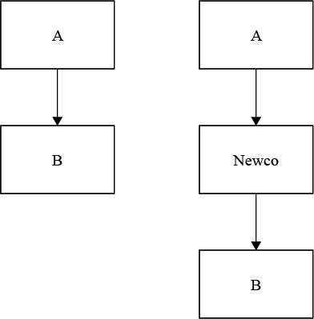
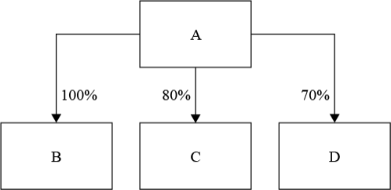
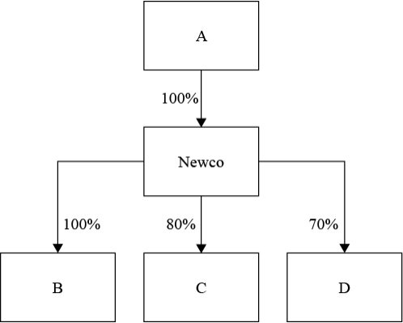

# 28 - Separate financial statements (IAS 27)

[返回目录](README.md)

# 28 - Separate financial statements (IAS 27)

Contents

- [28 - Separate financial statements (IAS 27)](49.md#s197-chap_28_toc_h1)

- [Introduction and scope (paras 28.1-28.13)](49.md#s198-chap_28_navPoint_1)

- [Objectives and scope](49.md#s198-chap_28_navPoint_2)

- [Consolidated, ‘economic interest’, separate and ‘individual’ financial statements](49.md#s198-chap_28_navPoint_idp1714495336)

- [Venture capital and investment entities exemptions](49.md#s198-chap_28_navPoint_idp1714536040)

- [Recognition and measurement of investments in subsidiaries, associates and joint ventures (paras 28.14 - 28.31)](49.md#s199-chap_28_navPoint_3)

- [Cost](49.md#s199-chap_28_navPoint_4)

- [Initial recognition and transaction costs](49.md#s199-chap_28_navPoint_idp1714539752)

- [Indemnifications](49.md#s199-chap_28_navPoint_idp1714551528)

- [Contingent consideration](49.md#s199-chap_28_navPoint_idp1714589928)

- [Subsequent measurement](49.md#s199-chap_28_navPoint_idp1698703496)

- [Step acquisitions from an associate or joint venture to a subsidiary](49.md#s199-chap_28_navPoint_idp1698702344)

- [Step acquisitions from a financial asset measured at fair value to a subsidiary](49.md#s199-chap_28_navPoint_idp1698706952)

- [IFRS 9](49.md#s199-chap_28_navPoint_5)

- [Initial recognition and transaction costs](49.md#s199-chap_28_navPoint_idp1698670088)

- [Subsequent measurement](49.md#s199-chap_28_navPoint_idp1698675080)

- [Equity method](49.md#s199-chap_28_navPoint_6)

- [Impairment](49.md#s199-chap_28_navPoint_7)

- [Dividend income (paras 28.32 - 28.35)](49.md#s200-chap_28_navPoint_8)

- [Bonus issue by subsidiary](49.md#s200-chap_28_navPoint_9)

- [Transfers under common control (paras 28.36 - 28.44)](49.md#s201-chap_28_navPoint_10)

- [Parent establishes a new entity as its parent](49.md#s202-chap_28_navPoint_11)

- [Practical application (paras 28.45 - 28.50)](49.md#s203-chap_28_navPoint_12)

- [Business combinations in separate financial statements](49.md#s203-chap_28_navPoint_13)

- [Disposal of investments](49.md#s203-chap_28_navPoint_14)

- [Disclosure requirements (paras 28.51 - 28.56)](49.md#s204-chap_28_navPoint_15)

- [Illustrative text](49.md#s205-chap_28_navPoint_17)

- [FAQ 28.9.1 – When should an entity prepare ‘economic interest’ financial statements?](49.md#s205-chap_28_navPoint_18)

- [FAQ 28.9.2 – When is an entity exempt from preparing ‘economic interest’ financial statements?](49.md#s205-chap_28_navPoint_19)

- [FAQ 28.9.3 – When should an entity prepare ‘economic interest’ financial statements because exemption does not apply? (1)](49.md#s205-chap_28_navPoint_20)

- [FAQ 28.9.4 – When should an entity prepare ‘economic interest’ financial statements because exemption does not apply? (2)](49.md#s205-chap_28_navPoint_21)

- [FAQ 28.9.5 – When should an entity prepare separate financial statements?](49.md#s205-chap_28_navPoint_22)

- [FAQ 28.9.6 – When should an entity prepare consolidated and separate financial statements?](49.md#s205-chap_28_navPoint_23)

- [FAQ 28.9.7 – What financial statements are required for an investment in a structured entity?](49.md#s205-chap_28_navPoint_24)

- [FAQ 28.15.1 – Where an entity has elected to measure a category of investments at fair value but it has used cost for one or more specific investments, can it still use fair value for the remaining investments in that category?](49.md#s205-chap_28_navPoint_25)

- [FAQ 28.18.1 – How should an entity account for an indemnification in separate financial statements?](49.md#s205-chap_28_navPoint_26)

- [FAQ 28.21.1 – Why are two accounting policies for contingent consideration supportable in separate financial statements?](49.md#s205-chap_28_navPoint_27)

- [FAQ 28.33.1 – How is a distribution in the form of an investment in a subsidiary accounted for?](49.md#s205-chap_28_navPoint_28)

- [FAQ 28.42.1 – How would the investment be recorded in an original parent that has a net liability position?](49.md#s205-chap_28_navPoint_29)

- [FAQ 28.44.1 – How is a sale of a subsidiary to a Newco via a share-for-share exchange accounted for?](49.md#s205-chap_28_navPoint_30)

- [FAQ 28.44.2 – How is a group reorganisation where a parent has multiple subsidiaries accounted for?](49.md#s205-chap_28_navPoint_32)

- [FAQ 28.50.1 – How should a partial disposal be accounted for where an investment is measured at cost?](49.md#s205-chap_28_navPoint_33)

- [FAQ 28.52.1 – Is there any suggested wording, to satisfy the requirements within paragraph 16 of IAS 27, for parent companies’ separate financial statements that are exempt from the requirement to prepare consolidated or ‘economic interest’ financial statements?](49.md#s205-chap_28_navPoint_34)

 

This eBook is licensed to peggy so, peggy.so@hk.ey.com, 

## Introduction and scope (paras 28.1-28.13)

 

**28.1**IAS 27 is the main accounting standard that provides guidance on the preparation of IFRS separate financial statements. IAS 27 primarily focuses on the recognition and measurement of investments in subsidiaries, joint ventures and associates in separate financial statements. The standard also provides limited guidance on the presentation and preparation of separate financial statements.

**28.2** The recognition and measurement requirements for investments in subsidiaries, joint ventures and associates in separate financial statements are set out in IAS 27. All other aspects of separate financial statements follow the preparation and presentation requirements of IAS 1 for general purpose financial statements and the measurement and disclosure provisions of all relevant IFRSs.

[IAS 27 para 9].

 

### Objectives and scope

**28.3**Separate financial statements are defined as those presented by an entity in which the entity could elect to account for its investments in subsidiaries, joint ventures and associates either at cost, in accordance with IFRS 9, or using the equity method as described in IAS 28.

[IAS 27 para 4].

**28.4**IAS 27 does not mandate which entities should produce separate financial statements. An entity might be required by local legislation, or it might elect, to present separate financial statements. If separate financial statements are prepared, IAS 27 should be followed.

[IAS 27 para 3].

#### Consolidated, ‘economic interest’, separate and ‘individual’ financial statements

 

**28.5** The situations where consolidated, separate, ‘economic interest’ and ‘individual’ financial statements are required are summarised in the following diagram. Each of these is explained in the paragraphs below.

  
**28.6**IFRS 10 specifies the circumstances in which an entity must prepare consolidated financial statements, which are those that present a parent and its subsidiaries as a ‘single economic entity’. See chapter 26 para 2 for further guidance.

[IFRS 10 App A].

**28.7** An entity that has investments in joint ventures or associates, but does not have investments in subsidiaries, must prepare financial statements in which these investments are equity accounted. These are referred to as ‘economic interest’ financial statements. ‘Economic interest’ financial statements are not separate financial statements of the investor. All of the normal disclosure requirements of relevant IFRSs need to be included in the financial statements, including the requirements of IFRS 12 for joint ventures and associates. See [paragraph 28.55](49.md#s204-Para_28.55).

[IAS 27 para 6].

**28.8** Exemptions from the preparation of both consolidated and ‘economic interest’ financial statements are available for an entity (that is either a parent or an investor, or both) if:

- the entity meets all of the following conditions:

- the entity is itself a wholly owned subsidiary, or a partially owned subsidiary of another entity, and its other owners, including those not otherwise entitled to vote, have been informed about, and do not object to, the entity not presenting consolidated or ‘economic interest’ financial statements;

- the entity’s debt or equity instruments are not traded in a public market (a domestic or foreign stock exchange or an over-the-counter market, including local and regional markets);

- the entity did not file, nor is it in the process of filing, its financial statements with a securities commission or other regulatory organisation for the purpose of issuing any class of instruments in a public market; and

- the ultimate or any intermediate parent of the entity produces consolidated financial statements available for public use that comply with IFRSs in which subsidiaries are consolidated or are measured at fair value through profit and loss in accordance with IFRS 10; or

- an entity that is a parent is an investment entity that measures all of its subsidiaries at fair value through profit or loss in accordance with paragraph 31 of IFRS 10; or

- an entity that is a parent is a post-employment benefit plan or other long-term employee benefit plan to which IAS 19 applies; or

- an entity that is an investor in a venture capital organisation (or similar entity) which elects to measure investments in those associates and joint ventures at fair value through profit or loss in accordance with IFRS 9.

[IFRS 10 para 4]. [IFRS 10 para 4A]. [IAS 28 para 17]. [IAS 28 para 18].

See [chapter 26 para 11](45.md#s169-Para_26.11) and [chapter 31 para 5](56.md#s224-Para_31.5) for further guidance on exemptions from preparing consolidated and ‘economic interest’ financial statements.

**28.9** The term ‘separate financial statements’ refers to:

- An investor’s financial statements that are presented in addition to consolidated financial statements or ‘economic interest’ financial statements (either because the investor has elected to prepare them or is required to prepare them under local regulations).

[IAS 27 para 6].

- An investor’s financial statements that are presented as the company’s only financial statements, because it has taken an exemption from preparing consolidated or ‘economic interest’ financial statements. This is often the case with intermediate parents and unlisted wholly or partly owned parents.

[IAS 27 para 8].

- Financial statements prepared by an investment entity that is required to apply the consolidation exemption for all of its subsidiaries in both the current and comparative periods presented (see further chapter 27 para 3).

[IAS 27 para 8A].

[FAQ 28.9.1 – When should an entity prepare of ‘economic interest’ financial statements?](49.md#s205-FAQ_28.9.1)  
[FAQ 28.9.2 – When is an entity exempt from the preparing ‘economic interest’ financial statements?](49.md#s205-FAQ_28.9.2)  
 [FAQ 28.9.3 – When should an entity prepare ‘economic interest’ financial statements because exemption does not apply? (1)](49.md#s205-FAQ_28.9.3)  
 [FAQ 28.9.4 – When should an entity prepare ‘economic interest’ financial statements because exemption does not apply? (2)](49.md#s205-FAQ_28.9.4)   
[FAQ 28.9.5 – When should an entity prepare separate financial statements?](49.md#s205-FAQ_28.9.5)  
 [FAQ 28.9.6 – When should an entity prepare consolidated and separate financial statements?](49.md#s205-FAQ_28.9.6)   
[FAQ 28.9.7 – What financial statements are required for an entity with an investment in a structured entity?](49.md#s205-FAQ_28.9.7)

**28.10** An entity that does not hold investments in subsidiaries, associates or joint ventures prepares ‘individual’ financial statements in accordance with all applicable IFRSs. The entity does not prepare separate or economic entity financial statements and is not within the scope of IAS 27.

[IAS 27 para 7]. [IAS 1 para 4].

 

#### Venture capital and investment entities exemptions

**28.11** An entity that is a venture capital organisation might elect to account for its interests in associates and joint ventures at fair value through profit or loss (in accordance with IFRS 9) in its consolidated financial statements. Those interests should also be accounted for at fair value through profit or loss in the separate financial statements.

[IAS 28 para 18]. [IAS 27 para 11].

**28.12** An investment entity does not prepare consolidated accounts unless it has a subsidiary providing services that relate to its investment activities. Instead, an investment entity will measure its investments in subsidiaries, joint ventures and associates at fair value through profit or loss in its separate financial statements. An investment entity that uses the exemption from preparing consolidated financial statements for all of its subsidiaries prepares only separate financial statements. See [chapter 27 para 3](48.md#s180-Para_27.3) for further guidance on preparation of separate and consolidated financial statements by investment entities.

[IFRS 10 para 31]. [IAS 27 para 8A].

**28.13** Where an investment entity is required to prepare consolidated financial statements (due to the fact that it has a subsidiary providing services that relate to its investment activities), any separate financial statements that are also prepared should account for investments in subsidiaries, joint ventures and associates at fair value in accordance with IFRS 9.

[IAS 27 para 11A].

This eBook is licensed to peggy so, peggy.so@hk.ey.com, 

## Recognition and measurement of investments in subsidiaries, associates and joint ventures (paras 28.14 - 28.31)

 

**28.14** Investments in subsidiaries, associates and joint ventures in an entity’s separate financial statements are accounted for:

- at cost;

- in accordance with IFRS 9; or

- using the equity method, as described in IAS 28.

[IAS 27 para 10].

**28.15** The same accounting should be applied for each category of investments. For example, an entity might adopt a policy to carry subsidiaries at cost and associates using the equity method in accordance with IAS 28, or vice versa, in its separate financial statements.

[IAS 27 para 10].

[FAQ 28.15.1 – Where an entity has elected to measure a category of investments at fair value but it has used cost for one or more specific investments, can it still use fair value for the remaining investments in that category?](49.md#s205-FAQ_28.15.1)

 

### Cost

#### Initial recognition and transaction costs

 

**28.16**IAS 27 does not define ‘cost’. Cost, under the Conceptual Framework for financial reporting, is the value of the costs incurred in acquiring or creating the asset, comprising the consideration paid to acquire or create the asset plus transaction costs.

[Conceptual Framework para 6.5].

**28.17** The Conceptual Framework does not define which costs are transaction costs. They have normally been defined in particular standards as incremental costs, other than the transaction price, that would not have been incurred if the particular asset being measured had not been acquired.

[Conceptual Framework para BC6.31].

 

#### Indemnifications

 

**28.18** Determining the cost of an investment in a subsidiary, joint venture or associate in separate financial statements can be more complicated where the final amount of the consideration is not known at the date of acquisition. This can arise in situations where an indemnification is given by the seller ([see FAQ 28.18.1](49.md#s205-FAQ_28.18.1)) or where there is contingent consideration (see [para 28.19 onwards](49.md#s199-Para_28.19)).

[FAQ 28.18.1 – How should an entity account for an indemnification in separate financial statements?](49.md#s205-FAQ_28.18.1)

 

#### Contingent consideration

 

**28.19** IAS 27 contains no specific guidance on how to account for contingent consideration in separate financial statements. An estimate of contingent consideration is included as part of the cost of acquisition of an interest in an associate or joint venture, as at the date of acquisition. However, there is a policy choice available for the accounting treatment of subsequent changes in the value of contingent consideration recognised as a liability or an asset. The acquirer should select an appropriate accounting policy and apply it consistently to all similar transactions.

[IAS 27 para 10].

**28.20** Contingent consideration is classified either as equity or as a liability/asset. Contingent consideration classified as equity is not remeasured after initial recognition. Its subsequent settlement should be accounted for within equity.

**28.21**Contingent consideration representing a non-financial liability or asset is rarely seen in practice. Contingent consideration classified as a financial liability or asset should be accounted for at fair value in accordance with IFRS 9 and subsequently remeasured. There are two acceptable accounting policies for the subsequent changes in the value of contingent consideration that represents a financial liability or asset:

- subsequent remeasurement of the financial liability or asset through profit and loss under IFRS 9; or

- a cost-based approach, including changes in the financial liability or asset as part of the cost or a reduction of the cost of the investment.

[FAQ 28.21.1 – Why are two accounting policies for contingent consideration supportable in separate financial statements?](49.md#s205-FAQ_28.21.1)

 

#### Subsequent measurement

**28.22** Investments accounted for at cost are not subsequently remeasured. Such investments are measured in the separate financial statements at the original cost of the investment until the investment is de-recognised or impaired. For further guidance on impairment, see [paragraph 28.31 onwards](49.md#s199-Para_28.31).

[IAS 36 para 59].

#### Step acquisitions from an associate or joint venture to a subsidiary

**28.23** An entity might increase its investment in an associate, joint venture or subsidiary which is held at cost. The carrying value of the investment will be the accumulated cost. This approach is also applicable if the additional investment results in an associate or joint venture becoming a subsidiary, if both classes of investment are carried at cost.

[IAS 27 para 10].

#### Step acquisitions from a financial asset measured at fair value to a subsidiary

**28.24**When an entity applies IFRS 9 in accounting for its initial equity investment in an investee and subsequently acquires an additional interest in the investee obtaining control – that is, the investee becomes a subsidiary which measures at cost. IAS 27 does not explicitly specify how an entity determines the cost of an investment in subsidiary acquired in stages.

In March 2019, IFRIC issued an agenda decision relating to this matter. IFRIC considered that a reasonable reading of the requirements in IFRS Standards could result in the application of either:

- fair value as deemed cost approach – the fair value of the initial interest at the date of obtaining control of the subsidiary, plus any consideration paid for the additional interest ; or

- accumulated cost approach – the consideration paid for the initial interest (original consideration), plus any consideration paid for the additional interest.

**28.25**In applying the accumulated cost approach, any difference between the fair value of the initial interest at the date of obtaining control of the subsidiary and its original consideration is recognised in profit or loss, irrespective whether the initial interest measured at fair value through profit or loss or fair value through other comprehensive income.

**28.26**Management needs to select an appropriate approach and apply it consistently to all such transactions.

### IFRS 9

#### Initial recognition and transaction costs

 

**28.27** An investor applying IFRS 9 to its investments in a subsidiary, associate or joint venture should initially and subsequently measure those investments at fair value. An entity has the ability to make an irrevocable election on initial recognition, on an instrument-by-instrument basis, to present subsequent changes in fair value in other comprehensive income (OCI) rather than profit or loss. If this election is made, all fair value changes, excluding certain dividends, will be reported in OCI. Dividends are recognised in profit and loss, unless they represent a recovery of part of the cost of an investment. There is no recycling of amounts from OCI to profit and loss (for example, on sale of an equity investment), nor are there any impairment requirements. However, the entity could transfer the cumulative gain or loss within equity. See [chapter 42 para 61](63.md#s265-Para_42.61) for further guidance.

[IFRS 9 para 5.7.5]. [IFRS 9 App B para B5.7.1].

**28.28** Transaction costs are not included as part of the initial cost of an investment classified as ‘fair value through profit or loss’.

[IFRS 9 para 5.1.1].

 

#### Subsequent measurement

**28.29** Investments measured in accordance with IFRS 9 are subject to the subsequent measurement guidance in that standard. Further guidance can be found in [chapter 42 para 5](63.md#s265-Para_42.5).

### Equity method

**28.30** For application of the equity method, see [chapter 31 para 13](56.md#s225-Para_31.13).

### Impairment

**28.31**The impairment testing of investments in subsidiaries, associates and joint ventures in separate financial statements depends on the accounting policy choices made for the measurement of such investments:

- Investments accounted for at cost in separate financial statements are within the scope of IAS 36 for impairment (see [chapter 24 para 164](41.md#s160-Para_24.164)).

- Investments accounted for in accordance with IFRS 9 are within the scope of IFRS 9 for impairment (see [chapter 45 para 9](71.md#s290-Para_45.9)).

- Where investments are accounted for using the equity method, IAS 28 should be followed, to identify potential impairment indicators. If such impairment indicators are identified, IAS 36 is applied, to determine the amount of any impairment loss (see [chapter 24 para 164](41.md#s160-Para_24.164)).

This eBook is licensed to peggy so, peggy.so@hk.ey.com, 

## Dividend income (paras 28.32 - 28.35)

 

**28.32** A distribution from an investee could be either a return on capital (dividend income) or a return of capital (a reduction of the cost of investment). Judgement should be applied in determining the appropriate accounting treatment, based on the substance of the transaction.

[IFRS 9 App B para B5.7.1].

**28.33** An investor using the cost method to measure an investment recognises dividends received from a subsidiary, joint venture or associate in profit or loss in the separate financial statements when the entity’s right to receive the dividend is established. Dividend income would typically be recorded at fair value. However, if the dividend income relates to the receipt of an investment in a subsidiary (which constitutes a business), there is a policy choice to record the investment received and therefore the dividend income either at the carrying amount of the investment in the transferor’s separate financial statements at the date of transfer (that is ‘predecessor value’) or at fair value. See Appendix 1 [FAQ A1.40.1.1](86.md#s361-FAQ_A1.40.1.1). Such a policy choice should be applied consistently to all similar transactions.

[FAQ 28.33.1 – How is a distribution in the form of an investment in a subsidiary accounted for?](49.md#s205-FAQ_28.33.1)

[IAS 27 para 12].

**28.34** An investor using the equity method in its separate financial statements for subsidiaries, associates and joint ventures reduces the carrying amount of the investment by any dividend received, rather than recognising it as income in profit or loss.

[IAS 27 para 12].

 

### Bonus issue by subsidiary

**28.35** An investee entity (subsidiary, associate or joint venture) might decide to issue new shares to its parent, for no additional consideration, by capitalising reserves (if permitted by local law) into share capital. The parent makes no entries in its separate financial statements. No gain is recognised, and the carrying amount of the investment in the subsidiary is not changed. No distribution is deemed to have occurred. IAS 27 requires the receipt of a distribution in order for the parent to record income from the investment.

[IAS 27 para 12].

This eBook is licensed to peggy so, peggy.so@hk.ey.com, 

## Transfers under common control (paras 28.36 - 28.44)

 

**28.36** Groups might enter into restructuring transactions for a variety of reasons, such as group simplifications or in preparation for an IPO. This might involve moving businesses (underlying trade and assets) or subsidiaries (equity investments) within a group. Transactions where the ultimate parent controls the subsidiary being transferred both before and after the transaction, and control is not transitory, are treated as common control transactions.

[IFRS 3 App B para B1].

**28.37** Business combinations between entities under common control are excluded from IFRS 3’s scope. The IFRS 3 scope exemption is irrelevant, in an entity’s separate financial statements, where the transaction involves the transfer of an equity investment in a subsidiary from another entity that is under common control. The scope exemption would, however, apply in the entity’s separate financial statements if the underlying trade and assets (that meet the definition of a business) have been transferred to it from an entity under common control. See Appendix 1 [paras A1.29 to A1.40](86.md#s358-Para_A1.29).1 for the guidance on how to account for common control transactions in separate financial statements.

[IFRS 3 para 2(c)].

**[The next paragraph is 28.42.]**

 

This eBook is licensed to peggy so, peggy.so@hk.ey.com, 

## Parent establishes a new entity as its parent

 

**28.42** A new entity can be established as the parent of a group. It might select to account for its subsidiary (the original parent) at cost (see [para 28.14](49.md#s199-Para_28.14)). If the following criteria are satisfied, the new parent measures the cost of its investment in the original parent at the carrying amount of its share of the equity items shown in the separate financial statements of the original parent at the date of the reorganisation:

- the new parent obtains control of the original parent by issuing equity instruments in exchange for existing equity instruments of the original parent;

- the assets and liabilities of the new group and the original group are the same immediately before and after the reorganisation; and

- the owners of the original parent before the reorganisation have the same absolute and relative interests in the net assets of the original group and the new group immediately before and after the reorganisation.

[IAS 27 para 13].

[FAQ 28.42.1 – How would the investment be recorded in an original parent that has a net liability position?](49.md#s205-FAQ_28.42.1)

**28.43** The investment in the subsidiary should be recorded in the new parent’s separate financial statements at cost, in the regular way (see [para 28.14](49.md#s199-Para_28.14)), if the ‘new parent’ criteria described in [paragraph 28.42](49.md#s202-Para_28.42) are not met.

[IAS 27 para 13].

**28.44** The ‘new parent’ criteria in [paragraph 28.42](49.md#s202-Para_28.42) also apply to the following transactions:

- where any entity (that is not a parent) establishes a new entity as its parent;

- where a new parent does not acquire all of the equity instruments of the original parent; for example, a new parent might issue equity instruments in exchange for the ordinary shares of the parent, but not acquire the preference shares of the original parent; or

- where an intermediate parent is established within a group, as well as a new ultimate parent of the group.

[IAS 27 para 14]. [IAS 27 para BC24].

[FAQ 28.44.1 – How is a sale of a subsidiary to a Newco via a share-for-share exchange accounted for?](49.md#s205-FAQ_28.44.1)  
 

[FAQ 28.44.2 – How is a group reorganisation where a parent has multiple subsidiaries accounted for?](49.md#s205-FAQ_28.44.2)

 

This eBook is licensed to peggy so, peggy.so@hk.ey.com, 

## Practical application (paras 28.45 - 28.50)

 

**28.45** A first-time adopter that chooses an accounting policy of cost for its investments might recognise such investments either at cost determined in accordance with IAS 27 or at their deemed cost. The deemed cost is either:

- the fair value of the investment (determined in accordance with IFRS 9) on the date of transition to IFRS; or

- the previous GAAP carrying amount of the investment at the date of transition.

[IFRS 1 App D para D15].

**28.46** If a first time adopter elects to measure a class of investments at cost, it can elect, on an investment-by-investment basis, to measure cost at deemed cost using fair value or to use the previous GAAP carrying amount. See further guidance in [chapter 2 para 101](08.md#s15-Para_2.101).

[IFRS 1 App D para D15].

 

### Business combinations in separate financial statements

 

**28.47** The acquisition of an investment in a subsidiary, associate or joint venture in an entity’s separate financial statements is not a business combination. The acquirer applies IFRS 3 in its consolidated financial statements where a business combination results in an acquiree becoming a subsidiary of the acquirer. The acquirer, in its separate financial statements, accounts for its interest in the acquiree as an investment in a subsidiary, in accordance with IAS 27. IFRS 3 is only applicable in an entity’s separate financial statements if:

- the entity acquires an unincorporated group of assets that meets the definition of a business; or

- in situations where the accounting acquirer is a business (as opposed to a legal entity), reverse acquisition principles can be applicable in the separate financial statements of the legal acquirer in accordance with IFRS 3. The financial statements of the legal acquirer is a continuation of the business, that is, accounting acquirer. The pre-acquisition results and comparative financial information of the legal acquirer should be excluded and replaced with those from accounting acquirer. See further guidance on the reverse acquisition principles in FAQ 29.229.1. However, the jurisdiction requirements applying to the legal acquirer might not permit it to restate its pre-acquisition results and comparatives with those of the accounting acquirer. If this is the case, then it would be appropriate for the pre-acquisition results and comparative financial information of the legal acquirer to remain as previously reported. In these limited circumstances, the approach taken should be explained in the basis of preparation note to the financial statements.

[IAS 27 para 10].

 

### Disposal of investments

**28.48** The carrying amount of an investment carried at cost, or accounted for under the equity method, is de-recognised when it is sold or otherwise disposed of. The difference between the fair value of any consideration paid on disposal and the carrying amount of the investment would be recorded in the income statement as a gain or loss on disposal.

[IAS 27 para 10].

**28.49** The de-recognition principles in IFRS 9 are applied when an investment carried at fair value is disposed of. See [chapter 44 para 27](68.md#s285-Para_44.27) for further guidance.

**28.50** The principles that apply to disposals also apply to partial disposals. Therefore, where an entity reduces its stake in an undertaking (whether the investment becomes an associate, an investment accounted for under IFRS 9 or remains a subsidiary), any profit or loss should be calculated as the difference between the following:

- sale proceeds; and

- change in the carrying amount of the investment.

[FAQ 28.50.1 – How should a partial disposal be accounted for where an investment is measured at cost?](49.md#s205-FAQ_28.50.1)

This eBook is licensed to peggy so, peggy.so@hk.ey.com, 

## Disclosure requirements (paras 28.51 - 28.56)

 

**28.51** All applicable IFRSs should be followed by an entity when providing disclosures in its separate financial statements.

[IAS 27 para 15].

**28.52**There are additional specific disclosure requirements for separate financial statements that:

- are prepared by a parent in addition to its consolidated financial statements, or are prepared by an investor in addition to its ‘economic interest’ financial statements;

- are prepared by a parent that takes the exemption from the requirement to prepare consolidated financial statements (other than investment entity) or are prepared by an investor that takes the exemption from the requirement to prepare ‘economic interest’ financial statements; or

- are prepared as the only financial statements by an investment entity that is a parent; the investment entity should also present the disclosures relating to investment entities required by IFRS 12.

[IAS 27 para 15].

[FAQ 28.52.1 – Is there any suggested wording, to satisfy the requirements within paragraph 16 of IAS 27, for parent companies’ separate financial statements that are exempt from the requirement to prepare consolidated or ‘economic interest’ financial statements?](49.md#s205-FAQ_28.52.1)

**28.53** Other than on the grounds of materiality there are no exemptions from the IAS 27 disclosures. But some of the disclosures are only required for significant investments in subsidiaries, associates and joint ventures.

[IAS 27 para 16 (b)]. [IAS 27 para 17 (b)].

**28.54** Investments in subsidiaries, associates and joint ventures accounted for in accordance with IFRS 9 and measured at fair value fall within the disclosure requirements of IFRS 7 and IFRS 13 (see [chapter 40 para 12](61.md#s250-Para_40.12)).

[IFRS 7 para 3]. [IFRS 13 para 5].

**28.55**IFRS 12 disclosures apply where an entity has interests in unconsolidated structured entities, and separate financial statements are its only financial statements. Only the disclosure requirements of paragraphs 24 to 31 of IFRS 12 should be applied.

[IFRS 12 para 6(b)].

**28.56** An investor that prepares ‘economic interest’ financial statements has not prepared separate financial statements. The investor must comply with the disclosure requirements of IFRS 12.

[IFRS 12 para 24].

 

This eBook is licensed to peggy so, peggy.so@hk.ey.com, 

## Illustrative text

### FAQ 28.9.1 – When should an entity prepare ‘economic interest’ financial statements?

 

Reference to standard: IAS 27 paras 7, BC10(D)  
Reference to standing text: [28.9](49.md#s198-Para_28.9)

  

  
 Entity A is a private limited company and is not an investment entity, a venture capital organisation or a similar entity. It has one associate, entity B. There is a local legal requirement, only for parent companies (those with investments in subsidiaries), to prepare separate financial statements in addition to consolidated financial statements.

What kind of financial statements does entity A need to prepare?

Entity A prepares ‘economic interest’ financial statements (that is, financial statements in which it equity accounts for its associate) as its only financial statements (it is not eligible for any of the exemptions set out in [para 28.8](49.md#s198-Para_28.8)). There is no legal requirement for an investor that has no subsidiaries to additionally prepare separate financial statements.

 

### FAQ 28.9.2 – When is an entity exempt from preparing ‘economic interest’ financial statements?

 

Reference to standard: IAS 28 para 17  
 Reference to standing text: [28.9](49.md#s198-Para_28.9) 

  

  
 Entity C is not an investment entity, a venture capital organisation or a similar entity. It is a 60% unlisted subsidiary of another entity that produces publicly available consolidated financial statements in accordance with IFRS. Entity C has an associate but no subsidiaries. Entity C has no plans to issue shares or debentures to the public. The other 40% shareholders of entity C have been informed of entity C’s intention not to produce ‘economic interest’ financial statements, and they have not objected. There is a local legal requirement, for parent companies and investors in associates, to prepare separate financial statements in addition to consolidated or ‘economic interest’ financial statements.

What kind of financial statements does entity C need to prepare?

Entity C is entitled to the exemption from preparing ‘economic interest’ financial statements (that is, equity accounting for its associate), because it meets all of the conditions set out in paragraph 17 of IAS 28 for exemption (see [para 28.8](49.md#s198-Para_28.8)). However, it must prepare separate financial statements.

 

### FAQ 28.9.3 – When should an entity prepare ‘economic interest’ financial statements because exemption does not apply? (1)

 

Reference to standard: IAS 28 para 17  
 Reference to standing text: [28.9](49.md#s198-Para_28.9) 

  

  
Entity D is not an investment entity, a venture capital organisation or a similar entity. It is a 60% listed subsidiary of another entity that produces publicly available consolidated financial statements in accordance with IFRS. Entity D has an associate but no subsidiaries. There is a local legal requirement, for parent companies only (that is, investors in subsidiaries), to prepare separate financial statements in addition to consolidated financial statements.

What kind of financial statements does entity D need to prepare?

Entity D is not entitled to the exemption from equity accounting its associate (that is, preparing ‘economic interest’ financial statements), because its shares are listed (see [para 28.8](49.md#s198-Para_28.8)). It prepares ‘economic interest’ financial statements as its only financial statements, because there is no local legal requirement for an investor that has no subsidiaries to prepare, in addition, separate financial statements.

 

### FAQ 28.9.4 – When should an entity prepare ‘economic interest’ financial statements because exemption does not apply? (2)

 

Reference to standard: IAS 28 para 17(d)  
 Reference to standing text: [28.9](49.md#s198-Para_28.9) 

  

  
Entity E is not an investment entity, a venture capital organisation or a similar entity. It is a 60% unlisted subsidiary of another entity that produces publicly available consolidated financial statements in accordance with US GAAP. Entity E produces IFRS financial statements, and has an associate but no subsidiaries. There is a local legal requirement, for parent companies and investors with associates, to prepare separate financial statements in addition to consolidated or ‘economic interest’ financial statements.

What kind of financial statements does entity E need to prepare?

Entity E is not entitled to the exemption from preparing ‘economic interest’ financial statements, because the parent company’s consolidated financial statements do not comply with IFRS (see [para 28.8](49.md#s198-Para_28.8)). It prepares ‘economic interest’ financial statements and separate financial statements.

 

### FAQ 28.9.5 – When should an entity prepare separate financial statements?

 

Reference to standard: IFRS 10 para 4; IAS 28 para 17  
 Reference to standing text: [28.9](49.md#s198-Para_28.9) 

  

  
Entity F is not an investment entity, a venture capital organisation or a similar entity. It is 100% owned by entity X, which is listed. Entity X prepares consolidated financial statements in accordance with IFRS. Entity F has one subsidiary and one associate. There is a local legal requirement for parent companies to prepare separate financial statements.

What kind of financial statements does entity F need to prepare?

Entity F prepares separate financial statements as its only financial statements. Entity F is entitled to take advantage of the exemptions in paragraph 4 of IFRS 10 and paragraph 17 of IAS 28 (see [para 28.8](49.md#s198-Para_28.8)), and so it is not required to produce consolidated financial statements.

 

### FAQ 28.9.6 – When should an entity prepare consolidated and separate financial statements?

 

Reference to standard: IFRS 10 para 4  
 Reference to standing text: [28.9](49.md#s198-Para_28.9) 

  

  
Entity G is not an investment entity, a venture capital organisation or a similar entity. It has numerous subsidiaries and four associates. There is a local legal requirement for parent companies to prepare separate financial statements in addition to consolidated financial statements.

What kind of financial statements does entity G need to prepare?

Entity G prepares consolidated financial statements, in which it consolidates its subsidiaries and equity accounts its associates. In addition, it prepares separate financial statements.

 

### FAQ 28.9.7 – What financial statements are required for an investment in a structured entity?

 

Reference to standard: IFRS 10 para 2(a)  
 Reference to standing text: [28.9](49.md#s198-Para_28.9) 

  

  
 Entity H is not an investment entity, a venture capital organisation or a similar entity. It establishes an employee share ownership plan for all of its employees. The share plan is considered to be a structured entity under entity H’s control. The share plan is consolidated in entity H’s consolidated financial statements. There is a local legal requirement for parent companies to prepare separate financial statements in addition to consolidated financial statements.

What kind of financial statements does entity H need to prepare?

The structured entity is controlled by entity H, and so it meets the IFRS 10 definition of a subsidiary. Based on this, entity H prepares consolidated financial statements, in which it consolidates the share plan. The share plan is entity H’s subsidiary, and separate financial statements of entity H should also be prepared.

 

### FAQ 28.15.1 – Where an entity has elected to measure a category of investments at fair value but it has used cost for one or more specific investments, can it still use fair value for the remaining investments in that category?

 

Reference to standard: IAS 27 para 10  
 Reference to standing text: [28.15](49.md#s199-Para_28.15) 

  

Where an entity has elected to measure a category of investments at fair value but it has used cost for one or more specific investments, can it still use fair value for the remaining investments in that category?

Yes. Where an entity has elected to measure a specific category of investments at fair value but, in accordance with IFRS 9, cost has been used for one or more specific investments in that category, this does not preclude the entity from using fair value for that category of investments.

In the Basis for Conclusions to the Annual Improvements 2014–2016 cycle, the IASB noted that ‘category’ is not defined in the IFRSs. It is used in a number of standards; for example, IFRS 7 uses ‘category’ to refer to groupings of financial assets that are measured in different ways: financial assets measured at fair value through profit or loss is one category, and financial assets measured at amortised cost is another category. The IASB observed that paragraph 10 of IAS 27 should not be read to mean that, in all circumstances, all investments in associates are one ‘category’ of investment, and that all investments in joint ventures are one ‘category’ of investment. [Annual Improvements 2014–2016 para BC 19G].

 

### FAQ 28.18.1 – How should an entity account for an indemnification in separate financial statements?

 

Reference to standard: IAS 27 para 10; Conceptual Framework para 6.5  
 Reference to standing text: [28.18](49.md#s199-Para_28.18) 

  

  
 ABC Plc acquired 100% of the shares in DEF Ltd from XYZ Plc for C100 million in cash. DEF Ltd manufactures and sells widgets. At the time of acquisition, DEF Ltd is the defendant in a class action court case whereby a group of DEF Ltd’s customers have alleged that its products are faulty. The claimants are suing DEF Ltd for damages of C30 million. XYZ Plc has indemnified ABC Plc for losses up to C20 million. The amount relating to damages has not been recognised as a provision by DEF Ltd, because it is not considered probable. ABC Plc itself does not have exposure to the claim on acquisition of DEF Ltd. How should ABC Plc’s management account for the indemnification acquired as part of the business combination in ABC Plc’s separate financial statements on the date of acquisition?

According to IAS 27, investments in subsidiaries, jointly controlled entities and associates are accounted for either at cost, in accordance with IFRS 9, or using the equity method as described in IAS 28. Cost is not defined in IAS 27; however, according to [paragraph 6.5](14.md#s38-Para_6.5) of the Conceptual Framework, it is the value of the costs incurred in acquiring or creating the asset, comprising the consideration paid to acquire or create the asset plus transaction costs.

Applying this principle, ABC Plc has recognised the investment in DEF Ltd at C100 million, being the value of the consideration paid, in its separate financial statements. The indemnification asset is not therefore recognised separately, which is in line with the IAS 37 requirement that an entity should not recognise a contingent asset unless the realisation of income is virtually certain.

If the outcome of the litigation is that DEF Ltd has to settle the claim, ABC Plc would receive an indemnification payout from XYZ Plc. When it becomes virtually certain that an inflow of economic benefits from indemnification will arise, the asset is no longer a contingent asset, and it should be recognised in the period in which the change occurs. In the absence of specific guidance in IAS 27, there are two acceptable policy choices for the accounting of the indemnification payout:

- profit and loss approach – record the indemnification payout as a gain, and at the same time test the investment in DEF Ltd for impairment. This can be supported because, under IAS 27, investments accounted for at cost are not subsequently remeasured. Such investments are measured in the separate financial statements at the original cost of the investment until the investment is de-recognised or impaired.

- cost-based approach – record a reduction of the cost of the investment. This can be supported in an entity’s separate financial statements because the Conceptual Framework defines cost as the value of the costs incurred in acquiring or creating the asset, comprising the consideration paid to acquire or create the asset plus transaction costs. It can be argued that indemnification is part of the investment’s cost. The indemnification asset can be analogised to contingent consideration (see [para 28.19](49.md#s199-Para_28.19)).

 

### FAQ 28.21.1 – Why are two accounting policies for contingent consideration supportable in separate financial statements?

 

Reference to standard: IFRS 9 para 4.2.1(a); IFRS 3 para 58(b); Conceptual Framework para 6.5  
 Reference to standing text: [28.21](49.md#s199-Para_28.21) 

  

  
What are the two acceptable accounting policies in separate financial statements for subsequent changes in the value of contingent consideration that represents a financial liability or asset?

The two acceptable accounting policies that are supportable in separate financial statements are:

- Subsequent remeasurement of the financial liability or asset through profit and loss under IFRS 9; such treatment would be consistent with the treatment required by IFRS 3 in the consolidated financial statements.   
[IFRS 9 para 4.2.1(a)]. [IFRS 3 para 58(b)].

- A cost-based approach, including changes in the financial asset or liability as part of the cost or a reduction of the cost of the investment. This can be supported in an entity’s separate financial statements, because the Conceptual Framework defines cost as the value of the costs incurred in acquiring or creating the asset, comprising the consideration paid to acquire or create the asset plus transaction costs. This is consistent with the current practice of cost accumulation in respect of property, plant and equipment and investments in associates and joint ventures.

 

### FAQ 28.33.1 – How is a distribution in the form of an investment in a subsidiary accounted for?

 

Reference to standard: IFRS 9 para B5.7.1  
 Reference to standing text: [28.32](49.md#s200-Para_28.32) 

  

As part of a group reorganisation, a subsidiary (S) might distribute an investment that it holds in another subsidiary (I) up to its parent (P).

How should P account for the distribution from S?

If the substance of this distribution is judged to be a return of S’s capital to P, rather than a dividend from S to P, P would reallocate a portion of the carrying value of its investment in S to a separate investment in I. One way to achieve this would be to base the reallocation on the relative values of I and S.

If the distribution was judged to be a dividend, P could record dividend income at the fair value of I. An alternative policy choice for P would be to record the dividend income and therefore the investment in I at its predecessor value.

In any case, P might also need to test its investment in S for impairment.

 

### FAQ 28.42.1 – How would the investment be recorded in an original parent that has a net liability position?

 

Reference to standard: IAS 27 para 13; Conceptual Framework para 4.26  
 Reference to standing text: [28.42](49.md#s202-Para_28.42) 

  

How would the investment be recorded in an original parent that has a net liability position?

If the original parent had net liabilities, it would not be appropriate to recognise a credit balance for the new investment, because the investment does not meet the definition of a liability under the Conceptual Framework. The carrying amount of the investment should, therefore, be recorded at nil, and any difference between the share capital and premium balance (determined in accordance with local company law) should be recognised in equity, since the reorganisation is a transaction with a shareholder.

 

### FAQ 28.44.1 – How is a sale of a subsidiary to a Newco via a share-for-share exchange accounted for?

 

Reference to standard: IAS 27 para 13; Conceptual Framework para 6.5  
 Reference to standing text: [28.44](49.md#s202-Para_28.44) 

  

  
Entity A transfers its subsidiary B to a 100%-owned Newco subsidiary in a share-for-share exchange. The carrying amount of subsidiary B in entity A’s separate financial statements is C100. The net asset position (equity items) of subsidiary B is C400. The fair value of subsidiary B is C500. Both the assets and liabilities of the new group, and the absolute and relative rights in the net assets of the new group (Newco and subsidiary B), remain unchanged from the original group (entity A and subsidiary B). The structure before and after the transaction is as follows:

How should entity A and Newco account for the transfer in their separate financial statements, respectively?

The new intermediate parent is a Newco, and therefore has no assets and liabilities of its own. Entity A’s investment in Newco is measured at the previous carrying amount of the assets given in exchange. In entity A’s separate financial statements, the entries are as follows:

<table style="width:100%; border-collapse:collapse"><tr><td colspan="2" style="border:0.75pt solid #000000; padding-right:5.03pt; padding-left:5.03pt; vertical-align:top">
 
</td><td style="border:0.75pt solid #000000; padding-right:5.03pt; padding-left:5.03pt; vertical-align:top">
<b>C</b>
</td><td style="border:0.75pt solid #000000; padding-right:5.03pt; padding-left:5.03pt; vertical-align:top">
<b>C</b>
</td></tr><tr><td colspan="2" style="border:0.75pt solid #000000; padding-right:5.03pt; padding-left:5.03pt; vertical-align:top">
Dr Investment in Newco
</td><td style="border:0.75pt solid #000000; padding-right:5.03pt; padding-left:5.03pt; vertical-align:top">
100
</td><td style="border:0.75pt solid #000000; padding-right:5.03pt; padding-left:5.03pt; vertical-align:top">
 
</td></tr><tr><td style="border:0.75pt solid #000000; padding-right:5.03pt; padding-left:5.03pt; vertical-align:top">
 
</td><td style="border:0.75pt solid #000000; padding-right:5.03pt; padding-left:5.03pt; vertical-align:top">
Cr Investment in subsidiary B
</td><td style="border:0.75pt solid #000000; padding-right:5.03pt; padding-left:5.03pt; vertical-align:top">
 
</td><td style="border:0.75pt solid #000000; padding-right:5.03pt; padding-left:5.03pt; vertical-align:top">
100
</td></tr></table>

  
 In Newco’s separate financial statements, the entries are as follows:

<table style="width:100%; border-collapse:collapse"><tr><td colspan="2" style="border:0.75pt solid #000000; padding-right:5.03pt; padding-left:5.03pt; vertical-align:top">
 
</td><td style="border:0.75pt solid #000000; padding-right:5.03pt; padding-left:5.03pt; vertical-align:top">
<b>C</b>
</td><td style="border:0.75pt solid #000000; padding-right:5.03pt; padding-left:5.03pt; vertical-align:top">
<b>C</b>
</td></tr><tr><td colspan="2" style="border:0.75pt solid #000000; padding-right:5.03pt; padding-left:5.03pt; vertical-align:top">
Dr Investment in subsidiary B
</td><td style="border:0.75pt solid #000000; padding-right:5.03pt; padding-left:5.03pt; vertical-align:top">
400
</td><td style="border:0.75pt solid #000000; padding-right:5.03pt; padding-left:5.03pt; vertical-align:top">
 
</td></tr><tr><td style="border:0.75pt solid #000000; padding-right:5.03pt; padding-left:5.03pt; vertical-align:top">
 
</td><td style="border:0.75pt solid #000000; padding-right:5.03pt; padding-left:5.03pt; vertical-align:top">
Cr Equity
</td><td style="border:0.75pt solid #000000; padding-right:5.03pt; padding-left:5.03pt; vertical-align:top">
 
</td><td style="border:0.75pt solid #000000; padding-right:5.03pt; padding-left:5.03pt; vertical-align:top">
400
</td></tr></table>

  
The investment in subsidiary B should be recorded at the net asset position (that is, the carrying amount of its share of the equity items) of subsidiary B of C400, with a corresponding credit to equity of C400. The value at which the component of equity should be recorded is not mandated by IFRS, but should be determined by reference to local company legislation.

If the requirements in paragraph 13 of IAS 27 are not met (that is, both the assets and liabilities of the group and the absolute or relative rights in the net assets of the group are changed by the transaction), the investment could be recorded at the fair value of the shares issued or of the assets received (that is, at C500).

<table style="width:100%; border-collapse:collapse"><tr><td colspan="2" style="border:0.75pt solid #000000; padding-right:5.03pt; padding-left:5.03pt; vertical-align:top">
 
</td><td style="border:0.75pt solid #000000; padding-right:5.03pt; padding-left:5.03pt; vertical-align:top">
<b>C</b>
</td><td style="border:0.75pt solid #000000; padding-right:5.03pt; padding-left:5.03pt; vertical-align:top">
<b>C</b>
</td></tr><tr><td colspan="2" style="border:0.75pt solid #000000; padding-right:5.03pt; padding-left:5.03pt; vertical-align:top">
Dr Investment in subsidiary B
</td><td style="border:0.75pt solid #000000; padding-right:5.03pt; padding-left:5.03pt; vertical-align:top">
500
</td><td style="border:0.75pt solid #000000; padding-right:5.03pt; padding-left:5.03pt; vertical-align:top">
 
</td></tr><tr><td style="border:0.75pt solid #000000; padding-right:5.03pt; padding-left:5.03pt; vertical-align:top">
 
</td><td style="border:0.75pt solid #000000; padding-right:5.03pt; padding-left:5.03pt; vertical-align:top">
Cr Equity
</td><td style="border:0.75pt solid #000000; padding-right:5.03pt; padding-left:5.03pt; vertical-align:top">
 
</td><td style="border:0.75pt solid #000000; padding-right:5.03pt; padding-left:5.03pt; vertical-align:top">
500
</td></tr></table>

  
 The value at which the component of equity should be recorded in Newco’s financial statements is not mandated by IFRS.

Alternatively, apart from recording the investment in subsidiary B at fair value, if the criteria in paragraph 13 of IAS 27 are not met, it could be recorded at predecessor carrying values of 100 (refer to [Appendix 1 FAQ A1.40.1.1](86.md#s361-FAQ_A1.40.1.1)).

<table style="width:100%; border-collapse:collapse"><tr><td colspan="2" style="border:0.75pt solid #000000; padding-right:5.03pt; padding-left:5.03pt; vertical-align:top">
 
</td><td style="border:0.75pt solid #000000; padding-right:5.03pt; padding-left:5.03pt; vertical-align:top">
<b>C</b>
</td><td style="border:0.75pt solid #000000; padding-right:5.03pt; padding-left:5.03pt; vertical-align:top">
<b>C</b>
</td></tr><tr><td colspan="2" style="border:0.75pt solid #000000; padding-right:5.03pt; padding-left:5.03pt; vertical-align:top">
Dr Investment in subsidiary B
</td><td style="border:0.75pt solid #000000; padding-right:5.03pt; padding-left:5.03pt; vertical-align:top">
100
</td><td style="border:0.75pt solid #000000; padding-right:5.03pt; padding-left:5.03pt; vertical-align:top">
 
</td></tr><tr><td style="border:0.75pt solid #000000; padding-right:5.03pt; padding-left:5.03pt; vertical-align:top">
 
</td><td style="border:0.75pt solid #000000; padding-right:5.03pt; padding-left:5.03pt; vertical-align:top">
Cr Equity
</td><td style="border:0.75pt solid #000000; padding-right:5.03pt; padding-left:5.03pt; vertical-align:top">
 
</td><td style="border:0.75pt solid #000000; padding-right:5.03pt; padding-left:5.03pt; vertical-align:top">
100
</td></tr></table>

The value at which the component of equity should be recorded is not mandated by IFRS, but it should be determined by reference to local company legislation.

 

### FAQ 28.44.2 – How is a group reorganisation where a parent has multiple subsidiaries accounted for?

 

Reference to standard: IAS 27 para 13; Conceptual Framework para 6.5  
 Reference to standing text: [28.44](49.md#s202-Para_28.44) 

  

  
Parent A has three subsidiaries, B, C and D, which meet the definition of businesses. Parent A establishes Newco as a new intermediate parent in a share-for-share exchange. The carrying amounts of subsidiaries B, C and D in parent A’s separate financial statements are C100, C200 and C300 respectively. The net asset positions (equity items) of subsidiaries B, C and D are C400, C500 and C600 respectively. The fair values of subsidiaries B, C and D are C500, C600 and C700 respectively.

**Structure before the transaction:**

  
**Structure after the transaction:**

  
 The group’s accounting policy for investments in subsidiaries is cost. In July 2011, the IFRS IC clarified that paragraphs 13 and 14 of IAS 27 do not apply, either directly or by analogy, to reorganisations of groups that result in the new intermediate parent having more than one direct subsidiary. This is because the guidance is an exception to the normal basis for determining the cost of an investment in a subsidiary. Therefore, the carrying value of the net assets of B, C and D cannot be combined and used in Newco's separate financial statements, since this type of reorganisation would be outside the scope of paragraphs 13 and 14 of IAS 27.

How should Newco account for subsidiaries B, C and D in its separate financial statements?

The investment in the subsidiaries should be recorded at cost. IAS 27 does not define cost. In this case, cost can be i) the fair value of the assets received; ii) the fair value of the shares issued; or iii) the predecessor value. See [Appendix 1 FAQ A1.40.1.1](86.md#s361-FAQ_A1.40.1.1) for details of this accounting policy choice. Therefore, Newco should recognise its individual investments in subsidiaries B, C and D at either i) the fair value of investments received; ii) the fair value of the shares issued; or iii) the predecessor value - that is, the carrying amount of investments in the transferor's separate financial statements at the date of transfer.

In Newco's separate financial statements, the entries are as follows, depending on the accounting policy adopted:

i) and ii) At either fair value of investment received or the shares issued

<table style="width:100%; border-collapse:collapse"><tr><td colspan="2" style="border:0.75pt solid #000000; padding-right:5.03pt; padding-left:5.03pt; vertical-align:top">
 
</td><td style="border:0.75pt solid #000000; padding-right:5.03pt; padding-left:5.03pt; vertical-align:top">
<b>C</b>
</td><td style="border:0.75pt solid #000000; padding-right:5.03pt; padding-left:5.03pt; vertical-align:top">
<b>C</b>
</td></tr><tr><td colspan="2" style="border:0.75pt solid #000000; padding-right:5.03pt; padding-left:5.03pt; vertical-align:top">
Dr Investment in B
</td><td style="border:0.75pt solid #000000; padding-right:5.03pt; padding-left:5.03pt; vertical-align:top">
500
</td><td style="border:0.75pt solid #000000; padding-right:5.03pt; padding-left:5.03pt; vertical-align:top">
 
</td></tr><tr><td colspan="2" style="border:0.75pt solid #000000; padding-right:5.03pt; padding-left:5.03pt; vertical-align:top">
Dr Investment in C
</td><td style="border:0.75pt solid #000000; padding-right:5.03pt; padding-left:5.03pt; vertical-align:top">
600
</td><td style="border:0.75pt solid #000000; padding-right:5.03pt; padding-left:5.03pt; vertical-align:top">
 
</td></tr><tr><td colspan="2" style="border:0.75pt solid #000000; padding-right:5.03pt; padding-left:5.03pt; vertical-align:top">
Dr Investment in D
</td><td style="border:0.75pt solid #000000; padding-right:5.03pt; padding-left:5.03pt; vertical-align:top">
700
</td><td style="border:0.75pt solid #000000; padding-right:5.03pt; padding-left:5.03pt; vertical-align:top">
 
</td></tr><tr><td style="border:0.75pt solid #000000; padding-right:5.03pt; padding-left:5.03pt; vertical-align:top">
 
</td><td style="border:0.75pt solid #000000; padding-right:5.03pt; padding-left:5.03pt; vertical-align:top">
Cr Equity
</td><td style="border:0.75pt solid #000000; padding-right:5.03pt; padding-left:5.03pt; vertical-align:top">
 
</td><td style="border:0.75pt solid #000000; padding-right:5.03pt; padding-left:5.03pt; vertical-align:top">
1,800
</td></tr></table>

iii) At predecessor value

<table style="width:100%; border-collapse:collapse"><tr><td colspan="2" style="border:0.75pt solid #000000; padding-right:5.03pt; padding-left:5.03pt; vertical-align:top">
 
</td><td style="border:0.75pt solid #000000; padding-right:5.03pt; padding-left:5.03pt; vertical-align:top">
<b>C</b>
</td><td style="border:0.75pt solid #000000; padding-right:5.03pt; padding-left:5.03pt; vertical-align:top">
<b>C</b>
</td></tr><tr><td colspan="2" style="border:0.75pt solid #000000; padding-right:5.03pt; padding-left:5.03pt; vertical-align:top">
Dr Investment in B
</td><td style="border:0.75pt solid #000000; padding-right:5.03pt; padding-left:5.03pt; vertical-align:top">
100
</td><td style="border:0.75pt solid #000000; padding-right:5.03pt; padding-left:5.03pt; vertical-align:top">
 
</td></tr><tr><td colspan="2" style="border:0.75pt solid #000000; padding-right:5.03pt; padding-left:5.03pt; vertical-align:top">
Dr Investment in C
</td><td style="border:0.75pt solid #000000; padding-right:5.03pt; padding-left:5.03pt; vertical-align:top">
200
</td><td style="border:0.75pt solid #000000; padding-right:5.03pt; padding-left:5.03pt; vertical-align:top">
 
</td></tr><tr><td colspan="2" style="border:0.75pt solid #000000; padding-right:5.03pt; padding-left:5.03pt; vertical-align:top">
Dr Investment in D
</td><td style="border:0.75pt solid #000000; padding-right:5.03pt; padding-left:5.03pt; vertical-align:top">
300
</td><td style="border:0.75pt solid #000000; padding-right:5.03pt; padding-left:5.03pt; vertical-align:top">
 
</td></tr><tr><td style="border:0.75pt solid #000000; padding-right:5.03pt; padding-left:5.03pt; vertical-align:top">
 
</td><td style="border:0.75pt solid #000000; padding-right:5.03pt; padding-left:5.03pt; vertical-align:top">
Cr Equity
</td><td style="border:0.75pt solid #000000; padding-right:5.03pt; padding-left:5.03pt; vertical-align:top">
 
</td><td style="border:0.75pt solid #000000; padding-right:5.03pt; padding-left:5.03pt; vertical-align:top">
600
</td></tr></table>

The value at which the component of equity should be recorded is not mandated by IFRS, and therefore any relevant local company legislation should be considered in determining the appropriate accounting policy.

How should parent A account for the transfer in its separate financial statements?

Parent A’s investment in Newco is measured at the aggregate of the previous carrying amounts of subsidiaries B, C and D given in exchange (similar to [FAQ 28.44.1](49.md#s205-FAQ_28.44.1) above). In parent A's separate financial statements, the entities are as follows:

<table style="width:100%; border-collapse:collapse"><tr><td colspan="2" style="border:0.75pt solid #000000; padding-right:5.03pt; padding-left:5.03pt; vertical-align:top">
 
</td><td style="border:0.75pt solid #000000; padding-right:5.03pt; padding-left:5.03pt; vertical-align:top">
<b>C</b>
</td><td style="border:0.75pt solid #000000; padding-right:5.03pt; padding-left:5.03pt; vertical-align:top">
<b>C</b>
</td></tr><tr><td colspan="2" style="border:0.75pt solid #000000; padding-right:5.03pt; padding-left:5.03pt; vertical-align:top">
Dr Investment in Newco
</td><td style="border:0.75pt solid #000000; padding-right:5.03pt; padding-left:5.03pt; vertical-align:top">
600
</td><td style="border:0.75pt solid #000000; padding-right:5.03pt; padding-left:5.03pt; vertical-align:top">
 
</td></tr><tr><td style="border:0.75pt solid #000000; padding-right:5.03pt; padding-left:5.03pt; vertical-align:top">
 
</td><td style="border:0.75pt solid #000000; padding-right:5.03pt; padding-left:5.03pt; vertical-align:top">
Cr Investment in B
</td><td style="border:0.75pt solid #000000; padding-right:5.03pt; padding-left:5.03pt; vertical-align:top">
 
</td><td style="border:0.75pt solid #000000; padding-right:5.03pt; padding-left:5.03pt; vertical-align:top">
100
</td></tr><tr><td style="border:0.75pt solid #000000; padding-right:5.03pt; padding-left:5.03pt; vertical-align:top">
 
</td><td style="border:0.75pt solid #000000; padding-right:5.03pt; padding-left:5.03pt; vertical-align:top">
Cr Investment in C
</td><td style="border:0.75pt solid #000000; padding-right:5.03pt; padding-left:5.03pt; vertical-align:top">
 
</td><td style="border:0.75pt solid #000000; padding-right:5.03pt; padding-left:5.03pt; vertical-align:top">
200
</td></tr><tr><td style="border:0.75pt solid #000000; padding-right:5.03pt; padding-left:5.03pt; vertical-align:top">
 
</td><td style="border:0.75pt solid #000000; padding-right:5.03pt; padding-left:5.03pt; vertical-align:top">
Cr Investment in D
</td><td style="border:0.75pt solid #000000; padding-right:5.03pt; padding-left:5.03pt; vertical-align:top">
 
</td><td style="border:0.75pt solid #000000; padding-right:5.03pt; padding-left:5.03pt; vertical-align:top">
300
</td></tr></table>

 

### FAQ 28.50.1 – How should a partial disposal be accounted for where an investment is measured at cost?

 

Reference to standard: IAS 27 paras 15–17  
 Reference to standing text: [28.50](49.md#s203-Para_28.50) 

  

How should a partial disposal be accounted for where an investment is measured at cost?

Where a disposal results in the reduction of an interest in an investment held at cost which remains a subsidiary or an associate, the change in the carrying amount of the investment will be proportionate to the part disposed of. Where there is a step down from subsidiary to associate, the measurement of the carrying amount of the investment in the associate depends on whether the existing accounting policy for investments in associates is at cost, at fair value in accordance with IFRS 9 or the equity method (see [para 28.14](49.md#s199-Para_28.14)). For example, if the entity has a policy of recording associates at cost, there is no clear guidance in IAS 27 on what cost represents. In our view, a similar proportionate approach can be applied.

 

### FAQ 28.52.1 – Is there any suggested wording, to satisfy the requirements within paragraph 16 of IAS 27, for parent companies’ separate financial statements that are exempt from the requirement to prepare consolidated or ‘economic interest’ financial statements?

 

Reference to standard: IFRS 10; IAS 27 paras 15 16  
Reference to standing text: [28.52](49.md#s204-Para_28.52) 

  

Is there any suggested wording, to satisfy the requirements within paragraph 16 of IAS 27, for parent companies’ separate financial statements that are exempt from the requirement to prepare consolidated or ‘economic interest’ financial statements?

It is likely that many unlisted wholly or partly owned parents will be exempt from the requirement to prepare consolidated financial statements. IAS 27 contains specific disclosure requirements in paragraph 16. The example wording set out below could be included in the accounting policies of such parents that are exempt from preparing consolidated financial statements.

**Intermediate parent entity**

Accounting policy extract

These separate financial statements contain information about IFRS GAAP Limited as an individual company and do not contain consolidated financial information as the parent of a group. The company has taken advantage of the exemption under IFRS 10, ‘Consolidated financial statements’, from the requirement to prepare consolidated financial statements as it and its subsidiaries are included by full consolidation in the consolidated financial statements of its parent, FR GAAP. FR GAAP is incorporated in the UK and its consolidated financial statements are publicly available.

 

This eBook is licensed to peggy so, peggy.so@hk.ey.com, 

