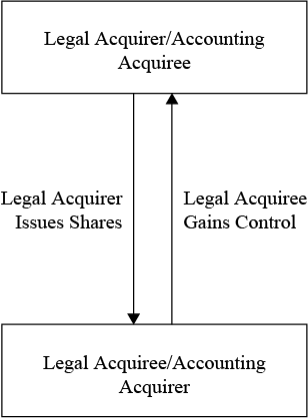

# 29 - Business combinations (IFRS 3)

[返回目录](README.md)

# 29 - Business combinations (IFRS 3)

Contents

- [29 - Business combinations (IFRS 3)](50.md#s206-chap_29_toc_h1)

- [Introduction and scope (paras 29.1- 29.44)](50.md#s207-chap_29_navPoint_1)

- [Scope](50.md#s207-chap_29_navPoint_2)

- [Definition of a business (paras 29.6 - 29.19)](50.md#s207-chap_29_navPoint_3)

- [Distinguishing a business from an asset or a group of assets](50.md#s207-chap_29_navPoint_idm506018328)

- [Identifying a business combination (paras 29.20 - 29.26)](50.md#s207-chap_29_navPoint_4)

- [Stapling transactions and dual-listed entities](50.md#s207-chap_29_navPoint_idm505241752)

- [Merger of equals, mutual enterprises, and ‘roll-up’ or ‘put-together’ transactions](50.md#s207-chap_29_navPoint_idm505227912)

- [Multiple transactions that result in the acquisition of a business](50.md#s207-chap_29_navPoint_idm505236616)

- [The acquisition method](50.md#s207-chap_29_navPoint_idm505195592)

- [Identifying the acquirer (paras 29.27 - 29.44)](50.md#s207-chap_29_navPoint_5)

- [Business combinations achieved without consideration transferred](50.md#s207-chap_29_navPoint_idm505134488)

- [Reverse acquisitions](50.md#s207-chap_29_navPoint_idm505111656)

- [New entity formed to effect a business combination](50.md#s207-chap_29_navPoint_idm505097576)

- [New entity formed to acquire an existing group](50.md#s207-chap_29_navPoint_idm505090152)

- [Determining the acquisition date](50.md#s207-chap_29_navPoint_idm505044984)

- [Recognising and measuring consideration transferred (paras 29.45 - 29.87)](50.md#s208-chap_29_navPoint_6)

- [Deferred consideration](50.md#s208-chap_29_navPoint_7)

- [Employee compensation arrangements](50.md#s208-chap_29_navPoint_8)

- [Share-based payment awards](50.md#s208-chap_29_navPoint_9)

- [Estimates of vesting expectations](50.md#s208-chap_29_navPoint_idm504530056)

- [Tax](50.md#s208-chap_29_navPoint_idm502002968)

- [Consideration transferred in a reverse acquisition](50.md#s208-chap_29_navPoint_10)

- [Contingent consideration](50.md#s208-chap_29_navPoint_11)

- [Contingent consideration arrangements requiring continued employment](50.md#s208-chap_29_navPoint_12)

- [Measurement of consideration](50.md#s208-chap_29_navPoint_13)

- [Measurement of share-based payment awards](50.md#s208-chap_29_navPoint_14)

- [Measurement of consideration that includes other assets and liabilities of the acquirer](50.md#s208-chap_29_navPoint_15)

- [Measurement of equity interests issued](50.md#s208-chap_29_navPoint_16)

- [No consideration transferred](50.md#s208-chap_29_navPoint_17)

- [Classification of consideration](50.md#s208-chap_29_navPoint_18)

- [Classification of deferred consideration](50.md#s208-chap_29_navPoint_idm501909144)

- [Classification of contingent consideration](50.md#s208-chap_29_navPoint_19)

- [Classification of contingent consideration – seller accounting](50.md#s208-chap_29_navPoint_20)

- [Recognising and measuring identifiable assets acquired, liabilities assumed and non-controlling interest (paras 29.88- 29.167)](50.md#s209-chap_29_navPoint_21)

- [General recognition principle](50.md#s209-chap_29_navPoint_22)

- [Classifying or designating identifiable assets and liabilities](50.md#s209-chap_29_navPoint_23)

- [General measurement principle](50.md#s209-chap_29_navPoint_24)

- [Application of measurement requirements](50.md#s209-chap_29_navPoint_25)

- [Assets that the acquirer does not intend to use](50.md#s209-chap_29_navPoint_idm502582664)

- [Asset valuation allowances](50.md#s209-chap_29_navPoint_idm502573320)

- [Contracts](50.md#s209-chap_29_navPoint_idm502563592)

- [Onerous contracts](50.md#s209-chap_29_navPoint_idm502559240)

- [Intangible assets](50.md#s209-chap_29_navPoint_idm502545544)

- [Valuation and useful life](50.md#s209-chap_29_navPoint_idm502527624)

- [Re-acquired rights](50.md#s209-chap_29_navPoint_idm502516232)

- [Determining useful life of re-acquired rights](50.md#s209-chap_29_navPoint_idm502642824)

- [Property, plant and equipment](50.md#s209-chap_29_navPoint_26)

- [Inventory](50.md#s209-chap_29_navPoint_27)

- [Income taxes](50.md#s209-chap_29_navPoint_28)

- [Deferred tax assets relating to losses carried forward](50.md#s209-chap_29_navPoint_idm500063752)

- [Goodwill](50.md#s209-chap_29_navPoint_idm500055432)

- [Assets held for sale](50.md#s209-chap_29_navPoint_29)

- [Employee benefit plans](50.md#s209-chap_29_navPoint_30)

- [Regulatory deferral account balances](50.md#s209-chap_29_navPoint_31)

- [Financial instruments](50.md#s209-chap_29_navPoint_32)

- [Contingent liabilities](50.md#s209-chap_29_navPoint_33)

- [Indemnification assets](50.md#s209-chap_29_navPoint_34)

- [Recognition of liabilities related to restructurings or exit activities](50.md#s209-chap_29_navPoint_35)

- [Deferred or unearned revenue](50.md#s209-chap_29_navPoint_36)

- [Leases in which the acquiree is the lessee](50.md#s209-chap_29_navPoint_37)

- [Leases in which the acquiree is the lessor](50.md#s209-chap_29_navPoint_38)

- [Share-based payments](50.md#s209-chap_29_navPoint_39)

- [Non-controlling interest](50.md#s209-chap_29_navPoint_40)

- [Measurement of non-controlling interests](50.md#s209-chap_29_navPoint_idm505412264)

- [Determining the impact of control on the non-controlling interest](50.md#s209-chap_29_navPoint_idm505403304)

- [Calls and puts related to non-controlling interest](50.md#s209-chap_29_navPoint_idm505395880)

- [Non-controlling interest in a reverse acquisition](50.md#s209-chap_29_navPoint_idm501146584)

- [Business combinations achieved without consideration transferred](50.md#s209-chap_29_navPoint_idm501140056)

- [Business combinations achieved in stages](50.md#s209-chap_29_navPoint_41)

- [Recognising and measuring goodwill or a gain from a bargain purchase (paras 29.168-29.182)](50.md#s210-chap_29_navPoint_42)

- [Goodwill](50.md#s210-chap_29_navPoint_43)

- [Bargain purchase](50.md#s210-chap_29_navPoint_44)

- [Measurement period adjustments](50.md#s210-chap_29_navPoint_45)

- [Assessing what is part of a business combination transaction (paras 29.183-29.203)](50.md#s211-chap_29_navPoint_46)

- [Settlement of pre-existing relationships between the acquirer and the acquiree](50.md#s211-chap_29_navPoint_47)

- [Calculating the gain or loss on settlement of pre-existing relationships](50.md#s211-chap_29_navPoint_idm500549720)

- [Pre-existing relationships and re-acquired rights](50.md#s211-chap_29_navPoint_48)

- [Non-compete agreements](50.md#s211-chap_29_navPoint_49)

- [Employee compensation arrangements](50.md#s211-chap_29_navPoint_50)

- [Share-based payment awards](50.md#s211-chap_29_navPoint_51)

- [Acquisition-related costs](50.md#s211-chap_29_navPoint_52)

- [Reimbursement provided to the acquiree or former owners for paying the acquirer’s acquisition costs](50.md#s211-chap_29_navPoint_idm501864456)

- [Financial instruments entered into by the acquirer in contemplation of a business combination](50.md#s211-chap_29_navPoint_53)

- [Repayment of acquiree’s debt at the time of a business combination](50.md#s211-chap_29_navPoint_54)

- [Exceptions to general measurement principle (paras 29.204-29.211)](50.md#s212-chap_29_navPoint_55)

- [Re-acquired rights](50.md#s212-chap_29_navPoint_56)

- [Income taxes](50.md#s212-chap_29_navPoint_57)

- [Assets held for sale](50.md#s212-chap_29_navPoint_58)

- [Employee benefit plans](50.md#s212-chap_29_navPoint_59)

- [Regulatory deferral account balances](50.md#s212-chap_29_navPoint_60)

- [Indemnification asset](50.md#s212-chap_29_navPoint_61)

- [Subsequent measurement and accounting (paras 29.212 - 29.228)](50.md#s213-chap_29_navPoint_62)

- [Re-acquired rights](50.md#s213-chap_29_navPoint_63)

- [Income taxes](50.md#s213-chap_29_navPoint_64)

- [Contingent liabilities](50.md#s213-chap_29_navPoint_65)

- [Indemnification assets](50.md#s213-chap_29_navPoint_66)

- [Contingent consideration](50.md#s213-chap_29_navPoint_67)

- [Share-based payment awards](50.md#s213-chap_29_navPoint_68)

- [Assets subject to operating lease where the acquiree is the lessor](50.md#s213-chap_29_navPoint_69)

- [Presentation and disclosure (paras 29.229 - 29.248)](50.md#s214-chap_29_navPoint_70)

- [Reverse acquisition – presentation of consolidated financial statements](50.md#s214-chap_29_navPoint_71)

- [Earnings per share](50.md#s214-chap_29_navPoint_72)

- [First-time adoption of IFRS](50.md#s214-chap_29_navPoint_73)

- [Disclosure](50.md#s214-chap_29_navPoint_74)

- [Step acquisitions](50.md#s214-chap_29_navPoint_75)

- [Provisional amounts used in initial business combination accounting](50.md#s214-chap_29_navPoint_76)

- [Cash flow statement presentation and disclosure](50.md#s214-chap_29_navPoint_77)

- [Income statement presentation and disclosure](50.md#s214-chap_29_navPoint_78)

- [Post-balance sheet business combinations](50.md#s214-chap_29_navPoint_79)

- [Asset acquisitions](50.md#s214-chap_29_navPoint_80)

- [Effective date and transition](50.md#s214-chap_29_navPoint_81)

- [Illustrative text](51.md#s215-chap_29_navPoint_82)

- [Scope](51.md#s215-chap_29_navPoint_83)

- [FAQ 29.5.1 – Which transactions are excluded from the scope of IFRS 3?](51.md#s215-chap_29_navPoint_idm500525144)

- [FAQ 29.5.2 – What is the process to apply in order to determine the appropriate accounting for a business combination?](51.md#s215-chap_29_navPoint_idm500483288)

- [Definition of a business](51.md#s215-chap_29_navPoint_84)

- [FAQ 29.6.1 – What is the definition of a business ‘framework’ for evaluating whether a set of assets should be accounted for as an acquisition of a business or a group of assets?](51.md#s215-chap_29_navPoint_idm505506168)

- [Distinguishing a business from an asset or a group of assets](51.md#s215-chap_29_navPoint_idm505592584)

- [FAQ_29.19.1 – How should an entity evaluate whether an acquired set is a business or a group of assets?](51.md#s215-chap_29_navPoint_idm505591432)

- [EX_29.19.2 – Pharmaceutical industry: acquisition of a Biotech entity](51.md#s215-chap_29_navPoint_idm505572616)

- [EX_29.19.3 – Real estate industry](51.md#s215-chap_29_navPoint_idm505613064)

- [Identifying a business combination](51.md#s215-chap_29_navPoint_85)

- [EX 29.21.1 – Share repurchase by investee](51.md#s215-chap_29_navPoint_idm505276680)

- [EX 29.21.2 – Change in the rights of other shareholders](51.md#s215-chap_29_navPoint_idm500817736)

- [EX 29.21.3 – Contracts or other arrangements](51.md#s215-chap_29_navPoint_idm500806472)

- [EX 29.21.4 – Exchange of assets resulting in acquisition of a business](51.md#s215-chap_29_navPoint_idm500794824)

- [Stapling transactions and dual-listed entities](51.md#s215-chap_29_navPoint_idm500781384)

- [FAQ_29.23.1 – Are stapling transactions and the formation of dual-listed entities considered business combinations?](51.md#s215-chap_29_navPoint_idm500786120)

- [Merger of equals, mutual enterprises, and ‘roll-up’ or ‘put-together’ transactions](51.md#s215-chap_29_navPoint_idm500767304)

- [FAQ_29.24.1 – Are the merger of equals, mutual enterprises, and ‘roll-up’ or ‘put-together’ transactions considered business combinations?](51.md#s215-chap_29_navPoint_idm500766792)

- [Multiple transactions that result in the acquisition of a business](51.md#s215-chap_29_navPoint_idm500761800)

- [EX_29.25.1 – Effecting a business combination through a series of linked transactions](51.md#s215-chap_29_navPoint_idm500752120)

- [The acquisition method](51.md#s215-chap_29_navPoint_86)

- [Identifying the acquirer](51.md#s215-chap_29_navPoint_87)

- [FAQ 29.32.1 – How might the acquirer be identified in a stapling arrangement?](51.md#s215-chap_29_navPoint_idm500744824)

- [FAQ 29.35.1 – What other considerations can be used in identifying the acquirer?](51.md#s215-chap_29_navPoint_idm500727544)

- [FAQ 29.37.1 – Is the acquisition of an established private entity by a small listed entity an example of a reverse acquisition?](51.md#s215-chap_29_navPoint_idm500719096)

- [New entity formed to effect a business combination](51.md#s215-chap_29_navPoint_idm500697464)

- [EX_29.39.1 – New entity formed to effect a business combination](51.md#s215-chap_29_navPoint_idm500699256)

- [EX_29.39.2 – Identifying the acquirer through domination of key management](51.md#s215-chap_29_navPoint_idm500673016)

- [EX_29.40.1 – New company set up by venture capital entity to acquire business](51.md#s215-chap_29_navPoint_idm500659064)

- [EX_29.40.2 – New company is not the acquirer](51.md#s215-chap_29_navPoint_idm502740664)

- [New entity formed to acquire an existing group](51.md#s215-chap_29_navPoint_idm502717752)

- [EX_29.41.1 – New entity formed to acquire an existing group](51.md#s215-chap_29_navPoint_idm502721848)

- [Determining the acquisition date](51.md#s215-chap_29_navPoint_88)

- [EX 29.43.1 – Determining the date when control passes: not the date of agreement](51.md#s215-chap_29_navPoint_idm502704696)

- [FAQ 29.43.2 – How should a company determine the acquisition date where no consideration is transferred?](51.md#s215-chap_29_navPoint_idm502687672)

- [Consideration](51.md#s215-chap_29_navPoint_89)

- [EX 29.45.1 – Post-combination dividend treated as part of purchase consideration](51.md#s215-chap_29_navPoint_idm502669496)

- [Employee compensation arrangements](51.md#s215-chap_29_navPoint_idm502662584)

- [FAQ_29.48.1 – How should a company assess employee compensation arrangements in a business combination?](51.md#s215-chap_29_navPoint_idm502660792)

- [Share-based payment awards](51.md#s215-chap_29_navPoint_idm502647352)

- [FAQ_29.54.1 – What is the rationale behind allocating a replaced award?](51.md#s215-chap_29_navPoint_idm502648632)

- [EX_29.54.2 – Vesting period completed before combination, and additional employee services not required](51.md#s215-chap_29_navPoint_idm502630584)

- [EX_29.54.3 – Vesting period completed before combination, and additional employee services required](51.md#s215-chap_29_navPoint_idm502336552)

- [EX_29.54.4 – Vesting period not completed before combination, and additional employee services required](51.md#s215-chap_29_navPoint_idm502298152)

- [EX_29.54.5 – Vesting period not completed before combination, and additional employee services not required](51.md#s215-chap_29_navPoint_idm502263976)

- [EX_29.54.6 – Acquirer extends vesting period, and awards have incremental fair value](51.md#s215-chap_29_navPoint_idm502231720)

- [EX_29.55.1 – Acquirer has no obligation to replace awards, and award continues unchanged](51.md#s215-chap_29_navPoint_idm502223384)

- [FAQ_29.55.2 – Acquirer has no obligation to replace awards?](51.md#s215-chap_29_navPoint_idm502205336)

- [Cash settlement of the acquiree’s share-based payment award](51.md#s215-chap_29_navPoint_idm502194200)

- [FAQ_29.56.1 – How should a company account for cash settlement of the acquiree’s share-based payment awards that is initiated by the acquirer?](51.md#s215-chap_29_navPoint_idm502189464)

- [EX_29.56.2 – Acquirer extends vesting period and settles in cash](51.md#s215-chap_29_navPoint_idm502168216)

- [FAQ_29.56.3 – How should a company account for cash settlement of the acquiree’s share-based payment awards that is initiated by the acquiree?](51.md#s215-chap_29_navPoint_idm502152728)

- [EX_29.56.4 – Apparent cash settlement of awards by the acquiree](51.md#s215-chap_29_navPoint_idm502135192)

- [Tax on share-based payment awards](51.md#s215-chap_29_navPoint_idm502108184)

- [EX_29.59.1 – Income tax accounting for share-based payment awards](51.md#s215-chap_29_navPoint_idm502111640)

- [Consideration transferred in a reverse acquisition](51.md#s215-chap_29_navPoint_idm500212376)

- [EX_29.61.1 – Consideration in a reverse acquisition](51.md#s215-chap_29_navPoint_idm500213272)

- [Contingent consideration](51.md#s215-chap_29_navPoint_idm500182296)

- [FAQ_29.63.1 – What challenges might a company face when accounting for contingent consideration?](51.md#s215-chap_29_navPoint_idm500187416)

- [Measurement of consideration](51.md#s215-chap_29_navPoint_idm500166808)

- [EX_29.67.1 – Interest-free loan treated as deferred consideration](51.md#s215-chap_29_navPoint_idm500168088)

- [FAQ_29.68.1 – What should a company consider when measuring contingent consideration ?](51.md#s215-chap_29_navPoint_idm500157592)

- [Consideration transferred includes other assets and liabilities of the acquirer](51.md#s215-chap_29_navPoint_idm500141592)

- [EX_29.73.1 – Business combination with non-monetary purchase consideration](51.md#s215-chap_29_navPoint_idm500141336)

- [FAQ_29.73.2 – How should a company account for an acquisition of a controlling interest for shares in another entity?](51.md#s215-chap_29_navPoint_idm500104600)

- [Classification of contingent consideration](51.md#s215-chap_29_navPoint_idm500099608)

- [FAQ_29.82.1 – How should a company determine the classification of a contingent consideration arrangement that includes more than one performance target?](51.md#s215-chap_29_navPoint_idm500094616)

- [FAQ_29.86.1 – What is the framework used to determine the classification of contingent consideration arrangements?](51.md#s215-chap_29_navPoint_idm500080920)

- [EX_29.86.2 – Contingent consideration payable in cash as a financial liability](51.md#s215-chap_29_navPoint_idm500068888)

- [EX_29.86.3 – Contingent consideration paid in a fixed number of shares as equity](51.md#s215-chap_29_navPoint_idm500053272)

- [EX_29.86.4 – Contingent consideration paid in a variable number of shares as a financial liability](51.md#s215-chap_29_navPoint_idm500046232)

- [EX_29.86.5 – Contingent consideration paid in a variable number of shares as equity](51.md#s215-chap_29_navPoint_idm500031512)

- [EX_29.86.6 – Arrangement is an indemnity and not contingent consideration](51.md#s215-chap_29_navPoint_idm500022424)

- [EX_29.86.7 – Escrow arrangements](51.md#s215-chap_29_navPoint_idm500011160)

- [EX_29.86.8 – Working capital adjustments](51.md#s215-chap_29_navPoint_idm499995032)

- [EX_29.86.9 – Adjustments to consideration based on outcome of a general contingency or lawsuit](51.md#s215-chap_29_navPoint_idm499983896)

- [EX_29.86.10 – Contingent consideration of the acquiree](51.md#s215-chap_29_navPoint_idm501346968)

- [EX_29.86.11 – Contingent consideration arrangement linked to the acquisition-date fair value](51.md#s215-chap_29_navPoint_idm501336856)

- [Recognising and measuring identifiable assets acquired, liabilities assumed and non-controlling interest](51.md#s215-chap_29_navPoint_90)

- [General recognition principle](51.md#s215-chap_29_navPoint_idm501323544)

- [FAQ_29.93.1 – Do potential contracts meet the definition of an asset?](51.md#s215-chap_29_navPoint_idm501320088)

- [FAQ_29.94.1 – Do contingent assets meet the definition of an asset?](51.md#s215-chap_29_navPoint_idm501310360)

- [FAQ_29.96.1 – What are examples of assets and liabilities identified in an acquisition that were not identified before the acquisition?](51.md#s215-chap_29_navPoint_idm501293592)

- [FAQ_29.96.2 – What are examples of assets and liabilities of an acquiree that are not recognised by the acquirer?](51.md#s215-chap_29_navPoint_idm501277976)

- [Classifying or designating identifiable assets and liabilities](51.md#s215-chap_29_navPoint_idm501273752)

- [FAQ_29.98.1 – What are examples of where a classification, designation or assessment decision is required?](51.md#s215-chap_29_navPoint_idm501265944)

- [EX_29.99.1 – Hedge accounting](51.md#s215-chap_29_navPoint_idm501242648)

- [Measurement](51.md#s215-chap_29_navPoint_91)

- [Practical application of measurement requirements](51.md#s215-chap_29_navPoint_idm501220120)

- [Assets that the acquirer does not intend to use](51.md#s215-chap_29_navPoint_idm501225624)

- [EX 29.103.1 – Post-combination change of use does not impact fair value at acquisition date](51.md#s215-chap_29_navPoint_idm501214488)

- [EX 29.103.2 – Fair values not affected by the acquirer’s intentions: intangible assets that the acquirer does not intend to use](51.md#s215-chap_29_navPoint_idm501202712)

- [Asset valuation allowances](51.md#s215-chap_29_navPoint_idm501189144)

- [FAQ 29.104.1 – How should a company account for loss allowances relating to financial assets at the first reporting date under IFRS 9?](51.md#s215-chap_29_navPoint_idm501190936)

- [Contracts](51.md#s215-chap_29_navPoint_idm501171480)

- [EX 29.105.1 – Favourable and unfavourable purchase contracts](51.md#s215-chap_29_navPoint_idm501171224)

- [Onerous contracts](51.md#s215-chap_29_navPoint_idm501153560)

- [EX 29.108.1 – Measurement of onerous contracts](51.md#s215-chap_29_navPoint_idm501147032)

- [Intangible assets](51.md#s215-chap_29_navPoint_idm501124248)

- [EX 29.111.1 – Intangible assets that are not separable](51.md#s215-chap_29_navPoint_idm501123992)

- [EX 29.112.1 – Intangible asset that is separable only with another asset](51.md#s215-chap_29_navPoint_idm501110552)

- [EX 29.112.2 – Identifying intangible assets in media and telecommunications](51.md#s215-chap_29_navPoint_idm501092248)

- [EX 29.112.3 – The acquirer’s in-process research and development](51.md#s215-chap_29_navPoint_idm495909048)

- [Re-acquired rights](51.md#s215-chap_29_navPoint_idm495893304)

- [FAQ 29.118.1 – How should an acquirer determine the useful life of a re-acquired right?](51.md#s215-chap_29_navPoint_idm495890616)

- [Property, plant and equipment](51.md#s215-chap_29_navPoint_idm495878584)

- [FAQ 29.119.1 – How should an acquirer determine the valuation of property, plant and equipment acquired in a business combination?](51.md#s215-chap_29_navPoint_idm495874488)

- [FAQ 29.119.2 – How should an acquirer determine the valuation of assets acquired that were previously purchased by the acquiree with funding from a government grant?](51.md#s215-chap_29_navPoint_idm495861432)

- [EX 29.119.3 – Decommissioning and site restoration costs](51.md#s215-chap_29_navPoint_idm495851192)

- [Inventory](51.md#s215-chap_29_navPoint_idm495841080)

- [EX 29.120.1 – Inventory](51.md#s215-chap_29_navPoint_idm495840440)

- [EX 29.120.2 – Long-term construction contracts: adjusting work-in-progress to fair value](51.md#s215-chap_29_navPoint_idm495815864)

- [Income taxes](51.md#s215-chap_29_navPoint_idm495779256)

- [EX 29.127.1 – Effect of reduction in the temporary difference where the deferred tax liability was not recognised](51.md#s215-chap_29_navPoint_idm495773240)

- [EX 29.129.1 – Temporary difference arising after the date of the business combination](51.md#s215-chap_29_navPoint_idm495768248)

- [Employee benefit plans](51.md#s215-chap_29_navPoint_idm495746744)

- [EX 29.138.1 – Recognising post-retirement benefits](51.md#s215-chap_29_navPoint_idm495747896)

- [FAQ 29.138.2 – How should an acquirer account for the modification of an acquiree\'s pension plans?](51.md#s215-chap_29_navPoint_idm495731256)

- [Financial instruments](51.md#s215-chap_29_navPoint_idm495714104)

- [EX 29.143.1 – New evidence of fair value at acquisition date](51.md#s215-chap_29_navPoint_idm495714488)

- [Contingent liabilities](51.md#s215-chap_29_navPoint_idm495706296)

- [FAQ 29.145.1 – What are the recognition requirements for contingent liabilities within and outside a business combination?](51.md#s215-chap_29_navPoint_idm495698232)

- [EX 29.145.2 – Provision for litigation at acquisition date](51.md#s215-chap_29_navPoint_idm495679800)

- [Indemnification assets](51.md#s215-chap_29_navPoint_idm495927480)

- [FAQ 29.147.1 – Does an indemnification arrangement need to be specified in the acquisition agreement to achieve indemnification accounting?](51.md#s215-chap_29_navPoint_idm495934136)

- [EX 29.148.1 – Indemnified liability measured at fair value](51.md#s215-chap_29_navPoint_idm495660328)

- [EX 29.148.2 – Indemnified liability not recognised](51.md#s215-chap_29_navPoint_idm495645608)

- [FAQ 29.148.3 – How should an acquirer account for an indemnified liability arising from an insurance contract?](51.md#s215-chap_29_navPoint_idm495629736)

- [Recognition of liabilities related to restructuring or exit activities](51.md#s215-chap_29_navPoint_idm495617448)

- [EX 29.149.1 – Recognition of restructurings or exit activities](51.md#s215-chap_29_navPoint_idm495618600)

- [EX 29.149.2 – Redundancy costs](51.md#s215-chap_29_navPoint_idm495605928)

- [FAQ 29.149.3 – How should a company account for contractual payments that the acquiree is required to make on a business combination?](51.md#s215-chap_29_navPoint_idm495593512)

- [EX 29.149.4 - Restructuring costs incurred after acquisition](51.md#s215-chap_29_navPoint_idm495574952)

- [Deferred or unearned revenue](51.md#s215-chap_29_navPoint_idm495567784)

- [EX 29.150.1 – Deferred revenue](51.md#s215-chap_29_navPoint_idm495573416)

- [Leases in which the acquiree is the lessee](51.md#s215-chap_29_navPoint_idm495552040)

- [EX 29.153.1 – Property lease in which the acquiree is the lessee under IFRS 16](51.md#s215-chap_29_navPoint_idm495555496)

- [Leases in which the acquiree is the lessor](51.md#s215-chap_29_navPoint_idm495535784)

- [FAQ 29.154.1 – How should an acquirer account for the classification of a lease contract in which the acquiree is the lessor in a finance or an operating lease under IFRS 16?](51.md#s215-chap_29_navPoint_idm495537832)

- [EX 29.156.1 – Recognition of deferred rent receivable](51.md#s215-chap_29_navPoint_idm495531176)

- [FAQ 29.156.2 – How should the acquirer account for leases in which the acquiree is the lessor under IFRS 16?](51.md#s215-chap_29_navPoint_idm495501096)

- [Non-controlling interest](51.md#s215-chap_29_navPoint_idm495498664)

- [FAQ_29.159.1 – How should an acquirer measure non-controlling interest?](51.md#s215-chap_29_navPoint_idm495499944)

- [EX_29.159.2 – Measurement of non-controlling interest in a business combination including preference shares](52.md#s216-chap_29_navPoint_idm495467432)

- [Determining the impact of control on the non-controlling interest](52.md#s216-chap_29_navPoint_idm495452840)

- [FAQ 29.161.1 – What is the impact of control on the measurement of non-controlling interest?](52.md#s216-chap_29_navPoint_idm495455528)

- [Calls and puts related to non-controlling interest](52.md#s216-chap_29_navPoint_idm495438504)

- [EX 29.162.1 – Legal obligation to launch a takeover bid](52.md#s216-chap_29_navPoint_idm495441448)

- [Non-controlling interest in a reverse acquisition](52.md#s216-chap_29_navPoint_idm495422760)

- [EX 29.164.1 – Reverse acquisition with a non-controlling interest](52.md#s216-chap_29_navPoint_idm495425064)

- [Business combinations achieved without consideration transferred](52.md#s216-chap_29_navPoint_idm495404840)

- [EX 29.165.1 – Measurement of non-controlling interest in a business combination achieved by contract alone](52.md#s216-chap_29_navPoint_idm495403048)

- [Business combinations achieved in stages](52.md#s216-chap_29_navPoint_92)

- [FAQ 29.167.1 – How should an acquirer accounting for step acquisitions?](52.md#s216-chap_29_navPoint_idm499870040)

- [EX 29.167.2 – Control obtained in step acquisition](52.md#s216-chap_29_navPoint_idm499860824)

- [Recognising and measuring goodwill or a gain from a bargain purchase](52.md#s216-chap_29_navPoint_93)

- [Goodwill](52.md#s216-chap_29_navPoint_idm499772760)

- [EX_29.171.1 – Components making up goodwill](52.md#s216-chap_29_navPoint_idm499762136)

- [EX_29.173.1 – Goodwill recognised depends on how non-controlling interest is measured](52.md#s216-chap_29_navPoint_idm499757016)

- [EX_29.173.2 – Gain on a bargain purchase depends on how non-controlling interest is measured](52.md#s216-chap_29_navPoint_idm499690712)

- [Bargain purchase](52.md#s216-chap_29_navPoint_idm499456024)

- [FAQ_29.176.1 – What should an acquirer do prior to recognising a gain on a bargain purchase?](52.md#s216-chap_29_navPoint_idm499453336)

- [Measurement period adjustments](52.md#s216-chap_29_navPoint_94)

- [EX 29.180.1 – Offsetting adjustments to goodwill](52.md#s216-chap_29_navPoint_idm499440408)

- [EX 29.182.1 – Measurement period adjustment](52.md#s216-chap_29_navPoint_idm499435160)

- [Assessing what is part of a business combination transaction](52.md#s216-chap_29_navPoint_95)

- [Settlement of pre-existing relationships between the acquirer and the acquiree](52.md#s216-chap_29_navPoint_idm499417240)

- [Calculating the gain or loss on settlement of pre-existing relationships](52.md#s216-chap_29_navPoint_idm499408536)

- [FAQ 29.190.1 – How should an acquirer calculate the gain or loss on settlement of a pre-existing relationship?](52.md#s216-chap_29_navPoint_idm499406616)

- [EX 29.191.1 – Settlement of pre-existing debtor/creditor relationship between acquirer and acquiree](52.md#s216-chap_29_navPoint_idm499403672)

- [EX 29.191.2 – Settlement loss with a liability previously recorded on a non-contractual relationship](52.md#s216-chap_29_navPoint_idm499368216)

- [EX 29.191.3 – Settlement loss on a contractual relationship](52.md#s216-chap_29_navPoint_idm499329560)

- [Pre-existing relationships and re-acquired rights](52.md#s216-chap_29_navPoint_idm499291544)

- [EX 29.192.1 – Settlement of pre-existing relationship involving re-acquired rights](52.md#s216-chap_29_navPoint_idm499296536)

- [Non-compete agreements](52.md#s216-chap_29_navPoint_idm499265688)

- [FAQ_29.193.1 – How should an acquirer account for non-compete agreements?](52.md#s216-chap_29_navPoint_idm499267992)

- [Employee compensation arrangements](52.md#s216-chap_29_navPoint_idm499117080)

- [EX_29.196.1 – Contingent consideration arrangement forfeited on termination of employment](52.md#s216-chap_29_navPoint_idm499116696)

- [EX_29.196.2 – Contingent consideration arrangement with no link to continuing services](52.md#s216-chap_29_navPoint_idm499098776)

- [EX_29.196.3 – Cash distributed among multiple shareholders linked to employee retention](52.md#s216-chap_29_navPoint_idm499077656)

- [EX_29.196.4 – Golden parachute and stay bonus arrangements](52.md#s216-chap_29_navPoint_idm499063960)

- [FAQ_29.198.1 – How should an acquirer recognise fees paid to an investment banker to provide advisory services and also handle the financing of a business combination?](52.md#s216-chap_29_navPoint_idm499028888)

- [EX_29.200.1 – Accounting for assumed liabilities for transaction costs incurred by the seller in connection with a business combination](52.md#s216-chap_29_navPoint_idm499018904)

- [Financial instruments entered into by the acquirer in contemplation of a business combination](52.md#s216-chap_29_navPoint_idm499004824)

- [FAQ_29.202.1 – What should an acquirer consider in the application of hedge accounting?](52.md#s216-chap_29_navPoint_idm499008664)

- [Repayment of acquiree’s debt at the time of a business combination](52.md#s216-chap_29_navPoint_idm498990872)

- [EX_29.203.1 – Settlement of debt between acquirer and acquiree](52.md#s216-chap_29_navPoint_idm498990488)

- [EX_29.203.2 – Repayment of acquiree’s bank debt at the time of a business combination](52.md#s216-chap_29_navPoint_idm498976280)

- [Exceptions to general measurement principle](52.md#s216-chap_29_navPoint_96)

- [Indemnification asset](52.md#s216-chap_29_navPoint_idm498949400)

- [EX_29.211.1 – Indemnified liability not measured at fair value](52.md#s216-chap_29_navPoint_idm498950808)

- [Subsequent measurement and accounting](52.md#s216-chap_29_navPoint_97)

- [Income taxes](52.md#s216-chap_29_navPoint_idm498931352)

- [EX_29.214.1 – Deferred tax asset crystallises after acquisition](52.md#s216-chap_29_navPoint_idm498932248)

- [Indemnification assets](52.md#s216-chap_29_navPoint_idm498926744)

- [FAQ_29.217.1 – How should an acquirer subsequently account for and measure indemnification assets recognised in a business combination?](52.md#s216-chap_29_navPoint_idm498925848)

- [Contingent consideration](52.md#s216-chap_29_navPoint_idm498899736)

- [FAQ_29.223.1 – How should an acquirer account for changes in the fair value of contingent consideration?](52.md#s216-chap_29_navPoint_idm498899224)

- [Reverse acquisitions](52.md#s216-chap_29_navPoint_98)

- [EX 29.229.1 – Reverse acquisition accounting](52.md#s216-chap_29_navPoint_idm498882968)

- [FAQ 29.229.2 – How should comparative information be presented in reverse acquisition accounting?](52.md#s216-chap_29_navPoint_idm495092520)

- [EX 29.229.3 – Earnings per share in a reverse acquisition](52.md#s216-chap_29_navPoint_idm495075240)

- [Disclosure](52.md#s216-chap_29_navPoint_99)

- [Annualised figures](52.md#s216-chap_29_navPoint_idm494997928)

- [FAQ_29.237.1 – What is the guidance on preparation of pro forma information?](52.md#s216-chap_29_navPoint_idm494996648)

- [Cash flow statement presentation and disclosure](52.md#s216-chap_29_navPoint_idm494966440)

- [FAQ_29.242.1 – In a business combination, what are the cash flow presentation and disclosure requirements?](52.md#s216-chap_29_navPoint_idm494962088)

- [Income statement presentation and disclosure](52.md#s216-chap_29_navPoint_idm495219752)

- [FAQ_29.244.1 – In a business combination, what are the income statement presentation and disclosure requirements?](52.md#s216-chap_29_navPoint_idm495215016)

- [Comparative information](52.md#s216-chap_29_navPoint_idm494901784)

- [FAQ_29.244.2 – In a business combination, what are the requirements for disclosure of comparative information?](52.md#s216-chap_29_navPoint_idm494904728)

- [Gains and losses in the period of acquisition and subsequent periods](52.md#s216-chap_29_navPoint_idm494885016)

- [FAQ_29.244.3 – What are the requirements for disclosure of post-combination gains and losses?](52.md#s216-chap_29_navPoint_idm494888600)

- [Asset acquisitions](52.md#s216-chap_29_navPoint_100)

- [FAQ 29.247.1 – How should a company determine the cost of an asset acquisition?](52.md#s216-chap_29_navPoint_idm494870680)

- [EX 29.247.2 – Measurement of an asset acquisition](52.md#s216-chap_29_navPoint_idm494850456)

- [FAQ 29.247.3 – What are the more common differences in accounting between a business combination and an asset acquisition?](52.md#s216-chap_29_navPoint_idm494824088)

This eBook is licensed to peggy so, peggy.so@hk.ey.com, 

## Introduction and scope (paras 29.1- 29.44)

 

**29.1**This chapter addresses the IFRS requirements for business combinations, as follows:

- Definition of a business.

- Recognition and measurement of the identifiable assets acquired, the liabilities assumed and any non-controlling interest in the acquiree.

- Recognition and measurement of the goodwill or a gain from a bargain purchase.

- Items excluded from a business combination.

- Subsequent measurement and accounting.

- Disclosures.

These requirements are subject to the scope exemptions noted below.

 

### Scope

 

**29.2** A business combination is defined as “a transaction or other event in which an acquirer obtains control of one or more businesses”.

[IFRS 3 App A].

**29.3** Transactions referred to as ‘true mergers’ or ‘mergers of equals’ are also business combinations.

[IFRS 3 App A].

**29.4** All business combinations are accounted for using the acquisition method under IFRS 3, including those described as ‘true mergers’.

[IFRS 3 para 4].

**29.5** The standard does not apply to:

- Acquisition of an asset or group of assets that does not meet the definition of a business ([see FAQ 29.5.1](51.md#s215-FAQ_29.5.1)).

- Formations of a joint arrangement in the financial statements of the joint arrangement itself.

- Combinations of entities or businesses under common control.

- The acquisition by an investment entity of an investment in a subsidiary that is required to be measured at fair value through profit or loss (see [chapter 27 para 3](48.md#s180-Para_27.3)).

For further discussion on the accounting for an asset acquisition versus a business combination, refer to 

[FAQ 29.247.3.](52.md#s216-FAQ_29.247.3)

[IFRS 3 para 2]. [IFRS 3 para 2A].

 

[FAQ 29.5.1 – Which transactions are excluded from the scope of IFRS 3?](51.md#s215-FAQ_29.5.1)

 

[FAQ 29.5.2 – What is the process to apply in order to determine the appropriate accounting for a business combination?](51.md#s215-FAQ_29.5.2)

 

### Definition of a business (paras 29.6 - 29.19)

 

**29.6**A business is defined in IFRS 3 as “an integrated set of activities and assets that is capable of being conducted and managed for the purpose of providing goods or services to customers, generating investment income (such as dividends or interest) or generating other income from ordinary activities”.

[IFRS 3 App A].

[FAQ 29.6.1 – What is the definition of a business 'framework' for evaluating whether a set of assets should be accounted of a business or a group of assets?](51.md#s215-FAQ_29.6.1)

**29.7** The three components of a business are: inputs; processes; and outputs.

[IFRS 3 App B para B7].

**29.8** An input is an economic resource that creates outputs, or has the ability to contribute to the creation of outputs when one or more processes are applied to it. Examples are:

- Non-current assets (including intangible assets or rights to use non-current assets).

- Intellectual property.

- The ability to access necessary materials or rights.

- Employees.

[IFRS 3 App B para B7(a)].

**29.9** A process is a system, standard, protocol, convention or rule that, when it is applied to an input or inputs creates outputs, or has the ability to contribute to the creation of outputs. Examples are:

- Strategic management processes.

- Operational processes.

- Resource management processes.

Processes are usually documented. The intellectual capacity of an organised workforce that has the skill and experience to follow conventions might provide the processes that, when applied to inputs, can create outputs.

[IFRS 3 App B para B7(b)].

**29.10** Inputs and processes that are not used to create outputs are generally not considered significant to the determination of whether the acquired group is a business. For example, whether the acquired group includes or excludes certain administrative or support processes, such as accounting, payroll and other administrative systems, generally will not impact the determination of whether a business exists.

[IFRS 3 App B para B7(b)].

**29.11** Outputs are the result of inputs and processes applied to those inputs that provide goods or services to customers, generate investment income (such as interest or dividends) or generate other income from ordinary activities.

[IFRS 3 App B para B7(c)].

**29.12** A business consists of inputs and processes applied to the inputs that have the ability to contribute to the creation of outputs. 

[IFRS 3 App B para B7].

**29.13** Although businesses usually have outputs, outputs are not required for an integrated set of activities and assets to qualify as a business. Not all inputs and associated processes used by the seller need to be transferred to be considered a business. However, an integrated set of activities and assets must include an input and a substantive process that significantly contribute to the ability to create outputs.

[IFRS 3 App B para B8].

**29.14** An acquirer also considers whether a market participant would be capable of conducting the set of activities and assets as a business. It is not relevant whether the seller actually operated the activities as a business; nor is it relevant whether the acquirer intends to operate the activities as a business. 

[IFRS 3 App B para B11].

**29.15** Nearly all businesses have liabilities as well as assets. However, liabilities do not need to be present for a business to exist. Conversely, a transferred set of assets and activities, including liabilities, might not represent a business.

[IFRS 3 App B para B9].

**29.16** Inputs, processes and outputs will vary by industry, by structure and by stage of the business.

[IFRS 3 App B para B9].

**[The next paragraph is 29.19.]**

 

#### Distinguishing a business from an asset or a group of assets

 

**29.19** [FAQ 29.19.1](51.md#s215-FAQ_29.19.1) provides a summary of the framework for evaluating whether an acquired set is a business or a group of assets. See further discussion on the definition of business in [paragraph 29.6](50.md#s207-Para_29.6), [FAQ 29.6.1](51.md#s215-FAQ_29.6.1), [EX 29.19.2](51.md#s215-EX29.19.2) and [EX 29.19.3](51.md#s215-EX29.19.3).

  
[FAQ 29.19.1 – How should an entity evaluate whether an acquired set is a business or a group of assets?](51.md#s215-FAQ_29.19.1)

[EX 29.19.2 – Pharmaceutical industry: acquisition of a Biotech entity](51.md#s215-EX29.19.2)

[EX 29.19.3 – Real estate industry](51.md#s215-EX29.19.3)

 

### Identifying a business combination (paras 29.20 - 29.26)

 

**29.20** A business combination can be structured in various ways for legal, taxation or other commercial reasons. IFRS 3 applies to business combinations, regardless of the form of the transaction. Possible structures include:

- An acquirer obtains the equity of one or more businesses, such that they become subsidiaries of the acquirer.

- One or more unincorporated businesses are purchased by an acquirer (without becoming its subsidiary), or they are legally merged into the acquirer.

- All combining entities (or their owners) transfer their equity interests or net assets to a newly formed entity.

- A group of former owners of one of the combining entities gains control of the combined entity.

 

[IFRS 3 App B para B6].

 

**29.21** The most common method to execute a business combination is to purchase a controlling interest in shares. This purchase might be in cash, by issuing equity interests, or incurring liabilities (or a combination of these), or without any transfer of consideration. A parent might acquire a subsidiary by other means. The exchange of assets other than cash (non-monetary assets) might result in the acquisition of a business.

[IFRS 3 App B para B5].

[EX 29.21.1 – Share repurchase by investee](51.md#s215-EX29.21.1)

[EX 29.21.2 – Change in the rights of other shareholders](51.md#s215-EX29.21.2)

[EX 29.21.3 – Contracts or other arrangements](51.md#s215-EX29.21.3)

[EX 29.21.4 – Exchange of assets resulting in acquisition of a business](51.md#s215-EX29.21.4)

 

**29.22** Acquisitions of subsidiaries can also arise where a parent sells a subsidiary for shares in another undertaking. This results in that other undertaking becoming a subsidiary of the seller. There is a disposal at the same time as the acquisition, and the accounting for these transactions is addressed in [chapter 30 para 92](53.md#s220-Para_30.92).

 

#### Stapling transactions and dual-listed entities

 

**29.23** A stapling arrangement (that is, one that combines separate entities and businesses by the unification of ownership and voting interests in the combining entities) is a business combination. The formation of dual-listed entities is also a business combination.

[IFRS 3 para 43(c)].

[FAQ 29.23.1 – Are stapling transactions and the formation of dual-listed entities considered business combinations?](51.md#s215-FAQ_29.23.1)

 

#### Merger of equals, mutual enterprises, and ‘roll-up’ or ‘put-together’ transactions

 

**29.24** A merger of equals, in which two entities of approximately equal size combine and share control over the combined entity, is considered a business combination within the scope of IFRS 3. One of the combining entities is deemed to be the acquirer, and it accounts for the transaction using the acquisition method.

[IFRS 3 para BC35].

[FAQ 29.24.1 – Are the merger of equals, mutual enterprises, and ‘roll-up’ or ‘put-together’ transactions considered business combinations?](51.md#s215-FAQ_29.24.1)

 

#### Multiple transactions that result in the acquisition of a business

 

**29.25** A series of linked transactions between the parties might also result in the acquisition of a business. A series of transactions might be used to combine two entities in the most advantageous way.

[IFRS 3 App A].

 

[EX 29.25.1 – Effecting a business combination through a series of linked transactions](51.md#s215-EX29.25.1)

 

#### The acquisition method

**29.26** The acquisition method’s overall principles can be summarised in the following steps:

- Identifying the acquirer (see [para 29.27](50.md#s207-Para_29.27) onwards).

- Determining the acquisition date (see [para 29.42](50.md#s207-Para_29.42) onwards).

- Recognising and measuring the consideration transferred for the acquiree, including any previously held interest, and non-controlling interest on acquisition (see [para 29.45](50.md#s208-Para_29.45) onwards).

- Recognising and measuring the identifiable assets acquired, liabilities assumed and non-controlling interest (see [para 29.88](50.md#s209-Para_29.88) onwards).

- Recognising and measuring goodwill or a gain from a bargain purchase (see [para 29.168](50.md#s210-Para_29.168) onwards).

[IFRS 3 para 5].

### Identifying the acquirer (paras 29.27 - 29.44)

 

**29.27** An acquirer is identified for all business combinations. There can only be one acquirer in a business combination. The acquirer is the combining entity that obtains control of the acquiree, being the other combining business or businesses.

[IFRS 3 para 6].

**29.28** The guidance in IFRS 10 is used to determine which entity is the acquirer in a business combination:

“an investor controls an investee when the investor is exposed, or has rights, to variable returns from its involvement with the investee and has the ability to affect those returns through its power over the investee”.

Control of an entity under IFRS 10 is dealt with in [chapter 26 para 5](45.md#s169-Para_26.5).

[IFRS 10 para 7].

**29.29** There are additional guidance and indicators in IFRS 3 for identifying the acquirer where it is not clear which party is an acquirer. There is no hierarchy of indicators. Certain indicators will be more relevant in certain circumstances but, in general, all relevant indicators are applied to each business combination in order to determine the acquirer.

[IFRS 3 App B para B13].

**29.30** The entity that transfers the cash or other assets, or incurs the liabilities, is generally the acquirer, where the business combination is effected primarily by transferring cash or other assets, or by incurring liabilities. Where the equity of one entity is purchased by another entity, its owners cease their involvement. It is likely that the entity making the payment will control the purchased entity.

[IFRS 3 App B para B14].

**29.31** The acquirer is usually the entity that issues its equity instruments, where the business combination is effected primarily by exchanging equity interests.

[IFRS 3 App B para B15].

**29.32** Other indicators to be considered in identifying the acquirer, where equity interests have been exchanged, are:

- Relative voting rights after the combination – the acquirer is usually the entity whose owners have the majority of voting rights in the combined entity. Entities should look at all of the facts and circumstances, including unusual or special voting arrangements and any options, warrants or convertible instruments (see also [chapter 26 para 75](45.md#s170-Para_26.75) for guidance on potential voting rights in the assessment of control).

- Existence of a large minority voting interest in the combined entity if no other owner (or organised group of owners) has a significant voting interest – the acquirer is usually the owner that holds the largest minority voting interest in the combined entity. For example, a newly combined entity’s ownership includes a single investor with a 40% ownership, while the remaining 60% ownership is held by widely dispersed investors. The single investor that owns the 40% ownership in the combined entity is considered a large minority voting interest.

- The composition of the governing body – the acquirer is generally the party whose owners can elect, appoint or remove the majority of the combined entity’s governing body. This is also an indicator of control under IFRS 10. See [chapter 26 para 51](45.md#s170-Para_26.51).

- The composition of the senior management – the acquirer is often the combining entity whose former management dominates the combined entity.

- The terms of the exchange of equity interests – the acquirer is usually the party that pays more than the pre-combination fair value for the other combining entity.

[IFRS 3 App B para B15].

[FAQ 29.32.1 – How might the acquirer be identified in a stapling arrangement?](51.md#s215-FAQ_29.32.1)

**29.33** The entity that issues shares might, in unusual circumstances, not be the acquirer. In a reverse acquisition, the issuing entity (the legal acquirer) is the acquiree for accounting purposes, and the entity whose equity securities have been acquired obtains control (that is, it is the accounting acquirer). Reverse acquisitions are discussed from [paragraph 29.37](50.md#s207-Para_29.37) onwards.

[IFRS 3 App B para B19].

**29.34** The acquirer is usually the largest of the combining entities, based on fair value, assets, revenues or profits. The largest entity is likely to obtain the largest share of votes in the combined entity, or to be able to dominate the governing body or to control the combined entity in some other way.

[IFRS 3 App B para B16].

**29.35**If a combination involves more than two entities, the determination of the acquirer includes considering which entity initiated the combination and the relative sizes of the combining entities.

[IFRS 3 App B para B17].

[FAQ 29.35.1 – What other considerations can be used in identifying the acquirer?](51.md#s215-FAQ_29.35.1)

 

#### Business combinations achieved without consideration transferred

 

**29.36** An acquirer could obtain control of a business without transferring any consideration.

This might occur where:

- The acquiree buys back enough of its own shares that an existing investor (the acquirer) manages to gain control.

- The rights of other (minority) shareholders that stopped the acquirer from controlling the acquiree lapse.

- The acquirer and acquiree combined businesses through a contract, but with no transfer of consideration. No equity interest is held in the acquiree, either at the acquisition date or earlier. This might be achieved through a stapling transaction or through the formation of a dual-listed entity.

The acquisition method applies to such business combinations, and an acquirer is identified in accordance with the guidance in [paragraph 29.28](50.md#s207-Para_29.28).

[IFRS 3 para 43].

 

#### Reverse acquisitions

 

**29.37** Identifying the acquirer in a business combination is based on the concept of ‘control’ (see [para 29.28](50.md#s207-Para_29.28) onwards). Normally, where an acquisition is effected by an exchange of equity interests, the shareholders of the entity that issues securities (the legal parent entity) retain the majority holding in the combined group. The positions might be reversed in certain circumstances. It is the legal subsidiary entity’s shareholders who effectively control the combined group, even though the other party is the legal parent. The legal subsidiary entity’s board will normally dominate the combined group’s board in such circumstances. This is illustrated by the following diagram:

In some business combinations, the acquirer is the entity whose equity interests have been acquired, and the issuing entity is the acquiree. These combinations are commonly referred to as ‘reverse acquisitions’.

[IFRS 3 App B para B19].

 

[FAQ 29.37.1 – Is the acquisition of an established private entity by a small listed entity an example of reverse acquisition?](51.md#s215-FAQ_29.37.1)

[FAQ 13.4.12 – Reverse acquisition of a listed shell](25.md#s93-FAQ_13.4.12)

[FAQ 13.4.13 - How should share based contingent consideration with the shareholders or sponsors of a special purpose acquisition company be recognised in a reverse merger with a non-listed operating company?](25.md#s93-FAQ_13.4.13)

[FAQ 13.4.14 - How should share based contingent consideration with the shareholders of a non-listed operating company be recognised in a reverse merger with a special purpose acquisition company?](25.md#s93-FAQ_13.4.14)

**29.38**reverse acquisition accounting applies only in the consolidated financial statements and not in the stand-alone financial statements of the entities involved. The consolidated financial statements should be issued under the name of the legal parent, but they should be described in the notes as a continuation of the legal subsidiary’s financial statements (that is, the accounting acquirer).

[IFRS 3 App B para B21].

 

#### New entity formed to effect a business combination

 

**29.39** Business combinations are often effected by incorporating a new entity. A new entity formed to effect a business combination is not necessarily the acquirer. One of the existing combining entities should be determined to be the acquirer in a business combination involving the issuance of equity interests by a newly formed entity.

[IFRS 3 App B para B18].

[EX 29.39.1 – New entity formed to effect a business combination](51.md#s215-EX29.39.1)

[EX 29.39.2 – Identifying the acquirer through domination of key management](51.md#s215-EX29.39.2)

 

**29.40** A new entity that transfers cash or other assets might be the acquirer. Whether the new entity that pays cash is the acquirer will depend on facts and circumstances.

[IFRS 3 App B para B18].

[EX 29.40.1 – New company set up by venture capital entity to acquire business](51.md#s215-EX29.40.1)

[EX 29.40.2 – New company is not the acquirer](51.md#s215-EX29.40.2)

 

#### New entity formed to acquire an existing group

 

**29.41** A new parent entity added to an existing group is not an acquirer in a business combination. The transaction is unlikely to be a business combination as defined by IFRS 3: “The accounting acquiree must meet the definition of a business”. The situation where a new entity is added to an existing group is not a business combination.

[IFRS 3 App B para B19].

 

[EX 29.41.1 – New entity formed to acquire an existing group](51.md#s215-EX29.41.1)

 

#### Determining the acquisition date

 

**29.42** The acquisition date is “the date on which the acquirer obtains control of the acquiree”. Generally, this is the date on which the acquirer transfers consideration and acquires the assets and liabilities of the acquiree.

[IFRS 3 para 8].

**29.43** The acquirer might obtain control on a date that is either earlier or later than the date on which the transaction is closed or finalised at law. All pertinent facts and circumstances surrounding a business combination should be considered in assessing when the acquirer has obtained control. The date on which control passes is a matter of fact, and it cannot be backdated or artificially altered.

[IFRS 3 para 9].

[EX 29.43.1 – Determining the date when control passes: not the date of agreement](51.md#s215-EX29.43.1)

[FAQ 29.43.2 – How should a company determine the acquisition date where no consideration is transferred?](51.md#s215-FAQ_29.43.2)

**29.44**The business combination is accounted for at the acquisition date, whether the combination is a single step or achieved in stages. The stage at which the acquirer gains control is the acquisition date. The accounting for business combinations achieved in stages is addressed from [paragraph 29.166](50.md#s209-Para_29.166) onwards.

[IFRS 3 para 8].

 

This eBook is licensed to peggy so, peggy.so@hk.ey.com, 

## Recognising and measuring consideration transferred (paras 29.45 - 29.87)

 

**29.45** Consideration transferred is generally measured at fair value. Consideration transferred includes the assets transferred, the liabilities incurred by the acquirer to the former owners of the acquiree, and the equity interests issued by the acquirer to the former owners of the acquiree. Examples of consideration transferred include cash, other assets, contingent consideration, a subsidiary or a business of the acquirer transferred to the seller, ordinary (common) or preferred equity instruments, options, warrants and member interests of mutual entities.

[IFRS 3 para 37].

[EX 29.45.1 – Post-combination dividend treated as part of purchase consideration](51.md#s215-EX29.45.1)

**29.46** An acquirer makes various payments during a business combination. It must determine what is and what is not part of the business combination. Items that are not part of the business combination are accounted for separately. Examples of these items are:

- separate transactions;

- indemnification arrangements; and

- compensation arrangements.

These are addressed from [paragraph 29.183](50.md#s211-Para_29.183) onwards.

[IFRS 3 para 51].

 

### Deferred consideration

**29.47** Part of the consideration for a business combination might be unconditional, becoming payable at a date after the business combination has been completed. Such deferred consideration could take the form of cash, shares or other consideration where the amounts are known with certainty. Where the deferred consideration is conditional, this is ‘contingent consideration’. Contingent consideration is addressed from [paragraph 29.62](50.md#s208-Para_29.62) onwards.

[IFRS 3 para 37].

### Employee compensation arrangements

 

**29.48** Employee compensation arrangements in a business combination should be analysed, to determine whether all or a portion of the value of the arrangement relates to compensation for post-combination services that should be accounted for separately from the business combination.

[IFRS 3 para 52(b)].

[FAQ 29.48.1 – How should a company assess employee compensation arrangements in a business combination?](51.md#s215-FAQ_29.48.1)

### Share-based payment awards

 

**29.49** An acquirer might exchange its share-based payment awards (replacement awards) for awards held by employees of the acquiree. Either all or a portion of the value of the share-based payment awards could be included in the measurement of consideration transferred.

[IFRS 3 App B para B56].

**29.50** Replacements of share-based payment awards are accounted for as modifications of the acquiree’s existing share-based payment awards, in accordance with IFRS 2.

[IFRS 3 App B para B56].

**29.51** The acquirer should assess terms and provisions of replacement awards, to identify amounts that might be included into consideration.

[IFRS 3 App B para B56].

**29.52**This assessment of terms and provisions of replacement awards applies to share-based payment transactions that are classified as liabilities, as well as to those classified as equity-settled transactions in accordance with IFRS 2.

[IFRS 3 App B para B61].

**29.53** The value of the replaced acquiree award at the acquisition date that relates to pre-combination services is a payment to the employees in their capacity as owners of the business. This value is accounted for as part of consideration. Measurement of the award is addressed from [paragraph 29.69](50.md#s208-Para_29.69) onwards.

[IFRS 3 App B para B57].

**29.54** The excess of the value of the acquirer’s total replacement award over the amount attributed to pre-combination services is not part of consideration. Accounting for these costs is addressed in [paragraph 29.197](50.md#s211-Para_29.197).

[IFRS 3 App B para B5].

 

[FAQ 29.54.1 – What is the rationale behind allocating a replaced award?](51.md#s215-FAQ_29.54.1)

[EX 29.54.2 – Vesting period completed before combination, and additional employee services not required](51.md#s215-EX29.54.2)

[EX 29.54.3 – Vesting period completed before combination, and additional employee services required](51.md#s215-EX29.54.3)

[EX 29.54.4 – Vesting period not completed before combination, and additional employee services required](51.md#s215-EX29.54.4)

[EX 29.54.5 – Vesting period not completed before combination, and additional employee services not required](51.md#s215-EX29.54.5)

[EX 29.54.6 – Acquirer extends vesting period, and awards have incremental fair value](51.md#s215-EX29.54.6)

**29.55** The acquirer is obliged to replace the acquiree’s share-based payment awards if the acquiree or its employees can enforce replacement. The acquirer might be obliged by:

- The terms of the sale and purchase agreement.

- The terms of the acquiree’s share-based payment awards.

- Relevant laws or regulations.

[IFRS 3 App B para B56].

[EX 29.55.1 – Acquirer has no obligation to replace awards, and award continues unchanged](51.md#s215-EX29.55.1)

[FAQ 29.55.2 – Acquirer has no obligation to replace awards?](51.md#s215-FAQ_29.55.2)

**29.56** An acquirer might elect to settle outstanding awards held by employees of the acquiree in cash, instead of granting replacement awards. The accounting for the cash settlement of share-based payment awards is addressed by IFRS 2, but it is not explicitly addressed in the context of a business combination; IFRS 3 is silent. Cash settlement of the acquiree’s share-based payment requires much of the same analysis as replacement awards. Determining the portion of the cash settlement attributable to pre- or post-combination services uses the principles in paragraphs 29.51–29.55. Determining who initiated the cash settlement might require analysis of the factors listed in [paragraph 29.185](50.md#s211-Para_29.185).

 

[FAQ 29.56.1 – How should a company account for cash settlement of the acquiree’s share-based payment awards that is initiated by the acquirer?](51.md#s215-FAQ_29.56.1)

[EX 29.56.2 – Acquirer extends vesting period and settles in cash](51.md#s215-EX29.56.2)

[FAQ 29.56.3 – How should a company account for cash settlement of the acquiree’s share-based payment awards that is initiated by the acquiree?](51.md#s215-FAQ_29.56.3)

[EX 29.56.4 – Apparent cash settlement of awards by the acquiree](51.md#s215-EX29.56.4)

 

#### Estimates of vesting expectations

**29.57**The IFRS 2 value of replacement awards attributable to both pre-combination services (and part of consideration) and to post-combination services is adjusted for the number of share-based payment awards expected to vest. For example, if the IFRS 2 value of the amount of the replacement award that is attributable to pre-combination services is C100 and the acquirer expects that 80% of the awards will vest, C80 is included in consideration.

[IFRS 3 App B para B60].

**29.58** The number of replacement awards expected to vest is the best available estimate at the acquisition date.

[IFRS 3 App B para B60].

#### Tax

 

**29.59** The tax effects of replacement share-based payment awards are recognised in accordance with IAS 12.

[IFRS 3 App B para B62].

 

[EX 29.59.1 – Income tax accounting for share-based payment awards](51.md#s215-EX29.59.1)

 

### Consideration transferred in a reverse acquisition

 

**29.60** In a reverse acquisition, the equity interests are usually issued by the accounting acquiree (the legal parent). The value of the consideration transferred by the accounting acquirer is based on the number of equity interests that the accounting acquirer (legal subsidiary) would have had to issue to the owners of the accounting acquiree (legal parent) in order to give the owners of the legal parent the same percentage of equity interests in the combined entity that results from the reverse acquisition.

[IFRS 3 App B para B20].

**29.61** IFRS 2 will not apply in a reverse acquisition.

[IFRS 2 para 5].

[EX 29.61.1 – Consideration in a reverse acquisition](51.md#s215-EX29.61.1)

 

### Contingent consideration

 

**29.62** Contingent consideration is “usually, an obligation of the acquirer to transfer additional assets or equity interests to the former owners of an acquiree as part of the exchange for control of the acquiree if specified future events occur or conditions are met”. Contingent consideration can also take the form of a right of the acquirer to the return of previously transferred assets or equity interests from the sellers of the acquired business.

[IFRS 3 App A].

**29.63** Contingent consideration is recognised at its acquisition-date fair value, whether it is probable that a payment will be made or not. The acquirer classifies an obligation to pay contingent consideration that meets the definition of a financial instrument as a financial liability or as equity on the basis of the definitions of an equity instrument and a financial liability in paragraph 11 of IAS 32. An acquirer’s right to receive contingent consideration (that is, contingently returnable consideration) is classified as an asset.

[IFRS 3 para 40].

[FAQ 29.63.1 – What challenges might a company face when accounting for contingent consideration?](51.md#s215-FAQ_29.63.1)

 

### Contingent consideration arrangements requiring continued employment

**29.64** Some contingent consideration arrangements might be tied to continued employment of the acquiree’s employees. These arrangements are generally recognised as employee compensation expense in the post-combination period. [See paragraph 29.48](50.md#s208-Para_29.48) onwards for additional discussion of these arrangements.

[IFRS 3 para 52(b)].

### Measurement of consideration

 

**29.65** Consideration transferred is generally measured at fair value at the acquisition date (except for the measurement of share-based payment awards – [see para 29.69](50.md#s208-Para_29.69)). See chapter 5 para 124.

[IFRS 3 para 37].

**29.66** Fair value of the consideration transferred is the sum of fair values of the assets transferred, the liabilities incurred by the acquirer to the former owners of the acquiree, and the equity interests issued by the acquirer to the former owners of the acquiree.

[IFRS 3 para 37].

**29.67** Where cash settlement of part of the consideration is deferred, the fair value of that deferred component should be determined by discounting the amounts payable to their present value at the date of exchange, taking into account any premium or discount likely to be incurred in settlement.

[IFRS 3 para 37].

[EX 29.67.1 – Interest-free loan treated as deferred consideration](51.md#s215-EX29.67.1)

**29.68** Contingent consideration is measured at fair value at the acquisition date (see [chapter 5 para 126](11.md#s34-Para_5.126)).

[IFRS 3 para 39].

[FAQ 29.68.1 – What should a company consider when measuring contingent consideration?](51.md#s215-FAQ_29.68.1)

 

### Measurement of share-based payment awards

 

**29.69** Share-based payment awards, whether part of consideration or not, are measured in accordance with IFRS 2 and not at fair value.

[IFRS 3 para 30].

**29.70** The IFRS 2 measure differs from fair value in that non-market-based vesting conditions are not included in the value of the award. Rather, they are used to adjust the number of equity instruments included in the measurement of any amounts recognised.

[IFRS 2 para 19].

**29.71** The amount that is accounted for as consideration is the IFRS 2 measure of the acquiree’s awards multiplied by the ratio of completed service to the greater of the original or the new total vesting period. The vesting period and vesting conditions are defined in IFRS 2 (see chapter 13).

[IFRS 3 App B para B58].

 

### Measurement of consideration that includes other assets and liabilities of the acquirer

 

**29.72** Non-monetary assets and liabilities, including a business or a joint venture, of the acquirer might be transferred as part of the purchase consideration in some business combinations. The difference between the fair value and the carrying value of these other assets or liabilities is typically recognised as a gain or loss in the financial statements of the acquirer at the date of acquisition.

[IFRS 3 para 38].

**29.73** The transferred assets or liabilities might remain within the combined entity after the business combination (for example, because the assets or liabilities were transferred to the acquiree rather than to its former owners). The acquirer retains control of them. The acquirer measures those assets and liabilities at their carrying amounts immediately before the acquisition date. The acquirer does not recognise a gain or loss in profit or loss on assets or liabilities that it controls both before and after the business combination. The asset transferred will affect the amount of the non-controlling interest and goodwill that is recognised.

[IFRS 3 para 38].

[EX 29.73.1 – Business combination with non-monetary purchase consideration](51.md#s215-EX29.73.1)

[FAQ 29.73.2 – How should a company account for an acquisition of a controlling interest for shares in another entity?](51.md#s215-FAQ_29.73.2)

 

### Measurement of equity interests issued

**29.74** The fair value of the acquirer’s equity interests issued is determined as consideration for the acquired business. Fair value will be the quoted share price, on the acquisition date, multiplied by the number of shares issued for publicly traded shares. The fair value of unlisted shares is measured using valuation techniques, typically either the market or the income approach. See [chapter 5 para 125](11.md#s34-Para_5.125).

[IFRS 13 para 69].

**29.75** The consideration exchanged might be only equity interests. The value of the acquiree’s equity interests might be more reliably measurable than the value of the acquirer’s equity interest. This might occur where a private entity acquires a public entity with a quoted and reliable market price. If so, the acquirer should use the acquisition date fair value of the acquiree’s equity interests instead of the acquisition date fair value of the equity interests transferred.

[IFRS 3 para 33].

### No consideration transferred

**29.76** A business combination might be executed without the transfer of consideration. The fair value of the acquirer’s interest in the acquiree should be used as the measurement of consideration.

[IFRS 3 para 33].

### Classification of consideration

**29.77** Financial assets and liabilities and equity instruments are defined by IAS 32. An equity instrument is a contract that evidences a residual interest in an entity’s assets, after deducting all of its liabilities. A financial liability is:

- a contractual obligation to deliver cash or another financial instrument, or to exchange financial assets or liabilities under conditions that are potentially unfavourable; or

- a contract that will or might be settled in its own equity instruments and is a:

- non-derivative for which an entity is or might be obliged to deliver a variable number of its own equity shares; or

- derivative that will or might be settled other than by exchange of a fixed amount of cash or another financial asset for a fixed number of its own equity instruments.

[IAS 32 para 11].

#### Classification of deferred consideration

 

**29.78** The fair value of deferred cash consideration is accounted for by the acquirer as a financial liability.

[IAS 32 para 9].

**29.79** The difference between the amount (fair value) at the acquisition date and the total amount payable is a finance cost. It is charged as interest expense in the acquirer’s post-acquisition income statement over the period when the liability is outstanding.

[IAS 32 para 35].

**29.80** Deferred consideration is first classified by IAS 32 as a liability or equity. If the deferred consideration is an equity instrument, the fair value should be credited directly to shareholders’ funds. Deferred consideration should be disclosed under share capital, as a separate caption, with a heading such as ‘shares to be issued’.

[IAS 32 para 22].

**29.81** The deferred consideration might be classified as a liability if the amount of deferred consideration payable is fixed at the acquisition date, and the number of shares issued to satisfy that consideration varies according to the market price of the shares at the date when the consideration is issued. The shares to be issued are shown as a financial liability, and not as equity. Debt/equity classification is dealt with further in [chapter 43](67.md#s274-chap_43).

[IAS 32 para 21].

 

### Classification of contingent consideration

 

**29.82** An acquirer’s obligation to pay contingent consideration that meets the definition of a financial instrument is classified as a financial liability or equity, based on IAS 32.

[IFRS 3 para 40].

[FAQ 29.82.1 – How should a company determine the classification of a contingent consideration arrangement that includes more than one performance target?](51.md#s215-FAQ_29.82.1)

**29.83** A contingent consideration arrangement that is required to be settled in cash or other assets should be classified as a liability.

[IAS 32 para 11].

**29.84** A contingent consideration arrangement might be settled with an entity’s own equity shares, but it is accounted for as a liability (for example, a fixed amount to be paid in a variable number of shares).

[IAS 32 para 11].

**29.85** Contingent consideration arrangements that will be settled in a fixed number of the issuer’s equity instruments are usually classified as equity. If the arrangement results in the delivery of a variable number of shares, it is classified as a liability.

[IAS 32 para 16(b)].

**29.86** Equity classification is precluded for contingent consideration arrangements that meet the definition of a derivative if the arrangement has a settlement choice (for example, net share or net cash), even if it is the issuer’s exclusive choice.

[IAS 32 para 26].

[FAQ 29.86.1 – What is the framework used to determine the classification of contingent consideration arrangements?](51.md#s215-FAQ_29.86.1)

[EX 29.86.2 ](51.md#s215-EX29.86.2)– Contingent consideration payable in cash as a financial liability

[EX 29.86.3 – Contingent consideration paid in a fixed number of shares as equity](51.md#s215-EX29.86.3)

[EX 29.86.4 – Contingent consideration paid in a variable number of shares as a financial liability](51.md#s215-EX29.86.4)

[EX 29.86.5 – Contingent consideration paid in a variable number of shares as equity](51.md#s215-EX29.86.5)

[EX 29.86.6 – Arrangement is an indemnity and not contingent consideration](51.md#s215-EX29.86.6)

[EX 29.86.7 – Escrow arrangements](51.md#s215-EX29.86.7)

[EX 29.86.8 – Working capital adjustments](51.md#s215-EX29.86.8)

[EX 29.86.9 – Adjustments to consideration based on outcome of a general contingency or lawsuit](51.md#s215-EX29.86.9)

[EX 29.86.10 – Contingent consideration of the acquiree](51.md#s215-EX29.86.10)

[EX 29.86.11 – Contingent consideration arrangement linked to the acquisition-date fair value](51.md#s215-EX29.86.11)

 

### Classification of contingent consideration – seller accounting

**29.87** An entity might sell a business in a transaction that includes a contingent consideration arrangement. A contract to receive contingent consideration that gives the seller the right to receive cash or other financial assets when the contingency is resolved meets the definition of a financial asset. The accounting for contingent consideration receivable by the seller of a business is dealt with in [chapter 30 para 93](53.md#s220-Para_30.93).

This eBook is licensed to peggy so, peggy.so@hk.ey.com, 

## Recognising and measuring identifiable assets acquired, liabilities assumed and non-controlling interest (paras 29.88- 29.167)

### General recognition principle

 

**29.88** The recognition principle is: “as of the acquisition date, the acquirer shall recognise, separately from goodwill, the identifiable assets acquired, the liabilities assumed and any non-controlling interest in the acquiree”.

[IFRS 3 para 10].

**29.89** There are certain exceptions to the general recognition principle.

[IFRS 3 para 21].

These are:

- Contingent liabilities ([para 29.145](50.md#s209-Para_29.145)). [IFRS 3 para 22].

- Income taxes ([para 29.121](50.md#s209-Para_29.121)). [IFRS 3 para 24].

- Employee benefits ([para 29.134](50.md#s209-Para_29.134)). [IFRS 3 para 26].

- Regulatory deferral account balances ([para 29.142](50.md#s209-Para_29.142)).

- Indemnification assets ([para 29.146](50.md#s209-Para_29.146)). [IFRS 3 para 27].

- Leases in which the acquiree is the lessee ([para 29.151](50.md#s209-Para_29.151)). [IFRS 3 para 28A].

 

Amendment effective for annual periods beginning on or after 1 January 2022. Earlier application is permitted if, at the same time or earlier, an entity also applies all of the amendments made by Amendments to References to the Conceptual Framework in IFRS Standards, issued in March 2018. New text is underlined and deleted text struck-through:

  

**29.89** There are certain exceptions to the general recognition principle.

[IFRS 3 para 21].

These are:

- Liabilities and cContingent liabilities within the scope of IAS 37 or IFRIC 21 ([para 29.145](50.md#s209-Para_29.145)). [IFRS 3 para 21A22].

- Contingent liabilities and contingent assets (para 29.145.1). [IFRS 3 para 22]. [IFRS 3 para 23A].

- Income taxes ([para 29.121](50.md#s209-Para_29.121)). [IFRS 3 para 24].

- Employee benefits ([para 29.134](50.md#s209-Para_29.134)). [IFRS 3 para 26].

- Regulatory deferral account balances ([para 29.142](50.md#s209-Para_29.142)).

- Indemnification assets ([para 29.146](50.md#s209-Para_29.146)). [IFRS 3 para 27].

- Leases in which the acquiree is the lessee ([para 29.151](50.md#s209-Para_29.151)). [IFRS 3 para 28A].

 

  

  
**29.90** An asset or liability, in order to qualify for recognition, should meet the definitions contained in the IASB’s Framework for the Preparation and Presentation of Financial Statements.

[IFRS 3 para 11].

The definitions are as follows:

“(a) An asset is a resource controlled by the entity as a result of past events and from which future economic benefits are expected to flow to the entity.   
  
(b) A liability is a present obligation of the entity arising from past events, the settlement of which is expected to result in an outflow from the entity of resources embodying economic benefits.”

[Framework paras 4.44–4.46].

 

Amendment effective for annual periods beginning on or after 1 January 2022. Earlier application is permitted if, at the same time or earlier, an entity also applies all of the amendments made by Amendments to References to the Conceptual Framework in IFRS Standards, issued in March 2018. New text is underlined and deleted text struck-through:

  

**29.90** An asset or liability, in order to qualify for recognition, should meet the definitions contained in the IASB’s Framework for the Preparation and Presentation of Financial Statements. An asset or liability qualifies for recognition as part of applying the acquisition method if the assets acquired or liabilities assumed meet the definitions of assets and liabilities in the Conceptual Framework for Financial Reporting at the acquisition date.

[IFRS 3 para 11].

The definitions are as follows:

“(a) An asset is a resource controlled by the entity as a result of past events and from which future economic benefits are expected to flow to the entity.

(b) A liability is a present obligation of the entity arising from past events, the settlement of which is expected to result in an outflow from the entity of resources embodying economic benefits.”

[Framework paras 4.44–4.46].

  

 

**29.91**There is no explicit requirement for an asset or liability to be reliably measurable, except for contingent liabilities ([see para 29.145](50.md#s209-Para_29.145)). An asset is identifiable if it either:

- is separable (that is, capable of being separated or divided from the entity and sold, transferred, licensed, rented or exchanged, either individually or together with a related contract, identifiable asset or liability, regardless of whether the entity intends to do so); or

- arises from contractual or other legal rights, regardless of whether those rights are transferable or separable from the entity or from other rights and obligations.

[IFRS 3 App A].

**29.92** The assets and liabilities should exist at the acquisition date. Assets and liabilities that arise after the acquisition (such as future liabilities incurred to carry out restructuring of the acquiree) are not recognised.

[IFRS 3 para 11].

**29.93** Benefits that the acquirer expects to accrue to its own business as a result of the acquisition are not recognised as identifiable assets, but rather are subsumed into goodwill. See further [paragraph 29.149](50.md#s209-Para_29.149) onwards.

[IFRS 3 App B para B38].

[FAQ 29.93.1 – Do potential contracts meet the definition of an asset?](51.md#s215-FAQ_29.93.1)

**29.94** An acquirer will pay for, and expect value from, various things when buying a business. Not all of those things will meet the definition of an asset. These items are subsumed into goodwill.

[IFRS 3 App B para B37].

[FAQ 29.94.1 – Do contingent assets meet the definition of an asset?](51.md#s215-FAQ_29.94.1)

**29.95** The identifiable assets acquired and liabilities assumed are only those that are part of the acquisition (that is, the assets and liabilities acquired in return for the consideration passed between the acquirer and the seller). Consideration given for something that is not part of the business combination, or assets and liabilities recognised that are not part of the business combination, are accounted for separately.

[IFRS 3 para 12].

**29.96**All assets and liabilities that meet the definition are recognised. There is no probability threshold for recognition (probability of economic benefits from an asset or of an outflow of benefits from a liability). Assets and liabilities that were not recognised by the acquiree in its own balance sheet are likely to be recognised by the acquirer.

[IFRS 3 para 13].

[FAQ 29.96.1 – What are examples of assets and liabilities identified in an acquisition that were not identified before the acquisition?](51.md#s215-FAQ_29.96.1)

[FAQ 29.96.2 – What are examples of assets and liabilities of an acquiree that are not recognised by the acquirer?](51.md#s215-FAQ_29.96.2)

 

### Classifying or designating identifiable assets and liabilities

 

**29.97**An acquirer makes classification, designation and assessment decisions for the identifiable assets and liabilities of an acquiree based on conditions at the acquisition date. The conditions to consider are the contractual terms, economic conditions and the acquirer’s operating and accounting policies, as well as any other pertinent factors. The classification might affect recognition and measurement after the acquisition date.

[IFRS 3 para 15].

**29.98**There are two exceptions to the principle of re-assessment at the date of acquisition. These apply to lease contracts in which the acquiree is the lessor under IFRS 16 and insurance contracts in accordance with IFRS 4. Such contracts are classified based on the original contract terms or on any subsequent modification (as operating or finance leases and as insurance contracts respectively). They are not re-assessed at the acquisition date, unless they are modified at that date. This does not apply to errors in classification made by the acquired entity. Leases in which the acquiree is the lessor under IFRS 16 and insurance contracts should be re-assessed where errors have been made by the acquired entity. Similarly, if the acquiree did not apply IFRS, the acquirer should classify and designate all contracts at the acquisition date. Subsequent to the adoption of IFRS 17, the exception relating to classification of an insurance contract no longer applies.

[IFRS 3 para 17].

[FAQ 29.98.1 – What are examples of where a classification, designation or assessment decision is required?](51.md#s215-FAQ_29.98.1)

**29.99** The post-combination accounting for particular items can depend on how they are classified or designated. For example:

- classification of particular financial assets and liabilities as measured at fair value through profit or loss or at amortised cost, or as a financial asset measured at fair value through other comprehensive income in accordance with IFRS 9;

- designation of a derivative instrument as a hedging instrument in accordance with IFRS 9; and

- assessment of whether an embedded derivative should be separated from a host contract in accordance with IFRS 9 (which is a matter of 'classification' as this IFRS uses that term).

[IFRS 3 para 16].

[EX 29.99.1 – Hedge accounting](51.md#s215-EX29.99.1)

 

### General measurement principle

 

**29.100** The measurement principle is: “the acquirer shall measure the identifiable assets acquired and the liabilities assumed at their acquisition-date fair values”.

[IFRS 3 para 18].

**29.101** Certain items are exceptions to the measurement principle and are measured in accordance with another standard.

[IFRS 3 para 21].

The exceptions are:

- Income taxes ([paras 29.121](50.md#s209-Para_29.121) and [29.205](50.md#s212-Para_29.205)). [IFRS 3 para 24].

- Employee benefits ([para 29.208](50.md#s212-Para_29.208)). [IFRS 3 para 26].

- Indemnification assets ([para 29.211](50.md#s212-Para_29.211)). [IFRS 3 para 27].

- Leases in which the acquiree is the lessee ([para 29.151](50.md#s209-Para_29.151)). [IFRS 3 para 28A].

- Re-acquired rights ([para 29.204](50.md#s212-Para_29.204)). [IFRS 3 para 29].

- Share-based payment awards ([para 29.157](50.md#s209-Para_29.157)). [IFRS 3 para 30].

- Assets held for sale ([para 29.207](50.md#s212-Para_29.207)). [IFRS 3 para 31].

- Regulatory deferral account balances ([para 29.142](50.md#s209-Para_29.142)).

**29.102** Fair value is defined in IFRS 3 as “the price that would be received to sell an asset or paid to transfer a liability in an orderly transaction between market participants at the measurement date. (See IFRS 13.)”. Fair value measurement for business combinations under IFRS 13 is addressed in [chapter 5 para 1](11.md#s32-Para_5.1).

[IFRS 13 para 9].

 

### Application of measurement requirements

#### Assets that the acquirer does not intend to use

 

**29.103** Fair value is based on assumptions made by market participants; it is not an entity-specific concept. The acquirer’s specific intentions are not relevant when measuring an asset’s fair value. If the acquirer intends to put an asset to use that would realise less value than the fair value, or if it intends not to use the asset at all, this does not affect its fair value at the acquisition date. But the acquirer’s intention or subsequent use of the asset might affect the asset’s useful life after the acquisition date.

[IFRS 3 App B para B43].

[EX 29.103.1 – Post-combination change of use does not impact fair value at acquisition date ](51.md#s215-EX29.103.1)

[EX 29.103.2 – Fair values not affected by the acquirer’s intentions: intangible assets that the acquirer does not intend to use](51.md#s215-EX29.103.2)

 

#### Asset valuation allowances

 

**29.104** A separate valuation allowance, such as a provision for impairment of receivables, is not recognised when assets are measured at their acquisition date fair values. The asset’s fair value includes the probabilities and uncertainties regarding future cash flows. The acquirer does not recognise a separate valuation allowance for the contractual cash flows that are deemed to be uncollectable at that date or a loss allowance for expected credit losses.

[IFRS 3 App B para B41].

[FAQ 29.104.1 – How should a company account for loss allowances relating to financial assets at the first reporting date under IFRS 9?](51.md#s215-FAQ_29.104.1)

 

#### Contracts

 

**29.105**Intangible assets or liabilities might be recognised for certain contracts whose terms are favourable or unfavourable to current market terms. The terms of a contract should be compared to market prices at the date of acquisition, to determine whether an intangible asset or liability should be recognised. If the terms of an acquired contract are favourable relative to market prices, an intangible asset is recognised. If the terms of the acquired contract are unfavourable relative to market prices, a liability is recognised. [Paragraphs 29.153](50.md#s209-Para_29.153) and [29.155](50.md#s209-Para_29.155) consider the situation, under IFRS 16, where the acquiree is a lessee in a favourable or unfavourable lease, or a lessor in a favourable or unfavourable operating lease.

[IFRS 3 para IE34].

[EX 29.105.1 – Favourable and unfavourable purchase contracts](51.md#s215-EX29.105.1)

 

#### Onerous contracts

 

**29.106** An onerous contract occurs if the unavoidable costs of meeting the obligations under a contract exceed the expected future economic benefits to be received.

[IAS 37 para 10].

**29.107** Unprofitable operations of an acquired business do not necessarily indicate that the contracts of the acquired business are onerous.

[IFRS 3 App B para B52(b)(i)].

**29.108** An onerous contract should be recognised as a liability.

[IAS 37 para 66].

[EX 29.108.1 – Measurement of onerous contracts](51.md#s215-EX29.108.1)

 

#### Intangible assets

 

**29.109** An intangible asset is an identifiable non-monetary asset without physical substance.

[IAS 38 para 8].

**29.110** An acquirer recognises an acquiree’s intangible assets at the acquisition date if they are identifiable. An asset is identifiable if it arises from contractual or legal rights or is separable from the business. The accounting treatment for intangible assets acquired in a business combination is addressed in detail in [chapter 21 para 37](38.md#s134-Para_21.37).

[IFRS 3 App B para B31].

**29.111** An intangible asset that meets the contractual legal criterion is identifiable and recognised, whether it is separable or not.

[IFRS 3 App B para B32].

[EX 29.111.1 – Intangible assets that are not separable](51.md#s215-EX29.111.1)

**29.112** There are three important points to note in relation to the separability criterion:

- An asset is separable if it is capable of being separated or divided from the acquiree and sold, transferred, licensed, rented or exchanged, either individually or “together with a related contract, identifiable asset, or liability”. An asset does not have to be capable of being sold by itself to be separable.

- The acquirer’s intention is not relevant – an asset is separable if it is capable of being sold, transferred, etc.

- Exchange transactions provide evidence of separability. Evidence of exchange transactions supports the conclusion that an acquired intangible asset meets the separability criterion, even if they are not frequent and whether or not the acquirer is a part of them.

[IFRS 3 App B para B33].

[EX 29.112.1 – Intangible asset that is separable only with another asset](51.md#s215-EX29.112.1)

[EX 29.112.2 – Identifying intangible assets in media and telecommunications](51.md#s215-EX29.112.2)

[EX 29.112.3 – The acquiree’s in-process research and development](51.md#s215-EX29.112.3)

**29.113** The illustrative examples accompanying IFRS 3 contain a list of items acquired in a business combination that meet the definition of intangible assets and that are recognised as such, separately from goodwill. These are addressed in [chapter 21 para 40](38.md#s134-Para_21.40).

#### Valuation and useful life

**29.114** Fair value is a market participant notion. As such, it reflects the asset’s economic life, which might differ from the contractual life. Market participants might anticipate the ability to renew the contractual or legal right embodied in the asset. Fair value reflects market participant views of the likelihood of renewing the rights inherent in an asset and the value of any such renewal. The renewals themselves do not need to meet the identifiability criterion.

[IFRS 3 App B para B40].

**29.115** An asset’s useful life should not normally exceed the period of the contractual or legal rights. If the contractual or legal rights include renewal periods, the useful life would include the renewal period(s) if there is evidence to support renewal by the entity without significant cost. A significant renewal cost represents, in substance, the cost of acquiring a new intangible asset at the renewal date. The carrying amount of the intangible asset should be fully amortised by the renewal date, and the renewal cost is then capitalised as a new intangible asset.

[IAS 38 para 94].

#### Re-acquired rights

**29.116** An acquirer might have granted to an acquiree a right to use one or more of the acquirer’s recognised or unrecognised assets. Examples include a right to use the acquirer’s trade name under a franchise agreement or a right to use the acquirer’s technology under a licensing agreement. The acquirer might re-acquire this right on acquisition of the acquiree. Re-acquired rights generally are identifiable intangible assets that the acquirer recognises separately from goodwill.

[IFRS 3 App B para B35].

**29.117** Re-acquired rights that include a royalty or other type of payment provision should be assessed for contract terms that are favourable or unfavourable if compared to pricing for current market transactions. A settlement gain or loss should be separately recognised and measured at the acquisition date for any favourable or unfavourable contract terms identified. A settlement gain or loss related to a re-acquired right should be measured under the guidance for the settlement of pre-existing relationships (see [para 29.189](50.md#s211-Para_29.189)). The amount of any settlement gain or loss should not impact the measurement of the fair value of any intangible asset related to the re-acquired right.

[IFRS 3 App B para B36].

#### Determining useful life of re-acquired rights

 

**29.118** The useful life over which the re-acquired right is amortised in the post-combination period should be based on the remaining contractual term, without consideration of any contractual renewals. In the event of a re-issuance of the re-acquired right to a third party in the post-combination period, any remaining unamortised amount related to the re-acquired right should be included in determining any gain or loss on re-issuance.

[IFRS 3 para 55].

[FAQ 29.118.1 – How should an acquirer determine the useful life of a re-acquired right?](51.md#s215-FAQ_29.118.1)

 

### Property, plant and equipment

 

**29.119** Property, plant, and equipment acquired in a business combination is recognised and measured at fair value (see [chapter 5 para 8](11.md#s33-Para_5.8)). Accumulated depreciation of the acquiree is not carried forward in a business combination.

[IFRS 3 para 18].

[FAQ 29.119.1 – How should an acquirer determine the valuation of property, plant and equipment acquired in a business combination?](51.md#s215-FAQ_29.119.1)

[FAQ 29.119.2 – How should an acquirer determine the valuation of assets acquired that were previously purchased by the acquiree with funding from a government grant?](51.md#s215-FAQ_29.119.2)

[EX 29.119.3 – Decommissioning and site restoration costs](51.md#s215-EX29.119.3)

 

### Inventory

 

**29.120** Inventory acquired in a business combination is recognised and measured at fair value. Fair value of inventory is usually higher than the amount recognised by the acquiree before the business combination.

[IFRS 3 para 18].

[EX 29.120.1 – Inventory ](51.md#s215-EX29.120.1)

[EX 29.120.2 – Long-term construction contracts: adjusting work-in-progress to fair value](51.md#s215-EX29.120.2)

 

### Income taxes

 

**29.121** Deferred income taxes are recognised and measured in accordance with IAS 12. Deferred taxes are provided on all the temporary differences arising between the values assigned to identifiable assets and liabilities and their tax bases.

[IFRS 3 para 24].

**29.122** The acquirer accounts for the potential tax effects of the temporary differences and carry-forwards of the acquiree that exist at the acquisition date or arise as a result of the business combination in accordance with IAS 12. 

[IFRS 3 para 25].

**29.123** Fair value adjustments made to the acquired entity’s identifiable assets, liabilities and contingent liabilities might give rise to temporary differences, and these are tax-effected and recognised as deferred taxes. The accounting treatment of income taxes in a business combination is addressed in detail in [chapter 14 para 118](27.md#s99-Para_14.118). This chapter includes only a summary of the rules.

[IAS 12 para 26(c)].

 

#### Deferred tax assets relating to losses carried forward

**29.124** The acquired entity might not have recognised a deferred tax asset in respect of its past tax losses or deductible temporary differences, because it was unable to satisfy the deferred tax asset recognition criteria. The acquirer might determine that other entities within the group will have sufficient future taxable profits to realise the tax benefits through transfer of those losses, as permitted by the tax laws. Alternatively, the expected future taxable profits of the acquiree might increase from cost savings or other synergies after acquisition. The tax benefits satisfy the criteria in paragraph 24 of IAS 12 for separate recognition of an identifiable asset of the acquiree at the acquisition date. A deferred tax asset attributable to the unused tax losses is recognised as an acquired asset in the business combination accounting.

[IAS 12 para 24].

**29.125**An acquirer might consider it probable that it will recover its own unused tax losses against the acquiree’s future taxable profit as a result of a business combination. Alternatively, the acquirer might consider it probable that its own future taxable profits will increase after acquisition as a result of cost savings or other synergistic benefits, such that it can recover its own unused tax losses brought forward. Such deferred tax assets are not recognised in the fair value exercise. Those losses are not the acquiree’s losses and would not, therefore, have met the criteria for separate recognition as an identifiable asset of the acquiree in paragraph 10 of IFRS 3.

[IAS 12 para 67].

#### Goodwill

 

**29.126** Any difference between the carrying amount of goodwill and its tax base of nil gives rise to a taxable temporary difference that would usually result in a deferred tax liability. No deferred tax liability is recognised in relation to goodwill. Goodwill is measured as a residual, and so recognising the deferred tax liability would increase the carrying amount of the goodwill. Where purchased goodwill is non-deductible for tax purposes, it has a tax base of nil. This is the case where goodwill impairments are not allowed as a deductible expense in determining taxable profits and the cost of the goodwill is not deductible when the subsidiary is sold.

[IAS 12 para 21].

**29.127** No deferred tax benefit can be recognised on any subsequent reduction in the temporary difference where the deferred tax liability itself is not recognised.

[IAS 12 para 21A].

[EX 29.127.1 – Effect of reduction in the temporary difference where the deferred tax liability was not recognised](51.md#s215-EX29.127.1)

**29.128** A taxable temporary difference arises where the cost of purchased goodwill is deductible for tax purposes through tax amortisation over a number of years. Any taxable temporary difference that arises at the date of the business combination does not result in a deferred tax liability.

[IAS 12 para 21].

**29.129** A taxable temporary difference arising after the business combination does result in a deferred tax liability.

[IAS 12 para 21B].

[EX 29.129.1 – Temporary difference arising after the date of the business combination](51.md#s215-EX29.129.1)

**29.130** A business combination might result in a deductible temporary difference if the carrying amount of goodwill is less than its tax base. A deferred tax asset is recognised as part of the business combination accounting (thereby reducing goodwill) if it is probable that there will be taxable profits against which the deductible temporary difference can be used.

[IAS 12 para 32A].

**29.131** Chapter 14 para 118 addresses deferred tax implications of a business combination. It includes detailed guidance on the following:

- Fair value adjustments.

- Tax-deductible goodwill.

- Additional assets and liabilities recognised on acquisition.

- Deferred tax assets and liabilities that were not recognised by the acquiree as a result of the initial recognition exception in IAS 12.

- Deferred tax assets in respect of the acquiree’s unrecognised tax losses.

- Uncertain tax positions.

 

### Assets held for sale

 

**29.132** IFRS 5 allows assets (or disposal groups) acquired to be classified as held for sale if they meet that standard’s criteria within a short period (usually three months) after a business combination. This assessment is made from the combined entity’s perspective: the IFRS 5 criteria do not need to be met by the acquiree at the date of acquisition.

[IFRS 5 para 11].

**29.133** A subsidiary acquired with a view to resale should be classified as a discontinued operation. Assets (or disposal groups) held for sale, and subsidiaries acquired with a view to resale, are addressed in [chapter 30 para 83](53.md#s220-Para_30.83).

[IFRS 5 para 32(c)].

### Employee benefit plans

 

**29.134** Employee benefit plans are an exception to the recognition principle. Employee benefit plan assets and obligations are recognised in accordance with the guidance in IAS 19.

[IFRS 3 para 26].

**29.135** A net employee benefit asset is recognised only to the extent that it will be available to the acquirer in the form of refunds from the plan or a reduction in future contributions. Any liabilities for minimum funding requirements would be recognised in accordance with IAS 19 and IFRIC 14. See further discussion in [chapter 12 para 60](23.md#s79-Para_12.60).

[IAS 19 para 64].

**29.136**Expected settlements by the acquirer of the acquiree’s plans would not be recognised until the relevant requirements in IAS 19 are met. Settlements are recognised in the measurement of the plan’s benefit obligations only if the settlement event has occurred by the acquisition date. A settlement occurs where an entity enters into a transaction that eliminates all further legal or constructive obligations for all or part of the benefits provided under a defined benefit plan. It would not be appropriate to recognise a settlement on the basis that it was probable.

[IAS 19 para 111].

**29.137** Past service costs are recognised in the measurement of the plan’s benefit obligations only if IAS 19’s recognition requirements are met at the acquisition date. Past service costs are recognised at the earlier of the date when the plan amendment or curtailment occurs and the date when the entity recognises related restructuring costs or termination benefits.

[IAS 19 para 103].

**29.138** Past service costs or curtailments that are probable at the acquisition date should not be recognised.

[IAS 19 para 104].

[EX 29.138.1 – Recognising post-retirement benefits](51.md#s215-EX29.138.1)

[FAQ 29.138.2 – How should an acquirer account for the modification of an acquiree’s pension plans?](51.md#s215-FAQ_29.138.2)

 

### Regulatory deferral account balances

 

**29.139** A regulatory deferral account balance is an amount that would not be recognised as an asset or a liability in accordance with other standards. However, it qualifies for recognition and deferral under IFRS 14 because it is included or expected to be included by the rate regulator in establishing the rate that can be charged to customers.

[IFRS 14 App A].

**29.140** IFRS 14 applies only if the standard was applied by an entity on first-time adoption of IFRS.

[IFRS 14 para 6].

**29.141** IFRS 14 requires an entity to continue to apply its previous GAAP accounting policies for the recognition, measurement, and impairment and derecognition of such regulatory deferral account balances.

[IFRS 14 para 11].

**29.142** Where an entity acquires a business that includes regulatory deferral account balances, these balances are an exception to the recognition and measurement principles. In its consolidated financial statements, the acquirer applies its accounting policies established under IFRS 14 for the recognition and measurement of the acquiree’s regulatory deferral account balances at the date of acquisition. The acquiree’s regulatory deferral account balances are recognised in the acquirer’s consolidated financial statements in accordance with the acquirer’s policies, irrespective of whether the acquiree recognises those balances in its own financial statements.

[IFRS 14 App B para B18].

 

### Financial instruments

 

**29.143** Financial instruments that form part of the acquiree’s net identifiable assets are measured at fair value at the date of the business combination. For those instruments already held at fair value by the acquiree, no measurement change will be required. However, a fair value adjustment might be required for other instruments held at amortised cost.

[IFRS 3 para 18].

[EX 29.143.1 – New evidence of fair value at acquisition date](51.md#s215-EX29.143.1)

**29.144**The classification or designation of certain financial instruments must be re-assessed on a business combination. See [paragraph 29.99](50.md#s209-Para_29.99).

[IFRS 3 para 16].

 

### Contingent liabilities

 

**29.145** A contingent liability is recognised in a business combination if it meets the definition of a liability and if it can be measured reliably. A contingent liability that is a present obligation arising from past events is recognised, whether or not it is probable that an outflow of economic benefits will take place, but only if it can be measured reliably. An entity would not normally assume a significant contingent liability in a business combination without an assessment of the likelihood and magnitude of any potential outflow. Thus, entities are usually able to determine fair value with sufficient reliability (see [chapter 5 para 135](11.md#s34-Para_5.135)). Subsequent recognition and measurement of contingent liabilities is addressed from [paragraph 29.215](50.md#s213-Para_29.215) onwards.

[IFRS 3 para 23].

[FAQ 29.145.1 – What are the recognition requirements for contingent liabilities within and outside a business combination?](51.md#s215-FAQ_29.145.1)

[EX 29.145.2 – Provision for litigation at acquisition date](51.md#s215-EX29.145.2)

 

Amendment effective for annual periods beginning on or after 1 January 2022. Earlier application is permitted if, at the same time or earlier, an entity also applies all of the amendments made by Amendments to References to the Conceptual Framework in IFRS Standards, issued in March 2018. New text is underlined and deleted text struck-through:

  

**29.145** A contingent liability is recognised in a business combination if it meets the definition of a liability and if it can be measured reliably.

A contingent liability that is a present obligation arising from past events is recognised, whether or not it is probable that an outflow of economic benefits will take place, but only if it can be measured reliably. An entity would not normally assume a significant contingent liability in a business combination without an assessment of the likelihood and magnitude of any potential outflow. Thus, entities are usually able to determine fair value with sufficient reliability (see chapter 5 para 135).

Subsequent recognition and measurement of contingent liabilities is addressed from paragraph 29.215 onwards.

[IFRS 3 para 23].

Liabilities and contingent liabilities that would be within the scope of IAS 37 or IFRIC 21, if they were incurred separately rather than assumed in a business combination, should apply paragraph 21B of IFRS 3. That is, for a provision or contingent liability that would be within the scope of IAS 37, the acquirer should apply paragraphs 15–22 of IAS 37 to determine whether, at the acquisition date, a present obligation exists as a result of past events. For a levy that would be within the scope of IFRIC 21, the acquirer should apply IFRIC 21 to determine whether the obligating event that gives rise to a liability to pay the levy has occurred by the acquisition date.

A present obligation identified in accordance with paragraph 21B of IFRS 3 might meet the definition of a contingent liability set out in paragraph 22(b) of IFRS 3. If so, paragraph 23 applies to that contingent liability (see para 29.145.1 for additional information).[IFRS 3 para 21A]. [IFRS 3 para 21B]. [IFRS 3 para 21C].

 

**29.145.1** A contingent liability is recognised in a business combination if it meets the definition of a liability and if it can be measured reliably.

A contingent liability that is a present obligation arising from past events is recognised, whether or not it is probable that an outflow of economic benefits will take place, but only if it can be measured reliably. An entity would not normally assume a significant contingent liability in a business combination without an assessment of the likelihood and magnitude of any potential outflow. Thus, entities are usually able to determine fair value with sufficient reliability ([see chapter 5 para 135](11.md#s34-Para_5.135)).

A contingent asset is defined in IAS 37 as “a possible asset that arises from past events and whose existence will be confirmed only by the occurrence or non-occurrence of one or more uncertain future events not wholly within the control of the entity”. Contingent assets are not recognised by the acquirer at the acquisition date. See 

[FAQ 29.94.1](51.md#s215-FAQ_29.94.1) for additional information.

Subsequent recognition and measurement of contingent liabilities is addressed from [paragraph 29.215](50.md#s213-Para_29.215) onwards.

[IFRS 3 para 23]. [IFRS 3 para 23A].

[FAQ 29.145.1 – What are the recognition requirements for contingent liabilities within and outside a business combination?](51.md#s215-FAQ_29.145.1)

[EX 29.145.2 – Provision for litigation at acquisition date](51.md#s215-EX29.145.2)

  

 

### Indemnification assets

 

**29.146** An acquirer might obtain an indemnification from a seller. This might relate to a contingency or an uncertainty of the acquired entity, and the seller agrees to make a payment to the buyer of all or part of a liability, or of a decrease in value of an asset, if the contingency occurs or the uncertainty is resolved. For example:

- The seller agrees to pay to the acquirer the settlement costs of an outstanding court case against the acquiree.

- The acquired entity is the subject of an uncertain tax position and the seller agrees to reimburse the acquiree, up to a cap, if any costs are incurred as a result of the investigation.

These arrangements enable an acquirer to protect itself against some of the uncertain cash flows that might arise following a business combination.

[IFRS 3 para 27].

**29.147** Indemnification assets are recognised as an asset of the acquirer at the same time, and on the same basis, as the indemnified item is recognised. An indemnification asset is recognised by the acquirer at the acquisition date if it relates to an indemnified asset or liability that is recognised at the acquisition date.

[IFRS 3 para 27].

[FAQ 29.147.1 – Does an indemnification arrangement need to be specified in the acquisition agreement to achieve indemnification accounting?](51.md#s215-FAQ_29.147.1)

**29.148** An acquired asset or liability to which an indemnification asset relates might not be recognised, or it might be measured at something other than fair value, at the acquisition date or thereafter. For example, a contingent liability might not be recognised in a business combination, or a tax asset might be recognised in accordance with IAS 12. Any related indemnification asset is recognised and measured using assumptions consistent with those used to recognise and measure the indemnified item, subject to any valuation allowance and any contractual limitations on the indemnified amount. See [paragraph 29.62](50.md#s208-Para_29.62) for a discussion of the interaction between contingent consideration and indemnification arrangements.

[IFRS 3 para 28].

[EX 29.148.1 – Indemnified liability measured at fair value](51.md#s215-EX29.148.1)

[EX 29.148.2 – Indemnified liability not recognised](51.md#s215-EX29.148.2)

[FAQ 29.148.3 – How should an acquirer account for an indemnified liability arising from an insurance contract?](51.md#s215-FAQ_29.148.3)

 

### Recognition of liabilities related to restructurings or exit activities

 

**29.149** Liabilities related to restructurings or exit activities of the acquiree are only recognised at the acquisition date if, from the acquirer’s perspective, an obligation to incur the costs associated with these activities existed at the acquisition date, in accordance with IAS 37. Otherwise, liabilities related to restructurings or exit activities and the related expense should be recognised in the post-combination period in the income statement.

[IFRS 3 para 11].

[EX 29.149.1 – Recognition of restructurings or exit activities](51.md#s215-EX29.149.1)

[EX 29.149.2 – Redundancy costs](51.md#s215-EX29.149.2)

[FAQ 29.149.3 – How should a company account for contractual payments that the acquiree is required to make on a business combination?](51.md#s215-FAQ_29.149.3)

[EX 29.149.4 – Restructuring costs incurred after acquisition](51.md#s215-EX29.149.4)

 

### Deferred or unearned revenue

 

**29.150** The acquirer recognises a liability for deferred revenue only to the extent that the deferred revenue represents: an obligation assumed by the acquirer; an obligation to provide goods, services, or the right to use an asset; or some other concession or consideration given to a customer. The liability related to deferred revenue should be based on the obligation’s fair value on the acquisition date, which might differ from the amount previously recognised by the acquiree.

[IFRS 3 para 18].

[EX 29.150.1 – Deferred revenue](51.md#s215-EX29.150.1)

 

### Leases in which the acquiree is the lessee

 

**29.151** An acquirer recognises right-of-use assets and lease liabilities for most leases identified in accordance with IFRS 16 in which the acquiree is the lessee. The acquirer is not required to recognise right-of-use assets and lease liabilities for leases that are normally exempt from IFRS 16, such as:

- leases for which the lease term ends within 12 months of the acquisition date (see [chapter 15 para 47](33.md#s108-Para_15.47)); or

- leases for which the underlying asset is of low value (see [chapter 15 para 50](33.md#s108-Para_15.50)).

[IFRS 3 para 28A].

**29.152** An acquirer applies the IFRS 16 initial measurement provisions and recognises the acquired lease liability as if the lease contract was a new lease at the acquisition date. The acquirer follows the requirements for measurement, as well as determining the lease term (including consideration of extension options), lease payments and discount rate, as discussed in [chapter 15 para 57](33.md#s109-Para_15.57).

[IFRS 3 para 28].

**29.153**The acquirer measures the right-of-use asset at an amount equal to the recognised liability. It might then be required to adjust the right-of-use asset to reflect any favourable or unfavourable terms of the lease relative to market terms. The off-market nature of the lease is captured in the adjustment (increase or decrease) to the right-of-use asset. The acquirer does not separately recognise an intangible asset or liability for favourable or unfavourable lease terms relative to market terms. When determining whether there are any favourable or unfavourable terms of a lease that require recognition, the acquirer should consider all of the terms of the lease (for example, contractual rent payments, renewal or termination options, purchase options and lease incentives).

[IFRS 3 para 28B].

[EX 29.153.1 – Property lease in which the acquiree is the lessee under IFRS 16](51.md#s215-EX29.153.1)

 

### Leases in which the acquiree is the lessor

 

**29.154** The classification of the contract in which the acquiree is a lessor as a finance or an operating lease under IFRS 16 does not change on a business combination (see [para 29.98](50.md#s209-Para_29.98)). The acquirer should consider the contract terms, to identify related assets and liabilities.

[IFRS 3 para 17].

[FAQ 29.154.1 – How should an acquirer account for the classification of a lease contract in which the acquiree is the lessor in a finance or an operating lease under IFRS 16?](51.md#s215-FAQ_29.154.1)

**29.155** The fair value of an acquiree’s asset that is leased out under an operating lease includes the terms of any existing leases, whether they are at market rates or not, if the terms of such an operating lease are either favourable or unfavourable when compared with market terms. No separate asset or liability is recognised for such leases.

[IFRS 3 App B para B42].

**29.156** The balance sheet of an acquiree that is a lessor before the acquisition date might include deferred rent related to an operating lease. This could result from the requirement to generally recognise operating lease income under IFRS 16 on a straight-line basis if lease terms include increasing or escalating lease payments. The acquirer should not recognise the acquiree’s deferred rent when using the acquisition method, because it does not meet the definition of an asset or liability. The acquirer could record deferred rent, starting from the acquisition date, in the post-combination period based on the terms of the assumed lease. Additionally, an entity might have to adjust the fair value of the asset that is subject to the operating lease to the extent that the lease payments are more or less than market rates (see further [para 29.155](50.md#s209-Para_29.155)).

[IFRS 3 para 11].

[EX 29.156.1 – Recognition of deferred rent receivable](51.md#s215-EX29.156.1)

[FAQ 29.156.2 – How should the acquirer account for leases in which the acquiree is the lessor under IFRS 16?](51.md#s215-FAQ_29.156.2)

 

### Share-based payments

 

**29.157** Liabilities and equity instruments on the acquiree’s balance sheet that relate to share-based payments are an exception from the general measurement principle in IFRS 3. These balances are measured in accordance with IFRS 2 at the acquisition date. This is the case whether the share-based payments awards have been replaced on the business combination (see [para 29.49](50.md#s208-Para_29.49) onwards), or they are ongoing awards that have been unaffected by the business combination. Guidance on share-based payments is given [in chapter 13](24.md#s85-chap_13).

[IFRS 3 para 30]. [IFRS 3 App B para B62A].

 

### Non-controlling interest

**29.158** Non-controlling interest is defined as “the equity in a subsidiary not attributable, directly or indirectly, to a parent”. Non-controlling interest arises only where an acquirer acquires less than 100% of an acquiree – a partial acquisition.

[IFRS 3 App A].

#### Measurement of non-controlling interests

 

**29.159** Non-controlling interests in the acquiree, that are present ownership interests and entitle their holders to a proportionate share of the entity’s net assets in the event of liquidation, can be measured in a business combination in one of two ways. The choice is available on a business-combination-by-business-combination basis. Such non-controlling interest can be measured at either:

- fair value (the ‘fair value method’); or

- the present ownership interests’ proportionate share of the acquiree’s net identifiable assets (the ‘proportionate share method’).

All other components of non-controlling interest (NCI), including those that are not present ownership interests (for example, warrants), are measured at fair value, unless another measurement basis is required by IFRS. For example, equity-settled share-based payments are future ownership interests that are required to be measured in accordance with IFRS 2. Measurement of NCI and how it affects goodwill, including examples, is considered further from [paragraph 29.173](50.md#s210-Para_29.173) onwards.

[IFRS 3 para 19].

[FAQ 29.159.1 – How should an acquirer measure non-controlling interest?](51.md#s215-FAQ_29.159.1)

[EX 29.159.2 – Measurement of non-controlling interest in a business combination including preference shares](52.md#s216-EX29.159.2)

**29.160** Determining the fair value of the NCI in transactions where not all of the outstanding ownership interests are acquired might present certain challenges to acquirers. The consideration transferred for the controlling interest on a per-share basis might be an indication of the fair value of the NCI in most, but not all, circumstances. An acquirer might be able to measure the acquisition date fair value of the NCI based on a quoted price in an active market for the equity shares not held by the acquirer. Where a quoted price for the equity shares is not available, the fair value of the NCI is established through other valuation techniques and methods.

[IFRS 3 App B para B44].

 

##### Determining the impact of control on the non-controlling interest

 

**29.161** The price paid for the controlling interest will generally represent the fair value of the consideration transferred on a control basis. The fair value on a per-share basis for the acquirer’s interest and the NCI might differ. The main difference might be a premium or discount in the per-share fair value. Market participants could take into account a control premium in the per-share fair value of the acquirer’s interest in the acquiree or, conversely, a discount for lack of control in the per-share fair value of the NCI, when pricing the NCI. The discount for lack of control is also referred to as a non-controlling interest discount.

[IFRS 3 App B para B45].

[FAQ 29.161.1 – What is the impact of control on the measurement of non-controlling interest?](52.md#s216-FAQ_29.161.1)

 

#### Calls and puts related to non-controlling interest

 

**29.162** The acquirer might have the right to purchase the non-controlling interest (that is, a call right), or the NCI holder might have the right to sell its interest (that is, a put right) to the acquirer. These rights to purchase or sell the NCI might be at a fixed or variable price, or at fair value, and might be exercisable on a fixed date or at any time in the future. The existence of these rights impacts (i) whether separate assets or liabilities should be recognised for these rights, (ii) the recognition or derecognition of any NCI, and (iii) the amount of profit or loss recognised in the financial statements. The amount of goodwill might be affected by puts and calls where they are written as part of a business combination and the NCI is measured using the proportionate share method. [See chapter 26 para 204](45.md#s174-Para_26.204).

[EX 29.162.1 – Legal obligation to launch a takeover bid](52.md#s216-EX29.162.1)

 

#### Non-controlling interest in a reverse acquisition

 

**29.163** In some reverse acquisitions, some of the legal subsidiary’s owners do not exchange their equity instruments for the legal parent’s equity instruments. Those owners are treated as NCIs in the consolidated financial statements prepared after the reverse acquisition, even though the legal subsidiary is treated as the acquirer. The legal subsidiary’s owners that do not exchange their equity instruments for the legal parent’s equity instruments have an interest only in the legal subsidiary’s results and net assets, and not in the combined entity’s results and net assets.

[IFRS 3 App B para B23].

**29.164** The NCI reflects the non-controlling shareholders’ proportionate interest in the pre-combination carrying amounts of the legal subsidiary’s net assets.

[IFRS 3 App B para B24].

[EX 29.164.1 – Reverse acquisition with a non-controlling interest](52.md#s216-EX29.164.1)

 

#### Business combinations achieved without consideration transferred

 

**29.165** Where a business combination occurs through contract alone, without consideration transferred, the acquirer attributes the acquiree’s net assets recognised to the owners. Any equity interests held by parties other than the acquirer are an NCI. In extreme cases, where all of the equity interests are held by a party other than the acquirer, this means that all of the acquiree’s equity is attributed to the NCI.

[IFRS 3 para 44].

[EX 29.165.1 – Measurement of non-controlling interest in a business combination achieved by contract alone](52.md#s216-EX29.165.1)

 

### Business combinations achieved in stages

 

**29.166** A business combination is accounted for from the acquisition date. This is the date on which the acquirer obtains control of the acquiree (see further [para 29.42](50.md#s207-Para_29.42)). Many investments that end up as subsidiaries begin as smaller interests in the entities concerned. They might be treated in the group’s financial statements in a variety of ways before they actually become subsidiaries and are accounted for under the acquisition method. For example, they could be small stakes in an entity, which are accounted for under IFRS 9 (IAS 39). Alternatively, they could be larger stakes, giving rise to significant influence or joint control, which are accounted for under IAS 28 (see [chapter 31 para 9](56.md#s225-Para_31.9)) and IFRS 11 (see [chapter 32 para 51](57.md#s232-Para_32.51)) respectively. If the acquirer gains control of an interest that was previously accounted for under one of these standards, it has carried out a business combination achieved in stages (also known as a ‘step acquisition’). A business combination achieved in stages is accounted for using the acquisition method at the acquisition date. Goodwill is calculated once, at the date when control is acquired.

[IFRS 3 para 41].

**29.167**The components of a business combination under IFRS 3 include previously held interests (see [para 29.26](50.md#s207-Para_29.26)). The previously held interest is remeasured to fair value at the acquisition date, and a gain or loss is recognised in profit or loss, or other comprehensive income, as appropriate. In accounting terms, the previously held interest is treated as if it has been disposed of in return, along with consideration transferred, for the controlling interest in the subsidiary. The fair value of the previously held interest then forms one of the components that is used to calculate goodwill, along with consideration and NCI, less the fair value of identifiable net assets.

[IFRS 3 para 42].

[FAQ 29.167.1 – How should an acquirer account for step acquisitions?](52.md#s216-FAQ_29.167.1)

[EX 29.167.2 – Control obtained in step acquisition](52.md#s216-EX29.167.2)

 

This eBook is licensed to peggy so, peggy.so@hk.ey.com, 

## Recognising and measuring goodwill or a gain from a bargain purchase (paras 29.168-29.182)

### Goodwill

 

**29.168** Goodwill is defined as “an asset representing the future economic benefits arising from other assets acquired in a business combination that are not individually identified and separately recognised”. Goodwill might arise in the acquiring group’s consolidated financial statements where a new subsidiary is acquired. Goodwill can also arise in the separate financial statements of an acquiring entity where it purchases the business and assets of another entity.

[IFRS 3 App A].

**29.169** Goodwill is measured, at the acquisition date, as the amount by which the figure at 1 exceeds the figure at 2 below:

- The aggregate of:

- The fair value of consideration transferred (see [para 29.45](50.md#s208-Para_29.45) onwards).

- The amount of any non-controlling interest recognised (see [para 29.159](50.md#s209-Para_29.159) onwards).

- In a business combination achieved in stages, the acquisition date fair value of the acquirer’s previously held equity interest in the acquiree (see [para 29.166](50.md#s209-Para_29.166) onwards).

- The assets and liabilities recognised and measured in accordance with IFRS 3 (see [para 29.88](50.md#s209-Para_29.88) onwards).

[IFRS 3 para 32].

**29.170** Groups will need to keep detailed records of the composition of the aggregate amount of acquired goodwill − that is, to which parts of the group it relates. Goodwill must be allocated to cash-generating units (CGUs), or groups of CGUs, in order to carry out impairment reviews and to account for subsequent disposals. See [chapter 24 para 114](41.md#s157-Para_24.114).

[IAS 36 para 80].

**29.171**A description of the factors that make up goodwill must be disclosed. Understanding the components of goodwill might assist entities in allocating the goodwill to CGUs for the purposes of impairment testing. See further [chapter 24 para 114](41.md#s157-Para_24.114).

[IFRS 3 App B para B64(e)].

[EX 29.171.1 – Components making up goodwill](52.md#s216-EX29.171.1)

**29.172** Goodwill arising on the acquisition of a foreign operation is treated as the foreign operation’s asset, and it is expressed in the foreign operation’s functional currency. For the purposes of initial recognition, it is calculated using the exchange rates on the acquisition date. Thereafter, the foreign currency goodwill is translated into the group’s presentation currency, for consolidation purposes, at the closing rate each period end, in accordance with IAS 21. See [chapter 49 para 51](80.md#s322-Para_49.51).

[IAS 21 para 47].

**29.173** The choice of measurement basis for non-controlling interest might affect the amount of goodwill or a gain recognised on a bargain purchase.

[IFRS 3 para 19].

[EX 29.173.1 – Goodwill recognised depends on how non-controlling interest is measured](52.md#s216-EX29.173.1)

[EX 29.173.2 – Gain on a bargain purchase depends on how non-controlling interest is measured](52.md#s216-EX29.173.2)

 

### Bargain purchase

 

**29.174** A gain on a bargain purchase occurs where the consideration, non-controlling interest and the previously held interest are less than the value of the identifiable net assets. A gain on a bargain purchase is immediately recognised by the acquirer in profit or loss.

[IFRS 3 para 34].

**29.175** A bargain purchase might occur where there is a forced sale, where difficult market conditions exist, or because some items (see [para 29.89](50.md#s209-Para_29.89)) in a business combination are not measured at fair value.

[IFRS 3 para 35].

**29.176** The acquirer should ensure that it does have a gain on a bargain purchase, and that it has used all of the available evidence at the date of acquisition and re-assessed the business combination accounting. The acquirer re-assesses the identification and measurement of the acquiree’s identifiable assets and liabilities.

The acquirer reviews the measurement of:

- Identifiable assets and liabilities.

- Non-controlling interest, if any.

- The acquirer’s previously held equity interest, if any.

- Consideration transferred.

[IFRS 3 para 36].

[FAQ 29.176.1 – What should an acquirer do prior to recognising a gain on a bargain purchase?](52.md#s216-FAQ_29.176.1)

 

### Measurement period adjustments

 

**29.177** The acquirer has a period of time, referred to as the ‘measurement period’, to finalise the accounting for a business combination. The measurement period provides entities with a reasonable period of time to to obtain the information necessary to identify and to determine the value of:

- The identifiable assets acquired, liabilities assumed and any non-controlling interest in the acquiree.

- The consideration transferred for the acquiree or other amount used in measuring goodwill (for example, in a business combination achieved without consideration transferred).

- The equity interest in the acquiree previously held by the acquirer.

- The goodwill recognised, or a bargain purchase gain.

[IFRS 3 para 46].

**29.178** The measurement period ends on the earlier of the date when the acquirer receives the information that it needs (or determines that it cannot obtain the information) and one year after the acquisition date. Where the accounting for a business combination is not complete by the end of the reporting period in which the business combination occurred, provisional amounts should be reported and disclosure given (see [para 29.241](50.md#s214-Para_29.241)).

[IFRS 3 para 45].

**29.179** New information that gives rise to a measurement period adjustment should relate to events or circumstances existing at the acquisition date. Factors to consider, in determining whether new information obtained gives rise to a measurement period adjustment, include the timing of the receipt of new information and whether the acquirer can identify a reason for the measurement period adjustment. Information obtained shortly after the acquisition date is more likely to reflect facts and circumstances existing at the acquisition date, as opposed to information received several months later.

[IFRS 3 para 47].

**29.180** The acquirer is required to recognise the adjustment as part of its acquisition accounting if a measurement period adjustment is identified. An acquirer increases or decreases the provisional amounts of identifiable assets or liabilities and, by means of increases or decreases in goodwill for measurement period adjustments. New information obtained during the measurement period about events or circumstances that existed at the acquisition date might result in an adjustment to the provisional amounts of more than one asset or liability. An adjustment to goodwill resulting from a change to a provisional amount might be offset, in whole or part, by another adjustment to goodwill from a corresponding adjustment to a provisional amount of the other asset or liability.

[IFRS 3 para 48].

[EX 29.180.1 – Offsetting adjustments to goodwill](52.md#s216-EX29.180.1)

**29.181** Comparative prior period information included in subsequent financial statements is revised to include the effect of the measurement period adjustment as if the accounting for the business combination had been completed on the acquisition date. The effects of a measurement period adjustment might cause changes in depreciation, amortisation or other income or expense recognised in prior periods.

[IFRS 3 para 49].

**29.182** Information pertaining to events that occur after the acquisition date are not measurement period adjustments. All changes that do not qualify as measurement period adjustments are included in current period profit or loss. After the measurement period ends, an acquirer should revise its accounting for the business combination only to correct an error in accordance with IAS 8. For example, changes in the fair value of contingent consideration resulting from events after the acquisition date, such as changes in the probability of meeting an earnings target or reaching a specified share price, are not measurement period adjustments. After the measurement period ends, an acquirer should revise its accounting for the business combination only to correct an error in accordance with IAS 8.

[IFRS 3 para 50].

[EX 29.182.1 – Measurement period adjustment](52.md#s216-EX29.182.1)

 

This eBook is licensed to peggy so, peggy.so@hk.ey.com, 

## Assessing what is part of a business combination transaction (paras 29.183-29.203)

 

**29.183** Only amounts that are part of what the acquirer and the acquiree (or the acquiree’s former owners) exchange in the business combination are included in the business combination accounting. These items need to be either consideration transferred or assets acquired and liabilities assumed or non-controlling interest. Items that are not part of the business combination are accounted for separately, under appropriate IFRSs. Examples of separate transactions are the settlement of pre-existing relationships, creation of non-compete agreements, and key employees’ compensation plans.

[IFRS 3 para 51].

**29.184** A transaction is more likely to be a separate transaction where it has been entered into by or on behalf of the acquirer, or for the benefit of the acquirer or the combined entity, rather than primarily for the benefit of the acquiree (or its former owners) before the business combination.

[IFRS 3 para 52].

**29.185**Indicators of whether the transaction is part of the business combination or not, which are neither mutually exclusive nor individually conclusive, are:

- The reasons for the transaction: a transaction that is arranged for the benefit of the acquirer (or the combined entity), rather than the acquiree or its owners before the business combination, is less likely to be part of the business combination.

- Who initiated the transaction: a transaction that is initiated by the acquirer might be for the benefit of the acquirer (or the combined entity), with little or no benefit for the acquiree or its owners before the business combination.

- The timing of the transaction: a transaction that occurs during the period when the terms of the business combination are negotiated is more likely to have been entered into in contemplation of the combination to benefit the acquirer (or the combined entity). The acquiree or its former owners before the combination are likely to achieve little or no benefit from the transaction, except for those benefits that they will obtain as part of the combined entity.

[IFRS 3 App B para B50].

 

### Settlement of pre-existing relationships between the acquirer and the acquiree

**29.186** The acquirer and acquiree in a business combination might have a relationship before the business combination occurs. The business combination effectively settles that relationship. Settlement occurs when the relationship becomes an ’inter-company’ relationship and is eliminated on the acquisition. The relationship is treated as ‘settled’, from an external perspective. It might continue on the same terms after the acquisition, because any ongoing relationship is internal to the group.

[IFRS 3 para 51].

**29.187** A pre-existing relationship can either be contractual (for example, seller and customer, licensor and licensee) or it can be non-contractual (for example, plaintiff and defendant). Sometimes, these pre-existing relationships relate to re-acquired rights; these are discussed from [paragraph 29.116](50.md#s209-Para_29.116) onwards.

[IFRS 3 para 51].

**29.188** The acquirer identifies any pre-existing relationships, and it determines which pre-existing relationships have been effectively settled. The amount that the acquirer pays might include an amount (positive or negative) that settles that relationship. This is not part of the business combination, and it is accounted for separately.

[IFRS 3 para 51].

#### Calculating the gain or loss on settlement of pre-existing relationships

 

**29.189** The acquirer might need to recognise a gain or loss for the effective settlement of a pre-existing relationship. If there is more than one contract or agreement between the parties with a pre-existing relationship, or more than one pre-existing relationship, the settlement of each contract and each pre-existing relationship is assessed separately.

[IFRS 3 App B para B52].

**29.190** Settlement gains and losses from non-contractual relationships are measured at fair value on the acquisition date.

Settlement gains and losses from contractual relationships are measured at the lesser of the following amounts:

- The amount by which the contract terms are either favourable or unfavourable (from the acquirer’s perspective), compared to pricing for current market transactions for the same or similar items. If the contract terms are favourable compared to current market transactions, a settlement gain is recognised. If the contract terms are unfavourable compared to current market transactions, a settlement loss is recognised.

- The amount of any stated settlement provisions in the contract available to the counterparty to whom the contract is unfavourable. The amount of any settlement provision, for breach of contract or voluntary termination, is used to determine the settlement gain or loss. Provisions that provide a remedy for events not within the control of the counterparty (such as a change in control, bankruptcy or liquidation) are generally not considered a settlement provision in determining settlement gains or losses.

[IFRS 3 App B para B52].

[FAQ 29.190.1 – How should an acquirer calculate the gain or loss on settlement of a pre-existing relationship?](52.md#s216-FAQ_29.190.1)

**29.191** If the acquirer has previously recognised an amount in the financial statements related to a pre-existing relationship, the settlement gain or loss related to the pre-existing relationship is adjusted (that is, increasing or decreasing any gain or loss) for the amount previously recognised. The asset or liability would be eliminated on consolidation, because any asset would be considered recovered and any liability would be considered settled. The elimination entry would impact the gain or loss on settlement.

[IFRS 3 App B para B52].

[EX 29.191.1 – Settlement of pre-existing debtor/creditor relationship between acquirer and acquiree](52.md#s216-EX29.191.1)

[EX 29.191.2 – Settlement loss with a liability previously recorded on a non-contractual relationship](52.md#s216-EX29.191.2)

[EX 29.191.3 – Settlement loss on a contractual relationship](52.md#s216-EX29.191.3)

[EX 29.203.1 – Settlement of debt between acquirer and acquiree](52.md#s216-EX29.203.1)

 

### Pre-existing relationships and re-acquired rights

 

**29.192** A pre-existing relationship might be a contract that is recognised as a re-acquired right intangible asset of the acquiree in the business combination (for example, a franchise right that was granted to the acquiree). If that contract is priced at above or below market rates, the acquirer recognises a separate settlement gain or loss (measured in accordance with [para 29.189](50.md#s211-Para_29.189)). Re-acquired rights are addressed from [paragraph 29.116](50.md#s209-Para_29.116) onwards.

[IFRS 3 App B para B53].

[EX 29.192.1 – Settlement of pre-existing relationship involving re-acquired rights](52.md#s216-EX29.192.1)

 

### Non-compete agreements

 

**29.193** A non-compete agreement, negotiated as part of a business combination, generally prohibits former owners or key employees from competing with the combined entity. The agreement covers a set period of time that typically commences after the acquisition date or termination of employment with the combined entity.

[IFRS 3 App B para B55(h)].

[FAQ 29.193.1 – How should an acquirer account for non-compete agreements?](52.md#s216-FAQ_29.193.1)

 

### Employee compensation arrangements

 

**29.194** Selling shareholders might be key employees of the acquiree, particularly where smaller or unlisted entities are acquired. The selling shareholders might remain as employees of the acquired business after the business combination. Arrangements that include contingent consideration need to be assessed, to determine if the amounts payable are consideration for the business or are for post-combination employee services, based on the nature of the arrangements. Payments that are consideration are part of the business combination. Payments that are for employee services are post-combination remuneration expenses that will be charged to the combined group’s income statement in accordance with IFRS 2 or IAS 19.

[IFRS 3 para 52(b)].

**29.195** Assessment of payments to selling shareholders requires an understanding of why the contingent consideration is included in the agreement, which party (the acquiree or the acquirer) initiated the arrangement, and when the parties entered into the arrangement. The nature of the arrangement dictates whether contingent payments to selling shareholders that become employees of the combined entity are contingent consideration in a business combination or separate transactions.

[IFRS 3 App B para B54].

**29.196** There are eight indicators that should be considered when analysing these payments (these criteria are applied to all arrangements for payments to selling shareholders who become employees of the combined entity, including cash compensation and share-based compensation):

- Continuing employment: terms of employment might be in the sale and purchase agreement, an employment agreement or in some other document. In any case, an arrangement in which payments are automatically forfeited if employment ceases is remuneration for post-combination services. Conversely, if the payments are not affected by whether the person is employed or not, this might indicate that the arrangement is contingent consideration and not remuneration.

- Duration of continuing employment: the contingent payment is more likely to be remuneration where the period of required employment is the same as or longer than the contingent payment period.

- Level of remuneration: where the remuneration of the selling shareholders who are employees is reasonable compared to other key employees (when the contingent payment arrangement is excluded), this might indicate that the contingent payments are additional consideration for the business.

- Incremental payments to employees: selling shareholders who do not become employees might receive lower contingent payments (on a per-share basis) than the selling shareholders who become employees of the combined entity. This indicates that the incremental amount of contingent payments to the selling shareholders who become employees is remuneration and not consideration.

- Number of shares owned: the contingent payment arrangement is more likely to be a profit-sharing remuneration arrangement if the selling shareholders owned substantially all of the shares in the acquiree and became employees. Conversely, if the selling shareholders (who continue as key employees) owned a small part of the business and all shareholders receive the same contingent payments (on a per-share basis), this indicates that the payments are consideration and not remuneration. The acquirer should also consider ownership interests of parties related to selling shareholders who remain as key employees, such as members of their families.

- Linkage to the valuation: the acquirer and acquiree will often negotiate within a range of valuations. A contingent payment arrangement is more likely to be consideration where the amount of consideration transferred at the acquisition date is at the low end of the valuation, with further contingent amounts payable. On the other hand, the contingent payment formula might be consistent with profit-sharing arrangements that existed with the key employees before the business combination. This indicates that the arrangement is remuneration and not consideration.

- Formula for determining consideration: a formula that is based on an earnings multiple is more likely to be contingent consideration, because it is intended to establish the fair value of the acquired business. Alternatively, a formula based on a proportion of profit earned indicates that the arrangement is a profit-sharing agreement and is remuneration for post-combination services.

- Other agreements: amounts payable to selling shareholders might be for something other than both consideration and employee remuneration. For example, there might be other arrangements such as non-compete agreements, executory contracts, consultancy contracts and asset lease agreements. A selling shareholder might own a property that is leased by the acquiree. A new lease is entered into as part of the business combination. This new lease might indicate that a contingent payment arrangement is, in part, a payment for the lease and should be recognised separately in the acquirer’s post-combination financial statements, if that lease is at less than market rates.

[IFRS 3 App B para B55].

[EX 29.196.1 – Contingent consideration arrangement forfeited on termination of employment](52.md#s216-EX29.196.1)

[EX 29.196.2 – Contingent consideration arrangement with no link to continuing services](52.md#s216-EX29.196.2)

[EX 29.196.3 – Cash distributed among multiple shareholders linked to employee retention](52.md#s216-EX29.196.3)

[EX 29.196.4 – Golden parachute and stay bonus arrangements](52.md#s216-EX29.196.4)

 

### Share-based payment awards

**29.197**The amount of replacement share-based payment award that relates to post-combination services is a payment for services, and it is charged to the post-combination income statement. See [paragraph 29.225](50.md#s213-Para_29.225).

[IFRS 3 App B para B57].

### Acquisition-related costs

 

**29.198** An acquirer in a business combination typically incurs acquisition-related costs, such as finder’s fees, advisory, legal, accounting, valuation, other professional or consulting fees, and general and administrative costs. Acquisition-related costs are considered separate transactions and are not part of the consideration transferred. Acquisition-related costs represent services that have been rendered to and consumed by the acquirer. They are accounted for as an expense when the acquirer consumes the related service.

[IFRS 3 para 53].

[FAQ 29.198.1 – How should an acquirer recognise fees paid to an investment banker to provide advisory services and also handle the financing of a business combination?](52.md#s216-FAQ_29.198.1)

**29.199** An entity might issue financial instruments that will form part of the consideration transferred for the acquired business. These are accounted for under IAS 32 and IFRS 9 (IAS 39). Costs related to the issuance of financial liabilities are capitalised and amortised into profit or loss over the term of the debt, in accordance with the effective interest method. Costs related to the issuance of equity reduce the proceeds received from the issuance and are recorded in equity.

[IFRS 9 para 5.1.1]. [IAS 39 para 43].

 

#### Reimbursement provided to the acquiree or former owners for paying the acquirer’s acquisition costs

 

**29.200** Acquisition costs embedded in the consideration transferred are accounted for separately from the business combination. For example, consideration transferred by the acquirer, that includes amounts to reimburse the acquiree or its former owners for payments made on behalf of the acquirer for its acquisition-related costs, are recognised separately from the business combination. These will reduce the amount of consideration and goodwill.

[IFRS 3 para 52(c)].

[EX 29.200.1 – Accounting for assumed liabilities for transaction costs incurred by the seller in connection with a business combination](52.md#s216-EX29.200.1)

 

### Financial instruments entered into by the acquirer in contemplation of a business combination

 

**29.201** An acquirer might enter into financial instruments to hedge certain risks in contemplation of a business combination. Hedge accounting for a firm commitment to acquire a business is prohibited under IFRS 9 (IAS 39). However, IFRS 9 (IAS 39) does allow entities to achieve hedge accounting for the foreign currency exchange risk embedded in a firm commitment.

[IFRS 9 App B para B6.3.1]. [IAS 39 para AG98].

**29.202**Generally, hedges of foreign exchange risk will not be eligible for hedge accounting under IFRS, even though they might effectively hedge various economic risks and exposures related to the transaction. A forecast transaction can qualify for hedge accounting under IFRS 9 (IAS 39) only if it is highly probable. The ability to support an assertion that a business combination is highly probable to occur, and to achieve hedge accounting for these types of hedges, will be rare, given the number of conditions that typically must be met before an acquisition can be completed. Examples of conditions are satisfactory due diligence, no material adverse changes/developments, shareholder votes and regulatory approval. An evaluation of the specific facts and circumstances would be necessary if an entity asserts that a forecast acquisition is highly probable of occurrence.

[IFRS 9 App B para B6.3.3]. [IAS 39 para 78].

[FAQ 29.202.1 – What should an acquirer consider in the application of hedge accounting?](52.md#s216-FAQ_29.202.1)

 

### Repayment of acquiree’s debt at the time of a business combination

 

**29.203**Business combinations are often accompanied by a change in financing for the acquiree.

[IFRS 3 App B para B50].

[EX 29.203.1 – Settlement of debt between acquirer and acquiree](52.md#s216-EX29.203.1)

[EX 29.203.2 – Repayment of acquiree’s bank debt at the time of a business combination](52.md#s216-EX29.203.2)

 

This eBook is licensed to peggy so, peggy.so@hk.ey.com, 

## Exceptions to general measurement principle (paras 29.204-29.211)

### Re-acquired rights

**29.204**Re-acquired rights are identified as an exception to the fair value measurement principle. The value recognised for re-acquired rights is not based on market participant assumptions. Contractual renewals are not taken into account in determining fair value, even if market participants would expect renewals. The value of a re-acquired right is usually determined based on the estimated cash flows over the remaining contractual life.

[IFRS 3 para 29].

### Income taxes

 

**29.205** Deferred income taxes are measured in accordance with IAS 12 ([see chapter 14 para 118](27.md#s99-Para_14.118) for the details of the treatment of income taxes in business combinations).

[IFRS 3 para 24].

**29.206** Tax assets and liabilities are measured from the perspective of the combined entity.

[IAS 12 para 66].

 

### Assets held for sale

**29.207** Assets (or disposal groups) held for sale at the acquisition date, in accordance with IFRS 5, are measured at fair value less costs to sell.

[IFRS 3 para 31].

### Employee benefit plans

**29.208** Employee benefit plans are an exception to the fair value measurement principle; assets and obligations are measured in accordance with the guidance in IAS 19.

[IFRS 3 para 26].

**29.209** The acquirer should use the present value of the defined benefit obligations, less the fair value of any plan assets, to determine the net employee benefit assets or liabilities to be recognised.

[IAS 19 para 57].

### Regulatory deferral account balances

**29.210** Regulatory deferral account balances of the acquiree at the acquisition date are measured in accordance with IFRS 14. The acquirer continues to apply its previous GAAP accounting policies for the measurement of such regulatory deferral account balances.

[IFRS 14 App B para B18].

### Indemnification asset

 

**29.211** The indemnification asset is initially measured on the same basis as the indemnified asset or liability. The indemnification asset represents, in substance, a receivable from the perspective of the acquirer; it is subject to recoverability considerations. A valuation allowance (provision for a doubtful recoverability of the receivable) might be included in the indemnification asset’s carrying value. The indemnification asset’s value is adjusted to reflect any contractual limitations on the indemnified amount.

[IFRS 3 para 27]. [IFRS 3 para 28].

[EX 29.211.1 – Indemnified liability not measured at fair value](52.md#s216-EX29.211.1)

 

This eBook is licensed to peggy so, peggy.so@hk.ey.com, 

## Subsequent measurement and accounting (paras 29.212 - 29.228)

 

**29.212** An acquirer generally accounts for assets, liabilities and transactions following a business combination by applying relevant IFRSs. However, IFRS 3 provides specific guidance on subsequently measuring and accounting for certain acquisition-related items after the business combination.

[IFRS 3 para 54].

 

### Re-acquired rights

 

**29.213** Re-acquired rights are amortised over the remaining contractual period at the acquisition date. This is consistent with the measurement basis of such rights (see [para 29.204](50.md#s212-Para_29.204) onwards). If the right is subsequently sold or re-issued, it is derecognised, and the carrying amount is included in any gain or loss on sale. A re-acquired right can be perpetual if the remaining contractual life is not limited when re-acquired.

[IFRS 3 para 55].

### Income taxes

 

**29.214** The potential benefit of the acquiree’s unused tax losses or other deferred tax assets might not satisfy IAS 12’s criteria for separate recognition in the initial accounting for a business combination, but it could be subsequently realised. If the change to the likelihood of recovery is a measurement period adjustment (see [para 29.177](50.md#s210-Para_29.177)), the deferred tax asset is adjusted against goodwill. If goodwill is reduced to zero, any further adjustment is recognised in profit or loss as a bargain purchase gain. A change to the deferred tax assets that is not a measurement period adjustment is recognised in profit or loss (or outside profit or loss, as required by IAS 12) as a tax item.

[IAS 12 para 68].

[EX 29.214.1 – Deferred tax asset crystallises after acquisition](52.md#s216-EX29.214.1)

 

### Contingent liabilities

 

**29.215** A contingent liability within the scope of IAS 37 that was recognised in a business combination that is not settled, is not cancelled or expires is measured at the greater of:

- the amount that would be recognised under IAS 37; and

- the amount initially recognised in the business combination, less the cumulative amount of income recognised in accordance with the principles of IFRS 15 (if appropriate).

A contingent liability’s value will only increase if an outflow of economic benefits becomes probable. Until a contingent liability becomes probable, and it meets the IAS 37 recognition criteria, it continues to be measured at the amount at which it was recognised on the date of the business combination, less the cumulative amount of income recognised in accordance with IFRS 15 (if appropriate).

[IFRS 3 para 56].

**[The next paragraph is 29.217.]**

 

### Indemnification assets

 

**29.217** Indemnification assets recognised at the acquisition date continue to be measured on the same basis as the related indemnified item, subject to collectability and contractual terms, until they are collected, sold or cancelled or expire in the post-combination period.

[IFRS 3 para 57].

[FAQ 29.217.1 – How should an acquirer subsequently account for and measure indemnification assets recognised in a business combination?](52.md#s216-FAQ_29.217.1)

 

### Contingent consideration

 

**29.218** Changes in the fair value of liability-classified contingent consideration that are not measurement period adjustments are reflected in the income statement. The changes in fair value resulting from events such as meeting an earnings target, reaching a specified share price or reaching a milestone on a research and development project are not measurement period adjustments; rather, they are recognised in profit or loss (or recognised in profit or loss in accordance with IFRS 9 if the contingent consideration is within the scope of IFRS 9) in accordance with paragraph 58(b) of IFRS 3.

[IFRS 3 para 58].

**29.219** Contingent consideration that is classified as an equity instrument is not remeasured and its subsequent settlement is accounted for within equity.

[IFRS 3 para 58].

**[The next paragraph is 29.221.]**

**29.221** Contingent consideration payable to be settled in cash or another financial asset is a financial liability, and it is measured at each reporting date at fair value. IAS 39/IFRS 9 has been amended to include ‘contingent consideration recognised by an acquirer in a business combination to which IFRS 3 applies’ in the definition of a financial asset or financial liability at fair value through profit or loss, to make it clear that amortised cost measurement cannot be used. Changes in the fair value of the liability are included in the income statement.

[IFRS 3 para 58(b)(i)].  [IFRS 9 para 4.2.1(e)].

**29.222** Contingent consideration receivable from the seller is not frequently observed in practice. However, contingent consideration receivable (that is, contingently returnable consideration) to be settled in cash or another financial asset is a financial asset and is classified under IAS 39/IFRS 9.

[IAS 39 para 9].

**29.223** Contingent consideration is seldom expected to be a non-financial asset or a non-financial liability, because it almost invariably arises from a contractual requirement to transfer cash or another financial asset. However, if contingent consideration receivable or payable is non-financial − possibly because it relates to non-financial assets or arises from some form of constructive obligation − it is recognised at fair value and is subsequently remeasured to fair value each reporting period, with changes in fair value recognised in profit or loss.

[IFRS 3 para 58(b)(ii)].

[FAQ 29.223.1 – How should an acquirer account for changes in the fair value of contingent consideration?](52.md#s216-FAQ_29.223.1)

 

### Share-based payment awards

 

**29.224** Any excess in the IFRS 2 value of the replacement awards over the IFRS 2 value of the replaced awards is accounted for as an IFRS 2 employee cost in the post-combination income statement.

[IFRS 3 App B para B59].

**29.225** The element of share-based payment award charged to the post-combination income statement as employee services might or might not be spread over a vesting period (see [para 29.226](50.md#s213-Para_29.226)).

[IFRS 2 para 15].

**29.226** The cost of awards is charged to the income statement over the vesting period if post-combination services are required; it is charged immediately if no post-combination services are required or a change in control provision eliminates any remaining vesting period.

[IFRS 2 para 14].

**29.227** The estimate of vesting expectations could change after the acquisition date. These changes do not result in an adjustment to the consideration transferred, and they are accounted for as post-combination expenses if they are outside the measurement period. The same applies to forfeitures, modifications and the outcome of performance conditions.

[IFRS 3 App B para B60].

 

### Assets subject to operating lease where the acquiree is the lessor

 

**29.228** After the date of the business combination, the off-market component of the operating lease is treated as a separate component of the asset, and it is depreciated over the period until the contract is renegotiated to market terms, which might be shorter than the asset’s life.

[IFRS 3 para BC148].

 

This eBook is licensed to peggy so, peggy.so@hk.ey.com, 

## Presentation and disclosure (paras 29.229 - 29.248)

### Reverse acquisition – presentation of consolidated financial statements

 

**29.229** The consolidated financial statements are issued under the name of the legal parent (the acquiree for accounting terms), and so the equity structure presented in the consolidated financial statements must reflect this fact. The number and type of equity instruments issued (the legal share capital) should be retrospectively adjusted to reflect those of the legal parent. All other assets, liabilities, income and expenses are presented as a continuation of the financial statements of the legal subsidiary (accounting acquirer) (see [para 29.38](50.md#s207-Para_29.38)).

[IFRS 3 App B para B21].

[EX 29.229.1 – Reverse acquisition accounting](52.md#s216-EX29.229.1)

[FAQ 29.229.2 – How should comparative information be presented in reverse acquisition accounting?](52.md#s216-FAQ_29.229.2)

[EX 29.229.3 – Earnings per share in a reverse acquisition](52.md#s216-EX29.229.3)

 

### Earnings per share

**29.230** The presentation of earnings per share, in situations other than reverse acquisition, is addressed in [chapter 48 para 104](79.md#s316-Para_48.104).

### First-time adoption of IFRS

 

**29.231** Accounting for business combinations that occurred before the date of transition to IFRS is discussed in [chapter 2 para 46.](08.md#s15-Para_2.46)

 

### Disclosure

 

**29.232** The disclosure requirements in IFRS 3 are extensive. Disclosures are required for each business combination that occurred during the reporting period.

[IFRS 3 para 63].

**29.233** The acquirer should disclose information that enables users of an acquirer’s financial statements to evaluate the nature and financial effect of a business combination that occurs either during the current reporting period, or after the reporting period but before the financial statements are issued.

[IFRS 3 para 59].

**29.234** The acquirer should disclose information that enables users to evaluate the financial effect of adjustments recognised in the current reporting period that relate to business combinations that occurred in current and previous reporting periods.

[IFRS 3 para 61].

**29.235** There is a further ‘catch-all’ requirement. The detailed disclosure requirements are set out in paragraphs 59 to 63 and B64 to B67 of IFRS 3. If the specific information required to be disclosed by IFRS 3 does not satisfy the objectives set out in [paragraphs 29.233 and 29.234](50.md#s214-Para_29.233), the acquirer is required to disclose such additional information as is necessary to meet those objectives. This chapter highlights certain focus areas.

[IFRS 3 App B para B64]. [IFRS 3 App B para B65]. [IFRS 3 App B para B66]. [IFRS 3 App B para B67].

**29.236** The disclosure requirements in IFRS 3 include, among other items:

- The amounts recognised at the acquisition date for each class of the acquiree’s assets, liabilities and contingent liabilities (see [para 29.239](50.md#s214-Para_29.239)).

- The fair value of total consideration by class.

- The amount of any non-controlling interest and a description of how it was measured.

- A qualitative description of the items that make up goodwill (see [para 29.238](50.md#s214-Para_29.238)).

- A description of any transactions that are recognised separately from the business combination.

- The gain or loss recognised as a result of remeasuring any previously held interest to fair value (see [para 29.240](50.md#s214-Para_29.240)).

[IFRS 3 App B para B64].

**29.237** IFRS 3 requires disclosure of the acquiree’s revenue and profit or loss, since the acquisition date, that is included in the acquirer’s profit or loss for the period, and of the combined entity’s revenue and profit or loss for the period, as though the acquisition date for all business combinations in the period had been the beginning of that period (unless disclosure would be impracticable).

[IFRS 3 App B para B64].

[FAQ 29.237.1 – What is the guidance on preparation of pro forma information?](52.md#s216-FAQ_29.237.1)

**29.238** A qualitative description of the factors comprising goodwill has to be disclosed. Typical examples of factors contributing to goodwill include: an acquired entity’s workforce; synergies resulting from cost savings and increase in market share; and non-contractual customer relationships that have not met the criteria for recognition as an intangible asset.

[IFRS 3 App B para B64(e)].

**29.239** An acquirer discloses, for each business combination that was effected during the period (or in aggregate, for business combinations that are individually immaterial), the amounts recognised at the acquisition date for each major class of the acquiree’s assets and liabilities. IFRS 3 does not require the carrying values of the major classes from the acquiree’s financial statements to be disclosed or the adjustments that were made to measure the assets and liabilities in accordance with IFRS 3 (generally, to fair value). However, an acquirer should disclose the fair value of acquired receivables, their gross contractual amounts and an estimate of contractual cash flows not expected be collected in accordance with paragraph B64(h) of IFRS 3. This disclosure is often also necessary to meet other regulatory disclosure requirements, in industries such as financial services.

[IFRS 3 App B para B64(h), (i)].

 

### Step acquisitions

**29.240** For step acquisitions, an acquirer discloses:

- The acquisition date fair value of the previously held equity interest in the acquiree.

- The amount of any gain or loss recognised as a result of remeasuring the equity interest to fair value, and the line item in the statement of comprehensive income in which the gain or loss is recognised.

[IFRS 3 App B para B64(p)].

### Provisional amounts used in initial business combination accounting

**29.241** If the initial accounting for a business combination that occurred during the period is incomplete, and so the amounts recognised for any assets, liabilities, non-controlling interests or items of consideration are provisional (see [para 29.177](50.md#s210-Para_29.177) onwards), the following is disclosed for each business combination (or in aggregate, for business combinations that are individually immaterial):

- The reasons why initial accounting is incomplete.

- The assets, liabilities, equity interests or items of consideration where the accounting is incomplete.

- The nature and amount of measurement period adjustments recognised in the period.

[IFRS 3 App B para B67(a)].

### Cash flow statement presentation and disclosure

 

**29.242** Where a group acquires a business, IAS 7 requires the cash flows relating to the purchase consideration to be reported separately under ‘investing activities’ in the cash flow statement. The amounts of cash and cash equivalents paid or received, in respect of the consideration for obtaining or losing control of a subsidiary, are shown under investing activities net of any cash and cash equivalent balances acquired or disposed of as part of the purchase or sale.

[IAS 7 para 42].

[FAQ 29.242.1 – In a business combination, what are the cash flow presentation and disclosure requirements?](52.md#s216-FAQ_29.242.1)

**29.243**Transaction costs should be classified as an operating activity in the statement of cash flows, since they are expensed as incurred. Only expenditures resulting in a recognised asset in the balance sheet are eligible for classification as investing activities. Cash flows from investing activities are addressed in [chapter 7 para 27](15.md#s46-Para_7.27), and acquisition costs for a business combination are specifically addressed in [FAQ 7.27.3](15.md#s48-FAQ_7.27.3).

[IAS 7 para 16].

 

### Income statement presentation and disclosure

 

**29.244** IFRS 3 requires the recognition of certain gains, losses and items of income and expense in the statement of comprehensive income for the first time.

[FAQ 29.244.1 – In a business combination, what are the income statement presentation and disclosure requirements?](52.md#s216-FAQ_29.244.1) 

[FAQ 29.244.2 – In a business combination, what are the requirements for disclosure of comparative information?](52.md#s216-FAQ_29.244.2) 

[FAQ 29.244.3 – What are the requirements for disclosure of post-combination gains and losses?](52.md#s216-FAQ_29.244.3)

 

### Post-balance sheet business combinations

**29.245** A business combination that occurs after the balance sheet date, but before the financial statements are authorised for issue, is an example of a non-adjusting event. IAS 10 requires disclosure of the nature of a material non-adjusting event and an estimate of its financial effect. IFRS 3 sets out specific disclosure requirements in respect of business combinations that occur after the balance sheet date.

[IAS 10 para 22].

**29.246** IFRS 3 requires an acquirer to disclose the detailed information required by paragraph B64 of the standard for each business combination that occurs (that is, there is an acquisition date) after the balance sheet date, but before the financial statements are authorised for issue, unless such disclosure would be impracticable. If disclosure of any of that information would be impracticable, that fact is disclosed, together with an explanation of the reason. The information required to be disclosed is similar to that in respect of a business combination that occurs during the reporting period.

[IFRS 3 App B para B66].

### Asset acquisitions

 

**29.247** IFRS 3 provides guidance on the acquisition of a group of assets that does not constitute a business. The relevant IFRS is applied when accounting for the acquisition of an individual asset. Where the acquisition involves a group of assets and liabilities, the acquirer must identify and recognise the individual assets acquired (including intangible assets that are recognised under IAS 38) and liabilities. The cost of the transaction is allocated to the assets acquired, and liabilities assumed, based on their relative fair values at the date of purchase. No goodwill arises on the transaction.

[IFRS 3 para 2(b)].

[FAQ 29.247.1 – How should a company determine the cost of an asset acquisition?](52.md#s216-FAQ_29.247.1)

[EX 29.247.2 – Measurement of an asset acquisition](52.md#s216-EX29.247.2)

[FAQ 29.247.3 – What are the more common differences in accounting between a business combination and an asset acquisition?](52.md#s216-FAQ_29.247.3)

 

### Effective date and transition

 

**29.248** The amendments to IFRS 3, ‘Definition of a Business’, issued in October 2018, added paragraphs B7A–B7C, B8A and B12A–B12D, amended the definition of the term ‘business’ in Appendix A, amended paragraphs 3, B7–B9, B11 and B12 and deleted paragraph B10. These amendments are applied to business combinations for which the acquisition date is on or after the beginning of the first annual reporting period beginning on or after 1 January 2020, and to asset acquisitions that occur on or after the beginning of that period.

[IFRS 3 para 64].

 

This eBook is licensed to peggy so, peggy.so@hk.ey.com, 

