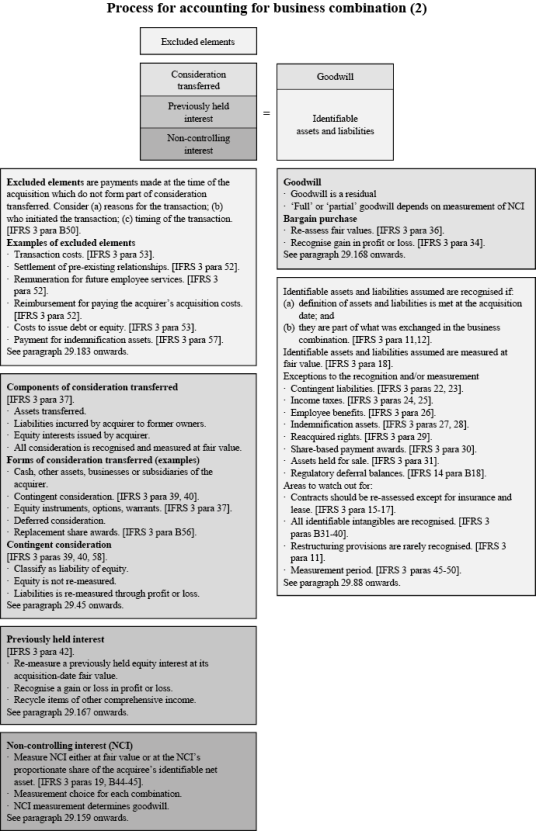
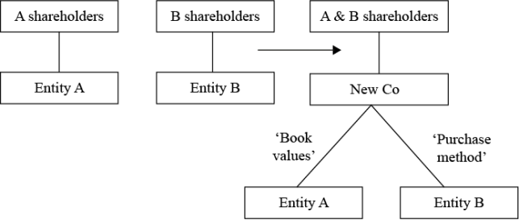
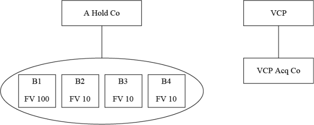
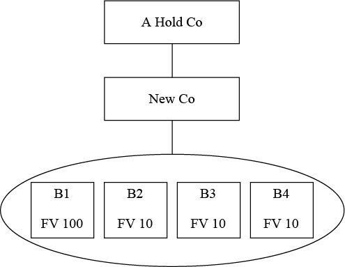
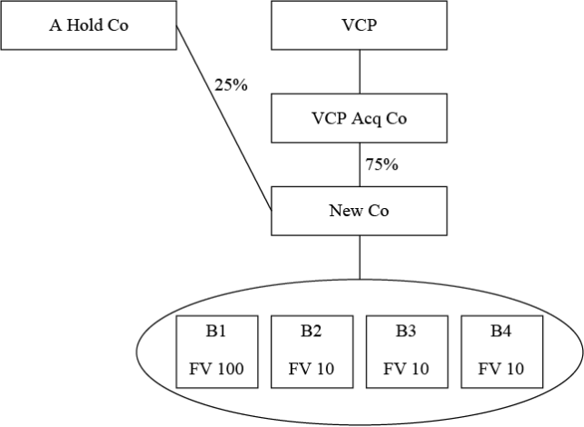
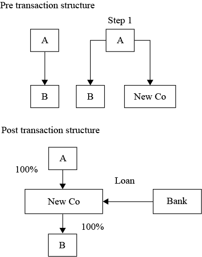
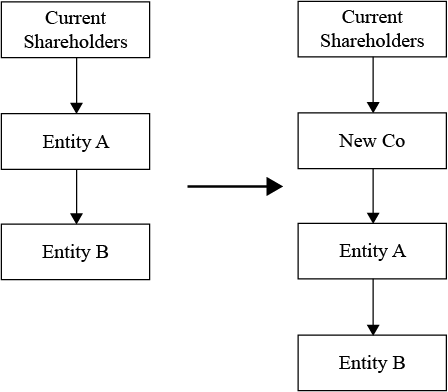
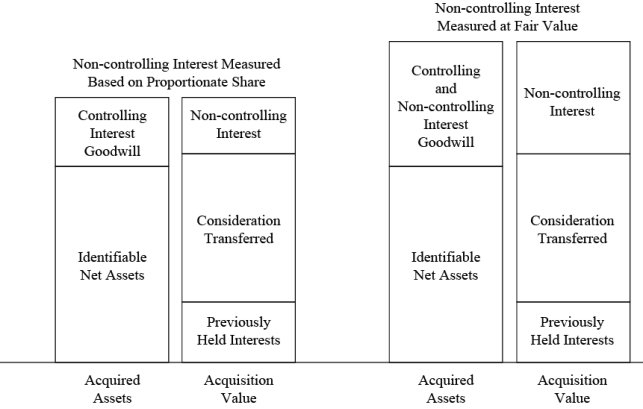

# 29 - Business combinations (IFRS 3)

[返回目录](README.md)

## Illustrative text

### Scope

#### FAQ 29.5.1 – Which transactions are excluded from the scope of IFRS 3?

 

Reference to standard: IFRS 3 paras 2, 2A   
Reference to standing text: [29.5](50.md#s207-Para_29.5)   

  

  
**Question**

Which transactions are excluded from the scope of IFRS 3?

**Answer**

The acquisition of a group of assets is not a business combination. Such transactions are nevertheless specifically excluded from IFRS 3’s scope for the sake of clarity, and the standard provides some guidance on accounting for asset acquisitions. The treatment of these transactions is addressed in [paragraph 29.247](50.md#s214-Para_29.247).

The formation of a joint arrangement might involve the transfer of one or several businesses into one entity. From the perspective of the investors, this is not a business combination, because no one party gains control of the joint arrangement. There is a scope exception and IFRS 3 does not apply.

There is no guidance on the accounting in the financial statements of a joint arrangement. The joint venture needs to select its accounting policies for such transactions using the guidance in IAS 8. In practice, the joint venture has a choice of accounting policy, and it can record the business contributed either at fair value (including goodwill) or at the previous carrying amount in the financial statements of the venturer. This policy must be disclosed and consistently applied.

 

#### FAQ 29.5.2 – What is the process to apply in order to determine the appropriate accounting for a business combination?

 

Reference to standard: IFRS 3 para 2   
Reference to standing text: [29.5](50.md#s207-Para_29.5)   

  

 

**Question**

What is the process to apply in order to determine the appropriate accounting for a business combination?

**Answer**

The process to apply, in determining the appropriate accounting for a business combination (other than group reconstructions or common control transactions, or acquisitions by investment entities) is summarised in the flow chart below:

 

### Definition of a business

#### FAQ 29.6.1 – What is the definition of a business ‘framework’ for evaluating whether a set of assets should be accounted for as an acquisition of a business or a group of assets?

 

Reference to standard: IFRS 3 para 3  
Reference to standing text: [29.6](50.md#s207-Para_29.6)  

  

 

**Question**

What is the definition of a business ‘framework’ for evaluating whether a set of assets should be accounted for as an acquisition of a business or a group of assets?

**Answer**

IFRS 3 provides a ‘framework’ for entities to use in evaluating whether an integrated set of assets and activities (collectively a ‘set’) should be accounted for as an acquisition of a business or a group of assets. It includes an optional concentration test to determine if substantially all of the fair value of the gross assets acquired is concentrated in a single asset or group of similar assets. If the concentration test is met, the set is not a business. The framework also specifies the minimum required inputs and processes necessary to be a business.

**The concentration test**

The concentration test is an optional test that permits a simplified assessment of whether an acquired set of activities and assets is not a business. It was designed to identify, with little cost or effort, a transaction that is clearly more akin to an asset acquisition and remove it from the scope of the business combinations guidance.

In applying the concentration test, an entity determines whether substantially all of the fair value of the gross assets acquired is concentrated in a single asset or group of similar assets. If so, the set is not considered a business. While the standard does not define what constitutes ‘substantially all’, there is no bright line. Some might interpret it to mean at least 90%.

[IFRS 3 App B para B7A].

**Single asset**

A single asset for the purpose of the concentration test includes any individual asset or group of assets that could be recognised and measured as a single asset in a business combination.

The guidance specifies certain assets that must be grouped for the purpose of applying the concentration test. This grouping is only applicable for the concentration test, and all assets acquired continue to be recorded separately where required by other IFRSs. For example, a tangible asset that is attached to another tangible asset should be considered a single asset. This includes an intangible asset representing the right to use a tangible asset (such as a building with an associated ground lease). To be considered attached, assets cannot be physically removed and used separately without incurring significant costs or significant diminution in utility or fair value to either asset. For example, land and a building would generally be recognised as separate assets in a business combination, but they would be considered a single asset when performing the concentration test.

[IFRS 3 App B para B7B].

**Similar assets**

The concentration test can also be met if the fair value of the set is concentrated in a group of similar assets. Entities should consider the nature of the assets, and the risks associated with managing and creating outputs, when determining if assets should be grouped as similar. If the risks are not similar, the assets cannot be combined for the concentration test. Identifying similar assets based on the nature of the assets and their risk characteristics is an area that requires significant judgement. When evaluating whether assets are similar, an entity should consider the nature of each single identifiable asset and the risks associated with managing and creating outputs from the assets. If the assets are not similar, the determination of whether the acquired set constitutes a business should be made using the framework, since the acquired processes used to manage the assets could be substantive.

The following should not be considered similar assets for the purpose of performing the concentration test:

- A tangible asset and an intangible asset.

- Tangible assets in different classes, unless considered a single identifiable asset for the purpose of the concentration test (for example, because physically attached).

- Intangible assets in different intangible asset classes (for example, brand names, licences and intangible assets under development).

- A financial asset and a non-financial asset.

- Financial assets in different classes (for example, accounts receivable investments in equity instruments).

- Assets within the same class of asset but with significantly different risk characteristics (for example, real estate investments that consist of residential and commercial properties).

[IFRS 3 App B para B7B].

**Gross assets**

For the purpose of the concentration test, the fair value of the gross assets acquired is not necessarily the same as the consideration transferred. This could be caused, for example, by liabilities assumed, which are factored into the determination of purchase price but are excluded from gross assets in the denominator of the concentration test.

The fair value of gross assets will also differ from the consideration transferred in a partial acquisition (that is, it is impacted where there are non-controlling interests and previously held interests). Where a transaction results in control of a legal entity being obtained, even if less than 100% of the entity is acquired, gross assets used in the concentration should include the consideration transferred plus the fair value of any non-controlling interests and previously held interests. For example, in the acquisition of a 60% controlling interest in an entity, the gross assets would include the 60% acquired interest plus the 40% non-controlling interest. Similarly, this would apply for previously held equity interests. For example, if a company owned an initial 10% interest and subsequently acquired a 70% controlling interest, the gross assets would include the fair value of the 10% previously held equity interest, the 70% acquired interest, and the 20% non-controlling interest.

Gross assets acquired exclude the following items:

- cash and cash equivalents;

- deferred tax assets; and

- goodwill resulting from the effects of deferred tax liabilities.

These items are excluded because the IASB did not believe that the tax form of the transaction, and whether cash and cash equivalents were included, should affect the determination of whether the set is a business.

[IFRS 3 App B para B7B].

**The framework**

In order to be a business, a set needs to have an input and a substantive process that together significantly contribute to the ability to create outputs. The framework to evaluate whether an input and a substantive process are present includes different criteria to consider, depending on whether the set has outputs or does not have outputs. The framework includes more stringent criteria for sets without outputs to be considered businesses. The definition of ‘outputs’ is consistent with the description of outputs in IFRS 15 , ‘Revenue from Contracts with Customers’ (that is, to the result of inputs and processes applied to those inputs that provide goods or services to customers). In addition, because not all businesses have revenue within the scope of IFRS 15, the definition of outputs also includes outputs that generate investment income (such as dividends or interest) or generate other income from ordinary activities.

[IFRS 3 App B para B8].

The assessment of whether a set is capable of being conducted and managed as a business should be performed using a market participant view. Therefore, how the seller previously managed, and how the buyer intends to manage, the acquired set is not relevant to the analysis.

[IFRS 3 App B para B11].

Even though individual processes that are used to create outputs might be insignificant on their own, entities should consider whether they could be substantive in aggregate. Furthermore, while processes are usually documented, they do not need to be. This could be the case with an organised workforce. An organised workforce could be an input, a process, or both. For example, a consulting firm might include employees (inputs) that use their intellectual capacity (a process) to generate outputs. However, an organised workforce is not, in itself, a business.

**Evaluating the framework where outputs are not present**

Where a set does not have outputs, an acquired process (or group of processes) should be considered substantive only if:

- it is critical to the ability to develop or convert an acquired input or inputs into outputs; and

- the inputs acquired include both an organised workforce that has the necessary skill, knowledge or experience to perform that process (or group of processes) and other inputs that the organised workforce could develop or convert into outputs.

 

Other inputs could include:

- intellectual property that could be used to develop a good or service;

- resources that could be developed to create outputs; and

- access to necessary materials or rights that enable the creation of future outputs (for example, technology, in-process research and development projects, real estate and mineral interests).

  
[IFRS 3 App B para B12B].

**Evaluating the framework where outputs are present**

A set will have outputs where there are outputs being generated at the acquisition date. However, outputs at the acquisition date do not, on their own, indicate that both an input and a substantive process have been acquired.

If a set has outputs at the acquisition date, an acquired process (or group of processes) is considered substantive if, when applied to an acquired input or inputs, it:

- is critical to the ability to continue producing outputs, and the inputs acquired include an organised workforce with the necessary skills, knowledge or experience to perform that process (or group of processes); or

- significantly contributes to the ability to continue producing outputs and:

- is considered unique or scarce; or

- cannot be replaced without significant cost, effort or delay in the ability to continue producing outputs.

  
[IFRS 3 App B para B12C].

**Other considerations**

The guidance requires the inputs to be substantive and to have the ability to create, or contribute to the creation of, outputs when one or more processes are applied to it. Ancillary assets (that is, those that do not contribute to producing outputs) would not be considered inputs for the purpose of determining whether the set has inputs.

An acquired contract is an input and not a substantive process. Nevertheless, an acquired contract could give access to an organised workforce (such as outsourced property management or outsourced asset management). An entity would need to assess whether an organised workforce accessed through such a contract is substantive. Factors to be considered include the duration of the contract and its renewal terms.

Difficulty replacing an organised workforce might indicate that the acquired organised workforce performs a process that is critical to the ability to create outputs.

A process is not critical if, for example, it is ancillary or minor in the context of all of the processes required to create outputs.

[IFRS 3 App B para B12D].

 

#### Distinguishing a business from an asset or a group of assets

##### FAQ 29.19.1 – How should an entity evaluate whether an acquired set is a business or a group of assets?

 

Reference to standard: IFRS 3 paras B7–B12D  
Reference to standing text: [29.19](50.md#s207-Para_29.19)   

  

 

**Question**

How should an entity evaluate whether an acquired set is a business or a group of assets?

**Answer**

The flow chart below provides a summary of the framework for evaluating whether an acquired set is a business or a group of assets:

 

##### EX 29.19.2 – Pharmaceutical industry: acquisition of a Biotech entity

 

Reference to standard: IFRS 3 para 3  
Reference to standing text: [29.19](50.md#s207-Para_29.19)  

  

 

**Example 1 – Acquisition of a Biotech entity: two IPR&amp;D projects**

Pharma Co purchases from Biotech a legal entity that contains rights to two Phase 3 compounds developed to treat diabetes and Alzheimer’s. Included in the in-process research and development (IPR&amp;D) is the historical knowhow, formula protocols, designs, and procedures expected to be needed to complete the related phase of testing. The legal entity also holds an ‘at market value’ contract research organisation (CRO) contract. The research could be performed by a number of CROs. No employees, other assets or other activities are transferred.

Is the arrangement the acquisition of a business?

Analysis

No. Pharma Co would conclude that this is an asset acquisition.

If the optional concentration test were applied, it would not be passed, since substantially all of the fair value is not concentrated in a single identifiable asset; this is because two dissimilar IPR&amp;D compounds are acquired.

Pharma Co would then analyse the transaction, referring to the framework without outputs. The acquisition includes an input of IPR&amp;D and a CRO contract. The contract gives access to an organised workforce. It is likely that the organised workforce would not be considered to be substantive, given that the services could be replaced at no significant cost with another CRO.

**Example 2 – Acquisition of a Biotech entity: several IPR&amp;D projects**

Pharma Co purchases from Biotech a legal entity that contains: rights to several dissimilar IPR&amp;D projects (each having significant fair value); senior management and scientists who have the necessary skills, knowledge or experience to perform R&amp;D activities; and tangible assets (including a corporate headquarters, a research lab and lab equipment). Biotech does not yet have a marketable product, and it has not yet generated revenues.

Is the arrangement the acquisition of a business?

Analysis

Yes. Pharma Co would conclude that this is a business combination.

If the optional concentration test were applied, it would not be passed, since substantially all of the fair value of the assets acquired is not concentrated in a single asset or a group of similar identifiable assets. Further analysis is required, following the framework without outputs, to assess whether a process is acquired and whether the process is substantive. A business is acquired, because the organised workforce is a substantive process that is critical to the ability to develop and convert the inputs (that is, workforce, IPR&amp;D and tangible assets) into outputs.

 

##### EX 29.19.3 – Real estate industry

 

Reference to standard: IFRS 3 para 3  
Reference to standing text: [29.19](50.md#s207-Para_29.19)  

  

 

**Example 1 – Acquisition of a residential real estate portfolio: determined to be an asset acquisition**

Property Co purchases a portfolio of 10 residential homes. Each home is considered to be a separate investment property for accounting purposes. All homes are leased out to separate tenants, and they comprise land and buildings. Each home has a different design and layout, but all homes are located in the same geographical area and the risk profile of the real estate market across that area is similar. No employees, other assets or other activities are transferred.

Is the arrangement the acquisition of a business?

Analysis

No. Property Co elects to apply the optional concentration test and would conclude that this is an asset acquisition, because substantially all of the fair value is concentrated in a group of similar assets.

A transaction is not automatically a business combination if the optional concentration test does not result in an asset classification. If the concentration test failed or was bypassed, an entity would need to assess the transaction under the full framework in IFRS 3.

**Example 2 – Acquisition of a residential and office real estate portfolio: determined to be an asset acquisition**

Property Co purchases a portfolio of 10 residential homes (the nature of these homes being as outlined in the example above) as well as an office park containing five fully let office buildings. It also acquires an outsourcing contract for maintenance services for the office park. The maintenance services are considered ancillary or minor in the context of generating rental income at the office park. No employees, other assets or other activities are transferred.

Is the arrangement the acquisition of a business?

Analysis

No, Property Co would conclude that this is an asset acquisition.

The concentration test is not passed, since substantially all of the fair value is not concentrated in a single identifiable asset or a group of similar identifiable assets; this is because two dissimilar classes of real estate with different risk profiles are acquired.

Since there are leases in place for both the residential homes and the office park buildings, Property Co would analyse the transaction, referring to the framework with outputs and considering whether the acquired processes are substantive. No organised workforce is acquired, and the maintenance services are considered ancillary or minor in the context of generating rental income. Further, the maintenance services do not significantly contribute to the ability to generate rental income and could be replaced without significant cost.

Would the answer be different if there were no in-place lease contracts and, therefore, no outputs?

Analysis

No, Property Co would still conclude that this is an asset acquisition.

In order for the definition of a business to be met where there are no outputs, an organised workforce with the necessary skills critical to the ability to develop and convert the inputs into outputs would need to be present. Since no such organised workforce is acquired, the definition of a business is not met.

**Example 3 – Acquisition of a residential and office real estate portfolio: determined to be a business combination**

Property Co acquires a portfolio of residential and office assets (the nature of these assets being as outlined in the example above), and it also acquires employees who are responsible for operational management of the assets as well as all tenant management and leasing activity.

Is the arrangement the acquisition of a business?

Analysis

Yes. Property Co would conclude that this is a business combination.

If the concentration test were applied, it would not be passed, since substantially all of the fair value of the assets acquired is not concentrated in a single asset or a group of similar identifiable assets. Further analysis is required, following the framework with outputs, to assess whether a process is acquired and whether the process is substantive. A business is acquired, because the organised workforce is a substantive process with the necessary skills that is critical to the ability to develop and convert the inputs (that is, land, buildings and in-place leases) into outputs.

 

### Identifying a business combination

#### EX 29.21.1 – Share repurchase by investee

 

Reference to standard: IFRS 3 para B5  
Reference to standing text: [29.21](50.md#s207-Para_29.21)   

  

 

**Example**

Entity A owns an equity investment in an investee (that meets the definition of a business) that gives it significant influence but not control. The investee repurchases its own shares from other parties, and the proportional interest of entity A increases. Entity A obtains control over the investee.

**Analysis**

This is a business combination without transfer of consideration, and the acquisition method is applied by entity A.

 

#### EX 29.21.2 – Change in the rights of other shareholders

 

Reference to standard: IFRS 3 para B5   
Reference to standing text: [29.21](50.md#s207-Para_29.21)   

  

 

**Example**

Entity B owns a majority share of its investee’s voting equity interests. The investee meets the definition of a business. Entity B is precluded from exercising control over the investee, due to contractual rights held by the other investors in the investee. The rights expire, and entity B obtains control over the investee.

**Analysis**

This is a business combination without consideration, and the acquisition method would be applied by entity B.

 

#### EX 29.21.3 – Contracts or other arrangements

 

Reference to standard: IFRS 3 para B5  
Reference to standing text: [29.21](50.md#s207-Para_29.21)   

  

 

**Example**

Entities C and D enter into a contractual arrangement to combine. Both entities meet the definition of a business. Entity C will control the operations of both entities C and D under the contract terms.

**Analysis**

This is a business combination without consideration, and the acquisition method would be applied to the arrangement. Entity C reflects this transaction as a business combination in which it obtained control of entity D.

 

#### EX 29.21.4 – Exchange of assets resulting in acquisition of a business

 

Reference to standard: IFRS 3 App A  
Reference to standing text: [29.21](50.md#s207-Para_29.21)  

  

 

**Example**

Entity A transfers a radio broadcast licence to entity B in exchange for a radio station. Entity A determines that the radio station that it receives is a business, while entity B determines that the radio broadcast licence that it receives is an asset.

How should each entity treat the transaction?

**Analysis**

Entity A would account for the acquired radio station as a business combination by applying the acquisition method. The consideration transferred is the fair value of the radio broadcast licence. Entity B accounts for the radio broadcast licence as an asset acquisition under the applicable IFRS.

 

#### Stapling transactions and dual-listed entities

##### FAQ 29.23.1 – Are stapling transactions and the formation of dual-listed entities considered business combinations?

 

Reference to standard: IFRS 3 para 43(c)  
Reference to standing text: [29.23](50.md#s207-Para_29.23)   

  

 

**Question**

Are stapling transactions and the formation of dual-listed entities considered business combinations?

**Answer**

Stapling transactions and dual-listed entities are rare, and they occur only in certain territories. A stapling transaction is a contractual arrangement between two legal entities. One legal entity issues equity securities that are combined with (that is, stapled to) the securities issued by the other legal entity. The stapled securities are quoted at a single price and cannot be traded or transferred independently.

A dual-listed entity is typically an arrangement between two listed legal entities, in which their activities are managed under contractual arrangements as a single economic entity while retaining their separate legal identities. The securities of each entity normally are quoted, traded and transferred independently in different capital markets. One entity has not acquired an ownership interest in the other entity, and the individual legal entities have not been combined to form a new legal entity. However, this is considered a business combination from an accounting perspective. [IFRS 3 para 43(c)].

Stapling arrangements were discussed by the IFRS IC in May 2014. A stapling arrangement that combines separate entities and businesses by the unification of ownership and voting interests in the combining entities is a business combination, as defined by IFRS 3. Stapling transactions and the formation of dual-listed entities typically occur without the transfer of consideration (see further [para 29.36](50.md#s207-Para_29.36) onwards).

 

#### Merger of equals, mutual enterprises, and ‘roll-up’ or ‘put-together’ transactions

##### FAQ 29.24.1 – Are the merger of equals, mutual enterprises, and ‘roll-up’ or ‘put-together’ transactions considered business combinations?

 

Reference to standard: IFRS 3 para BC35  
Reference to standing text: [29.24](50.md#s207-Para_29.24)   

  

 

**Question**

Are the merger of equals, mutual enterprises, and ‘roll-up’ or ‘put-together’ transactions considered business combinations?

**Answer**

Combinations of mutual enterprises are also within IFRS 3’s scope. The IASB acknowledged some differences between mutual enterprises and corporate business entities, but concluded that such differences were not substantial enough to warrant separate accounting. The entity deemed to be the acquirer in a combination of mutual enterprises should account for the transaction using the acquisition method.

‘Roll-up’ or ‘put-together’ transactions typically result where several unrelated entities in the same market, or in similar markets, combine to form a larger entity. The IASB concluded that, although these transactions might not cause a single entity to obtain control of the combined entity, they are similar to other types of business combination, and the acquirer should account for the transaction using the acquisition method.

 

#### Multiple transactions that result in the acquisition of a business

##### EX 29.25.1 – Effecting a business combination through a series of linked transactions

 

Reference to standard: IFRS 3 App A   
Reference to standing text: [29.25](50.md#s207-Para_29.25)   

  

**Example**

An international media group, entity G, has agreed to acquire entity H’s television broadcast and production operations. For tax reasons, entity G will not acquire entity H’s shares. The programme rights will be purchased by one subsidiary of entity G, while the production facilities and workforce located in the related countries will be acquired by separate operating subsidiaries of entity G in those geographic locations. None of the transactions can complete unless all of the transactions complete.

**Analysis**

The transactions form a business combination. Separation into three transactions does not affect the substance of the arrangements. The transactions are linked, and the substance is that entity G has acquired entity H’s television business. Entity G accounts for the combined effect of the transactions as an acquisition of entity H.

 

### The acquisition method

### Identifying the acquirer

#### FAQ 29.32.1 – How might the acquirer be identified in a stapling arrangement?

 

Reference to standard: IFRS 3 para B15   
Reference to standing text: [29.32](50.md#s207-Para_29.32)   

  

 

**Question**

How might the acquirer be identified in a stapling arrangement?

**Answer**

A stapling arrangement, that combines separate entities and businesses by the unification of ownership and voting interests in the combining entities, is a business combination under IFRS 3. The standard provides guidance on identifying the acquirer by assessing the relative voting rights in the combined entity after the combination. The acquirer is usually the combining entity whose owners, as a group, receive the largest portion of the voting rights in the combined entity. This guidance is relevant in identifying which of the combining entities is the acquirer in the stapling transaction.

 

#### FAQ 29.35.1 – What other considerations can be used in identifying the acquirer?

 

Reference to standard: IFRS 3 para B17   
Reference to standing text: [29.35](50.md#s207-Para_29.35)   

  

 

**Question**

What other considerations can be used in identifying the acquirer?

**Answer**

Some circumstances can complicate the identification of the acquirer. For example:

- Acquisitions involving entities with overlapping ordinary (common) shareholders: The effect of common ownership (but not common control) among the shareholders of the combining entities should be considered in identifying the accounting acquirer. The analysis of the relative voting rights in a business combination involving entities with common shareholders should consider the former shareholder groups of the combining entities and not the individual owners that are common to the combining entities. The former shareholder group that retains or receives the largest portion of the voting rights in the combined entity would be the accounting acquirer, absent the consideration of any of the other factors provided in the standards.

- Options, warrants and convertible instruments: Potential voting rights (such as options, warrants and convertible instruments assumed or exchanged in a business combination) are considered in the determination of the accounting acquirer if the holders of these instruments are viewed to be essentially the same as common shareholders. For example, holders of the debt that is exchanged for shares in a business combination can be included in the determination of the relative voting rights in the combined entity if the debt is convertible and ‘in the money’ prior to the acquisition. See [chapter 26 para 75](45.md#s170-Para_26.75) for further guidance on determining whether potential voting rights should be taken into account in assessing control.

 

#### FAQ 29.37.1 – Is the acquisition of an established private entity by a small listed entity an example of a reverse acquisition?

 

Reference to standard: IFRS 3 para B19  
Reference to standing text: [29.37](50.md#s207-Para_29.37)  

  

 

**Question**

Is the acquisition of an established private entity by a small listed entity an example of a reverse acquisition?

**Answer**

An example of a reverse acquisition is where a well-established unlisted trading entity arranges to have itself ‘acquired’ by a listed smaller entity that is a business and, as part of the agreement, the listed entity’s directors resign and are replaced with directors appointed by the unlisted entity and its former owners. The motive for such transactions is often that, by combining with the listed entity, the unlisted trading entity obtains a listing for itself. Although, legally, the listed entity is regarded as the parent and the unlisted entity is regarded as the subsidiary, the legal subsidiary is the accounting acquirer if it controls the legal parent. If so, the combination is accounted for as the acquisition of the listed entity by the trading entity − in other words, reverse acquisition accounting. Situations where the listed entity does not meet the definition of a business are not business combinations. Generally, these are treated as capital reorganisations. For further discussion on situations where the listed entity does not meet the definition of a business, refer to [FAQ 13.4.12 – Reverse acquisition of a listed shell](25.md#s93-FAQ_13.4.12).

 

#### New entity formed to effect a business combination

##### EX 29.39.1 – New entity formed to effect a business combination

 

Reference to standard: IFRS 3 para B18  
Reference to standing text: [29.39](50.md#s207-Para_29.39)  

  

 

IFRS 3 assumes that, where a new entity is set up to issue equity shares to effect a business combination, the new entity has no economic substance. The formation of such entities is often related to legal, tax or other business considerations that do not affect the identification of the acquirer. A combination between two entities that is structured so that one entity directs the formation of a new entity to issue equity instruments to the owners of both of the combining entities is, in substance, no different from a transaction in which one of the combining entities directly acquires the other. Therefore, the transaction is accounted for in the same way as a transaction in which one of the combining entities directly acquires the other. 

[IFRS 3 para BC98]. [IFRS 3 para BC99]. [IFRS 3 para BC100]. [IFRS 3 para BC101].

IFRS 3 does not specify the accounting for the ‘combination’ of the new entity and the acquirer if, the new entity is not substantive. However, under the principles of IFRS 3, the combination of the new entity and the existing entity deemed to be the acquirer is not a business combination. [IFRS 3 App B para B18]. The combination of these two entities is, in substance, a reorganisation. This means that the acquiring entity’s net assets are recorded at book value in the new entity’s consolidated financial statements.

 

**Example 1 – Business combination using a new entity – new entity is not considered substantive**

 

 

The shareholders of entities A and B agree to merge, to benefit from lower delivery and distribution costs. The business combination is carried out by setting up a new entity (New co), that issues 100 shares to entity A’s shareholders and 50 shares to entity B’s shareholders in exchange for the transfer of the shares in those entities. The number of shares reflects the relative fair values of the entities before the combination.

Is New co the acquirer? If not, which entity is the acquirer, and how is the combination accounted for?

**Analysis**

No, New co is not the acquirer. The transaction has brought together entities A and B. Legally, it has been effected by New co acquiring entities A and B, rather than one of these entities acquiring the other. New co is a new entity that has been formed to issue equity instruments to effect a business combination. One of the combining entities that existed before the combination is identified as the acquirer. [IFRS 3 App B para B18].

Entity A seems to be the acquirer – it is the largest entity, and its previous owners control the combined group, with 67% of the shares (100 ÷ 150).

New co’s consolidated financial statements reflect entity A as the acquirer and New Co as a continuation of entity A presenting entity A’s historical book values. Entity B is the acquiree, and acquisition accounting is applied to entity B’s assets and liabilities.

**Example 2 – Business combination using a new entity – new entity is considered substantive**

A Newco is formed by various unrelated investors for the purpose of acquiring a business. Newco issues equity to the investors for cash. Using the cash received, Newco purchases 100% of the equity of a company.

Is Newco the accounting acquirer?

**Analysis**

In this case, Newco could be determined to have economic substance and identified as the accounting acquirer, because it was established for the purpose of acquiring control of a business and not simply a vehicle to combine two existing businesses. Newco, itself, obtained control of a business and is not controlled by the former shareholders of the acquired entity. In addition, Newco was not formed to issue equity interests to effect the business combination, but rather it used cash received from the various unrelated investors to fund the acquisition.

 

##### EX 29.39.2 – Identifying the acquirer through domination of key management

 

Reference to standard: IFRS 3 para B18  
Reference to standing text: [29.39](50.md#s207-Para_29.39)  

  

**Example**

Entities E and F agree to combine their operations and form entity G. All of the voting shares of entities E and F are exchanged for shares in entity G. Entity E’s fair value is C510; entity F’s fair value is C490. The shareholders of each entity maintain the same relative voting rights in the combined entity. Entity E’s shareholders own 51% of the voting rights in entity G, and entity F’s shareholders own 49%.

Entity G’s board of directors has eight members, four of whom are appointed by entity E’s shareholders and four by entity F’s shareholders. All key decisions require approval of 55% of the shareholders. The parties have agreed that entity F’s shareholders will have the right to appoint entity G’s CEO and CFO.

How is the transaction accounted for in entity G’s financial statements?

**Analysis**

This is a business combination between entities E and F. Entity G cannot be identified as the acquirer, because it is a new entity formed to issue shares to effect the business combination. [IFRS 3 App B para B18].

The acquirer is the existing combining entity that obtains control of the other combining entities or operations. [IFRS 3 App A].

All key decisions require 55% approval, so neither entity E nor entity F has control as a result of their respective voting rights. However, control can be obtained through means other than a majority of voting rights.

An acquirer can be identified if one of the parties to a business combination is able to dominate the selection of the combined entity’s management. Entity F will dominate the key management appointments of the combination, suggesting that entity F has dominated the selection and is the acquirer. [IFRS 3 App B para B15(d)].

 

##### EX 29.40.1 – New company set up by venture capital entity to acquire business

 

Reference to standard: IFRS 3 para B18  
Reference to standing text: [29.40](50.md#s207-Para_29.40)  

  

 

**Example**

Holding company A (A Hold Co) is owned 100% by Mr X. It has a group of businesses, the ‘B businesses’, which it is intending to sell. Several potential purchasers have been identified. Management of A Hold Co is conducting negotiations and preparing the B businesses for sale. Management incorporates a new company, New co, which issues shares to acquire 100% of the various legal entities that comprise the B businesses.

VCP is the winning bidder and negotiations are concluded. VCP establishes a new entity, VCP Acq Co, that raises substantial amounts of debt, conditional on the acquisition of the B businesses. VCP Acq Co buys 75% of the shares of New co from A Hold Co for cash.

**Step A**

 

**Step B**

 

**Step C**

 

**Analysis**

Accounting for the transaction at step B

This is a transaction amongst entities under common control, because Mr X is the controlling party both before and after the transaction. The accounting treatment of this specific example is outside the scope of this chapter.

Accounting for the transaction at step C

Should management of VCP Acq Co identify VCP Acq Co as the acquirer under IFRS 3 and apply the acquisition method to the transaction?

Yes, VCP Acq Co is the acquirer. VCP Acq Co is an extension of VCP, and it controls the new company group. The debt raising by VCP Acq Co creates economic substance. VCP Acq Co has acquired New co and the B businesses from A Hold C. VCP Acq Co records the assets and liabilities of the acquired businesses in its consolidated financial statements at fair value in accordance with IFRS 3. It also records a 25% non-controlling interest to A Hold Co, measured either at fair value or at the non-controlling interest’s proportionate share in the identifiable net assets.

 

##### EX 29.40.2 – New company is not the acquirer

 

Reference to standard: IFRS 3 para B18  
Reference to standing text: [29.40](50.md#s207-Para_29.40)  

  

 

**Example**

Entity A owns entity B before the transaction. Entity A arranges loan funding from a financial institution in a new wholly owned subsidiary, New Co. The loan is used by New Co to fund the acquisition of entity A’s 100% shareholding in entity B, for cash consideration. Entity A applies IFRS 3 to account for common control transactions, and New Co will adopt the same policy.

 

Can New Co be identified as the acquirer in a business combination and apply acquisition accounting in its consolidated financial statements?

**Analysis**

No. Under IFRS 3, New Co cannot be the acquirer. Entity A has created New Co and is the seller, so New Co has effectively been formed and issued shares to effect the business combination. New Co is not a business, and the transaction between entity B and New Co is not a business combination. [IFRS 3 App B para B18]. It is a reorganisation of entity B (see [EX 29.41.1](51.md#s215-EX29.41.1)). As a result, entity B’s assets and liabilities are included in New Co’s consolidated financial statements at their pre-combination carrying amounts, without a fair value uplift.

 

#### New entity formed to acquire an existing group

##### EX 29.41.1 – New entity formed to acquire an existing group

 

Reference to standard: IFRS 3 para B2  
Reference to standing text: [29.41](50.md#s207-Para_29.41)   

  

 

It is not uncommon for a new parent entity to be added to an existing group by setting up a new shell entity that issues equity shares to the existing shareholders in exchange for the transfer of shares in the existing group, such that there is no change in the substance of the reporting entity. This might be done for a variety of reasons, including taxation and profit distributions.

There is no specific guidance in IFRS 3 when a new entity is placed on top of an existing group by issuing shares to the existing shareholders, apart from the sentence in paragraph B19 stating that the transaction would not be a business combination because the new entity is not a business. It can be argued that the transaction is a reorganisation of an existing entity that has not changed the substance of the reporting entity. The consolidated financial statements of the new entity are presented using the values from the consolidated financial statements of the previous group holding entity. The equity structure (that is, the issued share capital) would reflect that of the new entity, with other amounts in equity (such as revaluation reserve, retained earnings and cumulative translation reserves) being those from the consolidated financial statements of the previous group holding entity. The resulting difference that will arise would be recognised as a component of equity. Local regulatory or legal requirements might specify how this difference is presented; for example, it might be referred to as a reorganisation reserve.

**Example**

The diagram below illustrates a transaction in which a new entity is added to the top of an existing group.

**Analysis**

The addition of a new company (New co) as legal parent to entity A is not a business combination. The transaction is a reorganisation of entity A, and the consolidated financial statements of New co show the assets and liabilities of entity A for all periods presented.

 

### Determining the acquisition date

#### EX 29.43.1 – Determining the date when control passes: not the date of agreement

 

Reference to standard: IFRS 3 para 9   
Reference to standing text: [29.43](50.md#s207-Para_29.43)  

  

 

The date on which control passes is a matter of fact and cannot be backdated or artificially altered by the parties specifying a different date.

Control might pass in a number of ways. This will often depend on how the offer for the entity is made, whether it is a private sale or it is affected by the issue or cancellation of shares. The date when control is transferred in a public offer is usually the date when the offer is accepted unconditionally and provides the acquirer with the right to control the acquiree. This will usually be the date on which a sufficient number of irrevocable acceptances are received to enable the new parent to exercise control over the undertaking. Under a private treaty, the date when control is transferred is generally the date when an unconditional offer is accepted.

Some jurisdictions require an acquirer to register the shares in a new subsidiary with the relevant administrative department. Registration is routine and is never refused, but the process takes several weeks to complete, and the acquirer will not have legal title to the shares until the registration form is issued. This requirement is not a substantive condition required to protect the parties. The business combination is recognised when control passes, even if this is before the registration process is complete.

The accounting for a business combination occurs when control of the acquiree passes to the acquirer. The negotiations to purchase or sell a subsidiary might take place over a considerable period, and there might be delays between the time when agreement is reached in principle and the time when a binding agreement is reached. For example, if a business combination agreement provides that completion will take place only if material litigation is resolved in the acquiree’s favour, the business combination will not be recognised until the litigation is resolved. Other conditions, such as competition authority or shareholder approval, might also take time to be satisfied.

**Example**

Entity C acquires 100% of entity D for cash. The sale agreement specifies that the acquisition date is 10 March. The shares in entity D are transferred to entity C when the consideration is paid on 1 April. Entity C nominates directors and appoints them in place of the existing directors on 15 April (that is, the date when all of the conditions in the sale agreement are satisfied).

As of what date should entity C apply acquisition accounting?

**Analysis**

The date of acquisition is 15 April (that is, the date from which entity C is able to control entity D). This is the date on which entity C is able to appoint the directors.

The date in the sale agreement is not determinative for accounting purposes. The date when control passes to the acquirer might differ from the date specified in the agreement.

 

#### FAQ 29.43.2 – How should a company determine the acquisition date where no consideration is transferred?

 

Reference to standard: IFRS 3 para 9   
Reference to standing text: [29.43](50.md#s207-Para_29.43)   

  

 

**Question**

How should a company determine the acquisition date where no consideration is transferred?

**Answer**

An acquisition date might not coincide with the purchase of an ownership interest, but rather through another transaction or event (that is, a business combination achieved without the transfer of consideration). The acquisition date for these business combinations is the date when control is obtained through the other transaction or event. This situation might arise, for example, if an investee enters into a share buy-back arrangement with certain investors and, as a result, control of the investee changes. Acquisition date is the date on which the share repurchase (and cancellation) occurred, resulting in an investor obtaining control over the investee.

 

### Consideration

#### EX 29.45.1 – Post-combination dividend treated as part of purchase consideration

 

Reference to standard: IFRS 3 para 51   
Reference to standing text: [29.45](50.md#s208-Para_29.45)   

  

 

Purchase consideration can take the form of a special dividend paid by the acquirer after the date of acquisition. For example, as part of the offer, a special dividend might be paid shortly after the acquisition to those sellers who became shareholders as a result of accepting the acquirer’s offer for the shares of the acquired entity. This is not specifically mentioned in IFRS 3 but, in principle, such dividends would be treated as part of the consideration transferred where it can be demonstrated that the payment was, in substance, part of the consideration transferred for the acquired business and not, for example, compensation for future employee services or a simple post-combination dividend to equity participants of the entity. Where a dividend is recognised as consideration, the acquirer would need to ensure that the cost of the dividend is not double counted in arriving at the fair value of the total consideration. For example, the shares issued in consideration for the acquisition might need to be valued at an ‘ex-div’ price (‘excluding the dividend’).

**Example**

Entity F acquires entity G from entity H. Entity F issues shares to entity H that rank for dividends during a period before control passes to entity F. Dividends on the consideration shares are not paid during this period, but a special dividend will be paid on these shares shortly after control passes and the acquisition is completed.

How are the dividends accounted for?

**Analysis**

The dividends are treated as part of the consideration. The seller receives more value than it would have received if the consideration shares had ranked for dividends only after the date of acquisition. Any dividend accrued after the date when control has passed to entity F is treated as a distribution.

Payments might be structured to come from the acquired entity itself. This might be driven by tax or other regulatory reasons. If the acquired entity’s financial statements include a liability in respect of such payments, this is regarded as part of consideration rather than as a pre-combination liability of the acquired entity. The obligation to make such payments is treated, in the fair value exercise, as an element of the consideration and not as a reduction in the acquired entity’s net assets.

 

#### Employee compensation arrangements

##### FAQ 29.48.1 – How should a company assess employee compensation arrangements in a business combination?

 

Reference to standard: IFRS 3 para 52(b)   
Reference to standing text: [29.48](50.md#s208-Para_29.48)   

  

 

**Question**

How should a company assess employee compensation arrangements in a business combination?

**Answer**

Employee compensation arrangements in a business combination are assessed to determine whether they represent:

- compensation for pre-combination services (that is, the amount that relates to employees in the capacity of shareholders), which should be accounted for as part of the consideration transferred for the acquiree;

- compensation for post-combination services, which should be accounted for separately from the business combination; or

- a combination of pre- and post-combination services, with a portion accounted for as part of the consideration transferred for the acquiree and a portion accounted for as compensation cost in the post-combination financial statements, respectively.

This assessment will not always be straightforward and might require significant judgement.

 

#### Share-based payment awards

##### FAQ 29.54.1 – What is the rationale behind allocating a replaced award?

 

Reference to standard: IFRS 3 para B57   
Reference to standing text: [29.54](50.md#s208-Para_29.54)   

  

 

**Question**

What is the rationale behind allocating a replaced award?

**Answer**

This is an anti-abuse provision that prevents acquirers from reducing the post-combination income statement charge by providing a replacement award of the same value as the original award and reducing the original vesting period, to push a greater proportion of the value into the consideration for the business combination.

 

##### EX 29.54.2 – Vesting period completed before combination, and additional employee services not required

 

Reference to standard: IFRS 3 paras IE61–IE71   
Reference to standing text: [29.54](50.md#s208-Para_29.54)   

  

 

**Example**

 

<table style="width:100%; border-collapse:collapse"><tr><td style="border:0.75pt solid #000000; padding-right:5.03pt; padding-left:5.03pt; vertical-align:top">
Acquiree awards
</td><td style="border:0.75pt solid #000000; padding-right:5.03pt; padding-left:5.03pt; vertical-align:top">
Vesting period completed before the business combination
</td></tr><tr><td style="border:0.75pt solid #000000; padding-right:5.03pt; padding-left:5.03pt; vertical-align:top">
Replacement awards
</td><td style="border:0.75pt solid #000000; padding-right:5.03pt; padding-left:5.03pt; vertical-align:top">
Additional employee services are not required after the acquisition date
</td></tr></table>

The acquirer issues replacement awards with an IFRS 2 value (market-based measure) of C110 at the acquisition date. These replace acquiree awards with an IFRS 2 value of C100 at the acquisition date. No post-combination services are required for the replacement awards, and the acquiree’s employees had rendered all of the required service for the acquiree awards as of the acquisition date.

**Analysis**

The excess of C110 over C100 is recognised as a post-combination remuneration cost in the acquirer’s income statement. No post-combination service is required from the acquiree’s employees, and so C10 is immediately recognised in the acquirer’s post-combination income statement.

The acquiree’s replacement share-based payment awards are fully vested, and no service is required after the acquisition date. Therefore, the amount attributable to pre-combination service is the market-based measure of the acquiree’s awards (C100) at the acquisition date. That amount is included in the consideration transferred in the business combination.

The entries in the financial statements of the acquirer in relation to the awards are:

 

<table style="width:100%; border-collapse:collapse"><tr><td colspan="2" style="border:0.75pt solid #000000; padding-right:5.03pt; padding-left:5.03pt; vertical-align:top">
 
</td><td style="border:0.75pt solid #000000; padding-right:5.03pt; padding-left:5.03pt; vertical-align:top">
<b>C</b>
</td><td style="border:0.75pt solid #000000; padding-right:5.03pt; padding-left:5.03pt; vertical-align:top">
<b>C</b>
</td></tr><tr><td colspan="2" style="border:0.75pt solid #000000; padding-right:5.03pt; padding-left:5.03pt; vertical-align:top">
Dr Net assets and goodwill acquired
</td><td style="border:0.75pt solid #000000; padding-right:5.03pt; padding-left:5.03pt; vertical-align:top">
100
</td><td style="border:0.75pt solid #000000; padding-right:5.03pt; padding-left:5.03pt; vertical-align:top">
 
</td></tr><tr><td colspan="2" style="border:0.75pt solid #000000; padding-right:5.03pt; padding-left:5.03pt; vertical-align:top">
Dr Income statement – remuneration cost
</td><td style="border:0.75pt solid #000000; padding-right:5.03pt; padding-left:5.03pt; vertical-align:top">
10
</td><td style="border:0.75pt solid #000000; padding-right:5.03pt; padding-left:5.03pt; vertical-align:top">
 
</td></tr><tr><td style="border:0.75pt solid #000000; padding-right:5.03pt; padding-left:5.03pt; vertical-align:top">
 
</td><td style="border:0.75pt solid #000000; padding-right:5.03pt; padding-left:5.03pt; vertical-align:top">
Cr Equity
</td><td style="border:0.75pt solid #000000; padding-right:5.03pt; padding-left:5.03pt; vertical-align:top">
 
</td><td style="border:0.75pt solid #000000; padding-right:5.03pt; padding-left:5.03pt; vertical-align:top">
110
</td></tr></table>

 

to recognise share-based payment awards issued.

 

##### EX 29.54.3 – Vesting period completed before combination, and additional employee services required

 

Reference to standard: IFRS 3 paras IE61–IE71   
Reference to standing text: [29.54](50.md#s208-Para_29.54)   

  

 

**Example**

<table style="width:100%; border-collapse:collapse"><tr><td style="border:0.75pt solid #000000; padding-right:5.03pt; padding-left:5.03pt; vertical-align:top">
Acquiree awards
</td><td style="border:0.75pt solid #000000; padding-right:5.03pt; padding-left:5.03pt; vertical-align:top">
Vesting period completed before the business combination
</td></tr><tr><td style="border:0.75pt solid #000000; padding-right:5.03pt; padding-left:5.03pt; vertical-align:top">
Replacement awards
</td><td style="border:0.75pt solid #000000; padding-right:5.03pt; padding-left:5.03pt; vertical-align:top">
Additional employee services are required after the acquisition date
</td></tr></table>

 

An acquirer exchanges fully vested replacement awards that require one year of post-combination service for share-based payment awards of the acquiree. The IFRS 2 measure of both awards is C100 at the acquisition date. When originally granted, the acquiree’s awards had a vesting period of four years. At the acquisition date, the acquiree’s employees holding un-exercised awards had rendered a total of seven years of service since the grant date.

**Analysis**

The acquirer should attribute a portion of the replacement award to post-combination remuneration cost, because the replacement awards require one year of post-combination service. The total vesting period is five years (the vesting period for the original acquiree award completed before the acquisition date (four years) plus the vesting period for the replacement award (one year)). The three-year post-vesting service period is not relevant.

The portion attributable to pre-combination services equals the IFRS 2 measure of the acquiree award (C100) multiplied by the ratio of the pre-combination vesting period (four years) to the total vesting period (five years).

C80 (C100 × 4/5 years) is attributed to the pre-combination vesting period and is included in the consideration transferred in the business combination. The remaining C20 is attributed to the post-combination vesting period and is recognised as remuneration cost in the acquirer’s post-combination financial statements, in accordance with IFRS 2, over the one-year vesting period following the business combination.

The entries in the financial statements of the acquirer in relation to the awards are:

<table style="width:100%; border-collapse:collapse"><tr><td colspan="2" style="border:0.75pt solid #000000; padding-right:5.03pt; padding-left:5.03pt; vertical-align:top">
 
</td><td style="border:0.75pt solid #000000; padding-right:5.03pt; padding-left:5.03pt; vertical-align:top">
<b>C</b>
</td><td style="border:0.75pt solid #000000; padding-right:5.03pt; padding-left:5.03pt; vertical-align:top">
<b>C</b>
</td></tr><tr><td colspan="2" style="border:0.75pt solid #000000; padding-right:5.03pt; padding-left:5.03pt; vertical-align:top">
Dr Net assets and goodwill acquired
</td><td style="border:0.75pt solid #000000; padding-right:5.03pt; padding-left:5.03pt; vertical-align:top">
80
</td><td style="border:0.75pt solid #000000; padding-right:5.03pt; padding-left:5.03pt; vertical-align:top">
 
</td></tr><tr><td style="border:0.75pt solid #000000; padding-right:5.03pt; padding-left:5.03pt; vertical-align:top">
 
</td><td style="border:0.75pt solid #000000; padding-right:5.03pt; padding-left:5.03pt; vertical-align:top">
Cr Equity
</td><td style="border:0.75pt solid #000000; padding-right:5.03pt; padding-left:5.03pt; vertical-align:top">
 
</td><td style="border:0.75pt solid #000000; padding-right:5.03pt; padding-left:5.03pt; vertical-align:top">
80
</td></tr></table>

to recognise consideration transferred at the acquisition date.

<table style="width:100%; border-collapse:collapse"><tr><td colspan="2" style="border:0.75pt solid #000000; padding-right:5.03pt; padding-left:5.03pt; vertical-align:top">
 
</td><td style="border:0.75pt solid #000000; padding-right:5.03pt; padding-left:5.03pt; vertical-align:top">
<b>C</b>
</td><td style="border:0.75pt solid #000000; padding-right:5.03pt; padding-left:5.03pt; vertical-align:top">
<b>C</b>
</td></tr><tr><td colspan="2" style="border:0.75pt solid #000000; padding-right:5.03pt; padding-left:5.03pt; vertical-align:top">
Dr Income statement – remuneration cost
</td><td style="border:0.75pt solid #000000; padding-right:5.03pt; padding-left:5.03pt; vertical-align:top">
20
</td><td style="border:0.75pt solid #000000; padding-right:5.03pt; padding-left:5.03pt; vertical-align:top">
 
</td></tr><tr><td style="border:0.75pt solid #000000; padding-right:5.03pt; padding-left:5.03pt; vertical-align:top">
 
</td><td style="border:0.75pt solid #000000; padding-right:5.03pt; padding-left:5.03pt; vertical-align:top">
Cr Equity
</td><td style="border:0.75pt solid #000000; padding-right:5.03pt; padding-left:5.03pt; vertical-align:top">
 
</td><td style="border:0.75pt solid #000000; padding-right:5.03pt; padding-left:5.03pt; vertical-align:top">
20
</td></tr></table>

 

to recognise remuneration expense in the post-combination income statement in the one-year period following the acquisition.

 

##### EX 29.54.4 – Vesting period not completed before combination, and additional employee services required

 

Reference to standard: IFRS 3 paras IE61–IE71   
Reference to standing text: [29.54](50.md#s208-Para_29.54)  

  

 

**Example**

<table style="width:100%; border-collapse:collapse"><tr><td style="border:0.75pt solid #000000; padding-right:5.03pt; padding-left:5.03pt; vertical-align:top">
Acquiree awards
</td><td style="border:0.75pt solid #000000; padding-right:5.03pt; padding-left:5.03pt; vertical-align:top">
Vesting period not completed before the business combination
</td></tr><tr><td style="border:0.75pt solid #000000; padding-right:5.03pt; padding-left:5.03pt; vertical-align:top">
Replacement awards
</td><td style="border:0.75pt solid #000000; padding-right:5.03pt; padding-left:5.03pt; vertical-align:top">
Additional employee services are required after the acquisition date
</td></tr></table>

An acquirer exchanges replacement awards that require one year of post-combination service for share-based payment awards of the acquiree, for which the acquiree’s employees had not yet rendered all of the service at the acquisition date.

The IFRS 2 measure of both awards is C100 at the acquisition date. The awards of the acquiree had a vesting period of four years when originally granted. The acquiree’s employees had rendered two years’ service, and they would have been required to render two additional years of service after the acquisition date in order for their awards to vest. Only a portion of the acquiree’s awards is attributable to pre-combination service.

The replacement awards require only one year of post-combination service. The total vesting period is three years (the vesting period for the original acquiree award completed before the acquisition date (two years) plus the vesting period for the replacement award (one year)).

**Analysis**

The portion attributable to pre-combination services equals the IFRS 2 measure of the acquiree award (C100) multiplied by the ratio of the pre-combination vesting period (two years) to the greater of the total vesting period (three years) and the original vesting period of the acquiree’s award (four years). Thus, C50 (C100 × 2/4 years) is attributable to pre-combination service and is included in the consideration transferred for the acquiree. The remaining C50 is attributable to post-combination service and is recognised as remuneration cost in the acquirer’s post-combination financial statements.

The entries in the financial statements of the acquirer in relation to the awards are:

<table style="width:100%; border-collapse:collapse"><tr><td colspan="2" style="border:0.75pt solid #000000; padding-right:5.03pt; padding-left:5.03pt; vertical-align:top">
 
</td><td style="border:0.75pt solid #000000; padding-right:5.03pt; padding-left:5.03pt; vertical-align:top">
<b>C</b>
</td><td style="border:0.75pt solid #000000; padding-right:5.03pt; padding-left:5.03pt; vertical-align:top">
<b>C</b>
</td></tr><tr><td colspan="2" style="border:0.75pt solid #000000; padding-right:5.03pt; padding-left:5.03pt; vertical-align:top">
Dr Net assets and goodwill acquired
</td><td style="border:0.75pt solid #000000; padding-right:5.03pt; padding-left:5.03pt; vertical-align:top">
50
</td><td style="border:0.75pt solid #000000; padding-right:5.03pt; padding-left:5.03pt; vertical-align:top">
 
</td></tr><tr><td style="border:0.75pt solid #000000; padding-right:5.03pt; padding-left:5.03pt; vertical-align:top">
 
</td><td style="border:0.75pt solid #000000; padding-right:5.03pt; padding-left:5.03pt; vertical-align:top">
Cr Equity
</td><td style="border:0.75pt solid #000000; padding-right:5.03pt; padding-left:5.03pt; vertical-align:top">
 
</td><td style="border:0.75pt solid #000000; padding-right:5.03pt; padding-left:5.03pt; vertical-align:top">
50
</td></tr></table>

to recognise consideration transferred at the acquisition date.

<table style="width:100%; border-collapse:collapse"><tr><td colspan="2" style="border:0.75pt solid #000000; padding-right:5.03pt; padding-left:5.03pt; vertical-align:top">
 
</td><td style="border:0.75pt solid #000000; padding-right:5.03pt; padding-left:5.03pt; vertical-align:top">
<b>C</b>
</td><td style="border:0.75pt solid #000000; padding-right:5.03pt; padding-left:5.03pt; vertical-align:top">
<b>C</b>
</td></tr><tr><td colspan="2" style="border:0.75pt solid #000000; padding-right:5.03pt; padding-left:5.03pt; vertical-align:top">
Dr Income statement – remuneration cost
</td><td style="border:0.75pt solid #000000; padding-right:5.03pt; padding-left:5.03pt; vertical-align:top">
50
</td><td style="border:0.75pt solid #000000; padding-right:5.03pt; padding-left:5.03pt; vertical-align:top">
 
</td></tr><tr><td style="border:0.75pt solid #000000; padding-right:5.03pt; padding-left:5.03pt; vertical-align:top">
 
</td><td style="border:0.75pt solid #000000; padding-right:5.03pt; padding-left:5.03pt; vertical-align:top">
Cr Equity
</td><td style="border:0.75pt solid #000000; padding-right:5.03pt; padding-left:5.03pt; vertical-align:top">
 
</td><td style="border:0.75pt solid #000000; padding-right:5.03pt; padding-left:5.03pt; vertical-align:top">
50
</td></tr></table>

 

to recognise remuneration expense in the post-combination income statement in the one-year period following the acquisition.

 

##### EX 29.54.5 – Vesting period not completed before combination, and additional employee services not required

 

Reference to standard: IFRS 3 paras IE61–IE71   
Reference to standing text: [29.54](50.md#s208-Para_29.54)   

  

 

**Example**

<table style="width:100%; border-collapse:collapse"><tr><td style="border:0.75pt solid #000000; padding-right:5.03pt; padding-left:5.03pt; vertical-align:top">
Acquiree awards
</td><td style="border:0.75pt solid #000000; padding-right:5.03pt; padding-left:5.03pt; vertical-align:top">
Vesting period completed before the business combination
</td></tr><tr><td style="border:0.75pt solid #000000; padding-right:5.03pt; padding-left:5.03pt; vertical-align:top">
Replacement awards
</td><td style="border:0.75pt solid #000000; padding-right:5.03pt; padding-left:5.03pt; vertical-align:top">
Additional employee services are not required after the acquisition date
</td></tr></table>

An acquirer exchanges replacement awards that require no post-combination service for share-based payment awards of the acquiree for which employees had not yet rendered all of the service as of the acquisition date.

The terms of the replaced acquiree awards did not eliminate any remaining vesting period on a change in control. (If the acquiree awards had included a provision that automatically eliminated any remaining vesting period on a change in control, the guidance in 

FAQ 29.54.2 would apply.) The market-based measure of both awards is C100. The awards of the acquiree had a vesting period of four years when originally granted. The employees have already rendered two years of service, and the replacement awards do not require any post-combination service. The total vesting period is two years (the vesting period for the original acquiree award completed before the acquisition date (two years) plus the vesting period for the replacement award (zero years)).

**Analysis**

The portion of the IFRS 2 measure of the replacement awards attributable to pre-combination services equals the IFRS 2 measure of the acquiree’s awards (C100) multiplied by the ratio of the pre-combination vesting period (two years) to the greater of the total vesting period (two years) and the original vesting period of the acquiree’s award (four years).

C50 (C100 × 2/4 years) is attributable to pre-combination service and is included in the consideration transferred for the acquiree. The remaining C50 is attributable to post-combination service. The acquirer recognises the entire C50 immediately as remuneration cost in the post-combination financial statements, because no post-combination service is required.

<table style="width:100%; border-collapse:collapse"><tr><td colspan="2" style="border:0.75pt solid #000000; padding-right:5.03pt; padding-left:5.03pt; vertical-align:top">
 
</td><td style="border:0.75pt solid #000000; padding-right:5.03pt; padding-left:5.03pt; vertical-align:top">
<b>C</b>
</td><td style="border:0.75pt solid #000000; padding-right:5.03pt; padding-left:5.03pt; vertical-align:top">
<b>C</b>
</td></tr><tr><td colspan="2" style="border:0.75pt solid #000000; padding-right:5.03pt; padding-left:5.03pt; vertical-align:top">
Dr Net assets and goodwill acquired
</td><td style="border:0.75pt solid #000000; padding-right:5.03pt; padding-left:5.03pt; vertical-align:top">
50
</td><td style="border:0.75pt solid #000000; padding-right:5.03pt; padding-left:5.03pt; vertical-align:top">
 
</td></tr><tr><td colspan="2" style="border:0.75pt solid #000000; padding-right:5.03pt; padding-left:5.03pt; vertical-align:top">
Dr Income statement – remuneration cost
</td><td style="border:0.75pt solid #000000; padding-right:5.03pt; padding-left:5.03pt; vertical-align:top">
50
</td><td style="border:0.75pt solid #000000; padding-right:5.03pt; padding-left:5.03pt; vertical-align:top">
 
</td></tr><tr><td style="border:0.75pt solid #000000; padding-right:5.03pt; padding-left:5.03pt; vertical-align:top">
 
</td><td style="border:0.75pt solid #000000; padding-right:5.03pt; padding-left:5.03pt; vertical-align:top">
Cr Equity
</td><td style="border:0.75pt solid #000000; padding-right:5.03pt; padding-left:5.03pt; vertical-align:top">
 
</td><td style="border:0.75pt solid #000000; padding-right:5.03pt; padding-left:5.03pt; vertical-align:top">
100
</td></tr></table>

 

to recognise share-based payment awards issued.

 

##### EX 29.54.6 – Acquirer extends vesting period, and awards have incremental fair value

 

Reference to standard: IFRS 3 paras IE61–IE71   
Reference to standing text: [29.54](50.md#s208-Para_29.54)   

  

 

An acquirer exchanges replacement awards that require a period of post-combination service longer than one year for share-based payment awards of the acquiree, for which the acquiree’s employees had not yet rendered all of the service at the acquisition date. This replacement award has incremental fair value.

The example deals not only with the accounting in the acquirer’s financial statements, but also with the accounting in the acquiree’s financial statements.

**Example**

Entity A acquired entity B and was obliged to replace entity B’s share option scheme. At the acquisition date, employees have provided two out of the four years of service required in order for the share options to vest. Employees are required to provide three further years of service in order to become entitled to their options. However, because the exercise price is reduced, the replacement share option award has incremental fair value. The IFRS 2 fair value of the original share option award, measured at the grant date, was C800 and, at the acquisition date, it is C1,000. The IFRS 2 fair value of the replacement share option award is C1,500.

**Analysis**

Entity A

The replacement share option award requires three years of post-combination service. Employees have already rendered two years of service, so the total vesting period is five years.

The portion attributable to pre-combination services equals the fair value of entity B’s share option award at the acquisition date (C1,000) multiplied by the ratio of the pre-combination vesting period (two years) to the greater of the total vesting period (five years) and the original vesting period of entity B’s award (four years). Thus, C400 (1,000 × (2/5)) is attributable to pre-combination service and is consideration under IFRS 3.

The remaining C600 (1,000 − 400) is attributable to post-combination service. The incremental fair value of the replacement award of C500 (1,500 − 1,000) is also attributable to post-combination service.

Therefore, C1,100 (600 + 500) is recognised as compensation expense in entity A’s post-combination financial statements over the remaining vesting period (three years).

Entity B

The award has been modified at the acquisition date. Entity A, the parent entity, has granted, and has the obligation for, an equity-settled award from that date. Hence, IFRS 2 applies, and entity B should continue to account for the award as equity-settled from the date of acquisition. The vesting period has been extended, but the award’s original fair value (C800) will continue to be spread over the original four years. The cumulative charge would be C400 (2 × (800 ÷ 4)) at the acquisition date, and C200 will be charged each year for the next two years.

The incremental fair value (C500) will also be spread over the three years from the acquisition date.

 

##### EX 29.55.1 – Acquirer has no obligation to replace awards, and award continues unchanged

 

Reference to standard: IFRS 3 para B56   
Reference to standing text: [29.55](50.md#s208-Para_29.55)   

  

 

**Example**

Entity E acquired entity F on 30 June 20X5. The original vesting period of entity F’s employee share option scheme was four years, and two years' service has been provided at the acquisition date. The fair value of the awards was C100 at the acquisition date. Entity E was not required to replace entity F’s employee share option scheme, and the scheme continued unchanged.

**Analysis**

Entity E

Entity E allocates the acquisition date fair value between consideration of C50 (100 × 2/4 years) and post-combination employee compensation expense of C50 (100 × 2/4).

Entity E must use the acquisition date fair value, and not the original grant date fair value, because the measurement date cannot be before the date when entity F is acquired.

Entity F

Entity F granted an equity-settled share-based payment award on 30 June 20X3. The original grant date fair value is recognised over the four-year vesting period. There is no change to the original award, and so the accounting in entity F continues unchanged.

 

##### FAQ 29.55.2 – Acquirer has no obligation to replace awards?

 

Reference to standard: IFRS 3 para B56  
Reference to standing text: [29.55](50.md#s208-Para_29.55)  

  

 

**Question**

How should the acquirer account for voluntary replacement awards (that is, the acquirer has no obligation to replace awards that would expire as a result of the business combination, but chooses to do so)?

**Answer**

If the acquirer is not obliged to replace the acquiree’s awards but chooses to do so voluntarily, the entire IFRS 2 value of the replacement awards at the acquisition date is charged to the post-combination income statement as employee services. This amount might or might not be spread over a vesting period, depending on the circumstances (see [para 29.226](50.md#s213-Para_29.226)).

 

#### Cash settlement of the acquiree’s share-based payment award

##### FAQ 29.56.1 – How should a company account for cash settlement of the acquiree’s share-based payment awards that is initiated by the acquirer?

 

Reference to standard: IFRS 3 para B56   
Reference to standing text: [29.56](50.md#s208-Para_29.56)   

  

 

**Question**

How should a company account for cash settlement of the acquiree’s share-based payment awards that is initiated by the acquirer?

**Answer**

Cash settlement of the acquiree’s share-based payment requires much of the same analysis as replacement awards. Determining the portion of the cash settlement to be attributed to pre-combination services or post-combination services uses the principle in paragraphs [29.51](50.md#s208-Para_29.51) to [29.54.](50.md#s208-Para_29.54) Determining who initiated the cash settlement might require analysis of the factors listed [in paragraph 29.185](50.md#s211-Para_29.185).

Cash payments made by the acquirer to settle vested awards are included in the consideration transferred for the acquiree, up to the amount equal to the fair value of the acquiree’s awards measured at the acquisition date. If the cash payment is greater than the fair value of the acquiree’s awards, the excess fair value amount is an expense incurred by the acquirer outside the business combination, rather than consideration transferred for the acquiree. The excess amount of cash paid over the fair value of the acquiree’s awards is, therefore, immediately recognised as an expense in the post-combination financial statements. [IFRS 3 App B para B59]. [IFRS 3 App B para B61]. [IFRS 2 para 28].

If cash payments are made by the acquirer to settle unvested awards, the acquirer has effectively accelerated the vesting of the awards by eliminating the post-combination service requirement and settled the award for cash. The portion attributable to pre-combination service provided to the acquiree is included in the consideration transferred for the acquiree. The remaining cash payment to the acquiree, attributable to the post-combination service, is immediately recognised as an expense in the post-combination financial statements. This analysis is similar to FAQ 29.54.4, in which vested replacement share-based payment awards replace unvested acquiree awards. [IFRS 3 para IE70]. [IFRS 3 para IE71].

An acquirer might make a cash payment in exchange for unvested awards of the acquiree and require additional post-combination service, with the cash payment made at the completion of the additional vesting period. The acquirer will need to determine the portions of the payment attributable to pre-combination service and post-combination service. The amount attributable to pre-combination service is determined by multiplying the fair value of the acquiree award by the ratio of the portion of the pre-combination vesting period completed before the payment to the greater of the total vesting period and the original vesting period of the acquiree award. This amount is included in consideration transferred for the acquired business. The amount attributable to post-combination service would be recognised in the post-combination financial statements over the remaining service vesting period.

 

##### EX 29.56.2 – Acquirer extends vesting period and settles in cash

 

Reference to standard: IFRS 3 para B56   
Reference to standing text: [29.56](50.md#s208-Para_29.56)   

  

 

**Example**

Entity C acquired entity D on 31 December 20X1 and was obliged to replace share awards granted by entity D to its employees. At the acquisition date, employees have provided two out of the four years of service required in order for their share award to vest. Following the acquisition, employees are required to provide three further years of service (that is, until 31 December 20X4) in order to become entitled to their award. Employees will receive cash equal to the fair value of shares in entity D, rather than entity D shares as originally intended. The IFRS 2 fair value of the original share award, measured at the grant date, was C800. At the date of acquisition, the fair value of both the original award and the replacement award is C1,000. No incremental value has been provided as a result of the acquisition.

Entity C has agreed to pay C1,000 in cash on 31 December 20X4, provided that employees remain in employment until that date.

**Analysis**

**Entity C**

The consideration of C1,000 is allocated by multiplying it by the ratio of the portion of the vesting period completed (two years) to the greater of the total vesting period (two completed years, plus the three remaining years) and the original vesting period of the acquiree award (four years). Therefore, C400 (1,000 × 2/5) is allocated to the consideration for the acquisition, and the remaining C600 will be recorded as a post-combination employee compensation expense, provided that the employee meets the service condition. (Note: the time value of money has been disregarded for simplicity in this example.)

The portion of the liability recognised as part of the acquisition is considered to be consideration. The portion of the future payment that is considered to be employee compensation and is accrued over the three-year service period.

**Entity D**

The award has been modified at the acquisition date. Entity C, the parent entity, is granting, and has the obligation for, a cash-settled award from that date. Entity D should continue to account for the award as equity-settled, as required by IFRS 2.

The extension of the vesting period from four to five years would be ignored by entity D, because this is non-beneficial to the employee. See [chapter 13](24.md#s85-chap_13) for additional guidance on modifications to share-based payment arrangements.

 

##### FAQ 29.56.3 – How should a company account for cash settlement of the acquiree’s share-based payment awards that is initiated by the acquiree?

 

Reference to standard: IFRS 3 para 52   
Reference to standing text: [29.56](50.md#s208-Para_29.56)   

  

 

**Question**

How should a company account for cash settlement of the acquiree’s share-based payment awards that is initiated by the acquiree?

**Answer**

The acquiree might choose to cash settle the outstanding awards before the acquisition. However, these transactions, including the timing of the transaction, should be carefully assessed to determine whether the cash settlement, or a portion thereof, was arranged primarily for the economic benefit of the acquirer. The form of the transaction might indicate that the acquiree initiated the cash settlement; but, in substance, the acquirer might have reimbursed the acquiree for the cash settlement. This assessment should include an analysis of the factors listed in [paragraph 29.185](50.md#s211-Para_29.185). [IFRS 3 para 52]. If the acquirer reimbursed the acquiree for the cash settlement, the accounting by the acquirer should generally be the same as if the acquirer had settled the awards directly. The settlement is recorded in the acquiree’s financial statements before the business combination if the acquiree cash settles its awards and the transaction was for the acquiree’s economic benefit. [IFRS 2 para 28].

 

##### EX 29.56.4 – Apparent cash settlement of awards by the acquiree

 

Reference to standard: IFRS 3 para B56   
Reference to standing text: [29.56](50.md#s208-Para_29.56)   

  

 

**Example**

Entity D (the acquiree) cash settles the outstanding unvested awards held by its employees immediately before its acquisition by entity C (the acquirer). The amount of cash paid by entity D is C100, which is equal to the current fair value of the awards. The employees have completed 75% of the service required to vest in the awards at the time of settlement.

**Analysis**

Entity C determines whether a portion of the consideration transferred for entity D is attributable to the settlement of unvested awards held by entity D’s employees. The settlement of the portion of the unvested awards not attributable to pre-combination services might be a transaction arranged primarily for the economic benefit of entity C. Factors to consider in this analysis (as addressed in para B50 of IFRS 3) include:

- The reasons for the transaction: why did entity D elect to cash settle the outstanding awards?

- Who initiated the transaction: did entity C direct entity D to settle the awards? Was the settlement a condition of the acquisition?

- The timing of the transaction: was the settlement in contemplation of the business combination?

Entity D was directed by entity C to settle the awards. The settlement of the unvested awards was a transaction arranged primarily for the economic benefit of entity C. Therefore, a portion of the total cash consideration transferred is attributed to the cash settlement of the awards, and it is excluded from consideration transferred for entity D. The fair value of the unvested awards not attributable to pre-combination services (C25, which is the fair value of the award of C100 × remaining vesting period of 25%) is the amount that would be excluded from consideration transferred and recognised as expense in entity C’s post-combination financial statements. The C25 is recognised immediately, because no post-combination service is required.

The entries recorded in entity C’s financial statements at the acquisition date are:

 

<table style="width:100%; border-collapse:collapse"><tr><td colspan="2" style="border:0.75pt solid #000000; padding-right:5.03pt; padding-left:5.03pt; vertical-align:top">
 
</td><td style="border:0.75pt solid #000000; padding-right:5.03pt; padding-left:5.03pt; vertical-align:top">
<b>C</b>
</td><td style="border:0.75pt solid #000000; padding-right:5.03pt; padding-left:5.03pt; vertical-align:top">
<b>C</b>
</td></tr><tr><td colspan="2" style="border:0.75pt solid #000000; padding-right:5.03pt; padding-left:5.03pt; vertical-align:top">
Dr Income statement remuneration expense
</td><td style="border:0.75pt solid #000000; padding-right:5.03pt; padding-left:5.03pt; vertical-align:top">
25
</td><td style="border:0.75pt solid #000000; padding-right:5.03pt; padding-left:5.03pt; vertical-align:top">
 
</td></tr><tr><td style="border:0.75pt solid #000000; padding-right:5.03pt; padding-left:5.03pt; vertical-align:top">
 
</td><td style="border:0.75pt solid #000000; padding-right:5.03pt; padding-left:5.03pt; vertical-align:top">
Cr Consideration
</td><td style="border:0.75pt solid #000000; padding-right:5.03pt; padding-left:5.03pt; vertical-align:top">
 
</td><td style="border:0.75pt solid #000000; padding-right:5.03pt; padding-left:5.03pt; vertical-align:top">
25
</td></tr></table>

 

to reduce consideration included in the business combination accounting in respect of employee remuneration costs.

 

#### Tax on share-based payment awards

##### EX 29.59.1 – Income tax accounting for share-based payment awards

 

Reference to standard: IAS 12 paras 68A–68C   
Reference to standing text: [29.59](50.md#s208-Para_29.59)   

  

 

IAS 12 provides guidance on where an item has a tax base (the amount that the tax authorities will permit as a deduction in future periods with respect to goods or services consumed to date) but is not recognised as an asset or liability in the entity’s balance sheet. For equity-settled awards under IFRS 2, employee services are expensed. Their carrying amount is, therefore, zero. If the employer will be entitled to a tax deduction equal to the options’ intrinsic value (that is, the difference between the fair value of the share at exercise date and the exercise price) on the exercise date, an estimate of the value of the tax base at the end of each reporting period is determined by multiplying the options’ current intrinsic value by the proportion of the total vesting period that has elapsed. The difference between the tax base of the employee services received to date and the carrying amount of zero is a temporary difference that results in a deferred tax asset, if the entity has sufficient future taxable profit against which the deferred tax asset can be utilised.

[IAS 12 paras 9–11]. [IAS 12  paras 68A–68C].

The income tax accounting for awards exchanged in a business combination will differ between (1) the portion included in the consideration transferred for the acquiree and (2) the portion of the award for which the expense will be recognised in the post-combination financial statements.

A deferred tax asset is set up, based on the intrinsic value at the acquisition date for the portion of the replacement award included in consideration, subject to the deferred tax asset recognition criteria. The deferred tax asset will reduce the net assets acquired (for example, goodwill). Any change in the intrinsic value of the award (and, therefore, the deferred tax asset) will be reflected, in the post-combination financial statements, through an adjustment to the deferred tax asset for the period in which the change arises. There is diversity in practice as to where the movement in the deferred tax asset is recognised. There is no expense in the income statement, which suggests that the deferred tax movement should be reflected directly in equity in a manner similar to that used for deferred tax movements relating to a share-based payment that exceed the total share-based payment expense. One possible approach is for some or all of the movement to be presented in the income statement, because the amounts treated as purchase consideration represent benefits earned before the acquisition, that are analogous to book expenses. The guidance is not specific; and so, given the diversity in practice, management should make a policy choice and apply it consistently.

A deferred tax asset is recorded equal to the tax benefit related to the estimated future tax deduction. For the portion of the replacement award accounted for in the post-combination financial statements (as employee costs), this deferred tax asset is multiplied by the proportion of the total vesting period that has elapsed. Because none of the vesting period for this portion of the award has elapsed as of the acquisition date, no deferred tax asset is recorded at the acquisition date. The deferred tax asset balance is based on the tax benefit related to the estimated tax deduction at the end of each period (measured using the current share price), in accordance with IAS 12. 

[IAS 12 paras 9–11]. [IAS 12  paras 68A–68C].

The following example illustrates the deferred tax guidance.

Example – Deferred tax accounting for a vested equity-settled option

Entity A (the acquirer) exchanges replacement awards with a fair value of C500 at the acquisition date for awards by entity B (the acquiree) with a fair value of C500 at the same date. Entity A was obliged to issue replacement awards under the terms of the acquisition agreement. When originally granted, entity B’s awards had a vesting period of four years. The replacement awards have the same terms as the original awards. The replacement awards are fully vested and require no further service.

A tax deduction for the replacement awards will not arise until the options are exercised. The tax deduction will be based on the options’ intrinsic value at the exercise date. The exercise price of the awards is C400. At the acquisition date, the market price of entity A’s shares is C600. The intrinsic value at the acquisition date is C200 (market price of entity A’s shares of C600 less the exercise price of C400). Entity A’s applicable tax rate is 40%.

How are the replacement awards accounted for as part of the business combination?

**Analysis**

The entire C500 is included in the consideration transferred for the acquiree, because the replacement awards have no excess fair value, and no post-combination service is required.

Entity A records a deferred tax asset equal to C80 (C200 intrinsic value × 40% tax rate) because, at the time of the acquisition, the awards are expected to result in a tax deduction based on intrinsic value. The deferred tax asset will be recorded by entity A as follows:

<table style="width:100%; border-collapse:collapse"><tr><td colspan="2" style="border:0.75pt solid #000000; padding-right:5.03pt; padding-left:5.03pt; vertical-align:top">
 
</td><td style="border:0.75pt solid #000000; padding-right:5.03pt; padding-left:5.03pt; vertical-align:top">
<b>Dr</b>
</td><td style="border:0.75pt solid #000000; padding-right:5.03pt; padding-left:5.03pt; vertical-align:top">
<b>Cr</b>
</td></tr><tr><td colspan="2" style="border:0.75pt solid #000000; padding-right:5.03pt; padding-left:5.03pt; vertical-align:top">
 
</td><td style="border:0.75pt solid #000000; padding-right:5.03pt; padding-left:5.03pt; vertical-align:top">
C
</td><td style="border:0.75pt solid #000000; padding-right:5.03pt; padding-left:5.03pt; vertical-align:top">
C
</td></tr><tr><td colspan="2" style="border:0.75pt solid #000000; padding-right:5.03pt; padding-left:5.03pt; vertical-align:top">
Dr Deferred tax assets
</td><td style="border:0.75pt solid #000000; padding-right:5.03pt; padding-left:5.03pt; vertical-align:top">
80
</td><td style="border:0.75pt solid #000000; padding-right:5.03pt; padding-left:5.03pt; vertical-align:top">
 
</td></tr><tr><td style="border:0.75pt solid #000000; padding-right:5.03pt; padding-left:5.03pt; vertical-align:top">
 
</td><td style="border:0.75pt solid #000000; padding-right:5.03pt; padding-left:5.03pt; vertical-align:top">
Cr Goodwill (as residual)
</td><td style="border:0.75pt solid #000000; padding-right:5.03pt; padding-left:5.03pt; vertical-align:top">
 
</td><td style="border:0.75pt solid #000000; padding-right:5.03pt; padding-left:5.03pt; vertical-align:top">
80
</td></tr></table>

 

Any subsequent change in the intrinsic value (and, hence, the deferred tax asset) will be reflected in the post-combination financial statements.

The deferred tax asset replaces the deferred tax asset that was recorded by entity B in its own financial statements before the business combination and before its awards were replaced.

 

#### Consideration transferred in a reverse acquisition

##### EX 29.61.1 – Consideration in a reverse acquisition

 

Reference to standard: IFRS 3 para B20   
Reference to standing text: [29.61](50.md#s208-Para_29.61)   

  

 

**Example**

Entity B, a private entity, acquires entity A, a public entity, in a reverse acquisition. The transaction is a business combination. Immediately before the acquisition date:

- Entity A has 100 shares outstanding.

- Entity B has 60 shares outstanding.

 

On the acquisition date:

- Entity A issues 150 shares in exchange for entity B’s 60 shares.

- The shareholders of entity B own 60% (150/250) of the new combined entity.

- The shareholders of entity A own 40% (100/250) of the new combined entity.

- The market price of a share of entity A is C16.

- The estimated fair value of a share of entity B is C40.

 

What is the consideration for the acquisition of entity A by entity B?

**Analysis**

The fair value of the consideration transferred should be based on the most reliable measure. [IFRS 3 para 33]. The fair value of entity A’s shares is likely to be more reliably measurable, because entity B is a private entity.

The consideration transferred of C1,600 is measured using the market price of entity A’s shares (100% of entity A acquired, which is 100 shares times C16).

Another method of estimating the fair value of the consideration transferred would be to use the number of entity B’s shares that would have been issued to the owners of entity A. Entity B would have had to issue 40 shares to entity A’s shareholders, increasing entity B’s outstanding shares to 100 shares (60 shares/60%) × 40% = 40 shares). Consideration transferred would be C1,600 (40 shares times the fair value of entity B’s shares of C40).

 

#### Contingent consideration

##### FAQ 29.63.1 – What challenges might a company face when accounting for contingent consideration?

 

Reference to standard: IFRS 3 para 40   
Reference to standing text: [29.63](50.md#s208-Para_29.63)   

  

 

**Question**

What challenges might a company face when accounting for contingent consideration?

**Answer**

Contingent payments to or from the acquirer and the selling shareholders are analysed to determine if they are compensation, contingent consideration or indemnity related. A payment to or from the buyer and seller that is related to a future event could be either an indemnity or contingent consideration. If the settlement of the arrangement is related to an existing specific asset or liability of the acquiree, it is an indemnification and an obligation of the seller. Other contingent payments are either compensation or consideration.

- Accounting for contingent consideration poses various challenges for entities undertaking business combinations under IFRS 3:

- What form does the consideration take? All contingent consideration is measured at fair value at the acquisition date. So, goodwill is not affected by the form of the consideration, whether it is debt, equity or some other asset or liability. But accounting for contingent consideration after the acquisition date is different, depending on how it has been classified at the acquisition date.

- How is contingent consideration valued? Valuation might be a difficult issue. Many forms of contingent consideration are based on entity-specific variables that are not observable in any market but are measured at fair value. There is no exemption for impracticability, and there is no reliable measurement criterion.

- Are amounts to be treated as contingent consideration or employee compensation? Arrangements are often made with sellers who are also employees of the acquired business. An analysis is needed to determine whether payment arrangements are payments to the sellers in their capacity as shareholders or in their capacity as employees.

 

#### Measurement of consideration

##### EX 29.67.1 – Interest-free loan treated as deferred consideration

 

Reference to standard: IFRS 3 para 37   
Reference to standing text: [29.67](50.md#s208-Para_29.67)   

  

 

**Example**

Entity A acquired the entire share capital of entity B for C400,000. Entity A paid C100,000 in cash and issued an interest-free C300,000 loan payable to the seller in 10 years. 6% is the rate at which entity A could issue the same amount of debt in a separate market transaction.

**Analysis**

The loan issued is measured at fair value. [IFRS 3 para 37]. The face value of C300,000 specified in the contract is not its fair value. The debt should be valued at C167,518 (that is, its net present value discounted at a rate of 6%). Entity A has paid C267,518 for entity B, although a different amount is specified in the purchase contract.

 

##### FAQ 29.68.1 – What should a company consider when measuring contingent consideration ?

 

Reference to standard: IFRS 3 para 39  
Reference to standing text: [29.68](50.md#s208-Para_29.68)   

  

 

**Question**

 

What should a company consider when measuring contingent consideration?

**Answer**

Measuring contingent consideration at fair value at the acquisition date could be complicated, depending on the facts. Entities will need to consider the key inputs of the arrangement and market participant assumptions when developing the assumptions used to determine the fair value. This will include the need to estimate the likelihood and timing of achieving the arrangement’s relevant milestones. Entities will also need to exercise judgement when applying a probability assessment for each of the potential outcomes. Further guidance on measuring fair values in various contingent consideration arrangements is given in [chapter 5 para 126](11.md#s34-Para_5.126).

 

#### Consideration transferred includes other assets and liabilities of the acquirer

##### EX 29.73.1 – Business combination with non-monetary purchase consideration

 

Reference to standard: IFRS 3 para 38  
Reference to standing text: [29.73](50.md#s208-Para_29.73)   

  

 

**Example**

Utility D owns a generating facility with a book value of C55. Entity E owns 60% of the voting rights in a power distribution business, entity F. On 31 December 20X2, utility D sold its generating facility to entity E and received, in exchange, entity E’s interest in entity F.

The fair value of the generating facility, determined by an independent valuation, is C150. The fair value of entity F’s identifiable net assets, determined by an independent valuation, is C200.

Utility D has given up a non-monetary asset, the generating facility, to acquire a controlling interest in a distribution business, entity F. The transaction is, for utility D, a business combination. How does utility D account for the business combination?

**Analysis**

Utility D’s facility meets the definition of an asset held for sale in IFRS 5. The reclassification as an asset held for sale has no immediate income statement impact, because fair value less costs to sell is higher than the carrying amount. Utility D should recognise the acquisition of entity F and a gain on disposal of the facility when the transaction occurs.

The consideration that utility D paid is calculated by reference to the fair value of the generating facility given up, which is C150. Utility D elects to measure non-controlling interest (NCI) at the NCI’s interest in the identifiable net assets, being C80 (200 × 40%). Goodwill is C30.

The gain on disposal of the generating facility is the difference between the consideration received and the book value at the date of disposal.

Calculation of goodwill:

<table style="width:100%; border-collapse:collapse"><tr><td style="border:0.75pt solid #000000; padding-right:5.03pt; padding-left:5.03pt; vertical-align:top">
 
</td><td style="border:0.75pt solid #000000; padding-right:5.03pt; padding-left:5.03pt; vertical-align:top">
<b>C</b>
</td></tr><tr><td style="border:0.75pt solid #000000; padding-right:5.03pt; padding-left:5.03pt; vertical-align:top">
Consideration transferred
</td><td style="border:0.75pt solid #000000; padding-right:5.03pt; padding-left:5.03pt; vertical-align:top">
150
</td></tr><tr><td style="border:0.75pt solid #000000; padding-right:5.03pt; padding-left:5.03pt; vertical-align:top">
Non-controlling interests
</td><td style="border:0.75pt solid #000000; padding-right:5.03pt; padding-left:5.03pt; vertical-align:top">
80
</td></tr><tr><td style="border:0.75pt solid #000000; padding-right:5.03pt; padding-left:5.03pt; vertical-align:top">
Fair value of identifiable net assets acquired
</td><td style="border:0.75pt solid #000000; padding-right:5.03pt; padding-left:5.03pt; vertical-align:top">
(200)
</td></tr><tr><td style="border:0.75pt solid #000000; padding-right:5.03pt; padding-left:5.03pt; vertical-align:top">
 
</td><td style="border:0.75pt solid #000000; padding-right:5.03pt; padding-left:5.03pt; vertical-align:top">
 
</td></tr><tr><td style="border:0.75pt solid #000000; padding-right:5.03pt; padding-left:5.03pt; vertical-align:top">
Goodwill
</td><td style="border:0.75pt solid #000000; padding-right:5.03pt; padding-left:5.03pt; vertical-align:top">
30
</td></tr><tr><td style="border:0.75pt solid #000000; padding-right:5.03pt; padding-left:5.03pt; vertical-align:top">
 
</td><td style="border:0.75pt solid #000000; padding-right:5.03pt; padding-left:5.03pt; vertical-align:top">
 
</td></tr><tr><td style="border:0.75pt solid #000000; padding-right:5.03pt; padding-left:5.03pt; vertical-align:top">
Calculation of gain on disposal:
</td><td style="border:0.75pt solid #000000; padding-right:5.03pt; padding-left:5.03pt; vertical-align:top">
 
</td></tr><tr><td style="border:0.75pt solid #000000; padding-right:5.03pt; padding-left:5.03pt; vertical-align:top">
 
</td><td style="border:0.75pt solid #000000; padding-right:5.03pt; padding-left:5.03pt; vertical-align:top">
 
</td></tr><tr><td style="border:0.75pt solid #000000; padding-right:5.03pt; padding-left:5.03pt; vertical-align:top">
Sale consideration
</td><td style="border:0.75pt solid #000000; padding-right:5.03pt; padding-left:5.03pt; vertical-align:top">
150
</td></tr><tr><td style="border:0.75pt solid #000000; padding-right:5.03pt; padding-left:5.03pt; vertical-align:top">
Book value of facility
</td><td style="border:0.75pt solid #000000; padding-right:5.03pt; padding-left:5.03pt; vertical-align:top">
(55)
</td></tr><tr><td style="border:0.75pt solid #000000; padding-right:5.03pt; padding-left:5.03pt; vertical-align:top">
 
</td><td style="border:0.75pt solid #000000; padding-right:5.03pt; padding-left:5.03pt; vertical-align:top">
 
</td></tr><tr><td style="border:0.75pt solid #000000; padding-right:5.03pt; padding-left:5.03pt; vertical-align:top">
Gain on disposal
</td><td style="border:0.75pt solid #000000; padding-right:5.03pt; padding-left:5.03pt; vertical-align:top">
95
</td></tr><tr><td style="border:0.75pt solid #000000; padding-right:5.03pt; padding-left:5.03pt; vertical-align:top">
 
</td><td style="border:0.75pt solid #000000; padding-right:5.03pt; padding-left:5.03pt; vertical-align:top">
 
</td></tr></table>

 

##### FAQ 29.73.2 – How should a company account for an acquisition of a controlling interest for shares in another entity?

 

Reference to standard: IFRS 3 para 38   
Reference to standing text: [29.73](50.md#s208-Para_29.73)   

  

 

**Question**

How should a company account for an acquisition of a controlling interest for shares in another entity?

**Answer**

The purchase consideration might take the form of other assets. For example, an entity has an investment in a listed entity and swaps that investment for a controlling interest in another entity. The consideration given is the shares in the listed entity. The acquisition date fair value of the holding in the listed entity is the consideration transferred for the acquisition of the new subsidiary. Exchanges of businesses or other non-monetary assets for an interest in a subsidiary are addressed in [chapter 30 para 92](53.md#s220-Para_30.92).

 

#### Classification of contingent consideration

##### FAQ 29.82.1 – How should a company determine the classification of a contingent consideration arrangement that includes more than one performance target?

 

Reference to standard: IFRS 9 para B4.3.4 (IAS 39 para AG29)   
Reference to standing text: [29.82](50.md#s208-Para_29.82)   

  

 

**Question**

How should a company determine the classification of a contingent consideration arrangement that includes more than one performance target?

**Answer**

A contingent consideration arrangement might include more than one performance target. The unit of account might be the overall contract, or separate units of account for each performance target within that overall contract. To be assessed as separate units of account, the performance targets must be readily separable and independent of each other, and they must relate to different risk exposures. If separable, these contracts might individually result in the delivery of a fixed number of shares, and so they would be classified as equity. Otherwise, the arrangement must be viewed as one contract that results in the delivery of a variable number of shares, and it would be classified as a liability, because the number of shares that will be delivered depends on which performance target is met.

 

##### FAQ 29.86.1 – What is the framework used to determine the classification of contingent consideration arrangements?

 

Reference to standard: IAS 32 para 11  
Reference to standing text: [29.86](50.md#s208-Para_29.86)   

  

 

**Question**

What is the framework used to determine the classification of contingent consideration arrangements?

**Answer**

The following flowchart illustrates the framework to determine the classification of contingent consideration arrangements:

 

##### EX 29.86.2 – Contingent consideration payable in cash as a financial liability

 

Reference to standard: IAS 32 para 11   
Reference to standing text: [29.86](50.md#s208-Para_29.86)   

  

 

**Example**

Entity A is a large pharmaceutical company. It buys entity B, a smaller biotech company, mainly to gain access to two significant in-process development projects. Entity A agrees to pay C20 million to the owners of entity B in cash. A further C30 million is payable if one of the development projects receives approval from the US Food and Drug Administration (FDA) within 10 years. How does entity A account for the contingent payment?

**Analysis**

Entity A has a contractual obligation to deliver cash to the owners of entity B. [IAS 32 para 11]. The contingent consideration is classified as a financial liability. It is recognised at its fair value at the acquisition date. Fair value will vary most significantly based on the probabilities of regulatory approval being achieved.

 

##### EX 29.86.3 – Contingent consideration paid in a fixed number of shares as equity

 

Reference to standard: IAS 32 para 11   
Reference to standing text: [29.86](50.md#s208-Para_29.86)   

  

 

**Example**

Entity C acquires entity D. Entity C agrees to issue 500,000 ordinary shares to entity D’s owners if profits are more than C2 million one year after the acquisition. How does entity C account for the contingent payment?

**Analysis**

Entity C has agreed to issue an equity instrument. There is no obligation to deliver cash or another financial asset to another entity, and the number of shares that will be delivered is fixed at 500,000. [IAS 32 para 11]. The contingent consideration is classified as equity. It is recognised at its fair value at the acquisition date. The fair value of the contingent consideration would take into account the share price at the date of acquisition and the probability of the contingent consideration becoming payable.

 

##### EX 29.86.4 – Contingent consideration paid in a variable number of shares as a financial liability

 

Reference to standard: IAS 32 para 11   
Reference to standing text: [29.86](50.md#s208-Para_29.86)   

  

 

**Example**

Entity C acquires entity D. Entity C agrees to issue, to entity D’s owners, 100 shares if revenues of at least C100 million are attained, and 200 shares if revenues of at least C200 million are attained. How does entity C account for the contingent payment?

**Analysis**

 

Entity C has agreed to issue shares. There is no obligation to deliver cash or another financial asset to another entity, and the number of shares that will be delivered is variable, at 100 or 200. There is one performance target of revenue, which can result in either 100 or 200 shares being issued. The targets relate to the same risk. As such, the contingent consideration is classified as a liability. It is recognised at its fair value at the acquisition date and subsequently remeasured to the income statement each reporting period (see para 29.220). The fair value of the contingent consideration would take into account the share price at the date of acquisition and the probability of the contingent consideration becoming payable (see further [chapter 5 para 126](11.md#s34-Para_5.126)).

 

##### EX 29.86.5 – Contingent consideration paid in a variable number of shares as equity

 

Reference to standard: IAS 32 para 11   
Reference to standing text: [29.86](50.md#s208-Para_29.86)   

  

 

**Example**

Entity C acquires entity D. Entity C agrees to issue, to entity D’s owners, 100 shares if year 1 revenues are at least C100 million, 200 shares if year 2 revenues are at least C200 million, and 300 shares if year 3 revenues are at least C300 million. How does entity C account for the contingent payment, based on these three independent performance targets?

**Analysis**

Entity C has agreed to issue shares. There is no obligation to deliver cash or another financial asset to another entity, and the number of shares that will be delivered for each independent performance target is fixed at either 100, 200 or 300 shares. The contingent consideration is comprised of three separate financial instruments that are each classified as equity. They are independent of each other, such that it is possible for each performance target to be met on its own. Each award is recognised at its fair value at the acquisition date, but is not subsequently remeasured.

 

##### EX 29.86.6 – Arrangement is an indemnity and not contingent consideration

 

Reference to standard: IFRS 3 para 27   
Reference to standing text: [29.86](50.md#s208-Para_29.86)   

  

**Example**

Entity E acquires entity F. Entity F is the defendant in a significant court case. The owners of entity F agree that they will refund part of the consideration paid by entity E if entity F loses the court case, up to a maximum amount of C2 million. How does entity E account for the contingent payment?

**Analysis**

This arrangement is not contingent consideration. It is an indemnity offered by entity F’s sellers. It is accounted for using the same assumptions as an indemnified contingent court case liability (see [para 29.146](50.md#s209-Para_29.146)).

 

##### EX 29.86.7 – Escrow arrangements

 

Reference to standard: IFRS 3 para 27   
Reference to standing text: [29.86](50.md#s208-Para_29.86)   

  

 

**Example**

Entity E acquires entity F for C10 million. Entity E seeks protection for false representations and warranties asserted by the sellers of entity F. Entity E will pay C9 million at the acquisition date, and it will place C1 million in an escrow account. Within one year after the acquisition date, the sellers will receive the C1 million if there were no violations of the representations and warranties. Is the C1 million in escrow accounted for as contingent consideration by entity E?

**Analysis**

No. Contingent consideration is defined in IFRS 3 as an obligation to transfer additional consideration if specified future events occur or conditions are met. The funds in escrow are released to the sellers based on the validity of conditions that existed at the acquisition date and are not dependent on the future performance of entity F. This is not an indemnification asset, because the agreement is not indemnifying entity E in relation to an existing specific asset or liability of the acquiree. The C1 million payment made into the escrow account would be treated as part of the consideration for the business combination, impacting the goodwill recognised on the combination. Any adjustments to the amount in escrow would be accounted for as a measurement period adjustment that impacts goodwill (see [para 29.177](50.md#s210-Para_29.177)), given that they result from new information that is obtained after the acquisition date about facts and circumstances that existed as of the acquisition date.

[IFRS 3 para 45].

 

##### EX 29.86.8 – Working capital adjustments

 

Reference to standard: IFRS 3 para 45   
Reference to standing text: [29.86](50.md#s208-Para_29.86)   

  

 

**Example**

Entity E acquires entity F for C10 million. The purchase agreement provides that a closing balance sheet audit will be completed within 90 days of the acquisition date. If working capital at the acquisition date exceeds a specified minimum level, entity E will pay additional consideration to the seller. For instance, if entity F’s working capital is C1.1 million and the specified minimum level is C1 million, entity E will pay an additional C0.1 million. Does entity E account for the working capital adjustment as contingent consideration?

**Analysis**

No. Working capital adjustments are the result of new information about facts and circumstances that existed at the balance sheet date, and not about the performance of the acquiree after the acquisition date. [IFRS 3 para 45]. Any amounts paid for working capital adjustments would be accounted for as a measurement period adjustment (see [para 29.177](50.md#s210-Para_29.177)).

 

##### EX 29.86.9 – Adjustments to consideration based on outcome of a general contingency or lawsuit

 

Reference to standard: IFRS 3 para 27   
Reference to standing text: [29.86](50.md#s208-Para_29.86)   

  

 

**Example**

Entity E acquires entity F for C10 million. The purchase agreement provides that, if an existing lawsuit against entity F settles for more than C1 million, an adjustment to the purchase price will be made. Should this arrangement be accounted for as contingent consideration?

**Analysis**

No. The seller has provided an indemnification to entity E for entity F’s existing lawsuit. Therefore, entity E would account for the assumed liability as a contingent liability, and it would recognise an indemnification asset for the amount recoverable from the seller (see [para 29.146](50.md#s209-Para_29.146)).

 

##### EX 29.86.10 – Contingent consideration of the acquiree

 

Reference to standard: IFRS 3 para 39   
Reference to standing text: [29.86](50.md#s208-Para_29.86)   

  

 

**Example**

Entity A acquires entity B for C10 million in 20X6. If net profits exceeded C2 million in 20X8, additional consideration would be paid to the shareholders of entity B in 20X9. This was accounted for as contingent consideration by entity A in accordance with IFRS 3. Entity C acquired entity A in 20X7. Should entity C account for the contingent consideration arrangement from entity A’s acquisition of entity B as contingent consideration or as an assumed liability?

**Analysis**

Entity C should account for the item as an assumed liability. Pre-existing contingent consideration does not meet the definition of contingent consideration in the acquirer’s business combination, because it is not paid to the sellers of the acquired business.

Contingent consideration arrangements of the acquiree would be liabilities (or, in some instances, assets) of the acquired business. These arrangements are established by contract and fall within the scope of IFRS 9 (IAS 39), and so they are recognised at fair value on the acquisition date. The subsequent accounting would be driven by the classification of the asset or liability under IFRS 9 (IAS 39).

 

##### EX 29.86.11 – Contingent consideration arrangement linked to the acquisition-date fair value

 

Reference to standard: IFRS 3 para 39   
Reference to standing text: [29.86](50.md#s208-Para_29.86)   

  

 

**Example**

 

Entity A acquires entity B in a business combination by issuing 1 million entity A common shares to entity B’s shareholders. At the acquisition date, entity A’s share price is C40 per share. Entity A also provides entity B’s former shareholders with contingent consideration whereby, if the common shares of entity A are trading below C40 per share one year after the acquisition date, entity A will issue additional common shares to the former shareholders of entity B sufficient to make the current value of the acquisition-date consideration equal to C40 million (that is, the acquisition-date fair value of the consideration transferred.) However, the number of shares that can be issued under the arrangement cannot exceed 2 million shares.

**Analysis**

Entity A has sufficient authorised and unissued shares available to settle the arrangement after considering all other commitments. The shares to be issued meet all criteria for equity classification under IAS 32.

The common shares of entity A that have been issued at the acquisition date are recorded at fair value within equity. Since the guarantee feature of the contingent consideration arrangement would result in the issuance of a variable number of shares of entity A (that is, the number of shares to be delivered will vary depending on the issuer’s share price), the arrangement should be classified as a liability under IAS 32.

 

### Recognising and measuring identifiable assets acquired, liabilities assumed and non-controlling interest

#### General recognition principle

##### FAQ 29.93.1 – Do potential contracts meet the definition of an asset?

 

Reference to standard: IFRS 3 para B38  
Reference to standing text: [29.93](50.md#s209-Para_29.93)  

  

 

**Question**

Do potential contracts meet the definition of an asset?

**Answer**

Items that do not meet the definition of assets include potential contracts that are under negotiation at the acquisition date. The relationships associated with those potential contracts might meet the definition of an intangible asset, but the potential contracts themselves do not. Such items form part of goodwill.

 

##### FAQ 29.94.1 – Do contingent assets meet the definition of an asset?

 

Reference to standard: IFRS 3 para B38   
Reference to standing text: [29.94](50.md#s209-Para_29.94)   

  

 

**Question**

Do contingent assets meet the definition of an asset?

**Answer**

Contingent assets occur where an entity is uncertain whether an asset exists at a reporting date, but where a future event that is outside the entity’s control will confirm whether or not the asset exists. Contingent assets do not meet the definition of assets in the Conceptual Framework for Financial Reporting, so they are not recognised in a business combination. If an asset exists at the date of acquisition, being an unconditional right, it is not a contingent asset, and so it is recognised at fair value or in accordance with the relevant standards.

 

##### FAQ 29.96.1 – What are examples of assets and liabilities identified in an acquisition that were not identified before the acquisition?

 

Reference to standard: IFRS 3 para 13   
Reference to standing text: [29.96](50.md#s209-Para_29.96)   

  

 

**Question**

What are examples of assets and liabilities identified in an acquisition that were not identified before the acquisition?

**Answer**

All identifiable assets and liabilities of the acquired business are recognised. Acquisition accounting might result in the recognition of a number of assets and liabilities of the acquired business that were not recorded in its own financial statements.

Not all items that meet the definitions of assets and liabilities are necessarily recorded in an entity’s financial statements as soon as they are identified (for example, intangible assets or contingent liabilities). However, in business combination accounting, intangible assets are recognised if they are identifiable, and contingent liabilities are recognised if they can be measured reliably. Probability is reflected in the fair value measurement.

**Example**

Assets that an acquirer might recognise include:

- Customer lists.   
  
Entity A, a retailer, has developed extensive customer lists. Entity A frequently licenses these lists to other third parties, because there are no confidentiality agreements that prohibit selling, exchanging or leasing the information. Entity A has not recognised an intangible asset in connection with these customer lists, since IAS 38 prohibits the recognition of internally generated intangible assets. Entity B, a competitor, acquires entity A. Entity B recognises an intangible asset in connection with the customer lists, because they are identifiable: the customer lists meet the separability criterion and they are identifiable (see [para 29.110](50.md#s209-Para_29.110)).

- Assets that the acquiree did not recognise because it did not prepare its financial statements in accordance with IFRS.   
  
Entity E acquires entity F, which operates in country Y. Entity F uses Y-GAAP and has not recognised, on its balance sheet, the fair value of the interest rate swaps and forward currency contracts used to manage its interest rate and currency exposures. Entity E recognises the fair value of entity F’s derivative financial instruments as identifiable assets or liabilities.

 

Examples of liabilities that might crystallise as a result of an acquisition are those arising from pre-existing contractual arrangements, such as compensation clauses in directors’ service contracts that are triggered in the event of a change of ownership. See FAQ 29.196.4.

 

##### FAQ 29.96.2 – What are examples of assets and liabilities of an acquiree that are not recognised by the acquirer?

 

Reference to standard: IFRS 3 para 13   
Reference to standing text: [29.96](50.md#s209-Para_29.96)   

  

 

**Question**

What are examples of assets and liabilities of an acquiree that are not recognised by the acquirer?

**Answer**

Some items that are recognised by the acquiree might not be recognised by the acquirer. An example is goodwill recognised in the acquiree’s balance sheet from previous business combinations. That purchased goodwill is not an identifiable asset.

 

#### Classifying or designating identifiable assets and liabilities

##### FAQ 29.98.1 – What are examples of where a classification, designation or assessment decision is required?

 

Reference to standard: IFRS 3 para 17   
Reference to standing text: [29.98](50.md#s209-Para_29.98)   

  

 

**Question**

What are examples of where a classification, designation or assessment decision is required?

**Answer**

Some common examples of where a classification, designation or assessment decision is required are given in the table below.

<table style="width:100%; border-collapse:collapse"><thead><tr><td style="border:0.75pt solid #000000; padding-right:5.03pt; padding-left:5.03pt; vertical-align:top">
<b>Item</b>
</td><td style="border:0.75pt solid #000000; padding-right:5.03pt; padding-left:5.03pt; vertical-align:top">
<b>Classification/designation/ assessment required</b>
</td><td style="border:0.75pt solid #000000; padding-right:5.03pt; padding-left:5.03pt; vertical-align:top">
<b>Assessment on acquisition</b>
</td></tr></thead><tbody><tr><td style="border:0.75pt solid #000000; padding-right:5.03pt; padding-left:5.03pt; vertical-align:top">
Lease
</td><td style="border:0.75pt solid #000000; padding-right:5.03pt; padding-left:5.03pt; vertical-align:top">
Finance lease or operating lease where the acquiree is the lessor under IFRS 16.
</td><td style="border:0.75pt solid #000000; padding-right:5.03pt; padding-left:5.03pt; vertical-align:top">
Classify based on original contractual terms, or modified terms if contract was modified later.
</td></tr><tr><td style="border:0.75pt solid #000000; padding-right:5.03pt; padding-left:5.03pt; vertical-align:top">
Insurance contract
</td><td style="border:0.75pt solid #000000; padding-right:5.03pt; padding-left:5.03pt; vertical-align:top">
Insurance contract under IFRS 4 (this is not applicable on adoption of IFRS 17)
</td><td style="border:0.75pt solid #000000; padding-right:5.03pt; padding-left:5.03pt; vertical-align:top">
Classify based on original contractual terms, or modified terms if contract was modified later.
</td></tr><tr><td style="border:0.75pt solid #000000; padding-right:5.03pt; padding-left:5.03pt; vertical-align:top">
Embedded derivative
</td><td style="border:0.75pt solid #000000; padding-right:5.03pt; padding-left:5.03pt; vertical-align:top">
Assess whether an embedded derivative is required to be separated from the host contract and accounted for as a derivative.
</td><td style="border:0.75pt solid #000000; padding-right:5.03pt; padding-left:5.03pt; vertical-align:top">
Re-assess based on contractual terms and economic conditions at the acquisition date.
</td></tr><tr><td style="border:0.75pt solid #000000; padding-right:5.03pt; padding-left:5.03pt; vertical-align:top">
Hedge effectiveness
</td><td style="border:0.75pt solid #000000; padding-right:5.03pt; padding-left:5.03pt; vertical-align:top">
Assess whether a hedge will be highly effective in order to achieve hedge accounting.
</td><td style="border:0.75pt solid #000000; padding-right:5.03pt; padding-left:5.03pt; vertical-align:top">
Re-assess based on contractual terms and economic conditions at the acquisition date. Hedging documentation should be prepared, as of the acquisition date, from the perspective of the combined entity.
</td></tr><tr><td style="border:0.75pt solid #000000; padding-right:5.03pt; padding-left:5.03pt; vertical-align:top">
Financial instrument
</td><td style="border:0.75pt solid #000000; padding-right:5.03pt; padding-left:5.03pt; vertical-align:top">
Assess classification of particular financial assets and liabilities as measured at fair value through profit or loss or at amortised cost, or as a financial asset measured at fair value through other comprehensive income in accordance with IFRS 9.
</td><td style="border:0.75pt solid #000000; padding-right:5.03pt; padding-left:5.03pt; vertical-align:top">
Re-assess based on contractual terms and economic conditions at the acquisition date.
</td></tr></tbody></table>

 

##### EX 29.99.1 – Hedge accounting

 

Reference to standard: IFRS 3 para 17   
Reference to standing text: [29.99](50.md#s209-Para_29.99)   

  

 

**Example**

An acquirer purchases entity B on 1 January 20X0. Entity B has several interest rate swaps, which it is using to fix interest rates on its long-term liabilities. Entity B has appropriately documented these interest rate swaps as cash flow hedging instruments, in accordance with IFRS 9 (IAS 39). The interest rate swaps will expire in three years from 1 January 20X0. The swaps are in a liability position of C1,500 at the date of acquisition.

**Analysis**

An acquirer cannot assume the continuation of hedging relationships in its consolidated financial statements. The acquirer must designate hedging relationships on the basis of the pertinent conditions as they exist at the acquisition date. The acquirer will, therefore, need to re-designate all of entity B’s hedging relationships if it wants to recognise those relationships in its consolidated financial statements.

Designating derivatives with non-zero fair values leads to ineffectiveness. The ineffectiveness might be so great, in some cases, that the relationship would fail to qualify for hedge accounting and would need to be adjusted to its fair value each reporting period through profit and loss.

Hedging relationships need to be contemporaneously documented. The acquirer will, therefore, need to have all hedging documentation in place at the date of acquisition.

The acquirer will want to understand the type of hedging that entity B has done before the acquisition date, so that it can understand what new derivatives it might need to acquire and the contemporaneous documentation that it will need to put in place at the acquisition date. Entity B might want to close out its derivative instruments immediately before the acquisition date, to avoid some of the pitfalls with non-zero fair value derivatives. This would allow the acquirer to enter into new derivative instruments, with a zero fair value on the acquisition date, for the desired hedging relationships.

The acquirer has the flexibility to reclassify financial assets and liabilities of the acquired business on the acquisition date. The acquirer might choose, as an alternative to closing out entity B’s derivatives, to use the fair value option for some hedged items. This would reduce mismatches in income as a result of remeasuring the derivative instrument at fair value each period.

 

### Measurement

#### Practical application of measurement requirements

##### Assets that the acquirer does not intend to use

###### EX 29.103.1 – Post-combination change of use does not impact fair value at acquisition date

 

Reference to standard: IFRS 3 para B43   
Reference to standing text: [29.103](50.md#s209-Para_29.103)   

  

 

**Example**

Entity A acquires entity B in a business combination. Entity B’s assets include a factory that entity A plans to phase out over the next three to five years. Entity B carries the factory at cost less accumulated depreciation. Entity A also plans to align entity B’s customer warranties with its own more favourable terms, and to settle pending litigation out of court.

Entity A wishes to record the factory at a nominal amount in the business combination, to recognise a warranty provision based on its intended settlement terms, and to include the settlement of the contingent liability at the amount it expects to pay in court. Can it do this?

**Analysis**

No. The fair value attributed to assets and liabilities is not affected by the acquirer’s intentions; it is based on market participant assumptions.

The factory should be recorded initially at fair value. The decision to phase out the facility is a trigger for impairment testing after the acquisition date, as well as for re-assessing useful economic life. Management carries out an impairment test in accordance with IAS 36. The carrying amount is depreciated to its estimated residual value over three to five years. Entity A’s decision to phase out the factory does not affect its fair value at the date of the business combination.

The acquirer’s intention to provide more generous warranty settlements is not recognised in the business combination. The warranty provision is valued based on contractual terms at the acquisition date. The warranty provision is increased only when a constructive obligation exists, with a corresponding charge to the income statement.

The pending litigation represents a contingent liability at the date of acquisition and is recognised in the business combination at fair value. This amount might be different from the amount that entity A is planning to offer. Fair value reflects expected cash flows, which are based on the probabilities of the different potential outcomes.

 

###### EX 29.103.2 – Fair values not affected by the acquirer’s intentions: intangible assets that the acquirer does not intend to use

 

Reference to standard: IFRS 3 para B43   
Reference to standing text: [29.103](50.md#s209-Para_29.103)   

  

 

**Example**

Entity J has acquired its principal competitor, entity K. Entity J’s management has explained that its motivation for the acquisition was to acquire market share by taking its rival’s brand out of the market.

Management has proposed to measure the brand at a minimal value, because it will be removed from the market shortly after the acquisition.

**Analysis**

Management’s proposal is not appropriate in these circumstances. The fair value attributed to assets and liabilities is not affected by the acquirer’s intentions. The fair value is what a hypothetical market participant would pay for the assets.

The value of the brand name is based on assumptions that would be made by market participants in determining the price at which they would transact.

An entity’s intentions and subsequent use of the asset will affect its useful life after the acquisition date. Direct benefits will be received for as long as the asset is directly used. However, an entity might continue to receive indirect benefits from an asset if it prevents the asset from being used by others. The useful life should reflect the acquiring entity’s consumption of the asset’s expected benefits. This life is the time period over which the asset is expected to contribute directly or indirectly to the acquiring entity’s future cash flows. We would not expect such an asset to be expensed immediately at the date of acquisition, nor would we expect such an asset to have an indefinite useful life.

This intangible asset will need to be reviewed and tested for impairment, when appropriate, in the post-combination period under IAS 36.

##### Asset valuation allowances

###### FAQ 29.104.1 – How should a company account for loss allowances relating to financial assets at the first reporting date under IFRS 9?

 

Reference to standard: IFRS 3 para B41   
Reference to standing text: [29.104](50.md#s209-Para_29.104)   

  

 

**Question**

How should a company account for loss allowances relating to financial assets at the first reporting date under IFRS 9?

**Answer**

A financial asset acquired in a business combination could attract a loss allowance at the first reporting date after it is recognised under IFRS 9, even if that date is the date on which the business combination has taken place. These acquired assets are treated in the same way as other financial assets for recognition of impairment.

No additional loss allowance is required for credit-impaired financial assets (stage 3) if there are no changes in the cumulative lifetime expected credit loss since acquisition date. This differs from other purchased financial assets.

See further [FAQ 45.48.1 – Impairment accounting for purchased debt instruments in the case of a business combination.](72.md#s292-FAQ_45.48.1)

 

##### Contracts

###### EX 29.105.1 – Favourable and unfavourable purchase contracts

 

Reference to standard: IFRS 3 para IE34   
Reference to standing text: [29.105](50.md#s209-Para_29.105)   

  

 

A significant area of judgement, in measuring favourable and unfavourable contracts, is whether contract renewal or extension terms at the same price should be considered. The following factors should be considered when determining whether to include renewals or extensions:

- Whether the renewals or extensions are at the acquiree’s discretion, without the need to renegotiate key terms. Renewals or extensions that are within the acquiree’s control are likely to be considered if the terms are favourable to the acquirer.

- Whether there are any other factors that would indicate that a contract might or might not be renewed.

 

Each arrangement is recognised and measured separately. The resulting amounts for favourable and unfavourable contracts are not offset. The following examples deal with recognising and measuring favourable and unfavourable contracts.

**Example 1 – Favourable purchase contract**

Entity A acquires entity B in a business combination. Entity B purchases electricity through a contract, which is in year three of a five-year arrangement. At the end of the original term, entity B has the option, at its sole discretion, to extend the purchase contract for another five years.

The annual cost of electricity under the original contract is C80 per year, and the annual cost for the five-year extension period is C110 per year. The current annual market price for electricity at the acquisition date is C200, and market rates are not expected to change in the future. Assume that entity B meets the own use exemption and does not account for the contract as a derivative.

**Analysis**

Entity B’s purchase contract for electricity is favourable. Both the original contract and extension terms allow entity B to purchase electricity at amounts below the annual market price of C200 in this situation. Entity A is likely to consider the favourable five-year extension term, as well as the remaining two years of the original contractual term.

**Example 2 – Unfavourable purchase contract**

Assume the same facts as above, except that the current annual market price for electricity at the acquisition date is C50, and market rates are not expected to change in the future.

**Analysis**

Entity B’s purchase contract is unfavourable. Both the original contract and extension terms require it to pay amounts in excess of the current annual market price of C50 in this situation. Entity A recognises a liability for the two years remaining under the original contract term, but the extension term is not considered in measuring the unfavourable contract, because entity A can choose not to extend the contract.

 

##### Onerous contracts

###### EX 29.108.1 – Measurement of onerous contracts

 

Reference to standard: IAS 37 para 66   
Reference to standing text: [29.108](50.md#s209-Para_29.108)   

  

 

When measuring an onerous contract, an acquirer should consider whether the amount to be recognised should be adjusted for any intangible assets or liabilities already recognised for contract terms that are favourable or unfavourable, compared to current market terms.

If a liability for an onerous contract is recognised, an acquirer should have support for certain key assumptions, such as market price and the unavoidable costs to fulfil the contract (for example, manufacturing costs and service costs).

**Example**

Entity A acquires entity B in a business combination. Entity B is contractually obliged to fulfil a fixed-price contract for a fixed number of components for one of its customers.

<table style="width:100%; border-collapse:collapse"><tr><td style="border:0.75pt solid #000000; padding-right:5.03pt; padding-left:5.03pt; vertical-align:top">
Components to be produced after the acquisition date:
</td><td style="border:0.75pt solid #000000; padding-right:5.03pt; padding-left:5.03pt; vertical-align:top">
5,000
</td></tr><tr><td style="border:0.75pt solid #000000; padding-right:5.03pt; padding-left:5.03pt; vertical-align:top">
Contract price is:
</td><td style="border:0.75pt solid #000000; padding-right:5.03pt; padding-left:5.03pt; vertical-align:top">
C80 per component
</td></tr><tr><td style="border:0.75pt solid #000000; padding-right:5.03pt; padding-left:5.03pt; vertical-align:top">
Unavoidable costs are:
</td><td style="border:0.75pt solid #000000; padding-right:5.03pt; padding-left:5.03pt; vertical-align:top">
C95 per component
</td></tr></table>

Entity B’s unavoidable costs to manufacture the component exceed the sales price in the contract. Entity B has incurred losses on the sale of the components. The combined entity is expected to continue to do so in the future. What assets and liabilities related to this contract should be recognised, and how should they be measured?

**Analysis**

Scenario 1: Market price is C90 per component

This contract is unfavourable, compared to current market terms. The carrying value of the unfavourable component is

(C90 – C80) × 5,000 = C50,000.

Fair value of the liability at acquisition date is C48,000.

Onerous component of the contract is (C95 – C90) × 5,000 = C25,000.

Fair value of the provision at the acquisition date is C24,000.

Entity A would record a liability related to the unfavourable component of C48,000 and a provision related to the onerous contract of C24,000.

Scenario 2: Market price is C100 per component

This contract is unfavourable, compared to current market terms. The carrying value of the unfavourable component is

(C100 – C80) × 5,000 = C100,000.

Fair value of the liability at the acquisition date is C96,000.

Entity A would record a liability related to the unfavourable component of C96,000. No additional provision for the onerous contract should be recognised.

 

##### Intangible assets

###### EX 29.111.1 – Intangible assets that are not separable

 

Reference to standard: IFRS 3 para B32   
Reference to standing text: [29.111](50.md#s209-Para_29.111)   

  

 

The standard’s application guidance includes some examples of intangible assets that meet the contractual-legal criterion, even though the asset is not separable.

**Example 1**

An acquiree owns and operates a nuclear power plant, including a licence to operate the power plant.

**Analysis**

The licence to operate that power plant is an intangible asset that meets the contractual-legal criterion for recognition separately from goodwill, even if the acquirer cannot sell or transfer it apart from the acquired power plant. An acquirer could recognise the fair value of the operating licence and the fair value of the power plant as a single asset for financial reporting purposes, if the useful lives of those assets are similar.

[IFRS 3 App B para B32(b)].

**Example 2**

An acquiree owns a technology patent. It has licensed that patent to others for their exclusive use outside the domestic market, receiving a specified percentage of future foreign revenue in exchange.

**Analysis**

Both the technology patent and the related licence agreement meet the contractual-legal criterion for recognition separately from goodwill, even if selling or exchanging the patent and the related licence agreement apart from one another would not be practical.

[IFRS 3 App B para B32(c)].

 

###### EX 29.112.1 – Intangible asset that is separable only with another asset

 

Reference to standard: IFRS 3 para B34   
Reference to standing text: [29.112](50.md#s209-Para_29.112)   

  

 

**Example 1 – Trademark and related expertise**

Entity A acquired entity B. Entity B has a trademarked product, and it has in-house (but not legally protected) expertise that is needed to produce the trademarked product. It can only sell the trademark along with the related unprotected expertise. Is the expertise recognised as an intangible asset in the business combination?

**Analysis**

Yes. The unprotected expertise does not meet the contractual-legal criterion. However, because it can be separated from entity B and sold if the trademark is sold, it meets the separability criterion.

[IFRS 3 App B para B34(b)].

**Example 2 – Deposits and depositor relationship**

Entity C acquired entity D. Entity D operates in a territory where deposit liabilities and the related depositor relationships are exchanged in observable transactions. Does entity C recognise the depositor relationships in the business combination?

**Analysis**

Yes. The relationships can be sold together with the related deposits, and there is evidence of this separability through exchange transactions.

[IFRS 3 App B para B34(a)].

 

###### EX 29.112.2 – Identifying intangible assets in media and telecommunications

 

Reference to standard: IFRS 3 para B37   
Reference to standing text: [29.112](50.md#s209-Para_29.112)   

  

 

**Example**

Entity E acquired entity F. Entity E is a media company with operations in telecommunications and entertainment. The goodwill, following allocation of the initial purchase price, was larger than management had expected. A subsequent detailed analysis of the business valuations and due diligence reports identifies that the following items have been included in goodwill:

- Concession to operate a telecom network.

- Broadcasting licence.

- Highly skilled assembled workforce.

- Employment contracts for key employees, with enforceable non-compete clauses.

- Talent contracts for star presenters, also with enforceable non-compete clauses.

- Advertising contracts.

- Contractual customer relationships.

- Programming rights for first exclusive re-run of two popular programmes.

- Databases containing customer information.

Should these items be recognised separately from goodwill?

**Analysis**

There are a number of items currently incorrectly included in goodwill that management should recognise as separate intangible assets.

The concession to operate a telecom network and the broadcasting licence are protected by legal rights and are separable from the entity. Both meet the contractual-legal criterion. They should, therefore, be recognised as intangible assets.

The assembled workforce remains subsumed in goodwill. It represents the value that allows the acquirer to operate the acquired business from the date of acquisition, and it is not the intellectual capital of the workforce. It is not identifiable, being neither separable from the business nor contractual in nature. It should not, therefore, be recognised separately from goodwill. [IFRS 3 App B para B37].

Non-compete clauses in employment contracts give rise to economic benefits, as a result of legal rights, and they should be recognised as intangible assets. The entity can control the benefits arising from employment through provisions in the contracts, unlike the assembled workforce. These prevent employees from passing on valuable company information to a competitor for a period after leaving.

The future benefits arising from working with a number of star presenters employed by the acquired entity are protected by legal rights through talent contracts, and they are legally enforceable. These contracts are also separable from the acquired entity, and they should be recognised separately as intangible assets.

An intangible asset theoretically exists to the extent that an employment contract is beneficial, compared to market terms. [IFRS 3 para IE37]. However, the recognition of favourable or unfavourable employment contract assets and liabilities is rare in practice.

Normal employment contracts rarely give rise to favourable or unfavourable assets, because they are very difficult to measure against ‘market rates’ and are not enforceable.

Benefits from advertising contracts and programming rights are protected by legal rights, as well as being separable from the entity. They should be recognised as separately identifiable intangible assets.

Customer information stored in databases will be used by the acquirer in future advertising campaigns. Benefits from the use of the databases are not protected by legal rights. Whether they are separable from the acquired entity depends on applicable data protection legislation. If legislation allows the acquirer to separate the information contained in the databases from the business and sell it to a third party, it should be recognised as a separately identifiable intangible asset. If not, it should be subsumed in goodwill. A non-contractual customer relationship acquired in a business combination might be identifiable because the relationship is separable. Exchange transactions, for the same asset or a similar asset, that indicate that other entities have sold or transferred such a non-contractual customer relationship would provide evidence that the relationship is separable. [IFRS 3 para IE31].

 

###### EX 29.112.3 – The acquirer’s in-process research and development

 

Reference to standard: IAS 38 para 42   
Reference to standing text: [29.112](50.md#s209-Para_29.112)   

  

 

The acquiree’s in-process research and development is recognised by the acquirer separately from goodwill if it is identifiable.

**Example**

Entity G, a pharmaceutical group, acquires entity H, a rival pharmaceutical business. Entity H has incurred significant research costs in connection with two new drugs that have been undergoing clinical trials. One drug has not been given regulatory approval, although entity G expects that approval will be given within two years. The other drug has recently received regulatory approval. The drugs’ revenue-earning potential was one of the principal reasons why entity G decided to acquire entity H. Are either of the drugs recognised as intangible assets?

**Analysis**

Yes. Both drugs are separable: there is evidence of exchange transactions of early-stage compounds and of late-stage products, and both are protected by patents. The fair value of rights to both drugs is recognised.

The fair value of the first drug reflects the probability and the timing of the regulatory approval being obtained. Probable future economic benefits are presumed in respect of the asset acquired, and an asset is recognised. Subsequent research expenditure is expensed in accordance with IAS 38. It will be expensed until the criteria for capitalisation as development expenditure are met. [IAS 38 para 42].

The rights to the second drug also meet the recognition criteria in IAS 38 and are recognised. The approval means that it is probable that future economic benefits will flow to entity G. This will be reflected in the fair value assigned to the intangible asset.

 

##### Re-acquired rights

###### FAQ 29.118.1 – How should an acquirer determine the useful life of a re-acquired right?

 

Reference to standard: IFRS 3 para 55   
Reference to standing text: [29.118](50.md#s209-Para_29.118)   

  

 

**Question**

How should an acquirer determine the useful life of a re-acquired right?

**Answer**

A re-acquired right is not the same as a contractual right acquired from a third party. A re-acquired right recognised as an intangible asset is to be measured on the basis of the remaining contractual term of the contract that gave rise to the right, without taking into account potential renewals of that contract. Otherwise, an acquirer who controls a re-acquired right could assume indefinite renewals of its contractual term, effectively making the re-acquired right an intangible asset with an indefinite life. A right re-acquired from an acquiree in substance has a finite life (that is, the contract term); a renewal of the contractual term after the business combination is not part of what was acquired in the business combination. A re-acquired right with a finite life should be amortised over its economic useful life.

In some cases, the re-acquired right might not have any contractual renewals, and the remaining contractual life might not be clear (such as with a perpetual franchise right). In such cases, an assessment should be made as to whether the re-acquired right is an indefinite-life intangible asset that would not be amortised but is subject to periodic impairment testing. A conclusion that the useful life of a re-acquired right is indefinite requires careful consideration and is expected to be infrequent.

 

##### Property, plant and equipment

###### FAQ 29.119.1 – How should an acquirer determine the valuation of property, plant and equipment acquired in a business combination?

 

Reference to standard: IFRS 3 para 18   
Reference to standing text: [29.119](50.md#s209-Para_29.119)   

  

 

**Question**

How should an acquirer determine the valuation of property, plant and equipment acquired in a business combination?

**Answer**

The fair value of property, plant and equipment is estimated using conventional measurement principles. Market values will often be available.

For land and buildings, the acquirer uses market values, normally determined by appraisal. For plant and equipment, an acquirer might need to estimate fair value, using a method such as the replacement cost approach for specialised plant and equipment that is rarely sold. See further [chapter 5 para 117](11.md#s34-Para_5.117).

 

###### FAQ 29.119.2 – How should an acquirer determine the valuation of assets acquired that were previously purchased by the acquiree with funding from a government grant?

 

Reference to standard: IFRS 3 para 18   
Reference to standing text: [29.119](50.md#s209-Para_29.119)   

  

 

**Question**

How should an acquirer determine the valuation of assets acquired that were previously purchased by the acquiree with funding from a government grant?

**Answer**

If the acquiree received a government grant to fund the acquisition of an asset, the asset should be recognised at its fair value, without regard to the government grant. The terms of the government grant should be separately evaluated, to determine whether there are ongoing conditions or requirements that would indicate that a separate liability exists.

 

###### EX 29.119.3 – Decommissioning and site restoration costs

 

Reference to standard: IFRS 3 para 18   
Reference to standing text: [29.119](50.md#s209-Para_29.119)   

  

 

An acquirer might obtain a long-lived asset (such as property, plant, and equipment) with a dismantlement, restoration or decommissioning liability. The decommissioning obligation is recorded at fair value (using market participant assumptions), which might be different from the amount recognised by the acquiree. If the asset’s fair value is determined on a basis that includes the cash outflows associated with decommissioning the asset, the fair value of the decommissioning liability and the asset will need to be bifurcated and recorded gross on the acquisition date balance sheet.  In other words, the acquired long-lived assets should be recorded at fair value, unencumbered by future cash flows associated with decommissioning the asset. Separately, a decommissioning liability should be recorded at fair value on the acquisition date. The long-lived asset and asset retirement obligation are separate units of account.

**Example**

A nuclear power plant is acquired in a business combination. The acquirer determines that a retirement obligation of C100 million associated with the power plant exists.

The appraiser has included the expected cash outflows of the retirement obligation in the cash flow model, establishing the value of the plant at C500 million. The appraised value of the power plant would be C100 million higher if the retirement obligation is disregarded. Is it correct to record the value of the power plant as C500 million?

**Analysis**

No. The acquirer would record the power plant at its fair value of C600 million (that is, on an unencumbered basis), and a separate liability of C100 million for the retirement obligation.

 

##### Inventory

###### EX 29.120.1 – Inventory

 

Reference to standard: IFRS 13 para B35(f)   
Reference to standing text: [29.120](50.md#s209-Para_29.120)   

  

 

Work-in-progress and finished goods are measured at fair value. When considering the fair value of inventories, the measurement bases listed below are often applied:  
 

- Raw materials – current replacement cost.

- Work-in-progress – selling price of finished goods, less the sum of (a) costs to complete, (b) costs of disposal, and (c) a reasonable profit allowance for the completing and selling effort, based on the profit for similar finished goods.

- Finished goods – selling price, less the sum of (a) the costs of disposal, and (b) a reasonable profit allowance for the acquirer’s selling effort, based on the profit for similar finished goods.

 

IFRS 13 contains guidance on how fair values should be determined. See [chapter 5 para 136](11.md#s34-Para_5.136).

**Example 1 – Fair value of finished goods of a retail outlet**

IFRS 13 includes a discussion of how an acquirer might fair value finished goods inventory when acquiring a retail outlet in a business combination.

**Analysis**

A valuation input would be either a price to customers in a retail market or a price to retailers in a wholesale market, adjusted for differences between the condition and location of the inventory item and similar inventory items. Fair value measurement then reflects the price that would be received in a transaction to sell the inventory to another retailer that would complete the requisite selling efforts. Conceptually, the fair value measurement will be the same, whether adjustments are made to a retail price (downward) or to a wholesale price (upward). Generally, the price that requires the least amount of subjective adjustments should be used for the fair value measurement. [IFRS 13 App B para B35(f)].

**Example 2 – Fair value of finished goods of a trading company**

Applying IFRS 3 to merchandise stock of a trading company requires the valuation to be uplifted to fair value.

**Analysis**

The profit allocated to the completion and selling effort should be reasonable, based on the profit for similar finished goods. It could be argued that the value added results mainly from the selling efforts of the distribution organisation. Furthermore, part of the profit could be allocated to the procurement department, because it could be argued that it contributes to the value added by negotiating advantageous prices.

The impact of the valuation requirement for work-in-progress and finished goods can lead to significant adjustments in a business combination from the cost-based measured in the acquiree’s own financial statements.

The remeasurement of inventory usually depresses post-combination profit margins of the acquired business, if the inventory’s fair value is higher than the cost-based measurement.

 

###### EX 29.120.2 – Long-term construction contracts: adjusting work-in-progress to fair value

 

Reference to standard: IFRS 3 para B41   
Reference to standing text: [29.120](50.md#s209-Para_29.120)   

  

 

**Example**

Entity A designs and builds housing estates. Buyers of houses can specify particular design details, but the overall street and house design is determined by the house builder. The house builder accounts for the houses as separate performance obligations satisfied at a point in time under IFRS 15. Entity A has been acquired in a business combination. At the acquisition date, it has houses under construction that are, on average, 40% complete. When completed, the total cost of construction for each house will be C90,000; each house will be sold at expected proceeds of C160,000, less selling costs of C10,000. In entity A’s books, each house is currently being carried at C36,000.

**Analysis**

Applying IFRS 3 to work-in-progress requires the valuation to be uplifted to fair value. One method for determining fair value would be to consider the selling price less costs to complete, costs of disposal and expected margin. For example, management could take the selling price (C160,000) less costs to complete (assume C54,000), costs of disposal (assume C10,000) and a reasonable profit allowance for the completing and selling effort, based on the profit for similar finished goods. The profit is made up of a construction profit and a selling profit. The profit allocated to the completion and selling effort should be reasonable, based on the profit for similar finished goods.

One method for splitting the profit between the selling and construction effort is to allocate the profit in line with the relative cost of the construction and selling effort. The construction costs are C90,000, out of total costs of C100,000, and so 90% of the profit of C60,000 is allocated to construction (C54,000) and 10% is allocated to selling (C6,000).

If this allocation method is adopted, the work-in-progress valuation is calculated as follows:

<table style="width:100%; border-collapse:collapse"><tr><td colspan="2" style="border:0.75pt solid #000000; padding-right:5.03pt; padding-left:5.03pt; vertical-align:top">
 
</td><td style="border:0.75pt solid #000000; padding-right:5.03pt; padding-left:5.03pt; vertical-align:top">
<b>C</b>
</td></tr><tr><td colspan="2" style="border:0.75pt solid #000000; padding-right:5.03pt; padding-left:5.03pt; vertical-align:top">
Selling price
</td><td style="border:0.75pt solid #000000; padding-right:5.03pt; padding-left:5.03pt; vertical-align:top">
160,000
</td></tr><tr><td colspan="2" style="border:0.75pt solid #000000; padding-right:5.03pt; padding-left:5.03pt; vertical-align:top">
Less:
</td><td style="border:0.75pt solid #000000; padding-right:5.03pt; padding-left:5.03pt; vertical-align:top">
 
</td></tr><tr><td style="border:0.75pt solid #000000; padding-right:5.03pt; padding-left:5.03pt; vertical-align:top">
 
</td><td style="border:0.75pt solid #000000; padding-right:5.03pt; padding-left:5.03pt; vertical-align:top">
- Selling costs
</td><td style="border:0.75pt solid #000000; padding-right:5.03pt; padding-left:5.03pt; vertical-align:top">
10,000
</td></tr><tr><td style="border:0.75pt solid #000000; padding-right:5.03pt; padding-left:5.03pt; vertical-align:top">
 
</td><td style="border:0.75pt solid #000000; padding-right:5.03pt; padding-left:5.03pt; vertical-align:top">
- Costs to complete
</td><td style="border:0.75pt solid #000000; padding-right:5.03pt; padding-left:5.03pt; vertical-align:top">
54,000
</td></tr><tr><td style="border:0.75pt solid #000000; padding-right:5.03pt; padding-left:5.03pt; vertical-align:top">
 
</td><td style="border:0.75pt solid #000000; padding-right:5.03pt; padding-left:5.03pt; vertical-align:top">
- Selling profit
</td><td style="border:0.75pt solid #000000; padding-right:5.03pt; padding-left:5.03pt; vertical-align:top">
6,000
</td></tr><tr><td style="border:0.75pt solid #000000; padding-right:5.03pt; padding-left:5.03pt; vertical-align:top">
 
</td><td style="border:0.75pt solid #000000; padding-right:5.03pt; padding-left:5.03pt; vertical-align:top">
- 60% of construction profit, as houses only 40% completed (60% × C54,000)
</td><td style="border:0.75pt solid #000000; padding-right:5.03pt; padding-left:5.03pt; vertical-align:top">
32,400
</td></tr><tr><td colspan="2" style="border:0.75pt solid #000000; padding-right:5.03pt; padding-left:5.03pt; vertical-align:top">
 
</td><td style="border:0.75pt solid #000000; padding-right:5.03pt; padding-left:5.03pt; vertical-align:top">
 
</td></tr><tr><td colspan="2" style="border:0.75pt solid #000000; padding-right:5.03pt; padding-left:5.03pt; vertical-align:top">
Work-in-progress value
</td><td style="border:0.75pt solid #000000; padding-right:5.03pt; padding-left:5.03pt; vertical-align:top">
57,600
</td></tr><tr><td colspan="2" style="border:0.75pt solid #000000; padding-right:5.03pt; padding-left:5.03pt; vertical-align:top">
 
</td><td style="border:0.75pt solid #000000; padding-right:5.03pt; padding-left:5.03pt; vertical-align:top">
 
</td></tr></table>

This value is C21,600 higher than the book value at acquisition. It includes 40% of the C54,000 profit expected to be derived from the construction process, reflecting the fact that, at the acquisition date, the houses were already partially constructed.

Whether other allocation methods are acceptable depends on the facts and circumstances. For example, there might be comparable items that are directly observable in a market.

All components of acquired long-term performance obligations that are satisfied over time under IFRS 15 and that are in process on the acquisition date should be recognised at fair value. The price that would be paid (received) to transfer the obligations (rights) to a market participant should be used to measure the contracts at fair value. The fair value of acquired performance obligations that are satisfied over time under IFRS 15 is not impacted by the acquiree’s method of accounting for the contracts before the acquisition or the acquirer’s planned accounting methodology in the post-combination period. Fair value is determined using market participant assumptions in line with IFRS 13. After the acquisition, the acquirer should account for the acquired performance obligations in accordance with IFRS 15.

 

##### Income taxes

###### EX 29.127.1 – Effect of reduction in the temporary difference where the deferred tax liability was not recognised

 

Reference to standard: IAS 12 para 21A   
Reference to standing text: [29.127](50.md#s209-Para_29.127)   

  

 

**Example**

Goodwill of C500 is recognised in a business combination that is not deductible for tax purposes. No deferred tax is provided. After the business combination, the goodwill is impaired by C100.

**Analysis**

The temporary difference is reduced from C500 to C400. The decrease in the unrecognised deferred tax liability relates to the initial non-recognition of the liability, so the reduction cannot be recognised.

 

###### EX 29.129.1 – Temporary difference arising after the date of the business combination

 

Reference to standard: IAS 12 para 21   
Reference to standing text: [29.129](50.md#s209-Para_29.129)   

  

 

**Example**

Entity C acquires subsidiary D in a business combination. Goodwill of C500 is recognised, and C400 is deductible for tax purposes. How is the goodwill tax-effected?

No deferred tax liability is recognised on the taxable temporary difference of C100 arising on goodwill in the business combination, following the rule in paragraph 21 of IAS 12.

**Analysis**

In the year following the business combination, C50 of the goodwill is amortised for tax purposes. A taxable temporary difference of C50 arises and a deferred tax liability is recognised. [IAS 12 para 21B].

The liability recognised in the year following the business combination is on the taxable temporary difference of C50 that did not arise on the initial recognition of goodwill. The total temporary difference is C150 (C500 – C350); but C100 of that temporary difference arose on initial recognition of goodwill, and no deferred tax is recognised in respect of that temporary difference.

 

##### Employee benefit plans

###### EX 29.138.1 – Recognising post-retirement benefits

 

Reference to standard: IAS 19 para 103   
Reference to standing text: [29.138](50.md#s209-Para_29.138)   

  

 

**Example**

Entity A made three acquisitions in 20X9 – entities B, C and D:

- Entity B has a defined benefit pension plan for all of its employees. It prepares financial statements in accordance with IFRS. Its most recent financial statements show that the defined benefit obligation was calculated using assumptions about projected salary increases and a discount rate that differ significantly from those that entity A uses.

- Entity C has an unfunded defined benefit pension plan. It does not prepare financial statements in accordance with IFRS, and it recognises pension costs when cash payments are made to the plan.

- Entity D has a defined benefit pension plan for all of its employees. The fair value of plan assets exceeded the present value of plan obligations. Further investigation reveals that the rules of entity D’s pension plan prohibit refunds or contribution holidays (or reductions).

 

**Analysis**

Entity A measures its employee benefit liabilities at the date of acquisition as follows:

- The net pension liability is measured as the difference between the net present value of the defined benefit obligation and the fair value of plan assets, in accordance with IAS 19. Entity A reviews the assumptions used to calculate entity B’s defined benefit obligation, and it remeasures the obligation using more appropriate assumptions if the assumptions used by entity B are inconsistent with entity A’s expectations.

- The net present value of the defined benefit pension obligation incurred by entity C is calculated in accordance with IAS 19, using appropriate assumptions. The pension obligation is recognised as an identifiable liability.

- An asset is not recognised at the acquisition date. The rules of entity D’s pension plan prevent entity A from obtaining any benefits from the plan, so the asset ceiling test in IAS 19 restricts the surplus recognised to nil. Entity A values the pension plan assets and liabilities in accordance with IAS 19, and it discloses the irrecoverable surplus.

 

###### FAQ 29.138.2 – How should an acquirer account for the modification of an acquiree's pension plans?

 

Reference to standard: IFRS 3 para B50   
Reference to standing text: [29.138](50.md#s209-Para_29.138)   

  

 

**Question**

How should an acquirer account for the modification of an acquiree’s pension plans?

**Answer**

An acquirer that is obliged to replace an acquiree ’s share-based payment awards is required to include all or a portion of the market-based measure of the replacement awards in the measurement of consideration transferred. This obligation could arise if the terms of the acquisition agreement require replacement of the award, or if the plan itself has an automatic change of control clause requiring replacement. A question arises as to whether liabilities that occur from modifying a pension plan can also be included in acquisition accounting if the terms of the modification are written into the acquisition agreement.

The modification of pension plans should generally be treated separately from a business combination (see [para 29.183](50.md#s211-Para_29.183)). The standard requires separate accounting for transactions that are not part of a business combination, even if entered into simultaneously. A transaction that primarily benefits the acquirer is likely to be a separate transaction. A transaction that remunerates employees of the acquiree for future services is a separate transaction. An acquirer generally initiates a modification of a pension plan for its own benefit. The modification will also typically relate to future services of the employees. [IFRS 3 App B para B50].

Treating a pension modification separately from a business combination is also consistent with the approach that IFRS 3 takes for replacement share-based payment awards. To the extent that replacement awards are vested, the corresponding portion of the fair value of the awards is included in consideration transferred; this is because it relates to employees acting in their capacity as shareholders. The portion of the fair value of the replacement awards for the unvested element, however, represents future compensation expense, because it relates to future service by the employees. Similarly, a modified pension plan relates to future service of employees.

Accounting for defined benefit pension plans and the determination of the net employee benefit assets or liabilities are addressed in [chapter 12 para 13](23.md#s79-Para_12.13).

 

##### Financial instruments

###### EX 29.143.1 – New evidence of fair value at acquisition date

 

Reference to standard: IFRS 3 para 18   
Reference to standing text: [29.143](50.md#s209-Para_29.143)   

  

 

The fair value of most short-term receivables and payables is usually not significantly different from their book values, because it reflects amounts expected to be received or paid in the short term. Fair value adjustments are usually limited to those arising from the acquirer’s different estimates of amounts recoverable or payable. See also discussion regarding valuation allowances in [paragraph 29.104](50.md#s209-Para_29.104).

**Example**

A significant customer of an acquired entity has gone into liquidation during the measurement period. A loss allowance of 10% for expected credit losses was made against the receivables due from the customer in the acquired entity’s books. How should the acquirer determine the fair value of the receivables at the acquisition date?

**Analysis**

Any new evidence that comes to light before the fair value exercise is completed and that concerns the condition, as at the date of acquisition, of the acquired entity’s assets is taken into account in arriving at fair value. The fair value of receivables is one area where a certain amount of further investigation might be necessary. The customer was not in liquidation at the acquisition date, but it might have been in financial difficulties at that date. Unless a specific post-combination event caused the financial difficulties, the fair value of the receivables at the acquisition date should consider the effect of the bankruptcy.

 

##### Contingent liabilities

###### FAQ 29.145.1 – What are the recognition requirements for contingent liabilities within and outside a business combination?

 

Reference to standard: IFRS 3 para 23   
Reference to standing text: [29.145](50.md#s209-Para_29.145)   

  

 

**Question**

What are the recognition requirements for contingent liabilities within and outside a business combination?

**Answer**

Contingent liabilities are defined in paragraph 10 of IAS 37. For additional information, [see chapter 16 para 30](36.md#s117-Para_16.30). The table below illustrates the different recognition requirements for contingent liabilities within and outside a business combination:

<table style="width:100%; border-collapse:collapse"><tr><td style="border:0.75pt solid #000000; padding-right:5.03pt; padding-left:5.03pt; vertical-align:top">
 
</td><td style="border:0.75pt solid #000000; padding-right:5.03pt; padding-left:5.03pt; vertical-align:top">
<b>IAS 37 – ongoing preparer</b>
</td><td style="border:0.75pt solid #000000; padding-right:5.03pt; padding-left:5.03pt; vertical-align:top">
<b>Business combination</b>
</td></tr><tr><td style="border:0.75pt solid #000000; padding-right:5.03pt; padding-left:5.03pt; vertical-align:top">
Possible obligation
</td><td style="border:0.75pt solid #000000; padding-right:5.03pt; padding-left:5.03pt; vertical-align:top">
Not recognised
</td><td style="border:0.75pt solid #000000; padding-right:5.03pt; padding-left:5.03pt; vertical-align:top">
Not recognised
</td></tr><tr><td style="border:0.75pt solid #000000; padding-right:5.03pt; padding-left:5.03pt; vertical-align:top">
Present obligation – not probable that an outflow of economic benefits will occur
</td><td style="border:0.75pt solid #000000; padding-right:5.03pt; padding-left:5.03pt; vertical-align:top">
Not recognised
</td><td style="border:0.75pt solid #000000; padding-right:5.03pt; padding-left:5.03pt; vertical-align:top">
Recognised if reliably measurable
</td></tr><tr><td style="border:0.75pt solid #000000; padding-right:5.03pt; padding-left:5.03pt; vertical-align:top">
Present obligation – probable that an outflow of economic benefits will occur, but cannot be measured reliably
</td><td style="border:0.75pt solid #000000; padding-right:5.03pt; padding-left:5.03pt; vertical-align:top">
Not recognised
</td><td style="border:0.75pt solid #000000; padding-right:5.03pt; padding-left:5.03pt; vertical-align:top">
Not recognised
</td></tr></table>

 

###### EX 29.145.2 – Provision for litigation at acquisition date

 

Reference to standard: IFRS 3 para 23   
Reference to standing text: [29.145](50.md#s209-Para_29.145)   

  

 

It is not always clear whether certain items should be recognised as liabilities at the acquisition date or as post-combination events. Litigation provisions can be a challenging area. The following example illustrates the difficulties.

**Example**

An acquired publishing entity has a subsidiary that has been sued for libel. The entity’s counsel has advised that, in her opinion, the case could be successfully defended. No provision has been included in the acquired entity’s pre-combination financial statements. The acquirer decides that the case should be settled out of court, in order to avoid a protracted court case and the risk that the entity could lose. How does the acquirer recognise the contingent liability at fair value?

**Analysis**

The acquired entity’s financial statements reflected the best estimate of the liability’s fair value at the acquisition date. Although the case is expected to be successfully defended, the contingent liability will have a fair value, because there is some risk that the case might not be successfully defended. The contingent liability would be recognised as part of the business combination accounting if it can be reliably measured. The financial effect of the acquirer’s decision not to defend the case would be reflected as a current (that is, post-combination) event.

 

##### Indemnification assets

###### FAQ 29.147.1 – Does an indemnification arrangement need to be specified in the acquisition agreement to achieve indemnification accounting?

 

Reference to standard: IFRS 3 para 27   
Reference to standing text: [29.147](50.md#s209-Para_29.147)   

  

 

**Question**

Does an indemnification arrangement need to be specified in the acquisition agreement to achieve indemnification accounting?

**Answer**

An indemnification asset can still be recognised if it is not specified in the acquisition agreement. Indemnification accounting can still apply even if the indemnification agreement is the subject of a separate agreement. Indemnification accounting applies where the arrangement is entered into on the acquisition date, and it is an agreement reached between the acquirer and seller, and related to a specific contingency or uncertainty of the acquired business, or it is in connection with the business combination.

 

###### EX 29.148.1 – Indemnified liability measured at fair value

 

Reference to standard: IFRS 3 para 28   
Reference to standing text: [29.148](50.md#s209-Para_29.148)   

  

 

**Example**

Entity E acquires entity F from group G. Entity F manufactures and sells food products. Entity F is the defendant in a class action court case, whereby a group of customers have alleged that entity F’s products have caused them liver damage.

The claimants are suing entity F for damages of C20 million.

Group G has indemnified entity E for the losses, up to an amount of C10 million. There are no issues surrounding the collectability of the arrangement from group G.

How should entity E account for the contingent liability and the indemnification asset?

**Analysis**

Entity E determines that the fair value of the contingent liability for the court case is C7 million. C7 million is recognised as an identifiable liability of entity F. Entity E recognises a separate asset of C7 million on its consolidated balance sheet, because entity E considers that the C7 million will be fully collectable from group G. The net impact on goodwill, from the recognition of the contingent liability and associated indemnification asset, is nil. The liability is measured at fair value and the asset is measured on the same basis, because no adjustment has been required for collectability or contractual limitations on the indemnified amount.

 

###### EX 29.148.2 – Indemnified liability not recognised

 

Reference to standard: IFRS 3 para 28   
Reference to standing text: [29.148](50.md#s209-Para_29.148)   

  

 

In some cases, the indemnified item might not be recognised as part of the business combination accounting. An example of this is where a contingent liability exists, but it is not reliably measurable. In this situation, the indemnification asset would also not be recognised at the acquisition date.

**Example**

Entity J pays C120 million to acquire entity K from L group. Entity K is sued for an environmental matter. The litigation is at an early stage. L group agrees to indemnify entity J for the adverse results of a court decision, up to an amount of C80 million.

Entity J makes an assessment of the litigation and decides that, due to the potential variance in outcomes, the contingent liability cannot be measured reliably. No amount is recognised in respect of the court cases.

**Analysis**

Entity J recognises no indemnification asset as part of the business combination accounting.

If, in the post-acquisition period, circumstances change such that a liability is required to be recognised for the indemnified item, the indemnification asset is recognised concurrently. Subsequent recognition and measurement of indemnification assets is addressed in [paragraph 29.211](50.md#s212-Para_29.211) onwards.

 

###### FAQ 29.148.3 – How should an acquirer account for an indemnified liability arising from an insurance contract?

 

Reference to standard: IFRS 3 para 28   
Reference to standing text: [29.148](50.md#s209-Para_29.148)   

  

 

**Question**

IFRS 4 (IFRS 17) contains an example of an insurance contract that is a product warranty issued by another party for goods sold by a manufacturer, dealer or retailer. The warranty is an insurance contract, and it is excluded from the scope of IFRS 4 (IFRS 17), because it is within the scope of IFRS 15 and IAS 37. An indemnification is similar to a warranty. Since there is not a specific scope exception in IFRS 4 (IFRS 17) for indemnifications, it could be viewed that an indemnification is within scope of IFRS 4 (IFRS 17).

How should an acquirer account for an indemnified liability arising from an insurance contract?

**Answer**

We believe that the indemnification guidance in IFRS 3, and not IFRS 4 (IFRS 17), should be applied to direct seller indemnifications in a business combination. This is the case, even if the acquisition involves insurance companies and the indemnification relates to a liability arising from the acquiree’s portfolio of insurance contracts (that is, the seller indemnifies the buyer for the acquiree’s insurance liability). We believe that the explicit guidance for indemnifications in IFRS 3 should be followed, whether the acquisition involves an insurance company or not.

The seller might subsequently transfer the indemnification to a third party, similar to purchased insurance, whereby the insurer pays the acquirer directly. In this case, the indemnification asset accounting for the acquirer might apply.

 

##### Recognition of liabilities related to restructuring or exit activities

###### EX 29.149.1 – Recognition of restructurings or exit activities

 

Reference to standard: IFRS 3 para 11   
Reference to standing text: [29.149](50.md#s209-Para_29.149)   

  

 

**Example**

Entity B, the acquiree, has an existing liability related to a restructuring that was initiated one year before the business combination was contemplated. Entity A, the acquirer, identified several operating locations to close, and it selected employees of entity B to terminate, in order to realise synergies in the post-combination period. Six months after the acquisition date, the obligation for this restructuring action is recognised, because the recognition criteria under IAS 37 are met. Can the restructurings be recognised, as part of the business combination, as a liability of the acquiree?

**Analysis**

The acquirer accounts for the two restructurings as follows:

- Restructuring initiated by entity B: entity A recognises the previously recorded restructuring liability at fair value as part of the business combination, since it is an obligation of the acquiree at the acquisition date.

- Restructuring initiated by entity A: entity A recognises the effect of the restructuring in profit or loss in the post-combination period, rather than as part of the business combination. Since the restructuring is not an obligation at the acquisition date, it does not meet the definition of a liability, and it is not a liability assumed in the business combination.

 

###### EX 29.149.2 – Redundancy costs

 

Reference to standard: IFRS 3 para 11   
Reference to standing text: [29.149](50.md#s209-Para_29.149)   

  

 

Restructuring costs are presumed to be a post-combination cost. These costs arise as a result of management’s intention rather than a previous obligation. Including a plan for restructuring in the purchase agreement does not create a liability of the acquiree at the acquisition date. If the restructuring is done for the benefit of the acquirer, the acquirer should account for the restructuring separately from the business combination.

**Example**

Entity C has acquired entity D. Entity C has the management capacity to integrate entity D’s operations into its own operations, without taking on the majority of entity D’s head office employees. The purchase price for entity D of C20 million has been negotiated in contemplation of redundancy costs of C2 million being incurred after the acquisition. The employees to be made redundant, and their costs, had been identified during the course of negotiations, and a formal plan had been drawn up and agreed between the acquirer and the seller.

**Analysis**

The future redundancy costs are treated as post-combination costs in entity C’s consolidated income statement, because they are not identifiable liabilities of entity D at the acquisition date.

 

###### FAQ 29.149.3 – How should a company account for contractual payments that the acquiree is required to make on a business combination?

 

Reference to standard: IFRS 3 para 11   
Reference to standing text: [29.149](50.md#s209-Para_29.149)   

  

 

**Question**

How should a company account for contractual payments that the acquiree is required to make on a business combination?

**Answer**

A payment that the acquiree is contractually required to make (for example, to its employees or suppliers in the event that it is acquired in a business combination) is a present obligation of the acquiree, and it is regarded as a contingent liability until it becomes probable that a business combination will take place. The contractual obligation is a recognised liability of the acquiree, in accordance with IAS 37, once a business combination becomes probable and the liability can be measured reliably. Therefore, when the business combination is effected, that liability is recognised as a liability of the acquiree. If the liability has not been settled by the acquisition date, it becomes an assumed liability as part of the business combination.

 

###### EX 29.149.4 - Restructuring costs incurred after acquisition

 

Reference to standard: IFRS 3 para 11  
Reference to standing text: [29.149](50.md#s209-Para_29.149)  

  

 

A contract that becomes onerous (or beneficial) as a result of actions taken by the acquirer is not included as an identifiable liability (or asset) at the acquisition date.

**Example**

An acquired entity had a distribution facility which the acquiring group rationalised post acquisition, and the facility occupied by the acquired entity was vacated. The group is making provision for the associated restructuring costs. Is this restructuring provision included in assessing the acquisition date fair values of the acquired entity’s assets and liabilities?

**Analysis**

No, a liability is not recognised. The acquirer recognises liabilities for terminating or reducing the acquiree’s activities, as part of the business combination accounting, only where the acquiree has, at the acquisition date, an existing restructuring liability recognised in accordance with IAS 37. The acquirer also does not recognise liabilities for future losses or other costs expected to be incurred as a result of the business combination.

The property’s abandonment is accounted for as a post-combination event. The associated restructuring costs were not a liability of the acquiree at the acquisition date.

##### Deferred or unearned revenue

###### EX 29.150.1 – Deferred revenue

 

Reference to standard: IFRS 3 para 18   
Reference to standing text: [29.150](50.md#s209-Para_29.150)   

  

 

**Example**

An IT supplier has a margin of 40% on product support, and it charges C100 per year in advance. Sub-contractors would be prepared to assume the obligation, for the same product support, for a price of C80.

**Analysis**

If the IT supplier is acquired, it is this latter value of C80 (adjusted for the period of service to be completed) that is the most appropriate measure of the fair value of deferred income.

 

##### Leases in which the acquiree is the lessee

###### EX 29.153.1 – Property lease in which the acquiree is the lessee under IFRS 16

 

Reference to standard: IFRS 3 para 28B, IAS 37 para 5(c)   
Reference to standing text: [29.153](50.md#s209-Para_29.153)   

  

 

**Example**

An acquired entity leases its head office. The rent for the next 15 years is fixed at a level that is in excess of the rents payable on leases of comparable buildings at the time of the acquisition. This is not an onerous lease under IAS 37, because the lease payments are recognised as a lease liability under IFRS 16 and therefore outside the scope of IAS 37. [IAS 37 para 5(c)].

How should the acquirer recognise the right-of-use asset and lease liability?

**Analysis**

The acquirer recognises the acquired head office lease as if the lease contract was a new lease at the acquisition date. The acquirer applies IFRS 16’s initial measurement provisions, using the present value of the remaining lease payments at the acquisition date to determine the lease liability.

The acquirer measures the right-of-use asset at an amount equal to the recognised liability, adjusted to reflect the unfavourable terms of the lease, relative to market terms. The off-market nature of the lease is captured in the downward adjustment of the right-of-use asset. The acquirer does not separately recognise a liability for the unfavourable lease terms relative to market terms.

The acquirer’s measurement of the right-of-use asset, that is adjusted to reflect the unfavourable terms of the lease relative to market terms, reflects the fact that, in effect, it has received an incentive to take on such a lease, because the off-market lease should result in a reduction in the purchase consideration.

The adjustment to reflect the unfavourable terms of the lease is not remeasured in subsequent years if market rentals change.

Similarly, if the lease had been favourable compared with market terms, (for example, a purchase option), the acquirer would measure the lease liability at the present value of the remaining lease payments as if the acquired lease were a new lease at the acquisition date, and it would measure the right-of-use asset at the same amount as the lease liability, adjusted to reflect the favourable terms of the lease.

 

##### Leases in which the acquiree is the lessor

###### FAQ 29.154.1 – How should an acquirer account for the classification of a lease contract in which the acquiree is the lessor in a finance or an operating lease under IFRS 16?

 

Reference to standard: IFRS 3 para 17   
Reference to standing text: [29.154](50.md#s209-Para_29.154)   

  

 

**Question**

How should an acquirer account for the classification of a lease contract in which the acquiree is the lessor in a finance or an operating lease under IFRS 16?

**Answer**

There is an exception to the general principles in IFRS 3 for lease arrangements in which the acquiree is the lessor. The acquiree’s lease contracts in which it is the lessor are classified in the consolidated financial statements, based on the contractual terms and other factors at the inception of the contract or, if the terms of the contract have been modified in a manner that would change its classification, at the date of that modification. That modification might be the acquisition date.

Therefore, if the acquiree lessor has appropriately treated a lease as an operating or finance lease, the lease will also be treated as an operating or finance lease in the consolidated financial statements of the acquirer, regardless of the remaining lease term at the acquisition date.

 

###### EX 29.156.1 – Recognition of deferred rent receivable

 

Reference to standard: IFRS 3 para 11   
Reference to standing text: [29.156](50.md#s209-Para_29.156)   

  

 

**Example**

On the acquisition date, entity A assumes an acquiree’s operating lease. The acquiree is the lessor. The terms of the lease are:

- Four-year lease term.

- Lease payments:

- Year 1: C100.

- Year 2: C200.

- Year 3: C300.

- Year 4: C400.

The lease had a remaining contractual life of two years, and the acquiree had recognised a C200 asset for deferred rent receivable on the acquisition date. This is calculated as follows: straight-line income of C500 ((C100 + C200 + C300 + C400)/4) × 2 years) less cash payments of C300 (C100 + C200) = C200.

How is the deferred rent receivable treated in the business combination?

**Analysis**

Entity A does not recognise any amounts related to the acquiree’s deferred rent receivable on the acquisition date. However, the terms of the acquiree’s lease will give rise to deferred rent receivable in the post-combination period. Entity A will record a deferred rent receivable of C50 at the end of the first year after the acquisition. This is calculated as follows: straight-line income of C350 ((C300 + C400)/2) × 1 year) less C300 (year 3 of lease) = C50.

Entity A might, however, have to adjust the fair value of the asset that is subject to the operating lease to the extent that the lease payments are more or less than market rates.

 

###### FAQ 29.156.2 – How should the acquirer account for leases in which the acquiree is the lessor under IFRS 16?

 

Reference to standard: IFRS 3, IFRS 16  
Reference to standing text: [29.156](50.md#s209-Para_29.156)  

  

 

**Question**

How should the acquirer account for leases in which the acquiree is the lessor under IFRS 16?

**Answer**

The classification of the contract, in which the acquiree is a lessor, as a finance or an operating lease under IFRS 16 does not change on a business combination.

Under IFRS 16, the asset subject to the lease would be recognised at its fair value as encumbered by the existing lease, if the acquiree is a lessor in an operating lease. Therefore, a separate intangible asset or liability associated with the favourable or unfavourable terms, and any value associated with ‘in-place’ leases, would not be separately recognised, but it is included instead in the value of the leased asset.

The acquired entity might also be a lessor in a lease other than an operating lease, such as a finance lease under IFRS 16. In those situations, the acquirer recognises and measures a financial asset that represents its remaining investment in the lease. Such investment would be recognised in accordance with IFRS 16, based on the nature of the lease arrangement. Additionally, an intangible asset might be recognised for any value associated with the relationship that the lessor has with the lessee.

The balance sheet of an acquiree before the acquisition date might also include deferred rent related to an operating lease under IFRS 16. The acquirer should not use the acquisition method to recognise the acquiree’s deferred rent, because it does not meet the definition of an asset or liability. The acquirer could record deferred rent, starting from the acquisition date, in the post-combination period based on the terms of the assumed lease.

 

#### Non-controlling interest

##### FAQ 29.159.1 – How should an acquirer measure non-controlling interest?

 

Reference to standard: IFRS 3 para 19   
Reference to standing text: [29.159](50.md#s209-Para_29.159)   

  

 

**Question**

How should an acquirer measure non-controlling interest?

**Answer**

Where the non-controlling interest is measured at fair value, it is recognised at an amount that includes the non-controlling interest’s goodwill. Goodwill is the residual of the elements of a business combination (see [para 29.168](50.md#s210-Para_29.168) onwards). Therefore, where non-controlling interest is measured at fair value, goodwill includes the non-controlling interest’s share as well as the parent’s share.

Where the non-controlling interest is measured at its proportionate share of the acquiree’s net identifiable assets, total goodwill does not include any amount related to the non-controlling interest. These two bases are illustrated in the following diagram:

 

An entity might consider the following points when it decides whether or not to measure non-controlling interest (NCI) at fair value:

 

<table style="width:100%; border-collapse:collapse"><tr><td style="border:0.75pt solid #000000; padding-right:5.03pt; padding-left:5.03pt; vertical-align:top">
<b>NCI measured based on proportionate share – proportionate share method</b>
</td><td style="border:0.75pt solid #000000; padding-right:5.03pt; padding-left:5.03pt; vertical-align:top">
<b>NCI measured at fair value – fair value method</b>
</td></tr><tr><td style="border:0.75pt solid #000000; padding-right:5.03pt; padding-left:5.03pt; vertical-align:top">
Net assets (including goodwill) and equity are lower at business combination date.
</td><td style="border:0.75pt solid #000000; padding-right:5.03pt; padding-left:5.03pt; vertical-align:top">
Net assets (including goodwill) and equity are higher at business combination date.
</td></tr><tr><td style="border:0.75pt solid #000000; padding-right:5.03pt; padding-left:5.03pt; vertical-align:top">
NCI is purchased after the business combination – greater reduction in parent’s share of equity.*
</td><td style="border:0.75pt solid #000000; padding-right:5.03pt; padding-left:5.03pt; vertical-align:top">
NCI is purchased after the business combination – lesser reduction in parent’s share of equity.*
</td></tr><tr><td style="border:0.75pt solid #000000; padding-right:5.03pt; padding-left:5.03pt; vertical-align:top">
Impairment of goodwill is smaller.**
</td><td style="border:0.75pt solid #000000; padding-right:5.03pt; padding-left:5.03pt; vertical-align:top">
Impairment of goodwill is greater.**
</td></tr><tr><td colspan="2" style="border:0.75pt solid #000000; padding-right:5.03pt; padding-left:5.03pt; vertical-align:top">
Notes:

* Assuming that the consideration paid for the purchase of the NCI is greater than its carrying amount.

** The frequency of goodwill impairments is not affected by how NCI is measured, only the amount, because goodwill is grossed up for impairment testing purposes where NCI is measured at the proportionate share of net assets. The amount charged to the parent entity’s share of income is the same – the additional amount charged, where NCI is measured at fair value, will be included in the amount of profit or loss allocated to the NCI on the income statement.
</td></tr></table>

 

This eBook is licensed to peggy so, peggy.so@hk.ey.com, 

