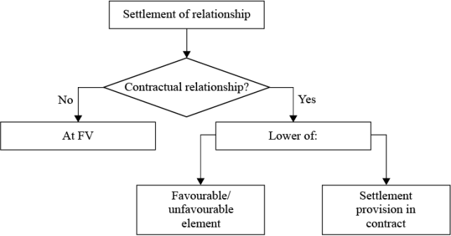

# 29 - Business combinations (IFRS 3)

[返回目录](README.md)

##### EX 29.159.2 – Measurement of non-controlling interest in a business combination including preference shares

 

Reference to standard: IFRS 3 para 19   
Reference to standing text: [29.159](50.md#s209-Para_29.159)   

  

 

**Example**

Entity B has issued 1,000 common shares and 100 preference shares (nominal value of C1 per preference share). The preference shares are appropriately classified within equity. The preference shares give their holders a right to a preferential dividend in priority to the payment of any dividend to the holders of common shares. On liquidation of entity B, the holders of the preference shares are entitled to receive C1 per share in priority to the holders of the common shares. The holders of the preference shares do not have any further rights on liquidation.

Entity A acquires 800 common shares of entity B, resulting in entity A controlling entity B. The acquisition-date fair value of a preference share is CU1.2 per share.

How should entity A measure the non-controlling interest including preference shares?

**Analysis**

Entity A can choose to measure the non-controlling interest that relates to the 200 common shares either at fair value or at the proportionate share of entity B’s identifiable net assets.

The non-controlling interest, including preference shares, that relates to entity B’s preference shares should be measured at fair value. The preference shares do not entitle their holders to a proportionate share of entity B’s net assets in the event of liquidation. Entity A must measure the preference shares at their acquisition-date fair value of CU120 (100 preference shares × CU1.2 per share).

 

##### Determining the impact of control on the non-controlling interest

###### FAQ 29.161.1 – What is the impact of control on the measurement of non-controlling interest?

 

Reference to standard: IFRS 3 para B45   
Reference to standing text: [29.161](50.md#s209-Para_29.161)   

  

 

**Question**

What is the impact of control on the measurement of non-controlling interest (NCI)?

**Answer**

A control premium generally represents the amount paid by a new controlling shareholder for the benefit of controlling the acquiree’s assets and cash flows. The elements of control derived by an acquirer can be categorised as (i) benefits derived from potential synergies that result from combining the acquirer’s assets with the acquiree’s assets, and (ii) the acquirer’s ability to control the acquiree’s operating, financial or corporate governance characteristics.

Synergies will often benefit the acquiree as a whole, including the NCI. However, the NCI shareholders will not benefit from the synergies that benefit the acquirer, because the controlling shareholder might not decide to distribute dividends or might control the profits of the acquiree. Entities should assess whether the consideration transferred includes a control premium and whether part or all of the control premium should extend to the NCI.

To derive a non-controlling interest value from a controlling interest value, consideration of a non-controlling (minority interest) discount might be necessary. Entities should not mechanically apply a non-controlling discount to a controlling interest without considering whether the facts and circumstances related to the transaction indicate that a difference exists between the controlling and non-controlling values.

When the existence of a control premium is being assessed, it is helpful to understand how the negotiations between the acquiree and acquirer evolved – for example, if multiple bidders were involved in the negotiations, the factors that were included in determining the amount of consideration transferred. Additionally, understanding the significant issues that were subject to the negotiations, and how they were eventually resolved, will provide valuable insight into determining the existence of a control premium. Guidance on control premiums is also given in IFRS 13, which is considered in more detail in [chapter 5 para 128](11.md#s34-Para_5.128).

 

##### Calls and puts related to non-controlling interest

###### EX 29.162.1 – Legal obligation to launch a takeover bid

 

Reference to standard: IFRS 3   
Reference to standing text: [29.162](50.md#s209-Para_29.162)   

  

 

**Example**

An entity acquires a controlling interest in a listed entity. The entity is obliged, by local law, to launch a takeover bid for the remaining shares. Is the entity required to recognise a financial liability for this obligation under IAS 32, or a provision under IAS 37?

**Analysis**

No. A financial liability arises from the existence of a contractual obligation of one party to the financial instrument (the issuer) to deliver cash to the other party (the holder). [IAS 32 para 17]. A statutory requirement to launch a takeover bid is a legal obligation but not a contractual obligation. As regards IAS 37, the legal requirement to launch a takeover bid gives rise to an obligation to exchange one asset (such as cash) for another (such as shares in the acquiree), and so it is executory in nature. Contracts that are executory in nature are excluded from the scope of IAS 37. Accordingly, neither IAS 32 nor IAS 37 requires a liability to be recognised, unless onerous.

However, recognising the acquisition and a financial liability for the amount of the offer as linked transactions is an acceptable approach. This reflects that an outflow of economic benefits in relation to the mandatory tender offer is expected. Furthermore, this matter was discussed by the Interpretations Committee and the IASB in May 2013. Whilst no conclusion was reached, it was observed that the obligation to launch a takeover bid is economically similar to a put option written on a non-controlling interest. It follows that recognising a liability in the manner similar to that recognised for a put option written on a non-controlling interest under IAS 32 would provide relevant information to the users of the financial statements.

Management should disclose the accounting treatment adopted and, where a liability is recognised, the nature of the liability and how it is measured.

 

##### Non-controlling interest in a reverse acquisition

###### EX 29.164.1 – Reverse acquisition with a non-controlling interest

 

Reference to standard: IFRS 3 para B24   
Reference to standing text: [29.164](50.md#s209-Para_29.164)   

  

 

**Example**

Entity B, a large unlisted business, has combined with entity A, a small listed business. Before the combination, entity A had 100 shares in issue, which were widely held. Entity B had 60 shares in issue, held by the B family. The combination was designed to provide entity B with a stock exchange listing.

The combination was accomplished through entity A issuing 2.5 new shares in exchange for each ordinary share of entity B. B’s shareholders exchanged 54 shares for those of entity A. Entity A, therefore, issued 135 ordinary shares in exchange for 54 of entity B’s ordinary shares.

**Analysis**

The transaction is a reverse acquisition, since entity B’s shareholders own 135 out of 235 shares in entity A (57.4%). Entity A’s shareholders own 100 out of 235 shares (42.6%). Entity B is able to nominate the board of directors and to control entity A. The six shares that remain outstanding in entity B would continue to have voting rights, but only as non-controlling interest holders.

Entity B is the accounting acquirer, but there is a non-controlling interest, because the holders of six shares in entity B did not take part in the exchange transaction. They have no interest in the combined entity; their interest is limited to entity B.

In entity A’s consolidated financial statements, the non-controlling interest is 10% (6/60 issued shares of entity B). The non-controlling interest should reflect the non-controlling interest shareholders’ proportionate interest in the pre-combination carrying amounts of the legal subsidiary’s net assets.

Entity B is the accounting acquirer, so its assets remain at their pre-combination carrying amounts, and the non-controlling interest is 10% of the pre-combination carrying amount of entity B’s net assets.

The fair value of the consideration that is effectively transferred is the same, whether a non-controlling interest exists or not, because all of the shareholders of the legal parent (accounting acquiree) participate in the exchange.

 

##### Business combinations achieved without consideration transferred

###### EX 29.165.1 – Measurement of non-controlling interest in a business combination achieved by contract alone

 

Reference to standard: IFRS 3 para 44   
Reference to standing text: [29.165](50.md#s209-Para_29.165)   

  

 

The measurement of non-controlling interest will determine whether or not goodwill is recognised in a combination by contract alone.

**Example**

Entities A and B decide to combine to form a dual-listed entity (DLE). Both entities will retain their original listing, but they will have the same board of directors. Entity A is the larger entity, and its shareholders will receive 55% of the DLE’s profits. The board will comprise four entity A members and three entity B members.

The fair value of entity A is C62.3 billion; the fair value of entity B is C49.3 billion. The IFRS 3 value of entity B’s identifiable net assets is C38.5 billion. How is the business combination accounted for?

**Analysis**

**Non-controlling interest is measured at fair value**

Entity A is determined to be the acquirer.

Goodwill is the difference between 1 and 2 below:

<table style="width:100%; border-collapse:collapse"><tr><td style="border:0.75pt solid #000000; padding-right:5.03pt; padding-left:5.03pt; vertical-align:top">
1
</td><td colspan="2" style="border:0.75pt solid #000000; padding-right:5.03pt; padding-left:5.03pt; vertical-align:top">
the aggregate of:
</td></tr><tr><td style="border:0.75pt solid #000000; padding-right:5.03pt; padding-left:5.03pt; vertical-align:top">
 
</td><td style="border:0.75pt solid #000000; padding-right:5.03pt; padding-left:5.03pt; vertical-align:top">
(i)
</td><td style="border:0.75pt solid #000000; padding-right:5.03pt; padding-left:5.03pt; vertical-align:top">
consideration transferred;
</td></tr><tr><td style="border:0.75pt solid #000000; padding-right:5.03pt; padding-left:5.03pt; vertical-align:top">
 
</td><td style="border:0.75pt solid #000000; padding-right:5.03pt; padding-left:5.03pt; vertical-align:top">
(ii)
</td><td style="border:0.75pt solid #000000; padding-right:5.03pt; padding-left:5.03pt; vertical-align:top">
any non-controlling interest;
</td></tr><tr><td style="border:0.75pt solid #000000; padding-right:5.03pt; padding-left:5.03pt; vertical-align:top">
 
</td><td style="border:0.75pt solid #000000; padding-right:5.03pt; padding-left:5.03pt; vertical-align:top">
(iii)
</td><td style="border:0.75pt solid #000000; padding-right:5.03pt; padding-left:5.03pt; vertical-align:top">
the acquirer’s previously held interest; and
</td></tr><tr><td style="border:0.75pt solid #000000; padding-right:5.03pt; padding-left:5.03pt; vertical-align:top">
2
</td><td colspan="2" style="border:0.75pt solid #000000; padding-right:5.03pt; padding-left:5.03pt; vertical-align:top">
The IFRS 3 value of net identifiable assets.
</td></tr></table>

Accordingly, the amounts are as follows:

<table style="width:100%; border-collapse:collapse"><tr><td style="width:7.52%; border:0.75pt solid #000000; padding-right:5.03pt; padding-left:5.03pt; vertical-align:top">
1
</td><td style="width:9.12%; border:0.75pt solid #000000; padding-right:5.03pt; padding-left:5.03pt; vertical-align:top">
(i)
</td><td style="width:83.36%; border:0.75pt solid #000000; padding-right:5.03pt; padding-left:5.03pt; vertical-align:top">
nil;
</td></tr><tr><td style="width:7.52%; border:0.75pt solid #000000; padding-right:5.03pt; padding-left:5.03pt; vertical-align:top">
 
</td><td style="width:9.12%; border:0.75pt solid #000000; padding-right:5.03pt; padding-left:5.03pt; vertical-align:top">
(ii)
</td><td style="width:83.36%; border:0.75pt solid #000000; padding-right:5.03pt; padding-left:5.03pt; vertical-align:top">
C49.3 billion;
</td></tr><tr><td style="width:7.52%; border:0.75pt solid #000000; padding-right:5.03pt; padding-left:5.03pt; vertical-align:top">
 
</td><td style="width:9.12%; border:0.75pt solid #000000; padding-right:5.03pt; padding-left:5.03pt; vertical-align:top">
(iii)
</td><td style="width:83.36%; border:0.75pt solid #000000; padding-right:5.03pt; padding-left:5.03pt; vertical-align:top">
not applicable; and
</td></tr><tr><td style="width:7.52%; border:0.75pt solid #000000; padding-right:5.03pt; padding-left:5.03pt; vertical-align:top">
2
</td><td colspan="2" style="border:0.75pt solid #000000; padding-right:5.03pt; padding-left:5.03pt; vertical-align:top">
C38.5 billion.
</td></tr></table>

Goodwill of C10.8 billion is recognised in a combination achieved by contract alone, where the non-controlling interest is recognised at fair value.

**Non-controlling interest is measured at proportionate share of net assets**

Entity A is determined to be the acquirer.

Goodwill is calculated as above, being the difference between 1 and 2 below:

<table style="width:100%; border-collapse:collapse"><tr><td style="width:7.52%; border:0.75pt solid #000000; padding-right:5.03pt; padding-left:5.03pt; vertical-align:top">
1
</td><td style="width:9.12%; border:0.75pt solid #000000; padding-right:5.03pt; padding-left:5.03pt; vertical-align:top">
(i)
</td><td style="width:83.36%; border:0.75pt solid #000000; padding-right:5.03pt; padding-left:5.03pt; vertical-align:top">
nil;
</td></tr><tr><td style="width:7.52%; border:0.75pt solid #000000; padding-right:5.03pt; padding-left:5.03pt; vertical-align:top">
 
</td><td style="width:9.12%; border:0.75pt solid #000000; padding-right:5.03pt; padding-left:5.03pt; vertical-align:top">
(ii)
</td><td style="width:83.36%; border:0.75pt solid #000000; padding-right:5.03pt; padding-left:5.03pt; vertical-align:top">
C38.5 billion;
</td></tr><tr><td style="width:7.52%; border:0.75pt solid #000000; padding-right:5.03pt; padding-left:5.03pt; vertical-align:top">
 
</td><td style="width:9.12%; border:0.75pt solid #000000; padding-right:5.03pt; padding-left:5.03pt; vertical-align:top">
(iii)
</td><td style="width:83.36%; border:0.75pt solid #000000; padding-right:5.03pt; padding-left:5.03pt; vertical-align:top">
not applicable; and
</td></tr><tr><td style="width:7.52%; border:0.75pt solid #000000; padding-right:5.03pt; padding-left:5.03pt; vertical-align:top">
2
</td><td colspan="2" style="border:0.75pt solid #000000; padding-right:5.03pt; padding-left:5.03pt; vertical-align:top">
C38.5 billion.
</td></tr></table>

No goodwill is recognised in a combination achieved by contract alone, where the non-controlling interest is measured at its proportionate share of net assets.

 

### Business combinations achieved in stages

#### FAQ 29.167.1 – How should an acquirer accounting for step acquisitions?

 

Reference to standard: IFRS 3 para 42   
Reference to standing text: [29.167](50.md#s209-Para_29.167)   

  

 

**Question**

How should an acquirer account for step acquisitions?

**Answer**

The flowchart below depicts the accounting considerations that an acquirer should evaluate when a business combination is achieved in stages (step acquisition):

 

#### EX 29.167.2 – Control obtained in step acquisition

 

Reference to standard: IFRS 3 para 42   
Reference to standing text: [29.167](50.md#s209-Para_29.167)   

  

 

**Example**

Entity A has a 40% equity interest in entity B. The carrying value of the equity interest, which has been accounted for as an associate in accordance with IAS 28, is C20 million. Entity A purchases the remaining 60% interest in entity B for C300 million in cash. The fair value of the 40% previously held equity interest is determined to be C200 million. The net value of the identifiable assets and liabilities is determined to be C440 million. The tax consequences, on the gain or loss on remeasurement of the associate interest, have been ignored in this example. How does entity A account for the business combination?

**Analysis**

Entity A recognises at the acquisition date:

- 100% of the identifiable net assets.

- goodwill as the excess of 1 over 2 below:

- The aggregate of:

- the consideration transferred;

- the amount of any non-controlling interest (not applicable in this example); and

- the acquisition date fair value of the acquirer’s previously held equity interest in the acquiree.

- The assets and liabilities recognised in accordance with IFRS 3.

 

The journal entry recorded on the acquisition date of the 60% controlling interest is as follows:

<table style="width:100%; border-collapse:collapse"><tr><td style="border:0.75pt solid #000000; padding-right:5.03pt; padding-left:5.03pt; vertical-align:top">
 
</td><td style="border:0.75pt solid #000000; padding-right:5.03pt; padding-left:5.03pt; vertical-align:top">
 
</td><td style="border:0.75pt solid #000000; padding-right:5.03pt; padding-left:5.03pt; vertical-align:top">
<b>Dr</b>
</td><td style="border:0.75pt solid #000000; padding-right:5.03pt; padding-left:5.03pt; vertical-align:top">
<b>Cr</b>
</td></tr><tr><td style="border:0.75pt solid #000000; padding-right:5.03pt; padding-left:5.03pt; vertical-align:top">
 
</td><td style="border:0.75pt solid #000000; padding-right:5.03pt; padding-left:5.03pt; vertical-align:top">
 
</td><td style="border:0.75pt solid #000000; padding-right:5.03pt; padding-left:5.03pt; vertical-align:top">
<b>C’m</b>
</td><td style="border:0.75pt solid #000000; padding-right:5.03pt; padding-left:5.03pt; vertical-align:top">
<b>C’m</b>
</td></tr><tr><td colspan="2" style="border:0.75pt solid #000000; padding-right:5.03pt; padding-left:5.03pt; vertical-align:top">
Dr Identifiable net assets
</td><td style="border:0.75pt solid #000000; padding-right:5.03pt; padding-left:5.03pt; vertical-align:top">
440
</td><td style="border:0.75pt solid #000000; padding-right:5.03pt; padding-left:5.03pt; vertical-align:top">
 
</td></tr><tr><td colspan="2" style="border:0.75pt solid #000000; padding-right:5.03pt; padding-left:5.03pt; vertical-align:top">
Dr Goodwill
</td><td style="border:0.75pt solid #000000; padding-right:5.03pt; padding-left:5.03pt; vertical-align:top">
60
</td><td style="border:0.75pt solid #000000; padding-right:5.03pt; padding-left:5.03pt; vertical-align:top">
 
</td></tr><tr><td style="border:0.75pt solid #000000; padding-right:5.03pt; padding-left:5.03pt; vertical-align:top">
 
</td><td style="border:0.75pt solid #000000; padding-right:5.03pt; padding-left:5.03pt; vertical-align:top">
Cr Cash
</td><td style="border:0.75pt solid #000000; padding-right:5.03pt; padding-left:5.03pt; vertical-align:top">
 
</td><td style="border:0.75pt solid #000000; padding-right:5.03pt; padding-left:5.03pt; vertical-align:top">
300
</td></tr><tr><td style="border:0.75pt solid #000000; padding-right:5.03pt; padding-left:5.03pt; vertical-align:top">
 
</td><td style="border:0.75pt solid #000000; padding-right:5.03pt; padding-left:5.03pt; vertical-align:top">
Cr Associate
</td><td style="border:0.75pt solid #000000; padding-right:5.03pt; padding-left:5.03pt; vertical-align:top">
 
</td><td style="border:0.75pt solid #000000; padding-right:5.03pt; padding-left:5.03pt; vertical-align:top">
20
</td></tr><tr><td style="border:0.75pt solid #000000; padding-right:5.03pt; padding-left:5.03pt; vertical-align:top">
 
</td><td style="border:0.75pt solid #000000; padding-right:5.03pt; padding-left:5.03pt; vertical-align:top">
Cr Gain on equity interest
</td><td style="border:0.75pt solid #000000; padding-right:5.03pt; padding-left:5.03pt; vertical-align:top">
 
</td><td style="border:0.75pt solid #000000; padding-right:5.03pt; padding-left:5.03pt; vertical-align:top">
180
</td></tr></table>

 

Goodwill is calculated as follows:

<table style="width:100%; border-collapse:collapse"><tr><td style="width:84.84%; border:0.75pt solid #000000; padding-right:5.03pt; padding-left:5.03pt; vertical-align:top">
 
</td><td style="width:15.16%; border:0.75pt solid #000000; padding-right:5.03pt; padding-left:5.03pt; vertical-align:top">
<b>C’m</b>
</td></tr><tr><td style="width:84.84%; border:0.75pt solid #000000; padding-right:5.03pt; padding-left:5.03pt; vertical-align:top">
Fair value of consideration transferred
</td><td style="width:15.16%; border:0.75pt solid #000000; padding-right:5.03pt; padding-left:5.03pt; vertical-align:top">
300
</td></tr><tr><td style="width:84.84%; border:0.75pt solid #000000; padding-right:5.03pt; padding-left:5.03pt; vertical-align:top">
Fair value of previously held equity interest
</td><td style="width:15.16%; border:0.75pt solid #000000; padding-right:5.03pt; padding-left:5.03pt; vertical-align:top">
200
</td></tr><tr><td style="width:84.84%; border:0.75pt solid #000000; padding-right:5.03pt; padding-left:5.03pt; vertical-align:top">
 
</td><td style="width:15.16%; border:0.75pt solid #000000; padding-right:5.03pt; padding-left:5.03pt; vertical-align:top">
500
</td></tr><tr><td style="width:84.84%; border:0.75pt solid #000000; padding-right:5.03pt; padding-left:5.03pt; vertical-align:top">
Recognised value of 100% of the identifiable net assets, measured in accordance with IFRS 3
</td><td style="width:15.16%; border:0.75pt solid #000000; padding-right:5.03pt; padding-left:5.03pt; vertical-align:top">
(440)
</td></tr><tr><td style="width:84.84%; border:0.75pt solid #000000; padding-right:5.03pt; padding-left:5.03pt; vertical-align:top">
Goodwill recognised
</td><td style="width:15.16%; border:0.75pt solid #000000; padding-right:5.03pt; padding-left:5.03pt; vertical-align:top">
60
</td></tr></table>

The gain on the 40% previously held equity interest is recognised in the income statement. The fair value of the previously held equity interest, less the carrying value of the previously held equity interest, is C180 million (C200m − C20m).

Assume that the previously held interest is accounted for under IFRS 9 and measured at fair value with gains and losses recorded in OCI. At the date of the business combination, it is recorded at C200 million, with a revaluation reserve of C180 million recorded in equity. The entries, when control is obtained, would be:

<table style="width:100%; border-collapse:collapse"><tr><td style="width:6.02%; border:0.75pt solid #000000; padding-right:5.03pt; padding-left:5.03pt; vertical-align:top">
 
</td><td style="width:63.66%; border:0.75pt solid #000000; padding-right:5.03pt; padding-left:5.03pt; vertical-align:top">
 
</td><td style="width:15.16%; border:0.75pt solid #000000; padding-right:5.03pt; padding-left:5.03pt; vertical-align:top">
<b>Dr</b>
</td><td style="width:15.16%; border:0.75pt solid #000000; padding-right:5.03pt; padding-left:5.03pt; vertical-align:top">
<b>Cr</b>
</td></tr><tr><td style="width:6.02%; border:0.75pt solid #000000; padding-right:5.03pt; padding-left:5.03pt; vertical-align:top">
 
</td><td style="width:63.66%; border:0.75pt solid #000000; padding-right:5.03pt; padding-left:5.03pt; vertical-align:top">
 
</td><td style="width:15.16%; border:0.75pt solid #000000; padding-right:5.03pt; padding-left:5.03pt; vertical-align:top">
<b>C’m</b>
</td><td style="width:15.16%; border:0.75pt solid #000000; padding-right:5.03pt; padding-left:5.03pt; vertical-align:top">
<b>C’m</b>
</td></tr><tr><td colspan="2" style="border:0.75pt solid #000000; padding-right:5.03pt; padding-left:5.03pt; vertical-align:top">
Dr Identifiable net assets
</td><td style="width:15.16%; border:0.75pt solid #000000; padding-right:5.03pt; padding-left:5.03pt; vertical-align:top">
440
</td><td style="width:15.16%; border:0.75pt solid #000000; padding-right:5.03pt; padding-left:5.03pt; vertical-align:top">
 
</td></tr><tr><td colspan="2" style="border:0.75pt solid #000000; padding-right:5.03pt; padding-left:5.03pt; vertical-align:top">
Dr Goodwill
</td><td style="width:15.16%; border:0.75pt solid #000000; padding-right:5.03pt; padding-left:5.03pt; vertical-align:top">
60
</td><td style="width:15.16%; border:0.75pt solid #000000; padding-right:5.03pt; padding-left:5.03pt; vertical-align:top">
 
</td></tr><tr><td style="width:6.02%; border:0.75pt solid #000000; padding-right:5.03pt; padding-left:5.03pt; vertical-align:top">
 
</td><td style="width:63.66%; border:0.75pt solid #000000; padding-right:5.03pt; padding-left:5.03pt; vertical-align:top">
Cr Cash
</td><td style="width:15.16%; border:0.75pt solid #000000; padding-right:5.03pt; padding-left:5.03pt; vertical-align:top">
 
</td><td style="width:15.16%; border:0.75pt solid #000000; padding-right:5.03pt; padding-left:5.03pt; vertical-align:top">
300
</td></tr><tr><td style="width:6.02%; border:0.75pt solid #000000; padding-right:5.03pt; padding-left:5.03pt; vertical-align:top">
 
</td><td style="width:63.66%; border:0.75pt solid #000000; padding-right:5.03pt; padding-left:5.03pt; vertical-align:top">
Cr Financial assets at FV through OCI
</td><td style="width:15.16%; border:0.75pt solid #000000; padding-right:5.03pt; padding-left:5.03pt; vertical-align:top">
 
</td><td style="width:15.16%; border:0.75pt solid #000000; padding-right:5.03pt; padding-left:5.03pt; vertical-align:top">
200
</td></tr><tr><td colspan="2" style="border:0.75pt solid #000000; padding-right:5.03pt; padding-left:5.03pt; vertical-align:top">
Dr Revaluation reserve
</td><td style="width:15.16%; border:0.75pt solid #000000; padding-right:5.03pt; padding-left:5.03pt; vertical-align:top">
180
</td><td style="width:15.16%; border:0.75pt solid #000000; padding-right:5.03pt; padding-left:5.03pt; vertical-align:top">
 
</td></tr><tr><td style="width:6.02%; border:0.75pt solid #000000; padding-right:5.03pt; padding-left:5.03pt; vertical-align:top">
 
</td><td style="width:63.66%; border:0.75pt solid #000000; padding-right:5.03pt; padding-left:5.03pt; vertical-align:top">
Cr Equity
</td><td style="width:15.16%; border:0.75pt solid #000000; padding-right:5.03pt; padding-left:5.03pt; vertical-align:top">
 
</td><td style="width:15.16%; border:0.75pt solid #000000; padding-right:5.03pt; padding-left:5.03pt; vertical-align:top">
180
</td></tr></table>

When control is obtained, financial assets accounted for under IFRS 9 at FVOCI are not recycled but can be reclassified within equity. Similarly, revaluation reserves related to the revaluation of property, plant and equipment or intangible assets are not recycled but transferred directly to retained earnings. Other reserves held in equity that relates to the previously held interest, such as cumulative translation differences, would be recycled through profit and loss.

[IAS 16 para 41]. [IAS 38 para 87].

 

### Recognising and measuring goodwill or a gain from a bargain purchase

#### Goodwill

##### EX 29.171.1 – Components making up goodwill

 

Reference to standard: IFRS 3 para B64(e)   
Reference to standing text: [29.171](50.md#s210-Para_29.171)   

  

 

**Example**

An entity that has one existing business acquires a business from another entity. The total amount of goodwill recognised in the transaction is C100. The acquirer’s management expects to benefit from synergies of the business combination, specifically from cost savings and an increase in market share. The acquired business also included assembled workforce and non-contractual customer relationships that are not separable. These items are not identifiable assets, and they are subsumed into goodwill.

**Analysis**

These components of goodwill should be disclosed in the business combination note. There is no requirement to quantify the separate components of goodwill. [IFRS 3 App B para B64(e)].

 

##### EX 29.173.1 – Goodwill recognised depends on how non-controlling interest is measured

 

Reference to standard: IFRS 3 para 32   
Reference to standing text: [29.173](50.md#s210-Para_29.173)   

  

 

Goodwill is measured as a residual. Where an entity acquires less than 100% of a business, goodwill could be one of two different amounts, depending on the choice that an entity makes when it decides how to measure non-controlling interest (NCI). NCI could be measured using the fair value method or the proportionate share method. Entities can choose between these two treatments on a business-combination-by-business-combination basis (see further [para 29.159](50.md#s209-Para_29.159)):

- Goodwill will only include amounts relating to the acquiring entity’s interest in the business acquired where NCI is measured at the NCI’s proportionate share of the acquiree’s identifiable net assets.

- Goodwill will include amounts relating to both the acquiring entity’s interest and the NCI in the business acquired where NCI is measured at fair value.

 

**Example**

Entity A acquires entity B by purchasing 60% of its equity for C150 million in cash. The net aggregate value of the identifiable assets and liabilities, as measured in accordance with IFRS 3, is determined to be C50 million.

How much goodwill is recognised based on the two measurement bases of NCI?

**Analysis**

Measurement at proportionate share of the acquiree’s identifiable net assets

Entity A decides to measure NCI at its proportionate share (40%) of entity B’s identifiable net assets.

The goodwill recognised under IFRS 3 represents entity A’s 60% share of the total goodwill attributable to entity B. It does not include any amount of goodwill attributable to the 40% NCI.

The journal entry recorded on the acquisition date for the 60% interest acquired is as follows:

<table style="width:100%; border-collapse:collapse"><tr><td colspan="2" style="border:0.75pt solid #000000; padding-right:5.03pt; padding-left:5.03pt; vertical-align:top">
 
</td><td style="width:15.16%; border:0.75pt solid #000000; padding-right:5.03pt; padding-left:5.03pt; vertical-align:top">
<b>Dr</b>
</td><td style="width:15.16%; border:0.75pt solid #000000; padding-right:5.03pt; padding-left:5.03pt; vertical-align:top">
<b>Cr</b>
</td></tr><tr><td colspan="2" style="border:0.75pt solid #000000; padding-right:5.03pt; padding-left:5.03pt; vertical-align:top">
 
</td><td style="width:15.16%; border:0.75pt solid #000000; padding-right:5.03pt; padding-left:5.03pt; vertical-align:top">
<b>C’m</b>
</td><td style="width:15.16%; border:0.75pt solid #000000; padding-right:5.03pt; padding-left:5.03pt; vertical-align:top">
<b>C’m</b>
</td></tr><tr><td colspan="2" style="border:0.75pt solid #000000; padding-right:5.03pt; padding-left:5.03pt; vertical-align:top">
Dr Identifiable net assets
</td><td style="width:15.16%; border:0.75pt solid #000000; padding-right:5.03pt; padding-left:5.03pt; vertical-align:top">
50
</td><td style="width:15.16%; border:0.75pt solid #000000; padding-right:5.03pt; padding-left:5.03pt; vertical-align:top">
 
</td></tr><tr><td colspan="2" style="border:0.75pt solid #000000; padding-right:5.03pt; padding-left:5.03pt; vertical-align:top">
Dr Goodwill
</td><td style="width:15.16%; border:0.75pt solid #000000; padding-right:5.03pt; padding-left:5.03pt; vertical-align:top">
120
</td><td style="width:15.16%; border:0.75pt solid #000000; padding-right:5.03pt; padding-left:5.03pt; vertical-align:top">
 
</td></tr><tr><td style="width:6.02%; border:0.75pt solid #000000; padding-right:5.03pt; padding-left:5.03pt; vertical-align:top">
 
</td><td style="width:63.66%; border:0.75pt solid #000000; padding-right:5.03pt; padding-left:5.03pt; vertical-align:top">
Cr Cash
</td><td style="width:15.16%; border:0.75pt solid #000000; padding-right:5.03pt; padding-left:5.03pt; vertical-align:top">
 
</td><td style="width:15.16%; border:0.75pt solid #000000; padding-right:5.03pt; padding-left:5.03pt; vertical-align:top">
150
</td></tr><tr><td style="width:6.02%; border:0.75pt solid #000000; padding-right:5.03pt; padding-left:5.03pt; vertical-align:top">
 
</td><td style="width:63.66%; border:0.75pt solid #000000; padding-right:5.03pt; padding-left:5.03pt; vertical-align:top">
Cr NCI
</td><td style="width:15.16%; border:0.75pt solid #000000; padding-right:5.03pt; padding-left:5.03pt; vertical-align:top">
 
</td><td style="width:15.16%; border:0.75pt solid #000000; padding-right:5.03pt; padding-left:5.03pt; vertical-align:top">
20
</td></tr></table>

 

NCI is (C50m × 40%) = C20m. Hence, goodwill of C120 million is calculated as consideration of C150 million plus NCI of C20 million, less identifiable assets and liabilities of C50 million.

Measurement at fair value

Entity A decides to measure NCI at fair value rather than at its proportionate share of the identifiable net assets. The fair value of NCI is determined to be C100 million, which is the same as the fair value on a per-share basis of the purchased interest.

Goodwill recognised under IFRS 3 represents the group’s share of the total goodwill attributable to entity B, and the NCI’s share of the total goodwill attributable to entity B.

The acquirer recognises at the acquisition date (i) 100% of the identifiable net assets, (ii) NCI at fair value, and (iii) goodwill.

The journal entry recorded on the acquisition date for the 60% interest acquired is as follows:

<table style="width:100%; border-collapse:collapse"><tr><td colspan="2" style="border:0.75pt solid #000000; padding-right:5.03pt; padding-left:5.03pt; vertical-align:top">
 
</td><td style="width:15.16%; border:0.75pt solid #000000; padding-right:5.03pt; padding-left:5.03pt; vertical-align:top">
<b>Dr</b>
</td><td style="width:15.16%; border:0.75pt solid #000000; padding-right:5.03pt; padding-left:5.03pt; vertical-align:top">
<b>Cr</b>
</td></tr><tr><td colspan="2" style="border:0.75pt solid #000000; padding-right:5.03pt; padding-left:5.03pt; vertical-align:top">
 
</td><td style="width:15.16%; border:0.75pt solid #000000; padding-right:5.03pt; padding-left:5.03pt; vertical-align:top">
<b>C’m</b>
</td><td style="width:15.16%; border:0.75pt solid #000000; padding-right:5.03pt; padding-left:5.03pt; vertical-align:top">
<b>C’m</b>
</td></tr><tr><td colspan="2" style="border:0.75pt solid #000000; padding-right:5.03pt; padding-left:5.03pt; vertical-align:top">
Dr Identifiable net assets
</td><td style="width:15.16%; border:0.75pt solid #000000; padding-right:5.03pt; padding-left:5.03pt; vertical-align:top">
50
</td><td style="width:15.16%; border:0.75pt solid #000000; padding-right:5.03pt; padding-left:5.03pt; vertical-align:top">
 
</td></tr><tr><td colspan="2" style="border:0.75pt solid #000000; padding-right:5.03pt; padding-left:5.03pt; vertical-align:top">
Dr Goodwill
</td><td style="width:15.16%; border:0.75pt solid #000000; padding-right:5.03pt; padding-left:5.03pt; vertical-align:top">
200
</td><td style="width:15.16%; border:0.75pt solid #000000; padding-right:5.03pt; padding-left:5.03pt; vertical-align:top">
 
</td></tr><tr><td style="width:6.02%; border:0.75pt solid #000000; padding-right:5.03pt; padding-left:5.03pt; vertical-align:top">
 
</td><td style="width:63.68%; border:0.75pt solid #000000; padding-right:5.03pt; padding-left:5.03pt; vertical-align:top">
Cr Cash
</td><td style="width:15.16%; border:0.75pt solid #000000; padding-right:5.03pt; padding-left:5.03pt; vertical-align:top">
 
</td><td style="width:15.16%; border:0.75pt solid #000000; padding-right:5.03pt; padding-left:5.03pt; vertical-align:top">
150
</td></tr><tr><td style="width:6.02%; border:0.75pt solid #000000; padding-right:5.03pt; padding-left:5.03pt; vertical-align:top">
 
</td><td style="width:63.68%; border:0.75pt solid #000000; padding-right:5.03pt; padding-left:5.03pt; vertical-align:top">
Cr NCI
</td><td style="width:15.16%; border:0.75pt solid #000000; padding-right:5.03pt; padding-left:5.03pt; vertical-align:top">
 
</td><td style="width:15.16%; border:0.75pt solid #000000; padding-right:5.03pt; padding-left:5.03pt; vertical-align:top">
100
</td></tr></table>

 

##### EX 29.173.2 – Gain on a bargain purchase depends on how non-controlling interest is measured

 

Reference to standard: IFRS 3 para 19   
Reference to standing text: [29.173](50.md#s210-Para_29.173)   

  

Where identifiable net assets are greater than the fair value of the consideration transferred plus the recognised amount of non-controlling interest (NCI), a bargain purchase gain is recognised in the income statement.

The bargain purchase gain recognised under the proportionate share method might be higher than the gain recognised under the fair value method where the fair value of NCI includes positive goodwill. This is because the NCI measured at the proportionate share of net assets will be lower, leading to a greater difference between identifiable net assets and consideration plus NCI.

**Example**

Entity A acquires entity B by purchasing 70% of its equity for C150 million in cash. The fair value of NCI is determined to be C69 million. The net aggregate value of the identifiable assets and liabilities is determined to be C220 million. For the purposes of this example, the tax consequences have been ignored.

**Analysis**

Measurement at proportionate share of the acquiree’s identifiable net assets

Management has elected to measure NCI using the proportionate share method for this business combination.

The bargain purchase gain is calculated as follows:

<table style="width:100%; border-collapse:collapse"><tr><td style="width:84.84%; border:0.75pt solid #000000; padding-right:5.03pt; padding-left:5.03pt; vertical-align:top">
 
</td><td style="width:15.16%; border:0.75pt solid #000000; padding-right:5.03pt; padding-left:5.03pt; vertical-align:top">
<b>C’m</b>
</td></tr><tr><td style="width:84.84%; border:0.75pt solid #000000; padding-right:5.03pt; padding-left:5.03pt; vertical-align:top">
Fair value of consideration transferred
</td><td style="width:15.16%; border:0.75pt solid #000000; padding-right:5.03pt; padding-left:5.03pt; vertical-align:top">
150
</td></tr><tr><td style="width:84.84%; border:0.75pt solid #000000; padding-right:5.03pt; padding-left:5.03pt; vertical-align:top">
NCI based on proportionate share of net assets
</td><td style="width:15.16%; border:0.75pt solid #000000; padding-right:5.03pt; padding-left:5.03pt; vertical-align:top">
66
</td></tr><tr><td style="width:84.84%; border:0.75pt solid #000000; padding-right:5.03pt; padding-left:5.03pt; vertical-align:top">
Fair value of previously held equity interest
</td><td style="width:15.16%; border:0.75pt solid #000000; padding-right:5.03pt; padding-left:5.03pt; vertical-align:top">
n/a
</td></tr><tr><td style="width:84.84%; border:0.75pt solid #000000; padding-right:5.03pt; padding-left:5.03pt; vertical-align:top">
 
</td><td style="width:15.16%; border:0.75pt solid #000000; padding-right:5.03pt; padding-left:5.03pt; vertical-align:top">
 
</td></tr><tr><td style="width:84.84%; border:0.75pt solid #000000; padding-right:5.03pt; padding-left:5.03pt; vertical-align:top">
 
</td><td style="width:15.16%; border:0.75pt solid #000000; padding-right:5.03pt; padding-left:5.03pt; vertical-align:top">
216
</td></tr><tr><td style="width:84.84%; border:0.75pt solid #000000; padding-right:5.03pt; padding-left:5.03pt; vertical-align:top">
Recognised value of 100% of the identifiable net assets, measured in accordance with the IFRS 3
</td><td style="width:15.16%; border:0.75pt solid #000000; padding-right:5.03pt; padding-left:5.03pt; vertical-align:top">
220
</td></tr><tr><td style="width:84.84%; border:0.75pt solid #000000; padding-right:5.03pt; padding-left:5.03pt; vertical-align:top">
 
</td><td style="width:15.16%; border:0.75pt solid #000000; padding-right:5.03pt; padding-left:5.03pt; vertical-align:top">
 
</td></tr><tr><td style="width:84.84%; border:0.75pt solid #000000; padding-right:5.03pt; padding-left:5.03pt; vertical-align:top">
Gain on bargain purchase
</td><td style="width:15.16%; border:0.75pt solid #000000; padding-right:5.03pt; padding-left:5.03pt; vertical-align:top">
 
</td></tr><tr><td style="width:84.84%; border:0.75pt solid #000000; padding-right:5.03pt; padding-left:5.03pt; vertical-align:top">
 
</td><td style="width:15.16%; border:0.75pt solid #000000; padding-right:5.03pt; padding-left:5.03pt; vertical-align:top">
 
</td></tr></table>

NCI is (C220m × 30%) = C66m. Hence, a bargain purchase gain of C4 million is recognised in the income statement, calculated as consideration of C150 million plus NCI of C66 million, less identifiable assets and liabilities of C220 million..

The journal entry recorded on the acquisition date of the 70% interest is as follows:

<table style="width:100%; border-collapse:collapse"><tr><td colspan="2" style="border:0.75pt solid #000000; padding-right:5.03pt; padding-left:5.03pt; vertical-align:top">
 
</td><td style="width:15.14%; border:0.75pt solid #000000; padding-right:5.03pt; padding-left:5.03pt; vertical-align:top">
<b>Dr</b>
</td><td style="width:15.16%; border:0.75pt solid #000000; padding-right:5.03pt; padding-left:5.03pt; vertical-align:top">
<b>Cr</b>
</td></tr><tr><td colspan="2" style="border:0.75pt solid #000000; padding-right:5.03pt; padding-left:5.03pt; vertical-align:top">
 
</td><td style="width:15.14%; border:0.75pt solid #000000; padding-right:5.03pt; padding-left:5.03pt; vertical-align:top">
<b>C’m</b>
</td><td style="width:15.16%; border:0.75pt solid #000000; padding-right:5.03pt; padding-left:5.03pt; vertical-align:top">
<b>C’m</b>
</td></tr><tr><td colspan="2" style="border:0.75pt solid #000000; padding-right:5.03pt; padding-left:5.03pt; vertical-align:top">
Dr Identifiable net assets
</td><td style="width:15.14%; border:0.75pt solid #000000; padding-right:5.03pt; padding-left:5.03pt; vertical-align:top">
220
</td><td style="width:15.16%; border:0.75pt solid #000000; padding-right:5.03pt; padding-left:5.03pt; vertical-align:top">
 
</td></tr><tr><td style="border:0.75pt solid #000000; padding-right:5.03pt; padding-left:5.03pt; vertical-align:top">
 
</td><td style="width:64.44%; border:0.75pt solid #000000; padding-right:5.03pt; padding-left:5.03pt; vertical-align:top">
Cr Cash
</td><td style="width:15.14%; border:0.75pt solid #000000; padding-right:5.03pt; padding-left:5.03pt; vertical-align:top">
 
</td><td style="width:15.16%; border:0.75pt solid #000000; padding-right:5.03pt; padding-left:5.03pt; vertical-align:top">
150
</td></tr><tr><td style="border:0.75pt solid #000000; padding-right:5.03pt; padding-left:5.03pt; vertical-align:top">
 
</td><td style="width:64.44%; border:0.75pt solid #000000; padding-right:5.03pt; padding-left:5.03pt; vertical-align:top">
Cr Gain on bargain purchase
</td><td style="width:15.14%; border:0.75pt solid #000000; padding-right:5.03pt; padding-left:5.03pt; vertical-align:top">
 
</td><td style="width:15.16%; border:0.75pt solid #000000; padding-right:5.03pt; padding-left:5.03pt; vertical-align:top">
4
</td></tr><tr><td style="border:0.75pt solid #000000; padding-right:5.03pt; padding-left:5.03pt; vertical-align:top">
 
</td><td style="width:64.44%; border:0.75pt solid #000000; padding-right:5.03pt; padding-left:5.03pt; vertical-align:top">
Cr NCI
</td><td style="width:15.14%; border:0.75pt solid #000000; padding-right:5.03pt; padding-left:5.03pt; vertical-align:top">
 
</td><td style="width:15.16%; border:0.75pt solid #000000; padding-right:5.03pt; padding-left:5.03pt; vertical-align:top">
66
</td></tr></table>

Measurement at fair value

Management has elected to measure NCI at fair value.

This fair value includes embedded goodwill of C3 million (FV of NCI − NCI’s share of identifiable assets = C69m - (C220m × 30%)). Although the NCI value includes C3 million of embedded goodwill, the consolidated financial statements do not contain a separate goodwill line item.

The bargain purchase gain is calculated as follows:

<table style="width:100%; border-collapse:collapse"><tr><td style="width:84.84%; border:0.75pt solid #000000; padding-right:5.03pt; padding-left:5.03pt; vertical-align:top">
 
</td><td style="width:15.16%; border:0.75pt solid #000000; padding-right:5.03pt; padding-left:5.03pt; vertical-align:top">
<b>C’m</b>
</td></tr><tr><td style="width:84.84%; border:0.75pt solid #000000; padding-right:5.03pt; padding-left:5.03pt; vertical-align:top">
Fair value of consideration transferred
</td><td style="width:15.16%; border:0.75pt solid #000000; padding-right:5.03pt; padding-left:5.03pt; vertical-align:top">
150
</td></tr><tr><td style="width:84.84%; border:0.75pt solid #000000; padding-right:5.03pt; padding-left:5.03pt; vertical-align:top">
Fair value of NCI
</td><td style="width:15.16%; border:0.75pt solid #000000; padding-right:5.03pt; padding-left:5.03pt; vertical-align:top">
69
</td></tr><tr><td style="width:84.84%; border:0.75pt solid #000000; padding-right:5.03pt; padding-left:5.03pt; vertical-align:top">
Fair value of previously held equity interest
</td><td style="width:15.16%; border:0.75pt solid #000000; padding-right:5.03pt; padding-left:5.03pt; vertical-align:top">
n/a
</td></tr><tr><td style="width:84.84%; border:0.75pt solid #000000; padding-right:5.03pt; padding-left:5.03pt; vertical-align:top">
 
</td><td style="width:15.16%; border:0.75pt solid #000000; padding-right:5.03pt; padding-left:5.03pt; vertical-align:top">
 
</td></tr><tr><td style="width:84.84%; border:0.75pt solid #000000; padding-right:5.03pt; padding-left:5.03pt; vertical-align:top">
 
</td><td style="width:15.16%; border:0.75pt solid #000000; padding-right:5.03pt; padding-left:5.03pt; vertical-align:top">
219
</td></tr><tr><td style="width:84.84%; border:0.75pt solid #000000; padding-right:5.03pt; padding-left:5.03pt; vertical-align:top">
Recognised value of 100% of the identifiable net assets, measured in accordance with the standards
</td><td style="width:15.16%; border:0.75pt solid #000000; padding-right:5.03pt; padding-left:5.03pt; vertical-align:top">
220
</td></tr><tr><td style="width:84.84%; border:0.75pt solid #000000; padding-right:5.03pt; padding-left:5.03pt; vertical-align:top">
 
</td><td style="width:15.16%; border:0.75pt solid #000000; padding-right:5.03pt; padding-left:5.03pt; vertical-align:top">
 
</td></tr><tr><td style="width:84.84%; border:0.75pt solid #000000; padding-right:5.03pt; padding-left:5.03pt; vertical-align:top">
Gain on bargain purchase
</td><td style="width:15.16%; border:0.75pt solid #000000; padding-right:5.03pt; padding-left:5.03pt; vertical-align:top">
1
</td></tr><tr><td style="width:84.84%; border:0.75pt solid #000000; padding-right:5.03pt; padding-left:5.03pt; vertical-align:top">
 
</td><td style="width:15.16%; border:0.75pt solid #000000; padding-right:5.03pt; padding-left:5.03pt; vertical-align:top">
 
</td></tr></table>

A bargain purchase gain of C1 million is recognised in the income statement.

The journal entry recorded on the acquisition date of the 70% interest is as follows:

<table style="width:100%; border-collapse:collapse"><tr><td colspan="2" style="border:0.75pt solid #000000; padding-right:5.03pt; padding-left:5.03pt; vertical-align:top">
 
</td><td style="width:15.16%; border:0.75pt solid #000000; padding-right:5.03pt; padding-left:5.03pt; vertical-align:top">
<b>Dr</b>
</td><td style="width:15.16%; border:0.75pt solid #000000; padding-right:5.03pt; padding-left:5.03pt; vertical-align:top">
<b>Cr</b>
</td></tr><tr><td colspan="2" style="border:0.75pt solid #000000; padding-right:5.03pt; padding-left:5.03pt; vertical-align:top">
 
</td><td style="width:15.16%; border:0.75pt solid #000000; padding-right:5.03pt; padding-left:5.03pt; vertical-align:top">
<b>C’m</b>
</td><td style="width:15.16%; border:0.75pt solid #000000; padding-right:5.03pt; padding-left:5.03pt; vertical-align:top">
<b>C’m</b>
</td></tr><tr><td colspan="2" style="border:0.75pt solid #000000; padding-right:5.03pt; padding-left:5.03pt; vertical-align:top">
Dr Identifiable net assets
</td><td style="width:15.16%; border:0.75pt solid #000000; padding-right:5.03pt; padding-left:5.03pt; vertical-align:top">
220
</td><td style="width:15.16%; border:0.75pt solid #000000; padding-right:5.03pt; padding-left:5.03pt; vertical-align:top">
 
</td></tr><tr><td style="border:0.75pt solid #000000; padding-right:5.03pt; padding-left:5.03pt; vertical-align:top">
 
</td><td style="width:64.38%; border:0.75pt solid #000000; padding-right:5.03pt; padding-left:5.03pt; vertical-align:top">
Cr Cash
</td><td style="width:15.16%; border:0.75pt solid #000000; padding-right:5.03pt; padding-left:5.03pt; vertical-align:top">
 
</td><td style="width:15.16%; border:0.75pt solid #000000; padding-right:5.03pt; padding-left:5.03pt; vertical-align:top">
150
</td></tr><tr><td style="border:0.75pt solid #000000; padding-right:5.03pt; padding-left:5.03pt; vertical-align:top">
 
</td><td style="width:64.38%; border:0.75pt solid #000000; padding-right:5.03pt; padding-left:5.03pt; vertical-align:top">
Cr Gain on bargain purchase
</td><td style="width:15.16%; border:0.75pt solid #000000; padding-right:5.03pt; padding-left:5.03pt; vertical-align:top">
 
</td><td style="width:15.16%; border:0.75pt solid #000000; padding-right:5.03pt; padding-left:5.03pt; vertical-align:top">
1
</td></tr><tr><td style="border:0.75pt solid #000000; padding-right:5.03pt; padding-left:5.03pt; vertical-align:top">
 
</td><td style="width:64.38%; border:0.75pt solid #000000; padding-right:5.03pt; padding-left:5.03pt; vertical-align:top">
Cr NCI
</td><td style="width:15.16%; border:0.75pt solid #000000; padding-right:5.03pt; padding-left:5.03pt; vertical-align:top">
 
</td><td style="width:15.16%; border:0.75pt solid #000000; padding-right:5.03pt; padding-left:5.03pt; vertical-align:top">
69
</td></tr></table>

 

#### Bargain purchase

##### FAQ 29.176.1 – What should an acquirer do prior to recognising a gain on a bargain purchase?

 

Reference to standard: IFRS 3 para 36   
Reference to standing text: [29.176](50.md#s210-Para_29.176)   

  

**Question**

What should an acquirer do prior to recognising a gain on a bargain purchase?

**Answer**

Bargain purchase gains are expected to occur infrequently. The fair value of a business might be less than the recognised net assets because of the expectation that market participants will need to carry out significant restructuring activities. However, the assets’ recoverable amount should be considered carefully in this situation. A business that is loss-making, under-performing or in need of reorganisation is unlikely to have net assets worth more than the price paid for the business as a whole. An acquirer should re-assess whether it has correctly identified and measured the assets acquired and liabilities assumed.

The fair values of the identifiable assets, liabilities and contingent liabilities are re-assessed. This could include checking the fair values of identifiable assets for impairment and checking the fair values of the identifiable liabilities to ensure that none has been omitted or understated. The acquirer ensures that it has recognised all contingent liabilities and measured them at fair value. Any reductions to the acquired net assets, as a result of this re-assessment exercise, will reduce or eliminate the bargain purchase gain.

 

### Measurement period adjustments

#### EX 29.180.1 – Offsetting adjustments to goodwill

 

Reference to standard: IFRS 3 para 48   
Reference to standing text: [29.180](50.md#s210-Para_29.180)   

  

**Example**

The acquirer might have assumed a liability to pay damages related to an accident in one of the acquiree’s facilities, part or all of which are covered by the acquiree’s insurance policy.

**Answer**

If the acquirer obtains new information during the measurement period about the acquisition date fair value of that liability, the adjustment to goodwill resulting from a change in the provisional amount recognised for the liability might be offset (in whole or in part) by a corresponding adjustment to goodwill resulting from a change in the provisional amount recognised for the claim receivable from the insurer.

 

#### EX 29.182.1 – Measurement period adjustment

 

Reference to standard: IFRS 3 paras 50, IE51–IE53   
Reference to standing text: [29.182](50.md#s210-Para_29.182)   

  

**Example**

Entity A acquired entity B on 1 October 20X4. Entity A commissioned an independent appraisal for a piece of equipment acquired in the combination. However, the appraisal was not finalised by the time that entity A completed its 20X4 financial statements. Entity A recognised, in its 20X4 financial statements, a provisional fair value for the asset of C30,000 and a provisional value for goodwill of C100,000. The equipment had a remaining useful life, at the acquisition date, of five years.

Six months after the acquisition date, entity A received the independent appraisal, which estimated the equipment’s fair value at the acquisition date at C40,000. How should this information be reflected in the financial statements?

**Analysis**

The acquirer is required to recognise any adjustments to provisional values as a result of completing the initial accounting from the acquisition date. The tax consequences of the fair value adjustments have been ignored in this example.

In the 20X5 financial statements, the carrying amount of goodwill is also adjusted for the increase in value of the equipment at the acquisition date of C10,000. The 20X4 comparative information is restated to reflect this adjustment and to include additional depreciation of C500 ((40,000 – 30,000)/5 × ¼) in the income statement for the year ended 31 December 20X4.

An adjustment is made to the equipment’s opening carrying amount at 1 January 20X5. That adjustment is measured as the fair value adjustment, at the acquisition date, of C10,000 (being C40,000 – C30,000) less the additional depreciation that would have been recognised if the equipment’s fair value at the acquisition date had been recognised from that date (C500 for three months’ depreciation to 31 December 20X4); that is, an overall increase of C9,500.

Entity A discloses, in its 20X4 financial statements, that the initial accounting for the business combination has been determined only provisionally.

Entity A discloses, in its 20X5 financial statements, the amounts and explanations of the adjustments to the provisional values recognised during the current period. Therefore, entity A discloses that:

- The fair value of the equipment at the acquisition date has been increased by C10,000, with a corresponding decrease in goodwill.

- The 20X4 comparative information is restated to reflect this adjustment and to include additional depreciation of C500 in the income statement for the year ended 31 December 20X4.

  
[IFRS 3 para IE51]. [IFRS 3 para IE52]. [IFRS 3 para IE53].

 

### Assessing what is part of a business combination transaction

#### Settlement of pre-existing relationships between the acquirer and the acquiree

##### Calculating the gain or loss on settlement of pre-existing relationships

###### FAQ 29.190.1 – How should an acquirer calculate the gain or loss on settlement of a pre-existing relationship?

 

Reference to standard: IFRS 3 para B52   
Reference to standing text: [29.190](50.md#s211-Para_29.190)   

  

 

**Question**

How should an acquirer calculate the gain or loss on settlement of a pre-existing relationship?

**Answer**

Where the contract is silent on the amount of any settlement provision, it is generally not appropriate to deem the settlement provision to be nil. The commercial substance of the arrangement should be assessed to determine the amount that would be paid to exit the contract. For example, where a contract is unfavourable to the acquirer, the unfavourable element would provide a starting point in assessing the settlement amount.

The process for determining the settlement of a pre-existing relationship is illustrated in the following flowchart:

 

###### EX 29.191.1 – Settlement of pre-existing debtor/creditor relationship between acquirer and acquiree

 

Reference to standard: IFRS 3 para B52   
Reference to standing text: [29.191](50.md#s211-Para_29.191)   

  

 

**Example**

Entity A has accounts payable of C100 million to entity B, and entity B has accounts receivable of C100 million from entity A. Both the recorded payable and the corresponding receivable approximate to fair value. Entity A acquires entity B for C2,000 million in a business combination. The fair value (in accordance with IFRS 3) of entity B’s identifiable net assets is C1,750 million, excluding the receivable from entity A. How is the pre-existing relationship accounted for in the business combination accounting?

**Analysis**

The pre-existing relationship between entities A and B is effectively settled. No gain or loss is recognised on the settlement, because the payable was effectively settled at the recorded amount. Entity A should reduce the consideration transferred for the acquisition by C100 million, to account for the effective settlement of the payable to entity B. The acquisition of entity B and the effective settlement of the payable are recorded as separate transactions:

<table style="width:100%; border-collapse:collapse"><tr><td colspan="2" style="border:0.75pt solid #000000; padding-right:5.03pt; padding-left:5.03pt; vertical-align:top">
 
</td><td style="border:0.75pt solid #000000; padding-right:5.03pt; padding-left:5.03pt; vertical-align:top">
<b>Dr</b>
</td><td style="border:0.75pt solid #000000; padding-right:5.03pt; padding-left:5.03pt; vertical-align:top">
<b>Cr</b>
</td></tr><tr><td colspan="2" style="border:0.75pt solid #000000; padding-right:5.03pt; padding-left:5.03pt; vertical-align:top">
 
</td><td style="border:0.75pt solid #000000; padding-right:5.03pt; padding-left:5.03pt; vertical-align:top">
<b>C’m</b>
</td><td style="border:0.75pt solid #000000; padding-right:5.03pt; padding-left:5.03pt; vertical-align:top">
<b>C’m</b>
</td></tr><tr><td colspan="2" style="border:0.75pt solid #000000; padding-right:5.03pt; padding-left:5.03pt; vertical-align:top">
Dr Payable to entity B
</td><td style="border:0.75pt solid #000000; padding-right:5.03pt; padding-left:5.03pt; vertical-align:top">
100
</td><td style="border:0.75pt solid #000000; padding-right:5.03pt; padding-left:5.03pt; vertical-align:top">
 
</td></tr><tr><td colspan="2" style="border:0.75pt solid #000000; padding-right:5.03pt; padding-left:5.03pt; vertical-align:top">
Dr Goodwill
</td><td style="border:0.75pt solid #000000; padding-right:5.03pt; padding-left:5.03pt; vertical-align:top">
150
</td><td style="border:0.75pt solid #000000; padding-right:5.03pt; padding-left:5.03pt; vertical-align:top">
 
</td></tr><tr><td colspan="2" style="border:0.75pt solid #000000; padding-right:5.03pt; padding-left:5.03pt; vertical-align:top">
Dr Acquired net assets of entity B
</td><td style="border:0.75pt solid #000000; padding-right:5.03pt; padding-left:5.03pt; vertical-align:top">
1,750
</td><td style="border:0.75pt solid #000000; padding-right:5.03pt; padding-left:5.03pt; vertical-align:top">
 
</td></tr><tr><td style="width:6.02%; border:0.75pt solid #000000; padding-right:5.03pt; padding-left:5.03pt; vertical-align:top">
 
</td><td style="width:62.96%; border:0.75pt solid #000000; padding-right:5.03pt; padding-left:5.03pt; vertical-align:top">
Cr Cash
</td><td style="border:0.75pt solid #000000; padding-right:5.03pt; padding-left:5.03pt; vertical-align:top">
 
</td><td style="border:0.75pt solid #000000; padding-right:5.03pt; padding-left:5.03pt; vertical-align:top">
2,000
</td></tr></table>

 

See also FAQ 29.203.1 – Settlement of debt between acquirer and acquiree, for a pre-existing relationship where the debt is settled.

 

###### EX 29.191.2 – Settlement loss with a liability previously recorded on a non-contractual relationship

 

Reference to standard: IFRS 3 para B52   
Reference to standing text: [29.191](50.md#s211-Para_29.191)   

  

**Example**

Entity A is a defendant in litigation relating to a patent infringement claim brought by entity B. Entity A pays C50 million to acquire entity B and effectively settles the lawsuit. The fair value of the settlement of the lawsuit is estimated to be C5 million. Entity A had recorded a C3 million provision in its financial statements before the acquisition. The fair value of entity B’s identifiable net assets is C40 million, excluding the lawsuit contingent asset.

**Analysis**

The fair value of the non-contractual relationship is C5 million. Entity A records a settlement loss related to the litigation of C2 million in its income statement, giving effect to the provision already recorded and ignoring the effect of income taxes. The acquisition of entity B and the effective settlement of the litigation are recorded as separate transactions:

<table style="width:100%; border-collapse:collapse"><tr><td colspan="2" style="border:0.75pt solid #000000; padding-right:5.03pt; padding-left:5.03pt; vertical-align:top">
 
</td><td style="width:15.16%; border:0.75pt solid #000000; padding-right:5.03pt; padding-left:5.03pt; vertical-align:top">
<b>Dr</b>
</td><td style="width:15.14%; border:0.75pt solid #000000; padding-right:5.03pt; padding-left:5.03pt; vertical-align:top">
<b>Cr</b>
</td></tr><tr><td colspan="2" style="border:0.75pt solid #000000; padding-right:5.03pt; padding-left:5.03pt; vertical-align:top">
 
</td><td style="width:15.16%; border:0.75pt solid #000000; padding-right:5.03pt; padding-left:5.03pt; vertical-align:top">
<b>C’m</b>
</td><td style="width:15.14%; border:0.75pt solid #000000; padding-right:5.03pt; padding-left:5.03pt; vertical-align:top">
<b>C’m</b>
</td></tr><tr><td colspan="2" style="border:0.75pt solid #000000; padding-right:5.03pt; padding-left:5.03pt; vertical-align:top">
Dr Litigation liability
</td><td style="width:15.16%; border:0.75pt solid #000000; padding-right:5.03pt; padding-left:5.03pt; vertical-align:top">
3
</td><td style="width:15.14%; border:0.75pt solid #000000; padding-right:5.03pt; padding-left:5.03pt; vertical-align:top">
 
</td></tr><tr><td colspan="2" style="border:0.75pt solid #000000; padding-right:5.03pt; padding-left:5.03pt; vertical-align:top">
Dr Loss on settlement of lawsuit with entity B
</td><td style="width:15.16%; border:0.75pt solid #000000; padding-right:5.03pt; padding-left:5.03pt; vertical-align:top">
2
</td><td style="width:15.14%; border:0.75pt solid #000000; padding-right:5.03pt; padding-left:5.03pt; vertical-align:top">
 
</td></tr><tr><td colspan="2" style="border:0.75pt solid #000000; padding-right:5.03pt; padding-left:5.03pt; vertical-align:top">
Dr Goodwill
</td><td style="width:15.16%; border:0.75pt solid #000000; padding-right:5.03pt; padding-left:5.03pt; vertical-align:top">
5
</td><td style="width:15.14%; border:0.75pt solid #000000; padding-right:5.03pt; padding-left:5.03pt; vertical-align:top">
 
</td></tr><tr><td colspan="2" style="border:0.75pt solid #000000; padding-right:5.03pt; padding-left:5.03pt; vertical-align:top">
Dr Acquired net assets of entity B
</td><td style="width:15.16%; border:0.75pt solid #000000; padding-right:5.03pt; padding-left:5.03pt; vertical-align:top">
40
</td><td style="width:15.14%; border:0.75pt solid #000000; padding-right:5.03pt; padding-left:5.03pt; vertical-align:top">
 
</td></tr><tr><td style="width:6.04%; border:0.75pt solid #000000; padding-right:5.03pt; padding-left:5.03pt; vertical-align:top">
 
</td><td style="width:63.64%; border:0.75pt solid #000000; padding-right:5.03pt; padding-left:5.03pt; vertical-align:top">
Cr Cash
</td><td style="width:15.16%; border:0.75pt solid #000000; padding-right:5.03pt; padding-left:5.03pt; vertical-align:top">
 
</td><td style="width:15.14%; border:0.75pt solid #000000; padding-right:5.03pt; padding-left:5.03pt; vertical-align:top">
50
</td></tr></table>

In this example, C5 million of the cash paid has been used to settle the litigation, and C45 million has been used to purchase entity B.

If entity A had previously recorded a liability greater than C5 million, a settlement gain would be recognised for the difference between the liability previously recorded and the fair value of the settlement.

 

###### EX 29.191.3 – Settlement loss on a contractual relationship

 

Reference to standard: IFRS 3 para B52   
Reference to standing text: [29.191](50.md#s211-Para_29.191)   

  

**Example**

Entity C provides services to entity D under a fixed-price contract. Entity C acquires entity D for C100 million. The market price for these services has increased since the inception of the contract. The terms in the contract are unfavourable, compared to current market transactions, for entity C in the amount of C10 million. The contract contains a provision that would cost either party C6 million to terminate the contract at the acquisition date. The fair value of entity D’s identifiable net assets is C82 million, excluding the favourable contract asset.

How much loss does entity C recognise on settlement of the contract?

**Analysis**

Entity C recognises a settlement loss of C6 million, excluding the effect of income taxes.

The amount recognised is the lesser of:

- The amount by which the contract terms are either favourable or unfavourable (from the acquirer’s perspective), compared to pricing for current market transactions for the same or similar items. This is C10 million.

- The amount of any stated settlement provisions in the contract available to the counterparty to whom the contract is unfavourable. This is C6 million.

 

The C100 million in cash, paid by entity C, is attributed as C6 million to settle the services contract and C94 million to acquire entity D. The C4 million difference, between the fair value of the unfavourable contract terms and the contractual settlement provision, is included as part of the business combination (and will be part of goodwill). The acquisition of entity D and the effective settlement of the services contract would be recorded as follows:

<table style="width:100%; border-collapse:collapse"><tr><td colspan="2" style="border:0.75pt solid #000000; padding-right:5.03pt; padding-left:5.03pt; vertical-align:top">
 
</td><td style="width:13.62%; border:0.75pt solid #000000; padding-right:5.03pt; padding-left:5.03pt; vertical-align:top">
<b>Dr</b>
</td><td style="width:15.16%; border:0.75pt solid #000000; padding-right:5.03pt; padding-left:5.03pt; vertical-align:top">
<b>Cr</b>
</td></tr><tr><td colspan="2" style="border:0.75pt solid #000000; padding-right:5.03pt; padding-left:5.03pt; vertical-align:top">
 
</td><td style="width:13.62%; border:0.75pt solid #000000; padding-right:5.03pt; padding-left:5.03pt; vertical-align:top">
<b>C’m</b>
</td><td style="width:15.16%; border:0.75pt solid #000000; padding-right:5.03pt; padding-left:5.03pt; vertical-align:top">
<b>C’m</b>
</td></tr><tr><td colspan="2" style="border:0.75pt solid #000000; padding-right:5.03pt; padding-left:5.03pt; vertical-align:top">
Dr Loss on settlement of service contract with entity D
</td><td style="width:13.62%; border:0.75pt solid #000000; padding-right:5.03pt; padding-left:5.03pt; vertical-align:top">
6
</td><td style="width:15.16%; border:0.75pt solid #000000; padding-right:5.03pt; padding-left:5.03pt; vertical-align:top">
 
</td></tr><tr><td colspan="2" style="border:0.75pt solid #000000; padding-right:5.03pt; padding-left:5.03pt; vertical-align:top">
Dr Goodwill
</td><td style="width:13.62%; border:0.75pt solid #000000; padding-right:5.03pt; padding-left:5.03pt; vertical-align:top">
12
</td><td style="width:15.16%; border:0.75pt solid #000000; padding-right:5.03pt; padding-left:5.03pt; vertical-align:top">
 
</td></tr><tr><td colspan="2" style="border:0.75pt solid #000000; padding-right:5.03pt; padding-left:5.03pt; vertical-align:top">
Dr Acquired net assets of entity D
</td><td style="width:13.62%; border:0.75pt solid #000000; padding-right:5.03pt; padding-left:5.03pt; vertical-align:top">
82
</td><td style="width:15.16%; border:0.75pt solid #000000; padding-right:5.03pt; padding-left:5.03pt; vertical-align:top">
 
</td></tr><tr><td style="width:6.04%; border:0.75pt solid #000000; padding-right:5.03pt; padding-left:5.03pt; vertical-align:top">
 
</td><td style="width:65.18%; border:0.75pt solid #000000; padding-right:5.03pt; padding-left:5.03pt; vertical-align:top">
Cr Cash
</td><td style="width:13.62%; border:0.75pt solid #000000; padding-right:5.03pt; padding-left:5.03pt; vertical-align:top">
 
</td><td style="width:15.16%; border:0.75pt solid #000000; padding-right:5.03pt; padding-left:5.03pt; vertical-align:top">
100
</td></tr></table>

In the absence of the settlement provision, a C10 million provision would be recorded for the unfavourable amount of the contract.

 

##### Pre-existing relationships and re-acquired rights

###### EX 29.192.1 – Settlement of pre-existing relationship involving re-acquired rights

 

Reference to standard: IFRS 3 para B53   
Reference to standing text: [29.192](50.md#s211-Para_29.192)   

  

 

**Example 1 – Re-acquired franchise**

Entity M acquires entity N. The fair value of the amount paid by entity M to the owners of entity N is C10 million. Four years earlier, entity M had granted a 10-year franchise allowing entity N to operate in China. The cost of the franchise was C250,000. The contract allows either party to terminate the franchise at a cost of the unexpired initial fee plus 20%. At the date of acquisition, the settlement amount is C180,000 ((C250,000 × 6/10) + 20%).

Entity M has acquired entity N because it sees high potential in the Chinese market and wishes to exploit it. Entity M calculates that, under current economic conditions and at current prices, it could grant a six-year franchise for a price of C450,000.

How is the franchise accounted for as part of the business combination?

**Analysis**

The franchise right is recognised at C450,000 (that is, the fair value at market rates of a franchise based on the remaining contractual life).

The gain or loss on settlement of the contract is the lower of:

- C300,000, which is the amount by which the right is unfavourable to entity M compared to market terms. This is the difference between the amount that entity M could receive for granting a similar right (C450,000) and the price that it was granted for (C150,000, being C250,000 × 6/10).

- C180,000, which is the amount that entity M would have to pay to terminate the right at the date of acquisition.

 

The loss on settlement of the contract is C180,000. Therefore, of the C10 million paid, C9,820,000 is accounted for as consideration for the business combination and C180,000 is accounted for separately as a settlement loss on the re-acquired right.

**Example 2 – Re-acquired right**

Entity C produces high-specification consumer electronic goods that it sells through a network of 4,000 authorised distributors and general electric stores. Each authorised distributor purchases a right to distribute entity C’s products for five years and, in return, it receives marketing and technical support. The cost of the five-year distributorship is C5 million, which is considered to reflect the fair value of the support services received throughout the five-year period, and the amount is paid in one instalment when the contract commences. The cost of the distributorship has remained constant for several years. The distributorship agreement can be cancelled by either party on payment of a cancellation fee of C1 million. An additional refund amount, of a proportion of the C5 million fee for the remaining term, must be paid if the agreement is terminated by entity C.

Entity C has decided to acquire one of the distributors, entity D. Entity D has three years left on its distribution contract. The fair value of the distribution agreement at the acquisition date is C3 million. There is no unfavourable or favourable element of the contract.

How should entity C account for the acquisition of the distributorship right?

**Analysis**

Entity C will not recognise any gain or loss on settlement of the contract, given that there is no unfavourable or favourable element (see [para 29.190](50.md#s211-Para_29.190)). Entity C will recognise an intangible asset of C3 million in the acquisition accounting, which will be amortised over the remaining three-year period.

The acquisition of a re-acquired right might be accompanied by the acquisition of other intangibles, which should be recognised separately from both the re-acquired right and goodwill. For example, an entity grants a franchise to a franchisee to develop a business in a particular country. The franchise agreement includes the right to use the entity’s trade name and proprietary technology. After a few years, the entity decides to re-acquire the franchise, by acquiring the franchisee in a business combination for an amount greater than the fair value of a new franchise right. The excess of the value transferred over the franchise right is an indicator that other intangibles (such as customer relationships, customer contracts and additional technology) could have been acquired with the re-acquired right.

 

#### Non-compete agreements

##### FAQ 29.193.1 – How should an acquirer account for non-compete agreements?

 

Reference to standard: IFRS 3 para B55(h)   
Reference to standing text: [29.193](50.md#s211-Para_29.193)   

  

 

**Question**

How should an acquirer account for non-compete agreements?

**Answer**

Non-compete agreements are accounted for separately from the business combination if they are entered into by or on behalf of the acquirer or primarily for the benefit of the acquirer. [IFRS 3 para 52]. A non-compete agreement negotiated as part of a business combination will typically be initiated by the acquirer to protect the interests of the acquirer and the combined entity.

A non-compete agreement might have been part of an employee contract that was in place before the business combination. In those cases, a non-compete agreement that is triggered by a change in control or by the employee’s departure would represent an asset of the acquired business.

Non-compete agreements often meet the criteria for separate recognition as an intangible asset, by satisfying the contractual or other legal right criterion. [IAS 38 para 12]. The combined entity should, however, consider whether any components of the payment relate to future services, which should be accounted for in accordance with IAS 19.

A non-compete agreement will normally have a finite life, requiring amortisation of the asset. The amortisation period should reflect the period over which the benefits from the non-compete agreement are derived, which is generally the contractual period.

 

#### Employee compensation arrangements

##### EX 29.196.1 – Contingent consideration arrangement forfeited on termination of employment

 

Reference to standard: IFRS 3 para B55   
Reference to standing text: [29.196](50.md#s211-Para_29.196)   

  

 

All of the indicators listed in paragraph B55 of IFRS 3 should be considered when analysing payments to employees or selling shareholders. However, if the contingent payments are automatically forfeited on termination of employment, the standard requires them to be treated as remuneration for post-combination services, rather than as part of the consideration for the business combination.

**Example**

Entity B (the acquiree) is owned by a sole shareholder, who is also the chief executive officer of entity B. Entity B is purchased by entity A (the acquirer) in a business combination.

Entity B’s sole shareholder will receive additional consideration for the acquisition, based on entity A achieving specific earnings before interest, tax, depreciation and amortisation (EBITDA) levels over the two-year period following the acquisition. Entity A believes that retaining the services of the sole shareholder for at least two years is critical to transitioning entity B’s ongoing business. The arrangement also stipulates that the sole shareholder will forfeit any rights to the additional consideration if the shareholder is not an employee of entity B at the end of the two-year period. Is the arrangement remuneration for post-combination services or consideration for the acquisition of entity B?

**Analysis**

The arrangement is remuneration for post-combination services, because the payments are automatically forfeited if employment terminates.

Any payments made to the former shareholder of entity B, for achievement of the specific EBITDA levels, are accounted for as a compensation cost in entity A’s post-combination financial statements.

 

##### EX 29.196.2 – Contingent consideration arrangement with no link to continuing services

 

Reference to standard: IFRS 3 para B55   
Reference to standing text: [29.196](50.md#s211-Para_29.196)   

  

 

**Example**

Entity D is acquired by entity C for cash consideration of C250 million. Entity C must make an additional payment to the selling shareholders (‘sellers’) if entity D achieves a pre-determined sales volume target in each of the three years following the acquisition. Entity D has four shareholders, who were employees of entity D before the business combination and remain employees of the combined entity. Payment will only be made at the end of the three years if all targets are met.

In addition to the background above, other facts are:

- the sellers maintain similar salaries to other employees at their level;

- the sellers are not required to remain employed during the three years in order to receive the additional payment;

- an independent valuation performed on entity D placed a value on the business of between C250 million and C300 million; and

- the sellers will receive payment in proportion to their prior interest owned.

 

Is the additional payment consideration or remuneration?

**Analysis**

The payments are not forfeited if employment ceases, so additional indicators should be analysed. The level of remuneration, without the additional payments, seems reasonable compared to the other employees. The contingent payment appears to compensate for the minimum up-front consideration, because the purchase price is at the low end of the independent valuation range.

These factors indicate that the payment is consideration paid to the sellers in exchange for entity D, so it would be included as purchase consideration.

 

##### EX 29.196.3 – Cash distributed among multiple shareholders linked to employee retention

 

Reference to standard: IFRS 3 para B55   
Reference to standing text: [29.196](50.md#s211-Para_29.196)   

  

 

**Example**

Entity D is acquired by entity C for cash consideration of C250 million. Entity C must make an additional payment to the selling shareholders (‘sellers’) if entity D achieves a pre-determined sales volume target in each of the three years following the acquisition. Entity D has four shareholders, who were employees of entity D before the business combination and remain employees of the combined entity. Payment will only be made at the end of the three years if all targets are met.

In addition to the background above, other facts are:

- the sellers have low salary levels compared to other employees;

- the sellers can influence the sales revenue if they continue as employees;

- if a seller resigns, that employee forfeits their portion of the payment (which is shared among remaining sellers);

- if none of the sellers remains employed at the end of the three years but all sales targets are met, the additional payment is distributed to all sellers in proportion to their prior ownership interests;

- an independent valuation performed on entity D placed a value on the business of between C250 million and C300 million; and

- the sellers will receive payment in proportion to their prior interest owned.

 

Is the additional payment consideration or remuneration?

**Analysis**

The contingent payments are not automatically forfeited if all of the sellers cease employment, but each individual seller controls their ability to earn their portion of the additional payment by continuing employment.

The sellers receive low salary levels, compared to other employees at their level, and they have the ability to influence the sales targets if they continue as employees.

The commercial substance of the agreement incentivises the seller to continue in employment. The scenario where all sellers cease employment is considered to lack substance, because the last seller employed is unlikely to forfeit the entire payment.

These factors indicate that the additional payment would be accounted for as remuneration for the post-combination employee services of the sellers.

 

##### EX 29.196.4 – Golden parachute and stay bonus arrangements

 

Reference to standard: IFRS 3 para B55   
Reference to standing text: [29.196](50.md#s211-Para_29.196)   

  

 

Employment agreements with key employees often include arrangements whereby the key employee receives a bonus, either in cash or equity, when his or her employment is terminated. These arrangements are often triggered by a business combination (change of control) and are commonly referred to as ‘golden parachute’ arrangements.

Examples of liabilities that might crystallise as a result of an acquisition are those arising from pre-existing contractual arrangements, such as compensation clauses in directors’ service contracts that are triggered in the event of a change of ownership. Once it becomes probable that the business combination will take place, these liabilities become pre-combination liabilities of the acquiree, and they are recorded in the acquiree’s books. To the extent that the liability has not been settled by the acquisition date, it becomes an assumed liability as part of the business combination.

These arrangements need to be assessed to determine if they represent payment for pre- or post-combination services. Generally, if the arrangement was included in the employment agreement before contemplation of the acquisition, and there is no post-combination service required, it is associated with a pre-combination arrangement. The expense is typically recognised in the financial statements of the acquiree at the acquisition date.

The following examples illustrate golden parachute and stay bonus arrangements. See [paragraph 29.193](50.md#s211-Para_29.193) onwards for discussion of non-compete agreements.

**Example 1 – Golden parachute arrangement**

The employment contract for the CEO of entity B provides that, if entity B is acquired and the CEO remains employed until the acquisition date, the CEO will receive a C5 million cash payment (a ‘golden parachute’ arrangement). Several years after the employment contract is signed, entity B is acquired by entity A. The CEO is not obliged to remain employed after the acquisition date. How is the arrangement accounted for?

**Analysis**

Entity A is required to assess whether the C5 million cash payment to the CEO is (1) an assumed obligation that should be included in the business combination accounting, or (2) a post-combination expense that should be accounted for separately from the business combination.

The reasons for the transaction: The C5 million payment was originally included in the CEO’s employment contract by entity B to secure employment of the CEO, through to the acquisition date, in the event that entity B was acquired in the future.

Who initiated the transaction: The payment was arranged by entity B to benefit entity B, through to the acquisition date, in the event of an acquisition.

The timing of the transaction: The employment contract was in existence before the business combination.

The payment to the CEO is not primarily for the economic benefit of entity A. Additionally, the CEO is not required to provide continuing services to entity A to receive the payment. Therefore, the payment is recorded as compensation cost in entity B’s pre-combination financial statements. If it has not been paid at the date of the acquisition, the payment is recorded as a liability of the acquired business at the date of acquisition.

**Example 2 – Stay bonus arrangement**

Entity C acquires entity D, and entity C agrees to provide a cash payment of C1 million to each of entity D’s key employees if they remain employed with the combined entity for at least one year from the acquisition date. The cash payment of C1 million will be forfeited if the key employee resigns before the first anniversary of the acquisition date. A similar clause was not included in entity D’s key employees’ contracts before the acquisition.

**Analysis**

Entity C assesses whether the C1 million cash payment to each of the key employees is (1) consideration transferred for the acquiree, or (2) a post-combination expense that is accounted for outside the business combination.

The reasons for the transaction: The C1 million payment was offered to entity D’s key employees by entity C to facilitate the transition process following the acquisition.

Who initiated the transaction: The payment was arranged by entity C to benefit entity C for the first year following the acquisition.

The timing of the transaction: The arrangement was negotiated in conjunction with the business combination, and it was not included in the original employment agreements of the key employees.

The payments to entity D’s key employees appear to be arranged primarily for the economic benefit of entity C. The key employees will forfeit the payment if they do not provide services to the combined entity for at least one year following the acquisition date. Therefore, the payments are not part of the consideration transferred for entity D, and they are recorded as remuneration cost in the post-combination financial statements of the combined group.

**Example 3 – Dual trigger arrangement consisting of change in control and termination**

Entity D acquires entity E in a business combination. Entity E has an existing employment agreement in place with one of its key employees that states that the employee will be paid C1 million on a change of control and termination of employment within 18 months following the acquisition date (sometimes referred to as a ‘dual trigger’). The employee receives the stated amount only if the employee is subsequently terminated without cause or leaves for good reason as defined in the employment agreement. As of the date of the business combination, entity D has determined that it would not offer employment to the key employee of entity E, effectively terminating employment on the acquisition date, and it would pay C1 million to the former employee of entity E at closing.

**Analysis**

Entity D assesses whether the C1 million cash payment at closing to the key employee is (1) consideration transferred for the acquisition of entity E, or (2) a post-combination expense that is accounted for outside the business combination.

The termination payment to the employee is only incurred when both of the conditions outlined in the employment agreement are met (that is, a change of control and termination of employment). Since the decision to terminate the employee is out of entity E’s control, only one of the two conditions is met by entity E at the acquisition date. Therefore, it would not be appropriate for entity E to record a liability in connection with the effective termination of the key employee.

Entity D should recognise C1 million of expense in its post-combination period as a transaction separate from the business combination. As noted above, the payment to the employee is conditional on both a change in control of the acquiree and a termination of employment by the acquirer. The decision by entity D was made for its own benefit, and it should be recorded separately from the business combination in accordance with paragraph B50 of IFRS 3. Therefore entity D would not record a liability in acquisition accounting, but it would instead record the expense in the period after the business combination when it terminated the employee.

 

##### FAQ 29.198.1 – How should an acquirer recognise fees paid to an investment banker to provide advisory services and also handle the financing of a business combination?

 

Reference to standard: IFRS 3 para 53   
Reference to standing text: [29.198](50.md#s211-Para_29.198)   

  

 

**Question**

How should an acquirer recognise fees paid to an investment banker to provide advisory services and also handle the financing of a business combination?

**Analysis**

Fees paid to an investment banker in connection with a business combination, where the investment banker is also providing interim financing or underwriting services, must be allocated between direct costs of the acquisition and those related to financing or underwriting the business combination. For example, entity A acquires entity B for 70% cash and the balance in preferred shares and debt, and entity A hires an investment banker to handle the financing and underwriting services. The costs paid to the investment banker should be allocated between those that related to financing or underwriting the business combination (generally recorded as part of the cost of the debt or equity issuance), and all other services (such as advisory services) which should be expensed as incurred.

 

##### EX 29.200.1 – Accounting for assumed liabilities for transaction costs incurred by the seller in connection with a business combination

 

Reference to standard: IFRS 3 para 52(c)   
Reference to standing text: [29.200](50.md#s211-Para_29.200)   

  

 

**Example**

Entity A acquired 100% of entity B. In connection with this transaction, entity B incurred costs to sell the business, including legal fees. As of the acquisition date, entity B had several outstanding invoices to the attorneys and other advisors that assisted with this sale recorded in its acquisition-date balance sheet. The costs incurred by the seller were not for the benefit of the buyer.

Should entity A recognise the outstanding payables of entity B as assumed liabilities in acquisition accounting?

**Analysis**

Yes. Acquisition-related costs incurred by an acquirer are considered separate transactions and should be expensed as incurred. However, in this fact pattern, these costs were incurred by the seller for its own benefit. Therefore, provided that the outstanding payables do not include any of the acquirer’s acquisition-related costs (that is, entity A and entity B did not negotiate for entity B to pay for entity A’s transaction costs), entity A should recognise the outstanding payables as assumed liabilities in acquisition accounting in the same way that entity A would assume entity B’s other accounts payable balances from normal operating activities.

If entity A and entity B did negotiate for entity B to pay for entity A’s transaction costs, such costs would be outside the business combination. Therefore, the reimbursement provided by entity A would not be consideration transferred, and an expense would be recognised by entity A in the period when the costs were incurred.

 

#### Financial instruments entered into by the acquirer in contemplation of a business combination

##### FAQ 29.202.1 – What should an acquirer consider in the application of hedge accounting?

 

Reference to standard: IFRS 9 para 6.3.1 (IAS 39 para 78)   
Reference to standing text: [29.202](50.md#s211-Para_29.202)   

  

 

**Question**

What should an acquirer consider in the application of hedge accounting?

**Answer**

The fair value movement on the hedging instrument is accumulated in equity until the date of the business combination, in those rare circumstances where the criteria are met and cash flow hedge accounting is applied. The question arises as to how to treat this amount where the hedging instrument is closed out on the date of the business combination. Any cash paid or received on the hedging instrument is not part of the consideration paid to the seller. However, the IFRS IC concluded that the amount would be treated as a basis adjustment to goodwill (that is, it is included as part of the consideration payable).

Hedges of other items in contemplation of a business combination (for example, the forecast interest expense associated with debt to be issued to fund an acquisition, or the forecast sales associated with the potential acquiree) also do not generally qualify for hedge accounting, and they should be accounted for separately from the business combination. As with the hedge of foreign currency exchange risk, while it could be argued that hedge accounting should be acceptable theoretically, practically it might not be possible to achieve, given the requirement for the forecast transaction to be highly probable.

 

#### Repayment of acquiree’s debt at the time of a business combination

##### EX 29.203.1 – Settlement of debt between acquirer and acquiree

 

Reference to standard: IFRS 3 para B52   
Reference to standing text: [29.191](50.md#s211-Para_29.191), [29.203](50.md#s211-Para_29.203)   

  

 

**Example**

An acquiree might have borrowed money from the acquirer. A debtor relationship between the acquiree and acquirer is another form of pre-existing relationship. If the pre-existing relationship is a debt issued by the acquirer to the acquiree, the guidance in IFRS 9 (IAS 39) is applied. If debt is settled (extinguished) before maturity, the amount paid on settlement of the debt might differ from the carrying amount of the debt at that time. For example, if the acquiree has an investment in debt securities of the acquirer with a fair value of C110, and the carrying amount of the debt in the acquirer’s books is C100, how should the acquirer account for the settlement (assuming it was settled at C110)?

**Analysis**

An extinguishment gain or loss is recognised in the income statement for the difference between the re-acquisition price (either fair value or stated settlement amount, if any) and the carrying amount of the debt. The acquirer recognises a settlement loss of C10 on the acquisition date (based on the assumption that the debt was settled at C110).

[IFRS 9 para 3.3.3]. [IAS 39 para 41].

If the pre-existing relationship effectively settled is a debt financing issued by the acquiree to the acquirer, the acquirer is effectively settling a receivable, using a similar methodology to that described above.

 

##### EX 29.203.2 – Repayment of acquiree’s bank debt at the time of a business combination

 

Reference to standard: IFRS 3 para 51   
Reference to standing text: [29.203](50.md#s211-Para_29.203)   

  

 

There can be many reasons for the repayment of the acquiree’s bank debt; for example:

- the acquirer wishes to change the acquiree’s lenders, in order to bring its new subsidiary into line with the group’s banking arrangements;

- the acquiree’s bank debt includes a change of control clause triggering repayment on the business combination; or

- the acquirer wishes to buy the acquiree debt-free, so the repayment is written into the sale and purchase agreement.

  
The acquirer might pass cash to the acquiree in order to repay third-party debt on the business combination. Alternatively, the acquirer might pay the bank directly. Because this is a cash cost to the acquirer group, it might be viewed commercially by the acquirer as part of the consideration for the business combination. However, since this is not part of the consideration transferred to the seller in exchange for control of the acquiree, it cannot be treated as part of the consideration for the business combination, from an IFRS 3 perspective. This is because paragraph 51 of IFRS 3 requires amounts to be treated as separate transactions if they are “not part of what the acquirer and the acquiree (or its former owners) exchanged in the business combination, ie amounts that are not part of the exchange for the acquiree”. The impact on the business combination accounting is illustrated in the example below. The classification of such transactions in the cash flow statement should be determined in accordance with IAS 7, and this is considered in [chapter 7 para 37.](15.md#s46-Para_7.37)  
 

**Example – Repayment of acquiree’s debt as a result of a change in control clause**

Target Y has identifiable net assets, excluding debt, of C5 million. It also has third-party bank debt, which has both a book value and a fair value of C1 million. The bank debt includes a change of control clause.

Acquirer X purchases target Y. It pays C6 million to the previous owner and repays the bank debt of C1 million directly to the bank.

**Analysis**

The consideration for the business combination is the C6 million paid to the previous owner. Target Y has an identifiable liability, being the bank debt, of C1 million. Goodwill of C2 million is recognised, being the difference between the consideration of C6 million and the identifiable assets, including the bank debt, of C4 million.

If the repayment of the debt had been (incorrectly) included in the consideration payable, the goodwill figure calculated would be the same. The consideration for the business combination would include the C1 million paid to the bank, and target Y would be treated as having been acquired debt-free. Goodwill of C2 million would be recognised, being the difference between the total consideration of C7 million and the identifiable assets, excluding the bank debt, of C5 million.

The key difference, from a business combination perspective, is the disclosure of the net identifiable assets acquired and the total consideration payable. See [chapter 7 para 37](15.md#s46-Para_7.37) for the treatment in the cash flow statement under IAS 7.

 

### Exceptions to general measurement principle

#### Indemnification asset

##### EX 29.211.1 – Indemnified liability not measured at fair value

 

Reference to standard: IFRS 3 para 28   
Reference to standing text: [29.211](50.md#s212-Para_29.211)   

  

 

**Example**

Entity G buys entity H in 20X8. Entity H is in dispute with local tax authorities over its tax return for 20X5. Entity G receives an indemnity from the seller of entity H to cover the outcome of the tax dispute. Entity G ascertains that an outflow in relation to the tax case is probable, and it estimates the amount expected to be paid as C2.5 million, which is the full amount claimed by the tax authorities. The fair value of the liability is C1.74 million.

**Analysis**

In the business combination accounting, a liability of C2.5 million is recognised, in accordance with IAS 12. If the tax authorities require this amount to be paid, the seller of entity H will pay the full C2.5 million to entity G. Entity G considers that the seller’s creditworthiness means that the indemnification asset is fully collectable.

Entity G recognises an indemnification asset of C2.5 million, which is measured on the same basis as the indemnified liability, because no adjustment has been required for collectability or contractual limitations on the indemnified amount.

 

### Subsequent measurement and accounting

#### Income taxes

##### EX 29.214.1 – Deferred tax asset crystallises after acquisition

 

Reference to standard: IAS 12 para 68   
Reference to standing text: [29.214](50.md#s213-Para_29.214)   

  

 

**Example**

Entity A acquired a subsidiary, entity B, which had deductible temporary differences of C500. The tax rate at the time of the acquisition was 30%. The resulting deferred tax asset of C150 was not recognised, because entity A did not believe that it was recoverable. Nine months after the acquisition, entity A assessed that the future taxable profit would probably be enough for the group to recover the benefit of all of the deductible temporary difference. How does entity A account for the change in the estimate of recoverability of the asset?

**Analysis**

Entity A first considers whether the circumstances that gave rise to the recovery of the benefits becoming probable existed at the acquisition date. If they did, entity A recognises a deferred tax asset of C150 and reduces goodwill by C150. The adjustments are rolled back to the acquisition date; if the acquisition was in the previous accounting period, the comparative information in the financial statements is restated, if material.

If the circumstances that gave rise to the recovery of the benefits becoming probable arose after the date of the business combination, entity A recognises a deferred tax asset of C150 and tax income of C150. Goodwill is not adjusted.

 

#### Indemnification assets

##### FAQ 29.217.1 – How should an acquirer subsequently account for and measure indemnification assets recognised in a business combination?

 

Reference to standard: IFRS 3 para 57   
Reference to standing text: [29.217](50.md#s213-Para_29.217)   

  

 

**Question**

How should an acquirer subsequently account for and measure indemnification assets recognised in a business combination?

**Answer**

An indemnification asset might relate to any liability or contingent liability of the acquired business. The indemnified item might be an employee benefit obligation measured under IAS 19, a provision under IAS 37, or an uncertain tax position. The entity measures the indemnification asset on the same basis as the related item, subject to any restrictions in the contractual terms, such as a ceiling on the amount payable or any adjustment for the seller’s creditworthiness. Measurement on the same basis includes recognising any gains or losses appropriately. For example, if the indemnified liability is a defined benefit pension liability, the indemnification might be remeasured partly through other comprehensive income and partly through profit or loss.

The indemnified item might be a contingent liability. The contingent liability is remeasured if it becomes probable and, therefore, is reclassified and measured as a provision under IAS 37. If the full amount of the contingency is subject to the indemnity and it becomes probable, the difference between the previously recorded amount and the best estimate of the future outflow is recorded as an increase in the liability and the indemnification asset. The contingent liability is derecognised if the seller is released from the obligation without payment (for example, if the contingency does not crystallise). Both the indemnification asset and the liability are derecognised.

Adjustments for changes in the value of the indemnification asset and the indemnified item can be offset in the statement of comprehensive income. That is, net presentation in the statement of comprehensive income is acceptable in this situation. However, if the indemnified item is a tax liability, netting would not be appropriate. Tax expense is a defined term in IAS 12. The movement in the indemnification asset related to an indemnified tax item does not meet the definition of tax expense and, as such, should not be netted within tax expense. For further guidance on presentation in the income statement, see [paragraph 29.244](50.md#s214-Para_29.244).

Seller indemnifications might relate to indemnified items that are not recorded at the date of acquisition. For example, a contingent liability might not be recognised at the acquisition date, because it cannot be reliably measured. If the contingent liability subsequently becomes a liability, it is recognised (see [para 29.215](50.md#s213-Para_29.215)). An indemnification asset is recorded at the same time and on the same basis as the liability (subject to contractual limitations on the indemnified amount and management’s assessment of collectability), regardless of whether the recognition is within the measurement period (see [para 29.177](50.md#s210-Para_29.177)).

 

#### Contingent consideration

##### FAQ 29.223.1 – How should an acquirer account for changes in the fair value of contingent consideration?

 

Reference to standard: IFRS 3 para 58(b)   
Reference to standing text: [29.223](50.md#s213-Para_29.223)   

  

 

**Question**

How should an acquirer account for changes in the fair value of contingent consideration?

**Answer**

IFRS 3 does not contain any guidance as to where changes in the fair value of contingent consideration should be presented in the income statement. IFRS 9 (IAS 39) is also silent on this subject. The fair value could change for a number of reasons – for example, changes in assumptions regarding the future profit levels on which the contingent consideration payable will be based, or the unwind of the discount to reflect the time value of money. Various alternative approaches might be acceptable.

The presentation of the fair value movement should ideally follow the nature and purpose of the contingent consideration. Classification within operating profit as a whole might be appropriate if the fair value has moved primarily due to changes in assumptions about future profit levels, because the fair value movement is directly linked to the group’s trading performance. If the subsidiary acquired is performing better than originally expected, the increased operating profit from the subsidiary’s trading would be offset or partially offset by the increase in value of the contingent consideration. If the fair value has moved primarily as a result of the time value of money, it might be appropriate to present the fair value movement as a whole within finance costs.

Contingent consideration receivable from the seller is seldom observed in practice. However, contingent consideration receivable to be settled in cash or another financial asset is a financial asset and is classified under IFRS 9 (IAS 39).

It is unlikely that the cash flows associated with the contingent consideration receivable will represent payment of solely principal plus interest. It is important to understand why the cash flows of the contingent consideration receivable would change and, whilst not determinative, the trigger of the contingent event might also need to be considered. The contingent consideration receivable generally changes, based on operating performance or other factors. This is not a characteristic of a basic lending arrangement. The most likely classification for contingent consideration receivable under IFRS 9 would be fair value through profit or loss (FVTPL).

Contingent consideration is seldom expected to be within IAS 37’s scope, because it almost invariably arises from a contractual requirement to transfer cash or another financial asset. However, if contingent consideration receivable or payable is within IAS 37’s scope − possibly because it was related to non-financial assets or arose from some form of constructive obligation − it is recognised at fair value, and subsequent changes are accounted for under IAS 37. A liability within IAS 37’s scope is measured at the best estimate of the amount to be paid, discounted to the balance sheet date. Changes in the liability from the accretion of the discount are accounted for as interest expense, and they are recorded in earnings. Changes in the expected cash outflows are recorded in earnings.

 

### Reverse acquisitions

#### EX 29.229.1 – Reverse acquisition accounting

 

Reference to standard: IFRS 3 para B22   
Reference to standing text: [29.229](50.md#s214-Para_29.229)   

  

 

The following accounting treatment applies in a reverse acquisition:

- The assets and liabilities of the legal subsidiary (the accounting acquirer) are recognised and measured in the consolidated financial statements at their pre-combination carrying amounts.

- The identifiable assets and liabilities of the legal parent (the accounting acquiree) are recognised in accordance with IFRS 3 (that is, generally at fair value) at the acquisition date. Goodwill is recognised in accordance with IFRS 3, with the consideration for the combination calculated as in paragraph [29.60](50.md#s208-Para_29.60).

- The retained earnings and other equity balances recognised in the consolidated financial statements are those of the legal subsidiary immediately before the business combination.

- The amount recognised as issued equity instruments in the consolidated financial statements is determined by adding the fair value of the legal parent (which is based on the number of equity interests deemed to have been issued by the legal subsidiary) determined in accordance with IFRS 3 (as set out in [para 29.60](50.md#s208-Para_29.60)) to the legal subsidiary’s issued equity immediately before the business combination. However, the equity structure (that is, the number and type of equity instruments issued) shown in the consolidated financial statements reflects the legal parent’s equity structure, including the equity instruments issued by the legal parent to effect the combination. The equity structure of the legal subsidiary is restated using the exchange ratio established in the acquisition agreement to reflect the number of shares issued by the legal parent in the reverse acquisition.

- Non-controlling interest is described in [paragraph 29.163](50.md#s209-Para_29.163).

**Example**

The accounting for any income tax effects is ignored in this example.

The balance sheets of entities A and B immediately before the business combination are as follows:

<table style="width:100%; border-collapse:collapse"><tr><td style="border:0.75pt solid #000000; padding-right:5.03pt; padding-left:5.03pt; vertical-align:top">
 
</td><td style="border:0.75pt solid #000000; padding-right:5.03pt; padding-left:5.03pt; vertical-align:top">
<b>A</b>
</td><td style="border:0.75pt solid #000000; padding-right:5.03pt; padding-left:5.03pt; vertical-align:top">
<b>B</b>
</td></tr><tr><td style="border:0.75pt solid #000000; padding-right:5.03pt; padding-left:5.03pt; vertical-align:top">
 
</td><td style="border:0.75pt solid #000000; padding-right:5.03pt; padding-left:5.03pt; vertical-align:top">
<b>C’m</b>
</td><td style="border:0.75pt solid #000000; padding-right:5.03pt; padding-left:5.03pt; vertical-align:top">
<b>C’m</b>
</td></tr><tr><td style="border:0.75pt solid #000000; padding-right:5.03pt; padding-left:5.03pt; vertical-align:top">
Current assets
</td><td style="border:0.75pt solid #000000; padding-right:5.03pt; padding-left:5.03pt; vertical-align:top">
500
</td><td style="border:0.75pt solid #000000; padding-right:5.03pt; padding-left:5.03pt; vertical-align:top">
700
</td></tr><tr><td style="border:0.75pt solid #000000; padding-right:5.03pt; padding-left:5.03pt; vertical-align:top">
Non-current assets
</td><td style="border:0.75pt solid #000000; padding-right:5.03pt; padding-left:5.03pt; vertical-align:top">
1,300
</td><td style="border:0.75pt solid #000000; padding-right:5.03pt; padding-left:5.03pt; vertical-align:top">
3,000
</td></tr><tr><td style="border:0.75pt solid #000000; padding-right:5.03pt; padding-left:5.03pt; vertical-align:top">
 
</td><td colspan="2" style="border:0.75pt solid #000000; padding-right:5.03pt; padding-left:5.03pt; vertical-align:top">
 
</td></tr><tr><td style="border:0.75pt solid #000000; padding-right:5.03pt; padding-left:5.03pt; vertical-align:top">
 
</td><td style="border:0.75pt solid #000000; padding-right:5.03pt; padding-left:5.03pt; vertical-align:top">
1,800
</td><td style="border:0.75pt solid #000000; padding-right:5.03pt; padding-left:5.03pt; vertical-align:top">
3,700
</td></tr><tr><td style="border:0.75pt solid #000000; padding-right:5.03pt; padding-left:5.03pt; vertical-align:top">
 
</td><td colspan="2" style="border:0.75pt solid #000000; padding-right:5.03pt; padding-left:5.03pt; vertical-align:top">
 
</td></tr><tr><td style="border:0.75pt solid #000000; padding-right:5.03pt; padding-left:5.03pt; vertical-align:top">
Current liabilities
</td><td style="border:0.75pt solid #000000; padding-right:5.03pt; padding-left:5.03pt; vertical-align:top">
300
</td><td style="border:0.75pt solid #000000; padding-right:5.03pt; padding-left:5.03pt; vertical-align:top">
600
</td></tr><tr><td style="border:0.75pt solid #000000; padding-right:5.03pt; padding-left:5.03pt; vertical-align:top">
Non-current liabilities
</td><td style="border:0.75pt solid #000000; padding-right:5.03pt; padding-left:5.03pt; vertical-align:top">
400
</td><td style="border:0.75pt solid #000000; padding-right:5.03pt; padding-left:5.03pt; vertical-align:top">
1,100
</td></tr><tr><td style="border:0.75pt solid #000000; padding-right:5.03pt; padding-left:5.03pt; vertical-align:top">
 
</td><td colspan="2" style="border:0.75pt solid #000000; padding-right:5.03pt; padding-left:5.03pt; vertical-align:top">
 
</td></tr><tr><td style="border:0.75pt solid #000000; padding-right:5.03pt; padding-left:5.03pt; vertical-align:top">
 
</td><td style="border:0.75pt solid #000000; padding-right:5.03pt; padding-left:5.03pt; vertical-align:top">
700
</td><td style="border:0.75pt solid #000000; padding-right:5.03pt; padding-left:5.03pt; vertical-align:top">
1,700
</td></tr><tr><td style="border:0.75pt solid #000000; padding-right:5.03pt; padding-left:5.03pt; vertical-align:top">
 
</td><td colspan="2" style="border:0.75pt solid #000000; padding-right:5.03pt; padding-left:5.03pt; vertical-align:top">
 
</td></tr><tr><td style="border:0.75pt solid #000000; padding-right:5.03pt; padding-left:5.03pt; vertical-align:top">
Shareholders’ equity
</td><td style="border:0.75pt solid #000000; padding-right:5.03pt; padding-left:5.03pt; vertical-align:top">
 
</td><td style="border:0.75pt solid #000000; padding-right:5.03pt; padding-left:5.03pt; vertical-align:top">
 
</td></tr><tr><td style="border:0.75pt solid #000000; padding-right:5.03pt; padding-left:5.03pt; vertical-align:top">
Issued equity:
</td><td style="border:0.75pt solid #000000; padding-right:5.03pt; padding-left:5.03pt; vertical-align:top">
 
</td><td style="border:0.75pt solid #000000; padding-right:5.03pt; padding-left:5.03pt; vertical-align:top">
 
</td></tr><tr><td style="border:0.75pt solid #000000; padding-right:5.03pt; padding-left:5.03pt; vertical-align:top">
100m ordinary shares
</td><td style="border:0.75pt solid #000000; padding-right:5.03pt; padding-left:5.03pt; vertical-align:top">
300
</td><td style="border:0.75pt solid #000000; padding-right:5.03pt; padding-left:5.03pt; vertical-align:top">
 
</td></tr><tr><td style="border:0.75pt solid #000000; padding-right:5.03pt; padding-left:5.03pt; vertical-align:top">
60m ordinary shares
</td><td style="border:0.75pt solid #000000; padding-right:5.03pt; padding-left:5.03pt; vertical-align:top">
 
</td><td style="border:0.75pt solid #000000; padding-right:5.03pt; padding-left:5.03pt; vertical-align:top">
600
</td></tr><tr><td style="border:0.75pt solid #000000; padding-right:5.03pt; padding-left:5.03pt; vertical-align:top">
Retained earnings
</td><td style="border:0.75pt solid #000000; padding-right:5.03pt; padding-left:5.03pt; vertical-align:top">
800
</td><td style="border:0.75pt solid #000000; padding-right:5.03pt; padding-left:5.03pt; vertical-align:top">
1,400
</td></tr><tr><td style="border:0.75pt solid #000000; padding-right:5.03pt; padding-left:5.03pt; vertical-align:top">
 
</td><td colspan="2" style="border:0.75pt solid #000000; padding-right:5.03pt; padding-left:5.03pt; vertical-align:top">
 
</td></tr><tr><td style="border:0.75pt solid #000000; padding-right:5.03pt; padding-left:5.03pt; vertical-align:top">
 
</td><td style="border:0.75pt solid #000000; padding-right:5.03pt; padding-left:5.03pt; vertical-align:top">
1,100
</td><td style="border:0.75pt solid #000000; padding-right:5.03pt; padding-left:5.03pt; vertical-align:top">
2,000
</td></tr><tr><td style="border:0.75pt solid #000000; padding-right:5.03pt; padding-left:5.03pt; vertical-align:top">
 
</td><td colspan="2" style="border:0.75pt solid #000000; padding-right:5.03pt; padding-left:5.03pt; vertical-align:top">
 
</td></tr><tr><td style="border:0.75pt solid #000000; padding-right:5.03pt; padding-left:5.03pt; vertical-align:top">
 
</td><td style="border:0.75pt solid #000000; padding-right:5.03pt; padding-left:5.03pt; vertical-align:top">
1,800
</td><td style="border:0.75pt solid #000000; padding-right:5.03pt; padding-left:5.03pt; vertical-align:top">
3,700
</td></tr><tr><td style="border:0.75pt solid #000000; padding-right:5.03pt; padding-left:5.03pt; vertical-align:top">
 
</td><td colspan="2" style="border:0.75pt solid #000000; padding-right:5.03pt; padding-left:5.03pt; vertical-align:top">
 
</td></tr></table>

Entity A issues 2.5 shares in exchange for each ordinary share of entity B on 30 September 20X1. All of entity B’s shareholders exchange their shares. Entity A issues 150 million ordinary shares in exchange for all 60 million ordinary shares of entity B. Entity A legally owns 100% of entity B.

The previous shareholders of entity B own 60% (150 million/250 million) of the combined entity following the combination. The directors of entity B are appointed to six of the eight positions on entity A’s board. Entity B, the legal subsidiary, is identified as the acquirer.

Both entities A and B are listed, and quoted share prices are available. The quoted market price of each of entity B’s ordinary shares at 30 September 20X1 is C40. The quoted market price of entity A’s ordinary shares at the acquisition date is C16.

The fair values of entity A’s identifiable assets and liabilities at 30 September 20X1 are the same as their carrying amounts, with the exception of non-current assets. The fair value of entity A’s non-current assets at 30 September 20X1 is C1,500 million.

**Analysis**

Calculating the fair value of the consideration transferred for the business combination

The acquisition date fair value of the equity instruments of the accounting acquirer (legal subsidiary) is generally used to determine consideration for the combination (see [para 29.60](50.md#s208-Para_29.60)). Because the published price of the equity instruments of the legal subsidiary (entity B) is available, this is used to determine the consideration for the business combination.

Entity B’s shareholders own 60% of the combined entity’s issued shares (150 million shares out of 250 million issued shares). The remaining 40% are owned by entity A’s original shareholders. If entity B had issued additional shares to entity A’s shareholders in exchange for their shares in entity A, entity B would have had to issue 40 million shares for the ratio of ownership interest in the combined entity to be the same. Entity B’s shareholders would then own 60 million out of the 100 million issued shares of entity B and, therefore, 60% of the combined entity.

Consideration for the business combination from entity B for entity A is C1,600 million (that is, 40 million shares of entity B, each with a fair value of C40).

Measuring goodwill

Goodwill is measured as the excess of the fair value of the consideration, plus any previously held interest and any non-controlling interests, over the net fair value of entity A’s identifiable assets and liabilities. There are no previously held or non-controlling interests, because all of entity B’s shareholders were third parties and exchanged their equity interests for equity interests in entity A, and all have an interest in the combined entity. Therefore, goodwill is measured as follows:

<table style="width:100%; border-collapse:collapse"><tr><td style="width:81.82%; border:0.75pt solid #000000; padding-right:5.03pt; padding-left:5.03pt; vertical-align:top">
 
</td><td style="width:18.18%; border:0.75pt solid #000000; padding-right:5.03pt; padding-left:5.03pt; vertical-align:top">
<b>C’m</b>
</td></tr><tr><td style="width:81.82%; border:0.75pt solid #000000; padding-right:5.03pt; padding-left:5.03pt; vertical-align:top">
Consideration for the business combination
</td><td style="width:18.18%; border:0.75pt solid #000000; padding-right:5.03pt; padding-left:5.03pt; vertical-align:top">
1,600
</td></tr><tr><td style="width:81.82%; border:0.75pt solid #000000; padding-right:5.03pt; padding-left:5.03pt; vertical-align:top">
 
</td><td style="width:18.18%; border:0.75pt solid #000000; padding-right:5.03pt; padding-left:5.03pt; vertical-align:top">
 
</td></tr><tr><td style="width:81.82%; border:0.75pt solid #000000; padding-right:5.03pt; padding-left:5.03pt; vertical-align:top">
Recognised IFRS 3 value of A’s identifiable assets and liabilities:
</td><td style="width:18.18%; border:0.75pt solid #000000; padding-right:5.03pt; padding-left:5.03pt; vertical-align:top">
 
</td></tr><tr><td style="width:81.82%; border:0.75pt solid #000000; padding-right:5.03pt; padding-left:5.03pt; vertical-align:top">
Current assets
</td><td style="width:18.18%; border:0.75pt solid #000000; padding-right:5.03pt; padding-left:5.03pt; vertical-align:top">
500
</td></tr><tr><td style="width:81.82%; border:0.75pt solid #000000; padding-right:5.03pt; padding-left:5.03pt; vertical-align:top">
Non-current assets
</td><td style="width:18.18%; border:0.75pt solid #000000; padding-right:5.03pt; padding-left:5.03pt; vertical-align:top">
1,500
</td></tr><tr><td style="width:81.82%; border:0.75pt solid #000000; padding-right:5.03pt; padding-left:5.03pt; vertical-align:top">
Current liabilities
</td><td style="width:18.18%; border:0.75pt solid #000000; padding-right:5.03pt; padding-left:5.03pt; vertical-align:top">
(300)
</td></tr><tr><td style="width:81.82%; border:0.75pt solid #000000; padding-right:5.03pt; padding-left:5.03pt; vertical-align:top">
Non-current liabilities
</td><td style="width:18.18%; border:0.75pt solid #000000; padding-right:5.03pt; padding-left:5.03pt; vertical-align:top">
(400)
</td></tr><tr><td style="width:81.82%; border:0.75pt solid #000000; padding-right:5.03pt; padding-left:5.03pt; vertical-align:top">
Net identifiable assets
</td><td style="width:18.18%; border:0.75pt solid #000000; padding-right:5.03pt; padding-left:5.03pt; vertical-align:top">
1300
</td></tr><tr><td style="width:81.82%; border:0.75pt solid #000000; padding-right:5.03pt; padding-left:5.03pt; vertical-align:top">
Goodwill
</td><td style="width:18.18%; border:0.75pt solid #000000; padding-right:5.03pt; padding-left:5.03pt; vertical-align:top">
300
</td></tr><tr><td style="width:81.82%; border:0.75pt solid #000000; padding-right:5.03pt; padding-left:5.03pt; vertical-align:top">
 
</td><td style="width:18.18%; border:0.75pt solid #000000; padding-right:5.03pt; padding-left:5.03pt; vertical-align:top">
 
</td></tr><tr><td style="width:81.82%; border:0.75pt solid #000000; padding-right:5.03pt; padding-left:5.03pt; vertical-align:top">
 
</td><td style="width:18.18%; border:0.75pt solid #000000; padding-right:5.03pt; padding-left:5.03pt; vertical-align:top">
 
</td></tr><tr><td style="width:81.82%; border:0.75pt solid #000000; padding-right:5.03pt; padding-left:5.03pt; vertical-align:top">
Consolidated balance sheet
</td><td style="width:18.18%; border:0.75pt solid #000000; padding-right:5.03pt; padding-left:5.03pt; vertical-align:top">
 
</td></tr><tr><td style="width:81.82%; border:0.75pt solid #000000; padding-right:5.03pt; padding-left:5.03pt; vertical-align:top">
The consolidated balance sheet at 30 September 20X1 is as follows:
</td><td style="width:18.18%; border:0.75pt solid #000000; padding-right:5.03pt; padding-left:5.03pt; vertical-align:top">
 
</td></tr><tr><td style="width:81.82%; border:0.75pt solid #000000; padding-right:5.03pt; padding-left:5.03pt; vertical-align:top">
 
</td><td style="width:18.18%; border:0.75pt solid #000000; padding-right:5.03pt; padding-left:5.03pt; vertical-align:top">
C’m
</td></tr><tr><td style="width:81.82%; border:0.75pt solid #000000; padding-right:5.03pt; padding-left:5.03pt; vertical-align:top">
Current assets (C700m + C500m)
</td><td style="width:18.18%; border:0.75pt solid #000000; padding-right:5.03pt; padding-left:5.03pt; vertical-align:top">
1,200
</td></tr><tr><td style="width:81.82%; border:0.75pt solid #000000; padding-right:5.03pt; padding-left:5.03pt; vertical-align:top">
Non-current assets (C3,000m + C1,500m)
</td><td style="width:18.18%; border:0.75pt solid #000000; padding-right:5.03pt; padding-left:5.03pt; vertical-align:top">
4,500
</td></tr><tr><td style="width:81.82%; border:0.75pt solid #000000; padding-right:5.03pt; padding-left:5.03pt; vertical-align:top">
Goodwill
</td><td style="width:18.18%; border:0.75pt solid #000000; padding-right:5.03pt; padding-left:5.03pt; vertical-align:top">
300
</td></tr><tr><td style="width:81.82%; border:0.75pt solid #000000; padding-right:5.03pt; padding-left:5.03pt; vertical-align:top">
 
</td><td style="width:18.18%; border:0.75pt solid #000000; padding-right:5.03pt; padding-left:5.03pt; vertical-align:top">
 
</td></tr><tr><td style="width:81.82%; border:0.75pt solid #000000; padding-right:5.03pt; padding-left:5.03pt; vertical-align:top">
 
</td><td style="width:18.18%; border:0.75pt solid #000000; padding-right:5.03pt; padding-left:5.03pt; vertical-align:top">
6,000
</td></tr><tr><td style="width:81.82%; border:0.75pt solid #000000; padding-right:5.03pt; padding-left:5.03pt; vertical-align:top">
 
</td><td style="width:18.18%; border:0.75pt solid #000000; padding-right:5.03pt; padding-left:5.03pt; vertical-align:top">
 
</td></tr><tr><td style="width:81.82%; border:0.75pt solid #000000; padding-right:5.03pt; padding-left:5.03pt; vertical-align:top">
Current liabilities (C600m + C300m)
</td><td style="width:18.18%; border:0.75pt solid #000000; padding-right:5.03pt; padding-left:5.03pt; vertical-align:top">
900
</td></tr><tr><td style="width:81.82%; border:0.75pt solid #000000; padding-right:5.03pt; padding-left:5.03pt; vertical-align:top">
Non-current liabilities (C1,100m + C400m)
</td><td style="width:18.18%; border:0.75pt solid #000000; padding-right:5.03pt; padding-left:5.03pt; vertical-align:top">
1,500
</td></tr><tr><td style="width:81.82%; border:0.75pt solid #000000; padding-right:5.03pt; padding-left:5.03pt; vertical-align:top">
 
</td><td style="width:18.18%; border:0.75pt solid #000000; padding-right:5.03pt; padding-left:5.03pt; vertical-align:top">
 
</td></tr><tr><td style="width:81.82%; border:0.75pt solid #000000; padding-right:5.03pt; padding-left:5.03pt; vertical-align:top">
 
</td><td style="width:18.18%; border:0.75pt solid #000000; padding-right:5.03pt; padding-left:5.03pt; vertical-align:top">
2,400
</td></tr><tr><td style="width:81.82%; border:0.75pt solid #000000; padding-right:5.03pt; padding-left:5.03pt; vertical-align:top">
 
</td><td style="width:18.18%; border:0.75pt solid #000000; padding-right:5.03pt; padding-left:5.03pt; vertical-align:top">
 
</td></tr><tr><td style="width:81.82%; border:0.75pt solid #000000; padding-right:5.03pt; padding-left:5.03pt; vertical-align:top">
Shareholders’ equity
</td><td style="width:18.18%; border:0.75pt solid #000000; padding-right:5.03pt; padding-left:5.03pt; vertical-align:top">
 
</td></tr><tr><td style="width:81.82%; border:0.75pt solid #000000; padding-right:5.03pt; padding-left:5.03pt; vertical-align:top">
Issued equity:
</td><td style="width:18.18%; border:0.75pt solid #000000; padding-right:5.03pt; padding-left:5.03pt; vertical-align:top">
 
</td></tr><tr><td style="width:81.82%; border:0.75pt solid #000000; padding-right:5.03pt; padding-left:5.03pt; vertical-align:top">
250m ordinary shares (C600m + C1,600m)
</td><td style="width:18.18%; border:0.75pt solid #000000; padding-right:5.03pt; padding-left:5.03pt; vertical-align:top">
2,200
</td></tr><tr><td style="width:81.82%; border:0.75pt solid #000000; padding-right:5.03pt; padding-left:5.03pt; vertical-align:top">
Retained earnings
</td><td style="width:18.18%; border:0.75pt solid #000000; padding-right:5.03pt; padding-left:5.03pt; vertical-align:top">
1,400
</td></tr><tr><td style="width:81.82%; border:0.75pt solid #000000; padding-right:5.03pt; padding-left:5.03pt; vertical-align:top">
 
</td><td style="width:18.18%; border:0.75pt solid #000000; padding-right:5.03pt; padding-left:5.03pt; vertical-align:top">
 
</td></tr><tr><td style="width:81.82%; border:0.75pt solid #000000; padding-right:5.03pt; padding-left:5.03pt; vertical-align:top">
 
</td><td style="width:18.18%; border:0.75pt solid #000000; padding-right:5.03pt; padding-left:5.03pt; vertical-align:top">
3,600
</td></tr><tr><td style="width:81.82%; border:0.75pt solid #000000; padding-right:5.03pt; padding-left:5.03pt; vertical-align:top">
 
</td><td style="width:18.18%; border:0.75pt solid #000000; padding-right:5.03pt; padding-left:5.03pt; vertical-align:top">
 
</td></tr><tr><td style="width:81.82%; border:0.75pt solid #000000; padding-right:5.03pt; padding-left:5.03pt; vertical-align:top">
 
</td><td style="width:18.18%; border:0.75pt solid #000000; padding-right:5.03pt; padding-left:5.03pt; vertical-align:top">
6,000
</td></tr><tr><td style="width:81.82%; border:0.75pt solid #000000; padding-right:5.03pt; padding-left:5.03pt; vertical-align:top">
 
</td><td style="width:18.18%; border:0.75pt solid #000000; padding-right:5.03pt; padding-left:5.03pt; vertical-align:top">
 
</td></tr></table>

 

The amount recognised in respect of issued equity in the consolidated financial statements is determined by adding the fair value of the legal parent (C1,600 million) to the issued equity of the legal subsidiary immediately before the business combination (C600 million). [IFRS 3 App B para B22(d)]. However, the equity structure appearing in the consolidated financial statements should reflect the legal parent’s equity structure, including the equity instruments issued by the legal parent to effect the combination. The equity structure of the legal subsidiary should be restated at the date of the business combination, using the exchange ratio established in the acquisition agreement, to reflect the number of shares issued by the legal parent. That is 60 million shares × 2.5 = 150 million shares, plus the 100 million shares already in issue by the legal parent before the combination.

The equity structure (that is, the number and type of equity instruments issued) at the end of the reporting period in which the business combination takes place reflects the legal parent’s equity structure. It will therefore include the legal parent’s total equity instruments (that is, those in existence before the combination, in addition to the equity instruments issued by the legal parent to effect the combination). Consistent with this financial statement presentation, the computation of earnings per share is also based on the capital structure of the legal acquirer. [IFRS 3 App B para B25]. [IFRS 3 App B para B26]. [IFRS 3 App B para B27].

See [EX 29.229.3](52.md#s216-EX29.229.3) for additional information.

#### FAQ 29.229.2 – How should comparative information be presented in reverse acquisition accounting?

 

Reference to standard: IFRS 3 para B22   
Reference to standing text: [29.229](50.md#s214-Para_29.229)   

  

 

**Question**

How should comparative information be presented in reverse acquisition accounting?

**Answer**

In the prior year, the comparative information presented in the consolidated financial statements should be that of the legal subsidiary. However, the disclosure of the number and type of equity instruments issued to support that equity value is restated to reflect the capital of the legal parent. This restatement is performed using the exchange ratio established in the acquisition agreement ([see EX 29.229.1](52.md#s216-EX29.229.1)).

Local regulations might determine the presentation of share capital and other equity items at the end of the comparative period. Where no jurisdictional requirements exist, preferences of management or other relevant stakeholders would be considered.

The number and type of equity instruments could reflect the capital of the legal parent. This would reflect the substance that the legal subsidiary is the acquirer, and so the prior-year figures relate only to the legal subsidiary.

Alternatively, the number and type of equity instruments could reflect the capital of the legal subsidiary. This would reflect consistency of share capital at the consolidated level with prior periods.

When the transaction occurs, the legal parent will issue shares in exchange for shares in the legal subsidiary. The changes in equity structure, as a result of this share-for-share transaction, are reflected in the consolidated financial statements prospectively from when the transaction occurs. The changes in the equity structure are explained in the notes to the financial statements.

 

#### EX 29.229.3 – Earnings per share in a reverse acquisition

 

Reference to standard: IFRS 3 para B27   
Reference to standing text: [29.229](50.md#s214-Para_29.229)   

  

 

The equity structure in the consolidated financial statements following a reverse acqusition reflects that of the legal acquirer, for the purpose of determining earnings per share, including the instruments used to effect the business combination.

For the purpose of calculating the weighted average number of ordinary shares outstanding (the denominator) during the period in which the reverse acquisition occurs:

- The number of ordinary shares outstanding, from the beginning of that period to the acquisition date, is deemed to be the number of ordinary shares of the legal acquiree (the accounting acquirer) outstanding during the period multiplied by the exchange ratio established by the business combination agreement.

- The number of ordinary shares outstanding, from the acquisition date to the end of that period, is the actual number of the legal parent’s ordinary shares outstanding during that period.

  
The basic earnings per share, disclosed for each comparative period in the consolidated financial statements following a reverse acquisition, is calculated by dividing the legal acquiree’s profit or loss attributable to ordinary shareholders in each of those periods by the legal acquiree’s historical weighted average number of ordinary shares that were outstanding, multiplied by the exchange ratio established by the business combination agreement.

There might be changes in the number of the legal acquiree’s issued ordinary shares during the comparative periods, and in the current period up to the reverse acquisition date, which would have an impact on earnings. Accordingly, so the calculation of earnings per share is adjusted to take into account the effect of a change in the number of the legal subsidiary’s issued ordinary shares during those periods.

These rules for calculating earnings per share are illustrated below.

Example

The balance sheets of entities A and B immediately before the business combination are as follows:

<table style="width:100%; border-collapse:collapse"><tr><td style="border:0.75pt solid #000000; padding-right:5.03pt; padding-left:5.03pt; vertical-align:top">
 
</td><td style="border:0.75pt solid #000000; padding-right:5.03pt; padding-left:5.03pt; vertical-align:top">
<b>A</b>
</td><td style="border:0.75pt solid #000000; padding-right:5.03pt; padding-left:5.03pt; vertical-align:top">
<b>B</b>
</td></tr><tr><td style="border:0.75pt solid #000000; padding-right:5.03pt; padding-left:5.03pt; vertical-align:top">
 
</td><td style="border:0.75pt solid #000000; padding-right:5.03pt; padding-left:5.03pt; vertical-align:top">
<b>C’m</b>
</td><td style="border:0.75pt solid #000000; padding-right:5.03pt; padding-left:5.03pt; vertical-align:top">
<b>C’m</b>
</td></tr><tr><td style="border:0.75pt solid #000000; padding-right:5.03pt; padding-left:5.03pt; vertical-align:top">
Current assets
</td><td style="border:0.75pt solid #000000; padding-right:5.03pt; padding-left:5.03pt; vertical-align:top">
500
</td><td style="border:0.75pt solid #000000; padding-right:5.03pt; padding-left:5.03pt; vertical-align:top">
700
</td></tr><tr><td style="border:0.75pt solid #000000; padding-right:5.03pt; padding-left:5.03pt; vertical-align:top">
Non-current assets
</td><td style="border:0.75pt solid #000000; padding-right:5.03pt; padding-left:5.03pt; vertical-align:top">
1,300
</td><td style="border:0.75pt solid #000000; padding-right:5.03pt; padding-left:5.03pt; vertical-align:top">
3,000
</td></tr><tr><td style="border:0.75pt solid #000000; padding-right:5.03pt; padding-left:5.03pt; vertical-align:top">
 
</td><td colspan="2" style="border:0.75pt solid #000000; padding-right:5.03pt; padding-left:5.03pt; vertical-align:top">
 
</td></tr><tr><td style="border:0.75pt solid #000000; padding-right:5.03pt; padding-left:5.03pt; vertical-align:top">
 
</td><td style="border:0.75pt solid #000000; padding-right:5.03pt; padding-left:5.03pt; vertical-align:top">
1,800
</td><td style="border:0.75pt solid #000000; padding-right:5.03pt; padding-left:5.03pt; vertical-align:top">
3,700
</td></tr><tr><td style="border:0.75pt solid #000000; padding-right:5.03pt; padding-left:5.03pt; vertical-align:top">
 
</td><td colspan="2" style="border:0.75pt solid #000000; padding-right:5.03pt; padding-left:5.03pt; vertical-align:top">
 
</td></tr><tr><td style="border:0.75pt solid #000000; padding-right:5.03pt; padding-left:5.03pt; vertical-align:top">
Current liabilities
</td><td style="border:0.75pt solid #000000; padding-right:5.03pt; padding-left:5.03pt; vertical-align:top">
300
</td><td style="border:0.75pt solid #000000; padding-right:5.03pt; padding-left:5.03pt; vertical-align:top">
600
</td></tr><tr><td style="border:0.75pt solid #000000; padding-right:5.03pt; padding-left:5.03pt; vertical-align:top">
Non-current liabilities
</td><td style="border:0.75pt solid #000000; padding-right:5.03pt; padding-left:5.03pt; vertical-align:top">
400
</td><td style="border:0.75pt solid #000000; padding-right:5.03pt; padding-left:5.03pt; vertical-align:top">
1,100
</td></tr><tr><td style="border:0.75pt solid #000000; padding-right:5.03pt; padding-left:5.03pt; vertical-align:top">
 
</td><td colspan="2" style="border:0.75pt solid #000000; padding-right:5.03pt; padding-left:5.03pt; vertical-align:top">
 
</td></tr><tr><td style="border:0.75pt solid #000000; padding-right:5.03pt; padding-left:5.03pt; vertical-align:top">
 
</td><td style="border:0.75pt solid #000000; padding-right:5.03pt; padding-left:5.03pt; vertical-align:top">
700
</td><td style="border:0.75pt solid #000000; padding-right:5.03pt; padding-left:5.03pt; vertical-align:top">
1,700
</td></tr><tr><td style="border:0.75pt solid #000000; padding-right:5.03pt; padding-left:5.03pt; vertical-align:top">
 
</td><td colspan="2" style="border:0.75pt solid #000000; padding-right:5.03pt; padding-left:5.03pt; vertical-align:top">
 
</td></tr><tr><td style="border:0.75pt solid #000000; padding-right:5.03pt; padding-left:5.03pt; vertical-align:top">
Shareholders’ equity
</td><td style="border:0.75pt solid #000000; padding-right:5.03pt; padding-left:5.03pt; vertical-align:top">
 
</td><td style="border:0.75pt solid #000000; padding-right:5.03pt; padding-left:5.03pt; vertical-align:top">
 
</td></tr><tr><td style="border:0.75pt solid #000000; padding-right:5.03pt; padding-left:5.03pt; vertical-align:top">
Issued equity:
</td><td style="border:0.75pt solid #000000; padding-right:5.03pt; padding-left:5.03pt; vertical-align:top">
 
</td><td style="border:0.75pt solid #000000; padding-right:5.03pt; padding-left:5.03pt; vertical-align:top">
 
</td></tr><tr><td style="border:0.75pt solid #000000; padding-right:5.03pt; padding-left:5.03pt; vertical-align:top">
100m ordinary shares
</td><td style="border:0.75pt solid #000000; padding-right:5.03pt; padding-left:5.03pt; vertical-align:top">
300
</td><td style="border:0.75pt solid #000000; padding-right:5.03pt; padding-left:5.03pt; vertical-align:top">
 
</td></tr><tr><td style="border:0.75pt solid #000000; padding-right:5.03pt; padding-left:5.03pt; vertical-align:top">
60m ordinary shares
</td><td style="border:0.75pt solid #000000; padding-right:5.03pt; padding-left:5.03pt; vertical-align:top">
 
</td><td style="border:0.75pt solid #000000; padding-right:5.03pt; padding-left:5.03pt; vertical-align:top">
600
</td></tr><tr><td style="border:0.75pt solid #000000; padding-right:5.03pt; padding-left:5.03pt; vertical-align:top">
Retained earnings
</td><td style="border:0.75pt solid #000000; padding-right:5.03pt; padding-left:5.03pt; vertical-align:top">
800
</td><td style="border:0.75pt solid #000000; padding-right:5.03pt; padding-left:5.03pt; vertical-align:top">
1,400
</td></tr><tr><td style="border:0.75pt solid #000000; padding-right:5.03pt; padding-left:5.03pt; vertical-align:top">
 
</td><td colspan="2" style="border:0.75pt solid #000000; padding-right:5.03pt; padding-left:5.03pt; vertical-align:top">
 
</td></tr><tr><td style="border:0.75pt solid #000000; padding-right:5.03pt; padding-left:5.03pt; vertical-align:top">
 
</td><td style="border:0.75pt solid #000000; padding-right:5.03pt; padding-left:5.03pt; vertical-align:top">
1,100
</td><td style="border:0.75pt solid #000000; padding-right:5.03pt; padding-left:5.03pt; vertical-align:top">
2,000
</td></tr><tr><td style="border:0.75pt solid #000000; padding-right:5.03pt; padding-left:5.03pt; vertical-align:top">
 
</td><td colspan="2" style="border:0.75pt solid #000000; padding-right:5.03pt; padding-left:5.03pt; vertical-align:top">
 
</td></tr><tr><td style="border:0.75pt solid #000000; padding-right:5.03pt; padding-left:5.03pt; vertical-align:top">
 
</td><td style="border:0.75pt solid #000000; padding-right:5.03pt; padding-left:5.03pt; vertical-align:top">
1,800
</td><td style="border:0.75pt solid #000000; padding-right:5.03pt; padding-left:5.03pt; vertical-align:top">
3,700
</td></tr><tr><td style="border:0.75pt solid #000000; padding-right:5.03pt; padding-left:5.03pt; vertical-align:top">
 
</td><td colspan="2" style="border:0.75pt solid #000000; padding-right:5.03pt; padding-left:5.03pt; vertical-align:top">
 
</td></tr></table>

 

Entity A issues 2.5 shares in exchange for each ordinary share of entity B on 30 September 20X1. All of entity B’s shareholders exchange their shares. Entity A issues 150 million ordinary shares in exchange for all 60 million ordinary shares of entity B. Entity A legally owns 100% of entity B.

The previous shareholders of entity B own 60% (150 million/250 million) of the combined entity following the combination. The directors of entity B are appointed to six of the eight positions on entity A’s board. Entity B, the legal subsidiary, is identified as the acquirer.

Both entities A and B are listed, and quoted share prices are available. The quoted market price of each of entity B’s ordinary shares at 30 September 20X1 is C40. The quoted market price of entity A’s ordinary shares at the acquisition date is C16.

The fair values of entity A’s identifiable assets and liabilities at 30 September 20X1 are the same as their carrying amounts, with the exception of non-current assets. The fair value of entity A’s non-current assets at 30 September 20X1 is C1,500 million.

Entity B’s profit for the year ended 31 December 20X0 was C600 million. The consolidated profit for the year ended 31 December 20X1 is C800 million. There was no change in the number of ordinary shares issued by entity B (the legal subsidiary) during the year ended 31 December 20X0, and during the period from 1 January 20X1 to the date of the reverse acquisition (30 September 20X1).

**Analysis**

Earnings per share for the year ended 31 December 20X1 is calculated as follows:

<table style="width:100%; border-collapse:collapse"><tr><td style="width:80.3%; border:0.75pt solid #000000; padding-right:5.03pt; padding-left:5.03pt; vertical-align:top">
Number of shares deemed to be outstanding for the period from 1 January 20X1 to the acquisition date (that is, the number of entity A’s ordinary shares (60 million), multiplied by the exchange ratio established in the business combination agreement (2.5))
</td><td style="width:19.7%; border:0.75pt solid #000000; padding-right:5.03pt; padding-left:5.03pt; vertical-align:top">
150m
</td></tr><tr><td style="width:80.3%; border:0.75pt solid #000000; padding-right:5.03pt; padding-left:5.03pt; vertical-align:top">
Number of shares outstanding from the acquisition date to 31 December 20X1
</td><td style="width:19.7%; border:0.75pt solid #000000; padding-right:5.03pt; padding-left:5.03pt; vertical-align:top">
250m
</td></tr><tr><td style="width:80.3%; border:0.75pt solid #000000; padding-right:5.03pt; padding-left:5.03pt; vertical-align:top">
Weighted average number of ordinary shares outstanding ((150m × 9/12) + (250m × 3/12))
</td><td style="width:19.7%; border:0.75pt solid #000000; padding-right:5.03pt; padding-left:5.03pt; vertical-align:top">
175m
</td></tr><tr><td style="width:80.3%; border:0.75pt solid #000000; padding-right:5.03pt; padding-left:5.03pt; vertical-align:top">
Earnings per share (C800m/C175m)
</td><td style="width:19.7%; border:0.75pt solid #000000; padding-right:5.03pt; padding-left:5.03pt; vertical-align:top">
C4.57
</td></tr></table>

 

### Disclosure

#### Annualised figures

##### FAQ 29.237.1 – What is the guidance on preparation of pro forma information?

 

Reference to standard: IFRS 3 para B64(q)(ii)   
Reference to standing text: [29.237](50.md#s214-Para_29.237)   

  

 

**Question**

What is the guidance on preparation of pro forma information?

**Answer**

IFRS 3 includes a requirement to disclose what are effectively pro forma figures. It requires disclosure of the following information for each business combination (or in aggregate, for business combinations that are individually immaterial), unless such disclosure would be impracticable:

- The combined entity’s revenue for the period, as though the acquisition date for all business combinations effected during the period had been the beginning of that period.

- The combined entity’s profit or loss for the period, as though the acquisition date for all business combinations effected during the period had been the beginning of the period.

  
The standard contains no guidance on how the pro forma information is calculated. In practice, there could be a number of approaches, ranging from a simple aggregation of results through to more complicated (but, arguably, more meaningful) aggregations, with adjustments for accounting policy alignments, the revised debt structure and other similar factors. 

In our view, where adjustments are made in pro forma information disclosed under IFRS 3, the adjustments should be:

- Clearly shown and explained.

- Directly attributable to the transaction concerned, and not relating to future events or decisions.

- Factually supportable.

 

Clearly showing and explaining adjustments could include the need to set out:

- The assumptions on which the adjustments are based.

- The range of outcomes where there is significant uncertainty.

- The sources of the amounts concerned.

- How the adjustments have been aggregated or allocated to financial statement captions, where relevant.

The summary below lists a number of common adjustments that might be made to pro forma information. It also indicates which of these are generally acceptable for the purpose of the disclosure in paragraph B64(q)(ii) of IFRS 3. Local market practice and guidance from the local regulator might impact on the acceptability or otherwise of the adjustments.

**Common adjustments**

- Alignment of accounting policies: the acquiree’s results for the pre-combination period are adjusted to reflect accounting policy differences between the group’s policies and the acquiree’s own accounting policies. This is consistent with the adjustments made to the acquiree’s results in the post-combination period.

- Eliminating intra-group trading before the acquisition date: sales between the group and the acquiree during the pre-combination period (including any profit) are eliminated, unless the goods have subsequently been sold outside the group. This is consistent with the adjustments made to the acquiree’s results in the post-combination period.

- Fair value adjustments: these adjustments are made if they are factually supportable – which should be the case, given that the fair value adjustments will have been established after acquisition. The underlying principle is that, where acquisition accounting results in fair value adjustments to assets and liabilities on acquisition and a residual for goodwill, these will have an impact on the combined group’s post-combination earnings. The adjustments reflect the impact of the fair value adjustments as if they had occurred at the beginning of the reporting period − for example, an increased depreciation charge for the full year due to a fair value increase of an item of property, plant and equipment on acquisition.

- Acquisition-related costs: transaction costs should be reflected as if they occurred at the beginning of the annual reporting period.

- Borrowings incurred to finance the acquisition − these would have been incurred at the beginning of the year if the acquisition had taken place at the beginning of the year. An additional finance charge could, therefore, be included for the pre-combination period in order to reflect what the effect of the business combination would have been if the acquisition had occurred at the start of the year.

- Tax effects of the above adjustments (that is, the tax effects of adjustments attributable to the acquisition) are reflected. The tax adjustment is not simply applying the issuer’s effective tax rate, but it involves looking at the incremental effect of the acquisition.

  
**Adjustments that are generally not considered acceptable**

- Synergy benefits: synergy benefits are normally dependent on future, post-transaction actions, and so they are not the subject of adjustments in deriving the pro forma financial information. It will normally not be possible to factually support what the synergy benefits would have been if backdated to the start of the financial year, so the reported results are not adjusted. Assumptions make this clear.

- Cost eliminations: it might be possible to eliminate certain costs (for example, the acquired entity’s directors’ fees). It might be reasonable to assume that these costs will be eliminated, but there will often be other increases in costs as a result of the transaction that themselves cannot be factually supported. Therefore, in our view, the cost eliminations are a form of synergies and should not be treated as pro forma adjustments.

- Backdating of hedging strategies put in place after acquisition: IFRS 9 (IAS 39) prohibits the backdating of hedging documentation. The pro forma financial information should not be adjusted to reflect hedging strategies that management might have put in place if the combination had taken place at the beginning of the year.

- Tax losses brought forward: these could have been utilised more quickly if synergy benefits had been available from the start of the period, but there is no equivalent adjustment in the post-combination period.

  
The pro forma information does not represent actual results for the year. It must be clearly labelled as pro forma, and the assumptions made should be clearly disclosed and factually supportable.

 

#### Cash flow statement presentation and disclosure

##### FAQ 29.242.1 – In a business combination, what are the cash flow presentation and disclosure requirements?

 

Reference to standard: IAS 7 para 40   
Reference to standing text: [29.242](50.md#s214-Para_29.242)   

  

 

**Question**

In a business combination, what are the cash flow presentation and disclosure requirements?

**Answer**

The following specific disclosures are required by IAS 7 in relation to the cash flow effect of the acquisition of a business:

- The total purchase consideration, together with how much of the consideration comprised cash and cash equivalents.

- The amount of the cash and cash equivalents in the acquired business.

- The assets and liabilities (other than cash and cash equivalents) of the acquired business, by each major category.

The requirement of the first bullet point aligns with the requirement in IFRS 3 to disclose elements of the consideration payable. Similarly, the requirements in the second and third bullet points are aligned to IFRS 3’s requirements. Entities will, therefore, be able to comply with IFRS 3 and IAS 7 disclosure requirements by providing one combined disclosure.

 

#### Income statement presentation and disclosure

##### FAQ 29.244.1 – In a business combination, what are the income statement presentation and disclosure requirements?

 

Reference to standard: IAS 1 paras 85–86   
Reference to standing text: [29.244](50.md#s214-Para_29.244)   

  

  
**Question**

In a business combination, what are the income statement presentation and disclosure requirements?r.

**Answer**

Disclosure is required of the amount of each different type of gain or loss recognised and an indication of the line item in which such amount is recognised in the statement of comprehensive income. Gains and losses for business combinations could also be aggregated and recorded in a separate line item (for example, ‘gains and losses relating to business combinations’). The line item needs to be properly described, with appropriate supplemental description provided in the footnotes and subject to the IAS 1 overall requirements for fair presentation. There should be transparent disclosure of which gains and losses are included in the single line presentation. It is also acceptable to aggregate gains, losses and expenses from more than one business combination in a single line, if it is accompanied by an appropriate description and adequate note disclosure.

An entity that elects to present gains and losses arising from business combinations in a single line item might also include acquisition-related costs in the single line item. However, an entity is not obliged to segregate all acquisition-related costs in a single line item, and it might choose not to do so, particularly if it uses the ‘by nature’ presentation. [See paragraph 29.198](50.md#s211-Para_29.198) onwards for further discussion of acquisition-related costs.

IFRS 3 defines acquisition-related costs to include, amongst other items, “... general administrative costs, including the costs of maintaining an internal acquisitions department ...”. [IFRS 3 para 53]. Such internal costs might include a separate department that considers potential acquisition targets, bonuses paid on successful transactions, and an allocation of the costs of senior executives involved in negotiations. Entities should develop an accounting policy that considers which of the internal costs relate to a particular transaction, to determine the extent to which these costs are included in the single line item.

An example of a reasonable policy is to include only incremental expenses arising from business combinations, or incremental costs together with an allocation of ongoing cost based on time spent. Including 100% of internal costs in the single line item would result in entities presenting ’gains, losses and expenses from business combinations’ in periods when there have been no business combinations. Therefore, while not prohibited under the standards, this might not provide meaningful information.

There might be circumstances where individual gains and losses are presented separately (and not aggregated within other line items). An example of this might be a gain on a bargain purchase. The nature and significance of the bargain purchase gain might warrant separate presentation to comply with the IAS 1 principle of disclosing material items of income and expense. [IAS 1 paras 85, 86]. There should be transparent disclosure of which gains and losses are included in the single line item and which are not, including where the other gains and losses are reflected in the statement of comprehensive income.

IAS 1 does not require presentation of ‘operating income’, although many entities do present it. If a single line item for gains and losses related to a business combination is presented, classification as operating or non-operating should be consistent with the presentation of other items of income and expense. Management should consider where such amounts would have been presented without a business combination. For example, if an operating profit line item is presented on the statement of comprehensive income, and acquisition-related costs are included in the single line item, this would suggest that the single line item should be included in operating profit, because such costs would have been reflected in operating profit without a business combination.

The use of a single line item presentation is more consistent with a ‘by function’ income statement presentation. However, it is also acceptable to use this presentation for a ‘by nature’ income statement, provided that:

- the line item for employee costs is clearly labelled (on the face of the statement of comprehensive income) as exclusive of employee costs related to business combinations;

- total employee costs, including the amount allocated to gains and losses related to a business combination, are disclosed in the financial statements in accordance with IAS 1; and

- the accounting policy regarding which internal costs relate to a particular transaction and are included in the single line item is disclosed.

A statement of comprehensive income presented either by nature or by function is generally preferable to a mixed presentation. However, mixed presentation is acceptable if transparent disclosure is provided ([see FAQ 4.110.1](10.md#s30-FAQ_4.110.1) for additional information).

Adjustments for changes in the value of indemnification assets and the indemnified item can generally be offset in the statement of comprehensive income, except for income tax indemnities. An indemnification asset will change in response to changes in the indemnified item (typically, a liability within the scope of IAS 12, IAS 19 or IAS 37), although it might be in relation to an asset such as receivables or inventory ([see further para 29.146 onwards](50.md#s209-Para_29.146)).

IAS 37 includes guidance about reimbursements for provisions recognised, and it indicates that the income and expense for a provision and a reimbursement can be presented net in the statement of comprehensive income. [IAS 37 para 54]. Movements in the indemnified liability can be offset by the movements in the indemnification asset where the liability is measured under IAS 37. There is similar guidance in IAS 19, relating specifically to reimbursements of defined benefit plan expenses; so, by analogy, it is acceptable to offset movements in an indemnification asset related to an IAS 19 liability in the statement of comprehensive income. [IAS 19 para 104A].

Separate indemnification assets and liabilities would seldom, if ever, meet the IAS 1 criteria for offsetting within the balance sheet, and they should be presented gross.

A common form of indemnity is for income tax liabilities. Tax expense is a defined term in IAS 12, and it is referenced as a required line item in IAS 1. [IAS 12 para 5]. [IAS 1 para 82]. The movement in a tax indemnification asset is not included on the income tax line item, because it does not meet the definition of tax expense in IAS 12. If an entity elects to present a single line item for gains and losses related to a business combination, the changes to a tax indemnification asset arising from a business combination are reflected in such single line item, accompanied by appropriate note disclosure.

 

#### Comparative information

##### FAQ 29.244.2 – In a business combination, what are the requirements for disclosure of comparative information?

 

Reference to standard: IAS 1 para 38   
Reference to standing text: [29.244](50.md#s214-Para_29.244)   

  

 

**Question**

In a business combination, what are the requirements for disclosure of comparative information?

**Answer**

IFRS 3 does not make reference as to whether comparative information in respect of business combinations should be given, because the standard does not specifically deal with the disclosure of comparative information. In our view, the IFRS 3 disclosure is required for business combinations that occur during the period. This means that, in the period following the combination, IFRS 3’s disclosures do not have to be repeated. This applies, for instance, to the disclosures in paragraph B64 of IFRS 3, including the fair values of assets and liabilities and the disclosure of post-combination results. Certain disclosures in respect of prior business combinations will, however, need to be given in the current period. This includes disclosure of any measurement period adjustments related to past business combinations.

 

#### Gains and losses in the period of acquisition and subsequent periods

##### FAQ 29.244.3 – What are the requirements for disclosure of post-combination gains and losses?

 

Reference to standard: IFRS 3 para B67(e)   
Reference to standing text: [29.244](50.md#s214-Para_29.244)   

  

 

**Question**

What are the requirements for disclosure of post-combination gains and losses?

**Answer**

The results of acquired businesses disclosed for the first period after acquisition might not be entirely indicative of the ongoing performance of such businesses. This is because, for example, they might be affected by changes introduced by the acquirer soon after the acquisition. IFRS 3 requires an acquirer to disclose the amount and an explanation of any gain or loss recognised in the current period that:

- relates to the identifiable assets acquired or liabilities assumed in a business combination that was effected in the current or a previous period; and

- is of such size, nature or incidence that disclosure is relevant to an understanding of the combined entity’s financial performance.

  
This disclosure applies to each material business combination, or in aggregate for business combinations that are individually immaterial but collectively material. The above disclosure requirement is consistent with the requirement in IAS 1 to disclose separately the nature and amount of material items of income and expense. Either the size or the nature of an item, or a combination of both, could determine whether an item is material. See [chapter 4 para 33](10.md#s28-Para_4.33).

IFRS 3 does not give examples of circumstances where such disclosures might be necessary. The following situations might warrant disclosure:

- Abnormal trading margins resulting from the revaluation of inventories to fair values on acquisition.

- Material gains resulting from the acquirer turning a loss-making long-term contract into a profitable contract.

- Material gains or losses resulting from contingent assets or liabilities crystallising at amounts that are different from their attributed fair values.

- Gains on the disposal of non-current assets acquired in the business combination but not retained by the continuing group.

  
There is no specific requirement in IFRS 3 to disclose the post-combination costs incurred in reorganising, restructuring and integrating the acquisition. Such costs might fall to be disclosed under the requirements of IAS 19 or IAS 37. If not captured by specific standards, such costs, if material, are required to be disclosed separately under IAS 1. Paragraph 98 of IAS 1 includes the restructuring of an entity’s activities as a situation giving rise to separate disclosure.

 

### Asset acquisitions

#### FAQ 29.247.1 – How should a company determine the cost of an asset acquisition?

 

Reference to standard: IFRS 3 para 2(b)   
Reference to standing text: [29.247](50.md#s214-Para_29.247)   

  

  
**Question**

How should a company determine the cost of an asset acquisition?

**Answer**

IFRS 3 contains no specific guidance on how the cost of the acquisition of a group of assets should be determined. Generally, the cost of the transaction is measured at the fair value of the consideration transferred. This will include cash payments made to the seller, and the fair value of any financial liabilities incurred ([see further para 29.47 onwards](50.md#s208-Para_29.47)). Standards such as IAS 2, IAS 16, IAS 38 and IAS 40 include transaction costs as part of the overall cost. Transaction costs that deal with the accounting for assets are generally included within the cost of the transaction where a group of assets is purchased. To the extent that equities are issued, the measurement principles of IFRS 9 (IAS 39) and IFRS 2 might apply.

Non-monetary assets might be exchanged as part of the consideration for the transaction. The cost of an item acquired in exchange for a non-monetary asset or assets is generally measured at fair value, unless certain exceptions apply. (See [chapter 22 para 37](39.md#s142-Para_22.37).)

 

#### EX 29.247.2 – Measurement of an asset acquisition

 

Reference to standard: IFRS 3 para 2(b)   
Reference to standing text: [29.247](50.md#s214-Para_29.247)   

  

  
**Example**

An entity acquires a custom, special-purpose machine and a patent in exchange for C1,000 cash and a warehouse facility. The fair value of the warehouse facility is C600 and its carrying value is C100. The fair values of the special-purpose machine and patent are estimated to be C750 and C1,250 respectively. The special-purpose machine and patent relate to a product that has recently been commercialised. The market for this product is developing and uncertain.

Assume that the entity incurred no transaction costs. For the purpose of this example, the tax consequences on the gain have been ignored. How is the transaction accounted for?

**Analysis**

The cost of the asset acquisition is determined based on the fair value of the assets given, unless the fair value of the assets received is more reliably determinable.

The entity concludes that the fair value measurement of the warehouse facility is more reliable than the fair value estimate of the special-purpose machine and patent. The fair value of this consideration given is attributed to the individual assets, based on their relative estimated fair values. Therefore, the entity records the acquisition of the special-purpose machine and patent as C1,600 (that is, the total fair value of the consideration transferred). The entity records a C500 gain, for the difference between the fair value and the carrying value of the warehouse facility. The special-purpose machine and patent are recorded at their relative fair values. The entry to record the transaction would be:

<table style="width:100%; border-collapse:collapse"><tr><td colspan="2" style="border:0.75pt solid #000000; padding-right:5.03pt; padding-left:5.03pt; vertical-align:top">
 
</td><td style="border:0.75pt solid #000000; padding-right:5.03pt; padding-left:5.03pt; vertical-align:top">
<b>Dr</b>
</td><td style="border:0.75pt solid #000000; padding-right:5.03pt; padding-left:5.03pt; vertical-align:top">
<b>Cr</b>
</td></tr><tr><td colspan="2" style="border:0.75pt solid #000000; padding-right:5.03pt; padding-left:5.03pt; vertical-align:top">
 
</td><td style="border:0.75pt solid #000000; padding-right:5.03pt; padding-left:5.03pt; vertical-align:top">
<b>C</b>
</td><td style="border:0.75pt solid #000000; padding-right:5.03pt; padding-left:5.03pt; vertical-align:top">
<b>C</b>
</td></tr><tr><td colspan="2" style="border:0.75pt solid #000000; padding-right:5.03pt; padding-left:5.03pt; vertical-align:top">
Dr Machine
</td><td style="border:0.75pt solid #000000; padding-right:5.03pt; padding-left:5.03pt; vertical-align:top">
600
</td><td style="border:0.75pt solid #000000; padding-right:5.03pt; padding-left:5.03pt; vertical-align:top">
 
</td></tr><tr><td colspan="2" style="border:0.75pt solid #000000; padding-right:5.03pt; padding-left:5.03pt; vertical-align:top">
Dr Patent
</td><td style="border:0.75pt solid #000000; padding-right:5.03pt; padding-left:5.03pt; vertical-align:top">
1,000
</td><td style="border:0.75pt solid #000000; padding-right:5.03pt; padding-left:5.03pt; vertical-align:top">
 
</td></tr><tr><td style="border:0.75pt solid #000000; padding-right:5.03pt; padding-left:5.03pt; vertical-align:top">
 
</td><td style="border:0.75pt solid #000000; padding-right:5.03pt; padding-left:5.03pt; vertical-align:top">
Cr Cash
</td><td style="border:0.75pt solid #000000; padding-right:5.03pt; padding-left:5.03pt; vertical-align:top">
 
</td><td style="border:0.75pt solid #000000; padding-right:5.03pt; padding-left:5.03pt; vertical-align:top">
1,000
</td></tr><tr><td style="border:0.75pt solid #000000; padding-right:5.03pt; padding-left:5.03pt; vertical-align:top">
 
</td><td style="border:0.75pt solid #000000; padding-right:5.03pt; padding-left:5.03pt; vertical-align:top">
Cr Warehouse facility
</td><td style="border:0.75pt solid #000000; padding-right:5.03pt; padding-left:5.03pt; vertical-align:top">
 
</td><td style="border:0.75pt solid #000000; padding-right:5.03pt; padding-left:5.03pt; vertical-align:top">
100
</td></tr><tr><td style="border:0.75pt solid #000000; padding-right:5.03pt; padding-left:5.03pt; vertical-align:top">
 
</td><td style="border:0.75pt solid #000000; padding-right:5.03pt; padding-left:5.03pt; vertical-align:top">
Cr Gain on acquisition
</td><td style="border:0.75pt solid #000000; padding-right:5.03pt; padding-left:5.03pt; vertical-align:top">
 
</td><td style="border:0.75pt solid #000000; padding-right:5.03pt; padding-left:5.03pt; vertical-align:top">
500
</td></tr></table>

The machine is recorded at its relative fair value ((C750 ÷ C2,000) × C1,600 = C600).

The patent is recorded at its relative fair value ((C1,250 ÷ C2,000) × C1,600 = C1,000).

 

#### FAQ 29.247.3 – What are the more common differences in accounting between a business combination and an asset acquisition?

 

Reference to standard:    
Reference to standing text: [29.247](50.md#s214-Para_29.247)   

  

  
**Question**

What are the more common differences in accounting between a business combination and an asset acquisition?

**Answer**

The following chart describes the more common areas where differences in accounting arise between a business combination and an asset acquisition (note that this figure is not intended to address all accounting differences):  
 

<table style="width:100%; border-collapse:collapse"><thead><tr><td style="border:0.75pt solid #000000; padding-right:5.03pt; padding-left:5.03pt; vertical-align:top; background-color:#e5e5e5">
<b>Topic</b>
</td><td style="border:0.75pt solid #000000; padding-right:5.03pt; padding-left:5.03pt; vertical-align:top; background-color:#e5e5e5">
<b>Business combination</b>
</td><td style="border:0.75pt solid #000000; padding-right:5.03pt; padding-left:5.03pt; vertical-align:top; background-color:#e5e5e5">
<b>Acquisition of group of assets</b>
</td></tr></thead><tbody><tr><td style="border:0.75pt solid #000000; padding-right:5.03pt; padding-left:5.03pt; vertical-align:top">
<b>Measurement of assets and liabilities</b>
</td><td style="border:0.75pt solid #000000; padding-right:5.03pt; padding-left:5.03pt; vertical-align:top">
Recorded at fair value.
</td><td style="border:0.75pt solid #000000; padding-right:5.03pt; padding-left:5.03pt; vertical-align:top">
Recorded at cost. Cost is allocated to the individual identifiable assets and liabilities based on their relative fair values at the date of purchase.
</td></tr><tr><td style="border:0.75pt solid #000000; padding-right:5.03pt; padding-left:5.03pt; vertical-align:top">
<b>Intangible assets, including goodwill</b>
</td><td style="border:0.75pt solid #000000; padding-right:5.03pt; padding-left:5.03pt; vertical-align:top">
Intangible assets are recognised at fair value if they meet the identifiable criteria. Goodwill is recognised as a separate asset. [IFRS 3 para 13]. [IFRS 3 para 32].
</td><td style="border:0.75pt solid #000000; padding-right:5.03pt; padding-left:5.03pt; vertical-align:top">
Intangible assets are recognised and measured based on an allocation of the overall cost of the transaction, with reference to their relative fair values. No goodwill would be recognised.
</td></tr><tr><td style="border:0.75pt solid #000000; padding-right:5.03pt; padding-left:5.03pt; vertical-align:top">
<b>Intangible assets used in research and development activities (referred to as ‘in-process research and development’ or IPR&amp;D)</b>
</td><td style="border:0.75pt solid #000000; padding-right:5.03pt; padding-left:5.03pt; vertical-align:top">
IPR&amp;D acquired in a business combination is measured at fair value using market participant assumptions, and it is capitalised as an asset not yet available for use. Capitalised research and development assets will be either impaired or amortised in future periods, depending on the ability of the acquirer to use the acquired research and development in the post-combination period.
</td><td style="border:0.75pt solid #000000; padding-right:5.03pt; padding-left:5.03pt; vertical-align:top">
An acquirer recognises an IPR&amp;D project as an asset if it is probable that expected future benefits from the asset will flow to the entity and its fair value can be measured reliably. The probability criterion is always considered to be satisfied for separately acquired IPR&amp;D assets. [IAS 38 para 25].
</td></tr><tr><td style="border:0.75pt solid #000000; padding-right:5.03pt; padding-left:5.03pt; vertical-align:top">
<b>Contingent liabilities</b>
</td><td style="border:0.75pt solid #000000; padding-right:5.03pt; padding-left:5.03pt; vertical-align:top">
Contingent liabilities are recognised and measured at fair value, as of the acquisition date, if they can be reliably measured. Subsequently, the carrying amount is not reduced until the contingent liability is settled, cancelled or expires (<a href="50.md#s213-Para_29.215">see para 29.215</a>). It is measured at the higher of:
<ul style="margin:0pt; padding-left:0pt"><li style="margin-left:27.6pt; padding-left:8.4pt; ">the amount that would be recognised under IAS 37; and</li><li style="margin-left:27.6pt; padding-left:8.4pt; ">the amount initially recognised, less (if appropriate) the cumulative amount of income recognised in accordance with the principles of IFRS 15.</li></ul></td><td style="border:0.75pt solid #000000; padding-right:5.03pt; padding-left:5.03pt; vertical-align:top">
Contingent liabilities are recognised only if they meet the recognition criteria in IAS 37. As such, a provision is recorded when (i) an entity has a present obligation (legal or constructive) as a result of a past event, (ii) it is probable that an outflow of resources embodying economic benefits will be required to settle the obligation, and (iii) a reliable estimate can be made of the amount of the obligation. If these conditions are not met, no provision is recognised. [IAS 37 para 14].
</td></tr><tr><td style="border:0.75pt solid #000000; padding-right:5.03pt; padding-left:5.03pt; vertical-align:top">
<b>Transaction costs</b>
</td><td style="border:0.75pt solid #000000; padding-right:5.03pt; padding-left:5.03pt; vertical-align:top">
Transaction costs are expensed and not included as part of the consideration transferred. [IFRS 3 para 53].
</td><td style="border:0.75pt solid #000000; padding-right:5.03pt; padding-left:5.03pt; vertical-align:top">
Transaction costs are capitalised as a component of the cost of the assets acquired.
</td></tr><tr><td style="border:0.75pt solid #000000; padding-right:5.03pt; padding-left:5.03pt; vertical-align:top">
<b>Deferred tax accounting</b>
</td><td style="border:0.75pt solid #000000; padding-right:5.03pt; padding-left:5.03pt; vertical-align:top">
Deferred taxes are recorded on most temporary book/tax differences of assets acquired and liabilities assumed in a business combination.
</td><td style="border:0.75pt solid #000000; padding-right:5.03pt; padding-left:5.03pt; vertical-align:top">
IFRS prohibits recognition of deferred taxes for temporary differences that arise on recording an asset or liability in a transaction that (i) is not a business combination, and (ii) affects neither accounting nor taxable income. [IAS 12 para 15]. Accordingly, no deferred taxes are recognised for book/tax differences on asset acquisitions.
</td></tr><tr><td style="border:0.75pt solid #000000; padding-right:5.03pt; padding-left:5.03pt; vertical-align:top">
<b>Assembled workforce</b>
</td><td style="border:0.75pt solid #000000; padding-right:5.03pt; padding-left:5.03pt; vertical-align:top">
An assembled workforce does not qualify as an identifiable intangible asset to be recognised separately from goodwill. [IFRS 3 App B para B37].
</td><td style="border:0.75pt solid #000000; padding-right:5.03pt; padding-left:5.03pt; vertical-align:top">
Under IFRS, an entity usually has insufficient control over the expected future economic benefits arising from its workforce to meet the definition of an intangible asset. [IAS 38 para 15]. A workforce generally does not qualify as an identifiable intangible asset. Additionally, if a workforce is present, it is likely that the group of acquired assets will qualify as a business.
</td></tr><tr><td style="border:0.75pt solid #000000; padding-right:5.03pt; padding-left:5.03pt; vertical-align:top">
<b>Accounting for the classification of a lease</b>
</td><td style="border:0.75pt solid #000000; padding-right:5.03pt; padding-left:5.03pt; vertical-align:top">
Classification of a lease contract as an operating or a finance lease (only for the lessor under IFRS 16) is based on the contractual terms at the inception of the contract, or at the date of modification if the terms have been changed in a manner that would change classification. [IFRS 3 para 17].
</td><td style="border:0.75pt solid #000000; padding-right:5.03pt; padding-left:5.03pt; vertical-align:top">
Classification of leases should be re-assessed, based on facts and circumstances, because no specific guidance is provided under IFRS.
</td></tr><tr><td style="border:0.75pt solid #000000; padding-right:5.03pt; padding-left:5.03pt; vertical-align:top">
<b>Situations where the fair value of the assets acquired and liabilities assumed exceeds the fair value of consideration transferred (referred to as 'bargain purchases')</b>
</td><td style="border:0.75pt solid #000000; padding-right:5.03pt; padding-left:5.03pt; vertical-align:top">
If the fair value of the assets acquired and liabilities assumed exceeds the fair value of the consideration transferred (plus the amount of non-controlling interest and the fair value of the acquirer’s previously held equity interests in the acquiree), a gain is recognised by the acquirer. [IFRS 3 para 34].
</td><td style="border:0.75pt solid #000000; padding-right:5.03pt; padding-left:5.03pt; vertical-align:top">
The assets acquired and liabilities assumed are measured using an allocation of the fair value of consideration transferred, based on relative fair values. As a result, no gain is recognised for a bargain purchase.
</td></tr><tr><td style="border:0.75pt solid #000000; padding-right:5.03pt; padding-left:5.03pt; vertical-align:top">
<b>Contingent consideration</b>
</td><td style="border:0.75pt solid #000000; padding-right:5.03pt; padding-left:5.03pt; vertical-align:top">
Contingent consideration is recorded at fair value on the date of acquisition. Subsequent changes in the fair value of contingent consideration not classified as equity are recorded in profit or loss until settled.
</td><td style="border:0.75pt solid #000000; padding-right:5.03pt; padding-left:5.03pt; vertical-align:top">
Contingent consideration that is not accounted for under other IFRSs (for example, IFRS 9) is generally recorded at fair value on the date of purchase. An accounting policy election could be made, to record the subsequent changes in fair value against the asset’s cost (IAS 16) or in profit or loss (IFRS 9).
</td></tr><tr><td style="border:0.75pt solid #000000; padding-right:5.03pt; padding-left:5.03pt; vertical-align:top">
<b>Indemnifications</b>
</td><td style="border:0.75pt solid #000000; padding-right:5.03pt; padding-left:5.03pt; vertical-align:top">
Indemnification assets are recognised and measured based on the related indemnified item. [IFRS 3 para 27].
</td><td style="border:0.75pt solid #000000; padding-right:5.03pt; padding-left:5.03pt; vertical-align:top">
Indemnifications provided outside a business combination are generally measured at fair value.
</td></tr><tr><td style="border:0.75pt solid #000000; padding-right:5.03pt; padding-left:5.03pt; vertical-align:top">
<b>Measurement of non-controlling interest</b>
</td><td style="border:0.75pt solid #000000; padding-right:5.03pt; padding-left:5.03pt; vertical-align:top">
Non-controlling interest is measured at either fair value or the non-controlling interest’s proportionate share in the recognised amounts of the acquiree’s identifiable net assets. [IFRS 3 para 19].
</td><td style="border:0.75pt solid #000000; padding-right:5.03pt; padding-left:5.03pt; vertical-align:top">
There is no guidance outside a business combination on the measurement of non-controlling interest.
</td></tr><tr><td style="border:0.75pt solid #000000; padding-right:5.03pt; padding-left:5.03pt; vertical-align:top">
<b>Remeasurement of a previously held non-controlling interest</b>
</td><td style="border:0.75pt solid #000000; padding-right:5.03pt; padding-left:5.03pt; vertical-align:top">
On the acquisition date, the change in the previously held equity interest in the acquiree is remeasured at fair value. The acquirer recognises an unrealised gain or loss in profit or loss based on the remeasurement of the previously held interest. [IFRS 3 para 42].
</td><td style="border:0.75pt solid #000000; padding-right:5.03pt; padding-left:5.03pt; vertical-align:top">
There is no guidance outside a business combination requiring the remeasurement of a previously held interest.
</td></tr><tr><td style="border:0.75pt solid #000000; padding-right:5.03pt; padding-left:5.03pt; vertical-align:top">
<b>Settlement of pre-existing relationships</b>
</td><td style="border:0.75pt solid #000000; padding-right:5.03pt; padding-left:5.03pt; vertical-align:top">
A pre-existing relationship can be contractual or non-contractual.

The settlement of a contractual relationship is measured as the lesser of the amount the contract terms are favourable/unfavourable and the amount of any stated settlement provisions in the contract.

The settlement of a non-contractual relationship is measured at fair value on the acquisition date. Any gain or loss on settlement is recognised in the income statement. [IFRS 3 App B para B52].
</td><td style="border:0.75pt solid #000000; padding-right:5.03pt; padding-left:5.03pt; vertical-align:top">
There is no guidance outside a business combination on the settlement of a pre-existing relationship. Settlement gains and losses are generally recognised through profit and loss.
</td></tr></tbody></table>

  

This eBook is licensed to peggy so, peggy.so@hk.ey.com, 

