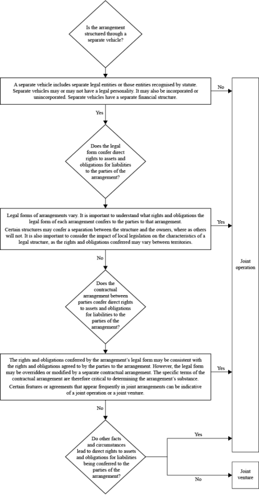

# 32 - Joint arrangements (IFRS 11)

[返回目录](README.md)

# 32 - Joint arrangements (IFRS 11)

Contents

- [32 - Joint arrangements (IFRS 11)](57.md#s229-chap_32_toc_h1)

- [Introduction and scope (paras 32.1 - 32.22)](57.md#s230-chap_32_navPoint_1)

- [Scope](57.md#s230-chap_32_navPoint_2)

- [Joint control](57.md#s230-chap_32_navPoint_idp1686733384)

- [Contractual agreement](57.md#s230-chap_32_navPoint_idp1686736584)

- [Relevant activities](57.md#s230-chap_32_navPoint_idp1686757448)

- [Unanimous consent](57.md#s230-chap_32_navPoint_idp1686755528)

- [Other factors to consider when assessing an investor’s rights](57.md#s230-chap_32_navPoint_idp1686763080)

- [Potential voting rights](57.md#s230-chap_32_navPoint_idp1686766408)

- [Do the parties collectively control the arrangement?](57.md#s230-chap_32_navPoint_idp1686776648)

- [Implicit joint control](57.md#s230-chap_32_navPoint_idp1686779976)

- [Arbitration](57.md#s230-chap_32_navPoint_idp1686788296)

- [Right of veto versus protective rights](57.md#s230-chap_32_navPoint_idp1686792904)

- [Continual assessment of joint control](57.md#s230-chap_32_navPoint_idp1686806344)

- [Classification (paras 32.23-32.50)](57.md#s231-chap_32_navPoint_3)

- [Types of joint arrangement](57.md#s231-chap_32_navPoint_4)

- [Agreement covers more than one activity](57.md#s231-chap_32_navPoint_5)

- [Classification flow chart](57.md#s231-chap_32_navPoint_6)

- [A. Is the arrangement structured through a separate vehicle?](57.md#s231-chap_32_navPoint_idp1711685320)

- [Joint arrangement not in a separate vehicle](57.md#s231-chap_32_navPoint_idp1711679432)

- [Joint arrangement in a separate vehicle](57.md#s231-chap_32_navPoint_idp1711701064)

- [B. Does the legal form confer direct rights to assets and obligations for liabilities on the parties to the arrangement?](57.md#s231-chap_32_navPoint_idp1711713352)

- [C. Does the contractual arrangement between parties confer direct rights to assets and obligations for liabilities on the parties to the arrangement?](57.md#s231-chap_32_navPoint_idp1711722056)

- [Terms of the contractual arrangement](57.md#s231-chap_32_navPoint_idp1711720136)

- [D. Other facts and circumstances](57.md#s231-chap_32_navPoint_idp1711745608)

- [Other parties to a joint arrangement](57.md#s231-chap_32_navPoint_7)

- [Measurement – Accounting (paras 32.51 - 32.93)](57.md#s232-chap_32_navPoint_8)

- [A. Joint operators](57.md#s232-chap_32_navPoint_9)

- [Initial recognition](57.md#s232-chap_32_navPoint_idp1711615304)

- [Subsequent measurement](57.md#s232-chap_32_navPoint_idp1711555656)

- [Upstream transactions](57.md#s232-chap_32_navPoint_idp1686632776)

- [Downstream transactions](57.md#s232-chap_32_navPoint_idp1686640712)

- [B. Joint venturers](57.md#s232-chap_32_navPoint_10)

- [Initial recognition](57.md#s232-chap_32_navPoint_idp1686664904)

- [Subsequent measurement](57.md#s232-chap_32_navPoint_idp1686691528)

- [Upstream and downstream transactions](57.md#s232-chap_32_navPoint_idp1686801224)

- [Changes in ownership interests and loss of joint control](57.md#s232-chap_32_navPoint_idp1686818248)

- [Impairment](57.md#s232-chap_32_navPoint_idp1686835016)

- [Economic interest or separate financial statements of the venturer](57.md#s232-chap_32_navPoint_idp1686843720)

- [C. Parties to a joint arrangement that do not share joint control](57.md#s232-chap_32_navPoint_11)

- [Party to a joint operation](57.md#s232-chap_32_navPoint_idp1686849480)

- [Party to a joint venture](57.md#s232-chap_32_navPoint_idp1686860872)

- [Disclosure (32. 94-32.97)](57.md#s233-chap_32_navPoint_12)

- [Illustrative text](57.md#s234-chap_32_navPoint_13)

- [FAQ 32.6.1 – Does IFRS 11 apply to the accounting by the joint arrangement itself: joint operations?](57.md#s234-chap_32_navPoint_14)

- [FAQ 32.6.2 – How should a joint arrangement account for businesses contributed to it by its investors, on formation or otherwise?](57.md#s234-chap_32_navPoint_15)

- [EX 32.7.1 – Chairman with casting vote](57.md#s234-chap_32_navPoint_16)

- [EX 32.7.2 – Rotating chairman with casting vote](57.md#s234-chap_32_navPoint_17)

- [FAQ 32.7.3 – Can the assessment of joint control change if operating restrictions are imposed on the arrangement?](57.md#s234-chap_32_navPoint_18)

- [EX 32.9.1 – Unequal interests](57.md#s234-chap_32_navPoint_19)

- [EX 32.11.1 – Presence of contractual arrangement through articles of association](57.md#s234-chap_32_navPoint_20)

- [FAQ 32.11.2 – Presence of contractual arrangement through informal agreements](57.md#s234-chap_32_navPoint_21)

- [FAQ 32.12.1 – What are the common terms in contractual arrangements?](57.md#s234-chap_32_navPoint_22)

- [EX 32.14.1 – Impact of designating one of the joint partners to carry out the day-to-day activities in determining joint control](57.md#s234-chap_32_navPoint_23)

- [EX 32.16.1 – Potential voting rights](57.md#s234-chap_32_navPoint_24)

- [EX 32.19.1 – Implicit joint control with two shareholders: shareholders are the decision-making body](57.md#s234-chap_32_navPoint_25)

- [EX 32.19.2 – Implicit joint control with more than two shareholders: shareholders are the decision-making body](57.md#s234-chap_32_navPoint_26)

- [EX 32.19.3 – Implicit joint control with two shareholders: directors are the decision-making body](57.md#s234-chap_32_navPoint_27)

- [FAQ 32.26.1 – Can a limited company be classified as a joint operation?](57.md#s234-chap_32_navPoint_28)

- [EX 32.32.1 – Joint operation not in a separate vehicle](57.md#s234-chap_32_navPoint_29)

- [EX 32.33.1 – Examples of joint operations in the oil and gas industry](57.md#s234-chap_32_navPoint_30)

- [EX 32.39.1 – Legal form provides separation](57.md#s234-chap_32_navPoint_31)

- [FAQ 32.39.2 – Can two arrangements be classified differently, if one is structured as a separate vehicle and the other is not?](57.md#s234-chap_32_navPoint_32)

- [EX 32.42.1 – Contractual agreement reversing the impact of legal form](57.md#s234-chap_32_navPoint_33)

- [EX 32.45.1 – Determining joint arrangement classification](57.md#s234-chap_32_navPoint_34)

- [EX 32.46.1 – Joint arrangement set up to act as agent on behalf of principals](57.md#s234-chap_32_navPoint_35)

- [EX 32.49.1 – Joint construction and use of a pipeline](57.md#s234-chap_32_navPoint_36)

- [EX 32.49.2 – Other facts and circumstances](57.md#s234-chap_32_navPoint_37)

- [FAQ 32.49.3 – Should the assessment of ‘other facts and circumstances’ be based only on contractual and legally enforceable terms?](57.md#s234-chap_32_navPoint_38)

- [FAQ 32.49.4 – Does the sale of the output from the joint arrangement to the parties at a market price prevent classification as a joint operation?](57.md#s234-chap_32_navPoint_39)

- [FAQ 32.49.5 – What factors might be less relevant when assessing other facts and circumstances?](57.md#s234-chap_32_navPoint_40)

- [FAQ 32.49.6 – Should volumes or monetary values of output be the basis when determining ‘substantially all of the output’?](57.md#s234-chap_32_navPoint_41)

- [EX 32.50.1 – Party to a joint arrangement](57.md#s234-chap_32_navPoint_42)

- [FAQ 32.51.1 – What are the accounting treatments of the investor in different types of joint arrangements in the consolidated and separate financial statements?](57.md#s234-chap_32_navPoint_43)

- [EX 32.53.1 – Obtaining an interest in a joint operation that is not a business](57.md#s234-chap_32_navPoint_44)

- [FAQ 32.54.1 – Obtaining an interest in a joint operation: what are the main differences between a business combination and an asset acquisition?](57.md#s234-chap_32_navPoint_45)

- [EX 32.54.2 – Obtaining joint control of a joint operation: cash payment](57.md#s234-chap_32_navPoint_46)

- [EX 32.56.1 – Contribution of asset on formation of a joint operation](57.md#s234-chap_32_navPoint_47)

- [EX 32.56.2 – Obtaining joint control of a joint operation: contribution of assets](57.md#s234-chap_32_navPoint_48)

- [FAQ 32.56.3 – What are the accounting implications of loss of control transactions that result in joint control?](57.md#s234-chap_32_navPoint_49)

- [FAQ 32.57.1 – What are the accounting implications of obtaining control over a joint operation that meets the definition of a business?](57.md#s234-chap_32_navPoint_50)

- [EX 32.57.2 – Changes in levels of ownership whilst retaining joint control: new joint operator in the contractual arrangement](57.md#s234-chap_32_navPoint_51)

- [FAQ 32.57.3 – What are the accounting implications of obtaining control over a joint operation that does not meet the definition of a business?](57.md#s234-chap_32_navPoint_52)

- [EX 32.59.1 – Non-coterminous year ends](57.md#s234-chap_32_navPoint_53)

- [FAQ 32.60.1 – What are the accounting implications in the separate financial statements of the joint operator?](57.md#s234-chap_32_navPoint_54)

- [EX 32.62.1 – Joint operation accounting: loan transactions with joint operation](57.md#s234-chap_32_navPoint_56)

- [EX 32.62.2 – Accounting for joint operations: treatment of intra-group balances: ring-fencing](57.md#s234-chap_32_navPoint_57)

- [FAQ 32.62.3 – How should an investor account for a joint arrangement with legal separation that is a joint operation?](57.md#s234-chap_32_navPoint_58)

- [EX 32.62.4 – Vehicle with legal separation: investors obliged to take all of the output](57.md#s234-chap_32_navPoint_59)

- [FAQ 32.62.5 – What is the accounting treatment where all of the output is taken by joint operators?](57.md#s234-chap_32_navPoint_60)

- [FAQ 32.62.6 – What is the accounting treatment where share of output purchased differs from ownership interest?](57.md#s234-chap_32_navPoint_61)

- [EX 32.62.7 – Accounting by the operator in a joint operation](57.md#s234-chap_32_navPoint_62)

- [EX 32.62.8 – Output received differs from entitled output (\'overlift and underlift\')](57.md#s234-chap_32_navPoint_63)

- [EX 32.64.1 – Upstream transaction: sale of inventory](57.md#s234-chap_32_navPoint_64)

- [EX 32.64.2 – Intra-group transaction](57.md#s234-chap_32_navPoint_65)

- [FAQ 32.66.1 – How should the joint operators account for an asset contributed to a joint operation to which other operators become entitled?](57.md#s234-chap_32_navPoint_66)

- [EX 32.66.2 – Contribution of impaired asset on formation of a joint operation](57.md#s234-chap_32_navPoint_67)

- [FAQ 32.73.1 – Formation of a joint venture: What is the accounting by the joint venturer on formation of a joint venture from previous investment?](57.md#s234-chap_32_navPoint_68)

- [FAQ 32.73.2 – Formation of a joint venture: How should an entity account for any difference between the fair value of a business contributed and the fair value of the assets contributed by the other venturers?](57.md#s234-chap_32_navPoint_69)

- [EX 32.73.3 – Venturer transfers a business to a joint venture in exchange for equity interest: accounting policy under IAS 28](57.md#s234-chap_32_navPoint_70)

- [EX 32.73.4 – Venturer transfers a business to a joint venture in exchange for equity interest: accounting policy under IFRS 10](57.md#s234-chap_32_navPoint_71)

- [FAQ 32.85.1 – What are the implications of changes in levels of ownership whilst retaining joint control?](57.md#s234-chap_32_navPoint_72)

- [FAQ 32.86.1 – How are long-term interests that, in substance, form part of the net investment measured?](57.md#s234-chap_32_navPoint_73)

 

This eBook is licensed to peggy so, peggy.so@hk.ey.com, 

## Introduction and scope (paras 32.1 - 32.22)

 

**32.1** Joint arrangements are economic co-operations between two or more parties that are bound by a contractual agreement to share control. An entity might enter into a joint arrangement with another party for many reasons: for example, the investors might have complementary skills; it might be necessary to share the risk of a project; the project might benefit from economies of scale if two or more investors are involved; or the size of the project might be beyond a single entity’s capabilities. The purpose of the joint arrangement might be to share costs, or it might be motivated by profit.

[IFRS 11 App A].

**32.2** There are two types of joint arrangements: joint operations and joint ventures. Classification in each of the categories depends on the investor’s rights and obligations. Joint operators have rights to assets and obligations for liabilities. Joint venturers have rights to net assets.

[IFRS 11 para IN7].

**32.3** Classification of an arrangement determines its accounting treatment. Joint operations are accounted for by recognising the operator’s relevant share of assets, liabilities, revenues and expenses. Joint ventures are accounted for using equity accounting.

[IFRS 11 para IN8].

**32.4** IFRS 11 refers to the rules in IAS 28 when requiring joint ventures to be equity accounted.

[IFRS 11 para IN10].

 

### Scope

 

**32.5** Joint arrangements are economic arrangements between two or more parties, where the investors sharing joint control make the decisions about the relevant activities.

[IFRS 11 App A].

**32.6** Parties could participate in joint arrangements for other reasons, but they might not share joint control. The standard applies to all parties to a joint arrangement, whether they exercise joint control over the arrangement or not. The standard does not apply for accounting within the joint arrangement itself.

[IFRS 11 para 3].

[FAQ 32.6.1 – Does IFRS 11 apply to the accounting by the joint arrangement itself: joint operations?](57.md#s234-FAQ_32.6.1)  
[FAQ 32.6.2 – How should a joint arrangement account for businesses contributed to it by its investors, on formation or otherwise?](57.md#s234-FAQ_32.6.2)

**32.7** Joint control and control are mutually exclusive. It is implicit in the definition of joint control that there have to be at least two parties that share control over the arrangement. If one party can control the arrangement, the arrangement is not a joint arrangement, and it is outside the scope of IFRS 11. “An investor controls an investee when the investor is exposed, or has rights, to variable returns from its involvement with the investee and has the ability to affect those returns through its power over the investee”. Management should first assess whether it controls the arrangement on its own before concluding on the existence of joint control.

[IFRS 10 App A].

[EX 32.7.1 – Chairman with casting vote ](57.md#s234-EX32.7.1)  
  
[EX 32.7.2 – Rotating chairman with casting vote](57.md#s234-EX32.7.2)  
  
[FAQ 32.7.3 – Can the assessment of joint control change if operating restrictions are imposed on the arrangement?](57.md#s234-FAQ_32.7.3)

**32.8** The flow chart below illustrates the decision-making process and the interaction between IFRS 10, IFRS 11 and IAS 28 and IFRS 9:

 

#### Joint control

 

**32.9**“Joint control is the contractually agreed sharing of control of an arrangement, which exists only when the decisions about the relevant activities require the unanimous consent of the parties sharing control”. Joint operators and joint venturers need not hold equal shareholdings in an entity for joint control to exist.

[IFRS 11 para 7].

[EX 32.9.1 – Unequal interests](57.md#s234-EX32.9.1)

 

##### Contractual agreement

 

**32.10** Joint control cannot exist without an enforceable contractual agreement. The agreement proves that one party alone cannot control the joint arrangement.

[IFRS 11 para 5(a), (b)].

**32.11** Minutes of meetings and documentation of discussions can also be evidence of an enforceable contractual agreement. The agreement does not have to be in writing. However, where the joint arrangement is included within a separate vehicle, legally binding documents would usually be available in some written form. These could include articles of associations, charters or by-laws.

[IFRS 11 App B para B2].

[EX 32.11.1 – Presence of contractual arrangement through articles of association ](57.md#s234-EX32.11.1)  
  
[EX 32.11.2 – Presence of contractual arrangement through informal agreements](57.md#s234-EX32.11.2)

**32.12** The purpose of the agreement is not only to establish joint control over the arrangement but also to set out the terms and conditions under which the joint arrangement operates. Some common terms present in contractual arrangements establishing joint control are:

- The purpose, activity and duration of the joint arrangement.

- How the members of the board of directors (or equivalent governing body of the joint arrangement) are appointed.

- The decision-making process.

- The capital or other contributions required of the parties.

- How the parties share assets, liabilities, revenues and expenses or profits or losses arising from the joint arrangement.

[IFRS 11 App B para B4].

[FAQ 32.12.1 – What are the common terms in contractual arrangements?](57.md#s234-FAQ_32.12.1)

 

##### Relevant activities

 

**32.13** Joint control should be in place over the decisions on ‘relevant activities’. Relevant activities are defined as “activities of the investee that significantly affect the investee’s returns”.

It is important to understand at what level the decisions about relevant activities are made. Refer to [chapter 26 para 33](45.md#s170-Para_26.33) for guidance over the relevant activities.

[IFRS 10 App A].

 

##### Unanimous consent

 

**32.14** The contractual agreement must require unanimity for decisions over the relevant activities, but this does not mean that all parties need to agree all decisions. It would be impractical for all investors who share joint control to participate in every decision required in carrying out the arrangement’s economic activity. The nature of the decisions that are subject to unanimous consent should be considered when assessing joint control.

[IFRS 11 para 5].

[EX 32.14.1 – Impact of designating one of the joint partners to carry out the day-to-day activities in determining joint control](57.md#s234-EX32.14.1)

 

#### Other factors to consider when assessing an investor’s rights

##### Potential voting rights

 

**32.15** An investor might own instruments that, if exercised or converted, give the entity voting power over the relevant activities of another entity; these are termed ‘potential voting rights’. Potential voting rights are “rights to obtain voting rights of an investee, such as those arising from convertible instruments or options, including forward contracts”. Potential voting rights might take various forms, including share warrants, share call options, forward contracts, and debt or equity instruments that are convertible into ordinary shares.

[IFRS 10 App B para B47].

**32.16** The existence of potential voting rights can reverse the effect of a contractual arrangement that establishes joint control between the investors. For example, a shareholders’ agreement between two parties provides for joint decision-making over relevant activities. In the same agreement, one investor has a substantive option to purchase the interest held by the other investor. The option reverses the effect of the joint decision-making over relevant activities, and joint control is not established. Refer to [chapter 26 para 75](45.md#s170-Para_26.75).

[IFRS 10 App B para B48].

[EX 32.16.1 – Potential voting rights](57.md#s234-EX32.16.1)

 

##### Do the parties collectively control the arrangement?

 

**32.17** Management might conclude that a group of parties, or all of the investors, collectively control the arrangement. Management should establish whether any of those parties that have collective control exercise joint control. Collective control exists when all of the parties, or a group of the parties, when considered collectively, can direct the relevant activities. Joint control only exists when these parties are bound by a contractual agreement, whether established formally or informally, to agree unanimously on all decisions affecting the relevant activities. Existence of collective control does not, by itself, give rise to joint control.

[IFRS 11 App B para B6].

**32.18** The contractual arrangement might require a minimum proportion of voting rights to make decisions. The arrangement is not a joint arrangement if the proportion can be achieved by more than one combination, unless the contract specifies which participants should agree. For example, where shareholders A, B and C have 50%, 25% and 25% holdings respectively and a 75% approval is needed for decisions, A and B or A and C would need to agree. No joint control exists.

[IFRS 11 App B para B8].

 

##### Implicit joint control

 

**32.19** Where a group of parties establishes a joint arrangement, such as a strategic alliance to combine their operations, the decision-making process might be explicitly included in the contract, requiring unanimous consent. Joint control can also be achieved implicitly. For example, A has 60% and B has 40%, and a 75% approval is needed for decision making. Although unanimous consent is not explicitly required, joint control is implied, since both A and B need to agree for a decision to be made.

[IFRS 11 App B para B7].

[EX 32.19.1 – Implicit joint control with two shareholders: shareholders are the decision-making body](57.md#s234-EX32.19.1)  
[EX 32.19.2 – Implicit joint control with more than two shareholders: shareholders are the decision-making body](57.md#s234-EX32.19.2)  
[EX 32.19.3 – Implicit joint control with two shareholders: directors are the decision-making body](57.md#s234-EX32.19.3)

 

##### Arbitration

 

**32.20** The parties to the joint arrangement might also set out arbitration procedures in case they cannot agree on decisions related to relevant activities. The existence of arbitration procedures to resolve disputes can be strong evidence of joint control; and the absence of these provisions might suggest that unanimous consent is not required for all key decisions, and so joint control does not exist.

[IFRS 11 App B para B10].

 

##### Right of veto versus protective rights

 

**32.21** An investor exercising joint control has veto over relevant decisions where joint control exists. An investor cannot, on its own, decide on the relevant activities, but it can prevent the other investors from doing so. Management should consider whether the rights arising from the arrangement are substantive rights or protective rights. A veto over a decision on relevant activities determines the existence of joint control, but a veto over protective rights does not. Protective rights, such as veto over closing the entity, are rights that can be in place for other investors as well, such as minority shareholders.

[IFRS 11 App B para B9].

 

##### Continual assessment of joint control

**32.22**Decisions on whether joint control exists might require significant judgement from the parties. An entity should re-assess whether it still has joint control if the facts and circumstances change.

[IFRS 11 para 13].

This eBook is licensed to peggy so, peggy.so@hk.ey.com, 

## Classification (paras 32.23-32.50)

### Types of joint arrangement

 

**32.23** There are two types of joint arrangement for accounting purposes:

- joint operations; and

- joint ventures.

Classification depends on the rights and obligations that arise from the contractual arrangement. An entity that shares joint control needs to look at the contractual arrangement’s substance and apply judgement, to determine whether it is party to a joint operation or a joint venture.

[IFRS 11 para 14].

**32.24** The arrangement is a joint operation where the contractual agreement provides rights to assets and obligations for liabilities for those parties sharing joint control. Parties who share joint control over a joint operation are called joint operators.

[IFRS 11 para 15].

**32.25** The joint arrangement is a joint venture where the agreement grants rights to the arrangement’s net assets. The parties who share the joint control over a joint venture are called joint venturers. Reference to ‘net assets’ indicates that the joint venturer has an investment in the arrangement. Venturers could also have a net liability involvement in the joint venture.

[IFRS 11 para 16].

**32.26** Management assesses the parties’ rights and obligations arising from the arrangement, as they exist in the ‘normal course of business’. Legal rights and obligations arising in circumstances other than in the ‘normal course of business’, such as liquidation and bankruptcy, are less relevant. For example, secured creditors have the first right to the assets if a vehicle is liquidated; the venture partners only have rights in the net assets remaining after settling all third-party obligations. The vehicle could still be classified as a joint operation because, in the ‘normal course of business’, the venture partners have direct interests in assets and liabilities.

[IFRS 11 App B para B14].

[FAQ 32.26.1 – Can a limited liability company be classified as a joint operation?](57.md#s234-FAQ_32.26.1)

**32.27** An entity should re-assess whether the type of joint arrangement has changed if facts and circumstances change.

[IFRS 11 para 19].

 

### Agreement covers more than one activity

 

**32.28** Sometimes, parties enter into an umbrella arrangement, under which they establish numerous joint activities, or they might house more than one activity in one separate legal entity. “The unit of account of a joint arrangement is the activity that two or more parties have agreed to control jointly.” Management should assess each activity separately for classification as a joint operation or a joint venture. It might conclude that some activities are joint operations and others are joint ventures. Where the parties identify both joint operations and joint ventures in an arrangement, they account for each of them separately.

[IFRS 11 para 18]. [IFRS 11 para BC 35].

 

### Classification flow chart

 

**32.29** The following flow chart summarises how to determine the classification of a joint arrangement.

  
 [IFRS 11 App B para B17].

 

#### A. Is the arrangement structured through a separate vehicle?

##### Joint arrangement not in a separate vehicle

 

**32.30** A separate vehicle is defined by the standard as “... a separately identifiable financial structure, including separate legal entities or entities recognised by statute, regardless of whether those entities have a legal personality”. A separate vehicle has a distinct structure, such as an organisation or institution. It will often be an organisation that exists separately from its members. Examples include a corporation, partnership, trust, government body or agency, university or any other organisation or body of persons.

[IFRS 11 App A].

**32.31** An arrangement that is not structured through a separate vehicle is a joint operation. Each party in a joint operation usually uses its own resources and carries out its own part of a joint operation separately from the activities of the other party or parties. Each party incurs its own expenses and raises its own financing.

[IFRS 11 App B para B16].

**32.32** The contractual arrangement governing the operation is likely to specify how revenues, common expenses and assets and liabilities are to be shared among the operators. For example, two or more investors combine their operations, resources and expertise in order to manufacture jointly a particular product in a joint operation. Each party carries out a different part of the manufacturing process. Each party bears its own costs, and it takes a share of the revenue from the sale of the product; this share is determined in accordance with the contractual arrangement.

[IFRS 11 App B para B17].

[EX 32.32.1 – Joint operation not in a separate vehicle](57.md#s234-EX32.32.1)

**32.33** The parties could agree to share and operate an asset together. This type of joint operation involves the joint ownership of the asset that is not a separate entity. It is important to establish which items of costs and revenue are shared and which are incurred separately by each party.

[IFRS 11 App B para B18].

[EX 32.33.1 – Examples of joint operations in the oil and gas industry](57.md#s234-EX32.33.1)

 

##### Joint arrangement in a separate vehicle

 

**32.34** A joint arrangement that is structured through a separate vehicle can be either a joint operation or a joint venture. It might be hard to differentiate between a joint venture and a joint operation, for example, where separate legal entities are used to ‘house’ joint operations for tax or other reasons.

[IFRS 11 App B para B19].

**32.35** The parties to the joint arrangement have to analyse the underlying contractual agreements, to determine whether the arrangement grants rights to assets and obligations for liabilities, or whether it grants rights to net assets.

[IFRS 11 App B para B20].

**32.36** The underlying rights and obligations of the parties need to be considered in the context of:

- the separate vehicle’s legal form;

- the terms of the contractual agreement binding the parties sharing joint control; and

- other relevant facts (including any restrictions imposed on the parties, the arrangement’s customer base and the parties’ funding obligations).

[IFRS 11 para 17].

**32.37** Where the facts change, a previous conclusion might no longer be appropriate. So, management has to re-evaluate whether the entity is a party to a joint operation or a joint venture.

[IFRS 11 para 19].

 

#### B. Does the legal form confer direct rights to assets and obligations for liabilities on the parties to the arrangement?

 

**32.38** Parties need to assess whether the legal form of the joint arrangement separates the assets and liabilities of the joint arrangement from those of the investing parties.

[IFRS 11 App B para B22].

**32.39** The arrangement is a joint operation where the legal form does not confer separation between the investors and the vehicle; that is, the venturers would remain exposed to the venture’s assets and liabilities. No further assessment is required to conclude on the classification. Partnerships, for example, would not create separation from the partners where the partners have direct rights to assets and are directly obligated for the partnership’s liabilities in the normal course of business. Similarly, unlimited liability entities often provide direct rights and obligations to the venture partners, depending on the relevant facts and circumstances. It is possible that the same legal form in different territories might lead to different results, depending on local laws and regulations.

[IFRS 11 App B para B24].

[EX 32.39.1 – Legal form provides separation](57.md#s234-EX32.39.1)  
[FAQ 32.39.2 – Can two arrangements be classified differently, if one is structured a s a separate vehicle and the other is not?](57.md#s234-FAQ_32.39.2)

 

#### C. Does the contractual arrangement between parties confer direct rights to assets and obligations for liabilities on the parties to the arrangement?

##### Terms of the contractual arrangement

 

**32.40** The joint arrangement’s legal form is an important factor, but it might not provide sufficient evidence to classify a joint arrangement as a joint venture. The terms agreed by the venturers and other facts might reverse the separation granted by the legal form. The assessment of the terms in the contractual agreement should focus on the analysis of the rights and obligations of each party.

[IFRS 11 App B para B23].

**32.41** Parties agree on the rights and obligations that they want to share in the contractual agreement. It is most likely that they will choose a legal form that complements those rights and obligations and that does not contradict it.

[IFRS 11 App B para B25].

**32.42** Local laws might require an arrangement to be set up in a particular legal structure. The parties might want to have different rights and obligations, and so the contractual terms might modify the rights and obligations arising from the legal form.

[IFRS 11 App B para B26].

[EX 32.42.1 – Contractual agreement reversing the impact of legal form](57.md#s234-EX32.42.1)

**32.43** Common terms in contractual arrangements that provide for joint operations or joint ventures are:

<table style="width:100%; border-collapse:collapse"><tr><td style="border:0.75pt solid #000000; padding-right:5.03pt; padding-left:5.03pt; vertical-align:top">
Rights to assets and obligations for liabilities
</td><td style="border:0.75pt solid #000000; padding-right:5.03pt; padding-left:5.03pt; vertical-align:top">
Participants in a joint venture will often transfer the legal ownership of the assets that they contribute to the joint arrangement. Any assets subsequently acquired by the joint venture belong to the joint venture and not to the venturers. Any liabilities incurred in the joint arrangement are the liabilities of the joint venture. The joint venturers are not liable over and above their investment in the entity. For example, if a joint venture does not meet its obligations towards its creditors, those creditors are not allowed to enforce the fulfilment of the obligations to the joint venturers.

Parties might keep the right and legal ownership to the underlying assets, where these have been contributed to the separate legal entity. The joint arrangement is a separate legal entity, but it does not own the contributed assets. The contractual agreement specifies the proportions in which the parties share the output of the joint arrangement’s assets. This arrangement might or might not be a joint operation.

For a joint operation that is not in a separate legal entity, the parties would share all interests in the assets relating to the joint arrangement in specified proportions.

The parties to a joint operation are liable for the joint operation’s debts and obligations. The arrangement might be classified as a joint operation if claims made by third parties need to be settled by the parties to the joint arrangement, where the joint arrangement cannot provide for those claims. The contractual agreement would include clauses detailing the proportions in which the parties are liable for the joint arrangement’s obligations.
</td></tr><tr><td style="border:0.75pt solid #000000; padding-right:5.03pt; padding-left:5.03pt; vertical-align:top">
Revenues, expenses, profit or loss
</td><td style="border:0.75pt solid #000000; padding-right:5.03pt; padding-left:5.03pt; vertical-align:top">
The parties need to assess the manner in which they share revenues, expenses, profits or losses, as well as assets and liabilities. A joint venture grants rights to net assets to the investing parties in the contractual agreement, so the parties are entitled to the entity’s net profit or loss. For a joint operation, the contract specifies how revenues and expenses are shared. For example, the share could be based on the capacity that each party provided, or it could be in proportion to the cash provided by each operator. The share does not necessarily represent the joint arrangement’s ownership of the separate vehicle. Even if the ownership percentage is the same as the ratio in which revenues and expenses are shared, that does not necessarily mean that the entity is a joint venture. That conclusion depends on the rights to assets and obligations for liabilities.
</td></tr><tr><td style="border:0.75pt solid #000000; padding-right:5.03pt; padding-left:5.03pt; vertical-align:top">
Guarantees
</td><td style="border:0.75pt solid #000000; padding-right:5.03pt; padding-left:5.03pt; vertical-align:top">
The investors might provide guarantees to creditors, customers and other stakeholders of the joint arrangement. The existence of guarantees does not, on its own, determine the classification of the joint arrangement. Management needs to analyse whether it has obligations for liabilities relating to the arrangement.
</td></tr></table>

  
 [IFRS 11 App B para B27].

**32.44** The joint venturers are not liable for the joint venture’s unpaid debts and obligations. Under the equity method of accounting, the investor recognises any joint venture losses against the investment value until it has reduced to zero. The investor only recognises further losses if the venturer has a contractual or legal obligation to fund the joint venture’s losses. This guarantee to cover the losses of a joint venture or to assume this liability does not, on its own, suggest that the arrangement is a joint operation.

[IAS 28 para 28]

**32.45** The arrangement is a joint operation if the parties conclude that the terms and conditions of the contractual arrangements grant rights to assets and create obligations for liabilities in relation to the arrangement. The standard does not require the parties to analyse the other facts.

[IFRS 11 App B para B28].

[EX 32.45.1 – Determining joint arrangement classification](57.md#s234-EX32.45.1)

 

#### D. Other facts and circumstances

 

**32.46** The terms and conditions in the contractual agreement do not always provide sufficient evidence to determine what type of joint arrangement the parties are entering into. Parties should look at the other facts surrounding the joint arrangement’s existence. The design and purpose of the investee can provide further evidence of the nature of the arrangement.

[IFRS 11 App B para B29].

[EX 32.46.1 – Joint arrangement set up to act as agent on behalf of the principals](57.md#s234-EX32.46.1)

**32.47** Management should consider agreements that prevent the joint arrangement from selling its output to other market participants, because this might result in joint operation classification. The parties need to have a binding obligation that is legally enforceable to take all of the output, for the arrangement to qualify as a joint operation. The purpose and design of the arrangement follows the nature of a joint operation where a binding agreement is in place. If the parties only have a right to take the output, they might decide to take those outputs in one year but sell to outside parties in another year. The purpose and design of the arrangement is not to ensure that the output is always to be taken by the parties. The arrangement could be a joint venture.

[IFRS 11 App B para B31].

**32.48** Parties to a joint arrangement have rights to the assets of the joint arrangement through other facts and circumstances where they:

- have rights to substantially all of the economic benefits (output) of assets of the arrangement; and

- have obligations to acquire those economic benefits and thus assume the risks relating to those economic benefits.

[IFRS 11 App B para B30].

**32.49** Parties have obligations for liabilities of the joint arrangement through other facts and circumstances where:

- as a consequence of their rights to, and obligations for, the assets of the joint arrangement, they provide cash flows that are used to settle liabilities of the joint arrangement; and

- settlement of the liabilities occurs on a continuous basis.

[IFRS 11 App B para B14]. [IFRS 11 App B para B32].

  
 

[EX 32.49.1 – Joint construction and use of a pipeline](57.md#s234-EX32.49.1)  
[EX 32.49.2 – Other facts and circumstances](57.md#s234-EX32.49.2)  
[FAQ 32.49.3 – Should the assessment of ‘other facts and circumstances’ be based only on contractual and legally enforceable terms?](57.md#s234-FAQ_32.49.3)  
[FAQ 32.49.4 – Does the sale of the output from the joint arrangement to the parties at a market price prevent classification as a joint operation?](57.md#s234-FAQ_32.49.4)  
[FAQ 32.49.5 – What factors might be less relevant when assessing other facts and circumstances](57.md#s234-FAQ_32.49.5)  
[FAQ 32.49.6 – Should volumes or monetary values of output be the basis when determining ‘substantially all of the output’?](57.md#s234-FAQ_32.49.6)

 

### Other parties to a joint arrangement

 

**32.50** Parties to a joint arrangement might not share control, for various reasons. Entities might take an ownership interest in shared assets, such as a pipeline, where the group of users is too wide for joint control to be practical. An entity might also enter into an arrangement where it wishes to retain influence and access to information, but it does not wish to actively share joint control. Parties to a joint arrangement who participate, but do not share joint control over it, should classify their investment according to their rights and level of participation. Parties to a joint operation who participate, but do not share joint control over it, should recognise their share of the operation’s assets and liabilities if they have rights to the assets and obligations for the liabilities.

[IFRS 11 para 27].

[EX 32.50.1 – Party to a joint arrangement](57.md#s234-EX32.50.1)

 

This eBook is licensed to peggy so, peggy.so@hk.ey.com, 

## Measurement – Accounting (paras 32.51 - 32.93)

 

**32.51** Accounting for joint arrangements depends on their classification as either a joint operation or a joint venture. A joint operator accounts for its share of assets, liabilities, revenues and expenses from the arrangement. Accounting within the joint arrangement itself is outside the scope of IFRS 11.

[IFRS 11 para IN9].

  
 

[FAQ 32.6.1 – Does IFRS 11 apply to the accounting by the joint arrangement itself: joint operations?](57.md#s234-FAQ_32.6.1)  
[FAQ 32.6.2 – How should a joint arrangement account for businesses contributed to it by its investors, on formation or otherwise?](57.md#s234-FAQ_32.6.2)  
[FAQ 32.51.1 – What are the accounting treatments of the investor in different types of joint arrangements in the consolidated and separate financial statements?](57.md#s234-FAQ_32.51.1)

**32.52** A joint venture uses the equity method of accounting to account for its investment in joint ventures. Parties not exercising joint control account for their interest in a way that depends on the economic interest that they have in the arrangement.

[IFRS 11 para IN10].

 

### A. Joint operators

#### Initial recognition

 

**32.53** Where a joint operator acquires an interest in a joint operation, the accounting treatment depends on whether the activity of the acquired joint operation constitutes a business. (Refer to chapter 29 para 6.) The joint operator should apply business combination accounting to the extent of its share, where the activity of the joint operation constitutes a business. This applies to the acquisition of both the initial interest and additional interests in a joint operation in which the activity of the joint operation constitutes a business.

[IFRS 11 para 21A].

  
 

[EX 32.53.1 – Obtaining an interest in a joint operation that is not a business](57.md#s234-EX32.53.1)

**32.54** Examples of the principles on business combinations accounting that do not conflict with the guidance in IFRS 11, and that should be applied when an entity acquires an interest in a joint operation that constitutes a business, are:

- Measure identifiable assets and liabilities at fair value, except for those for which IFRS 3 or other standards provide for an exception.

- Expense any acquisition-related costs, unless the costs relate to the issuance of debt or equity securities. Such costs are recognised under IAS 32 and IFRS 9.

- Recognise deferred tax assets and deferred tax liabilities that arise from the initial recognition of assets or liabilities, except for deferred tax liabilities that arise from the initial recognition of goodwill.

- Recognise the excess of the consideration transferred over the net of the acquisition date amounts of the identifiable assets acquired and the liabilities assumed as goodwill.

- Test goodwill annually for impairment, as required by IAS 36.

[IFRS 11 App B para B33A].

[FAQ 32.54.1 – Obtaining an interest in a joint operation: what are the main differences between a business combination and an asset acquisition?](57.md#s234-FAQ_32.54.1)  
[EX 32.54.2 – Obtaining joint control of a joint operation: cash payment](57.md#s234-EX32.54.2)

**32.55** One party might contribute a business to a joint operation on formation. The party would also apply business combination accounting.

[IFRS 11 App B para B33B].

**32.56** Joint operators might contribute assets to the joint operation, where it is a separate legal entity, on its formation. Where a joint operator contributes assets to the joint arrangement, it is conducting the transaction with the other investors. Where the contribution results in a gain or loss in the joint operator’s books, the gain or loss is recognised only to the extent of the other parties’ interest in the joint operation.

[IFRS 11 App B para B34].

[EX 32.56.1 – Contribution of asset on formation of a joint operation](57.md#s234-EX32.56.1)  
[EX 32.56.2 – Obtaining joint control of a joint operation: contribution of assets](57.md#s234-EX32.56.2)  
[FAQ 32.56.3 – What are the accounting implications of loss of control transactions that result in joint control?](57.md#s234-FAQ_32.56.3)

**32.57** A joint operator might increase its interest in a joint operation, in which the activity of the joint operation constitutes a business, by acquiring an additional interest. Previously held interests in the joint operation are not remeasured if the joint operator obtains joint control or retains joint control. Previously held interests in the joint operation are remeasured if the joint operator obtains control.

[IFRS 3 para 42A]. [IFRS 11 App B para B33C]. [IFRS 11 App B para B33CA].

[FAQ 32.57.1 – What are the accounting implications of obtaining control over a joint operation that meets the definition of a business?](57.md#s234-FAQ_32.57.1)  
[EX 32.57.2 – Changes in levels of ownership whilst retaining joint control: new joint operator in the contractual arrangement](57.md#s234-EX32.57.2)

  
[FAQ 32.57.3 – What are the accounting implications of obtaining control over a joint operation that does not meet the definition of a business?](57.md#s234-FAQ_32.57.3)

**32.58** Business combination accounting does not apply on the acquisition of an interest in a joint operation where the parties sharing joint control (including the entity acquiring the interest in the joint operation) are under the common control of the same ultimate controlling party or parties both before and after the acquisition, and that control is not transitory.

[IFRS 11 App B para B33D].

 

#### Subsequent measurement

 

**32.59** Where the entity is involved in a joint operation, the investors account for their rights and obligations by recognising:

“a. its assets, including its share of any assets held jointly;   
b. its liabilities, including its share of any liabilities incurred jointly;   
c. its revenue from the sale of its share of the output arising from the joint operation;   
d. its share of the revenue from the sale of the output by the joint operation; and   
e. its expenses, including its share of any expenses incurred jointly.”

[IFRS 11 para 20].

[EX 32.59.1 – Non-coterminous year ends](57.md#s234-EX32.59.1)

**32.60** The operator treats the operations as if it conducted them directly. The accounting entries are booked in the joint operator’s own financial statements.

[IFRS 11 para 26].

[FAQ 32.60.1 – What are the accounting implications in the separate financial statements of the joint operator?](57.md#s234-FAQ_32.60.1)

**32.61** Management should classify and measure the recognised asset, liability and items of revenue or expense, or the share of an asset, liability or item of revenue or expense, according to the applicable standard for each item. For example, if a joint operator recognises an item, or a share of an item of property, plant and equipment, it accounts for its measurement and de-recognition in accordance with IAS 16; it should also apply the provisions of IAS 36 for impairment purposes.

[IFRS 11 para 21].

**32.62** Where a joint operator has an interest in a joint asset, it recognises the underlying asset directly rather than recognising a separate intangible representing the right to the underlying asset. For example, if a pipeline is operated by a number of oil and gas businesses in a certain country, the investor recognises its share of the pipeline. The share to be accounted for is determined by the contractual agreement between the operators that governs the joint arrangement. The pipeline is classified as property, plant and equipment on the operator’s balance sheet.

[IFRS 11 para BC39].

[EX 32.62.1 – Joint operation accounting: loan transactions with joint operation](57.md#s234-EX32.62.1)  
[EX 32.62.2 – Accounting for joint operations: treatment of intra-group balances: ring-fencing](57.md#s234-EX32.62.2)  
[FAQ 32.62.3 – How should an investor account for a joint arrangement with legal separation that is a joint operation?](57.md#s234-FAQ_32.62.3)  
[EX 32.62.4 – Vehicle with legal separation: investors obliged to take all of the output](57.md#s234-EX32.62.4)  
[FAQ 32.62.5 – What is the accounting treatment where all of the output is taken by joint operators?](57.md#s234-FAQ_32.62.5)  
[FAQ 32.62.6 – What is the accounting treatment where share of output purchased differs from ownership interest?](57.md#s234-FAQ_32.62.6)  
  
[EX 32.62.7 – Accounting by the operator in a joint operation](57.md#s234-EX32.62.7)  
[EX 32.62.8 – Output received differs from entitled output (‘overlift and underlift’)](57.md#s234-EX32.62.8)

 

#### Upstream transactions

 

**32.63** Joint operators might also enter into ‘upstream transactions’ with an operation − that is, where the asset is sold by the joint operation to the joint operator. The joint operator’s financial statements should defer any resulting gain or loss in an upstream transaction until the joint operator sells the asset to a third party.

[IFRS 11 App B para B36].

**32.64** Any impairment charge should be recognised immediately in the joint operator’s income statement, where such transactions provide evidence of a reduction in the net realisable value of the assets.

[IFRS 11 App B para B37].

[EX 32.64.1 – Upstream transaction: sale of inventory](57.md#s234-EX32.64.1)  
[EX 32.64.2 – Intra-group transaction](57.md#s234-EX32.64.2)

 

#### Downstream transactions

 

**32.65** Joint operators might contribute assets to the joint operation where it is a separate legal entity, or might sell assets to the joint operation (‘downstream transactions’). Where a joint operator contributes assets to, or enters into a sale agreement with, the joint operation, it is conducting the transaction with the other investors. Where the contribution results in a gain or loss in the joint operator’s books, the gain or loss is recognised only to the extent of the other parties’ interest in the joint operation. There is no accounting impact where a joint operator uses its own assets in the joint operation and retains full ownership and control of these assets. The joint operator retains its assets and liabilities on the balance sheet.

[IFRS 11 App B para B34].

**32.66** The investor must recognise any impairment charge in its books if the transaction provides evidence of an existing impairment. It is presumed that the asset was already impaired before the sale to the joint operation.

[IFRS 11 App B para B35].

[FAQ 32.66.1 – How should the joint operators account for an asset contributed to a joint operation to which other operators become entitled?](57.md#s234-FAQ_32.66.1)  
[EX 32.66.2 – Contribution of impaired asset on formation of a joint operation](57.md#s234-EX32.66.2)

 

### B. Joint venturers

 

**32.67** A joint venturer uses the equity method to account for its investment in a joint venture. Equity accounting is covered in IAS 28.

[IFRS 11 para 24].

**32.68**IAS 28 specifies the following scope exemptions from applying the equity method of accounting:

- Exemption from the preparation of consolidated financial statements. [IAS 28 para 17].

- Venture capital organisation. [IAS 28 para 18]. [IAS 28 para 19].

- Classification as held for sale. [IAS 28 para 20]. [IAS 28 para 21].

Refer to [chapter 31 para 3](56.md#s224-Para_31.3) for more details on the exemptions.

 

#### Initial recognition

 

**32.69** On initial recognition, the investment in joint venture is recognised at cost. Cost could be the purchase price, contingent consideration and acquisition costs. Refer to [chapter 31 para 22](56.md#s225-Para_31.22) for more details on the cost of an investment accounted for under equity accounting.

[IAS 28 para 10].

**32.70** Cost is “the amount of cash or cash equivalents paid or the fair value of the other consideration given to acquire an asset at the time of its acquisition or construction, or, when applicable, the amount attributed to that asset when initially recognised in accordance with the specific requirements of other IFRSs, e.g. IFRS 2”.

[IAS 16 para 6].

**32.71** An investor will need to perform an exercise similar to ‘acquisition accounting’ when acquiring an investment in an associate. Where the cost exceeds the share of the net fair value of the joint venture’s identifiable assets and liabilities, the difference is accounted for as notional goodwill. The goodwill is included in the carrying amount of the investment. Where the cost is less than entity’s share of the net fair value of the investee’s identifiable assets and liabilities, the difference is included in profit or loss as part of the entity’s share of the joint venture’s profit or loss in the period of the acquisition (‘negative goodwill’). Refer to chapter 31 para 37 for more details on the initial acquisition accounting for investments accounted for under equity accounting.

[IAS 28 para 32].

**32.72** The investor might designate loans receivable or other financial assets as part of the net investment in a joint venture. Such long-term interests are accounted for in accordance with IFRS 9. Refer to [chapter 31 para 20](56.md#s225-Para_31.20) for more details on the accounting for long-term interests.

[IAS 28 para 38].

**32.73** Joint venturers often invest in joint ventures by contributing or selling non-monetary assets to the joint venture. This results in a venturer acquiring an interest in the joint venture at the same time as it disposes of an asset or business. Refer to [chapter 31 para 25](56.md#s225-Para_31.25) for more details on the accounting for contributions or selling of non-monetary assets to joint ventures.

[IAS 28 para 30].

[FAQ 32.73.1 – Formation of a joint venture: What is the accounting by the joint venturer on formation of a joint venture from previous investment?](57.md#s234-FAQ_32.73.1)  
[FAQ 32.73.2 – Formation of a joint venture: How should an entity account for any difference between the fair value of business contributed and the fair value of the assets contributed by the other venturers?](57.md#s234-FAQ_32.73.2)  
[EX 32.73.3 – Venturer transfers a business to a joint venture in exchange for equity interest: accounting policy under IAS 28](57.md#s234-EX32.73.3)  
[EX 32.73.4 – Venturer transfers a business to a joint venture in exchange for equity interest: accounting policy under IFRS 10](57.md#s234-EX32.73.4)

 

#### Subsequent measurement

**32.74** After initial recognition, the carrying amount of the investment in a joint venture is adjusted for the following:

- recognise the investor’s share of profit or loss in the joint venture;

- deduct distributions to the investor; and

- recognise the investor’s share of changes in other comprehensive income; the corresponding adjustment should be directly within the investor’s other comprehensive income.

[IAS 28 para 10].

**32.75** The results of the joint venture should be adjusted such that the investor and the investee apply uniform accounting policies.

[IAS 28 para 27].

**32.76** The share of profit of the joint venture is adjusted to account for the impact of the initial acquisition of the joint venture. For example, if, on acquisition of the joint venture, there was a fair value uplift in property, plant and equipment when assessing the fair value of the identifiable assets acquired, the profit should be adjusted for the additional depreciation that arises from such uplift.

[IAS 28 para 32].

**32.77** The venturer’s investment in a joint venture in its consolidated financial statements is shown as a separate line item on the balance sheet. It is initially recognised at cost and is subsequently adjusted by the joint venture’s share of profit or loss and other comprehensive income. Refer to [chapter 31 para 80](56.md#s227-Para_31.80).

[IAS 28 para 10].

**32.78** Where a joint venture’s financial statements are used for the purpose of including results in the investor’s financial statements, they should preferably be coterminous with those of the investor. Where the joint venture prepares its annual financial statements to a different year end, it would need to prepare special purpose financial statements to the same date as the joint venturer’s year end.

[IAS 28 para 33].

#### Upstream and downstream transactions

 

**32.79** Investors might sell or contribute assets to the joint venture. The joint venture might sell assets to the investor. Gains and losses resulting from such ‘downstream’ and ‘upstream’ transactions between the investor and the joint venture are recognised in the investor’s financial statements only to the extent of unrelated investors’ interests in the joint venture. The investors’ share in the joint venture’s gains or losses resulting from upstream and downstream transactions is eliminated.

[IAS 28 para 28].

**32.80** The investor must recognise the full impairment charge in its books if the transaction provides evidence of an existing impairment. It is presumed that the asset was already impaired before the sale to the joint venture.

[IAS 28 para 29].

**32.81** A joint venturer might contribute non-monetary assets, such as property, plant and equipment, to a joint venture in exchange for equity. Where the transaction lacks commercial substance, as explained in IAS 16 (see [chapter 22 para 38](39.md#s142-Para_22.38)), the entire gain or loss is not recognised. The gains or losses are eliminated against the investment in the joint venture.

[IAS 28 para 31].

**32.82** If an entity receives monetary or non-monetary assets in addition to the equity interest, the investor recognises in full, in profit or loss, the portion of the gain or loss on the non-monetary contribution relating to the monetary or non-monetary assets received. Refer to [chapter 31 para 53](56.md#s226-Para_31.53) for more details on upstream and downstream transactions involving investments accounted for using the equity method.

[IAS 28 para 30].

 

#### Changes in ownership interests and loss of joint control

 

**32.83** Management should discontinue use of the equity method of accounting, when the entity ceases to exercise joint control, unless the retained interest is an investment in an associate for which equity accounting is also applied. Loss of joint control might happen in different ways:

- An entity gains control of a previous joint venture. The investor applies IFRS 3 and IFRS 10 to determine the accounting for the transaction. The interest held in the investee is remeasured to fair value, and it forms part of the consideration transferred to obtain control. See further information on business combinations in chapter 29 para 166.

- An entity retains an investment which is neither a subsidiary nor an associate. The interest is accounted for as a financial asset under IFRS 9. The fair value of the retained interest when joint control is lost becomes the fair value on initial recognition under those standards.

[IAS 28 para 22].

**32.84** An entity becomes an investor in an associate when it loses joint control over a joint venture but retains significant influence. The entity continues to equity account for its interest in accordance with IAS 28. It does not remeasure its continuing ownership interest to fair value.

[IAS 28 para 24].

**32.85** Where the ownership interest is reduced and the investment becomes an associate or continues to be joint venture (that is, retaining joint control with reduced interest), the entity might need to reclassify to profit or loss a proportion of the gains or losses recognised in other comprehensive income under [paragraph 32.74](57.md#s232-Para_32.74), where disposal of the related assets and liabilities would require any gains or losses to be reclassified in profit or loss. Refer to [chapter 31 para 30](56.md#s225-Para_31.30) for more details on changes in ownership interests of investments accounted for using the equity method, as well as for the accounting when joint control ceases.

[IAS 28 para 25].

[FAQ 32.85.1 – What are the implications of changes in levels of ownership whilst retaining joint control?](57.md#s234-FAQ_32.85.1)

 

#### Impairment

 

**32.86** Investments in associates and joint ventures are assessed for impairment where indicators of impairment are present. Impairment indicators are as described in paragraphs 41A to 41C of IAS 28. Refer to [chapter 31 para 61](56.md#s226-Para_31.61) for more details on impairment of investments accounted for using the equity method.

[IAS 28 para 40].

[FAQ 32.86.1 – How are long-term interests that, in substance, form part of the net investment measured?](57.md#s234-FAQ_32.86.1)

**32.87**The entire carrying amount of the investment is tested for impairment under IAS 36, to determine the amount of the impairment loss. The carrying amount comprises equity interests and any long-term interests that are part of the entity’s net investment. Goodwill included in the carrying value of the investment in joint venture is not tested for impairment annually nor tested separately, but it is considered as part of the entire investment. Refer to [chapter 31](56.md#s223-chap_31) for more details on impairment of investments accounted for using the equity method.

[IAS 28 para 42].

 

#### Economic interest or separate financial statements of the venturer

 

**32.88** An entity should use equity accounting to account for its investments in joint ventures in its consolidated financial statements. However, if it does not have any subsidiaries, it should also use equity accounting to account for its investments in joint ventures in its financial statements, even though these might not be called ‘consolidated financial statements’. These are referred to as ‘economic interest financial statements’. Refer to [chapter 28 para 7](49.md#s198-Para_28.7) for more guidance on economic interest financial statements.

[IAS 28 para IN8].

**32.89** The joint venturer’s interest in the joint venture is measured in the venturer’s separate financial statements at cost or in accordance with IFRS 9, or using equity accounting. Accounting for investments in separate financial statements is discussed in [chapter 28 para 14](49.md#s199-Para_28.14).

[IFRS 11 para 26(b)].

**32.90** Venturers that are exempt from the requirement to consolidate or equity account their investments, as a result of the exemption in IAS 28 or IFRS 10, could present separate financial statements as their only financial statements − in which case, they are not required to equity account joint ventures.

[IFRS 10 para 4]. [IAS 27 para 8].

 

### C. Parties to a joint arrangement that do not share joint control

#### Party to a joint operation

 

**32.91** The parties that do not share joint control should evaluate whether they have rights to individual assets and obligations for liabilities, because they would need to account for these in their financial statements. Their accounting would be similar to joint operators. Parties that do not share joint control might not have direct rights to assets and obligations for liabilities. For example, this might be the case where a party has contributed funding to a joint operation in return for a right to a share of the output from the joint operation, as opposed to direct rights to assets or obligations for liabilities. Parties that do not have rights to individual assets should account for their investment in accordance with the relevant IFRSs.

[IFRS 11 para 23].

**32.92** The investors in a joint operation, including those who do not share joint control, account for their rights and obligations. They recognise, in both their consolidated and separate financial statements, the assets and obligations that arise from the joint arrangement.

[IFRS 11 para 27(a)].

 

#### Party to a joint venture

 

**32.93** A party to a joint venture that does not share joint control should account for its investment in the consolidated financial statements in accordance with IFRS 9, or in accordance with IAS 28 if the party has significant influence.

[IFRS 11 para 25].

 

This eBook is licensed to peggy so, peggy.so@hk.ey.com, 

## Disclosure (32. 94-32.97)

 

**32.94** IFRS 12 includes mandatory disclosures for subsidiaries, joint arrangements, associates and unconsolidated structured entities. Disclosure should help readers of financial statements to evaluate the nature, risks and financial effects associated with the entity’s interests in subsidiaries, associates, joint arrangements and unconsolidated structured entities.

[IFRS 12 para 1].

**32.95** Reporting entities should disclose any additional information that is necessary to meet this objective.

[IFRS 12 para 3].

**32.96** The disclosure requirements can be summarised into the following three categories:

- Significant judgements and assumptions. [IFRS 12 paras 7–9].

- Nature, extent and financial effect of the investment in a joint arrangement. [IFRS 12 paras 20–22].

- The risks associated with joint ventures. [IFRS 12 para 23].

**32.97** The disclosure requirements outlined in IFRS 12 do not apply to parties to a joint arrangement that do not share joint control, except where these parties significantly influence the arrangement.

[IFRS 12 para 6(c)].

 

This eBook is licensed to peggy so, peggy.so@hk.ey.com, 

## Illustrative text

### FAQ 32.6.1 – Does IFRS 11 apply to the accounting by the joint arrangement itself: joint operations?

 

Reference to standard: IFRS 11 para 3  
 Reference to standing text: [32.6](57.md#s230-Para_32.6)  
 

  

  
No. IFRS 11 applies only to the accounting by joint operators, and not to the accounting by the separate vehicle that is the joint operation. So the financial statements of the separate vehicle would be prepared in accordance with applicable standards.

Legal requirements in various countries might require the joint operation to prepare its own financial statements. Where management concludes that the joint arrangement is a joint operation in a separate vehicle, the question arises whether both the joint operators and the joint operation itself should recognise the same assets, liabilities, income and expense in their respective financial statements.

Assets and liabilities could meet the recognition criteria in the books of the legal entity, because the separate vehicle has the legal title to the assets and the legal obligations in respect of the liabilities. The economic benefit from the assets accrues to the legal entity in the form of revenue. It is not relevant whether those revenues are from third parties or from the joint operators.

The legal entity has an obligation for the liabilities when it enters into contracts in its own name. Although the joint operators might fund these obligations, this does not mean that the legal entity is no longer obligated for those liabilities.

The carrying amount of the assets should be appropriately reduced when some or all the economic benefits are transferred to the joint operators. This measurement should be based on the joint arrangement’s contractual terms.

A joint operation might have legal title to the assets, but it acts as an agent on behalf of the investors. The joint operation’s own financial statements would then reflect the accounting as an agent. Where, for example, a joint operation purchases inventory from a supplier, it raises a payable owed to the supplier and a corresponding receivable representing the amount to be received from the joint operators. It is the joint operators that recognise the actual inventory and the related expense in their financial statements, with a corresponding payable to the joint operation.

 

### FAQ 32.6.2 – How should a joint arrangement account for businesses contributed to it by its investors, on formation or otherwise?

 

Reference to standard: IFRS 11 para 3  
 Reference to standing text: [32.6](57.md#s230-Para_32.6)  
 

  

Joint venturers might contribute assets or groups of assets on formation of a joint venture. An entity should assess whether a contribution of assets from its investor meets the definition of a business combination under IFRS 3 (see chapter 29 para 6).

The IFRSs are silent on how a joint arrangement should account for businesses contributed to it by its investors on formation.

The only relevant guidance is that formation of a joint venture is outside the scope of IFRS 2 and IFRS 3. IFRS 3 excludes the formation of a joint arrangement from its scope. [IFRS 3 para 2]. The contribution of a business on the formation of a joint venture is also outside the scope of IFRS 2.

[IFRS 2 para 5].

A joint venture has an accounting policy choice on how to account for a business contributed to it on formation. The joint venture could:

- record the business contributed at fair value, including goodwill; or

- record the business at the previous carrying amount in the venturer’s financial statements.

Any subsequent contribution of assets in exchange for shares is likely to be within IFRS 2’s scope. IFRS 2 requires goods acquired by issuing equity instruments to be recognised at fair value.

 

### EX 32.7.1 – Chairman with casting vote

 

Reference to standard: IFRS 11 para B5  
 Reference to standing text: [32.7](57.md#s230-Para_32.7) 

  

  
 Entities A and B set up a joint venture company, entity J, by signing a joint operating agreement. Both investors delegate three directors each to entity J’s board of directors. Decisions are made by simple majority. In the event of a deadlock, the chairman (a director of entity B) has the casting vote.

It is, therefore, likely that entity B has control over entity J, because decisions made on behalf of entity B cannot be prevented by entity A.

 

### EX 32.7.2 – Rotating chairman with casting vote

 

Reference to standard: IFRS 11 para B5  
 Reference to standing text: [32.7](57.md#s230-Para_32.7) 

  

  
 Entities A and B set up a joint venture company, entity J, by signing a joint operating agreement. Both investors delegate three directors each to entity J’s board of directors. Decisions are made by simple majority. The chairman of the board has a casting vote. The chairman is appointed on a rotation basis. Entity A appoints the chairman for the first six months of the year, and entity B appoints the chairman for the last six months of the year.

It is unlikely that either of entities A and B has control over entity J. The right is symmetrical, and so it does not give entity A or entity B control. Entities A and B exercise joint control over entity J.

 

### FAQ 32.7.3 – Can the assessment of joint control change if operating restrictions are imposed on the arrangement?

 

Reference to standard: IFRS 11 para B5  
 Reference to standing text: [32.7](57.md#s230-Para_32.7) 

  

  
It depends. Joint control might not exist or might cease if the joint arrangement operates under restrictions. The entity should consider the effect of the following circumstances on its ability to exercise joint control. The severity of their effect will determine the degree to which they will determine whether the entity has joint control:

- The entity going into administration/receivership.

- Government restrictions on the transfer of currency out of the country.

- Significant international sanctions against the country that have a direct impact on the entity’s ability to trade and/or remit profits out of the country.

The circumstances need to be examined carefully, because it is possible that joint control could continue despite these events.

 

### EX 32.9.1 – Unequal interests

 

Reference to standard: IFRS 11 para 7  
 Reference to standing text: [32.9](57.md#s230-Para_32.9)  
 

  

  
Joint control can exist where the interests of the parties are unequal. However, a very uneven split of interests between parties − for example, 90:10 − might undermine the joint control assertion.

Management should be particularly careful in this situation to understand the commercial rationale for joint control and why the majority shareholder would accept sharing control. This could occur if, for example, the majority shareholder sets up an arrangement in a foreign location, and local regulation requires government or local investor involvement to the extent of joint control.

Management might need to apply judgement to conclude whether joint control exists. A contractual agreement with explicit articulation of joint control within the agreement makes the conclusion straightforward. In some cases however entities need to look at other facts to conclude whether joint control exists. Consider the following example:

Shareholders A and B form a new entity J, which will invest in several investment properties. Shareholders A and B each own 35% and 65% equity interest in entity J respectively. Under the terms of the shareholder agreement, major decisions about all the relevant activities of entity J require unanimous consent of the shareholders. For entity J, examples of some of the major decisions include approval of the budget and business plan, entering into significant leases, and decisions to buy or sell properties.

In this case, the requirement for unanimous consent on major decisions concerning all relevant activities means that entity J is subject to joint control.

However, it is important to understand the commercial rationale for joint control where there is a notably uneven split of interests between parties. In this example, shareholder A is an entity with extensive experience of the real estate industry in the area in which entity J operates whereas shareholder B has very limited experience but is able to provide the majority of the capital investment that entity J requires.

 

### EX 32.11.1 – Presence of contractual arrangement through articles of association

 

Reference to standard: IFRS 11 para 5  
 Reference to standing text: [32.11](57.md#s230-Para_32.11) 

  

  
Shareholders A and B form a new joint arrangement (entity J). Entity J’s articles of association include a clause stating that all shareholders must unanimously agree on the entity’s relevant activities. The shareholders have not entered into any other agreements to manage the activities of entity J.

**Question**

Is there a contractual arrangement in place?

**Answer**

Yes. The contractual arrangement criterion is in place, and entity J meets the definition of a joint arrangement, even though there is no separate joint venture agreement. The clause in entity J’s articles of association is sufficient for meeting the definition of a joint arrangement, provided that entity J’s articles of association are legally binding.

 

### EX 32.11.2 – Presence of contractual arrangement through informal agreements

 

Reference to standard: IFRS 11 para 5  
 Reference to standing text: [32.11](57.md#s230-Para_32.11) 

  

  
Investors A, B, C, D Limited is a strategic co-operation between investors A, B, C and D to provide property development services. Investors A, B, C, D Limited is an incorporated entity, and the investors’ share ownerships are 20:30:25:25 respectively. There is a formal contractual agreement in place that requires a voting majority on all relevant activities. Investors A, B and C have informally agreed to vote together. This agreement is evident in the correspondence between the three parties and in the minutes of meetings. The informal agreement has been effective in practice.

**Question**

Is there a contractual arrangement in place?

**Answer**

Yes. To make decisions, it is sufficient to have agreement from any three out of the four investors; in this case, a single investor cannot prevent a majority decision. However, three of the investors have agreed to make unanimous decisions. Investors A, B and C, therefore, have joint control over investors A, B, C, D Limited. Investor D might have significant influence. The agreement between investors A, B and C does not have to be formally documented, as long as there is evidence of its existence.

 

### FAQ 32.12.1 – What are the common terms in contractual arrangements?

 

Reference to standard: IFRS 11 para B4  
 Reference to standing text: [32.12](57.md#s230-Para_32.12) 

  

  
Common terms included in contractual arrangements are the following:

- The purpose, activity and duration of the joint arrangement.   
 The agreement might explain, for example, why the parties created the joint arrangement and how long they intend to operate it. It would establish who the parties creating the joint arrangement are, which parties exercise joint control and which parties do not.

- How the members of the board of directors, or equivalent governing body of the joint arrangement, are appointed.   
 The agreement could establish how the parties nominate members onto the board, what their responsibilities are and how the board of directors can be removed. It would also establish the voting rights of each board member.

- The decision-making process.   
 This establishes the existence of joint control via decision-making processes. It could include details on what activities would qualify as ‘relevant activities’. These activities require unanimous consent by the parties exercising joint control.

- The capital or other contributions required of the parties.

- How the parties share assets, liabilities, revenues and expenses or profits or losses arising from the joint arrangement.  
 This is a key factor in determining whether the arrangement is classified as a joint operation or a joint venture.

- The delegation of the entity’s day-to-day operation to one of the parties to the joint arrangement.

- Transfer of interests to new parties or among existing parties.

- Arbitration procedures, which become particularly important when the parties cannot reach unanimous agreement.

 

### EX 32.14.1 – Impact of designating one of the joint partners to carry out the day-to-day activities in determining joint control

 

Reference to standard: IFRS 11 para B9  
 Reference to standing text: [32.14](57.md#s230-Para_32.14)  
 

  

  
The agreement might designate one of the joint partners to carry out the day-to-day management of the business. This does not mean that this party would control the arrangement. As long as these decisions represent less important issues that arise in the day-to-day management of the business, and that are made within the parameters set out by the parties exercising joint control, this should not impact the existence of joint control.

Property Company A Limited (property company A) has a wholly-owned subsidiary, entity A, which holds a portfolio of buildings. Property company A wishes to reduce its exposure to this market. It sells 50% of its investment in entity A to investment bank A.

Property company A and investment bank A enter into a contractual agreement, whereby decisions regarding entity A’s relevant activities are made jointly. Property company A continues to act as asset manager of entity A for a specified fee, and decisions are made in line with entity A’s pre-approved budgets and business plan.

Property company A and investment bank A jointly control entity A, since they are required to unanimously agree on relevant activities. Although property company A continues to act as an asset manager, it is required to manage the entity’s operations in line with the unanimously agreed decisions between property company A and investment bank A.

 

### EX 32.16.1 – Potential voting rights

 

Reference to standard: IFRS 10 paras B48, B5  
 Reference to standing text: [32.16](57.md#s230-Para_32.16)  
 

  

  
Entities A and B decide to manufacture products jointly in a new territory. Entity C will undertake the manufacturing process in this territory, using components supplied by entities A and B. Entities A and B each own 50% of the voting rights in entity C; they are entitled to 50% of any dividends and 50% of the assets in liquidation.

Entity C’s articles of association state that its operations should be conducted in accordance with an annual business plan approved unanimously by the shareholders. The shareholders appoint six directors in proportion to their shareholdings, to manage entity C’s activities. Entities A and B, therefore, each have three directors on the board. The chairman of the board rotates between entity A and entity B and has no casting vote.

The articles set out the types of relevant activity that require the directors’ unanimous consent, which include approval of the arrangement’s business plan.

Entity A has an option to buy entity B’s shares in entity C. The option can be exercised by entity A at any time if entities A and B do not agree on a strategic decision. The option is deemed to be substantive.

**Question**

Is joint control present?

**Answer**

No. Joint control does not exist, because entity A can purchase entity B’s shares in entity C and, therefore, it can cancel the joint venture agreement. Entity A has control. Potential voting rights assessed under IFRS 10 can reverse the effect of a contractual arrangement that establishes joint control.

 

### EX 32.19.1 – Implicit joint control with two shareholders: shareholders are the decision-making body

 

Reference to standard: IFRS 11 para B7  
 Reference to standing text: [32.19](57.md#s230-Para_32.19) 

  

  
Entities A and B operate in the telecommunications industry and entered into a joint arrangement in order to combine their 4G access networks. The purpose of this arrangement is to reduce operating costs for both parties, to make capital infrastructure savings and to obtain economies of scale from jointly managing and maintaining a consolidated network.

All significant decisions about strategic investing and financing activities are decided by a simple majority of the voting rights. Entities A and B each have one vote in the decision-making process.

Is this arrangement a joint arrangement?

Yes. All decisions about the relevant activities require consent of both parties, so the arrangement is a joint arrangement. The contractual arrangement does not explicitly require unanimous consent, but the fact that all decisions must be made by majority leads to implicit joint control.

 

### EX 32.19.2 – Implicit joint control with more than two shareholders: shareholders are the decision-making body

 

Reference to standard: IFRS 11 para B7  
 Reference to standing text: [32.19](57.md#s230-Para_32.19) 

  

  
 Limited company A is owned by numerous shareholders with the following holdings:

- Shareholder A owns 51%.

- Shareholder B owns 30%.

- The rest of the shares are widely held by other investors, altogether 19%.

Limited company A’s articles of association require a 75% majority to approve decisions about any of the entity’s relevant activities. They also outline that each shareholder is entitled to vote in proportion to its respective ownership interest.

**Question:**

Is limited company A a joint arrangement?

**Answer:**

Yes. Limited company A is jointly controlled by shareholders A and B; based on their ownership interests (collectively 81%), they must act together to make decisions regarding limited company A’s relevant activities. Shareholder A does not control limited company A, because it cannot unilaterally make decisions since a 75% majority is required.

 

### EX 32.19.3 – Implicit joint control with two shareholders: directors are the decision-making body

 

Reference to standard: IFRS 11 para B7  
 Reference to standing text: [32.19](57.md#s230-Para_32.19) 

  

  
Two entities, A and B, set up an entity and sign a joint operating agreement. The board contains three directors appointed by and representing each entity. The board is the entity’s main decision-making body. Decisions are made by simple majority. Each party has a 50% interest in the net profit generated.

Is there a joint arrangement?

Yes. Entities A and B are likely to have joint control, because each party has a 50% interest in net profit and both have a right to appoint three directors. This is because the three directors representing a single shareholder would generally be presumed to vote in accordance with the wishes of that shareholder. So the consent of both entities A and B would be required for decision making, and this would represent joint control.

However, if the directors are not obliged to represent one shareholder, decisions will be made by simple majority. It is possible that one director of entity A agrees with three directors of entity B and takes a decision that is against the interest of entity A. Although this is expected to be unlikely in practice, such a situation would not represent joint control.

 

### FAQ 32.26.1 – Can a limited company be classified as a joint operation?

 

Reference to standard: IFRS 11 para B14  
 Reference to standing text: [32.26](57.md#s231-Para_32.26) 

  

Yes. Secured creditors will always have the first right to the assets of a limited liability company in case of liquidation or bankruptcy. Venture partners (in the capacity of shareholders) only have rights in the net assets remaining after settlement of liabilities of all third-party obligations. Whilst this would appear to mean that a limited liability company can never be classified as a joint operation, such an entity could nevertheless be classified as a joint venture or a joint operation depending on other facts and circumstances. That is because the standard states that assessment of rights and obligations should be done as they exist in the normal course of business and not in such extreme circumstances.

 

### EX 32.32.1 – Joint operation not in a separate vehicle

 

Reference to standard: IFRS 11 para B17  
 Reference to standing text: [32.32](57.md#s231-Para_32.32) 

  

  
Three separate aerospace companies form an alliance to jointly manufacture an aircraft. They carry responsibility for different areas of expertise, such as:

- manufacturing engines;

- manufacturing fuselage and wings; and

- aerodynamics.

The companies carry out different parts of the manufacturing process, each using its own resources and expertise in order to manufacture, market and distribute the aircraft jointly. The three entities share the revenues from the sale of aircraft and jointly incur expenses. The revenues and common costs are shared, as agreed in the consortium contract.

Parties also incur their own separate costs, such as labour costs, manufacturing costs, supplies, inventory of unused parts and work in progress. Each party recognises its separately incurred costs in full.

This arrangement is classified as a joint operation, because:

- the arrangement is not structured through a separate vehicle;

- each party has obligations for the costs that it incurs separately; and

- the contractual agreement outlines that each party is entitled to a share of revenue and associated costs from the sale of aircraft, based on the pre-determined agreement.

 

### EX 32.33.1 – Examples of joint operations in the oil and gas industry

 

Reference to standard: IFRS 11 para 15  
 Reference to standing text: [32.33](57.md#s231-Para_32.33) 

  

  
Many activities in the oil, gas and mineral extraction industries involve assets that are jointly operated and owned. A common example is where two oil companies with adjoining wells build and operate a pipeline to transport oil to a refinery. The shared item is the pipeline, comprising building costs, maintenance expenses, future decommissioning costs and the potential revenue from third-party use. The separate costs that the parties incur include the cost of the stocks of oil that pass through the pipeline and any liability incurred to finance their share of the pipeline. The pipeline is directly owned by the parties and not through a separate vehicle.

 

### EX 32.39.1 – Legal form provides separation

 

Reference to standard: IFRS 11 para B24  
 Reference to standing text: [32.39](57.md#s231-Para_32.39) 

  

  
 A large telecommunications organisation (Telecommunications company A) is seeking to establish operations in a relatively undeveloped communications environment. The in-country requirements do not allow a local entity with a telecom licence to be controlled by a foreign company. Telecommunications company A establishes a separate company with a local investor, to allow telecommunications company A to enter this market. The company’s legal form confers the rights to the assets and the obligations for liabilities to the company itself. Telecommunications company A and the local investor establish a shareholders’ agreement, which requires all decisions to be made jointly. The agreement also confirms:

- The arrangement’s assets are owned by the company. Neither party will be able to sell, pledge, transfer or mortgage the assets.

- The parties’ liability is limited to any unpaid capital.

- The company’s profits will be shared between telecommunications company A and the investor 60:40.

**Question:**

Is the arrangement a joint venture?

**Answer:**

Yes. This arrangement is a joint venture.

The first item to consider is the legal form of the arrangement. The arrangement is structured through a separate legal entity. The arrangement’s legal form provides a separation between the owners (the parties to the arrangement) and the entity itself under the country’s local law. The arrangement’s assets and liabilities are ring-fenced within the company. The parties are only liable for obligations or claims against the company to the extent of any unpaid capital.

The second thing to consider is the contractual rights. The shareholders’ agreement does not alter the features of the arrangement’s legal form, and it confirms that the parties have rights to the arrangement’s net assets.

 

### FAQ 32.39.2 – Can two arrangements be classified differently, if one is structured as a separate vehicle and the other is not?

 

Reference to standard: IFRS 11 para B24  
 Reference to standing text: [32.39](57.md#s231-Para_32.39) 

  

Yes, because the legal form of the separate vehicle affects the rights and obligations of the parties to the joint arrangement. Different accounting does not conflict with the concept of ‘economic substance’. The presence of a separate vehicle plays a significant role in determining the nature of the rights and obligations of the parties and thus the economic substance of the arrangement.

For example, entities A and B want to jointly operate an oil pipeline. The parties agree to obtain the net profits from the arrangement. Neither of entities A or B is required to obtain substantially all of the output of the arrangement.

Entities A and B are exploring how to set up the arrangement:

- By entering into an operating agreement that captures how the parties will jointly operate the asset. No separate vehicle will be set up.

- By setting up a limited liability company. The shareholders’ agreement would capture how the pipeline is operated jointly by the two shareholders.

Both the operating agreement under (1) and the shareholders’ agreement under (2) would create joint control.

The arrangement is always a joint operation under (1), since no separate vehicle exists.

The arrangement is a joint venture under (2), since a separate vehicle exists, the contractual agreements do not override the legal form of the arrangement, and none of the shareholders is required to purchase substantially all of the output.

 

### EX 32.42.1 – Contractual agreement reversing the impact of legal form

 

Reference to standard: IFRS 11 para B26  
 Reference to standing text: [32.42](57.md#s231-Para_32.42) 

  

  
 A large telecommunications organisation (Telecommunications company A) is seeking to establish operations in a relatively undeveloped communications environment. The in-country requirements do not allow a local entity with a telecom licence to be controlled by a foreign company. Telecommunications company A establishes a separate company with a local investor, to allow telecommunications company A to enter this market. The company’s legal form confers the rights to the assets and the obligations for liabilities to the company itself. Telecommunications company A and the local investor establish a shareholders’ agreement, which requires all decisions to be made jointly. The agreement also confirms:

- The arrangement’s assets are owned by each venturer. All legal titles are retained by the investors.

- The venturers are liable for the venture’s obligations.

- The company’s profits will be distributed to telecommunications company A and the investor 60:40.

The arrangement is structured through a separate legal entity, but it does not have any assets of its own. The parties are liable for all obligations and claims against the company. This arrangement is a joint operation.

 

### EX 32.45.1 – Determining joint arrangement classification

 

Reference to standard: IFRS 11 para B27  
 Reference to standing text: [32.45](57.md#s231-Para_32.45) 

  

  
Three separate aerospace companies form a separate entity, J, to jointly manufacture an aircraft. They carry responsibility for different areas of expertise, such as:

- manufacturing engines;

- manufacturing fuselage and wings; and

- aerodynamics.

The companies carry out different parts of the manufacturing process, each using its own resources and expertise in order to manufacture, market and distribute the aircraft jointly. The three entities share the revenues from the sale of aircraft and jointly incur expenses. The revenues and common costs are shared, as agreed in the consortium contract.

Parties also incur their own separate costs, such as labour costs, manufacturing costs, supplies, inventory of unused parts and work in progress. Each party recognises its separately incurred costs in full.

Entity J maintains separate accounting records. The consortium agreement comprises the following:

- Entity J will invoice the customers on the investors’ behalf. The allocation of revenue from the aircraft’s sale is in proportion to the investors’ interests.

- All administrative costs incurred by entity J are shared by the parties in proportion to their interests; entity J will recharge these, with no additional margin.

- The companies carry out different parts of the manufacturing process, each using its own resources and expertise to manufacture, market and distribute the aircraft jointly.

- Each company incurs its own separate costs, such as labour costs, manufacturing costs, supplies, inventory of unused parts and work in progress. Each company recognises its separately incurred costs in full.

This arrangement is classified as a joint operation, because each company has direct rights to the arrangement’s assets and obligations for the liabilities. The contractual agreement between the parties reverses the separation conferred by the legal form.

 

### EX 32.46.1 – Joint arrangement set up to act as agent on behalf of principals

 

Reference to standard: IFRS 11 para B29  
 Reference to standing text: [32.46](57.md#s231-Para_32.46) 

  

  
Entities A and B agree to set up a joint arrangement through a separate entity, J. Entity J is set up to hold the assets on behalf of the investors. Entity J was set up merely to act as agent for its principals (that is, the investors), managing the assets and liabilities on behalf of the investors, to pass on to them its revenues and costs.

**Question:**

Is entity J a joint venture?

**Answer:**

No. Entity J was set up in a separate vehicle, but this is not conclusive when determining the classification of the joint arrangement. The design of the arrangement and the contractual agreements is for entity J to act as an agent of the investors. Entities A and B have rights to the assets and obligations for the liabilities of entity J. Therefore, entity J is a joint operation.

Note: the determination that entity J acts as an agent of the investors is likely to affect the classification of the transactions within the joint arrangement itself. For example, revenue would be recorded net rather than gross in accordance with IFRS 15.

 

### EX 32.49.1 – Joint construction and use of a pipeline

 

Reference to standard: IFRS 11 para B33  
 Reference to standing text: [32.49](57.md#s231-Para_32.49) 

  

  
Two entities, A and B, form a limited liability company to build and use a pipeline to transport gas. Each entity has a 50% interest in the company. Entities A and B must each use 50% of the pipeline capacity, under their contractual terms. Unused capacity is charged at the same price as used capacity. Entities A and B can sell their share of the capacity to a third party without consent from the other investors. The price that entities A and B pay for the gas transport is determined in a way that ensures that all costs incurred by the company can be recovered.

The joint arrangement is structured through a separate vehicle. Each party has a 50% interest in the company. The contractual terms require a specific level of usage by each party and, because of the pricing structure, the entities have an obligation for the company’s liabilities. This entity might be a joint operation, despite its legal form.

 

### EX 32.49.2 – Other facts and circumstances

Reference to standard: IFRS 11 para B33  
 Reference to standing text: [32.49](57.md#s231-Para_32.49) 

  

  
 The table below considers how ‘other facts and circumstances’ might affect the classification in scenarios where joint control exists and there is a legal entity that creates separation between the parties and the joint arrangement.

<table style="width:100%; border-collapse:collapse"><tr><td style="border:0.75pt solid #000000; padding-right:5.03pt; padding-left:5.03pt; vertical-align:top">
<b>Scenario</b>
</td><td style="border:0.75pt solid #000000; padding-right:5.03pt; padding-left:5.03pt; vertical-align:top">
<b>Classification</b>
</td><td style="border:0.75pt solid #000000; padding-right:5.03pt; padding-left:5.03pt; vertical-align:top">
<b>Analysis</b>
</td></tr><tr><td style="border:0.75pt solid #000000; padding-right:5.03pt; padding-left:5.03pt; vertical-align:top">
The arrangement manufactures car seats. Both parties are in the business of assembly and sale of cars. Both are obligated to take output in proportion to their shareholdings.

The price of the seats is set by the parties at such a level that the arrangement operates at break-even.

The arrangement is prohibited from selling the seats to third parties.
</td><td style="border:0.75pt solid #000000; padding-right:5.03pt; padding-left:5.03pt; vertical-align:top">
Likely to be a joint operation.
</td><td style="border:0.75pt solid #000000; padding-right:5.03pt; padding-left:5.03pt; vertical-align:top">
The design of the arrangement is to provide all of its output to the parties. It is dependent on the parties for its cash flows to ensure continuity of operations. The parties receive substantially all of the economic benefits from the assets of the arrangement.
</td></tr><tr><td style="border:0.75pt solid #000000; padding-right:5.03pt; padding-left:5.03pt; vertical-align:top">
Parties have a right of first refusal to buy the output from a joint arrangement, but they are not obligated to take the output. The arrangement was established three years ago.
<ul style="margin:0pt; padding-left:0pt"><li style="margin-left:9.6pt; padding-left:8.4pt; ">Year 1: the parties take all of the output in the ratio of their shareholdings.</li><li style="margin-left:9.6pt; padding-left:8.4pt; ">Year 2: the product is sold to third parties.</li><li style="margin-left:9.6pt; padding-left:8.4pt; ">Year 3: the parties take the output but in a different ratio.</li></ul></td><td style="border:0.75pt solid #000000; padding-right:5.03pt; padding-left:5.03pt; vertical-align:top">
Likely to be a joint venture.
</td><td style="border:0.75pt solid #000000; padding-right:5.03pt; padding-left:5.03pt; vertical-align:top">
The following factors indicate that the arrangement is most likely a joint venture:
<ul style="margin:0pt; padding-left:0pt"><li style="margin-left:9.6pt; padding-left:8.4pt; ">there is no obligation on the arrangement to sell its output to the parties; and</li><li style="margin-left:9.6pt; padding-left:8.4pt; ">output has been sold to third parties; this proves that the arrangement is not substantially dependent on the parties for its cash flows.</li></ul></td></tr><tr><td style="border:0.75pt solid #000000; padding-right:5.03pt; padding-left:5.03pt; vertical-align:top">
Two parties set up an arrangement to manufacture a product. The product is sold to third parties. According to the contractual terms:
<ol style="margin:0pt; padding-left:0pt; list-style-type:lower-latin"><li style="margin-left:49.34pt; padding-left:4.66pt; ">all of the gross cash proceeds from revenue of the arrangement are transferred to the parties, on a monthly basis, in proportion to their shareholdings; and</li><li style="margin-left:49.34pt; padding-left:4.66pt; ">the parties agree to reimburse the arrangement for all of its costs in proportion to their shareholdings, based on cash calls.</li></ol></td><td style="border:0.75pt solid #000000; padding-right:5.03pt; padding-left:5.03pt; vertical-align:top">
Likely to be a joint venture.
</td><td style="border:0.75pt solid #000000; padding-right:5.03pt; padding-left:5.03pt; vertical-align:top">
The purpose and design of the arrangement is not to provide all of its output to the parties.

The arrangement is selling the product to third parties and generating its own cash flows.

Transferring gross proceeds of revenues to the parties, and making cash calls for incurring its costs, does not indicate that the parties have rights to assets and obligations for liabilities of the arrangement. It is merely a funding mechanism. It is no different from the parties having an interest in the net results of the arrangement.
</td></tr></table>

### FAQ 32.49.3 – Should the assessment of ‘other facts and circumstances’ be based only on contractual and legally enforceable terms?

 

Reference to standard: IFRS 11 para B33  
 Reference to standing text: [32.49](57.md#s231-Para_32.49) 

  

Facts and circumstances that involve contractual and legally enforceable terms are seen as most relevant to the classification decision.

Rights and obligations are, by nature, enforceable. The Interpretations Committee concluded that the assessment of the effect of ‘other facts and circumstances’ on the classification of a joint arrangement should be based on enforceable terms.

 

### FAQ 32.49.4 – Does the sale of the output from the joint arrangement to the parties at a market price prevent classification as a joint operation?

 

Reference to standard: IFRS 11 para B33  
 Reference to standing text: [32.49](57.md#s231-Para_32.49) 

  

Output sold at market price is not, by itself, a determinative factor for the classification of a joint arrangement; judgement needs to be exercised, to consider if the parties have rights to assets and obligations for liabilities of the joint arrangement.

The Interpretations Committee observed that, in order to classify a joint arrangement as a joint operation due to other facts and circumstances, it is necessary to demonstrate that:

- the parties have rights and obligations relating to substantially all of the economic benefits (such as output) of the assets of the arrangement; and

- they provide cash to the arrangement through legal or contractual obligations, which is used to settle the liabilities of the joint arrangement on a continuous basis.

The cash flow provided by the parties’ purchase of the output at market price might not be at a sufficient level to ensure that the liabilities of the arrangement are settled on a continuous basis. This might indicate that the parties have no obligation to settle liabilities.

Consider a joint arrangement that produces gold, which must sell the output to the parties at the prevailing London Metal Exchange gold price. The price could fluctuate to a level that would be unprofitable for the arrangement. This might signal that the arrangement would be unable to settle its debts on a continuous basis.

Alternatively, the price might be determined on a cost-plus or break-even basis. This could be seen as giving the parties not only the rights to all of the output, but also the obligation (in substance) for settling the liabilities of the joint arrangement on a continuous basis.

 

### FAQ 32.49.5 – What factors might be less relevant when assessing other facts and circumstances?

 

Reference to standard: IFRS 11 para B33  
 Reference to standing text: [32.49](57.md#s231-Para_32.49)  
 

  

Nature of output

The Interpretations Committee observed that the nature of the output, whether fungible or bespoke, does not impact the assessment of other facts and circumstances. The focus of considering obligations for liabilities is on cash flows between the parties and the joint operation, rather than the nature of the product itself.

Closely and fully involved parties

Consideration of other facts and circumstances is not a test of whether the parties to the joint arrangement are closely or fully involved with the operation of the separate vehicle. It is an assessment of whether other facts and circumstances override rights and obligations conferred on the parties by the legal form of the separate vehicles.

Financing from a third party

Existence of a third-party financing should not, on its own, determine the classification of a joint arrangement. If the cash flows are expected to be sufficient for repayments to the third-party finance provider, it should not affect the classification of the joint arrangement.

 

### FAQ 32.49.6 – Should volumes or monetary values of output be the basis when determining ‘substantially all of the output’?

 

Reference to standard: IFRS 11 para B33  
 Reference to standing text: [32.49](57.md#s231-Para_32.49) 

  

Parties to the joint arrangement should have rights to substantially all of the ‘economic benefits’ of the assets of the arrangement in order to have ‘direct rights to the assets’.

For example, a joint arrangement produces:

- product A, which has a higher unit value and is produced in small quantities; and

- product B, which has a lower unit value and is produced in large quantities.

The Interpretations Committee noted that economic benefits relate to the cash flows arising from the parties’ rights and obligations for the assets. It is the monetary value of the output and not the physical quantities (volume) that are more relevant.

If the output of the joint arrangement above comprises substantially the sales of product A in monetary value, regardless of the fact that product B is produced in higher volumes, product A should be considered when determining substantially all of the output.

 

### EX 32.50.1 – Party to a joint arrangement

 

Reference to standard: IFRS 11 para 25  
 Reference to standing text: [32.50](57.md#s231-Para_32.50) 

  

  
Entities A, B and C enter into a joint venture, by establishing entity J as a separate legal entity. They contributed the following to the joint arrangement:

- Entity A contributed a property with a fair value of C500.

- Entity B contributed equipment with a fair value of C400.

- Entity C contributed cash of C100.

The articles of association grant voting rights to all parties in proportion to their contribution − that is, five votes for entity A, four votes for entity B, and one vote for entity C. Entities A and B must unanimously make decisions about entity J’s production, investing and financing activities.

Entity C is a party to the joint arrangement, but it has no joint control over it, because its consent to decisions on the relevant activities is not required. It has a seat on the board of directors, but its 10% shareholding is not presumed to result in significant influence, because entities A and B actively exercise joint control. Entity C, therefore, accounts for its investment in entity J as a financial asset under IFRS 9.

 

### FAQ 32.51.1 – What are the accounting treatments of the investor in different types of joint arrangements in the consolidated and separate financial statements?

 

Reference to standard: IFRS 11  
 Reference to standing text: [32.51](57.md#s232-Para_32.51)  
 

  

  
The table below summarises how different types of investor account for joint arrangements:

<table style="width:100%; border-collapse:collapse"><tr><td style="border:0.75pt solid #000000; padding-right:5.03pt; padding-left:5.03pt; vertical-align:top">
 
</td><td style="border:0.75pt solid #000000; padding-right:5.03pt; padding-left:5.03pt; vertical-align:top">
<b>Consolidated financial statements</b>
</td><td style="border:0.75pt solid #000000; padding-right:5.03pt; padding-left:5.03pt; vertical-align:top">
<b>Separate financial statements</b>
</td></tr><tr><td colspan="3" style="border:0.75pt solid #000000; padding-right:5.03pt; padding-left:5.03pt; vertical-align:top">
<b>Parties that share joint control</b>
</td></tr><tr><td style="border:0.75pt solid #000000; padding-right:5.03pt; padding-left:5.03pt; vertical-align:top">
Joint operations
</td><td style="border:0.75pt solid #000000; padding-right:5.03pt; padding-left:5.03pt; vertical-align:top">
“A joint operator should recognise, in relation to its interest in a joint operation:
<ul style="margin:0pt; padding-left:0pt"><li style="margin-left:9.6pt; padding-left:15.6pt; ">Its assets, including its share of any assets held jointly.</li><li style="margin-left:9.6pt; padding-left:15.6pt; ">Its liabilities, including its share of any liabilities incurred jointly.</li><li style="margin-left:9.6pt; padding-left:15.6pt; ">Its revenue from the sale of its share of the output arising from the joint operation.</li><li style="margin-left:9.6pt; padding-left:15.6pt; ">Its share of the revenue from the sale of the output by the joint operation.</li><li style="margin-left:9.6pt; padding-left:15.6pt; ">Its expenses, including its share of any expenses incurred jointly.”</li></ul></td><td style="border:0.75pt solid #000000; padding-right:5.03pt; padding-left:5.03pt; vertical-align:top">
The same accounting applies as in the consolidated financial statements.
</td></tr><tr><td style="border:0.75pt solid #000000; padding-right:5.03pt; padding-left:5.03pt; vertical-align:top">
 
</td><td style="border:0.75pt solid #000000; padding-right:5.03pt; padding-left:5.03pt; vertical-align:top">
[IFRS 11 para 20].
</td><td style="border:0.75pt solid #000000; padding-right:5.03pt; padding-left:5.03pt; vertical-align:top">
[IFRS 11 para 26(a)].
</td></tr><tr><td style="border:0.75pt solid #000000; padding-right:5.03pt; padding-left:5.03pt; vertical-align:top">
 
</td><td style="border:0.75pt solid #000000; padding-right:5.03pt; padding-left:5.03pt; vertical-align:top">
 
</td><td style="border:0.75pt solid #000000; padding-right:5.03pt; padding-left:5.03pt; vertical-align:top">
 
</td></tr><tr><td style="border:0.75pt solid #000000; padding-right:5.03pt; padding-left:5.03pt; vertical-align:top">
Joint ventures
</td><td style="border:0.75pt solid #000000; padding-right:5.03pt; padding-left:5.03pt; vertical-align:top">
Accounted for in accordance with the equity method, unless a scope exclusion applies. [IFRS 11 para 24].
</td><td style="border:0.75pt solid #000000; padding-right:5.03pt; padding-left:5.03pt; vertical-align:top">
Investment is measured at cost, in accordance with IFRS 9, or using the equity method of accounting in accordance with IAS 28. [IFRS 11 para 26(b)].
</td></tr><tr><td style="border:0.75pt solid #000000; padding-right:5.03pt; padding-left:5.03pt; vertical-align:top">
 
</td><td style="border:0.75pt solid #000000; padding-right:5.03pt; padding-left:5.03pt; vertical-align:top">
 
</td><td style="border:0.75pt solid #000000; padding-right:5.03pt; padding-left:5.03pt; vertical-align:top">
 
</td></tr><tr><td colspan="3" style="border:0.75pt solid #000000; padding-right:5.03pt; padding-left:5.03pt; vertical-align:top">
<b>Parties that do not share joint control</b>
</td></tr><tr><td style="border:0.75pt solid #000000; padding-right:5.03pt; padding-left:5.03pt; vertical-align:top">
Joint operations
</td><td colspan="2" style="border:0.75pt solid #000000; padding-right:5.03pt; padding-left:5.03pt; vertical-align:top">
The accounting follows the treatment of parties that share joint control, except where the party does not have direct rights or obligations, in which case it is in accordance with other applicable IFRSs. [IFRS 11 para 23]. [IFRS 11 para 27(a)].
</td></tr><tr><td style="border:0.75pt solid #000000; padding-right:5.03pt; padding-left:5.03pt; vertical-align:top">
 
</td><td colspan="2" style="border:0.75pt solid #000000; padding-right:5.03pt; padding-left:5.03pt; vertical-align:top">
 
</td></tr><tr><td style="border:0.75pt solid #000000; padding-right:5.03pt; padding-left:5.03pt; vertical-align:top">
Joint ventures
</td><td style="border:0.75pt solid #000000; padding-right:5.03pt; padding-left:5.03pt; vertical-align:top">
Where the party has significant influence over the arrangement:
</td><td style="border:0.75pt solid #000000; padding-right:5.03pt; padding-left:5.03pt; vertical-align:top">
 
</td></tr><tr><td style="border:0.75pt solid #000000; padding-right:5.03pt; padding-left:5.03pt; vertical-align:top">
 
</td><td style="border:0.75pt solid #000000; padding-right:5.03pt; padding-left:5.03pt; vertical-align:top">
 
</td><td style="border:0.75pt solid #000000; padding-right:5.03pt; padding-left:5.03pt; vertical-align:top">
 
</td></tr><tr><td style="border:0.75pt solid #000000; padding-right:5.03pt; padding-left:5.03pt; vertical-align:top">
 
</td><td style="border:0.75pt solid #000000; padding-right:5.03pt; padding-left:5.03pt; vertical-align:top">
Accounted for in accordance with the equity method, unless a scope exclusion applies. [IFRS 11 para 25].
</td><td style="border:0.75pt solid #000000; padding-right:5.03pt; padding-left:5.03pt; vertical-align:top">
Investment is measured at cost, in accordance with IFRS 9, or using the equity method of accounting in accordance with IAS 28. [IFRS 11 para 27(b)].
</td></tr><tr><td style="border:0.75pt solid #000000; padding-right:5.03pt; padding-left:5.03pt; vertical-align:top">
 
</td><td style="border:0.75pt solid #000000; padding-right:5.03pt; padding-left:5.03pt; vertical-align:top">
 
</td><td style="border:0.75pt solid #000000; padding-right:5.03pt; padding-left:5.03pt; vertical-align:top">
 
</td></tr><tr><td style="border:0.75pt solid #000000; padding-right:5.03pt; padding-left:5.03pt; vertical-align:top">
 
</td><td style="border:0.75pt solid #000000; padding-right:5.03pt; padding-left:5.03pt; vertical-align:top">
Where the party does not have significant influence over the arrangement:
</td><td style="border:0.75pt solid #000000; padding-right:5.03pt; padding-left:5.03pt; vertical-align:top">
 
</td></tr><tr><td style="border:0.75pt solid #000000; padding-right:5.03pt; padding-left:5.03pt; vertical-align:top">
 
</td><td style="border:0.75pt solid #000000; padding-right:5.03pt; padding-left:5.03pt; vertical-align:top">
 
</td><td style="border:0.75pt solid #000000; padding-right:5.03pt; padding-left:5.03pt; vertical-align:top">
 
</td></tr><tr><td style="border:0.75pt solid #000000; padding-right:5.03pt; padding-left:5.03pt; vertical-align:top">
 
</td><td style="border:0.75pt solid #000000; padding-right:5.03pt; padding-left:5.03pt; vertical-align:top">
Accounted for in accordance with IFRS 9. [IFRS 11 para 25]. [IFRS 11 para 27 (b)].
</td><td style="border:0.75pt solid #000000; padding-right:5.03pt; padding-left:5.03pt; vertical-align:top">
 
</td></tr></table>

 

### EX 32.53.1 – Obtaining an interest in a joint operation that is not a business

 

Reference to standard: IFRS 11 para B21  
 Reference to standing text: [32.53](57.md#s232-Para_32.53) 

  

  
 Two investors (crude oil company A and petroleum company A) establish a joint arrangement in a general partnership for the exploration and eventual production of oil. The partnership is in the early exploration phase and, as such, holds a single asset – the exploration licence. In addition, crude oil company A notes the following:

- The licence obtained by the partnership has a fair value of C150.

- Crude oil company A contributed cash of C90 for its share in the partnership, and incurred transaction costs of C10.

Assume that crude oil company A has analysed the arrangement and determined the following:

- Joint control is clearly established and classification as a joint operation is appropriate.

- The partnership does not constitute a business under IFRS 3.

**Question:**

How does crude oil company A account for obtaining its interest in the partnership?

**Answer:**

Crude oil company A would record its 50% interest in the licence as an intangible asset at the cost paid (C100 = contribution + transaction costs). No deferred tax or goodwill would be recognised.

 

### FAQ 32.54.1 – Obtaining an interest in a joint operation: what are the main differences between a business combination and an asset acquisition?

 

Reference to standard: IFRS 11 paras B33A–B33D  
 Reference to standing text: [32.54](57.md#s232-Para_32.54)   

  

  
The guiding principle, when accounting for acquisition of an interest in a joint operation, is based on either an asset acquisition or a business combination. The nature of the joint operation and the nature of the interest affect which approach might be applicable. If the joint operation constitutes a business under IFRS 3, the business combination principles are applicable. IFRS 3 cannot be applied to an arrangement that is not a business. In a similar way, an undivided interest in an exploration asset (nature of the interest) requires asset acquisition accounting, even if the assets are expected to be developed into a business in the future.

A summary of the main differences between the two accounting approaches is as follows:

<table style="width:100%; border-collapse:collapse"><tr><td style="border:0.75pt solid #000000; padding-right:5.03pt; padding-left:5.03pt; vertical-align:top">
 
</td><td style="border:0.75pt solid #000000; padding-right:5.03pt; padding-left:5.03pt; vertical-align:top">
<b>Asset acquisition</b>
</td><td style="border:0.75pt solid #000000; padding-right:5.03pt; padding-left:5.03pt; vertical-align:top">
<b>Business combination</b>
</td></tr><tr><td style="border:0.75pt solid #000000; padding-right:5.03pt; padding-left:5.03pt; vertical-align:top">
<b>Assets and liabilities</b>
</td><td style="border:0.75pt solid #000000; padding-right:5.03pt; padding-left:5.03pt; vertical-align:top">
Consideration paid is allocated to assets acquired, and the investor recognises its share of liabilities assumed
</td><td style="border:0.75pt solid #000000; padding-right:5.03pt; padding-left:5.03pt; vertical-align:top">
Fair value of assets and liabilities acquired (based on investor’s share)
</td></tr><tr><td style="border:0.75pt solid #000000; padding-right:5.03pt; padding-left:5.03pt; vertical-align:top">
<b>Deferred tax</b>
</td><td style="border:0.75pt solid #000000; padding-right:5.03pt; padding-left:5.03pt; vertical-align:top">
IAS 12 initial recognition exemption is available (usually, no deferred tax is recognised)
</td><td style="border:0.75pt solid #000000; padding-right:5.03pt; padding-left:5.03pt; vertical-align:top">
Recognised in accordance with IFRS 3 (can result in substantial amount of deferred tax)
</td></tr><tr><td style="border:0.75pt solid #000000; padding-right:5.03pt; padding-left:5.03pt; vertical-align:top">
<b>Goodwill</b>
</td><td style="border:0.75pt solid #000000; padding-right:5.03pt; padding-left:5.03pt; vertical-align:top">
Not recognised
</td><td style="border:0.75pt solid #000000; padding-right:5.03pt; padding-left:5.03pt; vertical-align:top">
Recognised in accordance with IFRS 3
</td></tr><tr><td style="border:0.75pt solid #000000; padding-right:5.03pt; padding-left:5.03pt; vertical-align:top">
<b>Contingent liabilities</b>
</td><td style="border:0.75pt solid #000000; padding-right:5.03pt; padding-left:5.03pt; vertical-align:top">
Not recognised, although might impact transaction price and asset valuation
</td><td style="border:0.75pt solid #000000; padding-right:5.03pt; padding-left:5.03pt; vertical-align:top">
Recognised in accordance with IFRS 3
</td></tr><tr><td style="border:0.75pt solid #000000; padding-right:5.03pt; padding-left:5.03pt; vertical-align:top">
<b>Contingent consideration</b>
</td><td style="border:0.75pt solid #000000; padding-right:5.03pt; padding-left:5.03pt; vertical-align:top">
Refer to <a href="39.md#s142-Para_22.32">chapter 22 para 32</a> for implications on assets acquisitions
</td><td style="border:0.75pt solid #000000; padding-right:5.03pt; padding-left:5.03pt; vertical-align:top">
Recognised in accordance with IFRS 3
</td></tr><tr><td style="border:0.75pt solid #000000; padding-right:5.03pt; padding-left:5.03pt; vertical-align:top">
<b>Transaction costs</b>
</td><td style="border:0.75pt solid #000000; padding-right:5.03pt; padding-left:5.03pt; vertical-align:top">
Form part of the cost of the asset
</td><td style="border:0.75pt solid #000000; padding-right:5.03pt; padding-left:5.03pt; vertical-align:top">
Expensed in the period
</td></tr><tr><td style="border:0.75pt solid #000000; padding-right:5.03pt; padding-left:5.03pt; vertical-align:top">
<b>Other</b>
</td><td style="border:0.75pt solid #000000; padding-right:5.03pt; padding-left:5.03pt; vertical-align:top">
 
</td><td style="border:0.75pt solid #000000; padding-right:5.03pt; padding-left:5.03pt; vertical-align:top">
All other principles in IFRS 3 are applied, unless considered contradictory to IFRS 11
</td></tr></table>

 

### EX 32.54.2 – Obtaining joint control of a joint operation: cash payment

 

Reference to standard: IFRS 11 para 21A  
 Reference to standing text: [32.54](57.md#s232-Para_32.54) 

  

  
Entity A pays C200 for a 50% share in a partnership at its formation. Transaction costs of C8 are incurred. The fair value of the identifiable assets and liabilities of the partnership business is C360:

- Joint control exists, and classification as a joint operation is appropriate.

- The joint operation constitutes a business under IFRS 3.

- A partnership does not create legal separation between investors and the arrangement.

- No prior interest is held in the joint operation.

Sample journal entries are as follows:

<table style="width:100%; border-collapse:collapse"><tr><td colspan="4" style="border:0.75pt solid #000000; padding-right:5.03pt; padding-left:5.03pt; vertical-align:top">
 
</td></tr><tr><td style="border:0.75pt solid #000000; padding-right:5.03pt; padding-left:5.03pt; vertical-align:top">
 
</td><td style="border:0.75pt solid #000000; padding-right:5.03pt; padding-left:5.03pt; vertical-align:top">
 
</td><td style="border:0.75pt solid #000000; padding-right:5.03pt; padding-left:5.03pt; vertical-align:top">
<b>C</b>
</td><td style="border:0.75pt solid #000000; padding-right:5.03pt; padding-left:5.03pt; vertical-align:top">
<b>C</b>
</td></tr><tr><td style="border:0.75pt solid #000000; padding-right:5.03pt; padding-left:5.03pt; vertical-align:top">
Dr
</td><td style="border:0.75pt solid #000000; padding-right:5.03pt; padding-left:5.03pt; vertical-align:top">
Fair value of net assets × 50% (assume deferred tax included) (1)
</td><td style="border:0.75pt solid #000000; padding-right:5.03pt; padding-left:5.03pt; vertical-align:top">
180
</td><td style="border:0.75pt solid #000000; padding-right:5.03pt; padding-left:5.03pt; vertical-align:top">
 
</td></tr><tr><td style="border:0.75pt solid #000000; padding-right:5.03pt; padding-left:5.03pt; vertical-align:top">
Dr
</td><td style="border:0.75pt solid #000000; padding-right:5.03pt; padding-left:5.03pt; vertical-align:top">
Goodwill
</td><td style="border:0.75pt solid #000000; padding-right:5.03pt; padding-left:5.03pt; vertical-align:top">
20
</td><td style="border:0.75pt solid #000000; padding-right:5.03pt; padding-left:5.03pt; vertical-align:top">
 
</td></tr><tr><td style="border:0.75pt solid #000000; padding-right:5.03pt; padding-left:5.03pt; vertical-align:top">
Dr
</td><td style="border:0.75pt solid #000000; padding-right:5.03pt; padding-left:5.03pt; vertical-align:top">
Expense – transactions costs
</td><td style="border:0.75pt solid #000000; padding-right:5.03pt; padding-left:5.03pt; vertical-align:top">
8
</td><td style="border:0.75pt solid #000000; padding-right:5.03pt; padding-left:5.03pt; vertical-align:top">
 
</td></tr><tr><td style="border:0.75pt solid #000000; padding-right:5.03pt; padding-left:5.03pt; vertical-align:top">
Cr
</td><td style="border:0.75pt solid #000000; padding-right:5.03pt; padding-left:5.03pt; vertical-align:top">
Cash
</td><td style="border:0.75pt solid #000000; padding-right:5.03pt; padding-left:5.03pt; vertical-align:top">
 
</td><td style="border:0.75pt solid #000000; padding-right:5.03pt; padding-left:5.03pt; vertical-align:top">
208
</td></tr><tr><td colspan="4" style="border:0.75pt solid #000000; padding-right:5.03pt; padding-left:5.03pt; vertical-align:top">
 
</td></tr></table>

(1) The fair value of net assets should be presented separately for each class of assets and liabilities. In the example, this has been presented net for simplification purposes only.

 

### EX 32.56.1 – Contribution of asset on formation of a joint operation

 

Reference to standard: IFRS 11 para B34  
 Reference to standing text: [32.56](57.md#s232-Para_32.56) 

  

  
Entities A and B established a 50/50 joint operation in a separate vehicle, entity J, whereby each operator has a 50% ownership interest and takes 50% of the output. On formation of the joint operation, entity A contributed a property with fair value of C110 and experience of the industry; and entity B contributed equipment with a fair value of C120. The carrying values of the contributed assets were C100 and C80, respectively.

<table style="width:100%; border-collapse:collapse"><tr><td style="border:0.75pt solid #000000; padding-right:5.03pt; padding-left:5.03pt; vertical-align:top">
<b>Entity A – gain in consolidated financial statements</b>
</td><td style="border:0.75pt solid #000000; padding-right:5.03pt; padding-left:5.03pt; vertical-align:top">
<b>C</b>
</td></tr><tr><td style="border:0.75pt solid #000000; padding-right:5.03pt; padding-left:5.03pt; vertical-align:top">
 
</td><td style="border:0.75pt solid #000000; padding-right:5.03pt; padding-left:5.03pt; vertical-align:top">
 
</td></tr><tr><td style="border:0.75pt solid #000000; padding-right:5.03pt; padding-left:5.03pt; vertical-align:top">
Entity A’s share of fair value of asset contributed by entity B (50% × C120)
</td><td style="border:0.75pt solid #000000; padding-right:5.03pt; padding-left:5.03pt; vertical-align:top">
60
</td></tr><tr><td style="border:0.75pt solid #000000; padding-right:5.03pt; padding-left:5.03pt; vertical-align:top">
Entity A’s share of carrying value of asset contributed by entity A to the joint operation (50% × C100)
</td><td style="border:0.75pt solid #000000; padding-right:5.03pt; padding-left:5.03pt; vertical-align:top">
(50)
</td></tr><tr><td style="border:0.75pt solid #000000; padding-right:5.03pt; padding-left:5.03pt; vertical-align:top">
 
</td><td style="border:0.75pt solid #000000; padding-right:5.03pt; padding-left:5.03pt; vertical-align:top">
 
</td></tr><tr><td style="border:0.75pt solid #000000; padding-right:5.03pt; padding-left:5.03pt; vertical-align:top">
Gain recognised by entity A
</td><td style="border:0.75pt solid #000000; padding-right:5.03pt; padding-left:5.03pt; vertical-align:top">
10
</td></tr><tr><td style="border:0.75pt solid #000000; padding-right:5.03pt; padding-left:5.03pt; vertical-align:top">
 
</td><td style="border:0.75pt solid #000000; padding-right:5.03pt; padding-left:5.03pt; vertical-align:top">
 
</td></tr><tr><td style="border:0.75pt solid #000000; padding-right:5.03pt; padding-left:5.03pt; vertical-align:top">
This can also be calculated as:
</td><td style="border:0.75pt solid #000000; padding-right:5.03pt; padding-left:5.03pt; vertical-align:top">
 
</td></tr><tr><td style="border:0.75pt solid #000000; padding-right:5.03pt; padding-left:5.03pt; vertical-align:top">
Fair value of joint operation gained (50% × C230)
</td><td style="border:0.75pt solid #000000; padding-right:5.03pt; padding-left:5.03pt; vertical-align:top">
115
</td></tr><tr><td style="border:0.75pt solid #000000; padding-right:5.03pt; padding-left:5.03pt; vertical-align:top">
Carrying value of asset contributed
</td><td style="border:0.75pt solid #000000; padding-right:5.03pt; padding-left:5.03pt; vertical-align:top">
(100)
</td></tr><tr><td style="border:0.75pt solid #000000; padding-right:5.03pt; padding-left:5.03pt; vertical-align:top">
Unrealised portion of gain (50% × (C110 – C100))
</td><td style="border:0.75pt solid #000000; padding-right:5.03pt; padding-left:5.03pt; vertical-align:top">
(5)
</td></tr><tr><td style="border:0.75pt solid #000000; padding-right:5.03pt; padding-left:5.03pt; vertical-align:top">
 
</td><td style="border:0.75pt solid #000000; padding-right:5.03pt; padding-left:5.03pt; vertical-align:top">
 
</td></tr><tr><td style="border:0.75pt solid #000000; padding-right:5.03pt; padding-left:5.03pt; vertical-align:top">
Gain recognised by entity A
</td><td style="border:0.75pt solid #000000; padding-right:5.03pt; padding-left:5.03pt; vertical-align:top">
10
</td></tr><tr><td style="border:0.75pt solid #000000; padding-right:5.03pt; padding-left:5.03pt; vertical-align:top">
 
</td><td style="border:0.75pt solid #000000; padding-right:5.03pt; padding-left:5.03pt; vertical-align:top">
 
</td></tr></table>

 

### EX 32.56.2 – Obtaining joint control of a joint operation: contribution of assets

 

Reference to standard: IFRS 11 para B33A  
 Reference to standing text: [32.56](57.md#s232-Para_32.56) 

  

  
Entity A contributes property, plant and equipment, with a fair value of C220 and carrying value of C200, for a 50% share in a partnership at its formation. Transaction costs of C8 are incurred. The fair value of the identifiable assets and liabilities of the partnership business is C360:

- Joint control exists and classification as a joint operation is appropriate.

- The joint operation constitutes a business under IFRS 3.

- A partnership does not create legal separation between investors and the arrangement.

- No prior interest is held in the joint operation.

The journal entries are provided:

<table style="width:100%; border-collapse:collapse"><tr><td colspan="4" style="border:0.75pt solid #000000; padding-right:5.03pt; padding-left:5.03pt; vertical-align:top">
 
</td></tr><tr><td style="border:0.75pt solid #000000; padding-right:5.03pt; padding-left:5.03pt; vertical-align:top">
 
</td><td style="border:0.75pt solid #000000; padding-right:5.03pt; padding-left:5.03pt; vertical-align:top">
 
</td><td style="border:0.75pt solid #000000; padding-right:5.03pt; padding-left:5.03pt; vertical-align:top">
<b>C</b>
</td><td style="border:0.75pt solid #000000; padding-right:5.03pt; padding-left:5.03pt; vertical-align:top">
<b>C</b>
</td></tr><tr><td style="border:0.75pt solid #000000; padding-right:5.03pt; padding-left:5.03pt; vertical-align:top">
Dr
</td><td style="border:0.75pt solid #000000; padding-right:5.03pt; padding-left:5.03pt; vertical-align:top">
Fair value of net assets × 50% (assume deferred tax included) (1)
</td><td style="border:0.75pt solid #000000; padding-right:5.03pt; padding-left:5.03pt; vertical-align:top">
180
</td><td style="border:0.75pt solid #000000; padding-right:5.03pt; padding-left:5.03pt; vertical-align:top">
 
</td></tr><tr><td style="border:0.75pt solid #000000; padding-right:5.03pt; padding-left:5.03pt; vertical-align:top">
Dr
</td><td style="border:0.75pt solid #000000; padding-right:5.03pt; padding-left:5.03pt; vertical-align:top">
Goodwill
</td><td style="border:0.75pt solid #000000; padding-right:5.03pt; padding-left:5.03pt; vertical-align:top">
30
</td><td style="border:0.75pt solid #000000; padding-right:5.03pt; padding-left:5.03pt; vertical-align:top">
 
</td></tr><tr><td style="border:0.75pt solid #000000; padding-right:5.03pt; padding-left:5.03pt; vertical-align:top">
Dr
</td><td style="border:0.75pt solid #000000; padding-right:5.03pt; padding-left:5.03pt; vertical-align:top">
Expense – transactions costs
</td><td style="border:0.75pt solid #000000; padding-right:5.03pt; padding-left:5.03pt; vertical-align:top">
8
</td><td style="border:0.75pt solid #000000; padding-right:5.03pt; padding-left:5.03pt; vertical-align:top">
 
</td></tr><tr><td style="border:0.75pt solid #000000; padding-right:5.03pt; padding-left:5.03pt; vertical-align:top">
Cr
</td><td style="border:0.75pt solid #000000; padding-right:5.03pt; padding-left:5.03pt; vertical-align:top">
Property, plant and equipment
</td><td style="border:0.75pt solid #000000; padding-right:5.03pt; padding-left:5.03pt; vertical-align:top">
 
</td><td style="border:0.75pt solid #000000; padding-right:5.03pt; padding-left:5.03pt; vertical-align:top">
200
</td></tr><tr><td style="border:0.75pt solid #000000; padding-right:5.03pt; padding-left:5.03pt; vertical-align:top">
Cr
</td><td style="border:0.75pt solid #000000; padding-right:5.03pt; padding-left:5.03pt; vertical-align:top">
Cash
</td><td style="border:0.75pt solid #000000; padding-right:5.03pt; padding-left:5.03pt; vertical-align:top">
 
</td><td style="border:0.75pt solid #000000; padding-right:5.03pt; padding-left:5.03pt; vertical-align:top">
8
</td></tr><tr><td style="border:0.75pt solid #000000; padding-right:5.03pt; padding-left:5.03pt; vertical-align:top">
Cr
</td><td style="border:0.75pt solid #000000; padding-right:5.03pt; padding-left:5.03pt; vertical-align:top">
Gain on disposal of property, plant and equipment
</td><td style="border:0.75pt solid #000000; padding-right:5.03pt; padding-left:5.03pt; vertical-align:top">
 
</td><td style="border:0.75pt solid #000000; padding-right:5.03pt; padding-left:5.03pt; vertical-align:top">
10
</td></tr><tr><td colspan="4" style="border:0.75pt solid #000000; padding-right:5.03pt; padding-left:5.03pt; vertical-align:top">
 
</td></tr></table>

(1) The fair value of net assets should be presented separately for each class of assets and liabilities. In the example this has been presented net for simplification purposes only.

 

### FAQ 32.56.3 – What are the accounting implications of loss of control transactions that result in joint control?

 

Reference to standard: IFRS 11 para B34  
 Reference to standing text: [32.56](57.md#s232-Para_32.56)   

  

  
 The IC discussed whether an entity should remeasure its retained interest in the assets and liabilities of a joint operation when the entity loses control of a business, or an asset or group of assets that is not a business.

The IC discussed a potential conflict between the guidance in IFRS 11, which specifies that an entity recognises gains or losses on the sale or contribution of assets to a joint operation only to the extent of the other parties’ interests in the joint operation, and the guidance in IFRS 10, which specifies that an entity remeasures any retained interest when it loses control of the subsidiary.

The IASB has recently deferred the effective date of suggested amendments to IFRS 10 and IAS 28, ‘Investments in associates’, and decided to consider a number of related issues at a later date.

On this basis, the IC observed that the Post-implementation Review of IFRS 10 and IFRS 11 would provide the Board with an opportunity to consider loss of control transactions and a sale or contribution of assets to an associate or a joint venture.

Reporting entities should develop an accounting policy for these transactions and apply it consistently. The policy choice should be disclosed in the financial statements.

 

### FAQ 32.57.1 – What are the accounting implications of obtaining control over a joint operation that meets the definition of a business?

 

Reference to standard: IFRS 11 para B33C; IFRS 3 para 42A  
 Reference to standing text: [32.57](57.md#s232-Para_32.57) 

  

  
An entity should apply IFRS 3 where an investor obtains control of a joint operation that constitutes a business.

Where the business is contained in a legal entity, the above treatment has been consistently applied in practice.

Diversity has been observed where the business is not contained in a legal entity (typically, a joint operation that has been created by contract), because the application of some principles in IFRS 3 becomes problematic.

For example, another investor’s retained ownership in the business might not meet the definition of non-controlling interest (for example, the other investor does not have an equity interest, but does maintain an ownership interest).

The accounting followed in practice for many of these transactions is, or is a variation of, the following approach:

- Assets/liabilities are recognised at fair value only to the extent of the controlling party’s share.

- Deferred tax and goodwill are recognised relative to the amount of assets and liabilities recognised.

- NCI is not recognised.

Any previously held interest is remeasured, whether it is in a separate vehicle or not.

 

### EX 32.57.2 – Changes in levels of ownership whilst retaining joint control: new joint operator in the contractual arrangement

 

Reference to standard: IFRS 11 para B34  
 Reference to standing text: [32.57](57.md#s232-Para_32.57)  
 

  

Entities A and B are large multi-national oil companies. They constructed a pipeline together in country Z some years ago, which they also operate together. All assets, liabilities, revenues and expenses are shared equally between the parties. The pipeline is a joint operation between entities A and B; both entities A and B account for the pipeline under IAS 16.

Due to regulatory changes in country Z, entities A and B must sell a minimum 10% share in the pipeline to a local company, entity C, to be able to keep their operating licence. The selling price is set at an arm’s length level.

The joint operators decide that entity A will sell 10% of its share in the pipeline to entity C. Entity A’s share will, therefore, decrease from 50% to 40%. They also modify the agreement’s contractual terms to include entity C in the joint control.

The book value of the pipeline is C1,000. The fair value is C1,200.

<table style="width:100%; border-collapse:collapse"><tr><td style="border:0.75pt solid #000000; padding-right:5.03pt; padding-left:5.03pt; vertical-align:top">
<b>Calculation of gain in entity A’s accounts:</b>
</td><td style="border:0.75pt solid #000000; padding-right:5.03pt; padding-left:5.03pt; vertical-align:top">
 
</td></tr><tr><td style="border:0.75pt solid #000000; padding-right:5.03pt; padding-left:5.03pt; vertical-align:top">
 
</td><td style="border:0.75pt solid #000000; padding-right:5.03pt; padding-left:5.03pt; vertical-align:top">
<b>C</b>
</td></tr><tr><td style="border:0.75pt solid #000000; padding-right:5.03pt; padding-left:5.03pt; vertical-align:top">
Entity C will pay fair value for its interest (C1,200 × 10%)
</td><td style="border:0.75pt solid #000000; padding-right:5.03pt; padding-left:5.03pt; vertical-align:top">
120
</td></tr><tr><td style="border:0.75pt solid #000000; padding-right:5.03pt; padding-left:5.03pt; vertical-align:top">
Entity A would de-recognise 10% of the pipeline at book value (C1,000 × 10%)
</td><td style="border:0.75pt solid #000000; padding-right:5.03pt; padding-left:5.03pt; vertical-align:top">
(100)
</td></tr><tr><td style="border:0.75pt solid #000000; padding-right:5.03pt; padding-left:5.03pt; vertical-align:top">
 
</td><td style="border:0.75pt solid #000000; padding-right:5.03pt; padding-left:5.03pt; vertical-align:top">
 
</td></tr><tr><td style="border:0.75pt solid #000000; padding-right:5.03pt; padding-left:5.03pt; vertical-align:top">
Gain recognised in both entity A’s separate and consolidated income statement
</td><td style="border:0.75pt solid #000000; padding-right:5.03pt; padding-left:5.03pt; vertical-align:top">
20
</td></tr><tr><td style="border:0.75pt solid #000000; padding-right:5.03pt; padding-left:5.03pt; vertical-align:top">
 
</td><td style="border:0.75pt solid #000000; padding-right:5.03pt; padding-left:5.03pt; vertical-align:top">
 
</td></tr></table>

 

### FAQ 32.57.3 – What are the accounting implications of obtaining control over a joint operation that does not meet the definition of a business?

 

Reference to standard: IFRS 3 para 2(b)  
 Reference to standing text: [32.57](57.md#s232-Para_32.57)   

  

  
An entity that previously exercised joint control over a joint operation, or was party to a joint operation, might obtain control over the joint operation.

An entity might obtain joint control over a joint operation due to a change of interests, where it was previously a party to the joint operation and had rights to the assets and obligations for the liabilities of the joint operations.

No remeasurement of the previously held interests should be performed where the above transactions involve a group of assets that do not meet the definition of a business.

An entity should apply the asset acquisition method. The consideration paid, together with any direct costs incurred, is recognised on the balance sheet as the cost accumulation of the related assets.

In January 2016, the Interpretations Committee noted that paragraph 2(b) of IFRS 3 explains the requirements for accounting for an asset acquisition in which the asset or group of assets does not meet the definition of a business. The Interpretations Committee noted that paragraph 2(b) of IFRS 3 specifies that a cost-based approach should be used in accounting for an asset acquisition; and that, in a cost-based approach, the existing assets are generally not remeasured.

 

### EX 32.59.1 – Non-coterminous year ends

 

Reference to standard: IFRS 11 para 20  
 Reference to standing text: [32.59](57.md#s232-Para_32.59) 

  

  
There is no guidance in IFRS 11 for joint operators that prepare financial statements at different year ends from their joint operations.

In our view, the principles of IAS 28 for joint ventures should be followed.

Therefore, the joint operation’s financial statements used for the purpose of including results in the investor’s financial statements should preferably be coterminous with those of the investor. Where the joint operation prepares its annual financial statements to a different year end, it would need to prepare special purpose financial statements to the same date as the joint operator’s year end.

Where the preparation of special purpose financial statements coterminous with its investor is not practicable, the joint operation’s own financial statements can be used if they are made up to a date that is not more than three months before or three months after the investor’s period end.

Where the reporting period of the joint operation’s financial statements does not coincide with that of the investor, management should establish whether there are any significant transactions or events that have occurred between the reporting dates. Where such events have taken place and the effect is material, management should make adjustments to the financial statements of the joint operation before it is accounted for within the joint operator’s consolidated financial statements.

Adjustments of this nature might be required for dividends paid by the joint arrangement to the investor and for the settlement of inter-company balances. Other significant events occurring between the joint arrangement’s reporting date and the investor’s reporting date might also need to be adjusted.

We believe that the joint operator should disclose the date of the end of the reporting period of the joint operation’s financial statements, and the reason for using a different date or period.

 

### FAQ 32.60.1 – What are the accounting implications in the separate financial statements of the joint operator?

 

Reference to standard: IFRS 11 para 26  
 Reference to standing text: [32.60](57.md#s232-Para_32.60)  
 

  

  
The joint operator is required to account for its rights and obligations in relation to the joint operation. Those rights and obligations are the same, whether separate or consolidated financial statements are prepared. Therefore, the same accounting is required in the consolidated financial statements and in the separate financial statements of the joint operator.

In March 2015, the Interpretations Committee observed that the joint operator would not additionally account in its separate or consolidated financial statements for its shareholding in a joint operation in a separate vehicle; this is because it is required to account for the activity of the joint operation within its own financial statements.

 

### EX 32.62.1 – Joint operation accounting: loan transactions with joint operation

 

Reference to standard: IFRS 11 para 20  
 Reference to standing text: [32.62](57.md#s232-Para_32.62)   

  

  
Entities A and B have entered into a joint arrangement to develop products. They agree the joint arrangement’s strategy. Entity A, which builds the product, manages the day-to-day production. It makes a 10% margin on the products that it sells to the joint operation. Entity B identified the opportunity and provided C40 investment capital. Entity A provided C10 investment capital. Profits are shared 50/50.

The joint operation took out a loan of C100; the interest charge for the year on this loan is C8. Entity A incurred costs of C70 for work in progress in the first year; C50 of this was charged to the joint operation at a price of C55. The joint operation made sales of C40 to third parties, and the cost of the sales in the joint operation was C30. There are no third-party receivables or payables at the year end, because all transactions have been settled. Entity A’s consolidation workings are as follows:

<table style="width:100%; border-collapse:collapse"><tr><td style="border:0.75pt solid #000000; padding-right:5.03pt; padding-left:5.03pt; vertical-align:top">
 
</td><td style="border:0.75pt solid #000000; padding-right:5.03pt; padding-left:5.03pt; vertical-align:top">
<b>Entity A</b>
</td><td style="border:0.75pt solid #000000; padding-right:5.03pt; padding-left:5.03pt; vertical-align:top">
<b>JO</b>
</td><td style="border:0.75pt solid #000000; padding-right:5.03pt; padding-left:5.03pt; vertical-align:top">
<b>50% of JO</b>
</td><td style="border:0.75pt solid #000000; padding-right:5.03pt; padding-left:5.03pt; vertical-align:top">
<b>Adjustments</b>
</td><td style="border:0.75pt solid #000000; padding-right:5.03pt; padding-left:5.03pt; vertical-align:top">
<b>Entity A adjusted</b>
</td></tr><tr><td style="border:0.75pt solid #000000; padding-right:5.03pt; padding-left:5.03pt; vertical-align:top">
Balance sheet
</td><td style="border:0.75pt solid #000000; padding-right:5.03pt; padding-left:5.03pt; vertical-align:top">
 
</td><td style="border:0.75pt solid #000000; padding-right:5.03pt; padding-left:5.03pt; vertical-align:top">
 
</td><td style="border:0.75pt solid #000000; padding-right:5.03pt; padding-left:5.03pt; vertical-align:top">
 
</td><td style="border:0.75pt solid #000000; padding-right:5.03pt; padding-left:5.03pt; vertical-align:top">
 
</td><td style="border:0.75pt solid #000000; padding-right:5.03pt; padding-left:5.03pt; vertical-align:top">
 
</td></tr><tr><td style="border:0.75pt solid #000000; padding-right:5.03pt; padding-left:5.03pt; vertical-align:top">
Investment
</td><td style="border:0.75pt solid #000000; padding-right:5.03pt; padding-left:5.03pt; vertical-align:top">
10.0
</td><td style="border:0.75pt solid #000000; padding-right:5.03pt; padding-left:5.03pt; vertical-align:top">
-
</td><td style="border:0.75pt solid #000000; padding-right:5.03pt; padding-left:5.03pt; vertical-align:top">
-
</td><td style="border:0.75pt solid #000000; padding-right:5.03pt; padding-left:5.03pt; vertical-align:top">
(10.0)(e)
</td><td style="border:0.75pt solid #000000; padding-right:5.03pt; padding-left:5.03pt; vertical-align:top">
–
</td></tr><tr><td style="border:0.75pt solid #000000; padding-right:5.03pt; padding-left:5.03pt; vertical-align:top">
Inventory, analysed:
</td><td style="border:0.75pt solid #000000; padding-right:5.03pt; padding-left:5.03pt; vertical-align:top">
20.0
</td><td style="border:0.75pt solid #000000; padding-right:5.03pt; padding-left:5.03pt; vertical-align:top">
25.0
</td><td style="border:0.75pt solid #000000; padding-right:5.03pt; padding-left:5.03pt; vertical-align:top">
12.5
</td><td style="border:0.75pt solid #000000; padding-right:5.03pt; padding-left:5.03pt; vertical-align:top">
(1.14)(c)
</td><td style="border:0.75pt solid #000000; padding-right:5.03pt; padding-left:5.03pt; vertical-align:top">
31.36
</td></tr><tr><td style="border:0.75pt solid #000000; padding-right:5.03pt; padding-left:5.03pt; vertical-align:top">
 
</td><td colspan="5" style="border:0.75pt solid #000000; padding-right:5.03pt; padding-left:5.03pt; vertical-align:top">
 
</td></tr><tr><td style="border:0.75pt solid #000000; padding-right:5.03pt; padding-left:5.03pt; vertical-align:top">
 
</td><td style="border:0.75pt solid #000000; padding-right:5.03pt; padding-left:5.03pt; vertical-align:top">
 
</td><td style="border:0.75pt solid #000000; padding-right:5.03pt; padding-left:5.03pt; vertical-align:top">
 
</td><td style="border:0.75pt solid #000000; padding-right:5.03pt; padding-left:5.03pt; vertical-align:top">
 
</td><td style="border:0.75pt solid #000000; padding-right:5.03pt; padding-left:5.03pt; vertical-align:top">
 
</td><td style="border:0.75pt solid #000000; padding-right:5.03pt; padding-left:5.03pt; vertical-align:top">
 
</td></tr><tr><td style="border:0.75pt solid #000000; padding-right:5.03pt; padding-left:5.03pt; vertical-align:top">
Costs
</td><td style="border:0.75pt solid #000000; padding-right:5.03pt; padding-left:5.03pt; vertical-align:top">
70.0
</td><td style="border:0.75pt solid #000000; padding-right:5.03pt; padding-left:5.03pt; vertical-align:top">
55.0
</td><td style="border:0.75pt solid #000000; padding-right:5.03pt; padding-left:5.03pt; vertical-align:top">
27.5
</td><td style="border:0.75pt solid #000000; padding-right:5.03pt; padding-left:5.03pt; vertical-align:top">
(12.5)(a)
</td><td style="border:0.75pt solid #000000; padding-right:5.03pt; padding-left:5.03pt; vertical-align:top">
85.0
</td></tr><tr><td style="border:0.75pt solid #000000; padding-right:5.03pt; padding-left:5.03pt; vertical-align:top">
Adjustment to cost of sales
</td><td style="border:0.75pt solid #000000; padding-right:5.03pt; padding-left:5.03pt; vertical-align:top">
(50.0)
</td><td style="border:0.75pt solid #000000; padding-right:5.03pt; padding-left:5.03pt; vertical-align:top">
(30.0)
</td><td style="border:0.75pt solid #000000; padding-right:5.03pt; padding-left:5.03pt; vertical-align:top">
(15.0)
</td><td style="border:0.75pt solid #000000; padding-right:5.03pt; padding-left:5.03pt; vertical-align:top">
11.36(b)
</td><td style="border:0.75pt solid #000000; padding-right:5.03pt; padding-left:5.03pt; vertical-align:top">
(53.64)
</td></tr><tr><td style="border:0.75pt solid #000000; padding-right:5.03pt; padding-left:5.03pt; vertical-align:top">
 
</td><td colspan="5" style="border:0.75pt solid #000000; padding-right:5.03pt; padding-left:5.03pt; vertical-align:top">
 
</td></tr><tr><td style="border:0.75pt solid #000000; padding-right:5.03pt; padding-left:5.03pt; vertical-align:top">
Cash
</td><td style="border:0.75pt solid #000000; padding-right:5.03pt; padding-left:5.03pt; vertical-align:top">
5.0
</td><td style="border:0.75pt solid #000000; padding-right:5.03pt; padding-left:5.03pt; vertical-align:top">
127.0
</td><td style="border:0.75pt solid #000000; padding-right:5.03pt; padding-left:5.03pt; vertical-align:top">
63.5
</td><td style="border:0.75pt solid #000000; padding-right:5.03pt; padding-left:5.03pt; vertical-align:top">
0
</td><td style="border:0.75pt solid #000000; padding-right:5.03pt; padding-left:5.03pt; vertical-align:top">
68.5
</td></tr><tr><td style="border:0.75pt solid #000000; padding-right:5.03pt; padding-left:5.03pt; vertical-align:top">
 
</td><td style="border:0.75pt solid #000000; padding-right:5.03pt; padding-left:5.03pt; vertical-align:top">
 
</td><td style="border:0.75pt solid #000000; padding-right:5.03pt; padding-left:5.03pt; vertical-align:top">
 
</td><td style="border:0.75pt solid #000000; padding-right:5.03pt; padding-left:5.03pt; vertical-align:top">
 
</td><td style="border:0.75pt solid #000000; padding-right:5.03pt; padding-left:5.03pt; vertical-align:top">
 
</td><td style="border:0.75pt solid #000000; padding-right:5.03pt; padding-left:5.03pt; vertical-align:top">
 
</td></tr><tr><td style="border:0.75pt solid #000000; padding-right:5.03pt; padding-left:5.03pt; vertical-align:top">
 
</td><td colspan="5" style="border:0.75pt solid #000000; padding-right:5.03pt; padding-left:5.03pt; vertical-align:top">
 
</td></tr><tr><td style="border:0.75pt solid #000000; padding-right:5.03pt; padding-left:5.03pt; vertical-align:top">
Total assets
</td><td style="border:0.75pt solid #000000; padding-right:5.03pt; padding-left:5.03pt; vertical-align:top">
35.0
</td><td style="border:0.75pt solid #000000; padding-right:5.03pt; padding-left:5.03pt; vertical-align:top">
152.0
</td><td style="border:0.75pt solid #000000; padding-right:5.03pt; padding-left:5.03pt; vertical-align:top">
76.0
</td><td style="border:0.75pt solid #000000; padding-right:5.03pt; padding-left:5.03pt; vertical-align:top">
(11.14)
</td><td style="border:0.75pt solid #000000; padding-right:5.03pt; padding-left:5.03pt; vertical-align:top">
99.86
</td></tr><tr><td style="border:0.75pt solid #000000; padding-right:5.03pt; padding-left:5.03pt; vertical-align:top">
 
</td><td colspan="5" style="border:0.75pt solid #000000; padding-right:5.03pt; padding-left:5.03pt; vertical-align:top">
 
</td></tr><tr><td style="border:0.75pt solid #000000; padding-right:5.03pt; padding-left:5.03pt; vertical-align:top">
Borrowings
</td><td style="border:0.75pt solid #000000; padding-right:5.03pt; padding-left:5.03pt; vertical-align:top">
30.0
</td><td style="border:0.75pt solid #000000; padding-right:5.03pt; padding-left:5.03pt; vertical-align:top">
100.0
</td><td style="border:0.75pt solid #000000; padding-right:5.03pt; padding-left:5.03pt; vertical-align:top">
50.0
</td><td style="border:0.75pt solid #000000; padding-right:5.03pt; padding-left:5.03pt; vertical-align:top">
 
</td><td style="border:0.75pt solid #000000; padding-right:5.03pt; padding-left:5.03pt; vertical-align:top">
80.0
</td></tr><tr><td style="border:0.75pt solid #000000; padding-right:5.03pt; padding-left:5.03pt; vertical-align:top">
Liability to joint operators
</td><td style="border:0.75pt solid #000000; padding-right:5.03pt; padding-left:5.03pt; vertical-align:top">
–
</td><td style="border:0.75pt solid #000000; padding-right:5.03pt; padding-left:5.03pt; vertical-align:top">
50.0
</td><td style="border:0.75pt solid #000000; padding-right:5.03pt; padding-left:5.03pt; vertical-align:top">
25.0
</td><td style="border:0.75pt solid #000000; padding-right:5.03pt; padding-left:5.03pt; vertical-align:top">
(10.0)(d)
</td><td style="border:0.75pt solid #000000; padding-right:5.03pt; padding-left:5.03pt; vertical-align:top">
15.0
</td></tr><tr><td style="border:0.75pt solid #000000; padding-right:5.03pt; padding-left:5.03pt; vertical-align:top">
Equity - Retained earnings
</td><td style="border:0.75pt solid #000000; padding-right:5.03pt; padding-left:5.03pt; vertical-align:top">
5.0
</td><td style="border:0.75pt solid #000000; padding-right:5.03pt; padding-left:5.03pt; vertical-align:top">
2.0
</td><td style="border:0.75pt solid #000000; padding-right:5.03pt; padding-left:5.03pt; vertical-align:top">
1.0
</td><td style="border:0.75pt solid #000000; padding-right:5.03pt; padding-left:5.03pt; vertical-align:top">
(1.14)(c)
</td><td style="border:0.75pt solid #000000; padding-right:5.03pt; padding-left:5.03pt; vertical-align:top">
4.86
</td></tr><tr><td style="border:0.75pt solid #000000; padding-right:5.03pt; padding-left:5.03pt; vertical-align:top">
 
</td><td colspan="5" style="border:0.75pt solid #000000; padding-right:5.03pt; padding-left:5.03pt; vertical-align:top">
 
</td></tr><tr><td style="border:0.75pt solid #000000; padding-right:5.03pt; padding-left:5.03pt; vertical-align:top">
Total equity and liabilities
</td><td style="border:0.75pt solid #000000; padding-right:5.03pt; padding-left:5.03pt; vertical-align:top">
35.0
</td><td style="border:0.75pt solid #000000; padding-right:5.03pt; padding-left:5.03pt; vertical-align:top">
152.0
</td><td style="border:0.75pt solid #000000; padding-right:5.03pt; padding-left:5.03pt; vertical-align:top">
76.0
</td><td style="border:0.75pt solid #000000; padding-right:5.03pt; padding-left:5.03pt; vertical-align:top">
(11.14)
</td><td style="border:0.75pt solid #000000; padding-right:5.03pt; padding-left:5.03pt; vertical-align:top">
99.86
</td></tr><tr><td style="border:0.75pt solid #000000; padding-right:5.03pt; padding-left:5.03pt; vertical-align:top">
 
</td><td colspan="5" style="border:0.75pt solid #000000; padding-right:5.03pt; padding-left:5.03pt; vertical-align:top">
 
</td></tr><tr><td style="border:0.75pt solid #000000; padding-right:5.03pt; padding-left:5.03pt; vertical-align:top">
 
</td><td style="border:0.75pt solid #000000; padding-right:5.03pt; padding-left:5.03pt; vertical-align:top">
 
</td><td style="border:0.75pt solid #000000; padding-right:5.03pt; padding-left:5.03pt; vertical-align:top">
 
</td><td style="border:0.75pt solid #000000; padding-right:5.03pt; padding-left:5.03pt; vertical-align:top">
 
</td><td style="border:0.75pt solid #000000; padding-right:5.03pt; padding-left:5.03pt; vertical-align:top">
 
</td><td style="border:0.75pt solid #000000; padding-right:5.03pt; padding-left:5.03pt; vertical-align:top">
 
</td></tr><tr><td style="border:0.75pt solid #000000; padding-right:5.03pt; padding-left:5.03pt; vertical-align:top">
Income statement
</td><td style="border:0.75pt solid #000000; padding-right:5.03pt; padding-left:5.03pt; vertical-align:top">
 
</td><td style="border:0.75pt solid #000000; padding-right:5.03pt; padding-left:5.03pt; vertical-align:top">
 
</td><td style="border:0.75pt solid #000000; padding-right:5.03pt; padding-left:5.03pt; vertical-align:top">
 
</td><td style="border:0.75pt solid #000000; padding-right:5.03pt; padding-left:5.03pt; vertical-align:top">
 
</td><td style="border:0.75pt solid #000000; padding-right:5.03pt; padding-left:5.03pt; vertical-align:top">
 
</td></tr><tr><td style="border:0.75pt solid #000000; padding-right:5.03pt; padding-left:5.03pt; vertical-align:top">
 
</td><td style="border:0.75pt solid #000000; padding-right:5.03pt; padding-left:5.03pt; vertical-align:top">
 
</td><td style="border:0.75pt solid #000000; padding-right:5.03pt; padding-left:5.03pt; vertical-align:top">
 
</td><td style="border:0.75pt solid #000000; padding-right:5.03pt; padding-left:5.03pt; vertical-align:top">
 
</td><td style="border:0.75pt solid #000000; padding-right:5.03pt; padding-left:5.03pt; vertical-align:top">
 
</td><td style="border:0.75pt solid #000000; padding-right:5.03pt; padding-left:5.03pt; vertical-align:top">
 
</td></tr><tr><td style="border:0.75pt solid #000000; padding-right:5.03pt; padding-left:5.03pt; vertical-align:top">
Revenue
</td><td style="border:0.75pt solid #000000; padding-right:5.03pt; padding-left:5.03pt; vertical-align:top">
55.0
</td><td style="border:0.75pt solid #000000; padding-right:5.03pt; padding-left:5.03pt; vertical-align:top">
40.0
</td><td style="border:0.75pt solid #000000; padding-right:5.03pt; padding-left:5.03pt; vertical-align:top">
20.0
</td><td style="border:0.75pt solid #000000; padding-right:5.03pt; padding-left:5.03pt; vertical-align:top">
(12.5)(a)
</td><td style="border:0.75pt solid #000000; padding-right:5.03pt; padding-left:5.03pt; vertical-align:top">
62.5
</td></tr><tr><td style="border:0.75pt solid #000000; padding-right:5.03pt; padding-left:5.03pt; vertical-align:top">
Cost of sales
</td><td style="border:0.75pt solid #000000; padding-right:5.03pt; padding-left:5.03pt; vertical-align:top">
(50.0)
</td><td style="border:0.75pt solid #000000; padding-right:5.03pt; padding-left:5.03pt; vertical-align:top">
(30.0)
</td><td style="border:0.75pt solid #000000; padding-right:5.03pt; padding-left:5.03pt; vertical-align:top">
(15.0)
</td><td style="border:0.75pt solid #000000; padding-right:5.03pt; padding-left:5.03pt; vertical-align:top">
11.36(b)
</td><td style="border:0.75pt solid #000000; padding-right:5.03pt; padding-left:5.03pt; vertical-align:top">
(53.64)
</td></tr><tr><td style="border:0.75pt solid #000000; padding-right:5.03pt; padding-left:5.03pt; vertical-align:top">
 
</td><td colspan="5" style="border:0.75pt solid #000000; padding-right:5.03pt; padding-left:5.03pt; vertical-align:top">
 
</td></tr><tr><td style="border:0.75pt solid #000000; padding-right:5.03pt; padding-left:5.03pt; vertical-align:top">
Gross profit
</td><td style="border:0.75pt solid #000000; padding-right:5.03pt; padding-left:5.03pt; vertical-align:top">
5.0
</td><td style="border:0.75pt solid #000000; padding-right:5.03pt; padding-left:5.03pt; vertical-align:top">
10.0
</td><td style="border:0.75pt solid #000000; padding-right:5.03pt; padding-left:5.03pt; vertical-align:top">
5.0
</td><td style="border:0.75pt solid #000000; padding-right:5.03pt; padding-left:5.03pt; vertical-align:top">
(1.14)(c)
</td><td style="border:0.75pt solid #000000; padding-right:5.03pt; padding-left:5.03pt; vertical-align:top">
8.86
</td></tr><tr><td style="border:0.75pt solid #000000; padding-right:5.03pt; padding-left:5.03pt; vertical-align:top">
Finance cost
</td><td style="border:0.75pt solid #000000; padding-right:5.03pt; padding-left:5.03pt; vertical-align:top">
–
</td><td style="border:0.75pt solid #000000; padding-right:5.03pt; padding-left:5.03pt; vertical-align:top">
(8.0)
</td><td style="border:0.75pt solid #000000; padding-right:5.03pt; padding-left:5.03pt; vertical-align:top">
(4.0)
</td><td style="border:0.75pt solid #000000; padding-right:5.03pt; padding-left:5.03pt; vertical-align:top">
0
</td><td style="border:0.75pt solid #000000; padding-right:5.03pt; padding-left:5.03pt; vertical-align:top">
(4.0)
</td></tr><tr><td style="border:0.75pt solid #000000; padding-right:5.03pt; padding-left:5.03pt; vertical-align:top">
 
</td><td colspan="5" style="border:0.75pt solid #000000; padding-right:5.03pt; padding-left:5.03pt; vertical-align:top">
 
</td></tr><tr><td style="border:0.75pt solid #000000; padding-right:5.03pt; padding-left:5.03pt; vertical-align:top">
Profit after tax
</td><td style="border:0.75pt solid #000000; padding-right:5.03pt; padding-left:5.03pt; vertical-align:top">
5.0
</td><td style="border:0.75pt solid #000000; padding-right:5.03pt; padding-left:5.03pt; vertical-align:top">
2.0
</td><td style="border:0.75pt solid #000000; padding-right:5.03pt; padding-left:5.03pt; vertical-align:top">
1.0
</td><td style="border:0.75pt solid #000000; padding-right:5.03pt; padding-left:5.03pt; vertical-align:top">
(1.14)
</td><td style="border:0.75pt solid #000000; padding-right:5.03pt; padding-left:5.03pt; vertical-align:top">
4.86
</td></tr></table>

  
Notes:

<table style="width:100%; border-collapse:collapse"><tr><td style="border:0.75pt solid #000000; padding-right:5.03pt; padding-left:5.03pt; vertical-align:top">
(a)
</td><td style="border:0.75pt solid #000000; padding-right:5.03pt; padding-left:5.03pt; vertical-align:top">
Half of entity A’s sales have, in effect, been made to entity B. Entity A can continue to recognise these (50% × C55 = C27.5).

Entity A can recognise profits arising from the sales between entity A and the joint operation only when these are realised (that is, sold to third parties). The joint operation has not sold inventory worth C25 to third parties, because this is still recorded in the balance sheet (see ‘Inventory’ line in table above).

Any unrealised portion of the C27.5 of entity A’s revenue – that is, the C25 of inventory not yet sold – needs to be eliminated (that is, C27.5 × 25/55 = C12.5).

An alternative rationale is that the joint operation has C25 of inventory that it has not yet sold, of which 50% (that is, C12.5) belongs to entity A, and so it should not be recognised within entity A’s sales.
</td></tr><tr><td style="border:0.75pt solid #000000; padding-right:5.03pt; padding-left:5.03pt; vertical-align:top">
 
</td><td style="border:0.75pt solid #000000; padding-right:5.03pt; padding-left:5.03pt; vertical-align:top">
 
</td></tr><tr><td style="border:0.75pt solid #000000; padding-right:5.03pt; padding-left:5.03pt; vertical-align:top">
(b)
</td><td style="border:0.75pt solid #000000; padding-right:5.03pt; padding-left:5.03pt; vertical-align:top">
Half of entity A’s cost of sales relates to sales made, in effect, to entity B. The other half (that is, C25) relates to the goods sold to the joint operation at a profit margin of 10%. The unsold portion of this needs to be eliminated (that is, C25 × 25/55 = C11.36). The elimination follows the need to eliminate the unrealised profit, as explained in (a) above.
</td></tr><tr><td style="border:0.75pt solid #000000; padding-right:5.03pt; padding-left:5.03pt; vertical-align:top">
 
</td><td style="border:0.75pt solid #000000; padding-right:5.03pt; padding-left:5.03pt; vertical-align:top">
 
</td></tr><tr><td style="border:0.75pt solid #000000; padding-right:5.03pt; padding-left:5.03pt; vertical-align:top">
(c)
</td><td style="border:0.75pt solid #000000; padding-right:5.03pt; padding-left:5.03pt; vertical-align:top">
The total adjustment to inventory and gross profit is therefore the net of the adjustment to revenue and cost of sales (that is, C12.50 – C11.36 = C1.14).

We need to eliminate the gross profit recognised by entity A for the inventory that the joint operation has not yet sold. The cost of sales of the inventory remaining at the year end is C50 × 25/55 = C22.72. Therefore the gross profit on this element is C2.28 (that is, C25 – C22.72). Of the gross profit of C2.28, entity A must eliminate its share, which is C1.14.
</td></tr><tr><td style="border:0.75pt solid #000000; padding-right:5.03pt; padding-left:5.03pt; vertical-align:top">
 
</td><td style="border:0.75pt solid #000000; padding-right:5.03pt; padding-left:5.03pt; vertical-align:top">
 
</td></tr><tr><td style="border:0.75pt solid #000000; padding-right:5.03pt; padding-left:5.03pt; vertical-align:top">
(d)
</td><td style="border:0.75pt solid #000000; padding-right:5.03pt; padding-left:5.03pt; vertical-align:top">
There is a disparity in the amount of capital contributed by both of the parties to the joint operation. Entity A has contributed 20% of the monetary capital, compared to the 80% contributed by entity B. If entities A and B decide to dismantle the joint operation, entity A would have to pay C15 to entity B, to reflect the fact that it has recognised 50% of the monetary capital in its accounts, whereas it has only contributed 20%. As the joint operation progresses, entity B’s capital is likely to be repaid out of the joint operation’s cash resources, which will settle this obligation.
</td></tr><tr><td style="border:0.75pt solid #000000; padding-right:5.03pt; padding-left:5.03pt; vertical-align:top">
 
</td><td style="border:0.75pt solid #000000; padding-right:5.03pt; padding-left:5.03pt; vertical-align:top">
 
</td></tr><tr><td style="border:0.75pt solid #000000; padding-right:5.03pt; padding-left:5.03pt; vertical-align:top">
(e)
</td><td style="border:0.75pt solid #000000; padding-right:5.03pt; padding-left:5.03pt; vertical-align:top">
The investment in the joint operation is eliminated on consolidation.
</td></tr></table>

 

### EX 32.62.2 – Accounting for joint operations: treatment of intra-group balances: ring-fencing

 

Reference to standard: IFRS 11 para 20  
 Reference to standing text: [32.62](57.md#s232-Para_32.62) 

  

  
In a 50/50 joint operation, one investor (investor A) provides a loan of C100 to the joint operation. Effectively, half of that loan has been made to the other investor (investor B). Investor B also shares in half of the cash borrowed by the operation. Therefore, investor A records a reduction in cash of C50 (C100 advanced, reduced by the C50 share from the joint operation) and a loan receivable. Investor B records an increase in cash of C50 and a liability.

<table style="width:100%; border-collapse:collapse"><tr><td style="border:0.75pt solid #000000; padding-right:5.03pt; padding-left:5.03pt; vertical-align:top">
 
</td><td style="border:0.75pt solid #000000; padding-right:5.03pt; padding-left:5.03pt; vertical-align:top">
<b>Investor A</b>
</td><td style="border:0.75pt solid #000000; padding-right:5.03pt; padding-left:5.03pt; vertical-align:top">
<b>JO</b>
</td><td style="border:0.75pt solid #000000; padding-right:5.03pt; padding-left:5.03pt; vertical-align:top">
<b>Share</b>
</td><td style="border:0.75pt solid #000000; padding-right:5.03pt; padding-left:5.03pt; vertical-align:top">
<b>Adjustment</b>
</td><td style="border:0.75pt solid #000000; padding-right:5.03pt; padding-left:5.03pt; vertical-align:top">
<b>Total</b>
</td></tr><tr><td style="border:0.75pt solid #000000; padding-right:5.03pt; padding-left:5.03pt; vertical-align:top">
Loan receivable from JO
</td><td style="border:0.75pt solid #000000; padding-right:5.03pt; padding-left:5.03pt; vertical-align:top">
100
</td><td style="border:0.75pt solid #000000; padding-right:5.03pt; padding-left:5.03pt; vertical-align:top">
-
</td><td style="border:0.75pt solid #000000; padding-right:5.03pt; padding-left:5.03pt; vertical-align:top">
-
</td><td style="border:0.75pt solid #000000; padding-right:5.03pt; padding-left:5.03pt; vertical-align:top">
(50)
</td><td style="border:0.75pt solid #000000; padding-right:5.03pt; padding-left:5.03pt; vertical-align:top">
50
</td></tr><tr><td style="border:0.75pt solid #000000; padding-right:5.03pt; padding-left:5.03pt; vertical-align:top">
Cash
</td><td style="border:0.75pt solid #000000; padding-right:5.03pt; padding-left:5.03pt; vertical-align:top">
 
</td><td style="border:0.75pt solid #000000; padding-right:5.03pt; padding-left:5.03pt; vertical-align:top">
100
</td><td style="border:0.75pt solid #000000; padding-right:5.03pt; padding-left:5.03pt; vertical-align:top">
50
</td><td style="border:0.75pt solid #000000; padding-right:5.03pt; padding-left:5.03pt; vertical-align:top">
-
</td><td style="border:0.75pt solid #000000; padding-right:5.03pt; padding-left:5.03pt; vertical-align:top">
50
</td></tr><tr><td style="border:0.75pt solid #000000; padding-right:5.03pt; padding-left:5.03pt; vertical-align:top">
Borrowings
</td><td style="border:0.75pt solid #000000; padding-right:5.03pt; padding-left:5.03pt; vertical-align:top">
 
</td><td style="border:0.75pt solid #000000; padding-right:5.03pt; padding-left:5.03pt; vertical-align:top">
(100)
</td><td style="border:0.75pt solid #000000; padding-right:5.03pt; padding-left:5.03pt; vertical-align:top">
(50)
</td><td style="border:0.75pt solid #000000; padding-right:5.03pt; padding-left:5.03pt; vertical-align:top">
50
</td><td style="border:0.75pt solid #000000; padding-right:5.03pt; padding-left:5.03pt; vertical-align:top">
-
</td></tr><tr><td style="border:0.75pt solid #000000; padding-right:5.03pt; padding-left:5.03pt; vertical-align:top">
 
</td><td style="border:0.75pt solid #000000; padding-right:5.03pt; padding-left:5.03pt; vertical-align:top">
<b>Investor B</b>
</td><td style="border:0.75pt solid #000000; padding-right:5.03pt; padding-left:5.03pt; vertical-align:top">
<b>JO</b>
</td><td style="border:0.75pt solid #000000; padding-right:5.03pt; padding-left:5.03pt; vertical-align:top">
<b>Share</b>
</td><td style="border:0.75pt solid #000000; padding-right:5.03pt; padding-left:5.03pt; vertical-align:top">
<b>Adjustment</b>
</td><td style="border:0.75pt solid #000000; padding-right:5.03pt; padding-left:5.03pt; vertical-align:top">
<b>Total</b>
</td></tr><tr><td style="border:0.75pt solid #000000; padding-right:5.03pt; padding-left:5.03pt; vertical-align:top">
Loan receivable from JO
</td><td style="border:0.75pt solid #000000; padding-right:5.03pt; padding-left:5.03pt; vertical-align:top">
-
</td><td style="border:0.75pt solid #000000; padding-right:5.03pt; padding-left:5.03pt; vertical-align:top">
-
</td><td style="border:0.75pt solid #000000; padding-right:5.03pt; padding-left:5.03pt; vertical-align:top">
-
</td><td style="border:0.75pt solid #000000; padding-right:5.03pt; padding-left:5.03pt; vertical-align:top">
-
</td><td style="border:0.75pt solid #000000; padding-right:5.03pt; padding-left:5.03pt; vertical-align:top">
-
</td></tr><tr><td style="border:0.75pt solid #000000; padding-right:5.03pt; padding-left:5.03pt; vertical-align:top">
Cash
</td><td style="border:0.75pt solid #000000; padding-right:5.03pt; padding-left:5.03pt; vertical-align:top">
-
</td><td style="border:0.75pt solid #000000; padding-right:5.03pt; padding-left:5.03pt; vertical-align:top">
100
</td><td style="border:0.75pt solid #000000; padding-right:5.03pt; padding-left:5.03pt; vertical-align:top">
50
</td><td style="border:0.75pt solid #000000; padding-right:5.03pt; padding-left:5.03pt; vertical-align:top">
-
</td><td style="border:0.75pt solid #000000; padding-right:5.03pt; padding-left:5.03pt; vertical-align:top">
50
</td></tr><tr><td style="border:0.75pt solid #000000; padding-right:5.03pt; padding-left:5.03pt; vertical-align:top">
Borrowings
</td><td style="border:0.75pt solid #000000; padding-right:5.03pt; padding-left:5.03pt; vertical-align:top">
-
</td><td style="border:0.75pt solid #000000; padding-right:5.03pt; padding-left:5.03pt; vertical-align:top">
(100)
</td><td style="border:0.75pt solid #000000; padding-right:5.03pt; padding-left:5.03pt; vertical-align:top">
(50)
</td><td style="border:0.75pt solid #000000; padding-right:5.03pt; padding-left:5.03pt; vertical-align:top">
-
</td><td style="border:0.75pt solid #000000; padding-right:5.03pt; padding-left:5.03pt; vertical-align:top">
(50)
</td></tr></table>

  
 If investor B provides a similar loan, both investors will again apply this accounting, resulting in each recognising a receivable of C50 and a liability of C50 and no net change in cash, since investor A has contributed C50 but has recognised its share of cash held in the joint operation of C50 (C100 × 50%).

Depending on the governance structure, given that each investor has only joint control, it is unlikely that either investor would have the ‘legally enforceable right to set off the amounts’ which would be required to achieve the offset of the asset and liability under IAS 32.

However, if the loan made by each investor was repayable only out of its own share of the assets, and the debt proceeds in the operation were ring-fenced for the benefit of that investor, that investor would not have conducted a transaction with the other parties to the joint operation. Instead, these balances eliminate when each investor prepares its consolidated accounts. An operator cannot have a payable balance due to itself.

<table style="width:100%; border-collapse:collapse"><tr><td style="border:0.75pt solid #000000; padding-right:5.03pt; padding-left:5.03pt; vertical-align:top">
 
</td><td style="border:0.75pt solid #000000; padding-right:5.03pt; padding-left:5.03pt; vertical-align:top">
<b>Investor A</b>
</td><td style="border:0.75pt solid #000000; padding-right:5.03pt; padding-left:5.03pt; vertical-align:top">
<b>JO</b>
</td><td style="border:0.75pt solid #000000; padding-right:5.03pt; padding-left:5.03pt; vertical-align:top">
<b>Share (ring-fenced share)</b>
</td><td style="border:0.75pt solid #000000; padding-right:5.03pt; padding-left:5.03pt; vertical-align:top">
<b>Adjustment</b>
</td><td style="border:0.75pt solid #000000; padding-right:5.03pt; padding-left:5.03pt; vertical-align:top">
<b>Total</b>
</td></tr><tr><td style="border:0.75pt solid #000000; padding-right:5.03pt; padding-left:5.03pt; vertical-align:top">
Loan receivable from JO
</td><td style="border:0.75pt solid #000000; padding-right:5.03pt; padding-left:5.03pt; vertical-align:top">
100
</td><td style="border:0.75pt solid #000000; padding-right:5.03pt; padding-left:5.03pt; vertical-align:top">
-
</td><td style="border:0.75pt solid #000000; padding-right:5.03pt; padding-left:5.03pt; vertical-align:top">
-
</td><td style="border:0.75pt solid #000000; padding-right:5.03pt; padding-left:5.03pt; vertical-align:top">
(100)
</td><td style="border:0.75pt solid #000000; padding-right:5.03pt; padding-left:5.03pt; vertical-align:top">
-
</td></tr><tr><td style="border:0.75pt solid #000000; padding-right:5.03pt; padding-left:5.03pt; vertical-align:top">
Cash
</td><td style="border:0.75pt solid #000000; padding-right:5.03pt; padding-left:5.03pt; vertical-align:top">
 
</td><td style="border:0.75pt solid #000000; padding-right:5.03pt; padding-left:5.03pt; vertical-align:top">
100
</td><td style="border:0.75pt solid #000000; padding-right:5.03pt; padding-left:5.03pt; vertical-align:top">
100
</td><td style="border:0.75pt solid #000000; padding-right:5.03pt; padding-left:5.03pt; vertical-align:top">
-
</td><td style="border:0.75pt solid #000000; padding-right:5.03pt; padding-left:5.03pt; vertical-align:top">
100
</td></tr><tr><td style="border:0.75pt solid #000000; padding-right:5.03pt; padding-left:5.03pt; vertical-align:top">
Borrowings
</td><td style="border:0.75pt solid #000000; padding-right:5.03pt; padding-left:5.03pt; vertical-align:top">
 
</td><td style="border:0.75pt solid #000000; padding-right:5.03pt; padding-left:5.03pt; vertical-align:top">
(100)
</td><td style="border:0.75pt solid #000000; padding-right:5.03pt; padding-left:5.03pt; vertical-align:top">
(100)
</td><td style="border:0.75pt solid #000000; padding-right:5.03pt; padding-left:5.03pt; vertical-align:top">
100
</td><td style="border:0.75pt solid #000000; padding-right:5.03pt; padding-left:5.03pt; vertical-align:top">
-
</td></tr></table>

 

### FAQ 32.62.3 – How should an investor account for a joint arrangement with legal separation that is a joint operation?

 

Reference to standard: IFRS 11 para 20  
 Reference to standing text: [32.62](57.md#s232-Para_32.62) 

  

  
The first step in joint operation measurement is to determine what should be measured. This determination is more complicated where the joint operation is contained in a vehicle that creates legal separation (for example, in a limited liability company).

A joint arrangement in a separate vehicle can be a joint operation where the legal form has been superseded either by contractual terms between the investors (see [para 32.40](57.md#s231-Para_32.40)) or an assessment of ‘other facts and circumstances’ (see [para 32.46](57.md#s231-Para_32.46)). In either case, determination of ‘what to measure’ can be complicated.

Legal form superseded by contractual rights

We would expect contracts in these cases to contain sufficient detail to specify which investor has direct rights to a particular asset and/or an obligation for a particular liability.

However, investors might lack clarity on ‘their share’ for any item that is not specified by the contracts.

Legal form superseded by ‘other facts and circumstances’

Significant judgement might be needed to provide a faithful representation of the arrangement and the underlying economics where an arrangement is classified as a joint operation because of ‘other facts and circumstances’. This is most relevant where the share of output differs from the share of ownership.

Companies might define ‘share’ based on all of the following (to the extent that they are not specified in a contract or legal arrangement):

- Amount of output taken (typically, as a percentage).

- Ownership percentage.

- Voting percentage (if different from ownership).

- Distribution of revenue or profits (if contractually defined differently from the other percentages above).

Some situations might even be represented best by a combination of the items above, due to contractual terms – for example, revenue/expenses split based on contractual agreement, and share of assets and liabilities default to ownership percentage.

Judgement should be applied consistently to all similar transactions. Similar outcomes should be reached for similar fact patterns.

 

### EX 32.62.4 – Vehicle with legal separation: investors obliged to take all of the output

 

Reference to standard: IFRS 11 para 20  
 Reference to standing text: [32.62](57.md#s232-Para_32.62) 

  

  
 Automotive supplier A and automotive supplier B are two automotive suppliers that specialise in braking components for motor vehicles (such as rotors and pads). They each contribute cash to a new, jointly controlled LLC that makes custom brake pads. The arrangement enables them to combine technologies and to achieve economies of scale that they would not have achieved separately.

The arrangement is classified as a joint operation, because the shareholder agreement requires the investors to take 100% of the output at an estimated market price. Specifically, it requires automotive supplier A to take 60% and automotive supplier B to take 40% of the annual production. Profits are split based on ownership level (50/50).

Automotive supplier A and automotive supplier B agreed to take all of the output, because they each have robust distribution networks that can be leveraged effectively without creating a new process in the LLC. They each contributed the same level of initial capital. They agree to take disproportionate shares of output, based on their current distribution networks; however, the split of output can be adjusted each year.

All purchases are made at an estimated market price, creating market-based returns for the LLC.

**Question**:

What is automotive supplier A’s share of the joint operation?

**Answer**:

Management needs to consider why a difference between ownership interest and output level exists, when determining share:

- Why are the investors required to take all of the output?  
 Because they each have robust distribution networks that can be leveraged effectively without creating a new process in the LLC.

- Did one investor contribute more initial capital or assets than the other?  
 No.

- Does the split of output taken change over time?  
 Yes. It can be adjusted each year. The facts indicate that each party has a 50/50 share of the arrangement (ownership and economics appear to be shared evenly).

 

### FAQ 32.62.5 – What is the accounting treatment where all of the output is taken by joint operators?

 

Reference to standard: IFRS 11 para 20  
 Reference to standing text: [32.62](57.md#s232-Para_32.62) 

  

  
Joint operators would not recognise any amount for the sale of output by the joint operation to other joint operators. If all of the output is taken by the parties and there is a joint operation, the joint operators only recognise revenue when they sell their output to third parties.

Two parties, A and B, form a company to build and use a pipeline to transport gas. Party A has a 40% ownership interest, and party B has a 60% ownership interest in the company. The arrangement is classified as a joint operation, because the shareholder agreement requires the investors to take 100% of the output at a cost-plus price.

In this scenario, neither party would recognise its share of revenue from the sale of output by the joint operation; to do so would mean that it would be recognising revenue from output sold to itself. Parties A and B would only recognise revenue when they sell their share of output taken from the joint operation to a third party.

 

### FAQ 32.62.6 – What is the accounting treatment where share of output purchased differs from ownership interest?

 

Reference to standard: IFRS 11 para 20  
 Reference to standing text: [32.62](57.md#s232-Para_32.62) 

  

  
Two parties, A and B, form a company to build and use a pipeline to transport gas. Party A has a 40% ownership interest, and party B has a 60% ownership interest in the company. Parties A and B must each use 50% of the pipeline capacity. This share of output differs from the share of ownership interest.

Joint operators might make a substantial investment in the joint operation that differs from their ownership interest. This could indicate that there are other elements or agreements in place. The identification of these other elements might provide relevant information to determine how to account for the difference between ownership interest and share of output. Some questions to consider, in understanding this disconnect between the ownership interest and share of output, include:

- Why are the parties required to take all of the output?

- Has one party contributed more initial capital or assets than the other?

- Does the split of output taken change over time and, if so, why?

The contractual requirement for the parties to purchase all of the output at a price covering the costs of the arrangement provides rights to the underlying assets and obligations for the liabilities of the arrangement. This determined classification as a joint operation.

Party A initially contributed less equity than party B. In this case, party A’s share of the joint operation is partly funded, in substance, by party B. The contractual terms require party A to settle the difference arising between the capacity interest taken and the ownership interest on liquidation of the arrangement. Therefore, the parties account for the operation based on their share of the output, or pipeline capacity. Party A accounts for its share of assets and liabilities at 50%. The difference that arises between this and the equity that party A contributed to the joint operation of 40% represents a payable to party B.

Party B would also recognise its share of assets and liabilities of the joint operation at 50%. The difference from the 60% that it contributed is a receivable from party A. Party A will pay back this source of financing to party B on liquidation of the arrangement.

 

### EX 32.62.7 – Accounting by the operator in a joint operation

 

Reference to standard: IFRS 11 para 20  
 Reference to standing text: [32.62](57.md#s232-Para_32.62)   

  

  
 Joint operations are common in the oil and gas industry. Parties to a joint operation, not structured in a separate vehicle, often appoint one of the joint operators as the ‘operator’. The structures usually have the following characteristics:

- The operator is assigned with the responsibility of entering into contracts with various parties.

- The shareholders’ agreement between the joint operators normally specifies that the operator is reimbursed by the other joint operators for any expenditure incurred on behalf of the joint arrangement.

An operator might sign an explicit or implicit lease on behalf of its partners, and the operator might be the primary obligor with the owner of the asset.

For example, a 30% partner that is the operator of a field might sign an exclusive processing agreement with the owner of a gas-processing facility. The operator might be liable for 100% of the processing payments and entitled to recover 70% of those payments from its partners.

Chapter 15 para 27 specifies that a joint arrangement, or a party acting on behalf of the joint arrangement, could be the lessee in a lease under IFRS 16 (there was no equivalent guidance under IAS 17). The question that arises is how to account for the lease in the financial statements of the operator and of the other joint operators.

IFRS 11 requires the joint operators to recognise assets and liabilities based on the contractual arrangements.

A joint operator will need to recognise its assets and liabilities, including its share of assets held jointly. [IFRS 11 para 20].

In a situation where a joint operator enters into a lease with a third party on behalf of a joint operation, the joint operator should recognise the obligation for payments to the third party lessor for which it is solely responsible under the lease agreement. The operator that enters the lease with the third party will often be solely responsible for all of the payments under the lease agreement and will therefore recognise the entire lease liability.

The entity should assess whether it has transferred control of the leased asset to the joint arrangement or whether it maintains control of the leased asset. If control is transferred, the joint operator that leased the asset could account for the transfer of the right of use asset as a sublease under IFRS 16 (see [chapter 15 FAQ 15.113.1](35.md#s114-FAQ_15.113.1)). If control of the leased asset is maintained by the operator that entered into the lease, the accounting should be similar to when a joint operator uses owned PP&amp;E in the activities of the joint operation and receives reimbursement from the other joint operators. In this situation, the joint operator that entered into the third party lease will generally account for the reimbursements it is entitled to under the joint operating agreement on an accrual basis.

The contractual agreements might provide additional clauses that would impact the accounting. For example, where all of the parties to the joint operation are parties to the lease agreement and have joint and several liability for the lease payments, it might be more appropriate that the joint operators recognise their share of the right-of-use asset and liability. There is a substantive difference between a transaction in which all parties collectively enter into a lease agreement for which they are jointly and severally liable and a transaction in which one joint operator enters into both a lease agreement as the sole signatory with a third party and a separate agreement to be reimbursed by the other parties to the joint operation.

 

### EX 32.62.8 – Output received differs from entitled output ('overlift and underlift')

 

Reference to standard: IFRS 11 para 20  
 Reference to standing text: [32.62](57.md#s232-Para_32.62) 

  

  
 

Entities A and  B jointly control a producing oil and gas property. Entity A has a 70% interest and entity B a 30% interest. Under the agreement, each entity is required to reimburse the joint operation for its share of costs incurred by the joint operation and is entitled to receive oil produced by the joint operation commensurate with its ownership interest.

During the period, the joint operation produced 1,000 barrels of oil of which entity A was entitled to 700 barrels and entity B was entitled to 300 barrels. For operational reasons, entity B ‘overlifted’ 50 barrels of oil (that is, it received 50 barrels of oil more than it was entitled to receive under the joint operating agreement). Entity A ‘underlifted’ (that is, it received 50 barrels less than it was entitled to) but paid its 70% of costs commensurate with its 70% interest. Accordingly, entity A received and sold 650 barrels and entity B received and sold 350 barrels.

Under the joint operating agreement, any imbalance of output received is to be physically settled in a subsequent period and neither entity has an option to settle the imbalance in cash (that is, even in the eventuality where no further production occurs the overlift must be physically settled).

Assume that the market price of oil during the period was CU 100 per barrel and this was the price at which each operator sold its oil to customers when received. As soon as each entity receives its output from the joint operation, it delivers the oil to a customer at market price.

**Question:**

How should each joint operator account for this imbalance?

**Answer:**

In March 2019, the Interpretation Committee observed that, in the fact pattern described, each entity should only recognise IFRS 15 revenue on sale to its customer. Accordingly, entity A would recognise revenue of CU 65,000 (650 barrels x CU 100) and entity B would recognise revenue of CU 35,000 (350 barrels x CU 100).

Generally, depletion of oil and gas assets is based on ‘units of production'. Deferral of the depletion costs by the underlifter could be accomplished through reducing the units of production depletion charge (that is, to reflect that the underlifter is entitled to more than its share of production in the future).

Overlift/underlift arrangements might allow for settlement in cash in certain circumstances, even if this is not the expected manner of settlement. If the joint operation agreement allows for cash settlement of the imbalance in any circumstance, an entity would need to assess whether it was appropriate to recognise a financial asset or liability within the scope of IFRS 9. Such an asset or liability arises from a transaction with the other joint operator or operators and it would generally not be appropriate to record the transaction as revenues from contracts with customers. However, an underlifting entity might record a credit to 'other revenues' if it recognises a financial asset due from the other joint operator.

 

### EX 32.64.1 – Upstream transaction: sale of inventory

 

Reference to standard: IFRS 11 para B37  
 Reference to standing text: [32.64](57.md#s232-Para_32.64) 

  

  
Entities A and B established a 50/50 joint operation in a separate vehicle, entity J, in which each of them has a 50% ownership interest. Entity J exclusively sells all of its inventory to its investors, with each taking 50%. As at 31 December 20X1, entity A has inventory of C100 from entity J on its balance sheet. The cost in entity J’s books for this inventory is C60.

Entity J recognised a profit of C40 in relation to the above transaction, which is unrealised in entity A’s accounts because the inventory is unsold at the year end. The unrealised profit should be eliminated against the inventory value (that is, the closing carrying value is reduced to C60). The profit is unrealised until entity A itself sells the inventory.

 

### EX 32.64.2 – Intra-group transaction

 

Reference to standard: IFRS 11 para B36  
 Reference to standing text: [32.64](57.md#s232-Para_32.64) 

  

  
Entities A and B have entered into a joint operation structured through a separate vehicle. Each operator has a 50% interest in the joint operation entity (JOE). There are no third-party sales from the JOE itself. The JOE sells all of the output to the joint operators, with each taking 50%.

In 20X2, the total revenue of the JOE from sales to the two operators was C1,000 (C500 to each operator). Total cost of sales of the JOE is C800.

As of 31 December 20X2, entity A has sold the output acquired from the JOE to third parties for C550, with a mark-up of 10%. The receivables of the JOE against entity A, and the liability of entity A against the JOE, are settled as of 31 December 20X2. As of 31 December 20X2, the JOE’s only asset is cash of C1,000, and it has no liabilities.

**Question**:

Which part of the revenue from the JOE should be eliminated by the joint operators (entities A and B) when accounting for the joint operation?

**Answer**:

Entity A has to recognise its share of the revenues and expenses in relation to its interest in the JOE. Entity A’s interest in the revenues and expenses of the JOE is the revenues of C500 directly generated from the sale of the output to entity A and the corresponding cost of sales of C400.

The sales are revenues of the JOE, generated with entity A itself. Entity A has to eliminate these revenues in full, as part of its consolidation procedures. Not eliminating the revenues in full would result in a form of double counting of revenues.

Recognising its share of the income and expenses of the JOE, entity A would account for cash of C500, revenues of C500 and cost of sales of C400, corresponding to its 50% interest in the JOE.

The elimination is as follows:

<table style="width:100%; border-collapse:collapse"><tr><td style="border:0.75pt solid #000000; padding-right:5.03pt; padding-left:5.03pt; vertical-align:top">
 
</td><td style="border:0.75pt solid #000000; padding-right:5.03pt; padding-left:5.03pt; vertical-align:top">
<b>JOE</b>
</td><td style="border:0.75pt solid #000000; padding-right:5.03pt; padding-left:5.03pt; vertical-align:top">
<b>Entity A’s share in JOE (50%)</b>
</td><td style="border:0.75pt solid #000000; padding-right:5.03pt; padding-left:5.03pt; vertical-align:top">
<b>Entity A</b>
</td><td style="border:0.75pt solid #000000; padding-right:5.03pt; padding-left:5.03pt; vertical-align:top">
<b>Elimination</b>
</td><td style="border:0.75pt solid #000000; padding-right:5.03pt; padding-left:5.03pt; vertical-align:top">
<b>Consolidated results</b>
</td></tr><tr><td colspan="6" style="border:0.75pt solid #000000; padding-right:5.03pt; padding-left:5.03pt; vertical-align:top">
 
</td></tr><tr><td style="border:0.75pt solid #000000; padding-right:5.03pt; padding-left:5.03pt; vertical-align:top">
 
</td><td style="border:0.75pt solid #000000; padding-right:5.03pt; padding-left:5.03pt; vertical-align:top">
(C)
</td><td style="border:0.75pt solid #000000; padding-right:5.03pt; padding-left:5.03pt; vertical-align:top">
(C)
</td><td style="border:0.75pt solid #000000; padding-right:5.03pt; padding-left:5.03pt; vertical-align:top">
(C)
</td><td style="border:0.75pt solid #000000; padding-right:5.03pt; padding-left:5.03pt; vertical-align:top">
(C)
</td><td style="border:0.75pt solid #000000; padding-right:5.03pt; padding-left:5.03pt; vertical-align:top">
(C)
</td></tr><tr><td style="border:0.75pt solid #000000; padding-right:5.03pt; padding-left:5.03pt; vertical-align:top">
Revenue
</td><td style="border:0.75pt solid #000000; padding-right:5.03pt; padding-left:5.03pt; vertical-align:top">
1,000
</td><td style="border:0.75pt solid #000000; padding-right:5.03pt; padding-left:5.03pt; vertical-align:top">
500
</td><td style="border:0.75pt solid #000000; padding-right:5.03pt; padding-left:5.03pt; vertical-align:top">
550
</td><td style="border:0.75pt solid #000000; padding-right:5.03pt; padding-left:5.03pt; vertical-align:top">
(500)
</td><td style="border:0.75pt solid #000000; padding-right:5.03pt; padding-left:5.03pt; vertical-align:top">
550
</td></tr><tr><td style="border:0.75pt solid #000000; padding-right:5.03pt; padding-left:5.03pt; vertical-align:top">
Cost of sales
</td><td style="border:0.75pt solid #000000; padding-right:5.03pt; padding-left:5.03pt; vertical-align:top">
(800)
</td><td style="border:0.75pt solid #000000; padding-right:5.03pt; padding-left:5.03pt; vertical-align:top">
(400)
</td><td style="border:0.75pt solid #000000; padding-right:5.03pt; padding-left:5.03pt; vertical-align:top">
(500)
</td><td style="border:0.75pt solid #000000; padding-right:5.03pt; padding-left:5.03pt; vertical-align:top">
500
</td><td style="border:0.75pt solid #000000; padding-right:5.03pt; padding-left:5.03pt; vertical-align:top">
(400)
</td></tr></table>

  
 Entity A would recognise, in its consolidated financial statements, the revenues from third parties of C550 and cost of sales of C400.

 

### FAQ 32.66.1 – How should the joint operators account for an asset contributed to a joint operation to which other operators become entitled?

 

Reference to standard: IFRS 11 para B35  
 Reference to standing text: [32.66](57.md#s232-Para_32.66)  
 

  

Where the other operators become entitled to an interest in an asset contributed to a joint operation, the joint operator de-recognises the relevant proportion of the asset and recognises a gain or loss for the difference between the amount de-recognised and the fair value of any consideration received.

The other operator recognises its share of the fair value of the assets of the other operators to which it becomes entitled.

 

### EX 32.66.2 – Contribution of impaired asset on formation of a joint operation

 

Reference to standard: IFRS 11 para B34  
 Reference to standing text: [32.66](57.md#s232-Para_32.66) 

  

  
Entities A and B established a 50/50 joint operation in a separate vehicle, entity J, whereby each operator has a 50% ownership interest and takes 50% of the output. On formation of the joint operation, entity A contributed a property with fair value of C110 and experience of the industry; and entity B contributed equipment with a fair value of C120. The carrying values of the contributed assets were C130 and C80, respectively.

<table style="width:100%; border-collapse:collapse"><tr><td style="border:0.75pt solid #000000; padding-right:5.03pt; padding-left:5.03pt; vertical-align:top">
<b>Entity A – impairment in consolidated financial statements</b>
</td><td style="border:0.75pt solid #000000; padding-right:5.03pt; padding-left:5.03pt; vertical-align:top">
<b>C</b>
</td></tr><tr><td style="border:0.75pt solid #000000; padding-right:5.03pt; padding-left:5.03pt; vertical-align:top">
 
</td><td style="border:0.75pt solid #000000; padding-right:5.03pt; padding-left:5.03pt; vertical-align:top">
 
</td></tr><tr><td style="border:0.75pt solid #000000; padding-right:5.03pt; padding-left:5.03pt; vertical-align:top">
Fair value of joint operation gained (50% × C230)
</td><td style="border:0.75pt solid #000000; padding-right:5.03pt; padding-left:5.03pt; vertical-align:top">
115
</td></tr><tr><td style="border:0.75pt solid #000000; padding-right:5.03pt; padding-left:5.03pt; vertical-align:top">
Carrying value of asset contributed
</td><td style="border:0.75pt solid #000000; padding-right:5.03pt; padding-left:5.03pt; vertical-align:top">
(130)
</td></tr><tr><td style="border:0.75pt solid #000000; padding-right:5.03pt; padding-left:5.03pt; vertical-align:top">
 
</td><td style="border:0.75pt solid #000000; padding-right:5.03pt; padding-left:5.03pt; vertical-align:top">
 
</td></tr><tr><td style="border:0.75pt solid #000000; padding-right:5.03pt; padding-left:5.03pt; vertical-align:top">
Loss recognised by entity A
</td><td style="border:0.75pt solid #000000; padding-right:5.03pt; padding-left:5.03pt; vertical-align:top">
(15)
</td></tr><tr><td style="border:0.75pt solid #000000; padding-right:5.03pt; padding-left:5.03pt; vertical-align:top">
 
</td><td style="border:0.75pt solid #000000; padding-right:5.03pt; padding-left:5.03pt; vertical-align:top">
 
</td></tr></table>

  
The C15 loss is the full impairment of C20 (being the difference between the fair value and carrying value of A’s property) and a recognised gain of C5 (being the difference between the fair values of C115 and C110).

 

### FAQ 32.73.1 – Formation of a joint venture: What is the accounting by the joint venturer on formation of a joint venture from previous investment?

 

Reference to standard: IAS 28 para 32  
 Reference to standing text: [32.73](57.md#s232-Para_32.73) 

  

  
The table below provides an overview of the accounting requirements where a joint venture is formed from a previous investment.

<table style="width:100%; border-collapse:collapse"><tr><td style="border:0.75pt solid #000000; padding-right:5.03pt; padding-left:5.03pt; vertical-align:top">
<b>Previous investment</b>
</td><td style="border:0.75pt solid #000000; padding-right:5.03pt; padding-left:5.03pt; vertical-align:top">
<b>Accounting upon initial classification as a joint venture</b>
</td></tr><tr><td style="border:0.75pt solid #000000; padding-right:5.03pt; padding-left:5.03pt; vertical-align:top">
Investments in equity instruments held at fair value through OCI
</td><td style="border:0.75pt solid #000000; padding-right:5.03pt; padding-left:5.03pt; vertical-align:top">
An accounting policy choice exists:
<ul style="margin:0pt; padding-left:0pt"><li style="margin-left:27.6pt; padding-left:8.4pt; ">fair value as deemed cost – any previously held interest is remeasured to fair value and added to the cost of the additional interest; fair value movements in other comprehensive income are reversed, with transaction costs expensed; or</li><li style="margin-left:27.6pt; padding-left:8.4pt; ">cost of each purchase – the cost is measured as the sum of the consideration paid for each purchase plus a share of investee’s profits and other equity movements (for example, revaluation). Any acquisition-related costs are treated as part of the investment. Fair value movements in other comprehensive income are reversed.</li></ul>
See further <a href="56.md#s225-Para_31.30">chapter 31 para 30</a>.
</td></tr><tr><td style="border:0.75pt solid #000000; padding-right:5.03pt; padding-left:5.03pt; vertical-align:top">
Associate
</td><td style="border:0.75pt solid #000000; padding-right:5.03pt; padding-left:5.03pt; vertical-align:top">
Equity accounting continues. The retained interest is not remeasured to fair value. See <a href="56.md#s225-Para_31.32">chapter 31 para 32</a>.
</td></tr><tr><td style="border:0.75pt solid #000000; padding-right:5.03pt; padding-left:5.03pt; vertical-align:top">
Subsidiary
</td><td style="border:0.75pt solid #000000; padding-right:5.03pt; padding-left:5.03pt; vertical-align:top">
A conflict exists between paragraphs 28 and 30 of IAS 28 and paragraph 25 of IFRS 10 in accounting for the loss of control:
<ul style="margin:0pt; padding-left:0pt"><li style="margin-left:27.6pt; padding-left:8.4pt; ">IAS 28 indicates that, where non-monetary contributions are made to a joint venture, a gain or loss is recognised in relation to the portion no longer owned (that is, the unrelated investors’ interests).</li><li style="margin-left:27.6pt; padding-left:8.4pt; ">IFRS 10 indicates that, on loss of control of a subsidiary, any retained interest should be remeasured to its fair value, with any resulting gain or loss recognised in the income statement. A gain or loss is therefore recognised on the portion retained, in addition to the gain or loss on the portion no longer owned.</li></ul>
Entities should adopt a policy and consistently apply either IAS 28 or IFRS 10 when dealing with contributions of a subsidiary to a joint venture. In September 2014, the IASB issued an amendment to address this inconsistency. The amendment effective date was deferred indefinitely in December 2015.
</td></tr></table>

 

### FAQ 32.73.2 – Formation of a joint venture: How should an entity account for any difference between the fair value of a business contributed and the fair value of the assets contributed by the other venturers?

 

Reference to standard: IAS 28 para 32  
 Reference to standing text: [32.73](57.md#s232-Para_32.73)  
 

  

Management should account for the joint venture initially at the fair value of the contributed assets or business (including any related goodwill). Where the fair value of the assets or business contributed is in excess of the venturer’s share of the fair value of the assets contributed by the other venturers, the excess is goodwill (in effect, a comparison is made to the fair value of what the other venturer has contributed in setting up the joint venture). The venturer does not revalue its interest in its own assets contributed to the joint venture. Any goodwill recognised in such a way is only notional, and it is not recognised as a separate asset on the venturer’s balance sheet.

The joint venture does not necessarily recognise any fair value adjustments identified by the joint venturer in the carrying amounts of its assets and liabilities. When equity accounting its interest in the joint venture, the joint venturer will need to adjust the results of the joint venture to take into account the impact of any notional fair value adjustments.

 

### EX 32.73.3 – Venturer transfers a business to a joint venture in exchange for equity interest: accounting policy under IAS 28

 

Reference to standard: IAS 28 para 32  
 Reference to standing text: [32.73](57.md#s232-Para_32.73) 

  

  
Entity A enters into a joint venture with entity B. Their relative interests in the joint arrangement are 60% and 40% respectively. The joint venturers agree to contribute businesses, which are held in subsidiaries and transferred as a share transfer, as follows:

- Entity A held its investment in the subsidiary that contained the business at C200 (comprising C100 of net identifiable assets and C100 of goodwill), and the fair value of the business is C300. In its separate financial statements, entity A held its investment in the subsidiary that contained the business at a cost of C200.

- Entity B held its investment in the subsidiary containing the business at C150 (comprising net identifiable assets with a book value of C100 and goodwill of C50), and the fair value of the business is C200.

The fair value of the joint arrangement’s total net identifiable assets is C270, which comprises the fair value of the net identifiable assets of entity A of C150 and entity B of C120. The fair value of the joint venture’s business is C500.

Entity A’s accounting policy is to follow the IAS 28 rules, and so it eliminates gains/losses on downstream transactions to the extent of the other investor’s share.

The cost of each venturer’s investment in the joint venture should be compared with that venturer’s share of the fair value of the net identifiable assets contributed by the other venturer. The excess of the cost of investment over the net assets’ fair value represents goodwill.

The cost of each venturer’s investment is the fair value of the consideration given, being the fair value of what each venturer has contributed. In this example, this will be the business contributed, which will include not only the assets contributed but also the associated goodwill. Entities A and B have each contributed a proportion of their existing assets and related goodwill. The portion contributed is used to calculate the cost of investment.

Entity A recognises a gain or loss on the disposal of its businesses, calculated by reference to the difference between the fair value of the consideration received and the businesses’ carrying amount. The gain recognised in the consolidated financial statements is only to the extent of the other venturer’s interest (the realised portion). The impact on entity A’s financial statements is outlined below:

<table style="width:95%; border-collapse:collapse"><tr><td style="border:0.75pt solid #000000; padding-right:5.03pt; padding-left:5.03pt; vertical-align:top">
<b>Entity A’s consolidated financial statements</b>
</td><td style="border:0.75pt solid #000000; padding-right:5.03pt; padding-left:5.03pt; vertical-align:top">
 
</td></tr><tr><td style="border:0.75pt solid #000000; padding-right:5.03pt; padding-left:5.03pt; vertical-align:top">
 
</td><td style="border:0.75pt solid #000000; padding-right:5.03pt; padding-left:5.03pt; vertical-align:top">
 
</td></tr><tr><td style="border:0.75pt solid #000000; padding-right:5.03pt; padding-left:5.03pt; vertical-align:top">
<b>Entity A – gain in consolidated financial statements</b>
</td><td style="border:0.75pt solid #000000; padding-right:5.03pt; padding-left:5.03pt; vertical-align:top">
<b>C</b>
</td></tr><tr><td style="border:0.75pt solid #000000; padding-right:5.03pt; padding-left:5.03pt; vertical-align:top">
 
</td><td style="border:0.75pt solid #000000; padding-right:5.03pt; padding-left:5.03pt; vertical-align:top">
 
</td></tr><tr><td style="border:0.75pt solid #000000; padding-right:5.03pt; padding-left:5.03pt; vertical-align:top">
Fair value of consideration paid in proportion to the other investor’s share
</td><td style="border:0.75pt solid #000000; padding-right:5.03pt; padding-left:5.03pt; vertical-align:top">
 
</td></tr><tr><td style="border:0.75pt solid #000000; padding-right:5.03pt; padding-left:5.03pt; vertical-align:top">
(C300 × 40%) (note 1)
</td><td style="border:0.75pt solid #000000; padding-right:5.03pt; padding-left:5.03pt; vertical-align:top">
120
</td></tr><tr><td style="border:0.75pt solid #000000; padding-right:5.03pt; padding-left:5.03pt; vertical-align:top">
 
</td><td style="border:0.75pt solid #000000; padding-right:5.03pt; padding-left:5.03pt; vertical-align:top">
 
</td></tr><tr><td style="border:0.75pt solid #000000; padding-right:5.03pt; padding-left:5.03pt; vertical-align:top">
Book value of business contributed to joint venture in proportion to the other investor’s share
</td><td style="border:0.75pt solid #000000; padding-right:5.03pt; padding-left:5.03pt; vertical-align:top">
 
</td></tr><tr><td style="border:0.75pt solid #000000; padding-right:5.03pt; padding-left:5.03pt; vertical-align:top">
(C200 × 40%) (note 2)
</td><td style="border:0.75pt solid #000000; padding-right:5.03pt; padding-left:5.03pt; vertical-align:top"><table style="width:100%; border-collapse:collapse"><tr><td style="border:0.75pt solid #000000; padding-right:5.03pt; padding-left:5.03pt; vertical-align:top">
(80)
</td><td></td></tr></table>

</td></tr><tr><td style="border:0.75pt solid #000000; padding-right:5.03pt; padding-left:5.03pt; vertical-align:top">
 
</td><td style="border:0.75pt solid #000000; padding-right:5.03pt; padding-left:5.03pt; vertical-align:top">
 
</td></tr><tr><td style="border:0.75pt solid #000000; padding-right:5.03pt; padding-left:5.03pt; vertical-align:top">
Entity A gain on disposal
</td><td style="border:0.75pt solid #000000; padding-right:5.03pt; padding-left:5.03pt; vertical-align:top">
40
</td></tr><tr><td style="border:0.75pt solid #000000; padding-right:5.03pt; padding-left:5.03pt; vertical-align:top">
 
</td><td style="border:0.75pt solid #000000; padding-right:5.03pt; padding-left:5.03pt; vertical-align:top">
 
</td></tr></table>

  
Note 1: Paragraph 10 of IAS 28 requires that, on initial recognition, the investment should be recorded at cost, which is the amount of cash or cash equivalents paid (or the fair value of the other consideration given) to acquire an asset at the time of its acquisition or construction (as explained in [para 32.70](57.md#s232-Para_32.70)). Entity A contributes an interest in a business to the joint venture with a fair value of C300. This is the fair value of the amount contributed by entity B, including goodwill when apportioned for the relevant percentage holding (40%/60% × C300). Entity A’s contribution is equal to entity B’s share in the joint venture − in this case, 40%.

Note 2: Entity A contributes a business with a book value of C200 (including goodwill). The share of entity A’s business sold to entity B equals the amount invested in the joint venture by entity B − in this case, 40%. This gain of C40 represents the realisation of 40% of the difference between the fair value and the carrying value of the business in entity A’s subsidiary immediately before the transaction.

Entity A recognises this transaction in its consolidated financial statements as follows:

<table style="width:100%; border-collapse:collapse"><tr><td style="border:0.75pt solid #000000; padding-right:5.03pt; padding-left:5.03pt; vertical-align:top">
 
</td><td style="border:0.75pt solid #000000; padding-right:5.03pt; padding-left:5.03pt; vertical-align:top">
 
</td><td style="border:0.75pt solid #000000; padding-right:5.03pt; padding-left:5.03pt; vertical-align:top">
 
</td><td style="border:0.75pt solid #000000; padding-right:5.03pt; padding-left:5.03pt; vertical-align:top">
<b>C</b>
</td><td style="border:0.75pt solid #000000; padding-right:5.03pt; padding-left:5.03pt; vertical-align:top">
<b>C</b>
</td><td style="border:0.75pt solid #000000; padding-right:5.03pt; padding-left:5.03pt; vertical-align:top">
 
</td></tr><tr><td style="border:0.75pt solid #000000; padding-right:5.03pt; padding-left:5.03pt; vertical-align:top">
 
</td><td style="border:0.75pt solid #000000; padding-right:5.03pt; padding-left:5.03pt; vertical-align:top">
Cr
</td><td style="border:0.75pt solid #000000; padding-right:5.03pt; padding-left:5.03pt; vertical-align:top">
Carrying value of contributed business
</td><td style="border:0.75pt solid #000000; padding-right:5.03pt; padding-left:5.03pt; vertical-align:top">
 
</td><td style="border:0.75pt solid #000000; padding-right:5.03pt; padding-left:5.03pt; vertical-align:top">
200
</td><td style="border:0.75pt solid #000000; padding-right:5.03pt; padding-left:5.03pt; vertical-align:top">
(being the disposal of 100% of the carrying value of business in entity A)
</td></tr><tr><td style="border:0.75pt solid #000000; padding-right:5.03pt; padding-left:5.03pt; vertical-align:top">
 
</td><td style="border:0.75pt solid #000000; padding-right:5.03pt; padding-left:5.03pt; vertical-align:top">
Cr
</td><td style="border:0.75pt solid #000000; padding-right:5.03pt; padding-left:5.03pt; vertical-align:top">
Gain on disposal
</td><td style="border:0.75pt solid #000000; padding-right:5.03pt; padding-left:5.03pt; vertical-align:top">
 
</td><td style="border:0.75pt solid #000000; padding-right:5.03pt; padding-left:5.03pt; vertical-align:top">
40
</td><td style="border:0.75pt solid #000000; padding-right:5.03pt; padding-left:5.03pt; vertical-align:top">
(as calculated above)
</td></tr><tr><td style="border:0.75pt solid #000000; padding-right:5.03pt; padding-left:5.03pt; vertical-align:top">
Dr
</td><td style="border:0.75pt solid #000000; padding-right:5.03pt; padding-left:5.03pt; vertical-align:top">
 
</td><td style="border:0.75pt solid #000000; padding-right:5.03pt; padding-left:5.03pt; vertical-align:top">
Investment in joint venture
</td><td style="border:0.75pt solid #000000; padding-right:5.03pt; padding-left:5.03pt; vertical-align:top">
240
</td><td style="border:0.75pt solid #000000; padding-right:5.03pt; padding-left:5.03pt; vertical-align:top">
 
</td><td style="border:0.75pt solid #000000; padding-right:5.03pt; padding-left:5.03pt; vertical-align:top">
(balancing figure)
</td></tr></table>

  
The total equity interest in the joint venture is measured at C240. This includes the C120 share of the previous net assets retained (that is, original assets of C200 × 60%) plus the C120 share of the fair value of the business acquired. This is not equal to 60% of the total fair value of the assets owned by the joint venture; but it is equal to the fair value of the equity interest received of C300 (that is, 60% of C500) less the unrealised gain of C60.

The investment in the joint venture of C240 includes the total goodwill of C108. The goodwill relates to the sum of:

- 60% of the retained entity’s A business (60% × C100); and

- 60% of the acquired entity’s B business (as calculated below).

<table style="width:100%; border-collapse:collapse"><tr><td style="border:0.75pt solid #000000; padding-right:5.03pt; padding-left:5.03pt; vertical-align:top">
<b>Entity A – goodwill calculation</b>
</td><td style="border:0.75pt solid #000000; padding-right:5.03pt; padding-left:5.03pt; vertical-align:top">
<b>C</b>
</td></tr><tr><td style="border:0.75pt solid #000000; padding-right:5.03pt; padding-left:5.03pt; vertical-align:top">
 
</td><td style="border:0.75pt solid #000000; padding-right:5.03pt; padding-left:5.03pt; vertical-align:top">
 
</td></tr><tr><td style="border:0.75pt solid #000000; padding-right:5.03pt; padding-left:5.03pt; vertical-align:top">
Fair value of the consideration given: 40% of fair value of entity A’s business contributed to joint venture (C300 × 40%)
</td><td style="border:0.75pt solid #000000; padding-right:5.03pt; padding-left:5.03pt; vertical-align:top">
120
</td></tr><tr><td style="border:0.75pt solid #000000; padding-right:5.03pt; padding-left:5.03pt; vertical-align:top">
Fair value of net identifiable assets acquired from entity B (C120 × 60%)
</td><td style="border:0.75pt solid #000000; padding-right:5.03pt; padding-left:5.03pt; vertical-align:top">
(72)
</td></tr><tr><td style="border:0.75pt solid #000000; padding-right:5.03pt; padding-left:5.03pt; vertical-align:top">
 
</td><td style="border:0.75pt solid #000000; padding-right:5.03pt; padding-left:5.03pt; vertical-align:top">
 
</td></tr><tr><td style="border:0.75pt solid #000000; padding-right:5.03pt; padding-left:5.03pt; vertical-align:top">
Entity A’s share of goodwill in entity B’s subsidiary business acquired
</td><td style="border:0.75pt solid #000000; padding-right:5.03pt; padding-left:5.03pt; vertical-align:top">
48
</td></tr><tr><td style="border:0.75pt solid #000000; padding-right:5.03pt; padding-left:5.03pt; vertical-align:top">
 
</td><td style="border:0.75pt solid #000000; padding-right:5.03pt; padding-left:5.03pt; vertical-align:top">
 
</td></tr></table>

  
**Entity A’s separate financial statements**

**Entity A – gain in separate financial statements**

Entity A recognises this transaction in its separate financial statements as follows:

<table style="width:100%; border-collapse:collapse"><tr><td style="border:0.75pt solid #000000; padding-right:5.03pt; padding-left:5.03pt; vertical-align:top">
 
</td><td style="border:0.75pt solid #000000; padding-right:5.03pt; padding-left:5.03pt; vertical-align:top">
 
</td><td style="border:0.75pt solid #000000; padding-right:5.03pt; padding-left:5.03pt; vertical-align:top">
 
</td><td style="border:0.75pt solid #000000; padding-right:5.03pt; padding-left:5.03pt; vertical-align:top">
<b>C</b>
</td><td style="border:0.75pt solid #000000; padding-right:5.03pt; padding-left:5.03pt; vertical-align:top">
<b>C</b>
</td></tr><tr><td style="border:0.75pt solid #000000; padding-right:5.03pt; padding-left:5.03pt; vertical-align:top">
Dr
</td><td colspan="2" style="border:0.75pt solid #000000; padding-right:5.03pt; padding-left:5.03pt; vertical-align:top">
Investment in joint venture
</td><td style="border:0.75pt solid #000000; padding-right:5.03pt; padding-left:5.03pt; vertical-align:top">
300
</td><td style="border:0.75pt solid #000000; padding-right:5.03pt; padding-left:5.03pt; vertical-align:top">
 
</td></tr><tr><td style="border:0.75pt solid #000000; padding-right:5.03pt; padding-left:5.03pt; vertical-align:top">
 
</td><td style="border:0.75pt solid #000000; padding-right:5.03pt; padding-left:5.03pt; vertical-align:top">
Cr
</td><td style="border:0.75pt solid #000000; padding-right:5.03pt; padding-left:5.03pt; vertical-align:top">
Investment in subsidiary (being the previous carrying value of the investment)
</td><td style="border:0.75pt solid #000000; padding-right:5.03pt; padding-left:5.03pt; vertical-align:top">
 
</td><td style="border:0.75pt solid #000000; padding-right:5.03pt; padding-left:5.03pt; vertical-align:top">
200
</td></tr><tr><td style="border:0.75pt solid #000000; padding-right:5.03pt; padding-left:5.03pt; vertical-align:top">
 
</td><td style="border:0.75pt solid #000000; padding-right:5.03pt; padding-left:5.03pt; vertical-align:top">
Cr
</td><td style="border:0.75pt solid #000000; padding-right:5.03pt; padding-left:5.03pt; vertical-align:top">
Gain on disposal
</td><td style="border:0.75pt solid #000000; padding-right:5.03pt; padding-left:5.03pt; vertical-align:top">
 
</td><td style="border:0.75pt solid #000000; padding-right:5.03pt; padding-left:5.03pt; vertical-align:top">
100
</td></tr></table>

 

### EX 32.73.4 – Venturer transfers a business to a joint venture in exchange for equity interest: accounting policy under IFRS 10

 

Reference to standard: IAS 28 para 32  
 Reference to standing text: [32.73](57.md#s232-Para_32.73) 

  

  
Entity A enters into a joint venture with entity B. Their relative interests in the joint arrangement are 60% and 40% respectively. The joint venturers agree to contribute businesses, which are held in subsidiaries and transferred as a share transfer, as follows:

- Entity A held its investment in the subsidiary that contained the business at C200 (comprising C100 of net identifiable assets and C100 of goodwill), and the fair value of the business is C300. In its separate financial statements, entity A held its investment in the subsidiary that contained the business at a cost of C200.

- Entity B held its investment in the subsidiary containing the business at C150 (comprising net identifiable assets with a book value of C100 and goodwill of C50), and the fair value of the business is C200.

The fair value of the joint arrangement’s total net identifiable assets is C270, which comprises the fair value of the net identifiable assets of entity A of C150 and entity B of C120. The fair value of the joint venture’s business is C500.

Entity A’s accounting policy is to follow the IFRS 10 rules, and so it recognises any gain or loss in full.

**Entity A’s consolidated financial statements**

**Entity A – gain in consolidated financial statements**

<table style="width:100%; border-collapse:collapse"><tr><td style="border:0.75pt solid #000000; padding-right:5.03pt; padding-left:5.03pt; vertical-align:top">
 
</td><td style="border:0.75pt solid #000000; padding-right:5.03pt; padding-left:5.03pt; vertical-align:top">
 
</td><td style="border:0.75pt solid #000000; padding-right:5.03pt; padding-left:5.03pt; vertical-align:top">
 
</td><td style="border:0.75pt solid #000000; padding-right:5.03pt; padding-left:5.03pt; vertical-align:top">
<b>C</b>
</td><td style="border:0.75pt solid #000000; padding-right:5.03pt; padding-left:5.03pt; vertical-align:top">
<b>C</b>
</td></tr><tr><td style="border:0.75pt solid #000000; padding-right:5.03pt; padding-left:5.03pt; vertical-align:top">
Dr
</td><td colspan="2" style="border:0.75pt solid #000000; padding-right:5.03pt; padding-left:5.03pt; vertical-align:top">
Investment in joint venture (recorded at fair value)
</td><td style="border:0.75pt solid #000000; padding-right:5.03pt; padding-left:5.03pt; vertical-align:top">
300
</td><td style="border:0.75pt solid #000000; padding-right:5.03pt; padding-left:5.03pt; vertical-align:top">
 
</td></tr><tr><td style="border:0.75pt solid #000000; padding-right:5.03pt; padding-left:5.03pt; vertical-align:top">
 
</td><td style="border:0.75pt solid #000000; padding-right:5.03pt; padding-left:5.03pt; vertical-align:top">
Cr
</td><td style="border:0.75pt solid #000000; padding-right:5.03pt; padding-left:5.03pt; vertical-align:top">
Carrying value of contributed business (C200 × 100%)
</td><td style="border:0.75pt solid #000000; padding-right:5.03pt; padding-left:5.03pt; vertical-align:top">
 
</td><td style="border:0.75pt solid #000000; padding-right:5.03pt; padding-left:5.03pt; vertical-align:top">
(200)
</td></tr><tr><td style="border:0.75pt solid #000000; padding-right:5.03pt; padding-left:5.03pt; vertical-align:top">
 
</td><td style="border:0.75pt solid #000000; padding-right:5.03pt; padding-left:5.03pt; vertical-align:top">
 
</td><td style="border:0.75pt solid #000000; padding-right:5.03pt; padding-left:5.03pt; vertical-align:top">
 
</td><td style="border:0.75pt solid #000000; padding-right:5.03pt; padding-left:5.03pt; vertical-align:top">
 
</td><td style="border:0.75pt solid #000000; padding-right:5.03pt; padding-left:5.03pt; vertical-align:top">
 
</td></tr><tr><td style="border:0.75pt solid #000000; padding-right:5.03pt; padding-left:5.03pt; vertical-align:top">
 
</td><td style="border:0.75pt solid #000000; padding-right:5.03pt; padding-left:5.03pt; vertical-align:top">
Cr
</td><td style="border:0.75pt solid #000000; padding-right:5.03pt; padding-left:5.03pt; vertical-align:top">
Gain on disposal
</td><td style="border:0.75pt solid #000000; padding-right:5.03pt; padding-left:5.03pt; vertical-align:top">
 
</td><td style="border:0.75pt solid #000000; padding-right:5.03pt; padding-left:5.03pt; vertical-align:top">
100
</td></tr><tr><td style="border:0.75pt solid #000000; padding-right:5.03pt; padding-left:5.03pt; vertical-align:top">
 
</td><td style="border:0.75pt solid #000000; padding-right:5.03pt; padding-left:5.03pt; vertical-align:top">
 
</td><td style="border:0.75pt solid #000000; padding-right:5.03pt; padding-left:5.03pt; vertical-align:top">
 
</td><td style="border:0.75pt solid #000000; padding-right:5.03pt; padding-left:5.03pt; vertical-align:top">
 
</td><td style="border:0.75pt solid #000000; padding-right:5.03pt; padding-left:5.03pt; vertical-align:top">
 
</td></tr><tr><td style="border:0.75pt solid #000000; padding-right:5.03pt; padding-left:5.03pt; vertical-align:top">
 
</td><td style="border:0.75pt solid #000000; padding-right:5.03pt; padding-left:5.03pt; vertical-align:top">
 
</td><td style="border:0.75pt solid #000000; padding-right:5.03pt; padding-left:5.03pt; vertical-align:top">
 
</td><td style="border:0.75pt solid #000000; padding-right:5.03pt; padding-left:5.03pt; vertical-align:top">
 
</td><td style="border:0.75pt solid #000000; padding-right:5.03pt; padding-left:5.03pt; vertical-align:top">
 
</td></tr><tr><td colspan="5" style="border:0.75pt solid #000000; padding-right:5.03pt; padding-left:5.03pt; vertical-align:top">
The equity interest recognised in the consolidated financial statements can also be rationalised as follows:
</td></tr><tr><td style="border:0.75pt solid #000000; padding-right:5.03pt; padding-left:5.03pt; vertical-align:top">
 
</td><td style="border:0.75pt solid #000000; padding-right:5.03pt; padding-left:5.03pt; vertical-align:top">
 
</td><td style="border:0.75pt solid #000000; padding-right:5.03pt; padding-left:5.03pt; vertical-align:top">
 
</td><td style="border:0.75pt solid #000000; padding-right:5.03pt; padding-left:5.03pt; vertical-align:top">
 
</td><td style="border:0.75pt solid #000000; padding-right:5.03pt; padding-left:5.03pt; vertical-align:top">
<b>C</b>
</td></tr><tr><td colspan="4" style="border:0.75pt solid #000000; padding-right:5.03pt; padding-left:5.03pt; vertical-align:top">
60% of the old business retained at fair value of C300
</td><td style="border:0.75pt solid #000000; padding-right:5.03pt; padding-left:5.03pt; vertical-align:top">
180
</td></tr><tr><td colspan="4" style="border:0.75pt solid #000000; padding-right:5.03pt; padding-left:5.03pt; vertical-align:top">
60% of fair value of business contributed by entity B to joint venture of C200
</td><td style="border:0.75pt solid #000000; padding-right:5.03pt; padding-left:5.03pt; vertical-align:top">
120
</td></tr><tr><td style="border:0.75pt solid #000000; padding-right:5.03pt; padding-left:5.03pt; vertical-align:top">
 
</td><td style="border:0.75pt solid #000000; padding-right:5.03pt; padding-left:5.03pt; vertical-align:top">
 
</td><td style="border:0.75pt solid #000000; padding-right:5.03pt; padding-left:5.03pt; vertical-align:top">
 
</td><td style="border:0.75pt solid #000000; padding-right:5.03pt; padding-left:5.03pt; vertical-align:top">
 
</td><td style="border:0.75pt solid #000000; padding-right:5.03pt; padding-left:5.03pt; vertical-align:top">
 
</td></tr><tr><td colspan="4" style="border:0.75pt solid #000000; padding-right:5.03pt; padding-left:5.03pt; vertical-align:top">
Total amount of equity interest in consolidated financial statements
</td><td style="border:0.75pt solid #000000; padding-right:5.03pt; padding-left:5.03pt; vertical-align:top">
300
</td></tr><tr><td style="border:0.75pt solid #000000; padding-right:5.03pt; padding-left:5.03pt; vertical-align:top">
 
</td><td style="border:0.75pt solid #000000; padding-right:5.03pt; padding-left:5.03pt; vertical-align:top">
 
</td><td style="border:0.75pt solid #000000; padding-right:5.03pt; padding-left:5.03pt; vertical-align:top">
 
</td><td style="border:0.75pt solid #000000; padding-right:5.03pt; padding-left:5.03pt; vertical-align:top">
 
</td><td style="border:0.75pt solid #000000; padding-right:5.03pt; padding-left:5.03pt; vertical-align:top">
 
</td></tr></table>

  
The gain in entity A’s separate financial statements is the same as in FAQ 32.73.3.

 

### FAQ 32.85.1 – What are the implications of changes in levels of ownership whilst retaining joint control?

 

Reference to standard: IAS 28 para 32  
 Reference to standing text: [32.85](57.md#s232-Para_32.85)  
 

  

  
 IFRS 11 and IAS 28 do not deal with an increase in ownership interest in a joint venture while retaining joint control. In our view, the cost of the additional interest is added to the existing carrying amount. Notional goodwill is calculated by comparing the cost of the additional interest to the relevant share of the joint venture’s net identifiable assets and liabilities. There is no step-up to fair value of the previously held interest, because there has been no remeasurement event.

 

### FAQ 32.86.1 – How are long-term interests that, in substance, form part of the net investment measured?

 

Reference to standard: IAS 28 para 40  
 Reference to standing text: [32.86](57.md#s232-Para_32.86)  
 

  

  
 In June 2016, the IASB tentatively decided to finalise the proposed amendments to IAS 28, ‘Investments in associates and joint ventures’. The amendments clarify that IFRS 9, ‘Financial Instruments’, applies to long-term interests in associates or joint ventures. Long-term interests are interests that, in substance, form part of the net investment but are not accounted for using equity accounting.

The Board tentatively decided also to clarify in IAS 28 that:

- the IFRS 9 requirements are applied to long-term interests before applying the loss allocation and impairment requirements of IAS 28; and

- the entity should not take account of any adjustments to the carrying amount of long-term interests that result from the application of IAS 28, when applying the IFRS 9 requirements.

The Board tentatively decided to develop educational material to illustrate the interaction between IAS 28 and IFRS 9 in relation to long-term interests.

The Board tentatively decided to set an effective date of 1 January 2019, with earlier application permitted. Retrospective application would be required in accordance with IAS 8. Transition requirements for entities that apply the amendments after they first apply IFRS 9 would be similar to those in IFRS 9 regarding classification and measurement.

 

This eBook is licensed to peggy so, peggy.so@hk.ey.com, 

