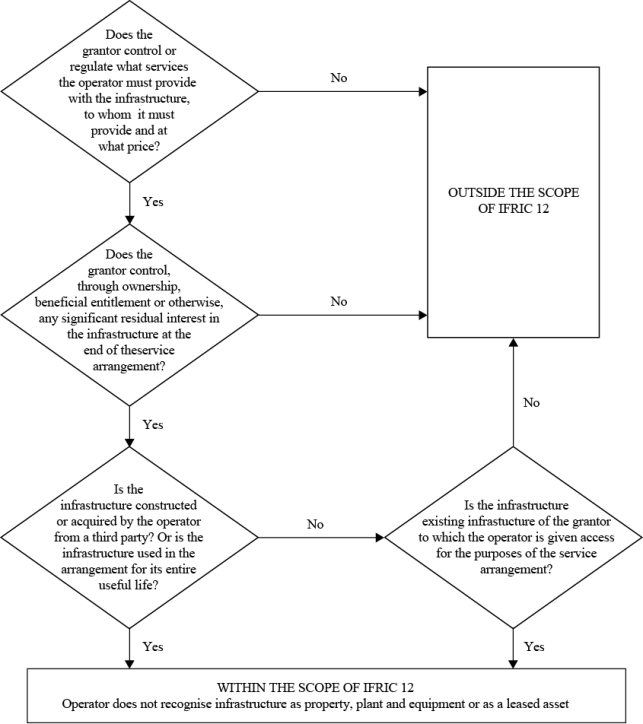

# 34 - Service concession arrangements (IFRIC 12)

[返回目录](README.md)

# 34 - Service concession arrangements (IFRIC 12)

Contents

- [34 - Service concession arrangements (IFRIC 12)](59.md#s238-chap_34_toc_h1)

- [Introduction and scope (paras 34.1- 34.23)](59.md#s239-chap_34_navPoint_1)

- [What is a service concession?](59.md#s239-chap_34_navPoint_2)

- [Scope of IFRIC 12](59.md#s239-chap_34_navPoint_3)

- [Public service obligation](59.md#s239-chap_34_navPoint_4)

- [Decision tree for arrangements falling within IFRIC 12’s scope](59.md#s239-chap_34_navPoint_5)

- [Control of the infrastructure by the grantor](59.md#s239-chap_34_navPoint_6)

- [Control or regulation of services](59.md#s239-chap_34_navPoint_7)

- [Control of residual interest](59.md#s239-chap_34_navPoint_8)

- [Infrastructure assets within scope](59.md#s239-chap_34_navPoint_9)

- [Existing assets of the operator](59.md#s239-chap_34_navPoint_10)

- [Inter-relationship of IFRIC 12 with IFRSs and IFRS 16](59.md#s239-chap_34_navPoint_11)

- [Private-to-private arrangements](59.md#s239-chap_34_navPoint_12)

- [Accounting for service concession arrangements (paras 34.24 - 34.53)](59.md#s240-chap_34_navPoint_13)

- [Introduction](59.md#s240-chap_34_navPoint_14)

- [Treatment of the operator’s rights over the infrastructure](59.md#s240-chap_34_navPoint_15)

- [Recognition of consideration given by the grantor to the operator](59.md#s240-chap_34_navPoint_16)

- [Operator recognises a financial asset](59.md#s240-chap_34_navPoint_17)

- [Specified or determinable amounts](59.md#s240-chap_34_navPoint_18)

- [Shortfall in user payments guaranteed by the grantor](59.md#s240-chap_34_navPoint_19)

- [Operator’s cash flows are contingent on performance or availability](59.md#s240-chap_34_navPoint_20)

- [Operator recognises an intangible asset](59.md#s240-chap_34_navPoint_21)

- [Operator recognises both a financial asset and an intangible asset](59.md#s240-chap_34_navPoint_22)

- [Recognition and measurement of revenue](59.md#s240-chap_34_navPoint_23)

- [Recognition and measurement of construction or upgrade revenue](59.md#s240-chap_34_navPoint_24)

- [Recognition and measurement of operations revenue](59.md#s240-chap_34_navPoint_25)

- [Accounting for construction asset](59.md#s240-chap_34_navPoint_26)

- [Financial asset](59.md#s240-chap_34_navPoint_27)

- [Intangible asset](59.md#s240-chap_34_navPoint_28)

- [Arrangements which contain both a financial and an intangible asset](59.md#s240-chap_34_navPoint_29)

- [Other matters](59.md#s240-chap_34_navPoint_30)

- [Arrangement does not give rise to construction or upgrade services](59.md#s240-chap_34_navPoint_31)

- [Borrowing costs incurred by the operator](59.md#s240-chap_34_navPoint_32)

- [Obligations for infrastructure maintenance during the operation phase](59.md#s240-chap_34_navPoint_33)

- [Enhancement or new infrastructure (upgrade)](59.md#s240-chap_34_navPoint_34)

- [Items provided to the operator by the grantor](59.md#s240-chap_34_navPoint_35)

- [Accounting by grantors](59.md#s240-chap_34_navPoint_36)

- [Presentation and disclosure (paras 34.54 - 34.59)](59.md#s241-chap_34_navPoint_37)

- [Transitional arrangements on first-time adoption of IFRS](59.md#s241-chap_34_navPoint_38)

- [Presentation of cash flows](59.md#s241-chap_34_navPoint_39)

- [Deferred tax](59.md#s241-chap_34_navPoint_40)

- [Illustrative text](59.md#s242-chap_34_navPoint_41)

- [FAQ 34.4.1 – What types of private provision of public services are within the scope of IFRIC 12?](59.md#s242-chap_34_navPoint_42)

- [FAQ 34.4.2 – Is a construction-only contract with a pre-determined margin within the scope of IFRIC 12?](59.md#s242-chap_34_navPoint_43)

- [FAQ 34.4.3 – Is a construction and operations contract with a pre-determined margin within the scope of IFRIC 12?](59.md#s242-chap_34_navPoint_44)

- [FAQ 34.4.4 – Are movable assets, such as buses and trains, excluded from the scope of IFRIC 12?](59.md#s242-chap_34_navPoint_45)

- [FAQ 34.5.1 – What is a public service obligation?](59.md#s242-chap_34_navPoint_46)

- [FAQ 34.5.2 – Does the public need to have access to the infrastructure?](59.md#s242-chap_34_navPoint_47)

- [FAQ 34.5.3 – Does the operator need to provide the services to the public itself?](59.md#s242-chap_34_navPoint_48)

- [FAQ 34.5.4 – Does the grantor need to be a public sector body, or to be controlled by one?](59.md#s242-chap_34_navPoint_49)

- [EX 34.7.1 – Grantor has a non-controlling interest in the operator](59.md#s242-chap_34_navPoint_50)

- [FAQ 34.8.1 – When could the government and a regulator together be considered the grantor?](59.md#s242-chap_34_navPoint_51)

- [EX 34.11.1 – Control or regulation of pricing](59.md#s242-chap_34_navPoint_52)

- [FAQ 34.11.2 – Price capping mechanism: does it have substance?](59.md#s242-chap_34_navPoint_53)

- [EX 34.11.3 – Grantor’s formal approval of the price](59.md#s242-chap_34_navPoint_54)

- [FAQ 34.13.1 – How might a grantor control any significant residual interest in the infrastructure?](59.md#s242-chap_34_navPoint_55)

- [FAQ 34.13.2 – Are infrastructure assets in regulated industries ‘controlled’ within the meaning of IFRIC 12?](59.md#s242-chap_34_navPoint_56)

- [EX 34.13.3 – Control of the residual interest in some, but not all, of the infrastructure](59.md#s242-chap_34_navPoint_57)

- [FAQ 34.14.1 – Does the infrastructure asset have a significant residual interest?](59.md#s242-chap_34_navPoint_58)

- [EX 34.14.2 – Significant residual interest: discontinuance of the public service](59.md#s242-chap_34_navPoint_59)

- [EX 34.14.3 – Significant residual interest: technical obsolescence and commercial viability](59.md#s242-chap_34_navPoint_60)

- [FAQ 34.16.1 – How does the operator consider replacement components? (1)](59.md#s242-chap_34_navPoint_61)

- [FAQ 34.16.2 – How does the operator consider replacement components? (2)](59.md#s242-chap_34_navPoint_62)

- [FAQ 34.19.1 – Does IFRIC 12 apply to assets that the operator leases from third parties?](59.md#s242-chap_34_navPoint_63)

- [EX 34.20.1 – Operator’s existing assets used in the arrangement](59.md#s242-chap_34_navPoint_64)

- [EX 34.28.1 – Consideration of amounts payable by the operator to the grantor](59.md#s242-chap_34_navPoint_65)

- [EX 34.29.1 – Operator’s unconditional right to receive cash for construction services](59.md#s242-chap_34_navPoint_66)

- [EX 34.30.1 – Operator’s contractual right to receive specified or determinable payments from the grantor or from users](59.md#s242-chap_34_navPoint_67)

- [EX 34.30.2 – Operator’s contractual right to receive specified or determinable payments from the grantor](59.md#s242-chap_34_navPoint_68)

- [EX 34.31.1 – Users pay the operator, but any shortfall is guaranteed by the grantor](59.md#s242-chap_34_navPoint_69)

- [FAQ 34.32.1 – What happens where the operator’s cash flows are contingent on performance of services or availability of the infrastructure asset?](59.md#s242-chap_34_navPoint_70)

- [EX 34.33.1 – Operator has a right to charge users of the services](59.md#s242-chap_34_navPoint_71)

- [EX 34.33.2 – Operator’s revenue is conditional on usage](59.md#s242-chap_34_navPoint_72)

- [EX 34.33.3 – Operator receives a substantially fixed return](59.md#s242-chap_34_navPoint_73)

- [EX 34.34.1 – Operator recognises both a financial asset and an intangible asset](59.md#s242-chap_34_navPoint_74)

- [FAQ 34.34.2 – How does the nature of the operator’s rights affect the type of asset recognised?](59.md#s242-chap_34_navPoint_75)

- [FAQ 34.36.1 – How is the transaction price allocated between construction and operational services when applying IFRS 15? (1)](59.md#s242-chap_34_navPoint_76)

- [FAQ 34.36.2 – How is the transaction price allocated between construction and operational services when applying IFRS 15? (2)](59.md#s242-chap_34_navPoint_77)

- [FAQ 34.37.1 – How do you determine whether the operator is an agent or principal for construction services when applying IFRS 15?](59.md#s242-chap_34_navPoint_78)

- [FAQ 34.37.2 – How do you recognise and measure revenue for construction services when applying IFRS 15?](59.md#s242-chap_34_navPoint_79)

- [FAQ 34.37.3 – How do you recognise revenue where the operator receives an intangible asset for construction services?](59.md#s242-chap_34_navPoint_80)

- [FAQ 34.37.4 – How do you recognise revenue when applying IFRS 15 and the operator receives an intangible asset for construction services?](59.md#s242-chap_34_navPoint_81)

- [FAQ 34.37.5 – Why does the amount of revenue that the operator recognises differ between the financial asset and intangible asset models?](59.md#s242-chap_34_navPoint_82)

- [FAQ 34.37.6 – What is the difference in revenue recognition between the financial asset and intangible asset models?](59.md#s242-chap_34_navPoint_83)

- [FAQ 34.38.1 – How is contract revenue allocated during the operation phase when applying IFRS 15?](59.md#s242-chap_34_navPoint_84)

- [EX 34.38.2 – Recognition of operations revenue from users as services are delivered, when applying IFRS 15](59.md#s242-chap_34_navPoint_85)

- [EX 34.38.3 – Recognition of operations revenue from the grantor as services are delivered, when applying IFRS 15](59.md#s242-chap_34_navPoint_86)

- [FAQ 34.40.1 – How is the recognition, initial and subsequent measurement of the financial asset when applying IFRS 9 in a service concession arrangement?](59.md#s242-chap_34_navPoint_87)

- [FAQ 34.43.1 – What is the subsequent measurement of the intangible asset?](59.md#s242-chap_34_navPoint_88)

- [FAQ 34.43.2 – What is the useful life of the intangible asset?](59.md#s242-chap_34_navPoint_89)

- [FAQ 34.43.3 – When does the operator start to amortise the intangible asset?](59.md#s242-chap_34_navPoint_90)

- [FAQ 34.43.4 – When should an entity start amortisation in an arrangement which contains both a financial asset and an intangible asset?](59.md#s242-chap_34_navPoint_91)

- [FAQ 34.43.5 – How should the intangible asset be amortised?](59.md#s242-chap_34_navPoint_92)

- [FAQ 34.46.1 – How should an entity account for an arrangement that does not give rise to construction or upgrade services but the grantor pays the operator a fixed sum?](59.md#s242-chap_34_navPoint_93)

- [FAQ 34.46.2 – How should an entity account for an arrangement that does not give rise to construction or upgrade services but the grantor gives the operator the right to charge users?](59.md#s242-chap_34_navPoint_94)

- [FAQ 34.46.3 – How should an entity account for an arrangement that does not give rise to construction or upgrade services but the operator pays the grantor for the right to charge users?](59.md#s242-chap_34_navPoint_95)

- [FAQ 34.46.4 – How should an entity account for an arrangement that does not give rise to construction or upgrade services but the grantor provides a shortfall guarantee for the amounts that the operator collects from users?](59.md#s242-chap_34_navPoint_96)

- [EX 34.48.1 – Borrowing costs](59.md#s242-chap_34_navPoint_97)

- [FAQ 34.49.1 – How does an operator account for obligations related to infrastructure maintenance during the operation phase when applying IFRS 15?](59.md#s242-chap_34_navPoint_98)

- [FAQ 34.49.2 – Why is IAS 37 relevant for major refurbishments and renewals?](59.md#s242-chap_34_navPoint_99)

- [FAQ 34.50.1 – Is IFRS 15 applicable to the construction of enhancements or new infrastructure (upgrade)?](59.md#s242-chap_34_navPoint_100)

- [EX 34.52.1 – Items provided by the grantor: operator is applying IFRS 15 and recognises a financial asset](59.md#s242-chap_34_navPoint_101)

- [EX 34.52.2 – Items provided by the grantor: operator is applying IFRS 15 and recognises an intangible asset](59.md#s242-chap_34_navPoint_102)

- [FAQ 34.57.1 – What should an operator consider where retrospective application is impracticable on first-time adoption of IFRS for the financial asset model?](59.md#s242-chap_34_navPoint_103)

- [FAQ 34.57.2 – How does an operator apply the transitional relief for reclassifying to an intangible asset?](59.md#s242-chap_34_navPoint_104)

- [FAQ 34.57.3 – How does an operator apply the transitional relief for reclassifying to both an intangible asset and a financial asset?](59.md#s242-chap_34_navPoint_105)

- [FAQ 34.57.4 – Transitional relief: can the ‘fair value as deemed cost’ exemption be applied to intangible assets associated with concession agreements on first-time adoption of IFRS?](59.md#s242-chap_34_navPoint_106)

- [FAQ 34.58.1 – What is the interaction between IFRIC 12 and IAS 7 for the presentation of cash flows related to construction activity?](59.md#s242-chap_34_navPoint_107)

- [EX 34.59.1 – Deferred tax implications of a service concession arrangement](59.md#s242-chap_34_navPoint_108)

This eBook is licensed to peggy so, peggy.so@hk.ey.com, 

## Introduction and scope (paras 34.1- 34.23)

 

**34.1** IFRIC 12’s objective is to establish general principles on recognising and measuring the obligations and related rights in public-to-private service concession arrangements.

 

### What is a service concession?

 

**34.2** A service concession typically involves a public sector entity (‘the grantor’) entering into a contract with a private sector entity (‘the operator’) and with the following features:

- The arrangement involves providing services that give the public access to major economic and social facilities. Such facilities typically involve the use of infrastructure.

- The operator provides services to construct and/or upgrade infrastructure and/or to operate and maintain the infrastructure for the period of the concession.

- The grantor pays the operator for its services, or grants it the right to charge users of the service during the period of the arrangement, or a combination of both.

- A contract governs the terms and conditions of the arrangement, including the service performance standards, how the price is determined, and penalties for service failures.

- The operator transfers the infrastructure to the grantor, usually in a specified condition, at the end of the arrangement.

[IFRIC 12 para 3].

 

### Scope of IFRIC 12

 

**34.3** Governments are generally responsible for the construction, operation and maintenance of infrastructure for public services, such as roads, railways, bridges, schools, hospitals, prisons, airports, water distribution and waste management systems, energy supply and telecommunication networks.

[IFRIC 12 para 1].

**34.4** Some countries have developed private finance initiative (PFI) and public private partnership (PPP) arrangements, under which the public sector procures the provision of such public services from the private sector. These arrangements are generally referred to as ‘service concession arrangements’. The private sector designs, builds, finances and operates the infrastructure in order to provide the contracted services.

[IFRIC 12 para 2].

[FAQ 34.4.1 – What types of private provision of public services are within the scope of IFRIC 12?](59.md#s242-FAQ_34.4.1)  
[FAQ 34.4.2 – Is a construction-only contract with a pre-determined margin within the scope of IFRIC 12?](59.md#s242-FAQ_34.4.2)  
[FAQ 34.4.3 – Is a construction and operations contract with a pre-determined margin within the scope of IFRIC 12?](59.md#s242-FAQ_34.4.3)  
[FAQ 34.4.4 – Are movable assets, such as buses and trains, excluded from the scope of IFRIC 12?](59.md#s242-FAQ_34.4.4)

 

### Public service obligation

 

**34.5** A key feature of public-to-private service concession arrangements in the scope of IFRIC 12 is that the nature of the obligation undertaken by the operator is a public service. A public service is one where a government’s policy is for the service to be provided to the public, irrespective of who provides it.

[IFRIC 12 para 3].

[FAQ 34.5.1 – What is a public service obligation?](59.md#s242-FAQ_34.5.1)  
[FAQ 34.5.2 – Does the public need to have access to the infrastructure?](59.md#s242-FAQ_34.5.2)  
[FAQ 34.5.3 – Does the operator need to provide the services to the public itself?](59.md#s242-FAQ_34.5.3)  
[FAQ 34.5.4 – Does the grantor need to be a public sector body, or to be controlled by one?](59.md#s242-FAQ_34.5.4)

 

### Decision tree for arrangements falling within IFRIC 12’s scope

 

**34.6** IFRIC 12 provides a decision tree for determining whether a public-to-private service concession arrangement is within its scope.

  
 [IFRIC 12 Information note 1].

 

### Control of the infrastructure by the grantor

 

**34.7** An operator accounts for a public-to-private service concession arrangement in accordance with IFRIC 12 where the grantor controls the infrastructure. The grantor controls the infrastructure where the following conditions are met:

- the grantor controls or regulates what services the operator must provide with the infrastructure, to whom it must provide them, and at what price; and

- the grantor controls – through ownership, beneficial entitlement or otherwise – any significant residual interest in the infrastructure at the end of the arrangement’s term.

[IFRIC 12 para 5].

[EX 34.7.1 – Grantor has a non-controlling interest in the operator](59.md#s242-EX34.7.1)

 

### Control or regulation of services

 

**34.8** The grantor’s control or regulation of services need not be by contract (an agreement or a licence), and it could instead be through some other form of regulation. It includes situations where the grantor buys all of the output and those in which some or all of the output is purchased by other users. The operator considers the grantor and any of its related parties together when making this assessment. Where the grantor is a public sector entity, the operator regards the public sector as a whole, along with any regulators acting in the public interest, as being related to the grantor.

[IFRIC 12 para AG2].

[FAQ 34.8.1 – When could the government and a regulator together be considered as the grantor?](59.md#s242-FAQ_34.8.1)

**34.9** The term ‘price’ refers to the amount that the grantor pays to the operator for providing the public service, or the amount that the operator charges the general public for the services. The grantor does not need to have complete control of the price. It is sufficient if the grantor can regulate the price itself, by the contract, or through a regulator.

[IFRIC 12 para AG3].

**34.10** A government or regulator might set or regulate prices in various ways, ranging from fixed price arrangements to those based on a formula. A formula might be linked to performance that is within the operator’s control, or it might be linked to an inflation index which neither the grantor nor the operator controls. The grantor controls the price provided that the basis or the framework under which the prices are set is subject to control or regulation.

[IFRIC 12 para AG3].

**34.11** The operator considers the arrangement’s substance where the grantor controls or regulates the price through a capping mechanism. The operator ignores a price cap that will apply only in remote circumstances, because it has no substance. Similarly, the operator ignores other pricing mechanism features that are not substantive. The operator might have freedom to set its prices but, under the contract, it must pay any excess profit over an agreed minimum to the grantor. In this case, the operator’s return is capped, and so the grantor controls the price.

[IFRIC 12 para AG3].

[EX 34.11.1 – Control or regulation of pricing](59.md#s242-EX34.11.1)  
[FAQ 34.11.2 – Price capping mechanism: does it have substance?](59.md#s242-FAQ_34.11.2)  
[EX 34.11.3 – Grantor’s formal approval of the price](59.md#s242-EX34.11.3)

 

### Control of residual interest

 

**34.12**The condition of control is satisfied where the grantor controls any significant residual interest in the infrastructure asset. Again, if the grantor is a public sector entity, the operator regards the public sector as a whole, including parties such as a regulator, as related to the grantor.

[IFRIC 12 para 5(b)]. [IFRIC 12 para AG2].

[FAQ 34.8.1 – When could the government and a regulator together be considered as the grantor?](59.md#s242-FAQ_34.8.1)

**34.13** The grantor controls any significant residual interest where it restricts the operator’s ability to sell or pledge the infrastructure.

[IFRIC 12 para AG4].

[FAQ 34.13.1 – How might a grantor control any significant residual interest in the infrastructure?](59.md#s242-FAQ_34.13.1)  
[FAQ 34.13.2 – Are infrastructure assets in regulated industries ‘controlled’ within the meaning of IFRIC 12?](59.md#s242-FAQ_34.13.2)  
  
[EX 34.13.3 – Control of the residual interest in some, but not all, of the infrastructure](59.md#s242-EX34.13.3)

**34.14**The infrastructure’s residual interest is the operator’s estimate of current value of the asset as if it were already of the age and in the condition expected at the end of the arrangement.

[IFRIC 12 para AG4].

[FAQ 34.14.1 – Does the infrastructure asset have a significant residual interest?](59.md#s242-FAQ_34.14.1)  
  
[EX 34.14.2 – Significant residual interest: discontinuance of the public service](59.md#s242-EX34.14.2)  
[EX 34.14.3 – Significant residual interest: technical obsolescence and commercial viability](59.md#s242-EX34.14.3)

**34.15** A ‘whole-of-life’ infrastructure asset is one where the operator uses the asset in the service concession arrangement for its entire useful life, and so it is likely to have no significant residual interest at the end of the concession period. In such cases, the operator disregards the condition in paragraph 5(b) of the IFRIC, and considers only the condition in paragraph 5(a) to determine whether the grantor controls the infrastructure.

[IFRIC 12 para 6].

**34.16** The operator might have to replace part of an item of infrastructure asset that is used up in the service concession. For example, the operator might be required to resurface a toll road or the roof of a hospital building during the life of the agreement. The residual interest criterion is met in these arrangements for the whole of the infrastructure (referred to as a ‘holistic’ approach), including the part that is replaced, if the grantor controls any significant residual interest in the final replacement of that part.

[IFRIC 12 para AG6].

[FAQ 34.16.1 – How does the operator consider replacement components?](59.md#s242-FAQ_34.16.1) (1)   
[FAQ 34.16.2 – How does the operator consider replacement components? (2)](59.md#s242-FAQ_34.16.2)

**34.17** The grantor might regulate only part of the infrastructure. IFRIC 12 considers two such situations:

- Where the operator uses any infrastructure entirely for unregulated purposes, the asset is physically separable and can be operated independently, and it meets the definition of a cash-generating unit under IAS 36, the operator analyses it separately. An example would be a private wing in a public hospital.

- Where the operator has unregulated activities which are purely ancillary in nature (for example, a hospital shop) it disregards these when applying the control tests because these do not detract from the grantor’s control of the infrastructure.

[IFRIC 12 para AG7].

**34.18**The operator might, in substance, lease the separable infrastructure or the facility for providing the unregulated ancillary services from the grantor. If so, the operator accounts for the lease in accordance with IFRS 16.

[IFRIC 12 para AG8].

 

### Infrastructure assets within scope

 

**34.19**IFRIC 12 applies to two types of infrastructure assets that the operator uses in delivering the service arrangement. These are:

- infrastructure that the operator constructs or acquires from a third party; and

- the grantor’s existing infrastructure to which it gives the operator access.

[IFRIC 12 para 7].

[FAQ 34.19.1 – Does IFRIC 12 apply to assets that the operator leases from third parties?](59.md#s242-FAQ_34.19.1)

 

### Existing assets of the operator

 

**34.20** The operator does not apply IFRIC 12 to its existing infrastructure assets which it recognised as property, plant and equipment and which it uses in the service concession arrangement. The operator continues to recognise such assets, unless they meet the conditions for derecognition in IAS 16.

[IFRIC 12 para 8].

[EX 34.20.1 – Operator’s existing assets used in the arrangement](59.md#s242-EX34.20.1)

 

### Inter-relationship of IFRIC 12 with IFRSs and IFRS 16

 

**34.21** IFRIC 12 does not cover all public-to-private service concession arrangements. It includes a table, set out below, to help concession operators identify the relevant IFRS for service concession arrangements. IFRIC 12 applies to arrangements in the shaded area, where the application of IFRSs is most unclear. The table highlights the continuum of arrangements and it confirms that ‘bright lines’ do not exist between arrangements or between the accounting requirements.

**References to IFRSs that apply to typical types of public-to-private arrangements**

<table style="width:100%; border-collapse:collapse"><thead><tr><td style="border:0.75pt solid #000000; padding-right:5.03pt; padding-left:5.03pt; vertical-align:top">
<b>Category</b>
</td><td style="border:0.75pt solid #000000; padding-right:5.03pt; padding-left:5.03pt; vertical-align:top">
<b>Lessee</b>
</td><td colspan="5" style="border:0.75pt solid #000000; padding-right:5.03pt; padding-left:5.03pt; vertical-align:top">
<b>Service provider</b>
</td><td colspan="4" style="border:0.75pt solid #000000; padding-right:5.03pt; padding-left:5.03pt; vertical-align:top">
<b>Owner</b>
</td></tr></thead><tbody><tr><td style="border:0.75pt solid #000000; padding-right:5.03pt; padding-left:5.03pt; vertical-align:top">
Typical arrangement types
</td><td style="border:0.75pt solid #000000; padding-right:5.03pt; padding-left:5.03pt; vertical-align:top">
Lease (for example, operator leases asset from grantor)
</td><td colspan="2" style="border:0.75pt solid #000000; padding-right:5.03pt; padding-left:5.03pt; vertical-align:top">
Service and/or maintenance contract (specific tasks for example, debt collection)
</td><td style="border:0.75pt solid #000000; padding-right:5.03pt; padding-left:5.03pt; vertical-align:top">
Rehabilitate-operate-transfer
</td><td colspan="3" style="border:0.75pt solid #000000; padding-right:5.03pt; padding-left:5.03pt; vertical-align:top">
Build-operate-transfer
</td><td colspan="2" style="border:0.75pt solid #000000; padding-right:5.03pt; padding-left:5.03pt; vertical-align:top">
Build-own-operate
</td><td style="border:0.75pt solid #000000; padding-right:5.03pt; padding-left:5.03pt; vertical-align:top">
100% divestment/ privatisation/ corporation
</td></tr><tr><td style="border:0.75pt solid #000000; padding-right:5.03pt; padding-left:5.03pt; vertical-align:top">
Asset ownership
</td><td colspan="2" style="border:0.75pt solid #000000; padding-right:5.03pt; padding-left:5.03pt; vertical-align:top">
Grantor
</td><td colspan="3" style="border:0.75pt solid #000000; padding-right:5.03pt; padding-left:5.03pt; vertical-align:top">
Grantor
</td><td colspan="5" style="border:0.75pt solid #000000; padding-right:5.03pt; padding-left:5.03pt; vertical-align:top">
Operator
</td></tr><tr><td style="border:0.75pt solid #000000; padding-right:5.03pt; padding-left:5.03pt; vertical-align:top">
Capital investment
</td><td colspan="2" style="border:0.75pt solid #000000; padding-right:5.03pt; padding-left:5.03pt; vertical-align:top">
Grantor
</td><td colspan="3" style="border:0.75pt solid #000000; padding-right:5.03pt; padding-left:5.03pt; vertical-align:top">
Operator
</td><td colspan="5" style="border:0.75pt solid #000000; padding-right:5.03pt; padding-left:5.03pt; vertical-align:top">
Operator
</td></tr><tr><td style="border:0.75pt solid #000000; padding-right:5.03pt; padding-left:5.03pt; vertical-align:top">
Demand risk
</td><td style="border:0.75pt solid #000000; padding-right:5.03pt; padding-left:5.03pt; vertical-align:top">
Shared
</td><td colspan="2" style="border:0.75pt solid #000000; padding-right:5.03pt; padding-left:5.03pt; vertical-align:top">
Grantor
</td><td colspan="3" style="border:0.75pt solid #000000; padding-right:5.03pt; padding-left:5.03pt; vertical-align:top">
Operator and/or grantor
</td><td colspan="4" style="border:0.75pt solid #000000; padding-right:5.03pt; padding-left:5.03pt; vertical-align:top">
Operator
</td></tr><tr><td style="border:0.75pt solid #000000; padding-right:5.03pt; padding-left:5.03pt; vertical-align:top">
Typical duration
</td><td style="border:0.75pt solid #000000; padding-right:5.03pt; padding-left:5.03pt; vertical-align:top">
8–20 years
</td><td colspan="2" style="border:0.75pt solid #000000; padding-right:5.03pt; padding-left:5.03pt; vertical-align:top">
1–5 years
</td><td colspan="3" style="border:0.75pt solid #000000; padding-right:5.03pt; padding-left:5.03pt; vertical-align:top">
25–30 years
</td><td colspan="2" style="border:0.75pt solid #000000; padding-right:5.03pt; padding-left:5.03pt; vertical-align:top">
25–30 years
</td><td colspan="2" style="border:0.75pt solid #000000; padding-right:5.03pt; padding-left:5.03pt; vertical-align:top">
Indefinite (or might be limited by licence)
</td></tr><tr><td style="border:0.75pt solid #000000; padding-right:5.03pt; padding-left:5.03pt; vertical-align:top">
Residual interest
</td><td colspan="2" style="border:0.75pt solid #000000; padding-right:5.03pt; padding-left:5.03pt; vertical-align:top">
Grantor
</td><td colspan="3" style="border:0.75pt solid #000000; padding-right:5.03pt; padding-left:5.03pt; vertical-align:top">
Grantor
</td><td colspan="5" style="border:0.75pt solid #000000; padding-right:5.03pt; padding-left:5.03pt; vertical-align:top">
Operator
</td></tr><tr><td style="border:0.75pt solid #000000; padding-right:5.03pt; padding-left:5.03pt; vertical-align:top">
Relevant IFRSs
</td><td style="border:0.75pt solid #000000; padding-right:5.03pt; padding-left:5.03pt; vertical-align:top">
IFRS 16
</td><td colspan="2" style="border:0.75pt solid #000000; padding-right:5.03pt; padding-left:5.03pt; vertical-align:top">
IFRS 15
</td><td colspan="3" style="border:0.75pt solid #000000; padding-right:5.03pt; padding-left:5.03pt; vertical-align:top">
IFRIC 12
</td><td colspan="4" style="border:0.75pt solid #000000; padding-right:5.03pt; padding-left:5.03pt; vertical-align:top">
IAS 16
</td></tr><tr style="height:0pt"><td></td><td></td><td></td><td></td><td></td><td></td><td></td><td></td><td></td><td></td><td></td></tr></tbody></table>

  
 [IFRIC 12 Information note 2].

**34.22** Arrangements within the scope of IFRIC 12 might be very similar to arrangements that contain leases. If a service arrangement is within the scope of IFRIC 12, it is not within the scope of IFRS 16.

[IFRS 16 para 3(c)].

 

### Private-to-private arrangements

 

**34.23** An entity might apply the guidance in IFRIC 12 to private-to-private arrangements by analogy, through the accounting policy hierarchy set out IAS 8 where no standards or interpretations apply directly (see [chapter 3 para 8](09.md#s20-Para_3.8)). This might be appropriate where the arrangement meets similar requirements to those specified in IFRIC 12, that is:

- the arrangement meets the requirements for control by the grantor set out in paragraph 5 of IFRIC 12; and

- the arrangement embodies a public service obligation as described in paragraph 3 of IFRIC 12.

[IFRIC 12 para BC14].

 

This eBook is licensed to peggy so, peggy.so@hk.ey.com, 

## Accounting for service concession arrangements (paras 34.24 - 34.53)

### Introduction

 

**34.24** The issues addressed in IFRIC 12 are:

- The treatment of the operator’s rights over the infrastructure.

- Recognition and measurement of consideration.

- Construction or upgrade services.

- Operation services.

- Borrowing costs.

- Subsequent accounting treatment of a financial asset and an intangible asset.

- Items provided to the operator by the grantor.

[IFRIC 12 para 10].

 

### Treatment of the operator’s rights over the infrastructure

 

**34.25** The operator does not recognise infrastructure within the scope of IFRIC 12 as property, plant and equipment, because the contractual service arrangement does not convey to it the right to control the infrastructure. The operator has access to operate the infrastructure to provide the public service on the grantor’s behalf in accordance with the contract’s terms. This applies whether the infrastructure is constructed or acquired by the operator or is provided by the grantor for the purposes of the concession.

[IFRIC 12 para 11].

**34.26** Control is different from management. If the grantor retains both the degree of control described in paragraph 5(a) of IFRIC 12 and any significant residual interest in the infrastructure, the operator is only managing the infrastructure on the grantor’s behalf – even though it might have wide managerial discretion.

[IFRIC 12 para AG5].

 

### Recognition of consideration given by the grantor to the operator

 

**34.27** The operator recognises an asset for the consideration that it receives from the grantor in exchange for providing construction or upgrade services. The consideration received can take a variety of forms. The consideration given by the grantor to the operator might be rights to:

- a financial asset; or

- an intangible asset.

[IFRIC 12 para 15].

**34.28** The operator determines the nature of the consideration given by the grantor by reference to the terms of the contract and, where relevant, contract law. The operator classifies both types of consideration as a contract asset during the construction or upgrade period, in accordance with IFRS 15. The operator also considers the substance of any payments that it makes to the grantor.

[IFRIC 12 para 19].

[EX 34.28.1 – Consideration of amounts payable by the operator to the grantor](59.md#s242-EX34.28.1)

 

### Operator recognises a financial asset

 

**34.29** The operator recognises a financial asset to the extent that it has an unconditional contractual right to receive cash or another financial asset from, or at the direction of, the grantor for the construction services. This right arises where the grantor has little or no discretion to avoid payment, usually because the agreement is enforceable by law.

[IFRIC 12 para 16].

[EX 34.29.1 – Operator’s unconditional right to receive cash for construction services](59.md#s242-EX34.29.1)

 

### Specified or determinable amounts

 

**34.30** Where the grantor agrees to pay the operator a specified or determinable amount, the operator has an unconditional right to receive cash, and so it recognises a financial asset.

[IFRIC 12 para 16].

[EX 34.30.1 – Operator’s contractual right to receive specified or determinable payments from the grantor or from users](59.md#s242-EX34.30.1)  
 [EX 34.30.2 – Operator’s contractual right to receive specified or determinable payments from the grantor](59.md#s242-EX34.30.2)

 

### Shortfall in user payments guaranteed by the grantor

 

**34.31** The grantor might give the operator the right to charge users while guaranteeing to pay the operator any shortfall between the amounts received from users and a specified or determinable amount. The operator has an unconditional right to receive cash. Consequently, the operator recognises a financial asset for the full amount of the cash guaranteed by the grantor.

[IFRIC 12 para 16].

[EX 34.31.1 – Users pay the operator, but any shortfall is guaranteed by the grantor](59.md#s242-EX34.31.1)

 

### Operator’s cash flows are contingent on performance or availability

 

**34.32** The operator recognises a financial asset, even where its right to receive cash is contingent on meeting specified quality or efficiency requirements.

[IFRIC 12 para 16].

[FAQ 34.32.1 – What happens where the operator’s cash flows are contingent on performance of services or availability of the infrastructure asset?](59.md#s242-FAQ_34.32.1)

 

### Operator recognises an intangible asset

 

**34.33**The operator recognises an intangible asset to the extent that it has a right to charge users of the public service. The operator’s right to charge users is not an unconditional right to receive cash, because the amounts are contingent on the extent to which the public uses the service.

[IFRIC 12 para 17].

[EX 34.33.1 – Operator has a right to charge users of the services](59.md#s242-EX34.33.1)  
[EX 34.33.2 – Operator’s revenue is conditional on usage](59.md#s242-EX34.33.2)  
[EX 34.33.3 – Operator receives a substantially fixed return](59.md#s242-EX34.33.3)

 

### Operator recognises both a financial asset and an intangible asset

 

**34.34** The operator accounts separately for each component of the consideration where it receives payment for the construction services partly by a financial asset and partly by an intangible asset. The operator recognises both components initially in accordance with IFRS 15.

[IFRIC 12 para 18].

[EX 34.34.1 – Operator recognises both a financial asset and an intangible asset](59.md#s242-EX34.34.1)  
[FAQ 34.34.2 – How does the nature of the operator’s rights affects the type of asset recognised?](59.md#s242-FAQ_34.34.2)

 

### Recognition and measurement of revenue

 

**34.35** The operator is regarded as a service provider, delivering construction or upgrade services during the construction phase and operational services during the operation phase.

[IFRIC 12 para 12].

**34.36** The operator recognises, and measures, revenue for the services that it performs, in accordance with IFRS 15, by:

- identifying the separate performance obligations in the arrangement;

- determining the total transaction price for the arrangement;

- allocating the total transaction price to the separate performance obligations on the basis of their relative stand-alone selling prices; and

- recognising revenue for each performance obligation over time, or at a point in time, as appropriate.

[IFRIC 12 para 13].

[FAQ 34.36.1 – How is the transaction price allocated between construction and operational services when applying IFRS 15? (1)](59.md#s242-FAQ_34.36.1)  
[FAQ 34.36.2 – How is the transaction price allocated between construction and operational services when applying IFRS 15? (2)](59.md#s242-FAQ_34.36.2)

 

### Recognition and measurement of construction or upgrade revenue

 

**34.37**The operator accounts for construction or upgrade services in accordance with IFRS 15.

[IFRIC 12 para 14].

[FAQ 34.37.1 – How do you determine whether the operator is an agent or principal for construction services when applying IFRS 15?](59.md#s242-FAQ_34.37.1)  
[FAQ 34.37.2 – How do you recognise and measure revenue for construction services when applying IFRS 15? ](59.md#s242-FAQ_34.37.2)  
[FAQ 34.37.3 – How do you recognise revenue where the operator receives an intangible asset for construction services?](59.md#s242-FAQ_34.37.3)  
  
[FAQ 34.37.4 – How do you recognise revenue when applying IFRS 15 and the operator receives an intangible asset for construction services?](59.md#s242-FAQ_34.37.4)  
[FAQ 34.37.5 – Why does the amount of revenue that the operator recognises differ between the financial asset and intangible asset models?](59.md#s242-FAQ_34.37.5)  
  
[FAQ 34.37.6 – What is the difference in revenue recognition between the financial asset and intangible asset models?](59.md#s242-FAQ_34.37.6)

 

### Recognition and measurement of operations revenue

 

**34.38** The operator accounts for operation services in accordance with IFRS 15.

[IFRIC 12 para 20].

[FAQ 34.38.1 – How is contract revenue allocated during the operation phase when applying IFRS 15?](59.md#s242-FAQ_34.38.1)  
[EX 34.38.2 – Recognition of operations revenue from users as services are delivered, when applying IFRS 15](59.md#s242-EX34.38.2)  
[EX 34.38.3 – Recognition of operations revenue from the grantor as services are delivered, when applying IFRS 15](59.md#s242-EX34.38.3)

 

### Accounting for construction asset

### Financial asset

 

**34.39**The operator accounts for the financial asset in accordance with the financial instruments standards – IAS 32, IFRS 7 and IFRS 9.

[IFRIC 12 para 23].

**34.40** The operator classifies the financial asset into the appropriate category under IFRS 9:

- amortised cost;

- fair value through other comprehensive income; or

- fair value through profit or loss.

[IFRIC 12 para 24].

[FAQ 34.40.1 – How is the recognition, initial and subsequent measurement of the financial asset when applying IFRS 9 in a service concession arrangement?](59.md#s242-FAQ_34.40.1)

 

### Intangible asset

 

**34.41** The operator accounts for the intangible asset in accordance with IAS 38.

[IFRIC 12 para 26].

**34.42** The operator initially measures the intangible asset at cost.

[IAS 38 para 24].

**34.43** The operator subsequently measures the intangible asset over its useful economic life at cost less accumulated amortisation and impairment losses.

[IAS 38 para 74].

[FAQ 34.43.1 – What is the subsequent measurement of the intangible asset?](59.md#s242-FAQ_34.43.1)  
[FAQ 34.43.2 – What is the useful life of the intangible asset?](59.md#s242-FAQ_34.43.2)  
[FAQ 34.43.3 – When does the operator start to amortise the intangible asset?](59.md#s242-FAQ_34.43.3)  
[FAQ 34.43.4 – When should an entity start amortisation in an arrangement which contains both a financial asset and an intangible asset?](59.md#s242-FAQ_34.43.4)  
[FAQ 34.43.5 – How should the intangible asset be amortised?](59.md#s242-FAQ_34.43.5)

 

### Arrangements which contain both a financial and an intangible asset

**34.44** The operator might recover part of its investment in the infrastructure asset through payment from the grantor and the remainder through a right to charge service users. The operator accounts separately for the financial asset and the intangible asset.

[IFRIC 12 para 18].

**34.45**This accounting can be complex. IFRIC 12 includes an illustrative example.

[IFRIC 12 Illustrative example 3].

### Other matters

### Arrangement does not give rise to construction or upgrade services

 

**34.46** Service concession arrangements need not involve the operator undertaking construction or upgrade activities. The grantor can give the operator access to its existing assets, for the purpose of the public service arrangement, that require little or no upgrade. The grantor might pay the operator directly, or it might give the operator the right to charge users based on usage, but pricing is regulated. Such arrangements are within the scope of IFRIC 12, but the interpretation does not provide specific guidance.

[FAQ 34.46.1 – How should an entity account for an arrangement that does not give rise to construction or upgrade services but the grantor pays the operator a fixed sum?](59.md#s242-FAQ_34.46.1)  
[FAQ 34.46.2 – How should an entity account for an arrangement that does not give rise to construction or upgrade services but the grantor gives the operator the right to charge users?](59.md#s242-FAQ_34.46.2)  
[FAQ 34.46.3 – How should an entity account for an arrangement that does not give rise to construction or upgrade services but the operator pays the grantor for the right to charge users?](59.md#s242-FAQ_34.46.3)  
[FAQ 34.46.4 – How should an entity account for an arrangement that does not give rise to construction or upgrade services but the grantor provides a shortfall guarantee for the amounts that the operator collects from users?](59.md#s242-FAQ_34.46.4)

 

### Borrowing costs incurred by the operator

 

**34.47** The operator capitalises borrowing costs under IAS 23 where it has a contractual right to receive an intangible asset. Borrowing costs are expensed when incurred under IAS 23 where the operator has a right to a financial asset (see chapter 22 para 42).

[IFRIC 12 para 22].

**34.48** The intangible asset in respect of the operator’s right to charge users of the public service meets the definition of a qualifying asset, because generally the licence would not be ready for use until the infrastructure was constructed or upgraded. A financial asset does not meet the definition of a qualifying asset.

[IAS 23 para 7].

[EX 34.48.1 – Borrowing costs](59.md#s242-EX34.48.1)

 

### Obligations for infrastructure maintenance during the operation phase

 

**34.49**The operator might have obligations under the contract to replace or refurbish infrastructure assets during the operation phase. The operator might have to maintain the infrastructure to a specified level of service at all times, or it might have to restore the infrastructure to a specified condition before it is handed back to the grantor. An operator recognises and measures such contractual obligations, except for any upgrade element, in accordance with IAS 37 (see [chapter 16 para 10](36.md#s117-Para_16.10)).

[IFRIC 12 para 21].

[FAQ 34.49.1 – How does an operator account for obligations related to infrastructure maintenance during the operation phase when applying IFRS 15?](59.md#s242-FAQ_34.49.1)  
[FAQ 34.49.2 – Why is IAS 37 relevant for major refurbishments and renewals?](59.md#s242-FAQ_34.49.2)

 

### Enhancement or new infrastructure (upgrade)

 

**34.50** The operator does not recognise a provision in advance of the upgrade where it has a contractual obligation to enhance or upgrade existing infrastructure or to construct new infrastructure during the operation phase. Instead, the operator accounts for upgrade services in accordance IFRS 15.

[IFRIC 12 para 14].

[FAQ 34.50.1 – Is IFRS 15 applicable to the construction of enhancements or new infrastructure (upgrade)?](59.md#s242-FAQ_34.50.1)

 

### Items provided to the operator by the grantor

 

**34.51**The grantor might contribute infrastructure assets which are required for the operator to carry out its obligations under the contract. These assets remain the property of the grantor, and the operator does not recognise them as assets.

[IFRIC 12 para 27].

**34.52** The grantor might provide other items to the operator for it to keep or do with as it pleases, and which form part of the consideration payable by the grantor for the services rendered. These items are not government grants under IAS 20. The operator includes the fair value of such non-cash consideration as part of the transaction price in accordance with IFRS 15.

[IFRIC 12 para 27].

[EX34.52.1 – Items provided by the grantor: operator is applying IFRS 15 and recognises a financial asset](59.md#s242-EX34.52.1)  
[EX 34.52.2 – Items provided by the grantor: operator is applying IFRS 15 and recognises an intangible asset](59.md#s242-EX34.52.2)

 

### Accounting by grantors

 

**34.53** IFRIC 12 does not specify the accounting by grantors.

[IFRIC 12 para 9].

 

This eBook is licensed to peggy so, peggy.so@hk.ey.com, 

## Presentation and disclosure (paras 34.54 - 34.59)

 

**34.54** IFRIC 12 does not require any specific disclosures. SIC 29 contains disclosure requirements relating to service concession arrangements for both operators and grantors. An entity might need to include disclosures required by other standards applicable to certain aspects of service concession arrangements, such as IAS 16, IFRS 16 and IAS 38.

[SIC 29 para 5].

**34.55** IFRS 7 also applies where an operator recognises a financial asset.

[IFRIC 12 para 23].

 

### Transitional arrangements on first-time adoption of IFRS

 

**34.56** A first-time adopter of IFRS can use the transitional relief in IFRIC 12.

[IFRS 1 App D para D22].

**34.57**Where management considers that applying the requirements retrospectively in full is impracticable, the operator instead:

- recognises financial assets and intangible assets that existed at the start of the earliest period presented;

- uses the previous carrying amounts of those financial and intangible assets (however they were previously classified) as their carrying amounts as at that date; and

- tests financial and intangible assets recognised at that date for impairment, unless this is not practicable, in which case it tests the amounts for impairment as at the start of the current period.

[IFRIC 12 para 30].

[FAQ 34.57.1 – What should an operator consider where retrospective application is impracticable on first-time adoption of IFRS for the financial asset model?](59.md#s242-FAQ_34.57.1)  
[FAQ 34.57.2 – How does an operator apply the transitional relief for reclassifying to an intangible asset?](59.md#s242-FAQ_34.57.2)  
[FAQ 34.57.3 – How does an operator apply the transitional relief when reclassifying to both an intangible asset and a financial asset?](59.md#s242-FAQ_34.57.3)  
[FAQ 34.57.4 – Transitional relief: can the ‘fair value as deemed cost’ exemption be applied to intangible assets associated with concession agreements on first-time adoption of IFRS?](59.md#s242-FAQ_34.57.4)

 

### Presentation of cash flows

 

**34.58**An entity presents the service concession cash flows in a manner which is most appropriate to its business.

[IAS 7 para 11].

[FAQ 34.58.1 – What is the interaction between IFRIC 12 and IAS 7 for the presentation of cash flows related to construction activity?](59.md#s242-FAQ_34.58.1)

 

### Deferred tax

 

**34.59**An entity accounts for deferred tax implications of service concessions in accordance with IAS 12.

[IAS 12 para 15].

[EX 34.59.1 – Deferred tax implications of a service concession arrangement](59.md#s242-EX34.59.1)

 

This eBook is licensed to peggy so, peggy.so@hk.ey.com, 

## Illustrative text

### FAQ 34.4.1 – What types of private provision of public services are within the scope of IFRIC 12?

 

Reference to standard: IFRIC 12 para 2  
  Reference to standing text: [34.4](59.md#s239-Para_34.4)  

  

  
 Private participation in the provision of public services can take many forms. The nature and provisions of the contract vary by industry sector. The legal frameworks under which such arrangements are carried out also vary from country to country. IFRIC 12 deals only with accounting by the operator for construction of new infrastructure, the acquisition of infrastructure from a third party, and for use of existing infrastructure of the grantor; and it is restricted to service concession arrangements in which there is an obligation to provide services to the public.

 

### FAQ 34.4.2 – Is a construction-only contract with a pre-determined margin within the scope of IFRIC 12?

 

Reference to standard: IFRIC 12 para 2  
   
Reference to standing text: [34.4](59.md#s239-Para_34.4)  

  

It depends. A private entity has a contract with the government to provide a construction service with a pre-determined margin. Whether this is within the scope of the interpretation will depend on the particular facts and circumstances.

The fact that the entity’s construction contract is with a public entity does not automatically mean that it is within the scope of the interpretation. Construction contracts might be within the scope of the interpretation if the private entity also provides operation services.

But if the entity simply constructs the infrastructure and then transfers it to the government, this is not a service concession arrangement within the scope of the interpretation. It might instead be a contractual arrangement that is accounted for in accordance with IFRS 15.

 

### FAQ 34.4.3 – Is a construction and operations contract with a pre-determined margin within the scope of IFRIC 12?

 

Reference to standard: IFRIC 12 para 2  
Reference to standing text: [34.4](59.md#s239-Para_34.4)  

  

It depends. The facts are the same as in [FAQ 34.4.2](59.md#s242-FAQ_34.4.2) except that, here, the entity will also operate the infrastructure after constructing it.

The fact that the construction service has a pre-determined margin is not relevant for assessing whether the contract falls within the scope of the interpretation.

The interpretation might apply if the grantor controls or regulates the price of the operation service. But pricing is only one of the control criteria, and so an analysis of the other factors is needed to determine whether the contract is within the scope of the interpretation.

 

### FAQ 34.4.4 – Are movable assets, such as buses and trains, excluded from the scope of IFRIC 12?

Reference to standard: IFRIC 12 para 2  
  Reference to standing text: [34.4](59.md#s239-Para_34.4)  

  

  
 No. IFRIC 12 is applicable to ‘infrastructure’ that meets the criteria in the interpretation. The interpretation does not provide a specific exclusion for movable assets from the definition of the term ‘infrastructure’, and so both movable and immovable assets can form part of the infrastructure.

### FAQ 34.5.1 – What is a public service obligation?

 

Reference to standard: IFRIC 12 para 3  
  Reference to standing text: [34.5](59.md#s239-Para_34.5)  

  

  
It is not clear what IFRIC 12 means by ‘the public service nature of the obligation’, but ‘public service’ generally means services that: governments provide to their citizens to meet their basic needs; are conducive to modern living; and cater for their fundamental rights (for example, the right to clean water).

Public services generally include health care, education, gas, electricity, water, waste management, public transportation, public broadcasting, fire services, telecommunications and social housing. Governments usually regulate these services for social and political reasons, even where they are provided by the private sector.

However, a public service obligation might vary from country to country. What one country considers a public service, another country might not.

 

### FAQ 34.5.2 – Does the public need to have access to the infrastructure?

 

Reference to standard: IFRIC 12 para 3  
Reference to standing text: [34.5](59.md#s239-Para_34.5)  

  

Yes. There is no public service obligation and the arrangement is not within IFRIC 12’s scope where the public does not have access to the infrastructure (for example, where a government body outsources its internal services, such as an employee cafeteria, building maintenance or accounting functions).

In a service concession arrangement, the grantor conveys to the operator the right to provide services giving the public access to major economic and social facilities. So, any infrastructure made available for public use (that is, for the provision of basic necessities, or for social reasons such as zoos, swimming pools or a sports stadium) under an arrangement between a public body and a private entity would appear to involve a public service obligation. It does not matter whether the public chooses to, or must, use the infrastructure, as long as it is available for public use.

In contrast, there is no direct link between, for example, a military office building and the provision of a public service. A military office building enables the government to carry out its defence policies and procedures, but it is not used in the same way as a prison, for the provision of a public service directly to members of the public.

 

### FAQ 34.5.3 – Does the operator need to provide the services to the public itself?

 

Reference to standard: IFRIC 12 para 3  
  Reference to standing text: [34.5](59.md#s239-Para_34.5)  
 

  

  
No. The private sector entity’s public service obligation could be just constructing the infrastructure and maintaining it in a proper state, while another party provides the services to the public - for example, where the operator builds and maintains a hospital building, and the government uses the building to provide public medical services.

 

### FAQ 34.5.4 – Does the grantor need to be a public sector body, or to be controlled by one?

 

Reference to standard: IFRIC 12 para 3  
  Reference to standing text: [34.5](59.md#s239-Para_34.5)  
 

  

  
No. The grantor is generally a public body or a private sector entity to which government has devolved the responsibility for the service. But the grantor can be a private sector body with a public service obligation that enters into a service concession arrangement with a private sector operator. Such arrangements might be rare, but they fall within IFRIC 12’s scope.

 

### EX 34.7.1 – Grantor has a non-controlling interest in the operator

 

Reference to standard: IFRIC 12 para 5  
Reference to standing text: [34.7](59.md#s239-Para_34.7)  

  

  
 The grantor has a non-controlling interest in the operator in a particular arrangement, and it regulates both the service and the price.

The operator considers the terms of the arrangement to determine whether the grantor controls the infrastructure. If it is clear from the contractual terms alone that the grantor controls the infrastructure, the arrangement will fall within the scope of IFRIC 12.

If it is not clear from the contractual terms that the grantor controls the infrastructure, the operator takes into account any additional rights that the grantor has through its non-controlling interest. A non-controlling interest alone would not provide additional rights but if, for example, the non-controlling interest gives the grantor the rights to the infrastructure at the end of the contract term, the grantor controls the residual interest in the infrastructure and the arrangement is within the scope of IFRIC 12.

 

### FAQ 34.8.1 – When could the government and a regulator together be considered the grantor?

 

Reference to standard: IFRIC 12 para AG2  
Reference to standing text: [34.8](59.md#s239-Para_34.8), [34.12](59.md#s239-Para_34.12)

  

  
 This is common in the utility sector (for example, supply of water or electricity). Similarly, an entity might provide a national railway network as a monopoly supplier of a public service, with an independent regulator monitoring pricing and compliance with the terms of the licence granted by the government. In this case, the operator considers the government and the independent regulator together as the grantor.

 

### EX 34.11.1 – Control or regulation of pricing

 

Reference to standard: IFRIC 12 para AG3  
 Reference to standing text: [34.11](59.md#s239-Para_34.11)  
 

  

  
 The government of country U owns the electricity generating and distribution company. It contracts with a private sector operator whereby the operator must maintain and operate the entire distribution network (including the national grid) for a period of 20 years. The operator earns revenue from charging customers directly for electricity supplied. The price per kilowatt-hour (kWh) of electricity charged is made up as follows:

- Component 1 comprises a fixed price per kWh and is regulated by the government or its designated regulator.

- Component 2 comprises a distribution charge per kWh for transporting the electricity from the power station to the national network/grid. This component is subject to a capping mechanism by the regulator.

- Component 3 comprises a price per kWh that includes the operator’s margin/return and is unregulated.

- The price charged by the operator is effectively unregulated, because part of the price (component 3) is unregulated and the operator has the freedom to set this component. So the grantor does not control or regulate the price.

- The grantor would control or regulate the price charged by the operator if it controlled component 3 of the pricing structure through a substantive capping mechanism.

 

### FAQ 34.11.2 – Price capping mechanism: does it have substance?

Reference to standard: IFRIC 12 para AG3  
 Reference to standing text: [34.11](59.md#s239-Para_34.11)  
 

  

  
 The grantor in a particular arrangement might control prices through setting a price cap. It is possible, however, that the price cap is set at an amount that is unlikely to have an effect. For example, the price cap on a toll road might be set at C50 for each car, where the average road toll in that country is only C5.

Paragraph AG3 of IFRIC 12 states that the grantor does not need to have complete control of the price: it is sufficient for the grantor to control or regulate the price itself, or through the contract, or through a capping mechanism. The operator applies judgement to determine whether the capping mechanism is substantive. The operator disregards a cap that will apply only in remote circumstances.

### EX 34.11.3 – Grantor’s formal approval of the price

 

Reference to standard: IFRIC 12 para AG3  
 Reference to standing text: [34.11](59.md#s239-Para_34.11)  
 

  

  
 In some concession arrangements, the operator might need to seek the grantor’s approval if it proposes to set the price in excess of a capped amount. If the grantor’s approval is merely a formality, would the grantor still control the price?

The assessment will depend on whether the cap is substantive, as in [FAQ 34.11.2](59.md#s242-FAQ_34.11.2).

The Interpretation Committee concluded, in July 2009, that any approvals or reviews by a grantor required by the agreement would be sufficient to meet the condition that the price is regulated, and it would be inappropriate to assume that they are perfunctory or ‘rubber stamps’ that can be disregarded.

 

### FAQ 34.13.1 – How might a grantor control any significant residual interest in the infrastructure?

Reference to standard: IFRIC 12 para AG4  
 Reference to standing text: [34.13](59.md#s239-Para_34.13)  

  

  
A grantor might control the residual interest in the infrastructure in a number of ways, such as:

- Through direct ownership, where the grantor owns the infrastructure from the outset, but simply gives the operator a right of access to the infrastructure to undertake the public service during the concession period.

- Where the operator uses its own finance to build the infrastructure, but the grantor controls the residual interest by requiring the operator to return the infrastructure at the end of the concession period or to hand it over to another operator. This type of arrangement is fairly common, with many service concession arrangements using long-lived infrastructure assets.

- Through a call option to acquire the infrastructure asset at the end of the concession period. Such a call option effectively prevents the operator from selling or pledging the asset, so the grantor has full control of the right to use the infrastructure throughout the concession period and the second condition of the control test is met. It does not matter whether the option exercise price is at fair value at the date of exercise (where the operator bears the residual value risk) or is pre-determined (where the grantor bears the residual value risk). The call option allows the grantor to control the right to use the infrastructure, and hence its residual, and this is sufficient for the concession arrangement to fall within IFRIC 12’s scope.

The control concept that is predominant in IFRIC 12 is wholly distinct from the risks and rewards of ownership concept that forms the basis of accounting for public-to-private service arrangements in some national GAAPs. This issue is considered further in [EX 34.31.1](59.md#s242-EX34.31.1).

### FAQ 34.13.2 – Are infrastructure assets in regulated industries ‘controlled’ within the meaning of IFRIC 12?

 

Reference to standard: IFRIC 12 para AG4  
Reference to standing text: [34.13](59.md#s239-Para_34.13)  

  

The ‘residual interest’ requirement of the control feature is generally present in service concessions arrangements, but not in many regulated industries, which properly recognise infrastructure assets as their own. Indeed, in many regulated industries, such as electricity, transport and water, the operator is not required to hand back the infrastructure at the end of the arrangement. The grantor only obtains such infrastructure in exceptional circumstances (for example, where there is a major breach of the conditions pertaining to the arrangement). But this does not necessarily indicate that the grantor controls the regulated utility.

For more details on the application of IFRIC 12 to the utility industry see 'Application of IFRIC 12 to the utilities industry' on PwC’s Viewpoint (viewpoint.pwc.com).

 

### EX 34.13.3 – Control of the residual interest in some, but not all, of the infrastructure

 

Reference to standard: IFRIC 12 para AG4  
 Reference to standing text: [34.13](59.md#s239-Para_34.13)  

  

  
 An operator has an arrangement to provide railway services. The operator constructs the railway and acquires the trains to be used in the service. There is a requirement to hand back to the grantor the railway lines, but not the trains, at the end of the concession. The grantor does not have a call option to acquire the trains. The trains’ useful lives are considerably longer than the concession period, and they are capable of being used by other entities.

The trains are not within the scope of the interpretation, because the grantor does not control the residual interest in the trains at the end of the arrangement.

 

### FAQ 34.14.1 – Does the infrastructure asset have a significant residual interest?

Reference to standard: IFRIC 12 para AG4  
 Reference to standing text: [34.14](59.md#s239-Para_34.14)  

  

  
 Whether an infrastructure asset has a significant residual interest at the end of the service concession will often depend on its nature. A hospital building or prison handed back at the end of the concession period will still have a fairly long useful life, and so it is likely to have a significant residual interest. For other – cash-generating – infrastructure assets such as toll roads or bridges, the operator normally assesses the significance of the residual interest using an estimate of the future cash flows.

Where the infrastructure asset has a significant residual interest and the grantor controls that interest, the second control test is met.

### EX 34.14.2 – Significant residual interest: discontinuance of the public service

 

Reference to standard: IFRIC 12 para AG4  
 Reference to standing text: [34.14](59.md#s239-Para_34.14)  

  

  
 The facts are the same as in [EX 34.13.3](59.md#s242-EX34.13.3), except that, at the end of the arrangement, the trains will have reached the end of their useful lives, and there is no requirement to replace them or hand back any assets, because the railway service will be discontinued. The trains and railway are, therefore, whole-of-life assets.

In whole-of-life arrangements, the operator needs to exercise judgement to determine which assets are included in the ‘infrastructure’ used to provide the services in the arrangement.

In this case, the operator needs both the trains and railway lines to provide the regulated services and, therefore, both are within the scope of the interpretation.

 

### EX 34.14.3 – Significant residual interest: technical obsolescence and commercial viability

 

Reference to standard: IFRIC 12 para AG4  
Reference to standing text: [34.14](59.md#s239-Para_34.14)  

  

An operator enters into an arrangement with a government to build and operate a water desalination plant over 50 years.

The government regulates what service, to whom and at what price the operator sells the water.

At the end of the arrangement, the operator will retain control of the plant, which is expected to have a significant remaining physical life. However, there is uncertainty as to whether there will be significant economic benefit associated with the plant at that time, because the plant might have become obsolete. The operator exercises judgement to determine whether the plant will have a significant residual interest, taking into account technological and commercial considerations such as the following:

Technological considerations:

- Alternative sources or suppliers of water.

- Alternative clean water technology.

Commercial considerations:

- Might alternative water users (such as other water retailers or third party users to whom water might be sold directly) enter the market?

- Might future alternative, cheaper, sources of clean water be sufficient to meet demand?

If the operator concludes that the arrangement is not within the scope of the interpretation, it should also consider the applicability of IFRS 16.

 

### FAQ 34.16.1 – How does the operator consider replacement components? (1)

Reference to standard: IFRIC 12 para AG6  
  Reference to standing text: [34.16](59.md#s239-Para_34.16)  

  

  
The infrastructure might include physically separate items that are replaced during the life of the concession. There is an argument for the operator to account for these items separately, in accordance with IAS 16, rather than to apply a holistic approach.

If an operator applies IAS 16 to newly constructed assets, this could lead to it accounting for the replacement of such assets as its property, plant and equipment, if it replaces them during the concession, unless the operator leases them to the grantor on a finance lease.

If the operator does not generate income from the assets separately from the infrastructure as a whole, we believe that it should apply a holistic approach. The residual interest criterion will then be met if the infrastructure as a whole has a significant residual value which the grantor controls. Under this approach, the operator treats old and replacement infrastructure consistently, avoiding the need for it to account for different components of the infrastructure under IAS 16.

### FAQ 34.16.2 – How does the operator consider replacement components? (2)

Reference to standard: IFRIC 12 para AG6  
  Reference to standing text: [34.16](59.md#s239-Para_34.16)  

  

  
 An operator is required to provide bus services on specific routes at regulated prices. At the end of the arrangement, the operator must hand back to the grantor the buses necessary to deliver the bus service. The operator is not contractually prohibited from selling the buses during the arrangement, but it must maintain the bus service to a specified level during the arrangement, and it will need to use 100 buses with similar characteristics to meet this obligation. Are these 100 buses within the scope of IFRIC 12?

Yes. The bus fleet that the operator needs to provide the services to the required level of service will be within scope. If the operator needs to replace the buses to continue to provide the required level of service, and the grantor will have control of the final replacement buses, the grantor will have control of the residual interest in the infrastructure. There is no need for the buses to be physically the same assets as those used at the beginning of the arrangement.

### FAQ 34.19.1 – Does IFRIC 12 apply to assets that the operator leases from third parties?

 

Reference to standard: IFRIC 12 paras 5,7,8  
Reference to standing text: [34.19](59.md#s239-Para_34.19)  

  

An IFRS IC agenda decision in September 2016 observed that entities need to determine whether an arrangement and any leased infrastructure are within scope of IFRIC 12.

Where the operator leases infrastructure assets with a third party lessor and these assets have been tailored for the provision of services under the service concession agreement, it deems the infrastructure asset to have been acquired for the purposes of the service arrangement. See [FAQ 34.46.1](59.md#s242-FAQ_34.46.1) to [FAQ 34.46.4](59.md#s242-FAQ_34.46.4).

The operator does not apply IFRIC 12 to its existing infrastructure assets leased from a party unrelated to the grantor, if that infrastructure is not deemed to be part of the service concession arrangement, and hence the right to use it is not controlled by the grantor. In that case, the operator will recognise it as a right of use asset in accordance with IFRS 16.

 

### EX 34.20.1 – Operator’s existing assets used in the arrangement

 

Reference to standard: IFRIC 12 para 8  
Reference to standing text: [34.20](59.md#s239-Para_34.20)  

  

The operator uses one of its assets for the whole of the concession period. The service concession arrangement, implicitly or explicitly, conveys to the grantor a right to use that asset. If the operator determines that this is a finance lease, it will derecognise the asset in accordance with IFRS 16.

If, instead, the operator can use the asset in other projects and determines that this is not a lease, it will continue to recognise it as property, plant and equipment in accordance with IAS 16.

 

### EX 34.28.1 – Consideration of amounts payable by the operator to the grantor

 

Reference to standard: IFRIC 12 para 19  
Reference to standing text: [34.28](59.md#s240-Para_34.28)  

  

Where the service concession arrangement requires the operator to make payments to the grantor during the term of the arrangement, the operator accounts for the payments in accordance with their substance. The IFRS IC considered this issue, and issued an agenda decision in July 2016.

Where the operator is simply remitting to the grantor amounts that it collects, it will usually be acting as an agent.

Where the payments are in return for goods, services or assets which are not part of the service concession, then the operator accounts for them in accordance with the relevant IFRS(s). For example, where the payments are for the right to use an asset which is separate from the service concession infrastructure, the operator assesses whether there is a lease under IFRS 16.

Where the operator has only a contractual right to receive cash from the grantor under the service concession, it accounts for payments it makes to the grantor as a reduction of the transaction price.

Where the operator has only a right to charge users, it accounts for the payments as part of the consideration for receiving the intangible asset. For variable payments based on future performance (for example, a percentage of revenue), [see paragraphs 21.49](38.md#s135-Para_21.49) and [21.50](38.md#s135-Para_21.50). These payments in a service concession arrangement are normally expensed as incurred where they are structured in a manner similar to a sales-based royalty.

Where the operator has both a right to receive cash from the grantor, and the right to charge users, it determines whether the payments to the grantor represent part-consideration for the intangible, or a reduction in the transaction price, or both.

 

### EX 34.29.1 – Operator’s unconditional right to receive cash for construction services

 

Reference to standard: IFRIC 12 para 16  
 Reference to standing text: [34.29](59.md#s240-Para_34.29)  
 

  

  
 A service concession arrangement might require the operator to construct a road or a hospital for which it receives a right to be paid by the grantor. The operator recognises a financial asset representing its accumulating right to be paid for providing construction services during the construction phase.

The grantor does not need to pay the cash to the operator directly. The users might pay the contractual amount directly to the operator, at the grantor’s direction. The method of payment is a matter of form only, and it does not alter the nature of the operator’s asset (whether it is a financial or an intangible asset) so the payee’s identity does not affect the risks to the operator’s cash flows. The operator typically relies on the service concession arrangement’s terms to determine the risks to its cash flow streams.

 

### EX 34.30.1 – Operator’s contractual right to receive specified or determinable payments from the grantor or from users

 

Reference to standard: IFRIC 12 para 16  
Reference to standing text: [34.30](59.md#s240-Para_34.30)  

  

In some service concession arrangements, the operator might have a contractual right to receive specified or determinable payments from the grantor. Either users or grantors might pay the contractual amount receivable directly by the operator, but this does not alter the nature of the operator’s asset.

 

### EX 34.30.2 – Operator’s contractual right to receive specified or determinable payments from the grantor

 

Reference to standard: IFRIC 12 para 16  
Reference to standing text: [34.30](59.md#s240-Para_34.30)  

  

The terms of a service concession arrangement require a private sector operator to finance, build, maintain and operate a prison for 20 years. The grantor pays to the operator an annual sum that increases in line with inflation.

The operator has a contractual right to receive a specified or determinable amount of cash from the grantor, whether or not the prison is fully occupied. The operator recognises a financial asset.

 

### EX 34.31.1 – Users pay the operator, but any shortfall is guaranteed by the grantor

 

Reference to standard: IFRIC 12 para 16  
 Reference to standing text: [34.31](59.md#s240-Para_34.31)  

  

  
 The operator must finance, build, maintain and operate a toll road for 20 years. The operator forecasts expected toll revenue of approximately C10 million a year, based on a constant level of traffic for the whole of the concession period. The operator expects this amount to be sufficient to enable it to recover its investment in the infrastructure and earn a return. However, the grantor guarantees to pay the operator any shortfall between C10 million per year and the actual toll revenue the operator collects from users. The operator retains any revenue that it collects in excess of C10 million.

The grantor’s guarantee means that it controls the total minimum amount, and it has no discretion to avoid making such payments to the operator. The grantor’s liability is reduced by amounts that the operator collects directly from users, which might result in no payment under the guarantee. Nevertheless, the operator has an unconditional right to receive cash of C10 million per year as consideration for building the road from, or at the direction of, the grantor, irrespective of usage levels. Thus, the operator recognises a financial asset representing its right to receive a fixed monetary amount of C10 million per year.

 

### FAQ 34.32.1 – What happens where the operator’s cash flows are contingent on performance of services or availability of the infrastructure asset?

 

Reference to standard: IFRIC 12 para 16  
  
Reference to standing text: [34.32](59.md#s240-Para_34.32)  

  

The operator might have to fulfil performance obligations before it can exercise its rights to receive payments from the grantor, such as constructing the infrastructure to a specified quality, or ensuring that the infrastructure meets operating or efficiency targets, to support delivery of a specified level of service or capacity to the public. The operator’s failure to meet the specified quality, performance or efficiency target might result in it incurring penalties for under-performance. Variations could also include arrangements where the grantor pays only if the infrastructure is ‘available’ for use, such as in a road infrastructure contract where the grantor does not pay if certain lanes are closed for more than a minimal period.

In such situations, the operator recognises a financial asset, even though its right to receive cash is contingent on meeting the specified performance or availability requirements. Such possible variations in cash flows do not prevent the consideration to be received from the grantor from being ‘determinable’. Paragraph AG8 of IAS 32 also supports the principle that such contingent rights meet the definition of a financial asset: “the ability to exercise a contractual right or the requirement to satisfy a contractual obligation may be absolute, or it may be contingent on the occurrence of a future event”.

 

### EX 34.33.1 – Operator has a right to charge users of the services

 

Reference to standard: IFRIC 12 para 17  
  
Reference to standing text: [34.33](59.md#s240-Para_34.33)  

  

The operator has no contractual right to receive cash from any other party, even where the operator recovers its investment in the infrastructure from payments by users, in the absence of any grantor shortfall guarantee or similar mechanism. This is true, even in cases where the receipt of cash is highly probable. Rather, the operator has the right to charge users who choose to use the infrastructure in the future, which meets the definition of an intangible asset and is accounted for in accordance with IAS 38. The operator receives an intangible right to charge users in exchange for its construction services. It is, in effect, akin to a licence.

 

### EX 34.33.2 – Operator’s revenue is conditional on usage

 

Reference to standard: IFRIC 12 para 17  
 Reference to standing text: [34.33](59.md#s240-Para_34.33)  

  

  
 An operator must finance, build, maintain and operate a toll road for 20 years. The operator receives tolls from users based on usage. There are no shortfall guarantees in place.

The grantor gives to the operator the right to charge users for using the road. The operator’s cash flows are contingent on users using the public service, and the operator bears demand risk. Therefore, the operator recognises an intangible asset for the construction services.

The answer would be the same if the grantor, rather than the users, paid the operator based on usage. Such arrangements are often described as ‘shadow tolls’. In this situation, the operator does not have an unconditional right to receive cash because the amounts are contingent on usage. Accordingly, the operator recognises an intangible asset. As explained in [EX 34.31.1](59.md#s242-EX34.31.1), the identity of the party that makes the payments does not affect the classification.

 

### EX 34.33.3 – Operator receives a substantially fixed return

 

Reference to standard: IFRIC 12 para 17  
 Reference to standing text: [34.33](59.md#s240-Para_34.33)  
 

  

  
In some concession arrangements, the operator receives amounts from the users but, rather than the grantor guaranteeing any shortfall, the price that the operator charges is varied by regulation. This regulation is designed to ensure that the operator receives a substantially fixed return. In other cases, the operator might be permitted to collect revenues from users until it achieves a specified return on its investment in the public service infrastructure asset, at which point the concession comes to an end and the infrastructure reverts back to the grantor.

Such arrangements eliminate substantially all of the variations in the operator’s return. The operator, however, still recognises an intangible asset, because it does not have the contractual right to receive cash. The fact that the risk to the operator’s return is low, and so it is highly likely to obtain its specified return, does not alter this.

 

### EX 34.34.1 – Operator recognises both a financial asset and an intangible asset

 

Reference to standard: IFRIC 12 paras 18, BC53  
 Reference to standing text: [34.34](59.md#s240-Para_34.34)  

  

  
 In [EX 34.31.1](59.md#s242-EX34.31.1), where the operator collects tolls from users but the grantor provides a shortfall guarantee that the operator’s return will not fall below a specified minimum, the operator divides the consideration into a financial asset component (for any guaranteed amount of cash or other financial asset) and an intangible asset (for the remainder). The intangible asset in this situation reflects the operator’s right to earn amounts from users in excess of the guaranteed minimum.

 

### FAQ 34.34.2 – How does the nature of the operator’s rights affect the type of asset recognised?

 

Reference to standard: IFRIC 12 para 18  
Reference to standing text: [34.34](59.md#s240-Para_34.34)  

  

The table below shows how the type of asset that the operator recognises varies for different types of service concession arrangements:

<table style="width:100%; border-collapse:collapse"><tr><td style="border:0.75pt solid #000000; padding-right:5.03pt; padding-left:5.03pt; vertical-align:top">
 
</td><td style="border:0.75pt solid #000000; padding-right:5.03pt; padding-left:5.03pt; vertical-align:top">
 
</td><td colspan="2" style="border:0.75pt solid #000000; padding-right:5.03pt; padding-left:5.03pt; vertical-align:top">
<b>Nature of infrastructure asset</b><b> recognised by the operator</b>
</td></tr><tr><td style="border:0.75pt solid #000000; padding-right:5.03pt; padding-left:5.03pt; vertical-align:top">
<b>Ref(s)</b>
</td><td style="border:0.75pt solid #000000; padding-right:5.03pt; padding-left:5.03pt; vertical-align:top">
<b>Payment structure</b>
</td><td style="border:0.75pt solid #000000; padding-right:5.03pt; padding-left:5.03pt; vertical-align:top">
<b>Financial</b>
</td><td style="border:0.75pt solid #000000; padding-right:5.03pt; padding-left:5.03pt; vertical-align:top">
<b>Intangible</b>
</td></tr><tr><td style="border:0.75pt solid #000000; padding-right:5.03pt; padding-left:5.03pt; vertical-align:top">
<a href="59.md#s240-Para_34.30">para 34.30</a>
</td><td style="border:0.75pt solid #000000; padding-right:5.03pt; padding-left:5.03pt; vertical-align:top">
Grantor pays operator specific or determinable payments
</td><td style="border:0.75pt solid #000000; padding-right:5.03pt; padding-left:5.03pt; vertical-align:top">
✓
</td><td style="border:0.75pt solid #000000; padding-right:5.03pt; padding-left:5.03pt; vertical-align:top">
 
</td></tr><tr><td style="border:0.75pt solid #000000; padding-right:5.03pt; padding-left:5.03pt; vertical-align:top">
 
</td><td style="border:0.75pt solid #000000; padding-right:5.03pt; padding-left:5.03pt; vertical-align:top">
 
</td><td style="border:0.75pt solid #000000; padding-right:5.03pt; padding-left:5.03pt; vertical-align:top">
 
</td><td style="border:0.75pt solid #000000; padding-right:5.03pt; padding-left:5.03pt; vertical-align:top">
 
</td></tr><tr><td style="border:0.75pt solid #000000; padding-right:5.03pt; padding-left:5.03pt; vertical-align:top">
<a href="59.md#s240-Para_34.32">para 34.32</a>
</td><td style="border:0.75pt solid #000000; padding-right:5.03pt; padding-left:5.03pt; vertical-align:top">
Grantor pays operator variable amounts contingent on performance or availability
</td><td style="border:0.75pt solid #000000; padding-right:5.03pt; padding-left:5.03pt; vertical-align:top">
✓
</td><td style="border:0.75pt solid #000000; padding-right:5.03pt; padding-left:5.03pt; vertical-align:top">
 
</td></tr><tr><td style="border:0.75pt solid #000000; padding-right:5.03pt; padding-left:5.03pt; vertical-align:top">
 
</td><td style="border:0.75pt solid #000000; padding-right:5.03pt; padding-left:5.03pt; vertical-align:top">
 
</td><td style="border:0.75pt solid #000000; padding-right:5.03pt; padding-left:5.03pt; vertical-align:top">
 
</td><td style="border:0.75pt solid #000000; padding-right:5.03pt; padding-left:5.03pt; vertical-align:top">
 
</td></tr><tr><td style="border:0.75pt solid #000000; padding-right:5.03pt; padding-left:5.03pt; vertical-align:top">
<a href="59.md#s240-Para_34.33">para 34.33</a>, <a href="59.md#s242-EX34.33.2">EX 34.33.2</a>
</td><td style="border:0.75pt solid #000000; padding-right:5.03pt; padding-left:5.03pt; vertical-align:top">
Users pay operator based on usage
</td><td style="border:0.75pt solid #000000; padding-right:5.03pt; padding-left:5.03pt; vertical-align:top">
 
</td><td style="border:0.75pt solid #000000; padding-right:5.03pt; padding-left:5.03pt; vertical-align:top">
✓
</td></tr><tr><td style="border:0.75pt solid #000000; padding-right:5.03pt; padding-left:5.03pt; vertical-align:top">
 
</td><td style="border:0.75pt solid #000000; padding-right:5.03pt; padding-left:5.03pt; vertical-align:top">
 
</td><td style="border:0.75pt solid #000000; padding-right:5.03pt; padding-left:5.03pt; vertical-align:top">
 
</td><td style="border:0.75pt solid #000000; padding-right:5.03pt; padding-left:5.03pt; vertical-align:top">
 
</td></tr><tr><td style="border:0.75pt solid #000000; padding-right:5.03pt; padding-left:5.03pt; vertical-align:top">
<a href="59.md#s240-Para_34.33">para 34.33</a>, <a href="59.md#s242-EX34.33.2">EX 34.33.2</a>
</td><td style="border:0.75pt solid #000000; padding-right:5.03pt; padding-left:5.03pt; vertical-align:top">
Grantor pays operator based on usage
</td><td style="border:0.75pt solid #000000; padding-right:5.03pt; padding-left:5.03pt; vertical-align:top">
 
</td><td style="border:0.75pt solid #000000; padding-right:5.03pt; padding-left:5.03pt; vertical-align:top">
✓
</td></tr><tr><td style="border:0.75pt solid #000000; padding-right:5.03pt; padding-left:5.03pt; vertical-align:top">
 
</td><td style="border:0.75pt solid #000000; padding-right:5.03pt; padding-left:5.03pt; vertical-align:top">
 
</td><td style="border:0.75pt solid #000000; padding-right:5.03pt; padding-left:5.03pt; vertical-align:top">
 
</td><td style="border:0.75pt solid #000000; padding-right:5.03pt; padding-left:5.03pt; vertical-align:top">
 
</td></tr><tr><td style="border:0.75pt solid #000000; padding-right:5.03pt; padding-left:5.03pt; vertical-align:top">
<a href="59.md#s240-Para_34.33">para 34.33</a>  <a href="59.md#s242-EX34.33.3">EX 34.33.3</a>
</td><td style="border:0.75pt solid #000000; padding-right:5.03pt; padding-left:5.03pt; vertical-align:top">
Users pay operator but price charged is varied by regulator to ensure that operator receives a substantially fixed return.
</td><td style="border:0.75pt solid #000000; padding-right:5.03pt; padding-left:5.03pt; vertical-align:top">
 
</td><td style="border:0.75pt solid #000000; padding-right:5.03pt; padding-left:5.03pt; vertical-align:top">
✓
</td></tr><tr><td style="border:0.75pt solid #000000; padding-right:5.03pt; padding-left:5.03pt; vertical-align:top">
 
</td><td style="border:0.75pt solid #000000; padding-right:5.03pt; padding-left:5.03pt; vertical-align:top">
 
</td><td style="border:0.75pt solid #000000; padding-right:5.03pt; padding-left:5.03pt; vertical-align:top">
 
</td><td style="border:0.75pt solid #000000; padding-right:5.03pt; padding-left:5.03pt; vertical-align:top">
 
</td></tr><tr><td style="border:0.75pt solid #000000; padding-right:5.03pt; padding-left:5.03pt; vertical-align:top">
<a href="59.md#s240-Para_34.33">para 34.33</a>  <a href="59.md#s242-EX34.33.3">EX 34.33.3</a>
</td><td style="border:0.75pt solid #000000; padding-right:5.03pt; padding-left:5.03pt; vertical-align:top">
Users pay operator and concession continues until operator has achieved its return on investments.
</td><td style="border:0.75pt solid #000000; padding-right:5.03pt; padding-left:5.03pt; vertical-align:top">
 
</td><td style="border:0.75pt solid #000000; padding-right:5.03pt; padding-left:5.03pt; vertical-align:top">
✓
</td></tr><tr><td style="border:0.75pt solid #000000; padding-right:5.03pt; padding-left:5.03pt; vertical-align:top">
 
</td><td style="border:0.75pt solid #000000; padding-right:5.03pt; padding-left:5.03pt; vertical-align:top">
 
</td><td style="border:0.75pt solid #000000; padding-right:5.03pt; padding-left:5.03pt; vertical-align:top">
 
</td><td style="border:0.75pt solid #000000; padding-right:5.03pt; padding-left:5.03pt; vertical-align:top">
 
</td></tr><tr><td style="border:0.75pt solid #000000; padding-right:5.03pt; padding-left:5.03pt; vertical-align:top">
<a href="59.md#s240-Para_34.31">paras 34.31</a> &amp; <a href="59.md#s240-Para_34.34">34.34</a>  <a href="59.md#s242-EX34.31.1">EX 34.31.1</a> &amp; 34.34.1
</td><td style="border:0.75pt solid #000000; padding-right:5.03pt; padding-left:5.03pt; vertical-align:top">
Users pay operator based on usage, but grantor guarantees that payments will not fall below a specified minimum (shortfall guarantee.
</td><td style="border:0.75pt solid #000000; padding-right:5.03pt; padding-left:5.03pt; vertical-align:top">
✓  (minimum due from grantor)
</td><td style="border:0.75pt solid #000000; padding-right:5.03pt; padding-left:5.03pt; vertical-align:top">
✓  (excess over minimum due from users)
</td></tr><tr><td style="border:0.75pt solid #000000; padding-right:5.03pt; padding-left:5.03pt; vertical-align:top">
 
</td><td style="border:0.75pt solid #000000; padding-right:5.03pt; padding-left:5.03pt; vertical-align:top">
 
</td><td style="border:0.75pt solid #000000; padding-right:5.03pt; padding-left:5.03pt; vertical-align:top">
 
</td><td style="border:0.75pt solid #000000; padding-right:5.03pt; padding-left:5.03pt; vertical-align:top">
 
</td></tr><tr><td style="border:0.75pt solid #000000; padding-right:5.03pt; padding-left:5.03pt; vertical-align:top">
<a href="59.md#s242-FAQ_34.46.1">FAQs 34.46.1 to 34.46.4</a>
</td><td style="border:0.75pt solid #000000; padding-right:5.03pt; padding-left:5.03pt; vertical-align:top">
The operator does not provide construction or upgrade services and has no obligation to pay the grantor or a third party
</td><td colspan="2" style="border:0.75pt solid #000000; padding-right:5.03pt; padding-left:5.03pt; vertical-align:top">
No asset is recognised
</td></tr></table>

 

### FAQ 34.36.1 – How is the transaction price allocated between construction and operational services when applying IFRS 15? (1)

 

Reference to standard: IFRIC 12 paras 13, BC30, BC31; IFRS 15 paras 22, 66, 67, 74

  
Reference to standing text: [34.36](59.md#s240-Para_34.36)  

  

The operator might provide more than one service (for example, construction services, upgrade services and operations services) under a single contract or arrangement. IFRS 15 requires the operator to apply its recognition criteria to each performance obligation in a contract with a customer. IFRS 15 defines a performance obligation as a promise to transfer, to a customer, goods or services that are distinct or a series of distinct goods or services that are substantially the same and that have the same pattern of transfer to the customer. A promise is distinct if the ‘customer can benefit from the good or service either on its own or together with other resources that are readily available to the customer’ and ‘the entity’s promise to transfer the good or service to the customer is separately identifiable from other promises in the contract’. An operator would typically identify, at least, construction (and/or upgrade) services, and operations services as distinct promises and therefore separate performance obligations. An operator allocates the transaction price to each performance obligation identified in the contract on the basis of relative stand-alone selling prices.

Judgement might sometimes be required to allocate the transaction price to each performance obligation where the relative stand-alone selling price is not observable.Paragraph BC30 of IFRIC 12 states that, in practice, the fair value of the construction services delivered might be the most appropriate method of establishing the stand alone selling price of the construction services.

Paragraph BC31 of IFRIC 12 notes that the operator might report different profit margins on different activities if it allocates revenue to those activities by reference to stand-alone selling prices. In some cases, the transaction price might be determined by estimating the cost of different activities and adding an appropriate profit margin.

 

### FAQ 34.36.2 – How is the transaction price allocated between construction and operational services when applying IFRS 15? (2)

 

Reference to standard: IFRIC 12 paras 13, BC30, BC31; IFRS 15 para 74  
Reference to standing text: [34.36](59.md#s240-Para_34.36)  

  

A service concession arrangement’s terms require an operator to construct a road – completing construction within two years – and maintain and operate the road to a specified standard for eight years (that is, years 3 to 10). The terms of the arrangement also require the operator to resurface the road at the end of year 8, which is identified as a separate performance obligation. At the end of year 10, the arrangement will end.

The arrangement’s terms require the grantor to pay to the operator C200 per year in years 3 to 10 for making the road available to the public. For the purpose of this example, it is assumed that all cash flows take place at the end of the year.

The operator estimates that the costs that it will incur to fulfil its obligations, and the margins that it expects to earn on the various activities, will be as follows:

<table style="width:100%; border-collapse:collapse"><tr><td style="border:0.75pt solid #000000; padding-right:5.03pt; padding-left:5.03pt; vertical-align:top">
 
</td><td style="border:0.75pt solid #000000; padding-right:5.03pt; padding-left:5.03pt; vertical-align:top">
<b>Year</b>
</td><td style="border:0.75pt solid #000000; padding-right:5.03pt; padding-left:5.03pt; vertical-align:top">
<b>Cost C’000</b>
</td><td style="border:0.75pt solid #000000; padding-right:5.03pt; padding-left:5.03pt; vertical-align:top">
<b>Mark-up on cost</b>
</td><td style="border:0.75pt solid #000000; padding-right:5.03pt; padding-left:5.03pt; vertical-align:top">
<b>Stand-alone selling price</b><b> C’000</b>
</td></tr><tr><td style="border:0.75pt solid #000000; padding-right:5.03pt; padding-left:5.03pt; vertical-align:top">
Construction services
</td><td style="border:0.75pt solid #000000; padding-right:5.03pt; padding-left:5.03pt; vertical-align:top">
1
</td><td style="border:0.75pt solid #000000; padding-right:5.03pt; padding-left:5.03pt; vertical-align:top">
500
</td><td style="border:0.75pt solid #000000; padding-right:5.03pt; padding-left:5.03pt; vertical-align:top">
5%
</td><td style="border:0.75pt solid #000000; padding-right:5.03pt; padding-left:5.03pt; vertical-align:top">
525
</td></tr><tr><td style="border:0.75pt solid #000000; padding-right:5.03pt; padding-left:5.03pt; vertical-align:top">
 
</td><td style="border:0.75pt solid #000000; padding-right:5.03pt; padding-left:5.03pt; vertical-align:top">
2
</td><td style="border:0.75pt solid #000000; padding-right:5.03pt; padding-left:5.03pt; vertical-align:top">
500
</td><td style="border:0.75pt solid #000000; padding-right:5.03pt; padding-left:5.03pt; vertical-align:top">
5%
</td><td style="border:0.75pt solid #000000; padding-right:5.03pt; padding-left:5.03pt; vertical-align:top">
525
</td></tr><tr><td style="border:0.75pt solid #000000; padding-right:5.03pt; padding-left:5.03pt; vertical-align:top">
Operation services per year
</td><td style="border:0.75pt solid #000000; padding-right:5.03pt; padding-left:5.03pt; vertical-align:top">
3–10
</td><td style="border:0.75pt solid #000000; padding-right:5.03pt; padding-left:5.03pt; vertical-align:top">
10
</td><td style="border:0.75pt solid #000000; padding-right:5.03pt; padding-left:5.03pt; vertical-align:top">
20%
</td><td style="border:0.75pt solid #000000; padding-right:5.03pt; padding-left:5.03pt; vertical-align:top">
12
</td></tr><tr><td style="border:0.75pt solid #000000; padding-right:5.03pt; padding-left:5.03pt; vertical-align:top">
Major maintenance – road resurfacing
</td><td style="border:0.75pt solid #000000; padding-right:5.03pt; padding-left:5.03pt; vertical-align:top">
8
</td><td style="border:0.75pt solid #000000; padding-right:5.03pt; padding-left:5.03pt; vertical-align:top">
100
</td><td style="border:0.75pt solid #000000; padding-right:5.03pt; padding-left:5.03pt; vertical-align:top">
10%
</td><td style="border:0.75pt solid #000000; padding-right:5.03pt; padding-left:5.03pt; vertical-align:top">
110
</td></tr></table>

  
 The operator has a contractual right to receive C200 per annum during the operation phase. The operator therefore allocates the transaction price between the various services by reference to their stand-alone selling prices as shown above. For instance, in year 8, the operator allocates the C200 of cash received to the fair value of the operation services of C12, the fair value of the major overhaul of C110 and C78 to the receivable for the construction services, which also includes an element of finance income.

The operator recognises revenue and cost of sales during the construction phase in accordance with IFRS 15. So the operator recognises construction revenue and cost of sales in each of years 1 and 2 of C525,000 and C500,000 respectively, and it recognises a profit of C25,000 in each of those years. The contract also includes a significant financing component, because the payment of the consideration for the construction services is deferred. The difference between the transaction price allocated to the construction services in years 1 and 2 and the cash allocated to the construction services in years 3 to 10 is recognised as finance income.

The operator receives cash for the construction services from years 3 to 10. The effective interest rate for these cash flows is 6.18%. The operator uses this rate to measure the amortised cost of the contract asset in accordance with IFRS 15, or of the financial asset in accordance with IFRS 9.

 

### FAQ 34.37.1 – How do you determine whether the operator is an agent or principal for construction services when applying IFRS 15?

 

Reference to standard: IFRS 15 paras B34–B38  
Reference to standing text: [34.37](59.md#s240-Para_34.37)  

  

An operator should consider whether it is an agent or a principal for the construction services where it sub-contracts all, or substantially all, of the construction activities. An operator considers the guidance in IFRS 15 to make this determination (see [chapter 11 para 264 onwards](19.md#s71-Para_11.264) for further guidance).

Where the operator concludes that it is an agent, the amounts that it collects as consideration for the construction are not revenue. Instead, the operator recognises as revenue the ‘commission’ that it obtains in the transaction.

Where the operator concludes that it is a principal, it allocates part of the transaction price to the construction services, based on stand-alone selling price, which typically includes a margin. Management considers carefully all facts and circumstances when determining an appropriate margin. This includes the terms of the contract, the risks and responsibilities that the operator assumes and the managerial effort required in the construction phase. An allocation based purely on the price that an independent contractor would charge might not reflect the performance obligation’s stand-alone selling price.

 

### FAQ 34.37.2 – How do you recognise and measure revenue for construction services when applying IFRS 15?

 

Reference to standard: IFRIC 12 paras 13, 14; IFRS 15 paras 39–45  
Reference to standing text: [34.37](59.md#s240-Para_34.37)  

  

The operator recognises revenue and costs during the construction phase in accordance with IFRS 15. It recognises costs and revenue by reference to the stage of completion as the contract activity progresses over the construction period. The operator might determine the stage of completion in different ways, but IFRS 15 requires it to measure progress using a method that depicts the entity’s progress towards satisfying its performance obligation.

IFRS 15 requires the operator to measure revenue from construction or upgrade services at the fair value of the consideration received or receivable. In most service concession arrangements, the operator does not receive remuneration separately for the construction services provided. Rather, the grantor typically negotiates a single contract with the operator that specifies the total transaction price for all of the services provided under the contract. In such cases, the operator allocates the transaction price between the construction and operation services by reference to the stand-alone selling prices of the services delivered.

 

### FAQ 34.37.3 – How do you recognise revenue where the operator receives an intangible asset for construction services?

 

Reference to standard: IFRS 15; IAS 37 para 3; IFRS 15 para 5(d); IFRIC 12 para IE15  
Reference to standing text: [34.37](59.md#s240-Para_34.37)  

  

In some cases, the grantor gives the operator non-cash consideration in the form of an intangible asset (a licence to charge users of the public service) in exchange for construction services. The operator measures the intangible asset initially at cost, being the amount of the contract asset recognised during the construction phase in accordance with IFRS 15.

The operator recognises revenue and a contract asset (that represents the right to receive an intangible asset) as it performs the construction performance obligation. On completion of the obligation, it reclassifies the contract asset as an intangible asset for its right to charge users of the service.

An operator that recognises an intangible asset also recognises revenue for the consideration received from users of the public service during the operation phase. This is because the operator uses the intangible asset to deliver services to the users of the public service. The intangible asset is amortised as it is consumed.

 

### FAQ 34.37.4 – How do you recognise revenue when applying IFRS 15 and the operator receives an intangible asset for construction services?

 

Reference to standard: IFRIC 12 paras 22, 26; IFRS 15 paras 66, 67; IAS 23  
Reference to standing text: [34.37](59.md#s240-Para_34.37)  
  

  

The terms of a service arrangement require an operator to construct a road – completing construction within two years – and maintain and operate the road to a specified standard for eight years (that is, years 3 to 10). The terms of the arrangement also require the operator to resurface the road when the original surface has deteriorated below a specified condition. The operator estimates that it will have to undertake the resurfacing at the end of year 8. At the end of year 10, the service arrangement will end. The operator estimates that the costs it will incur to fulfil its obligations will be as follows:

<table style="width:100%; border-collapse:collapse"><tr><td style="border:0.75pt solid #000000; padding-right:5.03pt; padding-left:5.03pt; vertical-align:top">
 
</td><td style="border:0.75pt solid #000000; padding-right:5.03pt; padding-left:5.03pt; vertical-align:top">
<b>Year</b>
</td><td style="border:0.75pt solid #000000; padding-right:5.03pt; padding-left:5.03pt; vertical-align:top">
<b>C’000</b>
</td></tr><tr><td style="border:0.75pt solid #000000; padding-right:5.03pt; padding-left:5.03pt; vertical-align:top">
Construction services (the operator earns a margin of 5% on cost)
</td><td style="border:0.75pt solid #000000; padding-right:5.03pt; padding-left:5.03pt; vertical-align:top">
1
</td><td style="border:0.75pt solid #000000; padding-right:5.03pt; padding-left:5.03pt; vertical-align:top">
500
</td></tr><tr><td style="border:0.75pt solid #000000; padding-right:5.03pt; padding-left:5.03pt; vertical-align:top">
 
</td><td style="border:0.75pt solid #000000; padding-right:5.03pt; padding-left:5.03pt; vertical-align:top">
2
</td><td style="border:0.75pt solid #000000; padding-right:5.03pt; padding-left:5.03pt; vertical-align:top">
500
</td></tr><tr><td style="border:0.75pt solid #000000; padding-right:5.03pt; padding-left:5.03pt; vertical-align:top">
Operation services per year
</td><td style="border:0.75pt solid #000000; padding-right:5.03pt; padding-left:5.03pt; vertical-align:top">
3–10
</td><td style="border:0.75pt solid #000000; padding-right:5.03pt; padding-left:5.03pt; vertical-align:top">
10
</td></tr><tr><td style="border:0.75pt solid #000000; padding-right:5.03pt; padding-left:5.03pt; vertical-align:top">
Major maintenance – road resurfacing
</td><td style="border:0.75pt solid #000000; padding-right:5.03pt; padding-left:5.03pt; vertical-align:top">
8
</td><td style="border:0.75pt solid #000000; padding-right:5.03pt; padding-left:5.03pt; vertical-align:top">
100
</td></tr></table>

  
The terms of the arrangement allow the operator to collect tolls from drivers using the road. The operator forecasts that vehicle numbers will remain constant over the duration of the contract, and that it will receive tolls of C200,000 in each of years 3 to 10.

For the purpose of this example, it is assumed that all cash flows take place at the end of the year.

**Intangible asset**

The operator provides construction services to the grantor in exchange for an intangible asset (that is, a right to collect tolls from road users in years 3 to 10). The operator measures this non-cash consideration at fair value, which is determined by reference to the stand-alone selling prices of the services delivered in accordance with IFRS 15. The operator recognises revenue and cost in accordance with IFRS 15, by reference to the construction’s stage of completion. The operator measures contract revenue at the fair value of the consideration receivable. Thus, in each of years 1 and 2, it recognises construction revenue of C525,000, construction cost of C500,000 and construction profit of C25,000 in its income statement.

During the arrangement’s construction phase, the operator classifies its accumulating right to be paid for providing construction services (that is, the contract asset) as an intangible asset (that is, a licence to charge users of the infrastructure). The operator capitalises the borrowing costs, estimated at 6.7%, during the arrangement’s construction phase, as required by IAS 23.

<table style="width:100%; border-collapse:collapse"><tr><td style="border:0.75pt solid #000000; padding-right:5.03pt; padding-left:5.03pt; vertical-align:top">
 
</td><td style="border:0.75pt solid #000000; padding-right:5.03pt; padding-left:5.03pt; vertical-align:top">
<b>C’000</b>
</td></tr><tr><td style="border:0.75pt solid #000000; padding-right:5.03pt; padding-left:5.03pt; vertical-align:top">
Construction services in year 1 at fair value
</td><td style="border:0.75pt solid #000000; padding-right:5.03pt; padding-left:5.03pt; vertical-align:top">
525
</td></tr><tr><td style="border:0.75pt solid #000000; padding-right:5.03pt; padding-left:5.03pt; vertical-align:top">
Borrowing cost – C500,000 @ 6.7%
</td><td style="border:0.75pt solid #000000; padding-right:5.03pt; padding-left:5.03pt; vertical-align:top">
34
</td></tr><tr><td style="border:0.75pt solid #000000; padding-right:5.03pt; padding-left:5.03pt; vertical-align:top">
Construction services in year 2 at fair value
</td><td style="border:0.75pt solid #000000; padding-right:5.03pt; padding-left:5.03pt; vertical-align:top">
525
</td></tr><tr><td style="border:0.75pt solid #000000; padding-right:5.03pt; padding-left:5.03pt; vertical-align:top">
 
</td><td style="border:0.75pt solid #000000; padding-right:5.03pt; padding-left:5.03pt; vertical-align:top">
 
</td></tr><tr><td style="border:0.75pt solid #000000; padding-right:5.03pt; padding-left:5.03pt; vertical-align:top">
Intangible asset at end of year 2
</td><td style="border:0.75pt solid #000000; padding-right:5.03pt; padding-left:5.03pt; vertical-align:top">
1,084
</td></tr><tr><td style="border:0.75pt solid #000000; padding-right:5.03pt; padding-left:5.03pt; vertical-align:top">
 
</td><td style="border:0.75pt solid #000000; padding-right:5.03pt; padding-left:5.03pt; vertical-align:top">
 
</td></tr></table>

  
**Toll revenue**

The road users pay for the public services at the same time as they receive them (that is, when they use the road). So the operator recognises toll revenue of C200,000 in each of years 3 to 8 as it collects the tolls.

 

### FAQ 34.37.5 – Why does the amount of revenue that the operator recognises differ between the financial asset and intangible asset models?

 

Reference to standard: IFRS 15; IFRIC 12 para BC34  
 Reference to standing text: [34.37](59.md#s240-Para_34.37)  
 

  

  
 An operator that provides construction or upgrade services recognises revenue and a contract asset for those services in accordance with IFRS 15. It subsequently recognises either a financial asset (where it has a contractual right to receive cash) or an intangible asset (where it has a licence to operate with no contractual right to receive cash), or a combination of both. One consequence of this requirement is that total cash does not equate to total revenue.

The interpretation’s basis for this is that, where an operator receives an intangible asset in exchange for its construction services, there are two sets of inflows and outflows rather than one. In the first set, the operator exchanges construction services for the intangible asset in a transaction that generates revenue in accordance with IFRS 15. In the second set, the operator uses the intangible asset received from the grantor to generate further revenue from users of the public service. IFRIC 12 notes that this outcome is not unique to service arrangements – any situation in which an entity provides goods or services in exchange for a dissimilar asset, and subsequently uses it to generate revenue leads to a similar result.

 

### FAQ 34.37.6 – What is the difference in revenue recognition between the financial asset and intangible asset models?

 

Reference to standard: IFRIC update September 2004  
Reference to standing text: [34.37](59.md#s240-Para_34.37)  

  

An operator builds a road at a cost of C100. The present value of the total cash inflows over the life of the concession is C200, and the operator determines that C110 of the total transaction price should be allocated to the construction service performance obligation.

Under the financial asset model, the operator recognises revenue for the construction service performance obligation of C110 and a financial asset (receivable) of C110. It accounts for C110 of the future cash inflows of C200 as repayment of the receivable, and recognises the remaining C90 as revenue over the life of the concession. Total revenue is C200.

In contrast, under the intangible asset model, the operator recognises the same revenue for the construction service performance obligation of C110, a profit for that obligation of C10 and an intangible asset of C110. Over the concession’s life, the operator amortises the intangible asset and recognises revenue (which, in this case, is from users) of C200. The net position is the same as the financial asset case, but total revenues are C310 rather than C200.

 

### FAQ 34.38.1 – How is contract revenue allocated during the operation phase when applying IFRS 15?

 

Reference to standard: IFRIC 12 paras 20,IE1, IE2; IFRS 15 paras 61, 64; IFRS 9  
Reference to standing text: [34.38](59.md#s240-Para_34.38)  

  

The operator recognises a financial asset where it has an unconditional right to receive cash flows from the grantor in exchange for construction services. The operator might also be required to provide additional maintenance and operational services (for example, laundry, catering and security). The operator recognises and measures revenue from such services in accordance with IFRS 15. The operator recognises a contract liability where it receives consideration in advance of performance.

The transaction price is determined in accordance with IFRS 15 as the fair value of the consideration received or receivable in exchange for the services delivered. Many service concession arrangements are negotiated as a single contract, with a single payment structure throughout the concession period. In such cases, the operator needs to determine the fair value of the transaction price. The operator will usually determine this by discounting the contractual cash flows using the discount rate that would be reflected in a separate financing transaction between the entity and its customer at contract inception. That rate would reflect the credit characteristics of the party receiving financing in the contract, as well as any collateral or security provided by the customer or the entity, including assets transferred in the contract. Alternatively, the operator could determine an implied discount rate by discounting the cash flows equal to an amount to the fair value of the services delivered.

The transaction price is allocated between the performance obligations in the contract based on the relative stand-alone selling prices. This might require judgement. Where the contract specifies a fixed amount for each of the services by reference to what the market would charge for these services (if they were provided independently), the specified amount might reflect the stand-alone selling price. In other situations, the operator might have to estimate a fair margin for the services offered, to determine the stand-alone selling price of each performance obligation.

The operator typically recognises the significant financing component in connection with the construction services, which is the difference between the fair value of the consideration receivable (allocated to the construction services) and the nominal amount of the consideration, as finance income, using the implied interest rate.

 

### EX 34.38.2 – Recognition of operations revenue from users as services are delivered, when applying IFRS 15

 

Reference to standard: IFRIC 12 para 20; IFRS 15  
 Reference to standing text: [34.38](59.md#s240-Para_34.38)  
 

  

  
 The terms of a public-to-private service concession arrangement require a private sector operator to finance, build, maintain and operate a car park in a regional town for 20 years. The operator receives parking fees from users based on usage.

The operator recognises an intangible asset for the construction services. During the operation phase, the operator recognises parking fees as revenue when it earns those fees. If users of the car park pay the operator in advance (for example by entering into a contract to use the car park for six months), the operator recognises an obligation in advance of performance, and it applies the recognition and measurement principles of IFRS 15 to determine an appropriate basis for recognising revenue.

 

### EX 34.38.3 – Recognition of operations revenue from the grantor as services are delivered, when applying IFRS 15

 

Reference to standard: IFRIC 12 para 20; IFRS 15  
 Reference to standing text: [34.38](59.md#s240-Para_34.38)  
 

  

  
 A service concession arrangement’s terms require a private sector operator to finance, build, maintain and operate a prison for 20 years. The grantor pays to the operator an annual sum of C20 million per year that increases in line with inflation.

The operator recognises a financial asset for the construction services. During the operating phase, the operator allocates a proportion of the cash receipts to settle part of the financial asset. It allocates the remaining receipts between revenue for providing maintenance and operation services and finance income.

 

### FAQ 34.40.1 – How is the recognition, initial and subsequent measurement of the financial asset when applying IFRS 9 in a service concession arrangement?

 

Reference to standard: IFRIC 12 paras 16, 19, 23, 24, 26, BC44; IFRS 9 paras 4.1.1, 4.1.2, 5.1.1, 5.1.3; IFRS 15 paras 48–59, 107, 108  
Reference to standing text: [34.40](59.md#s240-Para_34.40)  
   

  

**Question**

During the construction phase, the operator recognises revenue as construction activity progresses in accordance with IFRS 15, together with a contract asset, adjusted, if necessary, for the significant financing component. Applying the guidance in IFRS 15, the contract asset is derecognised, and a financial asset is recognised and measured in accordance with IFRS 9, when the receipt of the consideration is conditional only on the passage of time.

When is a financial asset recognised in a service concession arrangement?

**Answer**

Paragraph 16 of IFRIC 12 states that the financial asset model in IFRIC 12 is applied when the operator has an unconditional contractual right to receive cash or another financial asset from the grantor. This paragraph also states that the operator has an unconditional right to receive cash even if payment is contingent on the operator ensuring that the infrastructure meets specified quality or efficiency requirements. Therefore, it is acceptable to interpret paragraph 16 to mean that there is an unconditional right to cash, and therefore a financial asset is recognised, even if there is variability related to meeting efficiency or quality requirements or variability that arises from the operator’s obligation to deliver operation services in the future.

It is also acceptable to conclude that paragraph 16 of IFRIC 12 does not address when a financial asset should be recognised and a contract asset derecognised, but instead addresses only which of the models in IFRIC 12 should be applied. Paragraph 14 of IFRIC 12 requires that IFRS 15 be applied to the construction services arising from a service concession arrangement. Therefore, IFRS 15 is applied to determine when a contract asset is reclassified to a financial asset. This occurs when, and to the extent that, payment is no longer conditional on the delivery of operation services or any variability other than the passage of time.

We believe that either view described above would be an acceptable interpretation of the requirements in IFRIC 12.

IFRS 9 is applied once a financial asset is recognised. IFRS 9 requires the financial asset to be subsequently measured at: (a) amortised cost; (b) fair value through other comprehensive income; or (c) fair value through profit or loss on the basis of the entity’s business model for managing the financial assets and the contractual cash flow characteristics of the financial asset. See [chapter 42](63.md#s263-chap_42) for further guidance on how to determine the classification of the financial asset.

Entities might hold the financial asset in the ‘hold to collect’ business model. Where the financial asset is still dependent on, for example, the operator ensuring that the infrastructure meets specified quality and efficiency requirements or the provision of operation services, entities should consider the impact of variability in the future cash flows when performing the solely payments of principal and interest (SPPI) test in IFRS 9.

 

### FAQ 34.43.1 – What is the subsequent measurement of the intangible asset?

 

Reference to standard: IFRIC 12 IE3  
Reference to standing text: [34.43](59.md#s240-Para_34.43)  

  

Under IAS 38, after initial recognition the operator might choose to measure intangible assets at cost or at fair value determined by reference to an active market. For service concessions, the operator will not trade its licence to charge users in an active market, so the operator measures the intangible asset at cost less accumulated amortisation and impairment losses.

 

### FAQ 34.43.2 – What is the useful life of the intangible asset?

Reference to standard: IFRIC 12 Illustrative example 3  
 Reference to standing text: [34.43](59.md#s240-Para_34.43)  

  

  
The useful life of an intangible asset that the operator recognises in a service concession arrangement is the arrangement’s term, which is normally finite but might be fairly long. The operator amortises the intangible asset on a systematic basis over that life. The operator normally assumes that the residual value of the intangible asset is zero. This is because the operator ceases to charge users, and the licence expires, when the concession comes to an end or the contract is transferred to another party, even though the infrastructure might have a significant residual value. So, for the operator, the depreciable amount equals the asset’s cost.

### FAQ 34.43.3 – When does the operator start to amortise the intangible asset?

Reference to standard: IFRIC 12 Illustrative example 3  
  Reference to standing text: [34.43](59.md#s240-Para_34.43)  

  

  
The operator starts to amortise the intangible asset when it becomes available for use (that is, at the point in time when the operator exercises its rights under the licence to charge users). This might be some time after the operator actually brings the constructed infrastructure asset into use.

### FAQ 34.43.4 – When should an entity start amortisation in an arrangement which contains both a financial asset and an intangible asset?

 

Reference to standard: IFRIC 12 Illustrative example 3  
  
Reference to standing text: [34.43](59.md#s240-Para_34.43)  

  

In some concession arrangements that give rise to a financial asset as well as an intangible asset, the arrangement’s terms might give to the operator an unconditional right to receive cash from the grantor during the concession’s early years, before the operator can charge users for the service. The operator starts to amortise the intangible asset from when it begins to charge users. Until then, the operator reviews the intangible asset for impairment at each reporting date.

 

### FAQ 34.43.5 – How should the intangible asset be amortised?

Reference to standard: IFRIC 12 paras BC64, BC65; IAS 38 paras 98A–98C  
 Reference to standing text: [34.43](59.md#s240-Para_34.43)  

  

  
IAS 38 allows various amortisation methods, including the straight-line method, the diminishing balance method and the units of production method. But IAS 38 does not permit the ‘interest’ method of amortisation that takes into account the time value of money.

Management applies judgement to select a method that reflects its expectations of how the operator will consume the expected future economic benefits embodied in the asset.

Where management expects the operator to consume the future economic benefits through the passage of time, it normally selects the straight-line method as the most appropriate. But, where management expects the operator to consume the future economic benefits through usage, it might select the units of production method as the most appropriate.

IAS 38 contains a rebuttable presumption that an amortisation method based on the revenue generated by an activity that includes the use of an intangible asset is inappropriate. This is because the revenue generated typically reflects factors that are not linked directly to the consumption of the economic benefit embodied in the intangible asset.

### FAQ 34.46.1 – How should an entity account for an arrangement that does not give rise to construction or upgrade services but the grantor pays the operator a fixed sum?

 

Reference to standard: IFRIC 12 para 7(b); IFRS 16; IFRS 15; IAS 37; IAS 32  
Reference to standing text: [34.46](59.md#s240-Para_34.46)  

  

A public service organisation provides a bus service in a town with a population of 500,000. It decides to hand over the running of the bus service to a private sector operator, and it gives the operator access to all infrastructure assets used for operating and maintaining the service (such as the fleet of buses, bus stations, garages, and repair and maintenance equipment). The concession period is 10 years, at the end of which the infrastructure reverts back to the grantor. The operator has no contractual obligation to upgrade or expand the network (for example, to introduce new routes). The operator has a contractual obligation to maintain the infrastructure to a specified level of serviceability and to restore the infrastructure to a specified condition before it hands it over to the grantor at the end of the service arrangement.

This type of arrangement falls within IFRIC 12’s scope and, consequently, is outside the scope of IFRS 16.

The way in which the operator accounts for such an arrangement, in the absence of any specific guidance in IFRIC 12, depends on the particular facts and circumstances.

Where the grantor pays the operator a fixed annual sum throughout the 10-year period, the operator calculates the fair value of the consideration receivable by discounting the future stream of cash flows using the discount rate in accordance with IFRS 15. The operator allocates the transaction price based on the relative stand-alone selling prices of the services provided under the arrangement – operation services, repair and maintenance services (including fleet replacement as agent, where relevant). It recognises revenue and costs in accordance with IFRS 15.

 

### FAQ 34.46.2 – How should an entity account for an arrangement that does not give rise to construction or upgrade services but the grantor gives the operator the right to charge users?

 

Reference to standard: IFRIC 12 para 7(b); IFRS 16;IFRS 15; IAS 37; IAS 32  
Reference to standing text: [34.46](59.md#s240-Para_34.46)  

  

The facts are the same as in [FAQ 34.46.1](59.md#s242-FAQ_34.46.1), except that, instead of the grantor paying the operator, the grantor gives the operator the right to charge users.

The grantor does not provide any shortfall guarantee in relation to fares collected from users. The operator’s right to charge users appears to give rise to an intangible asset, because the operator bears all of the demand risk and there is no minimum guarantee receivable from the grantor. The arrangement is otherwise identical to [FAQ 34.50.1](59.md#s242-FAQ_34.50.1), so the question arises as to whether the operator needs to recognise an intangible asset for the existing infrastructure (that is, its right to charge users) at the inception of the contract. IFRIC 12 does not provide any guidance on this point.

It is inappropriate for the operator to recognise an intangible asset at the fair value of the expected consideration receivable from users, in the absence of a construction phase, with a corresponding credit to income at the contract’s inception, because this would be tantamount to recognising revenue in advance of performance. In order to recognise an intangible asset, the operator must provide consideration to the grantor, but the operator has not done so at inception, because the contract is executory and neither party has performed. In our view, the operator should recognise revenue from users as it earns it, it should charge operating costs as it incurs them, and it should provide for its contractual obligation to maintain and restore the infrastructure in accordance with IAS 37.

 

### FAQ 34.46.3 – How should an entity account for an arrangement that does not give rise to construction or upgrade services but the operator pays the grantor for the right to charge users?

 

Reference to standard: IFRIC 12 para 7(b);IFRS 16; IFRS 15; IAS 37; IAS 32  
Reference to standing text: [34.46](59.md#s240-Para_34.46)  

  

The facts are the same as in [FAQ 34.46.2](59.md#s242-FAQ_34.46.2), except that the operator is required to make cash payments to the grantor. The payment itself might be negotiated in different ways (for example, a single payment upfront, an upfront payment followed by annual fixed payments, or periodic monthly fixed payments throughout the term of the concession arrangement). Such payments are often described in the concession agreement as ‘lease rentals’.

The operator’s payment represents the acquisition of the licence from the grantor to charge users of the public service. The operator capitalises the present value of all of the payments (that is, amounts payable up-front plus monthly sums) as the cost of the intangible asset, and it recognises a corresponding obligation. The liability represents the operator’s future payments for the intangible asset acquired. The operator recognises revenue and costs in the same manner as in [FAQ 34.49.2](59.md#s242-FAQ_34.49.2).

If the payments to the grantor were variable, see [EX 34.28.1.](59.md#s242-EX34.28.1)

 

### FAQ 34.46.4 – How should an entity account for an arrangement that does not give rise to construction or upgrade services but the grantor provides a shortfall guarantee for the amounts that the operator collects from users?

 

Reference to standard: IFRIC 12 para 7(b); IFRS 16; IFRS 15; IAS 37; IAS 32 para 42  
  
Reference to standing text: [34.46](59.md#s240-Para_34.46)  

  

The facts are the same as in [FAQ 34.46.3](59.md#s242-FAQ_34.46.3), except that the grantor (or a party related to the grantor) provides a shortfall guarantee for the fares collected from users.

In [EX 34.31.1](59.md#s242-EX34.31.1), a shortfall guarantee gives the operator an unconditional right to receive a minimum amount of cash in consideration for construction services, and so it represents a financial asset. However, in this example the operator has not provided any construction services, so it considers the substance of the arrangement to determine whether its payments to the grantor represent an intangible or a financial asset.

If the operator makes the payment to acquire a licence to charge users, it recognises an intangible asset, together with a corresponding liability, as in [FAQ 34.46.3](59.md#s242-FAQ_34.46.3). The operator has a right to receive sums under the guarantee where its income from users falls below a specified level; but it does not recognise a separate financial asset, because it has not performed under the guarantee. This contrasts with [EX 34.31.1](59.md#s242-EX34.31.1), where the operator has provided construction services as consideration to receive the minimum guaranteed amount. So the operator recognises any amounts receivable under the guarantee as revenue as it performs its obligations during the concession period.

Alternatively, if the operator makes the payment to obtain a guaranteed level of income, it recognises a financial asset; this is because, in substance, the operator has made a loan to the grantor. The operator measures the financial asset initially at fair value, which might not equal the present value of the payments due to the grantor. The operator recognises any excess as an intangible asset which, in substance, represents the operator’s right to earn additional income from users of the service. During the course of the concession arrangement, the operator accounts for receipts up to the amount of the guarantee as settlement of the financial asset. It recognises additional amounts that it collects from users as income, in accordance with IFRS 15. A key difference between this and the previous approach is that the operator’s total income over the term of the arrangement is lower, because it has, in effect, acquired rather than earned a certain level of income.

The operator offsets the financial asset (amounts due from the grantor under the guarantee) and the financial liability (amounts due to the grantor to obtain the licence/guaranteed income) under the alternative approach, where it has a legally enforceable right of offset and intends either to settle on a net basis or to realise the asset and settle the liability simultaneously.

 

### EX 34.48.1 – Borrowing costs

 

Reference to standard: IFRIC 12 paras 22, BC58; IAS 23

  
 Reference to standing text: [34.48](59.md#s240-Para_34.48)  
 

  

  
 IFRIC 12 requires borrowing costs to be capitalised to the contract asset where it will later be reclassified to an intangible asset, and written off where the contract asset will later be reclassified to a financial asset.

Where the operator recognises a financial asset and an intangible asset, the borrowing cost to be capitalised is typically determined using the relative fair values of the financial asset and the intangible asset.

 

### FAQ 34.49.1 – How does an operator account for obligations related to infrastructure maintenance during the operation phase when applying IFRS 15?

 

Reference to standard: IFRIC 12 para 21, Illustrative examples  
Reference to standing text: [34.49](59.md#s240-Para_34.49)  

  

The operator usually has maintenance obligations, including asset replacements and refurbishments, during the operation phase. These might take a wide range of forms and depend on the parties’ maintenance objectives, the jurisdiction and the industry sector. Typically, they require the operator to maintain the infrastructure to a specified performance level and/or to restore the infrastructure to a specified condition before handing it back to the grantor. The operator might need to:

- Enhance existing infrastructure or construct new infrastructure.

- Undertake major life-cycle costs (such as major overhaul).

- Replace or restore items that have been fully consumed.

- Undertake normal repairs and maintenance.

IFRIC 12 requires the operator to recognise and measure a contractual obligation to maintain or restore infrastructure (except for an upgrade element) in accordance with IAS 37.

In the financial asset model, the obligation to maintain or restore infrastructure is typically a separate performance obligation under IFRS 15, for which revenue and the related costs are recognised when the work is carried out. In the intangible asset model, the obligation arises from the operator using the grantor’s assets to deliver a service to the public, and it is recognised in accordance with IAS 37. An obligation to upgrade or extend an asset in the intangible asset model would be accounted for as a separate performance obligation.

The distinction between the accounting for a maintenance or restoration obligation is subtle, particularly in the context of the intangible asset model. The accounting will depend on the precise nature, terms and circumstances of the obligations, which will vary by contract. The operator in the intangible asset model should assess whether a contractual obligation to restore the infrastructure to a specified level of serviceability gives rise to a separate performance obligation in accordance with IFRS 15. The fact that the grantor specifically agrees to reimburse the operator for major expenditure on maintaining the infrastructure might indicate that the obligation is a separate revenue-generating activity, and consequently a separate performance obligation.

 

### FAQ 34.49.2 – Why is IAS 37 relevant for major refurbishments and renewals?

 

Reference to standard: IFRIC 12 paras 21, BC68

  
Reference to standing text: [34.49](59.md#s240-Para_34.49)  

  

The operator exercises considerable judgement in determining the timing and recognition of its unavoidable obligations to the grantor in respect of the infrastructure.

An operator recognises a provision where it needs to undertake major expenditure (such as major refurbishments and renewals subject to cyclic repair). The obligating event is the consumption or use of the infrastructure asset up to the balance sheet date.

The operator measures the provision in accordance with IAS 37 at the best estimate of the amount of the expenditure that it expects to incur to perform the major overhaul or restoration work, discounted using a rate that reflects the time value of money and the risks involved. Other life-cycle expenditure, such as normal repairs and maintenance costs, is likely to be executory in nature, and the operator recognises it when incurred.

Facts and circumstances might indicate that, at inception of the service concession arrangement, an operator assumes liabilities for existing maintenance work as consideration for the acquired rights. In this case, the operator recognises a liability only for those obligations to carry out specific work that existed at the date of acquisition, and it recognises the corresponding debit as part of the cost of the intangible asset. However, it would not be appropriate for the operator to recognise a liability in respect of obligations to enhance or upgrade the infrastructure or to construct new infrastructure.

 

### FAQ 34.50.1 – Is IFRS 15 applicable to the construction of enhancements or new infrastructure (upgrade)?

 

Reference to standard: IFRIC 12 para 14  
Reference to standing text: [34.50](59.md#s240-Para_34.50)  

  

Where the operator is applying IFRS 15, it recognises revenue in accordance with that standard as the upgrade activity progresses and expenditure is incurred.

The operator might have a right to recover upgrade costs, including a margin, through the amount receivable from the grantor over the life of the concession. In such a case, the operator recognises the fair value of the upgrade as revenue, and it adds this to the financial asset. 

Similarly, the operator includes the fair value of the upgrade expenditure as an intangible asset or it adds this to the existing intangible asset where the operator is granted the right to charge users. This reflects the additional revenue that the operator will generate from new users of the infrastructure.

Where the operator already recognises an intangible asset, but the grantor will reimburse the future upgrade expenditure, the operator recognises revenue as the upgrade activity progresses, allocating the amount receivable from the grantor to a financial asset, and the balance as an intangible asset.

 

### EX 34.52.1 – Items provided by the grantor: operator is applying IFRS 15 and recognises a financial asset

 

Reference to standard: IFRS 15 para 66  
Reference to standing text: [34.52](59.md#s240-Para_34.52)  

  

The grantor might provide other items to the operator for it to keep or do with as it pleases, and which form part of the consideration payable by the grantor for the services rendered. Where the operator is applying IFRS 15, it recognises those items provided by the grantor as non-cash consideration, and it measures them at fair value on initial recognition. The operator recognises a contract liability for any unfulfilled obligations that it has taken on in exchange for the assets.

A public sector organisation provides land to a private sector operator on which the operator must build a property to be used in a public-to-private service concession arrangement. The operator does not control the land, The parties expect construction to take two years. The fair values of the construction activity, in accordance with IFRS 15, are C12 million in year 1 and C8 million in year 2. The grantor agrees that it will vacate a nearby building that it owns, and it will hand this to the operator to keep or sell, once the operator completes the building on the new site at the end of year 2. The fair value of the old building, at the date of inception of the contract, is C5 million, which is also its fair value at the handover date at the end of year 2.

The operator recognises construction revenue of C20 million in accordance with IFRS 15, and a contract asset of C20 million during the period of construction. At the end of year 2, after completing the construction activity, the operator receives a property with a fair value of C5 million, which it can keep or sell, as additional consideration. The operator recognises the construction revenue, and the consideration that it receives from the grantor, as follows:

<table style="width:100%; border-collapse:collapse"><tr><td style="border:0.75pt solid #000000; padding-right:5.03pt; padding-left:5.03pt; vertical-align:top">
 
</td><td style="border:0.75pt solid #000000; padding-right:5.03pt; padding-left:5.03pt; vertical-align:top">
<b>Dr</b>
</td><td style="border:0.75pt solid #000000; padding-right:5.03pt; padding-left:5.03pt; vertical-align:top">
<b>Cr</b>
</td></tr><tr><td style="border:0.75pt solid #000000; padding-right:5.03pt; padding-left:5.03pt; vertical-align:top">
Year 1
</td><td style="border:0.75pt solid #000000; padding-right:5.03pt; padding-left:5.03pt; vertical-align:top">
 
</td><td style="border:0.75pt solid #000000; padding-right:5.03pt; padding-left:5.03pt; vertical-align:top">
 
</td></tr><tr><td style="border:0.75pt solid #000000; padding-right:5.03pt; padding-left:5.03pt; vertical-align:top">
Contract asset
</td><td style="border:0.75pt solid #000000; padding-right:5.03pt; padding-left:5.03pt; vertical-align:top">
12
</td><td style="border:0.75pt solid #000000; padding-right:5.03pt; padding-left:5.03pt; vertical-align:top">
 
</td></tr><tr><td style="border:0.75pt solid #000000; padding-right:5.03pt; padding-left:5.03pt; vertical-align:top">
Construction revenue
</td><td style="border:0.75pt solid #000000; padding-right:5.03pt; padding-left:5.03pt; vertical-align:top">
 
</td><td style="border:0.75pt solid #000000; padding-right:5.03pt; padding-left:5.03pt; vertical-align:top">
12
</td></tr><tr><td style="border:0.75pt solid #000000; padding-right:5.03pt; padding-left:5.03pt; vertical-align:top">
 
</td><td style="border:0.75pt solid #000000; padding-right:5.03pt; padding-left:5.03pt; vertical-align:top">
 
</td><td style="border:0.75pt solid #000000; padding-right:5.03pt; padding-left:5.03pt; vertical-align:top">
 
</td></tr><tr><td style="border:0.75pt solid #000000; padding-right:5.03pt; padding-left:5.03pt; vertical-align:top">
 
</td><td style="border:0.75pt solid #000000; padding-right:5.03pt; padding-left:5.03pt; vertical-align:top">
<b>Dr</b>
</td><td style="border:0.75pt solid #000000; padding-right:5.03pt; padding-left:5.03pt; vertical-align:top">
<b>Cr</b>
</td></tr><tr><td style="border:0.75pt solid #000000; padding-right:5.03pt; padding-left:5.03pt; vertical-align:top">
Year 2
</td><td style="border:0.75pt solid #000000; padding-right:5.03pt; padding-left:5.03pt; vertical-align:top">
 
</td><td style="border:0.75pt solid #000000; padding-right:5.03pt; padding-left:5.03pt; vertical-align:top">
 
</td></tr><tr><td style="border:0.75pt solid #000000; padding-right:5.03pt; padding-left:5.03pt; vertical-align:top">
Contract asset
</td><td style="border:0.75pt solid #000000; padding-right:5.03pt; padding-left:5.03pt; vertical-align:top">
8
</td><td style="border:0.75pt solid #000000; padding-right:5.03pt; padding-left:5.03pt; vertical-align:top">
 
</td></tr><tr><td style="border:0.75pt solid #000000; padding-right:5.03pt; padding-left:5.03pt; vertical-align:top">
Construction revenue
</td><td style="border:0.75pt solid #000000; padding-right:5.03pt; padding-left:5.03pt; vertical-align:top">
 
</td><td style="border:0.75pt solid #000000; padding-right:5.03pt; padding-left:5.03pt; vertical-align:top">
8
</td></tr></table>

For the purposes of this example, finance income in year 2 is ignored.

The arrangement’s terms will normally provide evidence as to whether the property is consideration received for construction services or for services that the operator will perform in the future. For the former, the operator applies the C5 million as partial settlement of the contract asset (in this case, a financial asset) of C20 million in year 2. For the latter, the operator recognises a contract liability of C5 million, which it will release to revenue as it performs the services. In either situation, the operator accounts for the asset as property, plant and equipment in accordance with IAS 16.

 

### EX 34.52.2 – Items provided by the grantor: operator is applying IFRS 15 and recognises an intangible asset

 

Reference to standard: IFRIC 12 para 27; IFRS 15 para 5(d)

  
Reference to standing text: [34.52](59.md#s240-Para_34.52)  

  

This scenario is identical to [EX 34.52.1](59.md#s242-EX34.52.1), except that the grantor gives the operator a licence to charge users of the public service.

The operator recognises revenue of C20 million as it provides construction services over a two-year period. At the end of year 2, the operator receives property with a fair value of C5 million as partial payment for the construction services, as well as an intangible asset worth C15 million (a licence to charge users).

As the construction activity progresses, it is not clear how the operator is to recognise, in years 1 and 2, the fair value of the land of C5 million, received as partial payment for the construction services.

The operator could adopt a ‘pro-rata’ approach and build up a non-cash receivable over years 1 and 2. The operator then derecognises the receivable and recognises property, plant and equipment when it receives the asset at the end of year 2. In our view, a pro-rata approach is acceptable because, when an entity delivers goods or renders services (in this situation, construction services) in exchange for dissimilar goods or services (tangible asset and an intangible asset), it regards the exchange as a transaction giving rise to revenue. Under this approach, the operator applies the following accounting entries:

<table style="width:100%; border-collapse:collapse"><tr><td style="border:0.75pt solid #000000; padding-right:5.03pt; padding-left:5.03pt; vertical-align:top">
 
</td><td style="border:0.75pt solid #000000; padding-right:5.03pt; padding-left:5.03pt; vertical-align:top">
<b>Dr</b>
</td><td style="border:0.75pt solid #000000; padding-right:5.03pt; padding-left:5.03pt; vertical-align:top">
<b>Cr</b>
</td></tr><tr><td style="border:0.75pt solid #000000; padding-right:5.03pt; padding-left:5.03pt; vertical-align:top">
Year 1
</td><td style="border:0.75pt solid #000000; padding-right:5.03pt; padding-left:5.03pt; vertical-align:top">
 
</td><td style="border:0.75pt solid #000000; padding-right:5.03pt; padding-left:5.03pt; vertical-align:top">
 
</td></tr><tr><td style="border:0.75pt solid #000000; padding-right:5.03pt; padding-left:5.03pt; vertical-align:top">
Contract asset (non-cash receivable)
</td><td style="border:0.75pt solid #000000; padding-right:5.03pt; padding-left:5.03pt; vertical-align:top">
3
</td><td style="border:0.75pt solid #000000; padding-right:5.03pt; padding-left:5.03pt; vertical-align:top">
 
</td></tr><tr><td style="border:0.75pt solid #000000; padding-right:5.03pt; padding-left:5.03pt; vertical-align:top">
Contract asset/intangible asset
</td><td style="border:0.75pt solid #000000; padding-right:5.03pt; padding-left:5.03pt; vertical-align:top">
9
</td><td style="border:0.75pt solid #000000; padding-right:5.03pt; padding-left:5.03pt; vertical-align:top">
 
</td></tr><tr><td style="border:0.75pt solid #000000; padding-right:5.03pt; padding-left:5.03pt; vertical-align:top">
Construction revenue
</td><td style="border:0.75pt solid #000000; padding-right:5.03pt; padding-left:5.03pt; vertical-align:top">
 
</td><td style="border:0.75pt solid #000000; padding-right:5.03pt; padding-left:5.03pt; vertical-align:top">
12
</td></tr></table>

The operator recognises construction revenue on the percentage of completion basis in accordance with IFRS 15 and recognises consideration receivable:

<table style="width:100%; border-collapse:collapse"><tr><td style="border:0.75pt solid #000000; padding-right:5.03pt; padding-left:5.03pt; vertical-align:top">
 
</td><td style="border:0.75pt solid #000000; padding-right:5.03pt; padding-left:5.03pt; vertical-align:top">
<b>Dr</b>
</td><td style="border:0.75pt solid #000000; padding-right:5.03pt; padding-left:5.03pt; vertical-align:top">
<b>Cr</b>
</td></tr><tr><td style="border:0.75pt solid #000000; padding-right:5.03pt; padding-left:5.03pt; vertical-align:top">
Year 2
</td><td style="border:0.75pt solid #000000; padding-right:5.03pt; padding-left:5.03pt; vertical-align:top">
 
</td><td style="border:0.75pt solid #000000; padding-right:5.03pt; padding-left:5.03pt; vertical-align:top">
 
</td></tr><tr><td style="border:0.75pt solid #000000; padding-right:5.03pt; padding-left:5.03pt; vertical-align:top">
Contract asset (non-cash receivable)
</td><td style="border:0.75pt solid #000000; padding-right:5.03pt; padding-left:5.03pt; vertical-align:top">
2
</td><td style="border:0.75pt solid #000000; padding-right:5.03pt; padding-left:5.03pt; vertical-align:top">
 
</td></tr><tr><td style="border:0.75pt solid #000000; padding-right:5.03pt; padding-left:5.03pt; vertical-align:top">
Contact asset/intangible asset
</td><td style="border:0.75pt solid #000000; padding-right:5.03pt; padding-left:5.03pt; vertical-align:top">
6
</td><td style="border:0.75pt solid #000000; padding-right:5.03pt; padding-left:5.03pt; vertical-align:top">
 
</td></tr><tr><td style="border:0.75pt solid #000000; padding-right:5.03pt; padding-left:5.03pt; vertical-align:top">
Construction revenue
</td><td style="border:0.75pt solid #000000; padding-right:5.03pt; padding-left:5.03pt; vertical-align:top">
 
</td><td style="border:0.75pt solid #000000; padding-right:5.03pt; padding-left:5.03pt; vertical-align:top">
8
</td></tr><tr><td style="border:0.75pt solid #000000; padding-right:5.03pt; padding-left:5.03pt; vertical-align:top">
 
</td><td style="border:0.75pt solid #000000; padding-right:5.03pt; padding-left:5.03pt; vertical-align:top">
 
</td><td style="border:0.75pt solid #000000; padding-right:5.03pt; padding-left:5.03pt; vertical-align:top">
 
</td></tr><tr><td style="border:0.75pt solid #000000; padding-right:5.03pt; padding-left:5.03pt; vertical-align:top">
 
</td><td style="border:0.75pt solid #000000; padding-right:5.03pt; padding-left:5.03pt; vertical-align:top">
<b>Dr</b>
</td><td style="border:0.75pt solid #000000; padding-right:5.03pt; padding-left:5.03pt; vertical-align:top">
<b>Cr</b>
</td></tr><tr><td style="border:0.75pt solid #000000; padding-right:5.03pt; padding-left:5.03pt; vertical-align:top">
Property, plant and equipment
</td><td style="border:0.75pt solid #000000; padding-right:5.03pt; padding-left:5.03pt; vertical-align:top">
5
</td><td style="border:0.75pt solid #000000; padding-right:5.03pt; padding-left:5.03pt; vertical-align:top">
 
</td></tr><tr><td style="border:0.75pt solid #000000; padding-right:5.03pt; padding-left:5.03pt; vertical-align:top">
Contract asset (non-cash receivable)
</td><td style="border:0.75pt solid #000000; padding-right:5.03pt; padding-left:5.03pt; vertical-align:top">
 
</td><td style="border:0.75pt solid #000000; padding-right:5.03pt; padding-left:5.03pt; vertical-align:top">
5
</td></tr></table>

The operator derecognises the contract asset (non-cash receivable) and recognises the property as settlement for the contract asset. The operator accounts for the asset as property, plant and equipment in accordance with IAS 16. The operator amortises the intangible asset of C15 million over the life of the arrangement when it becomes available for use as described in [FAQ 34.43.3](59.md#s242-FAQ_34.43.3).

An alternative approach is for the operator to recognise the property asset only when it receives it (that is, when the operator completes construction), and to account for the asset as partial payment of the total consideration:

<table style="width:100%; border-collapse:collapse"><tr><td style="border:0.75pt solid #000000; padding-right:5.03pt; padding-left:5.03pt; vertical-align:top">
 
</td><td style="border:0.75pt solid #000000; padding-right:5.03pt; padding-left:5.03pt; vertical-align:top">
<b>Dr</b>
</td><td style="border:0.75pt solid #000000; padding-right:5.03pt; padding-left:5.03pt; vertical-align:top">
<b>Cr</b>
</td></tr><tr><td style="border:0.75pt solid #000000; padding-right:5.03pt; padding-left:5.03pt; vertical-align:top">
Year 1
</td><td style="border:0.75pt solid #000000; padding-right:5.03pt; padding-left:5.03pt; vertical-align:top">
 
</td><td style="border:0.75pt solid #000000; padding-right:5.03pt; padding-left:5.03pt; vertical-align:top">
 
</td></tr><tr><td style="border:0.75pt solid #000000; padding-right:5.03pt; padding-left:5.03pt; vertical-align:top">
Contract asset/intangible asset
</td><td style="border:0.75pt solid #000000; padding-right:5.03pt; padding-left:5.03pt; vertical-align:top">
12
</td><td style="border:0.75pt solid #000000; padding-right:5.03pt; padding-left:5.03pt; vertical-align:top">
 
</td></tr><tr><td style="border:0.75pt solid #000000; padding-right:5.03pt; padding-left:5.03pt; vertical-align:top">
Construction revenue
</td><td style="border:0.75pt solid #000000; padding-right:5.03pt; padding-left:5.03pt; vertical-align:top">
 
</td><td style="border:0.75pt solid #000000; padding-right:5.03pt; padding-left:5.03pt; vertical-align:top">
12
</td></tr><tr><td style="border:0.75pt solid #000000; padding-right:5.03pt; padding-left:5.03pt; vertical-align:top">
 
</td><td style="border:0.75pt solid #000000; padding-right:5.03pt; padding-left:5.03pt; vertical-align:top">
 
</td><td style="border:0.75pt solid #000000; padding-right:5.03pt; padding-left:5.03pt; vertical-align:top">
 
</td></tr><tr><td style="border:0.75pt solid #000000; padding-right:5.03pt; padding-left:5.03pt; vertical-align:top">
 
</td><td style="border:0.75pt solid #000000; padding-right:5.03pt; padding-left:5.03pt; vertical-align:top">
<b>Dr</b>
</td><td style="border:0.75pt solid #000000; padding-right:5.03pt; padding-left:5.03pt; vertical-align:top">
<b>Cr</b>
</td></tr><tr><td style="border:0.75pt solid #000000; padding-right:5.03pt; padding-left:5.03pt; vertical-align:top">
Year 2
</td><td style="border:0.75pt solid #000000; padding-right:5.03pt; padding-left:5.03pt; vertical-align:top">
 
</td><td style="border:0.75pt solid #000000; padding-right:5.03pt; padding-left:5.03pt; vertical-align:top">
 
</td></tr><tr><td style="border:0.75pt solid #000000; padding-right:5.03pt; padding-left:5.03pt; vertical-align:top">
Property, plant and equipment
</td><td style="border:0.75pt solid #000000; padding-right:5.03pt; padding-left:5.03pt; vertical-align:top">
5
</td><td style="border:0.75pt solid #000000; padding-right:5.03pt; padding-left:5.03pt; vertical-align:top">
 
</td></tr><tr><td style="border:0.75pt solid #000000; padding-right:5.03pt; padding-left:5.03pt; vertical-align:top">
Contract asset/intangible asset
</td><td style="border:0.75pt solid #000000; padding-right:5.03pt; padding-left:5.03pt; vertical-align:top">
3
</td><td style="border:0.75pt solid #000000; padding-right:5.03pt; padding-left:5.03pt; vertical-align:top">
 
</td></tr><tr><td style="border:0.75pt solid #000000; padding-right:5.03pt; padding-left:5.03pt; vertical-align:top">
Construction revenue
</td><td style="border:0.75pt solid #000000; padding-right:5.03pt; padding-left:5.03pt; vertical-align:top">
 
</td><td style="border:0.75pt solid #000000; padding-right:5.03pt; padding-left:5.03pt; vertical-align:top">
8
</td></tr></table>

The operator recognises construction revenue on the percentage of completion basis, in accordance with IFRS 15. At the end of year 2, the operator receives a tangible asset of C5 million and an intangible asset (a licence to charge users) of C15 million as consideration for providing construction services of C20 million.

The proportion of borrowing costs that the operator capitalises in years 1 and 2 will differ between the two approaches, giving rise to different pre-tax figures in those years, although the total borrowing costs incurred during the two-year construction period is the same. An operator selects the approach that is most appropriate to its circumstances.

The operator does not recognise a contract liability in this example, because it performs its obligations to the grantor before it receives the consideration. In other words, the intangible asset of C15 million represents the operator’s right to receive revenue from the users. The operator amortises the intangible asset as it earns those revenues.

 

### FAQ 34.57.1 – What should an operator consider where retrospective application is impracticable on first-time adoption of IFRS for the financial asset model?

 

Reference to standard: IFRS 1 para D22; IFRIC 12 para 30  
Reference to standing text: [34.57](59.md#s241-Para_34.57)  

  

The operator might not have retained the detailed records about construction activities that it needs to perform the retrospective adjustments for the application of IFRIC 12 on first-time adoption of IFRS. IFRIC 12 provides transitional relief for such cases. The relief might appear to be relatively straightforward, but it is likely to create problems in practice.

In particular, the transitional relief provisions might require re-assessment of infrastructure assets that the operator recognised as property, plant and equipment under previous GAAP. The operator might need to reclassify these assets as intangible assets, or financial assets, or both, depending on the terms of the concession arrangement. Re-classifying the carrying value from tangible to intangible asset is likely to be straightforward, although the operator might have to test the asset for impairment.

But problems might arise where the operator reclassifies the infrastructure asset as a financial asset. It is highly likely that the carrying value of the asset is different from what it would have been if the operator had accounted for it as a financial asset from inception. This is because, under a tangible asset model, the operator would have recognised the entire cash flows from the concession as revenue; whilst, under a financial asset model, the operator would have applied a proportion of the cash flows to reduce the receivable under the effective interest method.

Then, the operator needs to split the cash flows for the remaining period of the arrangement between repayment of the receivable and recognition of service revenue. IFRIC 12 provides no guidance on how the operator performs this split. Operators are likely to apply the relative fair value method, but they need to exercise judgement in determining an effective interest rate and an appropriate service margin. However, as IFRIC 12 is silent, the operator could apply any reasonable method of allocation.

 

### FAQ 34.57.2 – How does an operator apply the transitional relief for reclassifying to an intangible asset?

 

Reference to standard: IFRS 1 para D22; IFRIC 12 para 30  
Reference to standing text: [34.57](59.md#s241-Para_34.57)  

  

An operator applying IFRS for the first time has been operating and maintaining a toll bridge for some years under a 30-year service concession arrangement. It collects tolls from users, but it has no shortfall guarantees from the grantor.

Since the operator bears all of the demand risk, it classified the construction cost of the bridge as property, plant and equipment under previous GAAP and depreciated it over the life of the concession period.

The service concession arrangement is within the scope of IFRIC 12, but the operator believes that retrospective application is impracticable, because it does not have the records that it needs to estimate reliably the construction margin and hence the fair value of the construction services.

The operator takes advantage of the transitional relief, and it reclassifies the carrying value of property, plant and equipment as an intangible asset at the date of transition. The operator tests the intangible asset for impairment at that date in accordance with IAS 36. If it is impracticable for the operator to test for impairment at the transition date, it tests for impairment at the start of the current period instead.

 

### FAQ 34.57.3 – How does an operator apply the transitional relief for reclassifying to both an intangible asset and a financial asset?

 

Reference to standard: IFRS 1 para D22; IFRIC 12 para 30  
Reference to standing text: [34.57](59.md#s241-Para_34.57)  

  

Complications might arise where the operator recognises both an intangible asset and a financial asset on first-time adoption of IFRS.

The terms of the toll bridge arrangement discussed in [FAQ 34.57.2](59.md#s242-FAQ_34.57.2) might include a shortfall guarantee provided by the grantor. This leads to the operator recognising a financial asset for the minimum guaranteed amount and an intangible asset for sums collected from users in excess of the minimum.

The operator could apply the relative fair value method to allocate the carrying value of the property, plant and equipment at the transition date, or it could estimate the financial asset’s fair value by discounting the future amounts payable under the guarantee and deducting this from the carrying amount of the infrastructure asset, to derive the intangible component.

The operator needs to exercise considerable judgement when making a reliable apportionment, so that the subsequent accounting fairly represents the economics of the concession arrangement.

The operator includes disclosures to explain adequately the allocation method that it has applied.

 

### FAQ 34.57.4 – Transitional relief: can the ‘fair value as deemed cost’ exemption be applied to intangible assets associated with concession agreements on first-time adoption of IFRS?

Reference to standard: IFRS 1 para D22; IFRIC 12 para 30  
 Reference to standing text: [34.57](59.md#s241-Para_34.57)  
 

  

  
 At its date of transition to IFRS, an entity might measure an item of property, plant and equipment at its fair value and use this as the deemed cost. An entity might extend this to intangible assets in certain conditions, including the existence of an active market, but intangible assets in a service concession arrangement will rarely satisfy this condition. Instead, the entity can use the carrying values of its assets under existing GAAP (see [FAQ 34.57.2](59.md#s242-FAQ_34.57.2)).

### FAQ 34.58.1 – What is the interaction between IFRIC 12 and IAS 7 for the presentation of cash flows related to construction activity?

 

Reference to standard: IAS 7 para 11  
Reference to standing text: [34.58](59.md#s241-Para_34.58)  

  

The operator generally builds infrastructure and receives either an unconditional contractual right to receive cash from the grantor (financial asset model) or a right (a licence) to charge users of the public service (intangible model), or a mixture of both. IAS 7 requires an entity to classify cash flows in a manner that is consistent with the activity that generated them. For cash flows related to the construction of the infrastructure, the operator will more appropriately present these as operating cash flows, because they relate to the construction services which are considered an operating activity.

 

### EX 34.59.1 – Deferred tax implications of a service concession arrangement

 

Reference to standard: IAS 12 para 15  
Reference to standing text: [34.59](59.md#s241-Para_34.59) 

  

  
 The terms of a service concession arrangement require a private sector operator to construct, maintain and operate a multi-lane highway. Under local tax rules, the operator will have its revenue taxed on receipt and will obtain only a partial (25%) deduction for construction costs in the future. The operator will take approximately four years to construct the highway, and it will earn a margin of 10% on cost. The service period is ten years, and the operator will have a sufficient margin on the service contract for the entire arrangement to be profitable on an after-tax basis.

During the construction period, the operator will incur costs of C100. It will receive revenues, either in the form of payments by the grantor (financial asset model) or tolls from users of the highway (intangible asset model), only during the service period. The statutory tax rate is 40%.

What is the appropriate deferred tax accounting?

At the end of the construction period, the operator will recognise a financial asset or an intangible asset of C110, and it will have incurred construction costs of C100. Because the operator’s revenue is taxed on receipt, the financial (or intangible) asset will not have a tax base, giving rise to a taxable temporary difference of C110 and hence a deferred tax liability (‘DTL’) of C44. At the same time, 25% of the construction costs will attract tax relief, giving rise to a deductible temporary difference of C25 and hence a deferred tax asset (‘DTA’) of C10.

IAS 12, ‘Income taxes’, requires that a deferred tax liability is recognised for all taxable temporary differences, except to the extent that they arise from the initial recognition of an asset or liability in a transaction which, at the time, affects neither accounting profit nor taxable profit. Since the operator will recognise both revenue and costs during the construction period, deferred tax will be recognised. By the end of the construction period, this will amount to a net deferred tax liability of C34 (that is, DTL of C44 less DTA of C10).

 

This eBook is licensed to peggy so, peggy.so@hk.ey.com, 

