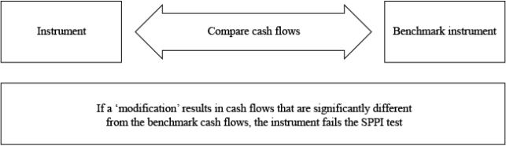

# 42 - Classification and measurement (IFRS 9)

[返回目录](README.md)

# 42 - Classification and measurement (IFRS 9)

Contents

- [42 - Classification and measurement (IFRS 9)](63.md#s263-chap_42_toc_h1)

- [Introduction and scope (paras 42.1- 42.4)](63.md#s264-chap_42_navPoint_1)

- [Scope](63.md#s264-chap_42_navPoint_2)

- [Classification of financial assets (paras 42.5- 42.69)](63.md#s265-chap_42_navPoint_3)

- [Classification of debt investments](63.md#s265-chap_42_navPoint_4)

- [Business model](63.md#s265-chap_42_navPoint_idp1712501352)

- [Determining the business model](63.md#s265-chap_42_navPoint_idp1712518504)

- [Determining the level at which the business model condition should be applied](63.md#s265-chap_42_navPoint_idp1712531944)

- [‘Hold to collect’ business model](63.md#s265-chap_42_navPoint_idp1712603752)

- [‘Hold to collect and sell’ business model](63.md#s265-chap_42_navPoint_idp1712636648)

- [Fair value through profit or loss category](63.md#s265-chap_42_navPoint_idp1712662632)

- [Solely payments of principal and interest criteria](63.md#s265-chap_42_navPoint_idp1712672872)

- [Modified solely payments of principal and interest](63.md#s265-chap_42_navPoint_idp1712678504)

- [Regulated interest rates](63.md#s265-chap_42_navPoint_idp1702214808)

- [Contractual terms that change the timing or amount of contractual cash flows](63.md#s265-chap_42_navPoint_idp1702224408)

- [Contingent events affecting cash flows](63.md#s265-chap_42_navPoint_idp1702230424)

- [Pre-payment and extension options](63.md#s265-chap_42_navPoint_idp1702240792)

- [Examples of contractual terms](63.md#s265-chap_42_navPoint_idp1702248984)

- [Cash flows that are not genuinely SPPI, despite being described as such](63.md#s265-chap_42_navPoint_idp1689879832)

- [Non-recourse](63.md#s265-chap_42_navPoint_idp1689883672)

- [‘De minimis’ features](63.md#s265-chap_42_navPoint_idp1689893656)

- [Contractually linked instruments (tranches)](63.md#s265-chap_42_navPoint_idp1689901592)

- [Financial assets designated at FVTPL using fair value option](63.md#s265-chap_42_navPoint_idp1689926040)

- [Reclassification of financial assets](63.md#s265-chap_42_navPoint_idp1689933336)

- [Classification of equity instruments](63.md#s265-chap_42_navPoint_5)

- [Measurement of unquoted equity instrument](63.md#s265-chap_42_navPoint_idp1689961256)

- [Embedded derivatives in financial assets](63.md#s265-chap_42_navPoint_6)

- [Negative fair values](63.md#s265-chap_42_navPoint_7)

- [Classification of financial liabilities (paras 42.70 - 42.93)](63.md#s266-chap_42_navPoint_8)

- [Financial liabilities required to be measured at fair value through profit or loss](63.md#s266-chap_42_navPoint_9)

- [Financial liabilities designated at FVTPL using fair value option](63.md#s266-chap_42_navPoint_10)

- [Changes in own credit risk for financial liabilities designated at FVTPL using fair value option](63.md#s266-chap_42_navPoint_idp1712521704)

- [Measuring changes in own credit risk of liabilities](63.md#s266-chap_42_navPoint_idp1712542312)

- [Embedded derivatives in financial liabilities and fair value option](63.md#s266-chap_42_navPoint_11)

- [Financial liabilities arising on transfers of financial assets](63.md#s266-chap_42_navPoint_12)

- [Financial guarantee contracts](63.md#s266-chap_42_navPoint_13)

- [Financial guarantee contracts issued](63.md#s266-chap_42_navPoint_idp1712575976)

- [Financial guarantee contracts purchased](63.md#s266-chap_42_navPoint_idp1712590696)

- [Reclassification of financial liabilities](63.md#s266-chap_42_navPoint_14)

- [Measurement on initial recognition (paras 42.94-42.112)](63.md#s267-chap_42_navPoint_15)

- [‘Day 1’ gain or loss](63.md#s267-chap_42_navPoint_16)

- [Transaction costs and fees](63.md#s267-chap_42_navPoint_17)

- [Fees that are an integral part of the effective interest rate](63.md#s267-chap_42_navPoint_idp1684287656)

- [Fees that are not part of the effective interest rate](63.md#s267-chap_42_navPoint_idp1684303784)

- [Settlement date accounting for regular way transactions](63.md#s267-chap_42_navPoint_18)

- [Subsequent measurement at amortised cost and the effective interest method (paras 42.113 - 42.129)](63.md#s268-chap_42_navPoint_19)

- [Estimation of cash flows](63.md#s268-chap_42_navPoint_20)

- [Purchased or originated credit-impaired financial assets](63.md#s268-chap_42_navPoint_21)

- [Amortisation period](63.md#s268-chap_42_navPoint_22)

- [Changes in estimated cash flows and modifications](63.md#s268-chap_42_navPoint_23)

- [Floating-rate instruments](63.md#s268-chap_42_navPoint_24)

- [Modification or renegotiation of financial assets and financial liabilities](63.md#s268-chap_42_navPoint_25)

- [Perpetual debt instruments](63.md#s268-chap_42_navPoint_26)

- [Fair value through other comprehensive income](63.md#s268-chap_42_navPoint_27)

- [Derecognition](63.md#s268-chap_42_navPoint_28)

- [Subsequent measurement at fair value and foreign currency (paras 42.130 - 42.143)](63.md#s269-chap_42_navPoint_29)

- [Subsequent measurement of foreign currency financial instruments](63.md#s269-chap_42_navPoint_30)

- [Monetary financial assets](63.md#s269-chap_42_navPoint_31)

- [Dual currency bond](63.md#s269-chap_42_navPoint_idp1712439784)

- [Equity investments](63.md#s269-chap_42_navPoint_32)

- [Impairment of foreign currency financial asset](63.md#s269-chap_42_navPoint_33)

- [Financial assets held in foreign operations](63.md#s269-chap_42_navPoint_34)

- [Effective date and transition (paras 42.145 - 42.149)](63.md#s270-chap_42_navPoint_35)

- [Illustrative text](64.md#s271-chap_42_navPoint_36)

- [Business model](64.md#s271-chap_42_navPoint_37)

- [FAQ 42.5.1 – How should investments in money market funds be classified and measured under IFRS 9?](64.md#s271-chap_42_navPoint_idp1712479720)

- [FAQ 42.5.2 – How should a bank recognise centrally cleared derivative contracts where the bank acts solely as a clearing member?](64.md#s271-chap_42_navPoint_idp1712509416)

- [FAQ 42.8.1- How should the holder classify its investment in an exchange traded fund (\'ETF\') under IFRS 9?](64.md#s271-chap_42_navPoint_idp1712571240)

- [FAQ 42.15.1 – Should an entity take stress case scenarios into account in its business model assessment?](64.md#s271-chap_42_navPoint_idp1712642792)

- [FAQ 42.15.2 – What is the impact on the business model assessment of a bond issuer’s offer to repurchase or replace a bond?](64.md#s271-chap_42_navPoint_idp1712656232)

- [FAQ 42.18.1 – What is the impact of the business model in the consolidated accounts of a subsidiary classified as ‘held for sale’ under IFRS 5?](64.md#s271-chap_42_navPoint_idp1712432232)

- [FAQ 42.19.1 – What are useful indicators for assessing the business model for a portfolio?](64.md#s271-chap_42_navPoint_idp1712458344)

- [FAQ 42.24.1 – Is alignment required between ‘increase in credit risk’ for business model purposes and ‘significant increase in credit risk’ for ECL purposes?](64.md#s271-chap_42_navPoint_idp1684309416)

- [FAQ 42.24.2 – Are sales of loans due to credit deterioration permissible in a ‘hold to collect’ business model where the deterioration occurred prior to the date of initial application of IFRS 9?](64.md#s271-chap_42_navPoint_idp1684343976)

- [FAQ 42.25.1 – How should sales be considered in determining if the business model is ‘hold to collect’?](64.md#s271-chap_42_navPoint_idp1684361000)

- [FAQ 42.25.2 – How does an entity determine whether sales are insignificant in value?](64.md#s271-chap_42_navPoint_idp1684269096)

- [FAQ 42.25.3 – How should the term \'infrequent\' be interpreted in the context of sales?](64.md#s271-chap_42_navPoint_idp1695206632)

- [FAQ 42.25.4 – What is the impact of sales to a fellow group entity due to regulatory capital constraints?](64.md#s271-chap_42_navPoint_idp1695211368)

- [FAQ 42.27.1 – What examples of sales before maturity would not be inconsistent with a business model of holding financial assets to collect contractual cash flows?](64.md#s271-chap_42_navPoint_idp1695225064)

- [FAQ 42.27.2 – What is the impact of changes in cash flows that are no longer in line with the initial business model assessment?](64.md#s271-chap_42_navPoint_idp1695246568)

- [FAQ 42.27.3 – What is the business model for portfolio of sub-prime loans?](64.md#s271-chap_42_navPoint_idp1695255400)

- [FAQ 42.27.4 – What is the business model for securitised loans?](64.md#s271-chap_42_navPoint_idp1702205336)

- [FAQ 42.27.5 – What is the business model for inter-company loans?](64.md#s271-chap_42_navPoint_idp1702211224)

- [FAQ 42.31.1 – What is the business model for financial assets used to fund future capital expenditure?](64.md#s271-chap_42_navPoint_idp1702226968)

- [FAQ 42.31.2 – What is the business model for financial assets held to manage liquidity needs?](64.md#s271-chap_42_navPoint_idp1702234136)

- [FAQ 42.31.3 – What is the business model for financial assets held by an insurer to fund financial liabilities?](64.md#s271-chap_42_navPoint_idp1702246936)

- [FAQ 42.31.4 – What is the business model for banks that sell down loans to manage single counterparty credit risk limits?](64.md#s271-chap_42_navPoint_idp1702253720)

- [FAQ 42.31.5 – What is the impact of internal transfers on the business model?](64.md#s271-chap_42_navPoint_idp1688176280)

- [FAQ 42.31.6 – What is the impact of factoring on business model assessment?](64.md#s271-chap_42_navPoint_idp1688198040)

- [FAQ 42.32.1 – How should the business model be assessed for different components of syndicated loans?](64.md#s271-chap_42_navPoint_idp1688227992)

- [FAQ 42.32.2 – What is the impact of fair value information on business model classification for reverse repo transactions?](64.md#s271-chap_42_navPoint_idp1688233112)

- [FAQ 42.32.3 – What is the business model for syndications of loan commitments and drawn loans?](64.md#s271-chap_42_navPoint_idp1688255384)

- [FAQ 42.32.4 – What factors should be considered when assessing whether a non-trading portfolio of financial assets is ‘managed and whose performance is evaluated on a fair value basis’](64.md#s271-chap_42_navPoint_idp1688266264)

- [Contractual cash flows that are ‘solely payments of principal and interest’](64.md#s271-chap_42_navPoint_38)

- [FAQ 42.34.1 – How should an entity assess SPPI for floating-rate instruments acquired at a discount?](64.md#s271-chap_42_navPoint_idp1688347208)

- [FAQ 42.34.2 – Do ‘off-market’ assets automatically fail the SPPI test?](64.md#s271-chap_42_navPoint_idp1688355016)

- [FAQ 42.35.1 – What is the interplay between derecognition and the SPPI test when analysing modifications?](64.md#s271-chap_42_navPoint_idp1688378440)

- [FAQ 42.35.2 – How should an entity assess SPPI for convertible bonds that deliver shares to the value of the outstanding principal and interest?](64.md#s271-chap_42_navPoint_idp1688392776)

- [FAQ 42.39.1 – How is‘significantly different’ interpreted when performing the modified time value of money test?](64.md#s271-chap_42_navPoint_idp1688406472)

- [FAQ 42.39.2 – When is a qualitative assessment of the SPPI criterion required if the time value of money element is modified under a range of different scenarios?](64.md#s271-chap_42_navPoint_idp1688425800)

- [FAQ 42.39.3 – How should the modified time value test be applied to a 10-year bond whose interest rate resets annually to a 10-year rate?](64.md#s271-chap_42_navPoint_idp1688457800)

- [FAQ 42.39.4 – How should the ‘benchmark test’ be applied when assessing SPPI?](64.md#s271-chap_42_navPoint_idp1688333896)

- [FAQ 42.39.5 – Do benchmark interest rates based on the secured overnight financing rate (‘SOFR’) meet SPPI?](64.md#s271-chap_42_navPoint_idp1689037048)

- [FAQ 42.40.1 – How is SPPI determined for loans in highly regulated countries?](64.md#s271-chap_42_navPoint_idp1689090552)

- [FAQ 42.40.2 – How is SPPI assessed for a five-year constant maturity interest rate loan?](64.md#s271-chap_42_navPoint_idp1689100664)

- [FAQ 42.40.3 – How is SPPI assessed for loans that have leverage-type features in relation to interest?](64.md#s271-chap_42_navPoint_idp1689107448)

- [FAQ 42.41.1 – Assessing SPPI for sustainability linked loans or loans with ‘green variability’](64.md#s271-chap_42_navPoint_idp1689128056)

- [FAQ 42.42.1 – Which cash flows should be considered as ‘contractual cash flows’ when assessing the SPPI criterion?](64.md#s271-chap_42_navPoint_idp1695517752)

- [FAQ 42.42.2 – How is SPPI assessed where the issuer can pre-pay when the FTSE 100 index reaches a specific level?](64.md#s271-chap_42_navPoint_idp1695541048)

- [FAQ 42.42.3 – How is SPPI assessed for loans with embedded cross-selling clauses?](64.md#s271-chap_42_navPoint_idp1695547064)

- [FAQ 42.42.4 – What is the impact of change of control provisions and reasonable compensation on the SPPI criterion?](64.md#s271-chap_42_navPoint_idp1695566776)

- [FAQ 42.42.5 – How is SPPI assessed on a perpetual instrument that has discretionary coupon payments and contingent settlement provisions?](64.md#s271-chap_42_navPoint_idp1695586872)

- [FAQ 42.43.1 – What is \'reasonable compensation\' in a pre-payment clause?](64.md#s271-chap_42_navPoint_idp1695607224)

- [FAQ 42.44.1 – How is SPPI assessed on a loan when the bank has an extension option?](64.md#s271-chap_42_navPoint_idp1686628040)

- [FAQ 42.45.1 – How is SPPI assessed for a euro bond linked to inflation in a Eurozone country?](64.md#s271-chap_42_navPoint_idp1686647112)

- [FAQ 42.45.2 – How is SPPI assessed for changing credit spreads in loans with price-ratcheting clauses?](64.md#s271-chap_42_navPoint_idp1686658888)

- [FAQ 42.45.3 – What is interaction of contractual and legal terms in loan contracts when assessing the SPPI criterion?](64.md#s271-chap_42_navPoint_idp1686660552)

- [FAQ 42.45.4 – How is SPPI assessed when banks can adjust interest rates?](64.md#s271-chap_42_navPoint_idp1686679112)

- [FAQ 42.45.5 – How is SPPI assessed for a multi-currency bond?](64.md#s271-chap_42_navPoint_idp1686692936)

- [FAQ 42.45.6 – How is SPPI assessed for step-up notes?](64.md#s271-chap_42_navPoint_idp1686710344)

- [FAQ 42.45.7 – How is SPPI assessed for shareholder loans that bear no interest?](64.md#s271-chap_42_navPoint_idp1686719048)

- [FAQ 42.45.8 – How is SPPI assessed for dual currency bonds?](65.md#s272-chap_42_navPoint_idp1686732616)

- [FAQ 42.45.9 – How is SPPI assessed on deemed loan assets arising in securitisation vehicles?](65.md#s272-chap_42_navPoint_idp1686736584)

- [FAQ 42.46.1 – Will a loan asset with an entity-specific non-financial underlying variable, such as a profit participating loan, fail SPPI?](65.md#s272-chap_42_navPoint_idp1686759240)

- [FAQ 42.49.1 – What examples of non-recourse loans might be inconsistent with SPPI?](65.md#s272-chap_42_navPoint_idp1686776904)

- [FAQ 42.49.2 – How is SPPI assessed for non-recourse real estate financing?](65.md#s272-chap_42_navPoint_idp1686796488)

- [FAQ 42.49.3 – How is SPPI assessed for non-recourse to portfolio of equity instruments?](65.md#s272-chap_42_navPoint_idp1686802248)

- [FAQ 42.51.1 – How should the terms ‘not genuine’ and ‘de minimis’ be applied in assessing SPPI?](65.md#s272-chap_42_navPoint_idp1686812232)

- [FAQ 42.52.1 – What constitutes a tranche when assessing SPPI for a contractually linked instrument?](65.md#s272-chap_42_navPoint_idp1686840264)

- [FAQ 42.54.1 – Are liquidity facilities a tranche or an instrument in the pool when applying the CLI guidance?](65.md#s272-chap_42_navPoint_idp1686843720)

- [FAQ 42.55.1 – How is SPPI assessed for derivatives in an underlying pool of assets?](65.md#s272-chap_42_navPoint_idp1721133784)

- [FAQ 42.55.2 – How is SPPI assessed for a derivative with optionality in an underlying pool of assets?](65.md#s272-chap_42_navPoint_idp1721146072)

- [FAQ 42.55.3 – How is SPPI assessed for investments in collateralised debt obligations?](65.md#s272-chap_42_navPoint_idp1721156696)

- [FAQ 42.56.1 – Should SPPI be assessed on an instrument that has been designated as fair value through P&amp;L?](65.md#s272-chap_42_navPoint_idp1721170776)

- [FAQ 42.59.1 – Is reclassification of the business model required when loans are transferred to a run-off portfolio?](65.md#s272-chap_42_navPoint_idp1721181784)

- [FAQ 42.59.2 – How are the criteria for reclassification of financial assets and the timing of reclassification assessed?](65.md#s272-chap_42_navPoint_idp1721201240)

- [FAQ 42.59.3 – What is the impact on the business model of changes relating to a pre-defined portfolio?](65.md#s272-chap_42_navPoint_idp1721227096)

- [Equity instruments](65.md#s272-chap_42_navPoint_39)

- [FAQ 42.62.1 – How is an investment in a puttable share classified?](65.md#s272-chap_42_navPoint_idp1721256664)

- [FAQ 42.63.1 – How is an investment in a perpetual note classified?](65.md#s272-chap_42_navPoint_idp1721273688)

- [FAQ 42.63.2 – How should the holder account for stock or scrip dividends received from an FVOCI investment?](65.md#s272-chap_42_navPoint_idp1721283288)

- [FAQ 42.63.3 – How is a special dividend that is clearly recovery of the cost of investment accounted for?](65.md#s272-chap_42_navPoint_idp1721295064)

- [FAQ 42.63.4 – How is a special dividend that is not clearly recovery of the cost of investment accounted for?](65.md#s272-chap_42_navPoint_idp1721307096)

- [FAQ 42.63.5 – How is an investment in an associate accounted for?](65.md#s272-chap_42_navPoint_idp1721318104)

- [FAQ 42.63.6 – How is a convertible bond accounted for from the holder’s perspective?](65.md#s272-chap_42_navPoint_idp1721326424)

- [FAQ 42.63.7 – What are the disclosure requirements for equity investments designated at FVOCI?](65.md#s272-chap_42_navPoint_idp1721341400)

- [FAQ 42.68.1 – How is SPPI assessed for financial assets which contain embedded derivatives?](65.md#s272-chap_42_navPoint_idp1721362008)

- [Financial liabilities](65.md#s272-chap_42_navPoint_40)

- [FAQ 42.77.1 – What are the considerations in designating a financial liability at FVTPL?](65.md#s272-chap_42_navPoint_idp1721371608)

- [FAQ 42.79.1 – How should a financial liability designated at FVTPL be presented?](65.md#s272-chap_42_navPoint_idp1721374552)

- [FAQ 42.80.1 – When might recognising changes in own credit risk in OCI create an accounting mismatch?](65.md#s272-chap_42_navPoint_idp1700590168)

- [FAQ 42.84.1 – How should changes in fair value for unit-linked liabilities at FVTPL be presented?](65.md#s272-chap_42_navPoint_idp1700594776)

- [FAQ 42.89.1 – How should future premiums be recognised by the issuer of a financial guarantee on initial recognition?](65.md#s272-chap_42_navPoint_idp1700601304)

- [EX 42.89.2 – Determining the fair value of an intra-group financial guarantee contract](65.md#s272-chap_42_navPoint_idp1700618584)

- [FAQ 42.89.3 – How should an intra-group financial guarantee issued by a parent be accounted for?](65.md#s272-chap_42_navPoint_idp1700636376)

- [FAQ 42.92.1 – How should the cost of a financial guarantee contract by the purchaser be accounted for?](65.md#s272-chap_42_navPoint_idp1700644184)

- [FAQ 42.92.2 – How should a subsidiary account for a loan guaranteed by its parent?](65.md#s272-chap_42_navPoint_idp1700663384)

- [Measurement at initial recognition](65.md#s272-chap_42_navPoint_41)

- [FAQ 42.97.1 – How should an interest-free loan to a company be measured on initial recognition?](65.md#s272-chap_42_navPoint_idp1700676696)

- [FAQ 42.97.2 – How should an interest-free loan to an employee be measured on initial recognition?](65.md#s272-chap_42_navPoint_idp1700685528)

- [FAQ 42.97.3 – How should an interest-free loan received from a government agency be measured on initial recognition?](65.md#s272-chap_42_navPoint_idp1700700120)

- [FAQ 42.97.4 – How should an entity account for financial support arrangements put in place by central banks in response to COVID-19?](65.md#s272-chap_42_navPoint_idp1700706392)

- [FAQ 42.99.1 – How should an off-market loan with an origination fee be initially recognised?](65.md#s272-chap_42_navPoint_idp1700809816)

- [FAQ 42.101.1 – Can a ‘day 1’ gain or loss be recognised?](65.md#s272-chap_42_navPoint_idp1700817368)

- [FAQ 42.101.2 – How should any ‘day 1’ gain or loss be subsequently measured?](65.md#s272-chap_42_navPoint_idp1700823384)

- [FAQ 42.101.3 – What factors should be considered where there is a large apparent ‘day 1’ gain or loss?](65.md#s272-chap_42_navPoint_idp1700573016)

- [FAQ 42.104.1 – What internal costs can be classified as transaction costs?](65.md#s272-chap_42_navPoint_idp1714227800)

- [FAQ 42.105.1 – How are transaction costs of an FVOCI asset treated on initial recognition and on sale?](65.md#s272-chap_42_navPoint_idp1714234456)

- [FAQ 42.105.2 – How are transaction costs allocated to a convertible instrument that contains a conversion option as an embedded derivative?](65.md#s272-chap_42_navPoint_idp1714255576)

- [FAQ 42.105.3 – How are origination fees on financial instruments such as loan commitments measured at fair value through profit or loss recognised?](65.md#s272-chap_42_navPoint_idp1714266072)

- [EX 42.106.1 – Examples of loan origination fees](65.md#s272-chap_42_navPoint_idp1714268376)

- [FAQ 42.106.2 – How should loan origination fees received be accounted for?](65.md#s272-chap_42_navPoint_idp1714286424)

- [FAQ 42.106.3 – How should an entity account for loan commitment fees received?](65.md#s272-chap_42_navPoint_idp1714292056)

- [FAQ 42.106.4 – How should a borrower account for loan commitment fees paid?](65.md#s272-chap_42_navPoint_idp1714308440)

- [EX 42.109.1 – Fees that are not part of the effective interest rate (EIR)](65.md#s272-chap_42_navPoint_idp1714323928)

- [EX 42.109.3 – Accounting for upfront fees](65.md#s272-chap_42_navPoint_idp1714336856)

- [EX 42.109.4 – Management and performance fees](65.md#s272-chap_42_navPoint_idp1714346456)

- [Subsequent measurement at amortised cost](65.md#s272-chap_42_navPoint_42)

- [FAQ 42.114.1 – What is the effective interest rate on an amortised cost instrument with a daily ‘compounded in arrears’ interest rate which accrues to be settled at a later date?](65.md#s272-chap_42_navPoint_idp1714349144)

- [EX 42.118.1 – Fixed-interest loan repayable at maturity with a pre-payment feature](65.md#s272-chap_42_navPoint_idp1714371800)

- [EX 42.118.2 – Fixed-interest loan repayable in equal annual instalments with a pre-payment feature](65.md#s272-chap_42_navPoint_idp1714217688)

- [EX 42.118.3 – Fixed-interest loan with interest step-up](65.md#s272-chap_42_navPoint_idp1718381704)

- [EX 42.118.4 – Issuer call option in debt instrument](65.md#s272-chap_42_navPoint_idp1718452232)

- [FAQ 42.120.1 – Amortisation of discount over the period to the next repricing date](65.md#s272-chap_42_navPoint_idp1718562440)

- [FAQ 42.120.2 – How should the discount over the expected life of the instrument be amortised?](65.md#s272-chap_42_navPoint_idp1687757032)

- [FAQ 42.121.1 – How should an entity account for changes to the cash flows on a debt instrument measured at amortised cost or fair value through other comprehensive income (FVOCI)?](66.md#s273-chap_42_navPoint_idp1687770728)

- [FAQ 42.121.2 – How should changes in cash flows due to ‘green variability’ be reflected?](66.md#s273-chap_42_navPoint_idp1687821288)

- [FAQ 42.121.3 – How should a bank and a borrower account for a loan repayment holiday imposed by law?](66.md#s273-chap_42_navPoint_idp1687831400)

- [FAQ 42.121.4 – What is the accounting treatment of a loan repayment holiday negotiated between a bank and a borrower?](66.md#s273-chap_42_navPoint_idp1687874792)

- [FAQ 42.121.5 – When is a new loan granted to an existing borrower, in substance, a payment holiday on the original loan?](66.md#s273-chap_42_navPoint_idp1687897576)

- [FAQ 42.122.1 – How does the effective interest rate method apply to inflation-linked bonds?](66.md#s273-chap_42_navPoint_idp1687938408)

- [EX 42.122.2 – Accounting for an inflation-linked bond](66.md#s273-chap_42_navPoint_idp1687953256)

- [FAQ 42.123.1 – How should changes in estimated cash flows be accounted for?](66.md#s273-chap_42_navPoint_idp1698517864)

- [FAQ 42.123.2 – How should the repricing of fixed interest loans be accounted for?](66.md#s273-chap_42_navPoint_idp1698571624)

- [FAQ 42.124.1 – How should a gain or loss on debt modification where borrowing costs are capitalised under IAS 23 be accounted for?](66.md#s273-chap_42_navPoint_idp1698601960)

- [FAQ 42.124.2 - How should changes related to cash instruments arising from IBOR reform be accounted for?](66.md#s273-chap_42_navPoint_idp1698619240)

- [FAQ 42.124.3 - How should an existing fallback clause that uses the last available LIBOR rate when LIBOR becomes unavailable be accounted for?](66.md#s273-chap_42_navPoint_idp1698637800)

- [FAQ 42.127.1 – How should an entity calculate the effective interest rate on a perpetual debt instrument with decreasing interest?](66.md#s273-chap_42_navPoint_idp1698668520)

- [FAQ 42.129.1 – How should an entity allocate original cost balance to the carrying value in case of partial disposal or impairment for identical debt securities?](66.md#s273-chap_42_navPoint_idp1698749272)

- [FAQ 42.130.1 – What is the interaction between IFRS 13 and IFRS 9 on initial recognition at fair value?](66.md#s273-chap_42_navPoint_idp1698762968)

- [FAQ 42.139.1 – How are dual currency bonds accounted for?](66.md#s273-chap_42_navPoint_idp1698783704)

- [FAQ 42.143.1 – What is the interaction between IFRS 9 and IAS 21 on financial instruments held in a foreign entity?](66.md#s273-chap_42_navPoint_idp1689399128)

- [Effective date and transition](66.md#s273-chap_42_navPoint_43)

- [FAQ 42.145.1 – Can the restatement option be applied without the use of hindsight?](66.md#s273-chap_42_navPoint_idp1689408600)

- [FAQ 42.145.2 – What is the impact on transition to IFRS 9 when the modification of financial asset guidance is applied?](66.md#s273-chap_42_navPoint_idp1689426008)

- [FAQ 42.145.3 – What is the impact on transition to IFRS 9 when the modification of financial liabilities guidance is first applied?](66.md#s273-chap_42_navPoint_idp1689439320)

- [FAQ 42.149.1 – How should an asset be accounted for on transitioning from available for sale (AFS) to amortised cost under IFRS 9?](66.md#s273-chap_42_navPoint_idp1689461976)

- [FAQ 42.149.2 – How should an asset be accounted for on transitioning from AFS to FVTPL for equities?](66.md#s273-chap_42_navPoint_idp1689471832)

- [FAQ 42.149.3 – How should an asset be accounted for on transitioning from FVTPL to amortised cost?](66.md#s273-chap_42_navPoint_idp1689489496)

- [FAQ 42.149.4 – How should an asset be accounted for on transitioning from FVTPL to FVOCI?](66.md#s273-chap_42_navPoint_idp1689490520)

- [FAQ 42.149.5 – How should an entity account for AFS instruments disposed of before the period of adoption?](66.md#s273-chap_42_navPoint_idp1689509464)

- [FAQ 42.149.6 – How should entity apply the IAS 39 reclassification amendment (2008)?](66.md#s273-chap_42_navPoint_idp1689521112)

- [FAQ 42.149.7 – What is the classification on transition for portfolios in ‘run-off’?](66.md#s273-chap_42_navPoint_idp1689533016)

 

This chapter provides guidance on IFRS 9. For guidance on IAS 39, please refer to chapters 6.4A and [6.7A](14.md#s39-Para_6.7).

For contracts impacted by IBOR reform, entities should refer to the guidance in [Appendix 3 - IBOR Reform Amendments.](88.md#s370-chap_Appendix_3)

  

 

This eBook is licensed to peggy so, peggy.so@hk.ey.com, 

## Introduction and scope (paras 42.1- 42.4)

 

**42.1**IFRS 9 is mandatory for periods beginning on or after 1 January 2018, with early adoption permitted, except for entities that issue insurance contracts and that qualify for the temporary exemption ([see chapter 40 para 2](61.md#s249-Para_40.2)).

**42.2** This chapter only covers the classification and measurement requirements of IFRS 9 for financial assets and financial liabilities. The other requirements of IFRS 9 are addressed in separate chapters.

 

### Scope

 

**42.3**IFRS 9 must be applied by all entities preparing their financial statements according to IFRS and to all types of financial assets and financial liabilities within its scope (see [chapter 40 para 43](61.md#s252-Para_40.43) for a detailed overview of the scope of IFRS 9).

**42.4** Financial assets and financial liabilities that are designated as hedged items are subject to measurement under IFRS 9's hedge accounting requirements (or IAS 39, if applicable). These special accounting rules generally override the normal accounting rules for financial assets. Hedge accounting is covered in chapter 46 (or chapter 6.8A if applying IAS 39).

[IFRS 9 para 5.2.3].

 

This eBook is licensed to peggy so, peggy.so@hk.ey.com, 

## Classification of financial assets (paras 42.5- 42.69)

 

**42.5**An entity recognises a financial asset when it first becomes a party to the contractual rights and obligations in the contract. It is, therefore, necessary to measure those contractual rights and obligations on initial recognition.

[IFRS 9 para 3.1.1].

[FAQ 42.5.1 – How should investments in money market funds be classified and measured under IFRS 9?](64.md#s271-FAQ_42.5.1)

[FAQ 42.5.2 – How should a bank recognise centrally cleared derivative contracts where the bank acts solely as a clearing member?](64.md#s271-FAQ_42.5.2)

**42.6**All financial assets under IFRS 9 are to be initially recognised at fair value, plus or minus (in the case of a financial asset not at FVTPL) transaction costs that are directly attributable to the acquisition of the financial instrument. [See chapter 44 para 17](68.md#s284-Para_44.17) for detailed guidance on trade date versus settlement date accounting for financial asset recognition and derecognition, and [paragraph 42.94](63.md#s267-Para_42.94) for further guidance on initial measurement considerations.

[IFRS 9 para 5.1.1]. [IFRS 9 para 3.1.2].

**42.7** IFRS 9 has two measurement categories: amortised cost and fair value. Movements in fair value are presented in either profit or loss or other comprehensive income (OCI), subject to certain criteria being met, as described below.

[IFRS 9 para 4.1.1].

**42.8**To determine which measurement category a financial asset falls into, management should first consider whether the financial asset is an investment in an equity instrument, as defined in IAS 32, by considering the perspective of the issuer or a debt instrument (see [chapter 43 para 3](67.md#s275-Para_43.3) to determine how the instrument would be categorised from the issuer). If the financial asset is an investment in an equity instrument, management should consider the guidance for ‘equity instruments’ (see [para 42.62](63.md#s265-Para_42.62)). If the financial asset is not an investment in an equity instrument, management should consider the guidance for ‘debt investments’.

[IAS 32 para 15].

FAQ 42.8.1 – How should the holder classify its investment in an exchange traded fund ('ETF') under IFRS 9?

[FAQ 42.62.1 – How is an investment in a puttable share classified?](65.md#s272-FAQ_42.62.1)

 

### Classification of debt investments

 

**42.9**If the financial asset is a debt instrument (or does not meet the definition of an equity instrument in its entirety), management should consider the following assessments in determining its classification:

- The entity’s business model for managing the financial asset.

- The contractual cash flows characteristics of the financial asset.

[IFRS 9 para 4.1.1].

**42.10** These considerations are represented in the following flow chart:

  
 **42.11** A financial asset should be subsequently measured at amortised cost if both of the following conditions are met:

- the financial asset is held within a business model whose objective is to hold financial assets in order to collect contractual cash flows; and

- the contractual terms of the financial asset give rise, on specified dates, to cash flows that are solely payments of principal and interest (SPPI) on the principal amount outstanding; ‘principal’ and ‘interest’ are defined in [paragraph 42.34](63.md#s265-Para_42.34).

[IFRS 9 para 4.1.2].

**42.12** A financial asset should be subsequently measured at FVOCI if both of the following conditions are met:

- the financial asset is held within a business model whose objective is achieved by both holding financial assets in order to collect contractual cash flows and selling financial assets; and

- the contractual terms of the financial asset give rise on specified dates to cash flows that are SPPI.

[IFRS 9 para 4.1.2A].

**42.13** If the financial asset is measured at FVOCI, all movements in the fair value should be taken through OCI, except for the recognition of impairment gains or losses, interest revenue in line with the effective interest method and foreign exchange gains and losses, which are recognised in profit or loss. See [paragraph 42.128](63.md#s268-Para_42.128).

[IFRS 9 para 5.7.10].

**42.14** If the financial asset does not pass the business model assessment and SPPI criteria, or the fair value option is applied (see [para 42.56](63.md#s265-Para_42.56)), it is measured at FVTPL. This is the residual measurement category.

[IFRS 9 para 4.1.4].

 

#### Business model

 

**42.15**An entity’s business model refers to how an entity manages its financial assets in order to generate cash flows. IFRS 9 prescribes two business models: holding financial assets to collect contractual cash flows; and holding financial assets to collect contractual cash flows and selling. FVTPL is the residual category which is used for financial assets that are held for trading or if a financial asset does not fall into one of the two prescribed business models.

[IFRS 9 App B para B4.1.2A].

[FAQ 42.15.1 – Should an entity take stress case scenarios into account in its business model assessment?](64.md#s271-FAQ_42.15.1)  
[FAQ 42.15.2 –  What is the impact on the business model assessment of a bond issuer’s offer to repurchase or replace a bond?](64.md#s271-FAQ_42.15.2)

 

##### Determining the business model

**42.16** An entity’s business model is determined by the entity’s key management personnel (as defined in IAS 24).

[IFRS 9 App B para B4.1.1].

**42.17**The business model is typically observable through the activities that the entity undertakes to achieve the objective of the business model. The business model for managing financial assets is not determined by a single factor or activity. Instead, management has to consider all relevant evidence that is available at the date of the assessment. Such relevant evidence includes, but is not limited to:

- how the performance of the business model (and the financial assets held within) is evaluated and reported to the entity’s key management personnel;

- the risks that affect the performance of the business model (and the financial assets held within) and, in particular, the way that those risks are managed; and

- how managers of the business are compensated (for example, whether the compensation is based on the fair value of the assets managed or the contractual cash flows collected).

[IFRS 9 App B para B4.1.2B].

##### Determining the level at which the business model condition should be applied

 

**42.18**Management will need to apply judgement to determine the level at which the business model condition is applied. That determination is made on the basis of how an entity manages its business; it is not made at the level of an individual asset, rather it is performed at a higher level of aggregation. So the entity’s business model is not a choice and does not depend on management’s intentions for an individual instrument; it is a matter of fact that can be observed by the way in which an entity is managed and information is provided to its management.

[IFRS 9 App B para B4.1.2].

[FAQ 42.18.1 – What is the impact of the business model in the consolidated accounts of a subsidiary classified as ‘held for sale’ under IFRS 5?](64.md#s271-FAQ_42.18.1)

**42.19** An entity can have multiple business models. For example, it might hold one portfolio of investments that it manages in order to collect contractual cash flows, and another portfolio of investments that it manages in order to sell to realise fair value changes. In some circumstances, it might be appropriate to separate a portfolio of financial assets into sub-portfolios, to reflect how an entity manages those financial assets. This might be the case if an entity originates or purchases a portfolio of mortgage loans, and manages some of the loans with an objective of collecting contractual cash flows and manages the other loans with an objective of selling them. This will be a highly judgemental area, because it might be difficult to distinguish, within a portfolio, which financial assets are held to collect, to collect and sell, or to trade.

[IFRS 9 App B para B4.1.2].

[FAQ 42.19.1 – What are useful indicators for assessing the business model for a portfolio?](64.md#s271-FAQ_42.19.1)

 

##### ‘Hold to collect’ business model

 

**42.20** If the entity’s objective is to hold the asset (or portfolio of assets) to collect the contractual cash flows, the asset (or the portfolio) should be classified under the ‘hold to collect’ business model. If the entity’s objective is to hold to collect and sell the asset, see the guidance at [paragraph 42.28 onwards](63.md#s265-Para_42.28).

[IFRS 9 App B para B4.1.2C].

**42.21** Although the objective of an entity’s business model might be to hold financial assets in order to collect contractual cash flows, the entity does not need to hold all of those instruments until maturity. Thus, an entity’s business model can be to hold financial assets to collect contractual cash flows, even where sales of financial assets occur or are expected to occur in the future.

[IFRS 9 App B para B4.1.3].

**42.22** IFRS 9 provides guidance on the particular considerations that should be taken into account when assessing sales within the ‘hold to collect’ business model:

- The historical frequency, timing and value of sales.

- The reason for the sales (such as credit deterioration).

- Expectations about future sales activity.

[IFRS 9 App B para B4.1.2C].

**42.23** Sales themselves do not determine the business model, and so they cannot be considered in isolation. Rather, information about past sales, and expectations about future sales, provide evidence related to the entity’s objective for managing the financial assets and, specifically, how cash flows are realised and value is created.

[IFRS 9 App B para B4.1.2C].

**42.24**Credit risk management activities aimed at minimising potential losses due to credit deterioration are not inconsistent with the ‘hold to collect’ business model. Selling a financial asset because it no longer meets the credit criteria specified in the entity’s documented investment policy is an example of a sale that has occurred due to an increase in credit risk. However, in the absence of such a policy, the entity could demonstrate in other ways that the sale occurred due to an increase in credit risk.

[IFRS 9 App B para B4.1.3A].

[FAQ 42.24.1 – Is alignment required between ‘increase in credit risk’ for business model purposes and ‘significant increase in credit risk’ for ECL purposes?](64.md#s271-FAQ_42.24.1)  
[FAQ 42.24.2 – Are sales of loans due to credit deterioration permissible in a ‘hold to collect’ business model where the deterioration occurred prior to the date of initial application of IFRS 9?](64.md#s271-FAQ_42.24.2)

**42.25** Some sales or transfers of financial instruments before maturity that are not related to credit risk management activities might be consistent with such a business model if they are infrequent (even if significant in value) or insignificant in value, either individually or in aggregate (even if frequent).

[IFRS 9 App B para B4.1.3B].

[FAQ 42.25.1 – How should sales be considered in determining if the business model is ‘hold to collect’?](64.md#s271-FAQ_42.25.1)  
  
[FAQ 42.25.2 – How does an entity determine whether sales are insignificant in value?](64.md#s271-FAQ_42.25.2)  
[FAQ 42.25.3 – How should the term 'infrequent' be interpreted in the context of sales?](64.md#s271-FAQ_42.25.3)  
[FAQ 42.25.4 – What is the impact of sales to a fellow group entity due to regulatory capital constraints?](64.md#s271-FAQ_42.25.4)

**42.26** There is no bright line for how many sales constitute ‘infrequent’ or ‘significant’; an entity will need to use judgement, based on the facts and circumstances. An increase in the frequency or value of sales in a particular period is not necessarily inconsistent with an objective to hold financial assets in order to collect contractual cash flows, if an entity can explain the reasons for those sales and demonstrate why those sales do not reflect a change in the business model. In addition, sales might be consistent with the objective of holding financial assets in order to collect contractual cash flows if the sales are made close to the maturity of the financial assets, and the proceeds from the sales approximate to the collection of the remaining contractual cash flows. IFRS 9 includes a number of examples of how to perform the business model assessment.

[IFRS 9 App B para B4.1.3B].

**42.27**If more than an infrequent number of sales are made out of a portfolio, management should assess whether (and how) such sales are consistent with an objective of collecting contractual cash flows. However, management should be clear about the reason for determining if sales would prevent a group of financial assets from being classified within the ‘hold to collect’ business model. Entities might consider setting up a process to track this information.

[IFRS 9 App B para B4.1.3B].

[FAQ 42.27.1 – What examples of sales before maturity would not be inconsistent with a business model of holding financial assets to collect contractual cash flows?](64.md#s271-FAQ_42.27.1)  
[FAQ 42.27.2 – What is the impact of changes in cash flows that are no longer in line with the initial business model assessment?](64.md#s271-FAQ_42.27.2)  
[FAQ 42.27.3 – What is the business model for a portfolio of sub-prime loans?](64.md#s271-FAQ_42.27.3)  
[FAQ 42.27.4 – What is the business model for securitised loans?](64.md#s271-FAQ_42.27.4)  
[FAQ 42.27.5 – What is the business model for inter-company loans?](64.md#s271-FAQ_42.27.5)

 

##### ‘Hold to collect and sell’ business model

 

**42.28** If the entity’s objective is to hold a group of financial assets to collect the contractual cash flows and then to sell those financial assets, the portfolio of assets should be classified under the ‘hold to collect and sell’ business model. The objective of this business model is unlike the ‘hold to collect’ business model, in which the objective was only to collect contractual cash flows. See [paragraph 42.16 onwards](63.md#s265-Para_42.16) above for guidance on how to perform the business model assessment.

[IFRS 9 App B para B4.1.4A].

**42.29**Examples of business model objectives that could be consistent with the ‘hold to collect and sell’ business model are:

- managing everyday liquidity needs;

- maintaining a particular interest yield profile; and

- matching the duration of the financial assets to the duration of the liabilities that are funding those assets.

[IFRS 9 App B para B4.1.4A].

**42.30** Compared to a business model whose objective is to hold financial assets to collect contractual cash flows, this business model will typically involve greater frequency and value of sales. This is because selling financial assets is integral to achieving the business model’s objective, instead of being only incidental to it. However, there is no threshold for the frequency or value of sales that must occur in this business model, because both collecting contractual cash flows and selling financial assets are integral to achieving its objective.

[IFRS 9 App B para B4.1.4B].

**42.31** The following are examples of when the objective of the entity’s business model can be achieved by both collecting contractual cash flows and selling financial assets.

[IFRS 9 App B para B4.1.4C].

[FAQ 42.31.1 – What is the business model for financial assets used to fund future capital expenditure?](64.md#s271-FAQ_42.31.1)  
[FAQ 42.31.2 – What is the business model for financial assets held to manage liquidity needs?](64.md#s271-FAQ_42.31.2)  
[FAQ 42.31.3 – What is the business model for financial assets held by an insurer to fund financial liabilities?](64.md#s271-FAQ_42.31.3)  
[FAQ 42.31.4 – What is the business model for banks that sell down loans to manage single counterparty credit risk limits?](64.md#s271-FAQ_42.31.4)  
[FAQ 42.31.5 – What is the impact of internal transfers on the business model?](64.md#s271-FAQ_42.31.5)  
[FAQ 42.31.6 – What is the impact of factoring on business model assessment?](64.md#s271-FAQ_42.31.6)

 

##### Fair value through profit or loss category

 

**42.32** If a financial asset or group of financial assets is not held within the ‘hold to collect’ or the ‘hold to collect and sell’ business model, it should be measured at FVTPL. FVTPL is the residual category under IFRS 9. Additionally, a business model in which an entity manages financial assets, with the objective of realising cash flows through solely the sale of the assets, would result in an FVTPL business model. Even though the entity might collect contractual cash flows while it holds the financial assets, the objective of such a business model is not achieved by both collecting contractual cash flows and selling financial assets. This is because the collection of contractual cash flows is not integral to achieving the business model’s objective; instead, it is incidental to it.

[IFRS 9 App B para B4.1.5].

[FAQ 42.27.4 – What is the business model for securitised loans?](64.md#s271-FAQ_42.27.4)  
[FAQ 42.32.1 – How should the business model be assessed for different components of syndicated loans?](64.md#s271-FAQ_42.32.1)  
[FAQ 42.32.2 – What is the impact of fair value information on business model classification for reverse repo transactions?](64.md#s271-FAQ_42.32.2)  
[FAQ 42.32.3 – What is the business model for syndications of loan commitments and drawn loans?](64.md#s271-FAQ_42.32.3)  
[FAQ 42.32.4 – What factors should be considered when assessing whether a non-trading portfolio of financial assets is 'managed and whose performance is evaluated on a fair value basis'](64.md#s271-FAQ_42.32.4)

 

#### Solely payments of principal and interest criteria

 

**42.33**Once the business model assessment has been performed, management should assess whether the contractual cash flows of the financial asset represent solely payments of principal and interest (SPPI). Instruments that do not meet the ‘hold to collect’ or ‘hold to collect and sell’ business models are measured at FVTPL. For these instruments, the SPPI criterion is not relevant for the purposes of determining the appropriate classification and measurement.

[IFRS 9 App B para B4.1.7].

**42.34** IFRS 9 provides definitions of ‘principal’ and ‘interest’ that will help management to make a preliminary assessment of whether contractual cash flows represent SPPI:

- ‘Principal’ is defined as the fair value of the financial asset at initial recognition.

- ‘Interest’ consists of consideration for the time value of money, for the credit risk associated with the principal amount outstanding, and for other basic lending risks (for example, liquidity risk) and costs (for example, servicing or administrative costs) associated with holding a financial asset for a period of time, as well as a profit margin. These are consistent with features of a basic lending arrangement. In extreme economic circumstances, interest can be negative if, for example, the holder of a financial asset, either explicitly or implicitly, pays for the deposit of its money, and that fee exceeds the consideration that the holder receives for the time value of money, credit risk and other basic lending risks and costs.

[IFRS 9 para 4.1.3]. [IFRS 9 App B para B4.1.7A].

[FAQ 42.34.1 – How should an entity assess SPPI for floating-rate instruments acquired at a discount?](64.md#s271-FAQ_42.34.1)  
  
[FAQ 42.34.2 – Do ‘off-market’ assets automatically fail the SPPI test?](64.md#s271-FAQ_42.34.2)

**42.35** Contractual features that introduce exposure to risks or volatility in the contractual cash flows unrelated to a basic lending arrangement, such as exposure to changes in equity or commodity prices, do not give rise to contractual cash flows that are SPPI. For example, convertible bonds and profit participating loans will not meet the SPPI criterion.

[IFRS 9 App B para B4.1.7A].

[FAQ 42.35.1 – What is the interplay between derecognition and the SPPI test when analysing modifications?](64.md#s271-FAQ_42.35.1)  
[FAQ 42.35.2 - How should an entity assess SPPI for convertible bonds that deliver shares to the value of the outstanding principal and interest?](64.md#s271-FAQ_42.35.2)

 

##### Modified solely payments of principal and interest

 

**42.36** When assessing the SPPI condition, interest is, amongst others, consideration for the time value of money or, put simply, the passage of time (as noted in [para 42.34](63.md#s265-Para_42.34) above). The time value of money element does not provide consideration for other risks or costs associated with holding the financial asset. In order to assess whether the time value of money element provides consideration for only the passage of time, an entity applies judgement and considers relevant factors, such as the currency in which the financial asset is denominated and the period for which the interest rate is set.

[IFRS 9 App B para B4.1.9A].

**42.37** In some cases, however, the time value of money element can be modified. This might be the case, for example, if a financial asset’s interest rate is periodically reset to an average of particular short- and long-term interest rates, or if a financial asset’s interest rate is periodically reset but the frequency of that reset does not match the tenor of the interest rate (for example, the interest rate resets every month to a one-year rate). IFRS 9 provides guidance on how to assess whether contractual cash flows represent SPPI where the time value of money element of interest has been modified (the ‘modified time value of money’ element). Both qualitative and quantitative approaches can be used to determine whether the time value of money element of the interest rate provides consideration for just the passage of time.

[IFRS 9 App B para B4.1.9B].

**42.38**When assessing a financial asset with a modified time value of money element, the IFRS 9 proposes that an entity should compare the contractual cash flows of the financial asset under assessment to the cash flows of a ‘perfect’ (‘benchmark’) instrument (that is, the cash flows that would arise if the time value of money element was not modified). For example, if the financial asset under assessment contains a variable interest rate that is reset every month to a one-year interest rate, the entity would compare that financial asset to a financial instrument with identical contractual terms and the identical credit risk, except that the variable interest rate is reset monthly to a one-month interest rate. If the difference between the cash flows of the benchmark instrument and the cash flows of the instrument under assessment are significantly different, its contractual cash flows are not considered SPPI, and the instrument must be measured at FVTPL.

  
 [IFRS 9 App B para B4.1.9C].

**42.39** It is not necessary to perform a detailed quantitative assessment if it is clear, with little or no analysis, that the cash flows of the instrument with a modified time value of money element are, or are not, significantly different from the benchmark cash flows (that is, ‘qualitative assessment’ only). In performing a quantitative assessment for the instruments within the scope of this test, several factors need to be considered:

- An entity compares contractual un-discounted cash flows of the instrument with the contractual un-discounted cash flows that would arise if the time value of money element was not modified (that is, the ‘benchmark’ cash flows).

- The appropriate comparable ‘benchmark’ instrument is one with the same credit quality and the same contractual terms (for example, the same reset terms), except for the modification being evaluated.

- An entity must consider the effect of the modified time value of money element in each reporting period and cumulatively over the life of the instrument.

- An entity considers only reasonably possible scenarios rather than every possible scenario. However, identification of a range of scenarios is required, which means that more than one scenario needs to be evaluated.

[IFRS 9 App B para B4.1.9D].

[FAQ 42.39.1 – How is ‘significantly different’ interpreted when performing the modified time value of money test?](64.md#s271-FAQ_42.39.1)  
[FAQ 42.39.2 – When is a qualitative assessment of the SPPI criterion required if the time value of money element is modified under a range of different scenarios?](64.md#s271-FAQ_42.39.2)  
[FAQ 42.39.3 – How should the modified time value test be applied to a 10-year bond whose interest rate resets annually to a 10-year rate?](64.md#s271-FAQ_42.39.3)  
[FAQ 42.39.4 – How should the ‘benchmark test’ be applied when assessing SPPI?](64.md#s271-FAQ_42.39.4)  
[FAQ 42.39.5 – Do benchmark interest rates based on the secured overnight financing rate (‘SOFR’) meet SPPI?](64.md#s271-FAQ_42.39.5)

 

##### Regulated interest rates

 

**42.40** In some jurisdictions, the government or a regulatory authority establishes interest rates. In some of these cases, the objective of the time value of money element in the interest rate is not to provide consideration for only the passage of time. However, a regulated interest rate is a proxy for the time value of money element, for the purpose of assessing the SPPI criterion, if that regulated interest rate provides consideration that is broadly consistent with the passage of time, and it does not provide exposure to risks or volatility in the contractual cash flows that are inconsistent with a basic lending arrangement. In this case, a qualitative assessment would be sufficient to assess that the financial asset meets the SPPI criterion.

[IFRS 9 App B para B4.1.9E].

[FAQ 42.40.1 – How is SPPI determined for loans in highly regulated countries?](64.md#s271-FAQ_42.40.1)  
[FAQ 42.40.2 – How is SPPI assessed for a five-year constant maturity interest rate loan?](64.md#s271-FAQ_42.40.2)  
  
[FAQ 42.40.3 – How is SPPI  assessed for loans that have leverage-type features in relation to interest?](64.md#s271-FAQ_42.40.3)

 

##### Contractual terms that change the timing or amount of contractual cash flows

 

**42.41** If a financial asset contains a contractual term that could change the timing or amount of contractual cash flows, the entity must determine whether the contractual cash flows that could arise over the life of the instrument, due to that contractual term, are SPPI. To make this determination, the entity must assess the contractual cash flows that could arise both before and after the change in contractual cash flows.

[IFRS 9 App B para B4.1.10].

[FAQ 42.41.1 - How is SPPI assessed for loans with ‘green variability’?](64.md#s271-FAQ_42.41.1)  
[FAQ 50.12.1 – Equity release mortgage with a ‘no negative equity’ guarantee](81.md#s331-FAQ_50.12.1)

 

##### Contingent events affecting cash flows

 

**42.42** The entity might also need to assess the nature of any contingent event (that is, the trigger) that would change the timing or amount of the contractual cash flows. While the nature of the contingent event in itself is not a determinative factor in assessing whether the contractual cash flows are SPPI, it might be an indicator.

[IFRS 9 App B para B4.1.10].

[FAQ 42.42.1 – Which cash flows should be considered as ‘contractual cash flows’ when assessing the SPPI criterion?](64.md#s271-FAQ_42.42.1)  
[FAQ 42.42.2 – How is SPPI assessed where the issuer can pre-pay when the FTSE 100 index reaches a specific level?](64.md#s271-FAQ_42.42.2)  
[FAQ 42.42.3 – How is SPPI assessed for loans with embedded cross-selling clauses?](64.md#s271-FAQ_42.42.3)  
[FAQ 42.42.4 – What is the impact of change of control provisions and reasonable compensation on the SPPI criterion?](64.md#s271-FAQ_42.42.4)  
[FAQ 42.42.5 – How is SPPI assessed on a perpetual instrument that has discretionary coupon payments and contingent settlement provisions?](64.md#s271-FAQ_42.42.5)

 

##### Pre-payment and extension options

 

**42.43** If a financial asset contains a contractual term that could change the timing or amount of contractual cash flows, and the cash flows before and after the change in contractual cash flows are significantly different, the asset generally does not meet the SPPI criterion. Despite that, a financial asset meets the SPPI criterion if it contains a contractual term that permits (or requires) the issuer to pre-pay a debt instrument, or permits (or requires) the holder to put a debt instrument back to the issuer before maturity, if the entity acquires or originates the financial asset at a premium or discount to the contractual par amount, and:

- the pre-payment amount substantially represents the contractual par amount and accrued (but unpaid) contractual interest, which might include reasonable compensation for the early termination of the contract; and

- when the entity initially recognises the financial asset, the fair value of the pre-payment feature is insignificant.

[IFRS 9 App B para B4.1.12].

[FAQ 42.43.1 – What is 'reasonable compensation' in a pre-payment clause?](64.md#s271-FAQ_42.43.1)

**42.44** Similarly, a financial asset meets the SPPI criterion if it contains a contractual term that permits the issuer or the holder to extend the contractual term of a debt instrument, and the terms of the extension option result in contractual cash flows during the extension period that are SPPI on the principal amount outstanding, which might include reasonable compensation for the extension of the contract. If these conditions are met, the financial asset could still be measured at amortised cost or FVOCI, subject to satisfying the business model assessment.

[IFRS 9 App B para B4.1.11].

[FAQ 42.44.1 – How is SPPI assessed on a loan when the bank has an extension option?](64.md#s271-FAQ_42.44.1)

 

##### Examples of contractual terms

 

**42.45**The standard provides the following examples of contractual cash flows that meet the SPPI criterion:

- An instrument such as a bond where the payments of principal and interest are linked to an un-leveraged inflation index of the currency in which the instrument is issued.

- An instrument that allows the borrower to choose the market interest rate on an ongoing basis, provided that the interest is reset with a frequency that matches the tenor of the interest rate, and the interest paid over the life of the instrument reflects consideration for the time value of money, for the credit risk associated with the instrument, and for other basic lending risks and costs, as well as a profit margin.

- An instrument such as a bond with a stated maturity date that pays a variable market interest rate that is subject to a cap, provided that the interest reflects consideration for the time value of money, for the credit risk associated with the instrument during the term of the instrument, and for other basic lending risks and costs, as well as a profit margin. The same principle applies to a bond that pays a variable market interest rate that is subject to a floor.

- An instrument such as a full recourse loan that is secured by collateral.

- An instrument that is issued by a regulated bank and has a stated maturity date. The instrument pays a fixed interest rate, and all contractual cash flows are non-discretionary. However, the issuer is subject to legislation that permits or requires a national resolving authority to impose losses on holders of the instrument in particular circumstances. For example, the national resolving authority has the power to write down the par amount of the instrument, or to convert it into a fixed number of shares (‘bail-in clause’).

[IFRS 9 App B para B4.1.13].

[FAQ 42.45.1 – How is SPPI assessed for a euro bond linked to inflation in a Eurozone country?](64.md#s271-FAQ_42.45.1)  
[FAQ 42.45.2 – How is SPPI assessed for changing credit spreads in loans with price-ratcheting clauses?](64.md#s271-FAQ_42.45.2)  
[FAQ 42.45.3 – What is the interaction of contractual and legal terms in loan contracts when assessing the SPPI criterion?](64.md#s271-FAQ_42.45.3)  
[FAQ 42.45.4 – How is SPPI assessed when banks can adjust interest rates?](64.md#s271-FAQ_42.45.4)  
[FAQ 42.45.5 – How is SPPI assessed for a multi-currency bond?](64.md#s271-FAQ_42.45.5)  
[FAQ 42.45.6 – How is SPPI assessed for step-up notes?](64.md#s271-FAQ_42.45.6)  
[FAQ 42.45.7 – How is SPPI assessed for shareholder loans that bear no interest?](64.md#s271-FAQ_42.45.7)  
[FAQ 42.45.8 – How is SPPI assessed for dual currency bonds?](65.md#s272-FAQ_42.45.8)  
  
[FAQ 42.45.9 - How is SPPI assessed on deemed loan assets arising in securitisation vehicles?](65.md#s272-FAQ_42.45.9)

**42.46**The following are examples of contractual cash flows that do not meet the SPPI criterion:

- An instrument that is linked to an equity index or borrower’s net income.

- An instrument such as a bond that is convertible into a fixed number of equity instruments of the issuer.

- Bonds where the amount of interest varies inversely to a market rate of interest (inverse floaters).

- Deferrals of interest payments where additional interest does not accrue on those deferred amounts.

[IFRS 9 App B para B4.1.13]. [IFRS 9 App B para B4.1.14].

[FAQ 42.46.1 – Will a loan asset with an entity-specific non-financial underlying variable, such as a profit participating loan, fail SPPI?](65.md#s272-FAQ_42.46.1)

 

##### Cash flows that are not genuinely SPPI, despite being described as such

**42.47** In some cases, a financial asset might have contractual cash flows that are described as principal and interest, but those cash flows do not actually represent the payment of principal and interest on the principal amount outstanding, as defined in IFRS 9. For example, if the contractual terms of an instrument stipulate that the financial asset’s cash flows provide interest, but this interest is based on the volume of vehicles that use a particular toll road, those contractual cash flows are inconsistent with a basic lending arrangement. As a result, the instrument would not satisfy the SPPI criterion.

[IFRS 9 App B para B4.1.16].

##### Non-recourse

 

**42.48**A non-recourse provision is an agreement that, if the debtor defaults on a secured obligation, the creditor can look only to the securing assets (whether financial or non-financial) to recover its claim. If the debtor fails to pay and the specific assets fail to satisfy the full claim, the creditor has no legal recourse against the debtor's other assets. The fact that a financial asset is non-recourse does not necessarily preclude the financial asset from meeting the SPPI criterion.

[IFRS 9 App B para B4.1.17].

**42.49**If a non-recourse provision exists, the creditor is required to assess (that is, to ‘look through to’) the particular underlying assets or cash flows to determine whether the financial asset's contractual cash flows are SPPI. If the instrument's terms give rise to any other cash flows, or if they limit the cash flows in a manner inconsistent with the SPPI criterion, the instrument will be measured in its entirety at FVTPL.

[IFRS 9 App B para B4.1.17].

[FAQ 42.49.1 – What examples of non-recourse loans might be inconsistent with SPPI?](65.md#s272-FAQ_42.49.1)  
[FAQ 42.49.2 – How is SPPI assessed for non-recourse real estate financing?](65.md#s272-FAQ_42.49.2)  
[FAQ 42.49.3 – How is SPPI assessed for non-recourse to portfolio of equity instruments?](65.md#s272-FAQ_42.49.3)

 

##### ‘De minimis’ features

**42.50** An entity does not need to take into consideration any contractual cash flow characteristics that do not represent SPPI if they could only have a ‘de minimis’ effect on the contractual cash flows of the financial asset.

[IFRS 9 App B para B4.1.18].

[FAQ 42.51.1 – How should the terms 'not genuine' and 'de minimis' be applied in assessing SPPI?](65.md#s272-FAQ_42.51.1)

**42.51** In considering whether the effect is ‘de minimis’, an entity must consider the possible effect of the contractual cash flow characteristic in each reporting period and cumulatively over the life of the financial instrument. Additionally, if a contractual cash flow characteristic could have an effect on the cash flows that is more than de minimis, but that characteristic is non-genuine, it does not affect the classification of a financial asset. A feature is non-genuine if it affects the instrument’s contractual cash flows only on the occurrence of an event that is extremely rare, highly abnormal and very unlikely to occur. In practice, judgement will be required to assess whether a contractual feature could be considered non-genuine, and therefore be disregarded when assessing whether cash flows are SPPI.

[IFRS 9 App B para B4.1.18].

[FAQ 42.51.1 – How should the terms 'not genuine' and 'de minimis' be applied in assessing SPPI?](65.md#s272-FAQ_42.51.1)

##### Contractually linked instruments (tranches)

 

**42.52** In some types of transaction, known as contractually linked instruments, an issuer might prioritise payments to the holders of financial assets using multiple contractually linked instruments that create concentrations of credit risk (tranches). Each tranche has a subordination ranking that specifies the order in which any cash flows generated by the issuer are allocated to the tranche. In such situations, the holders of a tranche have the right to payments of principal, and interest on the principal amount outstanding, only if the issuer generates sufficient cash flows to satisfy higher-ranking tranches. These financial instruments are often issued by special purpose entities (SPEs) in various tranches, with the more senior tranches being repaid in priority to the more junior ones. Contractually linked instruments are financial assets that create concentrations of credit risk. The holders of such instruments have the right to payments of principal and interest on the principal amount outstanding only if the issuer generates sufficient cash flows to satisfy any higher-ranking tranches.

[IFRS 9 App B para B4.1.20].

[FAQ 42.52.1 – What constitutes a tranche when assessing SPPI for a contractually linked instrument?](65.md#s272-FAQ_42.52.1)

**42.53** The classification criteria for the holder of such contractually linked instruments (tranches) should be assessed based on the conditions at the date when the entity initially recognised the investment using a ‘look through’ approach. This approach looks at the terms of the instrument itself, as well as through to the pool of underlying instruments. The assessment considers both the characteristics of these underlying instruments and the tranche’s exposure to credit risk relative to the pool of underlying instruments.

[IFRS 9 App B para B4.1.22].

**42.54** In such transactions, the tranche has cash flow characteristics that are payments of principal and interest on the principal amount outstanding only if:

- The contractual terms of the tranche itself (without looking through to the pool of underlying instruments) give rise to cash flows that are SPPI.

- The underlying pool contains one or more instruments that have contractual cash flows that are SPPI on the principal outstanding. In addition, the underlying pool of instruments might also include instruments that:

- reduce the variability of the instruments in the underlying pool (for example, an interest rate cap or floor, or a contract that reduces the credit risk of the underlying pool of instruments); and

- align the cash flows of the tranches with the cash flows of the pool of underlying instruments to address differences in whether the interest rate is fixed or floating, the currency in which the cash flows are denominated (including inflation in that currency), or the timing of the cash flows.

- The credit rating of the tranche being assessed is equal to or higher than the credit rating that would apply to a single tranche funding the underlying pool of financial instruments. Tranches with a lower credit rating (that is, lower than a hypothetical single tranche funding the underlying pool of financial instruments) are viewed as having leveraged the credit risk, which violates SPPI.

[IFRS 9 App B para B4.1.21]. [IFRS 9 App B para B4.1.23]. [IFRS 9 App B para B4.1.24].

[FAQ 42.54.1 - Are liquidity facilities a tranche or an instrument in the pool when applying the CLI guidance?](65.md#s272-FAQ_42.54.1)

**42.55**Fair value measurement through profit or loss measurement is required if any instrument in the pool does not meet the conditions outlined above, or if the composition of the underlying pool might change after the initial recognition such that it would no longer meet the qualifying conditions, or if it is impracticable to look through. However, if the underlying pool includes instruments that are collateralised by assets that do not meet the conditions outlined above, the ability to take possession of such assets is disregarded, unless the entity acquired the tranche with the intention of controlling the collateral.

[IFRS 9 App B para B4.1.26].

[FAQ 42.55.1 – How is SPPI assessed for derivatives in an underlying pool of assets?](65.md#s272-FAQ_42.55.1)  
[FAQ 42.55.2 – How is SPPI assessed for a derivative with optionality in an underlying pool of assets?](65.md#s272-FAQ_42.55.2)  
[FAQ 42.55.3 – How is SPPI assessed for investments in collateralised debt obligations?](65.md#s272-FAQ_42.55.3)

 

#### Financial assets designated at FVTPL using fair value option

 

**42.56** IFRS 9 permits only one condition to qualify for using the fair value option. Under IFRS 9, an entity can, at initial recognition, irrevocably designate a financial asset as measured at FVTPL if doing so eliminates or significantly reduces a measurement or recognition inconsistency (sometimes referred to as ‘an accounting mismatch’) that would otherwise arise from measuring assets or liabilities or recognising the gains and losses on them on different bases.

[IFRS 9 para 4.1.5].

[FAQ 42.56.1 – Should SPPI be assessed on an instrument that has been designated as fair value through P&amp;L?](65.md#s272-FAQ_42.56.1)

 

#### Reclassification of financial assets

 

**42.57**Once the initial classification has been determined, reclassification is only permitted where an entity changes its business model for managing financial assets. Changes to the business model are expected to be infrequent; the change is determined by the entity’s senior management as a result of external or internal changes, and it must be significant to the entity’s operations and should be evident to external parties. A change in an entity’s business model will occur when an entity either begins or ceases to perform an activity that is significant to its operations.

[IFRS 9 App B para B4.4.1].

**42.58**The following are examples of changes in business model:

- An entity has a portfolio of commercial loans that it holds to sell in the short term. The entity acquires a company that manages commercial loans and has a business model that holds the loans in order to collect the contractual cash flows. The portfolio of commercial loans is no longer for sale; it is now managed together with the acquired commercial loans, and all are held to collect the contractual cash flows.

- A financial services firm decides to shut down its retail mortgage business. That business no longer accepts new business, and the financial services firm is actively marketing its mortgage loan portfolio for sale.

[IFRS 9 App B para B4.4.1].

**42.59** The following are examples that are not changes in business model:

- Change in intention related to particular financial assets (even in circumstances of significant changes in market conditions).

- A transfer of financial assets between parts of the entity with different business models.

- The temporary disappearance of a particular market for financial assets.

- A convertible bond where the conversion feature lapses after a certain period of time. The lapse does not constitute a reclassification event.

[IFRS 9 App B para B4.4.3].

[FAQ 42.59.1 – Is reclassification of the business model required when loans are transferred to a run-off portfolio?](65.md#s272-FAQ_42.59.1)  
[FAQ 42.59.2 - How are the criteria for reclassification of financial assets and the timing of reclassification assessed?](65.md#s272-FAQ_42.59.2)  
[FAQ 42.59.3 - What is the impact on the business model of changes relating to a pre-defined portfolio?](65.md#s272-FAQ_42.59.3)   
[FAQ 46.159.3 – When can an entity designate a financial instrument at fair value through profit or loss to help it manage credit risk?](77.md#s305-FAQ_46.159.3)

**42.60** Reclassifications should be accounted for prospectively from the reclassification date. The reclassification date is the first day of the first reporting period following the change in business model that results in an entity reclassifying financial assets. An entity should not restate any previously recognised gains or losses (including impairment gains or losses) or interest.

[IFRS 9 para 5.6.1].

**42.61** The following table shows the different reclassification scenarios and their accounting consequences:

<table style="width:100%; border-collapse:collapse"><tr><td style="border:0.75pt solid #000000; padding-right:5.03pt; padding-left:5.03pt; vertical-align:top">
<b>Original category</b>
</td><td style="border:0.75pt solid #000000; padding-right:5.03pt; padding-left:5.03pt; vertical-align:top">
<b>New category</b>
</td><td style="border:0.75pt solid #000000; padding-right:5.03pt; padding-left:5.03pt; vertical-align:top">
<b>Accounting impact</b>
</td></tr><tr><td style="border:0.75pt solid #000000; padding-right:5.03pt; padding-left:5.03pt; vertical-align:top">
Amortised cost
</td><td style="border:0.75pt solid #000000; padding-right:5.03pt; padding-left:5.03pt; vertical-align:top">
FVTPL
</td><td style="border:0.75pt solid #000000; padding-right:5.03pt; padding-left:5.03pt; vertical-align:top">
Fair value is measured at the reclassification date. Any difference between previous amortised cost and fair value on reclassification is recognised in profit or loss. [IFRS 9 para 5.6.2].
</td></tr><tr><td style="border:0.75pt solid #000000; padding-right:5.03pt; padding-left:5.03pt; vertical-align:top">
FVTPL
</td><td style="border:0.75pt solid #000000; padding-right:5.03pt; padding-left:5.03pt; vertical-align:top">
Amortised cost
</td><td style="border:0.75pt solid #000000; padding-right:5.03pt; padding-left:5.03pt; vertical-align:top">
Fair value at the reclassification date becomes its new gross carrying amount. The effective interest rate is determined on the basis of the fair value at reclassification date. [IFRS 9 para 5.6.3].
</td></tr><tr><td style="border:0.75pt solid #000000; padding-right:5.03pt; padding-left:5.03pt; vertical-align:top">
Amortised cost
</td><td style="border:0.75pt solid #000000; padding-right:5.03pt; padding-left:5.03pt; vertical-align:top">
FVOCI
</td><td style="border:0.75pt solid #000000; padding-right:5.03pt; padding-left:5.03pt; vertical-align:top">
Fair value is measured at the reclassification date. Any difference between previous amortised cost and fair value on reclassification is recognised in other comprehensive income (OCI). The effective interest rate is not adjusted as a result of the reclassification. [IFRS 9 para 5.6.4].
</td></tr><tr><td style="border:0.75pt solid #000000; padding-right:5.03pt; padding-left:5.03pt; vertical-align:top">
FVOCI
</td><td style="border:0.75pt solid #000000; padding-right:5.03pt; padding-left:5.03pt; vertical-align:top">
Amortised cost
</td><td style="border:0.75pt solid #000000; padding-right:5.03pt; padding-left:5.03pt; vertical-align:top">
Fair value at the reclassification date becomes its new amortised cost carrying amount. Cumulative gain or loss in OCI is removed from equity and adjusted against the fair value of the financial asset at the reclassification date. The effective interest rate is not adjusted as a result of the reclassification. [IFRS 9 para 5.6.5].
</td></tr><tr><td style="border:0.75pt solid #000000; padding-right:5.03pt; padding-left:5.03pt; vertical-align:top">
FVTPL
</td><td style="border:0.75pt solid #000000; padding-right:5.03pt; padding-left:5.03pt; vertical-align:top">
FVOCI
</td><td style="border:0.75pt solid #000000; padding-right:5.03pt; padding-left:5.03pt; vertical-align:top">
Fair value at the reclassification date becomes its new carrying amount. The effective interest rate is determined on the basis of the fair value at the reclassification date. [IFRS 9 para 5.6.6].
</td></tr><tr><td style="border:0.75pt solid #000000; padding-right:5.03pt; padding-left:5.03pt; vertical-align:top">
FVOCI
</td><td style="border:0.75pt solid #000000; padding-right:5.03pt; padding-left:5.03pt; vertical-align:top">
FVTPL
</td><td style="border:0.75pt solid #000000; padding-right:5.03pt; padding-left:5.03pt; vertical-align:top">
Fair value at the reclassification date becomes its new carrying amount. Cumulative gain or loss in OCI is reclassified to profit or loss at the reclassification date. [IFRS 9 para 5.6.7].
</td></tr></table>

 

### Classification of equity instruments

 

**42.62**Investments in equity instruments (as defined in IAS 32, from the perspective of the issuer) are always measured at fair value (see [para 43.3](67.md#s275-Para_43.3) to determine how the instrument would be categorised by the issuer). Equity instruments that are held for trading (including all equity derivative instruments, such as warrants and rights issues) are required to be classified at FVTPL, with dividend income recognised in profit or loss.

[IFRS 9 para 5.7.5].

[FAQ 42.62.1 – How is an investment in a puttable share classified?](65.md#s272-FAQ_42.62.1)

**42.63**For all other equities within the scope of IFRS 9, management has the ability to make an irrevocable election on initial recognition, on an instrument-by-instrument basis, to present changes in fair value in OCI rather than profit or loss. However, where an entity that is a venture capital organisation or similar entity elects under paragraph 18 or 19 of IAS 28 to measure an investment in an associate or joint venture in accordance with IFRS 9 rather than applying equity accounting, that investment must be measured at FVTPL. Dividends are recognised in profit or loss unless they clearly represent a recovery of part of the cost of an investment, in which case they directly reduce the carrying amount of the investment. There is no recycling of amounts from OCI to profit or loss – for example, on sale of an equity investment – nor are there any impairment requirements. But the entity can transfer the cumulative gain or loss within equity. The FVOCI accounting for equity instruments differs from the FVOCI accounting for debt instruments, since the cumulative gain or loss previously recognised in OCI is reclassified when the asset is derecognised or reclassified (see [para 42.61](63.md#s265-Para_42.61) above). Another notable difference is that interest income using the effective interest method, foreign exchange gains and losses and impairment gains and losses are recognised in the income statement for debt instruments measured at FVOCI, and not for equity instruments measured at FVOCI.

[IFRS 9 App B para B5.7.1].

[FAQ 42.63.1 – How is an investment in a perpetual note classified?](65.md#s272-FAQ_42.63.1)  
[FAQ 42.63.2 – How should the holder account for stock or scrip dividends received from an FVOCI investment?](65.md#s272-FAQ_42.63.2)  
[FAQ 42.63.3 – How is a special dividend that is clearly recovery of the cost of investment accounted for?](65.md#s272-FAQ_42.63.3)  
[FAQ 42.63.4 – How is a special dividend that is not clearly recovery of the cost of investment accounted for?](65.md#s272-FAQ_42.63.4)  
[FAQ 42.63.5 – How is an investment in an associate accounted for?](65.md#s272-FAQ_42.63.5)  
[FAQ 42.63.6 – How is a convertible bond accounted for from the holder’s perspective?](65.md#s272-FAQ_42.63.6)  
  
[FAQ 42.63.7 – What are the disclosure requirements for equity investments designated at FVOCI?](65.md#s272-FAQ_42.63.7)

 

#### Measurement of unquoted equity instrument

 

**42.64**IFRS 9 removes the ability to measure unquoted equity investments at cost where fair value cannot be determined reliably. However, IFRS 9 indicates that, in limited circumstances, cost might be used as an estimate of fair value – for example, where more recent available information is insufficient to determine fair value; or where there is a wide range of possible fair value measurements, and cost represents the best estimate of fair value within that range. Although there are some circumstances in which cost might be representative of fair value, those circumstances would never apply to equity investments held by particular entities, such as financial institutions and investment funds.

[IFRS 9 App B para B5.2.3]. [IFRS 9 App B para B5.18].

**42.65** Indicators of where cost might not be representative of fair value include:

- A significant change in the investee's performance, compared with budgets, plans or milestones.

- Changes in expectation that the investee’s technical product milestones will be achieved.

- A significant change in the market for the investee’s equity or its products or potential products.

- A significant change in the global economy or the economic environment in which the investee operates.

- A significant change in the performance of comparable entities or in the valuations implied by the overall market.

- Internal matters of the investee, such as fraud, commercial disputes, litigation, or changes in management or strategy.

- Evidence from external transactions in the investee’s equity, either by the investee (such as a fresh issue of equity) or by transfers of equity instruments between third parties.

[IFRS 9 App B para B5.2.4].

**42.66** The list above is not exhaustive. An entity should use all information about the performance and operations of the investee that becomes available after the date of initial recognition. To the extent that any such relevant factors exist, they might indicate that cost is not representative of fair value. In such cases, the entity must measure fair value.

[IFRS 9 App B para B5.2.5].

 

### Embedded derivatives in financial assets

 

**42.67** An embedded derivative is a component of a hybrid contract that also includes a non-derivative host, with the effect that some of the cash flows of the combined instrument vary in a way that is similar to a stand-alone derivative. An embedded derivative causes some or all of the cash flows, that otherwise would be required by the contract, to be modified according to a specified interest rate, financial instrument price, commodity price, foreign exchange rate, index of prices or rates, credit rating or credit index, or other variable, provided (in the case of a non-financial variable) that the variable is not specific to a party to the contract.

[IFRS 9 para 4.3.1].

[FAQ 25.19.5 - How do IAS 2 and IAS 39 / IFRS 9 apply where all variability in a payable arises from a market price?](44.md#s167-FAQ_25.19.5)  
[FAQ 25.19.6 - How do IAS 2 and IAS 39 / IFRS 9 apply where all variability in a payable arises from physical attributes (for example, quantity of contained metals in concentrate)?](44.md#s167-FAQ_25.19.6)  
[FAQ 25.19.7 - How do IAS 2 and IAS 39 / IFRS 9 apply where variability in a payable arises from both market price and physical attributes and the two kinds of variability are not readily separable?](44.md#s167-FAQ_25.19.7)  
[FAQ 11.295.3 - Does IFRS 15 or IAS 39 / IFRS 9 apply where all variability in the receivable arises from a market price?](22.md#s76-FAQ_11.295.3)  
[FAQ 11.295.4 - Does IFRS 15 or IAS 39 / IFRS 9 apply where all variability in the consideration arises from physical attributes (for example, quantity of contained metals in concentrate)?](22.md#s76-FAQ_11.295.4)  
[FAQ 11.295.5 - Does IFRS 15 or IAS 39 / IFRS 9 apply where variability arises from both market price and physical attributes (for example, quantity of contained metals in concentrate) and the two kinds of variability are not readily separable?](22.md#s76-FAQ_11.295.5)  
[FAQ 11.299.1 – Does the seller adjust revenue if the fair value of the separated embedded derivative or the receivable changes?](22.md#s76-FAQ_11.299.1)

**42.68** The accounting for embedded derivatives in host contracts that are financial assets is simplified by removing the requirement to consider whether or not they are closely related and should therefore be separated. The classification approach in IFRS 9 applies to all financial assets, including those with embedded derivatives. That is, if a hybrid contract contains a host that is a financial asset within the scope of IFRS 9, an entity should apply the business model assessment and SPPI criterion to the entire hybrid contract, in order to determine its measurement category. The accounting for embedded derivatives in non-financial host contracts remains unchanged from IAS 39.

[IFRS 9 para 4.3.2].

[FAQ 42.68.1 – How is SPPI assessed for financial assets which contain embedded derivatives?](65.md#s272-FAQ_42.68.1)

 

### Negative fair values

**42.69** The standard clarifies that, if a financial instrument that was previously recognised as a financial asset is measured at FVTPL and its fair value decreases below zero, it becomes a financial liability that should be measured as considered in [paragraph 42.73](63.md#s266-Para_42.73). However, hybrid contracts with hosts that are financial assets within the scope of IFRS 9 are always measured in accordance with the classification approach in IFRS 9 for financial assets (see [para 42.68](63.md#s265-Para_42.68)).

[IFRS 9 App B para B5.2.1].

This eBook is licensed to peggy so, peggy.so@hk.ey.com, 

## Classification of financial liabilities (paras 42.70 - 42.93)

 

**42.70**An entity recognises a financial liability when it first becomes a party to the contractual rights and obligations in the contract. It is, therefore, necessary to measure those contractual rights and obligations on initial recognition.

[FAQ 42.5.2 – How should a bank recognise centrally cleared derivative contracts where the bank acts solely as a clearing member?](64.md#s271-FAQ_42.5.2)

[IFRS 9 para 3.1.1].

**42.71**All financial liabilities in IFRS 9 are initially recognised at fair value, minus (in the case of a financial liability that is not at FVTPL) transaction costs that are directly attributable to issuing the financial liability.

[IFRS 9 para 5.1.1].

**42.72** There continue to be two measurement categories for financial liabilities: fair value, and amortised cost. Financial liabilities are measured at amortised cost, unless they are required to be measured at FVTPL or an entity has opted to measure a liability at FVTPL.

[IFRS 9 para 4.2.1].

 

### Financial liabilities required to be measured at fair value through profit or loss

**42.73**Certain liabilities are required to be measured at FVTPL. These include all derivatives (such as foreign currency forwards or interest rate swaps) and an entity’s own liabilities that it classifies as ‘held for trading’. Financial liabilities that are required to be measured at FVTPL (as distinct from those that the entity has chosen to measure at FVTPL, which is discussed below) continue to have all fair value movements, including those related to changes in the credit risk of the liability, recognised in profit or loss.

[IFRS 9 para 4.2.1].

### Financial liabilities designated at FVTPL using fair value option

 

**42.74** Under IFRS 9, an entity can, at initial recognition, irrevocably designate a financial liability as measured at FVTPL where doing so results in more relevant information, because either:

- it eliminates or significantly reduces a measurement or recognition inconsistency (sometimes referred to as ‘an accounting mismatch’) that would otherwise arise from measuring assets or liabilities or recognising the gains and losses on them on different bases; or

- a group of financial liabilities, financial assets, or both is managed and its performance is evaluated on a fair value basis, in accordance with a documented risk management or investment strategy, and information about the group is provided internally on that basis to the entity’s key management personnel.

Furthermore, financial liabilities can be measured at FVTPL if they are the host contract of an embedded derivative (see [para 42.86](63.md#s266-Para_42.86) below).

[IFRS 9 para 4.2.2].

**42.75**A common reason why entities might elect to use the fair value option is where they would otherwise have an accounting mismatch between a financial liability and an asset that is required to be held at FVTPL.

[IFRS 9 App B para B4.1.30].

**42.76** Entities can also choose to measure financial guarantees and loan commitments at FVTPL. Such instruments will continue to have all changes in fair value recorded in profit or loss where they have been designated at FVTPL.

[IFRS 9 App B para 5.7.9].

**42.77** The decision of an entity to designate a financial liability at FVTPL is similar to an accounting policy choice (although, unlike an accounting policy choice, it is not required to be applied consistently to all similar transactions).

[IFRS 9 App B para B4.1.28].

[FAQ 42.77.1 – What are the considerations in designating a financial liability at FVTPL?](65.md#s272-FAQ_42.77.1)

 

#### Changes in own credit risk for financial liabilities designated at FVTPL using fair value option

 

**42.78**IFRS 9 changes the accounting for financial liabilities which an entity chooses to designate at FVTPL. Except for loan commitments and financial guarantees ([see para 42.76](63.md#s266-Para_42.76)), changes in fair value of such liabilities related to changes in own credit risk are presented separately in OCI, whilst all other fair value changes are presented in the income statement. However, this does not apply if the recognition of fair value changes due to own credit risk in OCI would create an accounting mismatch ([see para 42.80](63.md#s266-Para_42.80)).

[IFRS 9 para 5.7.7].

**42.79** Amounts in OCI relating to changes in own credit risk are not recycled to the income statement, even when the liability is derecognised and the amounts are realised. However, the standard allows transfers within equity, and so entities that wish to transfer realised balances to retained earnings, for example, could do so.

[IFRS 9 App B para B5.7.9].

[FAQ 42.79.1 – How should a financial liability designated at FVTPL be presented?](65.md#s272-FAQ_42.79.1)

**42.80** If presenting the changes in own credit of a financial liability in OCI would create an accounting mismatch in profit or loss, all fair value movements are recognised in profit or loss. The accounting mismatch must arise due to an economic relationship between the financial liability and a financial asset that results in the liability’s credit risk being offset by a change in the asset’s fair value. The accounting mismatch:

- is required to be determined when the liability is first recognised;

- is not re-assessed subsequently; and

- must not be caused solely by the measurement method that an entity uses to determine the changes in a liability’s credit risk.

[IFRS 9 App B para B5.7.7].

[FAQ 42.80.1 – When might recognising changes in own credit risk in OCI create an accounting mismatch?](65.md#s272-FAQ_42.80.1)

 

#### Measuring changes in own credit risk of liabilities

 

**42.81**For those financial liabilities where changes in fair value related to own credit risk are presented separately in OCI, own credit risk can be determined as either:

- the amount of fair value change not attributable to changes in market risk (for example, benchmark interest rates) – this is often referred to as the default method; or

- an alternative method that the entity believes more faithfully represents the changes in fair value due to ‘own credit’ (for example, a method that computes credit risk directly, based on credit default swap rates).

[IFRS 9 App B para B5.7.16].

**42.82**If the changes in fair value arising from factors other than changes in the liability’s credit risk or changes in observed interest rates (that is, benchmark rates such as SONIA) are significant, an entity is required to use an alternative method and not the default method. For example, changes in the fair value of a liability might arise due to changes in value of a derivative embedded in that liability, rather than changes in benchmark interest rates. In that situation, changes in the value of the embedded derivative must be excluded in determining the amount of own credit risk that is presented in OCI.

[IFRS 9 App B para B5.7.19].

**42.83**The credit risk of a liability with collateral is likely to be different from the credit risk of an equivalent liability without collateral issued by the same entity.

[IFRS 9 App B para B5.7.13].

**42.84**Unit-linking features usually contain specific asset performance risk rather than credit risk – that is, the value of the liability changes due to changes in value of the linked asset(s) and not because of changes in the own credit risk of the liability. This means that changes in the fair value of a unit-linked liability, due to changes in the fair value of the linked asset, will continue to be recognised in the income statement, because they are not regarded as being part of the own credit risk of the liability that is recognised in OCI.

[IFRS 9 App B para B5.7.15].

[FAQ 42.84.1 – How should changes in fair value for unit-linked liabilities at FVTPL be presented?](65.md#s272-FAQ_42.84.1)

 

### Embedded derivatives in financial liabilities and fair value option

**42.85** Under IFRS 9, embedded derivatives that are not closely related to the financial liability host contract are separately accounted for at FVTPL, unless the entity elects to apply the fair value option to the liability in its entirety.

[IFRS 9 para 4.3.3].

**42.86** If a contract contains one or more embedded derivatives and the host is a financial liability, an entity could designate the entire hybrid contract at FVTPL, unless:

- the embedded derivative(s) do(es) not significantly modify the cash flows that otherwise would be required by the contract; or

- it is clear (with little or no analysis, when a similar hybrid instrument is first considered) that separation of the embedded derivative(s) is prohibited, such as a pre-payment option embedded in a loan that permits the holder to pre-pay the loan for approximately its amortised cost.

A common reason for electing the fair value option is where liabilities have embedded derivatives that the issuer does not wish to separate from the host liability.

[IFRS 9 para 4.3.5].

### Financial liabilities arising on transfers of financial assets

**42.87** Certain financial liabilities might arise when a transfer of a financial asset does not qualify for derecognition, or is accounted for using the continuing involvement approach. For example, a sale of an asset that is accompanied by the seller giving a guarantee of the asset’s future worth might, depending on the substance, give rise to the asset's derecognition and recognition of a liability in respect of the guarantee, or it might result in the asset not being derecognised and the proceeds being shown as a liability. Special rules apply for the measurement of the transferred asset and the associated liability, so that these are measured on a basis that reflects the rights and obligations that the entity has retained. Accounting for failed derecognition is addressed in [chapter 44 para 80](68.md#s285-Para_44.80).

[IFRS 9 para 3.2.15].

### Financial guarantee contracts

**42.88** As discussed in [chapter 40 para 73](61.md#s252-Para_40.73), a financial guarantee contract is a contract that requires the issuer to make specified payments to reimburse the holder for a loss that it incurs because a specified debtor fails to make payment when due, in accordance with the original or modified terms of a debt instrument.

[IFRS 9 App A].

#### Financial guarantee contracts issued

 

**42.89**Issued financial guarantee contracts, which the issuer has not previously asserted that it regards as insurance contracts under IFRS 4, are accounted for as financial liabilities under IFRS 9, and they are initially recognised at fair value. If the financial guarantee contract was issued to an unrelated party in a stand-alone arm's length transaction, its fair value at inception is likely to be equal to the premium received, unless there was evidence to the contrary.

[IFRS 9 App B para B2.5(a)].

[FAQ 42.89.1 – How should future premiums be recognised by the issuer of a financial guarantee contract on initial recognition?](65.md#s272-FAQ_42.89.1)  
[EX 42.89.2 – Determining the fair value of an intra-group financial guarantee contract](65.md#s272-EX42.89.2)  
[FAQ 42.89.3 – How should an intra-group financial guarantee issued by a parent be accounted for?](65.md#s272-FAQ_42.89.3)  
[FAQ 49.26.2 - Is a financial guarantee liability a monetary item or a non-monetary item?](80.md#s324-FAQ_49.26.2)

**42.90**Subsequent to initial recognition, an issuer accounts for financial guarantee contracts at the higher of:

- the amount determined in accordance with the expected credit loss model in section 5.5 of IFRS 9 (see [chapter 45 para 52](71.md#s291-Para_45.52)); and

- the amount initially recognised (fair value) less, where appropriate, the cumulative amount of income recognised in accordance with the principles of IFRS 15.

[IFRS 9 para 4.2.1(c)].

**42.91**However, the financial guarantee measurement requirements in paragraph 4.2.1(c) of IFRS 9 do not apply:

- if the financial guarantee contract was designated at FVTPL at inception – such a contract is measured at fair value subsequently; or

- if the financial guarantee contract was entered into or retained on transferring financial assets or financial liabilities to another party and prevented derecognition of the financial asset or resulted in continuing involvement (see [chapter 44 para 88](68.md#s285-Para_44.88)).

[IFRS 9 para 4.2.1(a), (b)].

 

#### Financial guarantee contracts purchased

 

**42.92** From the perspective of the purchaser of a financial guarantee, who could be either the borrower or the lender, the contract is outside the scope of IFRS 9 and IFRS 4. If the purchaser of the financial guarantee contract is the lender, see [chapter 45 para 73](71.md#s291-Para_45.73) for guidance about the recognition of reimbursement rights under the financial guarantee contract.

[IFRS 4 para IG2 1.11].

[FAQ 42.92.1 – How should the cost of a financial guarantee contract by the purchaser be accounted for?](65.md#s272-FAQ_42.92.1)  
[FAQ 42.92.2 – How should a subsidiary account for a loan guaranteed by its parent?](65.md#s272-FAQ_42.92.2)

 

### Reclassification of financial liabilities

 

**42.93** An entity should not reclassify any financial liability. Consistent with its decision to retain most of the existing requirements for classifying and measuring financial liabilities in IFRS 9, the IASB decided to retain the requirements that prohibit reclassifying financial liabilities between amortised cost and fair value. The IASB noted that IFRS 9 requires reclassification of assets in particular ([see para 42.57](63.md#s265-Para_42.57)) circumstances. However, the classification and measurement approaches for financial assets and financial liabilities are different; so the IASB decided that it is unnecessary and inappropriate to have symmetrical requirements for reclassification. Moreover, although the reclassification of financial assets has been a controversial topic in recent years, the IASB is not aware of any requests or views that support reclassifying financial liabilities.

[IFRS 9 para 4.4.2]. [IFRS 9 para BC 4.121].

 

This eBook is licensed to peggy so, peggy.so@hk.ey.com, 

## Measurement on initial recognition (paras 42.94-42.112)

 

**42.94** All financial instruments under IFRS 9 are to be initially recognised at fair value, plus or minus (in the case of a financial asset or financial liability not at FVTPL) transaction costs that are directly attributable to the acquisition or issue of the financial instrument.

[IFRS 9 para 5.1.1].

**42.95** Fair value is the price that would be received to sell an asset or paid to transfer a liability in an orderly transaction between market participants at the measurement date. The concept of fair value and the requirements for determining the fair value of financial instruments are discussed in detail in chapter 5.

[IFRS 13 App A].

**42.96** A financial instrument's initial fair value will normally be the transaction price (that is, the fair value of the consideration given or received).

[IFRS 9 App B para B5.1.1].

**42.97** In some circumstances, the consideration given or received might not equal the financial instrument's fair value. An example is an interest-free long-term note receivable for which the full face value is paid up-front, while the market rate for a similar instrument would not be zero. In such a case, some of the amount paid up-front is not included in the initial recognition amount of the note receivable. The additional amount lent should be accounted for following its economic substance, which might be an expense or a reduction of income, some other type of asset, or (in the case of intra-group transactions) a dividend payment or an equity contribution.

[IFRS 9 App B para B5.1.1].

[FAQ 42.97.1 – How should an interest-free loan to a company be measured on initial recognition?](65.md#s272-FAQ_42.97.1)  
[FAQ 42.97.2 – How should an interest-free loan to an employee be measured on initial recognition?](65.md#s272-FAQ_42.97.2)  
[FAQ 42.97.3 – How should an interest-free loan received from a government agency be measured on initial recognition?](65.md#s272-FAQ_42.97.3)  
[FAQ 42.97.4 – How should an entity account for financial support arrangements put in place by central banks in response to COVID-19?](65.md#s272-FAQ_42.97.4)

**42.98**Trade receivables that do not have a significant financing component are initially measured at their transaction price. A similar concept is commonly applied to short-term trade payables where the effect of discounting would be immaterial, consistent with the requirements of paragraph 8 of IAS 8. See [chapter 11 para 73](19.md#s68-Para_11.73) if applying IFRS 15.

[IFRS 9 para 5.1.3].

**42.99**In some circumstances, an entity might originate a loan that bears an off-market interest rate (for example, a loan that carries a higher or lower rate than the prevailing current market rate for a similar loan) and pays or receives an initial fee as compensation. In that situation, the entity still recognises the loan at its initial fair value (that is, net of the fee paid or received). The fee paid or received is amortised to profit or loss using the effective interest method (when the instrument is subsequently measured at amortised cost) or is part of the future revaluation (when measured at fair value). Fees that are an integral part of a financial instrument's effective interest rate are generally treated as an adjustment to the effective interest rate.

[IFRS 9 App B para B5.1.2].

[FAQ 42.99.1 –How should an off-market loan with an origination fee be initially recognised?](65.md#s272-FAQ_42.99.1)

 

### ‘Day 1’ gain or loss

 

**42.100** The transaction price is generally the best evidence of the financial instrument's initial fair value. However, it is possible for an entity to determine that the instrument's fair value is not the transaction price. This might occur, for example, when models are used to estimate the initial fair value of financial instruments. The difference between the transaction amount and the fair value is accounted for as follows:

- The difference is recognised as a gain or loss only if fair value is evidenced by a quoted price in an active market for an identical asset or liability (that is, a level 1 input) or based on a valuation technique that uses only data from observable markets.

- In all other cases, an entity recognises the instrument at fair value and defers the difference between the fair value at initial recognition and the transaction price.

As a result of the requirement to use a level 1 input or observable inputs only, an immediate ‘day 1’ gain or loss is rarely recognised on initial recognition.

[IFRS 9 App B para B5.1.2A].

**42.101** After initial recognition, the entity recognises any deferred difference as a gain or loss only to the extent that it arises from a change in a factor (including time) that market participants would take into account when pricing the asset or liability.

[IFRS 9 App B para B5.1.2A(b)].

[FAQ 42.101.1 – Can a ‘day 1’ gain or loss be recognised?](65.md#s272-FAQ_42.101.1)  
[FAQ 42.101.2 – How should any ‘day 1’ gain or loss be subsequently measured?](65.md#s272-FAQ_42.101.2)  
[FAQ 42.101.3 - What factors should be considered where there is a large apparent 'day 1' gain or loss?](65.md#s272-FAQ_42.101.3)

**42.102**It should be noted that an unrecognised ‘day 1’ gain or loss is not separately identified in the balance sheet. However, IFRS 7 requires disclosure of the unrecognised amount, together with the change in the amount previously deferred, and also the entity's accounting policy for determining when amounts deferred are recognised in profit or loss (see [chapter 5 para 86](11.md#s33-Para_5.86)).

[IFRS 7 para 28].

 

### Transaction costs and fees

 

**42.103**Transaction costs are incremental costs that are directly attributable to the acquisition, issue or disposal of a financial asset or financial liability. An incremental cost is one that would not have been incurred if the entity had not acquired, issued or disposed of the financial instrument.

[IFRS 9 App A].

**42.104**Transaction costs include fees and commissions paid to agents (including employees acting as selling agents), advisers, brokers and dealers, levies by regulatory agencies and securities exchanges, and transfer taxes and duties. Transaction costs do not include debt premiums or discounts, financing costs or internal administrative or holding costs.

[IFRS 9 App B para B5.4.8].

[FAQ 42.104.1 – What internal costs can be classified as transaction costs?](65.md#s272-FAQ_42.104.1)

**42.105** Transaction costs are accounted for as follows:

- When a financial asset or financial liability is not measured at FVTPL, transaction costs that are directly attributable to the acquisition or issue are added to or deducted from the initial fair value. For financial assets, such costs are added to the amount originally recognised. For financial liabilities, such costs are deducted from the amount originally recognised. This applies to all financial instruments not carried at FVTPL, including instruments carried at FVOCI. For debt instruments, the transaction costs are recognised as part of interest income using the effective interest method.

- For financial instruments that are measured at FVTPL, transaction costs are not added to or deducted from the initial fair value, but they are immediately recognised in profit or loss on initial recognition.

- Transaction costs expected to be incurred on a financial instrument's transfer or disposal are not included in the financial instrument's measurement.

[IFRS 9 para IE E.1]. [IFRS 9 para 5.7.11].

[FAQ 42.105.1 – How are transaction costs of an FVOCI asset treated on initial recognition and on sale?](65.md#s272-FAQ_42.105.1)  
[FAQ 42.105.2 –How are transaction costs allocated to a convertible instrument that contains a conversion option as an embedded derivative?](65.md#s272-FAQ_42.105.2)  
[FAQ 42.105.3 – How are origination fees on financial instruments such as loan commitments measured at fair value through profit or loss recognised?](65.md#s272-FAQ_42.105.3)

 

#### Fees that are an integral part of the effective interest rate

 

**42.106** Fees that are an integral part of the effective interest rate are treated as an adjustment to the effective interest rate. The standard deals specifically with three types of fees which are included in the effective interest rate:

- Origination fees received by the entity relating to the creation or acquisition of a financial asset.  
Such fees might include compensation for activities such as evaluating the borrower’s financial condition, evaluating and recording guarantees, collateral and other security arrangements, negotiating the terms of the instrument, preparing and processing documents and closing the transaction. These fees are an integral part of generating an involvement with the resulting financial instrument.

- Commitment fees received to originate a loan, when the loan commitment is not measured at fair value through profit or loss and it is probable that the entity will enter into a specific lending arrangement.   
Commitment fees are fees that are charged by the lender for entering into an agreement to make or acquire a loan. Sometimes, they are referred to as facility fees for making a loan facility available to a borrower. These fees are regarded as compensation for an ongoing involvement with the acquisition of a financial instrument. If the commitment expires without the entity making the loan, the fee is recognised as revenue on expiry. See [chapter 40 para 77](61.md#s252-Para_40.77) for guidance on when a loan commitment is measured at FVTPL.

- Origination fees paid on issuing financial liabilities measured at amortised cost.   
These fees are an integral part of generating an involvement with a financial liability. An entity distinguishes fees and costs that are an integral part of the effective interest rate for the financial liability from origination fees and transaction costs relating to the right to provide services, such as investment management services, which are origination fees for service contracts and not origination fees for financial liabilities.

[IFRS 9 App B para B5.4.2].

[EX 42.106.1 – Examples of loan origination fees](65.md#s272-EX42.106.1)  
[FAQ 42.106.2 – How should loan origination fees received be accounted for?](65.md#s272-FAQ_42.106.2)  
[FAQ 42.106.3 – How should an entity account for loan commitment fees received?](65.md#s272-FAQ_42.106.3)  
[FAQ 42.106.4 – How should a borrower account for loan commitment fees paid?](65.md#s272-FAQ_42.106.4)

**42.107** Some contracts involve both the origination of one or more financial instruments and the provision of investment management services. In such cases, an entity distinguishes between fees and transaction costs relating to the financial instrument's origination and the costs of securing the right to provide investment management services.

[IFRS 9 App B para B5.4.2(c)].

 

##### Fees that are not part of the effective interest rate

 

**42.108** Fees that are not an integral part of the effective interest rate for a financial instrument include:

- Fees charged for servicing a loan. These are recognised as revenue as the services are provided.

- Commitment fees to originate a loan when the loan commitment is not measured at fair value through profit or loss and it is unlikely that a specific loan will be made. These are recognised on a time basis over the commitment period.

- Loan syndication fees received by an entity that arranges a loan and retains no part of the loan package for itself (or retains a part at the same effective interest rate for comparable risk as other participants).

- Investment management fees.

[IFRS 9 App B para B5.4.3].

**42.109**Fees received which are not part of the effective interest rate are accounted for under IFRS 15. For these fees, the general model of revenue recognition is applied as explained in [chapter 11 para 153](19.md#s69-Para_11.153). For the entity paying the fees, the fees paid should be accounted for following their economic substance, which might be an expense or a reduction of income, or some other type of asset.

[EX 42.109.1 – Fees that are not part of the effective interest rate (EIR)](65.md#s272-EX42.109.1)  
FAQ 42.109.2 – Not used  
[EX 42.109.3 – Accounting for upfront fees](65.md#s272-EX42.109.3)  
[EX 42.109.4 – Management and performance fees](65.md#s272-EX42.109.4)

 

### Settlement date accounting for regular way transactions

 

**42.110** When an entity uses settlement date accounting for an asset that is subsequently measured at amortised cost, the asset is recognised initially at settlement date, but it is measured at the fair value on trade date. This is an exception to the general rule (in [para 42.94](63.md#s267-Para_42.94)) that a financial asset should be recognised at its fair value on initial recognition. Any subsequent change in fair value between trade date and settlement date is not recognised (other than impairment losses).

[IFRS 9 App B para B3.1.6].

**42.111** Where an entity uses settlement date accounting for an asset that is subsequently measured at fair value, any change in fair value between trade date and settlement date is recognised:

- in profit or loss, for assets classified as at FVTPL; or

- in other comprehensive income, for assets classified as FVOCI.

The accounting for regular way transactions is considered further in [chapter 44 para 11](68.md#s284-Para_44.11).

[IFRS 9 App B para B3.1.6].

**42.112** Where assets measured at fair value are sold on a regular way basis, the change in fair value between trade date (that is, the date on which the entity enters into the sales contract) and settlement date (that is, the date on which proceeds are received) is not recorded, because the seller's right to changes in fair value ceases on the trade date (see further [chapter 44 para 19](68.md#s284-Para_44.19)).

[IFRS 9 App B para B3.1.6].

 

This eBook is licensed to peggy so, peggy.so@hk.ey.com, 

## Subsequent measurement at amortised cost and the effective interest method (paras 42.113 - 42.129)

 

**42.113** The amortised cost of a financial asset or financial liability is defined as the amount at which the financial asset or financial liability is measured at initial recognition minus the principal repayments, plus or minus the cumulative amortisation using the effective interest method of any difference between that initial amount and the maturity amount and, for financial assets, adjusted for any loss allowance.

[IFRS 9 App A].

**42.114** The effective interest method is a method used in calculating the amortised cost of a financial asset or a financial liability (or group of financial assets or financial liabilities) and in the allocation and recognition of the interest revenue or interest expense in profit or loss over the relevant period:

- The effective interest rate is the rate that exactly discounts estimated future cash payments or receipts through the financial instrument's expected life to the gross carrying amount of a financial asset or to the amortised cost of a financial liability. The effective interest rate is sometimes termed the yield to maturity or to the next repricing date, and it is the internal rate of return of the financial asset or liability for that period.

- When calculating the effective interest rate, an entity should estimate cash flows, considering all of the financial instrument's contractual terms (for example, pre-payment, call and similar options), but it should not consider expected credit losses. Expected or future credit losses (defaults) should not be included in estimates of cash flows, because this would be a departure from the expected loss model for impairment recognition.

- The calculation should include all fees paid or received between parties to the contract that are an integral part of the effective interest rate (see [para 42.106](63.md#s267-Para_42.106)), transaction costs, and all other premiums or discounts.

The effective interest method for purchased or originated credit impaired financial assets is addressed in [paragraph 42.119](63.md#s268-Para_42.119).

[IFRS 9 App A].

 

[FAQ 42.114.1 – What is the effective interest rate on an amortised cost instrument with a daily 'compounded in arrears' interest rate which accrues to be settled at a later date?](65.md#s272-FAQ_42.114.1)

### Estimation of cash flows

 

**42.115** The effective interest method uses estimated future cash flows through the expected life of the financial instrument based on all of the financial instrument's contractual terms, rather than contractual cash flows. However, the financial instrument's expected life cannot exceed its contracted life. This applies not only to individual financial instruments, but also to groups of financial instruments, to achieve consistency of application. Since the cash flows are often outlined in a contract, or linked in some other way to the financial asset or financial liability in question, there is a presumption that the future cash flows can be reliably estimated for most financial assets and financial liabilities, in particular for a group of similar financial assets or similar financial liabilities. For example, for a portfolio of pre-payable mortgage loans, financial institutions often estimate pre-payment patterns, based on historical data, and they build the cash flows arising on early settlement (including any pre-payment penalty) into the effective interest rate calculation.

[IFRS 9 App A].

**42.116** In rare cases, it might not be possible to estimate reliably the cash flows of a financial instrument (or group of financial instruments). In those rare cases, the entity should use the contractual cash flows over the full contractual term of the financial instrument (or group of financial instruments).

[IFRS 9 App A].

**42.117**The standard requires that, in estimating the future cash flows, all of the instrument's contractual terms, including pre-payment, call and similar options, should be considered. Debt instruments often contain pre-payment, call and put options. For financial liabilities, the entity must first determine whether such options need to be separately accounted for as embedded derivatives. Separate accounting for the embedded derivative will not be necessary if the embedded derivative is regarded as closely related to the debt host (see [chapter 41 para 6](62.md#s255-Para_41.6)). For financial assets, embedded derivatives are not separated; rather, the whole contract is included the classification framework of IFRS 9 (see [para 42.68](63.md#s265-Para_42.68)).

[IFRS 9 App B para B4.3.5(e)].

[FAQ 42.68.1 – How is SPPI assessed for financial assets which contain embedded derivatives?](65.md#s272-FAQ_42.68.1)

**42.118** The cash flows are estimated based on the contractual terms of the contract, excluding any separated embedded derivatives but including embedded derivatives which are not separated. In practice, this means that, if a pre-payment or extension option is regarded as closely related and not separately accounted for, the entity, in determining the instrument's expected life, needs to assess whether the option is likely to be exercised in estimating the future cash flows at inception. Furthermore, this assessment should continue in subsequent periods until the debt instrument is settled, because the likelihood of the option being exercised will affect the timing and amount of the future cash flows and will have an immediate impact in profit or loss (see [para 42.121](63.md#s268-Para_42.121)). On the other hand, if a pre-payment or extension option is accounted for as a separate derivative, such considerations are not necessary, because doing otherwise would result in double counting the effects of the embedded derivative in profit or loss, given that the likelihood of the option being exercised will be reflected in its fair value. In that situation, the effective interest rate is based on the instrument's contractual term, after excluding the option. See [chapter 41 para 41](62.md#s257-Para_41.41) or chapter 41 FAQ 41.1 for a detailed discussion on accounting for extension options.

[IFRS 9 para 4.3.4].

[EX 42.118.1 – Fixed-interest loan repayable at maturity with a pre-payment feature](65.md#s272-EX42.118.1)  
[EX 42.118.2 – Fixed-interest loan repayable in equal annual instalments with a pre-payment feature](65.md#s272-EX42.118.2)  
  
[EX 42.118.3 – Fixed-interest loan with interest step-up](65.md#s272-EX42.118.3)  
  
[EX 42.118.4 – Issuer call option in debt instrument](65.md#s272-EX42.118.4)  
  
[FAQ 41.41.1 – If an issuer treats a term-extending option as loan commitment, how should it account for the change in interest rate when it extends the loan?](62.md#s262-FAQ_41.41.1)

 

### Purchased or originated credit-impaired financial assets

 

**42.119**In some cases, a financial asset is considered credit-impaired at initial recognition because the credit risk is very high and, in the case of a purchase, it is acquired at a deep discount. For such assets (referred to in IFRS 9 as ‘purchased or originated credit-impaired’) ('POCI'), an entity is required to include the initial expected credit losses in the estimated cash flows when calculating the credit-adjusted effective interest rate. Appendix A to IFRS 9 defines an asset as being credit impaired where one or more events that have a detrimental impact on the estimated future cash flows of the financial asset have occurred, including:

- significant financial difficulty of the issuer or the borrower;

- a breach of contract, such as a default or past due event;

- the lender(s) of the borrower, for economic or contractual reasons relating to the borrower’s financial difficulty, having granted to the borrower a concession(s) that the lender(s) would not otherwise consider;

- it is becoming probable that the borrower will enter bankruptcy or other financial reorganisation;

- the disappearance of an active market for that financial asset because of financial difficulties; or

- the purchase or origination of a financial asset at a deep discount that reflects the incurred credit losses.

Once an instrument is classified as POCI, it must remain in POCI until it is de-recognised.

[FAQ 45.16.2 - New loans granted to defaulted debtors](72.md#s292-FAQ_45.16.2)

**42.119.1** The effective interest rate of a purchased credit-impaired loan would be the discount rate that equates the present value of the expected cash flows (this would be less than the contractual cash flows specified in the loan agreement, because of expected credit losses) with the purchase price of the loan. The alternative of not including such credit losses in the calculation of the effective interest rate means that the entity would recognise a higher interest income than that inherent in the price paid. Accounting for further impairments or reversal of impairments on purchased or originated credit-impaired loans is addressed in [chapter 45 para 18](71.md#s291-Para_45.18).

[IFRS 9 App B para B5.4.7].

 

### Amortisation period

 

**42.120**Consistent with the estimated cash flow approach, the standard requires fees, points paid or received, transaction costs and other premiums or discount that are integral to the effective interest rate to be amortised over the instrument's expected life or, where applicable, a shorter period. A shorter period is used when the variable (for example, interest rates) to which the fee, transaction costs, discount or premium relates is repriced to market rates before the instrument's expected maturity. But if the premium or discount relates to elements which are not repriced to the market rate at the next repricing date, it will be amortised over the instrument’s expected life. For example:

- If the premium or discount on a floating-rate instrument reflects interest that has accrued on the instrument since interest was last paid, or changes in the market interest rate since the floating interest rate was reset to market rates, it will be amortised to the next date when the floating rate is repriced to the market rate.

- If the premium or discount results from changes in the credit spread over the floating rate specified in the instrument and the credit spread is not reset to market rates, it is amortised over the expected life of the instrument. This is because the date on which the interest rate is next reset will not lead to a market-based repricing date of the entire instrument.

[IFRS 9 App B para B5.4.4].

[FAQ 42.120.1 – How should the discount over the period to the next repricing date be amortised?](65.md#s272-FAQ_42.120.1)  
[FAQ 42.120.2 – How should the discount over the expected life of the instrument be amortised?](65.md#s272-FAQ_42.120.2)

 

### Changes in estimated cash flows and modifications

 

**42.121**In respect of changes in estimated cash flows, the cash flows that are discounted to arrive at the effective interest rate are estimated cash flows that are expected to occur over the instrument's expected life. However, in practice, actual cash flows might not occur in line with expectations. There can be a variation in the amount, timing or both. The cash flows of a financial instrument can change for several different reasons. IFRS 9 provides guidance in paragraphs B5.4.5 (floating-rate instruments/components), B5.4.6 (other instruments/components) and 5.4.3 (modifications) on how to treat changes in cash flows depending on the nature of the change.

[FAQ 42.121.1 – How should an entity account for changes to the cash flows on a debt instrument measured at amortised cost or fair value through other comprehensive income (FVOCI)? ](66.md#s273-FAQ_42.121.1)  
  
[FAQ 42.121.2 – Changes in cash flows due to ‘green variability’ be reflected?](66.md#s273-FAQ_42.121.2)  
[FAQ 42.121.3 – How should a bank and a borrower account for a loan repayment holiday imposed by law](66.md#s273-FAQ_42.121.3)  
[FAQ 42.121.4 – What is the accounting treatment of a loan repayment holiday negotiated between a bank and a borrower?](66.md#s273-FAQ_42.121.4)  
[FAQ 42.121.5 – When is a new loan granted to an existing borrower, in substance, a payment holiday on the original loan?](66.md#s273-FAQ_42.121.5)  
[FAQ 41.43.2 – Should ‘green variability’ features be separated?’](62.md#s262-FAQ_41.43.2)  
  
[FAQ 42.145.3 – What is the impact on transition to IFRS 9 when the modification of financial liabilities guidance is first applied?](66.md#s273-FAQ_42.145.3)  
[FAQ 45.49.8 – Possible revisions to ECL estimates required in a downturn](72.md#s292-FAQ_45.49.8)

 

### Floating-rate instruments

 

**42.122** For floating-rate financial assets and floating-rate financial liabilities, periodic re-estimation of cash flows, to reflect the movements in the market rates of interest, alters the effective interest rate. If a floating-rate financial asset or a floating-rate financial liability is recognised initially at an amount equal to the principal receivable or payable on maturity, re-estimating the future interest payments normally has no significant effect on the carrying amount of the asset or the liability. This means that the effective yield will always equal the rate under the interest rate formula (for example, SONIA + 1%) in the instrument. The effect is that the carrying amount remains unchanged by the process of re-estimating future cash flows and the effective interest rate. The result is that changes in SONIA are reflected in the period in which the change occurs.

[IFRS 9 App B para B5.4.5].

[FAQ 42.121.1 – How should an entity account for changes to the cash flows on a debt instrument measured at amortised cost or fair value through other comprehensive income (FVOCI)?](66.md#s273-FAQ_42.121.1)

  
[FAQ 42.122.1 – How does the effective interest rate method apply to inflation-linked bonds?](66.md#s273-FAQ_42.122.1)

[EX 42.122.2 – Accounting for an inflation-linked bond](66.md#s273-EX42.122.2)

**42.123** For instruments other than floating-rate financial assets and floating-rate financial liabilities, IFRS 9 requires that, if an entity revises its cash flow estimates, it should adjust the carrying amount of the financial asset or financial liability (or group of financial instruments), to reflect the revised estimated cash flows. The entity recalculates the carrying amount by computing the present value of estimated future cash flows discounted at the financial instrument's original effective interest rate. Where the effective interest rate has been revised from the application of fair value hedge accounting ([see chapter 46 para 9](74.md#s296-Para_46.9), or chapter 6.8A para 112 when applying IAS 39), the revised effective interest rate is used in the calculation. The adjustment is recognised in profit or loss as income or expense.

[IFRS 9 App B para B5.4.6].

[FAQ 42.122.1 – How does the effective interest rate method apply to inflation-linked bonds?](66.md#s273-FAQ_42.122.1)

[EX 42.122.2 – Accounting for an inflation-linked bond](66.md#s273-EX42.122.2)

[FAQ 42.123.1 – How should changes in estimated cash flows be accounted for?](66.md#s273-FAQ_42.123.1)  
[FAQ 42.123.2 – How should the repricing of fixed interest loans be accounted for?](66.md#s273-FAQ_42.123.2)

 

### Modification or renegotiation of financial assets and financial liabilities

Entities with financial asset and financial liability modifications in the context of IBOR reform should consider Phase 2 Interest Rate Benchmark Reform Amendments to IFRS 9, IAS 39, IFRS 7, IFRS 4 and IFRS 16. See [Appendix 3 para A3.39](88.md#s379-Para_A3.39) for the Phase 2 amendments issued in August 2020.

  

**42.124** Following a modification or renegotiation of a financial asset or financial liability that does not result in derecognition, an entity is required to recognise any modification gain or loss immediately in profit or loss. Any gain or loss is determined by recalculating the gross carrying amount of the financial asset by discounting the new contractual cash flows using the original effective interest rate. Where the effective interest rate has been revised from the application of fair value hedge accounting ([see chapter 46 para 9](74.md#s296-Para_46.9), or chapter 6.8A para 112 when applying IAS 39), the revised effective interest rate is used in the calculation. Costs and fees of modifying the terms of the financial asset are spread forward by adjusting the effective interest rate.

[IFRS 9 para 5.4.3]

[IFRS 9 para BC 4.253]

[FAQ 42.121.1 – How should an entity account for changes to the cash flows on a debt instrument measured at amortised cost or fair value through other comprehensive income (FVOCI)?](66.md#s273-FAQ_42.121.1)  
[FAQ 42.124.1 – How should a gain or loss on debt modification where borrowings costs are capitalised under IAS 23 be accounted for?](66.md#s273-FAQ_42.124.1)  
[FAQ 42.124.2 – How should changes related to cash instruments arising from IBOR reform be accounted for?](66.md#s273-FAQ_42.124.2)  
[FAQ 42.124.3 - How should an existing fallback clause that uses the last available LIBOR rate when LIBOR becomes unavailable be accounted for?](66.md#s273-FAQ_42.124.3)  
[FAQ 44.117.1 – In a debt modification that does not result in derecognition, what costs or fees are spread forward by adjusting the effective interest rate in accordance with paragraph 5.4.3 of IFRS 9?](70.md#s288-FAQ_44.117.1)  
[FAQ 44.102.4 – How is the accounting for supplier finance arrangements impacted by COVID-19?](70.md#s288-FAQ_44.102.4)  
[FAQ 45.49.2 – Effect of the fair value hedge accounting on measurement of expected credit loss](72.md#s292-FAQ_45.49.2)

 

### Perpetual debt instruments

 

**42.125**It is not uncommon for entities to issue debt instruments on terms with no redemption date, but on which interest payments are made, usually at a fixed rate or a variable market-based rate (for example, a fixed margin over SONIA) in perpetuity. At initial recognition, assuming that there are no transaction costs, the debt instrument will be recorded at its fair value, which is the amount received by the borrower. The difference between this initial amount and the maturity amount (which is zero if the interest rate at inception is the market rate for that instrument) will never be amortised, since there is no repayment of principal. This means that, at each reporting date, the debt instrument will be recorded at its principal amount, which is also its amortised cost. This is because the amortised cost, which is the present value of the stream of future cash payments discounted at the effective interest rate (fixed for fixed-rate instruments or variable for floating-rate instruments) equals the gross carrying amount in each period.

[IFRS 9 para IE B.24].

**42.126**If, on the other hand, the entity incurs transaction costs, the debt instrument will be recorded in each reporting period at its initial amount, which is the amount received less transaction costs. The result is that the transaction costs are never amortised, but they are reflected in the carrying amount indefinitely.

[IFRS 9 para 5.1.1].

**42.127**Sometimes, perpetual debt instruments are repackaged in such a way that the principal amount is effectively repaid. One way of achieving this is to pay a high rate of interest for a number of years (the primary period), which then falls to a negligible amount. If the interest were simply charged to profit or loss, the borrower would bear an artificially high interest expense during the primary period, and little or no interest expense thereafter, in perpetuity. Such treatment might reflect the form of the loan agreement, but not its substance. From an economic perspective, some or all of the interest payments are repayment of principal, and they should be accounted for as such.

[IFRS 9 para IE B.25].

[FAQ 42.127.1 – How should an entity calculate the effective interest rate on a perpetual debt instrument with decreasing interest?](66.md#s273-FAQ_42.127.1)

 

### Fair value through other comprehensive income

 

**42.128**If an investment in a debt instrument is measured at FVOCI, all movements in the fair value should be taken through other comprehensive income, except for the recognition of impairment gains or losses, interest revenue in line with the effective interest method, gains and losses arising on derecognition, and foreign exchange gains and losses, which are recognised in profit or loss. The subsequent measurement of such an instrument is complicated by the fact that fair value changes should be split in the interest income on an effective interest basis (which are recognised in profit or loss) and fair value gains losses (which are recognised in other comprehensive income). See example 14 included in the illustrative examples of paragraph IE82 of IFRS 9 for a detailed example of the interaction between the FVOCI measurement category and foreign currency denomination, fair value hedge accounting and impairment.

[IFRS 9 para 5.7.10].

 

### Derecognition

 

**42.129** Where a debt instrument is carried at amortised cost or FVOCI, a gain or loss is recognised in profit or loss when the financial liability is derecognised. Accounting for derecognition of financial instruments is described in detail in [chapter 44 para 22](68.md#s285-Para_44.22).

[IFRS 9 para 5.7.2].

[FAQ 42.129.1 – How should an entity allocate original cost balance to the carrying value in case of partial disposal or impairment for identical debt securities?](66.md#s273-FAQ_42.129.1)

 

This eBook is licensed to peggy so, peggy.so@hk.ey.com, 

## Subsequent measurement at fair value and foreign currency (paras 42.130 - 42.143)

 

**42.130** The guidance on fair value measurements under IFRS 13 is included in chapter 5.

[IFRS 13].

[FAQ 42.130.1 – What is the interaction between IFRS 13 and IFRS 9 on initial recognition at fair value?](66.md#s273-FAQ_42.130.1)

 

### Subsequent measurement of foreign currency financial instruments

 

**42.131**Financial instruments are often denominated in foreign currencies. The way in which changes in foreign exchange rates should be dealt with is covered in IAS 21. The measurement principles of IFRS 9 generally do not override these rules, except in the area of hedge accounting (see [chapter 49 para 35](80.md#s321-Para_49.35)).

[IFRS 9 App B para B5.7.2].

**42.132**Under IAS 21, all transactions in foreign currencies are initially recognised at the spot exchange rate at the date of the transaction. The spot exchange rate is the exchange rate for immediate delivery. It follows that, on initial recognition, all foreign currency financial instruments are translated at the spot rate into the entity's functional currency, irrespective of whether the instrument is carried at amortised cost or fair value.

[IAS 21 para 21].

**42.133**Gains and losses associated with financial instruments, such as interest income and expense and impairment losses, are recognised at the spot exchange rate at the dates on which they arise. Dividends should be recognised in profit or loss when the shareholder's right to receive payment is established. The exchange rate ruling at that date, which is normally the dividend declaration date, is used to record the income. Entities are permitted to use an average rate where it represents an approximation of the spot rate in that period.

[IAS 21 para 21].

**42.134**The subsequent measurement of foreign currency financial assets and liabilities will depend on whether the assets and liabilities are monetary or non-monetary in nature. Monetary items are units of currency held, and assets and liabilities to be received or paid in a fixed or determinable number of units of currency. It follows that financial assets and liabilities that are debt instruments are monetary items. Derivative financial instruments are also monetary items, since they are settled at a future date, even though the underlying might be non-monetary. Non-monetary items are all items other than monetary items. In other words, the right to receive (or an obligation to deliver) a fixed or determinable number of units of currency is absent in a non-monetary item. This is the case for financial assets that are equity instruments.

[IAS 21 para 16].

 

### Monetary financial assets

 

**42.135**IAS 21 requires an entity to translate its foreign currency monetary items outstanding at the balance sheet date, using the closing spot rate at that date.

[IAS 21 para 23(a)].

**42.136** Exchange differences arising on the translation of monetary items, or on the settlement of monetary items at rates different from those at which they were translated on initial recognition during the period or in previous financial statements, are recognised in profit or loss in the period in which they arise.

[IAS 21 para 28].

**42.137** Exchange differences on monetary items that are designated as hedging instruments in cash flow hedges or net investments in foreign entities are recognised in other comprehensive income, to the extent that the hedge is effective.

[IFRS 9 App B para B5.7.2].

**42.138**Exchange differences on a foreign currency monetary financial asset measured at FVOCI are recognised partly in profit or loss and partly in other comprehensive income. For the purpose of recognising foreign exchange gains and losses under IAS 21, the asset is treated as if it were carried at amortised cost in the foreign currency. Accordingly, foreign exchange differences on the amortised cost balance and those arising from changes in amortised cost (such as interest calculated using the effective interest method and impairment losses) are recognised in profit or loss. All other gains and losses (that is, changes in fair value, including exchange differences thereon) are recognised in other comprehensive income. See example 14 included in the illustrative examples of IFRS 9 for a detailed example of the interaction between the FVOCI measurement category and foreign currency denomination, fair value hedge accounting and impairment.

[IFRS 9 para IE82].

 

#### Dual currency bond

 

**42.139**Dual currency bonds are bonds that are denominated in one currency, but they pay interest in another currency at a fixed exchange rate. For example, an entity with pound sterling as its functional currency might issue a debt instrument that provides for the annual payment of interest in euros and the repayment of principal in pound sterling. Sometimes, both the interest payments and the principal repayments might be denominated in currencies that are different from the entity's functional currency. For example, an entity with pound sterling as its functional currency might issue a euro-denominated bond that pays interest in US dollars. As explained in [chapter 41 para 46](62.md#s257-Para_41.46), for the issuer, IFRS 9 does not permit such embedded foreign currency derivatives to be separated from the host debt instrument, because IAS 21 requires foreign currency gains and losses to be recognised in profit or loss. For the holder, a dual currency bond might fail the SPPI test (see [para 42.45](63.md#s265-Para_42.45)).

[IFRS 9 App B para B4.3.8(c)].

[FAQ 42.139.1 – How are dual currency bond accounted for?](66.md#s273-FAQ_42.139.1)  
[FAQ 42.45.8 – How is SPPI assessed for dual currency bond?](65.md#s272-FAQ_42.45.8)

 

### Equity investments

 

**42.140**Equity investments are recognised at fair value, using the exchange rates at the date when the fair value was determined. Equity investments are not monetary items ([see chapter 49 para 28](80.md#s321-Para_49.28)). Where a gain or loss on a non-monetary item is recognised in other comprehensive income, any exchange component of that gain or loss should also be recognised in other comprehensive income.

[IFRS 9 para 5.7.1(b)].

 

### Impairment of foreign currency financial asset

 

**42.141**Measuring impairment losses on financial assets that are denominated in foreign currency is, in principle, no different from measuring those that are denominated in the entity's functional currency. Thus, for a foreign currency financial asset that is carried at amortised cost, the expected future cash flows denominated in the foreign currency are discounted at the financial asset's original effective interest rate. This amount is then translated into the entity's functional currency using the foreign exchange rate at the date when the impairment is recognised. The difference between the translated present value and the carrying amount in the entity's functional currency is the impairment loss that is recognised in profit or loss. Similarly, if, in a subsequent period, circumstances change so that the impairment loss is reversed, in whole or in part, the reversal should be measured using the foreign exchange rate at the date when the reversal is recognised.

[IAS 21 para 21].

**42.142**For foreign currency monetary assets measured at FVOCI, past impairment losses recognised in profit or loss are reversed through profit or loss (as explained in [chapter 45 para 58](71.md#s291-Para_45.58)). Again, the exchange rate at the date of the reversal should be used to measure the amount of the reversal. Since, for the purposes of recognising foreign exchange gains and losses under IAS 21, a monetary asset measured at FVOCI is treated as if it were carried at amortised cost in the foreign currency, all exchange differences arising on the reversal should be recognised in profit or loss.

[IFRS 9 para IE E.3.2]. [IFRS 9 Example 14].

 

### Financial assets held in foreign operations

 

**42.143**An entity might have financial assets that are measured both at FVTPL and at FVOCI. Where such an entity is a foreign operation that is a subsidiary, its financial statements are consolidated with those of its parent. In that situation, IFRS 9 applies to the accounting for financial instruments in the financial statements of the foreign operation, and IAS 21 applies in translating the financial statements of a foreign operation, for incorporation in the reporting entity's consolidated financial statements. Under IAS 21, all exchange differences resulting from translating the financial statements of a foreign operation are recognised in equity, until disposal of the net investment. This would include exchange differences arising from financial instruments carried at fair value, which would include both financial assets measured as at FVTPL and FVOCI.

[IAS 21 para 32].

[FAQ 42.143.1 – What is the interaction between IFRS 9 and IAS 21 on financial instruments held in a foreign entity?](66.md#s273-FAQ_42.143.1)

**[The next paragraph is 42.145.]**

 

This eBook is licensed to peggy so, peggy.so@hk.ey.com, 

## Effective date and transition (paras 42.145 - 42.149)

 

**42.145**The classification and measurement requirements in IFRS 9 are generally applied retrospectively. However, IFRS 9 provides relief from restating comparative information, by instead requiring entities to provide the disclosures set out in paragraphs 42I to 42S of IFRS 7. The entity can restate prior periods if, and only if, it is possible to do so without the use of hindsight. If an entity does not restate prior periods, it recognises, in the opening retained earnings (or other component of equity, as appropriate), any difference between the previous carrying amount and the carrying amount at the beginning of the annual reporting period that includes the date of initial application. However, if an entity restates prior periods, the restated financial statements must reflect all of the requirements in IFRS 9.

[IFRS 9 para 7.2.1]. [IFRS 9 para 7.2.15].

[FAQ 42.145.1 – Can the restatement option be applied without the use of hindsight?](66.md#s273-FAQ_42.145.1)  
[FAQ 42.145.2 – What is the impact on transition to IFRS 9 when the modification of financial asset guidance is applied?](66.md#s273-FAQ_42.145.2)  
[FAQ 42.145.3 – What is the impact on transition to IFRS 9 when the modification of financial liabilities guidance is first applied?](66.md#s273-FAQ_42.145.3)

**42.146** IFRS 9 introduces the concept of a ‘date of initial application’. This date is important for:

- identifying the assets and liabilities to which IFRS 9 should be applied (the standard is not applied to assets derecognised by the date of initial application);

- assessing the business model;

- designations or de-designations for using the fair value option;

- designations of non-trading equity investments at FVOCI; and

- reclassification of financial assets and financial liabilities between measurement categories.

[IFRS 9 section 7.2].

**42.147**For example, at the date of initial application, an entity assesses the business model for holding a particular asset, on the basis of the facts and circumstances that exist at that date. The resulting classification is then applied retrospectively, irrespective of the entity’s business model in prior reporting periods. Similarly, at the date of initial application, an entity might designate a financial asset or financial liability at FVTPL, or an investment in an equity instrument at FVOCI, on the basis of the facts and circumstances that exist at that date. That classification is then applied retrospectively.

[IFRS 9 para 7.2.3].

**42.148**The date of initial application is the date when an entity first applies the requirements of IFRS 9. Depending on the entity’s chosen approach to applying IFRS 9, the transition can involve one, or more than one, date of initial application for different requirements.

[IFRS 9 para 7.2.2].

**42.149**The 2011 amendments to IFRS 9 also clarify that the definition of ‘reporting period’ relates to the annual reporting period that includes the date of initial application.

[IFRS 9 para 7.2.14].

[FAQ 42.149.1 – How should an asset be accounted for on transitioning from available for sale (AFS) to amortised cost under IFRS 9?](66.md#s273-FAQ_42.149.1)  
[FAQ 42.149.2 – How should an asset be accounted for on transitioning from AFS to FVTPL for equities?](66.md#s273-FAQ_42.149.2)  
[FAQ 42.149.3 – How should an asset be accounted for on transitioning from FVTPL to amortised cost?](66.md#s273-FAQ_42.149.3)  
[FAQ 42.149.4 – How should an asset be accounted for on transitioning from FVTPL to FVOCI?](66.md#s273-FAQ_42.149.4)  
[FAQ 42.149.5 – How should an entity account for AFS instruments disposed of before the period of adoption?](66.md#s273-FAQ_42.149.5)  
[FAQ 42.149.6 – How should an entity apply the IAS 39 reclassification amendment (2008)?](66.md#s273-FAQ_42.149.6) [FAQ 42.149.7 – What is the classification on transition for portfolios in ‘run-off’?](66.md#s273-FAQ_42.149.7)

 

This eBook is licensed to peggy so, peggy.so@hk.ey.com, 

