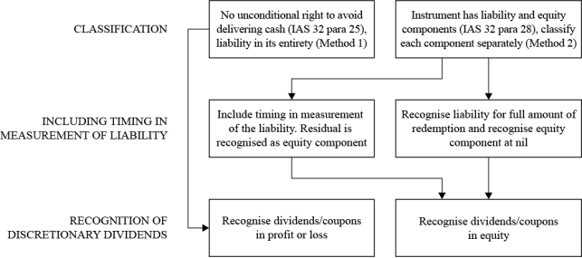

# 43 - Financial liabilities and equity (IFRS 9, IAS 32)

[返回目录](README.md)

# 43 - Financial liabilities and equity (IFRS 9, IAS 32)

Contents

- [43 - Financial liabilities and equity (IFRS 9, IAS 32)](67.md#s274-chap_43_toc_h1)

- [Introduction and scope (paras 43.1 - 43.11)](67.md#s275-chap_43_navPoint_1)

- [Principles for classifying financial liabilities and equity instruments](67.md#s275-chap_43_navPoint_2)

- [Contracts that will or might be settled in cash or another financial asset (paras 43.12 - 43.22)](67.md#s276-chap_43_navPoint_3)

- [Payments that are discretionary or at the option of the issuer](67.md#s276-chap_43_navPoint_4)

- [Contractual obligation to settle in cash or another financial asset](67.md#s276-chap_43_navPoint_5)

- [The role of the shareholder in determining whether a contractual obligation exists](67.md#s276-chap_43_navPoint_6)

- [Restriction on the ability to satisfy contractual obligations](67.md#s276-chap_43_navPoint_7)

- [Own share buy-back programmes](67.md#s276-chap_43_navPoint_8)

- [Absence of explicit obligations](67.md#s276-chap_43_navPoint_9)

- [Contingent settlement provisions (paras 43.23 - 43.37)](67.md#s277-chap_43_navPoint_10)

- [Settlement terms that are not genuine](67.md#s277-chap_43_navPoint_11)

- [Settlements that arise only on liquidation](67.md#s277-chap_43_navPoint_12)

- [Puttable instruments and obligations arising only on liquidation](67.md#s277-chap_43_navPoint_13)

- [Criteria to be classified as equity](67.md#s277-chap_43_navPoint_14)

- [Reclassification of puttable instruments and instruments with obligations arising only on liquidation](67.md#s277-chap_43_navPoint_15)

- [Contracts that will or might be settled in an entity’s own equity instruments (paras 43.38 - 43.51)](67.md#s278-chap_43_navPoint_16)

- [Basic concepts](67.md#s278-chap_43_navPoint_17)

- [Derivatives over own equity instruments](67.md#s278-chap_43_navPoint_18)

- [Derivatives accounted for as gross-settled equity instruments](67.md#s278-chap_43_navPoint_19)

- [Derivatives that give rise to ‘gross’ financial liabilities](67.md#s278-chap_43_navPoint_20)

- [Derivatives over own equity that can be net settled](67.md#s278-chap_43_navPoint_21)

- [Advanced concepts when assessing ‘fixed for fixed’ for derivatives](67.md#s278-chap_43_navPoint_22)

- [Interaction with other features](67.md#s278-chap_43_navPoint_23)

- [Compound financial instruments (paras 43.52 - 43.62)](67.md#s279-chap_43_navPoint_24)

- [Introduction](67.md#s279-chap_43_navPoint_25)

- [Separation of a compound financial instrument on initial recognition](67.md#s279-chap_43_navPoint_26)

- [Practical application of compound instruments: shares with various rights](67.md#s279-chap_43_navPoint_27)

- [Separation of a compound instrument containing more than one non-equity derivative](67.md#s279-chap_43_navPoint_28)

- [Instruments containing liability and equity components (compound instruments) and contingent settlement provisions](67.md#s279-chap_43_navPoint_29)

- [Practical considerations (paras 43.63 - 43.92)](67.md#s280-chap_43_navPoint_30)

- [Conversion at or before maturity](67.md#s280-chap_43_navPoint_31)

- [Early redemption or repurchase not part of the original contractual terms](67.md#s280-chap_43_navPoint_32)

- [Modification of terms to induce early conversion](67.md#s280-chap_43_navPoint_33)

- [Settlement options in convertible instruments](67.md#s280-chap_43_navPoint_34)

- [Convertible bond denominated in a foreign currency](67.md#s280-chap_43_navPoint_35)

- [Impact on classification for an instrument which is convertible only at the option of the issuer](67.md#s280-chap_43_navPoint_36)

- [Impact on classification depending on the reporting entity](67.md#s280-chap_43_navPoint_37)

- [Reclassification after initial recognition](67.md#s280-chap_43_navPoint_38)

- [Treasury shares](67.md#s280-chap_43_navPoint_39)

- [Treatment of interest, dividends, gains and losses](67.md#s280-chap_43_navPoint_40)

- [Treatment of transaction costs of equity instruments](67.md#s280-chap_43_navPoint_41)

- [Illustrative text](67.md#s281-chap_43_navPoint_42)

- [FAQ 43.1.1 – What is an indicator of an instrument being within the scope of IFRS 2?](67.md#s281-chap_43_navPoint_43)

- [FAQ 43.2.1 – Are there any developments of IAS 32 currently in progress?](67.md#s281-chap_43_navPoint_44)

- [FAQ 43.4.1 – What is an example of a residual interest?](67.md#s281-chap_43_navPoint_45)

- [FAQ 43.6.1 – Does economic compulsion in a ‘step-up’ instrument create a contractual obligation?](67.md#s281-chap_43_navPoint_46)

- [FAQ 43.6.2 – Does a legal obligation to pay dividends meet the definition of a contractual obligation in IAS 32?](67.md#s281-chap_43_navPoint_47)

- [FAQ 43.8.1 – Does past practice of paying dividends cause an instrument to be classified as a liability?](67.md#s281-chap_43_navPoint_48)

- [FAQ 43.11.1 – What is meant by a financial instrument’s component parts?](67.md#s281-chap_43_navPoint_49)

- [FAQ 43.11.2 – How does ‘substance’ of a contractual feature play a role in classification?](67.md#s281-chap_43_navPoint_50)

- [FAQ 43.11.3 – What is an example of a contractual feature that might lack substance?](67.md#s281-chap_43_navPoint_51)

- [FAQ 43.12.1 – What is a preference share?](67.md#s281-chap_43_navPoint_52)

- [FAQ 43.12.2 – How should a perpetual debt instrument be classified?](67.md#s281-chap_43_navPoint_53)

- [FAQ 43.12.3 – How should non-redeemable preference shares with mandatory fixed dividends be classified?](67.md#s281-chap_43_navPoint_54)

- [FAQ 43.12.4 – How should a zero coupon bond be classified?](67.md#s281-chap_43_navPoint_55)

- [FAQ 43.17.1 – How do you determine which role a shareholder is playing?](67.md#s281-chap_43_navPoint_56)

- [FAQ 43.17.2 – What is an example of how the shareholder role impacts classification?](67.md#s281-chap_43_navPoint_57)

- [FAQ 43.19.1 –  How does a co-operative entity classify redeemable shares where there are prohibitions against redemptions?](67.md#s281-chap_43_navPoint_58)

- [FAQ 43.21.1 – How might choice of settlement in either cash or a non-financial asset impact classification?](67.md#s281-chap_43_navPoint_59)

- [FAQ 43.21.2 – What is an example of an instrument where there is an indirect obligation (‘linked’ instrument)?](67.md#s281-chap_43_navPoint_60)

- [FAQ 43.21.3 – What is an example of an instrument where there is not an indirect obligation (‘dividend pusher’ instrument)?](67.md#s281-chap_43_navPoint_61)

- [FAQ 43.21.4 – Does a legal/statutory obligation to pay dividends on ordinary shares create a contractual obligation to pay dividends on preference shares with a dividend pusher?](67.md#s281-chap_43_navPoint_62)

- [FAQ 43.23.1 – Is a payment that is contingent on a change of control a financial liability?](67.md#s281-chap_43_navPoint_63)

- [FAQ 43.23.2 – Is a preference share with an obligation to pay out a percentage of profits a financial liability?](67.md#s281-chap_43_navPoint_64)

- [FAQ 43.23.3 – Is a mandatorily redeemable bond if an IPO does not occur a financial liability?](67.md#s281-chap_43_navPoint_65)

- [FAQ 43.23.4 – Is a mandatorily redeemable bond if an IPO does occur a financial liability?](67.md#s281-chap_43_navPoint_66)

- [EX 43.23.5 – Instrument that is only redeemable in the event of default of another instrument](67.md#s281-chap_43_navPoint_67)

- [FAQ 43.26.1 – Is an increase in an index a genuine contingent event?](67.md#s281-chap_43_navPoint_68)

- [FAQ 43.26.2 – Is a change in regulation a genuine contingent event?](67.md#s281-chap_43_navPoint_69)

- [FAQ 43.27.1 – Could an obligation arising on the liquidation of a limited life partnership meet the definition of equity?](67.md#s281-chap_43_navPoint_70)

- [FAQ 43.27.2 – How should a perpetual instrument with liquidation clauses that is issued by a subsidiary be classified in the group financial statements](67.md#s281-chap_43_navPoint_71)

- [EX 43.35.1 – Practice aid: interpreting the exception for puttable instruments and instruments with obligations arising on liquidation](67.md#s281-chap_43_navPoint_72)

- [FAQ 43.35.2 – How should transactions entered into by an instrument holder, other than as owner of the entity, be considered when determining the classification of an instrument?](67.md#s281-chap_43_navPoint_73)

- [FAQ 43.35.3 – If an instrument meets the classification exception in the individual accounts, will it always meet the exception in the group consolidated accounts?](67.md#s281-chap_43_navPoint_74)

- [EX 43.39.1 – Issuing an option to exchange an entity’s own equity for a fixed amount of cash](67.md#s281-chap_43_navPoint_75)

- [EX 43.39.2 – Contract to deliver shares equal to a fixed value depending on the share price at a future date](67.md#s281-chap_43_navPoint_76)

- [EX 43.39.3 – Bermudan option, with different strike prices which vary with the share price of the entity](67.md#s281-chap_43_navPoint_77)

- [EX 43.39.4 – An option to exchange a fixed number of one kind of equity for a fixed number of a different kind of equity](67.md#s281-chap_43_navPoint_78)

- [FAQ 43.39.5 – Is a contract to issue a fixed number of warrants classified as an equity?](67.md#s281-chap_43_navPoint_79)

- [EX 43.40.1 – Option to exchange a fixed percentage of a counterparty’s equity for a fixed ratio of the issuer’s equity](67.md#s281-chap_43_navPoint_80)

- [EX 43.40.2 – Contract to deliver a fixed number of an entity’s own equity instruments for a fixed amount of foreign currency](67.md#s281-chap_43_navPoint_81)

- [EX 43.40.3 – Practice aid: classification summary table](67.md#s281-chap_43_navPoint_82)

- [FAQ 43.40.4 – Does a cashless exercise option qualify as an equity instrument?](67.md#s281-chap_43_navPoint_83)

- [FAQ 43.41.1 – Classification of convertible preference shares with a ‘down-round’ provision](67.md#s281-chap_43_navPoint_84)

- [EX 43.42.1 – A rights issue which is issued pro rata to an entity’s existing shareholders for a fixed amount of currency](67.md#s281-chap_43_navPoint_85)

- [EX 43.44.1 – Purchased call option classified as equity](67.md#s281-chap_43_navPoint_86)

- [EX 43.44.2 – Written call option classified as equity](67.md#s281-chap_43_navPoint_87)

- [EX 43.44.3 – Purchased put option classified as equity](67.md#s281-chap_43_navPoint_88)

- [EX 43.44.4 – Forward contract to sell a fixed number of own shares for a fixed sum](67.md#s281-chap_43_navPoint_89)

- [EX 43.44.5 – Failed definition of equity: written call option over own shares](67.md#s281-chap_43_navPoint_90)

- [FAQ 43.46.1 – How should a forward contract to buy own equity that meets the ‘fixed for fixed’ requirement be accounted for?](67.md#s281-chap_43_navPoint_91)

- [FAQ 43.47.1 – How should a written put option that meets the ‘fixed for fixed’ requirement be accounted for?](67.md#s281-chap_43_navPoint_92)

- [FAQ 43.47.2 – Are modification gains and losses arising from the remeasurement of a written put always recognised in profit or loss?](67.md#s281-chap_43_navPoint_93)

- [FAQ 43.48.1 – How should a forward purchase contract on own equity, settled net in cash or net in own equity, be accounted for?](67.md#s281-chap_43_navPoint_94)

- [FAQ 43.48.2 – How should a written call option over own equity, settled net in cash or net in own equity, be accounted for?](67.md#s281-chap_43_navPoint_95)

- [FAQ 43.49.1 – How should a contract to pay contingent consideration, that varies with time and performance conditions, be classified?](67.md#s281-chap_43_navPoint_96)

- [FAQ 43.50.1 – Does an instrument whose conversion price is pre-determined at inception, and only varies with time, violate the ‘fixed for fixed’ requirement?](67.md#s281-chap_43_navPoint_97)

- [FAQ 43.50.2 – Do step-up adjustments in the conversion price violate the ‘fixed for fixed’ requirement?](67.md#s281-chap_43_navPoint_98)

- [FAQ 43.50.3 – Does an adjustment to the conversion price of a convertible bond triggered by a stock split violate the ‘fixed for fixed’ requirement?](67.md#s281-chap_43_navPoint_99)

- [FAQ 43.50.4 – Does an adjustment to a conversion price of a warrant for the issuance of shares at a market price (below the original conversion price) violate the ‘fixed for fixed’ requirement?](67.md#s281-chap_43_navPoint_100)

- [EX 43.50.5 – Change in conversion ratio on a dividend payment](67.md#s281-chap_43_navPoint_101)

- [FAQ 43.50.6 – Does a change of control clause violate the ‘fixed for fixed’ requirement?](67.md#s281-chap_43_navPoint_102)

- [FAQ 43.50.7 – Does an adjustment to the conversion price on a rights issue meet the ‘fixed for fixed’ requirement?](67.md#s281-chap_43_navPoint_103)

- [FAQ 43.51.1 – How should an instrument that is settled in a variable number of shares, but is subject to a cap, be classified?](67.md#s281-chap_43_navPoint_104)

- [FAQ 43.51.2 – How should an instrument that is settled in a variable number of shares, but is subject to a cap and floor (that is, a collar), be classified?](67.md#s281-chap_43_navPoint_105)

- [FAQ 43.52.1 – What are typical examples of compound instruments?](67.md#s281-chap_43_navPoint_106)

- [FAQ 43.55.1 – How is split accounting applied to a convertible bond?](67.md#s281-chap_43_navPoint_107)

- [FAQ 43.55.2 – Contingent conversion bond: is the contingent conversion option an equity component?](67.md#s281-chap_43_navPoint_108)

- [EX 43.57.1 – Practice aid: classification of preference shares](67.md#s281-chap_43_navPoint_109)

- [FAQ 43.58.1 – How should other embedded features in convertible bonds be considered in compound instruments?](67.md#s281-chap_43_navPoint_110)

- [FAQ 43.58.2 – How is a convertible accounted for?](67.md#s281-chap_43_navPoint_111)

- [FAQ 43.58.3 – How is callable convertible bond accounted for?](67.md#s281-chap_43_navPoint_112)

- [FAQ 43.59.1 – What is the accounting for mandatorily convertible bonds which convert to a fixed number of shares?](67.md#s281-chap_43_navPoint_113)

- [FAQ 43.62.1 – What is the accounting for a contingently convertible bond?](67.md#s281-chap_43_navPoint_114)

- [FAQ 43.62.2 – If a contingent convertible bond is treated as a compound instrument, how should the liability be measured?](67.md#s281-chap_43_navPoint_115)

- [FAQ 43.64.1 – What is the accounting for the conversion of a convertible bond into ordinary shares?](67.md#s281-chap_43_navPoint_116)

- [FAQ 43.65.1 – What is the accounting for the conversion of a convertible bond into ordinary shares before maturity?](67.md#s281-chap_43_navPoint_117)

- [FAQ 43.68.1 – What is the accounting for the early redemption of a convertible bond?](67.md#s281-chap_43_navPoint_118)

- [FAQ 43.69.1 – What is the accounting for early conversion of a convertible bond following modification of terms to induce early conversion?](67.md#s281-chap_43_navPoint_119)

- [FAQ 43.70.1 – What is the accounting for a convertible bond with a cash settlement alternative for a contingent settlement option?](67.md#s281-chap_43_navPoint_120)

- [FAQ 43.71.1 – What is the accounting for convertible debt denominated in a foreign currency?](67.md#s281-chap_43_navPoint_121)

- [FAQ 43.74.1 – Instrument convertible only at the option of the issuer: does this meet the definition of equity or liability?](67.md#s281-chap_43_navPoint_122)

- [FAQ 43.75.1 – How should contractual rights and obligations in the consolidated reporting entity impact the classification of shares issued by a subsidiary?](67.md#s281-chap_43_navPoint_123)

- [FAQ 43.76.1 – How should a change in classification from equity to liability, due to a change in the instrument’s contractual terms, be accounted for?](67.md#s281-chap_43_navPoint_124)

- [FAQ 43.77.1 – Should an instrument be reclassified when the original classification might have changed but the contractual terms have not?](67.md#s281-chap_43_navPoint_125)

- [FAQ 43.77.2 – How should a reclassification be accounted for if the contractual terms have not changed?](67.md#s281-chap_43_navPoint_126)

- [FAQ 43.77.3  –  If the contractual terms of an instrument have not changed, does the accounting policy choice to reassess the debt equity classification always apply?](67.md#s281-chap_43_navPoint_127)

- [FAQ 43.80.1 – What is the accounting for the purchase of own shares held in treasury?](67.md#s281-chap_43_navPoint_128)

- [FAQ 43.80.2 – Should short sales of own equity be recognised in equity or as IFRS 9 trading liabilities?](67.md#s281-chap_43_navPoint_129)

- [FAQ 43.86.1 – How should a premium payable on the cancellation of the conversion option in a convertible bond be accounted for?](67.md#s281-chap_43_navPoint_130)

- [FAQ 43.87.1 – How should interest, dividends, losses and gains on compound instruments be accounted for?](67.md#s281-chap_43_navPoint_131)

- [FAQ 43.88.1 – What are examples of transaction costs arising on the issue of equity instruments?](67.md#s281-chap_43_navPoint_132)

- [FAQ 43.89.1 – How should transaction costs incurred in anticipation of an equity issuance be accounted for?](67.md#s281-chap_43_navPoint_133)

- [FAQ 43.91.1 – How should transaction costs relating to more than one transaction be accounted for?](67.md#s281-chap_43_navPoint_134)

This eBook is licensed to peggy so, peggy.so@hk.ey.com, 

## Introduction and scope (paras 43.1 - 43.11)

 

**43.1**IAS 32 contains the principles for distinguishing between financial liabilities and equity issued by an entity. An entity should apply IAS 32 to all types of financial instruments, except those outside the standard’s scope. The scope exemptions to IAS 32 are discussed in [chapter 40 para 43](61.md#s252-Para_40.43). If the holder is an employee, director or provider of services to the entity, management should carefully analyse the contract to determine whether it is within the scope of IFRS 2 (see [chapter 13](24.md#s85-chap_13)), IAS 19 (see [chapter 12](23.md#s77-chap_12)) or IAS 32.

[IAS 32 para 2].

[FAQ 43.1.1 – What is an indicator of an instrument being within the scope of IFRS 2?](67.md#s281-FAQ_43.1.1)

**43.2**Classification under IAS 32 is complex, and it requires the assessment of each component of an instrument’s contractual terms.

[IAS 32 para 2].

[FAQ 43.2.1 – Are there any developments of IAS 32 currently in progress?](67.md#s281-FAQ_43.2.1)

 

### Principles for classifying financial liabilities and equity instruments

 

**43.3**A financial liability is any liability that is:

- A contractual obligation:

- to deliver cash or another financial asset to another entity; or

- to exchange financial assets or financial liabilities with another entity under conditions that are potentially unfavourable to the entity.

- A contract that will or might be settled in the entity’s own equity instruments and is:

- a non-derivative for which the entity is or might be obliged to deliver a variable number of the entity’s own equity instruments; or

- a derivative that will or might be settled other than by the exchange of a fixed amount of cash or another financial asset for a fixed number of the entity’s own equity instruments. For this purpose, the entity’s own equity instruments do not include puttable instruments and obligations arising on liquidation that are classified as equity (as explained in [para 43.29](67.md#s277-Para_43.29)), rights issues denominated in a currency other than the functional currency of the issuer, if they meet certain conditions (as explained in [para 43.42](67.md#s278-Para_43.42)), or instruments that are contracts for the future receipt or delivery of the entity’s own equity instruments.

[IAS 32 para 11].

**43.4**An equity instrument is any contract that evidences a residual interest in an entity’s assets after deducting all of its liabilities.

[IAS 32 para 11].

[FAQ 43.4.1 – What is an example of a residual interest?](67.md#s281-FAQ_43.4.1)

**43.5**An instrument is an equity instrument only if both of the conditions below are met:

- The instrument includes no contractual obligation:

- to deliver cash or another financial asset to another entity; or

- to exchange financial assets or financial liabilities with another entity under conditions that are potentially unfavourable to the entity.

- If the instrument will or might be settled in the issuer’s own equity instruments, it is:

- a non-derivative that includes no contractual obligation for the issuer to deliver a variable number of its own equity instruments; or

- a derivative that will be settled only by the issuer exchanging a fixed amount of cash or another financial asset for a fixed number of its own equity instruments. Rights and other issues denominated in any currency are equity instruments, provided that certain conditions are met ([see para 43.42](67.md#s278-Para_43.42)). The issuer’s own equity instruments do not include puttable instruments and obligations arising on liquidation that are classified as equity, or instruments that are contracts for the future receipt or delivery of the issuer’s own equity instruments.

[IAS 32 para 16].

**43.6**A contractual financial obligation is necessary to classify a financial instrument as a liability. ‘Contract’ or ‘contractual’ refers to an agreement between two or more parties with clear economic consequences that the parties have little (if any) discretion to avoid, usually because the agreement is enforceable by law. Contracts can take a variety of forms and need not be in writing.

[IAS 32 para 13].

[FAQ 43.6.1 – Does economic compulsion in a ‘step-up’ instrument create a contractual obligation?](67.md#s281-FAQ_43.6.1)  
 [FAQ 43.6.2 – Does a legal obligation to pay dividends meet the definition of a contractual obligation in IAS 32?](67.md#s281-FAQ_43.6.2)

**43.7**The obligation must be established through the terms and conditions of the financial instrument; economic compulsion by itself does not result in a financial instrument being classified as a liability.

[IFRIC update March 2006].

**43.8**The classification of an instrument as equity or a financial liability would not be impacted by, for example:

- a history of making distributions;

- an intention to make distributions in the future;

- a possible negative impact on price of the issuer’s ordinary shares if distributions are not made (because of restrictions on paying dividends on the ordinary shares if dividends are not paid on the preference shares);

- the amount of the issuer’s reserves;

- an issuer’s expectation of a profit or loss for a period; or

- an ability or inability of the issuer to influence the amount of its profit or loss for the period.

[IAS 32 para AG26].

[FAQ 43.8.1 – Does past practice of paying dividends cause an instrument to be classified as a liability?](67.md#s281-FAQ_43.8.1)

**43.9**Distributions to holders of the preference shares (cumulative or non-cumulative), which are at the discretion of the issuer, are equity instruments.

[IAS 32 para AG26].

**43.10**If an entity issues two or more instruments at (or nearly at) the same time to the same counterparty, the indicators outlined in IAS 39/IFRS 9 should be considered to determine whether the contracts are linked and viewed as a single arrangement or as two separate contracts. Indicators that contracts are linked include:

- they are entered into at the same time and in contemplation of one another;

- they have the same counterparty;

- they relate to the same risk;

- there is no apparent economic need or substantive business purpose for structuring the transaction separately that would not also have been accomplished in a single transaction; and

- they cannot be transferred or redeemed separately.

[IAS 39 para IG B.6]. [IFRS 9 para IG B.6].

**43.11**An issuer of a financial instrument should, on initial recognition, classify it, or its ‘component parts’, as a financial liability, a financial asset or an equity instrument, in accordance with the contractual arrangement’s substance and the definitions of a financial liability, a financial asset and an equity instrument.

[IAS 32 para 15].

[FAQ 43.11.1 – What is meant by a financial instrument’s component parts?](67.md#s281-FAQ_43.11.1)  
[FAQ 43.11.2 – How does ‘substance’ of a contractual feature play a role in classification?](67.md#s281-FAQ_43.11.2)  
[FAQ 43.11.3 – What is an example of a contractual feature that might lack substance?](67.md#s281-FAQ_43.11.3)

 

This eBook is licensed to peggy so, peggy.so@hk.ey.com, 

## Contracts that will or might be settled in cash or another financial asset (paras 43.12 - 43.22)

 

**43.12**The critical feature that distinguishes a financial liability from an equity instrument is whether the issuer has an unconditional right to avoid delivering cash or another financial asset to settle a contractual obligation.

[IAS 32 para 11].[IAS 32 para 16].

[FAQ 43.12.1 – What is a preference share?](67.md#s281-FAQ_43.12.1)  
[FAQ 43.12.2 – How should a perpetual debt instrument be classified?](67.md#s281-FAQ_43.12.2)

[FAQ 43.12.3 – How should non-redeemable preference shares with mandatory fixed dividends be classified?](67.md#s281-FAQ_43.12.3)  
[FAQ 43.12.4 – How should a zero coupon bond be classified?](67.md#s281-FAQ_43.12.4)

 

### Payments that are discretionary or at the option of the issuer

**43.13**An equity instrument is any contract that evidences a residual interest in an entity’s assets after deducting all of its liabilities; only those instruments (or components of instruments) that do not meet the definition of a liability will be classified as equity. A contractual obligation does not give rise to a financial liability if the entity has an unconditional right to avoid delivering cash or another financial asset in settlement of that obligation. If payments of interest/dividends or the principal amount or both are discretionary in nature, equity treatment is appropriate for some or all of the instrument. A typical example is an entity’s non-puttable ordinary shares.

[IAS 32 para 19].

**43.14**If the issuer has an option to call or redeem what would otherwise be equity shares for cash at some future date, the instrument does not satisfy the definition of a financial liability, because the issuer can avoid settling the principal in cash; the issuer does not have a present obligation to transfer financial assets to the shareholders, since redemption of the shares is solely at the issuer’s discretion. An obligation might arise, however, when the issuer of the shares exercises its option, usually by formally notifying the shareholders of an intention to redeem the shares.

[IAS 32 para AG25].

### Contractual obligation to settle in cash or another financial asset

**43.15**If the holder has a put option under which it can require the issuer to redeem shares at some future date, the instrument (the puttable shares or the equity shares and the put) is treated as the issuer’s liability. This is because the issuer cannot avoid settling the principal in cash (with the exception of puttable instruments and obligations arising on liquidation that meet the criteria set out in [para 43.35 onwards](67.md#s277-Para_43.35)). For further guidance, see [paragraph 43.46](67.md#s278-Para_43.46) and [chapter 26 para 204](45.md#s174-Para_26.204).

[IAS 32 para AG25].

**43.16**A financial instrument might contain a contractual obligation for the issuer to deliver cash or other financial assets only on the occurrence of an uncertain future event. The instrument might still need to be classified as a financial liability from initial recognition, unless certain conditions are met (see [para 43.23](67.md#s277-Para_43.23)).

[IAS 32 para 25].

### The role of the shareholder in determining whether a contractual obligation exists

 

**43.17**Shareholders as a collective body make key decisions affecting an entity’s financial position and performance over its life (for example, regarding the distribution of dividends). Hence, their decisions have to be analysed from an accounting perspective. Shareholders can make decisions as part of the entity (as members of the entity’s corporate governance structure), or they can be separate and distinct from the entity itself when making these decisions (as holders of a particular instrument). The role of shareholders – that is, whether they are viewed as ‘part of the entity’ or as ‘separate and distinct from the entity’ – is critical in determining the classification of financial instruments if the entity’s shareholders decide whether the entity delivers cash or another financial asset under those instruments.

[IAS 32 para 19].

[FAQ 43.17.1 – How do you determine which role a shareholder is playing?](67.md#s281-FAQ_43.17.1)  
[FAQ 43.17.2 – What is an example of how the shareholder role impacts classification?](67.md#s281-FAQ_43.17.2)

 

### Restriction on the ability to satisfy contractual obligations

 

**43.18**A restriction on an entity’s ability to satisfy a contractual obligation, such as lack of access to foreign currency or the need to obtain approval for payment from a regulatory authority, does not negate the entity’s contractual obligation or the holder’s contractual right under the instrument. An obligation is not negated if the instrument’s terms are such that the amount payable on redemption is dependent on the company having sufficient distributable profits or reserves. An example of such an instrument is a perpetual bond which is not redeemable by the issuer, but interest is payable only in the event that the issuer has sufficient distributable profits; the bond would be classified as a liability because of the obligation to pay interest. The fact that the obligation to pay is dependent on the existence of profits makes the obligation contingent, but it does not remove the obligation (see [chapter 40 para 21](61.md#s250-Para_40.21)).

[IAS 32 para 19(a)].

**43.19**On the other hand, the contractual right of the holder of a financial instrument to request redemption does not (in itself) require a financial instrument to be classified as a financial liability (for example, if the entity has the unconditional right to refuse redemption of some or all of the instrument). The entity must consider all of the terms and conditions of the instrument when determining its classification, including relevant local law, regulations and the entity’s governing charter in effect at the date of classification (but not expected future amendments to those laws, regulations or charter). This is particularly relevant to shares issued by co-operative entities.

[IFRIC 2 para 5].

[FAQ 43.19.1 – How does a co-operative entity classify redeemable shares where there are prohibitions against redemptions?](67.md#s281-FAQ_43.19.1)

 

### Own share buy-back programmes

 

**43.20**Certain share buy-back programmes create financial liabilities for the issuer of the shares. Listed companies might be prohibited from buying their own shares in the market by local listing rules during specified times of the year. The local listing rules might permit other arrangements to be entered into with independent third parties that result in the listed entity’s shares being purchased on behalf of the listed entity (for example, by a bank). The contract requires the company to buy the shares that the bank has purchased immediately after the prohibition period. See further discussion of own share buy-back programmes in [chapter 51 para 29](85.md#s350-Para_51.29). These own share buy-back programmes contain an obligation for an entity to purchase its own equity instruments, for cash or another financial asset, from the third party. This gives rise to a financial liability for the present value of the redemption amount (for example, the present value of the forward repurchase price, option exercise price or other redemption amount).

[IAS 32 para 23].

 

### Absence of explicit obligations

 

**43.21**The obligation to deliver cash or another financial asset need not be explicitly stated in the instrument; it could be established indirectly, but it must be established through the terms and conditions of the financial instrument.

[IAS 32 para 20].

[FAQ 43.21.1 – How might choice of settlement in either cash or a non-financial asset impact classification?](67.md#s281-FAQ_43.21.1)  
[FAQ 43.21.2 – What is an example of an instrument where there is an indirect obligation (‘linked’ instrument)?](67.md#s281-FAQ_43.21.2)  
[FAQ 43.21.3 – What is an example of an instrument where there is not an indirect obligation (‘dividend pusher’ instrument)?](67.md#s281-FAQ_43.21.3)  
[FAQ 43.21.4 – Does a legal/statutory obligation to pay dividend on ordinary shares create a contractual obligation to pay dividends on preference shares with a dividend pusher?](67.md#s281-FAQ_43.21.4)

**43.22**An obligation could be established in two specific situations:

- A financial instrument might contain a non-financial obligation that must be settled if the entity fails to make distributions or to redeem the instrument. If the entity can avoid a transfer of cash or another financial asset only by settling the non-financial obligation, the financial instrument is a financial liability.  
 [IAS 32 para 20(a)].

- A financial instrument is a financial liability if it provides that, on settlement, the entity will deliver either:

- cash or another financial asset; or

- its own shares whose value is determined to exceed substantially the value of the cash or other financial asset.

Although the entity does not have an explicit contractual obligation to deliver cash or another financial asset, the value of the share settlement alternative is such that the entity will have little choice but to redeem the obligation in cash; the holder has been guaranteed, in substance, receipt of an amount that is at least equal to the cash settlement option. The instrument is a financial liability.

[IAS 32 para 20(b)].

 

This eBook is licensed to peggy so, peggy.so@hk.ey.com, 

## Contingent settlement provisions (paras 43.23 - 43.37)

 

**43.23**The obligation to deliver cash or financial assets need not be certain of occurring; it could be contingent on the occurrence or non-occurrence of uncertain future events or circumstances that are beyond the control of both the issuer and the holder of the instrument. Examples of such uncertain future events might include, but are not limited to:

- Changes in a stock market index or consumer price index.

- Changes in interest rates or exchange rates.

- Changes in tax laws or other regulatory requirements.

- Changes in the issuer’s key performance indicators, such as revenue, net income or debt-to-equity ratios.

In any of these circumstances, the instrument is a financial liability.

[IAS 32 para 25].

[FAQ 43.23.1 – Is a payment that is contingent on a change of control a financial liability?](67.md#s281-FAQ_43.23.1)  
[FAQ 43.23.2 – Is a preference share with an obligation to pay out a percentage of profits a financial liability?](67.md#s281-FAQ_43.23.2)  
[FAQ 43.23.3 – Is a mandatorily redeemable bond if an IPO does not occur a financial liability](67.md#s281-FAQ_43.23.3)  
[FAQ 43.23.4 – Is a mandatorily redeemable bond where if an IPO does occur a financial liability?](67.md#s281-FAQ_43.23.4)  
[EX 43.23.5 – Instrument that is only redeemable in the event of default of another instrument](67.md#s281-EX43.23.5)

**43.24**There are three exceptions where uncertain events outside the control of the issuer would not give rise to a financial liability:

- The part of the contingent settlement provision that could require settlement in cash or another financial asset (or otherwise in such a way that it would be a financial liability) is not genuine (see [para 43.25](67.md#s277-Para_43.25)).

- The issuer can be required to settle the obligation in cash or another financial asset (or otherwise to settle it in such a way that it would be a financial liability) only in the event of liquidation of the issuer (see [para 43.27](67.md#s277-Para_43.27)).

- The instrument is puttable or creates an obligation on liquidation and certain conditions are met (see further [para 43.28 onwards](67.md#s277-Para_43.28)).

[IAS 32 para 25].

 

### Settlement terms that are not genuine

 

**43.25**A contingent settlement provision in a contract is not genuine if it requires settlement in cash only on the occurrence of an event that is extremely rare, highly abnormal and very unlikely to occur. The contingent settlement provisions are not taken into account in the instrument’s classification. If settlement in a fixed number of an entity’s own shares might be contractually precluded in circumstances that are outside the control of the entity, those circumstances can be ignored if there is no genuine possibility that they will occur. The instrument would be classified as an equity instrument and not as a financial liability.

[IAS 32 para AG28].

**43.26**‘Remote’ and ‘not genuine’ are different concepts; it is not appropriate to disregard events that are merely ‘remote’. Terms are included in a contract for genuine commercial purposes. So, whilst the specific facts and circumstances relevant to an instrument will need to be assessed, it would be unusual to include settlement terms in a contract that are not genuine (that is, are contingent on an event that is extremely rare, highly abnormal and very unlikely to occur). Nevertheless, if, after careful analysis, it is concluded that such non-genuine terms are included, they should be ignored in determining the instrument’s classification.

[IAS 32 para AG28].

[FAQ 43.26.1 – Is an increase in an index a genuine contingent event?](67.md#s281-FAQ_43.26.1)  
[FAQ 43.26.2 – Is a change in regulation a genuine contingent event?](67.md#s281-FAQ_43.26.2)

 

### Settlements that arise only on liquidation

 

**43.27**Obligations to deliver cash or other financial assets, that are contingent only on the issuer’s liquidation, should be ignored. Taking these obligations into consideration would be inconsistent with the going concern assumption. A provision that provides for payment in cash or another financial asset, only on the entity’s liquidation, is similar to an equity instrument that has priority in liquidation. A mandatory distribution of all proceeds to shareholders, following the sale of all of the assets of the entity (such that a shell is all that would remain), would fall within the scope of a ‘liquidation’, even though the legal process of a winding up has not been concluded. However, if the instrument is redeemable on the occurrence of an event which is beyond the control of the entity, that might or might not ultimately lead to eventual liquidation (for example, the entity becomes insolvent, or goes into receivership or administration), the instrument should still be classified as a financial liability.

[IAS 32 para 25].

[FAQ 43.27.1 – Could an obligation arising on the liquidation of a limited life partnership meet the definition of equity?](67.md#s281-FAQ_43.27.1)

[FAQ 43.27.2 – How should a perpetual instrument with liquidation clauses that is issued by a subsidiary be classified in the group financial statements](67.md#s281-FAQ_43.27.2)

 

### Puttable instruments and obligations arising only on liquidation

 

**43.28**The following financial instruments would normally meet the definition of a liability:

- Instruments, or components of instruments, that impose on the entity an obligation to deliver to another party a pro rata share of the entity’s net assets only on liquidation, where liquidation is either certain to occur (such as in limited life entities) or is uncertain to occur but is at the option of the instrument holder.

[IAS 32 para 16C].

**43.29**An exception under IAS 32 requires puttable instruments/obligations arising on liquidation (referred collectively as ‘puttables’) to be classified as equity where the criteria detailed in [paragraph 43.35](67.md#s277-Para_43.35) are met.

**43.30**The exception’s scope does not extend to derivative contracts (such as warrants) over instruments, which meet the exceptions criteria; the derivatives cannot be equity themselves.

[IAS 32 para 11].

**43.31**The exception should not be used by analogy.

[IAS 32 para 96B].

**43.32**The classification of instruments under this exception is restricted to the accounting for instruments under IAS 32, IFRS 9, IFRS 7 and IAS 1. The instruments should not be considered as equity instruments under other guidance, in particular IFRS 2.

[IAS 32 para 96C].

**43.33**IAS 1 requires disclosures about financial instruments classified as equity as a result of this exception in IAS 32.

[IAS 1 para 136A].

**43.34**If the criteria in [paragraph 43.35](67.md#s277-Para_43.35) are not met, IAS 32 contains examples of income statement presentation if an entity has little or no equity.

[IAS 32 para IE32]. [IAS 32 para IE33].

 

### Criteria to be classified as equity

 

**43.35**A non-derivative puttable instrument, or an instrument with an obligation arising only on liquidation, where liquidation is either certain to occur, or is uncertain to occur but is at the option of the instrument holder, is classified as equity only if all of the following criteria are met:

**For puttables:**

A. A puttable financial instrument includes a contractual obligation for the issuer to repurchase or redeem that instrument, for cash or another financial asset, on exercise of the put. As an exception to the definition of a financial liability, an instrument that includes such an obligation is classified as an equity instrument if it has all of the following features:

- It entitles the holder to a pro rata share of the entity’s net assets in the event of the entity’s liquidation. The entity’s net assets are those assets that remain after deducting all other claims on its assets. A pro rata share is determined by:

- dividing the entity’s net assets on liquidation into units of equal amount; and

- multiplying that amount by the number of the units held by the financial instrument holder.

- The instrument is in the class of instruments that is subordinate to all other classes of instruments. To be in such a class, the instrument:

- has no priority over other claims to the assets of the entity on liquidation, and

- does not need to be converted into another instrument before it is in the class of instruments that is subordinate to all other classes of instruments.

- All financial instruments in the class of instruments that is subordinate to all other classes of instruments have identical features. For example, they must all be puttable, and the formula or other method used to calculate the repurchase or redemption price is the same for all instruments in that class.

- Apart from the contractual obligation for the issuer to repurchase or redeem the instrument for cash or another financial asset, the instrument does not include any contractual obligation to deliver cash or another financial asset to another entity, or to exchange financial assets or financial liabilities with another entity under conditions that are potentially unfavourable to the entity, and it is not a contract that will or might be settled in the entity’s own equity instruments, as set out in sub-paragraph 11(b) of the definition of a financial liability under IAS 32.

- The total expected cash flows attributable to the instrument over the life of the instrument are based substantially on the profit or loss, the change in the recognised net assets, or the change in the fair value of the recognised and unrecognised net assets of the entity over the life of the instrument (excluding any effects of the instrument).

B. For an instrument to be classified as an equity instrument, in addition to the instrument having all of the above features, the issuer must have no other financial instrument or contract that has:

- total cash flows based substantially on the profit or loss, the change in the recognised net assets, or the change in the fair value of the recognised and unrecognised net assets of the entity (excluding any effects of such instrument or contract); and

- the effect of substantially restricting or fixing the residual return to the puttable instrument holders.

For the purposes of applying this condition, the entity should not consider non-financial contracts with a holder of an instrument described in paragraph 16A of IAS 32 that have contractual terms and conditions that are similar to the contractual terms and conditions of an equivalent contract that might occur between a non-instrument holder and the issuing entity. If the entity cannot determine that this condition is met, it should not classify the puttable instrument as an equity instrument.

[IAS 32 para 16A].[IAS 32 para 16B].

**For instruments which contain an obligations arising only on liquidation (where liquidation is either certain to occur, or is uncertain to occur but is at the option of the instrument holder):**

C. Some financial instruments (or components of instruments) include a contractual obligation for the issuing entity to deliver to another entity a pro rata share of its net assets only on liquidation. The obligation arises because liquidation either is certain to occur and outside the control of the entity (for example, a limited life entity), or it is uncertain to occur but is at the option of the instrument holder. As an exception to the definition of a financial liability, an instrument that includes such an obligation is classified as an equity instrument if it has all of the following features:

- It entitles the holder to a pro rata share of the entity’s net assets in the event of the entity’s liquidation. The entity’s net assets are those assets that remain after deducting all other claims on its assets. A pro rata share is determined by:

- dividing the net assets of the entity on liquidation into units of equal amount; and

- multiplying that amount by the number of the units held by the financial instrument holder.

- The instrument is in the class of instruments that is subordinate to all other classes of instruments. To be in such a class, the instrument:

- has no priority over other claims to the assets of the entity on liquidation, and

- does not need to be converted into another instrument before it is in the class of instruments that is subordinate to all other classes of instruments.

- All financial instruments in the class of instruments that is subordinate to all other classes of instruments must have an identical contractual obligation for the issuing entity to deliver a pro rata share of its net assets on liquidation.

D. For an instrument to be classified as an equity instrument, in addition to the instrument having all of the above features, the issuer must have no other financial instrument or contract that has:

- total cash flows based substantially on the profit or loss, the change in the recognised net assets or the change in the fair value of the recognised and unrecognised net assets of the entity (excluding any effects of such instrument or contract); and

- the effect of substantially restricting or fixing the residual return to the instrument holders.

For the purposes of applying this condition, the entity should not consider non-financial contracts with a holder of an instrument described in paragraph 16C of IAS 32 that have contractual terms and conditions that are similar to the contractual terms and conditions of an equivalent contract that might occur between a non-instrument holder and the issuing entity. If the entity cannot determine that this condition is met, it should not classify the instrument as an equity instrument.

[IAS 32 para 16C]. [IAS 32 para 16D].

[EX 43.35.1 – Practice aid: interpreting the exception for puttable instruments and instruments with obligations arising on liquidation](67.md#s281-EX43.35.1)  
[FAQ 43.35.2 – How should transactions entered into by an instrument holder, other than as owner of the entity, be considered when determining the classification of an instrument?](67.md#s281-FAQ_43.35.2)  
[FAQ 43.35.3 – If an instrument meets the classification exception in the individual accounts, will it always meet the exception in the group consolidated accounts?](67.md#s281-FAQ_43.35.3)

 

### Reclassification of puttable instruments and instruments with obligations arising only on liquidation

 

**43.36**It is necessary to reassess the classification of ‘puttable instruments’ if there is a change in relevant circumstances. For example, if an entity issues or redeems other instruments that change the most subordinated class of shares, this might cause reclassification of some financial instruments from debt to equity, or vice versa.

[IAS 32 para 16E].

**43.37**An entity should reclassify a financial instrument when appropriate, as follows:

- Reclassify an equity instrument to a financial liability from the date when the instrument ceases to have all of the features required. The financial liability is measured at the instrument’s fair value at the date of reclassification. Any difference between the carrying value of the equity instrument and the liability’s fair value on the date of reclassification is recognised in equity.

- Reclassify a financial liability as equity from the date when the instrument has all of the features required. The equity instrument should be measured at the carrying value of the financial liability at the date of reclassification.

[IAS 32 para 16F].

 

This eBook is licensed to peggy so, peggy.so@hk.ey.com, 

## Contracts that will or might be settled in an entity’s own equity instruments (paras 43.38 - 43.51)

### Basic concepts

 

**43.38**A contract is not an equity instrument solely because it might result in the receipt or delivery of the entity’s own equity instruments. Such contracts can be in the form of either non-derivative instruments (for example, contracts where proceeds are received today and the entity’s own equity instruments are delivered in the future) or derivative contracts (for example, a contract with an option to purchase or sell the entity’s own equity instruments for consideration in the future).

[IAS 32 para 21].

**43.39**Non-derivative instruments that are or might be settled in shares can be classified as equity only if there is no contractual obligation for the entity to deliver a variable number of its own equity instruments (and, additionally, the instrument contains no contractual obligation to deliver cash or another financial asset). The classification of derivative contracts is dependent on whether there is variability in either of the following:

- the number of own equity instruments exchanged; or

- the amount of cash or other financial assets exchanged.

A contract that will be settled by the entity receiving (or delivering) a fixed number of its own equity instruments, in exchange for a fixed amount of cash or another financial asset, is an equity instrument. This is commonly referred to as the ‘fixed for fixed’ requirement. In other words, derivative instruments that are or might be settled in the entity’s own equity instruments must meet the ‘fixed for fixed’ requirement in order to be classified as equity.

[IAS 32 para 16(b)]. [IAS 32 para 22].

[EX 43.39.1 – Issuing an option to exchange an entity’s own equity for a fixed amount of cash](67.md#s281-EX43.39.1)  
[EX 43.39.2 – Contract to deliver shares equal to a fixed value depending on the share price at a future date](67.md#s281-EX43.39.2)  
[EX 43.39.3 – Bermudan option, with different strike prices which vary with the share price of the entity](67.md#s281-EX43.39.3)  
[EX 43.39.4 – An option to exchange a fixed number of one kind of equity for a fixed number of a different kind of equity](67.md#s281-EX43.39.4)  
  
[FAQ 43.39.5 – Is a contract to issue a fixed number of warrants classified as equity?](67.md#s281-FAQ_43.39.5)

**43.40**For derivative instruments, all forms of variability in either the number of own shares received or delivered, or the cash or another financial asset delivered or received, would result in financial asset or financial liability classification under IAS 32. Even optional variability that is within the control of the issuer would result in financial asset or financial liability classification under IAS 32.

[IAS 32 para 21].

[EX 43.40.1 – Option to exchange a fixed percentage of a counterparty’s equity for a fixed ratio of the issuer’s equity](67.md#s281-EX43.40.1)  
[EX 43.40.2 – Contract to deliver a fixed number of an entity’s own equity instruments for a fixed amount of foreign currency](67.md#s281-EX43.40.2)  
[EX 43.40.3 – Practice aid: classification summary table ](67.md#s281-EX43.40.3)   
[FAQ 43.40.4 – Does a cashless exercise option qualify as an equity instrument?](67.md#s281-FAQ_43.40.4)

**43.41**For non-derivatives, a contractual obligation to receive or deliver a variable number of shares would result in financial asset or financial liability classification. For example, an entity might have a contractual right or obligation, to receive or deliver a number of its own shares or other equity instruments, that varies so that the fair value of the entity’s own equity instruments to be received or delivered equals the amount of the contractual right or obligation. The contract might be for a fixed amount or an amount that fluctuates, in part or in full, in response to changes in a variable. Such a contract represents a right or obligation for a specified amount, rather than a specified residual equity interest, and it would be classified as a financial liability. This illustrates that a contract can be a financial asset or liability, even if the underlying variable is the entity’s own share price.

[IAS 32 para 21]. [IAS 32 para AG27(d)].

EX 43.41.1 – Classification of convertible preference shares with a ‘down-round’ provision

**43.42**As noted in [EX 43.42.1](67.md#s281-EX43.42.1), there is one exception to the ‘fixed for fixed’ requirement for some contracts that contain variability due to foreign currency. Rights, options or warrants to acquire a fixed number of the entity’s own equity instruments for a fixed amount of any currency are equity instruments if the entity offers the rights, options or warrants pro rata to all of its existing owners of the same class of its own non-derivative equity instruments.

[IAS 32 para 16(b)(ii)].

[EX 43.42.1 – A rights issue which is issued pro rata to an entity’s existing shareholders for a fixed amount of currency](67.md#s281-EX43.42.1)

 

### Derivatives over own equity instruments

**43.43**An entity might enter into a derivative contract for the purchase or sale of its own equity instruments. Depending on the nature of the contract (forward-based or option-based) and the settlement terms (for example, gross or net, and in cash or own equity instruments), such contracts could be accounted for as equity instruments, financial liabilities or as derivative assets and liabilities. The following paragraphs are specific to derivatives on own equity.

[IAS 32 para 16(b)(ii)].

### Derivatives accounted for as gross-settled equity instruments

 

**43.44**A derivative contract that will be settled by the entity receiving or delivering a fixed number of its own equity instruments in exchange for a fixed amount of cash or another financial asset is an equity instrument.

[IAS 32 para 22]. [IAS 32 para AG27(a)].

[EX 43.44.1 – Purchased call option classified as equity](67.md#s281-EX43.44.1)  
[EX 43.44.2 – Written call option classified as equity](67.md#s281-EX43.44.2)  
[EX 43.44.3 – Purchased put option classified as equity](67.md#s281-EX43.44.3)  
[EX 43.44.4 – Forward contract to sell a fixed number of own shares for a fixed sum](67.md#s281-EX43.44.4)  
[EX 43.44.5 – Failed definition of equity; written call option over own shares](67.md#s281-EX43.44.5)

**43.45**Any consideration received (such as the premium received for a written option or warrant on the entity’s own shares) on a derivative contract that is an equity instrument is added directly to equity. Any consideration paid (such as the premium paid for a purchased option) is deducted directly from equity. Changes in an equity instrument’s fair value are not recognised in the financial statements.

[IAS 32 para 22].

 

### Derivatives that give rise to ‘gross’ financial liabilities

 

**43.46**A contract that contains an obligation for an entity to purchase its own equity instruments for cash or another financial asset gives rise to a financial liability, even if the contract itself is an equity instrument.

[IAS 32 para 23].

[FAQ 43.46.1 – How should a forward contract to buy own equity that meets the ‘fixed for fixed’ requirement be accounted for?](67.md#s281-FAQ_43.46.1)

**43.47**An entity’s contractual obligation to purchase its own equity instruments gives rise to a financial liability for the present value of the redemption amount even if the obligation to purchase is conditional on the counterparty exercising a right to redeem. An example is a written put option that gives the counterparty (such as the owner of a non-controlling interest) the right to sell an entity’s own equity instruments to the entity for a fixed or variable price. For more detail on accounting for written puts over non-controlling interests see [chapter 26 para 204](45.md#s174-Para_26.204).

[IAS 32 para 23].

[FAQ 43.47.1 – How should a written put option that meets the ‘fixed for fixed’ requirement be accounted for?](67.md#s281-FAQ_43.47.1)

[FAQ 43.47.2 – Are modification gains and losses arising from the remeasurement of a written put always recognised in profit or loss?](67.md#s281-FAQ_43.47.2)

 

### Derivatives over own equity that can be net settled

 

**43.48**All other contracts on own equity that are not physically settled gross in own equity for a fixed sum are treated as derivatives, and they are accounted for as derivative assets or liabilities in accordance with IAS 39/IFRS 9. These include contracts that are:

- Settled net in cash (or other financial assets), where the party with a loss delivers to the party with a gain a cash payment equal to the gain and no own equity is exchanged.

[IAS 32 para AG27(c)].

- Settled net in the entity’s own equity, where the party with a loss delivers equity with a current fair value equal to the gain to the party with a gain (such that the entity’s own equity is used as a settlement currency).

[IAS 32 para AG27(d)].

- Settled net in cash or net in own equity at the option of the entity or the counterparty. Derivative contracts which contain settlement options that give either party a choice over how the contract is settled (for example, the issuer or the holder can choose to settle the contract net in cash, or net in own equity or by exchanging own equity for cash) are either a financial asset or a financial liability, unless all of the settlement alternatives would result in it being an equity instrument.

[IAS 32 para 26].

[FAQ 43.48.1 – How should a forward purchase contract on own equity, settled net in cash or net in own equity, be accounted for?](67.md#s281-FAQ_43.48.1)  
[FAQ 43.48.2 – How should a written call option over own equity, settled net in cash or net in own equity, be accounted for?](67.md#s281-FAQ_43.48.2)

 

### Advanced concepts when assessing ‘fixed for fixed’ for derivatives

 

**43.49**A single instrument should not be separated into a number of different instruments or components, so that some satisfy the ‘fixed for fixed’ requirement where, if accounted for as a single instrument, it would result in variability in either own equity, cash or another financial asset.

[IAS 32 para 18].

[FAQ 43.49.1 – How should a contract to pay contingent consideration, that varies with time and performance conditions, be classified?](67.md#s281-FAQ_43.49.1)

**43.50**The table below summarises features commonly found in convertible bonds, and it indicates whether these features would generally have the effect of violating the ‘fixed for fixed’ requirement for the conversion feature.

<table style="width:100%; border-collapse:collapse"><tr><td style="border:0.75pt solid #000000; padding-right:5.03pt; padding-left:5.03pt; vertical-align:top">
<b>Feature</b>
</td><td style="border:0.75pt solid #000000; padding-right:5.03pt; padding-left:5.03pt; vertical-align:top">
<b>Does this violate the ‘fixed for fixed’ requirement?</b>
</td><td style="border:0.75pt solid #000000; padding-right:5.03pt; padding-left:5.03pt; vertical-align:top">
<b>Relevant FAQ</b>
</td></tr><tr><td style="border:0.75pt solid #000000; padding-right:5.03pt; padding-left:5.03pt; vertical-align:top">
A pre-determined conversion price that only varies over time.
</td><td style="border:0.75pt solid #000000; padding-right:5.03pt; padding-left:5.03pt; vertical-align:top">
Policy choice.
</td><td style="border:0.75pt solid #000000; padding-right:5.03pt; padding-left:5.03pt; vertical-align:top">
<a href="67.md#s281-FAQ_43.50.1">FAQ 43.50.1 – Does an instrument whose conversion price is pre-determined at inception, and only varies with time, violate the ‘fixed for fixed’ requirement?</a>
</td></tr><tr><td style="border:0.75pt solid #000000; padding-right:5.03pt; padding-left:5.03pt; vertical-align:top">
A step-up adjustment in the conversion price.
</td><td style="border:0.75pt solid #000000; padding-right:5.03pt; padding-left:5.03pt; vertical-align:top">
Policy choice.
</td><td style="border:0.75pt solid #000000; padding-right:5.03pt; padding-left:5.03pt; vertical-align:top">
<a href="67.md#s281-FAQ_43.50.2">FAQ 43.50.2 – Do step-up adjustments in the conversion price violate the ‘fixed for fixed’ requirement?</a>
</td></tr><tr><td style="border:0.75pt solid #000000; padding-right:5.03pt; padding-left:5.03pt; vertical-align:top">
Inclusion of an anti-dilution clause (for example, an adjustment to the conversion price is made for stock splits, dividends, bonus issues of shares, or capitalisations of reserves).
</td><td style="border:0.75pt solid #000000; padding-right:5.03pt; padding-left:5.03pt; vertical-align:top">
It depends whether the following are met:
<ul style="margin:0pt; padding-left:0pt"><li style="margin-left:27.6pt; padding-left:8.4pt; ">the relative rights of the shareholders and bondholders are maintained; and</li><li style="margin-left:27.6pt; padding-left:8.4pt; ">the instrument would otherwise meet the ‘fixed for fixed’ requirement.</li></ul></td><td style="border:0.75pt solid #000000; padding-right:5.03pt; padding-left:5.03pt; vertical-align:top">
<a href="67.md#s281-FAQ_43.50.3">FAQ 43.50.3 – Does an adjustment to the conversion price of a convertible bond triggered by a stock split violate the ‘fixed for fixed’ requirement?</a>

<a href="67.md#s281-FAQ_43.50.4">FAQ 43.50.4 – Does an adjustment to a conversion price of a warrant for the issuance of shares at a market price (below the original conversion price) violate the ‘fixed for fixed’ requirement?</a>

<a href="67.md#s281-EX43.50.5">EX 43.50.5 – Change in conversion ratio on a dividend payment</a>
</td></tr><tr><td style="border:0.75pt solid #000000; padding-right:5.03pt; padding-left:5.03pt; vertical-align:top">
Inclusion of a change of control clause (an adjustment to the conversion price on a change of control event).
</td><td style="border:0.75pt solid #000000; padding-right:5.03pt; padding-left:5.03pt; vertical-align:top">
No.
</td><td style="border:0.75pt solid #000000; padding-right:5.03pt; padding-left:5.03pt; vertical-align:top">
<a href="67.md#s281-FAQ_43.50.6">FAQ 43.50.6 – Does a change of control clause violate the ‘fixed for fixed’ requirement?</a>
</td></tr><tr><td style="border:0.75pt solid #000000; padding-right:5.03pt; padding-left:5.03pt; vertical-align:top">
Adjustment to the conversion price is made for a rights issue at a strike price below the market price.
</td><td style="border:0.75pt solid #000000; padding-right:5.03pt; padding-left:5.03pt; vertical-align:top">
No, provided that all shareholders (both existing and new) are equally compensated.
</td><td style="border:0.75pt solid #000000; padding-right:5.03pt; padding-left:5.03pt; vertical-align:top">
<a href="67.md#s281-FAQ_43.50.7">FAQ 43.50.7 – Does an adjustment to the conversion price on a rights issue meet the ‘fixed for fixed’ requirement?</a>
</td></tr></table>

 

### Interaction with other features

**43.51**Some financial instruments (denominated in the same currency as the issuer’s functional currency) might be settled in a variable number of own equity instruments, but they might also include a cap or floor, or both (a collar), that limits that variability. The existence of the cap, floor or collar does not change the instrument’s classification from being a financial liability, because it is settled in a variable number of shares. However, it is necessary to determine whether the cap, floor or collar represents an embedded derivative and, if so, whether it is required to be separated from the host instrument.

[IAS 32 para 16(b)(i)].

[FAQ 43.51.1 – How should an instrument that is settled in a variable number of shares, but is subject to a cap, be classified?](67.md#s281-FAQ_43.51.1)  
 [FAQ 43.51.2 – How should an instrument that is settled in a variable number of shares, but is subject to a cap and floor (that is, a collar), be classified?](67.md#s281-FAQ_43.51.2)

This eBook is licensed to peggy so, peggy.so@hk.ey.com, 

## Compound financial instruments (paras 43.52 - 43.62)

### Introduction

**43.52**A compound financial instrument is a non-derivative financial instrument that, from the issuer’s perspective, contains both a liability and an equity component.

[IAS 32 para 28].

[FAQ 43.52.1 – What are typical examples of compound instruments?](67.md#s281-FAQ_43.52.1)

### Separation of a compound financial instrument on initial recognition

 

**43.53**An issuer should account for the components of a compound financial instrument separately as financial liabilities, financial assets or equity instruments. This is commonly referred to as split accounting.

[IAS 32 para 28].

**43.54**The liability and the equity components should be presented separately on the balance sheet.

[IAS 32 para 29].

**43.55**On initial recognition, the issuer of a compound instrument first measures the liability component at its fair value. The equity component is measured as the residual amount that results from deducting the fair value of the liability component from the initial carrying amount of the instrument as a whole. This method is consistent with the requirements for initial measurement of a financial liability in IFRS 9, and the definitions in IAS 32 and the Framework of an equity instrument as a residual interest.

[IAS 32 para 31].

[FAQ 43.55.1 – How is split accounting applied to a convertible bond?](67.md#s281-FAQ_43.55.1)  
[FAQ 43.55.2 – Contingent conversion bond: is the contingent conversion option an equity component?](67.md#s281-FAQ_43.55.2)

**43.56**The initial classification of the liability and equity components is not revised as a result of a change in the likelihood that a conversion option will be exercised, even when the option’s exercise might appear to have become economically advantageous to some holders. The entity’s contractual obligation to make future payments remains outstanding until it is extinguished through conversion, the instrument’s maturity or some other transaction.

[IAS 32 para 30].

 

### Practical application of compound instruments: shares with various rights

 

**43.57**The principles of compound financial instruments can be applied to all types of instrument, but they are most prevalent in the context of preference shares. Preference shares might be redeemable at the option of the holder or the issuer, mandatorily redeemable or non-redeemable. Dividends on such shares might be either fixed or payable at the issuer’s discretion, or their payments might be linked to payments on another instrument. The various features might create compound instruments. Preference shares should be classified based on an assessment of the contractual arrangement’s substance and the definitions of a financial liability and an equity instrument.

[IAS 32 para AG25]. [IAS 32 para AG26].

[EX 43.57.1 – Practice aid: classification of preference shares](67.md#s281-EX43.57.1)

 

### Separation of a compound instrument containing more than one non-equity derivative

 

**43.58**A non-derivative compound financial instrument must be separated into its equity and liability components. The equity component in a convertible bond arises from the embedded option to convert the liability into the issuer’s equity. However, a convertible bond might also contain other non-equity derivative features such as a call, put or pre-payment option. The way in which a compound financial instrument with multiple derivative features is separated into its constituent parts is set out below:

- The value of non-equity derivatives is included in the liability component. The value of the liability component is established by measuring a bond’s fair value with similar terms, credit status and containing similar non-equity derivative features, but without the equity conversion feature.

- The equity component is calculated by deducting the fair value attributable to the bond (determined above) from the compound instrument’s fair value.

- The liability component contains the non-equity derivative features. It is necessary to assess whether such embedded derivative features are closely related to the host debt contract. This assessment is made before separating the equity element (see [chapter 6.3A para 48](14.md#s41-Para_6.48) and [chapter 41 para 37](62.md#s257-Para_41.37)).

- The sum of the carrying amounts assigned to the various components (as indicated above) on initial recognition must be equal to the compound instrument’s fair value as a whole. No gain or loss should arise from initially recognising the instrument’s components separately.

[IAS 32 para 31].

[FAQ 41.37.3 – Should embedded puts and calls be taken into account when determining the expected life of convertible debt?](62.md#s262-FAQ_41.37.3)  
[FAQ 43.58.1 – How should other embedded features in convertible bonds be considered in compound instruments?](67.md#s281-FAQ_43.58.1)  
[FAQ 43.58.2 – How is a convertible bond accounted for?](67.md#s281-FAQ_43.58.2)  
[FAQ 43.58.3 – How is a callable convertible bond accounted for?](67.md#s281-FAQ_43.58.3)

**43.59**The treatment of convertible bonds which compel the holder to convert the bond (rather than being at the holder’s option) depends on whether the number of shares issued on conversion are variable or fixed:

- If the mandatorily convertible bond can only be settled by the issue of a variable amount of ordinary shares calculated to equal a fixed amount in the issuer’s functional currency (that is, there is a repayment of principal, albeit in shares), the instrument is a liability.

- If the mandatorily convertible bond can only be settled by the issue of a fixed number of ordinary shares, that part of the instrument is an equity component.

[IAS 32 para 21].

[FAQ 43.59.1 – What is the accounting for mandatorily convertible bonds which convert to a fixed number of shares?](67.md#s281-FAQ_43.59.1)

**43.60**If a mandatorily convertible instrument pays no interest, or it only pays interest if an ordinary dividend is paid (discretionary), it has no liability component for the interest element. Conversely, if interest payments are required until the bond is converted, the interest element is a liability component. This is measured at the present value of the interest payments, discounted at the market rate of interest for a similar instrument with a similar credit status that has no conversion option.

[IAS 32 para 28].

 

### Instruments containing liability and equity components (compound instruments) and contingent settlement provisions

 

**43.61**Some financial instruments which include both equity and liability components (compound instruments) also contain contingent settlement features. IAS 32 does not specify which guidance should be applied first:

- the guidance for compound financial instruments (see [para 43.52](67.md#s279-Para_43.52) onwards); or

- the guidance for contingent settlement provisions (see [para 43.23](67.md#s277-Para_43.23) onwards).

One method should be selected as a matter of accounting policy and applied consistently.

[IAS 32 para 25]. [IAS 32 para 28].

**43.62**The measurement of these instruments, at initial recognition and subsequently, will depend on the policy choice adopted:

- If the requirements for compound financial instruments are applied first, the instrument is separated into its equity and liability components. It is assumed that the contingent event will occur in the recognition and measurement of the liability. Therefore, the probability of the event occurring should not be factored into the analysis. It is unclear whether the expectation about the timing of when such an event will occur should be included in the measurement.  
 [IAS 32 para 28].

- If the requirements for contingent settlement provisions are applied first, the instrument is recognised entirely as a financial liability, since paragraph 25 of IAS 32 states that such an instrument ‘is a liability’. At the time when any discretionary payments are made, they are recognised in profit or loss (not equity).  
 [IAS 32 para 25].

[FAQ 43.55.2 – Contingent conversion bond: is the contingent conversion option an equity component?](67.md#s281-FAQ_43.55.2)  
[FAQ 43.62.1 – What is the accounting for a contingently convertible bond?](67.md#s281-FAQ_43.62.1)  
[FAQ 43.62.2 – If a contingent convertible bond is treated as a compound instrument, how should the liability be measured?](67.md#s281-FAQ_43.62.2)

 

This eBook is licensed to peggy so, peggy.so@hk.ey.com, 

## Practical considerations (paras 43.63 - 43.92)

### Conversion at or before maturity

 

**43.63**The terms of a convertible instrument might require or allow the instrument to be converted into the entity’s ordinary shares either at, or any time before, maturity.

[IAS 32 para 28].

**43.64**On conversion of a convertible instrument at maturity, the entity de-recognises the liability component and recognises it as equity. The original equity component remains in equity. There is no gain or loss on conversion at maturity.

[FAQ 43.64.1 – What is the accounting for the conversion of a convertible bond into ordinary shares?](67.md#s281-FAQ_43.64.1)

[IAS 32 para AG32].

**43.65**Some convertible instruments allow for conversion before the instrument’s final maturity date. There is no specific guidance in IAS 32 for the accounting treatment if the bond is converted early. However, because the instrument ‘matures’ on the date when the holder converts in accordance with the instrument’s contractual terms, the guidance in paragraph AG32 of IAS 32 is relevant. If a convertible debt is converted before maturity, the amount recognised in equity in respect of the shares issued should be the amount at which the liability for the debt is stated as at the date of conversion.

[FAQ 43.65.1 – What is the accounting for the conversion of a convertible bond into ordinary shares before maturity?](67.md#s281-FAQ_43.65.1)

[IAS 32 para AG32].

**43.66**Instruments with conversion options might also have early redemption features as part of the original contractual terms. If a redemption feature is exercised by the issuer but still allows the holder to convert into shares within a given time-frame, there are two acceptable views:

- View 1: the issuer should apply paragraph B5.4.6 of IFRS 9 and adjust the carrying value for the change in expected cash flows, with the difference recognised in profit or loss. On conversion, the adjusted carrying value will be transferred to equity in accordance with paragraph AG32 of IAS 32.

- View 2: it is expected that all holders will convert, and so the entity does not expect any cash flow arising from the liability component, because the bonds are expected to be converted into shares. The economic substance of the exercise of the early redemption feature is a forced conversion. Therefore, no adjustments to the carrying amounts are made on the announcement of the early redemption. At the conversion date, the entity will de-recognise the liability component and recognise it as equity, without any gain or loss to be recorded in profit or loss in accordance with paragraph AG32 of IAS 32.

One view should be selected by the entity as a matter of accounting policy and applied consistently.

[IAS 32 para AG32].

 

### Early redemption or repurchase not part of the original contractual terms

 

**43.67**An entity might redeem or repurchase a convertible instrument before maturity (for example, through negotiations with the bondholders) without affecting the conversion rights. The entity should allocate the redemption consideration paid (including any transaction costs) to the instrument’s liability and equity components at the date of repurchase or redemption. The same methodology (using current market data) should be used to allocate the consideration that was used in the original allocation of proceeds between the separate components on initial recognition.

[IAS 32 para AG33].

**43.68**Once the allocation of the consideration has been made, any resulting gain or loss is treated as follows:

- The difference between the consideration allocated to the liability component and its carrying value is recognised in profit or loss.

- The amount of consideration relating to the equity component is recognised in equity.

[FAQ 43.68.1 – What is the accounting for the early redemption of a convertible bond?](67.md#s281-FAQ_43.68.1)

[IAS 32 para AG34].

 

### Modification of terms to induce early conversion

**43.69**If an entity amends the terms of a convertible instrument to induce early conversion (for example, by offering a more favourable conversion ratio or paying other additional consideration in the event of conversion before a specified date), the entity should recognise a loss, at the date when the terms are amended, calculated as the difference between:

- the fair value of the consideration that the holder receives on the instrument’s conversion under the revised terms; and

- the fair value of the consideration that the holder would have received under the original terms.

[IAS 32 para AG35].

[FAQ 43.69.1 – What is the accounting for early conversion of a convertible bond following modification of terms to induce early conversion?](67.md#s281-FAQ_43.69.1)

### Settlement options in convertible instruments

**43.70**A convertible instrument which contains a settlement option that allows the issuer either to deliver a fixed number of shares when the bondholders exercise their rights to convert, or to deliver cash equal to the fair value of those shares at the date of conversion, contains a cash settlement option. This option is not an equity instrument, even though it is indexed to the market price of the entity’s shares. It is an embedded derivative (effectively, a written call option issued by the entity over its own shares) that is not closely related to the debt host. Instead of accounting for the conversion right as an equity instrument, the entity would account for the conversion right as a financial liability (a derivative) at fair value, with changes in fair value recognised in profit or loss. The effect of fair valuing the derivative means that gains and losses based on the entity’s own share price would be reported in profit or loss. This is also the case if the cash settlement option is contingent on a future event happening.

[IAS 32 para 26].

[FAQ 43.70.1 – What is the accounting for a convertible bond with a cash settlement alternative for a contingent settlement option?](67.md#s281-FAQ_43.70.1)

### Convertible bond denominated in a foreign currency

 

**43.71**An entity might issue a convertible bond that is denominated in a currency other than its functional currency. For example, an entity whose functional currency is the Swiss franc might issue a euro-denominated convertible bond that can be converted into a fixed number of its own Swiss franc-denominated equity instruments. The instrument comprises a host debt instrument denominated in a foreign currency and a written option to exchange a fixed number of the entity’s own equity instruments for a fixed amount of cash that is denominated in a foreign currency. Foreign currency-denominated convertible bonds, that will be settled by an entity delivering a fixed number of its own equity instruments in exchange for a fixed amount of foreign currency, fail the ‘fixed for fixed’ requirement. The whole of the convertible bond is classified as a financial liability.

[IFRIC update April 2005].

[FAQ 43.71.1 – What is the accounting for convertible debt denominated in a foreign currency?](67.md#s281-FAQ_43.71.1)

**43.72**The liability is subject to IAS 39/IFRS 9 for recognition and measurement. The embedded written option’s value changes in response to changes in the values of the entity’s equity and foreign exchange movements. It is not a closely related embedded derivative, because the risks inherent in the derivative (equity risk) and in the debt host are dissimilar. If the host debt is carried at amortised cost, it will be subject to the translation rules of IAS 21, and the embedded derivative liability will be separated and fair valued through profit or loss.

[IAS 39 para AG30(d)]. [IFRS 9 App B para B4.3.5(c)].

**43.73**If a subsidiary issues a convertible bond that (if converted) converts into the parent’s shares, the currency that should be looked to, in determining whether the ‘fixed for fixed’ requirement is met, depends on the specific circumstances. For the purposes of the group’s consolidated financial statements, a group should look to either the functional currency of the parent (into whose shares the bond is convertible), or that of the subsidiary (whose liability will be extinguished if the bond is converted). The choice to look to the functional currency of the subsidiary or the parent is a policy choice, and it should be applied on a consistent basis to all similar instruments. In the subsidiary’s individual financial statements, the convertible is classified as a financial liability in its entirety, because the conversion option relates to the parent’s shares and not the subsidiary’s equity. The conversion option is an embedded derivative, which should be separated, since it is not closely related to the debt host.

[IFRIC update April 2005].

 

### Impact on classification for an instrument which is convertible only at the option of the issuer

**43.74**Instruments issued, which contain an option to convert held by the issuer only, result in the issuer having the ability to avoid making a cash payment. There is an accounting policy choice as to how such an instrument is treated.

[FAQ 43.74.1 – Instrument convertible only at the option of the issuer: does this meet the definition of equity or liability?](67.md#s281-FAQ_43.74.1)

### Impact on classification depending on the reporting entity

**43.75**Normally, equity shares issued by subsidiaries to persons outside the group are classified as non-controlling interests in the consolidated financial statements in accordance with IAS 1 and IAS 27. When classifying a financial instrument (or a component of it) in consolidated financial statements, an entity should consider all of the terms and conditions agreed between group members and the instrument holders in determining whether the group as a whole has an obligation to deliver cash or another financial asset in respect of the instrument, or to settle it in a manner that results in liability classification.

[IAS 32 para AG29].

[FAQ 43.75.1 – How should contractual rights and obligations in the consolidated reporting entity impact the classification of shares issued by a subsidiary?](67.md#s281-FAQ_43.75.1)

### Reclassification after initial recognition

 

**43.76**Equity or liability classification is made by the entity on initial recognition. A change of contractual terms and conditions might result in de-recognising the original instrument and recognising a new instrument. The accounting treatment for modifications of the contractual terms of financial liabilities that might result in de-recognising the liability and recognition of an equity instrument is dealt with in chapter 44.

[IAS 32 para 15].

[FAQ 43.76.1 – How should a change in classification from equity to liability, due to a change in the instrument’s contractual terms, be accounted for?](67.md#s281-FAQ_43.76.1)

**43.77**The guidance is not clear on whether an entity should reclassify an instrument if the contractual terms have not changed. IAS 32 and IAS 39/IFRS 9 appear to have conflicting requirements. IAS 32 only prescribes that an entity should classify the instrument, or its component parts, on initial recognition. IAS 39/IFRS 9 states that an entity should remove a financial liability from its balance sheet when it is extinguished; that is, the obligation specified in the contract is discharged or is cancelled or expires. We believe that both treatments can be supported; an entity should determine an appropriate accounting policy and apply it consistently.

[IAS 32 para 15]. [IAS 39 para 39]. [IFRS 9 para 3.3.1].

[FAQ 43.77.1 – Should an instrument be reclassified when the original classification might have changed but the contractual terms have not?](67.md#s281-FAQ_43.77.1)  
[FAQ 43.77.2 – How should a reclassification be accounted for if the contractual terms have not changed?](67.md#s281-FAQ_43.77.2)

**43.77.1** In March 2021, the IFRS Interpretations Committee (‘IFRS IC’) discussed the reclassification of warrants from financial liability to equity after initial recognition when the instrument’s contractual terms are unchanged. The Committee concluded that the matter was, in isolation, too narrow for the Board or the Committee to address in a cost-effective manner and that the Board should instead consider the matter as part of its broader discussions on the FICE project.

[FAQ 43.77.3 – If the contractual terms of an instrument have not changed, does the accounting policy choice to reassess the debt equity classification always apply?](67.md#s281-FAQ_43.77.3)

**43.78**Reclassifications of puttable instruments and obligations arising on liquidation are dealt with in [paragraph 43.36](67.md#s277-Para_43.36) onwards.

[IAS 32 para 16E].

 

### Treasury shares

 

**43.79**Where an entity purchases its own shares and holds them in treasury (‘treasury shares’):

- The amount paid for the treasury shares is deducted from equity. An entity’s own equity instruments are not recognised as a financial asset, regardless of the reason for which they are acquired. If an entity holds its own equity on behalf of others (for example, a financial institution holding its own equity on behalf of a client), there is an agency relationship and, as a result, those holdings are not included in the entity’s balance sheet.

- No gain or loss should be recognised in profit or loss on the purchase, sale, issue or cancellation of an entity’s own equity instruments. This is because the acquisition and subsequent resale of treasury shares are transactions with the entity’s owners, rather than a gain or loss to the entity.

- Consideration paid or received for the purchase or sale of an entity’s own equity instruments should be recognised directly in equity.

[IAS 32 para 33].

**43.80**Own equity instruments can be acquired and held by the entity or by other members of the consolidated group (that is, the parent and its subsidiaries, but excluding the group’s associates and joint ventures). The above accounting applies to all interests in own equity instruments held by a company and, in consolidated financial statements, the parent’s shares held by subsidiaries. This applies to all such shareholdings, including those held by subsidiaries that carry on a business of dealing in securities. In the individual financial statements of a subsidiary that holds shares in its parent, such shares are treated as an asset. (‘Treasury shares’ accounting does not apply, because these are not ‘own shares’ for the subsidiary itself.)

[IAS 32 para 33].

[FAQ 43.80.1 – What is the accounting for the purchase of own shares held in treasury?](67.md#s281-FAQ_43.80.1)  
[FAQ 43.80.2 – Should short sales of own equity be recognised in equity or as IFRS 9 trading liabilities?](67.md#s281-FAQ_43.80.2)

 

### Treatment of interest, dividends, gains and losses

 

**43.81**Interest, dividends, losses and gains follows the classification of the related instrument:

- Interest, dividends, losses and gains relating to a financial instrument or a component that is a financial liability should be recognised as income or expense in profit or loss.

- Distributions to holders of an equity instrument should be debited by the entity directly to equity, net of any related income tax benefit.

[IAS 32 para 35].

**43.82**Dividend payments on preference shares that are classified wholly as liabilities are included in calculating amortised cost and recognised as expenses in the same way as interest on a bond. They might be presented in the income statement, either with interest on other liabilities or as a separate item.

[IAS 32 para 35].

**43.83**It might be desirable to disclose interest and dividends that are recognised as an expense separately in the income statement, because of the differences between the two in respect of matters such as tax deductibility. Disclosure of interest and dividends is subject to the requirements of IAS 1 and IFRS 7. Disclosures of the tax effects should be made in accordance with IAS 12.

[IAS 32 para 40].

**43.84**The entity presents any gain or loss arising from remeasurement of an instrument classified as a financial liability separately on the face of the income statement when it is relevant in explaining the entity’s performance, in accordance with IAS 1.

[IAS 32 para 41].

**43.85**Gains and losses associated with the following are recognised in profit or loss:

- redemptions or re-financings of financial liabilities; and

- changes in the carrying amount of a financial liability.

This is the case, even where they relate to an instrument that includes a right to the residual interest in the entity’s assets in exchange for cash or another financial asset.

[IAS 32 para 41]. [IAS 32 para 36].

**43.86**Redemptions or re-financings of equity instruments are recognised in equity. Changes in the fair value of an equity instrument are not recognised in the financial statements.

[IAS 32 para 36].

[FAQ 43.86.1 – How should a premium payable on the cancellation of the conversion option in a convertible bond be accounted for?](67.md#s281-FAQ_43.86.1)

**43.87**Payments related to compound instruments should be carefully assessed to determine which component they relate to.

[IAS 32 para AG37].

[FAQ 43.87.1 – How should interest, dividends, losses and gains on compound instruments be accounted for?](67.md#s281-FAQ_43.87.1)

 

### Treatment of transaction costs of equity instruments

 

**43.88**An entity typically incurs various costs in issuing or acquiring its own equity instruments, most of which are transaction costs. Transaction costs are incremental costs that are directly attributable to the equity transaction that otherwise would have been avoided if the equity instruments had not been issued.

[IAS 32 para 37].

[FAQ 43.88.1 – What are examples of transaction costs arising on the issue of equity instruments?](67.md#s281-FAQ_43.88.1)

**43.89**Transaction costs of an equity transaction should be accounted for as a deduction from equity, net of any related income tax benefit.

[IAS 32 para 35]. [IAS 32 para 35A].

[FAQ 43.89.1 – How should transaction costs incurred in anticipation of an equity issuance be accounted for?](67.md#s281-FAQ_43.89.1)

**43.90**Transaction costs that relate to the issue of a compound financial instrument are allocated to the instrument’s liability and equity components in proportion to the allocation of proceeds (see [FAQ 43.58.2](67.md#s281-FAQ_43.58.2)). See chapter 6.7A para 12 and [chapter 42 para 103](63.md#s267-Para_42.103) for more discussion on transaction costs on financial assets and liabilities.

[IAS 32 para 38].

**43.91**Transaction costs that relate jointly to more than one transaction (for example, costs of a concurrent offering of some shares and a stock exchange listing of other shares) are allocated to those transactions using a rational basis of allocation, which is consistent with similar transactions.

[IAS 32 para 38].

[FAQ 43.91.1 – How should transaction costs relating to more than one transaction be accounted for?](67.md#s281-FAQ_43.91.1)

**43.92**The amount of transaction costs accounted for as a deduction from equity in the period is disclosed separately under IAS 1. The related amount of income taxes recognised directly in equity is included in the total amount of current and deferred income tax credited or charged to equity that is disclosed under IAS 12.

[IAS 32 para 39]. [IAS 32 para 40].

 

This eBook is licensed to peggy so, peggy.so@hk.ey.com, 

## Illustrative text

### FAQ 43.1.1 – What is an indicator of an instrument being within the scope of IFRS 2?

Reference to standard: IFRS 2 para 13A  
  Reference to standing text: [43.1](67.md#s275-Para_43.1)  
 

  

  
 Equity instruments of an entity or another group member that have been issued at a discount to fair value might bring the transaction within the scope of IFRS 2, because it might contain a share-based payment, if it is considered that there are unidentifiable goods or services that have been or will be received by the entity. The guidance applies to arrangements that could represent an equity interest in an entity, or another group entity (for example, shares, call options or warrants on an entity’s shares, convertible instruments, or non-controlling interests).

### FAQ 43.2.1 – Are there any developments of IAS 32 currently in progress?

Reference to standard: IAS 32 para 2  
 Reference to standing text: [43.2](67.md#s275-Para_43.2) 

  

  
 The IASB has been working on a project to replace IAS 32 for a number of years. The IASB published a discussion paper on ‘Financial instruments with characteristics of equity’ (‘FICE’) in June 2018. The Board is in the process of discussing the future direction of the FICE project in the light of the feedback received on the discussion paper.

### FAQ 43.4.1 – What is an example of a residual interest?

 

Reference to standard: IAS 32 para 11  
 Reference to standing text: [43.4](67.md#s275-Para_43.4) 

  

  
A residual interest is not necessarily a proportionate interest, ranking pari passu with all other residual interests – for example, it might be an interest in a fixed amount of the entity’s shares that might rank first in preference.

 

### FAQ 43.6.1 – Does economic compulsion in a ‘step-up’ instrument create a contractual obligation?

Reference to standard: IFRIC Update March 2006  
 Reference to standing text: [43.6](67.md#s275-Para_43.6) 

  

  
 An entity issues a non-redeemable callable bond, where the fixed dividend of 5% can be deferred at the issuer’s option. The instrument includes a ‘step-up’ dividend clause that would increase the dividend to 25% at a pre-determined date in the future, unless the instrument had previously been called by the issuer.

This instrument includes no contractual obligation to pay the dividends or to call the instrument. Although there is an economic compulsion for the issuer to call the instrument on the date when the dividend payment ‘steps up’, there is no contractual obligation to do so. The instrument would be classified as an equity instrument.

### FAQ 43.6.2 – Does a legal obligation to pay dividends meet the definition of a contractual obligation in IAS 32?

Reference to standard: IAS 32 para 17  
 Reference to standing text: [43.6](67.md#s275-Para_43.6) 

  

  
 Does a legal/statutory obligation (that is, an obligation as a result of the operation of law) to pay dividends meet the definition of a contractual obligation in IAS 32?

**Solution:**

No. A financial liability arises from the existence of a contractual obligation of one party to the financial instrument (the issuer) to deliver cash or another financial asset to the other party (the holder). [IAS 32 para 17]. An obligation established by local law or statute is not contractual; it does not, therefore, create a contractual obligation as required by the definition of a financial liability.

### FAQ 43.8.1 – Does past practice of paying dividends cause an instrument to be classified as a liability?

Reference to standard: IAS 32 para AG26  
 Reference to standing text: [43.8](67.md#s275-Para_43.8) 

  

  
 An entity issues a non-redeemable callable subordinated bond with a fixed 6% coupon. The coupon can be deferred in perpetuity at the issuer’s option. The issuer has a history of paying the coupon each year, and the current bond price is predicated on the holder’s expectation that the coupon will continue to be paid each year. The stated policy of the issuer is that the coupon will be paid each year, which has been publicly communicated.

Although there is pressure on the issuer to pay the coupon, to maintain the bond price, and a constructive obligation to pay the coupon, there is no contractual obligation to do so. The bond is classified as an equity instrument.

Once the payment of the coupon has been formally declared, and the directors become legally obligated to make the payment, a liability must be recognised. This might be the case following the declaration of the coupon, or when the entity is being wound up, and any assets remaining after the satisfaction of liabilities become distributable to shareholders. See [chapter 51 para 19](85.md#s350-Para_51.19) for further guidance on the accounting for dividends.

### FAQ 43.11.1 – What is meant by a financial instrument’s component parts?

Reference to standard: IAS 32 para 15  
 Reference to standing text: [43.11 ](67.md#s275-Para_43.11) 

  

  
 Examining a financial instrument’s component parts is key to correct classification. Debt instruments and shares might be redeemable or non-redeemable. The returns might be mandatory or discretionary, or they might combine elements of both. They might contain features (such as put and call options) that oblige the issuer to settle the instrument in cash or other financial assets. It is first necessary to examine the contractual terms of each component, and then to combine them to arrive at the overall assessment of the entire instrument. An instrument could be classified as a financial liability, an equity instrument, or a compound instrument containing both components.

### FAQ 43.11.2 – How does ‘substance’ of a contractual feature play a role in classification?

 

Reference to standard: IAS 32 para 15  
 Reference to standing text: [43.11](67.md#s275-Para_43.11) 

  

  
 The contractual arrangement’s substance (rather than its legal form) takes precedence, resulting in some situations where instruments that qualify as equity for regulatory, tax or legal purposes are, on closer examination, liabilities for financial reporting purposes. The role of ‘substance’ in the classification of a financial instrument should be restricted to considering the instrument’s contractual terms, and anything that falls outside the contractual terms should not be considered.

If a contractual feature lacks substance, that feature shall not be considered in determining the classification of the financial instrument, regardless of whether the feature would significantly impact the classification of the instrument.

 

### FAQ 43.11.3 – What is an example of a contractual feature that might lack substance?

Reference to standard: IAS 32 para 15  
 Reference to standing text: [43.11 ](67.md#s275-Para_43.11) 

  

  
 The IFRS Interpretations Committee (‘IC’) considered an instrument with a contractual feature that would significantly impact the classification of the instrument, and it discussed how the issuer would assess the substance of that particular feature.

The financial instrument, contained the following features:

- the instrument is mandatorily convertible into a variable number of shares (subject to a cap and a floor), but it gives the issuer the option to settle at any time before maturity; and

- if the issuer chooses to exercise the early settlement option, it must deliver the maximum number of equity instruments specified in the contract (that is, a fixed number of shares), and it must pay in cash all of the interest that would have been payable if the instrument had remained outstanding until its maturity date.

The IFRS IC noted that, in order to determine whether the early settlement option is substantive, the issuer will need to understand whether there are actual economic or other business reasons why it would exercise the option. In making that assessment, the issuer could consider whether the instrument would have been priced differently if the issuer’s early settlement option had not been included in the contractual terms. Other factors (such as the term of the instrument, the width of the range between the cap and the floor, the issuer’s share price and the volatility of the share price) could be relevant to the assessment of whether the issuer’s early settlement option is substantive.

The IFRS IC concluded that, if a contractual feature lacks substance, it would not be considered in determining the classification of the financial instrument.

### FAQ 43.12.1 – What is a preference share?

 

Reference to standard: IAS 32 para 11  
 Reference to standing text: [43.12](67.md#s276-Para_43.12) 

  

  
 ‘Preference share’ is the name given to any share that has some preferential rights in relation to other classes of shares, particularly in relation to ordinary shares. These preferential rights are of great variety, but refer normally to the right to a fixed dividend. They could also refer to the right, on winding up, to receive a fixed part of the capital, or otherwise to participate in the distribution of the company’s assets (participating preference shares).

In determining whether a mandatorily redeemable preference share is a financial liability or an equity instrument, it is necessary to examine the particular contractual rights attaching to the instrument’s principal and return components.

When considering a mandatorily redeemable preference share with mandatory fixed dividends of 6%, the instrument provides for mandatory periodic fixed dividend payments and mandatory redemption by the issuer for a fixed amount at a fixed future date. If there is a contractual obligation to deliver cash (for both dividends and repayment of principal) to the shareholder that cannot be avoided, the instrument is a financial liability in its entirety.

 

### FAQ 43.12.2 – How should a perpetual debt instrument be classified?

 

Reference to standard: IAS 32 para AG6  
 Reference to standing text: [43.12](67.md#s276-Para_43.12) 

  

  
'Perpetual’ debt instruments (such as ‘perpetual’ bonds, debentures and capital notes) normally provide the holder with the contractual right to receive payments on account of interest at fixed dates extending into the indefinite future. The holder either has no right to receive a return of principal or a right to a return of principal under terms that make it very unlikely or very far in the future.

Whilst such an instrument is perpetual and non-redeemable, the entity has a contractual obligation to deliver cash in the form of interest payments to perpetuity. The obligation to pay interest meets the definition of a financial liability. For example, an entity might issue a financial instrument requiring it to make annual payments in perpetuity equal to a stated interest rate of 8% applied to a stated par or principal amount of C1 million. Assuming 8% to be the market rate of interest for the instrument when issued, the instrument is classified as a liability in its entirety at the net present value of the interest payments. In this situation, the instrument’s holder and issuer have a financial asset and a financial liability, respectively.

 

### FAQ 43.12.3 – How should non-redeemable preference shares with mandatory fixed dividends be classified?

 

Reference to standard: IAS 32 para 11  
 Reference to standing text: [43.12](67.md#s276-Para_43.12) 

  

  
 Where preference shares are non-redeemable, the appropriate classification is determined by the other rights that attach to them; it is necessary to examine the particular contractual rights attaching to the instrument’s principal and return components.

When considering a non-redeemable preference share with mandatory fixed dividends, the shares are non-redeemable, and thus the amount of the principal has equity characteristics; but the entity has a contractual obligation to pay dividends that provide the shareholders with a lender’s return. This obligation is not negated if the entity is unable to pay the dividends because of lack of funds or insufficient distributable profits. Therefore, the obligation to pay the dividends meets the definition of a financial liability. The overall classification is that the shares might be a compound instrument, which might require each component to be accounted for separately:

- The instrument would be a compound instrument if the coupon was initially set at a rate other than the prevailing market rate (an ‘off-market’ rate), or the terms specified payment of discretionary dividends in addition to the fixed coupon (see [para 43.52](67.md#s279-Para_43.52) for further guidance on compound instruments).

- If the coupon on the preference shares was set at market rates at the date of issue, and there were no provisions for the payment of discretionary dividends, the entire instrument would be classified as a financial liability, because the stream of cash flows is in perpetuity.

 

### FAQ 43.12.4 – How should a zero coupon bond be classified?

 

Reference to standard: IAS 32 para 11  
 Reference to standing text: [43.12](67.md#s276-Para_43.12) 

  

  
 A zero coupon bond is an instrument where no interest is payable during the instrument’s life and that is normally issued at a deep discount to the value at which it will be redeemed. Although there are no mandatory periodic interest payments, the instrument provides for mandatory redemption by the issuer for a determinable amount at a fixed or determinable future date. Since there is a contractual obligation to deliver cash for the value at which the bond will be redeemed, the instrument is classified as a financial liability.

 

### FAQ 43.17.1 – How do you determine which role a shareholder is playing?

 

Reference to standard: IAS 32 para 19  
 Reference to standing text: [43.17](67.md#s276-Para_43.17) 

  

  
Shares usually have voting rights, leading to a two-fold role for a shareholder: (1) a holder of a financial instrument issued by the entity; and (2) a member of the corporate governance structure of the entity. In addition to the contractual rights to cash flows (for example, dividends), the shareholder has a contractual right to participate in the decision-making process of the entity’s governing body. Shareholder rights in relation to the entity’s decision-making process are generally exercised collectively in a general shareholders’ meeting (GSM). In many jurisdictions, corporate law stipulates that the GSM is one of the governing bodies of the entity, and it prescribes a specific process regarding how a GSM is to be held, who is entitled to propose an agenda item, and how decisions are to be taken. In order to determine whether collective decisions of shareholders are decisions of the entity, it is necessary to determine whether these decisions are made as part of the entity’s normal decision-making process for similar transactions.

 

### FAQ 43.17.2 – What is an example of how the shareholder role impacts classification?

Reference to standard: IAS 32 para 19  
 Reference to standing text: [43.17](67.md#s276-Para_43.17) 

  

  
Entity A has two classes of shares – A shares (basic ordinary shares) and B shares (preference shares held by two venture capital entities). The terms of the B shares are such that, if the entity initiates an IPO, the B shares are repaid in cash or a variable number of A shares. Also, if the entity has not initiated an IPO by a specified date, the B shareholders can call a meeting of the preference shareholders and propose a resolution for an IPO. If the resolution is passed by the preference shareholders, the entity must initiate an IPO. A vote of the ordinary shareholders is not required. Financial decisions affecting entity A are normally made by the ordinary shareholders in a general shareholders’ meeting. The preference shareholders do not participate in the normal decisions affecting the financial policies of the entity.

The preference shareholders have a collective right to cause the entity to initiate an IPO that can be exercised at a meeting of the preference shareholders alone. However, this right is not exercised in the normal decision-making forum for similar transactions, because decisions affecting financial policies of the entity are made by ordinary shareholders in a general meeting. A decision made solely by preference shareholders is not the normal decision-making process for similar transactions.

The entity cannot avoid the payment of cash (or a variable number of shares), because the preference shareholders can cause the entity to initiate an IPO (which, in turn, will trigger redemption of their interest in cash or in a variable number of shares). Thus, the preference shares are classified as a liability.

If the decisions are made as part of the entity’s normal decision-making process for similar transactions, the shareholders are considered to be part of the entity. For example, if an entity’s equity instruments embody a contractual obligation to pay cash, but the shareholders can (as part of their normal decision-making process for this type of transaction) refuse to make such a cash payment, the shares would be classified as equity. The entity in this case has an unconditional right to avoid the payment of cash.

If the decisions are not made as part of the entity’s normal decision-making process for similar transactions (for example, one shareholder or a class of shareholders can make the decision, and this is not the process that the entity generally follows to make financial decisions), the shareholders are viewed as separate and distinct from the entity. For example, if a single shareholder can make a decision that creates a contractual obligation for the issuer to pay cash for the entity’s shares, and such decisions normally require a majority of the shareholder votes, these shares would be classified as a liability. The entity in this case does not have an unconditional right to avoid payment of cash.

### FAQ 43.19.1 –  How does a co-operative entity classify redeemable shares where there are prohibitions against redemptions?

 

Reference to standard: IFRIC 2 para 5  
 Reference to standing text: [43.19](67.md#s276-Para_43.19)  
 

  

  
**Question**

A co-operative entity has issued shares to its members at different dates and for different amounts in the past, as follows:

- 1 January 20X1: 100,000 shares at C10 each (C1,000,000); and

- 1 January 20X2: 100,000 shares at C20 each (a further C2,000,000, so that the total for shares issued is C3,000,000).

Shares are redeemable on demand at the amount for which they were issued.

The entity’s charter states that cumulative redemptions cannot exceed 20% of the highest number of its members’ shares ever outstanding. At 31 December 20X2, the entity has 200,000 outstanding shares, which is the highest number of members’ shares ever outstanding, and no shares have been redeemed in the past. On 1 January 20X3, the entity amends its governing charter and increases the permitted level of cumulative redemptions to 25% of the highest number of its members’ shares ever outstanding.

How does the co-operative entity classify the shares as liability / equity?

**Answer**

Classification – before the governing charter is amended

Members’ shares in excess of the prohibition against redemption are financial liabilities. The co-operative entity measures this financial liability at fair value at initial recognition. Because these shares are redeemable on demand, the co-operative entity measures the fair value of such financial liabilities as required by paragraph 47 of IFRS 13, which states: “The fair value of a financial liability with a demand feature (for example, a demand deposit) is not less than the amount payable on demand …”. Accordingly, the co-operative entity classifies as financial liabilities the maximum amount payable on demand under the redemption provisions.

On 1 January 20X1, the maximum amount payable under the redemption provisions is 20,000 shares at C10 each and, accordingly, the entity classifies C200,000 as financial liabilities and C800,000 as equity. However, on 1 January 20X2, because of the new issue of shares at C20, the maximum amount payable under the redemption provisions increases to 40,000 shares at C20 each. The issue of additional shares at C20 creates a new liability that is measured, on initial recognition, at fair value. The liability after these shares have been issued is 20% of the total shares in issue (200,000), measured at C20 (that is, C800,000). This requires recognition of an additional liability of C600,000. In this example, no gain or loss is recognised. So the entity now classifies C800,000 as financial liabilities and C2,200,000 as equity. This example assumes that these amounts are not changed between 1 January 20X1 and 31 December 20X2.

Classification – after the governing charter is amended

Following the change in its governing charter, the co-operative entity can now be required to redeem a maximum of 25% of its outstanding shares or a maximum of 50,000 shares at C20 each. Accordingly, on 1 January 20X3 the co-operative entity classifies as financial liabilities an amount of C1,000,000, being the maximum amount payable on demand under the redemption provisions, as determined in accordance with paragraph 3.3.2 of IFRS 9. It therefore transfers, on 1 January 20X3, an amount of C200,000 from equity to financial liabilities, leaving C2,000,000 classified as equity. In this example, the entity does not recognise a gain or loss on the transfer.

 

### FAQ 43.21.1 – How might choice of settlement in either cash or a non-financial asset impact classification?

Reference to standard: IAS 32 para 20  
 Reference to standing text: [43.21](67.md#s276-Para_43.21) 

  

  
A property company raises C150 million for constructing a number of properties. The loan has a maturity period of five years. The loan agreement stipulates that the property company can settle the loan value of C150 million either in cash or by transferring to the lender one of its investment properties which, at the time of settling, might well be worth in excess of C150 million.

An indirect financial obligation arises, because the transfer of cash can only be avoided by delivering a non-financial asset (that is, the property that might well be worth in excess of C150 million). Hence, the loan is a financial liability.

### FAQ 43.21.2 – What is an example of an instrument where there is an indirect obligation (‘linked’ instrument)?

Reference to standard: IAS 32 para 20  
 Reference to standing text: [43.21](67.md#s276-Para_43.21) 

  

  
An entity issues non-redeemable callable preference shares (the ‘base’ instrument), with dividends that must be paid if interest is paid on another (the ‘linked’) instrument. The issuer must pay the interest on the ‘linked’ instrument that is also perpetual.

The contractual obligation to pay interest on the linked instrument results in an indirect contractual obligation to pay dividends on the base instrument. If the linked instrument is callable by the issuer at any time, the issuer could avoid paying the dividends on the base instrument. Therefore, until the linked instrument is called, a contractual obligation to pay dividends on the base instrument exists. If the present value of the expected dividend stream to perpetuity is equal to the whole principal of the financial instrument, the entire instrument would be classified as a liability. If the present value of the expected dividend stream is more or less than the whole principal of the financial instrument, the residual amount is attributable to the equity component.

### FAQ 43.21.3 – What is an example of an instrument where there is not an indirect obligation (‘dividend pusher’ instrument)?

 

Reference to standard: IAS 32 para 20  
 Reference to standing text: [43.21](67.md#s276-Para_43.21) 

  

  
An entity issues non-redeemable preference shares on which dividends are payable only if the entity also pays a dividend on its ordinary shares (‘dividend pusher’).

The dividend payments on the preference shares are discretionary and not contractual, because no dividends can be paid if no dividends are paid on the ordinary shares, which are an equity instrument. Because the perpetual preference shares contain no contractual obligation ever to pay dividends, and there is no obligation to repay the principal, they should be classified as equity in their entirety.

If the dividend payments are also cumulative (that is, if no dividends are paid on the ordinary shares, the preference dividends are deferred), the perpetual shares will be classified as equity only if the dividends can be deferred indefinitely and the entity does not have any contractual obligations whatsoever to pay those dividends.

A liability for the dividend payable would be recognised once the dividend is declared.

 

### FAQ 43.21.4 – Does a legal/statutory obligation to pay dividends on ordinary shares create a contractual obligation to pay dividends on preference shares with a dividend pusher?

 

Reference to standard: IAS 32 para 20  
 Reference to standing text: [43.21](67.md#s276-Para_43.21) 

  

  
**Question:**

An entity has issued ordinary shares that have a legal/statutory requirement to pay dividends. The entity has also issued a second class of shares (for example, preference shares) with a fixed dividend that is required to be paid in the event that a dividend is paid on the entity's ordinary shares (a dividend pusher).

Does the legal/statutory obligation to pay a dividend on the ordinary shares create an indirect contractual obligation to pay the dividend on the preference shares?

**Answer:**

Yes. The preference share is classified as a liability. This is based on the fact that the entity has no ability to avoid paying a dividend on the preference shares, because it has a contractual obligation to do so when it is legally/statutorily obliged to make a dividend payment on its ordinary shares.

 

### FAQ 43.23.1 – Is a payment that is contingent on a change of control a financial liability?

 

Reference to standard: IAS 32 para 25  
Reference to standing text: [43.23](67.md#s277-Para_43.23)

  

  
A contract between entity A and a third party contains a requirement for entity A to make payments to the third party on a change of control of entity A – for example, where entity A might be taken over by entity B, and where entity B is not connected to entity A.

The change of control event is outside the control of both the entity and the third party, provided that it does not need to be agreed by the entity at a general meeting (as discussed in [para 43.17](67.md#s276-Para_43.17)). This will be the case if a purchaser could approach individual shareholders and buy their shares. Payments to a third party that are contingent on a change of control event are, therefore, financial liabilities where no agreement by a general meeting is required.

 

### FAQ 43.23.2 – Is a preference share with an obligation to pay out a percentage of profits a financial liability?

 

Reference to standard: IAS 32 para 25  
 Reference to standing text: [43.23](67.md#s277-Para_43.23) 

  

  
A preference share includes an obligation to pay out a fixed 10% of profits each year, and it is mandatorily redeemable at par after 20 years.

The instrument has two liability components: a contractual obligation to redeem the instrument at par after 20 years; and a contractual obligation to pay 10% of profits until redemption. The latter is a financial liability because, although the payment depends on the entity making profits (an uncertain future event), the future profits are outside the control of both the issuer and the holder. If profits are made, the issuer cannot avoid making the payment, hence it meets the definition of a contingent settlement event. The 10% obligation does not meet the definition of an embedded derivative (in accordance with para 4.3.1 of IFRS 9), because the entity’s profit is a non-financial variable that is specific to a party to the contract.

 

### FAQ 43.23.3 – Is a mandatorily redeemable bond if an IPO does not occur a financial liability?

 

Reference to standard: IAS 32 para 25  
 Reference to standing text: [43.23](67.md#s277-Para_43.23)

  

  
An undated cumulative bond, whose interest payments are at the discretion of the entity in the absence of an IPO, contains a clause that states that the instrument (including all unpaid cumulative interest) will become mandatorily payable if there is not an IPO by the end of three years from the instrument’s issuance date. Although it might be within the entity’s control to determine whether the IPO is attempted, market and regulatory forces determine whether any attempt is successful (that is, whether the market will accept an IPO and whether all regulatory approvals will be obtained). These forces are beyond the control of the entity, so redemption on an IPO event not occurring meets the definition of a contingent settlement event, and it results in the bond being classified as a financial liability from inception.

 

### FAQ 43.23.4 – Is a mandatorily redeemable bond if an IPO does occur a financial liability?

 

Reference to standard: IAS 32 para 25  
 Reference to standing text: [43.23](67.md#s277-Para_43.23) 

  

  
An undated cumulative bond, whose interest payments are at the discretion of the entity, contains a clause that states that the instrument (including all unpaid cumulative interest) will become mandatorily payable if a successful IPO occurs. It is within an entity’s control to determine whether an IPO is attempted and, hence, the entity can avoid a successful IPO taking place. Therefore, the clause does not meet the definition of a contingent settlement provision, and it results in the bond being classified as an equity instrument from inception.

 

### EX 43.23.5 – Instrument that is only redeemable in the event of default of another instrument

 

Reference to standard: IAS 32 para 25  
 Reference to standing text: [43.23](67.md#s277-Para_43.23) 

  

  
An entity has issued two instruments. The first instrument is mandatorily redeemable and pays a mandatory fixed coupon, so it is classified as a financial liability in accordance with IAS 32. The second instrument has no mandatory payments, except that it is mandatorily redeemable if there is an event of default on the first instrument.

The event of default on the first instrument is a contingent settlement provision that makes the second instrument a financial liability of the issuer. Whether or not an entity defaults on the payment related to an instrument depends, in part, on whether it has adequate resources to make the payments when contractually due. The availability of adequate resources depends primarily on the future revenue and income of the entity. Revenues and net income are not within the entity’s control. Therefore, mandatory redemption in the event of default meets the definition of a genuine contingent settlement provision, which results in the second instrument being classified as a financial liability.

 

### FAQ 43.26.1 – Is an increase in an index a genuine contingent event?

Reference to standard: IAS 32 para AG28  
 Reference to standing text: [43.26](67.md#s277-Para_43.26) 

  

  
An entity issues an instrument that is redeemable in cash if the FTSE 100 triples within a two-week period.

An entity should not normally speculate whether an index will behave in a certain manner that might or might not trigger redemption of the instrument. Because the entity will be unable to avoid a settlement in cash if the index reaches that level, the instrument should be treated as a financial liability.

However, the tripling of the FTSE 100 within such a short period of time is extremely rare, highly abnormal and unlikely to occur. In practice, an investor is highly unlikely to advance funds on such redemption terms. The terms are not genuine, and they should be ignored for classification purposes.

### FAQ 43.26.2 – Is a change in regulation a genuine contingent event?

Reference to standard: IAS 32 para AG28  
 Reference to standing text: [43.26](67.md#s277-Para_43.26) 

  

  
A bank issues an instrument that is redeemable in cash if the banking regulator changes the instrument’s current classification from tier 1 capital to tier 2 capital in the future.

Whether the contingency in this example is genuine would depend on the specific facts and circumstances. In some jurisdictions, the industry regulator has a history of applying such changes prospectively and grandfathering existing instruments under their original classification. In that situation, a regulatory change would not affect the classification of an instrument that is currently outstanding, and the contingency would be regarded as not genuine.

### FAQ 43.27.1 – Could an obligation arising on the liquidation of a limited life partnership meet the definition of equity?

 

Reference to standard: IAS 32 para AG28  
 Reference to standing text: [43.27](67.md#s277-Para_43.27) 

  

  
 A limited partnership has a finite life of 25 years. The partnership’s equity will be redeemed at the end of its term.

In this situation, unless the criteria in [paragraph 43.35](67.md#s277-Para_43.35) are met, the partnership’s equity will be presented as a liability; this is because the amount is payable only on liquidation, and liquidation is certain (that is, not contingent), since the entity has a finite life.

Even where a partnership has an indefinite life, if a partner’s equity interest is redeemable on a partner’s death, that partner’s equity interest should be classified as a liability (unless the criteria in [para 43.35](67.md#s277-Para_43.35) are met). Redemption is based on an event that is certain to occur, although the partnership itself is not being liquidated.

 

### FAQ 43.27.2 – How should a perpetual instrument with liquidation clauses that is issued by a subsidiary be classified in the group financial statements

 

Reference to standard: IAS 32 paras 25(b), AG29

  
 Reference to standing text: [43.27](67.md#s277-Para_43.27) 

  

 

**Background**

 

Entity P owns 100% of the ordinary share capital of entity S and consolidates it under IFRS 10.Entity S issues a perpetual instrument to third-party investors. The perpetual instrument contains a liquidation clause that requires settlement in cash in the event of a liquidation. Entity S has the option to repurchase the perpetual instrument in five years. Entity S only has to pay interest if entity P declares a discretionary dividend on its ordinary shares (dividend pusher), and any interest that becomes payable is guaranteed by entity P. Liquidation is a contingent event (that is, neither entity P nor entity S has a limited life) and all other cash flows of the perpetual instrument are discretionary.

 

**Question**

 

What is the classification of the perpetual instrument in entity P’s consolidated financial statements in the following scenarios?

 

**Scenario 1**

 

On the liquidation of entity S, the perpetual instrument becomes immediately repayable in cash.

 

**Solution**

 

An instrument qualifies as an equity instrument in accordance with paragraph 25(b) of IAS 32 if payment arises only in the event of liquidation of the issuer. The perpetual instrument is contractually repayable only on the liquidation of entity S, the legal issuer of the perpetual instrument. The instrument is classified as equity in entity P’s consolidated financial statements in accordance with paragraph 25(b) of IAS 32.

 

**Scenario 2**

 

On the liquidation of entity P, the perpetual instrument becomes immediately repayable in cash.

 

**Solution**

 

In the context of a group, IAS 32 does not specify whether the term ‘issuer’ refers to the legal entity issuing the financial instrument (that is, entity S) or the reporting entity (that is, entity P) in consolidated financial statements. We believe that it is acceptable to view the reporting entity as the ‘issuer’ in the group’s consolidated financial statements. Entity P has an unconditional right to avoid delivering cash or another financial asset other than on liquidation of entity P. Accordingly, where the issuer is interpreted to be the reporting entity, the perpetual instrument is classified as equity in entity P’s consolidated financial statements in accordance with paragraphs 25(b) and AG29 of IAS 32.

 

**Scenario 3**

 

Entity S is a Special Purpose Vehicle (SPV), which is set up solely for the purpose of issuing the perpetual instrument. Entity S has no employees, no operations and no creditors, or any obligations other than to the holders of the perpetual instrument. Entity S has no statutory or tax filing requirements. Entity P is therefore considered to have full discretion over the liquidation of the SPV. The proceeds of the issuance of the perpetual instrument are passed on to entity P under an arrangement whose terms mirror the arrangement between the SPV and the third-party investors (that is, the arrangement is perpetual and the payments are discretionary). For the purposes of this scenario, consolidation of the SPV has been assumed. In practice, consolidation is a complex area, particularly in relation to structured entities, and a detailed analysis is required.

 

On the liquidation of either entity S or entity P, the perpetual instrument becomes immediately repayable in cash. In the jurisdiction in which entity P is incorporated, there is no requirement for entity S to be liquidated if entity P’s is liquidated.

 

**Solution**

 

In the absence of any statutory, tax or other obligation, entity P, as the controlling entity, is considered to have discretion over the liquidation of the SPV. Liquidation of the SPV in any scenario other than at entity P’s discretion is not considered to be genuine. The only situation outside entity P’s control that could lead to settlement of the perpetual instrument in cash is on the liquidation of entity P itself, which falls within the exception set out in paragraph 25(b) of IAS 32  for the reason expressed in Scenario 2. Accordingly, in this specific fact pattern the liquidation of the SPV is not genuine. Consistent with Scenario 2, where the issuer is interpreted to be the reporting entity in entity P’s consolidated financial statements, the perpetual instrument is therefore classified as equity.

 

**Scenario 4**

 

Entity S is a stand-alone company with significant operations. On the liquidation of either entity S or entity P, the perpetual instrument becomes immediately repayable in cash.

 

**Solution**

 

The operations of entity S will involve entering contractual arrangements with third parties, which will create legal obligations to parties other than the holders of the perpetual instrument. Liquidation of entity S for reasons outside entity P’s control is therefore a genuine possibility.

 

As explained in Scenario 2, IAS 32 does not specify whether the term ‘issuer’ refers to the legal issuer or the reporting entity in its consolidated financial statements, and hence we believe that either interpretation is acceptable. However, we do not believe that entity S and entity P can both be viewed as the issuer in the consolidated financial statements. Since the perpetual instrument will become repayable on liquidation of either entity S or entity P, which might not occur at the same time, the perpetual instrument might become repayable other than on liquidation of the issuer (whichever entity that the issuer is considered to represent). Accordingly, the perpetual instrument is classified as a liability in entity P’s consolidated financial statements.

 

### EX 43.35.1 – Practice aid: interpreting the exception for puttable instruments and instruments with obligations arising on liquidation

 

Reference to standard: IAS 32 paras 16A–16B,  16C-16D  
 Reference to standing text: [43.35](67.md#s277-Para_43.35) 

  

  
 The following guidance is helpful in determining how to interpret the requirements of paragraphs 16A to 16D of IAS 32:

<table style="width:100%; border-collapse:collapse"><tr><td style="border:0.75pt solid #000000; padding-right:5.03pt; padding-left:5.03pt; vertical-align:top">
<b>Criteria</b>
</td><td style="border:0.75pt solid #000000; padding-right:5.03pt; padding-left:5.03pt; vertical-align:top">
<b>Comment</b>
</td></tr><tr><td style="border:0.75pt solid #000000; padding-right:5.03pt; padding-left:5.03pt; vertical-align:top">
1. The financial instrument is in the most subordinated class of instruments. That is, it:
<ul style="margin:0pt; padding-left:0pt"><li style="margin-left:27.6pt; padding-left:8.4pt; ">has no priority over other claims to the entity’s assets on liquidation; and</li><li style="margin-left:27.6pt; padding-left:8.4pt; ">does not need to be converted to another instrument before it is in the most subordinated class. [IAS 32 para 16A(b)]. [IAS 32 para 16C(b)].</li></ul></td><td style="border:0.75pt solid #000000; padding-right:5.03pt; padding-left:5.03pt; vertical-align:top">
The instrument’s claim on liquidation is assessed as if the entity were to liquidate on the date of classification. [IAS 32 para AG14B].

If an entity has two equally subordinated classes of instrument with different terms, neither can be classified as equity.

Additionally, if an open-ended investment fund has a small class of non-redeemable voting management shares that are the most subordinated, and a large class of non-voting investor shares that are puttable at fair value at the option of the holder, the investor shares are not the most subordinated class of instrument. Therefore, the non-voting investor shares cannot be classified as equity, regardless of the value or number of the management shares.
</td></tr><tr><td style="border:0.75pt solid #000000; padding-right:5.03pt; padding-left:5.03pt; vertical-align:top">
2. For puttable instruments, all instruments in its class should have identical features. [IAS 32 para 16A(c)]

For obligations arising on liquidation, only the obligation on liquidation should be identical for all instruments in that class. [IAS 32 para 16C(c)].
</td><td style="border:0.75pt solid #000000; padding-right:5.03pt; padding-left:5.03pt; vertical-align:top">
To be considered identical, all puttable instruments in a class should, for example:
<ul style="margin:0pt; padding-left:0pt"><li style="margin-left:27.6pt; padding-left:8.4pt; ">have the same formula or other method to calculate the redemption price;</li><li style="margin-left:27.6pt; padding-left:8.4pt; ">rank equally on liquidation;</li><li style="margin-left:27.6pt; padding-left:8.4pt; ">have identical voting rights; and</li><li style="margin-left:27.6pt; padding-left:8.4pt; ">have all other features identical (for example, calls, management fees and currency of denomination).</li></ul>
For example, an open-ended fund has two sub-funds – sub-fund A and sub-fund B – and two classes of puttable shares – A shares and B shares – whose returns are based on the performance of sub-funds A and B respectively. The A and B shares are both the most subordinated class of shares in the fund’s consolidated financial statements. However, neither class is equity; this is because they do not have identical features, since they carry rights to different sub-funds.
</td></tr><tr><td style="border:0.75pt solid #000000; padding-right:5.03pt; padding-left:5.03pt; vertical-align:top">
3. The instrument should entitle the holder to a pro rata share of the entity’s net assets on liquidation. [IAS 32 para 16A(a)]. [IAS 32 para 16C(a)].
</td><td style="border:0.75pt solid #000000; padding-right:5.03pt; padding-left:5.03pt; vertical-align:top">
An instrument with a preferential right on liquidation is not an instrument with an entitlement to a pro rata share of the entity’s net assets. So, if a puttable instrument has a right to a fixed dividend on liquidation, in addition to a share of the entity’s net assets, but the other instruments in the class do not have the same right on liquidation, none of the shares in that class are equity. [IAS 32 para AG14C].
</td></tr><tr><td style="border:0.75pt solid #000000; padding-right:5.03pt; padding-left:5.03pt; vertical-align:top">
4. For puttable instruments only, the total expected cash flows attributable to the instrument over the instrument’s life should be based substantially on the profit or loss, the change in recognised net assets, or the change in the fair value of the entity over the instrument’s life (excluding any effects of the instrument). [IAS 32 para 16A(e)].
</td><td style="border:0.75pt solid #000000; padding-right:5.03pt; padding-left:5.03pt; vertical-align:top">
Profit or loss and the change in recognised net assets should be measured in accordance with the relevant IFRSs and not any other GAAP. [IAS 32 para AG14E].

Cash flows attributable to the instrument over its life should be based on the profit or loss or change in the entity’s net assets as a whole, not just part of the entity’s business.

This condition would be met where the put is for cash equivalent to the entity’s:
<ul style="margin:0pt; padding-left:0pt"><li style="margin-left:27.6pt; padding-left:8.4pt; ">fair value;</li><li style="margin-left:27.6pt; padding-left:8.4pt; ">IFRS book value of assets; or</li><li style="margin-left:27.6pt; padding-left:8.4pt; ">approximation to fair value using a formula based on net profit, such as multiples of EBITDA, provided that the formula (for example, the multiple used) is reviewed regularly to ensure that it results in an approximation of fair value.</li></ul></td></tr><tr><td style="border:0.75pt solid #000000; padding-right:5.03pt; padding-left:5.03pt; vertical-align:top">
5. There are no other instruments that:
<ul style="margin:0pt; padding-left:0pt"><li style="margin-left:27.6pt; padding-left:8.4pt; ">substantially restrict or fix the return earned by the instrument holder; and</li><li style="margin-left:27.6pt; padding-left:8.4pt; ">have cash flows based substantially on profit or loss, the change in recognised net assets, or the change in the fair value of the entity over the instrument’s life (excluding any effects of the instrument).</li></ul>
[IAS 32 para 16B]. [IAS 32 para 16D].
</td><td style="border:0.75pt solid #000000; padding-right:5.03pt; padding-left:5.03pt; vertical-align:top">
If an instrument provides a fixed or limited return, because of the interaction with other instruments issued by the entity (for example, another instrument is participating in the share of net assets), it is not equity.

Non-financial contracts with the holder of the instrument should be ignored if those contracts have similar terms and conditions to an equivalent contract that might occur between a non-instrument holder and the entity. However, if the entity cannot determine that the non-financial contract with the puttable instrument holder is similar to an equivalent contract that might occur between a non-instrument holder and the issuing entity, it should not classify the puttable instrument as an equity instrument.

Examples of contracts entered into on normal commercial terms with unrelated parties, that are unlikely to prevent puttable instruments from being classified as equity, include:
<ul style="margin:0pt; padding-left:0pt"><li style="margin-left:27.6pt; padding-left:8.4pt; ">Instruments with cash flows substantially based on individual assets of the entity or on a percentage of revenue, such as commission arrangements.</li><li style="margin-left:27.6pt; padding-left:8.4pt; ">Employee profit-related performance bonuses.</li><li style="margin-left:27.6pt; padding-left:8.4pt; ">Contracts requiring the payment of an insignificant percentage of profit for services rendered or goods provided.</li></ul>
[IAS 32 para AG14J].
</td></tr><tr><td style="border:0.75pt solid #000000; padding-right:5.03pt; padding-left:5.03pt; vertical-align:top">
6. For puttable instruments only, the instrument should not contain any liability features, other than the put itself. [IAS 32 para 16A(d)].
</td><td style="border:0.75pt solid #000000; padding-right:5.03pt; padding-left:5.03pt; vertical-align:top">
For instruments containing obligations arising on liquidation, there is no requirement for there to be no other contractual obligations, so the instrument could be compound (for example, a compound instrument where the liability component is extinguished over the instrument’s life).

However, a puttable instrument cannot have another contractual obligation apart from the put itself, and so it can never be a compound instrument.

For example, a puttable financial instrument that contains an obligation to either:
<ul style="margin:0pt; padding-left:0pt"><li style="margin-left:27.6pt; padding-left:8.4pt; ">distribute current period profits on the demand of each holder, based on a pro rata share of the entity’s profits; or</li><li style="margin-left:27.6pt; padding-left:8.4pt; ">distribute all taxable income as a requirement of the entity’s constitution,</li></ul>
cannot be classed as an equity instrument.
</td></tr></table>

 

### FAQ 43.35.2 – How should transactions entered into by an instrument holder, other than as owner of the entity, be considered when determining the classification of an instrument?

Reference to standard: IAS 32 para AG14I  
 Reference to standing text: [43.35](67.md#s277-Para_43.35) 

  

  
 The holder of a puttable instrument might enter into transactions with the entity in a role other than that of an owner. Examples include:

- A partner in a partnership might also provide management services to the entity or be remunerated for providing a financial guarantee for the partnership’s debts.

- Rebates might be given to the instrument holders, based on their services rendered or business generated during the current and previous years.

Such cash flows and contractual terms and conditions should be disregarded for the purposes of determining the classification of an instrument under all of the stated criteria, as long as they are similar to an equivalent transaction that might occur between a non-instrument holder and the issuing entity (that is, at arm’s length). Such cash flows and contractual features are separate and distinct from the cash flows and contractual features of the puttable financial instrument.

### FAQ 43.35.3 – If an instrument meets the classification exception in the individual accounts, will it always meet the exception in the group consolidated accounts?

 

Reference to standard: IAS 32 para AG29A  
 Reference to standing text: [43.35](67.md#s277-Para_43.35) 

  

  
 Instruments issued by a subsidiary that meet the stated criteria are within the scope of the exception in the separate or individual financial statements of the issuer. However, they are not considered to be the most subordinated class, from the group’s perspective. Furthermore, the total expected cash flows over the life of a puttable financial instrument issued by a subsidiary will not be substantially based on the profit or loss or change in net assets of the whole group, but rather will be a subset of that group, being that of the subsidiary. Consequently, a puttable non-controlling interest is always classified as a liability on consolidation, even if it is classified as an equity interest in the subsidiary’s own financial statements.

Instruments issued by the parent that meet the stated criteria, and that are within the scope of the exception in the separate financial statements, are usually classified as equity in the consolidated financial statements. Any non-controlling interest in the group does not generally meet the conditions in paragraph 16B of IAS 32 and, therefore, will generally not prevent such puttable instruments of the parent from being classified as equity on consolidation. This is because:

- cash flows attributable to the non-controlling interest are based on a subset of the consolidated net assets (that is, net assets of the respective subsidiary), rather than consolidated net assets; and

- in most cases, the non-controlling interest will not have the effect of substantially restricting or fixing the residual return attributable to holders of the parent’s puttable instruments.

If, however, the non-controlling interest meets the conditions in paragraph 16B of IAS 32, the parent’s puttable instruments that meet the conditions for equity classification in the separate financial statements are classified as a liability on consolidation. This will be the case where:

- the subsidiary’s net assets represent substantially all of the consolidated net assets, such that the cash flows attributable to the non-controlling interest are substantially based on consolidated net assets; and

- the non-controlling interest in the respective subsidiary is so significant that, combined with the condition above, it has the effect of substantially restricting or fixing the residual return attributable to holders of the parent’s puttable instruments.

Judgement is applied to determine whether the subsidiary’s net assets and the non-controlling interest in the respective subsidiary are so significant that the parent’s puttable instruments (classified as equity in the separate financial statements) are classified as a liability on consolidation.

This guidance refers to the accounting for puttable instruments issued by a subsidiary or parent in consolidated financial statements. It should equally be applied to instruments that impose on the entity an obligation to deliver to another party a pro rata share of the net assets of the entity only on liquidation.

 

### EX 43.39.1 – Issuing an option to exchange an entity’s own equity for a fixed amount of cash

 

Reference to standard: IAS 32 para 22  
 Reference to standing text: [43.39](67.md#s278-Para_43.39) 

  

  
 An entity issues an option that gives the counterparty a right to buy 100 of the entity’s own equity for C100 in three years’ time. This would meet the ‘fixed for fixed’ requirement, because both the number of own equity shares delivered and the cash received is fixed when the financial instrument is initially recognised. The instrument would meet the definition of an equity instrument, because the holder acquires a residual interest in the entity. By fixing upfront the amount paid and the number of shares received, the holder benefits from any upside (and suffers the loss from any fall) in the residual value of the entity.

 

### EX 43.39.2 – Contract to deliver shares equal to a fixed value depending on the share price at a future date

 

Reference to standard: IAS 32 para 22  
 Reference to standing text: [43.39](67.md#s278-Para_43.39) 

  

  
An entity receives C1 million in exchange for its promise that it will deliver its own equity shares in an amount sufficient to equal a value of C1 million at a future date. If the share price at the date of delivery of the contract is C5, the entity would be required to issue 200,000 shares (that is, a total value of C1 million).

When the issuer delivers its own equity, the holder would be indifferent as to whether it received cash of C1 million or shares to the value of C1 million which it could sell and receive C1 million in cash. The entity is using its own equity as currency and, as such, the holder does not acquire a full residual interest. This is a non-derivative instrument where the entity is obligated to settle in a variable number of shares. The financial instrument is a liability.

 

### EX 43.39.3 – Bermudan option, with different strike prices which vary with the share price of the entity

 

Reference to standard: IAS 32 para 22  
 Reference to standing text: [43.39](67.md#s278-Para_43.39) 

  

  
An entity issues an option to sell a fixed number of its own equity shares at a specified exercise price. The terms of the option state that the specified exercise price varies with the share price of the entity, such that:

<table style="width:100%; border-collapse:collapse"><tr><td style="border:0.75pt solid #000000; padding-right:5.03pt; padding-left:5.03pt; vertical-align:top">
<b>Share price</b>
</td><td style="border:0.75pt solid #000000; padding-right:5.03pt; padding-left:5.03pt; vertical-align:top">
<b>Conversion ratio</b>
</td></tr><tr><td style="border:0.75pt solid #000000; padding-right:5.03pt; padding-left:5.03pt; vertical-align:top">
up to C10
</td><td style="border:0.75pt solid #000000; padding-right:5.03pt; padding-left:5.03pt; vertical-align:top">
10 shares at C1 per share
</td></tr><tr><td style="border:0.75pt solid #000000; padding-right:5.03pt; padding-left:5.03pt; vertical-align:top">
C11-C20
</td><td style="border:0.75pt solid #000000; padding-right:5.03pt; padding-left:5.03pt; vertical-align:top">
10 shares at C1.50 per share
</td></tr></table>

  
The variability in the exercise price, as a function of share price of the entity, results in a variable amount of cash for a fixed number of shares. The ‘fixed for fixed’ requirement is not met. The option is, therefore, classified as a derivative financial liability, and not as an equity instrument.

 

### EX 43.39.4 – An option to exchange a fixed number of one kind of equity for a fixed number of a different kind of equity

 

Reference to standard: IAS 32 para 11(b)(i)  
 Reference to standing text: [43.39](67.md#s278-Para_43.39) 

  

  
 IAS 32 does not deal with the option to exchange a fixed number of one kind of the entity’s own equity for a fixed number of a different kind of equity. An example is an option for a minority shareholder to exchange its holding of shares in a subsidiary for a fixed number of equity shares in the parent. Both legs of the contract are a fixed number of shares and, in both cases, the shares are a residual interest in some or all of the entity (that is, equity). The contract does not meet the part of the definition of a financial liability in paragraph 11(b)(i) of IAS 32; this is because, although it is a non-derivative contract, it does not oblige the entity to deliver a variable number of its own equity instruments, and hence the entity is not using its own equity instruments as ‘currency’. From the perspective of the parent in preparing its separate financial statements, the contract is a derivative, because it is over an asset (investment in its subsidiary), rather than an equity instrument.

 

### FAQ 43.39.5 – Is a contract to issue a fixed number of warrants classified as an equity?

 

Reference to standard: IAS 32 para 16(b)(ii)  
 Reference to standing text: [43.39](67.md#s278-Para_43.39) 

  

  
**Question:**

Company A has a contract to issue a fixed number of warrants on shares in the company itself. Is the contract an equity component?

**Answer:**

No. In accordance with paragraph 16(b)(ii) of IAS 32, the issuer's own equity instruments do not include instruments that are themselves contracts for the future receipt or delivery of the issuer's own equity instruments. The warrant is a contract for the future receipt of the issuer's own equity instruments; the contract is not, therefore, an equity component to purchase own shares.

 

### EX 43.40.1 – Option to exchange a fixed percentage of a counterparty’s equity for a fixed ratio of the issuer’s equity

 

Reference to standard: IAS 32 para 21  
 Reference to standing text: [43.40](67.md#s278-Para_43.40) 

  

  
 Entities A, B and X are all listed companies. Entity A purchases an option to buy 5% of the share capital of entity X from entity B in return for entity A delivering its own equity shares to entity B. The exchange ratio is fixed when the option is written (for example, entity A pays 0.8 of entity A’s own shares for the purchase of an option over 1 share of entity X).

This exchange ratio will violate the ‘fixed for fixed’ requirement. The fixed number of entity A’s shares that entity A can issue is not equal to a fixed amount of cash, because the value of each share acquired in exchange can vary. Therefore, entity A must treat its purchased option as a derivative instrument under IFRS 9.

 

### EX 43.40.2 – Contract to deliver a fixed number of an entity’s own equity instruments for a fixed amount of foreign currency

 

Reference to standard: IAS 32 para 21  
 Reference to standing text: [43.40](67.md#s278-Para_43.40) 

  

  
A contract that will be settled by an entity delivering a fixed number of its own equity instruments in exchange for a fixed amount of foreign currency (that is, a currency other than the functional currency of the entity) is a financial liability. An obligation denominated in a foreign currency represents a variable amount of cash in the entity’s functional currency (apart from the exception described in [EX 43.42.1](67.md#s281-EX43.42.1)).

A foreign currency convertible bond (see chapter 40 para 71) is, therefore, a financial liability made up of two components:

- a host bond denominated in the foreign currency (whose foreign exchange risk is accounted for under IAS 21); and

- an embedded derivative which is a written option for the holder to exchange the foreign currency bond for a fixed number of functional currency-denominated shares.

 

### EX 43.40.3 – Practice aid: classification summary table

 

Reference to standard: IAS 32 para 21  
 Reference to standing text: [43.40](67.md#s278-Para_43.40) 

  

  
 The table below sets out the classification in various scenarios where a fixed or variable monetary obligation (not indexed to the entity’s own share price) is settled in a fixed or variable number of the entity’s own shares. Instruments classified as financial liabilities under IAS 32 will require further analysis under IFRS 9 to determine whether any embedded derivatives require to be bifurcated.

<table style="width:100%; border-collapse:collapse"><tr><td style="border:0.75pt solid #000000; padding-right:5.03pt; padding-left:5.03pt; vertical-align:top">
<b>Contract settled in the equity’s own shares</b>
</td><td style="border:0.75pt solid #000000; padding-right:5.03pt; padding-left:5.03pt; vertical-align:top">
<b>Monetary value of consideration</b>1
</td><td style="border:0.75pt solid #000000; padding-right:5.03pt; padding-left:5.03pt; vertical-align:top">
<b>Number of equity shares</b>
</td><td style="border:0.75pt solid #000000; padding-right:5.03pt; padding-left:5.03pt; vertical-align:top">
<b>Classification</b>
</td></tr><tr><td style="border:0.75pt solid #000000; padding-right:5.03pt; padding-left:5.03pt; vertical-align:top">
Scenario 1
</td><td style="border:0.75pt solid #000000; padding-right:5.03pt; padding-left:5.03pt; vertical-align:top">
Fixed
</td><td style="border:0.75pt solid #000000; padding-right:5.03pt; padding-left:5.03pt; vertical-align:top">
Variable
</td><td style="border:0.75pt solid #000000; padding-right:5.03pt; padding-left:5.03pt; vertical-align:top">
Financial liability
</td></tr><tr><td style="border:0.75pt solid #000000; padding-right:5.03pt; padding-left:5.03pt; vertical-align:top">
Scenario 2
</td><td style="border:0.75pt solid #000000; padding-right:5.03pt; padding-left:5.03pt; vertical-align:top">
Variable
</td><td style="border:0.75pt solid #000000; padding-right:5.03pt; padding-left:5.03pt; vertical-align:top">
Variable
</td><td style="border:0.75pt solid #000000; padding-right:5.03pt; padding-left:5.03pt; vertical-align:top">
Financial liability
</td></tr><tr><td style="border:0.75pt solid #000000; padding-right:5.03pt; padding-left:5.03pt; vertical-align:top">
Scenario 3
</td><td style="border:0.75pt solid #000000; padding-right:5.03pt; padding-left:5.03pt; vertical-align:top">
Variable
</td><td style="border:0.75pt solid #000000; padding-right:5.03pt; padding-left:5.03pt; vertical-align:top">
Fixed
</td><td style="border:0.75pt solid #000000; padding-right:5.03pt; padding-left:5.03pt; vertical-align:top">
Financial liability
</td></tr><tr><td style="border:0.75pt solid #000000; padding-right:5.03pt; padding-left:5.03pt; vertical-align:top">
Scenario 4
</td><td style="border:0.75pt solid #000000; padding-right:5.03pt; padding-left:5.03pt; vertical-align:top">
Fixed in a currency other than the entity’s functional currency2
</td><td style="border:0.75pt solid #000000; padding-right:5.03pt; padding-left:5.03pt; vertical-align:top">
Fixed
</td><td style="border:0.75pt solid #000000; padding-right:5.03pt; padding-left:5.03pt; vertical-align:top">
Financial liability
</td></tr><tr><td style="border:0.75pt solid #000000; padding-right:5.03pt; padding-left:5.03pt; vertical-align:top">
Scenario 5
</td><td style="border:0.75pt solid #000000; padding-right:5.03pt; padding-left:5.03pt; vertical-align:top">
Fixed
</td><td style="border:0.75pt solid #000000; padding-right:5.03pt; padding-left:5.03pt; vertical-align:top">
Fixed
</td><td style="border:0.75pt solid #000000; padding-right:5.03pt; padding-left:5.03pt; vertical-align:top">
Equity
</td></tr></table>

1 in the functional currency of the issuer   
2 subject to the exception discussed in para 43.42.1 onwards

 

### FAQ 43.40.4 – Does a cashless exercise option qualify as an equity instrument?

 

Reference to standard: IAS 32 paras 16(b)(ii), 26, IE19  
Reference to standing text: [43.40, 43.48](67.md#s278-Para_43.40) 

  

 

**Question**

Entity A issues 100 warrants that each allow the holder to acquire 1 ordinary share of entity A for a strike price of CU10. The warrants have a 10-year term and are exercisable at any time.

The holder can choose whether to exercise the warrants by paying the strike price of CU10 in cash, or to use a cashless exercise option. If the holder chooses the cashless exercise option, the holder will not pay any cash and will receive the number of ordinary shares determined by applying the following formula:

X = Y (CU A – CU B)/CU A

where:

X = the number of ordinary shares to be issued;

Y = the number of warrants exercised;

A = the market price of one ordinary share; and

B = the warrant strike price.

For example, assume that the holder exercises all 100 warrants when the market price is CU50:

- If the holder chooses the cashless exercise option, it will not pay any cash and will receive 80 ordinary shares. This is calculated as 100 (CU50 – CU10)/CU50 = 80. The 80 ordinary shares are worth CU4,000 (CU50 × 80).

- If the holder chooses to pay the strike price in cash, it will receive 100 ordinary shares worth CU5,000 (CU50 × 100), but it will pay CU1,000 in cash (CU10 × 100).

- The choices are economically comparable, since the benefit to the warrant holder is CU4,000 regardless of which option the holder chooses.

Does a cashless exercise option qualify as an equity instrument?

**Answer**

No. The holder has a choice of settlement options (that is, paying the strike price in cash, or in a variable number of shares), and so paragraph 26 of IAS 32 is applicable. Under paragraph 26 of IAS 32, the issuer should account for the warrant as a financial liability unless all of the settlement alternatives result in the warrant being an equity instrument.

If the holder chooses the cashless exercise option, the issuer will deliver a variable number of shares, since the number of shares will vary depending on the share price. Even though the cashless exercise option is economically comparable to the cash exercise option, the fact that the issuer will issue a variable number of shares under the cashless exercise option results in one settlement alternative failing the definition of an equity instrument. The issuance of a variable number of shares violates the ‘fixed for fixed’ requirement in paragraph 16(b)(ii) of IAS 32.

The warrant is therefore classified as a derivative liability. The classification is consistent with the ‘net share settlement’ scenario in Example 4 of IAS 32 (IE19).

### FAQ 43.41.1 – Classification of convertible preference shares with a ‘down-round’ provision

 

Reference to standard: IAS 32 para 21  
 Reference to standing text: [43.41](67.md#s278-Para_43.41)  
 

  

**Background**

An entity issues preference shares, which are convertible at the option of the holder into ordinary shares on a ‘fixed for fixed’ basis. However, the terms of the instrument include a down-round provision, whereby the conversion price is reduced for any subsequent at-market issuance of ordinary shares at a price below the instrument’s original strike price. The issuance of new shares is assumed to be within the control of the entity. There are no other features that would cause liability classification.

**Question**

Can the entity classify the instrument as equity in its entirety?

**Answer**

Yes. Paragraph 16(b)(i) of IAS 32 states that, in order to be classified as an equity instrument, a non-derivative should include no contractual obligation for the entity to deliver a variable number of its equity instruments. The preference shares as a whole are a non-derivative instrument. In a case where the issuance of new shares, which triggers the down-round provision, is within the control of the entity, the down-round provision does not trigger liability classification, even though it introduces potential variability in the number of ordinary shares to be delivered on conversion of the preference shares.

The down-round feature is not an embedded derivative that requires separation. Since the instrument is a non-derivative within paragraph 16(b)(i) of IAS 32, it is a part of the equity host, and so it is not a “contract within the scope of this standard [IFRS 9]”. This treatment differs from stand-alone derivatives or derivatives embedded in debt instruments, where settlement is required (see [FAQ 43.50.4](67.md#s281-FAQ_43.50.4), which addresses down-round provisions in stand-alone warrants).

An alternative acceptable interpretation of IAS 32 is to view the instrument as an equity host with an embedded derivative. Under this view, the conversion option inclusive of the down-round feature meets the definition of ‘derivative’ in IFRS 9, since it provides for conversion at the option of the holder, but it does not meet the ‘fixed for fixed’ requirement in paragraph 16(b)(ii) of IAS 32 for equity classification. It is also not closely related to the host equity instrument, due to the inverse relationship between the share price and the value of the down-round feature. Under this view, it is therefore required to be separated from the equity host as an embedded derivative and accounted for at fair value through profit or loss.

This should be contrasted with an instrument that includes a non-derivative with a contractual obligation to deliver a variable number of shares (for example, where the issuance of new shares is not within the control of the entity), which should not be classified as an equity instrument in its entirety or as an equity host.

 

### EX 43.42.1 – A rights issue which is issued pro rata to an entity’s existing shareholders for a fixed amount of currency

 

Reference to standard: IAS 32 para 16(b)(ii)  
 Reference to standing text: [43.42](67.md#s278-Para_43.42) 

  

  
 Rights issues (including rights, options and warrants) that are issued pro rata to an entity’s existing shareholders, for a fixed amount of any currency, should be classified as equity, regardless of the currency in which the exercise price is denominated. This should not be extended to other instruments by analogy (for example, warrants or rights issues on other than a pro rata basis and foreign currency-denominated convertible bonds – see [para 43.71](67.md#s280-Para_43.71)).

 

### EX 43.44.1 – Purchased call option classified as equity

 

Reference to standard: IAS 32 paras 22, IE 15  
 Reference to standing text: [43.44](67.md#s278-Para_43.44) 

  

  
On 1 February 20X5, an entity purchases a call option for C5,000 under which it has the right, but not the obligation, to acquire 1,000 of its own shares for cash at the option’s exercise of C102 per share. Therefore the instrument is a purchased call option to receive a fixed number of own shares for a fixed sum. The option will be gross settled, in that the entity will take delivery of the shares and pay the exercise price of C102,000 (C102 × 1,000) on the fixed maturity date of 31 January 20X6.

<table style="width:100%; border-collapse:collapse"><tr><td style="border:0.75pt solid #000000; padding-right:5.03pt; padding-left:5.03pt; vertical-align:top">
 
</td><td style="border:0.75pt solid #000000; padding-right:5.03pt; padding-left:5.03pt; vertical-align:top">
<b>Market price per share</b>
</td><td style="border:0.75pt solid #000000; padding-right:5.03pt; padding-left:5.03pt; vertical-align:top">
<b>Fair value of option</b>
</td></tr><tr><td style="border:0.75pt solid #000000; padding-right:5.03pt; padding-left:5.03pt; vertical-align:top">
The following information is given:
</td><td style="border:0.75pt solid #000000; padding-right:5.03pt; padding-left:5.03pt; vertical-align:top">
C
</td><td style="border:0.75pt solid #000000; padding-right:5.03pt; padding-left:5.03pt; vertical-align:top">
C
</td></tr><tr><td style="border:0.75pt solid #000000; padding-right:5.03pt; padding-left:5.03pt; vertical-align:top">
At 1 February 20X5
</td><td style="border:0.75pt solid #000000; padding-right:5.03pt; padding-left:5.03pt; vertical-align:top">
100
</td><td style="border:0.75pt solid #000000; padding-right:5.03pt; padding-left:5.03pt; vertical-align:top">
5,000
</td></tr><tr><td style="border:0.75pt solid #000000; padding-right:5.03pt; padding-left:5.03pt; vertical-align:top">
At 31 December 20X5
</td><td style="border:0.75pt solid #000000; padding-right:5.03pt; padding-left:5.03pt; vertical-align:top">
104
</td><td style="border:0.75pt solid #000000; padding-right:5.03pt; padding-left:5.03pt; vertical-align:top">
3,000
</td></tr><tr><td style="border:0.75pt solid #000000; padding-right:5.03pt; padding-left:5.03pt; vertical-align:top">
At 31 January 20X6
</td><td style="border:0.75pt solid #000000; padding-right:5.03pt; padding-left:5.03pt; vertical-align:top">
104
</td><td style="border:0.75pt solid #000000; padding-right:5.03pt; padding-left:5.03pt; vertical-align:top">
2,000
</td></tr></table>

  
 The accounting entries, from inception to settlement of the contract, are as follows:

<table style="width:100%; border-collapse:collapse"><tr><td style="border:0.75pt solid #000000; padding-right:5.03pt; padding-left:5.03pt; vertical-align:top">
<b>At 1 February 20X5</b>
</td><td style="border:0.75pt solid #000000; padding-right:5.03pt; padding-left:5.03pt; vertical-align:top">
<b>Dr</b>
</td><td style="border:0.75pt solid #000000; padding-right:5.03pt; padding-left:5.03pt; vertical-align:top">
<b>Cr</b>
</td></tr><tr><td style="border:0.75pt solid #000000; padding-right:5.03pt; padding-left:5.03pt; vertical-align:top">
Equity
</td><td style="border:0.75pt solid #000000; padding-right:5.03pt; padding-left:5.03pt; vertical-align:top">
C5,000
</td><td style="border:0.75pt solid #000000; padding-right:5.03pt; padding-left:5.03pt; vertical-align:top">
 
</td></tr><tr><td style="border:0.75pt solid #000000; padding-right:5.03pt; padding-left:5.03pt; vertical-align:top">
Cash
</td><td style="border:0.75pt solid #000000; padding-right:5.03pt; padding-left:5.03pt; vertical-align:top">
 
</td><td style="border:0.75pt solid #000000; padding-right:5.03pt; padding-left:5.03pt; vertical-align:top">
C5,000
</td></tr></table>

  
 At inception of the contract, the entity would record the premium paid for the right to receive a fixed amount of its own shares in one year for a fixed price. Because the contract meets the definition of an equity instrument, the premium is charged directly to equity.

**At 31 December 20X5**

No entry is made on 31 December, because no cash is paid or received. The option contract meets the definition of an equity instrument, so it is not subsequently remeasured. The option’s fair value is irrelevant.

<table style="width:100%; border-collapse:collapse"><tr><td style="border:0.75pt solid #000000; padding-right:5.03pt; padding-left:5.03pt; vertical-align:top">
<b>At 31 January 20X6</b>
</td><td style="border:0.75pt solid #000000; padding-right:5.03pt; padding-left:5.03pt; vertical-align:top">
<b>Dr</b>
</td><td style="border:0.75pt solid #000000; padding-right:5.03pt; padding-left:5.03pt; vertical-align:top">
<b>Cr</b>
</td></tr><tr><td style="border:0.75pt solid #000000; padding-right:5.03pt; padding-left:5.03pt; vertical-align:top">
Equity
</td><td style="border:0.75pt solid #000000; padding-right:5.03pt; padding-left:5.03pt; vertical-align:top">
C102,000
</td><td style="border:0.75pt solid #000000; padding-right:5.03pt; padding-left:5.03pt; vertical-align:top">
 
</td></tr><tr><td style="border:0.75pt solid #000000; padding-right:5.03pt; padding-left:5.03pt; vertical-align:top">
Cash
</td><td style="border:0.75pt solid #000000; padding-right:5.03pt; padding-left:5.03pt; vertical-align:top">
 
</td><td style="border:0.75pt solid #000000; padding-right:5.03pt; padding-left:5.03pt; vertical-align:top">
C102,000
</td></tr></table>

  
 The entity exercises the call option on the exercise date, because it is in the money (that is, the exercise price of C102 per share is less than the market price of C104 per share). Since the contract is settled gross, the entity takes delivery of 1,000 of its own shares and pays a fixed amount of C102,000 to the counterparty that is recognised directly in equity. Hence, the total amount debited to equity in relation to the purchase is C107,000.

 

### EX 43.44.2 – Written call option classified as equity

 

Reference to standard: IAS 32 paras 22, IE 15  
 Reference to standing text: [43.44](67.md#s278-Para_43.44) 

  

  
On 1 February 20X5, an entity writes a call option for C5,000, under which it has an obligation to sell 1,000 of its own shares for cash at a fixed price of C102 per share, if the counterparty exercises the option. Therefore, the instrument is a call option to deliver a fixed number of own shares for a fixed sum. The option will be gross settled in shares, in that the entity will deliver its own shares and receive the exercise price of C102,000 (C102 × 1,000) on the fixed maturity date of 31 January 20X6.

<table style="width:100%; border-collapse:collapse"><tr><td style="border:0.75pt solid #000000; padding-right:5.03pt; padding-left:5.03pt; vertical-align:top">
 
</td><td style="border:0.75pt solid #000000; padding-right:5.03pt; padding-left:5.03pt; vertical-align:top">
<b>Market price per share</b>
</td><td style="border:0.75pt solid #000000; padding-right:5.03pt; padding-left:5.03pt; vertical-align:top">
<b>Fair value of option</b>
</td></tr><tr><td style="border:0.75pt solid #000000; padding-right:5.03pt; padding-left:5.03pt; vertical-align:top">
The following information is given:
</td><td style="border:0.75pt solid #000000; padding-right:5.03pt; padding-left:5.03pt; vertical-align:top">
<b>C</b>
</td><td style="border:0.75pt solid #000000; padding-right:5.03pt; padding-left:5.03pt; vertical-align:top">
<b>C</b>
</td></tr><tr><td style="border:0.75pt solid #000000; padding-right:5.03pt; padding-left:5.03pt; vertical-align:top">
At 1 February 20X5
</td><td style="border:0.75pt solid #000000; padding-right:5.03pt; padding-left:5.03pt; vertical-align:top">
100
</td><td style="border:0.75pt solid #000000; padding-right:5.03pt; padding-left:5.03pt; vertical-align:top">
5,000
</td></tr><tr><td style="border:0.75pt solid #000000; padding-right:5.03pt; padding-left:5.03pt; vertical-align:top">
At 31 December 20X5
</td><td style="border:0.75pt solid #000000; padding-right:5.03pt; padding-left:5.03pt; vertical-align:top">
104
</td><td style="border:0.75pt solid #000000; padding-right:5.03pt; padding-left:5.03pt; vertical-align:top">
3,000
</td></tr><tr><td style="border:0.75pt solid #000000; padding-right:5.03pt; padding-left:5.03pt; vertical-align:top">
At 31 January 20X6
</td><td style="border:0.75pt solid #000000; padding-right:5.03pt; padding-left:5.03pt; vertical-align:top">
104
</td><td style="border:0.75pt solid #000000; padding-right:5.03pt; padding-left:5.03pt; vertical-align:top">
2,000
</td></tr></table>

  
 The accounting entries, from inception to settlement of the contract, are as follows:

<table style="width:100%; border-collapse:collapse"><tr><td style="border:0.75pt solid #000000; padding-right:5.03pt; padding-left:5.03pt; vertical-align:top">
<b>At 1 February 20X5</b>
</td><td style="border:0.75pt solid #000000; padding-right:5.03pt; padding-left:5.03pt; vertical-align:top">
<b>Dr</b>
</td><td style="border:0.75pt solid #000000; padding-right:5.03pt; padding-left:5.03pt; vertical-align:top">
<b>Cr</b>
</td></tr><tr><td style="border:0.75pt solid #000000; padding-right:5.03pt; padding-left:5.03pt; vertical-align:top">
Equity
</td><td style="border:0.75pt solid #000000; padding-right:5.03pt; padding-left:5.03pt; vertical-align:top">
 
</td><td style="border:0.75pt solid #000000; padding-right:5.03pt; padding-left:5.03pt; vertical-align:top">
C5,000
</td></tr><tr><td style="border:0.75pt solid #000000; padding-right:5.03pt; padding-left:5.03pt; vertical-align:top">
Cash
</td><td style="border:0.75pt solid #000000; padding-right:5.03pt; padding-left:5.03pt; vertical-align:top">
C5,000
</td><td style="border:0.75pt solid #000000; padding-right:5.03pt; padding-left:5.03pt; vertical-align:top">
 
</td></tr></table>

  
 At inception of the contract, the entity would record the premium received in exchange for the obligation to deliver a fixed amount of its own shares in one year for a fixed price. Because the contract meets the definition of an equity instrument, the premium is credited directly to equity.

**At 31 December 20X5**

No entry is made on 31 December, because no cash is paid or received. Since the option contract meets the definition of an equity instrument, it is not subsequently remeasured. The option’s fair value is irrelevant.

<table style="width:100%; border-collapse:collapse"><tr><td style="border:0.75pt solid #000000; padding-right:5.03pt; padding-left:5.03pt; vertical-align:top">
<b>At 31 January 20X6</b>
</td><td style="border:0.75pt solid #000000; padding-right:5.03pt; padding-left:5.03pt; vertical-align:top">
<b>Dr</b>
</td><td style="border:0.75pt solid #000000; padding-right:5.03pt; padding-left:5.03pt; vertical-align:top">
<b>Cr</b>
</td></tr><tr><td style="border:0.75pt solid #000000; padding-right:5.03pt; padding-left:5.03pt; vertical-align:top">
Equity
</td><td style="border:0.75pt solid #000000; padding-right:5.03pt; padding-left:5.03pt; vertical-align:top">
 
</td><td style="border:0.75pt solid #000000; padding-right:5.03pt; padding-left:5.03pt; vertical-align:top">
C102,000
</td></tr><tr><td style="border:0.75pt solid #000000; padding-right:5.03pt; padding-left:5.03pt; vertical-align:top">
Cash
</td><td style="border:0.75pt solid #000000; padding-right:5.03pt; padding-left:5.03pt; vertical-align:top">
C102,000
</td><td style="border:0.75pt solid #000000; padding-right:5.03pt; padding-left:5.03pt; vertical-align:top">
 
</td></tr></table>

  
 The counterparty exercises the call option on the exercise date, because it is in the money (that is, the exercise price of C102 per share is less than the market price of C104 per share). Therefore, the entity is obliged to deliver 1,000 of its own shares in exchange for C102,000 in cash. Hence, the total amount credited to equity in relation to the sale is C107,000.

 

### EX 43.44.3 – Purchased put option classified as equity

 

Reference to standard: IAS 32 paras 22, IE 25  
 Reference to standing text: [43.44](67.md#s278-Para_43.44) 

  

  
On 1 February 20X5, an entity purchases a put option for C5,000, under which it has the right to sell 1,000 of its own shares for cash at a fixed price of C98 per share, if the entity exercises the put option. Therefore the instrument is a purchased put option to deliver a fixed number of own shares for a fixed sum. The option will be gross settled, in that the entity will deliver its own shares and receive the exercise price of C98,000 (C98 × 1,000) on the fixed maturity date of 31 January 20X6.

<table style="width:100%; border-collapse:collapse"><tr><td style="border:0.75pt solid #000000; padding-right:5.03pt; padding-left:5.03pt; vertical-align:top">
The following information is given:
</td><td style="border:0.75pt solid #000000; padding-right:5.03pt; padding-left:5.03pt; vertical-align:top">
<b>Market price per share</b>
</td><td style="border:0.75pt solid #000000; padding-right:5.03pt; padding-left:5.03pt; vertical-align:top">
<b>Fair value of option</b>
</td></tr><tr><td style="border:0.75pt solid #000000; padding-right:5.03pt; padding-left:5.03pt; vertical-align:top">
 
</td><td style="border:0.75pt solid #000000; padding-right:5.03pt; padding-left:5.03pt; vertical-align:top">
<b>C</b>
</td><td style="border:0.75pt solid #000000; padding-right:5.03pt; padding-left:5.03pt; vertical-align:top">
<b>C</b>
</td></tr><tr><td style="border:0.75pt solid #000000; padding-right:5.03pt; padding-left:5.03pt; vertical-align:top">
At 1 February 20X5
</td><td style="border:0.75pt solid #000000; padding-right:5.03pt; padding-left:5.03pt; vertical-align:top">
100
</td><td style="border:0.75pt solid #000000; padding-right:5.03pt; padding-left:5.03pt; vertical-align:top">
5,000
</td></tr><tr><td style="border:0.75pt solid #000000; padding-right:5.03pt; padding-left:5.03pt; vertical-align:top">
At 31 December 20X5
</td><td style="border:0.75pt solid #000000; padding-right:5.03pt; padding-left:5.03pt; vertical-align:top">
95
</td><td style="border:0.75pt solid #000000; padding-right:5.03pt; padding-left:5.03pt; vertical-align:top">
4,000
</td></tr><tr><td style="border:0.75pt solid #000000; padding-right:5.03pt; padding-left:5.03pt; vertical-align:top">
At 31 January 20X6
</td><td style="border:0.75pt solid #000000; padding-right:5.03pt; padding-left:5.03pt; vertical-align:top">
95
</td><td style="border:0.75pt solid #000000; padding-right:5.03pt; padding-left:5.03pt; vertical-align:top">
3,000
</td></tr></table>

  
The accounting entries, from inception to settlement of the contract, are as follows:

<table style="width:100%; border-collapse:collapse"><tr><td style="border:0.75pt solid #000000; padding-right:5.03pt; padding-left:5.03pt; vertical-align:top">
<b>At 1 February 20X5</b>
</td><td style="border:0.75pt solid #000000; padding-right:5.03pt; padding-left:5.03pt; vertical-align:top">
<b>Dr</b>
</td><td style="border:0.75pt solid #000000; padding-right:5.03pt; padding-left:5.03pt; vertical-align:top">
<b>Cr</b>
</td></tr><tr><td style="border:0.75pt solid #000000; padding-right:5.03pt; padding-left:5.03pt; vertical-align:top">
Equity
</td><td style="border:0.75pt solid #000000; padding-right:5.03pt; padding-left:5.03pt; vertical-align:top">
C5,000
</td><td style="border:0.75pt solid #000000; padding-right:5.03pt; padding-left:5.03pt; vertical-align:top">
 
</td></tr><tr><td style="border:0.75pt solid #000000; padding-right:5.03pt; padding-left:5.03pt; vertical-align:top">
Cash
</td><td style="border:0.75pt solid #000000; padding-right:5.03pt; padding-left:5.03pt; vertical-align:top">
 
</td><td style="border:0.75pt solid #000000; padding-right:5.03pt; padding-left:5.03pt; vertical-align:top">
C5,000
</td></tr></table>

  
At inception of the contract, the entity would record the premium paid in exchange for the obligation to deliver a fixed amount of its own shares in one year for a fixed price. Because the contract meets the definition of an equity instrument, the premium is debited directly to equity.

**At 31 December 20X5**

No entry is made on 31 December, because no cash is paid or received. Since the option contract meets the definition of an equity instrument, it is not subsequently remeasured. The option’s fair value is irrelevant.

<table style="width:100%; border-collapse:collapse"><tr><td style="border:0.75pt solid #000000; padding-right:5.03pt; padding-left:5.03pt; vertical-align:top">
<b>At 31 January 20X6</b>
</td><td style="border:0.75pt solid #000000; padding-right:5.03pt; padding-left:5.03pt; vertical-align:top">
<b>Dr</b>
</td><td style="border:0.75pt solid #000000; padding-right:5.03pt; padding-left:5.03pt; vertical-align:top">
<b>Cr</b>
</td></tr><tr><td style="border:0.75pt solid #000000; padding-right:5.03pt; padding-left:5.03pt; vertical-align:top">
Cash
</td><td style="border:0.75pt solid #000000; padding-right:5.03pt; padding-left:5.03pt; vertical-align:top">
C98,000
</td><td style="border:0.75pt solid #000000; padding-right:5.03pt; padding-left:5.03pt; vertical-align:top">
 
</td></tr><tr><td style="border:0.75pt solid #000000; padding-right:5.03pt; padding-left:5.03pt; vertical-align:top">
Equity
</td><td style="border:0.75pt solid #000000; padding-right:5.03pt; padding-left:5.03pt; vertical-align:top">
 
</td><td style="border:0.75pt solid #000000; padding-right:5.03pt; padding-left:5.03pt; vertical-align:top">
C98,000
</td></tr></table>

  
The entity exercises the put option on the exercise date, because it is in the money (that is, the exercise price of C98 per share is greater than the market price of C95 per share). Therefore, the counterparty is obliged to deliver C98,000 in cash to the entity in exchange for 1,000 shares. So the total amount credited to equity is C93,000.

 

### EX 43.44.4 – Forward contract to sell a fixed number of own shares for a fixed sum

 

Reference to standard: IAS 32 paras 22, IE 10  
 Reference to standing text: [43.44](67.md#s278-Para_43.44) 

  

  
 On 1 February 20X5, an entity enters into a forward sale contract under which it has an obligation to sell 1,000 of its own shares for cash at a fixed price of C104 per share on 31 January 20X6. Therefore, the instrument is a forward contract to sell a fixed number of own shares for a fixed sum. For simplicity, it is assumed that no dividends are paid on the underlying shares (that is, the ‘carry return’ is zero), so that the present value of the forward price equals the spot price when the fair value of the forward contract is zero. The fair value of the forward has been computed as the difference between the market share price and the present value of the fixed forward price.

<table style="width:100%; border-collapse:collapse"><tr><td style="border:0.75pt solid #000000; padding-right:5.03pt; padding-left:5.03pt; vertical-align:top">
The following information is given:
</td><td style="border:0.75pt solid #000000; padding-right:5.03pt; padding-left:5.03pt; vertical-align:top">
<b>Market price per share</b>
</td><td style="border:0.75pt solid #000000; padding-right:5.03pt; padding-left:5.03pt; vertical-align:top">
<b>Fair value of forward</b>
</td></tr><tr><td style="border:0.75pt solid #000000; padding-right:5.03pt; padding-left:5.03pt; vertical-align:top">
 
</td><td style="border:0.75pt solid #000000; padding-right:5.03pt; padding-left:5.03pt; vertical-align:top">
<b>C</b>
</td><td style="border:0.75pt solid #000000; padding-right:5.03pt; padding-left:5.03pt; vertical-align:top">
<b>C</b>
</td></tr><tr><td style="border:0.75pt solid #000000; padding-right:5.03pt; padding-left:5.03pt; vertical-align:top">
At 1 February 20X5
</td><td style="border:0.75pt solid #000000; padding-right:5.03pt; padding-left:5.03pt; vertical-align:top">
100
</td><td style="border:0.75pt solid #000000; padding-right:5.03pt; padding-left:5.03pt; vertical-align:top">
Nil
</td></tr><tr><td style="border:0.75pt solid #000000; padding-right:5.03pt; padding-left:5.03pt; vertical-align:top">
At 31 December 20X5
</td><td style="border:0.75pt solid #000000; padding-right:5.03pt; padding-left:5.03pt; vertical-align:top">
110
</td><td style="border:0.75pt solid #000000; padding-right:5.03pt; padding-left:5.03pt; vertical-align:top">
(6,300)
</td></tr><tr><td style="border:0.75pt solid #000000; padding-right:5.03pt; padding-left:5.03pt; vertical-align:top">
At 31 January 20X6
</td><td style="border:0.75pt solid #000000; padding-right:5.03pt; padding-left:5.03pt; vertical-align:top">
106
</td><td style="border:0.75pt solid #000000; padding-right:5.03pt; padding-left:5.03pt; vertical-align:top">
(2,000)
</td></tr></table>

  
 The present value of the forward price on 1 February 20X5 is C100 per share.

The accounting entries, from inception to settlement of the contract, are as follows:

**At 1 February 20X5**

At inception of the contract, no entries are made, because no cash is paid or received for the forward contract – it has an initial fair value of zero. Since the entity enters into a forward contract to deliver a fixed number of its own shares in exchange for a fixed amount of cash or another financial asset, the forward contract meets the definition of an equity instrument. It cannot be settled other than through the delivery of shares in exchange for cash.

**At 31 December 20X5**

No entry is made on 31 December, because no cash is paid or received. Since the forward contract meets the definition of an equity instrument, it is not subsequently remeasured. The contract’s fair value is irrelevant.

<table style="width:100%; border-collapse:collapse"><tr><td style="border:0.75pt solid #000000; padding-right:5.03pt; padding-left:5.03pt; vertical-align:top">
<b>At 31 January 20X6</b>
</td><td style="border:0.75pt solid #000000; padding-right:5.03pt; padding-left:5.03pt; vertical-align:top">
<b>Dr</b>
</td><td style="border:0.75pt solid #000000; padding-right:5.03pt; padding-left:5.03pt; vertical-align:top">
<b>Cr</b>
</td></tr><tr><td style="border:0.75pt solid #000000; padding-right:5.03pt; padding-left:5.03pt; vertical-align:top">
Cash
</td><td style="border:0.75pt solid #000000; padding-right:5.03pt; padding-left:5.03pt; vertical-align:top">
C104,000
</td><td style="border:0.75pt solid #000000; padding-right:5.03pt; padding-left:5.03pt; vertical-align:top">
 
</td></tr><tr><td style="border:0.75pt solid #000000; padding-right:5.03pt; padding-left:5.03pt; vertical-align:top">
Equity
</td><td style="border:0.75pt solid #000000; padding-right:5.03pt; padding-left:5.03pt; vertical-align:top">
 
</td><td style="border:0.75pt solid #000000; padding-right:5.03pt; padding-left:5.03pt; vertical-align:top">
C104,000
</td></tr></table>

  
 The entity settles the forward contract by delivery of 1,000 of its own shares and receives cash of C104,000 in exchange.

 

### EX 43.44.5 – Failed definition of equity: written call option over own shares

 

Reference to standard: IAS 32.22  
 Reference to standing text: [43.44](67.md#s278-Para_43.44) 

  

  
 Company A writes a call option over its own ordinary shares to bank B. The option grants bank B the right to subscribe for 2.5% of the fully diluted ordinary share capital of company A at a strike rate of CU-1 per share.

At grant date, company A has 200 shares on issue. If the option were to be exercised, bank B would obtain five shares in company A (that is, 2.5%). The market share price on this date is CU-2 per share. Therefore, the option has an intrinsic value of CU-5 [(CU 2 – CU 1) × 5 shares]. Subsequent to granting the option, company A issues an additional 200 shares to existing shareholders at CU-2 per share (the market price). Company A now has 400 shares in issue, still worth CU-2 each. The existing shareholders have neither gained nor lost as a result of the issue of additional shares at market price. However, bank B is now entitled to receive 10 shares (2.5% of 400) under the option, each of which has an intrinsic value of CU-1. Accordingly, the value of bank B’s option has doubled in value from CU-5 to CU-10, while the economic rights of the existing shareholders were unaffected. A buy-back of shares would reduce the value of bank B’s option in a similar manner.

Is the written call option over company A’s own shares considered an equity instrument in the hands of company A?

**Solution:**

No. Paragraph 22 of IAS 32 states that, for a contract that is settled in the entity’s own equity to be an equity instrument in its own right, the contract must be settled by delivery of a fixed number of shares for a fixed amount of cash or other financial assets. In this case, the option to subscribe a fixed percentage of shares at a fixed price per share is at a fixed amount per share, but the number of shares might vary if the issued share capital varies. This variation does not preserve the option-holder’s rights relative to those of the equity holders, and hence is not equivalent to granting a right to a fixed absolute number of ordinary shares. Consequently, the option is accounted for as a derivative liability.

 

### FAQ 43.46.1 – How should a forward contract to buy own equity that meets the ‘fixed for fixed’ requirement be accounted for?

Reference to standard: IAS 32 paras 23, IE 5  
 Reference to standing text: [43.46](67.md#s278-Para_43.46) 

  

  
On 1 February 20X5, an entity enters into a forward purchase contract under which it has the obligation to acquire 1,000 of its own shares for cash at a fixed price of C104 per share on 31 January 20X6. Therefore the instrument is a forward contract to purchase a fixed number of own shares for a fixed sum.

For simplicity, it is assumed that no dividends are paid on the underlying shares (that is, the ‘carry return’ is zero), so that the present value of the forward price equals the spot price of the entity’s shares when the fair value of the forward contract is zero. The fair value of the forward has been computed as the difference between the market share price and the present value of the fixed forward price.

<table style="width:100%; border-collapse:collapse"><tr><td style="border:0.75pt solid #000000; padding-right:5.03pt; padding-left:5.03pt; vertical-align:top">
The following information is given:
</td><td style="border:0.75pt solid #000000; padding-right:5.03pt; padding-left:5.03pt; vertical-align:top">
<b>Market price per share</b>
</td><td style="border:0.75pt solid #000000; padding-right:5.03pt; padding-left:5.03pt; vertical-align:top">
<b>Fair value of forward</b>
</td></tr><tr><td style="border:0.75pt solid #000000; padding-right:5.03pt; padding-left:5.03pt; vertical-align:top">
 
</td><td style="border:0.75pt solid #000000; padding-right:5.03pt; padding-left:5.03pt; vertical-align:top">
<b>C</b>
</td><td style="border:0.75pt solid #000000; padding-right:5.03pt; padding-left:5.03pt; vertical-align:top">
<b>C</b>
</td></tr><tr><td style="border:0.75pt solid #000000; padding-right:5.03pt; padding-left:5.03pt; vertical-align:top">
At 1 February 20X5
</td><td style="border:0.75pt solid #000000; padding-right:5.03pt; padding-left:5.03pt; vertical-align:top">
100
</td><td style="border:0.75pt solid #000000; padding-right:5.03pt; padding-left:5.03pt; vertical-align:top">
Nil
</td></tr><tr><td style="border:0.75pt solid #000000; padding-right:5.03pt; padding-left:5.03pt; vertical-align:top">
At 31 December 20X5
</td><td style="border:0.75pt solid #000000; padding-right:5.03pt; padding-left:5.03pt; vertical-align:top">
110
</td><td style="border:0.75pt solid #000000; padding-right:5.03pt; padding-left:5.03pt; vertical-align:top">
6,300
</td></tr><tr><td style="border:0.75pt solid #000000; padding-right:5.03pt; padding-left:5.03pt; vertical-align:top">
At 31 January 20X6
</td><td style="border:0.75pt solid #000000; padding-right:5.03pt; padding-left:5.03pt; vertical-align:top">
106
</td><td style="border:0.75pt solid #000000; padding-right:5.03pt; padding-left:5.03pt; vertical-align:top">
2,000
</td></tr></table>

  
The present value of the forward price on 1 February 20X5 is C100 per share.

The accounting entries, from inception to settlement of the contract, are as follows:

<table style="width:100%; border-collapse:collapse"><tr><td style="border:0.75pt solid #000000; padding-right:5.03pt; padding-left:5.03pt; vertical-align:top">
<b>At 1 February 20X5</b>
</td><td style="border:0.75pt solid #000000; padding-right:5.03pt; padding-left:5.03pt; vertical-align:top">
<b>Dr</b>
</td><td style="border:0.75pt solid #000000; padding-right:5.03pt; padding-left:5.03pt; vertical-align:top">
<b>Cr</b>
</td></tr><tr><td style="border:0.75pt solid #000000; padding-right:5.03pt; padding-left:5.03pt; vertical-align:top">
Equity
</td><td style="border:0.75pt solid #000000; padding-right:5.03pt; padding-left:5.03pt; vertical-align:top">
C100,000
</td><td style="border:0.75pt solid #000000; padding-right:5.03pt; padding-left:5.03pt; vertical-align:top">
 
</td></tr><tr><td style="border:0.75pt solid #000000; padding-right:5.03pt; padding-left:5.03pt; vertical-align:top">
Liability
</td><td style="border:0.75pt solid #000000; padding-right:5.03pt; padding-left:5.03pt; vertical-align:top">
 
</td><td style="border:0.75pt solid #000000; padding-right:5.03pt; padding-left:5.03pt; vertical-align:top">
C100,000
</td></tr></table>

  
The entity enters into a forward contract to purchase a fixed number of its own shares in exchange for a fixed amount of cash or another financial asset, so the forward contract meets the definition of an equity instrument; this is because it cannot be settled otherwise than through the delivery of shares in exchange for cash. Furthermore, at inception of the contract the entity has an obligation to pay C104,000 in cash in one year’s time. The entity recognises a liability for the redemption amount of C104,000 payable in one year at its present value of C100,000.

<table style="width:100%; border-collapse:collapse"><tr><td style="border:0.75pt solid #000000; padding-right:5.03pt; padding-left:5.03pt; vertical-align:top">
<b>At 31 December 20X5</b>
</td><td style="border:0.75pt solid #000000; padding-right:5.03pt; padding-left:5.03pt; vertical-align:top">
<b>Dr</b>
</td><td style="border:0.75pt solid #000000; padding-right:5.03pt; padding-left:5.03pt; vertical-align:top">
<b>Cr</b>
</td></tr><tr><td style="border:0.75pt solid #000000; padding-right:5.03pt; padding-left:5.03pt; vertical-align:top">
Interest expense
</td><td style="border:0.75pt solid #000000; padding-right:5.03pt; padding-left:5.03pt; vertical-align:top">
C3,660
</td><td style="border:0.75pt solid #000000; padding-right:5.03pt; padding-left:5.03pt; vertical-align:top">
 
</td></tr><tr><td style="border:0.75pt solid #000000; padding-right:5.03pt; padding-left:5.03pt; vertical-align:top">
Liability
</td><td style="border:0.75pt solid #000000; padding-right:5.03pt; padding-left:5.03pt; vertical-align:top">
 
</td><td style="border:0.75pt solid #000000; padding-right:5.03pt; padding-left:5.03pt; vertical-align:top">
C3,660
</td></tr></table>

  
Because the liability needs to be accreted to its final redemption amount of C104,000, the entity recognises interest expense to 31 December in accordance with the effective interest rate method.

<table style="width:100%; border-collapse:collapse"><tr><td style="border:0.75pt solid #000000; padding-right:5.03pt; padding-left:5.03pt; vertical-align:top">
 
</td><td style="border:0.75pt solid #000000; padding-right:5.03pt; padding-left:5.03pt; vertical-align:top">
<b>Dr</b>
</td><td style="border:0.75pt solid #000000; padding-right:5.03pt; padding-left:5.03pt; vertical-align:top">
<b>Cr</b>
</td></tr><tr><td style="border:0.75pt solid #000000; padding-right:5.03pt; padding-left:5.03pt; vertical-align:top">
<b>At 31 January 20X6</b>
</td><td style="border:0.75pt solid #000000; padding-right:5.03pt; padding-left:5.03pt; vertical-align:top">
 
</td><td style="border:0.75pt solid #000000; padding-right:5.03pt; padding-left:5.03pt; vertical-align:top">
 
</td></tr><tr><td style="border:0.75pt solid #000000; padding-right:5.03pt; padding-left:5.03pt; vertical-align:top">
Interest expense
</td><td style="border:0.75pt solid #000000; padding-right:5.03pt; padding-left:5.03pt; vertical-align:top">
C340
</td><td style="border:0.75pt solid #000000; padding-right:5.03pt; padding-left:5.03pt; vertical-align:top">
 
</td></tr><tr><td style="border:0.75pt solid #000000; padding-right:5.03pt; padding-left:5.03pt; vertical-align:top">
Liability
</td><td style="border:0.75pt solid #000000; padding-right:5.03pt; padding-left:5.03pt; vertical-align:top">
 
</td><td style="border:0.75pt solid #000000; padding-right:5.03pt; padding-left:5.03pt; vertical-align:top">
C340
</td></tr></table>

  
The entity recognises interest expense to 31 January, with the result that the liability is stated at its redemption amount.

<table style="width:100%; border-collapse:collapse"><tr><td style="border:0.75pt solid #000000; padding-right:5.03pt; padding-left:5.03pt; vertical-align:top">
 
</td><td style="border:0.75pt solid #000000; padding-right:5.03pt; padding-left:5.03pt; vertical-align:top">
<b>Dr</b>
</td><td style="border:0.75pt solid #000000; padding-right:5.03pt; padding-left:5.03pt; vertical-align:top">
<b>Cr</b>
</td></tr><tr><td style="border:0.75pt solid #000000; padding-right:5.03pt; padding-left:5.03pt; vertical-align:top">
Liability
</td><td style="border:0.75pt solid #000000; padding-right:5.03pt; padding-left:5.03pt; vertical-align:top">
C104,000
</td><td style="border:0.75pt solid #000000; padding-right:5.03pt; padding-left:5.03pt; vertical-align:top">
 
</td></tr><tr><td style="border:0.75pt solid #000000; padding-right:5.03pt; padding-left:5.03pt; vertical-align:top">
Cash
</td><td style="border:0.75pt solid #000000; padding-right:5.03pt; padding-left:5.03pt; vertical-align:top">
 
</td><td style="border:0.75pt solid #000000; padding-right:5.03pt; padding-left:5.03pt; vertical-align:top">
C104,000
</td></tr></table>

  
The entity settles its obligation under the forward contract to purchase its own shares for cash of C104,000.

### FAQ 43.47.1 – How should a written put option that meets the ‘fixed for fixed’ requirement be accounted for?

 

Reference to standard: IAS 32 paras 23, IE 30  
 Reference to standing text: [43.47](67.md#s278-Para_43.47) 

  

  
On 1 February 20X5, an entity writes a put option for C5,000, under which it has the obligation to purchase 1,000 of its own shares for cash at a fixed price of C98 per share, if the counterparty exercises the put option. Therefore, the instrument is a written put to purchase a fixed number of own shares for a fixed sum. The option will be gross settled, in that the entity will purchase its own shares and pay the exercise price of C98,000 (C98 × 1,000) on the fixed maturity date of 31 January 20X6.

<table style="width:100%; border-collapse:collapse"><tr><td style="border:0.75pt solid #000000; padding-right:5.03pt; padding-left:5.03pt; vertical-align:top">
The following information is given:
</td><td style="border:0.75pt solid #000000; padding-right:5.03pt; padding-left:5.03pt; vertical-align:top">
<b>Market price per share</b>
</td><td style="border:0.75pt solid #000000; padding-right:5.03pt; padding-left:5.03pt; vertical-align:top">
<b>Fair value of option</b>
</td></tr><tr><td style="border:0.75pt solid #000000; padding-right:5.03pt; padding-left:5.03pt; vertical-align:top">
 
</td><td style="border:0.75pt solid #000000; padding-right:5.03pt; padding-left:5.03pt; vertical-align:top">
<b>C</b>
</td><td style="border:0.75pt solid #000000; padding-right:5.03pt; padding-left:5.03pt; vertical-align:top">
<b>C</b>
</td></tr><tr><td style="border:0.75pt solid #000000; padding-right:5.03pt; padding-left:5.03pt; vertical-align:top">
At 1 February 20X5
</td><td style="border:0.75pt solid #000000; padding-right:5.03pt; padding-left:5.03pt; vertical-align:top">
100
</td><td style="border:0.75pt solid #000000; padding-right:5.03pt; padding-left:5.03pt; vertical-align:top">
5,000
</td></tr><tr><td style="border:0.75pt solid #000000; padding-right:5.03pt; padding-left:5.03pt; vertical-align:top">
At 31 December 20X5
</td><td style="border:0.75pt solid #000000; padding-right:5.03pt; padding-left:5.03pt; vertical-align:top">
95
</td><td style="border:0.75pt solid #000000; padding-right:5.03pt; padding-left:5.03pt; vertical-align:top">
4,000
</td></tr><tr><td style="border:0.75pt solid #000000; padding-right:5.03pt; padding-left:5.03pt; vertical-align:top">
At 31 January 20X6
</td><td style="border:0.75pt solid #000000; padding-right:5.03pt; padding-left:5.03pt; vertical-align:top">
95
</td><td style="border:0.75pt solid #000000; padding-right:5.03pt; padding-left:5.03pt; vertical-align:top">
3,000
</td></tr></table>

  
The present value of the option’s exercise price on 1 February 20X5 is C95 per share.

The accounting entries, from inception to settlement of the contract, are as follows:

<table style="width:100%; border-collapse:collapse"><tr><td style="border:0.75pt solid #000000; padding-right:5.03pt; padding-left:5.03pt; vertical-align:top">
<b>At 1 February 20X5</b>
</td><td style="border:0.75pt solid #000000; padding-right:5.03pt; padding-left:5.03pt; vertical-align:top">
<b>Dr</b>
</td><td style="border:0.75pt solid #000000; padding-right:5.03pt; padding-left:5.03pt; vertical-align:top">
<b>Cr</b>
</td></tr><tr><td style="border:0.75pt solid #000000; padding-right:5.03pt; padding-left:5.03pt; vertical-align:top">
Cash
</td><td style="border:0.75pt solid #000000; padding-right:5.03pt; padding-left:5.03pt; vertical-align:top">
C5,000
</td><td style="border:0.75pt solid #000000; padding-right:5.03pt; padding-left:5.03pt; vertical-align:top">
 
</td></tr><tr><td style="border:0.75pt solid #000000; padding-right:5.03pt; padding-left:5.03pt; vertical-align:top">
Equity
</td><td style="border:0.75pt solid #000000; padding-right:5.03pt; padding-left:5.03pt; vertical-align:top">
 
</td><td style="border:0.75pt solid #000000; padding-right:5.03pt; padding-left:5.03pt; vertical-align:top">
C5,000
</td></tr></table>

  
At inception of the contract, the entity would record the premium received in exchange for the obligation to deliver a fixed amount of its own shares in one year for a fixed price. Because the contract meets the definition of an equity instrument, the premium is credited directly to equity.

<table style="width:100%; border-collapse:collapse"><tr><td style="border:0.75pt solid #000000; padding-right:5.03pt; padding-left:5.03pt; vertical-align:top">
 
</td><td style="border:0.75pt solid #000000; padding-right:5.03pt; padding-left:5.03pt; vertical-align:top">
<b>Dr</b>
</td><td style="border:0.75pt solid #000000; padding-right:5.03pt; padding-left:5.03pt; vertical-align:top">
<b>Cr</b>
</td></tr><tr><td style="border:0.75pt solid #000000; padding-right:5.03pt; padding-left:5.03pt; vertical-align:top">
Equity
</td><td style="border:0.75pt solid #000000; padding-right:5.03pt; padding-left:5.03pt; vertical-align:top">
C95,000
</td><td style="border:0.75pt solid #000000; padding-right:5.03pt; padding-left:5.03pt; vertical-align:top">
 
</td></tr><tr><td style="border:0.75pt solid #000000; padding-right:5.03pt; padding-left:5.03pt; vertical-align:top">
Liability
</td><td style="border:0.75pt solid #000000; padding-right:5.03pt; padding-left:5.03pt; vertical-align:top">
 
</td><td style="border:0.75pt solid #000000; padding-right:5.03pt; padding-left:5.03pt; vertical-align:top">
C95,000
</td></tr></table>

  
Furthermore, at inception of the contract the entity has an obligation to pay C98,000 in cash in one year’s time. The entity recognises the obligation’s present value to pay C98,000 in one year’s time as a liability of C95,000.

<table style="width:100%; border-collapse:collapse"><tr><td style="border:0.75pt solid #000000; padding-right:5.03pt; padding-left:5.03pt; vertical-align:top">
<b>At 31 December 20X5</b>
</td><td style="border:0.75pt solid #000000; padding-right:5.03pt; padding-left:5.03pt; vertical-align:top">
<b>Dr</b>
</td><td style="border:0.75pt solid #000000; padding-right:5.03pt; padding-left:5.03pt; vertical-align:top">
<b>Cr</b>
</td></tr><tr><td style="border:0.75pt solid #000000; padding-right:5.03pt; padding-left:5.03pt; vertical-align:top">
Interest expense
</td><td style="border:0.75pt solid #000000; padding-right:5.03pt; padding-left:5.03pt; vertical-align:top">
C2,750
</td><td style="border:0.75pt solid #000000; padding-right:5.03pt; padding-left:5.03pt; vertical-align:top">
 
</td></tr><tr><td style="border:0.75pt solid #000000; padding-right:5.03pt; padding-left:5.03pt; vertical-align:top">
Liability
</td><td style="border:0.75pt solid #000000; padding-right:5.03pt; padding-left:5.03pt; vertical-align:top">
 
</td><td style="border:0.75pt solid #000000; padding-right:5.03pt; padding-left:5.03pt; vertical-align:top">
C2,750
</td></tr></table>

  
Because the liability needs to be accreted to its final redemption amount of C98,000, the entity recognises interest expense to 31 December in accordance with the effective interest rate method.

<table style="width:100%; border-collapse:collapse"><tr><td style="border:0.75pt solid #000000; padding-right:5.03pt; padding-left:5.03pt; vertical-align:top">
<b>At 31 January 20X6</b>
</td><td style="border:0.75pt solid #000000; padding-right:5.03pt; padding-left:5.03pt; vertical-align:top">
<b>Dr</b>
</td><td style="border:0.75pt solid #000000; padding-right:5.03pt; padding-left:5.03pt; vertical-align:top">
<b>Cr</b>
</td></tr><tr><td style="border:0.75pt solid #000000; padding-right:5.03pt; padding-left:5.03pt; vertical-align:top">
Interest expense
</td><td style="border:0.75pt solid #000000; padding-right:5.03pt; padding-left:5.03pt; vertical-align:top">
C250
</td><td style="border:0.75pt solid #000000; padding-right:5.03pt; padding-left:5.03pt; vertical-align:top">
 
</td></tr><tr><td style="border:0.75pt solid #000000; padding-right:5.03pt; padding-left:5.03pt; vertical-align:top">
Liability
</td><td style="border:0.75pt solid #000000; padding-right:5.03pt; padding-left:5.03pt; vertical-align:top">
 
</td><td style="border:0.75pt solid #000000; padding-right:5.03pt; padding-left:5.03pt; vertical-align:top">
C250
</td></tr></table>

  
The entity recognises interest expense to 31 January, with the result that the liability is stated at its redemption amount of C98,000.

<table style="width:100%; border-collapse:collapse"><tr><td style="border:0.75pt solid #000000; padding-right:5.03pt; padding-left:5.03pt; vertical-align:top">
 
</td><td style="border:0.75pt solid #000000; padding-right:5.03pt; padding-left:5.03pt; vertical-align:top">
<b>Dr</b>
</td><td style="border:0.75pt solid #000000; padding-right:5.03pt; padding-left:5.03pt; vertical-align:top">
<b>Cr</b>
</td></tr><tr><td style="border:0.75pt solid #000000; padding-right:5.03pt; padding-left:5.03pt; vertical-align:top">
Liability
</td><td style="border:0.75pt solid #000000; padding-right:5.03pt; padding-left:5.03pt; vertical-align:top">
C98,000
</td><td style="border:0.75pt solid #000000; padding-right:5.03pt; padding-left:5.03pt; vertical-align:top">
 
</td></tr><tr><td style="border:0.75pt solid #000000; padding-right:5.03pt; padding-left:5.03pt; vertical-align:top">
Cash
</td><td style="border:0.75pt solid #000000; padding-right:5.03pt; padding-left:5.03pt; vertical-align:top">
 
</td><td style="border:0.75pt solid #000000; padding-right:5.03pt; padding-left:5.03pt; vertical-align:top">
C98,000
</td></tr></table>

  
On the same date, the counterparty exercises the put option, because it is in the money (that is, the exercise price of C98 per share is greater than the market price of C95 per share). The entity settles its obligation under the put option by taking delivery of 1,000 of its own shares and paying cash of C98,000 to the counterparty.

If the contract expires unexercised, the liability of C98,000 is reclassified to equity.

 

### FAQ 43.47.2 – Are modification gains and losses arising from the remeasurement of a written put always recognised in profit or loss?

 

Reference to standard: IAS 32 paras 23, IE 30

Reference to standing text: [43.47](67.md#s278-Para_43.47)

  

 

**Illustration**

 

Entity X is established by two shareholders, founder (60%) and investor (40%), with the intent to undertake an IPO.  Both parties hold interests in the form of ordinary shares, which are classified as equity. 

 

Some time later, entity X needs additional pre-IPO funding.  Both shareholders agree to provide a capital injection pro rata to their shareholding.  No new shares are issued.  However, the investor also acquires a contingent put option from entity X, entitling it to put its 40% interest back to X for a fixed amount (which represents amounts invested plus a fixed return) in the event there is no successful IPO within two years.  The contingent put option is considered a protective right to ensure that the founder (as majority shareholder) continues to support the IPO.  Entity X accounts for the written put in accordance with IAS 32.23 (see [FAQ 43.47.1](67.md#s281-FAQ_43.47.1)).

 

Some time later, it becomes clear that, due to unexpected delays, the IPO will not complete within two years (though still remains highly likely to proceed).  Entity X and the investor agree to extend the exercise date of the contingent put option for another two years, with no change in strike price.  This is not a substantial modification, and hence the remeasurement is accounted for under IFRS 9 para B5.4.6. This results in a reduction in the written put liability (due to the effect of the time value of money) and a modification gain.

 

**Question:**

 

Could entity X recognise the modification gain on the gross liability associated with the contingent put option in equity?

 

**Answer:**

 

It depends. Whether the remeasurement of a liability arising from a put option in accordance with IAS 32.23 can be recognised in equity depends on the substance of the arrangement.  Where an investor is acting in their capacity as a shareholder, the remeasurement is recognised in equity.  In this example, the investor’s agreement to extend the exercise date of the contingent put is a non-reciprocal transaction, which can be regarded as a transaction where the investor is acting in their capacity as a shareholder.  There remains a high probability that entity X will complete a successful IPO and the investor will remain a shareholder.  The contingent put option is protective in nature. It is also unlikely that a lender to entity X without any equity interest would extend the maturity of a liability without additional interest or some other form of compensation. The modification is therefore in substance a shareholder capital contribution (see section [51.18](85.md#s350-Para_51.18)) and the modification gain may be recognised as a credit in equity.

 

### FAQ 43.48.1 – How should a forward purchase contract on own equity, settled net in cash or net in own equity, be accounted for?

 

Reference to standard: IAS 32 paras 27, IE 3, IE 4  
 Reference to standing text: [43.48](67.md#s278-Para_43.48) 

  

  
On 1 February 20X5, an entity enters into a forward purchase contract under which it has the obligation to acquire 1,000 of its own shares at a fixed price of C104 per share on 31 January 20X6.

In scenario 1, the contract can only be settled net in cash (no choice by either party).

In scenario 2, the contract can only be settled net in shares (no choice by either party).

For simplicity, it is assumed that no dividends are paid on the underlying shares (that is, the ‘carry return’ is zero), so that the present value of the forward price equals the spot price of the entity’s shares when the fair value of the forward contract is zero. The fair value of the forward has been computed as the difference between the market share price and the present value of the fixed forward price.

<table style="width:100%; border-collapse:collapse"><tr><td style="border:0.75pt solid #000000; padding-right:5.03pt; padding-left:5.03pt; vertical-align:top">
The following information is given:
</td><td style="border:0.75pt solid #000000; padding-right:5.03pt; padding-left:5.03pt; vertical-align:top">
<b>Market price per share</b>
</td><td style="border:0.75pt solid #000000; padding-right:5.03pt; padding-left:5.03pt; vertical-align:top">
<b>Fair value of forward</b>
</td></tr><tr><td style="border:0.75pt solid #000000; padding-right:5.03pt; padding-left:5.03pt; vertical-align:top">
 
</td><td style="border:0.75pt solid #000000; padding-right:5.03pt; padding-left:5.03pt; vertical-align:top">
<b>C</b>
</td><td style="border:0.75pt solid #000000; padding-right:5.03pt; padding-left:5.03pt; vertical-align:top">
<b>C</b>
</td></tr><tr><td style="border:0.75pt solid #000000; padding-right:5.03pt; padding-left:5.03pt; vertical-align:top">
At 1 February 20X5
</td><td style="border:0.75pt solid #000000; padding-right:5.03pt; padding-left:5.03pt; vertical-align:top">
100
</td><td style="border:0.75pt solid #000000; padding-right:5.03pt; padding-left:5.03pt; vertical-align:top">
Nil
</td></tr><tr><td style="border:0.75pt solid #000000; padding-right:5.03pt; padding-left:5.03pt; vertical-align:top">
At 31 December 20X5
</td><td style="border:0.75pt solid #000000; padding-right:5.03pt; padding-left:5.03pt; vertical-align:top">
110
</td><td style="border:0.75pt solid #000000; padding-right:5.03pt; padding-left:5.03pt; vertical-align:top">
6,300
</td></tr><tr><td style="border:0.75pt solid #000000; padding-right:5.03pt; padding-left:5.03pt; vertical-align:top">
At 31 January 20X6
</td><td style="border:0.75pt solid #000000; padding-right:5.03pt; padding-left:5.03pt; vertical-align:top">
106
</td><td style="border:0.75pt solid #000000; padding-right:5.03pt; padding-left:5.03pt; vertical-align:top">
2,000
</td></tr></table>

  
The present value of the forward price on 1 February 20X5 is C100 per share.

The accounting entries, from inception to settlement of the contract, in the two scenarios (settled net in cash or net in shares) are as follows:

**At 1 February 20X5**

The price per share when the contract is agreed on 1 February 20X5 is C100, which is also the market price of the shares at that date. No entry is required, because the derivative’s fair value is zero and no cash is paid or received. This applies whether the forward purchase contract is settled net in cash or net in shares.

**At 31 December 20X5**

<table style="width:100%; border-collapse:collapse"><tr><td style="border:0.75pt solid #000000; padding-right:5.03pt; padding-left:5.03pt; vertical-align:top">
 
</td><td style="border:0.75pt solid #000000; padding-right:5.03pt; padding-left:5.03pt; vertical-align:top">
<b>Dr</b>
</td><td style="border:0.75pt solid #000000; padding-right:5.03pt; padding-left:5.03pt; vertical-align:top">
<b>Cr</b>
</td></tr><tr><td style="border:0.75pt solid #000000; padding-right:5.03pt; padding-left:5.03pt; vertical-align:top">
Forward asset
</td><td style="border:0.75pt solid #000000; padding-right:5.03pt; padding-left:5.03pt; vertical-align:top">
C6,300
</td><td style="border:0.75pt solid #000000; padding-right:5.03pt; padding-left:5.03pt; vertical-align:top">
 
</td></tr><tr><td style="border:0.75pt solid #000000; padding-right:5.03pt; padding-left:5.03pt; vertical-align:top">
Gain in profit or loss
</td><td style="border:0.75pt solid #000000; padding-right:5.03pt; padding-left:5.03pt; vertical-align:top">
 
</td><td style="border:0.75pt solid #000000; padding-right:5.03pt; padding-left:5.03pt; vertical-align:top">
C6,300
</td></tr></table>

  
On 31 December 20X5, the market price per share has increased to C110 and, as a result, the forward contract’s fair value has increased to C6,300. The increase in the contract’s fair value is recognised in profit or loss.

<table style="width:100%; border-collapse:collapse"><tr><td style="border:0.75pt solid #000000; padding-right:5.03pt; padding-left:5.03pt; vertical-align:top">
<b>At 31 January 20X6</b>
</td><td style="border:0.75pt solid #000000; padding-right:5.03pt; padding-left:5.03pt; vertical-align:top">
<b>Dr</b>
</td><td style="border:0.75pt solid #000000; padding-right:5.03pt; padding-left:5.03pt; vertical-align:top">
<b>Cr</b>
</td></tr><tr><td style="border:0.75pt solid #000000; padding-right:5.03pt; padding-left:5.03pt; vertical-align:top">
Loss in profit or loss
</td><td style="border:0.75pt solid #000000; padding-right:5.03pt; padding-left:5.03pt; vertical-align:top">
C4,300
</td><td style="border:0.75pt solid #000000; padding-right:5.03pt; padding-left:5.03pt; vertical-align:top">
 
</td></tr><tr><td style="border:0.75pt solid #000000; padding-right:5.03pt; padding-left:5.03pt; vertical-align:top">
Forward asset
</td><td style="border:0.75pt solid #000000; padding-right:5.03pt; padding-left:5.03pt; vertical-align:top">
 
</td><td style="border:0.75pt solid #000000; padding-right:5.03pt; padding-left:5.03pt; vertical-align:top">
C4,300
</td></tr></table>

  
On 31 January 20X6, the market price per share has decreased to C106. The fair value of the forward contract is C2,000 (1,000 × (C106 – C104)). The decrease in the fair value on the forward contract from C6,300 to C2,000 is recognised in profit or loss.

<table style="width:100%; border-collapse:collapse"><tr><td style="border:0.75pt solid #000000; padding-right:5.03pt; padding-left:5.03pt; vertical-align:top">
Scenario 1 – Settled net in cash
</td><td style="border:0.75pt solid #000000; padding-right:5.03pt; padding-left:5.03pt; vertical-align:top">
<b>Dr</b>
</td><td style="border:0.75pt solid #000000; padding-right:5.03pt; padding-left:5.03pt; vertical-align:top">
<b>Cr</b>
</td></tr><tr><td style="border:0.75pt solid #000000; padding-right:5.03pt; padding-left:5.03pt; vertical-align:top">
Cash
</td><td style="border:0.75pt solid #000000; padding-right:5.03pt; padding-left:5.03pt; vertical-align:top">
C2,000
</td><td style="border:0.75pt solid #000000; padding-right:5.03pt; padding-left:5.03pt; vertical-align:top">
 
</td></tr><tr><td style="border:0.75pt solid #000000; padding-right:5.03pt; padding-left:5.03pt; vertical-align:top">
Forward asset
</td><td style="border:0.75pt solid #000000; padding-right:5.03pt; padding-left:5.03pt; vertical-align:top">
 
</td><td style="border:0.75pt solid #000000; padding-right:5.03pt; padding-left:5.03pt; vertical-align:top">
C2,000
</td></tr></table>

  
On the same day, the contract is settled net in cash. The entity has an obligation to deliver C104,000 in cash, being the settlement amount of the contract, to the counterparty. The counterparty has an obligation to deliver cash equal to the fair value of 1,000 shares at the date (that is, C106,000 (1,000 × C106)) to the entity. So the counterparty pays the net amount of C2,000 to the entity.

<table style="width:100%; border-collapse:collapse"><tr><td style="border:0.75pt solid #000000; padding-right:5.03pt; padding-left:5.03pt; vertical-align:top">
Scenario 2 – Settled net in shares
</td><td style="border:0.75pt solid #000000; padding-right:5.03pt; padding-left:5.03pt; vertical-align:top">
<b>Dr</b>
</td><td style="border:0.75pt solid #000000; padding-right:5.03pt; padding-left:5.03pt; vertical-align:top">
<b>Cr</b>
</td></tr><tr><td style="border:0.75pt solid #000000; padding-right:5.03pt; padding-left:5.03pt; vertical-align:top">
Equity
</td><td style="border:0.75pt solid #000000; padding-right:5.03pt; padding-left:5.03pt; vertical-align:top">
C2,000
</td><td style="border:0.75pt solid #000000; padding-right:5.03pt; padding-left:5.03pt; vertical-align:top">
 
</td></tr><tr><td style="border:0.75pt solid #000000; padding-right:5.03pt; padding-left:5.03pt; vertical-align:top">
Forward asset
</td><td style="border:0.75pt solid #000000; padding-right:5.03pt; padding-left:5.03pt; vertical-align:top">
 
</td><td style="border:0.75pt solid #000000; padding-right:5.03pt; padding-left:5.03pt; vertical-align:top">
C2,000
</td></tr></table>

  
If the contract is settled net in shares, the entity has an obligation to deliver C104,000 worth of its own shares to the counterparty. The counterparty has an obligation to deliver C106,000 (1,000 × C106) worth of the entity’s shares to the entity. So the counterparty delivers the net amount of C2,000 worth of the entity’s shares to the entity (that is, 18.9 shares (C2,000/C106)). The settlement in shares is accounted for as an equity transaction.

 

### FAQ 43.48.2 – How should a written call option over own equity, settled net in cash or net in own equity, be accounted for?

Reference to standard: IAS 32 paras 27, IE 18, IE 19  
 Reference to standing text: [43.48](67.md#s278-Para_43.48) 

  

  
On 1 February 20X5, an entity writes a call option for C5,000, under which it has an obligation to sell 1,000 of its own shares at a fixed price of C102 per share, if the counterparty exercises the call option. The option will be settled on the fixed maturity date of 31 January 20X6.

In scenario 1, the contract can only be settled net in cash (no choice by either party).

In scenario 2, the contract can only be settled net in shares (no choice by either party).

<table style="width:100%; border-collapse:collapse"><tr><td style="border:0.75pt solid #000000; padding-right:5.03pt; padding-left:5.03pt; vertical-align:top">
The following information is given:
</td><td style="border:0.75pt solid #000000; padding-right:5.03pt; padding-left:5.03pt; vertical-align:top">
<b>Market price per share</b>
</td><td style="border:0.75pt solid #000000; padding-right:5.03pt; padding-left:5.03pt; vertical-align:top">
<b>Fair value of option</b>
</td></tr><tr><td style="border:0.75pt solid #000000; padding-right:5.03pt; padding-left:5.03pt; vertical-align:top">
 
</td><td style="border:0.75pt solid #000000; padding-right:5.03pt; padding-left:5.03pt; vertical-align:top">
<b>C</b>
</td><td style="border:0.75pt solid #000000; padding-right:5.03pt; padding-left:5.03pt; vertical-align:top">
<b>C</b>
</td></tr><tr><td style="border:0.75pt solid #000000; padding-right:5.03pt; padding-left:5.03pt; vertical-align:top">
At 1 February 20X5
</td><td style="border:0.75pt solid #000000; padding-right:5.03pt; padding-left:5.03pt; vertical-align:top">
100
</td><td style="border:0.75pt solid #000000; padding-right:5.03pt; padding-left:5.03pt; vertical-align:top">
5,000
</td></tr><tr><td style="border:0.75pt solid #000000; padding-right:5.03pt; padding-left:5.03pt; vertical-align:top">
At 31 December 20X5
</td><td style="border:0.75pt solid #000000; padding-right:5.03pt; padding-left:5.03pt; vertical-align:top">
104
</td><td style="border:0.75pt solid #000000; padding-right:5.03pt; padding-left:5.03pt; vertical-align:top">
3,000
</td></tr><tr><td style="border:0.75pt solid #000000; padding-right:5.03pt; padding-left:5.03pt; vertical-align:top">
At 31 January 20X6
</td><td style="border:0.75pt solid #000000; padding-right:5.03pt; padding-left:5.03pt; vertical-align:top">
104
</td><td style="border:0.75pt solid #000000; padding-right:5.03pt; padding-left:5.03pt; vertical-align:top">
2,000
</td></tr></table>

  
The accounting entries, from inception to settlement of the contract, in the two scenarios (settled net in cash or net in shares) are as follows:

<table style="width:100%; border-collapse:collapse"><tr><td style="border:0.75pt solid #000000; padding-right:5.03pt; padding-left:5.03pt; vertical-align:top">
<b>At 1 February 20X5</b>
</td><td style="border:0.75pt solid #000000; padding-right:5.03pt; padding-left:5.03pt; vertical-align:top">
<b>Dr</b>
</td><td style="border:0.75pt solid #000000; padding-right:5.03pt; padding-left:5.03pt; vertical-align:top">
<b>Cr</b>
</td></tr><tr><td style="border:0.75pt solid #000000; padding-right:5.03pt; padding-left:5.03pt; vertical-align:top">
Cash
</td><td style="border:0.75pt solid #000000; padding-right:5.03pt; padding-left:5.03pt; vertical-align:top">
C5,000
</td><td style="border:0.75pt solid #000000; padding-right:5.03pt; padding-left:5.03pt; vertical-align:top">
 
</td></tr><tr><td style="border:0.75pt solid #000000; padding-right:5.03pt; padding-left:5.03pt; vertical-align:top">
Call option obligation
</td><td style="border:0.75pt solid #000000; padding-right:5.03pt; padding-left:5.03pt; vertical-align:top">
 
</td><td style="border:0.75pt solid #000000; padding-right:5.03pt; padding-left:5.03pt; vertical-align:top">
C5,000
</td></tr></table>

  
At inception of the contract, the entity would record the premium received under the contract in both scenarios.

<table style="width:100%; border-collapse:collapse"><tr><td style="border:0.75pt solid #000000; padding-right:5.03pt; padding-left:5.03pt; vertical-align:top">
<b>At 31 December 20X5</b>
</td><td style="border:0.75pt solid #000000; padding-right:5.03pt; padding-left:5.03pt; vertical-align:top">
<b>Dr</b>
</td><td style="border:0.75pt solid #000000; padding-right:5.03pt; padding-left:5.03pt; vertical-align:top">
<b>Cr</b>
</td></tr><tr><td style="border:0.75pt solid #000000; padding-right:5.03pt; padding-left:5.03pt; vertical-align:top">
Call option obligation
</td><td style="border:0.75pt solid #000000; padding-right:5.03pt; padding-left:5.03pt; vertical-align:top">
C2,000
</td><td style="border:0.75pt solid #000000; padding-right:5.03pt; padding-left:5.03pt; vertical-align:top">
 
</td></tr><tr><td style="border:0.75pt solid #000000; padding-right:5.03pt; padding-left:5.03pt; vertical-align:top">
Gain in profit or loss
</td><td style="border:0.75pt solid #000000; padding-right:5.03pt; padding-left:5.03pt; vertical-align:top">
 
</td><td style="border:0.75pt solid #000000; padding-right:5.03pt; padding-left:5.03pt; vertical-align:top">
C2,000
</td></tr></table>

  
On 31 December 20X5, the fair value of the call option obligation has fallen to C3,000. The decrease in the fair value of the obligation is recognised as a gain in profit or loss.

<table style="width:100%; border-collapse:collapse"><tr><td style="border:0.75pt solid #000000; padding-right:5.03pt; padding-left:5.03pt; vertical-align:top">
<b>At 31 January 20X6</b>
</td><td style="border:0.75pt solid #000000; padding-right:5.03pt; padding-left:5.03pt; vertical-align:top">
<b>Dr</b>
</td><td style="border:0.75pt solid #000000; padding-right:5.03pt; padding-left:5.03pt; vertical-align:top">
<b>Cr</b>
</td></tr><tr><td style="border:0.75pt solid #000000; padding-right:5.03pt; padding-left:5.03pt; vertical-align:top">
Call option obligation
</td><td style="border:0.75pt solid #000000; padding-right:5.03pt; padding-left:5.03pt; vertical-align:top">
C1,000
</td><td style="border:0.75pt solid #000000; padding-right:5.03pt; padding-left:5.03pt; vertical-align:top">
 
</td></tr><tr><td style="border:0.75pt solid #000000; padding-right:5.03pt; padding-left:5.03pt; vertical-align:top">
Gain in profit or loss
</td><td style="border:0.75pt solid #000000; padding-right:5.03pt; padding-left:5.03pt; vertical-align:top">
 
</td><td style="border:0.75pt solid #000000; padding-right:5.03pt; padding-left:5.03pt; vertical-align:top">
C1,000
</td></tr></table>

  
On 31 January 20X6, the fair value of the call option obligation has fallen further to C2,000. The decrease in the fair value is recognised as a gain in profit or loss.

<table style="width:100%; border-collapse:collapse"><tr><td style="border:0.75pt solid #000000; padding-right:5.03pt; padding-left:5.03pt; vertical-align:top">
Scenario 1 – Settled net in cash
</td><td style="border:0.75pt solid #000000; padding-right:5.03pt; padding-left:5.03pt; vertical-align:top">
<b>Dr</b>
</td><td style="border:0.75pt solid #000000; padding-right:5.03pt; padding-left:5.03pt; vertical-align:top">
<b>Cr</b>
</td></tr><tr><td style="border:0.75pt solid #000000; padding-right:5.03pt; padding-left:5.03pt; vertical-align:top">
Call option obligation
</td><td style="border:0.75pt solid #000000; padding-right:5.03pt; padding-left:5.03pt; vertical-align:top">
C2,000
</td><td style="border:0.75pt solid #000000; padding-right:5.03pt; padding-left:5.03pt; vertical-align:top">
 
</td></tr><tr><td style="border:0.75pt solid #000000; padding-right:5.03pt; padding-left:5.03pt; vertical-align:top">
Cash
</td><td style="border:0.75pt solid #000000; padding-right:5.03pt; padding-left:5.03pt; vertical-align:top">
 
</td><td style="border:0.75pt solid #000000; padding-right:5.03pt; padding-left:5.03pt; vertical-align:top">
C2,000
</td></tr></table>

  
If the contract is settled net in cash, the entity has an obligation to deliver C104,000 in cash, being the fair value of the 1,000 shares on 31 January 20X6, to the counterparty. The counterparty has an obligation to deliver cash equal to the option’s exercise price of C102,000 to the entity. So the entity pays the net amount of C2,000 to the counterparty.

<table style="width:100%; border-collapse:collapse"><tr><td style="border:0.75pt solid #000000; padding-right:5.03pt; padding-left:5.03pt; vertical-align:top">
Scenario 2 – Settled net in shares
</td><td style="border:0.75pt solid #000000; padding-right:5.03pt; padding-left:5.03pt; vertical-align:top">
<b>Dr</b>
</td><td style="border:0.75pt solid #000000; padding-right:5.03pt; padding-left:5.03pt; vertical-align:top">
<b>Cr</b>
</td></tr><tr><td style="border:0.75pt solid #000000; padding-right:5.03pt; padding-left:5.03pt; vertical-align:top">
Call option obligation
</td><td style="border:0.75pt solid #000000; padding-right:5.03pt; padding-left:5.03pt; vertical-align:top">
C2,000
</td><td style="border:0.75pt solid #000000; padding-right:5.03pt; padding-left:5.03pt; vertical-align:top">
 
</td></tr><tr><td style="border:0.75pt solid #000000; padding-right:5.03pt; padding-left:5.03pt; vertical-align:top">
Equity
</td><td style="border:0.75pt solid #000000; padding-right:5.03pt; padding-left:5.03pt; vertical-align:top">
 
</td><td style="border:0.75pt solid #000000; padding-right:5.03pt; padding-left:5.03pt; vertical-align:top">
C2,000
</td></tr></table>

  
If, the contract is settled net in shares, the entity has an obligation to deliver C104,000 worth of its own shares to the counterparty. The counterparty has an obligation to deliver C102,000 worth of the entity’s shares to the entity. So the entity delivers the net amount of C2,000 worth of its own shares to the counterparty (that is, 19.2 shares (C2,000/C104)). The settlement in shares is accounted for as an equity transaction.

### FAQ 43.49.1 – How should a contract to pay contingent consideration, that varies with time and performance conditions, be classified?

Reference to standard: IAS 32 para 18  
 Reference to standing text: [43.49](67.md#s278-Para_43.49) 

  

  
 Entity A acquires entity B, and the contingent consideration payable to the seller is based on the following terms:

- If a performance target of profits of C100 million is achieved by entity B in year 1, 100 additional shares will be issued to the seller.

- If a performance target of profits of C200 million is achieved by entity B by the end of year 2 (cumulative of year 1 and year 2), 150 more shares will be issued to the seller.

- Entity B must meet the performance target in year 1 in order to be eligible to earn the additional shares in year 2 (that is, it is not possible to only receive 150 shares).

Where there are multiple contingent events, it must be determined whether the unit of account is the overall contract or separate contracts within that overall contract. In order to be assessed as separate contracts, they must be readily separable and independent of each other and relate to different risk exposures. In this example the periods are not readily separable or independent of each other, because the delivery of shares in year 2 depends on the profits and delivery of shares in year 1. This is considered as one overall contract that results in a variable number of shares. It fails the ‘fixed for fixed’ requirement and is classified as a liability, not equity.

### FAQ 43.50.1 – Does an instrument whose conversion price is pre-determined at inception, and only varies with time, violate the ‘fixed for fixed’ requirement?

Reference to standard: IAS 32 para 22  
 Reference to standing text: [43.50](67.md#s278-Para_43.50) 

  

  
An instrument’s exercise price might be pre-determined at inception and only vary over time. The IFRS IC has acknowledged that there is diversity in practice in accounting for such instruments, but rejected issuing interpretative guidance, due to the longer-term debt-equity project that was in progress.

In the light of the IFRS IC discussions and diversity in practice, our view is that an entity might determine that such an instrument meets the ‘fixed for fixed’ condition and is classified as equity. If the strike price is not pre-determined at inception, but it is determinable based on variables (such as the share price), the ‘fixed for fixed’ condition would not be met. However, an entity might also determine that such an instrument is a financial liability, on the basis that the pre-determination of the exercise price introduces some variability that fails the ‘fixed for fixed’ criterion.

An entity’s decision as to whether the ‘fixed for fixed’ condition is met when the strike price is pre-determined at inception, and only varies over time, is an accounting policy choice that should be applied consistently and disclosed appropriately.

### FAQ 43.50.2 – Do step-up adjustments in the conversion price violate the ‘fixed for fixed’ requirement?

Reference to standard: IAS 32 para 22  
 Reference to standing text: [43.50](67.md#s278-Para_43.50) 

  

  
Entity A (which has US dollar as its functional currency) writes an option to entity B (who is not an employee) that enables entity B to buy 1 share of entity A on the following terms:

- If the option is exercised in year 1, the strike price is $1.

- If the option is exercised in year 2, the strike price is $2.

- If the option is exercised in year 3, the strike price is $3.

Entity A has a policy choice, which should be applied consistently.

Entity A might consider that the instrument is an equity instrument, because the exercise price is pre-determined and varies only with time. So it can be considered as meeting the condition that a fixed number of equity instruments will be issued for a fixed price.

On the other hand, entity A might consider that the instrument is a derivative financial liability, on the basis that the different strike prices introduce variability such that a fixed number of shares will not be issued for a fixed amount of cash.

### FAQ 43.50.3 – Does an adjustment to the conversion price of a convertible bond triggered by a stock split violate the ‘fixed for fixed’ requirement?

Reference to standard: IAS 32 para 22  
 Reference to standing text: [43.50](67.md#s278-Para_43.50) 

  

  
The original conversion ratio for a convertible bond is 1 share for every £1 (with a notional value of £2); however, on a stock split, each share now has a notional value of £1. It would be necessary to adjust the conversion ratio to 2 shares for every £1, in order to maintain the relative economic rights of the shareholders and bondholders. Although the adjustment results in variability in the number of own equity delivered, the fact that this variability serves to maintain the relative economic rights of the shareholders and bondholders results in no violation of the ‘fixed for fixed’ requirement.

### FAQ 43.50.4 – Does an adjustment to a conversion price of a warrant for the issuance of shares at a market price (below the original conversion price) violate the ‘fixed for fixed’ requirement?

 

Reference to standard: IAS 32 para 22  
 Reference to standing text: [43.50](67.md#s278-Para_43.50) 

  

  
An entity issues warrants that permit the holders to buy 100 shares of its ordinary shares for $10 per share. The warrants have a 10-year term and are exercisable at any time. However, the terms of the warrants specify that, if the entity subsequently issues ordinary shares at the then current market price for less than $10 per share, the strike price of the warrants is reduced to equal the issuance price of those shares.

Question:

Does this adjustment to the strike price of the warrants violate the ‘fixed for fixed’ requirement in paragraph 16(b)(ii) of IAS 32?

Solution:

Yes. This adjustment to reduce the strike price for shares subsequently issued at a market price (but below the strike price) violates the ‘fixed for fixed’ requirement for derivative instruments. This adjustment does not preserve the economic rights of the warrant holders relative to the ordinary shareholders. This is because the adjustment effectively provides a form of compensation to the warrant holder if there is a subsequent issuance of shares at a market price that is not provided to the ordinary shareholders.

See also [FAQ 43.41.1](67.md#s281-FAQ_43.41.1).

 

### EX 43.50.5 – Change in conversion ratio on a dividend payment

 

Reference to standard: IAS 32 para 22  
 Reference to standing text: [43.50](67.md#s278-Para_43.50) 

  

  
 Question:

An entity issues a convertible bond with a clause that automatically adjusts the conversion ratio to compensate for some or all dividend payments on ordinary shares. Does this change in the conversion ratio on a dividend payment violate the ‘fixed for fixed’ requirement in paragraph 16(b)(ii) of IAS 32?

Solution:

No. A change in the conversion ratio that compensates the bondholders for a dividend payment made to the shareholders does not violate the ‘fixed for fixed’ requirement. This applies if the adjustment is made as compensation for all dividends, or as compensation for only ‘large’ or ‘exceptional’ dividends. Such an adjustment would be viewed as preserving the relative economic rights of the convertible bondholders and the ordinary shareholders.

 

### FAQ 43.50.6 – Does a change of control clause violate the ‘fixed for fixed’ requirement?

Reference to standard: IAS 32 para 22  
 Reference to standing text: [43.50](67.md#s278-Para_43.50) 

  

  
 A common adjustment in convertible bonds is the inclusion of a change of control clause; the clause adjusts the otherwise ‘fixed for fixed’ conversion ratio on a change of control event. The purpose of the adjustment is to compensate the bondholder for the loss of optionality, either through a stated compensation amount or via a formula. This change in control adjustment is not compensation that relates to the issuance of the equity shares, but rather it is compensation for the loss of optionality. Therefore, inclusion of this clause does not affect the relative rights of the shareholders and bondholders, and it does not violate the ‘fixed for fixed’ requirement.

Similar considerations apply when conversion of the bonds on a change of control is at the option of the bondholder rather than mandatory. Hence, for the reasons set out above, an acceptable view is that the inclusion of an optional change of control clause does not violate the ‘fixed for fixed’ requirement.

### FAQ 43.50.7 – Does an adjustment to the conversion price on a rights issue meet the ‘fixed for fixed’ requirement?

 

Reference to standard: IAS 32 para 22  
 Reference to standing text: [43.50](67.md#s278-Para_43.50) 

  

  
 A rights issue is typically made up of two components: a bonus issue of nil paid ordinary shares, and the issue of new ordinary shares at market price.

An adjustment for the bonus issue component of a rights issue preserves the relative rights of the convertible bondholders relative to the ordinary shareholders (that is, it maintains their relative ownership interests). Therefore, the adjustment to the conversion ratio is compensating the bondholder based on how the discount has diluted the total shares in issue. Hence, it does not violate the ‘fixed for fixed’ requirement.

[IAS 32 para 16(b)(i)].

However, an adjustment for the second component – the issue of new ordinary shares at market price – does not preserve the economic position of the convertible bondholders and the ordinary shareholders relative to each other. An adjustment for this new share issue component at market price does not, therefore, meet the ‘fixed for fixed’ requirement. Furthermore, if the adjustment compensates for both components of the rights issue (the bonus issue and the issuance at market price), the adjustment will not meet the ‘fixed for fixed’ requirement.

 

### FAQ 43.51.1 – How should an instrument that is settled in a variable number of shares, but is subject to a cap, be classified?

 

Reference to standard: IAS 32 para 16(b)(i)  
 Reference to standing text: [43.51](67.md#s278-Para_43.51) 

  

  
 An entity issues an instrument that is settled at the end of the year by delivering equity shares to the value of C100. The fair value of the shares at the date of issue is C10. The instrument also contains a cap that limits the number of shares that the entity is required to deliver to 20 shares, in order to prevent excessive dilution of the existing shareholders through the issue of new shares.

There are two acceptable views on how the cap should be accounted for. Therefore, the issuer has an accounting policy choice between the following two treatments.

View 1 – The contract is a non-derivative liability to deliver a variable number of shares

The contract is an obligation to issue a variable number of shares to the value of C100. The entire instrument is a liability, on the grounds that the ‘fixed for fixed’ requirement in paragraph 16(b)(i) of IAS 32 is not met for the instrument as a whole, because the instrument will be settled in a variable number of shares, dependent on the share price at the date of settlement.

Paragraph 25 of IAS 32 supports this view, because the movement in share price that determines the number of shares to be delivered under the contract (that is, to the value of C100) is outside the control of the issuer and the holder.

View 2 – Contract contains a debt host with a purchased put

The host instrument is an obligation to deliver a variable number of shares, which is a liability. The instrument also contains an embedded derivative, whose effect is to cap the amount of shares that the entity will have to deliver according to the debt host, so that, overall, the issuer does not deliver shares in excess of the cap. This embedded derivative can be viewed as a purchased put that will be net share-settled (that is, the number of shares to be delivered under the put will vary, depending on the share price, so that the overall contract results in the delivery of the capped number of shares).

Because the cap is not closely related to the debt host (it is linked to movements in the share price), the embedded cap would need to be bifurcated and accounted for at fair value through profit and loss (assuming that the fair value option is not used for the entire contract).

 

### FAQ 43.51.2 – How should an instrument that is settled in a variable number of shares, but is subject to a cap and floor (that is, a collar), be classified?

 

Reference to standard: IAS 32 para 16(b)(i)  
 Reference to standing text: [43.51](67.md#s278-Para_43.51) 

  

  
 An entity issues an instrument that is settled at the end of the year by delivering equity shares to the value of C100. The fair value of the shares at the date of issue is C10. The instrument also contains:

- A cap that limits the number of shares that the entity is required to deliver to 20 shares.

- A floor that requires the entity to deliver a minimum of 5 shares.

The instrument is viewed as an obligation to deliver a variable number of shares, which is a liability. The instrument also contains both a purchased put and a written call that are net settled. The purchased put and the written call are within the scope of IAS 39/IFRS 9, because they result in an exchange of a variable number of shares. Assuming that the fair value option is not used for the entire contract, the cap and floor should be bifurcated as embedded derivatives, because they are not closely related to the debt host (the underlying of these embedded derivatives is the share price). However, because the cap and floor are linked to the same risk exposure (that is, the share price) and are interdependent, they must be accounted for as a single compound embedded derivative in accordance with paragraph AG29 of IAS 39/B4.3.4 of IFRS 9.

 

### FAQ 43.52.1 – What are typical examples of compound instruments?

 

Reference to standard: IAS 32 para 29  
 Reference to standing text: [43.52](67.md#s279-Para_43.52) 

  

  
 Typical examples of compound instruments include:

- A mandatorily redeemable preference share which provides that dividend payments can be made at the issuer’s discretion before the redemption date. Such an instrument contains a liability component (issuer’s contractual obligation to deliver cash or another financial asset for payment of the redemption amount) and an equity component (the holder’s right to receive dividends, if declared).

- A bond that is convertible into a fixed number of equity shares at the holder’s option. From the issuer’s perspective, such an instrument comprises two components. The first is a financial liability (issuer’s contractual obligation to deliver cash or another financial asset for payment of interest and principal, if not converted). The second is an equity instrument (a written call option granting the holder the right, for a specified period of time, to convert it into a fixed number of the entity’s ordinary shares). The economic effect of issuing such an instrument is substantially the same as issuing simultaneously a debt instrument with an early settlement provision and warrants to purchase ordinary shares, or issuing a debt instrument with detachable share purchase warrants. [IAS 32 para 29]. If the issuer call option is contingent on a future event, it should still be accounted for as a call option from initial recognition (see [FAQ 43.58.1](67.md#s281-FAQ_43.58.1)).

 

### FAQ 43.55.1 – How is split accounting applied to a convertible bond?

Reference to standard: IAS 32 para 31  
 Reference to standing text: [43.55](67.md#s279-Para_43.55) 

  

  
 The fair value of the consideration in respect of the liability component is measured first at the fair value of a similar liability (including any embedded non-equity derivative features, such as an issuer’s call option to redeem the bond early) that does not have any associated equity conversion option. This becomes the liability component’s carrying amount at initial recognition.

In practice, the liability component’s initial carrying value is determined by discounting the contractual stream of future cash flows (interest and principal) to the present value, at the current rate of interest applicable to instruments of comparable credit status and providing substantially the same cash flows on the same terms, but without the equity component (the equity conversion option).

The value of any embedded non-equity derivative features is separately determined and included in the liability component.

The equity component (the equity conversion option) is assigned the residual amount after deducting, from the fair value of the instrument as a whole, the amount separately determined for the liability component.

The equity component is excluded from the scope of IAS 39/IFRS 9, and it is not remeasured after initial recognition.

The sum of the carrying amounts assigned to the liability and equity components on initial recognition is always equal to the consideration received. In most circumstances, it is equal to the fair value of the instrument as a whole, so no gain or loss arises from initially recognising the instrument’s components separate

### FAQ 43.55.2 – Contingent conversion bond: is the contingent conversion option an equity component?

 

Reference to standard: IAS 32.25  
 Reference to standing text: [43.55](67.md#s279-Para_43.55) and [43.62](67.md#s279-Para_43.62) 

  

**Question**

Company A issues a contingently convertible bond; the debt host becomes convertible into common shares of company A at a fixed ratio of 1:1.25 only if the contingent event occurs. The contingent event meets the definition of a contingent settlement event in accordance with paragraph 25 of IAS 32 and is 'genuine' – for example, a change in control event. There are no adjustments to the conversion ratio on the contingent event occurring, and there are no other put or call options.

Is the conversion option an equity component, since it meets the 'fixed for fixed' criteria, even though it can only be exercised on the occurrence of a contingent event?

**Answer:**

Yes. The instrument is first separated into its component parts, namely a debt host and equity conversion option. The fact that the option is only contingently convertible will not cause liability classification of the conversion option under paragraph 25 of IAS 32 provided that, on occurrence of the contingent event, it would be settled in such a way as to require classification as equity. If the contingent event were to occur, the conversion to own shares would still satisfy the 'fixed for fixed' requirement in paragraph 16(b)(ii) of IAS 32. The conversion option would be classified as an equity component, and the entire instrument would be a compound financial instrument.

 

### EX 43.57.1 – Practice aid: classification of preference shares

 

Reference to standard: IAS 32 para 28  
 Reference to standing text: [43.57](67.md#s279-Para_43.57) 

  

  
 A summary of the appropriate classification of preference shares, for various combinations of redemption and dividend rights, is provided below. It is assumed that the criteria for equity classification for puttable financial instruments and obligations arising on liquidation have not been met.

<table style="width:100%; border-collapse:collapse"><tr><td colspan="2" style="border:0.75pt solid #000000; padding-right:5.03pt; padding-left:5.03pt; vertical-align:top">
<b>Terms</b>
</td><td colspan="3" style="border:0.75pt solid #000000; padding-right:5.03pt; padding-left:5.03pt; vertical-align:top">
<b>Classification</b>
</td></tr><tr><td style="border:0.75pt solid #000000; padding-right:5.03pt; padding-left:5.03pt; vertical-align:top">
<b>Redemption of principal</b>
</td><td colspan="2" style="border:0.75pt solid #000000; padding-right:5.03pt; padding-left:5.03pt; vertical-align:top">
<b>Payment of dividends (assume all at market rates)</b>
</td><td style="border:0.75pt solid #000000; padding-right:5.03pt; padding-left:5.03pt; vertical-align:top">
<b>Type of instrument</b>
</td><td style="border:0.75pt solid #000000; padding-right:5.03pt; padding-left:5.03pt; vertical-align:top">
<b>Reasons</b>
</td></tr><tr><td rowspan="2" style="border:0.75pt solid #000000; padding-right:5.03pt; padding-left:5.03pt; vertical-align:top">
Non-redeemable
</td><td colspan="2" style="border:0.75pt solid #000000; padding-right:5.03pt; padding-left:5.03pt; vertical-align:top">
Discretionary
</td><td style="border:0.75pt solid #000000; padding-right:5.03pt; padding-left:5.03pt; vertical-align:top">
Equity
</td><td style="border:0.75pt solid #000000; padding-right:5.03pt; padding-left:5.03pt; vertical-align:top">
There is no contractual obligation to pay cash. Any dividends paid are recognised in equity (<a href="67.md#s276-Para_43.13">see para 43.13</a>).
</td></tr><tr><td colspan="2" style="border:0.75pt solid #000000; padding-right:5.03pt; padding-left:5.03pt; vertical-align:top">
Non-discretionary (see note 1)
</td><td style="border:0.75pt solid #000000; padding-right:5.03pt; padding-left:5.03pt; vertical-align:top">
Liability
</td><td style="border:0.75pt solid #000000; padding-right:5.03pt; padding-left:5.03pt; vertical-align:top">
Liability component is equal to the present value of the dividend payments in perpetuity. Assuming that the dividends are set at market rates, the proceeds will be equivalent to the fair value (at the date of issue) of the dividends payable in perpetuity. Therefore, the entire proceeds are classified as a liability.
</td></tr><tr><td rowspan="2" style="border:0.75pt solid #000000; padding-right:5.03pt; padding-left:5.03pt; vertical-align:top">
Redeemable at the issuer’s option at some future date
</td><td colspan="2" style="border:0.75pt solid #000000; padding-right:5.03pt; padding-left:5.03pt; vertical-align:top">
Discretionary
</td><td style="border:0.75pt solid #000000; padding-right:5.03pt; padding-left:5.03pt; vertical-align:top">
Equity
</td><td style="border:0.75pt solid #000000; padding-right:5.03pt; padding-left:5.03pt; vertical-align:top">
There is no contractual obligation to pay cash. An option to redeem the shares for cash does not satisfy the definition of a financial liability. Any dividends paid are recognised in equity (<a href="67.md#s276-Para_43.13">see para 43.13</a>).
</td></tr><tr><td colspan="2" style="border:0.75pt solid #000000; padding-right:5.03pt; padding-left:5.03pt; vertical-align:top">
Non-discretionary
</td><td style="border:0.75pt solid #000000; padding-right:5.03pt; padding-left:5.03pt; vertical-align:top">
Liability with an embedded call option derivative
</td><td style="border:0.75pt solid #000000; padding-right:5.03pt; padding-left:5.03pt; vertical-align:top">
Liability component equal to the present value of the dividend payments in perpetuity. Assuming that the dividends are set at market rates, the proceeds will be equivalent to the fair value (at the date of issue) of the dividends payable in perpetuity. Therefore, the entire proceeds are classified as a liability.

In addition, because the entire instrument is classified as a liability, the issuer call option to redeem the shares for cash is an embedded derivative (an asset). The embedded derivative might have to be accounted for separately, unless the option’s exercise price is approximately equal, on each exercise date, to the instrument’s amortised cost (<a href="67.md#s279-Para_43.58">see para 43.58</a>).
</td></tr><tr><td rowspan="2" style="border:0.75pt solid #000000; padding-right:5.03pt; padding-left:5.03pt; vertical-align:top">
Mandatorily redeemable at a fixed or determinable amount at a fixed or future date
</td><td colspan="2" style="border:0.75pt solid #000000; padding-right:5.03pt; padding-left:5.03pt; vertical-align:top">
Discretionary
</td><td style="border:0.75pt solid #000000; padding-right:5.03pt; padding-left:5.03pt; vertical-align:top">
Compound
</td><td style="border:0.75pt solid #000000; padding-right:5.03pt; padding-left:5.03pt; vertical-align:top">
Liability component is equal to the present value of the redemption amount. Equity component is equal to proceeds less liability component. Any dividends paid are related to the equity component and are recognised in equity (<a href="67.md#s281-FAQ_43.87.1">see FAQ 43.87.1</a>).

If any unpaid dividends are added to the redemption amount, the whole instrument is a financial liability. [IAS 32 para AG37].
</td></tr><tr><td colspan="2" style="border:0.75pt solid #000000; padding-right:5.03pt; padding-left:5.03pt; vertical-align:top">
Non-discretionary
</td><td style="border:0.75pt solid #000000; padding-right:5.03pt; padding-left:5.03pt; vertical-align:top">
Liability
</td><td style="border:0.75pt solid #000000; padding-right:5.03pt; padding-left:5.03pt; vertical-align:top">
The entity has an obligation to pay cash in respect of both principal and dividends.
</td></tr><tr><td rowspan="2" style="border:0.75pt solid #000000; padding-right:5.03pt; padding-left:5.03pt; vertical-align:top">
Redeemable at the holder’s option at some future date
</td><td colspan="2" style="border:0.75pt solid #000000; padding-right:5.03pt; padding-left:5.03pt; vertical-align:top">
Discretionary
</td><td style="border:0.75pt solid #000000; padding-right:5.03pt; padding-left:5.03pt; vertical-align:top">
Compound
</td><td style="border:0.75pt solid #000000; padding-right:5.03pt; padding-left:5.03pt; vertical-align:top">
Equity component is equal to proceeds less liability component (see para 43.58). Any dividends paid are related to the equity component and are recognised in equity (<a href="67.md#s281-FAQ_43.87.1">see FAQ 43.87.1</a>).

If any unpaid dividends are added to the redemption amount, the whole instrument is a financial liability. [IAS 32 para AG37].
</td></tr><tr><td colspan="2" style="border:0.75pt solid #000000; padding-right:5.03pt; padding-left:5.03pt; vertical-align:top">
Non-discretionary
</td><td style="border:0.75pt solid #000000; padding-right:5.03pt; padding-left:5.03pt; vertical-align:top">
Liability with an embedded put option derivative
</td><td style="border:0.75pt solid #000000; padding-right:5.03pt; padding-left:5.03pt; vertical-align:top">
There is a contractual obligation to pay cash in respect of both the principal and dividend. In addition, because the entire instrument is classified as a liability, the embedded put option to redeem the shares for cash is an embedded derivative. The embedded derivative might have to be accounted for separately, unless the option’s exercise price is approximately equal, on each exercise date, to the instrument’s amortised cost (see <a href="62.md#s254-chap_41">chapter 41</a>).
</td></tr><tr style="height:0pt"><td></td><td></td><td></td><td></td><td></td></tr></table>

  
 Note 1: Dividend payments need not be a fixed percentage of the preference shares’ nominal value; the payment of dividends could be based on a fixed percentage of profits (for example, 10% of profits made each year). Such dividends are not an embedded derivative, because they are based on a non-financial variable that is specific to one party to the contract (see further [chapter 40 para 30](61.md#s251-Para_40.30)). Since the dividends are non-discretionary, they cannot be avoided, and so they give rise to a liability treatment on day 1, even though the payments are contingent on the issuer making profits (see [para 43.23](67.md#s277-Para_43.23)).

 

### FAQ 43.58.1 – How should other embedded features in convertible bonds be considered in compound instruments?

 

Reference to standard: IAS 32 paras 26, 31  
 Reference to standing text: [43.58](67.md#s279-Para_43.58) 

  

**Question**

Company A issues a convertible bond that, if converted, converts into a fixed number of equity shares. The bond also contains a provisional call option that gives the issuer the option to redeem the bond at par if the share price is 130% of the conversion price for at least 20 days. How are the embedded features considered?

**Answer**

The convertible bond is a compound financial instrument with a debt host and equity conversion option. Because the issuer call option is to redeem the bonds at par, it does not result in the conversion option having a cash settlement alternative. The conversion option is not, therefore, accounted for as an embedded derivative in accordance with paragraph 26 of IAS 32.

In respect of the issuer call option, the value of any derivative feature (such as a call option) embedded in a compound financial instrument (other than the equity component) is included in the liability component. The call option is, therefore, considered part of the liability and not the equity component. The assessment of whether the call option is closely related to the host debt contract, from the issuer’s perspective, is made before separating the equity element under IAS 32.

 

### FAQ 43.58.2 – How is a convertible accounted for?

 

Reference to standard: IAS 32 para 31  
 Reference to standing text: [43.58](67.md#s279-Para_43.58) 

  

**Question**

An entity issues 600,000 convertible bonds at the start of year 1 on a regulated stock exchange. The bonds have a three-year term, and they are issued at par with a face value of C100 per bond, resulting in total proceeds of C60 million, which is also the fair value of the bonds. Interest is payable annually in arrears at a nominal annual interest rate of 6%. Each C100 nominal bond is convertible, at any time up to maturity, into 25 ordinary shares. When the bonds are issued, the prevailing market interest rate for similar debt without conversion options is 9%. The entity incurs an issue cost of 1% on the nominal value of the bond, amounting to C600,000. How does the entity account for the bond?

**Answer**

The liability component is measured first by discounting the contractually determined stream of future cash flows (interest and principal) to present value using a discount rate of 9% (that is, the market interest rate for similar bonds having no conversion rights), as shown below.

<table style="width:100%; border-collapse:collapse"><tr><td style="border:0.75pt solid #000000; padding-right:5.03pt; padding-left:5.03pt; vertical-align:top">
 
</td><td style="border:0.75pt solid #000000; padding-right:5.03pt; padding-left:5.03pt; vertical-align:top">
<b>C</b>
</td></tr><tr><td style="border:0.75pt solid #000000; padding-right:5.03pt; padding-left:5.03pt; vertical-align:top">
PV of interest payable at the end of year 1 – 3,600,000/1.09
</td><td style="border:0.75pt solid #000000; padding-right:5.03pt; padding-left:5.03pt; vertical-align:top">
3,302,752
</td></tr><tr><td style="border:0.75pt solid #000000; padding-right:5.03pt; padding-left:5.03pt; vertical-align:top">
PV of interest payable at the end of year 2 – 3,600,000/(1.09)2
</td><td style="border:0.75pt solid #000000; padding-right:5.03pt; padding-left:5.03pt; vertical-align:top">
3,030,048
</td></tr><tr><td style="border:0.75pt solid #000000; padding-right:5.03pt; padding-left:5.03pt; vertical-align:top">
PV of interest payable at the end of year 3 – 3,600,000/(1.09)3
</td><td style="border:0.75pt solid #000000; padding-right:5.03pt; padding-left:5.03pt; vertical-align:top">
2,779,861
</td></tr><tr><td style="border:0.75pt solid #000000; padding-right:5.03pt; padding-left:5.03pt; vertical-align:top">
PV of principal of C60,000,000 payable at the end of three years – 60,000,000/(1.09)3
</td><td style="border:0.75pt solid #000000; padding-right:5.03pt; padding-left:5.03pt; vertical-align:top">
46,331,009
</td></tr><tr><td style="border:0.75pt solid #000000; padding-right:5.03pt; padding-left:5.03pt; vertical-align:top">
 
</td><td style="border:0.75pt solid #000000; padding-right:5.03pt; padding-left:5.03pt; vertical-align:top">
 
</td></tr><tr><td style="border:0.75pt solid #000000; padding-right:5.03pt; padding-left:5.03pt; vertical-align:top">
Total liability component
</td><td style="border:0.75pt solid #000000; padding-right:5.03pt; padding-left:5.03pt; vertical-align:top">
55,443,670
</td></tr><tr><td style="border:0.75pt solid #000000; padding-right:5.03pt; padding-left:5.03pt; vertical-align:top">
Total equity component (residual)*
</td><td style="border:0.75pt solid #000000; padding-right:5.03pt; padding-left:5.03pt; vertical-align:top">
4,556,330
</td></tr><tr><td style="border:0.75pt solid #000000; padding-right:5.03pt; padding-left:5.03pt; vertical-align:top">
 
</td><td style="border:0.75pt solid #000000; padding-right:5.03pt; padding-left:5.03pt; vertical-align:top">
 
</td></tr><tr><td style="border:0.75pt solid #000000; padding-right:5.03pt; padding-left:5.03pt; vertical-align:top">
Fair value of bonds
</td><td style="border:0.75pt solid #000000; padding-right:5.03pt; padding-left:5.03pt; vertical-align:top">
60,000,000
</td></tr><tr><td style="border:0.75pt solid #000000; padding-right:5.03pt; padding-left:5.03pt; vertical-align:top">
 
</td><td style="border:0.75pt solid #000000; padding-right:5.03pt; padding-left:5.03pt; vertical-align:top">
 
</td></tr></table>

  
 * The equity component is a written call option that allows the holder to call for the shares on exercise of the conversion option at any time before maturity (American option). The difference between the proceeds of the bonds and the liability component’s fair value of the liability component (as computed above) – the residual – is assigned to the equity component.

The issue costs of C600,000 are allocated between the liability and the equity components in proportion to the allocation of the proceeds as shown below:

<table style="width:100%; border-collapse:collapse"><tr><td style="border:0.75pt solid #000000; padding-right:5.03pt; padding-left:5.03pt; vertical-align:top">
 
</td><td style="border:0.75pt solid #000000; padding-right:5.03pt; padding-left:5.03pt; vertical-align:top">
<b>Equity component</b>
</td><td style="border:0.75pt solid #000000; padding-right:5.03pt; padding-left:5.03pt; vertical-align:top">
<b>Liability component</b>
</td><td style="border:0.75pt solid #000000; padding-right:5.03pt; padding-left:5.03pt; vertical-align:top">
<b>Total</b>
</td></tr><tr><td style="border:0.75pt solid #000000; padding-right:5.03pt; padding-left:5.03pt; vertical-align:top">
 
</td><td style="border:0.75pt solid #000000; padding-right:5.03pt; padding-left:5.03pt; vertical-align:top">
<b>C</b>
</td><td style="border:0.75pt solid #000000; padding-right:5.03pt; padding-left:5.03pt; vertical-align:top">
<b>C</b>
</td><td style="border:0.75pt solid #000000; padding-right:5.03pt; padding-left:5.03pt; vertical-align:top">
<b>C</b>
</td></tr><tr><td style="border:0.75pt solid #000000; padding-right:5.03pt; padding-left:5.03pt; vertical-align:top">
Gross proceeds allocated as above
</td><td style="border:0.75pt solid #000000; padding-right:5.03pt; padding-left:5.03pt; vertical-align:top">
4,556,330
</td><td style="border:0.75pt solid #000000; padding-right:5.03pt; padding-left:5.03pt; vertical-align:top">
55,443,670
</td><td style="border:0.75pt solid #000000; padding-right:5.03pt; padding-left:5.03pt; vertical-align:top">
60,000,000
</td></tr><tr><td style="border:0.75pt solid #000000; padding-right:5.03pt; padding-left:5.03pt; vertical-align:top">
Issue cost
</td><td style="border:0.75pt solid #000000; padding-right:5.03pt; padding-left:5.03pt; vertical-align:top">
(45,563)
</td><td style="border:0.75pt solid #000000; padding-right:5.03pt; padding-left:5.03pt; vertical-align:top">
(554,437)
</td><td style="border:0.75pt solid #000000; padding-right:5.03pt; padding-left:5.03pt; vertical-align:top">
(600,000)
</td></tr><tr><td style="border:0.75pt solid #000000; padding-right:5.03pt; padding-left:5.03pt; vertical-align:top">
 
</td><td colspan="3" style="border:0.75pt solid #000000; padding-right:5.03pt; padding-left:5.03pt; vertical-align:top">
 
</td></tr><tr><td style="border:0.75pt solid #000000; padding-right:5.03pt; padding-left:5.03pt; vertical-align:top">
Net proceeds
</td><td style="border:0.75pt solid #000000; padding-right:5.03pt; padding-left:5.03pt; vertical-align:top">
4,510,767
</td><td style="border:0.75pt solid #000000; padding-right:5.03pt; padding-left:5.03pt; vertical-align:top">
54,889,233
</td><td style="border:0.75pt solid #000000; padding-right:5.03pt; padding-left:5.03pt; vertical-align:top">
59,400,000
</td></tr><tr><td style="border:0.75pt solid #000000; padding-right:5.03pt; padding-left:5.03pt; vertical-align:top">
 
</td><td colspan="3" style="border:0.75pt solid #000000; padding-right:5.03pt; padding-left:5.03pt; vertical-align:top">
 
</td></tr></table>

  
The amount credited to equity of C4,510,767 is not subsequently remeasured.

The liability component will be classified, under IFRS 9, either as a financial liability at fair value through profit or loss or as another liability measured at amortised cost using the effective interest rate method. If classified as a financial liability at fair value through profit or loss, the liability component will be initially recognised at C55,443,670, and the issue cost of C554,437 allocated to the liability component will be immediately expensed to the income statement. However, under the latter classification, the liability component will be initially recognised, net of issue cost, at C54,889,233. It will accrete to its final redemption amount of C60,000,000 at the end of year 3, at an effective interest rate of 9.38837%, as shown below:

<table style="width:100%; border-collapse:collapse"><tr><td style="border:0.75pt solid #000000; padding-right:5.03pt; padding-left:5.03pt; vertical-align:top">
<b>Year</b>
</td><td style="border:0.75pt solid #000000; padding-right:5.03pt; padding-left:5.03pt; vertical-align:top">
<b>Opening liability</b>
</td><td style="border:0.75pt solid #000000; padding-right:5.03pt; padding-left:5.03pt; vertical-align:top">
<b>Interest @ 9.38837%</b>
</td><td style="border:0.75pt solid #000000; padding-right:5.03pt; padding-left:5.03pt; vertical-align:top">
<b>Cash paid</b>
</td><td style="border:0.75pt solid #000000; padding-right:5.03pt; padding-left:5.03pt; vertical-align:top">
<b>Closing liability</b>
</td></tr><tr><td style="border:0.75pt solid #000000; padding-right:5.03pt; padding-left:5.03pt; vertical-align:top">
 
</td><td style="border:0.75pt solid #000000; padding-right:5.03pt; padding-left:5.03pt; vertical-align:top">
<b>C</b>
</td><td style="border:0.75pt solid #000000; padding-right:5.03pt; padding-left:5.03pt; vertical-align:top">
<b>C</b>
</td><td style="border:0.75pt solid #000000; padding-right:5.03pt; padding-left:5.03pt; vertical-align:top">
<b>C</b>
</td><td style="border:0.75pt solid #000000; padding-right:5.03pt; padding-left:5.03pt; vertical-align:top">
<b>C</b>
</td></tr><tr><td style="border:0.75pt solid #000000; padding-right:5.03pt; padding-left:5.03pt; vertical-align:top">
1
</td><td style="border:0.75pt solid #000000; padding-right:5.03pt; padding-left:5.03pt; vertical-align:top">
54,889,233
</td><td style="border:0.75pt solid #000000; padding-right:5.03pt; padding-left:5.03pt; vertical-align:top">
5,153,205
</td><td style="border:0.75pt solid #000000; padding-right:5.03pt; padding-left:5.03pt; vertical-align:top">
(3,600,000)
</td><td style="border:0.75pt solid #000000; padding-right:5.03pt; padding-left:5.03pt; vertical-align:top">
56,442,438
</td></tr><tr><td style="border:0.75pt solid #000000; padding-right:5.03pt; padding-left:5.03pt; vertical-align:top">
2
</td><td style="border:0.75pt solid #000000; padding-right:5.03pt; padding-left:5.03pt; vertical-align:top">
56,442,438
</td><td style="border:0.75pt solid #000000; padding-right:5.03pt; padding-left:5.03pt; vertical-align:top">
5,299,025
</td><td style="border:0.75pt solid #000000; padding-right:5.03pt; padding-left:5.03pt; vertical-align:top">
(3,600,000)
</td><td style="border:0.75pt solid #000000; padding-right:5.03pt; padding-left:5.03pt; vertical-align:top">
58,141,464
</td></tr><tr><td style="border:0.75pt solid #000000; padding-right:5.03pt; padding-left:5.03pt; vertical-align:top">
3
</td><td style="border:0.75pt solid #000000; padding-right:5.03pt; padding-left:5.03pt; vertical-align:top">
58,141,464
</td><td style="border:0.75pt solid #000000; padding-right:5.03pt; padding-left:5.03pt; vertical-align:top">
5,458,536
</td><td style="border:0.75pt solid #000000; padding-right:5.03pt; padding-left:5.03pt; vertical-align:top">
(63,600,000)
</td><td style="border:0.75pt solid #000000; padding-right:5.03pt; padding-left:5.03pt; vertical-align:top">
–
</td></tr><tr><td style="border:0.75pt solid #000000; padding-right:5.03pt; padding-left:5.03pt; vertical-align:top">
 
</td><td style="border:0.75pt solid #000000; padding-right:5.03pt; padding-left:5.03pt; vertical-align:top">
 
</td><td style="border:0.75pt solid #000000; padding-right:5.03pt; padding-left:5.03pt; vertical-align:top">
 
</td><td style="border:0.75pt solid #000000; padding-right:5.03pt; padding-left:5.03pt; vertical-align:top">
 
</td><td style="border:0.75pt solid #000000; padding-right:5.03pt; padding-left:5.03pt; vertical-align:top">
 
</td></tr><tr><td style="border:0.75pt solid #000000; padding-right:5.03pt; padding-left:5.03pt; vertical-align:top">
Total finance cost
</td><td style="border:0.75pt solid #000000; padding-right:5.03pt; padding-left:5.03pt; vertical-align:top">
 
</td><td style="border:0.75pt solid #000000; padding-right:5.03pt; padding-left:5.03pt; vertical-align:top">
15,910,767
</td><td style="border:0.75pt solid #000000; padding-right:5.03pt; padding-left:5.03pt; vertical-align:top">
 
</td><td style="border:0.75pt solid #000000; padding-right:5.03pt; padding-left:5.03pt; vertical-align:top">
 
</td></tr><tr><td style="border:0.75pt solid #000000; padding-right:5.03pt; padding-left:5.03pt; vertical-align:top">
 
</td><td style="border:0.75pt solid #000000; padding-right:5.03pt; padding-left:5.03pt; vertical-align:top">
 
</td><td style="border:0.75pt solid #000000; padding-right:5.03pt; padding-left:5.03pt; vertical-align:top">
 
</td><td style="border:0.75pt solid #000000; padding-right:5.03pt; padding-left:5.03pt; vertical-align:top">
 
</td><td style="border:0.75pt solid #000000; padding-right:5.03pt; padding-left:5.03pt; vertical-align:top">
 
</td></tr></table>

  
Total finance cost consists of:

<table style="width:100%; border-collapse:collapse"><tr><td style="border:0.75pt solid #000000; padding-right:5.03pt; padding-left:5.03pt; vertical-align:top">
Interest payments
</td><td style="border:0.75pt solid #000000; padding-right:5.03pt; padding-left:5.03pt; vertical-align:top">
10,800,000
</td></tr><tr><td style="border:0.75pt solid #000000; padding-right:5.03pt; padding-left:5.03pt; vertical-align:top">
Issue cost allocated to liability component
</td><td style="border:0.75pt solid #000000; padding-right:5.03pt; padding-left:5.03pt; vertical-align:top">
554,437
</td></tr><tr><td style="border:0.75pt solid #000000; padding-right:5.03pt; padding-left:5.03pt; vertical-align:top">
Discount (representing gross proceeds allocated to equity component)
</td><td style="border:0.75pt solid #000000; padding-right:5.03pt; padding-left:5.03pt; vertical-align:top">
4,556,330
</td></tr><tr><td style="border:0.75pt solid #000000; padding-right:5.03pt; padding-left:5.03pt; vertical-align:top">
 
</td><td style="border:0.75pt solid #000000; padding-right:5.03pt; padding-left:5.03pt; vertical-align:top">
 
</td></tr><tr><td style="border:0.75pt solid #000000; padding-right:5.03pt; padding-left:5.03pt; vertical-align:top">
 
</td><td style="border:0.75pt solid #000000; padding-right:5.03pt; padding-left:5.03pt; vertical-align:top">
15,910,767
</td></tr><tr><td style="border:0.75pt solid #000000; padding-right:5.03pt; padding-left:5.03pt; vertical-align:top">
 
</td><td style="border:0.75pt solid #000000; padding-right:5.03pt; padding-left:5.03pt; vertical-align:top">
 
</td></tr></table>

 

### FAQ 43.58.3 – How is callable convertible bond accounted for?

 

Reference to standard: IAS 32 para 31  
 Reference to standing text: [43.58](67.md#s279-Para_43.58) 

  

**Question**

An entity issues 600,000 callable convertible bonds at the beginning of year 1. The bonds are issued at par, with a face value of C100 per bond, giving total proceeds of C60 million, which is also the bond’s fair value. The bonds are convertible by the holder into a fixed number of shares at any time after the first anniversary of its issue. Furthermore, the bonds do not have a fixed maturity; instead, the issuer can call/redeem the bond at any time at the fixed stated principal amount of the bond.

<table style="width:100%; border-collapse:collapse"><tr><td style="border:0.75pt solid #000000; padding-right:5.03pt; padding-left:5.03pt; vertical-align:top">
The following information is relevant:
</td><td style="border:0.75pt solid #000000; padding-right:5.03pt; padding-left:5.03pt; vertical-align:top">
<b>C’m</b>
</td></tr><tr><td style="border:0.75pt solid #000000; padding-right:5.03pt; padding-left:5.03pt; vertical-align:top">
Value of a straight bond without a call or equity conversion feature (plain vanilla)
</td><td style="border:0.75pt solid #000000; padding-right:5.03pt; padding-left:5.03pt; vertical-align:top">
57
</td></tr><tr><td style="border:0.75pt solid #000000; padding-right:5.03pt; padding-left:5.03pt; vertical-align:top">
Value of issuer call option in a similar bond without an equity conversion option based on an option pricing model (derivative asset)
</td><td style="border:0.75pt solid #000000; padding-right:5.03pt; padding-left:5.03pt; vertical-align:top">
2
</td></tr></table>

How does the entity account for the bond?

**Answer**

The value of the call option (the non-equity derivative) of C2 million must be included in the liability component. In this situation, the inclusion results in the value of a callable bond without the equity conversion feature (the liability component) being less than the value of a plain vanilla bond. The issuer’s right to call the bond, in the event that interest rates go up and the bond price increases, makes a callable bond less attractive to the holder than a plain vanilla bond

<table style="width:100%; border-collapse:collapse"><tr><td style="border:0.75pt solid #000000; padding-right:5.03pt; padding-left:5.03pt; vertical-align:top">
Value of callable bond (the liability component)
</td><td style="border:0.75pt solid #000000; padding-right:5.03pt; padding-left:5.03pt; vertical-align:top">
55
</td></tr><tr><td style="border:0.75pt solid #000000; padding-right:5.03pt; padding-left:5.03pt; vertical-align:top">
Value of equity component (the conversion option) = residual
</td><td style="border:0.75pt solid #000000; padding-right:5.03pt; padding-left:5.03pt; vertical-align:top">
5
</td></tr><tr><td style="border:0.75pt solid #000000; padding-right:5.03pt; padding-left:5.03pt; vertical-align:top">
 
</td><td style="border:0.75pt solid #000000; padding-right:5.03pt; padding-left:5.03pt; vertical-align:top">
 
</td></tr><tr><td style="border:0.75pt solid #000000; padding-right:5.03pt; padding-left:5.03pt; vertical-align:top">
Fair value of bond = consideration received
</td><td style="border:0.75pt solid #000000; padding-right:5.03pt; padding-left:5.03pt; vertical-align:top">
60
</td></tr><tr><td style="border:0.75pt solid #000000; padding-right:5.03pt; padding-left:5.03pt; vertical-align:top">
 
</td><td style="border:0.75pt solid #000000; padding-right:5.03pt; padding-left:5.03pt; vertical-align:top">
 
</td></tr></table>

  
Because the liability component contains the call option, it is now necessary to assess whether the call option is closely related to the host debt instrument. The call option’s exercise price is set at C60 million, which is the fixed stated principal of the bond. Therefore, at each exercise date, the option’s exercise price of C60 million is likely to be approximately equal to the amortised carrying amount of the bond plus the equity conversion option. Therefore, the call option is closely related to the host debt instrument. As a result, the call option is not separately accounted for, but it remains part of the liability component.

The liability component of C55 million will be subsequently measured in accordance with its classification, under IFRS 9, either as a financial liability at fair value through profit or loss or as another liability measured at amortised cost using the effective interest rate method. Although the bond can be called by the issuer at any time, or it can be converted by the holder at any time after the first anniversary of its issue, the liability component of C55 million is not automatically accreted to its redemption amount of C60 million by the end of year 1. The effective interest rate method requires the entity to discount the cash flows over the instrument’s expected life, taking into account all of the financial instrument’s contractual terms, including pre-payment, call and similar options. This period might well be a period greater than one year.

If the call option’s exercise price were set at an amount that is not approximately equal to the debt instrument’s amortised carrying amount, or if it were not set to reimburse the lender for the approximate present value of lost interest for the remaining terms of the host contract, the call option would be accounted for separately. In that situation (assuming that the call does not constitute a cash settlement alternative of the conversion option – [see para 43.70](67.md#s280-Para_43.70)), the proceeds of the converted bond would be allocated as follows:

<table style="width:100%; border-collapse:collapse"><tr><td style="border:0.75pt solid #000000; padding-right:5.03pt; padding-left:5.03pt; vertical-align:top">
 
</td><td style="border:0.75pt solid #000000; padding-right:5.03pt; padding-left:5.03pt; vertical-align:top">
<b>Dr</b>
</td><td style="border:0.75pt solid #000000; padding-right:5.03pt; padding-left:5.03pt; vertical-align:top">
<b>Cr</b>
</td></tr><tr><td style="border:0.75pt solid #000000; padding-right:5.03pt; padding-left:5.03pt; vertical-align:top">
 
</td><td style="border:0.75pt solid #000000; padding-right:5.03pt; padding-left:5.03pt; vertical-align:top">
<b>C’m</b>
</td><td style="border:0.75pt solid #000000; padding-right:5.03pt; padding-left:5.03pt; vertical-align:top">
<b>C’m</b>
</td></tr><tr><td style="border:0.75pt solid #000000; padding-right:5.03pt; padding-left:5.03pt; vertical-align:top">
Cash
</td><td style="border:0.75pt solid #000000; padding-right:5.03pt; padding-left:5.03pt; vertical-align:top">
60
</td><td style="border:0.75pt solid #000000; padding-right:5.03pt; padding-left:5.03pt; vertical-align:top">
 
</td></tr><tr><td style="border:0.75pt solid #000000; padding-right:5.03pt; padding-left:5.03pt; vertical-align:top">
Derivative asset (issuer call option)
</td><td style="border:0.75pt solid #000000; padding-right:5.03pt; padding-left:5.03pt; vertical-align:top">
2
</td><td style="border:0.75pt solid #000000; padding-right:5.03pt; padding-left:5.03pt; vertical-align:top">
 
</td></tr><tr><td style="border:0.75pt solid #000000; padding-right:5.03pt; padding-left:5.03pt; vertical-align:top">
Host debt instrument
</td><td style="border:0.75pt solid #000000; padding-right:5.03pt; padding-left:5.03pt; vertical-align:top">
 
</td><td style="border:0.75pt solid #000000; padding-right:5.03pt; padding-left:5.03pt; vertical-align:top">
57
</td></tr><tr><td style="border:0.75pt solid #000000; padding-right:5.03pt; padding-left:5.03pt; vertical-align:top">
Equity component (written equity call option)
</td><td style="border:0.75pt solid #000000; padding-right:5.03pt; padding-left:5.03pt; vertical-align:top">
 
</td><td style="border:0.75pt solid #000000; padding-right:5.03pt; padding-left:5.03pt; vertical-align:top">
5
</td></tr></table>

  
The separation of the call option asset affects the value of the liability and not the equity component. The derivative asset will be fair valued at each subsequent balance sheet date, until the option is exercised. The liability component would be amortised over its expected life (determined without reference to the call option, to avoid double counting) under the effective interest method, as stated above.

 

### FAQ 43.59.1 – What is the accounting for mandatorily convertible bonds which convert to a fixed number of shares?

 

Reference to standard: IAS 32 para 21  
 Reference to standing text: [43.59](67.md#s279-Para_43.59) 

  

**Question**

An entity issues 600,000 convertible bonds at the start of year 1. The bonds have a three-year term, and they are issued at par with a face value of C100 per bond, resulting in total proceeds of C60 million, which is also the fair value of the bonds. Interest is payable annually in arrears at a nominal annual interest rate of 6%. Each C100 nominal bond is mandatorily convertible, at the end of the three-year term, into 25 ordinary shares. When the bonds are issued, the prevailing market interest rate for similar debt without conversion options is 9%. The entity incurs issue costs of C600,000. How should they be accounted for?

**Answer**

The liability component is measured first by discounting the contractually determined stream of future cash flows (interest only) to present value using a discount rate of 9% (that is, the market interest rate for similar bonds having no conversion rights).

<table style="width:100%; border-collapse:collapse"><tr><td style="border:0.75pt solid #000000; padding-right:5.03pt; padding-left:5.03pt; vertical-align:top">
 
</td><td style="border:0.75pt solid #000000; padding-right:5.03pt; padding-left:5.03pt; vertical-align:top">
<b>C</b>
</td></tr><tr><td style="border:0.75pt solid #000000; padding-right:5.03pt; padding-left:5.03pt; vertical-align:top">
PV of interest payable at the end of year 1 – C3,600,000/1.09
</td><td style="border:0.75pt solid #000000; padding-right:5.03pt; padding-left:5.03pt; vertical-align:top">
3,302,752
</td></tr><tr><td style="border:0.75pt solid #000000; padding-right:5.03pt; padding-left:5.03pt; vertical-align:top">
PV of interest payable at the end of year 2 – C3,600,000/(1.09)2
</td><td style="border:0.75pt solid #000000; padding-right:5.03pt; padding-left:5.03pt; vertical-align:top">
3,030,048
</td></tr><tr><td style="border:0.75pt solid #000000; padding-right:5.03pt; padding-left:5.03pt; vertical-align:top">
PV of interest payable at the end of year 3 – C3,600,000/(1.09)3
</td><td style="border:0.75pt solid #000000; padding-right:5.03pt; padding-left:5.03pt; vertical-align:top">
2,779,860
</td></tr><tr><td style="border:0.75pt solid #000000; padding-right:5.03pt; padding-left:5.03pt; vertical-align:top">
 
</td><td style="border:0.75pt solid #000000; padding-right:5.03pt; padding-left:5.03pt; vertical-align:top">
 
</td></tr><tr><td style="border:0.75pt solid #000000; padding-right:5.03pt; padding-left:5.03pt; vertical-align:top">
Total liability component
</td><td style="border:0.75pt solid #000000; padding-right:5.03pt; padding-left:5.03pt; vertical-align:top">
9,112,660
</td></tr><tr><td style="border:0.75pt solid #000000; padding-right:5.03pt; padding-left:5.03pt; vertical-align:top">
Total equity component (residual)*
</td><td style="border:0.75pt solid #000000; padding-right:5.03pt; padding-left:5.03pt; vertical-align:top">
50,887,340
</td></tr><tr><td style="border:0.75pt solid #000000; padding-right:5.03pt; padding-left:5.03pt; vertical-align:top">
 
</td><td style="border:0.75pt solid #000000; padding-right:5.03pt; padding-left:5.03pt; vertical-align:top">
 
</td></tr><tr><td style="border:0.75pt solid #000000; padding-right:5.03pt; padding-left:5.03pt; vertical-align:top">
Total proceeds of the bond issue
</td><td style="border:0.75pt solid #000000; padding-right:5.03pt; padding-left:5.03pt; vertical-align:top">
60,000,000
</td></tr><tr><td style="border:0.75pt solid #000000; padding-right:5.03pt; padding-left:5.03pt; vertical-align:top">
 
</td><td style="border:0.75pt solid #000000; padding-right:5.03pt; padding-left:5.03pt; vertical-align:top">
 
</td></tr></table>

  
* The difference between the proceeds of the bonds and the fair value of the liability component (as computed above) – the residual – is assigned to the equity component.

The issue costs of C600,000 are allocated between the liability and the equity components, in proportion to the allocation of the proceeds, as shown below:

<table style="width:100%; border-collapse:collapse"><tr><td style="border:0.75pt solid #000000; padding-right:5.03pt; padding-left:5.03pt; vertical-align:top">
 
</td><td style="border:0.75pt solid #000000; padding-right:5.03pt; padding-left:5.03pt; vertical-align:top">
<b>Equity component</b>
</td><td style="border:0.75pt solid #000000; padding-right:5.03pt; padding-left:5.03pt; vertical-align:top">
<b>Liability component</b>
</td><td style="border:0.75pt solid #000000; padding-right:5.03pt; padding-left:5.03pt; vertical-align:top">
<b>Total</b>
</td></tr><tr><td style="border:0.75pt solid #000000; padding-right:5.03pt; padding-left:5.03pt; vertical-align:top">
 
</td><td style="border:0.75pt solid #000000; padding-right:5.03pt; padding-left:5.03pt; vertical-align:top">
<b>C</b>
</td><td style="border:0.75pt solid #000000; padding-right:5.03pt; padding-left:5.03pt; vertical-align:top">
<b>C</b>
</td><td style="border:0.75pt solid #000000; padding-right:5.03pt; padding-left:5.03pt; vertical-align:top">
<b>C</b>
</td></tr><tr><td style="border:0.75pt solid #000000; padding-right:5.03pt; padding-left:5.03pt; vertical-align:top">
Gross proceeds allocated as above
</td><td style="border:0.75pt solid #000000; padding-right:5.03pt; padding-left:5.03pt; vertical-align:top">
50,887,340
</td><td style="border:0.75pt solid #000000; padding-right:5.03pt; padding-left:5.03pt; vertical-align:top">
9,112,660
</td><td style="border:0.75pt solid #000000; padding-right:5.03pt; padding-left:5.03pt; vertical-align:top">
60,000,000
</td></tr><tr><td style="border:0.75pt solid #000000; padding-right:5.03pt; padding-left:5.03pt; vertical-align:top">
Issue cost
</td><td style="border:0.75pt solid #000000; padding-right:5.03pt; padding-left:5.03pt; vertical-align:top">
(508,873)
</td><td style="border:0.75pt solid #000000; padding-right:5.03pt; padding-left:5.03pt; vertical-align:top">
(91,127)
</td><td style="border:0.75pt solid #000000; padding-right:5.03pt; padding-left:5.03pt; vertical-align:top">
(600,000)
</td></tr><tr><td style="border:0.75pt solid #000000; padding-right:5.03pt; padding-left:5.03pt; vertical-align:top">
 
</td><td colspan="3" style="border:0.75pt solid #000000; padding-right:5.03pt; padding-left:5.03pt; vertical-align:top">
 
</td></tr><tr><td style="border:0.75pt solid #000000; padding-right:5.03pt; padding-left:5.03pt; vertical-align:top">
Net proceeds
</td><td style="border:0.75pt solid #000000; padding-right:5.03pt; padding-left:5.03pt; vertical-align:top">
50,378,467
</td><td style="border:0.75pt solid #000000; padding-right:5.03pt; padding-left:5.03pt; vertical-align:top">
9,021,533
</td><td style="border:0.75pt solid #000000; padding-right:5.03pt; padding-left:5.03pt; vertical-align:top">
59,400,000
</td></tr><tr><td style="border:0.75pt solid #000000; padding-right:5.03pt; padding-left:5.03pt; vertical-align:top">
 
</td><td colspan="3" style="border:0.75pt solid #000000; padding-right:5.03pt; padding-left:5.03pt; vertical-align:top">
 
</td></tr></table>

  
The amount credited to equity of C50,378,467 is not subsequently remeasured.

The liability component of C9,021,533 will be measured subsequently at amortised cost using the effective interest rate method. Because the interest payments on the bonds will reduce the liability component to zero, the effective interest rate in this situation is that rate of interest which discounts the three interest payments of C3,600,000 per year to its present value of C9,021,533. This rate is 9.5659%, as shown below:

<table style="width:100%; border-collapse:collapse"><tr><td style="border:0.75pt solid #000000; padding-right:5.03pt; padding-left:5.03pt; vertical-align:top">
<b>Year</b>
</td><td style="border:0.75pt solid #000000; padding-right:5.03pt; padding-left:5.03pt; vertical-align:top">
<b>Opening liability</b>
</td><td style="border:0.75pt solid #000000; padding-right:5.03pt; padding-left:5.03pt; vertical-align:top">
<b>Interest @ 9.5659%</b>
</td><td style="border:0.75pt solid #000000; padding-right:5.03pt; padding-left:5.03pt; vertical-align:top">
<b>Cash paid</b>
</td><td style="border:0.75pt solid #000000; padding-right:5.03pt; padding-left:5.03pt; vertical-align:top">
<b>Closing liability</b>
</td></tr><tr><td style="border:0.75pt solid #000000; padding-right:5.03pt; padding-left:5.03pt; vertical-align:top">
 
</td><td style="border:0.75pt solid #000000; padding-right:5.03pt; padding-left:5.03pt; vertical-align:top">
<b>C</b>
</td><td style="border:0.75pt solid #000000; padding-right:5.03pt; padding-left:5.03pt; vertical-align:top">
<b>C</b>
</td><td style="border:0.75pt solid #000000; padding-right:5.03pt; padding-left:5.03pt; vertical-align:top">
<b>C</b>
</td><td style="border:0.75pt solid #000000; padding-right:5.03pt; padding-left:5.03pt; vertical-align:top">
<b>C</b>
</td></tr><tr><td style="border:0.75pt solid #000000; padding-right:5.03pt; padding-left:5.03pt; vertical-align:top">
1
</td><td style="border:0.75pt solid #000000; padding-right:5.03pt; padding-left:5.03pt; vertical-align:top">
9,021,533
</td><td style="border:0.75pt solid #000000; padding-right:5.03pt; padding-left:5.03pt; vertical-align:top">
862,990
</td><td style="border:0.75pt solid #000000; padding-right:5.03pt; padding-left:5.03pt; vertical-align:top">
(3,600,000)
</td><td style="border:0.75pt solid #000000; padding-right:5.03pt; padding-left:5.03pt; vertical-align:top">
6,284,523
</td></tr><tr><td style="border:0.75pt solid #000000; padding-right:5.03pt; padding-left:5.03pt; vertical-align:top">
2
</td><td style="border:0.75pt solid #000000; padding-right:5.03pt; padding-left:5.03pt; vertical-align:top">
6,284,523
</td><td style="border:0.75pt solid #000000; padding-right:5.03pt; padding-left:5.03pt; vertical-align:top">
601,171
</td><td style="border:0.75pt solid #000000; padding-right:5.03pt; padding-left:5.03pt; vertical-align:top">
(3,600,000)
</td><td style="border:0.75pt solid #000000; padding-right:5.03pt; padding-left:5.03pt; vertical-align:top">
3,285,694
</td></tr><tr><td style="border:0.75pt solid #000000; padding-right:5.03pt; padding-left:5.03pt; vertical-align:top">
3
</td><td style="border:0.75pt solid #000000; padding-right:5.03pt; padding-left:5.03pt; vertical-align:top">
3,285,694
</td><td style="border:0.75pt solid #000000; padding-right:5.03pt; padding-left:5.03pt; vertical-align:top">
314,306
</td><td style="border:0.75pt solid #000000; padding-right:5.03pt; padding-left:5.03pt; vertical-align:top">
(3,600,000)
</td><td style="border:0.75pt solid #000000; padding-right:5.03pt; padding-left:5.03pt; vertical-align:top">
–
</td></tr><tr><td style="border:0.75pt solid #000000; padding-right:5.03pt; padding-left:5.03pt; vertical-align:top">
 
</td><td style="border:0.75pt solid #000000; padding-right:5.03pt; padding-left:5.03pt; vertical-align:top">
 
</td><td style="border:0.75pt solid #000000; padding-right:5.03pt; padding-left:5.03pt; vertical-align:top">
 
</td><td style="border:0.75pt solid #000000; padding-right:5.03pt; padding-left:5.03pt; vertical-align:top">
 
</td><td style="border:0.75pt solid #000000; padding-right:5.03pt; padding-left:5.03pt; vertical-align:top">
 
</td></tr><tr><td style="border:0.75pt solid #000000; padding-right:5.03pt; padding-left:5.03pt; vertical-align:top">
Total finance cost
</td><td style="border:0.75pt solid #000000; padding-right:5.03pt; padding-left:5.03pt; vertical-align:top">
 
</td><td style="border:0.75pt solid #000000; padding-right:5.03pt; padding-left:5.03pt; vertical-align:top">
1,778,467
</td><td style="border:0.75pt solid #000000; padding-right:5.03pt; padding-left:5.03pt; vertical-align:top">
 
</td><td style="border:0.75pt solid #000000; padding-right:5.03pt; padding-left:5.03pt; vertical-align:top">
 
</td></tr><tr><td style="border:0.75pt solid #000000; padding-right:5.03pt; padding-left:5.03pt; vertical-align:top">
 
</td><td style="border:0.75pt solid #000000; padding-right:5.03pt; padding-left:5.03pt; vertical-align:top">
 
</td><td style="border:0.75pt solid #000000; padding-right:5.03pt; padding-left:5.03pt; vertical-align:top">
 
</td><td style="border:0.75pt solid #000000; padding-right:5.03pt; padding-left:5.03pt; vertical-align:top">
 
</td><td style="border:0.75pt solid #000000; padding-right:5.03pt; padding-left:5.03pt; vertical-align:top">
 
</td></tr></table>

  
When the bond is converted, the entity issues 15 million shares of C1 each. The original equity component of C50,378,467 effectively becomes the consideration for these shares. Where relevant, this amount would be allocated between share capital and share premium as follows:

<table style="width:100%; border-collapse:collapse"><tr><td style="border:0.75pt solid #000000; padding-right:5.03pt; padding-left:5.03pt; vertical-align:top">
 
</td><td style="border:0.75pt solid #000000; padding-right:5.03pt; padding-left:5.03pt; vertical-align:top">
<b>C</b>
</td></tr><tr><td style="border:0.75pt solid #000000; padding-right:5.03pt; padding-left:5.03pt; vertical-align:top">
Share capital – 15 million shares of C1 each
</td><td style="border:0.75pt solid #000000; padding-right:5.03pt; padding-left:5.03pt; vertical-align:top">
15,000,000
</td></tr><tr><td style="border:0.75pt solid #000000; padding-right:5.03pt; padding-left:5.03pt; vertical-align:top">
Share premium
</td><td style="border:0.75pt solid #000000; padding-right:5.03pt; padding-left:5.03pt; vertical-align:top">
35,378,467
</td></tr><tr><td style="border:0.75pt solid #000000; padding-right:5.03pt; padding-left:5.03pt; vertical-align:top">
 
</td><td style="border:0.75pt solid #000000; padding-right:5.03pt; padding-left:5.03pt; vertical-align:top">
 
</td></tr><tr><td style="border:0.75pt solid #000000; padding-right:5.03pt; padding-left:5.03pt; vertical-align:top">
Original equity component
</td><td style="border:0.75pt solid #000000; padding-right:5.03pt; padding-left:5.03pt; vertical-align:top">
50,378,467
</td></tr><tr><td style="border:0.75pt solid #000000; padding-right:5.03pt; padding-left:5.03pt; vertical-align:top">
 
</td><td style="border:0.75pt solid #000000; padding-right:5.03pt; padding-left:5.03pt; vertical-align:top">
 
</td></tr></table>

  
A mandatorily convertible instrument issued in the functional currency of the issuer is effectively a forward contract to issue or to deliver a fixed number of shares for which the consideration has been received in advance. Contrast this with the situation of an instrument that is convertible at any time before maturity (a written call option), discussed in [FAQ 43.58.2](67.md#s281-FAQ_43.58.2).

 

### FAQ 43.62.1 – What is the accounting for a contingently convertible bond?

 

Reference to standard: IAS 32 paras 25, 28  
 Reference to standing text: [43.62](67.md#s279-Para_43.62) 

  

**Question**

In response to the financial crisis, particularly in the banking sector, regulators have reacted by setting new regulatory requirements for a bank to be capitalised to a certain threshold. If these minimum capital requirements are breached, a wider range of investors and lenders of the bank should ‘absorb the loss’ if the bank suffers severe financial distress. A common way in which financial institutions are complying with these capital requirements is to issue instruments that convert into a variable number of the entity’s ordinary shares on a breach of the minimum regulatory capital requirement. This type of contingent feature is referred to as a ‘non-viability’ clause. Although the terms of each instrument might vary, it is not uncommon for the instrument to include both liability and equity components. A common example is described below.

An issuer issues a mandatorily convertible financial instrument with the following features:

- no stated maturity;

- mandatorily convertible into a variable number of the issuer’s own equity instruments if the issuer breaches a particular clause, such as a capital ratio (described as a ‘contingent non-viability event’);

- the instrument is issued at par, and the value of the equity instruments that will be delivered at conversion is equal to that fixed par amount; and

- coupon payments on the instrument are payable at the discretion of the issuer.

How should the issuer account for the bond?

**Answer**

View 1 – Apply contingent settlement provision guidance first

The issuer has a contractual obligation to deliver a variable number of its own equity instruments if the contingent event arises. According to the financial liability definition in paragraph 11(b)(i) of IAS 32, the instrument is a financial liability, due to the settlement in a variable number of shares. Applying paragraph 25 of IAS 32, the instrument contains a contingent settlement provision that meets the definition of a financial liability, and so the instrument is accounted for as a liability in its entirety, and the compound guidance in paragraph 28 is not applied.

View 2 – Apply compound financial instrument guidance first

The instrument is comprised of a debt host – for the obligation to deliver a variable number of shares in accordance with the financial liability definition in paragraph 11(b)(i) of IAS 32 – and an equity component, representing the issuer’s discretion to pay coupons. This is because one would first consider whether there is an equity component (as prescribed by para 28 of IAS 32) before applying the contingency guidance in paragraph 25.

The method elected is a matter of accounting policy and should be applied consistently.

 

### FAQ 43.62.2 – If a contingent convertible bond is treated as a compound instrument, how should the liability be measured?

 

Reference to standard: IAS 32 paras 25, 28  
 Reference to standing text: [43.62](67.md#s279-Para_43.62) 

  

**Question**

When a compound instrument also contains a contingent settlement provision (see [FAQ 43.62.1](67.md#s281-FAQ_43.62.1)), and the accounting policy of applying the compound financial instruments guidance first is applied (see view 2 in [FAQ 43.62.1](67.md#s281-FAQ_43.62.1)), how is the bond accounted for?

**Answer**

One view is that the liability component should be recognised at the full amount, without taking into account the timing of the contingent event, consistent with paragraph BC12 of IAS 32. On this view, the entity has an obligation to pay the full redemption amount, and it cannot avoid settlement in cash or another financial asset for the full redemption amount. The equity component on this view will be nil. Some proponents of this view state that measurement at the full amount would be consistent with the measurement of demand deposits. [IFRS 13 para 47].

The alternative view is that the issuer should measure the liability component at initial recognition, on the basis of its best estimate of the present value of the redemption amount, and allocate the residual to the equity component, based on paragraph AG31 of IAS 32. On this view, the contingent event is outside the control of both the issuer and the holder; redemption is not at the discretion of either party to the contract (or mandatorily converted) until the contingency occurs. The issuer could develop a reasonable expectation around the timing of when the contingency might occur (which, in some cases, could extend to several years). Factoring in the timing of the non-viability contingency would be more analogous to a written put option that is only exercisable at a future date and is recorded at the present value of the redemption amount, in accordance with paragraph 23 of IAS 32. The liability will normally be recognised at an amount lower than the par value which will lead to recognition of an equity component.

The method elected is a matter of accounting policy and should be applied consistently. Regardless of whether the equity component is recognised at nil or a residual amount, discretionary dividends will be recognised in equity.

This has been summarised in the flow chart below:

 

### FAQ 43.64.1 – What is the accounting for the conversion of a convertible bond into ordinary shares?

 

Reference to standard: IAS 32 para AG32  
 Reference to standing text: [43.64](67.md#s280-Para_43.64) 

  

**Question**

An entity issues 600,000 convertible bonds at the start of year 1 on a regulated stock exchange. The bonds have a three-year term, and they are issued at par with a face value of C100 per bond, resulting in total proceeds of C60 million, which is also the fair value of the bonds. Interest is payable annually in arrears, at a nominal annual interest rate of 6%. Each C100 nominal bond is convertible, at any time up to maturity, into 25 ordinary shares. When the bonds are issued, the prevailing market interest rate for similar debt without conversion options is 9%. The entity incurs an issue cost of 1% on the nominal value of the bond amounting to C600,000.

The bond is converted at the end of its three-year term.

How does the entity account for the bond?

**Answer**

The amortised cost of the bond will be stated at C60 million at maturity, after the last payment of interest has been made. Because the bond is converted, the entity will issue 15 million (600,000 × 25) of C1 nominal value of shares. The liability component will be de-recognised and transferred to equity. The accounting entries would be as follows:

<table style="width:100%; border-collapse:collapse"><tr><td style="border:0.75pt solid #000000; padding-right:5.03pt; padding-left:5.03pt; vertical-align:top">
 
</td><td style="border:0.75pt solid #000000; padding-right:5.03pt; padding-left:5.03pt; vertical-align:top">
<b>Dr</b>
</td><td style="border:0.75pt solid #000000; padding-right:5.03pt; padding-left:5.03pt; vertical-align:top">
<b>Cr</b>
</td></tr><tr><td style="border:0.75pt solid #000000; padding-right:5.03pt; padding-left:5.03pt; vertical-align:top">
 
</td><td style="border:0.75pt solid #000000; padding-right:5.03pt; padding-left:5.03pt; vertical-align:top">
<b>C’m</b>
</td><td style="border:0.75pt solid #000000; padding-right:5.03pt; padding-left:5.03pt; vertical-align:top">
<b>C’m</b>
</td></tr><tr><td style="border:0.75pt solid #000000; padding-right:5.03pt; padding-left:5.03pt; vertical-align:top">
Liability
</td><td style="border:0.75pt solid #000000; padding-right:5.03pt; padding-left:5.03pt; vertical-align:top">
60
</td><td style="border:0.75pt solid #000000; padding-right:5.03pt; padding-left:5.03pt; vertical-align:top">
 
</td></tr><tr><td style="border:0.75pt solid #000000; padding-right:5.03pt; padding-left:5.03pt; vertical-align:top">
Share capital
</td><td style="border:0.75pt solid #000000; padding-right:5.03pt; padding-left:5.03pt; vertical-align:top">
 
</td><td style="border:0.75pt solid #000000; padding-right:5.03pt; padding-left:5.03pt; vertical-align:top">
15
</td></tr><tr><td style="border:0.75pt solid #000000; padding-right:5.03pt; padding-left:5.03pt; vertical-align:top">
Reserves (a component of equity)
</td><td style="border:0.75pt solid #000000; padding-right:5.03pt; padding-left:5.03pt; vertical-align:top">
 
</td><td style="border:0.75pt solid #000000; padding-right:5.03pt; padding-left:5.03pt; vertical-align:top">
45
</td></tr></table>

  
 The amount that was previously recognised in equity remains in equity.

 

### FAQ 43.65.1 – What is the accounting for the conversion of a convertible bond into ordinary shares before maturity?

 

Reference to standard: IAS 32 paras AG32, AG33  
 Reference to standing text: [43.65](67.md#s280-Para_43.65) 

  

  
Convertible bonds with American options (those that give the holder the right to exercise the option at any time) are regularly converted before the loan’s original maturity. If the carrying amount at the conversion date is not equal to the principal amount converted, this should be accounted for in accordance with paragraph AG32 of IAS 32, because the word ‘maturity’ means any date when the holder converts in accordance with the instrument’s contractual terms. Since an American option allows for conversion at any time before the expiry date, the conversion date will be the maturity date, and there is no gain or loss on conversion with American options. During the life of the host bond, expectations about early conversion should not be taken into account when estimating the cash flows used to apply the effective interest rate. The early conversion option is a characteristic of the equity component (the conversion option), and not of the host liability. The estimated cash flows used to apply the effective interest rate method are, therefore, the contractual cash flows based on the contractual final maturity of the host liability.

 

### FAQ 43.68.1 – What is the accounting for the early redemption of a convertible bond?

 

Reference to standard: IAS 32 para AG33  
 Reference to standing text: [43.68](67.md#s280-Para_43.68) 

  

**Question**

An entity issues 600,000 convertible bonds at the start of year 1. The bonds have a three-year term, and they are issued at par with a face value of C100 per bond, resulting in total proceeds of C60 million, which is also the bond’s fair value. Interest is payable annually in arrears at a nominal annual interest rate of 6%. Each C100 nominal bond is mandatorily convertible, at the end of the three-year term, into 25 ordinary shares. When the bonds are issued, the prevailing market interest rate for similar debt without conversion options is 9%. The entity incurs issue costs of C600,000.

On the first day of year 2, the entity makes a tender offer to the bondholders to repurchase the bond for its fair value at that date of C63 million, which the bondholders accept. At the date of repurchase, the entity could have issued a non-convertible bond, with a two-year term, bearing an interest rate of 7%. The transaction cost of redeeming the bonds amounted to C200,000.

Assume, for the purpose of this example, that the carrying value of the liability component, prior to redemption at the end of year 1, amounts to C56,442,438, and that the original equity component amounts to C4,510,767 (as computed within [FAQ 43.58.2](67.md#s281-FAQ_43.58.2)). How does the entity account for the early redemption?

**Answer**

The repurchase price is allocated between the liability component and the equity component on the same basis that was used in the original allocation process. The fair value of the liability component is measured first by discounting the remaining stream of future cash flows (interest and principal) to present value at the beginning of year 2, using a discount rate of 7%, which is the market interest rate for similar bonds having no conversion rights.

<table style="width:100%; border-collapse:collapse"><tr><td style="border:0.75pt solid #000000; padding-right:5.03pt; padding-left:5.03pt; vertical-align:top">
 
</td><td style="border:0.75pt solid #000000; padding-right:5.03pt; padding-left:5.03pt; vertical-align:top">
<b>C</b>
</td></tr><tr><td style="border:0.75pt solid #000000; padding-right:5.03pt; padding-left:5.03pt; vertical-align:top">
PV of interest payable at the end of year 2 – C3,600,000/1.07
</td><td style="border:0.75pt solid #000000; padding-right:5.03pt; padding-left:5.03pt; vertical-align:top">
3,364,486
</td></tr><tr><td style="border:0.75pt solid #000000; padding-right:5.03pt; padding-left:5.03pt; vertical-align:top">
PV of interest payable at the end of year 3 – C3,600,000/(1.07)2
</td><td style="border:0.75pt solid #000000; padding-right:5.03pt; padding-left:5.03pt; vertical-align:top">
3,144,379
</td></tr><tr><td style="border:0.75pt solid #000000; padding-right:5.03pt; padding-left:5.03pt; vertical-align:top">
PV of principal of C60,000,000 payable at the end year 3 – C60,000,000/(1.07)2
</td><td style="border:0.75pt solid #000000; padding-right:5.03pt; padding-left:5.03pt; vertical-align:top">
52,406,324
</td></tr><tr><td style="border:0.75pt solid #000000; padding-right:5.03pt; padding-left:5.03pt; vertical-align:top">
 
</td><td style="border:0.75pt solid #000000; padding-right:5.03pt; padding-left:5.03pt; vertical-align:top">
 
</td></tr><tr><td style="border:0.75pt solid #000000; padding-right:5.03pt; padding-left:5.03pt; vertical-align:top">
Total liability component
</td><td style="border:0.75pt solid #000000; padding-right:5.03pt; padding-left:5.03pt; vertical-align:top">
58,915,189
</td></tr><tr><td style="border:0.75pt solid #000000; padding-right:5.03pt; padding-left:5.03pt; vertical-align:top">
Total equity component (residual)*
</td><td style="border:0.75pt solid #000000; padding-right:5.03pt; padding-left:5.03pt; vertical-align:top">
4,084,811
</td></tr><tr><td style="border:0.75pt solid #000000; padding-right:5.03pt; padding-left:5.03pt; vertical-align:top">
 
</td><td style="border:0.75pt solid #000000; padding-right:5.03pt; padding-left:5.03pt; vertical-align:top">
 
</td></tr><tr><td style="border:0.75pt solid #000000; padding-right:5.03pt; padding-left:5.03pt; vertical-align:top">
Total consideration payable on repurchase of bonds
</td><td style="border:0.75pt solid #000000; padding-right:5.03pt; padding-left:5.03pt; vertical-align:top">
63,000,000
</td></tr><tr><td style="border:0.75pt solid #000000; padding-right:5.03pt; padding-left:5.03pt; vertical-align:top">
 
</td><td style="border:0.75pt solid #000000; padding-right:5.03pt; padding-left:5.03pt; vertical-align:top">
 
</td></tr></table>

  
* The difference between the consideration payable and the liability component’s fair value, as computed above, is assigned to the equity component.

The redemption cost of C200,000 is allocated between the liability and the equity components in proportion to the allocation of the consideration, as shown below:

<table style="width:100%; border-collapse:collapse"><tr><td style="border:0.75pt solid #000000; padding-right:5.03pt; padding-left:5.03pt; vertical-align:top">
 
</td><td style="border:0.75pt solid #000000; padding-right:5.03pt; padding-left:5.03pt; vertical-align:top">
<b>Equity component</b>
</td><td style="border:0.75pt solid #000000; padding-right:5.03pt; padding-left:5.03pt; vertical-align:top">
<b>Liability component</b>
</td><td style="border:0.75pt solid #000000; padding-right:5.03pt; padding-left:5.03pt; vertical-align:top">
<b>Total</b>
</td></tr><tr><td style="border:0.75pt solid #000000; padding-right:5.03pt; padding-left:5.03pt; vertical-align:top">
 
</td><td style="border:0.75pt solid #000000; padding-right:5.03pt; padding-left:5.03pt; vertical-align:top">
<b>C</b>
</td><td style="border:0.75pt solid #000000; padding-right:5.03pt; padding-left:5.03pt; vertical-align:top">
<b>C</b>
</td><td style="border:0.75pt solid #000000; padding-right:5.03pt; padding-left:5.03pt; vertical-align:top">
<b>C</b>
</td></tr><tr><td style="border:0.75pt solid #000000; padding-right:5.03pt; padding-left:5.03pt; vertical-align:top">
Consideration (allocated as above)
</td><td style="border:0.75pt solid #000000; padding-right:5.03pt; padding-left:5.03pt; vertical-align:top">
4,084,811
</td><td style="border:0.75pt solid #000000; padding-right:5.03pt; padding-left:5.03pt; vertical-align:top">
58,915,189
</td><td style="border:0.75pt solid #000000; padding-right:5.03pt; padding-left:5.03pt; vertical-align:top">
63,000,000
</td></tr><tr><td style="border:0.75pt solid #000000; padding-right:5.03pt; padding-left:5.03pt; vertical-align:top">
Redemption cost
</td><td style="border:0.75pt solid #000000; padding-right:5.03pt; padding-left:5.03pt; vertical-align:top">
12,968
</td><td style="border:0.75pt solid #000000; padding-right:5.03pt; padding-left:5.03pt; vertical-align:top">
187,032
</td><td style="border:0.75pt solid #000000; padding-right:5.03pt; padding-left:5.03pt; vertical-align:top">
200,000
</td></tr><tr><td style="border:0.75pt solid #000000; padding-right:5.03pt; padding-left:5.03pt; vertical-align:top">
 
</td><td colspan="3" style="border:0.75pt solid #000000; padding-right:5.03pt; padding-left:5.03pt; vertical-align:top">
 
</td></tr><tr><td style="border:0.75pt solid #000000; padding-right:5.03pt; padding-left:5.03pt; vertical-align:top">
Total
</td><td style="border:0.75pt solid #000000; padding-right:5.03pt; padding-left:5.03pt; vertical-align:top">
4,097,779
</td><td style="border:0.75pt solid #000000; padding-right:5.03pt; padding-left:5.03pt; vertical-align:top">
59,102,221
</td><td style="border:0.75pt solid #000000; padding-right:5.03pt; padding-left:5.03pt; vertical-align:top">
63,200,000
</td></tr><tr><td style="border:0.75pt solid #000000; padding-right:5.03pt; padding-left:5.03pt; vertical-align:top">
 
</td><td colspan="3" style="border:0.75pt solid #000000; padding-right:5.03pt; padding-left:5.03pt; vertical-align:top">
 
</td></tr><tr><td style="border:0.75pt solid #000000; padding-right:5.03pt; padding-left:5.03pt; vertical-align:top">
Difference arising on repurchase is as follows:
</td><td style="border:0.75pt solid #000000; padding-right:5.03pt; padding-left:5.03pt; vertical-align:top">
 
</td><td style="border:0.75pt solid #000000; padding-right:5.03pt; padding-left:5.03pt; vertical-align:top">
 
</td><td style="border:0.75pt solid #000000; padding-right:5.03pt; padding-left:5.03pt; vertical-align:top">
 
</td></tr><tr><td style="border:0.75pt solid #000000; padding-right:5.03pt; padding-left:5.03pt; vertical-align:top">
Consideration inclusive of costs (as above)
</td><td style="border:0.75pt solid #000000; padding-right:5.03pt; padding-left:5.03pt; vertical-align:top">
4,097,779
</td><td style="border:0.75pt solid #000000; padding-right:5.03pt; padding-left:5.03pt; vertical-align:top">
59,102,221
</td><td style="border:0.75pt solid #000000; padding-right:5.03pt; padding-left:5.03pt; vertical-align:top">
63,200,000
</td></tr><tr><td style="border:0.75pt solid #000000; padding-right:5.03pt; padding-left:5.03pt; vertical-align:top">
Carrying value prior to redemption (as stated above)
</td><td style="border:0.75pt solid #000000; padding-right:5.03pt; padding-left:5.03pt; vertical-align:top">
4,510,767
</td><td style="border:0.75pt solid #000000; padding-right:5.03pt; padding-left:5.03pt; vertical-align:top">
56,442,438
</td><td style="border:0.75pt solid #000000; padding-right:5.03pt; padding-left:5.03pt; vertical-align:top">
60,953,205
</td></tr><tr><td style="border:0.75pt solid #000000; padding-right:5.03pt; padding-left:5.03pt; vertical-align:top">
 
</td><td colspan="3" style="border:0.75pt solid #000000; padding-right:5.03pt; padding-left:5.03pt; vertical-align:top">
 
</td></tr><tr><td style="border:0.75pt solid #000000; padding-right:5.03pt; padding-left:5.03pt; vertical-align:top">
 
</td><td style="border:0.75pt solid #000000; padding-right:5.03pt; padding-left:5.03pt; vertical-align:top">
412,988
</td><td style="border:0.75pt solid #000000; padding-right:5.03pt; padding-left:5.03pt; vertical-align:top">
(2,659,783)
</td><td style="border:0.75pt solid #000000; padding-right:5.03pt; padding-left:5.03pt; vertical-align:top">
(2,246,795)
</td></tr><tr><td style="border:0.75pt solid #000000; padding-right:5.03pt; padding-left:5.03pt; vertical-align:top">
 
</td><td colspan="3" style="border:0.75pt solid #000000; padding-right:5.03pt; padding-left:5.03pt; vertical-align:top">
 
</td></tr></table>

  
The accounting entries, in respect of the repurchase of the bond, are as follows:

<table style="width:100%; border-collapse:collapse"><tr><td style="border:0.75pt solid #000000; padding-right:5.03pt; padding-left:5.03pt; vertical-align:top">
 
</td><td style="border:0.75pt solid #000000; padding-right:5.03pt; padding-left:5.03pt; vertical-align:top">
<b>Dr</b>
</td><td style="border:0.75pt solid #000000; padding-right:5.03pt; padding-left:5.03pt; vertical-align:top">
<b>Cr</b>
</td></tr><tr><td style="border:0.75pt solid #000000; padding-right:5.03pt; padding-left:5.03pt; vertical-align:top">
 
</td><td style="border:0.75pt solid #000000; padding-right:5.03pt; padding-left:5.03pt; vertical-align:top">
<b>C</b>
</td><td style="border:0.75pt solid #000000; padding-right:5.03pt; padding-left:5.03pt; vertical-align:top">
<b>C</b>
</td></tr><tr><td style="border:0.75pt solid #000000; padding-right:5.03pt; padding-left:5.03pt; vertical-align:top">
Bond liability
</td><td style="border:0.75pt solid #000000; padding-right:5.03pt; padding-left:5.03pt; vertical-align:top">
56,442,438
</td><td style="border:0.75pt solid #000000; padding-right:5.03pt; padding-left:5.03pt; vertical-align:top">
 
</td></tr><tr><td style="border:0.75pt solid #000000; padding-right:5.03pt; padding-left:5.03pt; vertical-align:top">
Debt settlement expense (income statement)
</td><td style="border:0.75pt solid #000000; padding-right:5.03pt; padding-left:5.03pt; vertical-align:top">
2,659,783
</td><td style="border:0.75pt solid #000000; padding-right:5.03pt; padding-left:5.03pt; vertical-align:top">
 
</td></tr><tr><td style="border:0.75pt solid #000000; padding-right:5.03pt; padding-left:5.03pt; vertical-align:top">
Cash
</td><td style="border:0.75pt solid #000000; padding-right:5.03pt; padding-left:5.03pt; vertical-align:top">
 
</td><td style="border:0.75pt solid #000000; padding-right:5.03pt; padding-left:5.03pt; vertical-align:top">
59,102,221
</td></tr></table>

  
to record the repurchase of the liability component and the loss arising thereon.

<table style="width:100%; border-collapse:collapse"><tr><td style="border:0.75pt solid #000000; padding-right:5.03pt; padding-left:5.03pt; vertical-align:top">
 
</td><td style="border:0.75pt solid #000000; padding-right:5.03pt; padding-left:5.03pt; vertical-align:top">
 
</td><td style="border:0.75pt solid #000000; padding-right:5.03pt; padding-left:5.03pt; vertical-align:top">
 
</td></tr><tr><td style="border:0.75pt solid #000000; padding-right:5.03pt; padding-left:5.03pt; vertical-align:top">
Equity
</td><td style="border:0.75pt solid #000000; padding-right:5.03pt; padding-left:5.03pt; vertical-align:top">
4,097,779
</td><td style="border:0.75pt solid #000000; padding-right:5.03pt; padding-left:5.03pt; vertical-align:top">
 
</td></tr><tr><td style="border:0.75pt solid #000000; padding-right:5.03pt; padding-left:5.03pt; vertical-align:top">
Cash
</td><td style="border:0.75pt solid #000000; padding-right:5.03pt; padding-left:5.03pt; vertical-align:top">
 
</td><td style="border:0.75pt solid #000000; padding-right:5.03pt; padding-left:5.03pt; vertical-align:top">
4,097,779
</td></tr><tr><td colspan="3" style="border:0.75pt solid #000000; padding-right:5.03pt; padding-left:5.03pt; vertical-align:top">
to record the cash paid on the repurchase of the equity component.
</td></tr></table>

  
The resulting balance of C412,988 relating to the equity component can be transferred to a different line item in equity (for example, retained earnings).

 

### FAQ 43.69.1 – What is the accounting for early conversion of a convertible bond following modification of terms to induce early conversion?

 

Reference to standard: IAS 32 para AG35  
 Reference to standing text: [43.69](67.md#s280-Para_43.69) 

  

**Question**

An entity issues 600,000 convertible bonds at the start of year 1. The bonds have a three-year term, and they are issued at par with a face value of C100 per bond, resulting in total proceeds of C60 million, which is also the bond’s fair value. Interest is payable annually in arrears at a nominal annual interest rate of 6%. Each C100 nominal bond is mandatorily convertible, at the end of the three-year term, into 25 ordinary shares. When the bonds are issued, the prevailing market interest rate for similar debt without conversion options is 9%. The entity incurs issue costs of C600,000.

On the first day of year 2, the entity modifies the convertible instrument’s terms to induce the bondholders to convert the bond within 60 days. Each C100 nominal bond is now convertible into 30 ordinary shares, rather than the 25 ordinary shares under the original terms. The market value of the entity’s shares at the date of the amendment is C5 per share. How does the entity account for the conversion?

**Answer**

The loss arising on increasing the conversion ratio is calculated as follow:

<table style="width:100%; border-collapse:collapse"><tr><td style="border:0.75pt solid #000000; padding-right:5.03pt; padding-left:5.03pt; vertical-align:top">
 
</td><td style="border:0.75pt solid #000000; padding-right:5.03pt; padding-left:5.03pt; vertical-align:top">
<b>C’m</b>
</td></tr><tr><td style="border:0.75pt solid #000000; padding-right:5.03pt; padding-left:5.03pt; vertical-align:top">
Fair value of consideration receivable under the new terms:
</td><td style="border:0.75pt solid #000000; padding-right:5.03pt; padding-left:5.03pt; vertical-align:top">
 
</td></tr><tr><td style="border:0.75pt solid #000000; padding-right:5.03pt; padding-left:5.03pt; vertical-align:top">
Number of bonds (600,000) × Conversion ratio (30) × C5
</td><td style="border:0.75pt solid #000000; padding-right:5.03pt; padding-left:5.03pt; vertical-align:top">
90
</td></tr><tr><td style="border:0.75pt solid #000000; padding-right:5.03pt; padding-left:5.03pt; vertical-align:top">
 
</td><td style="border:0.75pt solid #000000; padding-right:5.03pt; padding-left:5.03pt; vertical-align:top">
 
</td></tr><tr><td style="border:0.75pt solid #000000; padding-right:5.03pt; padding-left:5.03pt; vertical-align:top">
Fair value of consideration receivable under the original terms:
</td><td style="border:0.75pt solid #000000; padding-right:5.03pt; padding-left:5.03pt; vertical-align:top">
 
</td></tr><tr><td style="border:0.75pt solid #000000; padding-right:5.03pt; padding-left:5.03pt; vertical-align:top">
Number of bonds (600,000) × Conversion ratio (25) × C5
</td><td style="border:0.75pt solid #000000; padding-right:5.03pt; padding-left:5.03pt; vertical-align:top">
75
</td></tr><tr><td style="border:0.75pt solid #000000; padding-right:5.03pt; padding-left:5.03pt; vertical-align:top">
 
</td><td style="border:0.75pt solid #000000; padding-right:5.03pt; padding-left:5.03pt; vertical-align:top">
 
</td></tr><tr><td style="border:0.75pt solid #000000; padding-right:5.03pt; padding-left:5.03pt; vertical-align:top">
Value of additional shares issuable on conversion recognised in profit or loss
</td><td style="border:0.75pt solid #000000; padding-right:5.03pt; padding-left:5.03pt; vertical-align:top">
15
</td></tr><tr><td style="border:0.75pt solid #000000; padding-right:5.03pt; padding-left:5.03pt; vertical-align:top">
 
</td><td style="border:0.75pt solid #000000; padding-right:5.03pt; padding-left:5.03pt; vertical-align:top">
 
</td></tr></table>

  
 On the date of conversion, the entity issues 18 million shares, instead of 15 million under the original conversion terms. Therefore, the consideration received for the 18 million shares comprises the carrying value of the bond of C56,442,438 (as computed within [FAQ 43.58.2](67.md#s281-FAQ_43.58.2)) plus C15 million (that is, the market value of 3 million shares @ C5 per share).

The accounting entries, to record the early conversion, are as follows:

<table style="width:100%; border-collapse:collapse"><tr><td style="border:0.75pt solid #000000; padding-right:5.03pt; padding-left:5.03pt; vertical-align:top">
 
</td><td style="border:0.75pt solid #000000; padding-right:5.03pt; padding-left:5.03pt; vertical-align:top">
<b>Dr</b>
</td><td style="border:0.75pt solid #000000; padding-right:5.03pt; padding-left:5.03pt; vertical-align:top">
<b>Cr</b>
</td></tr><tr><td style="border:0.75pt solid #000000; padding-right:5.03pt; padding-left:5.03pt; vertical-align:top">
Bond liability
</td><td style="border:0.75pt solid #000000; padding-right:5.03pt; padding-left:5.03pt; vertical-align:top">
56,442,438
</td><td style="border:0.75pt solid #000000; padding-right:5.03pt; padding-left:5.03pt; vertical-align:top">
 
</td></tr><tr><td style="border:0.75pt solid #000000; padding-right:5.03pt; padding-left:5.03pt; vertical-align:top">
Profit or loss (fair value of 3 million shares @ C5 per share)
</td><td style="border:0.75pt solid #000000; padding-right:5.03pt; padding-left:5.03pt; vertical-align:top">
15,000,000
</td><td style="border:0.75pt solid #000000; padding-right:5.03pt; padding-left:5.03pt; vertical-align:top">
 
</td></tr><tr><td style="border:0.75pt solid #000000; padding-right:5.03pt; padding-left:5.03pt; vertical-align:top">
Equity (issue of 18 million shares)
</td><td style="border:0.75pt solid #000000; padding-right:5.03pt; padding-left:5.03pt; vertical-align:top">
 
</td><td style="border:0.75pt solid #000000; padding-right:5.03pt; padding-left:5.03pt; vertical-align:top">
71,442,438
</td></tr></table>

 

### FAQ 43.70.1 – What is the accounting for a convertible bond with a cash settlement alternative for a contingent settlement option?

 

Reference to standard: IAS 32 para 26  
 Reference to standing text: [43.70](67.md#s280-Para_43.70) 

  

**Question**

An entity has issued convertible bonds, whose terms include a clause giving the issuer the option to redeem in cash the bonds at their fair market value, in the event of an uncertain future event occurring, instead of issuing a fixed number of equity shares. How does the entity account for the conversion option?

**Answer**

The conversion option is a derivative. The terms of the convertible bond give the issuer the option to redeem the bonds for cash at their fair market value, contingent on a future event. On the occurrence of the uncertain future event, there is a settlement alternative for the equity conversion option, because it can be settled at fair value, either in shares or in cash (that is, there is a net cash settlement option). An equity conversion option, for which either party has a choice of settlement in cash or shares, is a financial liability. This right of choice of settlement is contingent on a future event in the example above, but the equity conversion option must still be accounted for as an embedded derivative, in accordance with paragraph 26 of IAS 32.

Where the holder exercises its right to convert (and the entity chooses to settle its obligation) by issuing a fixed number of shares, the liability’s carrying value, together with the derivative’s fair value, is de-recognised and transferred to equity. The share issue is treated as an equity transaction. This is accounted for in one of two possible ways:

- The derivative should be marked to market through profit or loss, immediately prior to conversion, such that the time value of money on the option is captured in the income statement.

- The entity could record the shares at fair value, and the difference between the fair value of the shares and the carrying value of the liability plus the fair value of the derivative is recognised in profit or loss.

Where the entity chooses to settle its obligation via the cash alternative, the same accounting treatment is achieved. The amount of the cash consideration that is equal to the fair value of the shares at the date of conversion will be applied to extinguish the liability and the derivative instruments, with any difference taken to profit or loss.

Either method is acceptable, but it is an accounting policy choice that should be disclosed and applied consistently.

 

### FAQ 43.71.1 – What is the accounting for convertible debt denominated in a foreign currency?

 

Reference to standard: IFRIC update April 2005  
 Reference to standing text: [43.71](67.md#s280-Para_43.71) 

  

**Question**

On 1 January 20X5, a company (with C as its functional currency) issued 36,000 convertible bonds at par with a face value of US$1,000 per bond, giving total proceeds of US$36 million. The bonds carry a coupon rate of 4% per annum payable in arrears. Each $1,000 bond is convertible, at the holder’s discretion, at any time prior to maturity on 31 December 20X9, into 100 ordinary shares of C1 nominal value.

The following information is relevant:

<table style="width:100%; border-collapse:collapse"><tr><td style="border:0.75pt solid #000000; padding-right:5.03pt; padding-left:5.03pt; vertical-align:top">
 
</td><td style="border:0.75pt solid #000000; padding-right:5.03pt; padding-left:5.03pt; vertical-align:top">
<b>Spot rate</b>
</td><td style="border:0.75pt solid #000000; padding-right:5.03pt; padding-left:5.03pt; vertical-align:top">
<b>Fair value of embedded derivative</b>*
</td></tr><tr><td style="border:0.75pt solid #000000; padding-right:5.03pt; padding-left:5.03pt; vertical-align:top">
1 January 20X5
</td><td style="border:0.75pt solid #000000; padding-right:5.03pt; padding-left:5.03pt; vertical-align:top">
C1 = US$1.80
</td><td style="border:0.75pt solid #000000; padding-right:5.03pt; padding-left:5.03pt; vertical-align:top">
C3 million
</td></tr><tr><td style="border:0.75pt solid #000000; padding-right:5.03pt; padding-left:5.03pt; vertical-align:top">
31 December 20X5
</td><td style="border:0.75pt solid #000000; padding-right:5.03pt; padding-left:5.03pt; vertical-align:top">
C1 = US$1.75
</td><td style="border:0.75pt solid #000000; padding-right:5.03pt; padding-left:5.03pt; vertical-align:top">
C4 million
</td></tr><tr><td style="border:0.75pt solid #000000; padding-right:5.03pt; padding-left:5.03pt; vertical-align:top">
Average rate for the year
</td><td style="border:0.75pt solid #000000; padding-right:5.03pt; padding-left:5.03pt; vertical-align:top">
C1 = US$1.775
</td><td style="border:0.75pt solid #000000; padding-right:5.03pt; padding-left:5.03pt; vertical-align:top">
 
</td></tr></table>

  
 * In accordance with paragraph AG28 of IAS 39/B4.3.3 of IFRS 9, the embedded derivative’s fair value (the written option) must be determined first at inception of the contract. In this instance, the embedded derivative is indexed to both the share price denominated in C and the C/US$ exchange rate. Generally, where the derivatives relate to different risk exposures and are readily separable and independent of each other, they should be valued and accounted for separately. [IAS 39 para AG29]. [IFRS 9 App B para B4.3.4]. However, in this case, the exercise price of the equity conversion option is denominated in US dollars, but the underlying share is traded in C. Therefore, it is not possible to separate the equity price risk from the foreign currency risk and value each component separately, because the two are interdependent. In that situation, they should be bundled together and treated as a single compound derivative. On this basis, the fair value of the embedded derivative at initial recognition, calculated using an option pricing model, amounted to C3 million and C4 million respectively at 1 January 20X5 and 31 December 20X5.

How does the entity account for the bond?

**Answer**

The issuer’s functional currency is C and the convertible bonds are denominated in US dollars, so the conversion option is not an equity instrument. It is an embedded derivative that is not closely related to the host debt instrument, because the risks inherent in the derivative (equity risk) and the host are dissimilar. Therefore, the conversion option should be separated and classified as a derivative liability.

The carrying value of the host contract at initial recognition is the difference between the consideration received of C20 million (US$36 million @ 1.8) and the fair value of the embedded derivative of C3 million – that is, C17 million or US$30.6 million (C17 million @1.8).

The host foreign currency debt of US$30.6 million will be measured subsequently at amortised cost, using the effective interest rate method, and then re-translated at each subsequent reporting date at the closing US$/C exchange rate. The company will pay 4% interest per annum on US$36 million (that is, US$1.44 million each year for the next four years) and a principal amount of US$36 million at the end of year 4, if the debt is not converted. The effective interest rate that discounts the interest and principal payments to its present value of US$30.6 million is 8.5883% as shown below:

<table style="width:100%; border-collapse:collapse"><tr><td style="border:0.75pt solid #000000; padding-right:5.03pt; padding-left:5.03pt; vertical-align:top">
 
</td><td style="border:0.75pt solid #000000; padding-right:5.03pt; padding-left:5.03pt; vertical-align:top">
<b>Opening liability</b>
</td><td style="border:0.75pt solid #000000; padding-right:5.03pt; padding-left:5.03pt; vertical-align:top">
<b>Interest @ 8.5883%</b>
</td><td style="border:0.75pt solid #000000; padding-right:5.03pt; padding-left:5.03pt; vertical-align:top">
<b>Cash paid</b>
</td><td style="border:0.75pt solid #000000; padding-right:5.03pt; padding-left:5.03pt; vertical-align:top">
<b>Closing liability</b>
</td></tr><tr><td style="border:0.75pt solid #000000; padding-right:5.03pt; padding-left:5.03pt; vertical-align:top">
 
</td><td style="border:0.75pt solid #000000; padding-right:5.03pt; padding-left:5.03pt; vertical-align:top">
$’000
</td><td style="border:0.75pt solid #000000; padding-right:5.03pt; padding-left:5.03pt; vertical-align:top">
$’000
</td><td style="border:0.75pt solid #000000; padding-right:5.03pt; padding-left:5.03pt; vertical-align:top">
$’000
</td><td style="border:0.75pt solid #000000; padding-right:5.03pt; padding-left:5.03pt; vertical-align:top">
$’000
</td></tr><tr><td style="border:0.75pt solid #000000; padding-right:5.03pt; padding-left:5.03pt; vertical-align:top">
Year 1
</td><td style="border:0.75pt solid #000000; padding-right:5.03pt; padding-left:5.03pt; vertical-align:top">
30,600
</td><td style="border:0.75pt solid #000000; padding-right:5.03pt; padding-left:5.03pt; vertical-align:top">
2,628
</td><td style="border:0.75pt solid #000000; padding-right:5.03pt; padding-left:5.03pt; vertical-align:top">
(1,440)
</td><td style="border:0.75pt solid #000000; padding-right:5.03pt; padding-left:5.03pt; vertical-align:top">
31,788
</td></tr><tr><td style="border:0.75pt solid #000000; padding-right:5.03pt; padding-left:5.03pt; vertical-align:top">
Year 2
</td><td style="border:0.75pt solid #000000; padding-right:5.03pt; padding-left:5.03pt; vertical-align:top">
31,788
</td><td style="border:0.75pt solid #000000; padding-right:5.03pt; padding-left:5.03pt; vertical-align:top">
2,730
</td><td style="border:0.75pt solid #000000; padding-right:5.03pt; padding-left:5.03pt; vertical-align:top">
(1,440)
</td><td style="border:0.75pt solid #000000; padding-right:5.03pt; padding-left:5.03pt; vertical-align:top">
33,078
</td></tr><tr><td style="border:0.75pt solid #000000; padding-right:5.03pt; padding-left:5.03pt; vertical-align:top">
Year 3
</td><td style="border:0.75pt solid #000000; padding-right:5.03pt; padding-left:5.03pt; vertical-align:top">
33,078
</td><td style="border:0.75pt solid #000000; padding-right:5.03pt; padding-left:5.03pt; vertical-align:top">
2,841
</td><td style="border:0.75pt solid #000000; padding-right:5.03pt; padding-left:5.03pt; vertical-align:top">
(1,440)
</td><td style="border:0.75pt solid #000000; padding-right:5.03pt; padding-left:5.03pt; vertical-align:top">
34,479
</td></tr><tr><td style="border:0.75pt solid #000000; padding-right:5.03pt; padding-left:5.03pt; vertical-align:top">
Year 4
</td><td style="border:0.75pt solid #000000; padding-right:5.03pt; padding-left:5.03pt; vertical-align:top">
34,479
</td><td style="border:0.75pt solid #000000; padding-right:5.03pt; padding-left:5.03pt; vertical-align:top">
2,961
</td><td style="border:0.75pt solid #000000; padding-right:5.03pt; padding-left:5.03pt; vertical-align:top">
(37,440)
</td><td style="border:0.75pt solid #000000; padding-right:5.03pt; padding-left:5.03pt; vertical-align:top">
0
</td></tr></table>

  
The interest payable in US dollars is recorded in profit or loss at the average rate ruling during the year. The closing liability is translated at the spot rate at the balance sheet. Any exchange difference arising is recognised in profit or loss as part of finance cost. Therefore, the amortised cost of the host foreign currency debt instrument at 31 December 20X5 would be calculated as follows:

<table style="width:100%; border-collapse:collapse"><tr><td style="border:0.75pt solid #000000; padding-right:5.03pt; padding-left:5.03pt; vertical-align:top">
 
</td><td style="border:0.75pt solid #000000; padding-right:5.03pt; padding-left:5.03pt; vertical-align:top">
 
</td><td style="border:0.75pt solid #000000; padding-right:5.03pt; padding-left:5.03pt; vertical-align:top">
<b>C’000</b>
</td></tr><tr><td style="border:0.75pt solid #000000; padding-right:5.03pt; padding-left:5.03pt; vertical-align:top">
Opening liability
</td><td style="border:0.75pt solid #000000; padding-right:5.03pt; padding-left:5.03pt; vertical-align:top">
US$30,600,000 @ 1.80
</td><td style="border:0.75pt solid #000000; padding-right:5.03pt; padding-left:5.03pt; vertical-align:top">
17,000
</td></tr><tr><td style="border:0.75pt solid #000000; padding-right:5.03pt; padding-left:5.03pt; vertical-align:top">
Interest cost (profit or loss)
</td><td style="border:0.75pt solid #000000; padding-right:5.03pt; padding-left:5.03pt; vertical-align:top">
US$2,628,000 @ 1.775
</td><td style="border:0.75pt solid #000000; padding-right:5.03pt; padding-left:5.03pt; vertical-align:top">
1,481
</td></tr><tr><td style="border:0.75pt solid #000000; padding-right:5.03pt; padding-left:5.03pt; vertical-align:top">
Cash paid
</td><td style="border:0.75pt solid #000000; padding-right:5.03pt; padding-left:5.03pt; vertical-align:top">
US$1,440,000 @ 1.75
</td><td style="border:0.75pt solid #000000; padding-right:5.03pt; padding-left:5.03pt; vertical-align:top">
(823)
</td></tr><tr><td style="border:0.75pt solid #000000; padding-right:5.03pt; padding-left:5.03pt; vertical-align:top">
Exchange difference (profit or loss)*
</td><td style="border:0.75pt solid #000000; padding-right:5.03pt; padding-left:5.03pt; vertical-align:top">
 
</td><td style="border:0.75pt solid #000000; padding-right:5.03pt; padding-left:5.03pt; vertical-align:top">
507
</td></tr><tr><td style="border:0.75pt solid #000000; padding-right:5.03pt; padding-left:5.03pt; vertical-align:top">
 
</td><td style="border:0.75pt solid #000000; padding-right:5.03pt; padding-left:5.03pt; vertical-align:top">
 
</td><td style="border:0.75pt solid #000000; padding-right:5.03pt; padding-left:5.03pt; vertical-align:top">
 
</td></tr><tr><td style="border:0.75pt solid #000000; padding-right:5.03pt; padding-left:5.03pt; vertical-align:top">
Closing liability
</td><td style="border:0.75pt solid #000000; padding-right:5.03pt; padding-left:5.03pt; vertical-align:top">
US$31,788 @ 1.75
</td><td style="border:0.75pt solid #000000; padding-right:5.03pt; padding-left:5.03pt; vertical-align:top">
18,165
</td></tr><tr><td style="border:0.75pt solid #000000; padding-right:5.03pt; padding-left:5.03pt; vertical-align:top">
 
</td><td style="border:0.75pt solid #000000; padding-right:5.03pt; padding-left:5.03pt; vertical-align:top">
 
</td><td style="border:0.75pt solid #000000; padding-right:5.03pt; padding-left:5.03pt; vertical-align:top">
 
</td></tr></table>

  
 * The exchange difference comprises the exchange difference on the opening liability of C486 (US$30,600 @ (1.75 − 1.8)) plus the exchange difference on the interest cost between closing rate and average rate of C21 (US$2,628 @ (1.775 − 1.8)).

At 31 December 20X5, the fair value of the embedded derivative liability is C4 million. The increase in fair value results in a loss of C1 million, which is recognised in profit or loss.

The foreign currency convertible bond is reported and presented in the financial statements as follows:

<table style="width:100%; border-collapse:collapse"><tr><td style="border:0.75pt solid #000000; padding-right:5.03pt; padding-left:5.03pt; vertical-align:top">
<b>Income statement for the year ended 31 December 20X5</b>
</td><td style="border:0.75pt solid #000000; padding-right:5.03pt; padding-left:5.03pt; vertical-align:top">
<b>C’000</b>
</td></tr><tr><td style="border:0.75pt solid #000000; padding-right:5.03pt; padding-left:5.03pt; vertical-align:top">
<b>Other gains and (losses)</b>
</td><td style="border:0.75pt solid #000000; padding-right:5.03pt; padding-left:5.03pt; vertical-align:top">
 
</td></tr><tr><td style="border:0.75pt solid #000000; padding-right:5.03pt; padding-left:5.03pt; vertical-align:top">
Derivative instrument
</td><td style="border:0.75pt solid #000000; padding-right:5.03pt; padding-left:5.03pt; vertical-align:top">
(1,000)
</td></tr><tr><td style="border:0.75pt solid #000000; padding-right:5.03pt; padding-left:5.03pt; vertical-align:top">
 
</td><td style="border:0.75pt solid #000000; padding-right:5.03pt; padding-left:5.03pt; vertical-align:top">
 
</td></tr><tr><td style="border:0.75pt solid #000000; padding-right:5.03pt; padding-left:5.03pt; vertical-align:top">
<b>Finance cost</b>
</td><td style="border:0.75pt solid #000000; padding-right:5.03pt; padding-left:5.03pt; vertical-align:top">
 
</td></tr><tr><td style="border:0.75pt solid #000000; padding-right:5.03pt; padding-left:5.03pt; vertical-align:top">
Interest expense
</td><td style="border:0.75pt solid #000000; padding-right:5.03pt; padding-left:5.03pt; vertical-align:top">
(1,481)
</td></tr><tr><td style="border:0.75pt solid #000000; padding-right:5.03pt; padding-left:5.03pt; vertical-align:top">
Foreign exchange difference
</td><td style="border:0.75pt solid #000000; padding-right:5.03pt; padding-left:5.03pt; vertical-align:top">
(507)
</td></tr><tr><td style="border:0.75pt solid #000000; padding-right:5.03pt; padding-left:5.03pt; vertical-align:top">
 
</td><td style="border:0.75pt solid #000000; padding-right:5.03pt; padding-left:5.03pt; vertical-align:top">
 
</td></tr><tr><td style="border:0.75pt solid #000000; padding-right:5.03pt; padding-left:5.03pt; vertical-align:top">
 
</td><td style="border:0.75pt solid #000000; padding-right:5.03pt; padding-left:5.03pt; vertical-align:top">
(1,988)
</td></tr><tr><td style="border:0.75pt solid #000000; padding-right:5.03pt; padding-left:5.03pt; vertical-align:top">
 
</td><td style="border:0.75pt solid #000000; padding-right:5.03pt; padding-left:5.03pt; vertical-align:top">
 
</td></tr></table>

  
 

<table style="width:100%; border-collapse:collapse"><tr><td style="border:0.75pt solid #000000; padding-right:5.03pt; padding-left:5.03pt; vertical-align:top">
<b>Balance sheet</b>
</td><td style="border:0.75pt solid #000000; padding-right:5.03pt; padding-left:5.03pt; vertical-align:top">
<b>31 Dec 20X5</b>
</td><td style="border:0.75pt solid #000000; padding-right:5.03pt; padding-left:5.03pt; vertical-align:top">
<b>1 Jan 20X5</b>
</td></tr><tr><td style="border:0.75pt solid #000000; padding-right:5.03pt; padding-left:5.03pt; vertical-align:top">
 
</td><td style="border:0.75pt solid #000000; padding-right:5.03pt; padding-left:5.03pt; vertical-align:top">
<b>C’000</b>
</td><td style="border:0.75pt solid #000000; padding-right:5.03pt; padding-left:5.03pt; vertical-align:top">
<b>C’000</b>
</td></tr><tr><td style="border:0.75pt solid #000000; padding-right:5.03pt; padding-left:5.03pt; vertical-align:top">
<b>Current liabilities</b>
</td><td style="border:0.75pt solid #000000; padding-right:5.03pt; padding-left:5.03pt; vertical-align:top">
 
</td><td style="border:0.75pt solid #000000; padding-right:5.03pt; padding-left:5.03pt; vertical-align:top">
 
</td></tr><tr><td style="border:0.75pt solid #000000; padding-right:5.03pt; padding-left:5.03pt; vertical-align:top">
Borrowings
</td><td style="border:0.75pt solid #000000; padding-right:5.03pt; padding-left:5.03pt; vertical-align:top">
18,165
</td><td style="border:0.75pt solid #000000; padding-right:5.03pt; padding-left:5.03pt; vertical-align:top">
17,000
</td></tr><tr><td style="border:0.75pt solid #000000; padding-right:5.03pt; padding-left:5.03pt; vertical-align:top">
Derivative on convertible bond
</td><td style="border:0.75pt solid #000000; padding-right:5.03pt; padding-left:5.03pt; vertical-align:top">
4,000
</td><td style="border:0.75pt solid #000000; padding-right:5.03pt; padding-left:5.03pt; vertical-align:top">
3,000
</td></tr><tr><td style="border:0.75pt solid #000000; padding-right:5.03pt; padding-left:5.03pt; vertical-align:top">
 
</td><td style="border:0.75pt solid #000000; padding-right:5.03pt; padding-left:5.03pt; vertical-align:top">
 
</td><td style="border:0.75pt solid #000000; padding-right:5.03pt; padding-left:5.03pt; vertical-align:top">
 
</td></tr><tr><td style="border:0.75pt solid #000000; padding-right:5.03pt; padding-left:5.03pt; vertical-align:top">
 
</td><td style="border:0.75pt solid #000000; padding-right:5.03pt; padding-left:5.03pt; vertical-align:top">
22,165
</td><td style="border:0.75pt solid #000000; padding-right:5.03pt; padding-left:5.03pt; vertical-align:top">
20,000
</td></tr><tr><td style="border:0.75pt solid #000000; padding-right:5.03pt; padding-left:5.03pt; vertical-align:top">
 
</td><td style="border:0.75pt solid #000000; padding-right:5.03pt; padding-left:5.03pt; vertical-align:top">
 
</td><td style="border:0.75pt solid #000000; padding-right:5.03pt; padding-left:5.03pt; vertical-align:top">
 
</td></tr></table>

  
 Alternatively, the foreign exchange difference might be presented in other gains and losses. Similarly, the bond and the derivative can be presented as a single number on the balance sheet. The classification of the host debt as a current or non-current liability is considered in [chapter 47 para 5](78.md#s307-Para_47.5).

 

### FAQ 43.74.1 – Instrument convertible only at the option of the issuer: does this meet the definition of equity or liability?

 

Reference to standard: IAS 32 para 16  
 Reference to standing text: [43.74](67.md#s280-Para_43.74) 

  

**Question**

An entity issues an instrument with the following terms:

- The instrument has a stated 5% coupon that is mandatory.

- The issuer has an option to convert the instrument into a fixed number of its own shares at any time. The holder has no conversion option. The issuer option is considered to be substantive, because the issuer can exercise the share option if it has insufficient cash.

- The issuer has an option to redeem the instrument in cash at any time. The redemption price is the fair value of the fixed number of shares into which the instrument would have converted if it had been converted. The holder has no redemption option.

- The instrument has a 30-year stated maturity and, if not converted or redeemed previously, will be repaid in cash at maturity for its par value plus accrued but unpaid interest.

How does the entity classify the instrument?

**Answer**

There are two valid views regarding the classification of the instrument by the issuer, depending on analysis of the host contract (that is, liability host versus equity host). The issuer, therefore, has a policy choice between the following two treatments:

- The host contract can be viewed as an equity instrument, because the issuer has the ability to convert the instrument into a fixed number of its own shares at any time. The issuer, therefore, has the ability to avoid making a cash payment or settling the instrument in a variable number of its own shares. Any feature that might have been considered to be an embedded derivative would not meet the definition of a derivative on a stand-alone basis, given the ability to avoid payment. Hence, the issuer’s conversion and redemption options would not be separated, and the entire instrument would be classified as equity. The IFRS IC provided indicators to assess whether a contractual term has substance (see [FAQ 43.11.2](67.md#s281-FAQ_43.11.2) and [FAQ 43.11.3](67.md#s281-FAQ_43.11.3)). While the IFRS IC concluded that the existence of an option to convert into a fixed number of shares does not automatically give rise to an equity instrument, we believe that, in this example, the feature is substantive and thus should be considered in the classification of the instrument.

- The issuer can classify this instrument as a liability, being a hybrid instrument comprised of:

- a host liability component for the obligation to pay the mandatory coupons and to repay the instrument at maturity; and

- an embedded derivative component for the entity’s option to settle the instrument early in either a fixed number of its own shares or cash of an equivalent value. Because these two early settlement mechanisms are interdependent, they are viewed as part of a single embedded derivative, rather than as two separate embedded derivatives.

If the second option is taken as a policy choice, the issuer has a second decision to make with regard to measurement. On initial recognition, either the fair value option can be taken in accordance with IAS 39/IFRS 9 (since there is a significant embedded derivative) and the entire contract will be measured at fair value through profit or loss, or the issuer can value the host liability contract at amortised cost and separate the embedded derivative.

This policy choice would not be applicable where the conversion would result in issuing a number of shares that would substantially exceed the value of cash settlement. There is an implicit obligation to settle in cash under paragraph 20(b)(ii) of IAS 32. These circumstances are expected to be rare (and would need to be assessed as part of the contract at inception) – see [paragraph 43.22](67.md#s276-Para_43.22) regarding implicit contractual terms to be considered in analysing the instrument.

 

### FAQ 43.75.1 – How should contractual rights and obligations in the consolidated reporting entity impact the classification of shares issued by a subsidiary?

Reference to standard: IAS 32 para AG29  
 Reference to standing text: [43.75](67.md#s280-Para_43.75) 

  

  
Where a subsidiary issues shares, a member of the group might:

- give a guarantee to pay amounts in respect of shares, such as dividends or amounts due on redemption; or

- undertake to purchase the shares in the event that the subsidiary issuing them fails to make the expected payments.

If this is so, the outside shareholders will look to the guarantor if the subsidiary has defaulted. The subsidiary might classify the instrument, without regard to these additional terms, in its separate financial statements. However, in the consolidated financial statements, the effect of other agreements between group members and the instrument holders means that the group as a whole is unable to avoid the transfer of cash or another financial asset. If such an obligation or settlement provision exists, from the perspective of the group, the instrument (or the component of it that is subject to the obligation) is classified as a financial liability in the consolidated financial statements.

### FAQ 43.76.1 – How should a change in classification from equity to liability, due to a change in the instrument’s contractual terms, be accounted for?

 

Reference to standard: IAS 32 paras 15, 33  
 Reference to standing text: [43.76](67.md#s280-Para_43.76) 

  

  
The IFRS IC issued rejection wording in November 2006 that clarified the accounting treatment for transfers from equity to liability when the transfer is a result of a change in the instrument’s contractual terms. This might be a change in the contractual terms to require a coupon, which was previously at the discretion of the issuer, to be paid on the occurrence of a genuine contingent settlement event, which is outside the control of both the issuer and the holder. The IFRS IC clarified that a financial liability is initially recognised at the time when the contractual terms are changed, irrespective of whether the change affects the contractual cash flows. The new liability is measured at fair value in accordance with paragraph 5.1.1 of IFRS 9.

The IFRS IC observed that the change in the instrument’s terms gives rise to de-recognising the original equity instrument. No gain or loss is recognised in profit and loss on the purchase, sale, issue or cancellation of an entity’s own equity instruments. The difference between the carrying amount of the equity instrument and the fair value of the newly recognised financial liability is recorded in equity at the time when the terms are changed. This applies even if the change in terms has no impact on the instrument’s expected cash flows.

 

### FAQ 43.77.1 – Should an instrument be reclassified when the original classification might have changed but the contractual terms have not?

 

Reference to standard: IAS 32 para 15;

IAS 39 para 39;

IFRS 9 para 3.3.1

  
 Reference to standing text: [43.77](67.md#s280-Para_43.77) 

  

**Question**

An entity issues a five-year convertible bond, where the holder has the option to convert it into the issuer’s equity shares after the first year, but where the conversion ratio is only fixed at the end of the first year at the lower of C5 and 130% of the equity share price. Because the number of shares into which the bond could be converted is variable, the conversion option is recognised, on initial recognition, as a separate embedded derivative liability. However, at the end of year 1, under the contract’s original terms, the conversion ratio is fixed, and so it no longer meets the definition of a financial liability. Show should the instrument be reclassified?

**Answer**

In considering the guidance in IAS 32, the change in the conversion ratio, from variable to fixed at the end of year 1, would not result in reclassification, because the assessment would be based only on the terms at inception of the contract. Alternatively, in considering the guidance in IFRS 9, the conversion option would be reclassified from a derivative liability to equity, because the obligation to deliver a variable number of shares on conversion expires, and the obligation to then deliver a fixed number of shares meets the definition of equity.

 

### FAQ 43.77.2 – How should a reclassification be accounted for if the contractual terms have not changed?

 

Reference to standard: IAS 32 para 15; 

IFRS 9 para 3.3.1;

IAS 39 para 39

  
 Reference to standing text: [43.77](67.md#s280-Para_43.77) 

  

  
If an entity does elect to reclassify an instrument, we believe that an accounting policy choice, between the two options below, exists in how to account for the change:

- An entity can apply the same accounting treatment as when convertible debt is converted into shares (see [para 43.63](67.md#s280-Para_43.63)), where the existing debt’s carrying value is transferred to equity, and no gain or loss arises on conversion.

- The exchange of an existing debt instrument of the issuer with new equity instruments could be viewed as an extinguishment of the existing financial liability (as covered by [chapter 44](68.md#s282-chap_44)). The original debt instrument is de-recognised, and the new equity instruments that are issued are recognised at fair value. The difference is recognised as a gain or loss in the income statement, in accordance with IFRIC 19 and paragraph 41 of IAS 39 / paragraph 3.3.3 of IFRS 9.

 

### FAQ 43.77.3 **–** If the contractual terms of an instrument have not changed, does the accounting policy choice to reassess the debt equity classification always apply?

 

Reference to standard: IAS 32 para 15; IFRS 9 para 3.3.1; IAS 39 para 39

Reference to standing text: [43.77](67.md#s280-Para_43.77)

  

 

**Question**

 

If the contractual terms of an instrument have not changed, does the accounting policy choice **to** **reassess the debt or equity classification** always apply?

 

**Answer** No, we believe there are circumstances where regardless of the accounting policy chosen, the entity will have a liability despite the absence of changes to the contractual terms of the instrument.  This would be the case when:

 

- a specific action is taken by, or on behalf of, the entity, and

- that action creates an obligation of the entity to deliver cash or another financial asset (or to exchange financial instruments under potentially unfavourable conditions).

 

This principle is illustrated with the examples below:

 

Example 1 - distributions to the holders of equity instruments

 

Distributions to the holders of equity instruments are debited directly to equity. [IAS 32 para 35]. A corresponding entry to dividend payable is recognised as a liability where settlement is to be made at a future date. A financial liability is recognised when the entity formally acts to make a distribution and becomes legally obligated to the shareholders to do so. [IAS 32 para AG13].

 

Example 2 - issuance of a new instrument linked to an existing instrument

 

An entity issues a perpetual instrument (instrument 1) that contractually requires payment of interest, only if the entity is contractually required to pay interest on a similar perpetual instrument. At initial recognition, the entity has no other perpetual instrument outstanding (and no contractual obligation to issue further perpetual instruments) that would require the payment of interest. As a result, since the entity has no contractual obligation to pay cash or another financial asset, instrument 1 is classified entirely as equity.

 

Subsequently, the entity issues another perpetual instrument (instrument 2) that contractually requires the payment of interest. The issuance of instrument 2 now triggers a contractual requirement to pay interest on instrument 1.  Because of the action taken by the entity (that is, the issuance of instrument 2), the entity can no longer unconditionally avoid the payment of interest on instrument 1. Therefore, although there has been no change to the contractual terms of instrument 1, the entity now has a financial liability.

 

The fact pattern described in example 2 is different from the fact pattern discussed at the IFRS Interpretations Committee (‘IFRS IC’) meeting, held in March 2021. In the IFRS IC fact pattern, the question focused on reclassification from liability to equity after initial recognition with no change in contractual terms and no action taken by the entity [[paragraph 43.77.1](67.md#s280-Para_43.77.1)]. The IFRS IC concluded, in that specific fact pattern, that there was no guidance in IAS 32 that addresses the matter.

 

### FAQ 43.80.1 – What is the accounting for the purchase of own shares held in treasury?

 

Reference to standard: IAS 32 paras 33, 35  
 Reference to standing text: [43.80](67.md#s280-Para_43.80) 

  

**Question**

Entity A (a listed company) has in issue 1,000,000 C1 ordinary shares, that were originally issued at a premium of C9. It buys back 20,000 shares when their market value is C40 per share. The purchase is made out of retained profits, and the entity holds the shares in treasury. In this situation, the entity does not reduce its issued share capital, but instead it will reduce its retained profits by the consideration paid for the shares (that is, 20,000 × C40 = C800,000), as shown below. How does the entity account for the treasury share purchased?

**Answer**

It should be noted that this treatment only applies in the UK, and the treatment in other jurisdictions might be different.

<table style="width:100%; border-collapse:collapse"><tr><td style="border:0.75pt solid #000000; padding-right:5.03pt; padding-left:5.03pt; vertical-align:top">
 
</td><td style="border:0.75pt solid #000000; padding-right:5.03pt; padding-left:5.03pt; vertical-align:top">
<b>Before purchase</b>
</td><td style="border:0.75pt solid #000000; padding-right:5.03pt; padding-left:5.03pt; vertical-align:top">
<b>Purchase</b>
</td><td style="border:0.75pt solid #000000; padding-right:5.03pt; padding-left:5.03pt; vertical-align:top">
<b>After purchase</b>
</td></tr><tr><td style="border:0.75pt solid #000000; padding-right:5.03pt; padding-left:5.03pt; vertical-align:top">
 
</td><td style="border:0.75pt solid #000000; padding-right:5.03pt; padding-left:5.03pt; vertical-align:top">
<b>C’000</b>
</td><td style="border:0.75pt solid #000000; padding-right:5.03pt; padding-left:5.03pt; vertical-align:top">
<b>C’000</b>
</td><td style="border:0.75pt solid #000000; padding-right:5.03pt; padding-left:5.03pt; vertical-align:top">
<b>C’000</b>
</td></tr><tr><td style="border:0.75pt solid #000000; padding-right:5.03pt; padding-left:5.03pt; vertical-align:top">
Net assets other than cash
</td><td style="border:0.75pt solid #000000; padding-right:5.03pt; padding-left:5.03pt; vertical-align:top">
20,000
</td><td style="border:0.75pt solid #000000; padding-right:5.03pt; padding-left:5.03pt; vertical-align:top">
 
</td><td style="border:0.75pt solid #000000; padding-right:5.03pt; padding-left:5.03pt; vertical-align:top">
20,000
</td></tr><tr><td style="border:0.75pt solid #000000; padding-right:5.03pt; padding-left:5.03pt; vertical-align:top">
Cash
</td><td style="border:0.75pt solid #000000; padding-right:5.03pt; padding-left:5.03pt; vertical-align:top">
5,000
</td><td style="border:0.75pt solid #000000; padding-right:5.03pt; padding-left:5.03pt; vertical-align:top">
(800)
</td><td style="border:0.75pt solid #000000; padding-right:5.03pt; padding-left:5.03pt; vertical-align:top">
4,200
</td></tr><tr><td style="border:0.75pt solid #000000; padding-right:5.03pt; padding-left:5.03pt; vertical-align:top">
 
</td><td colspan="3" style="border:0.75pt solid #000000; padding-right:5.03pt; padding-left:5.03pt; vertical-align:top">
 
</td></tr><tr><td style="border:0.75pt solid #000000; padding-right:5.03pt; padding-left:5.03pt; vertical-align:top">
 
</td><td style="border:0.75pt solid #000000; padding-right:5.03pt; padding-left:5.03pt; vertical-align:top">
25,000
</td><td style="border:0.75pt solid #000000; padding-right:5.03pt; padding-left:5.03pt; vertical-align:top">
(800)
</td><td style="border:0.75pt solid #000000; padding-right:5.03pt; padding-left:5.03pt; vertical-align:top">
24,200
</td></tr><tr><td style="border:0.75pt solid #000000; padding-right:5.03pt; padding-left:5.03pt; vertical-align:top">
 
</td><td colspan="3" style="border:0.75pt solid #000000; padding-right:5.03pt; padding-left:5.03pt; vertical-align:top">
 
</td></tr><tr><td style="border:0.75pt solid #000000; padding-right:5.03pt; padding-left:5.03pt; vertical-align:top">
Share capital
</td><td style="border:0.75pt solid #000000; padding-right:5.03pt; padding-left:5.03pt; vertical-align:top">
1,000
</td><td style="border:0.75pt solid #000000; padding-right:5.03pt; padding-left:5.03pt; vertical-align:top">
 
</td><td style="border:0.75pt solid #000000; padding-right:5.03pt; padding-left:5.03pt; vertical-align:top">
1,000
</td></tr><tr><td style="border:0.75pt solid #000000; padding-right:5.03pt; padding-left:5.03pt; vertical-align:top">
Share premium
</td><td style="border:0.75pt solid #000000; padding-right:5.03pt; padding-left:5.03pt; vertical-align:top">
9,000
</td><td style="border:0.75pt solid #000000; padding-right:5.03pt; padding-left:5.03pt; vertical-align:top">
 
</td><td style="border:0.75pt solid #000000; padding-right:5.03pt; padding-left:5.03pt; vertical-align:top">
9,000
</td></tr><tr><td style="border:0.75pt solid #000000; padding-right:5.03pt; padding-left:5.03pt; vertical-align:top">
 
</td><td colspan="3" style="border:0.75pt solid #000000; padding-right:5.03pt; padding-left:5.03pt; vertical-align:top">
 
</td></tr><tr><td style="border:0.75pt solid #000000; padding-right:5.03pt; padding-left:5.03pt; vertical-align:top">
Capital
</td><td style="border:0.75pt solid #000000; padding-right:5.03pt; padding-left:5.03pt; vertical-align:top">
10,000
</td><td style="border:0.75pt solid #000000; padding-right:5.03pt; padding-left:5.03pt; vertical-align:top">
 
</td><td style="border:0.75pt solid #000000; padding-right:5.03pt; padding-left:5.03pt; vertical-align:top">
10,000
</td></tr><tr><td style="border:0.75pt solid #000000; padding-right:5.03pt; padding-left:5.03pt; vertical-align:top">
Retained profits
</td><td style="border:0.75pt solid #000000; padding-right:5.03pt; padding-left:5.03pt; vertical-align:top">
15,000
</td><td style="border:0.75pt solid #000000; padding-right:5.03pt; padding-left:5.03pt; vertical-align:top">
(800)
</td><td style="border:0.75pt solid #000000; padding-right:5.03pt; padding-left:5.03pt; vertical-align:top">
14,200
</td></tr><tr><td style="border:0.75pt solid #000000; padding-right:5.03pt; padding-left:5.03pt; vertical-align:top">
 
</td><td colspan="3" style="border:0.75pt solid #000000; padding-right:5.03pt; padding-left:5.03pt; vertical-align:top">
 
</td></tr><tr><td style="border:0.75pt solid #000000; padding-right:5.03pt; padding-left:5.03pt; vertical-align:top">
 
</td><td style="border:0.75pt solid #000000; padding-right:5.03pt; padding-left:5.03pt; vertical-align:top">
25,000
</td><td style="border:0.75pt solid #000000; padding-right:5.03pt; padding-left:5.03pt; vertical-align:top">
(800)
</td><td style="border:0.75pt solid #000000; padding-right:5.03pt; padding-left:5.03pt; vertical-align:top">
24,200
</td></tr><tr><td style="border:0.75pt solid #000000; padding-right:5.03pt; padding-left:5.03pt; vertical-align:top">
 
</td><td colspan="3" style="border:0.75pt solid #000000; padding-right:5.03pt; padding-left:5.03pt; vertical-align:top">
 
</td></tr></table>

  
As can be seen from the above example, the entire consideration paid for the purchase is recognised directly in equity (retained profits).

In the notes to the financial statements, entity A should explain that 20,000 C1 ordinary shares, with an aggregate nominal value of C20,000, were purchased during the period and are held in treasury, and that retained profits have been reduced by C800,000, being the consideration paid for these shares.

The costs of an equity transaction should be accounted for as a deduction from equity. Expenses directly relating to the treasury share purchase should be treated as part of the overall cost of purchase, recognised directly in equity (retained profits) and shown in the statement of changes in equity.

 

### FAQ 43.80.2 – Should short sales of own equity be recognised in equity or as IFRS 9 trading liabilities?

 

Reference to standard: IAS 32 paras 16, 23;   
 Reference to standing text: [43.80](67.md#s280-Para_43.80) 

  

**Question**

Bank A trades in its own equity securities. This includes short sales, where the bank borrows its own equity securities from others and, therefore, has an obligation to buy back shares from the market to deliver to third parties. The bank operates in a jurisdiction where short sales in its own equity securities are legal.

Should these trades be recognised in equity or as trading liabilities under IFRS 9 and measured at fair value through profit or loss?

**Answer**

The requirements for own equity transactions in paragraph 16 of IAS 32 are no different for short sales, so the trades and any gains and losses on them are recognised in equity in accordance with paragraph 23 of IAS 32.

 

### FAQ 43.86.1 – How should a premium payable on the cancellation of the conversion option in a convertible bond be accounted for?

 

Reference to standard: IAS 32 para 36  
 Reference to standing text: [43.86](67.md#s280-Para_43.86) 

  

**Question**

An entity has issued a convertible bond, which is classified as a compound instrument (liability host bond and an equity conversion option). The entity decides, after issue, to cancel the conversion option, in order to remove the dilution effect on its share capital. The issuer will have to pay to the bondholder a premium, to compensate for giving up its conversion rights. The payment is likely to be greater than the fair value of the conversion option, to incentivise the bondholder to accept the change in terms. How does the entity account for the premium paid?

**Answer**

Provided that the terms of the liability component of the bond remain unchanged, the premium paid to cancel the equity conversion option is a payment for an own equity instrument. The premium paid is, therefore, debited to equity, as for any repurchase of an entity’s own equity instruments.

 

### FAQ 43.87.1 – How should interest, dividends, losses and gains on compound instruments be accounted for?

Reference to standard: IAS 32 para AG37  
 Reference to standing text: [43.87](67.md#s280-Para_43.87) 

  

  
Interest, dividends, losses and gains related to compound financial instruments requires any payments relating to the liability component to be reported in profit or loss, and any payments relating to the equity component to be reported in equity. An example is mandatorily redeemable preference shares with discretionary dividend payments. Such an instrument is a compound financial instrument, with the liability component being the present value of the redemption amount:

- The unwinding of the discount on this component is recognised in profit or loss, and it is classified as interest expense.

- Any dividends paid relate to the equity component, and they are recognised as a distribution of profit or loss.

The treatment would remain the same if the redemption was not mandatory but at the option of the holder, or if the preference shares were mandatorily convertible into a variable number of ordinary shares calculated to equal a fixed amount or an amount based on changes in an underlying variable (for example, a commodity). However, if any unpaid dividends are added to the redemption amount, the entire instrument is a liability. In such a case, any dividends are classified as interest expense that will be accounted for in accordance with the effective interest method.

### FAQ 43.88.1 – What are examples of transaction costs arising on the issue of equity instruments?

Reference to standard: IAS 32 para 37  
Reference to standing text: [43.88](67.md#s280-Para_43.88) 

  

  
 Examples of transactions costs (that is, incremental costs that are directly attributable to the equity transaction that otherwise would have been avoided if the equity instruments had not been issued) include registration and other regulatory fees, underwriting costs and brokerage fees, amounts paid to lawyers, accountants, investment bankers and other professional advisers, fees and commissions paid to agents, brokers and dealers, printing costs and stamp duties.

Transaction costs arising on the issue of equity instruments do not include indirect costs. Examples of these are costs of management time and administrative overheads, allocations of internal costs that would have been incurred if the equity instruments had not been issued, or costs of researching different types of equity instruments or of ascertaining the suitability or feasibility of particular equity instruments.

Generally, costs for marketing an IPO, including the ‘road show’, do not meet the definition of a transaction cost. Marketing costs primarily relate to the marketing of the entity itself. Therefore, in most situations, marketing costs for an IPO do not meet the definition of directly attributable, and so they are expensed through profit or loss.

### FAQ 43.89.1 – How should transaction costs incurred in anticipation of an equity issuance be accounted for?

 

Reference to standard: IAS 32 para 35  
 Reference to standing text: [43.89](67.md#s280-Para_43.89) 

  

  
 Qualifying transaction costs might be incurred in anticipation of an issuance of equity instruments and across reporting periods (for example, transaction costs might be incurred before an entity’s year end, but the issuance of the equity instruments does not occur until after the year end). It is unclear whether paragraph 35 of IAS 32 applies when the equity instrument has not yet been recognised. As such, management might choose to:

- record these costs as a deduction from equity; or

- defer the costs on the balance sheet until the equity instrument is recognised.

This is a policy choice that should be applied consistently. Where the latter treatment is adopted, deferred costs are subsequently reclassified as a deduction from equity when the equity instruments are recognised. If the equity instruments are not subsequently issued, the transaction costs should be recognised as an expense under both approaches.

 

### FAQ 43.91.1 – How should transaction costs relating to more than one transaction be accounted for?

 

Reference to standard: IAS 32 para 38  
 Reference to standing text: [43.91](67.md#s280-Para_43.91) 

  

  
 An example of transaction costs relating jointly to more than one transaction is where an entity undertakes an initial public offering (IPO) of its shares. New shares are issued to investors to raise additional capital and, along with existing shares, they subsequently become listed on a stock exchange. Costs incurred in listing existing shares on a stock exchange are not transaction costs relating to the issue of an equity instrument. These costs are simply incurred to make the existing shares more marketable, and they are not related to the equity instrument’s issue. In some situations, the existing shares might be included in a ‘secondary offering’ (that is, a sale of shares by existing shareholders as opposed to the company itself). Because the cash generated from the sale of secondary shares is given to the selling shareholders, rather than the company, any costs incurred are not equity transaction costs. Therefore, these costs should be charged to profit or loss. In practice, entities would need to identify the costs that are specifically attributable to the issue of new shares. All other costs of the IPO (that would not have been incurred if the IPO had not taken place) should be allocated between the new shares and old shares on some reasonable basis (for example, in the ratio of old to new shares). Any costs incurred by the company in a ‘secondary offering’ of its own shares are not equity transaction costs. Accordingly, those costs should be charged to profit or loss.

 

This eBook is licensed to peggy so, peggy.so@hk.ey.com, 

