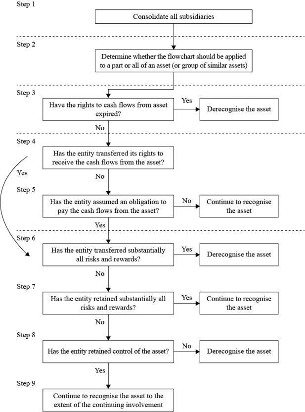

# 44 - Recognition and de-recognition (IFRS 9, IAS 39)

[返回目录](README.md)

# 44 - Recognition and de-recognition (IFRS 9, IAS 39)

Contents

- [44 - Recognition and de-recognition (IFRS 9, IAS 39)](68.md#s282-chap_44_toc_h1)

- [Introduction (paras 44.1- 44.3)](68.md#s283-chap_44_navPoint_1)

- [Initial recognition (paras 44.4 - 44.21)](68.md#s284-chap_44_navPoint_2)

- [Unconditional receivables and payables](68.md#s284-chap_44_navPoint_3)

- [Forwards and options](68.md#s284-chap_44_navPoint_4)

- [Firm commitments to buy or sell non-financial assets](68.md#s284-chap_44_navPoint_5)

- [Planned future transactions](68.md#s284-chap_44_navPoint_6)

- [Regular way transactions](68.md#s284-chap_44_navPoint_7)

- [Trade date versus settlement date accounting](68.md#s284-chap_44_navPoint_8)

- [De-recognition of financial assets (paras 44.22- 44.99)](68.md#s285-chap_44_navPoint_9)

- [Requirements in IAS 39 and IFRS 9 for de-recognition](68.md#s285-chap_44_navPoint_10)

- [Consolidate all subsidiaries (step 1)](68.md#s285-chap_44_navPoint_11)

- [Determine whether the flow chart applies to all or part of an asset (step 2)](68.md#s285-chap_44_navPoint_12)

- [Determine whether the rights to the cash flows from the asset have expired (step 3)](68.md#s285-chap_44_navPoint_13)

- [Determine whether the entity has transferred the cash flows from the asset or assumed an obligation to pay the cash flows from the asset (steps 4 and 5)](68.md#s285-chap_44_navPoint_14)

- [Assumption of obligations to pay cash flows to others (pass-through arrangements)](68.md#s285-chap_44_navPoint_15)

- [Perform risk and rewards analysis (steps 6 and 7)](68.md#s285-chap_44_navPoint_16)

- [Determine whether substantially all the risks and rewards of ownership have been transferred](68.md#s285-chap_44_navPoint_17)

- [Determine whether substantially all the risks and rewards of ownership have been retained](68.md#s285-chap_44_navPoint_18)

- [Perform control analysis (steps 8 and 9)](68.md#s285-chap_44_navPoint_19)

- [Determine whether control of the asset has been retained](68.md#s285-chap_44_navPoint_20)

- [Practical ability to sell the transferred asset](68.md#s285-chap_44_navPoint_21)

- [Continuing involvement in transferred asset](68.md#s285-chap_44_navPoint_22)

- [Accounting by transferee](68.md#s285-chap_44_navPoint_23)

- [Practical application of the de-recognition criteria](68.md#s285-chap_44_navPoint_24)

- [Repurchase price](68.md#s285-chap_44_navPoint_25)

- [Agreement to return substantially the same asset](68.md#s285-chap_44_navPoint_26)

- [Agreement to substitute a similar asset with equal fair value](68.md#s285-chap_44_navPoint_27)

- [Right of first refusal to repurchase at fair value](68.md#s285-chap_44_navPoint_28)

- [Transferee’s right to pledge](68.md#s285-chap_44_navPoint_29)

- [Wash sales](68.md#s285-chap_44_navPoint_30)

- [Security given as collateral](68.md#s285-chap_44_navPoint_31)

- [Securitisations](68.md#s285-chap_44_navPoint_32)

- [Removal of accounts provisions](68.md#s285-chap_44_navPoint_33)

- [Swaps](68.md#s285-chap_44_navPoint_34)

- [Transfers](68.md#s285-chap_44_navPoint_35)

- [Transfers subject to deep out-of-the-money option](68.md#s285-chap_44_navPoint_36)

- [Transfer of readily obtainable assets subject to at-the-money call option](68.md#s285-chap_44_navPoint_37)

- [Transfer of assets subject to a fair value put or call option or a forward repurchase agreement](68.md#s285-chap_44_navPoint_38)

- [Transfer of assets subject to interest-rate swaps](68.md#s285-chap_44_navPoint_39)

- [Call and put options that are deeply in-the-money](68.md#s285-chap_44_navPoint_40)

- [Total return swaps](68.md#s285-chap_44_navPoint_41)

- [Accounting treatment](68.md#s285-chap_44_navPoint_42)

- [Transfers that qualify for de-recognition](68.md#s285-chap_44_navPoint_43)

- [Transferred asset is part of a larger asset](68.md#s285-chap_44_navPoint_44)

- [Servicing assets and liabilities](68.md#s285-chap_44_navPoint_45)

- [Transfers that do not qualify for de-recognition](68.md#s285-chap_44_navPoint_46)

- [Subordinated retained interests and credit guarantees](68.md#s285-chap_44_navPoint_47)

- [Continuing involvement in transferred assets](68.md#s285-chap_44_navPoint_48)

- [Associated liability](68.md#s285-chap_44_navPoint_49)

- [Subsequent measurement](68.md#s285-chap_44_navPoint_50)

- [Continuing involvement through guarantees](68.md#s285-chap_44_navPoint_51)

- [Continuing involvement through options](68.md#s285-chap_44_navPoint_52)

- [Transfer of assets measured at amortised cost](68.md#s285-chap_44_navPoint_53)

- [Transfer of assets measured at fair value](68.md#s285-chap_44_navPoint_54)

- [Continuing involvement in a part of a financial asset](68.md#s285-chap_44_navPoint_55)

- [Retained servicing](68.md#s285-chap_44_navPoint_56)

- [Accounting for collateral](68.md#s285-chap_44_navPoint_57)

- [Accounting by transferee](68.md#s285-chap_44_navPoint_58)

- [De-recognition of financial liabilities (paras 44.100 - 44.119)](68.md#s286-chap_44_navPoint_59)

- [Extinguishment of a financial liability](68.md#s286-chap_44_navPoint_60)

- [General principles](68.md#s286-chap_44_navPoint_idp1698005464)

- [Legal release by the creditor](68.md#s286-chap_44_navPoint_idp1698020056)

- [Extinguishment through transfer of assets that fails de-recognition](68.md#s286-chap_44_navPoint_idp1698022488)

- [Gain or loss arising on extinguishment](68.md#s286-chap_44_navPoint_idp1698035544)

- [Debt to equity swaps](68.md#s286-chap_44_navPoint_idp1698070232)

- [Transactions involving entities within a group](68.md#s286-chap_44_navPoint_idp1698089304)

- [Treatment of costs and fees incurred on debt re-structuring](68.md#s286-chap_44_navPoint_idp1698095576)

- [Illustrative text](69.md#s287-chap_44_navPoint_61)

- [Initial recognition](69.md#s287-chap_44_navPoint_62)

- [Firm commitments to buy or sell non-financial assets](69.md#s287-chap_44_navPoint_idp1698111704)

- [EX 44.7.1 – Firm commitments to buy or sell non-financial assets](69.md#s287-chap_44_navPoint_idp1698110936)

- [FAQ 44.9.1 – Why is an asset or liability recognised for a hedge of a firm commitment?](69.md#s287-chap_44_navPoint_idp1698119000)

- [Regular way transactions](69.md#s287-chap_44_navPoint_63)

- [EX 44.13.1 – Settlement mechanism for regular-way transactions](69.md#s287-chap_44_navPoint_idp1698121944)

- [FAQ 44.15.1 – What is the purpose of the regular way exception?](69.md#s287-chap_44_navPoint_idp1698130776)

- [Trade date versus settlement date accounting](69.md#s287-chap_44_navPoint_idp1698139480)

- [EX 44.18.1 – Regular way purchase of a financial asset](69.md#s287-chap_44_navPoint_idp1698139992)

- [EX 44.18.2 – Regular way sale of a financial asset](69.md#s287-chap_44_navPoint_idp1718392808)

- [Exchange of non-cash financial assets](69.md#s287-chap_44_navPoint_idp1688241176)

- [EX 44.18.3 – Regular way sale of a financial asset for non-cash consideration](69.md#s287-chap_44_navPoint_idp1688241944)

- [De-recognition of financial assets](69.md#s287-chap_44_navPoint_64)

- [Determine whether the flow chart applies to all or part of an asset (step 2)](69.md#s287-chap_44_navPoint_idp1684245288)

- [EX 44.24.1 – Fully proportionate share of specifically identified cash flows](69.md#s287-chap_44_navPoint_idp1684245672)

- [FAQ 44.24.2 – Can a seller identify a receivable net of withholding tax as a specifically identified cash flow?](69.md#s287-chap_44_navPoint_idp1684250280)

- [FAQ 44.25.1 – Can a seller apply the de-recognition rules to the first or the last specified amount of cash flows from a financial asset?](69.md#s287-chap_44_navPoint_idp1684260904)

- [EX 44.25.2 – Sale of an asset subject to a guarantee](69.md#s287-chap_44_navPoint_idp1684275368)

- [EX 44.25.3 – Can a seller apply the de-recognition rules to part of the asset when it sells an asset for part of its life?](69.md#s287-chap_44_navPoint_idp1684289320)

- [FAQ 44.25.4 – Can a seller apply the de-recognition rules to part of the asset when it sells a right to receive dividends (or sells shares but retains the rights to dividends)?](69.md#s287-chap_44_navPoint_idp1684295848)

- [Determine whether the rights to the cash flows from the asset have expired (step 3)](69.md#s287-chap_44_navPoint_idp1684307752)

- [EX 44.27.1 – Expiry of contractual rights to cash flows](69.md#s287-chap_44_navPoint_idp1684312104)

- [EX 44.27.2 – De-recognition of financial assets](69.md#s287-chap_44_navPoint_idp1684319912)

- [EX 44.27.3 – De-recognition of financial asset due to modification of cash flows](69.md#s287-chap_44_navPoint_idp1684356904)

- [Determine whether the entity has transferred the cash flows from the asset or assumed an obligation to pay the cash flows from the asset (steps 4 and 5)](69.md#s287-chap_44_navPoint_idp1684237736)

- [EX 44.28.1 – Transfer of contractual rights to receive cash flows](69.md#s287-chap_44_navPoint_idp1684237096)

- [EX 44.28.2 – Conditions attached to transfers of financial assets](69.md#s287-chap_44_navPoint_idp1688339400)

- [EX 44.28.3 – Retention of servicing rights](69.md#s287-chap_44_navPoint_idp1688359880)

- [EX 44.28.4 – Right of offset on transferred assets](69.md#s287-chap_44_navPoint_idp1688367176)

- [EX 44.28.5 – Transferred assets and credit notes](69.md#s287-chap_44_navPoint_idp1688373064)

- [EX 44.28.6 – Option to repurchase a transferred asset](69.md#s287-chap_44_navPoint_idp1688389320)

- [Assumption of obligations to pay cash flows to others (pass-through arrangements)](69.md#s287-chap_44_navPoint_idp1688395208)

- [EX 44.29.1 – Pass-through arrangements](69.md#s287-chap_44_navPoint_idp1688401096)

- [EX 44.29.2 – De-recognition of loans where pass-through conditions are not met immediately at transaction date](69.md#s287-chap_44_navPoint_idp1688401736)

- [FAQ 44.29.3 – How should fractional shares allocated in a customer’s brokerage account be accounted for by the broker/dealer?](69.md#s287-chap_44_navPoint_idp1688412872)

- [EX 44.30.1 – No obligation to transfer funds not collected](69.md#s287-chap_44_navPoint_idp1688442952)

- [EX 44.30.2 – Potential pass-through arrangements](69.md#s287-chap_44_navPoint_idp1688330696)

- [FAQ 44.30.3 – What can be included in the ‘original asset’?](69.md#s287-chap_44_navPoint_idp1689027704)

- [EX 44.30.4 – Cash flows from transferred assets received in different forms](69.md#s287-chap_44_navPoint_idp1689051384)

- [EX 44.31.1 – Prohibition from selling or pledging the asset](69.md#s287-chap_44_navPoint_idp1689060344)

- [EX 44.32.1 – Obligation to remit cash flows ‘without material delay’](69.md#s287-chap_44_navPoint_idp1689071864)

- [Perform risk and rewards analysis (steps 6 and 7)](69.md#s287-chap_44_navPoint_idp1689078520)

- [Determine whether substantially all the risks and rewards of ownership have been transferred](69.md#s287-chap_44_navPoint_idp1689078648)

- [EX 44.34.1 – Transfer substantially all the risks and rewards](69.md#s287-chap_44_navPoint_idp1689083896)

- [FAQ 44.35.1 – What type of risks and rewards should be considered?](69.md#s287-chap_44_navPoint_idp1689100280)

- [EX 44.35.2 – Impact of certain conditions on risks and rewards](69.md#s287-chap_44_navPoint_idp1689107704)

- [FAQ 44.36.1 – What discount rate should be used when performing a quantitative risks and rewards test?](69.md#s287-chap_44_navPoint_idp1689110904)

- [EX 44.38.1 – Variability in the amounts and timing of cash flows](69.md#s287-chap_44_navPoint_idp1689007736)

- [Determine whether substantially all the risks and rewards of ownership have been retained](69.md#s287-chap_44_navPoint_idp1686742984)

- [EX 44.39.1 – Transactions where risks and rewards are retained](69.md#s287-chap_44_navPoint_idp1686745032)

- [FAQ 44.40.1 – How is a transfer of risks and rewards in a factoring arrangement with recourse determined?](69.md#s287-chap_44_navPoint_idp1686761288)

- [FAQ 44.40.2 – How will factoring or other sales of trade receivables be impacted by COVID-19?](69.md#s287-chap_44_navPoint_idp1686777160)

- [Perform control analysis (steps 8 and 9)](69.md#s287-chap_44_navPoint_idp1686795976)

- [Determine whether control of the asset has been retained](69.md#s287-chap_44_navPoint_idp1686799304)

- [Practical ability to sell the transferred asset](69.md#s287-chap_44_navPoint_idp1686793032)

- [FAQ 44.45.1 – Does a market exist?](69.md#s287-chap_44_navPoint_idp1686792264)

- [EX 44.47.1 – Sale of loan portfolio with credit default guarantee](69.md#s287-chap_44_navPoint_idp1686817224)

- [EX 44.48.1 – Practical ability to sell transferred assets](69.md#s287-chap_44_navPoint_idp1686825160)

- [Continuing involvement in transferred asset](69.md#s287-chap_44_navPoint_idp1686836808)

- [FAQ 44.49.1 – What constitutes continuing involvement?](69.md#s287-chap_44_navPoint_idp1686837192)

- [Practical application of the de-recognition criteria](69.md#s287-chap_44_navPoint_65)

- [Repurchase and stock lending agreements](69.md#s287-chap_44_navPoint_idp1686850888)

- [EX 44.51.1 – Background to repurchase and stock lending agreements](69.md#s287-chap_44_navPoint_idp1686853704)

- [Repurchase price](69.md#s287-chap_44_navPoint_idp1686863944)

- [EX 44.51.2 – Background to stock lending agreements](69.md#s287-chap_44_navPoint_idp1686859848)

- [Sale and repurchase agreements](69.md#s287-chap_44_navPoint_idp1686868296)

- [EX 44.53.1 – Sale and repurchase transaction (gross settled)](69.md#s287-chap_44_navPoint_idp1686876360)

- [EX 44.53.2 – Sale and repurchase transaction (net settled in cash) under IAS 39](69.md#s287-chap_44_navPoint_idp1714297944)

- [Right of first refusal to repurchase at fair value](69.md#s287-chap_44_navPoint_idp1714339288)

- [FAQ 44.57.1 – What happens where a right of first refusal to repurchase is not at fair value?](69.md#s287-chap_44_navPoint_idp1714333528)

- [Security given as collateral](69.md#s287-chap_44_navPoint_idp1714355416)

- [EX 44.61.1 – Security given as collateral](69.md#s287-chap_44_navPoint_idp1714356696)

- [Linkage of transactions into a derivative](69.md#s287-chap_44_navPoint_idp1714358232)

- [EX 44.61.2 – Linkage of transactions into a derivative](69.md#s287-chap_44_navPoint_idp1714361944)

- [EX 44.61.3 – Factoring arrangements](69.md#s287-chap_44_navPoint_idp1714368728)

- [EX 44.61.4 – Securitisations](69.md#s287-chap_44_navPoint_idp1714405848)

- [FAQ 44.62.1 – Will subordinated retained interests and credit guarantees cause the pass-through tests to fail?](69.md#s287-chap_44_navPoint_idp1714417752)

- [Removal of accounts provisions](69.md#s287-chap_44_navPoint_idp1714423768)

- [EX 44.63.1 – Removal of accounts provisions](69.md#s287-chap_44_navPoint_idp1714425432)

- [Swaps](69.md#s287-chap_44_navPoint_idp1714434136)

- [EX 44.64.1 – Swaps](69.md#s287-chap_44_navPoint_idp1714431704)

- [Loan transfers](69.md#s287-chap_44_navPoint_idp1714441688)

- [EX 44.65.1 – Loan transfers](69.md#s287-chap_44_navPoint_idp1714451928)

- [EX 44.65.2 – Loan syndications](69.md#s287-chap_44_navPoint_idp1714468696)

- [EX 44.66.1 – Transfers involving derivatives](69.md#s287-chap_44_navPoint_idp1714474712)

- [Transfers subject to deep out-of-the-money option](69.md#s287-chap_44_navPoint_idp1697272152)

- [EX 44.67.1 – Transfers subject to deep out-of-the-money option](69.md#s287-chap_44_navPoint_idp1697270104)

- [Transfer of readily obtainable assets subject to at-the-money call option](69.md#s287-chap_44_navPoint_idp1697293016)

- [EX 44.68.1 – Transfer of readily obtainable assets subject to at-the-money put option](69.md#s287-chap_44_navPoint_idp1697288664)

- [Transfers that qualify for de-recognition](69.md#s287-chap_44_navPoint_66)

- [FAQ 44.73.1 – When might a financial asset be de-recognised in its entirety?](69.md#s287-chap_44_navPoint_idp1697298520)

- [EX 44.73.2 – Factoring without recourse](69.md#s287-chap_44_navPoint_idp1697364568)

- [EX 44.73.3 – Sale of listed debt securities subject to a call option](69.md#s287-chap_44_navPoint_idp1697379288)

- [Transferred asset is part of a larger asset](70.md#s288-chap_44_navPoint_idp1697425496)

- [EX 44.75.1 – De-recognition of a part of a financial asset](70.md#s288-chap_44_navPoint_idp1697426008)

- [Servicing assets and liabilities](70.md#s288-chap_44_navPoint_idp1697488728)

- [EX 44.78.1 – Servicing assets and liabilities](70.md#s288-chap_44_navPoint_idp1697485400)

- [EX 44.79.1 – Sale of receivable with servicing retained (servicing fee not specified in the contract)](70.md#s288-chap_44_navPoint_idp1697495256)

- [EX 44.79.2 – Sale of receivable with servicing retained (servicing fee specified in the contract)](70.md#s288-chap_44_navPoint_idp1697520344)

- [Transfers that do not qualify for de-recognition](70.md#s288-chap_44_navPoint_67)

- [EX 44.81.1 – Factoring with full recourse](70.md#s288-chap_44_navPoint_idp1687768040)

- [FAQ 44.81.2 – Pass through arrangement of an asset partly guaranteed by the transferor](70.md#s288-chap_44_navPoint_idp1687786344)

- [Subordinated retained interests and credit guarantees](70.md#s288-chap_44_navPoint_idp1687815272)

- [EX 44.82.1 – Subordinated retained interest](70.md#s288-chap_44_navPoint_idp1687820008)

- [Continuing involvement in transferred assets](70.md#s288-chap_44_navPoint_68)

- [Associated liability](70.md#s288-chap_44_navPoint_idp1687823848)

- [EX 44.84.1 – Background to associated liabilities](70.md#s288-chap_44_navPoint_idp1687833192)

- [Continuing involvement through guarantees](70.md#s288-chap_44_navPoint_idp1687842408)

- [EX 44.88.1 – Factoring with limited recourse (late payment risk retained)](70.md#s288-chap_44_navPoint_idp1687843176)

- [EX 44.88.2 – Sale of loans with credit risk guarantee](70.md#s288-chap_44_navPoint_idp1687937000)

- [Continuing involvement through options](70.md#s288-chap_44_navPoint_idp1688522616)

- [Transfer of assets measured at amortised cost](70.md#s288-chap_44_navPoint_idp1688527480)

- [EX 44.92.1 – Asset measured at amortised cost subject to call option held by the transferor](70.md#s288-chap_44_navPoint_idp1688525304)

- [Transfer of assets measured at fair value](70.md#s288-chap_44_navPoint_idp1688606456)

- [EX 44.93.1 – Asset measured at fair value subject to call option held by the transferor](70.md#s288-chap_44_navPoint_idp1688604664)

- [EX 44.94.1 – Asset measured at fair value subject to put option written by the transferor](70.md#s288-chap_44_navPoint_idp1688726520)

- [Continuing involvement in a part of a financial asset](70.md#s288-chap_44_navPoint_idp1711902712)

- [EX 44.96.1 – Continuing involvement in a part of a financial asset](70.md#s288-chap_44_navPoint_idp1711901816)

- [Retained servicing](70.md#s288-chap_44_navPoint_idp1711911160)

- [FAQ 44.97.1 – How should retained servicing be accounted for?](70.md#s288-chap_44_navPoint_idp1711917432)

- [De-recognition of financial liabilities](70.md#s288-chap_44_navPoint_69)

- [Extinguishment of a financial liability](70.md#s288-chap_44_navPoint_idp1711931768)

- [General principles](70.md#s288-chap_44_navPoint_idp1711931512)

- [EX 44.102.1 – General principles for extinguishment of a financial liability](70.md#s288-chap_44_navPoint_idp1711925752)

- [FAQ 44.102.2 - Factors to consider when determining whether a supplier financing arrangement results in the derecognition of the trade payables](70.md#s288-chap_44_navPoint_idp1711933304)

- [EX 44.102.3 – In-substance defeasance](70.md#s288-chap_44_navPoint_idp1711989368)

- [FAQ 44.102.4 – How is the accounting for supplier finance arrangements impacted by COVID-19?](70.md#s288-chap_44_navPoint_idp1711993592)

- [EX 44.102.5 – Presentation of supplier finance arrangements](70.md#s288-chap_44_navPoint_idp1712008696)

- [Legal release by the creditor](70.md#s288-chap_44_navPoint_idp1712028664)

- [EX 44.103.1 – Transfer of debt obligation with legal release](70.md#s288-chap_44_navPoint_idp1712032888)

- [Gain or loss arising on extinguishment](70.md#s288-chap_44_navPoint_idp1712046328)

- [EX 44.106.1 – Gain on extinguishment of debt in full](70.md#s288-chap_44_navPoint_idp1712039544)

- [EX 44.108.1 – De-recognition of part of a liability](70.md#s288-chap_44_navPoint_idp1712074616)

- [FAQ 44.109.1 – Why do entities exchange or modify debt instruments?](70.md#s288-chap_44_navPoint_idp1712092792)

- [EX 44.109.2 – Change in holders and repayment terms](70.md#s288-chap_44_navPoint_idp1712101240)

- [FAQ 44.110.1 – What qualitative and/or quantitative tests are required to determine whether terms are ‘substantially different’?](70.md#s288-chap_44_navPoint_idp1712111608)

- [FAQ 44.110.2 – Who is the ‘existing lender’ where lending is via a syndicate of banks?](70.md#s288-chap_44_navPoint_idp1689205416)

- [EX 44.110.3 – Exchange or modification of only one component](70.md#s288-chap_44_navPoint_idp1689220392)

- [FAQ 44.110.4 – How should the restructuring of an undrawn revolving credit facility be accounted for?](70.md#s288-chap_44_navPoint_idp1689260456)

- [Debt to equity swaps](70.md#s288-chap_44_navPoint_idp1689262120)

- [EX 44.112.1 – Why do entities enter into debt for equity swaps?](70.md#s288-chap_44_navPoint_idp1689262632)

- [FAQ 44.112.2 – Why do entities enter into debt for equity swaps?](70.md#s288-chap_44_navPoint_idp1689295400)

- [EX 44.114.1 – Exchange of debt instrument for a modified debt instrument and equity shares](70.md#s288-chap_44_navPoint_idp1689305768)

- [Transactions involving entities within a group](70.md#s288-chap_44_navPoint_idp1689356456)

- [FAQ 44.116.1 – How should transactions involving entities within a group be accounted for?](70.md#s288-chap_44_navPoint_idp1689357352)

- [Treatment of costs and fees incurred on debt re-structuring](70.md#s288-chap_44_navPoint_idp1689363368)

- [FAQ 44.117.1 – In a debt modification that does not result in de-recognition, what costs or fees are spread forward by adjusting the effective interest rate in accordance with paragraph 5.4.3 of IFRS 9?](70.md#s288-chap_44_navPoint_idp1689359400)

- [EX 44.117.2 – Renegotiation of debt under IFRS 9](70.md#s288-chap_44_navPoint_idp1689389224)

- [FAQ 44.117.3 – In a debt modification that results in de-recognition, can any costs or fees be treated as transaction costs and spread forward by adjusting the effective interest rate under IFRS 9?](70.md#s288-chap_44_navPoint_idp1698535400)

This eBook is licensed to peggy so, peggy.so@hk.ey.com, 

## Introduction (paras 44.1- 44.3)

 

Entities with financial asset and financial liability modifications in the context of IBOR reform should consider Phase 2 Interest Rate Benchmark Reform Amendments to IFRS 9, IAS 39, IFRS 7, IFRS 4 and IFRS 16. Refer to [Appendix 3 para A3.39](88.md#s379-Para_A3.39) for the Phase 2 amendments issued in August 2020.

  

**44.1**The recognition and de-recognition requirements of IAS 39 were not changed when they were incorporated into IFRS 9, other than that a paragraph was added into IFRS 9 clarifying when a financial asset should be written off (see [para 44.27](68.md#s285-Para_44.27)). This chapter therefore covers the requirements of both standards. However, in respect of the related area of modifications, in 2017 the IASB confirmed how modifications of financial liabilities that do not result in de-recognition should be treated under IFRS 9, which might result in a change in practice from IAS 39. See chapter 42 for further guidance on this area.

**44.2** The contractual provisions underlying financial assets or financial liabilities determine the rights or obligations (see [chapter 40 para 14](61.md#s250-Para_40.14)). An entity only recognises a financial asset or a financial liability at the time it becomes a party to a contract because that is the point at which it has contractual rights or obligations.

[IAS 39 para 14]. [IFRS 9 para 3.1.1].

**44.3** An entity considers whether it still has an asset or liability when considering de-recognition The entity determines whether the rights or obligations contained in the original asset or liability cease to be contractual rights or obligations.

[IAS 39 para 14]. [IFRS 9 para 3.1.1].

 

This eBook is licensed to peggy so, peggy.so@hk.ey.com, 

## Initial recognition (paras 44.4 - 44.21)

### Unconditional receivables and payables

 

**44.4** Unconditional receivables and payables are recognised as assets or liabilities when the entity becomes a party to the contract and has a legal right to receive or a legal obligation to pay cash.

[IAS 39 para AG35(a)]. [IFRS 9 App B para B3.1.2(a)].

 

### Forwards and options

 

**44.5** An entity that becomes a party to a forward contract within IAS 39/IFRS 9’s scope, becomes exposed to risks and benefits at the contract commitment date, rather than on the date on which settlement takes place. At the commitment date, the fair values of the right and obligation are often equal, so that the net fair value of the forward contract is zero. If the net fair value of the right and obligation is not zero at inception, the contract is recognised as an asset or liability. A forward contract that has a zero fair value at inception could become a net asset or liability in the future, depending on the value of the underlying instrument or commodity that is the subject of the forward.

[IAS 39 para AG35(c)]. [IFRS 9 App B para B3.1.2(c)].

**44.6** Option contracts within IAS 39/IFRS 9’s scope are recognised as assets or liabilities when the holder or writer becomes a party to the contract. Evidence that entities have become parties to the contract is that the option holder usually pays, and the option writer usually receives, a premium for the contract. The premium indicates that the rights and obligations undertaken by each party have value at that date.

[IAS 39 para AG35(d)]. [IFRS 9 App B para B3.1.2(d)].

 

### Firm commitments to buy or sell non-financial assets

 

**44.7** An entity that enters into a firm commitment to purchase a non-financial asset in the future, does not yet have the contractual rights to that asset. The entity cannot use that asset, sell it or pledge it as collateral until the contract matures and the underlying asset is acquired. Therefore, assets to be acquired and liabilities to be incurred as a result of a firm commitment to purchase or sell goods or services are generally not recognised as assets or liabilities until at least one of the parties has performed under the agreement.

[IAS 39 para AG35(b)]. [IFRS 9 App B para B3.1.2(b)].

[EX 44.7.1 – Firm commitments to buy or sell non-financial assets](69.md#s287-EX44.7.1)  
  
[EX 44.61.3 – Factoring arrangements](69.md#s287-EX44.61.3)

**44.8** Contracts to buy or sell non-financial assets that can be settled net or by exchanging financial instruments are treated as if they are financial instruments (see [chapter 40 para 80](61.md#s252-Para_40.80)). Those financial instruments are derivatives, unless they were entered into and continue to be held to meet the entity’s normal purchase, sale or usage requirements. The net fair value of the contract itself is recognised as an asset or liability at the commitment date if the instrument is a derivative.

**44.9** If a previously unrecognised firm commitment is designated as a hedged item in a fair value hedge, any change in the net fair value attributable to the hedged risk should be recognised as an asset or liability after the inception of the hedge (see chapter 6.8A para 114 and [chapter 46 para 11](74.md#s296-Para_46.11)).

[IAS 39 para AG35(b)]. [IFRS 9 App B para B3.1.2(b)].

[FAQ 44.9.1 – Why is an asset or liability recognised for a hedge of a firm commitment?](69.md#s287-FAQ_44.9.1)

 

### Planned future transactions

 

**44.10** Planned future transactions, no matter how likely, cannot give rise to financial assets and liabilities because the entity has not become a party to a contract. Future transactions are events to be recognised in the future periods when contractual rights are acquired or obligations incurred.

[IAS 39 para AG35(e)]. [IFRS 9 App B para B3.1.2(e)].

 

### Regular way transactions

 

**44.11** A regular way purchase or sale is a purchase or sale of a financial asset under a contract whose terms require delivery of the asset within a certain time frame. That timeframe is generally established by regulation or convention in the marketplace concerned.

[IAS 39 para 9]. [IFRS 9 App A].

**44.12** A marketplace is the environment in which a financial asset is customarily exchanged and is not limited to a formal stock exchange or organised over-the-counter market. An acceptable time frame in a marketplace is the period reasonably and customarily required for the parties to complete the transaction, and to prepare and execute closing documents.

[IAS 39 para IG B28]. [IFRS 9 para IG B28].

**44.13** A settlement mechanism exists in many regulated financial markets, with transactions in financial instruments (particularly quoted equities and bonds) settled a few days after the transaction date. The date on which the transaction is entered into is called the ‘trade date’. It is the date on which the entity commits to purchase or sell an asset. The date on which the transaction is settled by delivery of the underlying asset is called the ‘settlement date’.

[IAS 39 para IG B28]. [IFRS 9 para IG B28].

[EX 44.13.1 – Settlement mechanism for regular-way transactions](69.md#s287-EX44.13.1)

**44.14**A contract to buy or sell a financial asset with an individual or through a broker that is normally traded on a regulated financial market, but with a settlement period that differs from that established by regulation or convention in that financial marketplace, does not qualify as a regular way transaction.

[IAS 39 para IG B29]. [IFRS 9 para IG B29].

**44.15** A regular way purchase or sale that results in a fixed-price commitment between trade date and settlement date is a derivative – a forward contract. A regular way purchase or sale would be recognised as a forward contract at the commitment date – that is, the trade date (see [para 44.5](68.md#s284-Para_44.5)). The short duration of the commitment means that such contracts are not recognised as derivative financial instruments under IAS 39/IFRS 9 (see paras [44.2](68.md#s283-Para_44.2) to [44.23](68.md#s285-Para_44.23)). This is an exception to normal recognition rules.

[IAS 39 para AG12]. [IFRS 9 App B para BA.4].

[FAQ 44.15.1 – What is the purpose of the regular way exception?](69.md#s287-FAQ_44.15.1)

**44.16** The regular way exception requires that the transaction will be settled by physical delivery of the financial instrument within the normal market time frame. A contract that permits net settlement in cash or other financial assets equivalent to the change in the contract’s fair value does not qualify as a regular way transaction. These contracts are accounted for as a derivative in the period between trade and settlement date. Contracts that are settled outside the normal market time frame, whether settled net in cash or gross, will always be accounted for as derivatives.

[IAS 39 para AG54]. [IFRS 9 para 3.1.4].

 

### Trade date versus settlement date accounting

 

**44.17** A regular way purchase or sale of financial assets should be recognised and de-recognised using trade date accounting or settlement date accounting. Either method is acceptable. It is an accounting policy choice that should be disclosed and applied consistently for all purchases and sales that belong to the same category of financial assets (see chapter 6.4A para 3 and [chapter 42 para 5](63.md#s265-Para_42.5)).

[IAS 39 para AG53]. [IFRS 9 App B para B3.1.3].

**44.18** Trade date accounting (that is, the date on which an entity commits itself to purchase or sell an asset) is as follows:

- The asset received and the liability to pay for it are recognised on the trade date for a purchase of a financial asset. The financial asset is subsequently measured at amortised cost or at fair value depending on its initial classification (see chapter 6.7A para 24 and [chapter 42 para 10](63.md#s265-Para_42.10)).

- The asset is de-recognised, and the receivable from the buyer for the payment (together with any gain or loss on disposal) are recognised on the trade date for a sale of a financial asset.

Generally, interest does not start to accrue on the asset and corresponding liability until settlement date when title passes.

[IAS 39 para AG55]. [IFRS 9 App B para B3.1.5].

[EX 44.18.1 – Regular way purchase of a financial asset](69.md#s287-EX44.18.1)  
  
[EX 44.18.2 – Regular way sale of a financial asset](69.md#s287-EX44.18.2)  
  
[EX 44.18.3 – Regular way sale of a financial asset for non-cash consideration](69.md#s287-EX44.18.3)

**44.19** Settlement date accounting (that is, the date on which an asset is delivered to or by an entity), is as follows:

- For a purchase of a financial asset, the asset is recognised on the day it is received by the entity. Any change in the asset’s fair value to be received during the period between the trade date and the settlement date is accounted for in the same way as the acquired asset:

- for assets carried at cost or amortised cost, the change in value is not recognised;

- for assets classified as financial assets at fair value through profit or loss, the change in value is recognised in profit or loss; and

- for assets measured at fair value through other comprehensive income, the change in value is recognised in other comprehensive income.

- On the sale of a financial asset, it is de-recognised and the receivable from the buyer for the payment (together with any gain or loss on disposal) are recognised on the day that the asset is delivered by the entity. Any change in the fair value of the asset between trade date and settlement date is not recognised, because there is an agreed sale price at the trade date. The seller’s right to changes in the fair value ceases on the trade date so subsequent changes in fair value are irrelevant from the seller’s perspective.

[IAS 39 para AG56]. [IFRS 9 App B para B3.1.6].

**44.20** IAS 39/IFRS 9 does not contain any specific requirements about trade date accounting and settlement date accounting for transactions in financial instruments that are classified as financial liabilities. The general recognition and de-recognition requirements for financial liabilities in IAS 39/IFRS 9 therefore apply.

[IAS 39 para IG B32]. [IFRS 9 para IG B32].

**44.21**Liabilities are recognised on the date when the entity ‘becomes a party to the contractual provisions of the instrument’ (see [para 44.2](68.md#s283-Para_44.2)). Financial liabilities are de-recognised only when they are extinguished – that is, when the obligation specified in the contract is discharged or cancelled or expires (see [para 44.104](68.md#s286-Para_44.104)).

[IAS 39 para 14]. [IAS 39 para 39]. [IFRS 9 para 3.1.1]. [IFRS 9 para 3.3.1].

 

This eBook is licensed to peggy so, peggy.so@hk.ey.com, 

## De-recognition of financial assets (paras 44.22- 44.99)

### Requirements in IAS 39 and IFRS 9 for de-recognition

 

**44.22** There is one set of requirements that apply to the de-recognition of all financial assets, from the simple maturity of an instrument to the more complex securitisation transactions. The standard provides a flow chart that summarises these requirements for evaluating whether, and to what extent, a financial asset is de-recognised. Every transaction should be analysed using the strict sequence set out in the flow chart. There are two separate approaches to de-recognition under IFRS: the ‘risks and rewards’ approach and the ‘control’ approach. The control approach is only used where the risks and rewards approach does not provide a clear answer. So the risks and rewards approach should be evaluated first.

  
 [IAS 39 para AG36]. [IFRS 9 App B para B3.2.1].

 

### Consolidate all subsidiaries (step 1)

 

**44.23** Many entities establish structured entities, trusts, partnerships, etc. to acquire financial assets before these financial assets, or a portion thereof, are transferred to third-party investors. The transfer of financial assets to such an entity might qualify as a legal sale. However, if the substance of the relationship between the transferor and the structured entity indicates that the transferor controls the structured entity, the transferor should consolidate the structured entity. Entities should determine whether it is the consolidated or the individual entity that is considering whether to de-recognise the financial asset. If it is the consolidated entity, the entity should first consolidate all subsidiaries, including any structured entities, in accordance with IFRS 10 (see [chapter 26 para 171](45.md#s173-Para_26.171)). It should then apply the de-recognition analysis to the resulting group. If it is the individual entity preparing separate financial statements this step will not need to be considered.

[IAS 39 para 15]. [IFRS 9 para 3.2.1].

 

### Determine whether the flow chart applies to all or part of an asset (step 2)

 

**44.24** Determine whether the analysis should be applied to a part of a financial asset (or part of a group of similar financial assets) or to a financial asset in its entirety (or a group of similar assets in their entirety). De-recognition rules should be applied to a part of a financial asset (or part of a group of similar financial assets) if, and only if, the part being considered for de-recognition meets one of the following conditions:

- The part comprises only specifically identified cash flows from a financial asset (or a group of similar financial assets).

- The part comprises only a fully proportionate (pro rata) share of the cash flows from a financial asset (or a group of similar financial assets).

- The part comprises only a fully proportionate (pro rata) share of specifically identified cash flows from a financial asset (or a group of similar financial assets).

[IAS 39 para 16(a)]. [IFRS 9 para 3.2.2(a)].

[EX 44.24.1 – Fully proportionate share of specifically identified cash flows](69.md#s287-EX44.24.1)  
[FAQ 44.24.2 – Can a seller identify a receivable net of withholding tax as a specifically identified cash flow ?](69.md#s287-FAQ_44.24.2)

**44.25**The de-recognition rules must be applied to the financial asset in its entirety (or to the group of similar financial assets in their entirety) if it is not possible to identify part of a financial asset.

[IAS 39 para 16(b)]. [IFRS 9 para 3.2.2(b)].

[FAQ 44.25.1 – Can a seller apply the de-recognition rules to the first or the last specified amount of cash flows from a financial asset?](69.md#s287-FAQ_44.25.1)  
[EX 44.25.2 – Sale of an asset subject to a guarantee](69.md#s287-EX44.25.2)  
  
[EX 44.25.3 – Can a seller apply the de-recognition rules to part of the asset when it sells an asset for part of its life?](69.md#s287-EX44.25.3)   
  
[FAQ 44.25.4 – Can a seller apply the de-recognition rules to part of the asset when it sells a right to receive dividends (or sells shares but retains the rights to dividends)?](69.md#s287-FAQ_44.25.4)

**44.26** Once it has been established that the de-recognition rules should be applied to the whole asset (or a group of similar assets) or to the qualifying part or portion, the remaining steps of the flow chart should be applied to that whole or part identified; is referred to as ‘the financial asset’ in the paragraphs that follow.

[IAS 39 para 16(b)]. [IFRS 9 para 3.2.2(b)].

 

### Determine whether the rights to the cash flows from the asset have expired (step 3)

 

**44.27**Step 3 considers whether the contractual rights to the cash flows from the financial asset have expired. If they have, the financial asset is de-recognised. In particular, an entity should directly reduce the gross carrying amount of a financial asset where it has no reasonable expectations of recovering a financial asset in its entirety or a portion thereof. A write-off constitutes a de-recognition event.

[IAS 39 para 17(a)]. [IFRS 9 para 3.2.3(a)]. [IFRS 9 para 5.4.4].

[EX 44.27.1 – Expiry of contractual rights to cash flows](69.md#s287-EX44.27.1)  
  
[EX 44.27.2 – De-recognition of financial assets](69.md#s287-EX44.27.2)  
  
[EX 44.27.3 – De-recognition of financial asset due to modification of cash flows](69.md#s287-EX44.27.3)  
[FAQ 42.35.1 – Interplay between SPPI test and de-recognition](64.md#s271-FAQ_42.35.1)

 

### Determine whether the entity has transferred the cash flows from the asset or assumed an obligation to pay the cash flows from the asset (steps 4 and 5)

 

**44.28** If the contractual rights to the cash flows have not expired, an entity assesses if it transfers the cash flows from the asset. Transfer can be achieved only if one of two conditions is met:

- The entity transfers the contractual rights to receive the financial asset’s cash flows.

- The entity retains the contractual rights to receive the financial asset’s cash flows, but it assumes a contractual obligation to pay the cash flows to one or more recipients. This is often referred to as a ‘pass-through arrangement’.

[IAS 39 para 18]. [IFRS 9 para 3.2.4].

[EX 44.28.1 – Transfer of contractual rights to receive cash flows](69.md#s287-EX44.28.1)  
  
[EX 44.28.2 – Conditions attached to transfers of financial assets](69.md#s287-EX44.28.2)  
[EX 44.28.3 – Retention of servicing right](69.md#s287-EX44.28.3)  
  
[EX 44.28.4 – Right of offset on transferred assets](69.md#s287-EX44.28.4)  
  
[EX 44.28.5 – Transferred assets and credit notes](69.md#s287-EX44.28.5)  
  
[EX 44.28.6 – Option to repurchase a transferred asset](69.md#s287-EX44.28.6)

 

### Assumption of obligations to pay cash flows to others (pass-through arrangements)

 

**44.29** Pass-through arrangements arise where the entity continues to collect cash receipts from a financial asset or, more typically, a pool of financial assets. The entity also assumes an obligation to pass on those receipts to another party, the eventual recipient, which has provided finance in connection with the financial asset. Three conditions (set out in the following paragraphs) have to be met for a transferor to conclude that a pass-through arrangement meets the criteria for a transfer of a financial asset. The financial assets remain on the balance sheet if any one of these conditions is not met. If the criteria are met the entity will also need to assess whether sufficient risks and rewards have been transferred.

[EX 44.29.1 – Pass-through arrangements](69.md#s287-EX44.29.1)

[EX 44.29.2 – De-recognition of loans where pass-through conditions are not met immediately at transaction date](69.md#s287-EX44.29.2)

[FAQ 44.29.3 – How should fractional shares allocated in a customer’s brokerage account be accounted for by the broker/dealer?](69.md#s287-FAQ_44.29.3)

**44.30** The first condition is that the entity has no obligation to pay amounts to the eventual recipients, unless it collects equivalent amounts from the original asset. Short-term advances by the entity to the eventual recipients with the right of full recovery of the amount lent plus accrued interest from the amounts eventually payable to the eventual recipients at market rates do not violate this condition.

[IAS 39 para 19(a)]. [IFRS 9 para 3.2.5(a)].

[EX 44.30.1 – No obligation to transfer funds not collected](69.md#s287-EX44.30.1)  
  
[EX 44.30.2 – Potential pass-through arrangements](69.md#s287-EX44.30.2)  
  
[FAQ 44.30.3 – What can be included in the ‘original asset’? ](69.md#s287-FAQ_44.30.3)  
  
[EX 44.30.4 – Cash flows from transferred assets received in different forms](69.md#s287-EX44.30.4)

**44.31** The second condition is that the entity is prohibited by the transfer contract’s terms from selling or pledging the original asset other than as security to the eventual recipients for the obligation to pay them cash flows.

[IAS 39 para 19(b)]. [IFRS 9 para 3.2.5(b)]. 

[EX 44.30.2 – Potential pass-through arrangements](69.md#s287-EX44.30.2)  
   
[EX 44.31.1 – Prohibition from selling or pledging the asset](69.md#s287-EX44.31.1)

**44.32** The third condition is that the entity has an obligation to remit any cash flows that it collects on behalf of the eventual recipients without material delay. The transferor is not entitled to reinvest such cash flows, except in cash or cash equivalents (as defined in IAS 7) during the short settlement period from the collection date to the date of required remittance to the eventual recipients. Any interest earned on such investments must be passed to the eventual recipients.

[IAS 39 para 19(c)]. [IFRS 9 para 3.2.5(c)].

[EX 44.30.2 – Potential pass-through arrangements](69.md#s287-EX44.30.2)  
 

[EX 44.30.4 – Cash flows from transferred assets received in different forms](69.md#s287-EX44.30.4)  
 

[EX 44.32.1 – Obligation to remit cash flows ‘without material delay’](69.md#s287-EX44.32.1)

 

### Perform risk and rewards analysis (steps 6 and 7)

 

**44.33** Once an entity has established that it has transferred a financial asset, either by transferring the contractual rights to receive the cash flows or under a qualifying pass-through arrangement, it carries out the risks and rewards test. This test requires the entity to evaluate whether it has:

- transferred substantially all the financial asset’s risks and rewards of ownership ([para 44.38](68.md#s285-Para_44.38));

- retained substantially all the risks and rewards of ownership ([para 44.43](68.md#s285-Para_44.43)); or

- neither transferred nor retained substantially all the risks and rewards of ownership. If this is the case, the entity should perform a control analysis ([para 44.45](68.md#s285-Para_44.45)) to ascertain which party has control of the asset.

[IAS 39 para 20]. [IFRS 9 para 3.2.6].

 

### Determine whether substantially all the risks and rewards of ownership have been transferred

 

**44.34** The entity must de-recognise the financial asset if it transfers substantially all the risks and rewards of ownership of the asset. It might also have to recognise separately as assets and liabilities any rights and obligations created or retained in the transfer (see [para 44.83](68.md#s285-Para_44.83)).

[IAS 39 para 20(a)]. [IFRS 9 para 3.2.6(a)].

[EX 44.34.1 – Transfer substantially all the risks and rewards](69.md#s287-EX44.34.1)

**44.35** An entity that has transferred substantially all the risks and rewards of ownership of the transferred asset as a result of the transfer, does not recognise the transferred asset again in a future period. However, it would recognise the transferred asset if it re-acquires it in a new transaction.

[IAS 39 para AG41]. [IFRS 9 App B para B3.2.6].

[FAQ 44.35.1 – What types of risks and rewards should be considered? ](69.md#s287-FAQ_44.35.1)  
  
[EX 44.35.2 – Impact of certain conditions on risks and rewards](69.md#s287-EX44.35.2)

**44.36**The transfer of substantially all the risks and rewards of ownership will generally be apparent from the terms and conditions of the transfer. If the transfer is not obvious, the entity needs to compare its exposure to the variability in the present value of the transferred asset’s future net cash flows before and after the transfer. The net cash flows of the transferred assets should be determined on a basis consistent with the ‘original asset’. The computation and comparison should be made using an appropriate current market interest rate as the discount rate. All reasonably possible variability in net cash flows (as to amount and timing) should be considered. The amounts and timing of cash flows should be probability weighted.

[IAS 39 para 22]. [IFRS 9 para 3.2.8].

[FAQ 44.30.3 – What can be included in the ‘original asset’?](69.md#s287-FAQ_44.30.3)  
[FAQ 44.36.1 – What discount rate should be used when performing a quantitative risks and rewards test?](69.md#s287-FAQ_44.36.1)

**44.37** The contractual arrangement might result in the entity’s exposure to variability in net cash flows no longer being significant in relation to the total variability in the present value of the future net cash flows from the financial asset. The entity is regarded as having transferred substantially all the financial asset’s risks and rewards of ownership. Variability is a relative and not an absolute test. Therefore, de-recognition is not achieved solely if the entity’s remaining exposure to an asset’s risks and rewards is small in absolute terms.

[IAS 39 para 21]. [IFRS 9 para 3.2.7].

**44.38**No guidance is provided to establish what ‘significant’ variability is when comparing the difference between the present value of the cash flows from the financial asset before the transfer with the present value of the cash flows after the transfer. Therefore, judgement is needed. A numerical computation is not necessarily required, because it might be obvious whether the entity has transferred substantially all the risks and rewards of ownership.

[IAS 39 para 22]. [IFRS 9 para 3.2.8].

[EX 44.38.1 – Variability in the amounts and timing of cash flows](69.md#s287-EX44.38.1)

 

### Determine whether substantially all the risks and rewards of ownership have been retained

 

**44.39** If the entity retains substantially all the risks and rewards of ownership of the asset, it continues to recognise the asset.

[IAS 39 para 20(b)]. [IFRS 9 para 3.2.6(b)].

[EX 44.39.1 – Transactions where risks and rewards are retained](69.md#s287-EX44.39.1)

**44.40** The comparison of the variability of the transferred asset’s cash flows before and after the transfer might show that the entity’s exposure to the variability (see [para 44.41](68.md#s285-Para_44.41)) does not change significantly as a result of the transfer. The entity is regarded as having retained substantially all the risks and rewards of the asset’s ownership, and it continues to recognise the asset.

[IAS 39 para 21]. [IFRS 9 para 3.2.7].

[FAQ 44.40.1 – How is a transfer of risks and rewards in a factoring arrangement with recourse determined?](69.md#s287-FAQ_44.40.1)  
[FAQ 44.40.2 – How will factoring or other sales of trade receivables be impacted by COVID-19?](69.md#s287-FAQ_44.40.2)

 

### Perform control analysis (steps 8 and 9)

### Determine whether control of the asset has been retained

 

**44.41** An entity (transferor) that has retained some risks and rewards, but not substantially all of them, is in a middle ground in which the risks and rewards analysis does not provide a clear answer. The transferor then has to determine whether it has retained control of the asset:

- If the transferor has not retained control, it must de-recognise the financial asset and recognise separately, as assets or liabilities, any rights and obligations created or retained in the transfer.

- If the entity has retained control, it must continue to recognise the financial asset to the extent of its continuing involvement in the financial asset ([para 44.53](68.md#s285-Para_44.53)).

[IAS 39 para 20(c)]. [IFRS 9 para 3.2.6(c)].

**44.42** Control is based on whether the transferee has the practical ability to sell the transferred asset. Control, in this context, does not have the same meaning as in IFRS 10 (see [chapter 26 para 5](45.md#s169-Para_26.5)).

[IAS 39 para 23]. [IFRS 9 para 3.2.9].

**44.43** The ability to sell a transferred asset looks to what the transferee, and not the transferor, can do with the asset. This concept of control tries to identify whether the transferor continues to be exposed to the variability in the cash flows of the particular asset that was the subject of the transfer. This is different from having risks of a general nature, similar to a derivative. If the transferee has the practical ability to sell the transferred asset, it has control over the asset and the transferor has lost control. If the transferee does not have the practical ability to sell the transferred asset, the transferor has retained control of the transferred asset.

[IAS 39 para AG42]. [IFRS 9 App B para B3.2.7].

 

### Practical ability to sell the transferred asset

 

**44.44**The transferee has the ‘practical ability’ to sell the transferred asset if:

- it can sell the asset in its entirety to an unrelated third party; and

- it is able to exercise that ability unilaterally and without imposing additional restrictions.

These conditions should be evaluated by considering what the transferee is able to do in practice, and not what contractual rights it has with respect to the transferred asset (or, indeed, what contractual prohibition exists).

[IAS 39 para AG43]. [IFRS 9 App B para B3.2.8].

**44.45** The transferee might have a contractual right to dispose of the transferred asset. That right will have little practical effect if there is no market for the transferred asset.

[IAS 39 para AG43(a)]. [IFRS 9 App B para B3.2.8(a)].

FAQ 44.45.1 – Does a market exist?

**44.46**It might also be necessary to determine if the market is an active market where the transferor has an option to repurchase the asset so the transferee might be required to return it. The transferee will have the practical ability to sell the transferred asset if there is an active market in that asset. The transferee could repurchase the transferred asset in the market if it needs to return the asset to the entity.

[IAS 39 para AG42]. [IFRS 9 App B para B3.2.7].

**44.47** The transferee should also be able to exercise its ability to transfer the asset independently of the actions of others. The transferor should not impose additional restrictions or ‘strings’ to the transfer.

[IAS 39 para AG43(b)(i)]. [IFRS 9 App B para B3.2.8(b)(i)].

EX 44.47.1 – Sale of loan portfolio with credit default guarantee

**44.48** If the transferor writes a put option or provides a guarantee of the original asset the transfer will also often fail the control test. The transferee has effectively obtained two assets. The first is the original asset that is the subject of the transfer. The second is the put option or the guarantee. The transferee will only be able to realise the asset’s value by selling a similar guarantee or put option with the assets, in the absence of an active market. If the put option or guarantee is valuable to the transferee, the transferee would not, in practice, sell the transferred asset to a third party without attaching a similar option or guarantee. The ‘practical ability to sell’ test fails because the transferee is constrained from selling the asset without attaching additional restrictions. Control of the transferred asset is retained by the transferor.

[IAS 39 para AG44]. [IFRS 9 App B para B3.2.9].

EX 44.48.1 – Practical ability to sell transferred assets

 

### Continuing involvement in transferred asset

 

**44.49** The continuing involvement approach applies if:

- the entity has not transferred or retained substantially all the risks and rewards of ownership; and

- control has not passed to the transferee.

The entity continues to recognise part of the asset under the continuing involvement approach, and that part represents the extent of its continuing exposure to the risks and rewards of the financial asset.

[IAS 39 para 30]. [IFRS 9 para 3.2.16].

[FAQ 44.49.1 – What constitutes continuing involvement?](69.md#s287-FAQ_44.49.1)

 

### Accounting by transferee

 

**44.50** Transferees are required to follow IAS 39/IFRS 9’s recognition principles. The accounting treatment between the transferor and the transferee is expected to be symmetrical. Therefore, to the extent that a transfer of a financial asset does not qualify for de-recognition, the transferee does not recognise the transferred asset as its asset. The transferee de-recognises the cash or other consideration paid, and it recognises a receivable from the transferor. If the transferor has both a right and an obligation to re-acquire control of the entire transferred asset for a fixed amount (such as under a repurchase agreement), the transferee could classify its receivable as a ‘loan and receivable’ under IAS 39 or measure it at amortised cost under IFRS 9 if it meets the requirements for such measurement (see [chapter 42 para 10](63.md#s265-Para_42.10)). If a transfer of a financial asset qualifies for de-recognition, the transferor will treat it as a sale and the transferee will treat it as a purchase.

[IAS 39 para AG50]. [IFRS 9 App B para B3.2.15].

 

### Practical application of the de-recognition criteria

**Repurchase and stock lending agreements**

**44.51** The motivation to enter into a securities lending transaction is different from a repurchase agreement. The transactions might also differ in form and risk protection but they are similar in substance. IAS 39/IFRS 9, therefore, does not distinguish between the two types in determining whether the transferred asset qualifies for de-recognition.

[IAS 39 para AG51(a)–(c)]. [IFRS 9 para B3.2.16(a)–(c)].

[EX 44.51.1 – Background to repurchase and stock lending agreements ](69.md#s287-EX44.51.1)  
[EX 44.51.2 – Background to stock lending agreements](69.md#s287-EX44.51.2)

**44.52**There is typically a legal sale of the underlying assets in repurchase and stock lending agreements. The transferor has transferred the contractual rights to receive the cash flows of the financial assets and there is a transfer that meets the IAS 39/IFRS 9 criteria.

[IAS 39 para 18(a)]. [IFRS 9 para 3.2.4(a)].

**44.53** A repurchase agreement might contain a provision that allows the transferor to settle net in cash. The transferor settles the transaction net in cash by paying or receiving the difference between the fair value of the asset at the date of repurchase and the fixed repurchase price, instead of taking physical delivery of the asset. The fact that the transferor is able to settle the transaction net in cash does not automatically mean that the transferor has lost control of the asset. The transferor must still pass the ‘risks and rewards’ test, as well as the control test, before the transferor can de-recognise the transferred asset

[IAS 39 para AG51(k)]. [IFRS 9 para B3.2.16(k)].

[EX 44.53.1 – Sale and repurchase transaction (gross settled)](69.md#s287-EX44.53.2)  
[EX 44.53.2 – Sale and repurchase transaction (net settled in cash)](69.md#s287-EX44.53.2)

### Repurchase price

 

**44.54**A repurchase agreement will require the transferor to repurchase the transferred asset at a particular price. The price might be fixed at the outset, or it might be the market price at the time of the repurchase. De-recognition depends on the pricing arrangement. If the financial asset is loaned or sold under an agreement to repurchase at fair value at the date of repurchase, the transferred asset is de-recognised. The transferor has transferred substantially all the risk and rewards of ownership of the transferred asset. If the financial asset is loaned or sold under an agreement to repurchase the asset at a fixed price or at a price that provides a lender’s return on the sale price, the transferred asset is not de-recognised. The transferor retains substantially all the risks and rewards of ownership of the transferred asset.

[IAS 39 para AG51(a)]. [IAS 39 para AG51(j)]. [IFRS 9 App B para B3.2.16(j)]. [IFRS 9 App B para B3.2.16(a)].

 

### Agreement to return substantially the same asset

 

**44.55** A repurchase or stock lending agreement might require the transferor to accept assets in return that are substantially the same as those initially transferred. The term ‘substantially the same’ is not defined. It is generally understood to mean that the financial assets returned or repurchased must be identical in form and type and have identical maturities and contractual interest rates. They provide the same rights as the asset transferred. The transferor retains substantially all the risks and rewards of ownership, because there is no economic difference between the asset initially transferred and the asset to be re-acquired

[IAS 39 para AG51(b)]. [IFRS 9 App B para B3.2.16(b)].

 

### Agreement to substitute a similar asset with equal fair value

 

**44.56** A repurchase or stock lending agreement might give the transferee the right to substitute a similar asset of equal fair value at the repurchase date. There is no economic difference in substance between returning the original asset or a similar asset of equal fair value. The transferor retains substantially all the risks and rewards of ownership.

[IAS 39 para AG51(c)]. [IFRS 9 App B para B3.2.16(c)].

 

### Right of first refusal to repurchase at fair value

 

**44.57** An entity that sells a financial asset, and retains only a right of first refusal to repurchase the transferred asset at fair value, de-recognises the asset because it has transferred substantially all the risks and rewards of ownership.

[IAS 39 para AG51(d)]. [IFRS 9 App B para B3.2.16(d)].

[FAQ 44.57.1 – What happens where a right of first refusal to repurchase is not at fair value?](69.md#s287-FAQ_44.57.1)

 

### Transferee’s right to pledge

 

**44.58** A repurchase or securities lending agreement could give the transferee the right to sell or pledge the transferred asset during the term of the repurchase agreement. If the transferor continues to recognise the asset, it should reclassify the asset on its balance sheet (for example, as a loaned asset or repurchase receivable).

[IAS 39 para AG51(a)]. [IFRS 9 App B para B3.2.16(a)].

**44.59** Generally, the transferee’s right to sell or pledge the transferred asset effectively indicates that the transferee has control of the asset. De-recognition is appropriate if some significant risks and rewards are transferred. The right to sell or pledge must have economic substance, without any ‘strings’ attached, for control to pass to the transferee.

 

### Wash sales

 

**44.60** A ‘wash sale’ is the repurchase of a financial asset shortly after it has been sold. This is also sometimes referred to as a ‘bed and breakfast’ transaction. The transaction involves contracting to sell the financial asset to a third party with no express contract to buy it back. Subsequent repurchase does not preclude de-recognition provided that the original sale transaction met the de-recognition requirements. Wash sales are viewed as two separate transactions. The time interval between sale and repurchase can be very short, and it is unlikely that the transferor would benefit or suffer from changes in asset values. The transactions are normally undertaken to crystallise a capital gain or capital loss for taxation purposes. Alternatively, they are used to convert unrealised revaluation gains on investments into realised gains, so that they can be used for distribution by way of dividends to shareholders. However, if an agreement to sell a financial asset is entered into concurrently with an agreement to repurchase the same asset at a fixed price, or the sale price plus a lender’s return, the asset is not de-recognised.

[IAS 39 para AG51(e)]. [IFRS 9 App B para B3.2.16(e)].

 

### Security given as collateral

 

**44.61**The sale price is assumed to be satisfied in cash in the sale and repurchase agreements considered in IAS 39/IFRS 9. A variant in practice is that the sale consideration is satisfied by the transfer of another security rather than cash. Each transferor will first apply the de-recognition criteria to its own security. This is a risks and rewards approach first followed by the control approach if the risks and rewards approach is found not to be conclusive. Each transferor must then consider if the counter party has met the de-recognition criteria for the asset that the transferor has received. If the counterparty would continue to recognise the asset under IAS 39/IFRS 9, the asset is not recognised by the entity.

[IAS 39 para AG51]. [IFRS 9 App B para B3.2.16].

[EX 44.61.1 – Security given as collateral](69.md#s287-EX44.61.1)  
  
[EX 44.61.2 – Linkage of transactions into a derivative](69.md#s287-EX44.61.2)  
  
[EX 44.61.3 – Factoring arrangements](69.md#s287-EX44.61.3)  
  
[EX 44.61.4 – Securitisations](69.md#s287-EX44.61.4)  
  
[EX 44.29.1 – Pass-through arrangements](69.md#s287-EX44.29.1)

 

### Securitisations

 

**44.62**Credit enhancements provided by the transferor might impact whether de-recognition is achieved. An entity might provide the transferee with credit enhancement by subordinating some or all of its interest retained in the transferred asset. Alternatively, an entity might provide the transferee with credit enhancement in the form of a credit guarantee that could be unlimited, or limited to a specified amount. Credit enhancement techniques are often used in securitisation transactions, but they can also be used in other forms of financial asset transfers. If an entity has either transferred the contractual rights of the asset or assumed an obligation to pay the cash flows to others that meets the pass-through tests, but still retains substantially all the risks and rewards of ownership of the transferred asset, the asset continues to be recognised in its entirety. If the entity retains some, but not substantially all, of the risks and rewards of ownership and has retained control, de-recognition is precluded to the extent of the amount of cash or other assets that the entity could be required to pay under the subordination or credit guarantee agreement.

[IAS 39 para AG51(n)]. [IFRS 9 App B para B3.2.16(n)].

[FAQ 44.62.1 – Will subordinated retained interests and credit guarantees cause the pass-through tests to fail?](69.md#s287-FAQ_44.62.1)

 

### Removal of accounts provisions

 

**44.63** A securitisation might contain a provision that enables a transferor to call back some of the assets securitised at a subsequent date. Restrictions might apply to these provisions. Such provisions are referred to as ‘removal of accounts provisions’ (ROAPs). Some ROAPs might allow the transferor unilaterally to specify the assets that can be removed. Other ROAPs might specify that the identification of assets for removal is done randomly or by the transferee. These provisions are typically included for business reasons. The transferor might wish to protect the credit rating of a securitisation vehicle in the event that one of the securitised assets defaults. Another transferor might want the ability to repurchase assets associated with operations to be discontinued or exited.

[IAS 39 para AG51(l)]. [IFRS 9 App B para B3.2.16(l)].

[EX 44.63.1 – Removal of accounts provisions](69.md#s287-EX44.63.1)

 

### Swaps

 

**44.64** The transferor might enter into an interest rate swap with an SPE in a securitisation involving fixed rate assets. The transferor might undertake to receive the fixed rate interest on the transferred assets and pay a variable rate to the SPE. The SPE would then pay variable rate interest to noteholders. The swap does not prevent de-recognition if the SPE does not need to be consolidated and the payments on the swap are not conditional on payments being made on the transferred asset. However, the swap might result in the retention of some risks and rewards such as late payment risk.

[IAS 39 para AG51(p)]. [IFRS 9 App B para B3.2.16(p)].

[EX 44.64.1 – Swaps](69.md#s287-EX44.64.1)

 

### Transfers

 

**44.65** Some kinds of financial assets cannot be sold in the same way as other assets. However, they can be transferred to third parties in return for an immediate cash payment. The transfer might be of the whole of a single loan, part of a loan, or of all or part of a portfolio of similar loans. The methods by which the benefits and risks of loans can be transferred vary between jurisdictions. From the issuer’s perspective it is necessary to assess whether the loan transfer, regardless of its form, results in the borrower being legally released from its obligations under the existing loan to determine whether the loan has been transferred.

[EX 44.65.1 – Loan transfers](69.md#s287-EX44.65.1)  
  
[EX 44.65.2 – Loan syndications](69.md#s287-EX44.65.2)

**44.66**The presence of a derivative might prevent a transferor from de-recognising a financial asset as discussed in paragraphs [44.72](68.md#s285-Para_44.72) to [44.77](68.md#s285-Para_44.77). The transferor’s contractual rights or obligations related to the transfer are not accounted for separately as derivatives if recognising both the derivative and either the transferred asset or the liability arising from the transfer would result in recognising the same rights or obligations twice.

[IAS 39 para AG49]. [IFRS 9 App B para B3.2.14].

[EX 44.66.1 – Transfers involving derivatives](69.md#s287-EX44.66.1)

 

### Transfers subject to deep out-of-the-money option

 

**44.67** A financial asset that is transferred subject only to a deep out-of-the-money put option held by the transferee or a deep out-of-the-money call option held by the transferor is de-recognised. The transferor is deemed to have transferred substantially all the risks and rewards of ownership, because a deep out-of-the-money option is very unlikely to become in-the-money at the exercise date.

[IAS 39 para AG51(g)]. [IFRS 9 App B para B3.2.16(g)].

[EX 44.67.1 – Transfers subject to deep out-of-the-money option](69.md#s287-EX44.67.1)

 

### Transfer of readily obtainable assets subject to at-the-money call option

 

**44.68** A financial asset that is readily obtainable in the market and transferred subject to the transferor holding a call option that is neither deeply in-the-money nor deeply out-of-the-money is de-recognised. The entity has neither retained nor transferred substantially all the risks and rewards of ownership and has not retained control. The transferor has a continuing involvement in the asset; however, because the asset is readily obtainable in the market the call option does not create any constraints on the transferee’s practical ability to sell the asset. If the transferred asset has been sold by the transferee and the transferor exercises the call option, the transferee will be able to fulfil its obligation by purchasing a replacement asset from the market. Therefore, the transferor retains no control over the transferred asset and de-recognition of the transferred asset is appropriate. The transferor will account for the call option as a derivative at fair value with changes in fair value reflected in profit or loss.

[IAS 39 para AG51(h)]. [IFRS 9 App B para B3.2.16(h)].

[EX 44.68.1 – Transfer of readily obtainable assets subject to at-the-money put option](69.md#s287-EX44.68.1)

 

### Transfer of assets subject to a fair value put or call option or a forward repurchase agreement

 

**44.69** A transfer of a financial asset that is subject only to a put or call option or a forward repurchase agreement that has an exercise or repurchase price equal to the fair value of the financial asset at the time of repurchase results in de-recognition. There is transfer of substantially all the risks and rewards of ownership.

[IAS 39 para AG51(j)]. [IFRS 9 App B para B3.2.16(j)].

 

### Transfer of assets subject to interest-rate swaps

 

**44.70** An entity might transfer a fixed rate financial asset to a transferee and enter into an interest rate swap with the transferee to receive a fixed interest rate and pay a variable interest rate based on a notional amount that is equal to the principal amount of the transferred financial asset. The interest rate swap does not preclude de-recognition of the transferred asset, provided that the payments on the swap are not conditional on payments being made on the transferred asset.

[IAS 39 para AG51(p)]. [IFRS 9 App B para B3.2.16(p)].

 

### Call and put options that are deeply in-the-money

 

**44.71**If a transferred financial asset can be called back by the transferor and the call option is deeply in-the-money, the transfer does not qualify for de-recognition. The transferor has retained substantially all the risks and rewards of the asset’s ownership, by virtue of the fact that the call option is so valuable that its exercise appears virtually assured at inception. Similarly, if the financial asset can be put back by the transferee and the put option is deeply in-the-money, the transfer does not qualify for de-recognition because the transferor has retained substantially all the risks and rewards of ownership. Neither the call nor the put option is recognised separately, as to do so would result in double counting the same asset or obligation.

[IAS 39 para AG51(f)]. [IFRS 9 App B para B3.2.16(f)].

 

### Total return swaps

 

**44.72** An entity might sell a financial asset to a transferee and enter into a total return swap with the transferee. The swap results in all of the cash flows from the underlying asset plus any increases and less any decreases in the underlying asset’s fair value being remitted to the entity in exchange for a fixed or variable rate payment. De-recognition of all of the asset is prohibited.

[IAS 39 para AG51(o)]. [IFRS 9 App B para B3.2.16(o)].

 

### Accounting treatment

### Transfers that qualify for de-recognition

 

**44.73** If an entity determines that a transfer of a financial asset qualifies as a transfer and qualifies for de-recognition because either:

- the entity has transferred substantially all the risks and rewards of ownership of the asset; or

- the entity has neither transferred nor retained substantially all the risks and rewards of ownership of the asset, and no longer retains control of the asset,

the transferred asset (or a group of similar assets) is de-recognised in its entirety and any new financial assets obtained, financial liabilities assumed and any servicing obligations are recognised at fair value.

[IAS 39 para 25]. [IFRS 9 para 3.2.11].

[FAQ 44.73.1 – When might a financial asset be de-recognised in its entirety?](69.md#s287-FAQ_44.73.1)  
[EX 44.73.2 – Factoring without recourse](69.md#s287-EX44.73.2)  
  
[EX 44.73.3 – Sale of listed debt securities subject to a call option](69.md#s287-EX44.73.3)

**44.74** On de-recognition of a financial asset in its entirety, the difference between the carrying amount (measured at the date of de-recognition) and the sum of:

- the consideration received (including any new assets obtained less any new liabilities assumed); and

- any cumulative gain or loss that had been recognised in other comprehensive income;

is recognised in profit or loss. The recycling of the cumulative gain or loss that had been recognised in other comprehensive income occurs on the de-recognition of a financial asset that had been measured at fair value through other comprehensive income.

As an exception to the principle above, if the financial asset is an investment in an equity instrument which the entity elected to measure at fair value through other comprehensive income then under IFRS 9 any cumulative gain or loss is not recycled to profit or loss (see [chapter 42 para 63](63.md#s265-Para_42.63)). Under IAS 39, there is no such exception - the cumulative gain or loss on any financial assets measured at fair value through other comprehensive income is recycled to profit or loss on de-recognition (see [chapter 6.7A para 35](14.md#s39-Para_6.35)).

[IAS 39 para 26]. [IFRS 9 para 3.2.12]. [IFRS 9 App B para B5.7.1].

[FAQ 44.73.1 – When might a financial asset be de-recognised in its entirety? ](69.md#s287-FAQ_44.73.1)  
[EX 44.73.2 – Factoring without recourse](69.md#s287-EX44.73.2)

 

### Transferred asset is part of a larger asset

 

**44.75** An entity might transfer an asset that is part of a larger financial asset. One example is the transfer of interest-only cash flows that are part of a debt instrument. If the part transferred qualifies for de-recognition in its entirety, the previous carrying value of the larger financial asset is allocated between the part that continues to be recognised and the part that is de-recognised. The allocation is based on the relative fair values of those parts at the date of transfer. For this purpose, a retained servicing asset should be treated as a component of the part that continues to be recognised. The difference between the carrying amount allocated to the part de-recognised and the sum of:

- the consideration received for the part de-recognised (including any new assets obtained less any new liabilities assumed); and

- any cumulative gain or loss allocated to it that had been recognised in other comprehensive income,

is recognised in profit or loss. Any cumulative gain or loss that had been recognised in other comprehensive income is allocated between the part that continues to be recognised and the part that is de-recognised. This allocation is based on the relative fair values of those parts. The recycling of the cumulative gain or loss that had been recognised in other comprehensive income arises on de-recognition of a financial asset that had been previously recognised at fair value through other comprehensive income (unless the financial asset is an equity instrument – see [para 44.74](68.md#s285-Para_44.74)).

[IAS 39 para 27]. [IFRS 9 para 3.2.13].

[EX 44.75.1 – De-recognition of a part of a financial asset](70.md#s288-EX44.75.1)

**44.76** In making an allocation of the previous carrying amount of a larger financial asset between the part transferred and the part that continues to be recognised, it is necessary to determine the fair value of the part that continues to be recognised. If the entity has a history of selling parts similar to the part that continues to be recognised, or other market transactions exist for such parts, recent prices of actual transactions provide the best estimate of its fair value. If there are no price quotes or recent market transactions to support the fair value of the part that continues to be recognised, the best estimate of the fair value is the difference between:

- the fair value of the larger financial asset as a whole; and

- the consideration received from the transferee for the part that is de-recognised.

[IAS 39 para 28]. [IFRS 9 para 3.2.14].

**44.77**An entity applies the fair value measurement requirements discussed in [chapter 42 para 94](63.md#s267-Para_42.94) (IFRS 9) or chapter 6.7A para 94 (IAS 39) in estimating the fair values of the part that continues to be recognised and the part that is de-recognised.

[IAS 39 para AG46]. [IFRS 9 App B para B3.2.11].

 

### Servicing assets and liabilities

 

**44.78** An entity might transfer a financial asset in a transfer that qualifies for de-recognition in its entirety and retain the right to service the financial asset for a fee. The entity should recognise either a servicing asset or a servicing liability for that servicing contract as follows:

- If the fee to be received is expected to be more than adequate compensation for the servicing, the entity should recognise a servicing asset for the servicing right. This asset should be recognised at an amount determined on the basis of an allocation of the carrying amount of the larger financial asset.

- If the fee to be received is not expected to compensate the entity adequately for performing the servicing, the entity should recognise a servicing liability for the servicing obligations at its fair value.

[IAS 39 para 24]. [IFRS 9 para 3.2.10].

[EX 44.78.1 – Servicing assets and liabilities](70.md#s288-EX44.78.1)

**44.79** An entity might retain the right to a part of the interest payments on transferred assets, as compensation for servicing those assets. The part of the interest payments that the entity would give up, on termination or transfer of the servicing contract, is allocated to the servicing asset or servicing liability. The part of the interest payments that the entity would not give up is an interest-only strip receivable. For example, if the entity would not give up any interest on termination or transfer of the servicing contract, the entire interest spread is an interest-only strip receivable. In respect of a transferred asset that is part of a larger financial asset, the fair values of the servicing asset and interest-only strip receivable are used to allocate the carrying amount of the receivable between the part of the asset that is de-recognised and the part that continues to be recognised. If there is no servicing fee specified, or the fee to be received is not expected to compensate the entity adequately for performing the servicing, a liability for the servicing obligation is recognised at fair value.

[IAS 39 para AG45]. [IFRS 9 App B para B3.2.10].

[EX 44.79.1 – Sale of receivable with servicing retained (servicing fee not specified in the contract)](70.md#s288-EX44.79.1)  
[EX 44.79.2 – Sale of receivable with servicing retained (servicing fee specified in the contract)](70.md#s288-EX44.79.2)  
[EX 44.73.3 – Sale of listed debt securities subject to a call option](69.md#s287-EX44.73.3)

 

### Transfers that do not qualify for de-recognition

 

**44.80** If a transfer does not result in the transferred asset’s de-recognition, the entity continues to recognise the transferred asset in its entirety. The entity also recognises a financial liability for the consideration received.

[IAS 39 para 29]. [IFRS 9 para 3.2.15].

**44.81** The asset recognised if a transfer does not result in de-recognition and the associated liability cannot be offset. The entity recognises any income on the transferred asset and any expense incurred on the financial liability in subsequent periods. The entity cannot offset the income and the expense.

[IAS 39 para 36]. [IFRS 9 para 3.2.22].

[EX 44.81.1 – Factoring with full recourse](70.md#s288-EX44.81.1)

[FAQ 44.81.2 – Pass through arrangement of an asset partly guaranteed by the transferor](70.md#s288-FAQ_44.81.2)

 

### Subordinated retained interests and credit guarantees

 

**44.82**An entity might provide the transferee with credit enhancement by subordinating some or all of its interest retained in the transferred asset. Alternatively, an entity might provide the transferee with credit enhancement in the form of a credit guarantee that could be unlimited or limited to a specified amount. If the entity retains substantially all the risks and rewards of ownership of the transferred asset, the asset continues to be recognised in its entirety.

[IAS 39 para AG51(n)]. [IFRS 9 App B para B3.2.16(n)].

[EX 44.82.1 – Subordinated retained interest](70.md#s288-EX44.82.1)

 

### Continuing involvement in transferred assets

 

**44.83** Where the entity transfers some significant risks and rewards and retains others and de-recognition is precluded because the entity retains control of the transferred asset, the entity continues to recognise the asset to the extent of its continuing involvement. The continuing involvement should be measured in such a way that ensures that any changes in value of the transferred asset that are not attributed to the entity’s continuing involvement are not recognised by the entity. The extent of the entity’s continuing involvement in the transferred asset is the extent to which it is exposed to changes in the transferred asset’s value. Measuring a financial asset to the extent of the entity’s continuing involvement might not be in accordance with the general measurement rules for financial assets. However, it is necessary to ensure that the accounting properly reflects the transferor’s continuing involvement in the asset. Examples of continuing involvement include full or partial guarantees of the collectability of receivables, conditional or unconditional agreements to re-acquire the transferred assets and written or held options.

[IAS 39 para 30]. [IFRS 9 App B para 3.2.16].

 

### Associated liability

 

**44.84** An entity that continues to recognise an asset to the extent of its continuing involvement also recognises an associated liability. The associated liability is measured in such a way that the net carrying amount of the transferred asset and the associated liability is:

- the amortised cost of the rights and obligations retained by the entity, if the transferred asset is measured at amortised cost; or

- equal to the fair value of the rights and obligations retained by the entity when measured on a stand-alone basis, if the transferred asset is measured at fair value.

[IAS 39 para 31]. [IFRS 9 para 3.2.17].

[EX 44.84.1 – Background to associated liabilities](70.md#s288-EX44.84.1)

 

### Subsequent measurement

 

**44.85** The fair value of the transferred asset and the associated liability subsequent to initial recognition should be accounted for consistently with each other, in accordance with the general provisions for measuring gains and losses. Designation of the associated liability at fair value through profit or loss is not available if the asset is measured at amortised cost.

[IAS 39 para 33]. [IFRS 9 para 3.2.19].

**44.86** A transferred asset and the associated liability cannot be offset. Income on a transferred asset and expenses incurred on the associated liability cannot be offset.

[IAS 39 para 36]. [IFRS 9 para 3.2.22].

**44.87** The entity should continue to recognise any income arising on the transferred asset to the extent of its continuing involvement. It should also recognise any expense incurred on the associated liability.

[IAS 39 para 32]. [IFRS 9 para 3.2.18].

 

### Continuing involvement through guarantees

 

**44.88** An entity might provide a guarantee to pay for default losses on a transferred asset. That guarantee prevents the transferred asset from being de-recognised to the extent of the entity’s continuing involvement. The entity’s continuing involvement in the transferred asset is the extent to which the entity continues to be exposed to the changes in the value of the transferred asset and the associated liability. If the transferred asset was originally measured at amortised cost, the continuing involvement is measured as follows:

- The continuing involvement asset at the date of the transfer is the lower of:

- the carrying amount of the transferred asset; and

- the maximum amount of the consideration received in the transfer that the entity could be required to repay (‘the guarantee amount’).

- The associated liability is initially measured at the guarantee amount plus the fair value of the guarantee. The fair value is normally the consideration received for the guarantee.

Subsequently, the initial fair value of the guarantee is recognised in profit or loss on a time proportion basis, and the asset’s carrying value is reduced by any impairment losses. If the guarantee is subsequently called, the liability is reduced by the cost of settlement. To the extent that the guarantee is not called and the entity is no longer exposed to the changes in the value of the transferred asset (that is, the guarantee has lapsed unexercised), both the asset and the liability are reduced.

[IAS 39 para AG48(a)]. [IFRS 9 para B3.2.13(a)].

[EX 44.88.1 – Factoring with limited recourse (late payment risk retained)](70.md#s288-EX44.88.1)  
[EX 44.88.2 – Sale of loans with credit risk guarantee](70.md#s288-EX44.88.2)

 

### Continuing involvement through options

 

**44.89** Derivatives included in the transfer might constrain the transferee’s practical ability to sell the transferred asset, even if there is no legal constraint. The transferor therefore retains control over the transferred asset. If the entity has neither transferred nor retained substantially all the risks and rewards of ownership of the transferred asset, it retains a continuing involvement in the transferred asset. This is the case where an entity transfers a financial asset that is not readily obtainable in the market and holds a call option or writes a put option that is neither deeply in nor deeply out-of-the money at the date of transfer.

[IAS 39 para AG51(h)]. [IFRS 9 App B para B3.2.16(h)].

**44.90** The entity’s continuing involvement might take the form of a written or purchased option (or both) on the transferred asset. The extent of the entity’s continuing involvement is the amount of the transferred asset that the entity might repurchase. However, if the transferor writes a put option on a transferred asset that is measured by the transferor at fair value, the extent of the entity’s continuing involvement is limited to the lower of the fair value of the transferred asset and the option exercise price. The transferor will not benefit from changes in the fair value above the option’s exercise price.

[IAS 39 para 30(b)]. [IFRS 9 para 3.2.16(b)].

**44.91** The manner in which the options are settled (physical or cash-settled) does not affect the measurement of the continuing involvement asset.

[IAS 39 para 30(c)]. [IFRS 9 para 3.2.16(c)].

 

### Transfer of assets measured at amortised cost

 

**44.92**If a put option obligation written by an entity, or a call option held by an entity, prevents a transferred asset from being de-recognised and the entity measures the transferred asset at amortised cost, the associated liability is measured at its cost (that is, the consideration received). The cost of the transferred asset is adjusted for the amortisation of any difference between that cost and the amortised cost of the transferred asset at the option’s expiration date. If the option is exercised, any difference between the associated liability’s carrying amount and the exercise price is recognised in profit or loss.

[IAS 39 para AG48(b)]. [IFRS 9 App B para B3.2.13(b)].

[EX 44.92.1 – Asset measured at amortised cost subject to call option held by the transferor](70.md#s288-EX44.92.1)

 

### Transfer of assets measured at fair value

 

**44.93** If a call option right held by the entity prevents a transferred asset from being de-recognised and the entity measures the transferred asset at fair value, the transferred asset continues to be measured at fair value. The call option gives the entity access to any increase in the asset’s fair value. However, the measurement of the associated liability depends on whether the call option is in or out-of-the money, as described below.

- If the option is in or at-the-money, the associated liability is measured at the option’s exercise price less the option’s time value.

- If the option is out-of-the money, the associated liability is measured at the fair value of the transferred asset less the option’s time value.

The effect of the above measurement basis is to ensure that the associated liability is measured in such a way that the net carrying amount of the transferred asset and the associated liability are always equal to the fair value of the call option right.

[IAS 39 para AG48(c)]. [IFRS 9 App B para B3.2.13(c)].

[EX 44.93.1 – Asset measured at fair value subject to call option held by the transferor](70.md#s288-EX44.93.1)

**44.94** A put option written by an entity might prevent a transferred asset measured at fair value from being de-recognised. The transferred asset is measured at the lower of the fair value and the option exercise price. This limitation is placed on the asset value, because the entity has no right to the increase in the asset’s fair value above the option exercise price. The associated liability is measured at the option’s exercise price plus the time value of the option. This ensures that the net carrying amount of the asset and the associated liability are always equal to the fair value of the put option obligation.

[IAS 39 para AG48(d)]. [IFRS 9 App B para B3.2.13(d)].

[EX 44.94.1 – Asset measured at fair value subject to put option written by the transferor](70.md#s288-EX44.94.1)

 

### Continuing involvement in a part of a financial asset

 

**44.95** An entity might have a continuing involvement in only a part of a financial asset rather than the entire asset. This might arise where an entity retains an option to repurchase part of a transferred asset, or retains a residual interest that does not result in the retention of substantially all the risks and rewards of ownership and the entity retains control. The entity allocates the financial asset’s previous carrying amount between the part that it continues to recognise under continuing involvement and the part that it no longer recognises on the basis of the relative fair values of those parts on the date of transfer.

[IAS 39 para 34]. [IFRS 9 para 3.2.20].

**44.96** The allocation exercise and the calculation of the gain or loss arising on the part of the asset that is no longer retained are carried out in a similar manner as for servicing assets (see [para 44.79](68.md#s285-Para_44.79)). The difference between the carrying amount allocated to the part that is no longer recognised and the sum of:

- the consideration received for the part no longer recognised; and

- any cumulative gain or loss allocated to it that had been recognised directly in other comprehensive income,

is recognised in profit or loss. Any cumulative gain or loss that had been recognised in other comprehensive income is allocated between the part that continues to be recognised and the part that is no longer recognised on the basis of the relative fair values of those parts. The recycling of the cumulative gain or loss that had been recognised in other comprehensive income relates to the part no longer recognised of a financial asset that had been recognised at fair value through other comprehensive income (unless the financial asset is an equity instrument – see [para 44.74](68.md#s285-Para_44.74)).

[IAS 39 para 34]. [IFRS 9 para 3.2.20].

[EX 44.96.1 – Continuing involvement in a part of a financial asset](70.md#s288-EX44.96.1)

 

### Retained servicing

 

**44.97** If a transaction is accounted for using continuing involvement and the transferor is required to service the assets without receiving adequate compensation for the service provided, a servicing liability should be recognised to the extent that the asset is de-recognised. No servicing liability should be recognised to the extent of the continuing involvement asset.

[FAQ 44.97.1 – How should retained servicing be accounted for?](70.md#s288-FAQ_44.97.1)

 

### Accounting for collateral

 

**44.98** A transfer of financial assets might require the transferor to provide non-cash collateral to the transferee. Such collateral might include debt or equity instruments. If collateral is transferred to the transferee, the custodial arrangement is commonly referred to as a pledge. Transferees are sometimes permitted to sell or re-pledge (or otherwise transfer) collateral held under a pledge. The accounting for the collateral by the transferor and the transferee depends on whether the transferee has the right to sell or re-pledge the collateral and on whether the transferor has defaulted as shown in the table below:

<table style="width:100%; border-collapse:collapse"><tr><td style="border:0.75pt solid #000000; padding-right:5.03pt; padding-left:5.03pt; vertical-align:top">
<b>Circumstance</b>
</td><td style="border:0.75pt solid #000000; padding-right:5.03pt; padding-left:5.03pt; vertical-align:top">
<b>Accounting by transferor</b>
</td><td style="border:0.75pt solid #000000; padding-right:5.03pt; padding-left:5.03pt; vertical-align:top">
<b>Accounting by transferee</b>
</td></tr><tr><td style="border:0.75pt solid #000000; padding-right:5.03pt; padding-left:5.03pt; vertical-align:top">
Transferee has the right by contract or custom to sell or re-pledge the collateral.
</td><td style="border:0.75pt solid #000000; padding-right:5.03pt; padding-left:5.03pt; vertical-align:top">
The transferor reclassifies that asset in its balance sheet (for example, as a loaned asset, pledged equity instruments or repurchase receivable) separately from other assets that are not so encumbered.

The transferor retains all the risks and rewards of ownership of the asset pledged as collateral and, therefore, cannot de-recognise it under the normal rules for de-recognition.
</td><td style="border:0.75pt solid #000000; padding-right:5.03pt; padding-left:5.03pt; vertical-align:top">
The transferee will not recognise the collateral as an asset.

If the transferee sells the collateral pledged to it, it recognises the proceeds from the sale and a liability measured at fair value for its obligation to return the collateral.
</td></tr><tr><td style="border:0.75pt solid #000000; padding-right:5.03pt; padding-left:5.03pt; vertical-align:top">
Transferor defaults under the terms of the contract and is no longer entitled to redeem the collateral
</td><td style="border:0.75pt solid #000000; padding-right:5.03pt; padding-left:5.03pt; vertical-align:top">
Transferor de-recognises the collateral.
</td><td style="border:0.75pt solid #000000; padding-right:5.03pt; padding-left:5.03pt; vertical-align:top">
Transferee recognises the collateral as its own asset initially measured at fair value or, if it has already sold the collateral, de-recognises its obligation to return the collateral.

The risks and rewards of ownership of the collateral have passed to the transferee.
</td></tr><tr><td style="border:0.75pt solid #000000; padding-right:5.03pt; padding-left:5.03pt; vertical-align:top">
All situations not referred to above.
</td><td style="border:0.75pt solid #000000; padding-right:5.03pt; padding-left:5.03pt; vertical-align:top">
Transferor continues to recognise the collateral as its asset.
</td><td style="border:0.75pt solid #000000; padding-right:5.03pt; padding-left:5.03pt; vertical-align:top">
Transferee does not recognise the collateral as an asset.
</td></tr></table>

  
 [IAS 39 para 37]. [IFRS 9 para 3.2.23].

 

### Accounting by transferee

 

**44.99** Transferees are required to follow the recognition principles (see [para 44.2](68.md#s283-Para_44.2)). However, the same asset should not be recognised by both the transferor and transferee at the same time. Therefore, to the extent that a transfer of a financial asset does not qualify for de-recognition by the transferor, the transferee does not recognise the transferred asset as its asset. Instead, the transferee de-recognises the cash or other consideration paid, and it recognises a receivable from the transferor. If the transferor has both a right and an obligation to re-acquire control of the entire transferred asset for a fixed amount (such as under a repurchase agreement), the transferee can account for its receivable as a loan or receivable under IAS 39 or measure it at amortised cost under IFRS 9 if it meets the requirements for such measurement (see [chapter 42 para 10](63.md#s265-Para_42.10)).

[IAS 39 para AG50]. [IFRS 9 App B para B3.2.15].

 

This eBook is licensed to peggy so, peggy.so@hk.ey.com, 

## De-recognition of financial liabilities (paras 44.100 - 44.119)

### Extinguishment of a financial liability

#### General principles

 

**44.100** The de-recognition rules for financial liabilities are different from those relating to financial assets. A financial liability (trading or other) is removed from the balance sheet when it is extinguished (that is, when the obligation is discharged, cancelled or expires). The guidance on de-recognition of financial liabilities, in whole or in part, can be relatively straight forward and less subjective than the guidance for financial assets.

[IAS 39 para 39]. [IFRS 9 para 3.3.1].

**44.101** A financial liability (or part of it) is extinguished when the debtor either:

- discharges the liability (or part of it) by paying the creditor, normally with cash, other financial assets, goods or services; or

- is legally released from primary responsibility for the liability (or part of it) either by process of law or by the creditor.

[IAS 39 para AG57]. [IFRS 9 App B para B3.3.1].

**44.102** The condition for extinguishment of a financial liability is also met if an entity repurchases a bond that it has previously issued, even if the entity is a market maker or intends to resell it in the near term.

[IAS 39 para AG58]. [IFRS 9 App B para B3.3.2].

[EX 44.102.1 – General principles for extinguishment of a financial liability](70.md#s288-EX44.102.1)  
[FAQ 44.102.2 – Factors to consider when determining whether a supplier financing arrangement results in the derecognition of the trade payables](70.md#s288-FAQ_44.102.2)   
[EX 44.102.3 – In-substance defeasance](70.md#s288-EX44.102.3)  
[FAQ 44.102.4 – How is the accounting for supplier finance arrangements impacted by COVID-19?](70.md#s288-FAQ_44.102.4)  
[EX 44.102.5 – Presentation of supplier finance arrangements](70.md#s288-EX44.102.5)

 

#### Legal release by the creditor

 

**44.103** A debt is extinguished only if the debtor is legally released from its obligation by the creditor. This condition is met even if a creditor releases a debtor from its present obligation to make payments, but the debtor assumes a guarantee obligation to pay if the party assuming primary responsibility defaults. In this situation, the debtor:

- recognises a new financial liability based on the fair value of its obligation for the guarantee; and

- recognises a gain or loss based on the difference between (i) any proceeds paid and (ii) the carrying amount of the original financial liability less the fair value of the new financial liability.

[IAS 39 para AG63]. [IFRS 9 App B para B3.3.7].

[EX 44.103.1 – Transfer of debt obligation with legal release](70.md#s288-EX44.103.1)

**44.104** The debtor might pay a third party to assume the obligations under the debt and to obtain legal release from its creditor, instead of providing a guarantee. The debt is then extinguished. However, if the debtor transfers its obligations under a debt to a third party and obtains legal release from the creditor, but undertakes to make payments to the third party so as to enable it to meet its obligation, the debtor recognises a new debt obligation to the third party.

[IAS 39 para AG60]. [IFRS 9 App B para B3.3.4].

 

#### Extinguishment through transfer of assets that fails de-recognition

 

**44.105** An entity might transfer financial assets (other than cash) that the lender accepts as being in full and final settlement and thereby releases the debtor from its obligations. The entity de-recognises the liability, because the debt has been legally discharged. However, the financial assets transferred might fail the de-recognition criteria, either because the entity has retained substantially all the risks and rewards of ownership or the entity has a continuing involvement in the transferred asset by virtue of retaining control. Therefore, where the de-recognition criteria of the assets used for settlement are not met, the transferred assets are not de-recognised. The entity recognises a new liability relating to the transferred assets.

[IAS 39 para AG61]. [IFRS 9 App B para B3.3.5].

 

#### Gain or loss arising on extinguishment

 

**44.106** If a financial liability (or part of a financial liability) is extinguished or transferred to another party, the entity should recognise, in profit or loss, any difference arising between:

- the carrying amount of the financial liability (or part of the financial liability) extinguished or transferred; and

- the consideration paid (including any non-cash assets transferred or liabilities assumed).

[IAS 39 para 41]. [IFRS 9 para 3.3.3].

[EX 44.106.1 – Gain on extinguishment of debt in full](70.md#s288-EX44.106.1)

**44.107** The calculation of the gain or loss arising on extinguishment applies, even if the issuer of a debt instrument is a market maker in that instrument or intends to resell it in the near term.

[IAS 39 para AG58]. [IFRS 9 App B para B3.3.2].

**44.108** If an entity repurchases only a part of a financial liability, the entity should allocate the previous carrying amount of the financial liability between the part that continues to be recognised and the part that is de-recognised. This allocation should be based on the relative fair values of those parts on the date of the repurchase.

The difference between:

- the carrying amount allocated to the part de-recognised; and

- the consideration paid (including any non-cash assets transferred or liabilities assumed) for the part de-recognised

is recognised in profit or loss.

[IAS 39 para 42]. [IFRS 9 para 3.3.4].

[EX 44.108.1 – De-recognition of part of a liability](70.md#s288-EX44.108.1)

**44.109** An exchange between an existing borrower and lender of debt instruments with substantially different terms should be accounted for as an extinguishment of the original financial liability and the recognition of a new financial liability. Similarly, a substantial modification of the terms of an existing financial liability or a part of it (whether or not attributable to the financial difficulty of the debtor) should be accounted for as an extinguishment of the original financial liability and the recognition of a new financial liability. The subsequent classification of a liability, as a result of changes in the instrument’s contractual terms and conditions, is dealt with in [paragraphs 43.76 to 43.78](67.md#s280-Para_43.76) of chapter 43.

[IAS 39 para 40]. [IFRS 9 para 3.3.2].

[FAQ 44.109.1 – Why do entities exchange or modify debt instruments?](70.md#s288-FAQ_44.109.1)  
[EX 44.109.2 – Change in holders and repayment terms](70.md#s288-EX44.109.2)

**44.110**The terms are substantially different if the discounted present value of the cash flows under the new terms, including any fees paid (net of any fees received and discounted using the original effective interest rate), is at least 10% different from the discounted present value of the remaining cash flows of the original financial liability (the ‘10% test’).

[IAS 39 para AG62]. [IFRS 9 App B para B3.3.6].

[FAQ 44.110.1 – What qualitative and/or quantitative tests are required to determine whether terms are ‘substantially different’?](70.md#s288-FAQ_44.110.1)  
[FAQ 44.110.2 – Who is the ‘existing lender’ where lending is via a syndicate of banks?](70.md#s288-FAQ_44.110.2)  
[EX 44.110.3 – Exchange or modification of only one component](70.md#s288-EX44.110.3)  
[FAQ 44.110.4 – How should the restructuring of an undrawn revolving credit facility be accounted for?](70.md#s288-FAQ_44.110.4)

**Effective from 1 January 2022**

  

**44.110.1** In May 2020, the IASB published an annual improvement which amends paragraph B3.3.6 of IFRS 9 to state that, for the purposes of the 10% test, only fees paid or received between the borrower and the lender (or fees paid or received by either the borrower or the lender on the other’s behalf) are considered. The amendment is mandatory for annual reporting periods beginning on or after 1 January 2022. Earlier application is permitted, and, if an entity applies the amendment earlier, it should disclose that fact.

  

 

#### Debt to equity swaps

 

**44.111** An entity might renegotiate the terms of its debt, with the result that the liability is extinguished by the debtor issuing its own equity instruments to the creditor (referred to as a ‘debt for equity swap’). IFRIC 19 does not apply to transactions with shareholders in their capacity as shareholders or transactions between entities under common control where there is a capital contribution.

[IFRIC 19 para 3].

**44.112** The issuing entity recognises a gain or loss in profit or loss when a financial liability is settled through the issuance of the entity’s own equity instruments. The new equity instruments are treated as consideration paid for the extinguishment of a financial liability. The amount of the gain or loss recognised in profit or loss is the difference between:

- the carrying value of the financial liability (or part of a financial liability) extinguished; and

- the fair value of the equity instruments issued.

The equity instruments issued are recognised and measured initially at fair value at the date when the financial liability was extinguished.

[IFRIC 19 para 9].

[EX 44.112.1 – Gain or loss where settlement is issuance of entity’s own equity instruments](70.md#s288-EX44.112.1)  
[FAQ 44.112.2 – Why do entities enter into debt for equity swaps?](70.md#s288-FAQ_44.112.2)

**44.113** If the fair value of the equity instruments cannot be reliably measured, the fair value of the existing financial liability is used to measure the gain or loss. In measuring the fair value of a financial liability extinguished that includes a demand feature (for example a demand deposit), paragraph 47 of IFRS 13 is not applied. Therefore, the fair value of a demand feature can be determined to be less than the amount payable on demand, discounted from the first date when the amount could be required to be repaid.

[IFRIC 19 para 7].

**44.114** Only part of the financial liability might be extinguished. The entity must assess whether some of the consideration paid relates to a modification of the terms of the liability that remains outstanding. If part of the consideration paid does relate to a modification of the terms of the remaining part of the liability, the entity allocates the consideration paid. The allocation is between the part of the liability extinguished and the part of the liability that remains outstanding. The entity should consider all relevant facts and circumstances relating to the transaction in making this allocation. The consideration allocated to the remaining liability should form part of the assessment of whether the terms of the remaining liability have been substantially modified. If the remaining liability has been substantially modified, the entity accounts for the modification as an extinguishment of the original liability and the recognition of a new liability at fair value.

[IFRIC 19 para 8]. [IFRIC 19 para 10].

[EX 44.114.1 – Exchange of debt instrument for a modified debt instrument and equity shares](70.md#s288-EX44.114.1)

**44.115** The amount of the gain or loss should be separately disclosed in the income statement or in the notes.

[IFRIC 19 para 11].

 

##### Transactions involving entities within a group

 

**44.116** Transactions between an entity and a lender, where the lender is also a direct or indirect shareholder and is acting in that capacity, are outside the scope of the debtor for equity swap guidance. The guidance also does not apply to transactions where the lender and the entity are controlled by the same party or parties before and after the transaction and the substance of the transaction includes an equity distribution by, or contribution to, the entity. Transactions between entities within the same group should, therefore, be assessed to determine whether they are within or outside of the scope of IFRIC 19.

[IFRIC 19 para 3(a)].

[FAQ 44.116.1 – How should transactions involving entities within a group be accounted for?](70.md#s288-FAQ_44.116.1)

 

#### Treatment of costs and fees incurred on debt re-structuring

 

**44.117** If an exchange of debt instruments or modification of terms is accounted for as an extinguishment, any costs or fees incurred are recognised as part of the gain or loss on the extinguishment. If the exchange or modification is not accounted for as an extinguishment, any costs or fees incurred adjust the liability’s carrying amount and are amortised over the modified liability’s remaining term.

[IAS 39 para AG62]. [IFRS 9 App B para B3.3.6A].

[FAQ 44.117.1 – In a debt modification that does not result in de-recognition , what costs or fees are spread forward by adjusting the effective interest rate in accordance with paragraph 5.4.3 of IFRS 9?](70.md#s288-FAQ_44.117.1)  
[EX 44.117.2 – Renegotiation of debt under IFRS 9](70.md#s288-EX44.117.2)  
[FAQ 44.117.3 – In a debt modification that results in de-recognition, can any costs or fees be treated as transaction costs and spread forward by adjusting the effective interest rate under IFRS 9?](70.md#s288-FAQ_44.117.3)

**44.118** Transaction costs are also likely to be incurred when an entity extinguishes a liability in exchange for equity instruments. IFRIC 19 does not specify how such costs should be accounted for. However, the issue of equity instruments to extinguish a liability is ‘consideration paid’. IFRIC 19 considers a ‘debt for equity swap’ to be a liability extinguishment in accordance with IAS 39/IFRS 9.

[IFRIC 19 para 5].

**44.119** Transaction costs arising in respect of an equity transaction are recognised as a component of equity, to the extent that they are incremental costs directly attributable to the equity transaction that would otherwise have been avoided. Such transaction costs that can be separately identified as relating solely to the issue of the new equity and not to the debt extinguishment should, therefore, be recognised in equity rather than profit or loss.

[IAS 32 para 35].

 

This eBook is licensed to peggy so, peggy.so@hk.ey.com, 

