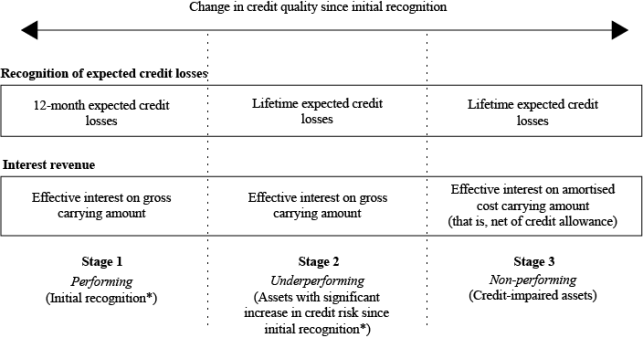
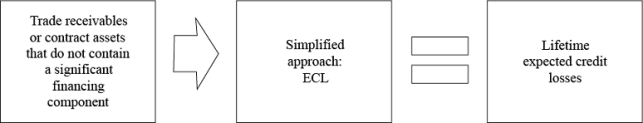
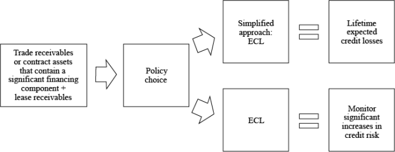
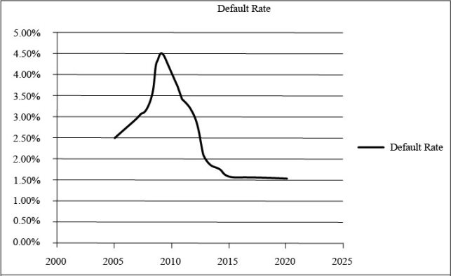

# 45 - Impairment (IFRS 9)

[返回目录](README.md)

# 45 - Impairment (IFRS 9)

Contents

- [45 - Impairment (IFRS 9)](71.md#s289-chap_45_toc_h1)

- [Introduction and scope (paras 45.1 - 45.10)](71.md#s290-chap_45_navPoint_1)

- [Scope](71.md#s290-chap_45_navPoint_2)

- [The expected credit losses model (paras 45.11 - 45.85)](71.md#s291-chap_45_navPoint_3)

- [Step 1 – Scope exception from the general model: simplified approach for trade and lease receivables](71.md#s291-chap_45_navPoint_4)

- [Step 2 – Scope exception from the general model: purchased or originated credit-impaired assets](71.md#s291-chap_45_navPoint_5)

- [Step 3 – Practical expedient for financial assets with low credit risk](71.md#s291-chap_45_navPoint_6)

- [Step 4 – Exploring the general model: assessing a significant increase in credit risk](71.md#s291-chap_45_navPoint_7)

- [Definition of ‘default’](71.md#s291-chap_45_navPoint_idp1720512872)

- [Using probability of default (PD) information](71.md#s291-chap_45_navPoint_idp1720509544)

- [Information to take into account to perform the assessment](71.md#s291-chap_45_navPoint_idp1720536808)

- [30 days past due rebuttable presumption](71.md#s291-chap_45_navPoint_idp1720328808)

- [Level at which the increase in credit risk assessment should be performed](71.md#s291-chap_45_navPoint_idp1720345320)

- [Step 5 – Exploring the general model: recognising 12-month ECL](71.md#s291-chap_45_navPoint_8)

- [Step 6 – Exploring the general model: recognising lifetime ECL](71.md#s291-chap_45_navPoint_9)

- [Measuring ECL](71.md#s291-chap_45_navPoint_idp1720373736)

- [Time value of money](71.md#s291-chap_45_navPoint_idp1720411240)

- [Period over which to estimate ECL](71.md#s291-chap_45_navPoint_idp1720421096)

- [Measurement of ECL: what information to consider](71.md#s291-chap_45_navPoint_idp1698175192)

- [Collateral](71.md#s291-chap_45_navPoint_idp1698213848)

- [Modifications](71.md#s291-chap_45_navPoint_idp1698224088)

- [Write-off](71.md#s291-chap_45_navPoint_idp1697989208)

- [Presentation](71.md#s291-chap_45_navPoint_idp1697983448)

- [Disclosure](71.md#s291-chap_45_navPoint_idp1698088024)

- [Illustrative text](72.md#s292-chap_45_navPoint_10)

- [FAQ 45.4.1 – Presentation of interest income and the unwinding of the ECL discount for stage 3 credit-impaired financial assets](72.md#s292-chap_45_navPoint_11)

- [FAQ 45.4.2 – Would the IFRS 9 ‘stage 3’ expected credit loss provision be the same as the IAS 39 incurred loss provision?](72.md#s292-chap_45_navPoint_12)

- [FAQ 45.4.3 – Date of change of calculation of interest revenue for financial assets that become (or cease to be) credit-impaired](72.md#s292-chap_45_navPoint_13)

- [FAQ 45.4.4 – Presentation of interest income for finance lease receivables](72.md#s292-chap_45_navPoint_14)

- [FAQ 45.10.1 – Loan commitments – scope](72.md#s292-chap_45_navPoint_15)

- [FAQ 45.10.2 – What is a loan commitment for the purposes of applying IFRS 9’s impairment requirements?](72.md#s292-chap_45_navPoint_16)

- [FAQ 45.10.3 – Do legally binding arrangements to deliver non-financial items in the future on credit meet the definition of a loan commitment to which the impairment provisions in IFRS 9 apply?](72.md#s292-chap_45_navPoint_17)

- [FAQ 45.12.1 – Implications of deferred consideration in contracts with customers on profit recognition](72.md#s292-chap_45_navPoint_18)

- [FAQ 45.12.2 – Impairment of receivables arising from executory contracts](72.md#s292-chap_45_navPoint_19)

- [FAQ 45.13.1 – Use of an impairment provision matrix](72.md#s292-chap_45_navPoint_20)

- [EX 45.13.2 – Example of a provision matrix for corporates](72.md#s292-chap_45_navPoint_21)

- [EX 45.13.3 – Example of a provision matrix for corporates in a COVID-19 environment](72.md#s292-chap_45_navPoint_22)

- [FAQ 45.16.1 – Purchased or originated credit-impaired loans](72.md#s292-chap_45_navPoint_23)

- [FAQ 45.16.2 – New loans granted to defaulted debtors](72.md#s292-chap_45_navPoint_24)

- [FAQ 45.16.3 – Can purchased loan commitments be purchased or originated credit-impaired?](72.md#s292-chap_45_navPoint_25)

- [FAQ 45.17.1 – Acquisition of a POCI loan: implications for the effective interest rate and expected credit losses](72.md#s292-chap_45_navPoint_26)

- [FAQ 45.18.1 – Accounting for favourable changes in expected lifetime credit losses on purchased or originated credit-impaired financial assets](72.md#s292-chap_45_navPoint_27)

- [FAQ 45.24.1 – How should the IFRS 9 impairment model be applied when the interest rate is reset in response to a deterioration in the borrower’s credit risk (ratchet loans)?](72.md#s292-chap_45_navPoint_28)

- [FAQ 45.24.2 – When can a significant increase in credit risk be assessed on an absolute, rather than relative, basis?](72.md#s292-chap_45_navPoint_29)

- [FAQ 45.24.3 – Counterparty assessment of significant increase in credit risk](72.md#s292-chap_45_navPoint_30)

- [FAQ 45.24.4 – Assessing significant increase in credit risk for financial assets with a maturity of less than 12 months](72.md#s292-chap_45_navPoint_31)

- [FAQ 45.24.5 – On transition to IFRS 9 do the historical measures of credit risk at the date of initial recognition need to be adjusted?](72.md#s292-chap_45_navPoint_32)

- [FAQ 45.24.6 – How do changes in impairment methodology such as a change in definition of default, impact the assessment of whether a significant increase in credit risk has occurred?](72.md#s292-chap_45_navPoint_33)

- [FAQ 45.24.7 – Acquisition of a loan within stage 2 in the acquiree](72.md#s292-chap_45_navPoint_34)

- [FAQ 45.25.1 – Can the date of initial recognition for determining a significant increase in credit risk be ‘reset’ to the date of a substantial increase in a loan commitment or credit facility?](72.md#s292-chap_45_navPoint_35)

- [FAQ 45.26.1 – Aligning the definition of default: Regulatory versus Accounting](72.md#s292-chap_45_navPoint_36)

- [FAQ 45.27.1 – Assessing and re-assessing if changes in 12-month risk of default occurring can be used as a reasonable approximation to changes in lifetime risk of default occurring](72.md#s292-chap_45_navPoint_37)

- [FAQ 45.27.2 – Impact of prepayments on lifetime probability of default for SICR assessments](72.md#s292-chap_45_navPoint_38)

- [EX 45.28.1 – Twelve-month versus lifetime PDs](72.md#s292-chap_45_navPoint_39)

- [EX 45.30.1 – Regulatory versus IFRS 9 PDs](72.md#s292-chap_45_navPoint_40)

- [FAQ 45.30.2 – How can regulatory PDs be adjusted to obtain IFRS 9 PDs?](72.md#s292-chap_45_navPoint_41)

- [FAQ 45.31.1 – Can an entity use only behavioural indicators of credit risk when assessing significant increases in credit risk since initial recognition?](72.md#s292-chap_45_navPoint_42)

- [FAQ 45.31.2 – Factors to take into account in determining a significant increase in credit risk](72.md#s292-chap_45_navPoint_43)

- [FAQ 45.32.1 – Use of external ratings when assessing for significant increases in credit risk](72.md#s292-chap_45_navPoint_44)

- [EX 45.33.1 – Assessing significant increases in credit risk for collateralised loans](72.md#s292-chap_45_navPoint_45)

- [FAQ 45.33.2 – Can fully collateralised loans qualify as credit-impaired?](72.md#s292-chap_45_navPoint_46)

- [FAQ 45.39.1 – Qualitative and quantitative assessments of significant increases in credit risk](72.md#s292-chap_45_navPoint_47)

- [FAQ 45.41.1 – Assessment of significant increase in credit risk for guaranteed debt instruments](72.md#s292-chap_45_navPoint_48)

- [FAQ 45.42.1 – ‘Top down’ versus ‘bottom up’ approach](72.md#s292-chap_45_navPoint_49)

- [FAQ 45.42.2 – Staging of loans where SICR has occurred that cannot be identified individually or based on shared credit risk characteristics](72.md#s292-chap_45_navPoint_50)

- [FAQ 45.45.1 – Measuring 12-month ECL for loans that default, cure and subsequently default](72.md#s292-chap_45_navPoint_51)

- [FAQ 45.48.1 – Impairment accounting for purchased debt instruments in the case of a business combination](72.md#s292-chap_45_navPoint_52)

- [FAQ 45.48.2 – Expected credit losses – measurement date](72.md#s292-chap_45_navPoint_53)

- [FAQ 45.49.1 – Incorporation of negative interest rates and negative cash flows in ECL](72.md#s292-chap_45_navPoint_54)

- [FAQ 45.49.2 – Effect of the fair value hedge accounting on measurement of expected credit loss.](72.md#s292-chap_45_navPoint_55)

- [FAQ 45.49.3 – Calculating ECL for loans that may be rolled over](72.md#s292-chap_45_navPoint_56)

- [FAQ 45.49.4 – Measuring expected credit losses of loans or securities acquired with a discount or premium](72.md#s292-chap_45_navPoint_57)

- [FAQ 45.49.5 – Effect of the portfolio fair value hedge accounting on the measurement of expected credit loss](72.md#s292-chap_45_navPoint_58)

- [FAQ 45.49.6 – Can debt collection costs incurred by an entity be included in the measurement of ECL?](72.md#s292-chap_45_navPoint_59)

- [FAQ 45.49.7 – Interaction between IFRS 9 and IFRS 15 - Effective interest rate of trade receivables](72.md#s292-chap_45_navPoint_60)

- [FAQ 45.49.8 – Possible revisions to ECL estimates required in a downturn](72.md#s292-chap_45_navPoint_61)

- [FAQ 45.49.9 – Impact of price concessions on expected credit losses of trade receivables](72.md#s292-chap_45_navPoint_62)

- [FAQ 45.50.1 – Measuring expected credit losses for trade receivables and contract assets arising from IFRS 15 revenue contracts](72.md#s292-chap_45_navPoint_63)

- [FAQ 45.52.1 – Measurement of expected credit losses for an issued financial guarantee contract](72.md#s292-chap_45_navPoint_64)

- [FAQ 45.52.2 – Factors to consider in assessing the expected credit loss (ECL) on jointly and severally liable financial guarantee contracts](72.md#s292-chap_45_navPoint_65)

- [FAQ 45.54.2 – If a lessor expects a lessee to pay all amounts due under an operating lease, but later than the contractual due date, does this give rise to an ECL?](73.md#s293-chap_45_navPoint_66)

- [FAQ 45.55.1 – What discount rate should be used when measuring ECL for credit cards and other similar products?](73.md#s293-chap_45_navPoint_67)

- [EX 45.58.1 – How to measure ECL on FVOCI financial assets](73.md#s293-chap_45_navPoint_68)

- [FAQ 45.59.1 – The maximum period to consider when measuring expected credit losses](73.md#s293-chap_45_navPoint_69)

- [FAQ 45.59.2 – Is it appropriate to discount expected credit losses using an effective interest rate which is considering a call option when it is ignored for the ECL calculation?](73.md#s293-chap_45_navPoint_70)

- [FAQ 45.59.3 – Should borrower pre-payment options be taken into account when determining the period over which to measure expected credit losses (ECL)?](73.md#s293-chap_45_navPoint_71)

- [FAQ 45.59.4 – Inclusion of sale assumptions in expected life when measuring IFRS 9 ECL for FVOCI debt instruments](73.md#s293-chap_45_navPoint_72)

- [FAQ 45.59.5 – Repayable on demand loans from parent to its subsidiary – parent’s separate financial statements](73.md#s293-chap_45_navPoint_73)

- [FAQ 45.60.1 – Does paragraph 5.5.20 of IFRS 9 apply only to retail credit cards and retail overdrafts?](73.md#s293-chap_45_navPoint_74)

- [FAQ 45.60.2 – How should the period over which ECL are measured be determined for wholesale and corporate revolving credit facilities?](73.md#s293-chap_45_navPoint_75)

- [FAQ 45.60.3 – Measurement of ECL for revolving credit facilities with ‘shadow’ credit limits](73.md#s293-chap_45_navPoint_76)

- [FAQ 45.61.1 – How to measure ECL on revolving credit facilities](73.md#s293-chap_45_navPoint_77)

- [FAQ 45.61.2 – Date of initial recognition and life of a revolving credit facility](73.md#s293-chap_45_navPoint_78)

- [FAQ 45.61.3 – Period for measuring ECL of revolving credit facilities and interaction of factors in paragraph B5.5.40 of IFRS 9](73.md#s293-chap_45_navPoint_79)

- [FAQ 45.61.4 – How do credit reviews and ‘credit risk management actions’, such as the removal of undrawn limits, affect measurement of ECL for revolving credit facilities?](73.md#s293-chap_45_navPoint_80)

- [FAQ 45.62.1 – Measurement of expected credit losses for drawn and undrawn components of financial assets](73.md#s293-chap_45_navPoint_81)

- [FAQ 45.63.1 – Differentiating forward-looking information](73.md#s293-chap_45_navPoint_82)

- [FAQ 45.64.1 – Information available after modelling date](73.md#s293-chap_45_navPoint_83)

- [FAQ 45.64.2 – To what extent should additional COVID-19 related information after the reporting date be included in the ECL estimate?](73.md#s293-chap_45_navPoint_84)

- [FAQ 45.66.1 – In the context of COVID-19 and ECL, what information is ‘reasonable and supportable’?](73.md#s293-chap_45_navPoint_85)

- [FAQ 45.66.2 – In the context of climate change and ECL, what information is considered ‘reasonable and supportable’?](73.md#s293-chap_45_navPoint_86)

- [FAQ 45.71.1 – Measurement of ECL on government bonds denominated in the issuing country’s own currency](73.md#s293-chap_45_navPoint_87)

- [FAQ 45.72.1 – Scenarios required for calculating ECL](73.md#s293-chap_45_navPoint_88)

- [FAQ 45.72.2 – Can ECL be calculated using a mixture of 12-month and lifetime ECL for different forward-looking scenarios?](73.md#s293-chap_45_navPoint_89)

- [FAQ 45.72.3 – Inclusion of cash flows expected from the sale on default of a loan in the measurement of expected credit losses (ECL)](73.md#s293-chap_45_navPoint_90)

- [FAQ 45.72.4 – How many forward-looking macro-economic scenarios need to be considered in measuring ECL?](73.md#s293-chap_45_navPoint_91)

- [FAQ 45.72.5 – How should weightings be determined for multiple forward-looking macro-economic scenarios?](73.md#s293-chap_45_navPoint_92)

- [FAQ 45.72.6 – Could different parts of a group apply different weightings to the same multiple scenarios used across the group?](73.md#s293-chap_45_navPoint_93)

- [FAQ 45.73.1 – Measuring expected credit losses of a guaranteed loan or a loan with other credit enhancements such as a credit default swap](73.md#s293-chap_45_navPoint_94)

- [FAQ 45.73.2 – How should the holder recognise and measure financial guarantees where they are not an integral part of the debt guaranteed?](73.md#s293-chap_45_navPoint_95)

- [FAQ 45.73.3 – Cash collateral held for trade receivables or lease receivables: recognition and impact on measurement of ECL](73.md#s293-chap_45_navPoint_96)

- [FAQ 45.78.1 – Accounting for modified loans under IFRS 9](73.md#s293-chap_45_navPoint_97)

- [FAQ 45.79.1 – How should modified loans, such as loans subject to ‘forbearance’, be classified within the IFRS 9 expected credit loss (ECL) impairment model?](73.md#s293-chap_45_navPoint_98)

- [FAQ 45.79.2 – Impact of COVID-19 payment holidays, including subsequent extensions to such holidays, on ECL staging](73.md#s293-chap_45_navPoint_99)

- [FAQ 45.79.3 – Can financial assets which have been partially forgiven exit credit impaired status under IFRS 9?](73.md#s293-chap_45_navPoint_100)

- [FAQ 45.79.4 – Factors to consider in relation to ‘days past due’ for IFRS 9 ECL when a loan has been granted a payment holiday](73.md#s293-chap_45_navPoint_101)

- [FAQ 45.80.1 – Application of the write-off criteria to impaired assets](73.md#s293-chap_45_navPoint_102)

- [FAQ 45.80.2 – Level at which to apply the ‘no reasonable expectations of recovering’ threshold](73.md#s293-chap_45_navPoint_103)

- [FAQ 45.81.1 – Income statement presentation of reversals of impairment on stage 3 assets](73.md#s293-chap_45_navPoint_104)

- [FAQ 45.81.2 – Where should the release of ECL be presented in the income statement upon disposal?](73.md#s293-chap_45_navPoint_105)

- [FAQ 45.82.1 – Presentation of ECL for undrawn loan commitments](73.md#s293-chap_45_navPoint_106)

- [FAQ 45.84.1 – Presentation of loss allowance in the statement of financial position](73.md#s293-chap_45_navPoint_107)

- [FAQ 45.85.1 – Should sensitivity analyses be disclosed in respect of major sources of estimation uncertainty and judgement in determining expected credit loss?](73.md#s293-chap_45_navPoint_108)

 

This eBook is licensed to peggy so, peggy.so@hk.ey.com, 

## Introduction and scope (paras 45.1 - 45.10)

 

**45.1** IFRS 9 outlines a ‘three-stage’ model (‘general model’) for impairment based on changes in credit quality since initial recognition:

  
 *There is specific guidance on purchased or originated credit-impaired financial assets (see [para 45.16](71.md#s291-Para_45.16) onwards below).

**45.2** Stage 1 includes financial instruments that have not had a significant increase in credit risk since initial recognition or that (at the option of the entity) have low credit risk at the reporting date. For these assets, 12-month expected credit losses (ECL) are recognised and interest revenue is calculated on the gross carrying amount of the asset (that is, without deduction for credit allowance). 12-month ECL are the ECL that result from default events that are possible within 12 months after the reporting date. It is not the expected cash shortfalls over the 12-month period but the entire credit loss on an asset, weighted by the probability that the loss will occur in the next 12 months.

**45.3** Stage 2 includes financial instruments that have had a significant increase in credit risk since initial recognition (unless they have low credit risk at the reporting date and this option is taken by the entity) but that do not have objective evidence of impairment. For these assets, lifetime ECL are recognised, but interest revenue is still calculated on the gross carrying amount of the asset. Lifetime ECL are the ECL that result from all possible default events over the maximum contractual period during which the entity is exposed to credit risk. ECL are the weighted average credit losses, with the respective risks of a default occurring as the weights.

**45.4**Stage 3 includes financial assets that have objective evidence of impairment at the reporting date. For these assets, lifetime ECL are recognised and interest revenue is calculated on the net carrying amount (that is, net of credit allowance).

[FAQ 45.4.1 – Presentation of interest income and the unwinding of the ECL discount for stage 3 credit-impaired financial assets](72.md#s292-FAQ_45.4.1)  
[FAQ 45.4.2 – Would the IFRS 9 ‘stage 3’ expected credit loss provision be the same as the IAS 39 incurred loss provision?](72.md#s292-FAQ_45.4.2)  
[FAQ 45.4.3 – Date of change of calculation of interest revenue for financial assets that become (or cease to be) credit-impaired](72.md#s292-FAQ_45.4.3)  
[FAQ 45.4.4 – Presentation of interest income for finance lease receivables](72.md#s292-FAQ_45.4.4)

**45.5** The entity, when determining whether the credit risk on a financial instrument has increased significantly, considers reasonable and supportable information available, in order to compare the risk of a default occurring at the reporting date with the risk of a default occurring at initial recognition of the financial instrument.

**45.6** Applying these requirements in practice can be complex. This chapter provides guidance on how to apply the model.

**45.7** The IASB set up the IFRS Transition Resource Group for Impairment of Financial Instruments (‘ITG’), which was a discussion forum to provide support for stakeholders on implementation issues arising from the new impairment requirements. Overall, the purpose of the ITG was to: solicit, analyse and discuss stakeholder issues arising from implementation of the new impairment requirements; inform the IASB about those implementation issues, which helped the IASB determine what, if any, action was needed to address those issues; and provide a public forum for stakeholders to learn about the new impairment requirements from others involved with implementation. During the meetings, the ITG members shared their views on the issues. The ITG did not issue guidance. The IASB determined what action, if any, to take on each issue. We have included references to the ITG discussions in this chapter, where relevant.

**45.8**Additionally, the Basel Committee on Banking Supervision issued guidance on credit risk and the implementation and application of expected credit loss models for banks. This chapter does not deal with that guidance and focuses only on IFRS 9, as issued by the IASB. Entities should refer to any relevant additional guidance provided by Basel or other regulators that affects them.

 

### Scope

 

**45.9** The model should be applied to:

- investments in debt instruments measured at amortised cost;

- investments in debt instruments measured at fair value through other comprehensive income (FVOCI);

- all loan commitments not measured at fair value through profit or loss;

- financial guarantee contracts to which IFRS 9 is applied and that are not accounted for at fair value through profit or loss; and

- lease receivables that are within the scope of IFRS 16, trade receivables and contract assets within the scope of IFRS 15 that give rise to a conditional right to consideration.

The model does not apply to investments in equity instruments.

[IFRS 9 para 5.5.1].

**45.10** An issuer of loan commitments should apply the impairment requirements of IFRS 9 to all loan commitments including those not otherwise within the scope of the standard (unless the loan commitment is measured at fair value through profit or loss).

[FAQ 45.10.1 – Loan commitments – scope](72.md#s292-FAQ_45.10.1)  
[FAQ 45.10.2 – What is a loan commitment for the purposes of applying IFRS 9’s impairment requirements?](72.md#s292-FAQ_45.10.2)  
[FAQ 45.10.3 – Do legally binding arrangements to deliver non-financial items in the future on credit meet the definition of a loan commitment to which the impairment provisions in IFRS 9 apply?](72.md#s292-FAQ_45.10.3)

 

This eBook is licensed to peggy so, peggy.so@hk.ey.com, 

## The expected credit losses model (paras 45.11 - 45.85)

 

**45.11** The illustration below shows the overall ECL model; each decision box will be considered over the following pages:

  
 [IFRS 9 implementation guidance].

 

### Step 1 – Scope exception from the general model: simplified approach for trade and lease receivables

 

**45.12** The model includes some operational simplifications for trade receivables, contract assets and lease receivables, because they are often held by entities that do not have sophisticated credit risk management systems. These simplifications eliminate the need to calculate 12-month ECL and to assess when a significant increase in credit risk has occurred.

[FAQ 45.12.1 – Implications of deferred consideration in contracts with customers on profit recognition](72.md#s292-FAQ_45.12.1)   
[FAQ 45.12.2 – Impairment of receivables arising from executory contracts](72.md#s292-FAQ_45.12.2)

**45.13** For trade receivables or contract assets that do not contain a significant financing component, the loss allowance should be measured at initial recognition and throughout its life at an amount equal to lifetime ECL. As a practical expedient, a provision matrix can be used to estimate ECL for these financial instruments.

[IFRS 9 para 5.5.15].

  
[FAQ 45.13.1 – Use of an impairment provision matrix](72.md#s292-FAQ_45.13.1)  
[EX 45.13.2 – Example of a provision matrix for corporates](72.md#s292-EX45.13.2)  
[EX 45.13.3 – Example of a provision matrix for corporates in a COVID-19 environment](72.md#s292-EX45.13.3)

**45.14** An entity has an accounting policy choice for lease receivables, and trade receivables and contract assets which contain a significant financing component in accordance with IFRS 15. It can either apply the simplified approach (that is, to measure the loss allowance at an amount equal to lifetime ECL at initial recognition and throughout its life) or it can apply the general model.

[IFRS 9 para 5.5.15].

**45.15** An entity can apply the policy election for trade receivables, contract assets and lease receivables independently of each other, but it must apply the policy choice consistently.

[IFRS 9 para 5.5.16].

 

### Step 2 – Scope exception from the general model: purchased or originated credit-impaired assets

 

**45.16** The general impairment model does not apply to purchased or originated credit-impaired assets. A financial asset is considered credit-impaired on purchase or origination if there is evidence of impairment at the point of initial recognition (for instance, if it is acquired at a deep discount). IFRS 9 includes a list of factors that would provide evidence that a financial asset is credit-impaired:

- significant financial difficulty of the issuer or the borrower;

- a breach of contract, such as a default or past due event;

- the lender(s) of the borrower, for economic or contractual reasons relating to the borrower’s financial difficulty, having granted to the borrower a concession(s) that the lender(s) would not otherwise consider;

- it is becoming probable that the borrower will enter bankruptcy or other financial reorganisation;

- the disappearance of an active market for that financial asset because of financial difficulties; or

- the purchase or origination of a financial asset at a deep discount that reflects the incurred credit losses.

The standard clarifies that it might not be possible to identify a single discrete event, so the combined effect of several events should be analysed.

[IFRS 9 App A].

[FAQ 45.16.1 – Purchased or originated credit-impaired loans](72.md#s292-FAQ_45.16.1)  
  
[FAQ 45.16.2 – New loans granted to defaulted debtors](72.md#s292-FAQ_45.16.2)  
  
[FAQ 45.16.3 – Can purchased loan commitments be purchased or originated credit-impaired?](72.md#s292-FAQ_45.16.3)

**45.17** Impairment is determined based on full lifetime ECL on initial recognition for purchased or originated credit-impaired financial assets. Lifetime ECL are included in the estimated cash flows when calculating the effective interest rate on initial recognition. The effective interest rate for interest recognition throughout the life of the asset is a credit-adjusted effective interest rate. As a result, no loss allowance is recognised on initial recognition.

[IFRS 9 para 5.5.13]. [IFRS 9 para 5.4.1]. [IFRS 9 App B para B5.5.44].

[FAQ 45.17.1 – Acquisition of a POCI loan: implications for the effective interest rate and expected credit losses](72.md#s292-FAQ_45.17.1)

**45.18** Any subsequent changes in lifetime ECL, both positive and negative, will be recognised immediately in the income statement, even if the lifetime ECL are less than the amount of ECL that were included in the estimated cash flows on initial recognition.

[IFRS 9 para 5.5.14].

[FAQ 45.18.1 – Accounting for favourable changes in expected lifetime credit losses on purchased or originated credit-impaired financial assets](72.md#s292-FAQ_45.18.1).

 

### Step 3 – Practical expedient for financial assets with low credit risk

**45.19** As an exception to the general model, if the credit risk of a financial instrument is low at the reporting date, the entity can measure impairment using 12-month ECL, and so it does not have to assess whether a significant increase in credit risk has occurred. The use of this practical expedient is optional; the entity can also choose to apply the general model for those assets.

[IFRS 9 para 5.5.10].

**45.20** The financial instrument has to meet the following requirements, in order for this practical expedient to apply:

- it has a low risk of default;

- the borrower is considered, in the short term, to have a strong capacity to meet its obligations in the near term; and

- the lender expects, in the longer term, that adverse changes in economic and business conditions might, but will not necessarily, reduce the ability of the borrower to fulfil its obligations.

[IFRS 9 App B para B5.5.22].

**45.21** The credit risk of the instrument needs to be evaluated without consideration of collateral. Financial instruments are not considered to have low credit risk because that risk is mitigated by collateral. Financial instruments are also not considered to have low credit risk simply because they have a lower risk of default than the entity’s other financial instruments or relative to the credit risk of the jurisdiction within which the entity operates.

[IFRS 9 App B para B5.5.22].

**45.22** Financial instruments are not required to be externally rated. An entity can use internal credit ratings that are consistent with a global credit rating definition of ‘investment grade’.

[IFRS 9 App B para B5.5.23].

**45.23** The low credit risk simplification is not meant to be a bright-line trigger for the recognition of lifetime ECL. Instead, when credit risk is no longer low, the entity should assess whether there has been a significant increase in credit risk to determine whether lifetime ECL should be recognised. This means that, if an instrument’s credit risk has increased such that it no longer qualifies as low credit risk, it is not automatically included in stage 2. The entity needs to assess if a significant increase in credit risk has occurred before calculating lifetime ECL for the instrument.

[IFRS 9 App B para B5.5.24].

### Step 4 – Exploring the general model: assessing a significant increase in credit risk

 

**45.24** The entity looks at the change in the risk of a default occurring over the expected life of the financial instrument, rather than the change in the ECL, when assessing whether the credit risk on a financial instrument has increased significantly since initial recognition. An entity should compare the risk of a default at the reporting date with the risk of a default at the date of initial recognition.

[IFRS 9 para 5.5.9].

[FAQ 45.24.1 – How should the IFRS 9 impairment model be applied when the interest rate is reset in response to a deterioration in the borrower’s credit risk (ratchet loans)?](72.md#s292-FAQ_45.24.1)  
[FAQ 45.24.2 – When can a significant increase in credit risk be assessed on an absolute, rather than relative, basis?](72.md#s292-FAQ_45.24.2)  
[FAQ 45.24.3 – Counterparty assessment of significant increase in credit risk](72.md#s292-FAQ_45.24.3)  
[FAQ 45.24.4 – Assessing significant increase in credit risk for financial assets with a maturity of less than 12 months](72.md#s292-FAQ_45.24.4)  
[FAQ 45.24.5 – On transition to IFRS 9 do the historical measures of credit risk at the date of initial recognition need to be adjusted?](72.md#s292-FAQ_45.24.5)  
[FAQ 45.24.6 – How do changes in impairment methodology (for example, change in definition of default) impact the assessment of whether a significant increase in credit risk has occurred?](72.md#s292-FAQ_45.24.6)  
[FAQ 45.24.7 – Acquisition of a loan within stage 2 in the acquiree](72.md#s292-FAQ_45.24.7)

**45.25** For loan commitments, an entity considers changes in the risk of a default occurring on the loan to which a loan commitment relates. For financial guarantee contracts, an entity considers the changes in the risk that the specified debtor will default on the contract. The date that the entity becomes a party to the irrevocable commitment is considered to be the date of initial recognition for the purposes of applying the impairment requirements to both loan commitments and financial guarantee contracts.

[IFRS 9 App B para B5.5.8]. [IFRS 9 para 5.5.6].

[FAQ 45.25.1 – Can the date of initial recognition for determining a significant increase in credit risk be ‘reset’ to the date of a substantial increase in a loan commitment or credit facility?](72.md#s292-FAQ_45.25.1)

 

#### Definition of ‘default’

 

**45.26** An entity applies a definition of ‘default’ that is consistent with the definition used for internal credit risk management purposes for the relevant financial instrument and can consider qualitative indicators (for example, financial covenants) where appropriate. However, there is a rebuttable presumption that default does not occur later than when a financial asset is 90 days past due, unless an entity has reasonable and supportable information to demonstrate that a more lagging default criterion is more appropriate. The definition of default used for these purposes should be applied consistently to all financial instruments, unless information becomes available that demonstrates that another definition of default is more appropriate for a particular financial instrument.

[IFRS 9 App B para B5.5.37].

[FAQ 45.26.1 – Aligning the definition of default: Regulatory versus Accounting](72.md#s292-FAQ_45.26.1)

 

#### Using probability of default (PD) information

 

**45.27** If the entity chooses to make the assessment of SICR by using PD, generally a lifetime PD (over the remaining life of the instrument) should be used. However, as a practical expedient, a 12-month PD can be used if it is a reasonable approximation to lifetime PD.

[IFRS 9 App B para B5.5.13].

[FAQ 45.27.1 – Assessing and re-assessing if changes in 12-month risk of default occurring can be used as a reasonable approximation to changes in lifetime risk of default occurring](72.md#s292-FAQ_45.27.1)  
  
[FAQ 45.27.2 – Impact of prepayments on lifetime probability of default for SICR assessments](72.md#s292-FAQ_45.27.2)

**45.28**A 12-month PD is not always a reasonable approximation to using lifetime PD. Exceptions include:

- bullet repayment loans, where the payment obligations of the debtor are not significant during the first 12 months of the loan facility;

- loans where changes in credit-related factors only have an impact on the credit risk of the financial instrument beyond 12 months; and

- where changes in relevant macroeconomic or other credit-related factors occur that are not adequately reflected in the risk of a default occurring in the next 12 months.

[IFRS 9 App B para B5.5.14].

[EX 45.28.1 – Twelve-month versus lifetime PDs](72.md#s292-EX45.28.1)

**[**The next paragraph is 45.30**.]**

**45.30** A simple or absolute comparison of PDs at initial recognition and at the reporting date is not appropriate. The PD of a financial instrument should reduce with the passage of time. So, the entity needs to consider the relative maturities of a financial instrument at inception and at the reporting date when comparing PDs. This means that the PD for the remaining life of a financial asset at the reporting date (for example, two years if three years have already passed on a five-year instrument) should be compared to the PD expected at initial recognition for the last two years of its maturity (that is, for years 4 and 5). The entity might find this requirement operationally challenging.

Illustrative forecast at inception of a loan’s PD over its life

  

  
 [IFRS 9 App B para B5.5.11].

[EX 45.30.1 – Regulatory versus IFRS 9 PDs](72.md#s292-EX45.30.1)  
[FAQ 45.30.2 – How can regulatory PDs be adjusted to obtain IFRS 9 PDs?](72.md#s292-FAQ_45.30.2)

 

#### Information to take into account to perform the assessment

 

**45.31** All reasonable and supportable information available without undue cost or effort should be taken into account to perform the assessment of changes in credit risk.

[IFRS 9 App B para B5.5.15].

[FAQ 45.31.1 – Can an entity use only behavioural indicators of credit risk when assessing significant increases in credit risk since initial recognition?](72.md#s292-FAQ_45.31.1)  
  
[FAQ 45.31.2 – Factors to take into account in determining a significant increase in credit risk](72.md#s292-FAQ_45.31.2)

**45.32** The standard provides a non-exhaustive list of information that might be relevant in assessing changes in credit risk:

- Significant changes in internal price indicators of credit risk as a result of a change in credit risk since inception, including, but not limited to, the credit spread that would result if a particular financial instrument or similar financial instrument with the same terms and the same counterparty were newly originated or issued at the reporting date.

- Other changes in the rates or terms of an existing financial instrument that would be significantly different if the instrument was newly originated or issued at the reporting date (such as more stringent covenants, increased amounts of collateral or guarantees, or higher income coverage) because of changes in the credit risk of the financial instrument since initial recognition.

- Significant changes in external market indicators of credit risk for a particular financial instrument or similar financial instruments with the same expected life. Changes in market indicators of credit risk include, but are not limited to:

- the credit spread;

- the credit default swap prices for the borrower;

- the length of time for which, or the extent to which, the fair value of a financial asset has been less than its amortised cost; and

- other market information related to the borrower, such as changes in the price of a borrower’s debt and equity instruments.

- An actual or expected significant change in the financial instrument’s external credit rating.

- An actual or expected internal credit rating downgrade for the borrower or decrease in behavioural scoring used to assess credit risk internally. Internal credit ratings and internal behavioural scoring are more reliable when they are mapped to external ratings or supported by default studies.

- Existing or forecast adverse changes in business, financial or economic conditions that are expected to cause a significant change in the borrower’s ability to meet its debt obligations, such as an actual or expected increase in interest rates or an actual or expected significant increase in unemployment rates.

- An actual or expected significant change in the operating results of the borrower. Examples include actual or expected declining revenues or margins, increasing operating risks, working capital deficiencies, decreasing asset quality, increased balance sheet leverage, liquidity, management problems or changes in the scope of business or organisational structure (such as the discontinuance of a segment of the business) that result in a significant change in the borrower’s ability to meet its debt obligations.

- Significant increases in credit risk on other financial instruments of the same borrower.

- An actual or expected significant adverse change in the regulatory, economic or technological environment of the borrower that results in a significant change in the borrower’s ability to meet its debt obligations, such as a decline in the demand for the borrower’s sales product because of a shift in technology.

- Significant changes in the value of the collateral supporting the obligation or in the quality of third-party guarantees or credit enhancements, which are expected to reduce the borrower’s economic incentive to make scheduled contractual payments or to otherwise have an effect on the probability of a default occurring. For example, if the value of collateral declines because house prices decline, borrowers in some jurisdictions have a greater incentive to default on their mortgages.

- A significant change in the quality of the guarantee provided by a shareholder (or an individual’s parents) if the shareholder (or parents) have an incentive and financial ability to prevent default by capital or cash infusion.

- Significant changes, such as reductions in financial support from a parent entity or other affiliate or an actual or expected significant change in the quality of credit enhancement, that are expected to reduce the borrower’s economic incentive to make scheduled contractual payments. Credit quality enhancements or support include the consideration of the financial condition of the guarantor and/or, for interests issued in securitisations, whether subordinated interests are expected to be capable of absorbing ECL (for example, on the loans underlying the security).

- Expected changes in the loan documentation, including an expected breach of contract that might lead to covenant waivers or amendments, interest payment holidays, interest rate step-ups, requiring additional collateral or guarantees, or other changes to the contractual framework of the instrument.

- Significant changes in the expected performance and behaviour of the borrower, including changes in the payment status of borrowers in the group (for example, an increase in the expected number or extent of delayed contractual payments or significant increases in the expected number of credit card borrowers who are expected to approach or exceed their credit limit or who are expected to be paying the minimum monthly amount).

- Changes in the entity’s credit management approach in relation to the financial instrument; that is, based on emerging indicators of changes in the credit risk of the financial instrument, the entity’s credit risk management practice is expected to become more active or to be focused on managing the instrument, including the instrument becoming more closely monitored or controlled, or the entity specifically intervening with the borrower.

- Past due information.

[IFRS 9 App B para B5.5.17].

[FAQ 45.32.1 – Use of external ratings when assessing for significant increases in credit risk](72.md#s292-FAQ_45.32.1)

**45.33** Even if movements in the value of collateral can be considered an indicator of movements in credit risk, entities should assess significant increases in credit risk without taking into account the collateral. Nevertheless, when calculating ECL, the expected recovery from collateral should be taken into account.

[IFRS 9 App B para B5.5.55]. [IFRS 9 App B para B5.5.12].

[EX 45.33.1 – Assessing significant increases in credit risk for collateralised loans](72.md#s292-EX45.33.1)  
[FAQ 45.33.2 – Can fully collateralised loans qualify as credit-impaired?](72.md#s292-FAQ_45.33.2)

 

#### 30 days past due rebuttable presumption

**45.34** Both forward-looking and historical information are used in order to determine whether a significant increase in credit risk has occurred. Lifetime ECL are generally expected to be recognised before a financial instrument becomes past due. Typically, credit risk increases significantly before a financial instrument becomes past due or other lagging borrower-specific factors (for example, a modification or restructuring) are observed. Reasonable and supportable information that is more forward-looking than past due information, and that is available without undue cost or effort, must be used to assess changes in credit risk.

[IFRS 9 App B para B5.5.2].

**45.35** An entity cannot rely solely on delinquency information when determining whether credit risk has increased significantly since initial recognition; it also needs to consider reasonably available forward-looking information. This will include information at a portfolio level. An entity can use past due information to determine whether there have been significant increases in credit risk since initial recognition, if forward-looking information is not available; in this case, portfolio-level information should also be considered. There is a rebuttable presumption that credit risk has increased significantly since initial recognition when contractual payments are more than 30 days past due.

[IFRS 9 para 5.5.11].

**45.36** This presumption can be rebutted if there is reasonable and supportable evidence that there has been no significant increase in the credit risk (for example, where non-payment is an administrative oversight, instead of resulting from financial difficulty of the borrower). Another example is where the entity has access to historical evidence that demonstrates that there is no correlation between significant increases in the risk of a default occurring and financial assets on which payments are more than 30 days past due, but that evidence does identify such a correlation when payments are more than 60 days past due.

[IFRS 9 App B para B5.5.20].

**45.37** If there have been significant increases in credit risk before contractual payments are more than 30 days past due, the rebuttable presumption does not apply.

[IFRS 9 para 5.5.11].

**45.38** Generally, a significant increase in credit risk happens gradually over time and before the financial asset becomes credit-impaired or is in default. The lifetime ECL should be recognised before a financial asset is regarded as credit-impaired or in default.

[IFRS 9 App B para B5.5.7].

**45.39** The qualitative and non-statistical quantitative information available might be sufficient to determine that a financial instrument has met the criterion for the recognition of a loss allowance at an amount equal to lifetime ECL. That is, the information does not need to flow through a statistical model or credit ratings process in order to determine whether there has been a significant increase in the credit risk of the financial instrument. However, in other cases, an entity might need to consider qualitative information, including information from its statistical models or credit ratings processes. Alternatively, the entity might base the assessment on both types of information (that is, qualitative factors that are not captured through the internal ratings process and the credit risk characteristics at the reporting date) if both types of information are relevant.

[IFRS 9 App B para B5.5.18].

[FAQ 45.39.1 – Qualitative and quantitative assessments of significant increases in credit risk](72.md#s292-FAQ_45.39.1)

#### Level at which the increase in credit risk assessment should be performed

 

**45.40** An entity might not be able to identify significant changes in credit risk for individual financial instruments before the financial instrument becomes past due. This might be the case for retail loans for which there is little or no updated credit risk information that is routinely obtained and monitored on an individual instrument until a customer breaches the contractual terms. If changes in the credit risk for individual financial instruments are not captured before they become past due, a loss allowance based only on credit information at an individual financial instrument level would not faithfully represent the changes in credit risk since initial recognition. The entity should look at information at the portfolio level to perform the assessment. The entity cannot avoid calculating lifetime ECL by considering the assessment at an individual asset level only, if information available at portfolio level indicates that there has been an increase in credit risk for the instruments included in the portfolio.

[IFRS 9 App B para B5.5.3].

**45.41** An entity can group financial instruments on the basis of shared credit risk characteristics, with the objective of facilitating an analysis to identify significant increases in credit risk and recognition of loss allowance on a timely basis. The entity should not obscure this information by grouping financial instruments with different risk characteristics. Examples of shared credit risk characteristics might include, but are not limited to, the:

- instrument type;

- credit risk ratings;

- collateral type;

- date of initial recognition;

- remaining term to maturity;

- industry;

- geographical location of the borrower; and

- value of collateral relative to the financial asset if it has an impact on the probability of a default occurring (for example, non-recourse loans in some jurisdictions or loan-to-value ratios).

[IFRS 9 App B para B5.5.5].

[FAQ 45.41.1 – Assessment of significant increase in credit risk for guaranteed debt instruments](72.md#s292-FAQ_45.41.1)

**45.42** IFRS 9 provides some examples of how to perform the portfolio analysis. It establishes that individual exposures could be grouped into sub-portfolios on the basis of common borrower-specific characteristics, such as geographical location or postcodes, headroom/access affordability at origination or behavioural scoring (that is, ‘bottom up’ approach). Alternatively, the entity could estimate the proportion of the portfolio that has experienced a significant increase in credit risk using general information and calculate ECL on that basis (that is, ‘top down’ approach).

[IFRS 9 App B para B5.5.6].

[FAQ 45.42.1 – ‘Top down’ versus ‘bottom up’ approach](72.md#s292-FAQ_45.42.1)  
[FAQ 45.42.2 – Staging of loans where SICR has occurred that cannot be identified individually or based on shared credit risk characteristics](72.md#s292-FAQ_45.42.2)

**45.43** The entity must also consider forward-looking information at a portfolio level in order to determine whether there has been a significant increase in credit risk (‘top down’ approach), if it uses a bottom up approach.

[IFRS 9 App B para B5.5.16].

 

### Step 5 – Exploring the general model: recognising 12-month ECL

**45.44** If the entity determines that there has not been a significant increase in credit risk, it measures the loss allowance for the particular asset or group of assets at an amount equal to 12-month ECL.

[IFRS 9 para 5.5.5].

**45.45** Twelve-month ECL are a portion of lifetime ECL. They represent the weighted average of credit losses that result from default events on a financial instrument that are possible within the 12 months after the reporting date.

[IFRS 9 App B para B5.5.43]. [IFRS 9 App A].

[FAQ 45.45.1 – Measuring 12-month ECL for loans that default, cure and subsequently default](72.md#s292-FAQ_45.45.1)

**45.46** If an entity determines at the current reporting date that the credit risk has decreased so that the instrument is no longer in stage 2, the entity should measure the loss allowance at an amount equal to 12-month ECL at the current reporting date.

[IFRS 9 para 5.5.7].

**45.47** The amount of ECL or reversal that is required to adjust the loss allowance at the reporting date to the amount necessary under IFRS 9 is recognised in the income statement as an impairment loss.

[IFRS 9 para 5.5.8].

### Step 6 – Exploring the general model: recognising lifetime ECL

 

**45.48** An entity measures the loss allowance for a financial instrument at an amount equal to the lifetime ECL if the credit risk on that financial instrument has increased significantly since initial recognition.

[IFRS 9 para 5.5.3].

[FAQ 45.48.1 – Impairment accounting for purchased debt instruments in the case of a business combination](72.md#s292-FAQ_45.48.1)  
  
[FAQ 45.48.2 – Expected credit losses – measurement date](72.md#s292-FAQ_45.48.2)

 

#### Measuring ECL

 

**45.49** ECL are a probability-weighted estimate of credit losses. A credit loss is the difference between the cash flows that are due to an entity in accordance with the contract and the cash flows that the entity expects to receive discounted at the original effective interest rate. ECL consider the amount and timing of payments, thus a credit loss arises even if the entity expects to be paid in full but later than when contractually due.

[IFRS 9 App B para B5.5.28]. [IFRS 9 App A].

[FAQ 45.49.1 - Incorporation of negative interest rates and negative cash flows in ECL](72.md#s292-FAQ_45.49.1)  
[FAQ 45.49.2 – Effect of the fair value hedge accounting on measurement of expected credit loss](72.md#s292-FAQ_45.49.2)  
[FAQ 45.49.3 - Calculating ECL for loans that may be rolled over](72.md#s292-FAQ_45.49.3)  
[FAQ 45.49.4 – Measuring expected credit losses of loans or securities acquired with a discount or premium](72.md#s292-FAQ_45.49.4)  
  
[FAQ 45.49.5 – Effect of the portfolio fair value hedge accounting on the measurement of expected credit loss](72.md#s292-FAQ_45.49.5)  
[FAQ 45.49.6 – Can debt collection costs incurred by an entity be included in the measurement of ECL?](72.md#s292-FAQ_45.49.6)  
[FAQ 45.49.7 – Interaction between IFRS 9 and IFRS 15 - Effective interest rate of trade receivables](72.md#s292-FAQ_45.49.7)  
[FAQ 45.49.8 – Possible revisions to ECL estimates required in a downturn](72.md#s292-FAQ_45.49.8)  
[FAQ 45.49.9 – Impact of price concessions on expected credit losses of trade receivables](72.md#s292-FAQ_45.49.9)

**45.50** The illustrations below show the ECL for a financial asset and a loan commitment.

**Financial assets**

ECL represent a probability-weighted estimate of the difference, over the remaining life of the financial instrument, between:

  
**Undrawn loan commitments**

ECL represent a probability-weighted estimate of the difference, over the remaining life of the financial instrument, between:

  
 [IFRS 9 App B para B5.5.29]. [IFRS 9 App B para B5.5.30].

[FAQ 45.50.1 – Measuring expected credit losses for trade receivables and contract assets arising from IFRS 15 revenue contracts](72.md#s292-FAQ_45.50.1)

**45.51** An estimate of ECL on loan commitments should be consistent with expectations of draw-downs on that loan commitment. The entity should consider the expected portion of the loan commitment that will be drawn down within 12 months of the reporting date when estimating 12-month ECL, and the expected portion of the loan commitment that will be drawn down over the expected life of the loan commitment when estimating lifetime ECL.

[IFRS 9 App B para B5.5.31].

**45.52** For a financial guarantee contract, the entity is required to make payments only in the event of a default by the debtor in accordance with the terms of the instrument that is guaranteed. Accordingly, cash shortfalls are the expected payments to reimburse the holder for a credit loss that it incurs, less any amounts that the entity expects to receive from the holder, the debtor or any other party. If the asset is fully guaranteed, the estimation of cash shortfalls for a financial guarantee contract would be consistent with the estimations of cash shortfalls for the asset subject to the guarantee.

[IFRS 9 App B para B5.5.32].

[FAQ 45.52.1 – Measurement of expected credit losses for an issued financial guarantee contract](72.md#s292-FAQ_45.52.1)

[FAQ 45.52.2 – Factors to consider in assessing the expected credit loss (ECL) on jointly and severally liable financial guarantee contracts](72.md#s292-FAQ_45.52.2)

[FAQ 45.73.2 – Timing of recognition of financial guarantees by the holder where they are not an integral part of the debt guaranteed](73.md#s293-FAQ_45.73.2)

**45.53** On a financial asset that is credit-impaired at the reporting date, but not a purchased or originated credit-impaired financial asset, ECL are the difference between the asset’s gross carrying amount and the present value of estimated future cash flows discounted at the asset’s original effective interest rate. Any adjustment is recognised in the income statement as an impairment gain or loss.

[IFRS 9 App B para B5.5.33].

**45.54** The cash flows and discount rate used for determining the ECL allowance for lease receivables should be consistent with the cash flows and discount rate used in measuring the lease receivable in accordance with IFRS 16.

[IFRS 9 App B para B5.5.46].

[FAQ 42.54.1 – Are liquidity facilities a tranche or an instrument in the pool when applying the CLI guidance?](65.md#s272-FAQ_42.54.1)

[FAQ 45.54.2 - If a lessor expects a lessee to pay all amounts due under an operating lease, but later than the contractual due date, does this give rise to an ECL?](73.md#s293-FAQ_45.54.2)

 

#### Time value of money

 

**45.55** The time value of money must be taken into account when calculating the ECL (regardless of whether it is the 12-month or the lifetime ECL). The entity should discount the cash flows that it expects to receive at the effective interest rate determined at initial recognition, or an approximation thereto, in order to calculate ECL. If a financial instrument has a variable interest rate, ECL should be discounted using the current effective interest rate.

[IFRS 9 App B para B5.5.44].

[FAQ 45.55.1 – What discount rate should be used when measuring ECL for credit cards and other similar products?](73.md#s293-FAQ_45.55.1)

**45.56** The ECL on a loan commitment should be discounted using the effective interest rate, or an approximation thereto, that will be applied when recognising the financial asset resulting from the loan commitment. A financial asset that is recognised following a draw-down on a loan commitment is treated as a continuation of that commitment instead of a new financial instrument.

[IFRS 9 App B para B5.5.47].

**45.57** ECL on financial guarantee contracts, or on loan commitments for which the effective interest rate cannot be determined, are discounted by applying the rate that reflects the current market assessment of the time value of money and the risks that are specific to the cash flows. In this case, risks should be adequately addressed by adjusting the discount instead of adjusting the cash flows.

[IFRS 9 App B para B5.5.48].

**45.58** Movements in the ECL allowance should be recognised in the income statement, including movements in the allowance of financial assets classified in the FVOCI category. However for financial assets measured at FVOCI, the loss allowance should be recognised in OCI, instead of reducing the carrying amount of the financial asset in the balance sheet.

[IFRS 9 para 5.5.2]. [IFRS 9 para 5.5.8].

[EX 45.58.1 – How to measure ECL on FVOCI financial assets](73.md#s293-EX45.58.1)

 

#### Period over which to estimate ECL

 

**45.59** The maximum period over which ECL should be measured is the maximum contractual period over which the entity is exposed to credit risk. For loan commitments, and financial guarantee contracts, this is the maximum contractual period over which an entity has a present contractual obligation to extend credit.

[IFRS 9 App B para B5.5.38].

[FAQ 45.59.1 – The maximum period to consider when measuring expected credit losses](73.md#s293-FAQ_45.59.1)  
  
[FAQ 45.59.2 – Is it appropriate to discount expected credit losses using an effective interest rate which is considering a call option when it is ignored for the ECL calculation?](73.md#s293-FAQ_45.59.2)  
[FAQ 45.59.3 – Should borrower pre-payment options be taken into account when determining the period over which to measure expected credit losses (ECL)?](73.md#s293-FAQ_45.59.3)  
[FAQ 45.59.4 - Inclusion of sale assumptions in expected life when measuring IFRS 9 ECL for FVOCI debt instruments](73.md#s293-FAQ_45.59.4)  
[FAQ 45.59.5 – Repayable on demand loans from parent to its subsidiary – parent’s separate financial statements](73.md#s293-FAQ_45.59.5)

**45.60** Some financial instruments include both a loan and an undrawn commitment component, such as revolving credit facilities, including credit cards and overdrafts. In such cases, the contractual ability to demand repayment and cancel the undrawn commitment does not necessarily limit the exposure to credit losses beyond the contractual period. These financial instruments generally have the following characteristics, as a result of the nature of the financial instrument, the way in which the financial instruments are managed, and the nature of the available information about significant increases in credit risk.

- the financial instruments do not have a fixed term or repayment structure and usually have a short contractual cancellation period (for example, one day);

- the contractual ability to cancel the contract is not enforced in the normal day-to-day management of the financial instrument, and the contract can only be cancelled when the entity becomes aware of an increase in credit risk at the facility level; and

- the financial instruments are managed on a collective basis.

[IFRS 9 App B para B5.5.39].

[FAQ 45.60.1 – Does paragraph 5.5.20 of IFRS 9 apply only to retail credit cards and retail overdrafts?](73.md#s293-FAQ_45.60.1)  
[FAQ 45.60.2 – How should the period over which ECL are measured be determined for wholesale and corporate revolving credit facilities?](73.md#s293-FAQ_45.60.2)  
[FAQ 45.60.3 – Measurement of ECL for revolving credit facilities with ‘shadow’ credit limits](73.md#s293-FAQ_45.60.3)

**45.61** For those types of instrument, the factors to be considered when determining the period over which to estimate ECL are:

- the period over which the entity was exposed to credit risk on similar instruments;

- the length of time for related defaults to occur on similar financial instruments following an increase in credit risk; and

- the credit risk management actions that an entity expects to take once the credit risk on the financial instrument has increased, such as the reduction or removal of undrawn limits.

[IFRS 9 App B para B5.5.40].

[FAQ 45.61.1 – How to measure ECL on revolving credit facilities](73.md#s293-FAQ_45.61.1)  
[FAQ 45.61.2 – Date of initial recognition and life of a revolving credit facility](73.md#s293-FAQ_45.61.2)  
[FAQ 45.61.3 – Period for measuring ECL of revolving credit facilities and interaction of factors in paragraph B5.5.40 of IFRS 9](73.md#s293-FAQ_45.61.3)  
[FAQ 45.61.4 – How do credit reviews and ‘credit risk management actions’, such as the removal of undrawn limits, affect measurement of ECL for revolving credit facilities?](73.md#s293-FAQ_45.61.4)

**45.62** The entity needs to take into account credit risk management actions that are taken once an exposure has deteriorated (such as the reduction or removal of undrawn limits) when estimating the period over which to calculate ECL on loan commitments. The entity should measure ECL over the period that the entity is exposed to credit risk, and ECL would not be mitigated by credit risk management actions, even if that period extends beyond the maximum contractual period.

[IFRS 9 App B para B5.5.39].

[FAQ 45.62.1 – Measurement of expected credit losses for drawn and undrawn components of financial assets](73.md#s293-FAQ_45.62.1)

 

#### Measurement of ECL: what information to consider

 

**45.63** ECL are measured over the remaining life of a financial instrument in a way that reflects:

- an unbiased and probability-weighted amount that is determined by evaluating a range of possible outcomes;

- the time value of money; and

- reasonable and supportable information about past events and current conditions, and reasonable and supportable forecasts of future events and economic conditions at the reporting date.

[IFRS 9 para 5.5.17].

[FAQ 45.63.1 – Differentiating forward-looking information](73.md#s293-FAQ_45.63.1)

**45.64** The entity should consider information that is reasonably available without undue cost or effort when estimating ECL. The degree of judgement that is required for the estimates depends on the availability of detailed information.

[IFRS 9 App B para B5.5.50].

[FAQ 45.64.1 – Information available after modelling date](73.md#s293-FAQ_45.64.1)  
[FAQ 45.64.2 – To what extent should additional COVID-19 related information after the reporting date be included in the ECL estimate?](73.md#s293-FAQ_45.64.2)

**45.65** An entity can use various sources of data, both internal and external, to measure ECL. Possible data sources include historical credit loss experience, internal ratings, credit loss experience of other entities, and external ratings, reports and statistics. However, an entity should consider observable market information about the credit risk of the particular financial instrument or similar financial instruments.

[IFRS 9 App B para B5.5.51].

**45.66** Historical data could be used as a base from which to measure ECL. Such data should be adjusted to reflect current conditions and forecasts of future conditions that did not affect the period on which the historical data is based, and to remove the effects of the conditions in the historical period that are not relevant to the future contractual cash flows. The best reasonable and supportable information might be the unadjusted historical information, depending on the nature of the historical information and when it was calculated, compared to the circumstances at the reporting date and the characteristics of the financial instrument being considered. Estimates of changes in ECL should reflect, and be directionally consistent with, changes in related observable data from period to period (such as changes in unemployment rates, property prices and commodity prices). An entity should regularly review the methodology and assumptions used for estimating ECL, to reduce any differences between estimates and actual credit loss experience.

[IFRS 9 App B para B5.5.52].

[FAQ 45.66.1 – In the context of COVID-19 and ECL, what information is ‘reasonable and supportable’?](73.md#s293-FAQ_45.66.1)  
[FAQ 45.66.2 – In the context of climate change and ECL, what information is considered ‘reasonable and supportable’?](73.md#s293-FAQ_45.66.2)

**45.67** Information about historical credit loss rates should be applied to groups that are defined in a manner that is consistent with the groups for which the historical credit loss rates were observed. The method used for estimating ECL should enable each group of financial assets to be associated with similar risk characteristics and with relevant observable data that reflects current conditions.

[IFRS 9 App B para B5.5.53].

**45.68** Entities should also take into account forecast information available, such as that included in business plans (‘internal information’) or that provided by the market – for example, changes in prices which indicate expected changes in credit ratings (‘external information’).

**45.69** The estimate of ECL does not require a detailed estimate for periods that are far in the future. For such periods, an entity could extrapolate projections from detailed information that is available. For periods beyond ‘reasonable and supportable forecasts’, the entity should consider how best to reflect its expectations by considering information at the reporting date about the current conditions, as well as forecasts of future events and economic conditions.

[IFRS 9 App B para B5.5.50].

**45.70** The standard is not specific on how to extrapolate projections from available information. Different ways of extrapolation can be used. For example, the entity could apply the average ECL over the remaining period or use a steady rate of ECL based on the last available forecast. These are only examples, and other methods might apply. The entity should choose an approach and apply it consistently; the chosen method should be disclosed if material under paragraph 35(g) a) of IFRS 7. This is a highly judgemental area which could have a large impact on the allowance for impairment.

[IFRS 7 para 35(g)].

**45.71** The estimate of ECL should reflect an unbiased and probability-weighted amount that is determined by evaluating a range of possible outcomes. At least two outcomes should be considered. In particular, the entity should consider the possibility of a credit loss occurring and the possibility that no credit loss occurs.

[IFRS 9 App B para B5.5.41].

[FAQ 45.71.1 – Measurement of ECL on government bonds denominated in the issuing country’s own currency](73.md#s293-FAQ_45.71.1)

**45.72** The method used to estimate ECL should be appropriate for the circumstances and nature of the portfolio. In some cases, relatively simple modelling might be sufficient. For example, the average credit losses of a large group of financial instruments with shared risk characteristics might be a reasonable estimate of the probability-weighted amount. In other situations, multiple scenarios that specify the amount and timing of the cash flows for particular outcomes and the estimated probability of those outcomes might be needed.

[IFRS 9 App B para B5.5.42].

[FAQ 45.72.1 – Scenarios required for calculating ECL](73.md#s293-FAQ_45.72.1)  
[FAQ 45.72.2 – Can ECL be calculated using a mixture of 12-month and lifetime ECL for different forward-looking scenarios?](73.md#s293-FAQ_45.72.2)  
[FAQ 45.72.3 – Inclusion of cash flows expected from the sale on default of a loan in the measurement of expected credit losses (ECL)](73.md#s293-FAQ_45.72.3)  
[FAQ 45.72.4 – How many forward-looking macro-economic scenarios need to be considered in measuring ECL?](73.md#s293-FAQ_45.72.4)  
[FAQ 45.72.5 – How should weightings be determined for multiple forward-looking macro-economic scenarios?](73.md#s293-FAQ_45.72.5)  
[FAQ 45.72.6 – Could different parts of a group apply different weightings to the same multiple scenarios used across the group?](73.md#s293-FAQ_45.72.6)

 

#### Collateral

 

**45.73** For measuring ECL, the estimate of expected cash shortfalls should reflect the cash flows expected from collateral and other credit enhancements that are part of the contractual terms and are not recognised separately by the entity.

[IFRS 9 App B para B5.5.55].

[FAQ 45.73.1 – Measuring expected credit losses of a guaranteed loan or a loan with other credit enhancements such as a credit default swap](73.md#s293-FAQ_45.73.1)  
[FAQ 45.73.2 – How should the holder recognise, measure and present financial guarantees where they are not an integral part of the debt guaranteed](73.md#s293-FAQ_45.73.2)  
[FAQ 45.73.3 – Cash collateral held for trade receivables or lease receivables: recognition and impact on measurement of ECL](73.md#s293-FAQ_45.73.3)

**45.74** The estimate of expected cash shortfalls on a collateralised financial instrument reflects the amount and timing of cash flows that are expected from foreclosure on the collateral, less the costs of obtaining and selling the collateral. This is irrespective of whether foreclosure is probable (that is, the estimate of expected cash flows considers the probability of a foreclosure and the cash flows that would result from it). Consequently, any cash flows that are expected from the realisation of the collateral beyond the contractual maturity should be included in this analysis. Any collateral obtained as a result of foreclosure is not recognised as an asset that is separate from the collateralised financial instrument, unless it meets the relevant recognition criteria for an asset.

[IFRS 9 App B para B5.5.55].

 

#### Modifications

 

**45.75** Modifications of the contractual cash flows of a financial asset might result in derecognition of the existing instrument. ([See chapter 44 para 32](68.md#s285-Para_44.32).) The modified asset is considered a ‘new’ financial asset where the modification results in the derecognition of the existing financial asset and the subsequent recognition of a modified financial asset. The date of the modification is the date of initial recognition of that financial asset when applying the impairment. This typically means measuring the loss allowance at an amount equal to 12-month ECL until the requirements for the recognition of lifetime ECL are met.

[IFRS 9 App B para B5.5.25].

**45.76** However, in some unusual circumstances, there might be evidence that the modified financial asset is credit-impaired at initial recognition, and thus should be recognised as an originated credit-impaired financial asset. This might occur, for example, where there was a substantial modification of a distressed asset that resulted in the derecognition of the original financial asset.

[IFRS 9 App B para B5.5.26].

**45.77** A modification might not result in derecognition. In that case, the gross carrying amount of the modified asset is adjusted to reflect the revised contractual cash flows. The new gross carrying amount is determined as the present value of the estimated future modified contractual cash flows discounted at the asset’s original effective interest rate. The resulting adjustment should be charged to the income statement as a gain or loss on modification.

[IFRS 9 para 5.5.12].

**45.78** Modified assets should be assessed, to determine whether a significant increase in credit risk has occurred, in the same way as any other financial instrument. The entity should consider the credit risk at the reporting date under the modified contractual terms of the asset. This is compared to the credit risk at initial recognition under the original unmodified contractual terms of the financial asset. If this comparison does not show a significant increase in credit risk, the loss allowance should be measured at 12-month ECL.

[IFRS 9 App B para B5.5.27].

[FAQ 45.78.1 – Accounting for modified loans under IFRS 9](73.md#s293-FAQ_45.78.1)

**45.79** A financial asset that has been modified but not de-recognised is not automatically considered to have lower credit risk. An entity assesses whether there has been a significant increase in credit risk since initial recognition on the basis of all reasonable and supportable information that is available without undue cost or effort. This includes historical and forward-looking information and an assessment of the credit risk over the expected life of the financial asset, which includes information about the circumstances that led to the modification. Evidence that the criteria for the recognition of lifetime ECL are no longer met might include a history of up-to-date and timely payment performance against the modified contractual terms. Typically, a customer would need to demonstrate consistently good payment behaviour over a period of time before the credit risk is considered to have decreased. For example, a history of missed or incomplete payments would not generally be erased by simply making one payment on time following a modification of the contractual terms.

[IFRS 9 App B para B5.5.27].

[FAQ 45.79.1 – How should modified loans, such as loans subject to ‘forbearance’, be classified within the IFRS 9 expected credit loss (ECL) impairment model?](73.md#s293-FAQ_45.79.1)  
[FAQ 45.79.2 – Impact of COVID-19 payment holidays, including subsequent extensions to such holidays, on ECL staging](73.md#s293-FAQ_45.79.2)  
[FAQ 45.79.3 – Can financial assets which have been partially forgiven exit credit impaired status under IFRS 9?](73.md#s293-FAQ_45.79.3)  
[FAQ 45.79.4 – Factors to consider in relation to ‘days past due’ for IFRS 9 ECL when a loan has been granted a payment holiday](73.md#s293-FAQ_45.79.4)

 

#### Write-off

 

**45.80** IFRS 9 requires an entity to reduce the gross carrying amount of a financial asset when the entity has ‘no reasonable expectations of recovering’ a financial asset. Write-offs can relate to a financial asset in its entirety or to a portion of it. For example, an entity might plan to enforce the collateral on a financial asset and expect to recover no more than 30% of the financial asset from the collateral; if the entity has no reasonable prospects of recovering any further cash flows from the financial asset, it should write off the remaining 70% of the financial asset.

[IFRS 9 para 5.4.4]. [IFRS 9 App B para B5.4.9].

[FAQ 45.80.1 – Application of the write-off criteria to impaired assets](73.md#s293-FAQ_45.80.1)  
[FAQ 45.80.2 – Level at which to apply the ‘no reasonable expectations of recovering’ threshold](73.md#s293-FAQ_45.80.2)

 

#### Presentation

 

**45.81** Interest revenue and impairment losses, including reversals of impairment losses or impairment gains, are presented as a separate line item in the income statement.

[IAS 1 para 82].

[FAQ 45.81.1 – Income statement presentation of reversals of impairment on stage 3 assets](73.md#s293-FAQ_45.81.1)  
[FAQ 45.81.2 – Where should the release of ECL be presented in the income statement upon disposal?](73.md#s293-FAQ_45.81.2)

**45.82** An entity should recognise ECL in the balance sheet as a provision (that is, a liability) for loan commitments and financial guarantee contracts.

[IFRS 9 App B para B5.5.32].

[FAQ 45.82.1 – Presentation of ECL for undrawn loan commitments](73.md#s293-FAQ_45.82.1)

**45.83** For financial assets that are mandatorily measured at FVOCI, the accumulated impairment amount is not separately presented in the statement of financial position. However, an entity should disclose the loss allowance in the notes to the financial statements.

[IFRS 9 para 5.5.2].

**45.84** For financial assets measured at amortised cost and for lease receivables, the standard is silent as to how to disclose the accumulated impairment allowance on the face of the financial statements.

[FAQ 45.84.1 – Presentation of loss allowance in the statement of financial position](73.md#s293-FAQ_45.84.1)

 

#### Disclosure

 

**45.85**Extensive disclosures (both quantitative and qualitative) are required to identify and explain the amounts in the financial statements that arise from ECL and the effect of deterioration and improvement in credit risk.

[FAQ 45.85.1 – Should sensitivity analyses be disclosed in respect of major sources of estimation uncertainty and judgement in determining expected credit loss?](73.md#s293-FAQ_45.85.1)

 

This eBook is licensed to peggy so, peggy.so@hk.ey.com, 

