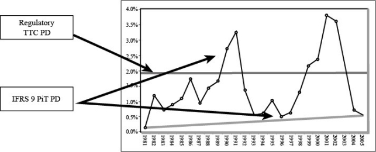

# 45 - Impairment (IFRS 9)

[返回目录](README.md)

## Illustrative text

### FAQ 45.4.1 – Presentation of interest income and the unwinding of the ECL discount for stage 3 credit-impaired financial assets

 

Reference to standard: IFRS 9 para 5.4.1  
 Reference to standing text: [45.4](71.md#s290-Para_45.4)  Banking &amp; capital markets

  

  
**Question:**

In which line item in the income statement should an entity recognise the unwinding of the discount (at the effective interest rate (EIR)) on the loss allowance for expected credit losses (ECL) for a stage 3 financial asset?

A stage 3 financial asset is a credit-impaired financial asset that is not a purchased or originated credit-impaired asset.

**Solution:**

For a stage 3 financial asset, the unwinding of the discount on the lifetime ECL is debited to interest revenue in the income statement. In addition the unwinding of the discount on the gross carrying amount of the asset at the EIR is credited to interest revenue. Thus, interest revenue for a stage 3 asset will represent the EIR applied to the amortised cost of the asset, in accordance with paragraph 5.4.1(b) of IFRS 9.

This is illustrated in the following simplified example, which was discussed by the Transition Resource Group for Impairment of Financial Instruments (ITG) at its meeting in December 2015.

An entity holds a stage 3 financial asset measured at amortised cost. The EIR is 10%. At 31 December 20X1, the gross carrying amount of the asset (before deducting the loss allowance) is CU100, and the amortised cost (after deducting the loss allowance) is CU40. Accordingly, the lifetime ECL at 31 December 20X1 is CU60.

Between 31 December 20X1 and 31 December 20X2, there were no contractual cash flows, cash settlements and no change in the expected timing or amount of cash flows on the asset. (For the purposes of this illustration, the effects of compound interest have been ignored.)

The table below summarises the application of the EIR in 20X2 and the carrying amounts at 31 December 20X2.

<table style="width:100%; border-collapse:collapse"><tr><td style="border:0.75pt solid #000000; padding-right:5.03pt; padding-left:5.03pt; vertical-align:top">
 
</td><td style="border:0.75pt solid #000000; padding-right:5.03pt; padding-left:5.03pt; vertical-align:top">
<b>At 31 December 20X1</b>  <b> (A)</b> <b>CU</b>
</td><td style="border:0.75pt solid #000000; padding-right:5.03pt; padding-left:5.03pt; vertical-align:top">
<b>Application of EIR in 20X2 </b>  <b>(B) = (EIR × (A))</b> <b>CU</b>
</td><td style="border:0.75pt solid #000000; padding-right:5.03pt; padding-left:5.03pt; vertical-align:top">
<b>At 31 December 20X2 (A+ B)</b>  <b>CU</b>
</td></tr><tr><td style="border:0.75pt solid #000000; padding-right:5.03pt; padding-left:5.03pt; vertical-align:top">
Gross carrying amount
</td><td style="border:0.75pt solid #000000; padding-right:5.03pt; padding-left:5.03pt; vertical-align:top">
100
</td><td style="border:0.75pt solid #000000; padding-right:5.03pt; padding-left:5.03pt; vertical-align:top">
10
</td><td style="border:0.75pt solid #000000; padding-right:5.03pt; padding-left:5.03pt; vertical-align:top">
110
</td></tr><tr><td style="border:0.75pt solid #000000; padding-right:5.03pt; padding-left:5.03pt; vertical-align:top">
Expected credit loss
</td><td style="border:0.75pt solid #000000; padding-right:5.03pt; padding-left:5.03pt; vertical-align:top">
(60)
</td><td style="border:0.75pt solid #000000; padding-right:5.03pt; padding-left:5.03pt; vertical-align:top">
(6)
</td><td style="border:0.75pt solid #000000; padding-right:5.03pt; padding-left:5.03pt; vertical-align:top">
(66)
</td></tr><tr><td style="border:0.75pt solid #000000; padding-right:5.03pt; padding-left:5.03pt; vertical-align:top">
Amortised cost
</td><td style="border:0.75pt solid #000000; padding-right:5.03pt; padding-left:5.03pt; vertical-align:top">
40
</td><td style="border:0.75pt solid #000000; padding-right:5.03pt; padding-left:5.03pt; vertical-align:top">
4
</td><td style="border:0.75pt solid #000000; padding-right:5.03pt; padding-left:5.03pt; vertical-align:top">
44
</td></tr></table>

  
 Interest revenue for the 12 months to 31 December 20X2 is CU4, being the application of the EIR to the amortised cost of the asset. This comprises the unwinding of the discount (at the EIR) on the gross carrying amount (CU10 = CU100 × 10%) less the unwinding of the discount (at the EIR) on the ECL (CU6 = CU60 × 10%).

 

### FAQ 45.4.2 – Would the IFRS 9 ‘stage 3’ expected credit loss provision be the same as the IAS 39 incurred loss provision?

 

Reference to standard: IFRS 9 App A  
 Reference to standing text: [45.4](71.md#s290-Para_45.4)  Banking &amp; capital markets

  

**Background**:

The expected credit loss (ECL) for credit-impaired or ‘stage 3’ assets within the IFRS 9 impairment model is sometimes referred to as equivalent to the IAS 39 incurred loss impairment provision, implying that the relevant populations of financial instruments and the impairment measurement will be the same.

**Question 1:**

Will the same population of financial instruments always be included in IFRS 9’s ‘stage 3’ as would have been included in an IAS 39 incurred loss provision?

**Solution 1:**

No. The definitions are similar, but the list of impairment triggers set out in paragraph 59 of IAS 39 includes "f) observable data indicating that there is a measurable decrease in the estimated future cash flows from a group of financial assets since the initial recognition of those assets, although the decrease cannot yet be identified with the individual financial assets in the group". This is sometimes referred to as 'incurred but not reported' (or ‘IBNR’). The definition of 'credit impaired' in Appendix A to IFRS 9 does not include equivalent wording. Therefore, such loans will typically be reported within stage 2 under IFRS 9, rather than stage 3.

There are also other scoping differences between IAS 39 and IFRS 9 that could lead to differences between the populations (for example, loan commitments are outside the scope of IAS 39 impairment but within the scope of IFRS 9 impairment).

**Question 2:**

Where a loan will be included in IFRS 9’s ‘stage 3’ and would have been included in an IAS 39 incurred loss provision, will the amount of the provision always be the same under IFRS 9 as under IAS 39?

**Solution 2:**

No. IAS 39 impairment provisions for specific loans are often estimated, based only on a single best estimate that reflects the most likely realisation or 'work-out' strategy. Paragraph 5.5.17 of IFRS 9 requires the measurement of ECL to be an unbiased and probability-weighted amount, determined by evaluating a range of possible outcomes. The consideration of multiple possible outcomes might have a particularly significant impact on portfolios such as distressed corporate loans, where the initial work-out strategy is not always successful, and an alternative strategy with a materially worse outcome then has to be followed. This should be appropriately reflected in the measurement of IFRS 9 ECL.

 

### FAQ 45.4.3 – Date of change of calculation of interest revenue for financial assets that become (or cease to be) credit-impaired

 

Reference to standard: IFRS 9 paras 5.4.1 and 5.4.2  
 Reference to standing text: [45.4](71.md#s290-Para_45.4)  Banking &amp; capital markets

  

**Background:**

Paragraph 5.4.1(b) of IFRS 9 requires entities to apply the effective interest rate (EIR) to the amortised cost of financial assets that have become credit-impaired in subsequent reporting periods.

If the financial asset is no longer credit-impaired,paragraph 5.4.2 of IFRS 9 requires interest revenue to be calculated, in subsequent reporting periods, by applying the EIR to the gross carrying amount.

**Question 1:**

What is meant by ‘subsequent reporting period’ in paragraphs 5.4.1(b) and 5.4.2 of IFRS 9?

**Solution 1:**

If an entity does not prepare interim reports in accordance with IFRS, the subsequent reporting period is the next annual reporting period.

Otherwise, the subsequent reporting period is the interim reporting period following the date when the financial asset was identified as becoming credit-impaired or ceasing to be credit-impaired.

For example, consider an entity that prepares quarterly interim reports in accordance with IAS 34. If the entity identifies that a financial asset has moved from stage 2 to stage 3 in the second quarter of the financial year, the entity should calculate interest revenue by applying the EIR to the amortised cost of the financial asset from the beginning of the third quarter.

Similarly, if an entity identifies that a financial asset ceases to be credit-impaired (that is, it has moved from stage 3 to stage 2) in the third quarter of the financial year, the entity will cease calculating interest revenue by applying the EIR to the amortised cost of the financial asset at the end of the third quarter, and it will recognise interest revenue based on the gross carrying amount from the beginning of the fourth quarter.

**Question 2:**

Some entities might assess whether financial assets have become credit-impaired on an ongoing basis instead of performing the assessment only at reporting dates.

Would it be acceptable to change the interest calculation for a financial asset from a date before the beginning of the subsequent reporting period, if the financial asset was identified as being credit-impaired (or ceasing to be credit-impaired) at this date?

**Solution 2:**

Yes. Although there is no requirement to change the interest calculation before the beginning of the subsequent reporting period, for financial assets that have been identified as moving from stage 2 to stage 3 (or vice versa), an entity could choose, as an accounting policy choice, to change the interest calculation from the date when the financial asset was identified as becoming, or ceasing to be, credit-impaired.

This approach is confirmed in paragraph BC 5.78 of IFRS 9, which states that: “The IASB is of the view that, conceptually, an entity should assess whether financial assets have become credit-impaired on an ongoing basis, thus altering the presentation of interest revenue as the underlying economics change. However, the IASB noted that such an approach would be unduly onerous for preparers to apply. Thus, the IASB decided that an entity should be required to make the assessment of whether a financial asset is credit-impaired at the reporting date and then change the interest calculation from the beginning of the following reporting period”.

 

### FAQ 45.4.4 – Presentation of interest income for finance lease receivables

 

Reference to standard: IFRS 9 paras 5.4.1 and 5.4.2  
 Reference to standing text: [45.4](71.md#s290-Para_45.4) and [15.126](33.md#s110-Para_15.126) 

  

  
**Question:**

Paragraphs 5.4.1 and 5.4.2 of IFRS 9 require interest income for financial assets to be calculated by applying the effective interest rate to:

- the gross carrying amount of financial assets that are not credit-impaired (that is, stage 1 and stage 2); and

- the amortised cost of financial assets that are credit-impaired (that is, stage 3).

Should the presentation of interest income, specifically in respect of this interaction with ECL staging, be similar for finance lease receivables?

**Solution:**

Yes. The presentation of interest income for finance lease receivables should follow similar principles to that in paragraphs 5.4.1 and 5.4.2 of IFRS 9. That is, interest income should be presented based on the net investment in the lease for finance lease receivables that are not credit-impaired (that is, in stage 1 and stage 2) and presented based on the net investment in the lease after deducting expected credit losses for finance lease receivables that are credit-impaired (that is, in stage 3).

The impairment requirements of IFRS 9 apply to finance lease receivables recognised by a lessor. IFRS 9 does not specify whether paragraphs 5.4.1 and 5.4.2 form part of the impairment requirements. However, the presentation of interest income in IFRS 9 is inextricably linked to the impairment requirements, and so the same principles should be applied by lessors. This would also be consistent with the treatment of other financial assets held by lessors.

As noted in paragraphs B5.5.34 and B5.5.46 of IFRS 9, cash flows used to measure expected credit losses on a finance lease receivable should be consistent with the cash flows used in measuring the finance lease receivable in accordance with IFRS 16 and discounted using the interest rate implicit in the lease in accordance with IFRS 16.

 

### FAQ 45.10.1 – Loan commitments – scope

Reference to standard: IFRS 9 para 5.5.1  
 Reference to standing text: [45.10](71.md#s290-Para_45.10) 

  

  
**Question 1:**

Is a commitment to provide credit in the period from the inception of a finance lease agreement until the commencement of that lease within the scope of the new impairment requirements?

**Solution 1:**

This issue was discussed by the IFRS Transition Resource Group for Impairment of Financial Instruments (‘ITG’) in its April 2015 meeting. The ITG agreed that, for such commitments to extend credit to be subject to the IFRS 9 impairment requirements, they must:

- meet the definition of a loan commitment; and

- meet the definition of a financial instrument which is in the scope of IFRS 9.

The ITG members strongly questioned whether, at inception, the commitment to provide credit would meet the definition of a financial instrument. Even though some contracts, such as irrevocable finance lease agreements, might clearly contain a firm commitment at inception to provide credit under pre-specified terms and conditions, it was noted by the ITG that they also must meet the definition of a financial instrument before they are within the scope of IFRS 9.

**Question 2:**

Is a commitment to extend credit under store accounts within the scope of the new impairment requirements?

**Solution 2:**

This issue was also discussed by the Impairment Transition Resource Group (‘ITG’) in its April 2015 meeting. The ITG generally agreed that the store accounts discussed during the meeting would not meet the definition of a loan commitment, because the issuer has the discretion to refuse to sell products or services to a customer, and hence can avoid extending credit. The issuer has no contractual obligation and can cancel the store account at any point. It was also noted that such commitments are executory in nature and do not meet the definition of a financial instrument under IFRS 9.

### FAQ 45.10.2 – What is a loan commitment for the purposes of applying IFRS 9’s impairment requirements?

 

Reference to standard: IFRS 9 para 2.1(g)   
  Reference to standing text: [45.10](71.md#s290-Para_45.10)

  

  
**Question:**

The issuer of a loan commitment (except those loan commitments measured at fair value through profit or loss as described in [paragraph 2.3](08.md#s13-Para_2.3) of IFRS 9) shall apply IFRS 9’s impairment requirements. While IFRS 9 does not contain a definition of a loan commitment, paragraph BCZ2.2 of IFRS 9 states that loan commitments are firm commitments to provide credit under pre-specified terms and conditions.

A bank commits to providing a loan where the price is to be determined on draw-down at the discretion of the bank. However, the price must be set in good faith and in line with general market conditions on the date of draw-down – that is, the bank is not able to set defensively or unreasonably high interest rates to avoid making the loan. Is this loan commitment in scope of the impairment requirements of IFRS 9?

**Solution:**

Yes. If the terms and conditions of the arrangement give rise to an enforceable contract to extend credit, a loan commitment within the scope of IFRS 9’s impairment requirements will exist. It is not necessary that the price of the loan to be provided is fixed at the date of entering into the loan commitment.

 

### FAQ 45.10.3 – Do legally binding arrangements to deliver non-financial items in the future on credit meet the definition of a loan commitment to which the impairment provisions in IFRS 9 apply?

 

Reference to standard: IFRS 9 para 2.1(j)   
  Reference to standing text: [45.10](71.md#s290-Para_45.10)  
 

  

  
 **Question:**

Entities often enter into contracts to sell and physically deliver goods or services where the customer is granted credit to pay the purchase price at some time after delivery.

Such contracts may result in a legally binding irrevocable commitment of the supplier:

- to sell the non-financial items; and

- to grant credit to the customer for the purchase price on pre-specified conditions.

Do such contracts give rise to a loan commitment in the financial statements of the seller during the period from signing the contract until the date of delivery?

**Solution:**

No. Such contracts relate to the delivery of non-financial items. The guidance in IFRS 9 on loan commitments applies to commitments to provide a loan (that is, a commitment to provide financial assets). Paragraph 2.1(j) of IFRS 9 excludes from its scope rights and obligations from the delivery of goods as a result of a contract with a customer within the scope of IFRS 15 – such executory contracts to which the own use exemption in paragraph 2.4 of IFRS 9 applies are covered by IFRS 15. Thus, there is no financial instrument – and the impairment requirements in IFRS 9 do not apply – until delivery has occurred.

However, other standards may require an expense to be recognised in some situations - for example, if the contract is onerous, IAS 37 would apply.

Also, there would be a loan commitment and the impairment requirements in IFRS 9 would apply if the reporting entity only commits to provide financing without being party to the contract to supply goods and services. For example, this could be the case where one subsidiary in a group sells goods and services and a different subsidiary commits to provide the customer with financing for that sale, in the separate financial statements of the second subsidiary.

 

### FAQ 45.12.1 – Implications of deferred consideration in contracts with customers on profit recognition

 

Reference to standard: IFRS 15 paras 60, 108; IFRS 9 para 5.5.15  
 Reference to standing text: [45.12](71.md#s291-Para_45.12), [11.97](19.md#s68-Para_11.97), [11.299](19.md#s72-Para_11.299) 

  

  
**Question:**

An entity sells and delivers goods to a customer on 31 December 20X1, at which point revenue is recognised in accordance with IFRS 15. Consideration of CU1,000 is due two years later, in respect of which the entity recognises a receivable (and/or a contract asset). Cost of sales is CU800. At the reporting date of 31 December 20X1, can the entity recognise a profit of CU200?

**Solution:**

No. The profit recognised by the entity at the reporting date will be reduced to reflect the following two factors:

- The significant financing component. For those contracts where cash is received a significant period after performance, and that contain a significant financing component, revenue recognised will be less than the cash due. This is because a portion of the consideration will be recorded separately as interest income over the two-year financing period. For example, if the discount rate is 5% (comprising of a risk-free rate and a credit spread), the receivable (or contract asset) and revenue would be initially recognised at CU907, being the fair value of the consideration due. Over the next two years, interest income of CU93 would be recognised as the discount unwinds, provided that the receivable is not in stage 3.   
  
[IFRS 15 para 60]. [IFRS 9 para 5.4.1].

- Expected credit losses (ECL). At the reporting date, the entity will recognise a provision for ECL arising on the receivable (or contract asset) due from the customer in two years’ time. The corresponding impairment loss is recognised in the income statement separately from revenue (that is, it is not a reduction of revenue). The provision for ECL is revised at each reporting date until the receivable (or contract asset) is derecognised, with increases or decreases in the provision recognised in the income statement. Hence, if the customer pays in full when the receivable falls due, the initial impairment loss will be reversed in subsequent accounting periods.   
  
[IFRS 15 para 108]. [IFRS 9 para 5.5.15].

Consequently, in the period of revenue recognition, there is an apparent ‘double-hit’ to profit from taking into account credit risk in both the discount rate used to discount the receivable (or contract asset) with a significant financing component and the ECL provision.

 

### FAQ 45.12.2 – Impairment of receivables arising from executory contracts

 

**Background**

 

A manufacturer is selling to a customer under a firmly committed long-term sales contract. On 1 January 20x1, the customer committed to purchase CU1,000 of product per year over a 10-year period.

 

At 31 December 20x1, the customer defaults at the time where CU1,000 of receivables are outstanding. The entity pays only CU300 of the receivable on 1 January 20x2, due to financial difficulty, and then it indicates that it will resume full payments in 20x2 for the remaining term. Therefore, CU9,300 of total cash flows are expected to be received over the entire contract.

 

The manufacturer believes that it is better to continue selling to the customer, in order to maximise the total cash flows over the term of the contract, rather than pursuing recovery actions against the customer. The terms of the sale contract stipulate that any cash flows received over the remaining term of the contract should first be applied to the oldest outstanding receivable.

 

The entity applies the lifetime expected credit loss practical expedient under IFRS 9.

 

For simplification purposes only, a 100% likelihood of receipt of the revised cash flows is assumed, in order to illustrate the accounting. In practice, the probability of collection will not be 100%. Additionally, the 10-year contract is determined to be profitable, even after the CU700 loss is taken into account (including after considering the time value of money), and there is no impairment indicator for the cash-generating unit (CGU) to which the contract relates.

 

**Question**

 

How should the expected credit loss against the receivable be computed?

 

**Answer**

 

The terms of the sale contract stipulate that any cash flows received over the remaining term of the contract should first be applied to the oldest outstanding receivable. Accordingly, the entity expects to collect the CU1,000 outstanding receivable in full through the CU300 in cash flows received directly for the 20x1 invoice and the first CU700 that the customer pays in 20x2 relating to the 20x2 invoice, which will be applied by the manufacturer to the 20x1 invoice under the terms of the contract. Accordingly, the expected credit loss for the 20x1 invoice assumes the collection of the full CU1,000 (and, in this simplified example where it is assumed that collection of CU1,000 is 100% probable, no expected credit loss is recognised).

 

Paragraph 5.5.1 of IFRS 9 only requires expected credit losses be measured on a financial asset, a contract asset, or a loan commitment. It does not apply to executory contracts under which both parties have only partially performed. However, the entity would need to assess whether it has an onerous contract for the remaining term under IAS 37 (if the expected cost of fulfilling the 10 years of sales exceeds the expected benefits) or an impairment indicator for the related CGU to which the contract relates under IAS 36. In this simplified example, the manufacturer determined that the contract remains profitable, even after the CU700 loss is taken into account, and so the definition of an onerous contract in IAS 37 is not met. Additionally, in this simplified example, it is determined that there is no impairment indicator for the related CGU under IAS 36.

 

Alternatively, the entity could consider that the losses relate to the first recognised receivable in full, irrespective of the contractual stipulation in the terms of the sale contract of what is being paid. In this case, the entity will record a provision of CU700 against the receivable arising from the 20x1 invoice.

Considering that IFRS 9 does not contain explicit guidance on how to apply the expected credit loss model to a contract that comprises both recognised and unrecognised receivables, entities should develop an accounting policy in accordance with paragraph 10 of IAS 8, apply it consistently and consider the appropriate disclosures to make in respect of the policy.

### FAQ 45.13.1 – Use of an impairment provision matrix

 

Reference to standard: IFRS 9 para 5.5.15  
 Reference to standing text: [45.13](71.md#s291-Para_45.13) 

  

  
**Question:**

A non-financial entity holds trade receivables that do not have a significant financing component. The entity would like to use a provision matrix to determine lifetime expected credit losses (ECL). What are the key factors to consider in developing a provision matrix that is compliant with IFRS 9?

**Solution:**

IFRS 9 allows a provision matrix to be used for recognising ECL on trade receivables. Factors to consider in developing such a provision matrix include:

- Appropriately grouping receivables if historical (or forecast) credit loss experience shows significantly different loss patterns for different customer segments. For example, receivables could be grouped by geographical region, product type, customer rating, collateral or trade credit insurance, or type of customer.

- Adjusting historical credit loss experience to incorporate relevant, current and more forward-looking information that is reasonable and supportable, and available without undue cost or effort at the reporting date.

- Determining different loss rates for the different ageing ‘buckets’ of trade receivables. For example, older receivables would be expected to have a higher loss rate than more current receivables.

In order to determine the amount of ECL to be recognised in the financial statements, the entity could set up a provision matrix, based on its historical observed default rates, which is adjusted for forward-looking information. See [EX 45.13.2](72.md#s292-EX45.13.2) for an illustrative example.

 

### EX 45.13.2 – Example of a provision matrix for corporates

 

Reference to standard: IFRS 9 para B5.5.35  
 Reference to standing text: [45.13](71.md#s291-Para_45.13) 

  

  
**Question:**

A non-financial entity has trade receivables of CU140 that do not have a significant financing component at the reporting date. The entity wants to use a provision matrix to determine the lifetime expected credit loss (ECL) for its trade receivables, as permitted by IFRS 9. It is proposing to analyse its trade receivables into time buckets and apply a standard historical loss rate to those time buckets, as illustrated below:

<table style="width:100%; border-collapse:collapse"><tr><td style="border:0.75pt solid #000000; padding-right:5.03pt; padding-left:5.03pt; vertical-align:top">
 
</td><td style="border:0.75pt solid #000000; padding-right:5.03pt; padding-left:5.03pt; vertical-align:top">
<b>Total receivables</b>
</td><td style="border:0.75pt solid #000000; padding-right:5.03pt; padding-left:5.03pt; vertical-align:top">
<b>Current</b>
</td><td style="border:0.75pt solid #000000; padding-right:5.03pt; padding-left:5.03pt; vertical-align:top">
<b>30–60 days</b>
</td><td style="border:0.75pt solid #000000; padding-right:5.03pt; padding-left:5.03pt; vertical-align:top">
<b>60–90 days</b>
</td><td style="border:0.75pt solid #000000; padding-right:5.03pt; padding-left:5.03pt; vertical-align:top">
<b>After 90 days</b>
</td></tr><tr><td style="border:0.75pt solid #000000; padding-right:5.03pt; padding-left:5.03pt; vertical-align:top">
Trade receivable balances at reporting date: [1]
</td><td style="border:0.75pt solid #000000; padding-right:5.03pt; padding-left:5.03pt; vertical-align:top">
CU140
</td><td style="border:0.75pt solid #000000; padding-right:5.03pt; padding-left:5.03pt; vertical-align:top">
CU50
</td><td style="border:0.75pt solid #000000; padding-right:5.03pt; padding-left:5.03pt; vertical-align:top">
CU40
</td><td style="border:0.75pt solid #000000; padding-right:5.03pt; padding-left:5.03pt; vertical-align:top">
CU30
</td><td style="border:0.75pt solid #000000; padding-right:5.03pt; padding-left:5.03pt; vertical-align:top">
CU20
</td></tr><tr><td style="border:0.75pt solid #000000; padding-right:5.03pt; padding-left:5.03pt; vertical-align:top">
Loss rate: [2]
</td><td style="border:0.75pt solid #000000; padding-right:5.03pt; padding-left:5.03pt; vertical-align:top">
 
</td><td style="border:0.75pt solid #000000; padding-right:5.03pt; padding-left:5.03pt; vertical-align:top">
3%
</td><td style="border:0.75pt solid #000000; padding-right:5.03pt; padding-left:5.03pt; vertical-align:top">
3%
</td><td style="border:0.75pt solid #000000; padding-right:5.03pt; padding-left:5.03pt; vertical-align:top">
3%
</td><td style="border:0.75pt solid #000000; padding-right:5.03pt; padding-left:5.03pt; vertical-align:top">
3%
</td></tr><tr><td style="border:0.75pt solid #000000; padding-right:5.03pt; padding-left:5.03pt; vertical-align:top">
Expected credit loss:

<b>[1] × [2]</b>
</td><td style="border:0.75pt solid #000000; padding-right:5.03pt; padding-left:5.03pt; vertical-align:top">
<b>CU4.2</b>
</td><td style="border:0.75pt solid #000000; padding-right:5.03pt; padding-left:5.03pt; vertical-align:top">
<b>CU1.5</b>
</td><td style="border:0.75pt solid #000000; padding-right:5.03pt; padding-left:5.03pt; vertical-align:top">
<b>CU1.2</b>
</td><td style="border:0.75pt solid #000000; padding-right:5.03pt; padding-left:5.03pt; vertical-align:top">
<b>CU0.9</b>
</td><td style="border:0.75pt solid #000000; padding-right:5.03pt; padding-left:5.03pt; vertical-align:top">
<b>CU0.6</b>
</td></tr></table>

  
 Can the entity use the above approach to determine its IFRS 9 ECL provision?

**Solution:**

No, not necessarily. This is because, to the extent that reasonable and supportable information is available without undue cost or effort, a provision matrix for IFRS 9 purposes should reflect:

- relevant forward-looking information; and

- different loss rates for different time buckets of receivables, since older receivables would be expected to have a lower probability of settlement, and hence a higher loss rate.

In addition, depending on the diversity of its customer base, the entity should use different provision matrices for different groups of receivables on the basis of shared credit risk characteristics. This would be the case if historical (and/or forecast) credit loss experience shows significantly different loss patterns for different customer segments. For example, receivables could be grouped by geographical region, product type, customer rating, collateral or trade credit insurance, or type of customer.

IFRS 9 is not prescriptive about how to develop a provision matrix. One approach is illustrated below. However, other approaches might be appropriate, provided that they are consistent with the principles in IFRS 9.

Step 1: Define the period of sales and bad debts related to those sales

For each group of receivables, the entity defines a historical period of sales and determines how much of the receivables in respect of those sales resulted in cash losses. The period of sales used should be such that the historical losses arising are a valid representation of loss patterns. For example, data for only a few months is unlikely to be sufficiently long, although using too long a period might not be appropriate if there have been significant changes in the marketplace over that period. A newly established entity, or an entity entering a new market, might not have sufficient historical data of its own, in which case it might need to rely on external data such as industry loss ratios.

In this FAQ, for illustrative purposes only, a period of one year is determined to be appropriate, but the period to be used in practice would depend on the facts and circumstances of each case. In that year, CU10,000 of sales were made on credit (that is, trade receivables recognised), and cash losses of CU300 were incurred in relation to those sales.

Step 2: Calculate the historical payment profile of the trade receivables

To determine the historical default rate for each time bucket of receivables, the payment profile for the receivables arising in the historical period of sales must be determined.

In this FAQ, of the total sales of CU10,000, customers paid CU2,000 within 30 days of the sale date. Therefore, CU8,000 of the sales were still outstanding after 30 days. Customers paid an additional CU3,500 within the next 30 days, resulting in CU4,500 sales that were not paid within 60 days. This analysis continues, as shown below, until ultimately the remaining unpaid receivables of CU300 are written off as losses by the entity:

<table style="width:100%; border-collapse:collapse"><tr><td style="border:0.75pt solid #000000; padding-right:5.03pt; padding-left:5.03pt; vertical-align:top">
<b>Total sales (CU):</b>
</td><td style="border:0.75pt solid #000000; padding-right:5.03pt; padding-left:5.03pt; vertical-align:top">
<b>10,000</b>
</td><td style="border:0.75pt solid #000000; padding-right:5.03pt; padding-left:5.03pt; vertical-align:top">
<b>Total paid:</b>
</td><td style="border:0.75pt solid #000000; padding-right:5.03pt; padding-left:5.03pt; vertical-align:top">
<b>Ageing profile of sales (step 3):</b>
</td></tr><tr><td style="border:0.75pt solid #000000; padding-right:5.03pt; padding-left:5.03pt; vertical-align:top">
Paid in 30 days:
</td><td style="border:0.75pt solid #000000; padding-right:5.03pt; padding-left:5.03pt; vertical-align:top">
(2,000)
</td><td style="border:0.75pt solid #000000; padding-right:5.03pt; padding-left:5.03pt; vertical-align:top">
(2,000)
</td><td style="border:0.75pt solid #000000; padding-right:5.03pt; padding-left:5.03pt; vertical-align:top">
8,000
</td></tr><tr><td style="border:0.75pt solid #000000; padding-right:5.03pt; padding-left:5.03pt; vertical-align:top">
Paid between 30 and 60 days:
</td><td style="border:0.75pt solid #000000; padding-right:5.03pt; padding-left:5.03pt; vertical-align:top">
(3,500)
</td><td style="border:0.75pt solid #000000; padding-right:5.03pt; padding-left:5.03pt; vertical-align:top">
(5,500)
</td><td style="border:0.75pt solid #000000; padding-right:5.03pt; padding-left:5.03pt; vertical-align:top">
4,500
</td></tr><tr><td style="border:0.75pt solid #000000; padding-right:5.03pt; padding-left:5.03pt; vertical-align:top">
Paid between 60 and 90 days:
</td><td style="border:0.75pt solid #000000; padding-right:5.03pt; padding-left:5.03pt; vertical-align:top">
(3,000)
</td><td style="border:0.75pt solid #000000; padding-right:5.03pt; padding-left:5.03pt; vertical-align:top">
(8,500)
</td><td style="border:0.75pt solid #000000; padding-right:5.03pt; padding-left:5.03pt; vertical-align:top">
1,500
</td></tr><tr><td style="border:0.75pt solid #000000; padding-right:5.03pt; padding-left:5.03pt; vertical-align:top">
Paid after 90 days:
</td><td style="border:0.75pt solid #000000; padding-right:5.03pt; padding-left:5.03pt; vertical-align:top">
(1,200)
</td><td style="border:0.75pt solid #000000; padding-right:5.03pt; padding-left:5.03pt; vertical-align:top">
(9,700)
</td><td style="border:0.75pt solid #000000; padding-right:5.03pt; padding-left:5.03pt; vertical-align:top">
<b>300 </b>[loss]
</td></tr></table>

  
 Step 3: Calculate the historical loss rate

This step calculates the historical loss rate for each time bucket of receivables. From the CU10,000 sales made in the period, there were losses of CU300. Therefore, these CU300 receivables are included within the amount outstanding in each of the time buckets (because the cash was never received), even though the amount outstanding reduces for each subsequent period. For each time bucket, the historical loss rate can be determined by dividing the ultimate loss (of CU300) by the amounts outstanding in that time bucket, as illustrated below:

<table style="width:100%; border-collapse:collapse"><tr><td style="border:0.75pt solid #000000; padding-right:5.03pt; padding-left:5.03pt; vertical-align:top">
 
</td><td style="border:0.75pt solid #000000; padding-right:5.03pt; padding-left:5.03pt; vertical-align:top">
<b>Current sales</b>
</td><td style="border:0.75pt solid #000000; padding-right:5.03pt; padding-left:5.03pt; vertical-align:top">
<b>Payments outstanding after 30 days</b>
</td><td style="border:0.75pt solid #000000; padding-right:5.03pt; padding-left:5.03pt; vertical-align:top">
<b>Payments outstanding after 60 days</b>
</td><td style="border:0.75pt solid #000000; padding-right:5.03pt; padding-left:5.03pt; vertical-align:top">
<b>Payments outstanding after 90 days</b>
</td></tr><tr><td style="border:0.75pt solid #000000; padding-right:5.03pt; padding-left:5.03pt; vertical-align:top">
Ageing profile of sales: [1]
</td><td style="border:0.75pt solid #000000; padding-right:5.03pt; padding-left:5.03pt; vertical-align:top">
CU10,000
</td><td style="border:0.75pt solid #000000; padding-right:5.03pt; padding-left:5.03pt; vertical-align:top">
CU8,000
</td><td style="border:0.75pt solid #000000; padding-right:5.03pt; padding-left:5.03pt; vertical-align:top">
CU4,500
</td><td style="border:0.75pt solid #000000; padding-right:5.03pt; padding-left:5.03pt; vertical-align:top">
CU1,500
</td></tr><tr><td style="border:0.75pt solid #000000; padding-right:5.03pt; padding-left:5.03pt; vertical-align:top">
Loss: [2]
</td><td style="border:0.75pt solid #000000; padding-right:5.03pt; padding-left:5.03pt; vertical-align:top">
CU300
</td><td style="border:0.75pt solid #000000; padding-right:5.03pt; padding-left:5.03pt; vertical-align:top">
CU300
</td><td style="border:0.75pt solid #000000; padding-right:5.03pt; padding-left:5.03pt; vertical-align:top">
CU300
</td><td style="border:0.75pt solid #000000; padding-right:5.03pt; padding-left:5.03pt; vertical-align:top">
CU300
</td></tr><tr><td style="border:0.75pt solid #000000; padding-right:5.03pt; padding-left:5.03pt; vertical-align:top">
Loss rate:

<b>[2] / [1]</b>
</td><td style="border:0.75pt solid #000000; padding-right:5.03pt; padding-left:5.03pt; vertical-align:top">
<b>3%</b>
</td><td style="border:0.75pt solid #000000; padding-right:5.03pt; padding-left:5.03pt; vertical-align:top">
<b>3.75%</b>
</td><td style="border:0.75pt solid #000000; padding-right:5.03pt; padding-left:5.03pt; vertical-align:top">
<b>6.67%</b>
</td><td style="border:0.75pt solid #000000; padding-right:5.03pt; padding-left:5.03pt; vertical-align:top">
<b>20%</b>
</td></tr></table>

  
 Step 4: Adjust the loss rate for current and forward-looking information

The historical loss rate should be adjusted to reflect current and forward-looking information that might affect the ability of customers to settle the receivables. Such information should be reasonable and supportable, and it should be available without undue cost or effort. Consideration should be given to the impact of expected changes in the economic, regulatory and technological environment (such as industry outlook, GDP, employment, politics), and external market indicators.

For example, there might be a historical correlation between unemployment rates and the loss rate. In that case, if unemployment over the expected period of outstanding receivables is expected to be higher or lower than the historical average over the period in which losses have been observed, an adjustment would be needed to the historical loss.

In this FAQ, an economic downturn and increase in unemployment rates compared with the historical period of sales is expected to lead to losses of CU400, rather than CU300, per CU10,000 of sales. Provided that sales and the payment profile are expected to remain materially the same as for the historical sales period, the expected loss rates are recalculated as illustrated below:

<table style="width:100%; border-collapse:collapse"><tr><td style="border:0.75pt solid #000000; padding-right:5.03pt; padding-left:5.03pt; vertical-align:top">
 
</td><td style="border:0.75pt solid #000000; padding-right:5.03pt; padding-left:5.03pt; vertical-align:top">
<b>Current sales</b>
</td><td style="border:0.75pt solid #000000; padding-right:5.03pt; padding-left:5.03pt; vertical-align:top">
<b>Payments outstanding after 30 days</b>
</td><td style="border:0.75pt solid #000000; padding-right:5.03pt; padding-left:5.03pt; vertical-align:top">
<b>Payments outstanding after 60 days</b>
</td><td style="border:0.75pt solid #000000; padding-right:5.03pt; padding-left:5.03pt; vertical-align:top">
<b>Payments outstanding after 90 days</b>
</td></tr><tr><td style="border:0.75pt solid #000000; padding-right:5.03pt; padding-left:5.03pt; vertical-align:top">
Ageing profile of sales: [1]
</td><td style="border:0.75pt solid #000000; padding-right:5.03pt; padding-left:5.03pt; vertical-align:top">
CU10,000
</td><td style="border:0.75pt solid #000000; padding-right:5.03pt; padding-left:5.03pt; vertical-align:top">
CU8,000
</td><td style="border:0.75pt solid #000000; padding-right:5.03pt; padding-left:5.03pt; vertical-align:top">
CU4,500
</td><td style="border:0.75pt solid #000000; padding-right:5.03pt; padding-left:5.03pt; vertical-align:top">
CU1,500
</td></tr><tr><td style="border:0.75pt solid #000000; padding-right:5.03pt; padding-left:5.03pt; vertical-align:top">
Expected loss: [2]
</td><td style="border:0.75pt solid #000000; padding-right:5.03pt; padding-left:5.03pt; vertical-align:top">
CU400
</td><td style="border:0.75pt solid #000000; padding-right:5.03pt; padding-left:5.03pt; vertical-align:top">
CU400
</td><td style="border:0.75pt solid #000000; padding-right:5.03pt; padding-left:5.03pt; vertical-align:top">
CU400
</td><td style="border:0.75pt solid #000000; padding-right:5.03pt; padding-left:5.03pt; vertical-align:top">
CU400
</td></tr><tr><td style="border:0.75pt solid #000000; padding-right:5.03pt; padding-left:5.03pt; vertical-align:top">
Expected loss rate:

<b>[2] / [1]</b>
</td><td style="border:0.75pt solid #000000; padding-right:5.03pt; padding-left:5.03pt; vertical-align:top">
<b>4%</b>
</td><td style="border:0.75pt solid #000000; padding-right:5.03pt; padding-left:5.03pt; vertical-align:top">
<b>5%</b>
</td><td style="border:0.75pt solid #000000; padding-right:5.03pt; padding-left:5.03pt; vertical-align:top">
<b>8.9%</b>
</td><td style="border:0.75pt solid #000000; padding-right:5.03pt; padding-left:5.03pt; vertical-align:top">
<b>27%</b>
</td></tr></table>

  
 Step 5: Calculate the ECL using the expected loss rates

The final step is to apply the expected loss rates to the ageing profile of the receivables at the reporting date to determine the total ECL:

<table style="width:100%; border-collapse:collapse"><tr><td style="border:0.75pt solid #000000; padding-right:5.03pt; padding-left:5.03pt; vertical-align:top">
 
</td><td style="border:0.75pt solid #000000; padding-right:5.03pt; padding-left:5.03pt; vertical-align:top">
<b>Total receivables</b>
</td><td style="border:0.75pt solid #000000; padding-right:5.03pt; padding-left:5.03pt; vertical-align:top">
<b>Current</b>
</td><td style="border:0.75pt solid #000000; padding-right:5.03pt; padding-left:5.03pt; vertical-align:top">
<b>30–60 days</b>
</td><td style="border:0.75pt solid #000000; padding-right:5.03pt; padding-left:5.03pt; vertical-align:top">
<b>60–90 days</b>
</td><td style="border:0.75pt solid #000000; padding-right:5.03pt; padding-left:5.03pt; vertical-align:top">
<b>After 90 days</b>
</td></tr><tr><td style="border:0.75pt solid #000000; padding-right:5.03pt; padding-left:5.03pt; vertical-align:top">
Trade receivable balances at reporting date: [1]
</td><td style="border:0.75pt solid #000000; padding-right:5.03pt; padding-left:5.03pt; vertical-align:top">
CU140
</td><td style="border:0.75pt solid #000000; padding-right:5.03pt; padding-left:5.03pt; vertical-align:top">
CU50
</td><td style="border:0.75pt solid #000000; padding-right:5.03pt; padding-left:5.03pt; vertical-align:top">
CU40
</td><td style="border:0.75pt solid #000000; padding-right:5.03pt; padding-left:5.03pt; vertical-align:top">
CU30
</td><td style="border:0.75pt solid #000000; padding-right:5.03pt; padding-left:5.03pt; vertical-align:top">
CU20
</td></tr><tr><td style="border:0.75pt solid #000000; padding-right:5.03pt; padding-left:5.03pt; vertical-align:top">
Loss rate: [2]
</td><td style="border:0.75pt solid #000000; padding-right:5.03pt; padding-left:5.03pt; vertical-align:top">
 
</td><td style="border:0.75pt solid #000000; padding-right:5.03pt; padding-left:5.03pt; vertical-align:top">
4%
</td><td style="border:0.75pt solid #000000; padding-right:5.03pt; padding-left:5.03pt; vertical-align:top">
5%
</td><td style="border:0.75pt solid #000000; padding-right:5.03pt; padding-left:5.03pt; vertical-align:top">
8.9%
</td><td style="border:0.75pt solid #000000; padding-right:5.03pt; padding-left:5.03pt; vertical-align:top">
27%
</td></tr><tr><td style="border:0.75pt solid #000000; padding-right:5.03pt; padding-left:5.03pt; vertical-align:top">
Expected credit loss:

<b>[1] × [2]</b>
</td><td style="border:0.75pt solid #000000; padding-right:5.03pt; padding-left:5.03pt; vertical-align:top">
<b>CU12</b>
</td><td style="border:0.75pt solid #000000; padding-right:5.03pt; padding-left:5.03pt; vertical-align:top">
<b>CU2</b>
</td><td style="border:0.75pt solid #000000; padding-right:5.03pt; padding-left:5.03pt; vertical-align:top">
<b>CU2</b>
</td><td style="border:0.75pt solid #000000; padding-right:5.03pt; padding-left:5.03pt; vertical-align:top">
<b>CU2.70</b>
</td><td style="border:0.75pt solid #000000; padding-right:5.03pt; padding-left:5.03pt; vertical-align:top">
<b>CU5.30</b>
</td></tr></table>

  
 The expected credit loss is CU12, which is higher than the CU4.2 that resulted from the method set out in the question. The difference reflects the impact of forward-looking information and that the loss rate of the receivables by ageing profile at the reporting date is not the same as the average loss rate in the historical reference period.

 

### EX 45.13.3 – Example of a provision matrix for corporates in a COVID-19 environment

 

Reference to standard: IFRS 9 para B5.5.35  
 Reference to standing text: [45.13](71.md#s291-Para_45.13) 

  

 

IFRS 9’s impairment model is an ‘expected credit loss’ (ECL) approach.

 

Given the complexity of implementing an expected loss model, IFRS 9 mandates a simplified approach for trade receivables without a significant financing component (and permits entities to use the same simplified approach for trade receivables with a significant financing component). Generally, normal trade receivables with terms of one year or less would not have a significant financing component. The simplification requires an entity to use lifetime ECL to measure its impairment provision against such receivables.

 

IFRS 9 allows a provision matrix to be used to determine the ECL for trade receivables. IFRS 9 is not prescriptive about how to develop a provision matrix. One approach is illustrated below. However, other approaches might also be appropriate, provided that they are consistent with the principles in IFRS 9.

 

The impact of COVID-19 on the provision matrix approach is highlighted for each step in the boxes below.

 

**COVID-19 impact – Overall**

- COVID-19 has had a significant impact on economies and has caused disruption to many companies’ operations. The economic environment has changed dramatically, and the impact on ECLs cannot be ignored.

- As a result, assumptions and simplifications used previously in provision matrices might no longer hold in a COVID-19 environment, and they might need to be revisited.

- The key pre-COVID-19 assumptions that need to be revisited include the following:

- groupings of receivables that share similar credit risk characteristics; and

- the inclusion of forward-looking information into the loss rates and use of multiple scenarios.

  

 

How does a provision matrix work?

 

A provision matrix uses past data and forward-looking information to calculate the ECL. A provision matrix essentially applies an expected loss rate to every ageing category of receivables, including the current category. Illustrative Example 12 in IFRS 9 provides the following simple example:

 

<table style="border-collapse:collapse"><tr><td style="border:0.75pt solid #000000; padding-right:5.03pt; padding-left:5.03pt; vertical-align:top">
 
</td><td style="border:0.75pt solid #000000; padding-right:5.03pt; padding-left:5.03pt; vertical-align:top">
<b>Current</b>
</td><td style="border:0.75pt solid #000000; padding-right:5.03pt; padding-left:5.03pt; vertical-align:top">
<b>1–30 days past due</b>
</td><td style="border:0.75pt solid #000000; padding-right:5.03pt; padding-left:5.03pt; vertical-align:top">
<b>31–60 days past due</b>
</td><td style="border:0.75pt solid #000000; padding-right:5.03pt; padding-left:5.03pt; vertical-align:top">
<b>61–90 days past due</b>
</td><td style="border:0.75pt solid #000000; padding-right:5.03pt; padding-left:5.03pt; vertical-align:top">
<b>More than 90 days past due</b>
</td></tr><tr><td style="border:0.75pt solid #000000; padding-right:5.03pt; padding-left:5.03pt; vertical-align:top">
Expected loss rate
</td><td style="border:0.75pt solid #000000; padding-right:5.03pt; padding-left:5.03pt; vertical-align:top">
0.3%
</td><td style="border:0.75pt solid #000000; padding-right:5.03pt; padding-left:5.03pt; vertical-align:top">
1.6%
</td><td style="border:0.75pt solid #000000; padding-right:5.03pt; padding-left:5.03pt; vertical-align:top">
3.6%
</td><td style="border:0.75pt solid #000000; padding-right:5.03pt; padding-left:5.03pt; vertical-align:top">
6.6%
</td><td style="border:0.75pt solid #000000; padding-right:5.03pt; padding-left:5.03pt; vertical-align:top">
10.6%
</td></tr></table>

 

<table style="border-collapse:collapse"><tr><td style="border:0.75pt solid #000000; padding-right:5.03pt; padding-left:5.03pt; vertical-align:top">
 
</td><td style="border:0.75pt solid #000000; padding-right:5.03pt; padding-left:5.03pt; vertical-align:top">
<b>Gross carrying amount of receivable</b>
</td><td style="border:0.75pt solid #000000; padding-right:5.03pt; padding-left:5.03pt; vertical-align:top">
<b>Lifetime expected credit loss allowance (Gross carrying amount × lifetime expected credit loss rate)</b>
</td></tr><tr><td style="border:0.75pt solid #000000; padding-right:5.03pt; padding-left:5.03pt; vertical-align:top">
Current &amp; accrued unbilled receivables
</td><td style="border:0.75pt solid #000000; padding-right:5.03pt; padding-left:5.03pt; vertical-align:top">
CU15,000,000
</td><td style="border:0.75pt solid #000000; padding-right:5.03pt; padding-left:5.03pt; vertical-align:top">
CU45,000
</td></tr><tr><td style="border:0.75pt solid #000000; padding-right:5.03pt; padding-left:5.03pt; vertical-align:top">
1–30 days past due
</td><td style="border:0.75pt solid #000000; padding-right:5.03pt; padding-left:5.03pt; vertical-align:top">
CU7,500,000
</td><td style="border:0.75pt solid #000000; padding-right:5.03pt; padding-left:5.03pt; vertical-align:top">
CU120,000
</td></tr><tr><td style="border:0.75pt solid #000000; padding-right:5.03pt; padding-left:5.03pt; vertical-align:top">
31–60 days past due
</td><td style="border:0.75pt solid #000000; padding-right:5.03pt; padding-left:5.03pt; vertical-align:top">
CU4,000,000
</td><td style="border:0.75pt solid #000000; padding-right:5.03pt; padding-left:5.03pt; vertical-align:top">
CU144,000
</td></tr><tr><td style="border:0.75pt solid #000000; padding-right:5.03pt; padding-left:5.03pt; vertical-align:top">
61–90 days past due
</td><td style="border:0.75pt solid #000000; padding-right:5.03pt; padding-left:5.03pt; vertical-align:top">
CU2,500,000
</td><td style="border:0.75pt solid #000000; padding-right:5.03pt; padding-left:5.03pt; vertical-align:top">
CU165,000
</td></tr><tr><td style="border:0.75pt solid #000000; padding-right:5.03pt; padding-left:5.03pt; vertical-align:top">
More than 90 days past due
</td><td style="border:0.75pt solid #000000; padding-right:5.03pt; padding-left:5.03pt; vertical-align:top">
CU1,000,000
</td><td style="border:0.75pt solid #000000; padding-right:5.03pt; padding-left:5.03pt; vertical-align:top">
CU106,000
</td></tr><tr><td style="border:0.75pt solid #000000; padding-right:5.03pt; padding-left:5.03pt; vertical-align:top">
Total
</td><td style="border:0.75pt solid #000000; padding-right:5.03pt; padding-left:5.03pt; vertical-align:top">
CU30,000,000
</td><td style="border:0.75pt solid #000000; padding-right:5.03pt; padding-left:5.03pt; vertical-align:top">
CU580,000
</td></tr></table>

 

ECL rates are developed for each ageing category, and they are applied to the outstanding balances to determine the ECLs and, ultimately, the ECL provision to be recognised.

 

It is important to note that each ageing category, including those receivables that are not past due, have an ECL rate. This is because, even for sales that have just occurred, there is a possibility that the debtor will not pay for credit reasons.

 

The term ‘expected’ is often used in everyday parlance to mean ‘more likely than not to occur’. However, in the context of ECL, ‘expected’ is used to refer to a probability-weighted amount calculated by multiplying various possible outcomes by the likelihood that each outcome will occur, and then adding up all of those values.

 

The outcome of the model looks very simple, but determining the ECL rate to apply often requires significant judgements to be made. We discuss some of the key considerations in establishing a provision matrix below, and we highlight the impact of COVID-19 on them.

 

What data and information are required to produce a provision matrix?

 

In its simplest form, a provision matrix requires history of past sales, the time from sale until payment receipt, and the amounts written off for the equivalent period.

 

**COVID-19 impact – Data**

**IFRS 9 versus IFRS 15**

Only those losses that are due to credit risk are within the scope of the ECL. This could include the losses from credit notes issued to debtors who do not have the ability to pay.

Other pricing adjustments or concessions (for example, due to disputes / discounts / inefficiencies) are subject to guidance in IFRS 15, ‘Revenue from contracts with customers’. The guidance in IFRS 15 should be applied prior to determining the amount of the credit loss allowance under IFRS 9.

As a result of COVID-19, a company might expect to give customers a discount, because goods or services could not be completed in the manner that was initially agreed in the contract. Such discounts would not be considered credit losses, and so they should not be incorporated into the estimates of ECL, as discussed further in [FAQ 45.49.9](72.md#s292-FAQ_45.49.9). However, the entity would need to determine how such estimated discounts impact the amount of revenue recognised for such contracts.

**Internal versus external**

Depending on the availability of internal data, management might have to supplement the internal data with external data and analysis to the extent necessary. For example, data regarding the impact of COVID-19 on the expected default rates of companies in particular industries or geographies might be available from credit rating agencies or other market information providers.

  

 

**Step 1: Define the portfolio**

 

- Depending on the diversity of its customer base, the entity should use different provision matrices for different groups of receivables on the basis of shared credit risk characteristics. This would be the case if historical and/or forecast credit loss experience shows significantly different loss patterns for different customer segments. For example, receivables could be grouped by:

- the relevant industry sector of the debtor;

- the geographical location of the debtor;

- whether the receivables are guaranteed or credit insured;

- what, if any, government reliefs have been provided that affect the receivable;

- whether payment terms have been extended in the light of COVID-19;

- the nature of the receivable, which might affect whether the debtor will repay it only after settling other claims (such as salaries and rents, that are more essential to its continued operation); or

- what, if any, actions have been taken to limit credit losses (for example, obtaining enhanced collateral).

 

**COVID-19 impact – Groupings of trade receivables**

- It is important to understand the drivers of credit risk for the underlying receivables and how these might have been impacted by COVID-19. In some cases, the driver of credit risk might be geographic, while in others it might be based on the nature of the customer, the industry that it operates in, and/or the nature of the goods/services. In a complex business, there will likely be multiple matrices – for example, product A in region B being sold to customer type C.

- For example, consider an entity that sells to large restaurant chains and grocery stores. Historically, the company might have found that the loss rates experienced in both customer bases were similar enough to justify a single provision matrix. However, the entity might now consider that restaurant chains which were closed due to social distancing were more significantly impacted by COVID-19 than grocery stores, which remained open during the pandemic. Accordingly, the entity might group the receivables from restaurants and grocery chains separately into different provision matrices.

- The groupings should be done in a way that facilitates the incorporation of forward-looking information, since customers that historically had relatively consistent patterns of losses might no longer be expected to have similar loss patterns in the future.

- The analysis might also need to go down to the individual customer level in some cases. For example, where a particular customer is known to be in financial difficulty as a result of COVID-19, it might require an increased provision compared to historical averages over all ageing categories. It is important to consider and avoid any double counting of losses, so a balance that is provided for specifically should not also be included in the wider general loss rate for that customer type.

- The level of grouping required is often a matter of significant judgement and, in developing groupings, an entity should consider where further disaggregation would be expected to lead to material changes.

  

 

**Step 2: Define the period of sales and bad debts related to those sales**

 

For each group of receivables, the entity will have defined an historical period of sales and determined how much of the receivables in respect of those sales resulted in cash losses. The period of sales used should have been such that, pre-COVID-19, the historical losses arising were a valid representation of loss patterns. The most recent historical losses might be appropriate in the period soon after the pandemic had an impact, because the entity might not have a history of a period for which historical losses arising were a valid representation of loss patterns. Lockdowns, social distancing and widespread government relief programmes are measures that have, for the most part, not been seen before. Alternative starting points could be a previous recession, if it had (more) similar effects to COVID-19, and the entity has (or can obtain) data for receivables that are similar to its current receivables. However, in either case, as time passes and the entity has actual historical data in a COVID-19 environment, it might be more suitable to use that as the starting point.

 

Additionally, where the entity is a newly established one, or it is entering into a new market, it might not have had sufficient historical data of its own, in which case it might need to rely on external data such as industry loss ratios.

 

Therefore, in this example, for illustrative purposes only, a period of one year, based on the most recent historical period, is used. Management has determined this to be appropriate as a starting point, prior to any adjustments for forward-looking information (considered in step 4 below). However, the period to be used in practice would depend on the facts and circumstances of each case. In that year, CU10,000 of sales were made on credit (that is, trade receivables recognised), and cash losses of CU300 were incurred in relation to those sales.

 

**Step 3: Calculate the historical payment profile of the trade receivables**

 

To determine the historical default rate for each time bucket of receivables, the payment profile for the receivables arising in the historical period of sales must be determined.

 

In this example, of the total sales of CU10,000, customers paid CU2,000 within 30 days of the sale date. Therefore, CU8,000 of the sales were still outstanding after 30 days. Customers paid an additional CU3,500 within the next 30 days, resulting in CU4,500 sales that were not paid within 60 days. This analysis continues, as shown below, until ultimately the remaining unpaid receivables of CU300 are written off as losses by the entity:

 

<table style="border-collapse:collapse"><tr><td style="border:0.75pt solid #000000; padding-right:5.03pt; padding-left:5.03pt; vertical-align:top">
<b>Total sales (CU):</b>
</td><td style="border:0.75pt solid #000000; padding-right:5.03pt; padding-left:5.03pt; vertical-align:top">
10,000
</td><td style="border:0.75pt solid #000000; padding-right:5.03pt; padding-left:5.03pt; vertical-align:top">
<b>Total paid:</b>
</td><td style="border:0.75pt solid #000000; padding-right:5.03pt; padding-left:5.03pt; vertical-align:top">
<b>Ageing profile of sales (step 3):</b>
</td></tr><tr><td style="border:0.75pt solid #000000; padding-right:5.03pt; padding-left:5.03pt; vertical-align:top">
Paid in 30 days:
</td><td style="border:0.75pt solid #000000; padding-right:5.03pt; padding-left:5.03pt; vertical-align:top">
(2,000)
</td><td style="border:0.75pt solid #000000; padding-right:5.03pt; padding-left:5.03pt; vertical-align:top">
(2,000)
</td><td style="border:0.75pt solid #000000; padding-right:5.03pt; padding-left:5.03pt; vertical-align:top">
8,000
</td></tr><tr><td style="border:0.75pt solid #000000; padding-right:5.03pt; padding-left:5.03pt; vertical-align:top">
Paid between 30 and 60 days:
</td><td style="border:0.75pt solid #000000; padding-right:5.03pt; padding-left:5.03pt; vertical-align:top">
(3,500)
</td><td style="border:0.75pt solid #000000; padding-right:5.03pt; padding-left:5.03pt; vertical-align:top">
(5,500)
</td><td style="border:0.75pt solid #000000; padding-right:5.03pt; padding-left:5.03pt; vertical-align:top">
4,500
</td></tr><tr><td style="border:0.75pt solid #000000; padding-right:5.03pt; padding-left:5.03pt; vertical-align:top">
Paid between 60 and 90 days:
</td><td style="border:0.75pt solid #000000; padding-right:5.03pt; padding-left:5.03pt; vertical-align:top">
(3,000)
</td><td style="border:0.75pt solid #000000; padding-right:5.03pt; padding-left:5.03pt; vertical-align:top">
(8,500)
</td><td style="border:0.75pt solid #000000; padding-right:5.03pt; padding-left:5.03pt; vertical-align:top">
1,500
</td></tr><tr><td style="border:0.75pt solid #000000; padding-right:5.03pt; padding-left:5.03pt; vertical-align:top">
Paid after 90 days:
</td><td style="border:0.75pt solid #000000; padding-right:5.03pt; padding-left:5.03pt; vertical-align:top">
(1,200)
</td><td style="border:0.75pt solid #000000; padding-right:5.03pt; padding-left:5.03pt; vertical-align:top">
(9,700)
</td><td style="border:0.75pt solid #000000; padding-right:5.03pt; padding-left:5.03pt; vertical-align:top">
300 [loss]
</td></tr></table>

 

**COVID-19 impact – Payment profiles**

In light of COVID-19, another factor to consider is whether the historical ageing profile of sales should be adjusted to incorporate changes in expectations of delays in future payments. There could be general trends for some types of customer to pay later than in the past, and other information (such as customer requests/notifications and payment patterns to date) that indicates a change in the ageing profile of receivables. An adjustment would then be made to the historical payment profile.

An example of this is illustrated further in step 4 below.

  

 

**Step 4: Calculate the historical loss rate**

 

This step calculates the historical loss rate for each time bucket of receivables. From the CU10,000 sales made in the period, there were losses of CU300. Therefore, these CU300 of receivables are included within the amount outstanding in each of the time buckets (because the cash was never received), even though the amount outstanding reduces for each subsequent period. For each time bucket, the historical loss rate can be determined by dividing the ultimate loss (of CU300) by the amounts outstanding in that time bucket, as illustrated below:

 

<table style="border-collapse:collapse"><tr><td style="border:0.75pt solid #000000; padding-right:5.03pt; padding-left:5.03pt; vertical-align:top">
 
</td><td style="border:0.75pt solid #000000; padding-right:5.03pt; padding-left:5.03pt; vertical-align:top">
<b>Current sales</b>
</td><td style="border:0.75pt solid #000000; padding-right:5.03pt; padding-left:5.03pt; vertical-align:top">
<b>Payments outstanding after 30 days</b>
</td><td style="border:0.75pt solid #000000; padding-right:5.03pt; padding-left:5.03pt; vertical-align:top">
<b>Payments outstanding after 60 days</b>
</td><td style="border:0.75pt solid #000000; padding-right:5.03pt; padding-left:5.03pt; vertical-align:top">
<b>Payments outstanding after 90 days</b>
</td></tr><tr><td style="border:0.75pt solid #000000; padding-right:5.03pt; padding-left:5.03pt; vertical-align:top">
Historical ageing profile of sales: [1]
</td><td style="border:0.75pt solid #000000; padding-right:5.03pt; padding-left:5.03pt; vertical-align:top">
CU10,000
</td><td style="border:0.75pt solid #000000; padding-right:5.03pt; padding-left:5.03pt; vertical-align:top">
CU8,000
</td><td style="border:0.75pt solid #000000; padding-right:5.03pt; padding-left:5.03pt; vertical-align:top">
CU4,500
</td><td style="border:0.75pt solid #000000; padding-right:5.03pt; padding-left:5.03pt; vertical-align:top">
CU1,500
</td></tr><tr><td style="border:0.75pt solid #000000; padding-right:5.03pt; padding-left:5.03pt; vertical-align:top">
Historical loss: [2]
</td><td style="border:0.75pt solid #000000; padding-right:5.03pt; padding-left:5.03pt; vertical-align:top">
CU300
</td><td style="border:0.75pt solid #000000; padding-right:5.03pt; padding-left:5.03pt; vertical-align:top">
CU300
</td><td style="border:0.75pt solid #000000; padding-right:5.03pt; padding-left:5.03pt; vertical-align:top">
CU300
</td><td style="border:0.75pt solid #000000; padding-right:5.03pt; padding-left:5.03pt; vertical-align:top">
CU300
</td></tr><tr><td style="border:0.75pt solid #000000; padding-right:5.03pt; padding-left:5.03pt; vertical-align:top">
Historical loss rate:

<b>[2] / [1]</b>
</td><td style="border:0.75pt solid #000000; padding-right:5.03pt; padding-left:5.03pt; vertical-align:top">
3%
</td><td style="border:0.75pt solid #000000; padding-right:5.03pt; padding-left:5.03pt; vertical-align:top">
3.75%
</td><td style="border:0.75pt solid #000000; padding-right:5.03pt; padding-left:5.03pt; vertical-align:top">
6.67%
</td><td style="border:0.75pt solid #000000; padding-right:5.03pt; padding-left:5.03pt; vertical-align:top">
20%
</td></tr></table>

 

**Step 5: Adjust the loss rate for current and forward-looking information**

 

The historical loss rate should be adjusted to reflect current and forward-looking information that might affect the ability of customers to settle the receivables. Such information should be reasonable and supportable, and it should be available without undue cost or effort.

 

Consideration should be given to the impact of expected changes in the economic, regulatory and technological environment (such as industry outlook, GDP, employment and politics), and external market indicators.

 

When determining which forward-looking information to include, management should consider which forward-looking information most impacts each of the groupings determined in step 1. These could be general trends and changes in the economy, such as inflation/growth rates or unemployment rates. In addition, there could be further industry- or geography-specific indicators that might have a significant impact on loss levels. These indicators might differ for each group of receivables, depending on the factors considered in step 1.

 

One approach might be for an entity to look for historical correlation between macroeconomic factors (such as unemployment rates) and the loss rates experienced. If there is such a correlation, and that factor (that is, unemployment) is forecast to be higher or lower than the historical average over the period during which losses have been observed, an adjustment would then be made to the historical amounts (for example, expected higher unemployment might mean that the provision applied to current receivables needs to be increased).

 

IFRS 9 also requires companies to consider alternative scenarios, to develop a probability-weighted outcome. Therefore, in some cases, an entity might use scenario analysis, reflecting different possible future outcomes for the correlated variable(s), calculate the ECL for each scenario, and then probability-weight them to arrive at the ECL to be recognised in the financial statements. For example, different default rates could be weighted by base case, downside case and upside case for each time bucket. Alternative forward-looking scenarios would be particularly relevant for longer-dated receivables and for periods of greater uncertainty.

 

**COVID-19 impact – Forward-looking information**

- Given the substantial uncertainties arising from COVID-19, determining how to quantify the impact of forward-looking information in a COVID-19 environment can be challenging and judgemental. There is no ‘one size fits all’ answer, and entities will need to consider the key drivers of credit risk for each grouping that was identified in step 1.

- As a starting point, management might look to historical information, such as behaviour of customers during previous recessions, to establish economic data (such as GDP, unemployment rates) that correlates with losses. Any such data should be consistent with that used for other purposes (such as impairment of non-financial assets, recoverability of deferred tax assets or assessing going concern). Management might then use current forecasts of such data to estimate the effect of future economic conditions on the ECL.

- For example, consider an entity that sells to companies producing a particular commodity. In the past, a key driver of credit loss changes for the entity has been the commodity price. The entity might consider historical correlation of losses with changes in the commodity price. For example, a regression analysis using a long period of historical data might show that, for each CU0 decline in the commodity price which persists for three months, the loss rate increases by 1%. Assuming that forecast commodity prices have declined and that the decline is expected to persist for 12 months, management might use that historical information to develop its estimate of how its current receivables might be impacted.

- Other receivables might have a different driver of credit risk. For example, an entity might be selling a product to individual homeowners. The key driver of credit risk for the resulting receivables might be unemployment rates. Accordingly, the entity might be able to develop a model to estimate the impact of expected unemployment rates on its current receivables. However, an additional overlay might be required for other factors, such as government assistance or similar reliefs provided to the homeowners (such as exceptional unemployment benefits and mortgage repayment holidays).

- Sometimes, there might be insufficient historical data on the entity’s own receivables to develop a meaningful analysis. For example, a company selling to the restaurant industry might have no historical precedent for restaurants being closed due to a pandemic. In this case, further industry research might help. For example, what are industry analysts forecasting that the impact on restaurants will be, and are there any studies considering expected loss rates?

- In establishing a link to economic data, further complexities might arise due to ‘lag’. Consider an electricity provider, for example. A rise in unemployment might not trigger an immediate increase in defaults, because customers prioritise paying electricity bills over other discretionary expenditures. The increase in unemployment might only trigger a rise in loss rates if, for example, it is sustained for a six-month period. This ‘lag’ is another variable to consider in historical analysis with economic variables.

- Entities will need to use their best efforts to understand what is the most meaningful forward-looking information to incorporate into the analysis and how a reasonable estimate of the impact can be made. As noted above, to the extent that management is not able to fully reflect the impact of COVID-19 in its models, additional adjustments (or ‘overlays’) will need to be considered.

  

 

After taking into account this forward-looking information, the expected loss rates are recalculated. In this example, it is assumed that, based on an analysis as set out above, management determines that this expected loss rate is CU400. This CU400 amount includes forward-looking information that reflects COVID-19.

 

Additionally, this example assumes that, based on customer requests/notifications and payment patterns to date, payments for 10% of sales are expected to be delayed by a further 30–60 days. The historical payments for 10% of sales are therefore also moved from the current bucket to later time buckets. These are shown in the table below as expected payments (see the COVID-19 box for step 3 above).

 

<table style="border-collapse:collapse"><tr><td style="border:0.75pt solid #000000; padding-right:5.03pt; padding-left:5.03pt; vertical-align:top">
<b>Total sales (CU):</b>
</td><td style="border:0.75pt solid #000000; padding-right:5.03pt; padding-left:5.03pt; vertical-align:top">
10,000
</td><td style="border:0.75pt solid #000000; padding-right:5.03pt; padding-left:5.03pt; vertical-align:top">
<b>Total paid:</b>
</td><td style="border:0.75pt solid #000000; padding-right:5.03pt; padding-left:5.03pt; vertical-align:top">
<b>Ageing profile of sales (step 3):</b>
</td></tr><tr><td style="border:0.75pt solid #000000; padding-right:5.03pt; padding-left:5.03pt; vertical-align:top">
Expected to be paid in 30 days:
</td><td style="border:0.75pt solid #000000; padding-right:5.03pt; padding-left:5.03pt; vertical-align:top">
(1,000)
</td><td style="border:0.75pt solid #000000; padding-right:5.03pt; padding-left:5.03pt; vertical-align:top">
(1,000)
</td><td style="border:0.75pt solid #000000; padding-right:5.03pt; padding-left:5.03pt; vertical-align:top">
9,000
</td></tr><tr><td style="border:0.75pt solid #000000; padding-right:5.03pt; padding-left:5.03pt; vertical-align:top">
Expected to be paid between 30 and 60 days:
</td><td style="border:0.75pt solid #000000; padding-right:5.03pt; padding-left:5.03pt; vertical-align:top">
(4,000)
</td><td style="border:0.75pt solid #000000; padding-right:5.03pt; padding-left:5.03pt; vertical-align:top">
(5,000)
</td><td style="border:0.75pt solid #000000; padding-right:5.03pt; padding-left:5.03pt; vertical-align:top">
5,000
</td></tr><tr><td style="border:0.75pt solid #000000; padding-right:5.03pt; padding-left:5.03pt; vertical-align:top">
Expected to be paid between 60 and 90 days:
</td><td style="border:0.75pt solid #000000; padding-right:5.03pt; padding-left:5.03pt; vertical-align:top">
(3,200)
</td><td style="border:0.75pt solid #000000; padding-right:5.03pt; padding-left:5.03pt; vertical-align:top">
(8,200)
</td><td style="border:0.75pt solid #000000; padding-right:5.03pt; padding-left:5.03pt; vertical-align:top">
1,800
</td></tr><tr><td style="border:0.75pt solid #000000; padding-right:5.03pt; padding-left:5.03pt; vertical-align:top">
Expected to be paid after 90 days, and expected loss:
</td><td style="border:0.75pt solid #000000; padding-right:5.03pt; padding-left:5.03pt; vertical-align:top">
(1,400)
</td><td style="border:0.75pt solid #000000; padding-right:5.03pt; padding-left:5.03pt; vertical-align:top">
(9,600)
</td><td style="border:0.75pt solid #000000; padding-right:5.03pt; padding-left:5.03pt; vertical-align:top">
400 [Loss]
</td></tr></table>

 

The expected loss is then applied to the expected ageing profile calculated above, to determine the expected loss rate. Please note that the expected loss of CU400 has been applied across all of the time buckets, because it is assumed that this average CU400 is representative of the losses expected in each and every time bucket. Adjustments would have to be considered if that were not the case.

 

<table style="border-collapse:collapse"><tr><td style="border:0.75pt solid #000000; padding-right:5.03pt; padding-left:5.03pt; vertical-align:top">
 
</td><td style="border:0.75pt solid #000000; padding-right:5.03pt; padding-left:5.03pt; vertical-align:top">
<b>Current sales</b>
</td><td style="border:0.75pt solid #000000; padding-right:5.03pt; padding-left:5.03pt; vertical-align:top">
<b>Payments outstanding after 30 days</b>
</td><td style="border:0.75pt solid #000000; padding-right:5.03pt; padding-left:5.03pt; vertical-align:top">
<b>Payments outstanding after 60 days</b>
</td><td style="border:0.75pt solid #000000; padding-right:5.03pt; padding-left:5.03pt; vertical-align:top">
<b>Payments outstanding after 90 days</b>
</td></tr><tr><td style="border:0.75pt solid #000000; padding-right:5.03pt; padding-left:5.03pt; vertical-align:top">
Expected ageing profile of sales: [1]
</td><td style="border:0.75pt solid #000000; padding-right:5.03pt; padding-left:5.03pt; vertical-align:top">
CU10,000
</td><td style="border:0.75pt solid #000000; padding-right:5.03pt; padding-left:5.03pt; vertical-align:top">
CU9,000
</td><td style="border:0.75pt solid #000000; padding-right:5.03pt; padding-left:5.03pt; vertical-align:top">
CU5,000
</td><td style="border:0.75pt solid #000000; padding-right:5.03pt; padding-left:5.03pt; vertical-align:top">
CU1,800
</td></tr><tr><td style="border:0.75pt solid #000000; padding-right:5.03pt; padding-left:5.03pt; vertical-align:top">
Expected loss: [2]
</td><td style="border:0.75pt solid #000000; padding-right:5.03pt; padding-left:5.03pt; vertical-align:top">
CU400
</td><td style="border:0.75pt solid #000000; padding-right:5.03pt; padding-left:5.03pt; vertical-align:top">
CU400
</td><td style="border:0.75pt solid #000000; padding-right:5.03pt; padding-left:5.03pt; vertical-align:top">
CU400
</td><td style="border:0.75pt solid #000000; padding-right:5.03pt; padding-left:5.03pt; vertical-align:top">
CU400
</td></tr><tr><td style="border:0.75pt solid #000000; padding-right:5.03pt; padding-left:5.03pt; vertical-align:top">
Expected loss rate:

<b>[2] / [1]</b>
</td><td style="border:0.75pt solid #000000; padding-right:5.03pt; padding-left:5.03pt; vertical-align:top">
4.00%
</td><td style="border:0.75pt solid #000000; padding-right:5.03pt; padding-left:5.03pt; vertical-align:top">
4.44%
</td><td style="border:0.75pt solid #000000; padding-right:5.03pt; padding-left:5.03pt; vertical-align:top">
8.00%
</td><td style="border:0.75pt solid #000000; padding-right:5.03pt; padding-left:5.03pt; vertical-align:top">
22.22%
</td></tr></table>

 

**Step 6: Calculate the ECL using the expected loss rates**

 

The final step is to apply the expected loss rates to the ageing profile of the receivables at the reporting date to determine the total ECL, as illustrated below. The illustration assumes that the ageing used does not yet reflect the migration between buckets triggered by COVID-19. If the ageing were already reflective of that migration, one would have to ensure that there is no double counting, since (as illustrated in step 5) the historical ageing was adjusted to reflect expectations of migration between ageing categories.

 

<table style="border-collapse:collapse"><tr><td style="border:0.75pt solid #000000; padding-right:5.03pt; padding-left:5.03pt; vertical-align:top">
 
</td><td style="border:0.75pt solid #000000; padding-right:5.03pt; padding-left:5.03pt; vertical-align:top">
<b>Total receivables</b>
</td><td style="border:0.75pt solid #000000; padding-right:5.03pt; padding-left:5.03pt; vertical-align:top">
<b>Current</b>
</td><td style="border:0.75pt solid #000000; padding-right:5.03pt; padding-left:5.03pt; vertical-align:top">
<b>30–60 days</b>
</td><td style="border:0.75pt solid #000000; padding-right:5.03pt; padding-left:5.03pt; vertical-align:top">
<b>60–90 days</b>
</td><td style="border:0.75pt solid #000000; padding-right:5.03pt; padding-left:5.03pt; vertical-align:top">
<b>After 90 days</b>
</td></tr><tr><td style="border:0.75pt solid #000000; padding-right:5.03pt; padding-left:5.03pt; vertical-align:top">
Trade receivable balances at reporting date: [1]
</td><td style="border:0.75pt solid #000000; padding-right:5.03pt; padding-left:5.03pt; vertical-align:top">
CU140
</td><td style="border:0.75pt solid #000000; padding-right:5.03pt; padding-left:5.03pt; vertical-align:top">
CU50
</td><td style="border:0.75pt solid #000000; padding-right:5.03pt; padding-left:5.03pt; vertical-align:top">
CU40
</td><td style="border:0.75pt solid #000000; padding-right:5.03pt; padding-left:5.03pt; vertical-align:top">
CU30
</td><td style="border:0.75pt solid #000000; padding-right:5.03pt; padding-left:5.03pt; vertical-align:top">
CU20
</td></tr><tr><td style="border:0.75pt solid #000000; padding-right:5.03pt; padding-left:5.03pt; vertical-align:top">
Expected loss rate: [2]
</td><td style="border:0.75pt solid #000000; padding-right:5.03pt; padding-left:5.03pt; vertical-align:top"> </td><td style="border:0.75pt solid #000000; padding-right:5.03pt; padding-left:5.03pt; vertical-align:top">
4%
</td><td style="border:0.75pt solid #000000; padding-right:5.03pt; padding-left:5.03pt; vertical-align:top">
4.44%
</td><td style="border:0.75pt solid #000000; padding-right:5.03pt; padding-left:5.03pt; vertical-align:top">
8.00%
</td><td style="border:0.75pt solid #000000; padding-right:5.03pt; padding-left:5.03pt; vertical-align:top">
22.22%
</td></tr><tr><td style="border:0.75pt solid #000000; padding-right:5.03pt; padding-left:5.03pt; vertical-align:top">
Expected credit loss:

<b>[1] × [2]</b>
</td><td style="border:0.75pt solid #000000; padding-right:5.03pt; padding-left:5.03pt; vertical-align:top">
CU10.6
</td><td style="border:0.75pt solid #000000; padding-right:5.03pt; padding-left:5.03pt; vertical-align:top">
CU2
</td><td style="border:0.75pt solid #000000; padding-right:5.03pt; padding-left:5.03pt; vertical-align:top">
CU1.8
</td><td style="border:0.75pt solid #000000; padding-right:5.03pt; padding-left:5.03pt; vertical-align:top">
CU2.4
</td><td style="border:0.75pt solid #000000; padding-right:5.03pt; padding-left:5.03pt; vertical-align:top">
CU4.4
</td></tr></table>

 

The above process would be repeated for each separate grouping of receivables, or for large individual customers.

 

**Disclosures**

 

For entities applying the provision matrix approach, IFRS 7 allows the disclosures about credit risk-rating grades to be based on provision matrix data. However, both this and the other disclosures required by IFRS 7 should not be ‘boilerplate’, but they should tell the story of how the impacts of COVID-19 have been incorporated.

 

**COVID-19 impact – Disclosures**

Areas to focus on as a result of COVID-19:

- how COVID-19 has been reflected in the inputs and assumptions used to measure ECL (including forward-looking information and any additional adjustments or ‘overlays’);

- credit risk concentrations and whether these are sufficiently granular, taking into account the different effects of COVID-19 on different receivables;

- the carrying amount of receivables that are credit impaired at the reporting date (such as receivables from debtors that are in significant financial difficulty, or receivables that are more than 90 days past due);

- credit risk management practices and how these have changed due to COVID-19 (including payment holidays, extended payment terms or other reliefs granted to affected borrowers); and

- critical estimate disclosures – these could include disclosures about forward-looking information, how receivables have been grouped, or the determination of credit adjustments versus price concessions.

  

 

### FAQ 45.16.1 – Purchased or originated credit-impaired loans

Reference to standard: IFRS 9 App A, para BC5.216  
 Reference to standing text: [45.16](71.md#s291-Para_45.16) 

  

  
 **Question:**

An entity originates a loan of CU1,000. The total interest charge over the term of the loan is 20% per annum, payable in quarterly instalments. The borrower has a high credit risk on origination, and the entity expects the borrower to pay late or fail to pay some of the loan instalments.

Could the loan be considered as originated credit-impaired under IFRS 9?

**Solution:**

It is very unlikely. IFRS 9 defines a financial asset as credit-impaired when one or more events have occurred that have a detrimental impact on the estimated future cash flows of that financial asset. This seems unlikely to have happened in the example above, as the loan has been originated with no such ‘event’ having occurred.

Paragraph BC5.216 of IFRS 9 indicates that it would be an unusual circumstance in which a financial asset could be originated as credit-impaired. It provides an example of a substantial modification of a distressed debt that results in derecognition of the original asset. It then explains that the newly originated financial asset might be credit-impaired, as the modification could constitute objective evidence that the new asset is credit-impaired at initial recognition. In the example above, no such modification has occurred.

### FAQ 45.16.2 – New loans granted to defaulted debtors

Reference to standard: IFRS 9 App A, IFRS 9 paras B5.5.25-B5.5.27  
 Reference to standing text: [45.16](71.md#s291-Para_45.16), [45.75-45.79](71.md#s291-Para_45.75) 

  

  
 **Question:**

A bank makes a loan to a customer. The customer subsequently enters into financial difficulties and goes into default. The bank assesses that the loan is credit-impaired (stage 3). To maximise its overall recovery, the bank restructures the loan and also enters into a separate loan commitment to lend more money to the customer, which is drawn down shortly afterwards.

Does the new loan that results from the draw-down of the loan commitment meet the definition of a purchased or originated credit-impaired financial asset?

**Solution:**

Not necessarily.

Although the new loan is in a separate contract, it was entered into by the bank as part of the restructuring of the existing loan that is in default, to maximise its overall recovery. In substance, therefore, in this case the new loan represents part of the modification of the existing loan (that is, it is an increase of the existing loan). The bank should determine if the modification of the existing loan, including the new loan, meets the requirements for derecognition of the existing loan (further guidance is given in [chapter 44](68.md#s282-chap_44)). If not, the new loan is treated as the continuation of the existing loan and hence is not a purchased or originated credit-impaired loan (because the existing loan was not credit-impaired when first recognised). In this case, the bank should recognise a modification gain or loss in accordance with paragraph 5.4.3 of IFRS 9. The bank should also assess whether the modified loan has significantly increased in credit risk since initial recognition of the original loan and/or continues to be credit-impaired at the reporting date and measure and disclose the expected credit loss accordingly.

In the less likely circumstance that the modified arrangement is considered to result in the derecognition of the existing loan, the restructured arrangement (both the existing loan and the new loan) are recognised as new loan(s), initially recognised at fair value. The bank should assess whether the new loan(s) are credit-impaired on origination and hence meets the definition of an originated credit-impaired loan in Appendix A of IFRS 9: whether or not this is the case will depend on the specific facts and circumstances.

### FAQ 45.16.3 – Can purchased loan commitments be purchased or originated credit-impaired?

 

Reference to standard: IFRS 9 App A, IFRS 9 para B5.4.7  
 Reference to standing text: [45.16](71.md#s291-Para_45.16) 

  

  
**Question:**

Can loan commitments be purchased or originated credit-impaired when purchased as part of a portfolio of loan commitments and loans or acquired in connection with a business combination?

**Solution:**

Yes. Loan commitments can be purchased or originated credit-impaired when purchased as part of a portfolio of loan commitments and loans or acquired in connection with a business combination. That is, if, at the date of initial recognition, the loan that would result if the loan commitment had been drawn at that date would have been credit-impaired, the loan commitment is also treated as purchased or originated credit-impaired. A purchased financial asset is also considered credit-impaired at initial recognition when the credit risk is very high and it is purchased at a deep discount that reflects the incurred credit losses.

IFRS 9 refers to purchased or originated credit-impaired in the context of financial assets. However as the same single impairment model applies to both loan commitments and financial assets (see paras 5.5.1 and BC5.126 of IFRS 9), it is appropriate to also apply the requirements for purchased or originated credit-impaired financial assets to loan commitments.

 

### FAQ 45.17.1 – Acquisition of a POCI loan: implications for the effective interest rate and expected credit losses

 

Reference to standard: IFRS 9 paras B5.4.7, B5.5.33  
 Reference to standing text: [45.17](71.md#s291-Para_45.17)  
 

  

  
**Question:**

How should the effective interest rate (EIR) and expected credit losses (ECL) be computed when a bank acquires a loan at a deep discount that reflects incurred credit losses?

**Background:**

On 01.01.X0, bank B originates a two-year loan, for a nominal amount of CU100. The loan bears a fixed interest rate of 3%, is repayable at the nominal amount and there are no significant transaction costs. Hence, the original EIR is 3%.

On 01.01.X1 (one year later), bank A acquires the loan for a fair value of CU70. At this date, the loan is not credit-impaired in the acquiree but its credit risk has significantly increased since origination reflecting that economic conditions deteriorated in the previous year. The loan meets SPPI and is held within a Hold to Collect business model, and so is measured at amortised cost.

The fair value of CU70, as measured using a discounted future cash flow method, reflects two factors:

- Higher ECL than at origination due to a deterioration in economic conditions. At the date of acquisition, bank B expects to receive all of the interest but only CU70.5 of the principal at maturity; and

- An increase in the interest rate charged on similar new loans due to higher credit and liquidity spreads. The current market rate on similar loans is now 5%.

**Solution:**

The acquired loan is considered to be credit-impaired at initial recognition because it was purchased at a deep discount that reflects incurred credit losses (see item (f) of the definition of ‘credit-impaired financial asset’ in Appendix A of IFRS 9), and is therefore classified as purchased or originated credit impaired (POCI). For POCI assets, paragraph B5.4.7 of IFRS 9 requires an entity to include the initial ECL in the estimated cash flows when calculating the credit-adjusted EIR. Therefore, the credit-adjusted EIR will be the rate that discounts the expected cash flows of CU73.5 (CU3 of interest and CU70.5 of principal) back to the fair value of CU70. This is the current market rate of 5%.

If in X2 bank A collects the cash flows it expects of CU73.5, it will recognise interest income of CU3.5 (5% of CU70) and no impairment gain or loss.

If in X2 bank A expects to receive more than CU73.5, the loss allowance should be re-measured. That is, the increased expected cash flows will be discounted using the credit-adjusted EIR at the date of acquisition (5%). The resulting gain is recognised in the income statement as an impairment gain in accordance with paragraph B5.5.33 of IFRS 9.

If in X2 bank A expects to receive less than CU73.5, the loss allowance should be re-measured and an impairment loss should be recognised in the income statement. The amount of the impairment loss will be the decrease in cash flows below CU73.5, discounted using the credit-adjusted EIR at the date of acquisition (5%).

The above guidance applies in the following cases:

- When an entity purchases a loan or portfolio of loans as part of a business combination;

- When an entity purchases a loan or portfolio of loans which doesn’t meet the definition of a business combination; and

- Where the acquired assets are at floating interest rates.

In contrast, where a purchased loan is not classified as POCI, even where there is a credit element in the initial fair value adjustment to par, the EIR is calculated based only on contractual terms. This will result in the amortised cost measurement of the loan accreting over the period to maturity up to the contractual repayment amount (e.g. par of CU100), not to a lesser amount that reflects initially expected credit losses (e.g. CU97, if at acquisition expected credit losses were CU3).

 

### FAQ 45.18.1 – Accounting for favourable changes in expected lifetime credit losses on purchased or originated credit-impaired financial assets

Reference to standard: IFRS 9 para 5.5.14  
 Reference to standing text: [45.18](71.md#s291-Para_45.18) 

  

  
**Question:**

For financial assets that are credit-impaired on purchase or origination, the lifetime ECL on initial recognition are included in the estimated cash flows when calculating the effective interest rate. Thus, no loss allowance is recognised on initial recognition.

However, according to paragraph 5.5.14 of IFRS 9, an entity should recognise, at each reporting date in the income statement, the amount of the change in lifetime ECL as an impairment gain or loss.

Where should an entity account for impairment gains for such assets?

**Solution:**

The entity should recognise the impairment gain as a direct adjustment to the gross carrying amount. The effect in P&amp;L should be shown as an impairment gain or loss in accordance with paragraph B5.5.33 of IFRS 9. Where favourable changes in lifetime ECL exist, which exceed the loss allowance estimated at initial recognition and included in the estimated cash flows, these changes are recognised as a direct adjustment to the gross carrying amount. This is because the loss allowance cannot be positive (that is, an asset).

### FAQ 45.24.1 – How should the IFRS 9 impairment model be applied when the interest rate is reset in response to a deterioration in the borrower’s credit risk (ratchet loans)?

 

Reference to standard: IFRS 9 para 5.5.9  
 Reference to standing text: [45.24](71.md#s291-Para_45.24) 

  

  
 Some wholesale loans (in particular syndicated loans) include price ratcheting clauses. Under these clauses the contractual interest rate is reset in accordance with a scale of pre-defined rates on the occurrence of one or more pre-defined events that are linked to a deterioration in the borrower’s credit risk (such as a specified gearing ratio of the borrower, interest cover or profit before tax of the borrower). These clauses are included to avoid the need to renegotiate the loan with all syndicate parties when the credit risk of the borrower changes.

**Question:**

How should the IFRS 9 impairment model be applied to ratchet loans?

**Solution:**

**Significant increase in credit risk**

IFRS 9 has no specific guidance on significant increase in credit risk for ratchet loans. Hence the IFRS 9 guidance on significant increase in credit risk should be applied to ratchet loans in the same way as for non-ratchet loans. A loan should be transferred to stage 2 (and a lifetime expected credit loss recognised) as required by paragraph 5.5.3 of IFRS 9 when there is a significant increase in credit risk since initial recognition, regardless of whether that coincides with the rate on the loan being reset. The reset of the rate per se does not preclude the ratchet loan from moving from stage 1 to stage 2. However, the effect of the rate reset should be taken into consideration when determining the risk of default for inclusion in the assessment of a significant increase in credit risk since initial recognition, for example if the increased cash payments increase the probability of default.

**Expected credit loss (ECL) measurement**

As required by paragraph 5.5.17 of IFRS 9 an entity shall measure ECL by evaluating a range of possible outcomes. The entity should consider in measurement of ECL any effect of the rate on the ratchet loan being reset on possible outcomes, for example, if the increased cash payments increase the likelihood that the loan will be prepaid.

 

### FAQ 45.24.2 – When can a significant increase in credit risk be assessed on an absolute, rather than relative, basis?

 

Reference to standard: IFRS 9 para 5.5.9  
 Reference to standing text: [45.24](71.md#s291-Para_45.24) 

  

  
 **Question:**

In order to determine whether there has been a significant increase in credit risk, an entity compares the risk of a default occurring over the expected life of the financial instrument as at the reporting date with the risk of default as at the date of initial recognition. This is a relative assessment.

When can an absolute (or threshold) measure of credit risk at the reporting date be used to determine whether there has been a significant increase in credit risk?

**Solution:**

IFRS 9 is clear that the assessment of significant increase in credit risk is a relative one. It is only appropriate to use an absolute measure when doing so results in a consistent outcome to that reached under a relative approach.

Paragraph 5.5.9 of IFRS 9 requires an assessment of relative increases in credit risk since initial recognition, rather than the identification of a specific level of credit risk at the reporting date. Further, paragraph BC5.161 of IFRS 9 notes that an absolute approach to determining significant increases in credit risk was explicitly considered and rejected by the IASB. This was reinforced by the Transition Resource Group for Impairment of Financial Instruments (ITG) at its September 2015 meeting: the ITG noted that IFRS 9’s impairment model is based on an assessment of changes in credit risk since initial recognition, rather than the identification of a specific level of credit risk at the reporting date.

However, the ITG also noted that the assessment of significant increases in credit risk may be made using a form of absolute approach, but only provided that such an approach is consistent with the requirement to identify significant increases in credit risk since initial recognition. Illustrative example 6 of IFRS 9 illustrates how such an approach could be applied to a portfolio of automobile loans. Accordingly, an absolute threshold approach may be appropriate in certain narrow circumstances when:

- the entity can identify groups of loans whose credit risk on initial recognition falls within a narrow band regardless of the date of initial recognition of the individual loans within that group;

- the entity can demonstrate that increases in credit risk within this narrow band do not represent a significant increase in credit risk since initial recognition, but increases in credit risk beyond this narrow band do represent a significant increase in credit risk since initial recognition; and

- the assessment of whether the credit risk of an individual loan remains within the narrow band takes into consideration a wide range of factors. These factors include internal and external indicators of credit risk, changes to contractual terms, actual and expected performance and behaviours and forecasts of future conditions.

Paragraph 5.5.10 of IFRS 9 provides a form of absolute threshold, allowing entities to assume that credit risk has not increased significantly since initial recognition if the financial instrument has low credit risk at reporting date – essentially, a practical expedient for financial assets with low credit risk. Even where an instrument is considered to no longer have low credit risk at the reporting date, an entity must still determine whether the increase in credit risk since initial recognition is significant, and therefore, if the instrument must move to stage 2.

[Paragraph 45.19](71.md#s291-Para_45.19) gives guidance on the practical expedient for financial assets with low credit risk.

 

### FAQ 45.24.3 – Counterparty assessment of significant increase in credit risk

Reference to standard: IFRS 9 para B5.5.3/IE example 7  
 Reference to standing text: [45.24](71.md#s291-Para_45.24) 

  

  
**Question:**

Bank ABC grants a loan to entity A when the internal credit rating of entity A is 4. A year later, entity A loses a contract with a major customer. Bank ABC changes its internal credit rating for entity A to 5. Some time later when entity A’s credit rating is still 5, bank ABC grants a new loan to entity A at a market rate of interest. For credit risk management purposes, bank ABC assesses credit risk on a counterparty level for credit risk management purposes rather than an individual loan balance.

Bank ABC assess the increase in the internal credit rating from 4 to 5 to be a significant increase in credit risk.

Should lifetime ECL be recognised on both the old and new loan advanced to entity A, given the significant increase in credit risk at reporting date?

**Solution:**

No. The unit of account for impairment purposes is the individual loan balance and not the counterparty. Hence, bank ABC must assess whether there has been a significant increase in credit risk for each loan individually. A counterparty assessment would not reflect that:

- The second loan issued when the internal rating was already 5 has not suffered a significant increase in credit risk and so only a 12-month ECL should be recognised on this loan.

- The first loan, issued when entity A’s internal credit rating was 4 has suffered a significant increase in credit risk and so a lifetime ECL should be recognised.

There may be instances in which a counterparty assessment could achieve the same result (that is, timing of moving from stage 1 to stages 2 or 3) as assessing the change in credit risk for each loan individually. (See IFRS 9 Illustrative Example 7.) For example, if entity A’s internal credit rating had changed from 4 to 5 after both loans were advanced, the counterparty assessment in this case would achieve the same result as assessing the change in credit risk for each loan individually because credit risk on each loan increased significantly since its initial recognition.

### FAQ 45.24.4 – Assessing significant increase in credit risk for financial assets with a maturity of less than 12 months

 

Reference to standard: IFRS 9 para 5.5.9  
 Reference to standing text: [45.24](71.md#s291-Para_45.24) 

  

**Question:**

Should financial assets with a maturity of less than 12 months be assessed for significant increase in credit risk?

**Solution:**

Yes, IFRS 9 requires an entity to assess whether there has been a significant increase in credit risk for all financial assets (unless a more specific exception applies – see [paras 45.12](71.md#s291-Para_45.12), [45.17](71.md#s291-Para_45.17) and [45.19](71.md#s291-Para_45.19)). This includes financial assets with a maturity of 12 months or less. Even though the 12-month ECL is the same as lifetime ECL for these financial assets, the distinction is required for disclosure purposes since paragraphs 35H, 35I and 35M of IFRS 7 require entities to disclose separately financial instruments for which the loss allowance is equal to 12-month ECL or lifetime ECL. This FAQ is consistent with the decision reached by the ITG in its December 2015 meeting.

The only exception is where the simplified approach of always measuring the loss allowance at lifetime expected credit losses is used. This simplified approach is required for trade receivables and contract assets without a significant financing component and may be elected for lease receivables and trade receivables with a significant financing component and contract assets. Where the simplified approach is used, the disclosure referred to above are not required and so there is no need to assess whether there has been a significant increase in credit risk for those assets.

 

### FAQ 45.24.5 – On transition to IFRS 9 do the historical measures of credit risk at the date of initial recognition need to be adjusted?

 

Reference to standard: IFRS 9 para 5.5.9  
 Reference to standing text: [45.24](71.md#s291-Para_45.24) Banking and capital markets

  

  
**Question:**

On implementing IFRS 9, an entity makes some revisions to its methodology and models for determining the credit risk (for example, the probability of default (PD) or internal credit ratings) of its financial assets. On transition to IFRS 9, should the entity make any adjustments to its historical measures of credit risk (for example, PDs or internal credit ratings) at initial recognition for the purposes of assessing whether there has been a significant increase in credit risk?

**Solution:**

The entity should make appropriate adjustments to the historical PDs, internal credit ratings or other measures of credit risk at initial recognition to the extent needed to approximate to measures of credit risk that are compliant with IFRS 9. For example, the entity should consider whether forward-looking information and incorporating multiple scenarios on a weighted average basis at the date of initial recognition might materially impact the PDs or internal credit ratings at initial recognition.

This is because on transition to IFRS 9, an entity should apply the impairment requirements of IFRS 9 retrospectively. However, on transition IFRS 9 explicitly permits an entity to seek to approximate the credit risk on initial recognition.

An entity should use reasonable and supportable information that is available without undue cost or effort to approximate the credit risk at the date of initial recognition. However, an entity is not required to undertake an exhaustive search for information. If, at the date of initial application of IFRS 9, an entity is unable to determine whether there has been a significant increase in credit risk since initial recognition without undue cost or effort, the entity should recognise lifetime expected credit losses (unless the financial asset has low credit risk at the reporting date (see [para 45.19](71.md#s291-Para_45.19)).

Illustrative Example 6 of IFRS 9 describes a method by which an entity could assess whether there has been a significant increase in credit risk using an absolute threshold approach at the reporting date, by comparison to the maximum initial credit risk. Although Illustrative Example 6 does not explicitly refer to forward-looking information and incorporating multiple scenarios, such factors should be considered when applying an absolute threshold approach on transition to IFRS 9. Accordingly, in these circumstances, similar adjustments may be needed to historical PDs or internal credit ratings when considering whether an absolute threshold approach to assessing significant increases in credit risk may be appropriate, as discussed in [FAQ 45.24.2](72.md#s292-FAQ_45.24.2).

 

### FAQ 45.24.6 – How do changes in impairment methodology such as a change in definition of default, impact the assessment of whether a significant increase in credit risk has occurred?

 

Reference to standard: IFRS 9 para 5.5.9  
Reference to standing text: [45.24](71.md#s291-Para_45.24)  
Banking and capital markets

  

  
**Question**

How do changes in impairment methodology, such as a change in definition of default (DoD), impact the assessment of whether a significant increase in credit risk (SICR) has occurred?

**Background**

An entity changes the DoD that it uses in estimating IFRS 9 expected credit losses (ECL). This change could occur for a number of different reasons (for example, changes in regulatory requirements or in internal risk management policies and procedures).

The entity uses probability of default (PD), loss given default (LGD) and exposure at default (EAD) as inputs to its model used to estimate ECL. The DoD is one of the key inputs to this model. Moreover, the entity uses an increase in an instrument’s lifetime probability of default as one of the criteria to determine whether an SICR has occurred.

Question 1: Does the change meet the definition of a change in estimate or change in policy as defined under IAS 8?

Question 2: How should the entity consider the change in DoD for the purpose of assessing whether an SICR has occurred?

Please note: This FAQ assumes that the change is not the correction of a prior period error under IAS 8 and that, where the change is following a change in regulatory requirements, it is appropriate to update the DoD as discussed in [FAQ 45.26.1 'Aligning the definition of default: Regulatory versus Accounting'](72.md#s292-FAQ_45.26.1).

**Solution**

Solution 1: Change in policy versus change in estimate

A change in ECL resulting from using an updated DoD, which is an input into the ECL estimation methodology, is a change in an estimate under the definition in IAS 8 and not a change in accounting policy.

Paragraph 5 of IAS 8 defines a change in accounting estimate as “an adjustment of the carrying amount of an asset or a liability … that results from new information or new developments and, accordingly, are not corrections of errors”.

In contrast, accounting policies are the specific principles, bases, conventions, rules and practices applied by an entity in preparing and presenting financial statements.

The DoD is an element of the ECL estimation methodology and the updated DoD reflects a change in the circumstances on which the estimate is based. In other words, it is a component of the measurement technique used to calculate ECL. It follows that changes to the ECL estimate that result from revising the DoD are accounted for as changes in accounting estimates under IAS 8. This is similar to revisions resulting from a change in a valuation technique or its application that IFRS 13 requires to be accounted for as a change in accounting estimate. [IFRS 13 para 66].

The effect of a change in an accounting estimate does not result in the restatement of prior year comparative amounts. [IAS 8 para 34]. [IAS 8 para 36].

Solution 2: How to consider the change in estimate when assessing whether an SICR has occurred

The assessment of whether an SICR has occurred under paragraph 5.5.9 of IFRS 9 is a relative test that compares the risk of a default occurring as at the reporting date to the risk of a default occurring as at the date of initial recognition of the financial instrument. However, IFRS 9 has no explicit guidance on how to implement such a relative test when the DoD is changed, and in particular when the entity could continue to measure the risk of default at the date of initial recognition using the previous DoD and when it would need to recalculate the risk of default at the date of initial recognition using the changed DoD. Therefore, judgement will be required, considering the specific facts and circumstances and bearing in mind the overall objective of the SICR assessment as a relative test.

When making this judgement, relevant factors to consider include the following:

- **Impact on the impairment methodology**

Some changes to the impairment methodology will be more pervasive than others. The greater the impact that a specific change has on the overall methodology, the more likely it might have a material impact on the outcome of the SICR assessment without adjusting the origination PD on a ‘like for like’ basis.

- **Impact on current and future reporting periods**

An entity should consider the impact of the approach taken on the stage allocation of financial assets at both the date of implementing the change in DoD and the potential impact on future reporting periods, taking into consideration the requirement of paragraph 5.5.17 of IFRS 9 that ECL should be measured in a way that is unbiased. In particular, an entity should consider the risk that, if the staging assessment does not compare ‘like for like’ information, an instrument could change staging without there being a significant increase (or decrease, in the case of a change from stage 2 to stage 1) in the borrower’s default risk since initial recognition. Depending on the remaining expected life of the financial assets, there could be different periods of time over which the selected approach could have an impact on the financial statements, which should all be taken into consideration.

- **Cost or effort**

Paragraph 5.5.9 of IFRS 9 states that an entity should consider reasonable and supportable information, that is available without undue cost or effort, that is indicative of significant increases in credit risk since initial recognition. Therefore, if determining the origination lifetime PDs using the new modelling methodology would require undue cost or effort, this would not be required. For example, this might be the case for origination PDs determined on transition to IFRS 9 that, as permitted by paragraph B7.2.2, only approximated the credit risk at initial recognition. However, depending on the impact of the change, an entity should nonetheless explore other simpler approaches that would not require undue cost and effort (for example, by adjusting the SICR threshold when performing the relative test).

- **Use of hindsight**

If using the new DoD at initial recognition would require information that was unavailable at the time of initial recognition, an entity should consider the principle set out in IAS 8 regarding not using hindsight. Judgement will be needed to assess the impact on it of any hindsight, when considering whether this precludes a recalculation of origination lifetime PDs.

Amendment effective for annual periods beginning on or after 1 January 2023 (subject to any endorsement process). New text is underlined and deleted text struck-through:

  

**FAQ 45.24.6 – How do changes in impairment methodology,** **such as a** **change in definition of default,** **impact the assessment of whether a significant increase in credit risk has occurred?**

**Question**

How do changes in impairment methodology, such as a change in definition of default (DoD), impact the assessment of whether a significant increase in credit risk (SICR) has occurred?

**Background**

An entity changes the DoD that it uses in estimating IFRS 9 expected credit losses (ECL). This change could occur for a number of different reasons (for example, changes in regulatory requirements or in internal risk management policies and procedures).

The entity uses probability of default (PD), loss given default (LGD) and exposure at default (EAD) as inputs to its model used to estimate ECL. The DoD is one of the key inputs to this model. Moreover, the entity uses an increase in an instrument’s lifetime probability of default as one of the criteria to determine whether an SICR has occurred.

Question 1: Does the change meet the definition of a change in estimate or change in policy as defined under IAS 8?

Question 2: How should the entity consider the change in DoD for the purpose of assessing whether an SICR has occurred?

Please note: This FAQ assumes that the change is not the correction of a prior period error under IAS 8 and that, where the change is following a change in regulatory requirements, it is appropriate to update the DoD as discussed in FAQ 45.26.1 'Aligning the definition of default: Regulatory versus Accounting'.

**Solution**

Solution 1: Change in policy versus change in estimate

A change in ECL resulting from using an updated DoD, which is an input into the ECL estimation methodology, is a change in an estimate under the definition in IAS 8 and not a change in accounting policy.

Paragraph 5 of IAS 8 defines a change in accounting estimates as “monetary amounts in financial statements that are subject to measurement uncertainty an adjustment of the carrying amount of an asset or a liability … that results from new information or new developments and, accordingly, are not corrections of errors”.

In contrast, accounting policies are the specific principles, bases, conventions, rules and practices applied by an entity in preparing and presenting financial statements.

Paragraph 32 of IAS 8 explains that an entity develops an accounting estimate to achieve the objective set out by the accounting policy. According to paragraph 34 of IAS 8, an entity might need to change an accounting estimate if changes occur in the circumstances on which the accounting estimate was based or as a result of new information, new developments or more experience. Further, based on paragraph 34A of IAS 8, the effects on an accounting estimate of a change in an input or a change in a measurement technique are changes in accounting estimates, unless they result from the correction of prior period errors.

The DoD is an element of the ECL estimation methodology and the updated DoD reflects a change in the circumstances on which the estimate is based. In other words, it is a component of the measurement technique used to calculate ECL. It follows that changes to the ECL estimate that result from revising the DoD are accounted for as changes in accounting estimates under IAS 8. This is similar to revisions resulting from a change in a valuation technique or its application that IFRS 13 requires to be accounted for as a change in accounting estimate. [IFRS 13 para 66].

The effect of a change in an accounting estimate does not result in the restatement of prior year comparative amounts. [IAS 8 para 34]. [IAS 8 para 36].

Solution 2: How to consider the change in estimate when assessing whether an SICR has occurred

The assessment of whether an SICR has occurred under paragraph 5.5.9 of IFRS 9 is a relative test that compares the risk of a default occurring as at the reporting date to the risk of a default occurring as at the date of initial recognition of the financial instrument. However, IFRS 9 has no explicit guidance on how to implement such a relative test when the DoD is changed, and in particular when the entity could continue to measure the risk of default at the date of initial recognition using the previous DoD and when it would need to recalculate the risk of default at the date of initial recognition using the changed DoD. Therefore, judgement will be required, considering the specific facts and circumstances and bearing in mind the overall objective of the SICR assessment as a relative test.

When making this judgement, relevant factors to consider include the following:

- **Impact on the impairment methodology**

Some changes to the impairment methodology will be more pervasive than others. The greater the impact that a specific change has on the overall methodology, the more likely it might have a material impact on the outcome of the SICR assessment without adjusting the origination PD on a ‘like for like’ basis.

- **Impact on current and future reporting periods**

An entity should consider the impact of the approach taken on the stage allocation of financial assets at both the date of implementing the change in DoD and the potential impact on future reporting periods, taking into consideration the requirement of paragraph 5.5.17 of IFRS 9 that ECL should be measured in a way that is unbiased. In particular, an entity should consider the risk that, if the staging assessment does not compare ‘like for like’ information, an instrument could change staging without there being a significant increase (or decrease, in the case of a change from stage 2 to stage 1) in the borrower’s default risk since initial recognition. Depending on the remaining expected life of the financial assets, there could be different periods of time over which the selected approach could have an impact on the financial statements, which should all be taken into consideration.

- **Cost or effort**

Paragraph 5.5.9 of IFRS 9 states that an entity should consider reasonable and supportable information, that is available without undue cost or effort, that is indicative of significant increases in credit risk since initial recognition. Therefore, if determining the origination lifetime PDs using the new modelling methodology would require undue cost or effort, this would not be required. For example, this might be the case for origination PDs determined on transition to IFRS 9 that, as permitted by paragraph B7.2.2, only approximated the credit risk at initial recognition. However, depending on the impact of the change, an entity should nonetheless explore other simpler approaches that would not require undue cost and effort (for example, by adjusting the SICR threshold when performing the relative test).

- **Use of hindsight**

If using the new DoD at initial recognition would require information that was unavailable at the time of initial recognition, an entity should consider the principle set out in IAS 8 regarding not using hindsight. Judgement will be needed to assess the impact on it of any hindsight, when considering whether this precludes a recalculation of origination lifetime PDs.

  

 

### FAQ 45.24.7 – Acquisition of a loan within stage 2 in the acquiree

 

Reference to standard: IFRS 9 para 5.5.9  
 Reference to standing text: [45.24](71.md#s291-Para_45.24)  
 Banking and capital markets

  

  
 **Question:**

Bank A buys a loan from bank B, either as part of a business combination within the scope of IFRS 3 or an asset purchase. At the date of acquisition, bank B has classified the loan within stage 2 as it has experienced a significant increase in credit risk (SICR) since bank B initially recognised the loan when it originated it. Can bank A classify the loan within stage 2 when it initially recognises the newly acquired loan?

Please note: Assume that both bank A and bank B classify the loan as either amortised cost or FVOCI.

**Solution:**

No. Although bank B classified the loan in stage 2, bank A cannot initially recognise the loan in stage 2. This is because the reason for bank B’s stage 2 classification occurred prior to the acquisition date and so is ignored for the purpose of the acquirer’s staging. At acquisition bank A cannot yet have experienced SICR as no time has yet elapsed after initial recognition, so unless the loan is credit impaired it will be classified in stage 1.

Other practical considerations for the assessment of SICR include:

- Quantitative indicators: Bank A will need to capture the quantitative measure(s) of credit risk it uses to assess SICR (such as PD) as at the date of acquisition, to then be used going forward in its group consolidated SICR assessment. Although paragraph B7.2.2 allows an entity to approximate credit risk on initial recognition, this is only at the point of transition to IFRS 9, not at later dates.

- Qualitative indicators: qualitative indicators of SICR may need to be recalibrated to take account of the position as at the date of acquisition. For example, where bank A’s policy is that there has been a SICR when an asset is moved onto its ‘watchlist’ for heightened credit risk monitoring, if an acquired loan immediately meets the criteria for watchlist inclusion on the date of acquisition, it should not be included in stage 2 at acquisition by bank A. This is because paragraph 5.5.9 of IFRS 9 requires bank A to compare the risk of default as at the reporting date to the risk of default as at the date of initial recognition, that is, ignoring any credit risk changes prior to acquisition. Therefore, bank A would need to recalibrate its triggers for SICR, for example by considering the severity of the watchlist indicators applicable to a loan, so it is only moved to stage 2 once there has been an appropriate increase in severity post-acquisition.

- ‘Backstop’ indicator: paragraph 5.5.11 of IFRS 9 sets out the rebuttable presumption that an asset has experienced a SICR when it is more than 30 days past due. However, if an asset is already 30 days past due at acquisition, this presumption is not appropriate as the asset has not yet experienced an SICR in bank A, and as the general presumption would be that an asset is nil days past due at origination or acquisition, which is not the case here. This might practically be addressed by bank A recalibrating, for acquired loans only, its backstop indicator of SICR to be X days further past due since initial recognition.

 

### FAQ 45.25.1 – Can the date of initial recognition for determining a significant increase in credit risk be ‘reset’ to the date of a substantial increase in a loan commitment or credit facility?

 

Reference to standard: IFRS 9 para 5.5.6  
 Reference to standing text: [45.25](71.md#s291-Para_45.25)  
  Banking and capital markets

  

  
**Question:**

Paragraph 5.5.9 of IFRS 9 states that, when assessing whether the credit risk on a financial instrument has increased significantly since initial recognition, an entity should compare the risk of a default at the reporting date with the risk of a default at the date of initial recognition.

If the terms of a loan commitment or credit facility are amended (for example, there is a substantial increase in the size of the facility), can the date of initial recognition for determining a significant increase in credit risk be ‘reset’ to the date of the substantial increase in the loan commitment or facility?

**Solution:**

It depends. The date of initial recognition under paragraph 3.1.1 of IFRS 9 is the date when the entity becomes party to the contractual provisions of the instrument. This is typically when a financial instrument is first recognised on the balance sheet but, as clarified by paragraph B5.5.47 of IFRS 9, in the case of a loan commitment it is the date when the entity becomes a party to an irrevocable commitment. If the terms of a financial instrument are subsequently amended, the instrument only has a new date of initial recognition if the change in terms results in derecognition of the original financial instrument and recognition of a new financial instrument (see [EX 44.27.1](69.md#s287-EX44.27.1)).

Judgement will be required to assess which modifications are sufficiently substantial to result in derecognition in accordance with the entity’s accounting policy. A substantial increase in the size of a credit facility or loan commitment could be viewed as a substantial modification and result in derecognition, but this will depend on the specific facts and circumstances.

Of itself, a credit review, however thorough, would not be sufficient to result in derecognition of a financial instrument and subsequent recognition of a new financial instrument. Rather, it is any changes to the terms of the loan commitment or facility that result from a credit review that are relevant.

 

### FAQ 45.26.1 – Aligning the definition of default: Regulatory versus Accounting

 

Reference to standard: IFRS 9 para 5.5.9  
 Reference to standing text: [45.26](71.md#s291-Para_45.26)  
 Banking and capital markets

  

 

**Background:**

 

The definition of default is a key element in the IFRS 9 ECL impairment model , in particular for banks, as:

 

- IFRS 9 requires entities to assess ‘significant increase in credit risk’ using the change of the risk of default occurring over the expected life of the financial instrument. Therefore, the definition of default (‘DoD’) impacts the amount of assets for which lifetime ECL is recognised rather than 12-month ECL;

- Generally, banks seek to maximise alignment of the DoD with the definition of credit-impaired; accordingly, assets that meet the definition of default are moved to stage 3; and

- The DoD is an input for the calculation of credit risk parameters typically used by banks in the estimation of ECL: probability of default (PD), loss given default (LGD) and exposure at default (EAD).

 

The definition of default is also typically a key element for banks’ regulatory reporting, and in many territories, the banking regulator has specific requirements for the definition of default. These requirements typically include use of a ‘days past due’ count and ‘Unlikeliness To Pay’ (or ‘UTP’) criteria. In contrast, IFRS 9 lacks operational guidance to define a default, so banks generally try to the extent possible to align the DoD used for IFRS 9 with the DoD used for regulatory purposes. This is also consistent with the requirement of paragraph B5.5.37 of IFRS 9 to apply a default definition that is consistent with the definition used for internal credit risk management purposes and with the Basel Committee recommendation that the definition of default adopted for accounting purposes be guided by the definition used for regulatory purposes[1].

 

Please note: This FAQ does not address other possible issues arising from interconnections between the IFRS 9 impairment model and regulatory requirements on credit risk, such as the reconciliation of IFRS 9 and regulatory PDs (see [EX 45.30.1](72.md#s292-EX45.30.1) and [FAQ 45.30.2](72.md#s292-FAQ_45.30.2)), modifications of assets vs regulatory forbearance (see [FAQ 45.79.1](73.md#s293-FAQ_45.79.1)) and the accounting treatment applied to a change in the DoD (see [FAQ 45.24.6](72.md#s292-FAQ_45.24.6)).

 

**Question:**

 

Should a bank automatically align the definition of default it uses for the purposes of IFRS 9 ECL with the definition used for regulatory reporting purposes, as defined by its banking regulator (the ‘regulator’), when the regulatory DoD changes?

 

**Answer:**

 

No. Regulatory requirements are separate from accounting requirements, in part  as they do not have the same objectives. The objective of IFRS 9 ECL is to reflect an unbiased estimate of expected credit losses. Regulatory requirements may consider other objectives which are inconsistent with IFRS 9, such as levels of prudence or harmonisation between banks in the same zone. Therefore, the alignment between the regulatory DoD and the IFRS 9 DoD should not be automatic. In particular, when the regulator changes its DoD, the same change should only be made to the IFRS 9 DoD where, as required by paragraph B5.5.37 of IFRS 9, information becomes available that demonstrates that changed default definition is more appropriate for the particular financial instrument. Significant unexpected events, such as COVID-19, might also prompt such changes by regulators, for example to update ‘Unlikeliness To Pay’ criteria for unexpected events that could not have been reasonably foreseen.

 

Therefore, where a bank wishes to align the definition of default it uses for the purposes of IFRS 9 ECL with the definition used for regulatory reporting purposes, it should first analyse the regulatory requirements to ensure their consistency with the requirements of IFRS 9.  Set out below are some examples of possible factors to consider when performing this analysis:

 

Materiality thresholds for exposures more than 90 days past due (dpd): Under IFRS 9, there is a rebuttable presumption that an exposure that is more than 90 dpd is in default. The regulator may define materiality thresholds so that even when an exposure is more than 90 dpd, it will not be considered as defaulted if the past due amount is below a defined threshold. A bank would need to justify such a rebuttal under paragraph B5.5.37 of IFRS 9 using reasonable and supportable information to demonstrate that this more lagging default criterion is more appropriate. Therefore, the regulatory requirement should not be included in the IFRS 9 DoD unless the bank has reasonable and supportable information allowing it to rebut the 90 dpd presumption. This consideration may be particularly relevant to ‘micro’ lenders advancing individually small amounts or to banks operating in low interest rate environments where a small amount could still be the substantial portion of an amount due.

 

Criteria to exit from default status or ‘probation period’: The regulator’s requirements for the definition of default may contain probation periods, i.e. a minimum period required before a defaulted asset can exit from being treated as defaulted. Those regulatory probation periods may not be consistent with how a bank manages credit risk or with its historic default data. Therefore, the inclusion of any such probation periods in the IFRS 9 DoD should be justified as being more appropriate using available information, as required by paragraph B5.5.37 of IFRS.

 

Changes due to COVID-19: The information required by paragraph B5.5.37 of IFRS 9 demonstrating that a changed definition of default is more appropriate would normally be expected to include actual historical experience. In the context of COVID-19 and the occurrence of circumstances not previously considered relevant to the DoD, management might appropriately judge that a changed definition is more appropriate without having to wait for historic experience to be accumulated.  However, this would only be the case where there is appropriate alternative information that demonstrates the changed definition is more appropriate and where the change is consistent with the broader principles of IFRS 9. In particular, it would not be appropriate to make a change to the DoD that would introduce bias into the ECL estimate, for example by inappropriately reducing the number of defaulted exposures.

 

Consistency of DoD: IFRS 9 does not contemplate the use of more than one DoD for a particular financial instrument.  Use of multiple DoD’s in the estimation of ECL (for example, using one DoD in calculating PD but another DoD in calculating LGD and EAD) could also introduce bias into the ECL estimate that would conflict with the requirement of paragraph 5.5.17(a) of IFRS 9. Therefore, where it is concluded that it is appropriate to update the IFRS 9 DoD to align with a changed regulatory DoD, that change should be made consistently to the DoD used in all parts of the IFRS 9 ECL estimate.

 

Is the regulatory DoD used in credit risk management: Paragraph B5.5.37 of IFRS 9 requires entities to apply a DoD that is consistent with the definition used for internal credit risk management. The DoD used for internal credit risk management will generally correspond to the DoD set up by the regulator. But, in rare cases, the regulatory DoD may be inconsistent with the risk management policy of the bank. This may be the case if the regulator introduces a level of prudence in the DoD which does not reflect how the bank manages its credit risk. In that case, which would typically be rare, the regulatory DoD should not be used for the purposes of IFRS 9 ECL without suitable adjustment if the impact would otherwise be material.

 

[1] Basel Committee on Banking Supervision – Guidance on credit Risk and accounting for expected credit losses

 

### FAQ 45.27.1 – Assessing and re-assessing if changes in 12-month risk of default occurring can be used as a reasonable approximation to changes in lifetime risk of default occurring

 

Reference to standard: IFRS 9 para B5.5.13  
 Reference to standing text: [45.27](71.md#s291-Para_45.27) 

  

**Background:**

Paragraph B5.5.13 of IFRS 9 acknowledges that, for instruments for which default patterns are not concentrated at a specific point during their expected life, changes in the risk of a default occurring over the next 12 months may be a reasonable approximation of the changes in lifetime risk of a default occurring. In such cases, an entity may use changes in the risk of default occurring over the next 12 months to determine whether credit risk has increased significantly since initial recognition, unless circumstances indicate that a lifetime assessment is necessary.

**Question 1:**

What level of initial analysis is required when an entity assesses whether to use such an approximation?

**Solution 1:**

If an entity considers using changes in the risk of default occurring over the next 12 months (such as changes in the 12-month PD) as a reasonable approximation to changes in lifetime risk of default occurring (for example, changes in lifetime PD), it needs to complete a robust analysis before first use of the approximation, to support that conclusion. The level of initial analysis required would depend on the specific type of financial instrument being considered. Consequently, in some cases a qualitative analysis would suffice, whereas in other cases a quantitative analysis may be necessary. It may be appropriate to segregate portfolios (for example, by maturity) in order to facilitate the analysis for groups of similar financial instruments.

As indicated in paragraph B5.5.14 of IFRS 9, in some circumstances changes in the 12-month risk of a default occurring may not be an appropriate proxy for a lifetime assessment, for example when:

- the financial instrument only has significant payment obligations beyond the next 12 months;

- changes in relevant macroeconomic or other credit-related factors occur that are not adequately reflected in the risk of a default occurring in the next 12 months; or

- changes in credit-related factors only have an impact on the credit risk of the financial instrument (or have a more pronounced effect) beyond 12 months.

**Question 2:**

How should an entity re-assess whether it is appropriate to continue to use such an approximation at subsequent reporting dates?

**Solution 2:**

An entity needs to be satisfied on an ongoing basis that the use of changes in the 12-month risk of a default occurring continues to be a reasonable approximation for changes in the lifetime risk of a default occurring. This need not be a full analysis, such as that undertaken on initial use of the approximation for a particular financial instrument or portfolio. For example, a quantitative review would not necessarily be required, but this would depend on the specific facts and circumstances. However, at each reporting date the entity would need to consider whether a change in circumstances indicates that a lifetime assessment is necessary. One way of approaching an ongoing review, as suggested by the ITG at its meeting in September 2015, would be as follows:

- identify the key factors that would affect the appropriateness of using changes in the 12-month risk of a default occurring as an approximation of changes in the lifetime risk of default occurring;

- monitor these factors on an ongoing basis as part of a qualitative review of circumstances; and

- consider whether any changes in those factors indicate that changes in the 12-month risk of a default occurring is no longer an appropriate proxy for changes in a lifetime risk of default occurring.

If it was determined that changes in the 12-month risk of a default occurring were no longer a reasonable approximation for the assessment of changes in the lifetime risk of a default occurring, an entity would be required to determine an appropriate approach to assess significant increases in credit risk that captures changes in the lifetime risk of a default occurring.

**Question 3:**

What else should an entity consider when using changes in 12-month risk of default occurring as an approximation to changes in lifetime risk of default occurring?

**Solution 3:**

Entities are required to disclose how they make the assessment of significant increases in credit risk in accordance with paragraph 35G of IFRS 7.

 

### FAQ 45.27.2 – Impact of prepayments on lifetime probability of default for SICR assessments

 

Reference to standard: IFRS 9 para B5.5.13  
 Reference to standing text: [45.27](71.md#s291-Para_45.27) 

  

**Question:**

For financial assets that fall within the scope of IFRS 9’s impairment requirements, IFRS 9 requires entities to assess whether there has been a significant increase in credit risk (SICR) since the asset’s initial recognition. In assessing SICR, many banks apply a quantitative element based on the change in the lifetime probability of default (LPD) of the financial asset.

Should a change in prepayment expectations that does not arise from a deterioration in the intrinsic credit quality of the borrower be incorporated into the assessment of the change in LPD?

**Solution:**

IFRS 9 provides no explicit guidance on whether or not changes in prepayment expectations should be incorporated into the assessment of the change in LPD. There are two views on this subject.

One view is that, if an entity’s prepayment expectation for a financial instrument changes, such that the financial instrument is expected to remain on an entity’s books for a longer or shorter period than originally expected, this inevitably leads to a change in lifetime default risk or LPD. All other things being equal, the longer a financial instrument remains on an entity’s books, the higher the lifetime default risk. Proponents of this view believe that changes in prepayment expectations should be factored into the assessment of changes in LPD.

The alternative view is that it would be inappropriate to transition a financial asset from stage 1 to stage 2 where there has been no deterioration in the intrinsic credit quality of the borrower (that is, where the borrower’s financial capacity to meet its financial obligations has not changed). In this situation, the marginal default risk of the borrower has not changed, and the only thing that has happened is that the bank expects the financial asset to remain on its books for longer. Proponents of this view believe that such changes in prepayment expectations (where there is no change in marginal default risk) should not be incorporated into the assessment of changes in LPD.

Entities should choose whether or not to incorporate prepayment expectations into the assessment of LPD, and they should apply the chosen approach consistently where the impact of the choice is material.

Regardless of the approach taken for SICR purposes, paragraph B5.5.28 of IFRS 9 requires the measurement of the expected credit losses to incorporate the effect of estimated prepayments over the remaining life of the financial asset.

 

### EX 45.28.1 – Twelve-month versus lifetime PDs

 

Reference to standard: IFRS 9 para B5.5.14  
 Reference to standing text: [45.28](71.md#s291-Para_45.28) 

  

  
 Entity B acquires a portfolio of 1,000 five-year bullet repayment loans for C1,000 each (that is, C1,000,000 in total), with an average 12-month PD of 0.5% for the portfolio. Entity B determines that, because the loans only have significant payment obligations beyond the next 12 months, changes in the 12-month PD would not be appropriate to determine whether there has been a significant increase in credit risk since initial recognition.

At the reporting date, entity B determines that there has not been a significant increase in credit risk since initial recognition and estimates that the portfolio has an average loss given default (LGD) of 25%. Entity B determines that it is appropriate to measure the loss allowance on a collective basis. Entity B measures the loss allowance on a collective basis at an amount equal to 12-month ECL.

In this case, the entity assessed that using a 12-month PD to determine movements in credit risk was not a reasonable approximation to lifetime PD, as the instrument had significant payments that were beyond the 12-month period. However, if the portfolio did not have a significant increase in credit risk, the entity would calculate 12-month ECL using the 12-month PD information.

 

### EX 45.30.1 – Regulatory versus IFRS 9 PDs

 

Reference to standard: IFRS 9 para B5.5.11  
 Reference to standing text: [45.30](71.md#s291-Para_45.30) 

  

  
 The standard allows entities to make the assessment of changes in credit risk by using a 12-month PD where it is a reasonable approximation to lifetime PDs. This does not mean that the 12-month PD used for regulatory purposes can be used without adjustment.

For example, 12-month ECL used for regulatory purposes are normally based on ‘through the cycle’ (TTC) probabilities of a default (that is, probability of default in cycle-neutral economic conditions) and can include an adjustment for prudence. PDs used for IFRS 9 should be ‘point in time’ (PiT) probabilities (that is, probability of default in current economic conditions) and do not contain adjustment for prudence. However, regulatory PDs might be a good starting point, provided they can be reconciled to IFRS 9 PDs.

Under IFRS 9, estimates of PD will change as an entity moves through the economic cycle. Under many regulatory models, as PD is calculated through the cycle, estimates are less sensitive to changes in economic conditions. Therefore, regulatory PDs reflect longer-term trends in PD behaviour as opposed to PiT PDs.

As a consequence, during a benign credit environment, IFRS 9 PD (PiT) will be lower than regulatory PD (TTC), while the adjustment will be the opposite during a financial crisis:

  
 The standard does not provide any guidance on how to adjust TTC PD to PiT PD. The process is complex and will require the use of judgement. Other adjustments might also need to be made to PDs developed for regulatory purposes, in order for them to comply with IFRS 9.

 

### FAQ 45.30.2 – How can regulatory PDs be adjusted to obtain IFRS 9 PDs?

 

Reference to standard: IFRS 9 para B5.5.11  
 Reference to standing text: [45.30](71.md#s291-Para_45.30) 

  

  
**Question:**

Can an entity use regulatory PDs, without adjustment, to calculate ECL?

**Solution:**

No. Regulatory PDs without adjustments cannot be used for calculating ECL. Adjustments are necessary in order to comply with the requirements of the standard. Some of the adjustments that might be necessary are listed below, although other adjustments might apply:

- Transformation from ‘through the cycle’ to ‘point in time’.

- Transformation from ‘prudent capital’ basis to ‘best estimate provisioning’ basis: by definition, Basel PDs/LGDs/EADs will be conservative and hence will include potentially significant levels of prudence. IFRS 9 PDs are required to be best estimate, and so any material levels of prudence will need to be removed from the Basel PDs. The level of this adjustment varies across the industry, as it is dependent on each bank’s model and processes. Examples of adjustments include assessing prudent assumptions made for missing data items prior to model calibration, and discount rates used in LGD models for discounting recovery cash flows.

- Consideration of segmentation: banks will need to give consideration to whether the level of segmentation inherent in the Basel models is appropriate for IFRS 9.

- Transformation from 12-month to lifetime PD: all of the above adjustments are made to the 12-month Basel PDs and hence will result in a 12-month IFRS 9 PD. Afterwards, the 12-month IFRS 9 PD needs to be transformed to a lifetime IFRS 9 PD. The method for this varies by asset class. For those asset classes where there is a distinct trend in PDs due to ageing (such as primary residential mortgages), this trend needs to be analysed and then applied to reach lifetime PDs. For asset classes without such a trend, the argument can be made to assume a flat PD curve (by age) which would simplify the adjustment to reach lifetime PDs.

 

### FAQ 45.31.1 – Can an entity use only behavioural indicators of credit risk when assessing significant increases in credit risk since initial recognition?

Reference to standard: IFRS 9 para 5.5.11  
 Reference to standing text: [45.31](71.md#s291-Para_45.31) 

  

  
**Question:**

Can an entity use only behavioural measures of credit risk to assess whether there is a significant increase in credit risk since initial recognition? Examples of such behavioural indicators include:

- a customer has made only the minimum monthly repayment for a specified number of months;

- a customer has failed to make a payment on a loan with a different lender; or

- a customer has failed to make a specified number of minimum monthly repayments.

**Solution:**

No. Behavioural information is usually based on historical information while IFRS 9 requires a holistic analysis that includes the use of forward-looking information. In accordance with paragraph 5.5.4 of IFRS 9 entities should ensure that any assessment of whether there has been a significant increase in credit risk includes all reasonable and supportable information, including forward-looking information.

When assessing whether there has been a significant increase in credit risk, entities are required to consider a range of indicators. A significant increase in credit risk is expected to occur prior to delinquency. While behavioural indicators should not be ignored, behavioural indicators such as those listed in the question are often lagging indicators of increases in credit risk and therefore they should be considered in conjunction with other, more forward-looking information. An entity must consider how to source and incorporate forward-looking information into the assessment of significant increases in credit risk, and may need to do this on a collective basis if forward-looking information is not available at an individual financial instrument level.

When considering the use of behavioural indicators, an entity should:

- focus on identifying pre-delinquency behavioural indicators of increases in credit risk, for example increased utilisation rates or increased cash drawings on specific products;

- only use indicators that are relevant to the risk of default occurring;

- establish a link between the behavioural indicators of credit risk and changes in the risk of default occurring since initial recognition;

- be mindful that while behavioural indicators are often predictive of defaults in the short term, they are often less predictive of defaults in the longer term so other information may be required to identify an increase in the risk of defaults occurring in the longer term; and

- consider whether the use of behavioural indicators is appropriate for the type of product being assessed—for example, if the payments on a loan are due primarily at or near the end of its life, behavioural indicators based on timeliness of payment will not be appropriate.

### FAQ 45.31.2 – Factors to take into account in determining a significant increase in credit risk

 

Reference to standard: IFRS 9 para B5.5.9  
 Reference to standing text: [45.31](71.md#s291-Para_45.31) 

  

  
 **Question:**

If credit risk has not increased significantly since initial recognition, a 12-month ECL (stage 1) is recognised (unless the financial asset is purchased or originated credit-impaired). If credit risk has increased significantly since initial recognition, a lifetime ECL (stage 2) is recognised which may be significantly higher than a 12-month ECL. The assessment of what is considered to be a significant increase in credit risk therefore may have a significant impact on the loss allowance recognised.

What factors should an entity consider in determining what is a significant increase in credit risk?

**Answer**:

What is a ‘significant’ increase in credit risk is not defined in IFRS 9. It is a highly judgemental area with no bright line. An entity will need to identify relevant factors that indicate a significant increase in credit risk based on facts and circumstances specific to the financial asset and how the entity manages credit risk. Typically, the assessment is made up of three elements:

- quantitative element;

- qualitative element; and

- the 30 days past due ‘backstop’ indicator in paragraph 5.5.11 of IFRS 9.

Factors an entity should consider in determining what is a significant increase in credit risk include the following (please note this is not an exhaustive list):

- 12-month versus lifetime PD (‘probability of default’): If a PD model is used, generally a lifetime PD should be used. As a practical expedient, a 12-month PD can be used if changes in the 12-month PD are a reasonable approximation to changes in the lifetime PD. This might be the case for instruments for which default patterns are not concentrated at a specific point in time and where circumstances do not indicate that a lifetime assessment is necessary. (See [FAQ 45.27.1](72.md#s292-FAQ_45.27.1) and IFRS 9 para B5.5.13.)

- Risk of default rather than a change in expected losses: IFRS 9 requires the assessment of significant increase in credit risk to be based on the change in risk of default occurring over the expected life of the instrument, rather than a change in expected losses. If a PD model is used, the PD measure is used and not the LGD (‘loss given default’). For example, a fully collateralised loan can still be assessed as having a significant increase in credit risk even though the collateral may reduce the LGD such that the ECL are small. (See [FAQ 45.33.2](72.md#s292-FAQ_45.33.2)and IFRS 9 para B5.5.12.)

- Relative assessment: IFRS 9 requires an entity to compare the risk of default occurring over the expected life of the instrument at the reporting date with the risk of default at the date of initial recognition. This is a relative assessment. An absolute assessment that compares the PD at the reporting date with an absolute ‘threshold’ PD is not appropriate, unless it results in an outcome that is consistent with a relative approach. (See [FAQ 45.24.2](72.md#s292-FAQ_45.24.2) and IFRS 9, Example 6.)

- Residual life of instrument: The change in lifetime PD is considered by comparing the:

- remaining lifetime PD at the reporting date; with

- remaining lifetime PD for this point in time that was expected at initial recognition.

The comparison should not be to the lifetime PD at initial recognition, because this may fail to identify a significant increase in credit risk when, as is usually the case, the PD is expected to reduce over time. So, for example, if the lifetime PD at initial recognition was 10% and the remaining lifetime PD at the reporting date is also 10%, but the lifetime PD for this point in time that was expected at initial recognition is less than 10%, this might constitute a significant increase in credit risk. [IFRS 9 App B para B5.5.11].

- What is a significant change varies with the risk of default at initial recognition: The increase in risk of default that is considered significant varies depending on the risk at initial recognition. The same absolute change in the risk of default will be more significant for an instrument with a lower initial risk of default as compared to an instrument with a higher initial risk of default. For example, if a high grade loan or bond is assessed as having a 0.1% PD at initial recognition and this subsequently changes to 0.2% PD, the risk of default has increased by 100%. In comparison if the PD at initial recognition was 1% and this increased by the same absolute amount of 0.1% to 1.1%, this is an increase of only 10%. Therefore, with everything else being equal, the absolute change in default risk that is considered significant should be less for the high grade instrument than for the lower grade one. [IFRS 9 App B para B5.5.9].

- Stage 2 is not a ‘waiting room’ for default: Not all instruments in stage 2 will default in the future. Some may stay in stage 2 for their remaining life and others may revert to stage 1. Instruments in stage 2 should be monitored to assess whether there remains a significant increase in credit risk. If there is evidence that there is no longer a significant increase in credit risk, the instrument should be transferred back to stage 1.

- Reasonable thresholds: Judgment is applied in determining what threshold would be considered a significant increase in credit risk. The risk of recognising expected losses too late should be balanced against setting parameters which are too narrow, resulting in instruments frequently moving in and out of the different stages without this reflecting a significant change in credit risk.

- Qualitative indicators: Qualitative factors should be considered separately, to the extent, they have not already been included in the quantitative assessment. The factors included in paragraph B5.5.17 of IFRS 9 should be considered and those that are relevant in the particular facts and circumstances should be included in the assessment. If multiple qualitative factors are relevant, each factor should be weighted and their combined effect should be considered. [IFRS 9 App B para B5.5.18].

- Backstop indicator: There is a rebuttable presumption that credit risk has significantly increased if contractual payments are more than 30 days past due. This presumption can only be rebutted if there is reasonable and supportable information demonstrating that credit risk has not increased since initial recognition. [IFRS 9 App B para B5.5.19].

IFRS 7 requires an entity to provide disclosure of how it determines there has been a significant increase in credit risk. If the factors an entity takes into account and thresholds it uses in determining if there is a significant increase in credit risk is a critical estimate, the disclosures required by IAS 1 will need to be provided.

 

### FAQ 45.32.1 – Use of external ratings when assessing for significant increases in credit risk

Reference to standard: IFRS 9 para B5.5.17  
 Reference to standing text: [45.32](71.md#s291-Para_45.32) 

  

**Question:**

To what extent can an external rating of a financial instrument, or the external rating of the issuer of the instrument, be taken into account when the holder of the instrument is making an assessment of a significant increase in credit risk (SICR) since initial recognition?

**Solution:**

The assessment of SICR should meet the objective of IFRS 9, which is to consider reasonable and supportable information that is relevant to the instrument being assessed, including forward-looking information, and that is available without undue cost or effort. Such information includes external ratings for both the issuer and for the instrument, if available.

An instrument’s external rating might solely reflect the risk of default of the instrument, in which case the external rating on its own might be sufficient to determine whether there has been a SICR. However, all of the factors that impact external ratings (that is, for both the instrument’s rating and the issuer’s rating) should be considered. This is because ratings might incorporate information that is not relevant to determining SICR, for example, if the instrument is guaranteed and the guarantor’s rating is reflected in the instrument’s rating.

This is because, as noted in [FAQ 45.41.1](72.md#s292-FAQ_45.41.1), cash flows expected from guarantees and other credit enhancements should not be included in the assessment of SICR. If external ratings of the instrument include expected cash flows from the guarantee (for example, the credit rating of the guarantor), this should be adjusted for IFRS 9 purposes; or, if it is not practicable to do so, the rating might be given less weight or disregarded in the assessment of SICR.

It might be necessary to consider whether other relevant information that is not reflected in the external rating should also be incorporated into the assessment of SICR. For example, ratings that primarily reflect lagging indicators might need to be supplemented with more forward-looking qualitative information. Furthermore, an issuer’s rating might need to be supplemented with more instrument-specific information.

### EX 45.33.1 – Assessing significant increases in credit risk for collateralised loans

 

Reference to standard: IFRS 9 para B5.5.12  
 Reference to standing text: [45.33](71.md#s291-Para_45.33) 

  

  
Company H owns real estate assets which are financed by a five-year amortising loan from bank Z, with a PD of 0.5% over the next 12 months; the company has assessed that, for this particular instrument, changes in the 12-month ECL are considered a reasonable approximation to changes in lifetime ECL. The loan is secured with first-ranking security over the real estate assets.

Subsequent to initial recognition, the revenues and operating profits of company H have decreased because of an economic recession. Furthermore, expected increases in regulation have the potential to negatively affect revenue and operating profit further. These negative effects on company H’s operations could be significant and ongoing.

As a result of these recent events and expected adverse economic conditions, company H’s free cash flow is expected to be reduced to the point that the coverage of scheduled loan payments could be tight. Bank Z estimates that a further deterioration in cash flows might result in company H missing a contractual payment on the loan and becoming past due.

As a consequence of these facts, the PD has increased by 15% to 15.5%.

At the reporting date, the loan to company H is not considered to have low credit risk. Bank Z, therefore, needs to assess whether there has been a significant increase in credit risk since initial recognition, irrespective of the value of the collateral that it holds. It notes that the loan is subject to considerable credit risk at the reporting date, because even a slight deterioration in cash flows could result in company H missing a contractual payment on the loan. As a result, bank Z determines that the credit risk (that is, the risk of a default occurring) has increased significantly since initial recognition. Consequently, it recognises lifetime ECL on the loan to company H.

Although lifetime ECL should be recognised, the amount of the ECL will reflect the recovery expected from the collateral on the property value and might result in the expected credit loss being very small.

In this case, the bank considered both PD and other information (such as macroeconomic and client-specific information) in order to determine whether a significant increase in credit risk occurred. When making this assessment, the entity did not take into account the fact that the loan was collateralised. An assessment based on LGD information only would not have identified that credit risk had increased significantly for the asset. Nevertheless, when calculating ECL the bank should factor in the expected recovery from collateral.

 

### FAQ 45.33.2 – Can fully collateralised loans qualify as credit-impaired?

Reference to standard: IFRS 9 paras B5.5.12, B5.5.55  
 Reference to standing text: [45.33](71.md#s291-Para_45.33) 

  

  
**Question:**

Do loans with an impairment trigger (for example, payments that are more than 90 days overdue) but that are fully collateralised qualify as credit-impaired and therefore have to be transferred to stage 3 under IFRS 9?

**Solution:**

Yes, loans with an impairment trigger (that is, objective evidence of impairment) should be considered credit-impaired and therefore included in stage 3.

Paragraph B5.5.12 of IFRS 9 clarifies that an entity should separate changes in the risk of a default occurring from changes in other drivers of ECL, such as collateral. Therefore, when assessing whether a significant increase in credit risk has occurred, an entity should not take into account the value of the collateral.

However, paragraph B5.5.55 of IFRS 9 establishes that collateral should be taken into account when measuring ECL.

### FAQ 45.39.1 – Qualitative and quantitative assessments of significant increases in credit risk

 

Reference to standard: IFRS 9 para B5.5.18  
 Reference to standing text: [45.39](71.md#s291-Para_45.39) 

  

**Question:**

To what extent could an assessment of a significant increase in credit risk (SICR) be performed either solely on a quantitative basis or solely on a qualitative basis?

**Solution:**

An assessment of SICR should incorporate all relevant, reasonable and supportable information, including forward-looking information, that is available without undue cost or effort. Such information might include:

- qualitative information;

- non-statistical quantitative information; and

- information from statistical models or credit ratings processes.

For banks and other entities, all such information should be considered; although, on a case-by-case basis, more weight might be given to some types of information than to others.

Banks are expected to have information from statistical models or credit ratings processes, which will be a key part of their assessment of SICR. However, it will generally not be appropriate to look solely to such information, even though it might incorporate the qualitative judgement of an entity’s credit officer. This is because there will generally be some relevant, reasonable and supportable information that is not captured in the credit ratings modelling process. There are likely to be some uncertain forward-looking events that, by their nature, cannot be incorporated into the modelling process and therefore must be considered based on qualitative and non-statistical qualitative information (for example, the possible outcome and impact of an impending independence referendum).

In other circumstances (for example, in respect of inter-company loans and for non-financial entities with less sophisticated credit risk systems), statistical models or internal credit ratings processes might not be available without undue cost or effort. In such cases, there is no requirement to do complex statistical modelling. However, other relevant information, that might include simpler modelling, should be used to make an assessment of SICR.

As noted in paragraph B5.5.18 of IFRS 9, in some cases, qualitative and non-statistical quantitative information alone might be sufficient to determine that an individual financial instrument (or a loan portfolio) has suffered a SICR. That is, the information does not always need to flow through a statistical model or credit ratings process in order to determine that there has been a SICR of the financial instrument.

This might be the case when an event relevant to the specific loan or loan portfolio being assessed is so significant or obvious at a particular point in time that, regardless of other factors, it is assessed that there has been a SICR. An example is Greek sovereign debt held when there was significant uncertainty over the future refinancing of Greek government bonds. Furthermore, once the ‘30 days past due’ backstop has been met (and is not rebutted), there is no need for further quantitative analysis to conclude that there has been a SICR for those loans.

 

### FAQ 45.41.1 – Assessment of significant increase in credit risk for guaranteed debt instruments

 

Reference to standard: IFRS 9 para B5.5.5  
 Reference to standing text: [45.41](71.md#s291-Para_45.41) 

  

  
**Question:**

Should a financial guarantee holder consider the ability to recover cash flows from the financial guarantee when assessing whether there has been a significant increase in the credit risk of the guaranteed debt instrument?

**Solution:**

This issue was discussed by the IFRS Transition Resource Group for Impairment of Financial Instruments (‘ITG’) in its April 2015 meeting. The ITG members generally agreed that IFRS 9 is clear that collateral is not taken into account when assessing significant changes in credit risk. They reiterated the example in the standard, that the ability to reduce cash shortfalls through the enforcement of collateral does not reduce the risk of default occurring on the financial instrument.

Banks might look to argue that the ability to recover cash flows from the guarantor also affects the assessment of whether there has been a significant increase in credit risk, particularly in instances where the collateral is likely to be used as the primary source of payment in default situations. However, IFRS 9 would not generally allow exceptions to the requirement that, when assessing significant increases in credit risk, the ability to recover such cash flows should not be considered.

 

### FAQ 45.42.1 – ‘Top down’ versus ‘bottom up’ approach

 

Reference to standard: IFRS 9 para B5.5.16  
 Reference to standing text: [45.42](71.md#s291-Para_45.42) 

  

**Question:**

Bank ABC provides mortgages to finance residential real estate in three different regions. The bank sets its acceptance criteria based on credit scores, and loans with a credit score above the ‘acceptance level’ are approved, as these borrowers are considered to be able to meet contractual payment obligations. When new mortgage loans are originated, bank ABC uses the credit score to determine the risk of a default occurring as at initial recognition

What are different possible approaches Bank ABC could use to assess whether there has been a significant increase in credit risk?

**Answer:**

**Individual assessment**

In Region One, bank ABC assesses each of its mortgage loans on a monthly basis by means of an automated behavioural scoring process that is based on current and historical past-due statuses, indebtedness, loan-to-value (LTV) measures, customer behaviour on other financial instruments with bank ABC, the loan size and the time since the origination of the loan. Bank ABC updates LTV measures on a regular basis through an automated process that re-estimates property values using recent sales. Historical data indicates a strong correlation between the value of residential property and default rates for mortgages, which is factored into the behavioural score. Bank ABC is able to identify significant increases in credit risk since initial recognition on individual customers before a mortgage becomes past due if there has been deterioration in the behavioural score.

When the increase in credit risk has been significant, a loss allowance at an amount equal to lifetime ECL is recognised; otherwise, a loss allowance at an amount equal to 12-month ECL continues to be recognised. The loss allowance is measured using LTV measures to estimate the severity of the loss. If bank ABC is unable to update behavioural scores (for example, to reflect the expected decline in property prices), it uses reasonable and supportable information that is available without undue cost or effort to undertake a portfolio assessment, to determine the loans on which there has been a significant increase in credit risk since initial recognition and recognise lifetime ECL for those loans.

**Portfolio assessment**

In Regions Two and Three, bank ABC does not have an automated scoring capability. Instead, for credit risk management purposes, bank ABC tracks the risk of a default occurring by means of past-due statuses. It recognises a loss allowance at an amount equal to lifetime ECL for all loans that have a past-due status of more than 30 days past due. Although bank ABC uses past-due status information as the only borrower-specific information, it also considers other reasonable and supportable forward-looking information that is available without undue cost or effort to assess whether lifetime ECL should be recognised on loans that are not more than 30 days past due. This is necessary in order to meet the objective (in para 5.5.4 of IFRS 9) of recognising lifetime ECL for all significant increases in credit risk.

Region Two includes a mining community that is largely dependent on the export of coal and related products. Bank ABC becomes aware of a significant decline in coal exports and anticipates the closure of several coal mines. Because of the expected increase in the unemployment rate, the risk of a default occurring on mortgage loans to borrowers in this area who rely on the coal mines is determined to have increased significantly, even if those customers are not past due at the reporting date. Bank ABC segments its mortgage portfolio, by the industry within which customers are employed, to identify customers that rely on coal mining as the dominant source of employment (that is, the ‘bottom up’ approach). For such groups of mortgages, bank ABC recognises a loss allowance at an amount equal to lifetime ECL, while it continues to recognise a loss allowance at an amount equal to 12-month ECL for all other mortgages in Region Two. Newly originated loans to borrowers who rely on the coal mines in this community would, however, have a loss allowance at an amount equal to 12-month ECL, as they would not have experienced a significant increase in credit risk since initial recognition.

In Region Three, bank ABC anticipates the risk of a default occurring, and thus an increase in credit risk, as a result of an expected increase in interest rates during the expected life of the mortgages. Historically, an increase in interest rates has been a lead indicator of future defaults on mortgages in Region Three, especially when customers do not have a fixed interest-rate mortgage. Bank ABC determines that the variable interest-rate portfolio of mortgages in Region Three is homogeneous and that, unlike for Region Two, it is not possible to identify particular sub-portfolios on the basis of shared risk characteristics that represent customers whose credit risk is expected to have increased significantly. However, as a result of the homogeneous nature of the mortgages in Region Three, bank ABC determines that an assessment can be made of a proportion of the overall portfolio that has significantly increased in credit risk since initial recognition (that is, a ‘top down’ approach can be used). Based on historical information, bank ABC estimates that an increase in interest rates of 200 basis points will cause a significant increase in credit risk on 20% of the variable interest-rate portfolio. Therefore, as a result of the anticipated increase in interest rates, bank ABC determines that the credit risk on 20% of mortgages in Region Three has increased significantly since initial recognition. Accordingly, it recognises lifetime ECL on 20% of the variable rate mortgage portfolio, and a loss allowance at an amount equal to 12-month ECL for the remainder of the portfolio.

**Analysis**

In this case, where the individual assessment only takes into account past due information, the bank is required to complete an assessment of changes in credit risk at a portfolio level using more forward-looking information. To complete this assessment, the bank has used both the ‘bottom up’ and the ‘top down’ approach, based on the information available for each portfolio. Both approaches are acceptable according to the standard.

In addition, an entity should subdivide a portfolio if it identifies that there has been a significant increase in credit risk that applies only to a portion of a given portfolio. This might indicate that the risk characteristics have become different and therefore it is necessary to subdivide the portfolio.

 

### FAQ 45.42.2 – Staging of loans where SICR has occurred that cannot be identified individually or based on shared credit risk characteristics

 

Reference to standard: IFRS 9 para B5.5.16  
 Reference to standing text: [45.42](71.md#s291-Para_45.42) 

  

 

**Question:**

 

A bank has advanced 1,000 loans to individual borrowers, which to-date have been classified in stage 1 for ECL purposes. Due to COVID-19, the bank estimates based on reasonable and supportable information, for example government information on nationwide economic conditions which can be related to these loans, that 20% of the loans have had a significant increase in credit risk (SICR) at 30 June 2020. However, at its 30 June 2020 reporting date the bank has only been able to identify 12% of the 1,000 loans that have experienced an SICR, based on analysis it has performed of individual loans and groups of loans with shared credit risk characteristics (refer to IFRS 9 IE29–IE39 for guidance on these approaches). The bank therefore intends to classify only 12% of the 1,000 loans in stage 2 at 30 June 2020 and the remaining 88% in stage 1. Is this approach compliant with IFRS 9?

 

**Solution:**

 

No. IFRS 9 requires that lifetime expected credit losses are recognised on all financial instruments for which there have been significant increases in credit risk since initial recognition. Therefore, where the bank cannot identify the remaining 8% of loans that have had an SICR either individually or by grouping together loans considered to have had an SICR based on shared credit risk characteristics,paragraph B5.5.6 of IFRS 9 requires that the entity should recognise lifetime ECL on a portion of the financial assets for which credit risk is deemed to have increased significantly (i.e. on a further 8% so that in total 20% are classified in stage 2).

 

IFRS 9 provides no explicit guidance on how an entity should select the portion of financial assets deemed to have had an SICR, so an entity should therefore use its judgement to determine an appropriate basis dependent on the specific facts and circumstances. Where this is a critical estimate it should be disclosed in accordance with paragraph 125 of IAS 1.

 

### FAQ 45.45.1 – Measuring 12-month ECL for loans that default, cure and subsequently default

 

Reference to standard: IFRS 9 Appendix A  
 Reference to standing text: [45.45](71.md#s291-Para_45.45) Banking and capital markets

  

  
 **Question:**

12-month expected credit losses are defined in IFRS 9 as “the portion of lifetime expected credit losses that represent the expected credit losses that result from default events on a financial instrument that are possible within the 12 months after the reporting date”.

At the reporting date, T0, a bank has a portfolio of stage 1 loans with shared credit risk characteristics. A small proportion of these loans are expected to default within the next 12 months (at T1), cure (that is, cease to be in default) at T2, then perform for a subsequent period before subsequently defaulting again at T3 (that is, after 12 months from the reporting date), at which point the bank suffers a loss.

When measuring the 12-month ECL at the reporting date (T0), should the expected cash shortfalls that are expected to occur at or after the default at T3 be included in the expected cash shortfalls arising from the possible default at T1?

**Solution:**

It depends. The expected cash shortfalls arising at or after the expected default event at T3 should be included in the 12-month ECL at T0 if they result from default events within the 12 months after the reporting date. This would be the case if the default event at T3 is expected to be related or linked to the default event at T1. For example, if both possible default events arise from similar unemployment issues of the borrower due to economic instabilities affecting the borrower’s job market.

On the other hand, if the default event at T3 is expected to be unrelated to the first default event at T1, the expected cash shortfalls from the default event at T3 should not be included in the 12-month ECL at the reporting date. This is because the expected credit loss does not result from default events within the 12 months after the reporting date. For example, if the second possible default event is expected to arise due to the ill health of the borrower, whereas the first default event arises from a short-term decline in the borrower’s job market.

Judgement may be required to determine whether the default event at T3 is related to the first default event at T1. IFRS 9 does not define ‘default’, ‘default events’ or ‘cure’, but notes that an entity should apply a default definition that is consistent with the definition used for internal credit risk management purposes, with a rebuttable presumption that default is no later than when the asset is 90 days past due. [IFRS 9 App B para B5.5.37]. Accordingly, the definitions used by a bank may impact the extent to which cash shortfalls following subsequent defaults after 12 months from the reporting date are taken into account when calculating 12-month ECL. For example, if unemployment issues are expected to cause default events at T1 and T3, some banks may not consider the loan as ‘cured’ between T1 and T3. In such cases, the expected cash shortfalls at or after T3 would be treated as arising from a single default event at T1.

 

### FAQ 45.48.1 – Impairment accounting for purchased debt instruments in the case of a business combination

Reference to standard: IFRS 9 para 5.5.3, IFRS 9 para C7 (which amends para B41 of IFRS 3)  
 Reference to standing text: [45.48](71.md#s291-Para_45.48) 

  

  
 **Question:**

An entity acquires a business and applies IFRS 3, ‘Business combinations’. The business being purchased has a number of loans that will be measured at amortised cost by the acquirer. Given that IFRS 3 requires the loans to be measured at their acquisition date fair values, does the entity need to recognise, under IFRS 9, a separate impairment loss provision on the loans at acquisition?

**Solution:**

Yes, the entity needs to recognise a separate impairment loss provision for the loans under IFRS 9, after accounting first for the acquisition under IFRS 3. Paragraph C7 of IFRS 9 has amended paragraph B41 of IFRS 3 to provide the following guidance: “In the case of a business combination, the acquirer shall not recognise a separate valuation allowance as of the acquisition date for assets acquired in a business combination that are measured at their acquisition-date fair values because the effects of uncertainty about future cash flows are included in the fair value measure.”

This means that the IFRS 9 provision should not affect the measurement of goodwill. However, no exception is provided from the general principles of IFRS 9 and IFRS 3:

- Goodwill is measured at the acquisition date as the excess of the consideration transferred and the fair value of the identifiable assets and liabilities.

- As part of this, the loans are initially recorded at their fair value and are classified at amortised cost before any IFRS 9 provision is made.

- Consistent with IFRS 9, at each reporting date following the business combination, the acquirer will have to measure a loss allowance at an amount equal to either 12-month or lifetime ECL, depending on whether there has been a significant increase in credit risk since the acquisition date.

As a result, an entity will recognise an impairment provision at the next reporting period after the acquisition, so as to account for ECL on the acquired assets in accordance with IFRS 9.

### FAQ 45.48.2 – Expected credit losses – measurement date

 

Reference to standard: IFRS 9 para 5.5.3  
 Reference to standing text: [45.48](71.md#s291-Para_45.48) 

  

  
**Question:**

Is there a requirement under IFRS 9 to measure ECL at dates other than the reporting date, namely:

- at the date of derecognition; and

- at the date of initial recognition?

**Solution:**

This issue was discussed by the IFRS Transition Resource Group for Impairment of Financial Instruments (‘ITG’) in its April 2015 meeting. On the first issue, the ITG members generally agreed that IFRS 9 is clear that the gain or loss on derecognition must be calculated and, in order to do this, the expected credit loss must be recalculated at that date. Further, they noted that paragraph 82(aa) and (ba) of IAS 1 requires separate line items to be presented for gains and losses arising from derecognition and impairment losses and reversals, if material.

Although the ITG members agreed that IFRS 9 is clear, they noted that many entities such as banks will have loans that are derecognised on a daily basis. As such, to calculate the expected credit loss on a daily basis would create significant operational challenges. The ITG generally agreed that a monthly calculation, subject to materiality, could be a reasonable proxy to use for loans derecognised. However, entities should apply judgement in this regard.

On the second issue, the ITG noted that there is no explicit requirement in IFRS 9 to calculate ECL on initial recognition. On initial recognition, an entity must recognise the financial asset at its fair value. There was general agreement amongst the ITG members that, particularly for banks which recognise loans on a daily basis, calculating ECL at initial recognition would present significant practical challenges.

Example 14 of IFRS 9 illustrates one of the ways in which entities could measure the ECL allowance at initial recognition, but there is no explicit requirement to measure ECL at initial recognition.

 

### FAQ 45.49.1 – Incorporation of negative interest rates and negative cash flows in ECL

 

Reference to standard: IFRS 9 para B5.5.28  
 Reference to standing text: [45.49](71.md#s291-Para_45.49) 

  

  
**Question:**

Due to current economic conditions, bank A issues a loan at a negative interest rate to company B. The final negative interest payment due on maturity will be settled net with the principal repayment. In the event of default by either party, any accrued but unpaid interest owing by bank A is offset against the principal repayment owing by company B.

Are negative interest cash flows and negative effective interest rates included in the ECL calculation?

**Solution:**

Yes. IFRS 9 defines credit loss as the difference between all contractual cash flows that are due to an entity in accordance with the contract and all the cash flows that the entity expects to receive (that is, all cash shortfalls) discounted at the original effective interest rate (EIR). [IFRS 9 App A]. This includes negative cash flows and a negative EIR.

In the example above, if company B were to default, any unpaid accrued interest is offset against the principal amount owing by company B. This reduces the contractual amount due and hence reduces the cash shortfall and the credit loss as defined in IFRS 9. Given the negative interest cash flows are taken into account in determining cash shortfalls, it is consistent to use a negative EIR to discount them.

Therefore, where the interest rate on a loan is negative and amounts are settled net on default, the ECL calculation should:

- include negative interest cash flows when determining cash shortfalls; and

- be discounted using the negative original effective interest rate.

 

### FAQ 45.49.2 – Effect of the fair value hedge accounting on measurement of expected credit loss.

 

Reference to standard: IFRS 9 paras B5.4.6, 6.5.10

  
 Reference to standing text: [45.49](71.md#s291-Para_45.49), [46.9](74.md#s296-Para_46.9)  n/a

  

  
**Question:**

Entity A has a fixed rate debt investment that is measured at amortised cost. It has hedged the exposure to interest rate risk with a receive variable, pay fixed interest rate swap. Assume that the hedge relationship meets the qualifying criteria in paragraph 6.4.1 of IFRS 9, and that fair value hedge accounting is applied. Consequently, in accordance with paragraph 6.5.8 of IFRS 9, the carrying amount of the loan is adjusted for hedging gains or losses.

Should the measurement of expected credit losses on the loan take into account the adjustments to the carrying amount of the loan that arise from applying fair value hedge accounting?

**Solution:**

Yes, but this is required only from the point when the fair value hedge adjustment is amortised.

Paragraph 6.5.10 of IFRS 9’s hedge accounting requirements states that adjustments to the carrying value of the loan that arise as a consequence of fair value hedge accounting must be amortised to profit or loss. Amortisation may begin as soon as an adjustment exists, and must begin no later than when the loan ceases to be adjusted for hedging gains and losses. Amortisation is effected through the application of a recalculated effective interest rate that is applied to the gross carrying amount of the loan from the date that amortisation begins.

Paragraph B5.4.6 deals with the measurement of expected credit losses. This requires an entity to recalculate the gross carrying amount of a financial asset when a recalculated effective interest rate is applied in accordance with paragraph 6.5.10. At this point, the gross carrying amount of the loan is equal to the contractual cash flows that are due to the entity under the loan contract, discounted using the recalculated effective interest rate.

Putting these two requirements together, an entity is only required to apply a recalculated effective interest rate from the moment that amortisation of the hedging adjustment begins.

Paragraph B5.5.29 of IFRS 9 states that the expected credit loss is the present value of cash flow shortfalls between the contractual cash flows that are due to the entity under the loan contract and the corresponding expected cash flows. At the point in time when the effective interest rate is recalculated and amortisation of the hedging adjustment begins, the recalculated effective interest rate is applied to calculate both the present value of contractual cash flows due under the loan contract and the present value of expected cash flows. The measurement of expected credit losses is therefore affected from this point in time. The amount and timing of the (undiscounted) contractual cash flows that are due to the entity under the loan contract and the corresponding (undiscounted) expected cash flows are not affected by the hedging adjustment.

In practice, it is likely that a loan that is credit impaired will no longer qualify for hedge accounting, with the result that the hedge adjustment will be required to be amortised and will affect the measurement of expected credit losses. This is because, for a credit-impaired loan, it is likely that the effect of credit risk will dominate the value changes that arise from the hedged risk (that is, interest rate risk) such that the conditions for hedge accounting in paragraph 6.4.1(c) are no longer met. Credit risk may also dominate value changes arising from the hedged risk for some loans in stage 2 of the impairment model, depending on the particular facts and circumstances (for more details, see [FAQ 46.45.3](75.md#s303-FAQ_46.45.3)).

Where an entity that applies IFRS 9 elects to continue to apply the hedge accounting requirements of IAS 39 (as permitted by IFRS 9 para 7.2.21), a similar analysis applies. The only difference is that the requirements for ceasing to qualify for hedge accounting differ as compared to those in IFRS 9, in particular as IAS 39 requires for hedge accounting that the hedge is highly effective rather than that there is an economic relationship.

 

### FAQ 45.49.3 – Calculating ECL for loans that may be rolled over

 

Reference to standard: IFRS 9 para B5.5.28  
 Reference to standing text: [45.49](71.md#s291-Para_45.49)  Banking and capital markets

  

  
 A bank makes a short-term loan, with an initial term of 30 days. The contractual terms of the loan state that the bank has the option to extend the loan for a further 30 days if the borrower requests an extension. The bank is not obliged to grant such an extension and has a substantive contractual right to terminate the loan after 30 days. The bank defines default as 90 days past due.

**Question 1:**

What is the period over which the bank should measure expected credit losses (ECL)?

**Solution 1:**

In accordance with paragraph 5.5.19 of IFRS 9, the maximum contractual period for measuring ECL is 30 days, as the bank has a substantive contractual right to terminate the loan at 30 days. The loans are not revolving credit facilities and therefore it is not appropriate to consider a longer period.

**Question 2:**

The bank defines default as 90 days past due and the life for the purposes of measuring ECL is 30-days. Does this mean that there is no risk of default over the 30 day life of the loan?

**Solution 2:**

No. When measuring ECL, an entity shall reflect the possibility that a credit loss occurs and the possibility that no credit loss occurs, even if the possibility of a credit loss occurring is very low.

The bank should assess whether 90 days past due is an appropriate definition of default for the purposes of IFRS 9. All reasonable and supportable information available without undue cost or effort should be considered, including both qualitative factors and forward-looking information. (See [FAQ 45.31.1](72.md#s292-FAQ_45.31.1).)

The bank should determine the probability that the borrower would default on the contractual payment at the end of the maximum contractual period (that is, 30 days), should the bank terminate the loan at that date. The 90 days past due criterion (which should be supplemented with more forward-looking and/or qualitative criteria) confirms the default at the contractual payment date.

**Question 3:**

How should the bank measure ECL?

**Solution 3:**

Paragraph B5.5.29 of IFRS 9 states that a credit loss is the present value of the difference between the contractual cash flows and the cash flows that the entity expects to receive.

For the purposes of measuring ECL, the extension of the loan at 30 days should not be anticipated, consistent with a life of 30 days. The expected credit losses arising from the risk of a default arising after the maximum contractual period of 30 days (that is, during discretionary extensions of the loan period) are not included in the ECL.

The contractual cash flows are the full amount that is contractually due at 30 days.

The expected cash flows are the cash flows that the entity expects that it would receive if the loan is not rolled over/extended. This will include the cash flows the entity expects to receive after the contractual due date (that is, in the recovery period after 30 days) in respect of the amount due at 30 days. In practice, if the entity’s recovery method would involve extending the term of the loan, then these cash flows (that is, those expected if the loan is not extended) may be similar to those resulting from the expected extension of the term of the loan.

 

### FAQ 45.49.4 – Measuring expected credit losses of loans or securities acquired with a discount or premium

 

Reference to standard: IFRS 9 para B5.5.28, IFRS 9 Appendix A definition of credit loss  
 Reference to standing text: [45.49](71.md#s291-Para_45.49), [45.53](71.md#s291-Para_45.53) 

  

  
**Question:**

An entity may acquire debt securities at a discount or a premium on the secondary market. It may also acquire loans at a discount or a premium as part of a portfolio acquisition or a business combination. Should the amount of discount or premium be included in the measurement of the expected credit losses (ECL) of the financial asset?

**Solution:**

Yes. The amount of a discount or premium should be included in the ECL measurement.

Paragraph B5.5.28 of IFRS 9 defines an ECL as a “probability-weighted estimate of credit losses over the expected life of the financial instrument”. A credit loss is defined in Appendix A of IFRS 9 as the difference between:

- the cash flows that are due to an entity in accordance with the contract discounted at the original effective interest rate (EIR) and

- the cash flows that the entity expects to receive discounted at the original EIR.

The amount described in the first bullet point above represents by definition the gross carrying amount (that itself includes any unamortised discount or premium). Thus, the ECL are determined based on the difference between the gross carrying amount (that includes any unamortised discount or premium) and the expected discounted cash flows (that, in the event of a default, will exclude any premium or discount).

For example, assume an entity acquires a 10-year security for CU1.2 million at a premium of CU200,000 (that is, the principal amount due at maturity is CU1 million) reflecting that the interest rate on the security exceeds the market interest rate at the date of acquisition. The gross carrying amount will be accreted over the life of the instrument from CU1.2 million to the principal due at maturity of CU1 million. However, in the case of a default, the holder has a claim for only the principal amount of CU1 million (plus any accrued but unpaid interest): it does not have a claim for the unamortised premium remaining at that date and so following a default will not receive the remaining ‘excess’ interest this represents. Hence, the ECL should include this loss of the unamortised premium in the event of a default. If the entity measures ECL using a PD, EAD, LGD model in which the EAD and LGD are based on the principal amount of CU1 million, an additional adjustment will be needed to reflect that the whole of any unamortised premium is lost in the event of a default.

 

### FAQ 45.49.5 – Effect of the portfolio fair value hedge accounting on the measurement of expected credit loss

 

Reference to standard: IFRS 9 para B5.4.6  
 Reference to standing text: [45.49](71.md#s291-Para_45.49), [46.2](74.md#s295-Para_46.2)  
 

  

  
**Question:**

Does IFRS 9 require the measurement of expected credit losses on financial assets (for example mortgages), included in a portfolio fair value hedge to take into account the adjustments arising from the application of fair value hedge accounting?

**Solution:**

No, provided that:

- the hedging adjustment gain or loss attributable to the hedged item is accounted for separately from the hedged items (either presented on a separate line item on the balance sheet or given separately in the notes to the balance sheet); and

- it is not practicable to amortise the hedging adjustment using a recalculated effective interest rate.

IFRS 9 permits an entity to continue to apply the hedge accounting requirements of IAS 39 for a fair value hedge of the interest rate exposure arising on a portfolio of financial assets or financial liabilities. In this case, the entity must apply the specific requirements of IAS 39 relating to fair value portfolio hedges (see paragraphs 81A, 89A and AG114-AG132 of IAS 39).

Paragraph 89A of IAS 39 states that, in the case of a portfolio hedge, the gain or loss on the hedged item attributable to the hedged risk may be presented in a single separate line item on the balance sheet.

Paragraph 92 of IAS 39 states that adjustments arising from fair value hedges must be amortised to profit or loss. Amortisation may begin as soon as an adjustment exists, and must begin no later than when hedged items cease to be adjusted for hedging gains and losses. According toparagraph 92, in the case of a portfolio hedge, if amortisation of the hedging adjustments using a recalculated effective interest rate is not practicable, the adjustments must be amortised using a straight-line method.

Paragraph B5.4.6 of IFRS 9 deals with the measurement of expected credit losses. This requires an entity to recalculate the gross carrying amount of a financial asset when a recalculated effective interest rate is applied in accordance with paragraph 6.5.10 of IFRS 9.

Putting these requirements together, an entity is only required to apply a recalculated effective interest rate when it is practicable to do so and from the moment that amortisation of the hedging adjustment begins.

Paragraph B5.5.29 of IFRS 9 states that the expected credit loss is the present value of cash flow shortfalls between the contractual cash flows that are due to the entity under the loan contract and the corresponding expected cash flows. In the case of a portfolio fair value hedge, when the effective interest rate is not recalculated and amortisation of the hedge adjustment takes place using a straight-line method, the present value of contractual cash flows due under the loan contract and the present value of expected cash flows are not affected by the hedge adjustment. In this situation, the measurement of expected credit losses on the financial assets included in a portfolio hedge is therefore not affected by the hedge adjustment.

 

### FAQ 45.49.6 – Can debt collection costs incurred by an entity be included in the measurement of ECL?

 

Reference to standard: IFRS 9 para B5.5.28  
 Reference to standing text: [45.49](71.md#s291-Para_45.49)  
 

  

  
**Question:**

An entity might expect to incur costs in relation to the recovery of a financial asset in the event of default. Such costs might be either internal or external, and either fixed or variable, in nature. The location of where the income statement charge for these costs is recognised (for example, impairment versus other operating costs or a similar line item) will affect the cost to income ratio which is a key performance indicator for many banks.

Paragraph B5.5.55 of IFRS 9 provides the following guidance when measuring expected credit loss (ECL) impairment for collateralised assets:

“… The estimate of expected cash shortfalls on a collateralised financial instrument reflects the amount and timing of cash flows that are expected from foreclosure on the collateral less the costs of obtaining and selling the collateral, irrespective of whether foreclosure is probable ...”

Can debt collection costs incurred by an entity (other than costs of obtaining and selling collateral) in the event of a default be included in the measurement of ECL impairment for a financial asset?

**Solution:**

The IFRS Transition Resource Group for Impairment of Financial Instruments (‘ITG’) discussed a related matter when they discussed whether cash flows expected from the sale on default of a loan should be included in the measurement of ECL. As part of that discussion, the ITG noted that expected sale proceeds should be net of selling costs1. Consistent with this, it would be appropriate for collection costs, that are incremental and directly attributable to the recovery of cash flows in the event of a default, to be incorporated into the ECL estimate. This would apply to both internal and external costs. For example, fees paid to external debt collection agencies that are based on the amount recovered for accounts that are in default would be included in the measurement of ECL.

In contrast, it would not be appropriate for debt collection costs that are fixed, and so neither incremental and directly attributable to the recovery of cash flows nor in substance selling costs, to be incorporated into the ECL estimate and reported as an impairment expense. Such costs should, instead, be reported in an appropriate line item, such as other operating costs or a similar line item. For example, the fixed cost of an in-house loss mitigation department, that does not vary with the amounts recovered, would not be included in the measurement of ECL.

This treatment might differ from that inherent in data used in the IFRS 9 implementation – for example, the costs included in regulatory LGDs (Loss Given Default). Where this is the case, suitable adjustments would be required where the effect is material.

1 Refer to paragraph 23 of the IASB summary of the December 2015 ITG meeting.

 

### FAQ 45.49.7 – Interaction between IFRS 9 and IFRS 15 - Effective interest rate of trade receivables

 

Reference to standard: IFRS 9 para 5.5.17; IFRS 15 paras 60-65  
 Reference to standing text: [45.49](71.md#s291-Para_45.49), [11.108](19.md#s68-Para_11.108), [42.114](63.md#s268-Para_42.114) 

  

  
 **Question:**

Paragraph 60 of IFRS 15 requires an entity to account for the effects of the time value of money if the contract contains a significant financing component. Further guidance is given in paragraphs 61-62 of IFRS 15. In addition, under paragraph 63 of IFRS 15 there is a practical expedient available that an entity does not need to account for the effects of a significant financing component separately from the promised amount of consideration, if the entity expects at contract inception, that the period between when the entity transfers a promised good or service to a customer and when the customer pays for that good or service will be one year or less.

In accordance with paragraph 5.1.3 of IFRS 9, a trade receivable without a significant financing component (including where the practical expedient is applied, such as trade receivables expected to be settled within one year from the transfer of the good or service to the customer) is initially measured based on the guidance in IFRS 15.

Does this mean that the effective interest rate (EIR) is nil for the purposes of discounting the expected credit loss (ECL) of a trade receivable without a significant financing component?

**Answer:**

Yes, the EIR of a trade receivable without a significant financing component is nil. Hence a discount rate of zero should be applied to the expected cash shortfalls when measuring the ECL of such trade receivables. This would be the case even in territories with high interest rates where the entity has made use of the practical expedient under IFRS 15. As a result, a delay in payment does not give rise to an increased ECL.

Paragraphs 60-63 of IFRS 15 must be followed to determine whether there is a significant financing component to take into account. IFRS 15 provides factors in paragraph 62 which would lead to not having a significant financing component as well as a practical expedient in paragraph 63 that allows entities not to account for a significant financing component when the entity expects the customer to pay within one year from the transfer of the goods and services. The practical expedient specifically refers to when the entity 'expects' customers to pay, rather than the due date under the contract. For example, if the contractual due date is 60 days after delivery of the goods or services, but customers in a territory routinely pay after 18 months, then the practical expedient could not be applied. In some cases this may require an entity to segment its receivables into different groups as some receivables may pay within a year and others may not.

The factors included in paragraph 62 of IFRS 15 must be considered. However, the practical expedient in paragraph 63 of IFRS 15 is a choice and not a requirement. An entity can choose not to make use of the expedient and account for a significant financing component separately, with a resulting reduction in revenue. In such a case the EIR for purposes of performing the ECL would not be zero.

 

### FAQ 45.49.8 – Possible revisions to ECL estimates required in a downturn

 

Reference to standard: IFRS 9 paras 5.5.17, 5.5.19, B5.5.13,B5.5.42, B5.5.44, B5.5.47  
 Reference to standing text: [45.49](71.md#s291-Para_45.49), [42.121](63.md#s268-Para_42.121) 

  

 

**Question:**

 

Where an entity is in a downturn scenario, customer behaviour might change, and this might require an entity to revise its future estimated cash flows for loans and other instruments measured using the amortised cost model. These changes might arise, for example, from changed expectations of customer use of prepayment or extension options. For the purposes of amortised cost measurement, this is discussed further in [FAQ 42.121.1](66.md#s273-FAQ_42.121.1) – How should an entity account for changes to the cash flows on a debt instrument measured at amortised cost or fair value through other comprehensive income (FVOCI)?.

 

For the separate purpose of estimated credit loss (ECL) estimation, what other examples are there of similar revisions that might be necessary in a downturn scenario, as well as related guidance?

 

**Answer:**

 

Revisions to all elements of the ECL estimation might be necessary, depending on the facts and circumstances and the ECL methodology adopted. Whilst not exhaustive, set out below are examples of possible revisions that might be needed to the probability of default (PD), the loss given default (LGD), the period of exposure and thus the exposure at default (EAD), and the effective interest rate (EIR) used to discount ECL. References to related guidance are also provided.

 

- Impact of prepayment rates on the probability of default (PD)

 

See [FAQ 45.27.2](72.md#s292-FAQ_45.27.2) – Impact of prepayments on lifetime probability of default for SICR assessments, which considers whether a change in prepayment expectations should be incorporated into the assessment of the change in lifetime PD, and it provides a policy choice. Where a policy of incorporating prepayment expectations into PDs has been adopted, historical prepayment rates inherent in historical default data might no longer be representative of future customer behaviour. Judgement will therefore be required to determine how these historical prepayment expectations should be changed and the consequent effect on estimated PDs.

 

- Impact of work-out strategy on loss given default (LGD)

 

See [FAQ 45.72.3](73.md#s293-FAQ_45.72.3) – Inclusion of cash flows expected from the sale on default of a loan in the measurement of expected credit losses (ECL), which explains the need to consider both past practice and future expectations, which might differ from past practice, in determining an entity’s expected use of loan sales as a recovery method in a default scenario. In a downturn scenario, past practice in this area might be less relevant, particularly where the market for loan sales has changed or where management anticipates adopting different strategies. Where there has been, or is expected to be, a change, this might require a revision to estimated future cash flows (for example, within the LGD).

 

- Impact of prepayment options on expected life

 

See [FAQ 45.59.3](73.md#s293-FAQ_45.59.3) – Should borrower prepayment options be taken into account when determining the period over which to measure expected credit losses (ECL)?, which considers the impact that prepayment, extension, call and similar options might have in determining the expected life of a financial instrument, and subsequently the period over which to measure ECL. During a downturn, changed customer behaviour might result in changes to the likelihood and timing of such options being exercised. Any such changes should be taken into account when determining the period over which to measure ECL.

 

- Impact on discount rates used when measuring ECL

 

See [FAQ 45.55.1](73.md#s293-FAQ_45.55.1) – What discount rate should be used when measuring ECL for credit cards and other similar products?, which considers complexities that might arise when determining the EIR for credit cards and other similar products. In a downturn scenario, revisions might be required to the customer segmentation for the purposes of calculating the EIR. Furthermore, historical customer profiles might no longer be appropriate for new customers, given the changed market circumstances.

 

Where revisions are made for the purposes of ECL estimation, any impact on estimated contractual cash flows should also be considered as part of the amortised cost measurement.

 

In addition, where changes are made to estimation techniques or significant assumptions, disclosure should be provided in line with paragraph 35G(c) of IFRS 7. If this gives rise to a significant accounting judgement or a critical accounting estimate, additional disclosures should be provided in line with paragraphs 122 and 125 of IAS 1 respectively.

 

### FAQ 45.49.9 – Impact of price concessions on expected credit losses of trade receivables

 

Reference to standard: IFRS 9 App B para B5.5.28, IFRS 15  
 Reference to standing text: [45.49](71.md#s291-Para_45.49)

  

 

**Question:**

 

As a result of COVID-19, an entity might provide price concessions to its customers on goods or services for which revenue within the scope of IFRS 15 had previously been recognised. How do such price concessions impact provisions for expected credit losses (ECLs) required by IFRS 9?

 

**Answer:**

 

Only those losses that are due to credit risk are within the scope of the IFRS 9 ECL provision. Pricing adjustments or concessions – where the resulting loss relates to factors such as customer disputes, inefficiencies by the entity or sales incentives in difficult trading conditions, rather than being credit losses related to the debtor’s credit risk – are subject to guidance in IFRS 15, which needs to be applied prior to IFRS 9. Conversely, losses from credit notes issued to debtors who do not have the ability to pay are included in the measurement of ECL.

 

For example, as a result of COVID-19, an entity might have given customers a discount on goods or services that could not be completed in the manner or timing that was initially agreed in the contract. Such discounts would not be considered a credit loss, and so they should not be incorporated into forward-looking estimates of ECL. The entity needs to consider these discounts when measuring the amount of revenue recognised for such contracts.

 

The discounts measured under IFRS 15 will directly impact the ‘revenue’ line in the income statement. The IFRS 9 ECL provision, on the other hand, will be presented in an expense line such as ‘provision for bad debts’ and will not impact the amount of revenue recognised.

 

Additionally, where loss rates are used as a basis for estimating the IFRS 9 ECL provision, these may be indirectly impacted by changes to contract prices.

 

For example, consider an entity that had recorded revenue and a related receivable of CU1,000 for the rendering of a service. The entity determines that the required provision for lifetime ECL is 2% of the receivable and, accordingly, at the end of the period in which the revenue was recognised, it had recognised a provision for CU20. In the next period, the entity voluntarily agrees to grant a discount of CU100 due to quality issues with the service, as a result of COVID-19, which had not been anticipated in the period in which the revenue had initially been recognised. The retrospective price discount will result in a CU100 reduction to revenue in the period in which the discount is recognised in accordance with IFRS 15. After the reduction in revenue, the carrying amount of the account receivable is CU900, and the required ECL provision is CU18 (assuming that the ECL rate applied remains at 2% for illustration purposes). Accordingly, the impact is a reduction of revenue of CU100 and a reversal of the ECL provision of CU2.

 

The impact of such concessions on the data used to develop loss rates to be applied to other similar receivables in a provision matrix should also be considered, as discussed in [EX 45.13.3](72.md#s292-EX45.13.3). Distinguishing between a price concession and the entity’s exposure to the customer’s credit risk might require judgement, particularly where the concession is given to a client with poor credit risk. Where there are significant judgements or estimates related to the accounting for price concessions, entities should consider the disclosure requirements required for significant accounting judgements and estimates in IFRS 15 and IAS 1. An entity should also consider the more general disclosure requirements within IFRS 15 related to price concessions granted.

 

### FAQ 45.50.1 – Measuring expected credit losses for trade receivables and contract assets arising from IFRS 15 revenue contracts

 

Reference to standard: IFRS 9 paras 2.2, 5.5.1; IFRS 15 paras 107, 108  
  Reference to standing text: [45.50](71.md#s291-Para_45.50)  
 

  

  
 In accordance with [paragraphs 2.2](08.md#s13-Para_2.2) and 5.5.1 of IFRS 9, and 107 and 108 of IFRS 15, the impairment requirements of IFRS 9 apply to trade receivables and contract assets that arise from contracts with customers in accordance with IFRS 15.

**Question 1:**

An entity sells a machine to a customer for a price that consists of fixed and variable consideration. The fixed consideration is CU100, and the variable consideration is dependent on the machine’s quality (for example, measured by a percentage of defective output during the first six months of operating the machine) and may be between CU0 and CU30. The machine is delivered on 1 November 20X5 and is put into operation directly after delivery. The fixed consideration of CU100 is paid in full directly after delivery, whereas the variable consideration is due six months after delivery.

The entity has to estimate the amount of the variable consideration to which it will be entitled in accordance with paragraphs 50-54 of IFRS 15. The estimated amount is constrained by paragraph 56 of IFRS 15 which states that the entity shall recognise some or all of an amount of variable consideration estimated only to the extent that it is highly probable that a significant reversal will not occur when the uncertainty associated with the variable consideration is subsequently resolved.

At 1 November 20X5 (the delivery date) and 31 December 20X5 (the reporting date), the entity expects to have a right to receive CU25 from the customer resulting from the variable consideration. However it estimates that only CU20 is highly probable in terms of paragraph 56 of IFRS 15. As the amount of variable consideration is conditional on the future percentage of defective output of the machine, the entity recognises a contract asset of CU20 in accordance with paragraph 105 of IFRS 15.

At the reporting date the entity expects to receive only CU2 with respect to the contract asset due to a decrease in the customer’s credit-worthiness after the delivery date.

In accordance with paragraph B5.5.29 of IFRS 9, a credit loss is the present value of the difference between:

- the contractual cash flows that are due to an entity under the contract; and

- the cash flows that the entity expects to receive.

For determining the expected credit losses (ECL) of the contract asset at 31 December 20X5, which contractual cash flows should be used as the basis to calculate the loss allowance?

**Answer 1:**

The contractual cash flows used for determining ECL should be consistent with the cash flows used in measuring the recognised contract asset in accordance with IFRS 15 (that is, the highly probable cash flows of CU20). This is consistent with the determination of ECL for lease receivables in accordance with paragraph B5.5.34 of IFRS 9.

In this case (ignoring the time value of money for simplicity), the ECL for the contract asset will be CU18 (contractual cash flows of CU20 less expected cash flows of CU2).

**Question 2:**

An entity sells a machine to a customer for a price that consists of fixed and variable consideration. The fixed consideration is CU100, and the variable consideration is dependent on the machine’s quality (for example, measured by a percentage of defective output during the first six months of operating the machine) and may be between CU0 and CU30. The machine is delivered on 1 November 20X5 and is put into operation directly after delivery. The fixed consideration is due three months after delivery of the machine and variable consideration is due six months after delivery of the machine.

The entity recognises a trade receivable of CU100 in respect of the fixed consideration, as it has an unconditional right to receive that amount three months after delivery.

The entity has to estimate the amount of the variable consideration to which it will be entitled in accordance with paragraph 50-54 of IFRS 15. The estimated amount is constrained byparagraph 56 of IFRS 15, which states that the entity shall recognise some or all of an amount of variable consideration estimated only to the extent that it is highly probable that a significant reversal will not occur when the uncertainty associated with the variable consideration is subsequently resolved.

At 1 November 20X5 (the delivery date) and 31 December 20X5 (the reporting date), the entity recognises a contract asset of CU20 in respect of the variable consideration. This is because this amount is expected to be highly probable in accordance with paragraph 56 of IFRS 15 and is conditional on the future percentage of defective output of the machine.

At the reporting date (31 December 20X5), the entity expects to receive only CU117 of the total consideration, due to the credit risk of the customer.

How should the entity determine the loss allowance for the trade receivable and the contract asset respectively?

**Answer 2:**

The ECL should be determined separately for the trade receivable and the contract asset. That is, the entity should determine the risk of default and credit loss for the respective due dates for the trade receivable and contract asset separately and use them to calculate the ECL for each asset.

If however the trade receivable and contract asset had the same due date, this approach would result in the overall ECL being allocated on a proportionate basis between the trade receivable and contract asset.

**Question 3:**

An entity sells a machine together with 12 months of maintenance services. The machine is delivered to the customer on 1 February 20X1, and the purchase price is payable 6 months after delivery. The maintenance fee is due at the end of each month. The total consideration is allocated between the machine and the maintenance in accordance with IFRS 15 based on their relative stand-alone selling price. In this case, the entity determines that more revenue is allocated to the machine than the amount of the purchase price due unconditionally in six months. Accordingly upon delivery of the machine to the customer, the entity recognises a trade receivable (due 6 months after delivery of the machine on 31 July 20X1) and a contract asset for the amount that is conditional on providing future maintenance services to the customer and falls due over the next 12 months. In addition, a trade receivable arises each month as the maintenance services are performed.

Due to financial difficulties the customer stopped paying the contractually agreed maintenance fees 4 months after delivery of the machine on 31 May 20X1.

**Scenario A****:**The entity ceases to provide future maintenance services 5 months after delivery of the machine (that is, at its reporting date on 30 June 20X1). This is because the entity does not expect that the customer will pay for future maintenance services.

**Scenario B****:**The entity decides to keep providing future maintenance services to the customer for the remainder of the contract. This is because in scenario B the entity considers that it is probable that it will collect the consideration in respect of future maintenance services, as the financial difficulties of the customer are expected to be only temporary.

On 30 June 20X1, the entity determines the expected cash inflows and resulting loss allowance based on the trade receivable and the contract asset recognised on the balance sheet.

How should the entity determine the ECL that relates to the trade receivable and contract asset in respect of the machine, and the trade receivable in respect of the maintenance services?

**Solution 3:**

The expected cash inflows and the loss allowance should be determined separately for each trade receivable and the contract asset.

**Scenario A****:**In this case, because the entity has ceased to provide maintenance services, the condition for receiving future cash inflows in respect of that contract asset will not be fulfilled. Accordingly the entity cannot enforce recoverability of the contract asset and therefore has no reasonable expectation of recovering the contract asset. As a result the contract asset should be fully written off in accordance with paragraph 5.4.4 of IFRS 9.

Consequently all the expected cash inflows should be allocated to the two trade receivables arising in respect of the sale of the machine and maintenance services provided to date.

**Scenario B****:**The entity is entitled to the remaining maintenance fees for the remainder of the contract, because it continues to provide maintenance services. Accordingly the recognised trade receivables and contract asset are enforceable and the entity allocates the total ECL to all assets based on the respective expected risk of default and credit losses for the corresponding amounts that fall due.

In addition, the entity should assess whether it should continue to recognise future revenue from the maintenance services in accordance with paragraph 13 of IFRS 15.

 

### FAQ 45.52.1 – Measurement of expected credit losses for an issued financial guarantee contract

 

Reference to standard: IFRS 9 para B5.5.32  
 Reference to standing text: [45.52](71.md#s291-Para_45.52) 

  

  
**Question:**

Should the measurement of ECL for financial guarantee contracts issued consider future premium receipts due from the holder?

**Solution:**

This issue was discussed by the Impairment Transition Resource Group (‘ITG’) in its April 2015 meeting. The members of the ITG generally agreed that future premium receipts due from the holder should not be considered in the measurement of the cash shortfalls on the asset subject to the guarantee. This is because cash flows under the guarantee depend upon the risk of default of the guaranteed financial asset, whereas the premiums to be received are subject to the risk of default by the holder of the guarantee.

On this basis, the members of the ITG supported the view that the ECL on future premium receipts due from the holder should be considered separately.

 

### FAQ 45.52.2 – Factors to consider in assessing the expected credit loss (ECL) on jointly and severally liable financial guarantee contracts

 

Reference to standard:   
Reference to standing text: [45.52](71.md#s291-Para_45.52) 

  

 

**Background**

 

Group X consists of parent A and its 5 wholly owned subsidiaries (B, C, D, E and F). Subsidiary B borrows CU100m from bank Y. The loan benefits from a cross-company guarantee where all the group entities are jointly and severally liable for any losses that bank Y incurs on its loan to subsidiary B, but is otherwise unsecured.

 

Where entities are jointly and severally liable, it is possible for the lender to call upon a single guarantor to settle the complete obligation arising from the financial guarantee contract (‘FGC’), exposing the guarantor to the maximum amount payable under the FGC.  However, it is also possible for the lender to call upon multiple guarantors to settle proportions of the amounts due, or for a single guarantor that was called upon to settle the amount due under the guarantee to subsequently be reimbursed by fellow guarantors for a proportion of the amount claimed.

 

Assume that the cross-company guarantee meets the IFRS 9 definition of an FGC, is accounted for under IFRS 9 and is not measured at FVTPL. Paragraph 4.2.1(c) of IFRS 9 would require each group entity to estimate the expected credit loss (ECL) as part of the subsequent measurement of the FGC in its separate financial statements.

 

**Question**

 

When estimating the ECL for use in the subsequent measurement of the FGC in the separate financial statements of each of the individual guarantors, what factors should be considered?

 

**Answer**

 

In line with the general ECL measurement principles of IFRS 9, the ECL on an FGC is a probability-weighted estimate of the cash shortfalls based on reasonable and supportable information. The cash shortfalls arising from an FGC are the expected payments to reimburse the holder for a credit loss that it incurs, less any amounts that the entity expects to receive from the holder, the debtor or any other party (that is, the net cash outflow expected). [IFRS 9 para B5.5.32]

 

Since there are inherent differences between being the sole guarantor and being jointly and severally liable with others, the ECL measurement should consider all the facts and circumstances and existing arrangements between the parties within the group.

 

In estimating the net cash outflow, consideration should first be given to any legal agreements that exist between the co-guarantors, for example that specify the order in which the co-guarantors would be called upon or subsequent reimbursement by fellow guarantors.  The FGC might also provide for a guarantor’s right of recovery against the guaranteed entity in the event of a guarantee being called upon. Where such agreements exist, they should be appropriately reflected in the ECL estimate.

 

In the absence of such legal agreements, the following factors may be relevant in estimating the net cash outflow:

 

- The relative credit ratings of each of the guarantors. In certain instances, it might be more likely for a lender to call against an entity with a relatively higher credit rating.

- The extent of correlation between the credit risks of the individual guarantors and the guaranteed entity, that is, the default correlation. For example:

- If a guarantor is in the same industry or has the same success drivers as the guaranteed entity, resulting in both the entities being subject to similar risk and to a high degree of correlation, there might be less likelihood of that guarantor being called upon. That is because there is greater likelihood that the specific guarantor would also be in financial difficulty at that time. In this scenario, it would be more likely for the lender to seek payment from another, less correlated and more resilient guarantor entity.

- If subsidiary B defaults it could indicate insufficient resources elsewhere in the group, or contagion risk. In this scenario, customers stop dealing with apparently healthy entities in the same group due to uncertainties. This might result in cases where all the guarantors would be unable to fulfill their obligations to a certain extent in the event of default by subsidiary B. In such a scenario, each guarantor might be called upon for only a proportion of the guarantee, to spread the exposure and likelihood of receipt.

- The value and liquidity of the assets held by each of the guarantors. It might be more likely for a lender to call against an entity with more assets or assets that are more liquid and so could be monetised more easily.  For example, an operating entity may have more liquid assets than an intermediate holding company whose only asset is its investment in an unlisted subsidiary.

 

- Legal jurisdiction. For example, it might be easier for the lender to claim against entities which are in the same legal jurisdiction, compared to entities that are not.

- Legal provisions in the relevant territory, such as Common Law. These might provide a guarantor with a right of recovery against its co-guarantors in the event of a guarantee being called upon.  However, in practice it might be less likely for group entities to initiate legal proceedings against each other, and depending on the legal framework, it might also be challenging to estimate the outcome of such proceedings.

 

These considerations could result in different financial guarantee liability amounts being estimated and recognised by the individual guarantors and might require a significant level of judgement.  Entities should therefore also consider as appropriate:

 

- IAS 1 disclosures around significant estimates and judgements;

- Disclosure requirements of the related party arrangements per IAS 24; and

- IFRS 7 disclosures relevant to financial guarantees including the requirement in paragraph 35G to disclose assumptions used in estimating ECL.

 

This eBook is licensed to peggy so, peggy.so@hk.ey.com, 

