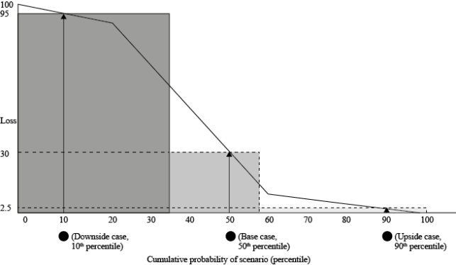
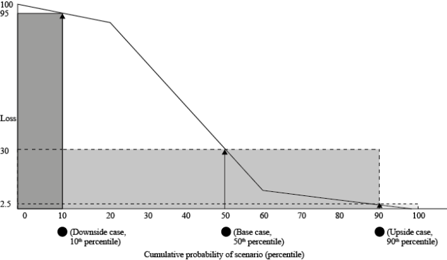

# 45 - Impairment (IFRS 9)

[返回目录](README.md)

### FAQ 45.54.2 **–** If a lessor expects a lessee to pay all amounts due under an operating lease, but later than the contractual due date, does this give rise to an ECL?

 

Reference to standard: IFRS 9 para 5.5.1 and 5.5.18; IFRS 9 App B para B5.5.44   
Reference to standing text: [45.54](71.md#s291-Para_45.54), [45.55](71.md#s291-Para_45.55), [15.134](33.md#s110-Para_15.134)

  

 

**Question**

 

If a lessor expects a lessee to pay all amounts due under an operating lease, but later than the contractual due date, does this give rise to an expected credit loss (ECL)?

 

**Answer**

 

It depends. Where contractual payments are expected to be received later than when contractually due, in isolation this will not give rise to an ECL if either additional compensation is received in full for the lost time value of money, or the EIR is 0%. For an operating lease, where the lease payments are recognised on an undiscounted basis via the straight line recognition or other systematic basis required by paragraph 81 of IFRS 16, the EIR would be 0%.

 

However, more broadly, regardless of the specific considerations regarding time value of money arising from the expected payment delay, paragraph 5.5.18 of IFRS 9 requires that an entity always consider the risk or probability that a credit loss occurs.

 

### FAQ 45.55.1 – What discount rate should be used when measuring ECL for credit cards and other similar products?

 

Reference to standard: IFRS 9 paras 5.5.17, B5.5.44, B5.5.47  
 Reference to standing text: [45.55](71.md#s291-Para_45.55), [45.56](71.md#s291-Para_45.56)  Banking and capital markets

  

  
**Question:**

The contractual interest rate on credit cards and other similar products can be significant, and the discount rate used can have a significant impact on the expected credit loss (ECL) impairment provision recognised under IFRS 9.

What discount rate should be used when measuring ECL for credit cards and other similar products?

**Answer:**

The definition of credit loss in Appendix A to IFRS 9 states that cash flows should be discounted at the original effective interest rate (EIR), other than for purchased or originated credit-impaired financial assets.

In practice, determining the original EIR for credit cards and other similar products can be complex and judgemental, particularly since the contractual interest rate can vary significantly from period to period for the same credit card customer. This can occur if, for example, the contractual terms specify that customers (sometimes referred to as ‘transactors’) will incur 0% interest if amounts spent on the card are paid off within a specified period such as one month, but customers (sometimes referred to as ‘revolvers’) will incur a much higher rate of interest, say 20%, if the amount is not paid off within the specified period.

In assessing whether an entity’s approach to calculating the original EIR under IFRS 9 is appropriate, relevant factors to consider include:

- Internal consistency – the IFRS 9 definition of ECL states that the relevant cash flows should be discounted using the original effective interest rate. Hence, the same EIR should be used for discounting ECL as is used in measuring interest income, in calculating modification gains / losses under paragraph 5.4.3 of IFRS 9, and in any other calculation where the use of original EIR is required.

- Segmentation – as discussed in the December 2015 meeting of the IFRS Transition Resource Group for Impairment of Financial Instruments (‘ITG’) in the context of determining the period over which to measure ECL for revolving credit facilities1, portfolios should be appropriately segmented, or grouped on the basis of shared characteristics, when calculating ECL. The segmentation of portfolios should ensure that ECL are measured in a way that is unbiased and does not combine different facilities that do not have suitably similar characteristics. The importance of appropriate segmentation applies equally to EIR as it does to other aspects of the ECL calculation. An entity should therefore assess whether, on the basis of reasonable and supportable information that is available without undue cost or effort, the level of disaggregation and segmentation applied (including differentiation between ‘transactors’ and ‘revolvers’) is appropriate.

- Monitoring segmentation – an individual customer facility might change from being a transactor incurring 0% interest to a revolver incurring 20% interest, and vice versa, over the life of the facility. If this is the case, and if the credit card is considered to be a floating rate instrument, segmentation should therefore be considered on an ongoing basis and might need to change from one period to another.

- Stage 2 – where a facility has had a significant increase in credit risk at the reporting date (so is in ‘stage 2’) the ECL must be modelled on the basis that the customer fails to pay off their future balance in some instances (para 5.5.18 of IFRS 9). It follows that, in those instances, there will be an unpaid balance at default on which to incur a credit loss. Since the customer will, at that stage, be incurring 20% interest, use of a 0% EIR is not appropriate for stage 2 facilities.

Additional considerations might arise when an entity transitions from IAS 39 to IFRS 9. The definition of EIR in IFRS 9 is identical to the definition in IAS 39; so, from a technical perspective, no change is required. However, there might nonetheless be a need to make changes from an implementation perspective. One reason is that EIR calculations might have validly been performed at very aggregated levels under IAS 39, where appropriate interest income recognition was the only material consideration. However, such a level of aggregation might no longer be appropriate under IFRS 9, where the original EIR will also be used to discount ECL on specific facilities over potentially long time periods.

1 Refer to paragraph 44 of the IASB summary of the December 2015 ITG meeting.

 

### EX 45.58.1 – How to measure ECL on FVOCI financial assets

 

Reference to standard: IFRS 9 para 5.5.8  
 Reference to standing text: [45.58](71.md#s291-Para_45.58) 

  

  
 An entity purchases a debt instrument with a fair value of C1,000 on 15 December 20X0 and measures the debt instrument at fair value through other comprehensive income. The instrument has an interest rate of 5% over the contractual term of 10 years, and has a 5% effective interest rate. At initial recognition, the entity determines that the asset is not a purchased or originated credit-impaired asset.

<table style="width:100%; border-collapse:collapse"><tr><td style="border:0.75pt solid #000000; padding-right:5.03pt; padding-left:5.03pt; vertical-align:top">
 
</td><td style="border:0.75pt solid #000000; padding-right:5.03pt; padding-left:5.03pt; vertical-align:top">
<b>Debit</b>
</td><td style="border:0.75pt solid #000000; padding-right:5.03pt; padding-left:5.03pt; vertical-align:top">
<b>Credit</b>
</td></tr><tr><td style="border:0.75pt solid #000000; padding-right:5.03pt; padding-left:5.03pt; vertical-align:top">
Financial asset – FVOCI
</td><td style="border:0.75pt solid #000000; padding-right:5.03pt; padding-left:5.03pt; vertical-align:top">
C1,000
</td><td style="border:0.75pt solid #000000; padding-right:5.03pt; padding-left:5.03pt; vertical-align:top">
 
</td></tr><tr><td style="border:0.75pt solid #000000; padding-right:5.03pt; padding-left:5.03pt; vertical-align:top">
Cash
</td><td style="border:0.75pt solid #000000; padding-right:5.03pt; padding-left:5.03pt; vertical-align:top">
 
</td><td style="border:0.75pt solid #000000; padding-right:5.03pt; padding-left:5.03pt; vertical-align:top">
C1,000
</td></tr></table>

  
 On 31 December 20X0 (the reporting date), the fair value of the debt instrument has decreased to C950 as a result of changes in market interest rates. The entity determines that there has not been a significant increase in credit risk since initial recognition and that ECL should be measured at an amount equal to 12-month ECL, which amounts to C30. For simplicity, journal entries for the receipt of interest revenue are not provided.

<table style="width:100%; border-collapse:collapse"><tr><td style="border:0.75pt solid #000000; padding-right:5.03pt; padding-left:5.03pt; vertical-align:top">
 
</td><td style="border:0.75pt solid #000000; padding-right:5.03pt; padding-left:5.03pt; vertical-align:top">
<b>Debit</b>
</td><td style="border:0.75pt solid #000000; padding-right:5.03pt; padding-left:5.03pt; vertical-align:top">
<b>Credit</b>
</td></tr><tr><td style="border:0.75pt solid #000000; padding-right:5.03pt; padding-left:5.03pt; vertical-align:top">
Impairment expense (P&amp;L)
</td><td style="border:0.75pt solid #000000; padding-right:5.03pt; padding-left:5.03pt; vertical-align:top">
C30
</td><td style="border:0.75pt solid #000000; padding-right:5.03pt; padding-left:5.03pt; vertical-align:top">
 
</td></tr><tr><td style="border:0.75pt solid #000000; padding-right:5.03pt; padding-left:5.03pt; vertical-align:top">
Other comprehensive income
</td><td style="border:0.75pt solid #000000; padding-right:5.03pt; padding-left:5.03pt; vertical-align:top">
C20
</td><td style="border:0.75pt solid #000000; padding-right:5.03pt; padding-left:5.03pt; vertical-align:top">
 
</td></tr><tr><td style="border:0.75pt solid #000000; padding-right:5.03pt; padding-left:5.03pt; vertical-align:top">
Financial asset – FVOCI
</td><td style="border:0.75pt solid #000000; padding-right:5.03pt; padding-left:5.03pt; vertical-align:top">
 
</td><td style="border:0.75pt solid #000000; padding-right:5.03pt; padding-left:5.03pt; vertical-align:top">
C50
</td></tr></table>

  
 The cumulative loss in other comprehensive income at the reporting date was C20. That amount consists of the total fair value change of C50 (that is, C1,000 – C950) offset by the change in the accumulated impairment amount representing 12-month ECL that was recognised (C30).

On 1 January 20X1, the entity decides to sell the debt instrument for C950, which is its fair value at that date.

<table style="width:100%; border-collapse:collapse"><tr><td style="border:0.75pt solid #000000; padding-right:5.03pt; padding-left:5.03pt; vertical-align:top">
 
</td><td style="border:0.75pt solid #000000; padding-right:5.03pt; padding-left:5.03pt; vertical-align:top">
<b>Debit</b>
</td><td style="border:0.75pt solid #000000; padding-right:5.03pt; padding-left:5.03pt; vertical-align:top">
<b>Credit</b>
</td></tr><tr><td style="border:0.75pt solid #000000; padding-right:5.03pt; padding-left:5.03pt; vertical-align:top">
Cash
</td><td style="border:0.75pt solid #000000; padding-right:5.03pt; padding-left:5.03pt; vertical-align:top">
C950
</td><td style="border:0.75pt solid #000000; padding-right:5.03pt; padding-left:5.03pt; vertical-align:top">
 
</td></tr><tr><td style="border:0.75pt solid #000000; padding-right:5.03pt; padding-left:5.03pt; vertical-align:top">
Financial asset – FVOCI
</td><td style="border:0.75pt solid #000000; padding-right:5.03pt; padding-left:5.03pt; vertical-align:top">
 
</td><td style="border:0.75pt solid #000000; padding-right:5.03pt; padding-left:5.03pt; vertical-align:top">
C950
</td></tr><tr><td style="border:0.75pt solid #000000; padding-right:5.03pt; padding-left:5.03pt; vertical-align:top">
Loss on sale (P&amp;L)
</td><td style="border:0.75pt solid #000000; padding-right:5.03pt; padding-left:5.03pt; vertical-align:top">
C20
</td><td style="border:0.75pt solid #000000; padding-right:5.03pt; padding-left:5.03pt; vertical-align:top">
 
</td></tr><tr><td style="border:0.75pt solid #000000; padding-right:5.03pt; padding-left:5.03pt; vertical-align:top">
Other comprehensive income
</td><td style="border:0.75pt solid #000000; padding-right:5.03pt; padding-left:5.03pt; vertical-align:top">
 
</td><td style="border:0.75pt solid #000000; padding-right:5.03pt; padding-left:5.03pt; vertical-align:top">
C20
</td></tr></table>

  
 When calculating ECL on financial assets classified in the FVOCI category, movements in the ECL provision will impact P&amp;L.

 

### FAQ 45.59.1 – The maximum period to consider when measuring expected credit losses

 

Reference to standard: IFRS 9 para B5.5.38  
 Reference to standing text: [45.59](71.md#s291-Para_45.59)

  

  
**Question:**

A bank manages a portfolio of variable rate mortgage loans on a collective basis. Although the loans have a contractual maturity of six months, they contain an automatic extension feature that allows the loan to roll over for a further six months, unless the borrower or lender terminates the loan. The bank can refuse an extension at any time. In practice, borrowers do not terminate their loans because they have no benefit in refinancing. Such loans can be extended for periods typically up to 30 years. The bank does not perform regular credit file reviews and only cancels loans when it receives information about an adverse credit event related to a particular borrower. What should be the period to consider when measuring ECL?

**Answer:**

This issue was discussed by the IFRS Transition Resource Group for Impairment of Financial Instruments (‘ITG’) in its April 2015 meeting. The ITG generally agreed that the application of IFRS 9 would result in the use of six months as a maximum contractual period when measuring ECL, as long as the bank has the substantive right to cancel the loan at the end of the six-month contractual period. Several ITG members noted that an entity might need to consider the powers of a regulator when determining whether the bank has a substantive right to cancel the loan after the six-month contractual period. For example, if the regulator restricts the bank’s contractual right to cancel the loan at the end of the six months (for example, under the requirement to treat customers fairly), it might be more appropriate to use a longer period for measuring ECL. Such an assessment should be done on a case-by-case basis.

In this way, the ITG reaffirmed that the only exception from looking to the contractual maturity is for financial instruments that include both a loan and an undrawn commitment component where the entity is exposed to credit losses beyond the contractual period (that is, revolving credit facilities). This exception does not apply to the example above as, in the jurisdiction concerned, the bank has a substantive ability to demand repayment at the end of the six months, which limits its exposure to the contractual period.

 

### FAQ 45.59.2 – Is it appropriate to discount expected credit losses using an effective interest rate which is considering a call option when it is ignored for the ECL calculation?

 

Reference to standard: IFRS 9 paras B5.5.38, B5.5.44  
 Reference to standing text: [45.59](71.md#s291-Para_45.59)

  

  
**Question:**

A bank holds a 10-year fixed rate bond that can be called at the end of year 7 at the option of the lender. The bank expects that it will not exercise the call option, and so the time horizon for the effective interest and amortised cost calculation is 10 years.

What is the period over which the entity should calculate ECL, and which is the discount rate that it should use to perform the calculations?

**Answer:**

The bank should calculate ECL for a period of seven years, as this is the maximum contractual period over which the entity is exposed to credit risk. [IFRS 9 App B para B5.5.38].

When calculating ECL, the entity should use the EIR to discount ECL as of the reporting date. [IFRS 9 App B para B5.5.44].

 

### FAQ 45.59.3 – Should borrower pre-payment options be taken into account when determining the period over which to measure expected credit losses (ECL)?

 

Reference to standard: IFRS 9 para 5.5.19  
 Reference to standing text: [45.59](71.md#s291-Para_45.59) 

  

  
**Question:**

A bank enters into a 10-year loan, which includes a pre-payment option that allows the borrower to pre-pay the loan at year 5. To determine the period over which to measure ECL, should the bank take into account the borrower pre-payment option?

**Answer:**

Yes. The maximum period over which ECL should be measured is the maximum contractual period over which the entity is exposed to credit risk, which is 10 years in this case. However, the period over which to measure ECL may be shorter than the maximum contractual period for some or all of the possible outcomes or scenarios used and/or the cash flows may be less than the maximum contractual cash flows (for example, a partial pre-payment may occur). This is because the definition of credit loss in IFRS 9 requires an entity to estimate cash flows by considering all contractual terms of the financial instrument, including pre-payment, extension, call and similar options, through the expected life of that financial instrument. Furthermore, paragraph B5.5.51 of IFRS 9 states that the bank is required to consider all reasonable and supportable information relevant to the estimate of ECL, including the effect of pre-payments.

As a simple example, assume, based on an assessment of all relevant and supportable information (including forward-looking information), the bank expects there is a 60% likelihood that the borrower will pre-pay the loan at year 5 and a 40% likelihood that the borrower will repay the loan at maturity (that is, the end of year 10). In such a case, the measurement of ECL will be a probability-weighted amount based on the expected cash flows of the two scenarios using a 5-year period and 10-year period respectively.

At subsequent reporting dates, the period(s) over which to measure ECL should be kept under review and amended if expectations change.

Borrower pre-payments should also be taken into account when measuring ECL for a portfolio of loans. The bank should also consider whether to sub-divide portfolios into groups of loans, by considering pre-payment terms (and the factors that may drive pre-payments) in addition to credit factors.

 

### FAQ 45.59.4 – Inclusion of sale assumptions in expected life when measuring IFRS 9 ECL for FVOCI debt instruments

 

Reference to standard: IFRS 9 para 5.5.19  
 Reference to standing text: [45.59](71.md#s291-Para_45.59) 

  

  
**Question:**

Entity A holds a debt security with a fixed maturity date which is two years after the reporting date. The debt security meets the SPPI test and is held in a ‘Hold to collect or sell’ business model under IFRS 9. Entity A therefore measures the debt security at fair value through other comprehensive income (FVOCI) in accordance with paragraph 4.1.2A of IFRS 9. The debt security is not in default or credit impaired at the reporting date. At that date, entity A expects to sell the debt security 6 months later.

Should entity A reflect this sale intention in its calculation of the expected credit loss provision (ECL) at the reporting date, by limiting the expected life of the security to 6 months?

Please note: This question does not address assets that are in default and credit impaired (sometimes referred to as ‘stage 3’) which are considered in [FAQ 45.72.3](73.md#s293-FAQ_45.72.3).

**Answer:**

No. If the debt security is not in default or credit impaired at the reporting date (so is in either ‘stage 1’ or ‘stage 2’), entity A should not limit the expected life of the security to 6 months for the purposes of the ECL calculation at the reporting date. Credit losses are defined in Appendix A of IFRS 9 as the difference between all contractual cash flows that are due to an entity in accordance with the contract and all the cash flows that the entity expects to receive (that is, all cash shortfalls), through the expected life of that financial instrument. The contractual cash flows and expected life of the financial instrument itself are not changed by the intention of a particular entity holding the financial instrument to sell it.

 

### FAQ 45.59.5 – Repayable on demand loans from parent to its subsidiary – parent’s separate financial statements

 

Reference to standard: IFRS 9 paras 5.1.1, 5.5.1, 5.5.18, 5.5.19, B5.5.28, B5.5.29, B5.5.44  
 Reference to standing text: [45.59](71.md#s291-Para_45.59) 

  

  
 Parent company A has a wholly owned subsidiary, company B, which requires funding for its ongoing business activities. Company A advances CU10 million to company B. The loan is interest free and contractually repayable on demand. Company A determines that the loan is in the scope of IFRS 9 and meets the criteria to be classified at amortised cost in company A’s separate financial statements. Although the loan is repayable on demand, given the nature of the parent-subsidiary relationship and that the purpose of the loan is to fund the subsidiary’s ongoing business activities, company A does not expect to demand repayment in the near future.

**Question 1:**

What is the fair value of the loan on initial recognition in company A?

**Answer 1:**

The loan’s fair value at initial recognition is the transaction price (that is, the fair value of the consideration given or received), which is CU10 million. [IFRS 9 para 5.1.1]. This is supported by the fact that the loan is contractually repayable on demand, so company A is able to recover the entire CU10 million immediately after granting the loan. This is similar to the initial recognition of demand deposit liabilities (see [FAQ 5.53.1](12.md#s35-FAQ_5.53.1), IFRS 13 paras 47 and BC101).

**Question 2:**

Are interest-free loans which are contractually repayable on demand within the scope of IFRS 9’s impairment requirements?

**Answer 2:**

Yes. In this example the loan is in the scope of IFRS 9 and meets the criteria to be classified at amortised cost. The impairment requirements apply to all investments in debt instruments measured at amortised cost. [IFRS 9 para 5.5.1].

**Question 3:**

What is the maximum period over which company A should measure ECL?

**Answer 3:**

In accordance with paragraph 5.5.19 of IFRS 9, the maximum contractual period for measuring ECL is one day, because the parent company has a substantive contractual right to demand repayment immediately. The loan is not a revolving credit facility, and so it is not appropriate to consider a longer period. (See [FAQ 45.59.1](73.md#s293-FAQ_45.59.1) for discussions by the ITG on substantive early termination rights.)

**Question 4:**

Company A defines default as 90 days past due, and the life of the loan for the purposes of measuring ECL is one day. Does this mean that there is no risk of default over the one-day life of the loan, such that the ECL are nil?

**Answer 4:**

No. When assessing if there has been a significant increase in credit risk and in measuring ECL, company A should consider all reasonable and supportable information available without undue cost or effort, including both qualitative factors and forward-looking information. (See [FAQ 45.31.1](72.md#s292-FAQ_45.31.1) – Can an entity use only behavioural indicators of credit risk when assessing significant increases of credit risk since initial recognition?) It follows that the definition of default should consider a range of factors that would indicate that the loan is in default, and not only whether the loan is 90 days past due.

**Question 5:**

How should company A measure the ECL?

**Answer 5:**

Credit loss is defined as the present value of the difference between:

- the contractual cash flows that are due to an entity under the contract; and

- the cash flows that the entity expects to receive. [IFRS 9 App B para B5.5.29].

IFRS 9 requires the discount rate to be the instrument’s effective interest rate. [IFRS 9 App B para B5.5.44].

- The contractual cash flows due to company A (that is, (a) above) – For the purposes of measuring ECL, the extension of the loan beyond one day should not be anticipated, consistent with the one-day period for measuring ECL in Solution 3 above. Credit losses arising from the risk of a default after the maximum contractual period of one day are not included in the ECL. The contractual cash flows due to company A are the full amount that is contractually repayable on demand (that is, CU10 million).

- Expected cash flows (that is, (b) above) – The expected cash flows are the cash flows that company A expects to receive if the loan is not extended beyond one day. This should take into account the expected manner of recovery and the recovery period. For example, if, at the reporting date, company B would be unable to immediately repay the loan if demanded by company A, company A may expect that it would maximise recovery of the loan by allowing company B time to pay, rather than by seeking to enforce immediate repayment by triggering a fire sale of company B’s assets. However, IFRS 9 requires company A to measure the ECL at a probability-weighted amount that reflects the possibility that a credit loss occurs, and the possibility that no credit loss occurs even if the possibility of a credit loss occurring is low. [IFRS 9 para 5.5.17]. [IFRS 9 para 5.5.18]. This requirement to use multiple scenarios might still give rise to an ECL even if full recovery of the loan is the most likely outcome and the EIR is 0%.

- Effective interest rate (EIR) – both components of the ECL (that is, (a) and (b) above) should be discounted to the reporting date, using the EIR determined at initial recognition or an approximation thereof. [IFRS 9 App B para B5.5.44]. Since the loan is interest free and, on initial recognition, it is recognised at the amount repayable on demand (that is, CU10 million), the EIR will be 0%.

Any ECL that arises should be recognised in profit or loss.

Illustration of the above principles

Company C advances a CU10 million loan to its subsidiary, company D. This inter-company loan is also contractually repayable on demand, but it is interest bearing and accrues interest at 5% per annum on the outstanding loan balance. Assume that company C determines that the EIR of the loan is 5%.

Since company D is loss making, company C develops a strategy to maximise recovery by allowing company D to repay the CU10 million loan plus accrued interest in one year’s time, to allow it to realise the cash flows from the sale of its assets. If company D underwent an immediate ‘fire sale’ of its assets, this would be lost in accepting the only immediate offer.

The contractual cash flows of the inter-company loan at the end of the one-year period are CU10,500,000 (CU10 million outstanding plus 5% interest charged on the unpaid CU10 million).

For the purposes of estimating its period-end ECL, company C considers two scenarios. These are considered to be representative scenarios that cover the possibility that no credit loss occurs, and the possibility that a credit loss occurs:

Scenario 1 – the ‘upside scenario’

The expected cash flows from the sale of company D’s assets are CU15 million, because there is strong demand for its specialist assets. The cash flows from the sale of company D’s assets in the future would therefore allow company C to recover the inter-company loan and accrued interest in full. Whilst inherently judgemental, management has determined that this scenario has an 80% probability of occurring.

Scenario 2 – the ‘downside scenario’

The expected cash flows from the sale of company D’s assets are CU8 million, because there is weaker demand for its specialist assets. Therefore, the cash flows from the sale of company D’s assets do not recover all of the outstanding CU10 million plus accrued interest. Whilst inherently judgemental, management has determined that this scenario has a 20% probability of occurring.

The expected credit loss of CU476,191 is calculated as the sum of:

- CU0 under Scenario 1 – this is the difference between the contractual cash flows (CU10,500,000) and expected cash flows (CU10,500,000) (that is, a CU nil shortfall), discounted back one year to the reporting date using the original effective interest rate of 5% and weighted by 80%; and

- CU476,191 under Scenario 2 – this is the difference between the contractual cash flows (CU10,500,000) and expected cash flows (CU8,000,000) (that is, a CU2,500,000 shortfall), discounted back one year to the reporting date using the original effective interest rate of 5% (that is, CU2,380,952) and weighted by 20% (that is, CU476,191).

The disclosures required by IFRS 7 should be given. In particular, paragraph 35F(b) of IFRS 7 requires an entity to disclose its definitions of default, including the reasons for selecting those definitions. If this is a significant accounting judgement, the disclosures required by IAS 1 will need to be provided.

 

### FAQ 45.60.1 – Does paragraph 5.5.20 of IFRS 9 apply only to retail credit cards and retail overdrafts?

 

Reference to standard: IFRS 9 paras 5.5.20, B5.5.39  
 Reference to standing text: [45.60](71.md#s291-Para_45.60) Banking and capital markets

  

  
**Question:**

Does paragraph 5.5.20 of IFRS 9, which requires expected credit losses on certain revolving credit facilities to be measured over a longer period than the maximum contractual period, apply only to retail credit cards and retail overdrafts?

**Answer:**

No. Though often discussed in the context of retail credit cards and retail overdrafts provided to individual customers, IFRS 9 does not state that paragraph 5.5.20 only applies to these types of products. Therefore, the individual characteristics of all revolving credit facilities (RCFs) that might fall within the scope of paragraph 5.5.20 need to be considered, including those provided to wholesale and corporate customers, to assess whether or not they fall within its scope. Where an entity such as a bank has many RCFs, it may be appropriate to group RCFs with suitably similar characteristics together when performing this assessment.

Paragraph 5.5.20 of IFRS 9 describes the financial instruments that fall within its scope, and paragraph B5.5.39 of IFRS 9 sets out three characteristics (a)-(c) that are generally associated with such financial instruments. Key considerations in assessing these general characteristics, as well as the overall principle and relevant disclosure requirements, are discussed below.

**Overall principle**

The ‘exception’ in paragraph 5.5.20 to the more general IFRS 9 requirement for the period over which ECL are measured to be limited to the maximum contractual period, only applies to those financial instruments where1:

- the instrument has the ability to have both a loan and undrawn commitment component;

- the entity has the contractual ability to demand repayment of the loan component and to cancel the undrawn commitment component; and

- the entity’s exposure to credit losses is not limited to the contractual notice period.

As a result, not all RCFs with a contractual ability to demand repayment of the loan component and to cancel the undrawn commitment component fall in the scope of paragraph 5.5.20. Judgement is required, in particular in determining which wholesale and corporate RCFs fall in the scope of this paragraph.

The December 2015 meeting of the IFRS Transition Resource Group for Impairment of Financial Instruments (‘ITG’) also noted that “…the exception was intended to be limited in nature and that it was introduced in order to address specific concerns raised by respondents in relation to RCFs that were managed on a collective basis”. This importance of managing collectively versus individually is further discussed within general characteristics (b) and (c) below. Therefore where it is concluded that a financial instrument is managed individually, rather than on a collective basis, it would generally be expected that the financial instrument would not fall within the scope of paragraph 5.5.20 and instead the ECL would be measured over the maximum contractual period in accordance with paragraph 5.5.19.

Paragraph B5.5.39 of IFRS 9 provides general characteristics of financial instruments that fall in the scope of paragraph 5.5.20 which are helpful in interpreting paragraph 5.5.20, in particular what is meant by “the entity’s exposure to credit losses is not limited to the contractual notice period”. However, these general characteristics are not determinative and therefore, do not all need to be met in order for paragraph 5.5.20 to apply. Where some, but not all, of the general characteristics set out in paragraph B5.5.39 are present an entity should consider the principle in paragraph 5.5.20, that is, “…financial instruments include both a loan and an undrawn commitment component and the entity’s contractual ability to demand repayment and cancel the undrawn commitment does not limit the entity’s exposure to credit losses to the contractual notice period”. If the overall principle is not met, the requirement in paragraph 5.5.20 should not be applied.

**The three general characteristics in**paragraph B5.5.39

"B5.5.39(a) The financial instruments do not have a fixed term or repayment structure and usually have a short contractual cancellation period (for example, one day)"

As highlighted by the December 2015 ITG, all the terms of the financial instrument should be considered. For example, if when an RCF is drawn the resulting drawn loan has a fixed maturity of 5 years and the lender does not have the contractual ability to demand repayment of the drawn exposure, this would not be consistent with the RCFs described in paragraph 5.5.20, where repayment of drawn amounts can be demanded. But if the fixed maturity were only 1 month, rather than 5 years, judgement would be required to determine if this would prevent the instrument from falling within the scope of paragraph 5.5.20.

However, as noted above just because this general characteristic is not met does not prevent a financial instrument being within the scope of paragraph 5.5.20, if the overall principle is met. This is illustrated by the immediately revocable revolving credit facility with a fixed maturity of 5 years that was also considered by the December 2015 ITG. In this case, the ITG concluded that the facility would not seem inconsistent with the type of facility described in paragraph 5.5.20, despite the facility having a fixed maturity, because the lender has the contractual ability to cancel the entire facility including both the drawn amount and the undrawn commitment at any point2.

"B5.5.39(b) The contractual ability to cancel the contract is not enforced in the normal day-to-day management of the financial instrument and the contract may only be cancelled when the entity becomes aware of an increase in credit risk at the facility level"

Paragraph BC5.255 of IFRS 9 notes that “…the use of the contractual period was of particular concern for some types of loan commitments that are managed on a collective basis, and for which an entity usually has no practical ability to withdraw the commitment before a loss event occurs and to limit the exposure to credit losses to the contractual period over which it is committed to extend the credit” [emphasis added].

The key factor to consider is therefore what information the lender has available which it could use so as to have the practical ability to cancel the contract before a loss event occurs. This means that if, in practice, as a result of how a lender manages its portfolio, it will not become aware of an increase in credit risk of a particular borrower until after it has occurred, either because relevant information to identify this cannot be obtained or the lender chooses not to obtain such information, that facility would be expected to meet this general characteristic. This would generally be the case for a financial instrument that is collectively managed (see also general characteristic (c) below). Conversely, if a lender could reasonably be expected to obtain relevant information giving them the practical ability to act earlier, the facility would not be expected to meet this general characteristic. This would generally be the case for a financial instrument that is individually managed.

As the availability of information is the key factor, a facility would still not meet this general characteristic if a lender obtains the relevant information but then chooses not to act upon it (for example to maintain what was considered to be a valuable customer relationship). This is because the lender would have had the practical ability to withdraw the commitment before a loss event occurred and so limit its exposure to credit losses to the contractual period over which it was committed to extend credit, but chose not to.

"B5.5.39(c) The financial instruments are managed on a collective basis"

The term ‘managed on a collective basis’ is not defined within IFRS 9. However, paragraph B5.5.1 of IFRS 9 states “… it may be necessary to perform the assessment of significant increases in credit risk on a collective basis by considering information that is indicative of significant increases in credit risk on, for example, a group or sub-group of financial instruments” [emphasis added]. Furthermore, paragraph B5.5.3 of IFRS 9 notes that there are “financial instruments such as retail loans for which there is little or no updated credit risk information that is routinely obtained and monitored on an individual instrument until a customer breaches the contractual terms”. This reinforces the principle outlined above, that the key factor to consider is the availability of information that can be used to take credit risk management actions before it is ‘too late’.

As a result, the term ‘managed on a collective basis’ refers to portfolios where the information used to manage the credit risk of the exposures is obtained primarily at an aggregated level.

As IFRS 9 provides no further guidance on the term ‘collective’, judgement will be required in assessing whether or not a financial instrument is managed on a collective basis and where in the spectrum of available information the ‘dividing line’ is drawn between collective and individual management. This will depend on individual facts and circumstances, in particular how a bank manages its credit risk. For some exposures, the bank may have more information than for others and so be more able to take action earlier. In particular, in practice it will likely vary with type and size of client (for example, between the biggest listed corporates and the smallest ‘SME’ customers). However, examples of credit risk information that might be obtained and monitored individually for a particular financial instrument, demonstrating that it is managed on an individual rather than collective basis, would include regular covenant reporting, management accounts information or updates on financial performance obtained from regular contact with the borrower as well as credit risk information about the borrower obtained from publicly available sources.

Other indicators that may be relevant in judging whether a financial instrument is managed collectively or individually include:

- availability of public information – for example, there is more likely to be publicly available information about an individual borrower if it is a large or listed company;

- frequency of information – for example, if information on the individual customer is regularly obtained, it is more likely that the facility would be considered individually monitored;

- nature and extent of credit officer monitoring – for example, a single customer where monitoring is the sole duty of an individual credit officer would be considered individually monitored, whereas a facility with a customer monitored by a credit officer also responsible for 999 other lending relationships would generally not be; and

- historical practice – for example, whether for similarly managed financial instruments there is past evidence of proactive decisions being made on individual borrowers to take credit risk management action ahead of a loss event occurring.

Monitoring account utilisation at the individual RCF level, which can be performed for any RCF using the information readily available from the lender’s own records, would not be a differentiating factor in assessing whether a financial instrument is managed collectively or individually.

**Disclosure**

Entities should make appropriate disclosure of the judgements they have made in determining the scope of paragraph 5.5.20 of IFRS 9 and applying paragraph B5.5.39, given that paragraph 35G of IFRS 7 requires an entity to explain the assumptions used to measure expected credit losses.

In addition, disclosure explaining how RCFs are managed will be relevant to the requirement in paragraph 35B of IFRS 7 to provide information about the entity’s credit risk management practices and how they relate to the recognition and measurement of expected credit losses.

1 Refer to paragraph 27 of the IASB summary of the December 2015 ITG meeting.   
 2 Refer to paragraph 31 of the IASB summary of the December 2015 ITG meeting.

 

### FAQ 45.60.2 – How should the period over which ECL are measured be determined for wholesale and corporate revolving credit facilities?

 

Reference to standard: IFRS 9 paras 5.5.19, 5.5.20  
Reference to standing text: [45.60](71.md#s291-Para_45.60)  
 Banking and capital markets

  

  
**Question:**

Revolving credit facilities are provided by an entity to corporate and wholesale customers (that is, not to individual or ‘retail’ customers), and they have no fixed term. The facilities can be cancelled at the discretion of the lender at any time, with one day’s notice. The terms and conditions also state that the facility will be subject to, at a minimum, an annual credit review, at which point this cancellation right could be exercised.

How should the period over which ECL are measured be determined for these wholesale and corporate revolving credit facilities?

**Answer:**

IFRS 9 does not refer to ‘wholesale’, ‘corporate’ or ‘retail’, so the requirements of IFRS 9 should be applied consistently to revolving credit facilities irrespective of the type of customer. Therefore, an entity should first determine whether a revolving credit facility is within the scope of:

- paragraph 5.5.19 of IFRS 9, where the maximum period to consider when measuring ECL is the maximum contractual period (including extension options) over which the entity is exposed to credit risk; or

- paragraph 5.5.20 of IFRS 9, where ECL are measured over the period that the entity is exposed to credit risk and would not be mitigated by credit risk management actions.

This judgement is discussed in detail in [FAQ 45.60.1 - Does paragraph 5.5.20 of IFRS 9 apply only to retail credit cards and retail overdrafts?](73.md#s293-FAQ_45.60.1)

Having established which of these paragraphs is applicable to a revolving credit facility, the entity should then apply the appropriate guidance:

- If the revolving credit facility is within the scope of paragraph 5.5.19 of IFRS 9, the ECL should be measured over the contractual notice period of one day. Even if, in practice, the one-day contractual cancellation right is often only exercised following an annual credit review, this would not extend the period of measurement beyond the one-day contractual notice period. As noted at the April 2015 meeting of the IFRS Transition Resource Group for Impairment of Financial Instruments (‘ITG’)1, a lender could choose to continue extending credit, without having the contractual obligation to do so, and consequently there might be a disconnect between the accounting and credit risk management views. The one-day period would also apply regardless of whether there had been a significant increase in credit risk.

- If the revolving credit facility is within the scope of paragraph 5.5.20 of IFRS 9, the guidance set out in [FAQ 45.61.3](73.md#s293-FAQ_45.61.3) and [FAQ 45.61.4](73.md#s293-FAQ_45.61.4) will apply to a wholesale or corporate revolving credit facility just as it would to a retail credit card or any other revolving credit facility.

1 Refer to paragraph 38 of the IASB summary of the April 2015 ITG meeting.

 

### FAQ 45.60.3 – Measurement of ECL for revolving credit facilities with ‘shadow’ credit limits

 

Reference to standard: IFRS 9 para B5.5.28  
 Reference to standing text: [45.60](71.md#s291-Para_45.60)  Banking &amp; capital markets

  

  
**Question:**

A bank holds a portfolio of revolving credit facilities (such as credit cards, or current accounts with overdraft facilities) within the scope of paragraph 5.5.20 of IFRS 9. Accordingly, the bank measures expected credit losses (ECL) over a period that might extend beyond the maximum contractual period. Under the contractual terms of the facilities, each customer is given a written credit limit. In addition, the bank holds higher internal ‘shadow’ credit limits for each customer. In practice, the bank has historically allowed its customers to draw-down amounts that exceed their contractual limit, up to the amount of the ‘shadow’ limits. The bank has determined that this ‘shadow’ limit is not enforceable by the customer. At the reporting date, should the bank measure ECL based on the expected future draw-downs up to the amount of the ‘shadow’ limits?

**Solution:**

No. Paragraph B5.5.30 of IFRS 9 clarifies that, for undrawn loan commitments, a credit loss is measured based on the contractual cash flows that are due to the entity if the loan is drawn down. This excludes expected future draw-downs that exceed the contractual credit limit as notified to the customer at the reporting date. This is because, at the reporting date, the bank is not obligated to provide credit up to its ‘shadow’ limit.

This was discussed at the meeting of the Transition Resource Group for Impairment of Financial Instruments (ITG) in September 2015 and confirmed by the IASB at its meeting in October 2015. The ITG and IASB observed that, because, in practice, the tenor and amount of revolving credit facilities were inextricably linked, there could be a disconnect between the accounting and credit risk management view.

If, at the reporting date, the customer has drawn down an amount in excess of the contractual limit, ECL are measured based on the full amount of the draw-down, because the customer has an obligation to repay it.

The amount of the contractual credit limit is the amount that is enforceable by law in accordance with the agreement between the bank and its customer, which will depend on the specific facts and circumstances. Whilst this is clear in some cases (such as the example above), in other cases it might be less clear cut (for example, where there is no written credit limit between the bank and its customer). If the bank approves each draw-down as it is requested and has the practical ability to refuse credit at the point of each draw-down, the bank has no contractual commitment to provide credit for expected future drawings. However, if the customer is able to enforce a draw-down up to a higher amount, this higher amount would be the contractual credit limit.

 

### FAQ 45.61.1 – How to measure ECL on revolving credit facilities

 

Reference to standard: IFRS 9 para B5.5.39  
 Reference to standing text: [45.61](71.md#s291-Para_45.61) 

  

**Question:**

Bank A provides co-branded credit cards to customers in conjunction with a local department store. The credit cards have a one-day notice period, after which bank A has the contractual right to cancel the credit card (both the drawn and undrawn components). However, bank A does not enforce its contractual right to cancel the credit cards in the normal day-to-day management of the instruments and only cancels facilities when it becomes aware of an increase in credit risk and starts to monitor customers on an individual basis. Bank A therefore does not consider that the contractual right to cancel the credit cards limits its exposure to credit losses to the contractual notice period. For credit risk management purposes, bank A considers that there is only one set of contractual cash flows from customers to assess, and it does not distinguish between the drawn and undrawn balances at the reporting date. The portfolio is therefore managed, and ECL are measured, on a facility level.

At the reporting date, the outstanding balance on the credit card portfolio is C60,000 and the available undrawn facility is C40,000.

How should bank A measure the ECL on the co-branded credit cards?

**Answer:**

Bank A determines the expected life of the portfolio by estimating the period over which it expects to be exposed to credit risk on the facilities at the reporting date, taking into account:

- the period over which it was exposed to credit risk on this portfolio or on a similar portfolio of credit cards;

- the length of time for related defaults to occur on this portfolio or on similar financial instruments; and

- past events that led to credit risk management actions because of an increase in credit risk on similar financial instruments, such as the reduction or removal of undrawn limits.

Bank A determines that the expected life of the credit card portfolio is 30 months. At the reporting date, it assesses the change in the credit risk on the portfolio since initial recognition and determines that the credit risk on a portion of the credit card facilities representing 25% of the portfolio has increased significantly since initial recognition. The outstanding balance on these credit facilities for which lifetime ECL should be recognised is C20,000, and the available undrawn facility is C10,000.

When measuring the ECL, bank A considers its expectations about future draw-downs over the expected life of the portfolio (that is, 30 months) and estimates what it expects the outstanding balance (that is, exposure at default) on the portfolio would be if customers were to default. By using its credit risk models, bank A determines that the exposure at default on the credit card facilities for which lifetime ECL should be recognised is C25,000 (that is, the drawn balance of C20,000 plus further draw-downs of C5,000 from the available undrawn commitment). The exposure at default of the credit card facilities for which 12-month ECL are recognised is C45,000 (that is, the outstanding balance of C40,000 and an additional draw-down of C5,000 from the undrawn commitment over the next 12 months).

The exposure at default and expected life determined by bank A are used to measure the lifetime ECL and 12-month ECL on its credit card portfolio. Bank A measures ECL on a facility level and therefore cannot separately identify the ECL on the undrawn commitment component from those on the loan component. It recognises ECL for the undrawn commitment, together with the loss allowance for the loan component in the statement of financial position. To the extent that the combined ECL exceed the gross carrying amount of the financial asset, the ECL should be presented as a provision.

When estimating ECL on revolving credit facilities, expected life can be greater than contractual life.

 

### FAQ 45.61.2 – Date of initial recognition and life of a revolving credit facility

Reference to standard: IFRS 9 para B5.5.40  
 Reference to standing text: [45.61](71.md#s291-Para_45.61) 

  

  
**Question 1:**

What is the appropriate life to calculate ECL for revolving credit facilities that are in stage 1 and stage 2?

**Solution 1:**

This issue was discussed by the IFRS Transition Resource Group for Impairment of Financial Instruments (‘ITG’) in its April 2015 meeting. The members of the ITG generally agreed that determining that the period over which an entity is exposed to credit risk and the ECL would not be mitigated by credit risk management, as compared to the contractual period, adds considerable complexity to the calculation. This might require a greater segmentation of the book, including periods of less than 12 months, if appropriate.

The ITG discussed the IFRS 9 requirement for an entity to estimate ECL over the period that the entity is exposed to credit risk and the ECL that would not be mitigated by credit risk management actions. These discussions focused on what is meant by ‘period of exposure’ versus ‘mitigated by credit risk management actions’. An example was provided of a bank that does not perform annual credit reviews on its credit cards but assesses changes in the behaviour of the customer on a monthly basis, based on payment profiles and external credit information. It is unlikely that the bank in this example would terminate the facility until there was strong evidence to suggest that the customer was in default. The ITG members noted that there is diversity in credit risk management in this area, that risk management differs from accounting, and that significant judgement would be required for the measurement of ECL on revolving credit card facilities.

**Question 2:**

What is the date of initial recognition for the purposes of assessing significant increases in credit risk for a revolving credit facility?

**Solution 2:**

This issue was also discussed by the ITG in its April 2015 meeting. It was noted by several ITG members that determining the date of initial recognition for revolving credit card facilities is a significant operational challenge. There can be numerous changes to a credit card facility over the life of a customer relationship, including changes in card type, expiry and renewal of cards, changes in credit limits, and periodic credit reviews. The ITG acknowledged that it is very important to determine whether such an event gives rise to derecognition under IFRS 9 and the recognition of a new financial instrument. This will require considerable judgement.

It is expected that entities might look to find some practical simplifications, such as looking to PDs or internal ratings at previous reporting dates to justify whether there has been a significant increase in credit risk.

### FAQ 45.61.3 – Period for measuring ECL of revolving credit facilities and interaction of factors in paragraph B5.5.40 of IFRS 9

 

Reference to standard: IFRS 9 para B5.5.40  
 Reference to standing text: [45.61](71.md#s291-Para_45.61)  Banking &amp; capital markets

  

  
**Question:**

Paragraph B5.5.40 of IFRS 9 requires that, when determining the period to measure expected credit losses (ECL) for revolving credit facilities within the scope of paragraph 5.5.20 of IFRS 9, entities should consider factors such as historical information and experience about:

- the period over which the entity was exposed to credit risk on similar financial instruments;

- the length of time for related defaults to occur on similar financial instruments following a significant increase in credit risk; and

- the credit risk management actions that an entity expects to take once the credit risk on the financial instrument has increased, such as the reduction or removal of undrawn limits.

How should an entity take into account the interaction of these three factors when determining the period over which to measure ECL for revolving credit facilities within the scope of paragraph 5.5.20 of IFRS 9?

**Solution:**

An entity is required to consider all of the three factors listed in paragraph B5.5.40 of IFRS 9. The factor that gives rise to the shortest period is the relevant factor for determining the life of a particular facility for ECL measurement purposes. For example, some revolving credit facilities in a portfolio might not be expected to default or have credit risk management actions taken, and so paragraph B5.5.40(a) (that is, the period for which the entity is exposed to credit risk on similar instruments) is more relevant in determining their life. However, other revolving credit facilities might be expected to default, and so a shorter period would be more appropriate in accordance with the factors in paragraph B5.5.40(b) or (c). If credit risk management actions that mitigate the entity’s exposure to credit risk are expected to be taken before some facilities default, paragraph B5.5.40(c) is more relevant for those facilities. However, for those facilities that are expected to default before such credit risk management actions are taken, paragraph B5.5.40(b) is more relevant.

An entity might be able to identify specific facilities based on reasonable and supportable information for which one or more particular factors might be relevant (such as for large corporate facilities). Otherwise, an entity should appropriately stratify and segment its portfolio into sub-groups or portions of the portfolio, as recommended by the Transition Resource Group for Impairment of Financial Instruments (ITG) at its meeting in April 2015. The entity should consider the specific characteristics of the portfolio and the relevance of the various factors in paragraph B5.5.40 to segment the portfolio and ascertain how to most appropriately determine the period to measure ECL for each sub-group. For example, higher-risk exposures within the portfolio might be more likely to be subject to credit risk management action and, to the extent of these credit risk management actions, they could have a shorter life than other facilities within the portfolio. Within each homogeneous sub-group of facilities, more than one factor might be relevant. A particular factor and expected life might be expected to be relevant to a percentage of the sub-group, even if the exact composition of that portion is not known at the outset.

During its life, a revolving credit facility could transition between stages (for example, from stage 1 to stage 2, and back to stage 1 again). The transition between stages itself does not affect the life of the facility. However, a significant increase in credit risk could result in credit risk mitigation actions being taken, for example, which would be relevant to determining the life of the facility.

Segmenting a portfolio and determining the period over which to measure ECL should be based on historical data and experience, together with the implications of forward-looking information and any future changes in policies (for example, if a bank changes its credit risk management policies, so that credit risk management actions are expected to take place sooner than they would have under its historical policies). This is likely to involve significant judgement. A bank should disclose information about significant judgements that are a major source of estimation uncertainty in the financial statements, in accordance with paragraph 125 of IAS 1.

 

### FAQ 45.61.4 – How do credit reviews and ‘credit risk management actions’, such as the removal of undrawn limits, affect measurement of ECL for revolving credit facilities?

 

Reference to standard: IFRS 9 para B5.5.40  
 Reference to standing text: [45.61](71.md#s291-Para_45.61)  Banking &amp; capital markets

  

**Background:**

  
 Paragraph 5.5.20 of IFRS 9 contains an exception for certain types of financial instrument to measure expected credit losses (ECL) over the period that the entity is exposed to credit risk, and ECL would not be mitigated by credit risk management actions, even if that period extends beyond the maximum contractual period. [See FAQ 45.60.1](73.md#s293-FAQ_45.60.1) for guidance on the financial instruments that are within the scope of this exception.

Paragraph B5.5.40 of IFRS 9 sets out the factors that an entity should consider when determining the period over which to measure ECL (referred to below as the ‘life’). [FAQ 45.61.3](73.md#s293-FAQ_45.61.3) provides further guidance on the interaction between these three factors. This FAQ considers specifically how credit card reviews and ‘credit risk mitigation actions’ in paragraph B5.5.40(c) of IFRS 9 affect the measurement of ECL.

**Question 1: Can the period to the next credit review be used to determine the life of a revolving credit facility within the scope of paragraph 5.5.20 of IFRS 9?**

A bank undertakes an annual credit review of every facility in its credit card portfolio. As part of its normal business practice, the bank expects to fully terminate the limits of 9% of the accounts as a result of the next credit review. Can the period to the next credit card review be used as the life of the whole portfolio for determining the period to measure ECL for revolving credit facilities within the scope of paragraph 5.5.20 of IFRS 9?

**Answer 1:**

No. As noted in [FAQ 45.61.3](73.md#s293-FAQ_45.61.3), paragraph B5.5.40 of IFRS 9 sets out three factors to consider when determining the life of a revolving credit facility within the scope of paragraph 5.5.20.

The first factor is the period over which the entity was exposed to credit risk on similar instruments [IFRS 9 App B para B5.5.40(a)]. Performing a credit review, however substantial, would not itself be indicative of derecognition of a facility. If the entity continues to grant credit in accordance with the contractual terms of the facility, the entity continues to be exposed to credit risk.

However, one of the other factors to take into consideration is the credit risk management actions that an entity expects to take once the credit risk on the financial instrument has increased, such as the reduction or removal of undrawn limits. [IFRS 9 App B para B5.5.40(c)].

Accordingly, it is the expected credit risk management actions resulting from a credit review that are relevant for determining the life of a facility, not merely the performance of a credit review. This is consistent with the observations of the Transition Resource Group for Impairment of Financial Instruments (ITG) at its meeting in December 2015 and with the IASB’s subsequent webcast, ‘IFRS 9 Impairment: The expected life of revolving facilities’ (no longer available online) . In this case, only the 9% of the portfolio for which the limit is expected to be terminated should have a life that is shortened to reflect the timing of the expected credit risk management actions arising from the next annual credit review. For the remainder of the portfolio, the other factors in paragraph B5.5.40 or expected credit risk management actions at a later date are relevant.

If an entity is able to identify which particular facilities will be subjected to the credit risk management action using reasonable and supportable information, it should shorten their specific lives. Otherwise, it would be appropriate to shorten the life of a proportion of the portfolio or a specific segment (for example, by stratifying and segmenting the portfolio), to reflect the expected credit risk mitigation actions.

Different credit risk management practices will impact the expected life of a portfolio. For example, if banks A, B and C all perform regular credit reviews, but:

- bank A expects to take no further credit risk mitigation actions, the credit review itself does not affect or shorten the expected life;

- bank B expects to fully terminate some facilities, the expected life for only those facilities is shortened; and

- bank C expects to fully terminate all facilities with an increase in credit risk, the expected life is shortened to the next review date for all facilities expected to increase in credit risk.

Similarly, using the same credit rating scale, if bank X fully terminates undrawn limits for facilities with a credit rating of 8 or worse, but bank Y has a policy of fully terminating facilities with a credit rating of 7 or worse, bank X would be expected to have longer exposures to those riskier instruments than bank Y, all other things being equal. Under paragraph B5.5.40(c) of IFRS 9, bank X would therefore be expected to measure ECL over a longer life for those exposures than bank Y.

**Question 2: What effect does a reduction rather than a termination of an undrawn facility limit have on the period over which ECL are measured?**

If the credit risk-mitigating action expected to be undertaken is to reduce an undrawn facility limit (as opposed to removing it altogether) under paragraph B5.5.40(c) of IFRS 9, is the life of the entire facility limited to the period up to the date when the reduction is expected to occur?

**Answer 2:**

No. A reduction in the undrawn facility only shortens the life for the amount expected to be reduced. For example, if an undrawn limit was expected to be cut from CU1,000 to CU600, only CU400 of the facility (that is, the amount of the reduction) would have its life limited to the expected date of the reduction. The life of the remaining facility amount of CU600 would not be limited by this particular credit risk management action. This is consistent with the principle in paragraph B5.5.31 of IFRS 9, which requires an entity’s estimate of ECL on a loan commitment to be consistent with its expectations of draw-downs on that loan commitment.

**Question 3: What impact does the reinstatement of a previously curtailed credit limit have on the period over which ECL are measured?**

A customer had an undrawn limit of CU1,000. As a result of the customer’s credit risk increasing, the undrawn limit was curtailed to CU600. If the customer’s credit risk were subsequently to reduce, the original credit limit of CU1,000 would be reinstated.

In the context of paragraph B5.5.40(c) of IFRS 9, does an entity need to consider only those credit risk management actions which serve to mitigate credit risk, as opposed to all credit risk management actions (that is, including actions that do not mitigate credit risk, such as the reinstatement of previously curtailed credit limits)?

**Answer 3:**

Yes. The December 2015 meeting of the IFRS Transition Resource Group for Impairment of Financial Instruments (‘ITG’) noted that, if an entity has taken credit risk mitigation actions in respect of that exposure (such as the curtailment of the credit limit), it would not be appropriate to take into consideration the possibility that the exposure might subsequently cure, resulting in a reinstatement of the previously curtailed credit limit when determining the maximum exposure period.

 

### FAQ 45.62.1 – Measurement of expected credit losses for drawn and undrawn components of financial assets

 

Reference to standard: IFRS 9 paras 5.5.20, B5.5.39  
 Reference to standing text: [45.62](71.md#s291-Para_45.62) 

  

  
**Question:**

Paragraph 5.5.20 of IFRS 9 contains an exception for certain types of financial instruments to measure ECL over the period that the entity is exposed to credit risk, even if that period extends beyond the contractual period. The exception applies to some financial instruments that include both a loan and an undrawn commitment.

This seems to indicate that, in order for the exception to apply, a facility must have both drawn and undrawn components. However, in many cases, at any point in time, a facility might only have an undrawn component, such as a credit card or overdraft facility.

Is it necessary for the financial instrument to have both drawn and undrawn components at the measurement date for the exception in IFRS 9 to apply?

**Solution:**

No. The rationale for the exception, as expressed in paragraph BC5.261 of IFRS 9, is to ensure that sufficient loss allowance is established for contracts where the entity’s contractual ability to demand repayment and cancel the undrawn commitment does not limit the entity’s exposure to credit losses to the contractual notice period.

A financial instrument might have only an undrawn balance at the reporting date, but the nature of the instrument is that it might have a drawn and undrawn component over its life, with the drawn component moving between nil and the instrument’s credit limit (such as credit cards and overdrafts). For these instruments, ECL should still be recognised in the same way as they would be for the undrawn portion of an instrument that has both a drawn and undrawn component at the reporting date. For example, a credit card which has been originated just before the reporting date, but is yet to be used, will require recognition of an ECL allowance.

Paragraph B5.5.39 of IFRS 9 also gives an example of a credit card as an instrument that can be withdrawn by the lender with little notice but that, in practice, exposes the lender to credit risk for a longer period. At any point in time, a portfolio of credit cards is likely to include instruments that have drawn down amounts and those that do not.

 

### FAQ 45.63.1 – Differentiating forward-looking information

 

Reference to standard: IFRS 9 Appendix A Definition of credit loss  
 Reference to standing text: [45.63](71.md#s291-Para_45.63) 

  

  
 Q**uestion:**

IFRS 9 requires that impairment assessments:

- are performed on individual financial instruments or collectively on groups of financial instruments with shared credit risk characteristics (IFRS 9 App B para B5.5.5); and

- consider reasonable and supportable information, including forward-looking information, that is relevant for the particular financial instrument or group of financial instruments being assessed (IFRS 9 App B para B5.5.16).

Should forward-looking information, such as macroeconomic forecasts, be incorporated into expected credit losses differently; for example, on a portfolio by portfolio basis?

**Solution:**

Yes. When incorporating forward-looking information, such as macroeconomic forecasts, into the determination of expected credit losses an entity should consider the relevance of the information (and the availability of more relevant information) for each specific financial instrument or group of financial instruments. This is because forward-looking information that is relevant for one financial instrument, may not be relevant, or as relevant, for other financial instruments, depending on the specific drivers of credit risk. Thus, as noted by the ITG in September 2015, forward-looking information needs to be differentiated when it is applied to different financial instruments or portfolios of financial instruments. In accordance with paragraph B5.5.5 of IFRS 9, financial instruments should be grouped on the basis of shared credit risk characteristics. It is necessary to determine which information is relevant to the particular financial instrument or portfolio being assessed and how much weight to give that information, depending on the specific drivers of credit risk.

This is highlighted in [FAQ 45.42.1](72.md#s292-FAQ_45.42.1), in which expectations about future levels of unemployment in a specific industry and specific region are only relevant to a sub-portfolio of mortgage loans in which the borrowers work in that industry in that specific region.

Conversely, if different financial instruments or portfolios being assessed share similar risk characteristics, relevant forward-looking information should be applied in a comparable and consistent manner to reflect those similar characteristics.

 

### FAQ 45.64.1 – Information available after modelling date

 

Reference to standard: IFRS 9 para B5.5.50  
 Reference to standing text: [45.64](71.md#s291-Para_45.64) 

  

  
**Question:**

Should information available after the modelling date but before the reporting date be taken into account when assessing significant increases in credit risk and measuring ECL?

**Answer:**

This issue was discussed by the IFRS Transition Resource Group for Impairment of Financial Instruments (‘ITG’) in its April 2015 meeting. The ITG agreed that entities should seek to implement strong processes and governance frameworks that allow them to develop consistent economic forecasts through expert judgement by reference to externally available information that considers a range of possible outcomes. Consequently, the ITG noted that this issue is one of operational practicality and timing of the estimate. Subject to materiality considerations, there was general agreement amongst the ITG members that reasonable and supportable information of events and current conditions and forecasts of future economic conditions that becomes available between the modelling date and the reporting date is required to be reflected in the assessment of significant increases in credit risk and the measurement of ECL at the reporting date.

 

### FAQ 45.64.2 – To what extent should additional COVID-19 related information after the reporting date be included in the ECL estimate?

 

Reference to standard: IAS 10 para 9(b)(i), IFRS 9 para 5.5.17

  
 Reference to standing text: [45.64](71.md#s291-Para_45.64), [9.5](17.md#s54-Para_9.5)

  

 

**Question:**

 

IAS 10 requires an entity to evaluate information available after the reporting date to determine if such information constitutes an adjusting event which provides evidence of conditions that existed at the end of the reporting period, for which an entity shall adjust the amounts recognised in the financial statements. A non-adjusting event, which is indicative of conditions that arose after the reporting period, only requires disclosure.

 

To what extent should COVID-19 related events after the reporting date, but before the financial statements are authorised for issue, be incorporated into the determination of IFRS 9 ECL provisions?

 

**Answer:**

 

Paragraph 5.5.17 of IFRS 9 requires ECL to be measured in a way that reflects information available at the reporting date about past events, current conditions and forecasts of future economic conditions. However, the example given in paragraph 9(b)(i) of IAS 10 demonstrates that additional information that becomes available to management after the reporting date should be taken into account in ECL, if it reflects conditions that existed at the reporting date. The example given in IAS 10 is of the bankruptcy of a customer that occurs after the reporting period, confirming that the customer was credit-impaired at the end of the reporting period. In this way, ECL is treated differently to the assessment of fair value for the purposes of IAS 10, as the receipt of such information after the reporting date, which could not have been known by a market participant at the reporting date, would not be an adjusting event for a fair value estimate (refer to [FAQ 9.5.6](17.md#s57-FAQ_9.5.6)).

 

The application of IAS 10 to IFRS 9 ECL is also made more complex by IFRS 9’s specific requirement to determine ECL by evaluating a range of possible outcomes. Consequently, in the specific context of ECL, post reporting date events can fall into three categories:

 

<table style="border-collapse:collapse"><thead><tr><td style="border:0.75pt solid #000000; padding-right:5.03pt; padding-left:5.03pt; vertical-align:top">
#
</td><td style="border:0.75pt solid #000000; padding-right:5.03pt; padding-left:5.03pt; vertical-align:top">
Category
</td><td style="border:0.75pt solid #000000; padding-right:5.03pt; padding-left:5.03pt; vertical-align:top">
Example fact pattern and analysis for ECL
</td></tr></thead><tbody><tr><td style="border:0.75pt solid #000000; padding-right:5.03pt; padding-left:5.03pt; vertical-align:top">
1
</td><td style="border:0.75pt solid #000000; padding-right:5.03pt; padding-left:5.03pt; vertical-align:top">
Information that becomes available after the reporting date that clearly relates to circumstances or events before or at the reporting date.  This is an adjusting event for the purposes of IAS 10.
</td><td style="border:0.75pt solid #000000; padding-right:5.03pt; padding-left:5.03pt; vertical-align:top">
The reporting date is 30 June 2020. On 2 July 2020 the unemployment data for May 2020 is published and is significantly worse than expected in the base case scenario.

This gives evidence about conditions at the reporting date and so should be incorporated into an entity’s assessment of ECL at 30 June as an adjusting event.
</td></tr><tr><td style="border:0.75pt solid #000000; padding-right:5.03pt; padding-left:5.03pt; vertical-align:top">
2
</td><td style="border:0.75pt solid #000000; padding-right:5.03pt; padding-left:5.03pt; vertical-align:top">
Information that becomes available after the reporting date that clearly relates to circumstances or events after the reporting date and which could not reasonably have been anticipated at the reporting date.  This is not an adjusting event for the purposes of IAS 10, nor does it indicate reasonable and supportable information available at the reporting date which should have been reflected in the ECL estimate under IFRS 9.
</td><td style="border:0.75pt solid #000000; padding-right:5.03pt; padding-left:5.03pt; vertical-align:top">
The reporting date is 31 December 2019. Rapidly increasing cases of COVID-19 occurred during early 2020, with increasing adverse economic impacts. The situation at 31 December 2019 was that a limited number of cases of an unknown virus had been reported to the World Health Organisation. There was no explicit evidence of human-to-human transmission at that date.

This does not give evidence about conditions at the reporting date and so is a non-adjusting event. Neither does this indicate there was reasonable and supportable information available at 31 December 2019 which should have been reflected in the ECL estimate.
</td></tr><tr><td style="border:0.75pt solid #000000; padding-right:5.03pt; padding-left:5.03pt; vertical-align:top">
3
</td><td style="border:0.75pt solid #000000; padding-right:5.03pt; padding-left:5.03pt; vertical-align:top">
Information that becomes available after the reporting date that clearly relates to circumstances or events after the reporting date, but which might have been anticipated as a possible scenario at the reporting date.

Consideration should be given as to whether the event provides greater insight as to the reasonable and supportable information at the reporting date and the range of possible scenarios and probability weightings to be reflected in ECL at that date. If so, this might justify refinements to scenarios and / or weightings at the reporting date, but a 100% weighting should not be given to a particular scenario where there was genuine uncertainty at the reporting date.
</td><td style="border:0.75pt solid #000000; padding-right:5.03pt; padding-left:5.03pt; vertical-align:top">
The reporting date is 30 June 2020. On 21 July 2020, the government announced a relaxation of ‘lockdown’ to allow some ‘non-essential’ sectors to reopen for business. At 30 June, there were reports that the government would review the lockdown in three weeks' time but the outcome was uncertain. 

The government relaxation of ‘lockdown’ does not give evidence of a condition at the reporting date.  However, it does give greater insight into the possible future outcomes beyond the reporting date. The entity should therefore consider whether there was reasonable and supportable information at the reporting date indicating such a scenario was possible. If so, the entity should consider whether such a development had already been appropriately factored into the scenarios selected and their weightings at the reporting date, and if not then make a suitable adjustment.
</td></tr></tbody></table>

 

Determining whether, and to what extent, information and events after the reporting date reflect information available and circumstances that existed at the reporting date and/or information about expected future scenarios at the reporting date may be judgmental. This may be especially so in the context of COVID-19, due to the fast-pace of events and the potentially high degree of uncertainty over future outcomes.

 

In making this assessment of the impact (if any) on ECL, the following considerations will be often be relevant:

 

- Significance and impact assessment: Entities should focus on significant post reporting date events and should assess whether these might have a material impact on the estimation of ECL. When assessing if a post reporting date event might have a material impact on ECL, potential indirect or ‘second order’ effects should be considered as well as the direct impact. For example, whilst worse than expected unemployment figures would be an adverse development, the effect on ECL might be dampened if additional government action would also be expected in response to that worsening trend. Similarly, there may be a number of post reporting date events that should be looked at in aggregate, not just individually.

- Whether the outcome was contemplated: When a significant post reporting date event occurs, it will likely be necessary to exercise judgement in determining whether scenarios and weightings at the reporting date were determined with that type of possible outcome in mind, and whether an adjustment is appropriate. This is particularly so when scenarios and weightings are initially selected without a detailed list drawn up of possible future outcomes for which each chosen scenario is considered representative of.

- Resolution  of uncertainty vs new information: In the context of COVID-19 and the already high degree of uncertainty over future outcomes, in many cases post reporting date events will simply confirm the existence of that uncertainty at the reporting date, rather than indicate that the overall direction of possible future outcomes was materially different to what was originally estimated at the reporting date. In such circumstances adjustment to the reporting date ECL would not generally be needed.

 

**Illustrative examples**

 

Below are some illustrative examples of possible post reporting date events for a bank with a 30 June 2020 reporting date (that is, after COVID-19 was declared a pandemic), along with an illustrative analysis of considerations when assessing ECL at that date.

 

The list is not exhaustive, judgement is required. If individual facts and circumstances are different to those assumed in the illustrative examples and analyses below, then the relevant factors to consider and conclusions reached could also differ.

 

<table style="border-collapse:collapse"><thead><tr><td style="border:0.75pt solid #000000; padding-right:5.03pt; padding-left:5.03pt; vertical-align:top">
 
</td><td style="border:0.75pt solid #000000; padding-right:5.03pt; padding-left:5.03pt; vertical-align:top">
<b>Post reporting date event</b>
</td><td style="border:0.75pt solid #000000; padding-right:5.03pt; padding-left:5.03pt; vertical-align:top">
<b>Illustrative analysis</b>
</td></tr></thead><tbody><tr><td style="border:0.75pt solid #000000; padding-right:5.03pt; padding-left:5.03pt; vertical-align:top">
1
</td><td style="border:0.75pt solid #000000; padding-right:5.03pt; padding-left:5.03pt; vertical-align:top">
On 3 July 2020 the bank regulator announced that banks will be required to grant payment holidays on credit cards, adding to the payment holidays already offered to retail customers on mortgages. Other jurisdictions similarly affected by the pandemic have similar schemes for credit card holders.
</td><td style="border:0.75pt solid #000000; padding-right:5.03pt; padding-left:5.03pt; vertical-align:top">
Given the fast pace of developments it cannot be assumed that this decision had already been taken at 30 June and that it gives evidence of a condition at that date. However, it does give greater insight into the possible future outcomes beyond the reporting date. Given the pre-30 June policy of providing support that had already resulted in the mortgage payment holidays, and other similar schemes for credit cards in other jurisdictions, there was reasonable and supportable information available at 30 June to demonstrate such a future development could reasonably happen. The bank therefore considers whether such a development had already been appropriately factored into the scenarios selected and their weightings, and if not then would make a suitable adjustment.

This is an example of a ‘category 3’ event.

(Please note: Accounting for the modifications due to the payment holidays on credit cards - as distinct from any ECL impact - will be a non-adjusting event that is only accounted for at the time the modification actually happens. See <a href="73.md#s293-FAQ_45.79.2">FAQ 45.79.2 regarding the implications of payment holidays for ECL.</a>)
</td></tr><tr><td style="border:0.75pt solid #000000; padding-right:5.03pt; padding-left:5.03pt; vertical-align:top">
2
</td><td style="border:0.75pt solid #000000; padding-right:5.03pt; padding-left:5.03pt; vertical-align:top">
On 5 July 2020 the bank starts to modify contracts with customers to give payment holidays, but this is only putting into effect what was communicated to the bank as a requirement by the government prior to 30 June where requested by customers.
</td><td style="border:0.75pt solid #000000; padding-right:5.03pt; padding-left:5.03pt; vertical-align:top">
This post reporting date information is confirming the position at the reporting date (for example. it is not providing new information) and the expected implications of the known government policy at the reporting date should be factored into ECL assessments as an adjusting event, similar to a ‘category 1’ event.

(NB. Accounting for any amortised cost remeasurements or modifications due to the payment holidays - as distinct from any ECL impact - would need to be considered separately for the purposes of IAS 10. See <a href="73.md#s293-FAQ_45.79.2">FAQ 45.79.2</a> regarding the implications of payment holidays for ECL, and <a href="66.md#s273-FAQ_42.121.3">FAQ 42.121.3</a> and <a href="66.md#s273-FAQ_42.121.4">FAQ 42.121.4</a> regarding other possible measurement implications.)
</td></tr><tr><td style="border:0.75pt solid #000000; padding-right:5.03pt; padding-left:5.03pt; vertical-align:top">
3
</td><td style="border:0.75pt solid #000000; padding-right:5.03pt; padding-left:5.03pt; vertical-align:top">
On 10 July 2020 the government announced a new COVID-19 support scheme for a sector of the economy that had not previously benefited from support (for example, government grants to enable employers to continue paying furloughed staff). At 30 June there were indications that the sector was in financial distress, which the anticipated continuing lockdown would exacerbate further. However, due to the fast pace of developments, the government had not made the decision to support the sector by 30 June.
</td><td style="border:0.75pt solid #000000; padding-right:5.03pt; padding-left:5.03pt; vertical-align:top">
The government’s announcement of the support scheme does not give evidence this was a certainty at the reporting date. However, it does give greater insight into the possible future outcomes beyond the reporting date in respect of a sector experiencing financial distress under the lockdown. The entity considers government policy at the reporting date. It notes that the government has previously supported other similar sectors in similar difficulties. The entity therefore determines that there was reasonable and supportable information available at 30 June to demonstrate such a future development could reasonably happen.<b> </b>The entity considers whether such a development had already been appropriately factored into the scenarios selected and their weightings at the reporting date, and if not it makes a suitable adjustment. This is an example of a ‘category 3’ event.

However, if the government policy is ‘out of the blue’ and not reasonably considered possible at the reporting date, the entity may judge that it should not be factored into the ECL assessment at the reporting date. Such a scenario would be a ‘category 2’ event.
</td></tr><tr><td style="border:0.75pt solid #000000; padding-right:5.03pt; padding-left:5.03pt; vertical-align:top">
4
</td><td style="border:0.75pt solid #000000; padding-right:5.03pt; padding-left:5.03pt; vertical-align:top">
On 20 July 2020 a major commercial borrower entered bankruptcy / administration.
</td><td style="border:0.75pt solid #000000; padding-right:5.03pt; padding-left:5.03pt; vertical-align:top">
This is similar to the example in IAS 10 para 9 of the bankruptcy of a customer that occurs after the reporting period usually confirming that the customer was credit-impaired at the end of the reporting period. Similarly, this post reporting date event indicates that the customer was credit-impaired at the reporting date and that the event is a ‘category 1’ adjusting event, unless there was a major event between 1-20 July that triggered a significant deterioration.  The bank may also need to consider any implications for other borrowers in similar industries or circumstances at the reporting date.
</td></tr><tr><td style="border:0.75pt solid #000000; padding-right:5.03pt; padding-left:5.03pt; vertical-align:top">
5
</td><td style="border:0.75pt solid #000000; padding-right:5.03pt; padding-left:5.03pt; vertical-align:top">
On 21 July 2020 a major borrower pays their outstanding period-end balance in full in cash.
</td><td style="border:0.75pt solid #000000; padding-right:5.03pt; padding-left:5.03pt; vertical-align:top">
Subsequent settlement of the balance only confirms one of the possible future outcomes at the reporting date, that is, payment. But non-payment was also a possible outcome, as a result of conditions existing at the reporting date or possible events after the reporting date. So this does not confirm a condition at the reporting date and is not an adjusting event. The ECL estimate should therefore not be set to nil. This is an example of a ‘category 3’ event. However in practice ECL might be negligible in such circumstances.
</td></tr><tr><td style="border:0.75pt solid #000000; padding-right:5.03pt; padding-left:5.03pt; vertical-align:top">
6
</td><td style="border:0.75pt solid #000000; padding-right:5.03pt; padding-left:5.03pt; vertical-align:top">
On 23 July 2020 a pharmaceutical company announced it has successfully completed trials of a vaccine for COVID-19 and obtained accelerated regulatory approval such that the vaccine will now go into global production.

There was information available at 30 June that pharmaceutical companies were completing trials and might soon obtain accelerated regulatory approval of a vaccine.
</td><td style="border:0.75pt solid #000000; padding-right:5.03pt; padding-left:5.03pt; vertical-align:top">
The bank considers whether its forecast macroeconomic scenarios and the weightings as at 30 June appropriately reflected the possibility of this outcome. This is an example of a ‘category 3’ event.
</td></tr><tr><td style="border:0.75pt solid #000000; padding-right:5.03pt; padding-left:5.03pt; vertical-align:top">
7
</td><td style="border:0.75pt solid #000000; padding-right:5.03pt; padding-left:5.03pt; vertical-align:top">
On 30 July 2020 the total number of mortgage payment holidays granted post-30 June 2020 reaches 50,000 and shows only initial signs of slowing, continuing the trend seen prior to 30 June.
</td><td style="border:0.75pt solid #000000; padding-right:5.03pt; padding-left:5.03pt; vertical-align:top">
The bank determines that the number of mortgage payment holidays granted post reporting date confirms the trend seen before 30 June, and that this is already reflected in its period end estimate of ECL. Accordingly no further adjustment to ECL  is needed. This is an example of a ‘category 3’ event.
</td></tr></tbody></table>

 

### FAQ 45.66.1 – In the context of COVID-19 and ECL, what information is ‘reasonable and supportable’?

 

**Question:**

 

When estimating expected credit losses (ECL), IFRS 9 references the requirement to use ‘reasonable and supportable information’ in both of the two key elements of the estimation:

 

- staging (stage 1 versus stage 2 or 3) – the standard requires the use of reasonable and supportable information that is indicative of a significant increase in credit risk ('SICR') (IFRS 9 paras 5.5.4, 5.5.9 and 5.5.11); and

- measurement – the standard requires the measurement of ECL to reflect reasonable and supportable information that is available at the reporting date about past events, current conditions and forecasts of future economic conditions. [IFRS 9 para 5.5.17].

 

In the context of COVID-19, what information is ‘reasonable and supportable’?

 

**Answer:**

 

COVID-19 is a significant worldwide event that, by 31 March 2020, was having a significant negative economic impact. This information in itself should be considered ‘reasonable and supportable’ and so reflected in the estimation of ECL, albeit with a significant level of judgement, as at 31 March 2020 and later reporting dates. It would therefore not be reasonable and supportable to disregard the effects of COVID-19 when estimating ECL at these reporting dates. This applies both when determining if there has been an SICR and when measuring the ECL.

 

In terms of more detailed considerations, in September 2015 the Transition Resource Group for Impairment of Financial Instruments (‘ITG’) considered a question relating to 'reasonable and supportable' information in the context of an emerging uncertain future event. That discussion provides helpful insight into factors to consider in the context of COVID-19 when assessing whether information should be excluded on the basis of it not being ‘reasonable and supportable’. These insights are summarised below in five key points for consideration, relating to:

 

- judgement required;

- second-order effects;

- collective versus individual approaches;

- low likelihood and uncertainty; and

- disclosures.

 

NB. Paragraph references below in respect of the ITG are references to the published ‘Meeting Summary–16 September 2015’. All other paragraph references are to IFRS 9, unless stated otherwise.

 

1 Judgement required

 

In the context of an emerging uncertain event, there will likely be a range of forward-looking information that is available, some of which will be reasonable and supportable and some of which will not. Determining which information is reasonable and supportable, and its effects on the measurement of ECL, will require a high level of judgement. Whilst, as referenced in paragraph B5.5.51, entities are not required to undertake an exhaustive search for information, they do need to consider all of the information that is available to them and to form a judgement whether it is reasonable and supportable. The extent of corroboration that is available in respect of that information will be a factor in determining how supportable that information is. In particular, multiple sources indicating a similar trend will be indicative of reasonable and supportable information. 

 

Whilst the higher level of judgement required in assessing what information is reasonable and supportable in the context of COVID-19 makes this area difficult for entities, it is not impossible, and the need for judgement does not mean that there is no information that is reasonable and supportable. This is supported by paragraph 46 of the ITG summary, which states that “an entity should make an effort in good faith to estimate the impact of uncertain future events, including second-order effects, on the credit risk of financial instruments and the measurement of expected credit losses”.

 

It is therefore expected that there will be some forward-looking information related to COVID-19 that can, and should, be judged as reasonable and supportable and therefore included in the assessment of both staging/SICR and measurement of ECL. Practical examples might include credit rating agency downgrades and economists’ forecasts.

 

2 Second-order effects

 

When considering an uncertain future event, it might be helpful to break this down for ECL purposes into two elements: firstly, the uncertainty around the event itself; and, secondly, the cash flow consequences of that event (and thus the ECL) on a particular instrument if the event occurs (so-called ‘second-order effects’). Determining the second-order effects might pose particular challenges.

 

In considering what information is reasonable and supportable for measuring these second-order effects, paragraph 46(c) of the ITG summary states that “information does not necessarily need to flow through a statistical model or credit rating process in order to determine whether it is reasonable and supportable”. Paragraph B5.5.52 refers to ECL being “directionally consistent with changes in observable data … such as … unemployment rates, ...commodity prices”. Hence, currently available observable data around, for example, falling oil prices, falling stock market prices and increased unemployment data should be incorporated into ECL estimation as reasonable and supportable information, in measuring second-order effects, to the extent that it is relevant to the assets under consideration. In addition, the second-order effect of government support schemes should be incorporated when estimating economic impacts and resulting ECL if this information is reasonable and supportable, because to do otherwise would be excluding information that could introduce bias and would be contrary to the requirements of IFRS 9.

 

3 Collective versus individual approaches

 

Reasonable and supportable information might not always be available at an individual instrument level, and so it might be necessary for economic effects to be incorporated into ECL measurement through the use of overlays to a base model or on a collective basis. This is supported by paragraph B5.5.4 which notes that, where information is not available at an individual instrument level, ECL should be measured on a collective basis, considering ‘comprehensive credit risk information’ which incorporates ‘all relevant credit information, including forward-looking macroeconomic information’. As a result, an absence of granular information at an individual instrument level is not a reason to exclude the impact of relevant macroeconomic information from the estimation of ECL.

 

Within Example 5 of the Implementation Guidance to IFRS 9, paragraphs IE 38 and IE 39 (summarised and expanded on in [FAQ 45.42.1](72.md#s292-FAQ_45.42.1)) provide useful illustrations of applying collective approaches in the context of portfolios of loans. The FAQ illustrates the use of either a ‘bottom up’ or a ‘top down’ approach to applying a collective overlay to an existing model, depending on the extent of the information available.

 

As noted in paragraph 49 of the ITG summary, caution should be applied to avoid double counting of impacts. For example, if a rise in unemployment is expected as a result of COVID-19, before incorporating that impact as an overlay it must be ensured that there is no double counting of unemployment assumptions that might already be incorporated in the base model.

 

4 Low likelihood and uncertainty

 

A key requirement of IFRS 9 when measuring ECL is to reflect probability-weighted outcomes. Accordingly, paragraph 45 of the ITG summary states that “information should not be excluded from the assessment of expected credit losses simply because (a) the event has a low or remote likelihood of occurring or (b) the effect of that event on the credit risk or the amount of expected credit losses is uncertain”.

 

Paragraph 5.5.18 also requires an entity, when measuring ECL, to reflect the possibility of a loss occurring and the possibility of no loss occurring, even where the probability is very low. Therefore the probability of an event occurring being low is not sufficient for the event to be excluded from the ECL estimate as not ‘reasonable and supportable’. Similarly, where the impact of COVID-19 results in a significant range of possible outcomes, this does not mean that the information is not ‘reasonable and supportable’. Rather, this can be dealt with by assigning appropriate weightings to different scenarios that reflect that range.

 

5 Disclosures

 

Given the significant uncertainty about the impacts of COVID-19, high levels of judgement might be involved in assessing which information is reasonable and supportable and in using this information to measure second-order effects. As a result, in some instances, following an assessment of the information, it might not be possible to conclude that certain information is reasonable and supportable. However, where this is the case, it is important that entities make relevant disclosures so that users of the financial statements can understand the extent of limitations on the measurement of the ECL. Examples might include:

 

- disclosing where an entity would ordinarily measure ECL at the individual instrument level but has applied a collective approach or an overlay, because ‘reasonable and supportable’ information was not available at the individual instrument level; or

- disclosing where an entity has been unable to incorporate a particular risk or event into the assessment of SICR or the measurement of ECL, because no ‘reasonable and supportable' information was considered available.

 

### FAQ 45.66.2 – In the context of climate change and ECL, what information is considered ‘reasonable and supportable’?

 

**Question**

 

When estimating expected credit losses (‘ECL’), IFRS 9 references the requirement to use ‘reasonable and supportable information’ in both of the key elements of the estimation:

 

- staging (stage 1 versus stage 2) – the standard requires the use of reasonable and supportable information that is indicative of a significant increase in credit risk (‘SICR’) (IFRS 9 paras 5.5.4, 5.5.9 and 5.5.11); and

- measurement – the standard requires the measurement of ECL to reflect reasonable and supportable information that is available at the reporting date about past events, current conditions and forecasts of future economic conditions. [IFRS 9 para 5.5.17].

 

In the context of climate change, what information is ‘reasonable and supportable’?

 

**Answer**

 

Climate change can be considered as a worldwide event with a worldwide economic impact that is uncertain and involves a significant amount of judgement in assessing its impact. There is an ever-increasing amount of information and analysis on the potential impacts of climate change and an increasing focus across the globe to seek to move to more sustainable and lower carbon-emitting economies. This focus and increased amount of data in itself can be considered as reasonable and supportable information for consideration. In particular, it would not be considered reasonable and supportable to disregard the effects of climate change when estimating ECL.

 

However, when considering the effects of climate change as discussed below, the time horizon of the financial instruments under consideration will be highly relevant in assessing which information is ‘reasonable and supportable’ and relevant to those instruments, since impacts arising after an instrument has matured will not be relevant in estimating ECL. So, for example, a portfolio of short-term receivables, with maturity of less than one year, would not be impacted by long-term forecasts over a 15- to 20-year horizon.

 

Analysed below are examples and areas for consideration in the context of climate change for the following five areas:

 

- judgement required;

- second-order effects;

- collective versus individual approaches;

- low likelihood and uncertainty; and

- disclosures.

 

1 Judgement required

 

The impact of climate change might manifest itself in several ways, including i) increased physical risks, such as the impact of incremental changes in climate conditions or the changing risk of extreme events occurring (for example, wildfires, drought or flooding), and ii) transition risks from moving to lower carbon-emitting or more sustainable economies (for example, from government-led laws and transition-related regulations). There will be a range of forward-looking information available in respect of these impacts, some of which will be reasonable and supportable and some of which will not. Significant judgement will be required in assessing which sources are reasonable and supportable and what their impact is on ECL measurement. Whilst entities are not required to undertake an exhaustive search for information, they do need to consider all of the information that is available to them, and they need to form a judgement whether it is reasonable and supportable. [IFRS 9 App B para B5.5.51]. The extent of corroboration that is available in respect of that information will be a factor in determining how supportable that information is. In particular, multiple sources indicating a similar trend will be indicative of reasonable and supportable information. The time horizon of the financial instruments under consideration will also be relevant in assessing which information is ‘reasonable and supportable’ and relevant to those instruments, since impacts arising after the instrument has matured will not be relevant in estimating ECL.

 

Whilst the higher level of judgement required in assessing what information is reasonable and supportable in the context of climate change makes this area difficult for entities, it is not impossible, and the need for judgement does not mean that there is no information that is reasonable and supportable. This is supported by paragraph 46 of the summary of the September 2015 Transition Resource Group for Impairment of Financial Instruments meeting (the ‘ITG summary’), which states that “an entity should make an effort in good faith to estimate the impact of uncertain future events, including second-order effects, on the credit risk of financial instruments and the measurement of expected credit losses”.

 

It is therefore expected that some of the available information related to climate change should be judged as reasonable and supportable, and it should therefore be included in the assessment of staging/SICR and ECL measurement. Practical examples might include:

 

- economists’ forecasts;

- rating agency ESG (environmental, social and governance) ratings providing an assessment of the impact of ESG issues on credit risk ratings;

- information specific to individual borrowers provided in their annual reporting, such as disclosures on sustainability, climate change risk and strategy information aligned to the recommendations of the Task Force on Climate-Related Financial Disclosures (the ‘TCFD’);

- information from other countries that have taken earlier action to address climate change, in order to understand potential impacts of new laws and regulations on borrowers;

- data on the effects of past extreme weather events, such as wildfires or floods; this is because, even if the frequency of such past events might be lower than future projections, historical data could be used as a basis for estimating future possible losses;

- information provided to regulators on climate-related exposures and risks;

- other internal information, such as climate-related risk assessments and the impact of this on pricing for new lending, that might provide insight into risks in existing portfolios; or

- public commitments by other banks to reduce lending to carbon-intensive industries, where the likelihood of a carbon-intensive borrower obtaining re-financing at maturity is relevant to the ECL estimate of a loan.

 

2 Second-order effects

 

When considering an uncertain future event, it might be helpful to break this down for ECL purposes into two elements: firstly, the uncertainty around the event itself; and, secondly, the cash flow consequences of that event (and thus the ECL) on a particular instrument if the event occurs (so-called ‘second-order effects’).

 

In considering what information is reasonable and supportable for measuring these second-order effects, paragraph 46(c) of the ITG summary states that “information does not necessarily need to flow through a statistical model or credit rating process in order to determine whether it is reasonable and supportable”. Paragraph B5.5.52 of IFRS 9 refers to ECL being “directionally consistent with changes in observable data … such as changes in unemployment rates, property prices, commodity prices, payment status or other factors”.

 

In the context of climate change, the second-order effects could be considered as follows;

 

- Incremental changes in climate: These could have a gradual impact on the productivity or margins of businesses, particularly in key industries or segments. For example, incrementally increasing temperatures could impact agricultural or energy businesses (such as thermo power plants, or those relying on water-cooling processes), causing reduced margins due to lower output or increased costs to improve processes.

- Changes in the expectation of extreme events: Where there are expected changes in extreme events such as floods or wildfires, this could impact property values in those locations, which could therefore impact key industries such as real estate, or groups of retail mortgage borrowers, in those locations. It could also have an impact on the expected damage to assets which could result in lost production time or increased capital replacement costs.

- Transitions to lower carbon-emitting or more sustainable economies: Government, regulatory or company-led initiatives or laws to move towards ‘greener’ or more sustainable societies and economies can have a direct impact on borrowers or via changing consumer behaviour (for example, reduction in purchase of certain goods such as petrol-fuelled engines/cars) or result in an increase in costs where these initiatives are not implemented (for example, increased tax expense or levies). In addition, banning the use of certain products, such as plastic straws or particular chemicals, will have a direct impact on related businesses.

 

The above are examples of how climate change events might have a second-order effect on cash flows, which might in turn impact measurement of ECL. Determining these impacts and the availability of data that is relevant is likely to be a challenging area, and an area that is developing; however, where such data is available without undue cost or effort and it is assessed as reasonable and supportable, this should be incorporated into the estimation of ECL.

 

However, it is important that the effects of risk-mitigating actions (such as government financial support to assist those worst affected, building of new flood defences, insurance, and companies adapting their business models) are also considered when assessing impacts, such that bias is not introduced which would be contrary to the requirements of IFRS 9. Similarly, borrowers with significant financial resources might suffer little or no impact on credit risk from climate change, and some borrowers could actually benefit financially from climate change.

 

3 Collective versus individual approaches

 

Reasonable and supportable information on climate change impacts might not be available at an individual instrument level, and so it might be necessary for economic effects to be incorporated into ECL measurement through the use of overlays to a base model or on a collective basis. This is supported by paragraph B5.5.4 of IFRS 9 which notes that, where information is not available at an individual instrument level, ECL should be measured on a collective basis, considering ‘comprehensive credit risk information’ which incorporates ‘all relevant credit information, including forward-looking macroeconomic information’. As a result, an absence of granular information at an individual instrument level is not a reason to exclude the impact of relevant climate change information at a collective level from the estimation of ECL.

 

Within Example 5 of the Implementation Guidance to IFRS 9, paragraphs IE 38 and IE 39 (summarised and expanded on in [FAQ 45.42.1](72.md#s292-FAQ_45.42.1)) provide useful illustrations of applying collective approaches in the context of portfolios of loans. The example used involves a significant decline in coal exports and the anticipated closure of several coal mines – a scenario that could be highly relevant in the context of climate change and reducing carbon emissions. The FAQ illustrates the use of either a ‘bottom up’ or a ‘top down’ approach to applying a collective overlay to an existing model, depending on the extent of the information available.

 

As noted in paragraph 49 of the ITG summary, caution should be applied to avoid double counting of impacts. For example, if a decline in the creditworthiness of a borrower is expected as a result of climate change, before incorporating that impact as an overlay it must be ensured that there is no double counting of assumptions already incorporated in the base model (for example, via the use of credit agency ratings in the base model that already incorporate that expected decline).

 

4 Low likelihood and uncertainty

 

A key requirement of IFRS 9 when measuring ECL is to reflect probability-weighted outcomes. Accordingly, paragraph 45 of the ITG summary states that “information should not be excluded from the assessment of expected credit losses simply because (a) the event has a low or remote likelihood of occurring or (b) the effect of that event on the credit risk or the amount of expected credit losses is uncertain”. Therefore, even where a scenario such as future increases in carbon taxes is not considered the most likely outcome, that does not mean that it can be excluded from consideration.

 

Paragraph 5.5.18 of IFRS 9 also requires an entity, when measuring ECL, to reflect the possibility of a loss occurring and the possibility of no loss occurring, even where the probability is very low. Therefore the probability of an event occurring being low is not sufficient for the event to be excluded from the ECL estimate as not ‘reasonable and supportable’. Similarly, where the impact of climate change results in a significant range of possible outcomes, this does not mean that the information is not ‘reasonable and supportable’. Rather, this can be dealt with by assigning appropriate weightings to different scenarios that reflect that range.

 

5 Disclosures

 

Given the significant uncertainty about the impacts of climate change, high levels of judgement might be involved in assessing which information is reasonable and supportable and in using this information to measure second-order effects. As a result, in some instances, following an assessment of the information, it might not be possible to conclude that certain information is reasonable and supportable. However, where this is the case, it is important that entities make relevant disclosures so that users of the financial statements can understand the extent of limitations on the measurement of the ECL. Examples might include:

 

- disclosing where an entity would ordinarily measure ECL at the individual instrument level but has applied a collective approach or an overlay, because ‘reasonable and supportable’ information was not available at the individual instrument level; or

- disclosing where an entity has been unable to incorporate a particular risk or event into the assessment of SICR or the measurement of ECL, because no ‘reasonable and supportable' information was considered available.

 

Where an entity has incorporated climate change effects into its ECL estimate using reasonable and supportable information, but this does not have a material impact, consideration should be given to disclosing this fact. This might be particularly relevant where there is significant narrative in respect of climate change impacts in the front half of the annual report that could cause users to assume that there would be a material impact on ECL.

 

### FAQ 45.71.1 – Measurement of ECL on government bonds denominated in the issuing country’s own currency

 

Reference to standard: IFRS 9 paras 5.5.18 and B5.5.41  
 Reference to standing text: [45.71](71.md#s291-Para_45.71) Banking and capital markets

  

  
 **Question:**

Can an entity assume the expected credit loss (ECL) on a government bond is nil, in particular when it is denominated in the issuing country’s own currency?

**Answer:**

No. Paragraph 5.5.18 of IFRS 9 requires that an entity consider the possibility that a credit loss occurs and the possibility that no credit loss occurs, even if the possibility of a credit loss occurring is very low. Furthermore, even when a country prints its own currency, factors such as the broader economic consequences may mean that practically a government cannot in all circumstances print more money in order to repay bonds denominated in its own currency.

However, judgement will be required in measuring ECL in such circumstances, even where a government asserts that it will always be willing and able to repay debt denominated in its own currency. Factors relevant in making this judgement and estimating an unbiased ECL might include:

- the range of possible multiple economic scenarios that could arise, that should include at least one scenario in which a credit loss occurs;

- past precedent of the relevant government, or governments of countries in similar circumstances, in dealing with financial difficulties;

- possible constraints on the government’s ability to print more money in the event of financial difficulties; and

- the amount and maturity of the government’s other bonds and financial obligations denominated in its own currency, together with their relative priority of repayment, to understand competing demands on the government’s resources.

 

### FAQ 45.72.1 – Scenarios required for calculating ECL

 

Reference to standard: IFRS 9 para B5.5.42  
 Reference to standing text: [45.72](71.md#s291-Para_45.72)

  

  
**Question:**

Is it possible to use a single ‘most likely’ scenario to determine the ECL allowance for financial assets?

**Solution:**

No, IFRS 9 requires expected credit losses to reflect a probability-weighted amount, and paragraph 5.5.18 of IFRS 9 requires that, when estimating ECL, entities need to consider the possibility that a credit loss occurs and that no credit loss occurs, even if the possibility of a credit loss occurring is very low. Hence, the use of the single ‘most likely’ scenario is not permitted by the standard, and this is supported by paragraph BC5.263.

Therefore, an entity is required to determine at least two different scenarios when calculating the ECL allowance. These would typically include different loss given default (LGD) scenarios, such as foreclosing the loan and selling collateral, restructuring, granting forbearance and no action/recovery.

See also [FAQ 45.72.4](73.md#s293-FAQ_45.72.4).

 

### FAQ 45.72.2 – Can ECL be calculated using a mixture of 12-month and lifetime ECL for different forward-looking scenarios?

 

Reference to standard: IFRS 9 para B5.5.42  
 Reference to standing text: [45.72](71.md#s291-Para_45.72)  
  

  

  
**Question**:

An entity is determining expected credit losses (ECL) for a loan using multiple forward-looking scenarios based on probability of default (PD). Should the entity calculate probability-weighted ECL using 12-month ECL for each of those scenarios that would result in the asset being in stage 1 (that is, no significant increase in credit risk) and lifetime ECL for those scenarios that would result in the asset being in stage 2 (that is, there would be a significant increase in credit risk)?

Consider the following simplified example.

An entity has a loan that is sensitive to changes in future unemployment rates. The entity obtains forecasts of forward-looking unemployment rates, which predicts that future unemployment could be:

- 2% (with a 20% likelihood of occurrence); or

- 4% (with a 45% likelihood of occurrence); or

- 5% (with a 35% likelihood of occurrence).

Please note: All the numbers in this example are for illustrative purposes only and hence may not be realistic. For example, it is assumed that the likelihood of scenarios is the same when considering 12-month and lifetime PDs and that the loss given default for each scenario is the same for 12-month ECL and lifetime ECL, which may not be the case in practice. Also, the number of forward-looking scenarios that an entity would use in practice may differ from that in this illustrative example.

The entity may use various approaches for determining ECL, but in this case the entity ascertains and uses the following data, based on all relevant, reasonable and supportable information (including forward-looking information), for each of the forward-looking scenarios:

<table style="width:100%; border-collapse:collapse"><tr><td style="border:0.75pt solid #000000; padding-right:5.03pt; padding-left:5.03pt; vertical-align:top">
<b>Future unemployment rates</b>
</td><td style="border:0.75pt solid #000000; padding-right:5.03pt; padding-left:5.03pt; vertical-align:top">
<b>Likelihood of scenario</b>
</td><td style="border:0.75pt solid #000000; padding-right:5.03pt; padding-left:5.03pt; vertical-align:top">
<b>12-m PD</b>
</td><td style="border:0.75pt solid #000000; padding-right:5.03pt; padding-left:5.03pt; vertical-align:top">
<b>Lifetime PD</b>
</td><td style="border:0.75pt solid #000000; padding-right:5.03pt; padding-left:5.03pt; vertical-align:top">
<b>Loss given default (LGD)</b>
</td><td style="border:0.75pt solid #000000; padding-right:5.03pt; padding-left:5.03pt; vertical-align:top">
<b>Exposure at default (EAD)</b>
</td><td style="border:0.75pt solid #000000; padding-right:5.03pt; padding-left:5.03pt; vertical-align:top">
<b>12-m ECL </b><b>(12-m PD × LGD × EAD)</b>
</td><td style="border:0.75pt solid #000000; padding-right:5.03pt; padding-left:5.03pt; vertical-align:top">
<b>Lifetime</b><b> ECL</b> <b> (Lifetime PD × LGD × EAD)</b>
</td></tr><tr><td style="border:0.75pt solid #000000; padding-right:5.03pt; padding-left:5.03pt; vertical-align:top">
2%
</td><td style="border:0.75pt solid #000000; padding-right:5.03pt; padding-left:5.03pt; vertical-align:top">
20%
</td><td style="border:0.75pt solid #000000; padding-right:5.03pt; padding-left:5.03pt; vertical-align:top">
1%
</td><td style="border:0.75pt solid #000000; padding-right:5.03pt; padding-left:5.03pt; vertical-align:top">
2%
</td><td style="border:0.75pt solid #000000; padding-right:5.03pt; padding-left:5.03pt; vertical-align:top">
50%
</td><td style="border:0.75pt solid #000000; padding-right:5.03pt; padding-left:5.03pt; vertical-align:top">
CU1,000
</td><td style="border:0.75pt solid #000000; padding-right:5.03pt; padding-left:5.03pt; vertical-align:top">
CU5
</td><td style="border:0.75pt solid #000000; padding-right:5.03pt; padding-left:5.03pt; vertical-align:top">
CU10
</td></tr><tr><td style="border:0.75pt solid #000000; padding-right:5.03pt; padding-left:5.03pt; vertical-align:top">
4%
</td><td style="border:0.75pt solid #000000; padding-right:5.03pt; padding-left:5.03pt; vertical-align:top">
45%
</td><td style="border:0.75pt solid #000000; padding-right:5.03pt; padding-left:5.03pt; vertical-align:top">
4%
</td><td style="border:0.75pt solid #000000; padding-right:5.03pt; padding-left:5.03pt; vertical-align:top">
10%
</td><td style="border:0.75pt solid #000000; padding-right:5.03pt; padding-left:5.03pt; vertical-align:top">
55%
</td><td style="border:0.75pt solid #000000; padding-right:5.03pt; padding-left:5.03pt; vertical-align:top">
CU1,000
</td><td style="border:0.75pt solid #000000; padding-right:5.03pt; padding-left:5.03pt; vertical-align:top">
CU22
</td><td style="border:0.75pt solid #000000; padding-right:5.03pt; padding-left:5.03pt; vertical-align:top">
CU55
</td></tr><tr><td style="border:0.75pt solid #000000; padding-right:5.03pt; padding-left:5.03pt; vertical-align:top">
5%
</td><td style="border:0.75pt solid #000000; padding-right:5.03pt; padding-left:5.03pt; vertical-align:top">
35%
</td><td style="border:0.75pt solid #000000; padding-right:5.03pt; padding-left:5.03pt; vertical-align:top">
12%
</td><td style="border:0.75pt solid #000000; padding-right:5.03pt; padding-left:5.03pt; vertical-align:top">
32%
</td><td style="border:0.75pt solid #000000; padding-right:5.03pt; padding-left:5.03pt; vertical-align:top">
80%
</td><td style="border:0.75pt solid #000000; padding-right:5.03pt; padding-left:5.03pt; vertical-align:top">
CU1,000
</td><td style="border:0.75pt solid #000000; padding-right:5.03pt; padding-left:5.03pt; vertical-align:top">
CU96
</td><td style="border:0.75pt solid #000000; padding-right:5.03pt; padding-left:5.03pt; vertical-align:top">
CU256
</td></tr></table>

  
 The entity makes an assessment of whether there has been a significant increase in credit risk by considering the increase in lifetime PD since initial recognition. On this basis, it assesses that an increase to a current lifetime PD of 15% or higher represents a significant increase in credit risk.

The entity calculates probability-weighted ECL using 12-month ECL for those scenarios that would not individually give rise to a significant increase in credit risk (that is, 2% and 4% future unemployment) and lifetime ECL for those scenarios that would individually give rise to a significant increase in credit risk (that is, 5% future unemployment). On this basis, the entity calculates ECL as CU101 ((CU5 × 20%) + (CU22 × 45%) + (CU256 × 35%)), being 12-month ECL for the scenarios in which future unemployment is 2% and 4% and lifetime ECL for the scenario in which future unemployment is 5%, weighted by the likelihood of the different scenarios occurring. Is this correct?

**Answer**:

No. IFRS 9 requires a two-stage process:

- An entity first assesses whether there has been a significant increase in credit risk since initial recognition for the loan, by considering all the relevant factors, and their relative weighting, together. That assessment should take into account relevant forward-looking information, possible future scenarios and their likelihood. Based on this, the entity ascertains whether the loan is in either stage 1 or stage 2.

- Secondly, the entity calculates ECL on either a 12-month ECL basis (if the loan is in stage 1) or lifetime ECL basis (if the loan is in stage 2); but not a mixture of the two. This is because a loan cannot be in both stage 1 and stage 2 at the same time.

In the above simplified example, the entity compares the current average lifetime PD, weighted by the likelihood of the different possible future scenarios, of 16.1% ((2% × 20%) + (10% × 45%) + (32% × 35%)) with the equivalent PD on initial recognition and assesses that there has been a significant increase in credit risk since initial recognition. In this case because the loan is in stage 2, the entity calculates the probability-weighted ECL as CU116 (CU10 × 20%) + (CU55 × 45%) + (CU256 × 35%)), being the lifetime ECL for each of the scenarios weighted by the likelihood of each scenario occurring.

The principle in this FAQ (that, for stage 1 assets, ECL are calculated using 12-month ECL for all scenarios and, similarly, for stage 2 assets, ECL are calculated using lifetime ECL for all scenarios) also applies to groups of loans that have shared credit risk characteristics. However, as illustrated in [FAQ 45.42.1](72.md#s292-FAQ_45.42.1), portfolios of loans may be sub-divided into smaller groups of loans with shared credit risk characteristics, using a ‘top down’ or ‘bottom up’ approach depending upon the specific circumstances, to determine whether each sub-group of loans is in stage 1 or stage 2.

 

### FAQ 45.72.3 – Inclusion of cash flows expected from the sale on default of a loan in the measurement of expected credit losses (ECL)

 

Reference to standard: IFRS 9 para B5.5.42  
 Reference to standing text: [45.72](71.md#s291-Para_45.72)  
  

  

  
**Question:**

IFRS 9 defines credit losses as the difference between all contractual cash flows that are due to the entity in accordance with the contract and the cash flows that the entity expects to receive, discounted at the original effective interest rate.  In certain circumstances, an entity may choose to sell a defaulted loan to a third party in order to maximise recovery cash flows.

Should the cash flows that are expected to be recovered in this manner be included in the measurement of ECL?

**Answer:**

Yes, but only to the extent that the entity expects to sell loans after default.

The cash flows that an entity expects to receive on default of a loan may be based on several different scenarios such as: taking no action; keeping the loan and restructuring it to maximise collections; selling the loan; or foreclosing on the loan and collecting the collateral. Accordingly, when measuring ECL, selling the loan may be a relevant scenario when considering the possibility that a credit loss occurs (that is, in a default scenario).

Hence, the cash flows expected from the sale on default of a loan should be included in the measurement of ECL if:

- selling the loan is one of the recovery methods that the entity expects to pursue in a default scenario;

- the entity is neither legally nor practically prevented from realising the loan using that recovery method; and

- the entity has reasonable and supportable information upon which to base its expectations and assumptions.

In order to support an entity’s expectation that loan sales would be used as a recovery method in a default scenario, an entity should consider both its past practice and its future expectations, which may differ from past practice. When determining the amount of recovery proceeds to include in the measurement of ECL, an entity should consider relevant market-related information relating to loan sale prices and should deduct selling costs.

In the circumstances described above, the inclusion of recovery sale proceeds in the measurement of ECL would be appropriate for financial instruments in all of the stages 1, 2 and 3. This is because when measuring expected credit losses, paragraph 5.5.18 of IFRS 9 requires an entity to reflect the possibility that a credit loss occurs (and the possibility that no credit loss occurs) for financial instruments in all impairment stages, even if the possibility of a credit loss occurring is very low.

However, proceeds from possible future sales should not be included in the expected cash flows when considering the possibility that no credit loss occurs (that is, in a performing scenario). For example, if, in the case of a particular loan portfolio, an entity concludes that there is a 10% probability of default occurring, it would only be when considering the outcome of this default scenario that expected sale proceeds would be considered. If, in that default scenario, the entity expects to sell all the defaulted loans and recover 30% of the contractual cash flows of the loan through sale proceeds, but if it did not sell the loan would only expect to recover 25% through continuing to hold the loan, the loss given default for that default scenario would be 70% rather than 75%.

 

### FAQ 45.72.4 – How many forward-looking macro-economic scenarios need to be considered in measuring ECL?

 

Reference to standard: IFRS 9 para 5.5.17  
 Reference to standing text: [45.72](71.md#s291-Para_45.72)  
  

  

  
**Background:**

Paragraph 5.5.17(a) of IFRS 9 requires an entity to measure expected credit losses (ECL) in a way that reflects an unbiased and probability-weighted amount that is determined by evaluating a range of possible outcomes.

As discussed in the December 2015 meeting of the IFRS Transition Resource Group for Impairment of Financial Instruments (‘ITG’) and the subsequent webcast issued by the IASB in July 2016, it is necessary to consider different forward-looking macro economic scenarios in IFRS 9 ECL. This is because there may be non-linear relationships between different forward-looking scenarios and their associated credit losses that materially impact ECL. This applies both in determining whether or not there has been a significant increase in credit risk and in measuring ECL.

An example of a non-linear relationship can be illustrated with a portfolio of residential mortgage loan assets where:

- if residential property values decrease by 10%, a 1% increase in expected loss is experienced, due to the significant remaining over-collateralisation; and

- if residential property values decrease by 20%, a 10% increase in expected loss is experienced, as significantly more loans become under-collateralised and experience losses.

Credit losses do not increase linearly as property values fall, they increase at a greater rate the further residential property prices fall. This is a ‘non-linearity’.

As a result, using a single forward-looking economic scenario, for example a central economic scenario based on the most likely outcome (sometimes referred to as a ‘base case’) would not meet the objectives of IFRS 9 when there is a non-linear relationship between the different forward-looking scenarios and the associated change in (i) the risk of a default occurring and/or (ii) credit losses.

**Question:**

How many forward-looking macro-economic scenarios need to be considered in measuring ECL?

**Answer:**

Judgement is required to determine the appropriate number of scenarios that will capture material non-linearities. This will depend on facts and circumstances and will need to be periodically re-assessed. So whilst illustrative examples, such as those used in the December 2015 ITG papers, often use a base case, an upside scenario and a downside scenario, three scenarios is not necessarily an appropriate number.

Relevant considerations in determining an appropriate number of scenarios include:

- Information available without undue cost and effort: IFRS 9 requires information to be used in the calculation of ECL to the extent it is available without undue cost and effort. Available information will include an entity’s own internal information such as historical loss data and any forecasts of potential future credit losses, as well as externally available information such as economist forecasts and, in some jurisdictions and industries, historical industry-wide loss statistics.

- Representative scenarios: Paragraph BC5.265 of IFRS 9 states that when there are many possible outcomes, an entity can use a representative sample of the complete distribution for determining the expected value. It is therefore not necessary to model all possible scenarios, although those chosen should result in what is considered to be an unbiased measurement of ECL, and judgement will be required. Where an entity has portfolios in different geographies, the potentially different characteristics of those geographies should be considered in determining representative scenarios.

- Understanding material non-linearities: determining which scenarios are representative of the complete distribution for the purposes of measuring ECL will depend on whether, and if so where, there are material non-linearities within the portfolios. To be representative, the chosen scenarios should capture these material non-linearities. Existing management information may help an entity to understand the non-linearities that exist in its portfolios. For example, whilst designed for the purposes of industry-wide banking supervision rather than direct use in accounting, the credit losses calculated in a bank’s regulatory stress scenarios could help it understand where material non-linearities exist within its portfolios and therefore which types of scenarios should be considered to capture these.

- Probability of occurrence: more extreme scenarios such as stress scenarios may not need to be one of the chosen scenarios used in the ECL calculation, if their very low probability of occurrence means their inclusion within the chosen scenarios would not materially impact the resulting ECL provision on a probability-weighted basis. However, just because a scenario is extreme does not mean it can automatically be excluded from consideration.

- Reasonable and supportable: IFRS 9 only requires information to be used in the calculation of ECL if it is reasonable and supportable. However, just because there is uncertainty, or because judgement is required, does not necessarily mean that information is not reasonable and supportable.

- Changing circumstances: the number of scenarios required could vary over time. This could result from changes in factors such as:

- business mix (for example, if an entity commences originating loans with a different risk profile, an additional scenario(s) may be required to capture new non-linearities that are only present in the new portfolio); or

- macro economic environment (for example, a worsening of the economic situation may have the effect that an additional ‘down-side’ scenario is required to capture non-linearities that previously did not need to be considered but which are now more likely to materially affect ECL).

As required by paragraph 35G of IFRS 7, financial statements should disclose how forward-looking information, such as forward-looking macro economic scenarios, has been incorporated into the determination of expected credit losses.

If the selection of representative forward-looking macro economic scenarios within the ECL estimate is a major source of estimation uncertainty, the disclosures required by paragraph 125 of IAS 1 will also need to be provided.

 

### FAQ 45.72.5 – How should weightings be determined for multiple forward-looking macro-economic scenarios?

 

Reference to standard: IFRS 9 para 5.5.17  
 Reference to standing text: [45.72](71.md#s291-Para_45.72)  n/a

  

  
**Question:**

Paragraph 5.5.17(a) of IFRS 9 requires an entity to measure expected credit losses (ECL) in a way that reflects an unbiased and probability-weighted amount that is determined by evaluating a range of possible outcomes.

When an entity has determined the scenarios to be used (see [FAQ 45.72.4](73.md#s293-FAQ_45.72.4)), consideration then needs to be given to determining the weightings to be applied to each of the scenarios selected.

How should these weightings be determined for multiple forward-looking macro economic scenarios?

Please note: This FAQ assumes that the approach taken to calculate ECL is to use discrete forward-looking macro-economic scenarios rather than a Monte Carlo or other type of approach.

**Answer:**

IFRS 9 does not prescribe how to determine weightings, so different approaches are possible. Judgement will be required as the weightings assigned will depend on various facts and circumstances and will need to be periodically re-assessed.

Relevant considerations in determining the weighting to be applied to each selected scenario include:

- Objective of weightings: Paragraph BC5.265 of IFRS 9 states that when there are many possible outcomes, an entity can use a representative sample of the complete distribution for determining the expected value of credit losses. When representative scenarios are selected they therefore represent a subset of the complete distribution of scenarios that could occur. Accordingly, each selected scenario should be given a weighting based on the sub-set of scenarios for which the outcome of that selected scenario (that is, the loss arising, in the case of ECL measurement) is representative. As an example, consider a simplified example where all possible scenarios are placed in order of severity, with the 0th percentile scenario being the worst case scenario and the 100th percentile being the best case scenario, and the 10th percentile scenario is chosen as the ‘downside’ scenario. Within the constraints of the discrete scenarios already selected, if the loss arising in the 10th percentile scenario was considered to be representative of the loss arising for all scenarios between the 0th and 33rd percentiles (for example, as the loss profile is relatively flat between the 0th and 33rd percentile), that scenario would be expected to be given a 33% weighting for ECL measurement in order to be unbiased as per paragraph 5.5.17 of IFRS 9, not a 10% weighting as might seem appropriate based only on the scenario being at the 10th percentile. This is discussed in more detail in the illustrative example presented at the end of this FAQ. As the selected scenarios are chosen to be representative of the complete distribution, the total of the weightings applied should be 100%.

- Availability of information: The information required to perform a theoretically ‘perfect’ calculation of weightings, such as the complete loss profile across all possible scenarios, will in practice very rarely, if ever, be available without undue cost or effort. For this reason, expert credit judgement will be required. However, just because there is uncertainty, or because judgement is required, does not necessarily mean that information is not reasonable and supportable or not available without undue cost or effort. In particular, some or all of the following information may be available without undue cost and effort, and can be used to assist an entity in determining appropriate weightings:

- the entity’s default and loss history;

- peer or industry data on historical defaults and losses; and

- the entity’s own modelling of possible impacts of future scenarios on credit risk, for example, regulatory stress test modelling.

The extent of information available without undue cost or effort may also vary dependent on factors such as the relative sophistication of the reporting entity and how long the entity has been in existence / undertaken particular lending activities.

- Periodic reassessment: the different scenarios selected and the weightings applied to them will need to be reviewed and re-assessed at each reporting date or when conditions change (see also Considering scenarios and weightings together below). If the latest information that is reasonable and supportable continues to support the weightings used at the last reporting date, it would be appropriate to leave the weightings unchanged. This might be the case, for example, when an entity prepares interim financial statements and there has been no significant change in the entity’s circumstances or to the external macro economic environment since its previous annual financial statements. When designing the overall approach to determining weightings on first adoption of IFRS 9, an entity should also consider what future developments will, or will not, cause the weightings to change, along with the analysis that will be produced to support this. This will help ensure a consistent approach can be applied on an ongoing basis.

- Consider scenarios and weightings together: Scenarios and weightings should be considered together. For example, if at a reporting date a more extreme scenario is selected, everything else being equal, it would be expected that the weighting applied would be lower. However, considering consecutive reporting dates, it should not be presumed that, if the economic outlook is worsening, the weightings will also always need to be amended. For example, the weighting applied to a downside scenario could remain constant over time if the downside scenario selected is made more adverse.

- ECL measurement and significant increase in credit risk: The December 2015 meeting of the IFRS Transition Resource Group for Impairment of Financial Instruments (‘ITG’) clarified that consideration of multiple forward-looking macro economic scenarios is relevant to both measurement of expected credit losses and the assessment of significant increases in credit risk. The approach taken to determining scenario weightings should therefore also consider both these elements.

- Other disclosures: If determination of the weighting to be applied to forward-looking macro economic scenarios within the ECL estimate is a critical estimate, the disclosures required by paragraph 125 and 129 of IAS 1 will need to be provided.

**Illustrative example**

Please note: This example is intentionally simplified so as to illustrate the principle that scenario weightings should be based on the outcome arising from the selected scenario. It is not intended to provide a view on any other aspect of ECL calculation. It also assumes that all necessary information, in particular the complete loss profile, is reasonable and supportable and available without undue cost and effort, which in practice will rarely, if ever, be the case.

A bank holds a single loan asset and it is assumed that:

- all possible scenarios can be placed in order of severity, with the 0th percentile scenario being the worst case scenario and the 100th percentile being the best case scenario;

- three scenarios have been justified as being appropriately representative of the complete distribution, being the 10th percentile (downside), 50th percentile (base case) and 90th percentile (upside) scenarios; and

- the appropriate stage for the loan has already been determined taking account of the impact of multiple scenarios and forward-looking information.

To calculate the ECL taking account of multiple scenarios, each selected scenario is given a weighting based on the sub-set of scenarios for which the outcome arising in that selected scenario (that is, the loss) is representative. Therefore;

- if the loss arising in the 10th percentile downside scenario of 95 is considered to be representative of the losses arising in all scenarios between the 0th and 34th percentiles (where losses range between 100 and 62), that scenario would be given a 34% weighting;

- if the loss arising in the 50th percentile base case scenario of 30 is considered to be representative of the losses arising in all scenarios between the 34th and 57th percentiles (where losses range between 62 and 16), that scenario would be given a 23% weighting; and

- if the loss arising in the 90th percentile upside scenario of 2.5 is considered to be representative of the losses arising in all scenarios between the 57th and 100th percentiles (where losses range between 16 and 0), that scenario would be given a 43% weighting.

This is illustrated diagrammatically below, along with the full loss profile:

  
 Using this approach, the ECL would be estimated as being the sum of:

- 95 (loss in downside scenario) × 34% weighting = 32.3.

- 30 (loss in base case scenario) × 23% weighting = 6.9.

- 2.5 (loss in upside scenario) × 43% weighting = 1.1.

This gives an estimated ECL of 40.3 which is a close approximation of the ECL of 41.0 that would result by considering the loss arising in every single scenario, which is equal to the area under the line of losses in the diagram above.

This contrasts with the result in the same example if each selected scenario is instead given a weighting linked to the percentile that scenario corresponds to. One way of applying such an approach would be to:

- apply a weighting of 10% to the 10th percentile downside scenario, as the likelihood of a scenario occurring that is equally or more severe is 10%;

- apply a weighting of 10% to the 90th percentile upside scenario, as the likelihood of a scenario occurring that is equally or more positive is 10%; and

- apply a weighting of 80% to the 50th percentile base case scenario, being the balancing figure in order for all the weightings to sum to 100%.

This approach is illustrated diagrammatically below:

  
 Using this approach, the ECL would be estimated as being the sum of:

- 95 (loss in downside scenario) × 10% weighting = 9.5.

- 30 (loss in base case scenario) × 80% weighting = 24.

- 2.5 (loss in upside scenario) × 10% weighting = 0.25.

This gives an estimated ECL of 33.75, which is 18% less than the ECL of 41.0 that would result by considering the loss arising in every single scenario.

Where such a difference is material such an approach would not produce an unbiased estimate of expected credit losses as required by paragraph 5.5.17 of IFRS 9.

 

### FAQ 45.72.6 – Could different parts of a group apply different weightings to the same multiple scenarios used across the group?

 

Reference to standard: IFRS 9 para 5.5.17(a)  
 Reference to standing text: [45.72](71.md#s291-Para_45.72)  n/a

  

  
**Question:**

Paragraph 5.5.17(a) of IFRS 9 requires an entity to measure expected credit losses (ECL) in a way that reflects an unbiased and probability-weighted amount that is determined by evaluating a range of possible outcomes.

Consider a situation where a banking group, for example via its central economics department, has selected a single, consistently applied set of discrete multiple forward-looking macro-economic scenarios to be used across the group at a reporting date. Could different parts of the group, for example the retail banking division and the wholesale banking division, apply different weightings to those same multiple scenarios at that reporting date?

Please note: This FAQ assumes that the approach taken to calculate ECL is to use discrete forward-looking macro-economic scenarios rather than a Monte Carlo or other type of approach. In addition, it should not automatically be assumed that a group can use the same forward-looking multiple scenarios for different parts of the group, given the need to capture material non-linearities across the group’s various activities. For example, material non-linearities in a wholesale lending portfolio may only occur under a more severe downside scenario compared to a retail lending portfolio or vice versa (see also [FAQ 45.72.4](73.md#s293-FAQ_45.72.4)). However, for this example it has been assumed that the banking group has justified the use of the same forward-looking multiple scenarios by the different parts of the group.

**Answer:**

Yes. If a group applies the same set of multiple scenarios across the whole group, then if different parts of the group have different exposure profiles, it should not be assumed that the same weighting is appropriate for all parts of the group. This is consistent with the conclusion of the September 2015 meeting of the IFRS Transition Resource Group for Impairment of Financial Instruments (‘ITG’)1 that different factors may be relevant to different financial instruments and, accordingly, the relevance of particular items of forward-looking information may vary between financial instruments, depending on the specific drivers of credit risk. So the outcome of a particular scenario may be representative of a bigger subset of the complete distribution of scenarios that could occur – and so require a greater weighting – for one group of financial instruments (for example, a retail loan portfolio or loans originated in geography A) as compared to another (for example, a wholesale loan portfolio or loans originated in geography B). This is discussed in more detail in the illustrative example presented below.

When determining the weighting to be applied to a particular scenario, given the objective of IFRS 9 is to determine the probability-weighted ECL, the weighting should be determined with the objective of achieving an unbiased ECL.

In practice, entities may choose to define group-wide scenario weightings at the group level, taking account of the group-wide exposure profile, and then amend this for group reporting purposes only where there is a materially different exposure profile in a specific part of the group. In addition, the impact of scenario weightings would typically be expected to be less for financial instruments in stage 1 than for financial instruments in stage 2. Different considerations (for example, what is considered to be material), may apply in the separate financial statements of individual subsidiaries within the group.

**Illustrative example**

Please note: This example is intentionally simplified so as to illustrate the principle that different scenario weightings could be required in different parts of a group when the same multiple scenarios are used across the group. It is not intended to provide a view on any other aspect of ECL calculation. It also assumes that all necessary information, in particular the complete loss profile, is reasonable and supportable and available without undue cost and effort, which in practice will rarely, if ever, be the case.

Consider a very simplified example involving a group whose divisions include Division A, a retail banking division advancing loans to individual customers, and Division B, a wholesale banking division lending to large corporate customers. Assume that:

- all possible scenarios can be placed in order of severity, with the 0th percentile scenario being the worst case scenario and the 100th percentile being the best case scenario;

- three scenarios have been justified as being appropriately representative of the complete distribution at the group-wide level, being the 10th percentile (downside), 50th percentile (base case) and 90th percentile (upside) scenarios;

- the appropriate stages for loans have already been determined taking account of the impact of multiple scenarios; and

- the profile of losses in the two divisions differ, with losses arising in the retail banking division (Division A) in a given scenario almost always being greater than for the wholesale banking division (Division B) as illustrated in the diagram below.

  
 In this situation, if the downside scenario weighting is determined separately for Division A and Division B based on the sub-set of scenarios for which the outcome or loss arising in the downside scenario is representative (see [FAQ 45.72.5](73.md#s293-FAQ_45.72.5)):

- for Division A, if the loss arising in the 10th percentile downside scenario of 95 is considered to be representative of the losses arising in all scenarios between the 0th and 30th percentiles, that scenario would be expected to be given a 30% weighting; whereas

- for Division B, if the loss arising in the 10th percentile downside scenario of 75 is considered to be representative of the losses arising in all scenarios between the 0th and 15th percentiles, that scenario would be expected to be given only a 15% weighting.

That is, because of the different loss profiles in the two divisions, the loss arising in the downside scenario is representative of more scenarios for Division A than it is for Division B. Therefore in this situation, depending on the significance of the impact, it could be appropriate for different parts of the group (that is, Division A and Division B) to apply different weightings to the same multiple scenarios used across the group.

1 Refer to paragraph 41 of the IASB meeting summary.

 

### FAQ 45.73.1 – Measuring expected credit losses of a guaranteed loan or a loan with other credit enhancements such as a credit default swap

 

Reference to standard: IFRS 9 para B5.5.55, IFRS 9 App A definition of credit loss  
 Reference to standing text: [45.73](71.md#s291-Para_45.73)  
  

  

  
**Question:**

An entity may benefit from collateral or another form of credit enhancement, such as a financial guarantee or a credit default swap, in respect of a financial asset. Should the cash flows from the credit enhancement be included in the measurement of the expected credit losses (ECL) of the financial asset?

**Answer:**

Cash flows from a credit enhancement held should be included in the measurement of ECL of the related financial asset when both:

- the credit enhancement is, in substance, part of (that is, integral to) the contractual terms of the financial asset; and

- the credit enhancement is not recognised separately (see [FAQ 42.92.1](65.md#s272-FAQ_42.92.1)).

As noted by the Transition Resource Group for Impairment of Financial Instruments (ITG) at its meeting in December 2015, credit enhancements included in the measurement of ECL should not be limited to those that are explicitly part of the contractual terms. An entity:

- should use its judgement in assessing what is meant by ‘integral to the contractual terms’ and, in making that assessment, an entity should consider all relevant facts and circumstances; and

- must not include cash flows from credit enhancements in the measurement of ECL if the credit enhancement is accounted for separately. This is to avoid double counting the same cash flows.

Cash flows from credit enhancements that are required to be recognised separately (for example a derivative that does not meet the definition of a financial guarantee contract in Appendix A to IFRS 9) cannot be included in the measurement of ECL for the related financial asset. There is no explicit guidance in IFRS as to whether financial guarantees held by an entity are required to be accounted for separately. Therefore it is a matter of judgement and application of the Conceptual Framework as to whether a financial guarantee held is required to be accounted for separately from the guaranteed financial asset. Factors to take into consideration include:

- Whether the cost of the financial guarantee meets the definition of a transaction cost of the guaranteed financial asset. Transaction costs are defined in Appendix A to IFRS 9 as incremental costs that are directly attributable to the acquisition, issue or disposal of a financial asset or financial liability. An incremental cost is one that would not have been incurred if the entity had not acquired, issued or disposed of the financial instrument.

- Whether the financial guarantee could be considered to be part of the same unit of account as the underlying loan.

The scenarios below consider specific credit enhancement arrangements in respect of loans advanced by a bank. The principles apply equally to lenders that are not banks. Scenarios 1 to 5 relate to credit enhancements that are financial guarantees, whereas scenario 6 refers to a credit default swap.

[FAQ 45.73.2](73.md#s293-FAQ_45.73.2) considers the accounting consequences where the financial guarantee is recognised separately from the guaranteed loan.

**Scenario 1:**

The loan agreement contains a term that explicitly requires the borrower to provide the bank with a financial guarantee for the specific individual loan at the inception of the loan. At the inception of the loan, the borrower signs a separate contract with a third party to provide the lender with the financial guarantee.

**Solution 1:**

The financial guarantee is considered integral to the contractual terms, because it is explicitly referred to in the terms of the loan contract. In addition, because the guarantee is a requirement of the loan contract, any cost associated with the guarantee that is paid by the bank is an incremental cost directly attributable to the origination of the loan and, accordingly, is a transaction cost of the loan. In addition, the guarantee can be considered to be part of the same unit of account as the underlying loan and, as such, is not recognised separately. Therefore, ECL for the loan incorporate the cash inflows expected from the financial guarantee.

To reach this conclusion, there does not need to be an explicit term in the agreement requiring the financial guarantee to be provided at the inception of the loan. The accounting treatment will not change if, for example:

- the loan agreement does not explicitly require the borrower to provide the bank with a financial guarantee but it contains a cross-reference to another document that refers to the financial guarantee (for example, a loan amortisation schedule to the loan agreement that incorporates the financial guarantee premium payable by the borrower); or

- the loan agreement does not explicitly require the borrower to provide the bank with a financial guarantee but the financial guarantee is required by local laws and regulations that govern the loan agreement; for example, in some jurisdictions, legislation requires banks to enter into financial guarantee contracts in connection with certain loans where the borrower makes little or no down-payment.

**Scenario 2:**

The terms of the loan agreement explicitly allow the bank to require the borrower (a subsidiary) to obtain a financial guarantee from its parent in respect of the loan between the bank and the subsidiary. The parent cannot avoid issuing the financial guarantee if requested by the bank. Sometime after the issuance of the loan, in response to an increase in the credit risk of the borrower, the bank exercises this term in the contract and obtains a parent-subsidiary financial guarantee.

**Solution 2:**

The financial guarantee is integral to the contractual terms of the guaranteed loan. This is because the loan agreement explicitly refers to the bank’s option to require a financial guarantee from the borrower’s parent. In addition, the financial guarantee can be considered to be part of the same unit of account as the underlying loan, since it is part of the contractual terms of the loan. In such a case, the guarantee is not recognised separately from the loan. Therefore, the ECL for the loan would be determined incorporating the expected cash inflows from the financial guarantee.

**Scenario 3:**

The loan agreement and related documents do not explicitly refer to a financial guarantee. However, at the initial recognition of the loan, the bank decides to mitigate its credit risk in respect of the loan and obtains a financial guarantee from a third party for which it pays a fee to the guarantor.

**Solution 3:**

To determine the appropriate accounting treatment, the bank must make two judgements about whether the financial guarantee is:

- integral to the guaranteed loan; and

- recognised separately from the loan.

A significant fact in scenario 3 is that the financial guarantee is obtained at the date of initial recognition of the guaranteed loan, so that it may be judged to be integral to the loan – particularly, say, where the bank would not have entered into the loan arrangement without taking out the financial guarantee. Operationally, a short period of time may be required for the bank to obtain a financial guarantee. Minor delays for operational reasons do not impact the accounting treatment.

Factors to be considered when assessing whether the financial guarantee is recognised separately from the loan are discussed above, and they include whether the bank judges the cost of the guarantee to meets the definition of a transaction cost of the loan and whether it considers the financial guarantee to be the same unit of account as the loan.

The reference above to the ‘date of initial recognition’ applies equally to the origination and the purchase of a loan. In other words, provided that the bank obtains the financial guarantee when the loan is first recognised, the judgements described above apply irrespective of whether the loan resulted from an origination or from a purchase.

The accounting treatment will depend on the judgement made by the bank:

- If the bank judges that the financial guarantee is integral to the loan and that it is not required to be accounted for separately, it is consistent to treat the cost of the guarantee paid by the bank as part of the effective interest rate of the loan, and to include the expected cash flows from the financial guarantee when measuring the ECL of the guaranteed loan.

- If, however, the bank judges that the financial guarantee is not integral to the loan or that the financial guarantee is recognised separately from the guaranteed loan, the cash flows from the financial guarantee should not be included in the measurement of the ECL of the guaranteed loan. Instead, the financial guarantee is recognised separately from the guaranteed loan, as discussed in [FAQ 45.73.2](73.md#s293-FAQ_45.73.2).

**Scenario 4:**

The loan agreement does not explicitly refer to a financial guarantee. However, at a later date after the loan is issued, the bank decides to mitigate its credit risk in respect of the loan and obtains a financial guarantee from a third party.

**Solution 4:**

The financial guarantee is not purchased in contemplation of the origination or purchase of a loan, but instead guarantees an existing loan. Consequently, the financial guarantee is neither a part of (that is, it is not integral to) the terms of the loan nor recognised as part of the loan. Since the financial guarantee is recognised separately, it cannot be included in the measurement of ECL for the guaranteed loan in accordance with paragraph B5.5.55 of IFRS 9. Instead, the financial guarantee is recognised separately from the guaranteed loan, as discussed in [FAQ 45.73.2](73.md#s293-FAQ_45.73.2).

**Scenario 5:**

A financial guarantee is obtained from a third party, and paid for by the bank, for a portfolio of loans. Each loan is covered by the collective financial guarantee from the date of the loan’s initial recognition. However, the guarantee is entered into separately from the loans: the individual loan agreements covered by the collective financial guarantee do not require the borrower to provide the bank with a financial guarantee.

**Solution 5:**

In substance, this is no different from scenario 3, because the bank will be reimbursed for losses incurred on all of the loans in the portfolio through the collective financial guarantee. Therefore, the same judgements apply:

- If the financial guarantee is judged to be integral to the portfolio of loans and its cost is included in the effective interest rate of the portfolio, the ECL of the guaranteed loans also include the expected cash flows from the financial guarantee, to the extent that the expected losses are covered by the guarantee.

- If, however, it is judged that the financial guarantee is not integral to the loans or that the financial guarantee is recognised separately from the loans, the ECL of the loan portfolio do not include the cash flows from the financial guarantee. Instead, the financial guarantee is recognised separately from the guaranteed loan, as discussed in [FAQ 45.73.2](73.md#s293-FAQ_45.73.2).

The fact that the financial guarantee covers a group of loans (rather than a single loan) and that it was obtained and paid for by the bank (rather than the borrower) does not affect the accounting treatment.

However, if a collective financial guarantee is taken out some time after the initial recognition of the guaranteed loans, the guarantee is recognised separately from the loans and is not included in the measurement of the ECL of the guaranteed loans. In substance, this is no different from scenario 4.

**Scenario 6:**

A bank invests in a corporate bond. At the same time, it takes out a credit default swap with a third party to mitigate its credit risk on its exposure on the bond. The terms of the credit default swap do not require the bank to hold the bond to be entitled to a payment if the bond issuer defaults on the bond.

**Solution 6:**

Whilst the credit default swap mitigates the credit risk of the bank’s bondholding, it does not meet the definition of a financial guarantee contract in Appendix A to IFRS 9. This is because the credit default swap will pay the bank on a default of the bond, regardless of whether the bank actually suffers a loss on the bond. Such a credit default swap is a derivative instrument and therefore is required to be recognised separately as a derivative at fair value through profit or loss. [IFRS 9 para 4.1.4]. [IFRS 9 para 4.2.1].

A credit enhancement that is accounted for as a derivative, such as a credit default swap, is always required to be accounted for separately at fair value through profit or loss. Accordingly, cash flows from such credit enhancements can never be included in the determination of the ECL of the underlying financial asset.

 

### FAQ 45.73.2 – How should the holder recognise and measure financial guarantees where they are not an integral part of the debt guaranteed?

 

Reference to standard: IFRS 9 para B5.5.55; IAS 37 para 53  
 Reference to standing text: [45.73](71.md#s291-Para_45.73) 

  

**Question 1**

Where the cash flows from a financial guarantee contract are not included in the expected credit losses (ECL) of the guaranteed loan, the reimbursement from the guarantee is treated as a separate asset in accordance with paragraph 53 of IAS 37.

When should the reimbursement asset be recognised and how should it be measured?

**Answer**

The entity should recognise the reimbursement asset when it recognises the loss allowance for the guaranteed debt (that is, all of stages 1, 2 and 3), provided that it is virtually certain that the guarantee will reimburse the entity for a loss that it incurs if the debtor fails to pay when due. The amount of the reimbursement asset should not exceed the loss allowance of the guaranteed loan. The entity’s expectations of how much of the cash shortfall recognised in the loss allowance will be reimbursed by the financial guarantee will be factored into the amount of the reimbursement asset to be recognised.

This is because paragraph 53 of IAS 37 requires an entity to recognise a reimbursement asset when it is virtually certain that the reimbursement will be received if the entity settles the obligation. Accordingly, if it is virtually certain that a loss caused by the debtor failing to pay when due will be compensated by another party, the entity should recognise the reimbursement asset as soon as the loss is recognised in the income statement.

However, when the financial guarantee is first entered into, it is not appropriate to recognise a ‘day 1’ gain by reversing all previously recognised ECL on the loan and recognising an associated impairment gain. That would not represent the economic substance, which is that arm’s length fees payable for the financial guarantee will factor in these initially expected losses – as well as possible additional losses due to further deterioration – so that no such ‘day 1’ gain exists on entering into the financial guarantee contract. Furthermore, recognition of a ‘day 1’ gain by initially recognising the financial guarantee contract at more than its initial cost would also result in overstating its value.

A worked example is provided below, showing one way in which a reimbursement asset can be recognised as well as a prepayment asset, whilst also avoiding a ‘day 1’ gain.

The reimbursement asset should not be netted against the loss allowance in the balance sheet. However, any subsequent reimbursement gains could be included in the impairment line in the income statement, in accordance with paragraph 54 of IAS 37.

**Question 2**

How should upfront fees be recognised within the income statement?

**Answer**

Where a fee is paid upfront for a financial guarantee and the purchaser accounts for that fee as a prepayment asset, the asset should be amortised to profit and loss on an appropriate basis, over the shorter of the life of the guarantee and the expected life of the guaranteed debt. However, at inception, part of the upfront fee is effectively prepaying for the reimbursement asset. It is therefore important to avoid double counting this element. A worked example is provided below, showing one way in which an asset is recognised incorporating both the prepayment asset and reimbursement asset, whilst also avoiding such double counting and a resulting ‘day 1’ gain.

 

**Worked example**

 

The following worked example illustrates one way in which the guidance above can be applied to ensure that, when a purchased non-integral financial guarantee contract is accounted for, the following principles are met:

 

- the recognition of the reimbursement asset under IAS 37 does not result in a ‘day 1’ gain by reversing all previously recognised ECL on the loan; and

- the initially recognised prepayment asset is appropriately amortised into the income statement.

 

The example does this by developing and applying an accounting policy, in accordance with paragraph 10 of IAS 8, to the purchased financial guarantee. This analogises to the ‘higher of’ measurement approach set out in paragraph 4.2.1(c) of IFRS 9 for issued financial guarantees. Under this approach, the asset recognised is effectively a hybrid, representing both the reimbursement asset and the prepayment asset. This reflects the economic substance that, on initial recognition, the upfront payment is effectively prepaying for the reimbursement asset. However, other alternative methods that meet these principles might also be appropriate, such as separating the initial premium for the guarantee between the initial lifetime ECL and the risk premium reflecting the guarantor’s unexpected losses (the latter being subject to amortisation), and subsequently measuring the guarantee as the IFRS 9 ECL amount plus the initial lifetime ECL for all periods beyond the ones covered by the IFRS 9 ECL amount plus the unamortised risk premium.

 

The method illustrated in this example would result in the financial guarantee contract asset being recognised at the higher of the absolute values of:

 

- ECL impairment which will be reimbursed under the financial guarantee; and

- the value of the initially recognised prepayment asset less any amortisation.

 

Assume the following fact pattern:

 

- Entity A has provided a four-year loan of CU5,000 to a customer on 31 March 20X1.

- Subsequently, on 31 March 20X2, entity A purchases a financial guarantee that fully protects against any credit losses incurred on the loan. The financial guarantee has an initial fair value of CU130, which comprises a risk premium of CU30 in addition to the lifetime ECL as at 31 March 20X2 of CU100. A cash payment of CU130 is made upfront for the financial guarantee contract.

- The purchase of the financial guarantee contract is not considered to be an indicator of a significant increase in credit risk under paragraph B5.5.17(o) of IFRS 9.

- It is virtually certain that the guarantor will make the contractual payment under the financial guarantee if the customer fails to pay when due in accordance with the terms of the guaranteed loan.

- On initial recognition of the financial guarantee contract, which is not integral to the loan, the loan is in stage 1 with ECL of CU25.

- One year later at 31 March 20X3, the asset remains in stage 1 with total ECL of CU45.

- Straight-line amortisation of the prepayment asset is considered an appropriate basis for recognising the financial guarantee expense in the income statement.

 

The following table demonstrates how this purchased financial guarantee contract would be accounted for at 31 March 20X2 and 31 March 20X3 using the ‘higher of’ measurement approach.

 

<table style="border-collapse:collapse"><thead><tr><td style="border:0.75pt solid #000000; padding-right:5.03pt; padding-left:5.03pt; vertical-align:top">
<b>Table 1</b>
</td><td style="border:0.75pt solid #000000; padding-right:5.03pt; padding-left:5.03pt; vertical-align:top">
31 March 20X2 (CU)
</td><td style="border:0.75pt solid #000000; padding-right:5.03pt; padding-left:5.03pt; vertical-align:top">
31 March 20X3 (CU)
</td><td style="border:0.75pt solid #000000; padding-right:5.03pt; padding-left:5.03pt; vertical-align:top">
<b>Comment</b>
</td></tr></thead><tbody><tr><td colspan="4" style="border:0.75pt solid #000000; padding-right:5.03pt; padding-left:5.03pt; vertical-align:top">
<b>Balance sheet: Dr/(Cr)</b>
</td></tr><tr><td style="border:0.75pt solid #000000; padding-right:5.03pt; padding-left:5.03pt; vertical-align:top">
ECL provision (A)
</td><td style="border:0.75pt solid #000000; padding-right:5.03pt; padding-left:5.03pt; vertical-align:top">
(25)
</td><td style="border:0.75pt solid #000000; padding-right:5.03pt; padding-left:5.03pt; vertical-align:top">
(45)
</td><td style="border:0.75pt solid #000000; padding-right:5.03pt; padding-left:5.03pt; vertical-align:top">
The total ECL provision increases by CU20, from CU25 at 31 March 20X2 to CU45 at 31 March 20X3.
</td></tr><tr><td style="border:0.75pt solid #000000; padding-right:5.03pt; padding-left:5.03pt; vertical-align:top">
Prepayment asset (corresponding to the initially recognised cost of the financial guarantee contract less amortisation) (B)
</td><td style="border:0.75pt solid #000000; padding-right:5.03pt; padding-left:5.03pt; vertical-align:top">
130
</td><td style="border:0.75pt solid #000000; padding-right:5.03pt; padding-left:5.03pt; vertical-align:top">
87
</td><td style="border:0.75pt solid #000000; padding-right:5.03pt; padding-left:5.03pt; vertical-align:top">
The value at 31 March 20X2 relates to the CU130 paid to purchase the financial guarantee contract.

It is subsequently amortised on a straight-line basis over a three-year period, releasing CU43 each period to the P&amp;L, to leave CU87 at 31 March 20X3.
</td></tr><tr><td style="border:0.75pt solid #000000; padding-right:5.03pt; padding-left:5.03pt; vertical-align:top">
Total financial guarantee contract asset (as determined through the ‘higher of’ approach of the absolute values of A and B)
</td><td style="border:0.75pt solid #000000; padding-right:5.03pt; padding-left:5.03pt; vertical-align:top">
130
</td><td style="border:0.75pt solid #000000; padding-right:5.03pt; padding-left:5.03pt; vertical-align:top">
87
</td><td style="border:0.75pt solid #000000; padding-right:5.03pt; padding-left:5.03pt; vertical-align:top">
‘Higher of’ the ECL provision and the prepayment asset. This asset is effectively a hybrid, representing both the reimbursement asset and the prepayment asset.
</td></tr><tr><td colspan="4" style="border:0.75pt solid #000000; padding-right:5.03pt; padding-left:5.03pt; vertical-align:top">
<b>P&amp;L: Dr/(Cr)</b>
</td></tr><tr><td style="border:0.75pt solid #000000; padding-right:5.03pt; padding-left:5.03pt; vertical-align:top">
Remeasurement of financial guarantee contract asset
</td><td style="border:0.75pt solid #000000; padding-right:5.03pt; padding-left:5.03pt; vertical-align:top">
0
</td><td style="border:0.75pt solid #000000; padding-right:5.03pt; padding-left:5.03pt; vertical-align:top">
43
</td><td style="border:0.75pt solid #000000; padding-right:5.03pt; padding-left:5.03pt; vertical-align:top">
This relates to the movement in the financial guarantee contract asset, which is a function of the amortisation of the prepayment asset over the three-year period and the remeasurement of the reimbursement asset (equal to the ECL) as a result of the ‘higher of’ approach (that is, Cr financial guarantee contract asset, Dr P&amp;L).
</td></tr><tr><td style="border:0.75pt solid #000000; padding-right:5.03pt; padding-left:5.03pt; vertical-align:top">
Recognition of ECL impairment expense
</td><td style="border:0.75pt solid #000000; padding-right:5.03pt; padding-left:5.03pt; vertical-align:top">
25
</td><td style="border:0.75pt solid #000000; padding-right:5.03pt; padding-left:5.03pt; vertical-align:top">
20
</td><td style="border:0.75pt solid #000000; padding-right:5.03pt; padding-left:5.03pt; vertical-align:top">
In accordance with the remeasurement of ECL as per the table above, with the initially recognised ECL of CU25 increasing by CU20 to CU45 at 31 March 20X3.
</td></tr><tr><td style="border:0.75pt solid #000000; padding-right:5.03pt; padding-left:5.03pt; vertical-align:top">
 
</td><td style="border:0.75pt solid #000000; padding-right:5.03pt; padding-left:5.03pt; vertical-align:top">
 
</td><td style="border:0.75pt solid #000000; padding-right:5.03pt; padding-left:5.03pt; vertical-align:top">
 
</td><td style="border:0.75pt solid #000000; padding-right:5.03pt; padding-left:5.03pt; vertical-align:top">
 
</td></tr><tr><td style="border:0.75pt solid #000000; padding-right:5.03pt; padding-left:5.03pt; vertical-align:top">
Total P&amp;L impact
</td><td style="border:0.75pt solid #000000; padding-right:5.03pt; padding-left:5.03pt; vertical-align:top">
25
</td><td style="border:0.75pt solid #000000; padding-right:5.03pt; padding-left:5.03pt; vertical-align:top">
63
</td><td style="border:0.75pt solid #000000; padding-right:5.03pt; padding-left:5.03pt; vertical-align:top">
The total P&amp;L impact remains an expense, despite the existence of the purchased financial guarantee, as the ECL remain less than the remaining prepayment asset, so the losses are still effectively borne by entity A via the purchase price of the financial guarantee.
</td></tr></tbody></table>

 

### FAQ 45.73.3 – Cash collateral held for trade receivables or lease receivables: recognition and impact on measurement of ECL

 

Reference to standard: IFRS 9 para B5.5.55 Reference to standing text: [45.73](71.md#s291-Para_45.73) 

  

 

**Question:**

 

As a result of the impact of COVID-19, suppliers might require customers to provide cash collateral before goods or services are provided. The cash collateral might be held indefinitely by the supplier and only returned once the customer no longer procures goods or services from them. Similarly, some lessors might require lessees to provide cash collateral that is only returned after the lease term has ended. This FAQ assumes that management has determined that the cash collateral does not represent a prepayment for goods or services or lease rentals.

 

How should the supplier or lessor recognise such cash collateral, and how should it reflect the collateral when measuring the expected credit loss (ECL) for trade or lease receivables?

 

**Solution:**

 

NB. The solution below focuses on trade receivables, but the same principles apply to cash collateral on lease receivables, except where stated.

 

Management should first consider whether the cash collateral results in derecognition of any trade receivable balances in accordance with paragraph 3.2.3 of IFRS 9, or whether it should be offset against them in accordance with paragraph 42 of IAS 32. In most cases, it is unlikely that the receipt of cash collateral would result in settlement of the trade receivables and hence in their derecognition. The offsetting criteria are also unlikely to be met, since there is generally no intention to settle net (and some of the other conditions for offsetting might also not be met). This is because the collateral would generally remain with the supplier for future procurement of goods and services, rather than being used to settle specific trade receivables. As such, cash collateral should be recognised as a financial liability to the customer when it is received.

 

When determining the ECL of trade receivables, cash collateral would be considered a credit enhancement in terms of paragraph B5.5.55 of IFRS 9, since the collateral will reduce the amount of loss in the event that the debtor defaults. As such, the collateral will be reflected in the measurement of the ECL. However, the collateral does not affect whether a significant increase in credit risk has occurred (for receivables not measured using the simplified approach), nor whether a receivable is credit-impaired (when giving the disclosures required by paragraph 35M of IFRS 7). [IFRS 9 App B para B5.5.12].

 

For entities that use a provisions matrix in calculating the ECL on trade receivables, the cash collateral might have the following impacts:

 

- Grouping of trade receivable balances: It is unlikely that customers providing cash collateral and those not providing cash collateral will be similar in nature and have similar credit risk. As such, it would be expected that trade receivables that are subject to cash collateral would be grouped and analysed separately from trade receivables that are not.

- Calculating the loss rate: In determining appropriate loss rates, the cash collateral would reduce the loss on a default, and so it should be considered.

 

The following disclosures should be provided in accordance with IFRS 7:

 

- the effect of collateral on the amounts arising from ECLs (para 35K of IFRS 7); and

- where there is a legal right to offset the collateral against trade receivables, the offsetting disclosures in paragraphs 13A–13E of IFRS 7. Please note that these disclosures apply regardless of whether, on the balance sheet, the collateral is offset against the trade receivables where they are subject to a master netting arrangement or similar agreement.

 

The considerations above for recognition, ECL and disclosures would apply equally to cash collateral held for lease receivables. However, whilst lessors are required to provide quantitative information about collateral held, they are not required to provide a narrative description of such collateral. [IFRS 7 para 35A].

 

### FAQ 45.78.1 – Accounting for modified loans under IFRS 9

 

Reference to standard: IFRS 9 para B5.5.27  
 Reference to standing text: [45.78](71.md#s291-Para_45.78) 

  

  
 The issues below were discussed by the IFRS Transition Resource Group for Impairment of Financial Instruments (‘ITG’) in its April 2015 meeting.

**Question 1:**

When an originated loan is renegotiated in a way that does not result in derecognition, IFRS 9 requires that a ‘modification gain or loss’ is recognised.

How should an entity calculate the modification gain or loss?

**Solution 1:**

IFRS 9 is clear that the modification gain or loss should be measured as the difference between the previous gross carrying amount of the loan and the revised gross carrying amount of the loan, with the latter calculated as the present value of the new estimated cash flows discounted at the original effective interest rate. The estimated expected cash flows should not consider the ECL. If a write-off of the loan occurred before the modification, the gross carrying amount used would be after deduction of the write-off, as a write-off is a derecognition event.

**Question 2:**

How should the entity measure the new lifetime ECL?

**Solution 2:**

Although the entity might consider, after the modification, that there is a lower probability of a credit event occurring, the ECL cannot be nil. This is because the expected cash flows used for the purposes of the ECL measurement take into account the possibility of credit losses, whereas the revised gross carrying value does not.

**Question 3:**

How should the modification gain or loss and movement on the expected credit loss allowance be presented?

**Solution 3:**

The modification gain or loss and movement on the expected credit loss allowance should be presented in a way that is most relevant to an understanding of the entity’s performance. This might result in the modification gain or loss and the movement on the expected credit loss either being presented gross or net of each other. Materiality should also be applied in this context.

**Question 4:**

What modifications are included in the disclosure required by paragraph 35J of IFRS 7?

**Solution 4:**

All modifications should be included in the disclosures required by paragraph 35J of IFRS 7 (that is, it includes modification for credit reasons).

This requirement in IFRS 9 requires the entity to track this information so as to be able to identify these ‘modification gains and losses’. This will create operational challenges; whilst most entities collect information about modifications for credit reasons, they might not collect information about modifications for commercial or other reasons. Also, preparers should consider whether to provide disclosure of financial instruments modified for credit reasons separately from other modifications.

 

### FAQ 45.79.1 – How should modified loans, such as loans subject to ‘forbearance’, be classified within the IFRS 9 expected credit loss (ECL) impairment model?

 

Reference to standard: IFRS 9 para B5.5.27  
 Reference to standing text: [45.79](71.md#s291-Para_45.79)  Banking and capital markets

  

 

**Question:**

 

When a borrower is in financial difficulty, to maximise recovery of the contractual cash flows of a loan, a bank might offer to modify the contractual terms. For example, the borrower might be offered a payment holiday. This is done with the objective of helping the borrower during their period of financial difficulty but still maximising recovery by the bank of the loan’s contractual cash flows. For loans such as retail mortgages, this also helps to avoid the need to repossess the borrower’s home. Such modifications are sometimes referred to as ‘forbearance’, although definitions of this term might differ between banks, between different regulatory regimes and over time if definitions evolve.

 

When a bank grants a modification to a borrower due to their financial difficulty and this does not result in derecognition, in which ‘stage’ of the IFRS 9 ECL impairment model (that is, stage 1: ‘performing’; stage 2: ‘underperforming’; or stage 3: ‘credit-impaired’) should the loan be classified (i) at the time of modification, and (ii) subsequently? The loan was not purchased or originated credit-impaired.

 

Please note: This FAQ assumes that the borrower is in financial difficulty. Refer to [FAQ 45.79.2](73.md#s293-FAQ_45.79.2) for discussion of the ‘Impact of COVID-19 payment holidays on ECL staging’.

 

**Answer:**

 

(i) At the time of modification

 

The appropriate classification of the loan will depend on the specific facts and circumstances of the modification granted to the customer. The definition of a ‘credit-impaired financial asset’ (that is, stage 3) in Appendix A to IFRS 9 states that:

 

“A financial asset is credit-impaired when one or more events that have a detrimental impact on the estimated future cash flows of that financial asset have occurred. Evidence that a financial asset is credit-impaired include observable data about the following events: …

 

(c) the lender(s) of the borrower, for economic or contractual reasons relating to the borrower’s financial difficulty, having granted to the borrower a concession(s) that the lender(s) would not otherwise consider; …”

 

Considering each of the three possible stages:

 

- Stage 3 – In many cases, the loan will meet the definition of ‘credit-impaired (stage 3), because the forbearance concession has only been granted due to the borrower’s financial difficulty, the lender would not otherwise grant such a concession, and the concession has a detrimental effect on the estimated future cash flows (for example, a portion of the interest or principal payments are waived).

- Stage 2 – Where the loan does not meet the definition of ‘credit-impaired’, it should be classified in stage 2. This might be the case, for example, where a customer is not in significant financial difficulty and:

- a short-term payment holiday is granted where payments are only deferred (rather than waived) and interest accrues on the unpaid deferred amounts, with the result that there is not a detrimental impact on the estimated future cash flows of the loan.

- a loan covenant is amended or waived, which is not considered to have a detrimental impact on the estimated cash flows.

- Stage 1 – At the time of granting a modification to a borrower that is a concession due to their financial difficulty, it would not be appropriate to classify the loan in ‘stage 1’.

 

As well as considering the ECL implications of the modification, paragraph 5.4.3 of IFRS 9 requires the gross carrying amount of the loan to be recalculated, and a corresponding modification gain/loss to be recognised in profit or loss when the contractual cash flows of a loan asset are renegotiated or otherwise modified and this does not result in derecognition of the loan.

 

(ii) Subsequent classification

 

As described in paragraph B5.5.27 of IFRS 9, following such a modification, a loan is not automatically considered to have lower credit risk. Typically, a borrower would need to demonstrate consistently good payment behaviour over a period of time before the credit risk is considered to have decreased and the loan moves from stage 3 to stage 2, or from stage 2 to stage 1. A history of missed or incomplete payments would not typically be erased by simply making one payment on time.

 

The stage classification under IFRS 9 is a separate matter from whether or not a loan still meets a definition of ‘forbearance’, because the latter could reflect a regulatory definition which requires a different ‘probation’ period. That is, it should not be assumed that a regulatory ‘probation’ period can be used as the period of good payment behaviour needed to move an asset from stage 3 to stage 2, or from stage 2 to stage 1, for IFRS 9 purposes.

 

Disclosure

 

Appropriate disclosure should also be given in accordance with IFRS that describes how an entity determines whether:

 

- the credit risk of financial instruments has increased significantly since initial recognition (para 35F(a) of IFRS 7);

- financial assets are credit-impaired (para 35F(a), (d) of IFRS 7); and

- modified financial asset moves from stage 3 to stage 2, and from stage 2 to stage 1 (para 35F(f) of IFRS 7).

 

### FAQ 45.79.2 – Impact of COVID-19 payment holidays, including subsequent extensions to such holidays, on ECL staging

 

Reference to standard: IFRS 9 para B5.5.27  
 Reference to standing text: [45.79](71.md#s291-Para_45.79)  Banking and capital markets

  

 

**Background:**

 

Prior to the COVID-19 pandemic, payment holidays or ‘forbearance’ were typically initiated by a borrower known to be in financial difficulty. The lender obtained detailed financial information from the borrower that the lender used on a case-by-case basis to assess the financial position of the borrower and tailor the payment holiday to their individual circumstances. In those circumstances, the exposure was classified either as stage 2 as a minimum, or stage 3 (refer to[FAQ 45.79.1 ‘How should modified loans, such as loans subject to ‘forbearance’, be classified within the IFRS 9 expected credit loss (‘ECL’) impairment model?’](73.md#s293-FAQ_45.79.1)).

 

Following the COVID-19 pandemic, the circumstances in which payment holidays are typically granted have changed significantly. They have been initiated both by borrowers but also governments as blanket measures, with very little, if any, financial information provided by individual borrowers. That has typically resulted in standardised payment holidays being offered to all customers in a class (for example all home mortgages) without a borrower-level assessment.  In addition, the initial payment holiday granted may also subsequently be extended and only high level information obtained from the borrower as part of the process to grant the extension.

 

As highlighted by the IASB in its document issued on 27 March 2020, in these changed circumstances it is not appropriate to apply previously established approaches to assessing significant increase in credit risk (‘SICR’) for payment holidays in a mechanistic manner.

 

**Question:**

 

What factors should be considered in assessing whether a loan granted a payment holiday related to COVID-19 should be classified in stage 1, stage 2 or stage 3?

 

**Answer:**

 

There are a wide range of factors that may be relevant in making this assessment when a payment holiday is first granted. The relevance of each factor will depend upon the particular facts and circumstances, as well as the materiality of the possible impact. Key factors to consider are discussed below.

 

**Subsequent extensions to payment holidays**

 

The factors set out in this FAQ would also be expected to be relevant in assessing how a loan should be classified when an extension to the original payment holiday period is granted, when the lender does not have detailed, up-to-date financial information on the borrower. However, if an extension is granted, then the following factors should be considered in addition to those in the rest of this FAQ:

 

- Likelihood of SICR: Generally, the likelihood of an SICR will be greater when a payment holiday is extended than when it was first granted. That is because with the passage of time it will become less and less likely the payment holiday is necessitated only by short-term liquidity difficulties. However, this will be dependent on specific facts and circumstances. For example:

- where an extension is requested by the borrower despite ‘lockdown’ being eased in the relevant territory, with more normal economic activity having resumed so that other borrowers are able to resume normal repayments, there would be a strong presumption an SICR has occurred;

- where the original payment holiday was for a longer period of time, for example three months, an extension would be more indicative of an SICR (rather than just short-term liquidity difficulties) than if the original payment holiday was for a shorter period of time such as [1] one month; and

- where extensions are granted as a ‘blanket’ measure that does not discriminate between borrowers, that would not provide relevant information to staging at the individual loan level (refer to ‘Blanket’ vs customer-initiated below).

- Indebtedness: When the terms of the extension do not change the maturity date of the loan, the periodic repayment obligation after payments resume will be higher than before the extension. In isolation, this would be expected to increase the borrower’s probability of default and the likelihood of the loan moving to stage 2.

- Higher risk loans: For higher risk loans already in stage 2 with a higher expectation of default, there might not yet be sufficient information to identify which of those loans are credit impaired on an individual basis, and so are required to be moved to stage 3 (refer to ‘Credit impaired or stage 3 below). However, as per paragraph B5.5.5 of IFRS 9, such loans should not be grouped with less risky loans for recognition of a loss allowance on a collective basis when this obscures their heightened risk and introduces bias by underestimating ECL.

- Data gathering: When granting an extension, banks may have had more time to build processes and greater opportunity to gather customer data with which to classify borrowers more accurately, compared to when payment holidays were first granted (refer to ‘Forward planning’ below). That is because when payment holidays were initially granted, due to the importance of borrowers quickly accessing relief schemes and the speed with which banks had to put in place new processes, very little, if any, current financial information was generally requested from individual borrowers. This additional data should be considered when assessing in which stage to classify affected loans.

- ‘Double count’: As more information becomes available over time, care should be taken to avoid any ‘double counting’. This could arise where exposures are moved to stage 2 due to payment holiday extensions, but the underlying risk necessitating the extension has already been appropriately reflected in the SICR assessment via other inputs to the ECL estimate. This risk is greatest where collective approaches have been applied elsewhere in the ECL estimation, such as via overlays or in the application of multiple economic scenarios. As discussed below under ‘Practical considerations’, it might therefore be preferable to first apply updated macroeconomic scenarios and weightings to reflect the change in economic outlook and then focus only on those loans with payment holiday extensions that would remain in stage 1.

 

When the lender does have detailed, up-to-date financial information on the borrower that shows they are in financial difficulty , then the guidance in [FAQ 45.79.1](73.md#s293-FAQ_45.79.1) referred to above should be applied instead of this guidance. Similarly where a borrower requests an extension but the bank declines the extension because it determines that the borrower would not be able to service the loan even with a further deferral of payments, that would indicate the borrower is in financial difficulty and the loan should be classified in stage 2 as a minimum.

 

**IFRS technical considerations**

 

- ‘Blanket’ vs customer-initiated: As highlighted in the IASB document, where a payment holiday is granted to an entire class of financial instruments, that alone should not automatically result in all those financial instruments moving to stage 2. That is because if the ‘blanket’ nature of the holiday does not discriminate between borrowers, it does not provide relevant information to staging at the individual loan level. An example would be a government requiring that payment holidays are granted to an entire class of loans (for example all home mortgages) without regard to the borrower’s individual financial circumstances. However, affected loans would still need to be assessed for other indicators of SICR and where the blanket payment holiday is motivated by the deterioration in the economic outlook, a portion of those loans would generally be expected to move to stage 2.

- Collective assessment: Due to the common absence of detailed information from borrowers regarding the individual cause of their payment holiday request and their broader financial circumstances, it is highly likely that initially a collective approach will be needed to determine which loans with payment holidays should be moved to stage 2 (refer to [FAQ 45.42.1 – ‘Top down’ versus ‘bottom up’ approach](72.md#s292-FAQ_45.42.1)).

- Short-term liquidity issue vs SICR: Where a borrower is only experiencing short-term liquidity difficulties and those difficulties will be mitigated by the payment holiday, perhaps in conjunction with other government reliefs that reduce the risk of default, the loan may not experience a significant increase in the risk of default and validly remain in stage 1. In addition, where the application process asks only very high-level questions, some borrowers granted payment holidays may be pre-emptively maximising their cash and not currently experiencing liquidity issues or a significant increase in the risk of default. But other borrowers will not be experiencing only short-term liquidity difficulties, for example where they are in a sector likely to suffer longer-term difficulties, they will not benefit from government reliefs or reliefs will not reduce their risk of default (for example, a guarantee that only reduces the lender’s loss given a default). For that reason, assuming all loans granted a payment holiday remain in stage 1 is not appropriate.

- Modification vs existing clause: Some loans may contain pre-existing clauses permitting the borrower a payment holiday, so no modification to the original loan contract is needed to allow this. This guidance on payment holidays obtained via contractual modifications is likely to similarly apply to these cases.

- Credit impaired or stage 3: A loan that is granted a payment holiday will only move to stage 3 when the loan is identified as credit impaired on an individual basis. This is because the IFRS 9 definition of credit impaired does not include assets assessed only on a collective basis where the impact cannot yet be identified for individual assets (refer to [FAQ 45.4.2 - ‘Would the IFRS 9 ‘stage 3’ expected credit loss provision be the same as the IAS 39 incurred loss provision?’](72.md#s292-FAQ_45.4.2)).

- Regulatory vs accounting: Where the regulatory treatment or regulatory reporting of payment holidays is changed, this will not automatically affect the accounting analysis under IFRS 9. The impact of such changes, if any, on IFRS 9 accounting would need to be separately analysed and assessed.

 

**Practical considerations**

 

Significant judgement may be needed in applying the above technical considerations and determining which loans should move to stage 2, where a bank has limited data on customers’ specific circumstances. The availability of that information will also vary by bank, by territory and over time. However, as more information naturally becomes available, the approach taken should be updated appropriately. The following considerations may be relevant:

 

- Impact of Multiple Economic Scenarios (MES): Practically, when assessing which loans with payment holidays move to stage 2, a lender might first apply updated macroeconomic scenarios and weightings to reflect the change in economic outlook. Attention can then be focused on those loans with payment holidays that would remain in stage 1.

- Relevant risk factors: When assessing loans with payment holidays to determine which / what portion should move to stage 2, the following risk factors may be relevant to the extent data is available:

- Industries and sectors: Dependent on the territory, borrowers in some industries or sectors, such as a nurse or a company in the health sector, might have significantly stronger future prospects than borrowers in others, such as the tourism sector.

- ‘Headroom’: Loans that prior to COVID-19 had credit risk (for example. a probability of default or ‘PD’) closer to the threshold for moving to stage 2, or other risk indicators such as recent payment arrears, are more likely to have had a significant increase in credit risk since initial recognition once the additional factor of the payment holiday is also taken into account.

- Indebtedness: Even where a borrower’s income returns to its pre-COVID-19 level, their level of indebtedness might continue to grow during the payment holiday and so increase their future debt servicing costs and risk of default. This might be the case where the borrower cannot access government reliefs, where the relief only provides short-term liquidity that needs to be repaid, or where that relief does not fully address their income shortfall (for example, as enhanced government unemployment benefit is capped so borrowers with income levels significantly in excess of the cap will see their level of indebtedness increase more significantly during COVID-19 disruption).

- Other products: Where a borrower has other financial products with the lender, such as investments, revolving credit facilities etc, where that information is not already incorporated into the SICR criteria, information about those other products may be helpful in evaluating the risk of the borrower.

- Forward planning: Lenders might consider how the situation will evolve over time and what data will become available when. That may help identify additional data, or more granularity on existing data, that can be gathered to improve identification and support of riskier customers, provide more accurate estimation of the effect on staging and ECL, and manage expectations of both internal and external stakeholders. Examples might include:

- Adding additional questions, such as the industry a retail customer works / worked in, to those that new applicants are required to answer;

- Contacting a sample of customers to better understand their circumstances and how they have changed since the payment holiday was initially granted; or

- Gathering existing unstructured data (for example, the precise nature of the customer’s employment on their paper application form) so it can be analysed.

 

**Other considerations**

 

Given the extent of judgement involved, at least in the shorter term, the staging approach adopted for customers with payment holidays is likely to be the subject of significant scrutiny by users of financial reports. Clear disclosure will therefore be essential. The nature and extent of that disclosure will vary dependent on the reporting (for example, annual vs interim, IAS 34 interim vs other types of interim reporting) but regardless, the following will likely be key:

 

- A clear description of the approach taken to the staging of loans with payment holidays.

- The key assumptions and judgements that have been made.

- Explanation of the potential impact if different judgements had been made.

- Analysis of the credit risk concentration of loans granted payment holidays, for example by PD banding or Loan To Value (LTV) ratio for secured exposures, as well as by stage.

- Explanation of any changes made to previously applied SICR criteria (also refer to the publication ‘Spotlight: Changes to SICR criteria’).

- Any expectations of the timescale over which the uncertainties might be resolved.

 

### FAQ 45.79.3 – Can financial assets which have been partially forgiven exit credit impaired status under IFRS 9?

 

Reference to standard: IFRS 9 para B5.5.27, IE 11  
Reference to standing text: [45.79](71.md#s291-Para_45.79)  
 Banking and capital markets

  

 

**Question**

 

A loan is issued by a bank and, in a subsequent period, it becomes credit impaired, because an event occurs which has a detrimental effect on the estimated future cash flows of the financial asset (for example, significant financial difficulty of the borrower, which causes a default). The bank uses its regulatory definition of default within its determination of whether a loan is credit impaired or in ‘stage 3’; therefore, if a loan is in default, it is also credit impaired.

 

Prior to any forgiveness, the loan had a gross carrying value of CU100, with an expected credit loss, once in stage 3, of CU40. Part of the loan is subsequently forgiven. This forgiveness does not result in derecognition of the loan in its entirety, but it does result in partial derecognition of CU30, leaving the remaining gross carrying value of the original loan of CU70.

 

Can the loan exit credit-impaired status and move from stage 3 to stage 2 or to stage 1?

 

**Answer**

 

Yes, once there is evidence that the customer’s significant financial difficulties have reversed. This is consistent with both the guidance in Illustrative Example 11 of IFRS 9 and paragraph B5.5.27 of IFRS 9.

 

Illustrative Example 11 shows a situation where, following partial forgiveness of a loan, the loan is no longer credit impaired, and so it moves out of stage 3 to stage 2, because it has still suffered a significant increase in credit risk since initial recognition.

 

Paragraph B5.5.27 of IFRS 9 states that evidence that the criteria for the recognition of lifetime expected credit losses are no longer met might include a history of up-to-date and timely payment performance against the modified contractual terms. This guidance does not refer only to stage 2 exposures and so, consistent with Illustrative Example 11, it can also be validly applied to stage 3 exposures, and thus it establishes the principle that an exposure can move out of stage 3. Therefore, once there is evidence that the customer’s significant financial difficulties have reversed (such as consistently good payment behaviour over an appropriate period of time), the loan is no longer credit impaired.

 

### FAQ 45.79.4 – Factors to consider in relation to ‘days past due’ for IFRS 9 ECL when a loan has been granted a payment holiday

 

Reference to standard: IFRS 9 Appendix A  
 Reference to standing text: [45.79](71.md#s291-Para_45.79)  Banking and capital markets

  

 

**Question:**

 

The IFRS 9 ECL model contains rebuttable presumptions when contractual payments on a financial instrument are more than 30 or 90 days past due. Where a loan is granted a payment holiday, for example in connection with COVID-19, what factors should be considered when assessing ‘days past due’ and determining whether the loan has had a significant increase in credit risk (SICR) or is credit impaired?

 

**Solution:**

 

Appendix A to IFRS 9 states that “A financial asset is past due when a counterparty has failed to make a payment when that payment was contractually due”. No further guidance is provided in IFRS 9 and therefore a level of judgement may be required. However it is important that, regardless of how ‘days past due’ is determined, a recent event of delinquency (that is, non-payment) is not disregarded when determining whether there has been as SICR, even where this has been temporarily rectified through the granting of a payment holiday. Some key factors to consider include:

 

- Contractual terms: Given the reference to ‘contractually due’ in the Appendix A definition, the contractual terms of the original loan and effect of the payment holiday should be understood to determine the contractual obligations and to what extent (if any) a payment is ‘past due’. It might be the case that a previously past due payment is contractually cancelled by the payment holiday and replaced with a new later payment date, in which case the loan will not be ‘past due’ until after this new later payment date.It would not be appropriate for the ‘days past due’ count to continue regardless of the payment holiday where no amounts are ‘past due’ based on the contractual terms as amended by the payment holiday.

- Other indicators of a significant increase in credit risk (SICR) and credit impairment: Whilst the ‘days past due’ day count is a relevant factor to consider in assessing the appropriate stage for financial instruments in the ECL model, it is only one factor. Entities should therefore ensure that all other relevant indicators of SICR and credit impairment are incorporated into their assessment of ECL staging, using the reasonable and supportable information available without undue cost and effort, and that there is not over-reliance on the current ‘days past due’ count (further guidance is included in [FAQ 45.79.2 – Impact of COVID-19 payment holidays on ECL staging](73.md#s293-FAQ_45.79.2)). For example, if a payment was five days past due at the time a payment holiday was granted, this history should not be disregarded when considering whether there has been an SICR. That is because even though payments may be nil days past due following the granting of the holiday, the past history of missing a contractually due payment would generally be expected to be a relevant factor for assessing credit risk and whether there has been an SICR.

- Day count is irrespective of reporting dates: If a payment becomes more than 30 or 90 days past due before the end of a reporting period, and is also granted a payment holiday before the end of that same reporting period (i.e. so that it is never more than 30 or 90 days past due at a reporting date) the intra-period day count cannot be ignored. That is because the day count should be a robust indicator of credit risk and calculated irrespective of the entity’s reporting dates. As soon as a payment becomes more than 30 or 90 days past due it moves to stage 2 or stage 3 unless the entity rebuts the presumption based on reasonable and supportable information in accordance with paragraphs B5.5.20 and B5.5.37 of IFRS 9 respectively. The move is only reversed subsequently if there is evidence the loan has no longer suffered an SICR or is no longer credit impaired.

- Regulatory guidance: Given the lack of guidance in IFRS 9, certain regulated entities such as banks may look to available regulatory guidance relating to ‘days past due’ when determining the impact of a payment holiday on the count of ‘days past due’. This may be with the objective of maximising alignment between the measures used for accounting and regulatory purposes. However, any such regulatory guidance should not be applied automatically for IFRS 9 purposes. Instead, it should first be assessed whether it is consistent with the principles of IFRS 9. In particular, it would not be appropriate to determine ‘days past due’ in a way that would introduce bias into the ECL estimate, for example by inappropriately reducing the number of exposures in stage 2 or stage 3.

 

### FAQ 45.80.1 – Application of the write-off criteria to impaired assets

Reference to standard: IFRS 9 para B5.4.9  
 Reference to standing text: [45.80](71.md#s291-Para_45.80) 

  

  
**Question:**

IFRS 9 introduced a requirement that financial assets are written off once the entity has ‘no reasonable expectation of recovering a financial asset’ in its entirety or a portion thereof.

How should the term ‘no reasonable expectation of recovering a financial asset’ be interpreted?

**Solution:**

The point at which there is ‘no reasonable expectation of recovering a financial asset’ is a matter of judgement that will depend on the particular facts and circumstances. The table below considers some indicators that might be relevant in making this judgement. These indicators are not exhaustive and do not provide any bright lines, but serve merely as potential considerations in an entity’s overall assessment.

<table style="width:100%; border-collapse:collapse"><tr><td style="border:0.75pt solid #000000; padding-right:5.03pt; padding-left:5.03pt; vertical-align:top">
<b>Indicator</b>
</td><td style="border:0.75pt solid #000000; padding-right:5.03pt; padding-left:5.03pt; vertical-align:top">
<b>Application to IFRS 9’s write-off criteria</b>
</td></tr><tr><td style="border:0.75pt solid #000000; padding-right:5.03pt; padding-left:5.03pt; vertical-align:top">
Has the security/collateral been realised?
</td><td style="border:0.75pt solid #000000; padding-right:5.03pt; padding-left:5.03pt; vertical-align:top">
To the extent that the security has not yet been realised, one would expect a reasonable expectation of future cash flows to exist, based on the collateral’s fair value. However, paragraph B5.4.9 of IFRS 9 would suggest that, before realisation of the collateral, if there is no reasonable expectation of cash flows from a portion of the financial asset, that portion should be derecognised

Post realisation of security/collateral, the entity would need to understand its ability and experience in recovering other cash flows in order to determine the amount to be written off.
</td></tr><tr><td style="border:0.75pt solid #000000; padding-right:5.03pt; padding-left:5.03pt; vertical-align:top">
Is the entity currently enforcing the debt?
</td><td style="border:0.75pt solid #000000; padding-right:5.03pt; padding-left:5.03pt; vertical-align:top">
The entity ceasing to enforce the debt could be an indicator of write-off. However, a loan could be written off while enforcement activities are continuing, because paragraph 35F(e) of IFRS 7 requires ‘information about the policy for financial assets that are written off but still subject to enforcement activity’.
</td></tr><tr><td style="border:0.75pt solid #000000; padding-right:5.03pt; padding-left:5.03pt; vertical-align:top">
The range of expected outcomes
</td><td style="border:0.75pt solid #000000; padding-right:5.03pt; padding-left:5.03pt; vertical-align:top">
The wider the range of expected cash flows are, the less likely the entity can assert that it has no reasonable expectation of collecting some or all of the future cash flows.
</td></tr><tr><td style="border:0.75pt solid #000000; padding-right:5.03pt; padding-left:5.03pt; vertical-align:top">
Status of the debtor (for example, liquidation or sequestration proceedings)
</td><td style="border:0.75pt solid #000000; padding-right:5.03pt; padding-left:5.03pt; vertical-align:top">
The entity only expects to receive any cash flows once formal liquidation or other proceedings are finalised. So, although it is already impaired, the entity might be unable to form a reasonable expectation of what the liquidator will pay.

However, if it is clear that the debtor has insufficient assets to repay certain assets on liquidation, these might be written off before the liquidation is completed.
</td></tr><tr><td style="border:0.75pt solid #000000; padding-right:5.03pt; padding-left:5.03pt; vertical-align:top">
Number of days past due
</td><td style="border:0.75pt solid #000000; padding-right:5.03pt; padding-left:5.03pt; vertical-align:top">
If this is used as an indicator, it will need to be supported by objective evidence regarding the level of recoveries after the point of write-off, to demonstrate that there is no reasonable expectation of future cash flows.

It is unlikely that a single number of days past due could be used for all portfolios or that this indicator will be sufficient in isolation.
</td></tr><tr><td style="border:0.75pt solid #000000; padding-right:5.03pt; padding-left:5.03pt; vertical-align:top">
Number of days since last payment received
</td><td style="border:0.75pt solid #000000; padding-right:5.03pt; padding-left:5.03pt; vertical-align:top">
Similar to the number of days past due above.
</td></tr></table>

### FAQ 45.80.2 – Level at which to apply the ‘no reasonable expectations of recovering’ threshold

Reference to standard: IFRS 9 para B5.4.9  
 Reference to standing text: [45.80](71.md#s291-Para_45.80) 

  

  
**Question:**

Should the term ‘no reasonable expectations of recovering a financial asset’ be applied at an individual asset level or a portfolio level?

**Solution:**

The assessment of whether an entity has ‘no reasonable expectations of recovering a financial asset’ should be made at the level of individual financial asset or a portfolio of financial assets, depending on the facts and circumstances, taking into account the nature and credit risk characteristics of the financial assets. For example, it might be appropriate to assess some retail mortgage loans at a portfolio level, given that they share similar characteristics, whereas it might be appropriate to assess corporate loans at an individual loan level.

### FAQ 45.81.1 – Income statement presentation of reversals of impairment on stage 3 assets

 

Reference to standard: IAS 1 para 82, IFRS 9 para 5.4.1, IFRS 9 para 5.5.8  
  Reference to standing text: [45.81](71.md#s291-Para_45.81)  

  

  
**Question:**

In which line item in the income statement should an entity recognise the reversal of impairment when a stage 3 instrument moves back to either stage 1 or stage 2? In particular, can the component of the reversal relating to the interest income previously not recognised (since interest under stage 3 was recognised on the net carrying amount) be recognised as interest income?

**Answer:**

No, the total reversal of impairment should be presented as an impairment gain.

Paragraph 5.4.1 of IFRS 9 requires interest revenue for stage 3 assets to be calculated by applying the effective interest rate (EIR) to the amortised cost, and interest revenue for stage 1 and 2 assets to be calculated by applying the EIR to the gross carrying amount. IFRS 9 does not include a provision for a 'catch up' of interest.

Furthermore, paragraph 5.5.8 of IFRS 9 requires movements in expected credit losses, including reversals, to be recognised as an impairment gain or loss. The term ‘reversals’ includes the interest revenue not previously recognised. This was confirmed in an IFRS Interpretations Committee agenda decision in March 2019 which observed that, applying paragraph 5.5.8, an entity recognises in profit or loss as a reversal of impairment the adjustment required to bring the loss allowance to the amount that is required to be recognised in accordance with IFRS 9 (zero if the asset is paid in full). Accordingly, the Interpretations Committee concluded that an entity is required to present the interest income not previously recognised as a reversal of impairment losses following the curing of a credit-impaired financial asset.

This principle is further supported by the requirement in paragraph 5.5.8 of IFRS 9 for interest revenue calculated using the effective interest method to be presented as a separate line item in the income statement. For a stage 3 asset, interest income reflects the EIR applied to the amortised cost of the asset.

It is also supported by paragraph 5.5.14 for purchased or originated credit-impaired financial assets, whereby an entity is required to recognise favourable changes in lifetime expected credit losses as an impairment gain, even if the lifetime expected credit losses are less than the amount of expected credit losses that were included in the estimated cash flows on initial recognition.

As such, IFRS 9 is prescriptive and requires the total reversal of impairment to be presented as an impairment gain. Hence, a component relating to unrecognised interest cannot be presented as interest revenue.

This can be illustrated in the following simplified example which follows on from the example in [FAQ 45.4.1](72.md#s292-FAQ_45.4.1), which was discussed by the Transition Resource Group for Impairment of Financial Instruments (ITG) at its meeting in December 2015.

**Illustration** **:**

An entity holds a stage 3 financial asset measured at amortised cost. The effective interest rate (EIR) is 10%. At 31 December 20X1, the gross carrying amount of the asset (before deducting the loss allowance) is CU100, and the amortised cost (after deducting the loss allowance) is CU40. Accordingly, the lifetime expected credit losses (ECL) at 31 December 20X1 are CU60.

Between 31 December 20X1 and 31 December 20X2, there were no contractual cash flows, no cash settlements and no change in the expected timing or amount of cash flows on the asset. (For the purposes of this illustration, the effects of compound interest have been ignored.)

The table below summarises the application of the EIR in 20X2 and the carrying amounts at 31 December 20X2.

<table style="width:100%; border-collapse:collapse"><tr><td style="border:0.75pt solid #000000; padding-right:5.03pt; padding-left:5.03pt; vertical-align:top">
 
</td><td style="border:0.75pt solid #000000; padding-right:5.03pt; padding-left:5.03pt; vertical-align:top">
<b>At 31 December 20X1</b>  <b> (A)</b> <b>CU</b>
</td><td style="border:0.75pt solid #000000; padding-right:5.03pt; padding-left:5.03pt; vertical-align:top">
<b>Application of EIR in 20X2</b>  <b>(B) = (EIR × (A))</b> <b>CU</b>
</td><td style="border:0.75pt solid #000000; padding-right:5.03pt; padding-left:5.03pt; vertical-align:top">
<b>At 31 December 20X2 (A + B)</b>  <b>CU</b>
</td></tr><tr><td style="border:0.75pt solid #000000; padding-right:5.03pt; padding-left:5.03pt; vertical-align:top">
Gross carrying amount
</td><td style="border:0.75pt solid #000000; padding-right:5.03pt; padding-left:5.03pt; vertical-align:top">
100
</td><td style="border:0.75pt solid #000000; padding-right:5.03pt; padding-left:5.03pt; vertical-align:top">
10
</td><td style="border:0.75pt solid #000000; padding-right:5.03pt; padding-left:5.03pt; vertical-align:top">
110
</td></tr><tr><td style="border:0.75pt solid #000000; padding-right:5.03pt; padding-left:5.03pt; vertical-align:top">
Expected credit loss
</td><td style="border:0.75pt solid #000000; padding-right:5.03pt; padding-left:5.03pt; vertical-align:top">
(60)
</td><td style="border:0.75pt solid #000000; padding-right:5.03pt; padding-left:5.03pt; vertical-align:top">
(6)
</td><td style="border:0.75pt solid #000000; padding-right:5.03pt; padding-left:5.03pt; vertical-align:top">
(66)
</td></tr><tr><td style="border:0.75pt solid #000000; padding-right:5.03pt; padding-left:5.03pt; vertical-align:top">
Amortised cost
</td><td style="border:0.75pt solid #000000; padding-right:5.03pt; padding-left:5.03pt; vertical-align:top">
40
</td><td style="border:0.75pt solid #000000; padding-right:5.03pt; padding-left:5.03pt; vertical-align:top">
4
</td><td style="border:0.75pt solid #000000; padding-right:5.03pt; padding-left:5.03pt; vertical-align:top">
44
</td></tr></table>

  
Interest revenue for the 12 months to 31 December 20X2 is CU4, being the application of the EIR to the amortised cost of the asset. This comprises the unwinding of the discount (at the EIR) on the amortised cost of CU40 @ 10% (that is, the gross carrying amount (CU10 = CU100 × 10%) less the unwinding of the discount (at the EIR) on the ECL (CU6 = CU60 × 10%)).

During 20X3, the credit risk of the customer recovers and it settles its total contractual balance due, being CU110 (plus any further interest charged up to the date when the customer pays).

The full reversal of the impairment of CU66 should be presented as an impairment gain. The reversal cannot be split into CU60 impairment gain and CU6 interest income.

 

### FAQ 45.81.2 – Where should the release of ECL be presented in the income statement upon disposal?

 

Reference to standard: IAS 1 para 82(aa), 82 (ba)  
 Reference to standing text: [45.81](71.md#s291-Para_45.81) 

  

  
 **Question:**

IFRS 9 requires that entities recognise expected credit losses (ECL) for financial assets measured at amortised cost and fair value through other comprehensive income (FVOCI). Where should the release of the previously recognised ECL be presented in the income statement when such assets are disposed of and derecognised?

**Answer:**

Where an income statement gain or loss arises upon disposal, the whole amount should be included in the single line item presenting ‘Gains and losses arising from the derecognition of financial assets measured at amortised cost’ for an amortised cost asset, or the equivalent line item for a financial asset measured at FVOCI. The release of ECL at derecognition should not be reported separately as a gain in ‘Impairment losses (including reversals of impairment losses or impairment gains)’, as the asset still has the expected credit losses measured just prior to disposal and so no such gain has arisen. This is also consistent with the presentation illustrated in Example 13 of the IFRS 9 Implementation Guidance for a debt instrument measured at FVOCI, where the loss on disposal is shown as a single amount (refer to [EX 45.58.1](73.md#s293-EX45.58.1)). [IAS 1.82(aa)].

Just prior to disposal the ECL should also be re-measured to reflect the most recent information that is reasonable and supportable (see [FAQ 45.48.2](72.md#s292-FAQ_45.48.2)). This measurement should take account of the remaining life of the asset and not assume this to be nil due to the imminent sale (see [FAQ 45.59.4](73.md#s293-FAQ_45.59.4)). Any resulting change in the ECL should be included in the line item presenting ‘Impairment losses (including reversals of impairment losses or impairment gains)’ within the income statement. [IAS 1.82(ba)].

For this reason, for an amortised cost asset that is credit impaired and where the disposal proceeds were anticipated within the ECL measurement (see [FAQ 45.72.3](73.md#s293-FAQ_45.72.3)), no further gain or loss would be expected to arise upon disposal.

 

### FAQ 45.82.1 – Presentation of ECL for undrawn loan commitments

 

Reference to standard: IFRS 7 para B8E  
 Reference to standing text: [45.82](71.md#s291-Para_45.82) 

  

  
**Question:**

Should an entity present the loss allowance on undrawn loan commitments as a negative asset or separate liability?

**Solution:**

Paragraph B8E of IFRS 7 clarifies that loss allowance arising on an undrawn loan commitment is recognised as a provision within liabilities.

However, in some cases (for example, credit card facilities), a financial instrument includes both a loan (that is, financial asset) component and an undrawn commitment (that is, loan commitment) component and the entity cannot separately identify the expected credit losses on the loan commitment component from those on the financial asset component. In such circumstances, the expected credit losses on the loan commitment should be recognised together with the loss allowance for the financial asset. To the extent that the combined expected credit losses exceed the gross carrying amount of the financial asset, the expected credit losses should be recognised as a provision.

 

### FAQ 45.84.1 – Presentation of loss allowance in the statement of financial position

Reference to standard: IFRS 9 para B5.5.32  
 Reference to standing text: [45.84](71.md#s291-Para_45.84) 

  

  
**Question:**

IFRS 9 is clear that, for financial assets measured at fair value through other comprehensive income as well as loan commitments and financial guarantee contracts, no separate loss allowance should be recognised in the statement of financial position. However, no explicit guidance exists regarding the presentation of the loss allowance for financial assets measured at amortised cost, as well as lease receivables and contract assets.

Should the loss allowance for financial assets that are measured at amortised cost, as well as lease receivables and contract assets, be presented as a separate line item in the statement of financial position?

**Solution:**

It depends. Presenting the loss allowance in a separate line item depends on the specific facts and circumstances. IFRS 9 does not mandatorily require the separate presentation of the loss allowance in the statement of financial position. Thus, the general rule in paragraph 55 of IAS 1 applies, wherein an entity should present additional line items, headings and subtotals in the statement of financial position where such presentation is relevant to an understanding of the entity’s financial position because of the size, nature or function of an item.

### FAQ 45.85.1 – Should sensitivity analyses be disclosed in respect of major sources of estimation uncertainty and judgement in determining expected credit loss?

 

Reference to standard: IAS 1 para 125  
 Reference to standing text: [45.85](71.md#s291-Para_45.85) 

  

**Question**

Paragraph 125 of IAS 1 requires entities to disclose information about major sources of estimation uncertainty that have a significant risk of resulting in a material adjustment to the carrying amount of assets within the next financial year. This paragraph provides examples of the types of disclosure that an entity makes to disclose information about major sources of estimation uncertainty that include:

the sensitivity of carrying amounts to the methods, assumptions and estimates underlying their calculation, including the reasons for the sensitivity; and the expected resolution of an uncertainty and the range of reasonably possible outcomes within the next financial year in respect of the carrying amounts of the assets affected.

The measurement of expected credit losses (ECL) will likely be considered a major source of estimation uncertainty for financial institutions, such as banks, and potentially non-financial institutions that assume significant credit risk by lending money, granting customers extended payment terms, and entering into leasing transactions or other product financing arrangements. Should such entities disclose sensitivity analyses in respect of major sources of estimation uncertainty and judgement in determining ECL?

**Answer**

It is generally expected that judgements and estimates made will have a significant impact on the ECL calculation for entities assuming significant credit risk. Therefore, disclosures about the major sources of estimation uncertainty related to ECL should be given in accordance with paragraphs 122 and 125 of IAS 1. The extent of disclosure is a matter of judgement and will depend on facts and circumstances. However, some disclosures will generally be expected from financial institutions, such as banks and other entities with significant lending, leasing or product financing arrangements, given the significant impact of ECL on both profit or loss and the balance sheet. This expectation is likely to be even greater in the context of a downturn, such as that caused by COVID-19, in view of the significantly increased level of estimation uncertainty that often arises.

Neither IAS 1 nor IFRS 7 explicitly requires the disclosure of sensitivity analysis for impairment. Accordingly, entities could give other types of disclosure to meet the requirements in paragraphs 122 and 125 of IAS 1. For example, where meaningful quantitative disclosures cannot be provided, it might be more appropriate to provide qualitative disclosures. However, in many situations it would be expected that meaningful quantitative disclosures can be provided, based on information used by management in determining ECL. Examples would be the ECL resulting from the use of one – rather than all – of the multiple economic scenarios selected by an entity, or the ECL based on alternative judgements that management considered before reaching its final estimate.

In November 2015 the Enhanced Disclosure Task Force (EDTF) published a report, ‘Impact of Expected Credit Loss Approaches on Bank Risk Disclosures’. The report recommends disclosures in banks’ annual reports to help the market to understand an ECL approach to provisioning for impairment, such as that required by IFRS 9. The EDTF recommendations are aimed at large internationally active banks, but might be relevant for other banks, in particular other large sophisticated banks. The following information is a summary of the relevant guidance in the EDTF report.

The key area of the disclosure focus for ECL information includes understanding the dynamics of changes in credit losses and their sensitivity to significant assumptions, including those as a result of the application of macro-economic assumptions. In its report, the EDTF provided the following recommendations:

“It is important that all top and emerging risks and their impact (or not) on ECL calculations is addressed in disclosures, either quantitatively or qualitatively as appropriate. Sensitivity disclosures can provide useful quantitative information when they are meaningful and relevant to understanding how credit losses can change materially. This is most likely to be for portfolios where an individual risk parameter has a significant impact on the overall credit risk of the portfolio, particularly where these sensitivities are included in information that is used for internal decision making and risk management purposes by key management, the board or the board’s risk committee. Examples of sensitivities that might usefully be disclosed include:

- Variables that cause an impact to a loan portfolio on an ongoing basis. For example, the sensitivity to house price indices for a residential mortgage book.

- Changes that emerge at a point in time for specific lending portfolios. For example, this could be where there has been an economic shock to either a specific country or industry.

The complexity of ECL calculations means that a change in any individual parameter is often associated with correlated changes in other factors. Banks should consider whether it is helpful to disclose sensitivities to individual parameters if correlated changes in other factors would render the disclosure less informative. An alternative would be to model a different reasonably possible economic scenario, which would include changes in multiple underlying parameters. Modelling such an alternative economic scenario would require a much broader and more complex analysis of interrelated factors ... Quantitative disclosures may be less appropriate for some risks, notwithstanding that they are relevant. This could be where it is concluded that such information cannot be included in ECL. Such risks could include potential economic or political developments. For these risks, it may be more appropriate to provide qualitative disclosures.”

The IFRS Transition Resource Group for Impairment of Financial Instruments (‘ITG’) considered in September 2015 how to determine what is ‘reasonable and supportable’ forward-looking information about emerging issues and uncertain future events to be included in the measurement of ECL.

 

This eBook is licensed to peggy so, peggy.so@hk.ey.com, 

