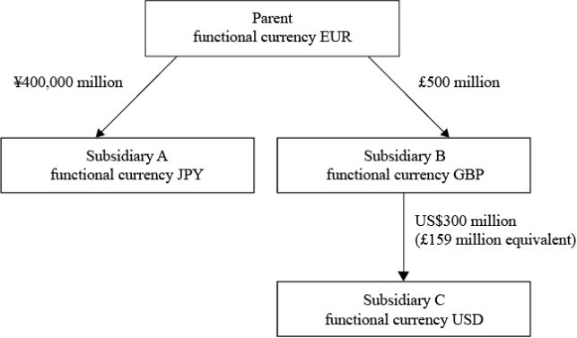
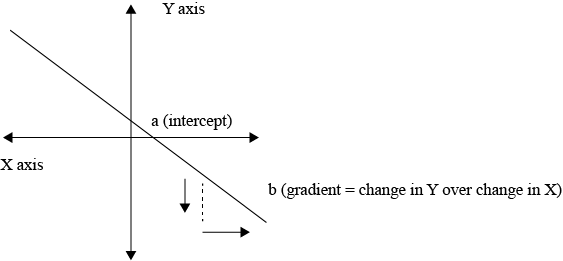

# 46 – Hedge accounting (IFRS 9)

[返回目录](README.md)

## Illustrative text

### FAQ 46.1.1 – What is hedge accounting?

 

Reference to standard: IFRS 9 para 6.1.1  
 Reference to standing text: [46.1](74.md#s295-Para_46.1) 

  

  
 **Question**

What is hedge accounting?

**Answer**

Entities are exposed to financial risks arising from many aspects of their business. Different entities are concerned about different risks. For example, some entities might be concerned about exchange rates or interest rates, while others might be concerned about commodity prices. Entities implement varying risk management strategies to eliminate, reduce or modify their risk exposures.

Hedge accounting is a technique that modifies the normal basis for recognising gains and losses (or revenues and expenses) on associated hedging instruments and hedged items, so that both are recognised in P&amp;L (or OCI) in the same accounting period. This is a matching concept that eliminates or reduces the volatility in the statement of comprehensive income that otherwise would arise if the hedged item and the hedging instrument were accounted for separately under IFRS. Hedge accounting is optional, and management should consider the costs and benefits when deciding whether to use it.

 

### FAQ 46.2.1 – Why is macro hedging addressed as a separate project?

 

Reference to standard: IFRS 9 para 6.1.3  
 Reference to standing text: [46.2](74.md#s295-Para_46.2) 

  

  
 **Question**

Why is macro hedging addressed as a separate project?

**Answer**

The reason for the IASB addressing such hedges separately is that hedges of open portfolios introduce additional complexity. As time passes, new exposures are continuously added to such hedged portfolios, and other exposures are removed, with corresponding adjustments being made to the instruments used to hedge those exposures. In addition, the hedged portfolio often comprises both assets and liabilities and only a part of the overall exposure is hedged. This in turn presents challenges in identifying the hedged item (as it is a part of a bigger portfolio) and in tracking exposures to determine when hedge adjustments should be recognised in P&amp;L.

 

### FAQ 46.3.1 – Can a FVOCI equity instrument be designated in a fair value hedge for foreign exchange risk if an entity continues to use the IAS 39 hedging requirements but transitions to IFRS 9 measurement?

 

Reference to standard: IFRS 9 para 7.2.21; IAS 39 para 86(a)  
 Reference to standing text: [46.3](74.md#s295-Para_46.3) 

  

**Question**

Can a FVOCI equity instrument be designated in a fair value hedge for foreign exchange risk if an entity continues to use the IAS 39 hedging requirements but transitions to IFRS 9 measurement?

**Answer**

  
 If an entity has elected to apply IFRS 9 for classification and measurement purposes, and therefore designated an investment in an equity instrument at fair value through other comprehensive income (FVOCI), it cannot designate the equity instrument as a hedged item in a fair value hedge of foreign exchange risk while still using the IAS 39 hedging requirements. The fair value movements are not recorded through, and therefore cannot affect, P&amp;L. The IAS 39 hedging criteria have not been amended to allow the hedged exposure to be one that could affect other comprehensive income for equity instruments held at FVOCI.

 

### EX 46.5.1 – Examples of fair value hedges

 

<table style="width:100%; border-collapse:collapse"><tr><td style="border:0.75pt solid #000000; padding-right:5.03pt; padding-left:5.03pt; vertical-align:top">
Reference to standard: IFRS 9 para 6.5.2(a)   Reference to standing text: <a href="74.md#s296-Para_46.5">46.5</a> 
</td><td style="border-bottom:0.75pt solid #000000; vertical-align:top"></td></tr><tr><td style="border:0.75pt solid #000000; padding-right:5.03pt; padding-left:5.03pt; vertical-align:top; background-color:#e5e5e5">
<b>Hedges of market price risk exposure</b>
</td><td style="border:0.75pt solid #000000; padding-right:5.03pt; padding-left:5.03pt; vertical-align:top; background-color:#e5e5e5">
<b>Fair value exposure</b>
</td></tr><tr><td style="border:0.75pt solid #000000; padding-right:5.03pt; padding-left:5.03pt; vertical-align:top">
An entity fixes the value of its commodity inventory by entering into a commodity futures contract.
</td><td style="border:0.75pt solid #000000; padding-right:5.03pt; padding-left:5.03pt; vertical-align:top">
The entity is hedging the risk of changes in the inventory’s overall fair value.
</td></tr><tr><td style="border:0.75pt solid #000000; padding-right:5.03pt; padding-left:5.03pt; vertical-align:top">
An entity purchases a put option to protect the fall in value of its quoted equity investments.
</td><td style="border:0.75pt solid #000000; padding-right:5.03pt; padding-left:5.03pt; vertical-align:top">
The entity is hedging the risk of a fall in the fair value of the equity securities below the option’s strike price.
</td></tr><tr><td style="border:0.75pt solid #000000; padding-right:5.03pt; padding-left:5.03pt; vertical-align:top; background-color:#e5e5e5">
<b>Hedges of interest rate exposure</b>
</td><td style="border:0.75pt solid #000000; padding-right:5.03pt; padding-left:5.03pt; vertical-align:top; background-color:#e5e5e5">
 
</td></tr><tr><td style="border:0.75pt solid #000000; padding-right:5.03pt; padding-left:5.03pt; vertical-align:top">
An entity with fixed-rate debt converts the debt into a floating rate using an interest rate swap.
</td><td style="border:0.75pt solid #000000; padding-right:5.03pt; padding-left:5.03pt; vertical-align:top">
The entity is hedging the risk of changes in the fair value of the debt due to changes in interest rate.
</td></tr><tr><td style="border:0.75pt solid #000000; padding-right:5.03pt; padding-left:5.03pt; vertical-align:top; background-color:#e5e5e5">
<b>Hedges of foreign currency exposure</b>
</td><td style="border:0.75pt solid #000000; padding-right:5.03pt; padding-left:5.03pt; vertical-align:top; background-color:#e5e5e5">
 
</td></tr><tr><td style="border:0.75pt solid #000000; padding-right:5.03pt; padding-left:5.03pt; vertical-align:top">
An entity enters into a binding contract to purchase machinery for a fixed amount in foreign currency at a future date and hedges the amount in its functional currency by entering into a forward foreign exchange contract.
</td><td style="border:0.75pt solid #000000; padding-right:5.03pt; padding-left:5.03pt; vertical-align:top">
The entity is hedging the risk of changes in the value of the contract to purchase machinery due to changes in foreign exchange rate.
</td></tr><tr><td style="border:0.75pt solid #000000; padding-right:5.03pt; padding-left:5.03pt; vertical-align:top">
An entity enters into a forward contract to hedge a foreign currency receivable or a payable due for settlement in six months’ time.
</td><td style="border:0.75pt solid #000000; padding-right:5.03pt; padding-left:5.03pt; vertical-align:top">
The entity is hedging the risk of changes in the carrying amount of the receivable or payable due to changes in foreign exchange rate.
</td></tr><tr style="height:0pt"><td></td><td></td></tr></table>

 

### FAQ 46.5.2 – Can an entity designate a basis swap in a fair value hedge of a floating-rate financial instrument?

 

Reference to standard: IFRS 9 para 6.5.2(a)  
 Reference to standing text: [46.5](74.md#s296-Para_46.5)  

  

  
**Question**

Can an entity designate a basis swap as a fair value hedge of a variable rate asset?

**Illustration**

Entity K has issued a 10-year floating-rate note, which pays interest quarterly at the 3-month benchmark interest rate. Entity K has entered into a basis swap under which it receives a 3-month benchmark interest rate and pays a 1-month benchmark interest rate and designates it as a hedge of the changes in fair value of the debt attributable to interest rate movements between the repricing dates of the note.

**Answer**

Yes. Entity K is permitted to designate the basis swap as a fair value hedge of the variable rate asset. The fair value hedging adjustment to the debt attributable to the risk being hedged will be measured against an overnight rate in order that all of the change in fair value attributable to interest rate risk is included. As a result, ineffectiveness might arise in the relationship.

 

### FAQ 46.5.3 – Is it permissible to designate a fair value hedging relationship with an inflation linked basis swap?

 

Reference to standard: IFRS 9 para B6.3.13  
 Reference to standing text: [46.5](74.md#s296-Para_46.5) 

  

  
**Question**

Is it permissible to designate a fair value hedging relationship with the following instruments?

**Illustration**

Company A intends to designate the following instruments in a fair value hedge:

- Hedged item: Purchased debt with ‘interest’ linked to 1-month CPI.

- Hedging instrument: swap between 1-month CPI and overnight benchmark interest rate.

For purposes of this illustration it is assumed that the critical terms of the instruments match, the swap has an initial fair value of zero, and an embedded derivative has not been separated.

**Answer**

Yes, swapping inflation for the overnight benchmark interest rate results in reduced variability in the fair value of the hedged item, hence the above fair value hedge designation is permissible. The portion of the fair value of the instrument attributable to inflation is contractually specified and therefore separately identifiable so changes in the fair value of the entire instrument with respect to inflation are reliably measurable.

[IFRS 9 App B para B6.3.13].

Note: If the pay leg on the swap was a rate other than an overnight rate, some ineffectiveness could result ([see FAQ 46.5.2](75.md#s303-FAQ_46.5.2)).

 

### EX 46.5.4 – Hedging insurance contract liabilities

 

Reference to standard: IFRS 9 para B6.3.13  
Reference to standing text: [46.5](74.md#s296-Para_46.5)  

  

 

**Background**

 

Where insurance contracts are measured applying the general model and the insurer elects the other comprehensive income (OCI) option in IFRS 17, the effect of changes in interest rate on the insurance contract would be reflected in OCI, in order to reduce accounting mismatches with financial assets that it holds to back the liabilities that it measures at fair value through OCI (FVOCI). The insurer might also hedge part of the interest rate risk in the portfolio of insurance contracts using an interest rate swap, measured at fair value through profit and loss (FVTPL). For example, the insurer might not hedge the full duration of the insurance contracts with the swap, or it might hedge only a portion of a group of contracts (and para 88 of IFRS 17 must be applied at group level).

 

IFRS 9 provides an accounting policy choice. Entities can:

 

- either continue to apply the hedge accounting requirements of IAS 39, pending the dynamic risk management hedging project being finalised, or

- apply IFRS 9. If IFRS 9 is applied, it can be applied either in its entirety, or with the exception of the requirements in IAS 39 for portfolio fair value hedges of interest rate risk.

 

While the IAS 39 portfolio fair value hedge accounting model was not written for insurance contracts liabilities, insurance contracts meet the definition of a financial liability because they are generally a contractual obligation to pay cash. In our view, an entity can apply IFRS 9 hedge accounting, and elect to apply the IAS 39 requirements for portfolio fair value hedges of interest rate risk to hedging of interest rate risk for IFRS 17 insurance contract liabilities, provided that all other hedge accounting requirements are met.

 

Assessing if interest rate risk in an insurance contract is a separately identifiable and reliably measurable risk component

 

Rather than hedge all fair value changes arising in one or more insurance contracts, an insurer will often wish to designate these contracts in a hedging relationship for changes in fair value attributable to a specified portion of the risks, referred to in IFRS 9 as a ‘risk component’. Paragraph 6.3.7 of IFRS 9 requires a component of an item to be designated as the hedged item in a hedging relationship only if the risk component is separately identifiable and reliably measurable. There is considerable judgement involved in assessing whether interest rate risk in an insurance contract is a separately identifiable and reliably measurable (SIRM) risk component:

 

- There might be a lack of an obvious market structure for insurance contracts. In such cases, significant judgement will need to be applied to determine the market structure relevant to such contracts.

- Whilst there might be a similar lack of a market structure/observable transactions for loans issued by banks, the cash flows of insurance contracts are often more complex. Insurance contracts might also have discretionary crediting rates or participation in underlying assets, guarantees, and different pay-outs depending on whether there are lapses, mortality or maturity. IFRS 9 does not permit insurers to designate the interest rate risk whilst ignoring the effect of these features on the fulfilment cash flows, unless the insurer can demonstrate, among other things, that changes in expected repricing dates clearly arise from factors other than changes in the hedged interest rate.

- IFRS 17 requires an entity to separate all distinct investment components from the host insurance contracts, and to account for them in accordance with IFRS 9 (often referred to as ‘unbundling’). IFRS 17 has specific requirements for identifying a distinct investment component, including that the entity can measure the investment component without considering the host contract, and that the policyholder must be able to benefit from each component without the other component present (that is, the components do not ‘lapse together’). The definition of ‘distinct investment components’ in IFRS 17 differs from the definition of ‘separately identifiable risk components’ in IFRS 9. Thus, investment components that are not unbundled applying IFRS 17 would still need to be assessed to determine whether they meet the criteria for being considered ‘separately identifiable risk components’, applying IFRS 9.

 

Paragraph B6.3.10(d) of IFRS 9 gives as an example a fixed-rate debt instrument for which an entity concluded that the benchmark interest rate is a separately identifiable and reliably measurable component because of characteristics in the environment in which it is issued. Similar to that example, an entity could conclude that an interest rate component of an insurance contract is separately identifiable and reliably measurable where the insurance contracts are issued in an environment with a market in which the following conditions apply:

 

- Similar insurance contracts are compared to each other in the relevant market by their spreads to a benchmark rate.

- Interest rate swaps are frequently used to manage interest rate risk on the basis of that benchmark rate.

- The price of the insurance contracts varies directly in response to changes in the benchmark rate as they happen.

 

Significant judgement might be needed, depending on the particular facts and circumstances.

 

Measuring and recognising ineffectiveness

 

An entity must measure and recognise ineffectiveness when applying the IAS 39 portfolio fair value hedge accounting model to insurance contracts.

 

Under paragraph AG114 of IAS 39, an entity measures the change in the fair value of the hedged item that is attributable to the hedged risk on the basis of expected repricing dates, except where the changes in expected repricing dates are not attributable to the hedged risk, as explained further below. The entity also measures the change in fair value of the hedging instrument(s), and it recognises that change as a gain or loss in profit or loss. Any ineffectiveness is recognised in profit or loss as the difference between the change in fair value of the hedged item attributable to the hedged risk, and the change in the fair value of the derivative.

 

Lapse or surrender features that are present in many insurance contracts could be regarded as similar to a prepayment option in a loan, and they can be a source of ineffectiveness. An entity is permitted to exclude changes in expected repricing dates (for example, from the exercise of prepayment options) when determining the change in the fair value of the hedged item, provided that it is not attributable to the hedged interest rate; in other words, the following criteria must be met:

 

- the changes clearly arise from factors other than changes in the hedged interest rate;

- the changes are uncorrelated with changes in the hedged interest rate; and

- the changes can be reliably separated from changes that are attributable to the hedged interest rate.

 

To the extent that changes in lapse or surrender rates do not meet these criteria, that effect would need to be included as a source of ineffectiveness.

 

EU insurers that are not SEC registrants have available a ‘carve out’ / ‘bottom layer’ that will mitigate a source of ineffectiveness that otherwise would arise.

 

Insurers using the full IAS 39 hedge accounting model might choose to apply a voluntary de-designation, redesignation approach to minimise ineffectiveness.

 

The following example illustrates the mechanics of hedge accounting.

 

**Numerical example**

 

Simplified fact pattern 1

 

- We assume a simplified life insurance example in which: (1) the insurer issues a portfolio of 1,000 identical contracts with a term of 10 years; (2) the insurer charges a premium of CU517 for each contract, giving a total premium of CU517,000; (3) the insurer promises to pay each policyholder that survives until the end of 10 years a benefit of CU1,000, with no payment if death occurs prior to maturity; (4) the entity expects at the start of the contract that the probability of death before maturity is expected to be 40% 2; and (5) the discount rate at initial recognition (equal to the risk-free benchmark rate) is 2%.

- For simplicity, it is also assumed that: the risk adjustment for non-financial risk is nil; the interest rate structure is flat; and no policyholders die during the period, and this is in line with expectations.

- In order to fully hedge the interest rate risk component of the insurance contracts, at initial recognition the entity entered into an interest rate swap receiving a 2% fixed rate capitalised over the term of the insurance contract and paying a floating, risk-free benchmark rate that will also be capitalised over the life of the swap. The notional of the swap is the fulfilment cash flow component of the insurance liability (that is, the insurance contract liability excluding the contractual service margin (CSM)). A ‘structured derivative’ is used in this example with capitalised interest in order to illustrate that the interest rate risk is fully hedged. In practice, ‘normal swaps’ can be entered into with interest paid each year (but this FAQ does not illustrate those).

- After initial recognition, there are two types of changes in assumptions:

- changes in the benchmark rate of interest, which would increase or decrease the measurement of the liability and result in insurance finance income or expense; and

- changes in mortality rates which affect the amount of the cash flows. Three different mortality scenarios can be considered as follows:

□        Scenario 1: No change in mortality rates.

□        Scenario 2: mortality rates decrease from 40% to 30%, increasing the expected cash outflow.

□        Scenario 3: mortality rates increased from 40% to 50%, decreasing the expected cash outflow.

 

Initial recognition and subsequent measurement of insurance contracts

 

Using these assumptions, the insurer calculates the CSM, applying IFRS 17, as CU24,791 for the portfolio of contracts, equivalent to a commercial margin of 0.5% below the benchmark rate.

 

The insurer immediately invests the premiums received in financial assets, as follows:

 

- A floating-rate asset for an amount of CU492,209 that equals the amount of the fulfilment cash flows. The floating-rate asset is measured at amortised cost. Because this asset has a floating rate, its changes of fair value will only be driven by changes in credit spread. For this example, we have assumed that the credit spread is constant and there are no changes of fair value.

- A fixed-rate asset of 2% for an amount of CU24,791 that equals the amount of the CSM at initial recognition. The fixed-rate asset is measured at FVOCI.

 

After initial recognition, there are two changes in assumptions:

 

- A decrease in the benchmark rate of 1%, which would increase the measurement of the liability and result in insurance finance income or expense. The insurer has elected to disaggregate insurance finance income or expenses for the period between profit or loss and OCI, in order to reduce accounting mismatches with financial assets that it holds to back the liabilities that it measures at FVOCI.

- A change in mortality rates. The example considers three different mortality scenarios, as follows:

- Scenario 1: the mortality rate remains at 40%.

- Scenario 2: mortality rates decrease from 40% to 30%, increasing the expected cash flow outflow.

- Scenario 3: mortality rates increase from 40% to 50%, decreasing the expected cash outflow.

 

Applying the IFRS 17 measurement requirements to scenarios 1 to 3, the fulfilment cash flows (FCF) and the change in fulfilment cash flows are as follows:

 

<table style="border-collapse:collapse"><thead><tr><td style="border:0.75pt solid #000000; padding-right:5.03pt; padding-left:5.03pt; vertical-align:top">
 
</td><td style="border:0.75pt solid #000000; padding-right:5.03pt; padding-left:5.03pt; vertical-align:top">
<b>Scenario 1</b>

<b>CU</b>
</td><td style="border:0.75pt solid #000000; padding-right:5.03pt; padding-left:5.03pt; vertical-align:top">
<b>Scenario 2</b>

<b>CU</b>
</td><td style="border:0.75pt solid #000000; padding-right:5.03pt; padding-left:5.03pt; vertical-align:top">
<b>Scenario 3</b>

<b>CU</b>
</td></tr></thead><tbody><tr><td style="border:0.75pt solid #000000; padding-right:5.03pt; padding-left:5.03pt; vertical-align:top">
FCF at the end of the period
</td><td style="border:0.75pt solid #000000; padding-right:5.03pt; padding-left:5.03pt; vertical-align:top">
548,604
</td><td style="border:0.75pt solid #000000; padding-right:5.03pt; padding-left:5.03pt; vertical-align:top">
640,038
</td><td style="border:0.75pt solid #000000; padding-right:5.03pt; padding-left:5.03pt; vertical-align:top">
457,170
</td></tr><tr><td style="border:0.75pt solid #000000; padding-right:5.03pt; padding-left:5.03pt; vertical-align:top">
Total change in FCF
</td><td style="border:0.75pt solid #000000; padding-right:5.03pt; padding-left:5.03pt; vertical-align:top">
46,551
</td><td style="border:0.75pt solid #000000; padding-right:5.03pt; padding-left:5.03pt; vertical-align:top">
137,985
</td><td style="border:0.75pt solid #000000; padding-right:5.03pt; padding-left:5.03pt; vertical-align:top">
(44,883)
</td></tr><tr><td colspan="4" style="border:0.75pt solid #000000; padding-right:5.03pt; padding-left:5.03pt; vertical-align:top">
The total change in FCF can be analysed as follows:
</td></tr><tr><td style="border:0.75pt solid #000000; padding-right:5.03pt; padding-left:5.03pt; vertical-align:top">
Changes attributable to changes in interest rates
</td><td style="border:0.75pt solid #000000; padding-right:5.03pt; padding-left:5.03pt; vertical-align:top">
46,551 3
</td><td style="border:0.75pt solid #000000; padding-right:5.03pt; padding-left:5.03pt; vertical-align:top">
54,309 4
</td><td style="border:0.75pt solid #000000; padding-right:5.03pt; padding-left:5.03pt; vertical-align:top">
38,792 5
</td></tr><tr><td style="border:0.75pt solid #000000; padding-right:5.03pt; padding-left:5.03pt; vertical-align:top">
Changes attributable to changes in mortality rates
</td><td style="border:0.75pt solid #000000; padding-right:5.03pt; padding-left:5.03pt; vertical-align:top">
-
</td><td style="border:0.75pt solid #000000; padding-right:5.03pt; padding-left:5.03pt; vertical-align:top">
83,676
</td><td style="border:0.75pt solid #000000; padding-right:5.03pt; padding-left:5.03pt; vertical-align:top">
(83,676)
</td></tr></tbody></table>

 

Applying IFRS 17 including the OCI option, the insurer recognises the change in fulfilment cash flows as follows:

- The change in fulfilment cash flows attributable to changes in interest rates is recognised in OCI.

- The change in fulfilment cash flows attributable to changes in mortality rates adjusts the CSM (or, if the CSM is eliminated, it is recognised in profit / loss). This amount is determined on the basis of the original benchmark rate, with the combined effect of the changes in interest rates and the mortality rates allocated to the change in fulfilment cash flows attributable to interest rate risk.

Hedging derivatives used

In order to fully hedge the interest rate risk component of the insurance contracts, at initial recognition the entity entered into an interest rate swap, receiving a 2% fixed rate capitalised over the term of the insurance contract, and paying a floating risk-free benchmark rate which will also be capitalised over the life of the swap. The notional of the contract is the fulfilment cash flow component of the insurance liability (CU492,209) – that is, the insurance contract liability excluding the CSM.

The hedged risk will consist of the CU benchmark interest rate. The change in the fair value of the derivative adjusted for the passage of time is CU46,551 6.  Applying IFRS 9, this amount is recognised in the profit and loss.

Summary of movements in profit/loss and OCI relating to interest rates before hedge accounting is applied in scenario 1:

  

 

<table style="border-collapse:collapse"><thead><tr><td style="border:0.75pt solid #000000; padding-right:5.03pt; padding-left:5.03pt; vertical-align:top">
 
</td><td style="border:0.75pt solid #000000; padding-right:5.03pt; padding-left:5.03pt; vertical-align:top">
<b>CU</b>
</td></tr></thead><tbody><tr><td style="border:0.75pt solid #000000; padding-right:5.03pt; padding-left:5.03pt; vertical-align:top">
Unwind of the insurance contract liability and interest accretion on the CSM
</td><td style="border:0.75pt solid #000000; padding-right:5.03pt; padding-left:5.03pt; vertical-align:top">
10,340
</td></tr><tr><td style="border:0.75pt solid #000000; padding-right:5.03pt; padding-left:5.03pt; vertical-align:top">
Interest income on financial assets at amortised cost and FVOCI
</td><td style="border:0.75pt solid #000000; padding-right:5.03pt; padding-left:5.03pt; vertical-align:top">
(5,418)
</td></tr><tr><td style="border:0.75pt solid #000000; padding-right:5.03pt; padding-left:5.03pt; vertical-align:top">
Interest expense on the derivative
</td><td style="border:0.75pt solid #000000; padding-right:5.03pt; padding-left:5.03pt; vertical-align:top">
(4,922)
</td></tr><tr><td style="border:0.75pt solid #000000; padding-right:5.03pt; padding-left:5.03pt; vertical-align:top">
Change in fair value of the derivative adjusted for the passage of time
</td><td style="border:0.75pt solid #000000; padding-right:5.03pt; padding-left:5.03pt; vertical-align:top">
(46,551)
</td></tr><tr><td style="border:0.75pt solid #000000; padding-right:5.03pt; padding-left:5.03pt; vertical-align:top">
Total recognised in profit and loss
</td><td style="border:0.75pt solid #000000; padding-right:5.03pt; padding-left:5.03pt; vertical-align:top">
(46,551)
</td></tr></tbody></table>

 

In this example, the change in fulfilment cash flows attributable to changes in interest rates for scenario 1 is CU46,551. Therefore, the hedge is perfectly effective from an economic perspective. However, in the absence of hedge accounting, the change in the value of the derivative is recognised in profit or loss, while the change in the fulfilment cash flows arising from interest rate change is recognised in OCI.

Where hedge accounting is applied, in accordance with paragraph 89 of IAS 39, the hedging gain or loss on the hedged item (that is, the insurance contracts) that is attributable to the hedged risk adjusts the carrying amount of the hedged item and is recognised in profit or loss. In our view, the gain or loss attributable to the hedged risk is the change in the current value of the liability attributable to benchmark interest rate risk. That amount is therefore recognised in profit or loss. In this example, all of the interest rate risk portion of the fulfilment cash flows is hedged, and there is no OCI component attributable to changes in interest rates relating to the insurance liability left in OCI.

Where there is a change in the policyholders that will receive benefits as illustrated in scenarios 2 and 3, the cash flows subject to the change in interest rates will be different from those that are hedged by the derivative, as illustrated in the table above. The entity will therefore need to assess the extent to which such changes give rise to ineffectiveness.

In scenario 2, where there is an increase in expected cash flows, an entity might be able to limit the ineffectiveness where it applies the ‘bottom layer’ approach under the EU carve-out rules for IAS 39. Where the entity does not apply the EU carve-out rules for IAS 39, it will need to assess the extent to which changes giving rise to an increase in expected cash flows might result in ineffectiveness. Ineffectiveness might be reduced in this case through de-designation and re-designation.

In scenario 3, where there is a decrease in expected cash flows, ineffectiveness will arise.

  

 

### FAQ 46.9.1 – What is the impact of deferring amortisation of the basis adjustment?

 

Reference to standard:  IFRS 9 para 6.5.10  
Reference to standing text: [46.9](74.md#s296-Para_46.9)  

  

**Question**

  
Entity A enters into an interest rate swap contract to hedge changes in the fair value of a fixed-rate borrowing of C100m due for settlement in five years. The terms of the borrowing and the swap exactly match. Interest rates rise so that the borrowing’s fair value falls to C90m and the swap’s fair value changes from zero to minus C10m.

Under fair value hedge accounting, the swap is carried as a liability of C10m (less any settlement paid). The carrying amount of the borrowing is reduced to C90m. Both the loss and the gain are recognised in P&amp;L. Under the amortised cost method, the C90m carrying amount of the liability would be amortised back up to C100m, giving rise to additional finance cost over the remaining period to maturity.

As noted in [paragraph 46.9](74.md#s296-Para_46.9), IFRS 9 allows amortisation to be deferred until hedge accounting is discontinued. What is the practical impact of deferring amortisation in this example?

**Answer**

If the swap is in place until the borrowing’s maturity date, the debt’s carrying amount will be adjusted back to C100m through further hedge accounting adjustments. In other words, any fair value adjustments to the debt’s carrying value would be reversed by maturity, as the fair value of the liability immediately before settlement must be C100m. Therefore, no amortisation will be necessary.

 

### FAQ 46.9.2 - What is the pull-to-par adjustment and when would it be required?

 

Reference to standard:  IFRS 9 para 6.3.7,para 6.5.10  
Reference to standing text: [46.9](74.md#s296-Para_46.9)   

  

 

**Question**

 

What is the pull-to-par adjustment and when would it be required?

 

**Answer**

 

In many fair value hedging relationships, changes in the fair value of the hedged item reverse over the life of the hedging relationship due to, for example, the passage of time and settlements made on the hedged item (for example, coupons). The ‘pull-to-par’ adjustment is an adjustment made to the changes in the fair value of a hedged item in certain fair value hedge relationships where the fair value adjustments do not otherwise reverse over time, ensuring that no residual fair value adjustments remain on the balance sheet on maturity of a hedging relationship.

 

For example, consider an entity that holds a fixed-rate debt instrument which is accounted for at amortised cost. It hedges the changes in the fair value of the debt instrument with a vanilla interest rate swap for the entire outstanding period of the debt instrument, and it designates the instruments in a fair value hedging relationship.

 

IFRS 9 indicates (in para 6.3.7) that an entity may designate an item in its entirety or a component of an item as the hedged item in a hedging relationship. Therefore, depending on its risk management strategy, the entity could either designate the complete cash flows of the debt instrument as the hedged item, or a component of the cash flows (for example, the benchmark rate component of the debt instrument).

 

Fair value hedge accounting allows an entity to adjust the carrying amount of the hedged item with the changes in the fair value of the designated component, due to changes in the designated hedged risk. These adjustments are in addition to the effective interest rate adjustments made in determining the amortised cost of the hedged item. Assuming that no credit losses are expected, the effective interest rate adjustments will result in the carrying amount of the hedged item being equal to its principal amount on maturity, immediately before the principal amount is settled. Any fair value adjustments arising from the application of fair value hedge accounting are therefore made in addition to the effective interest rate adjustments.

 

In order to ensure that no residual amount exists on the balance sheet on maturity of the hedged item, the cumulative changes in the fair value of the hedged item should amount to zero over the life of the hedging relationship. This would be the case where, for example, only the benchmark rate component of the hedged item is designated, resulting in the fair value of the designated (portion of the) cash flows of the hedged item being equal to the principal amount of the hedged item on the designation date. In such instances, since the fair value of the designated cash flows of the hedged item is equal to the principal amount on designation date, and it will also be equal to the principal amount on maturity date, the cumulative change in fair value of the hedged item due to changes in the hedged risk will amount to zero. No additional adjustments would therefore be required. (Refer to [FAQ 46.9.1](75.md#s303-FAQ_46.9.1))

 

However, in other types of designation, the cumulative change in the fair value of the hedged item arising from the hedged risk might not amount to zero. This could be the case where, for example, the designation occurs when the fair value of the designated cash flows is not at par, or where a component other than the benchmark rate is designated. In such instances, the cumulative changes in the fair value of the designated cash flows of the hedged item over the life of the hedging relationship might not amount to zero, resulting in a residual amount on the balance sheet on maturity of the hedged item, unless an adjustment is made to ensure that the combined carrying amount of the hedged item (that is, the amortised cost and the associated fair value adjustments) is equal to the amount to be settled on maturity. Such an adjustment is typically referred to as the ‘pull-to-par’ adjustment, because it ensures that the combined carrying amount of the hedged item is the par amount on maturity.

 

IFRS 9 indicates (in para 6.5.10 ) that any fair value adjustment made to a hedged item that is a financial instrument should be amortised to profit or loss. Amortisation can begin as soon as an adjustment exists, and it must begin no later than when the hedged item ceases to be adjusted for hedging gains and losses. We therefore believe that the pull-to-par adjustment, which recognises a component of the periodic fair value adjustments in profit or loss over the life of the hedging relationship, can be supported by paragraph 6.5.10 of IFRS 9, since this adjustment will ensure that the cumulative fair value adjustment over the life of the hedging relationship amounts to zero. 

 

The amount of the pull-to-par adjustment required is, however, dependent on the methodology applied in calculating the change in the fair value of the hedged item due to changes in the hedged risk. Different methodologies can be applied in practice. In some instances, the cumulative pull-to-par adjustment would amount to the difference between the fair value of (the designated component of) the hedged item on designation date and its par value; in other instances, the cumulative pull-to-par adjustment will be the difference between the fair value of (the designated component of) the hedged item and its carrying amount on designation date. 

 

An entity should therefore consider the cumulative fair value adjustment expected over the hedging period, and the extent to which components within the fair value adjustments are already accounted for via the amortised cost adjustments, in determining the amount of the pull-to-par adjustment required.

 

### FAQ 46.12.1 – Can the amounts recorded in OCI as a result of changes in fair value of the hedging instrument in a fair value hedge of an equity instrument designated at FVOCI be transferred to other components of equity?

 

Reference to standard: IFRS 9 para 6.5.8(a)  
 Reference to standing text: [46.12](74.md#s296-Para_46.12) 

  

  
**Question**

Can the amounts recorded in OCI as a result of changes in fair value of the hedging instrument in a fair value hedge of an equity instrument designated at FVOCI be transferred to other components of equity?

**Illustration**

Company A holds equity instruments issued by an unrelated company. Since the equity instruments are not held for trading, company A voluntarily elected to designate them at fair value through OCI (FVOCI) on initial recognition. In order to mitigate its exposure to changes in fair value, company A subsequently enters into a derivative that it designates as a fair value hedge of the equity instruments.

**Answer**

Yes. Increases or decreases in the fair value of the equity instruments are recognised in OCI and not subsequently transferred to profit or loss. [IFRS 9 App B para B5.7.1]. However, the entity could transfer the cumulative gain or loss within equity at any time. [IFRS 9 para BC E.38].

On that basis, it would be acceptable to transfer the gain or loss on the hedging instrument and on the hedged equity instrument at the same time and to the same other component of equity, subject to jurisdiction-specific restrictions. Such a transfer would not go through the statement of comprehensive income.

As an alternative, company A could choose to keep the gains and losses in their original equity components. The chosen accounting policy should be applied consistently and disclosed.

 

### EX 46.14.1 – Examples of cash flow hedges

 

<table style="width:100%; border-collapse:collapse"><tr><td style="border:0.75pt solid #000000; padding-right:5.03pt; padding-left:5.03pt; vertical-align:top">
Reference to standard: IFRS 9 para 6.5.2(b)   Reference to standing text: <a href="74.md#s296-Para_46.14">46.14</a> 
</td><td style="border-bottom:0.75pt solid #000000; vertical-align:top"></td></tr><tr><td style="border:0.75pt solid #000000; padding-right:5.03pt; padding-left:5.03pt; vertical-align:top; background-color:#e5e5e5">
<b>Hedges of market price risk exposure</b>
</td><td style="border:0.75pt solid #000000; padding-right:5.03pt; padding-left:5.03pt; vertical-align:top; background-color:#e5e5e5">
<b>Cash flow exposure</b>
</td></tr><tr><td style="border:0.75pt solid #000000; padding-right:5.03pt; padding-left:5.03pt; vertical-align:top">
An entity that has a highly probable sale of a commodity in the future at the then prevailing market price ‘fixes’ the selling price of the goods by entering into a futures contract.
</td><td style="border:0.75pt solid #000000; padding-right:5.03pt; padding-left:5.03pt; vertical-align:top">
The entity is hedging the risk of variability in the cash flows to be received on the sale due to changes in the goods’ market price.
</td></tr><tr><td style="border:0.75pt solid #000000; padding-right:5.03pt; padding-left:5.03pt; vertical-align:top; background-color:#e5e5e5">
<b>Hedges of interest rate exposure</b>
</td><td style="border:0.75pt solid #000000; padding-right:5.03pt; padding-left:5.03pt; vertical-align:top; background-color:#e5e5e5">
 
</td></tr><tr><td style="border:0.75pt solid #000000; padding-right:5.03pt; padding-left:5.03pt; vertical-align:top">
An entity with floating-rate debt converts the rate on the debt to a fixed rate using an interest rate swap.
</td><td style="border:0.75pt solid #000000; padding-right:5.03pt; padding-left:5.03pt; vertical-align:top">
The entity is hedging the risk of variability in interest payments due to changes in the interest rate specified for the debt.
</td></tr><tr><td style="border:0.75pt solid #000000; padding-right:5.03pt; padding-left:5.03pt; vertical-align:top">
An entity that has a highly probable issuance of fixed-rate debt in the future at the then coupon rate enters into a forward-starting interest rate swap to protect itself from the effects of changes in a specified interest rate that might occur before the debt is issued.
</td><td style="border:0.75pt solid #000000; padding-right:5.03pt; padding-left:5.03pt; vertical-align:top">
The entity is hedging the variability in the expected interest payments from the issuance of a debt due to changes in a specified interest rate on a debt expected to be issued within a specified period.
</td></tr><tr><td style="border:0.75pt solid #000000; padding-right:5.03pt; padding-left:5.03pt; vertical-align:top; background-color:#e5e5e5">
<b>Hedges of foreign currency exposure</b>
</td><td style="border:0.75pt solid #000000; padding-right:5.03pt; padding-left:5.03pt; vertical-align:top; background-color:#e5e5e5">
 
</td></tr><tr><td style="border:0.75pt solid #000000; padding-right:5.03pt; padding-left:5.03pt; vertical-align:top">
An entity that has a highly probable sale of goods in a foreign currency takes out a forward exchange contract to ‘fix’ the local (functional) currency price of the goods.
</td><td style="border:0.75pt solid #000000; padding-right:5.03pt; padding-left:5.03pt; vertical-align:top">
The entity is hedging the risk of changes in the local (functional) currency amount of the sale due to changes in foreign exchange rates.
</td></tr><tr><td style="border:0.75pt solid #000000; padding-right:5.03pt; padding-left:5.03pt; vertical-align:top">
An entity enters into a forward contract to hedge a foreign currency receivable or a payable due to be settled in six months’ time.
</td><td style="border:0.75pt solid #000000; padding-right:5.03pt; padding-left:5.03pt; vertical-align:top">
The entity is hedging the risk of changes in the amount receivable or payable on settlement in six months’ time due to changes in foreign exchange rates.
</td></tr><tr style="height:0pt"><td></td><td></td></tr></table>

 

### FAQ 46.20.1 – Does IFRS 9 require debit balances in the cash flow hedge reserve to be tested for recoverability?

 

Reference to standard: IFRS 9 para 6.5.11(d)(iii)  
Reference to standing text:[46.20](74.md#s296-Para_46.20)  

  

 

**Question**

 

Changes in commodity prices, foreign exchange rates and other market prices may give rise to fair value movements on hedging instruments. Debit balances may be included in the cash flow hedge reserve as a result of such market movements. Does IFRS 9 require these debit balances to be tested for recoverability?

 

**Answer**

 

Yes. Paragraph 6.5.11(d)(iii) of IFRS 9 requires recoverability to be considered for losses in cash flow hedging reserves (that is, where the accumulated amounts are in a loss position). Where an entity expects all or a portion of such losses will not be recovered in one or more future periods, it should immediately reclassify the amount not expected to be recovered to profit or loss.

 

IFRS 9 does not provide specific guidance on how the recoverability test should be applied, and entities should consider their accounting policies for the assessment of recoverability of these amounts. Where such debit balances are significant, an entity should consider whether disclosure about the accounting policy – and about significant judgement in the application of that policy – is required in accordance with paragraph 122 of IAS 1.

 

However, prior to assessing such debit balances for recoverability, the entity should consider whether recycling of such balances is required for other reasons (for example, if a forecast transaction is no longer expected to occur). See paragraph [46.153](74.md#s300-Para_46.153) for the required treatment of discontinued cash flow hedges.

 

### FAQ 46.25.1 – What amount of a net investment in a foreign operation qualifies as a hedged item in a net investment hedge?

 

Reference to standard:  IFRIC 16 para 11  
Reference to standing text: [46.25](74.md#s296-Para_46.25)  

  

**Question**

What amount of a net investment in a foreign operation qualifies as a hedged item in a net investment hedge?

**Illustration**

Company W, whose functional currency is the Euro, has a wholly owned US subsidiary, subsidiary D, whose functional currency is US dollars.

The carrying value of subsidiary D’s net assets is USD70 million. Subsidiary D’s net assets include an inter-company borrowing of USD10 million received from company W, which is not expected to be settled in the foreseeable future.

Subsidiary D’s management predicts that it is highly probable that it will:

- earn a profit of at least USD8 million; and

- pay a dividend of USD5 million to company W.

Company W also plan to make a capital contribution to subsidiary D in one year’s time.

**Answer**

Company W can hedge up to USD80 million of its net investment in subsidiary D at the date of hedge designation. The USD80 million is represented by:

- USD70 million of subsidiary D’s net assets; and

- USD10 million inter-company loan. This loan could be designated as a hedged item, because it is not expected to be settled in the foreseeable future and therefore, in substance, forms part of company W’s net investment in subsidiary D [IAS 21 para 15].

Subsidiary D’s forecast profits (USD8 million) and forecast inter-company dividend payments (USD5 million) cannot be included in the hedged item, because they do not form part of company W’s existing net investment. The undeclared forecast inter-company dividend payments (USD5 million) do not qualify as hedged items, because they will not affect reported net profit or loss. As the profits are earned, they increase the net investment and can then be included in the hedged item. When dividends are paid, the amount covered in the net investment hedge might need to be reduced correspondingly.

The forecast capital contribution is also not an eligible hedged item because the forecast cash flows will never affect profit or loss. The fair value of subsidiary D plus cash held by company W will be exactly the same before and after the contribution.

 

### FAQ 46.25.2 – Can goodwill be included in a net investment hedge?

 

Reference to standard: IAS 21 para 47  
  Reference to standing text: [46.25](74.md#s296-Para_46.25)  
Corporate treasury

  

  
**Question**

Can goodwill be included in a net investment hedge?

**Illustration**

Entity A, a EUR functional currency company, has acquired a US subsidiary for USD200 million. After accounting for the acquisition, the entity shows in its balance sheet a net asset of USD200 million that includes goodwill (fully allocated to the purchased entity) of USD100 million.

Entity A’s management decides to hedge the foreign currency risk on its USD200 million investment by entering into a forward contract to sell USD200 million for EUR. For accounting purposes, entity A’s management wishes to designate the net asset (including the goodwill) as the hedged item in a net investment hedge relationship and apply hedge accounting.

**Answer**

Yes, entity A’s goodwill is a part of the net investment at the group level. As a result, it can be designated as a part of the hedged item in a net investment hedge because:

- IAS 21 requires any goodwill arising on the acquisition of a foreign operation to be treated as an asset of the foreign operation and, thus, to be expressed in the functional currency of the foreign operation and translated at the closing rate through OCI. [IAS 21 para 47].

- In the case of disposal of the foreign operation, the gains and losses arising on the retranslation will be reclassified to profit or loss.

 

### FAQ 46.27.1 – What factors should be considered for net investment hedges in a group situation?

 

Reference to standard: IFRIC 16 paras 13,15  
Reference to standing text: [46.27,](74.md#s296-Para_46.27) [46.30](74.md#s296-Para_46.30), [46.31](74.md#s296-Para_46.31)  

  

  
**Question 1**

What options are available for designating a net investment hedge in a group situation?

**Answer**

There are different options available depending on the specific facts and circumstances.

  
Parent, being the ultimate parent entity, presents its consolidated financial statements in its functional currency of euro (EUR). Each of the subsidiaries is wholly owned. Parent’s £500 million net investment in Subsidiary B (functional currency pounds sterling (GBP)) includes the £159 million equivalent of subsidiary B’s US$300 million net investment in subsidiary C (functional currency US dollars (USD)). In other words, subsidiary B’s net assets other than its investment in subsidiary C are £341 million.

The group described above could designate any of the following:

- The parent can hedge its net investment in each of subsidiaries A, B and C for the foreign exchange risk between their respective functional currencies (Japanese yen, pounds sterling and US dollars) and the euro.

- The parent can hedge the USD/GBP foreign exchange risk between the functional currencies of subsidiaries B and C.

- In its consolidated financial statements, subsidiary B can hedge its net investment in subsidiary C for the foreign exchange risk between their functional currencies of US dollars and pounds sterling.

**Answer to question 1 – scenario 1 (hedge accounting for risk from investment in C)**

The parent wishes to hedge the foreign exchange risk from its net investment in subsidiary C. Assume that subsidiary A has an external borrowing of US$300m. The net assets of subsidiary A at the start of the reporting period are ¥400,000m, including the proceeds of the external borrowing of US$300m.

- What amount could be designated as the hedged item?

The hedged item can be an amount of net assets equal to or less than the carrying amount of the parent’s net investment in subsidiary C (US$300m) in its consolidated financial statements. As a result, the parent can designate, in its financial statements, the US$300m external borrowing in subsidiary A as a hedge of the EUR/USD spot foreign exchange risk associated with its net investment in the US$300m net assets of subsidiary C. In this case, both the EUR/USD foreign exchange difference on the US$300m external borrowing in subsidiary A and the EUR/USD foreign exchange difference on the US$300m net investment in subsidiary C are included in the foreign currency translation reserve in the parent’s consolidated financial statements after the application of hedge accounting.

**Answer to question 1 - scenario 2 (no hedge accounting)**

In the absence of hedge accounting, the total USD/EUR foreign exchange difference on the US$300m external borrowing in subsidiary A would be recognised in the parent’s consolidated financial statements as follows:

- USD/JPY spot foreign exchange rate change, translated to euro, in P&amp;L, and

- JPY/EUR spot foreign exchange rate change in equity.

**Answer to question 1 – scenario 3 (hedge accounting for FX risk between B and C)**

Instead of designating the US$300m external borrowing as a hedge of the EUR/USD spot foreign exchange risk on the investment in subsidiary C in its consolidated financial statements, the parent could designate the borrowing in subsidiary A as a hedge of the GBP/USD spot foreign exchange risk between subsidiaries C and B. In this case, the total USD/EUR foreign exchange difference on the US$300m external borrowing in subsidiary A is instead recognised in the parent’s consolidated financial statements as follows:

- the GBP/USD spot foreign exchange rate change in the foreign currency translation reserve relating to subsidiary C,

- the GBP/JPY spot foreign exchange rate change, translated to euro, in P&amp;L, and

- the JPY/EUR spot foreign exchange rate change in equity.

The parent cannot designate the US$300m external borrowing in subsidiary A as a hedge of both the EUR/USD spot foreign exchange risk and the GBP/USD spot foreign exchange risk in its consolidated financial statements. A single hedging instrument can hedge the same designated risk only once. Subsidiary B cannot apply hedge accounting in its consolidated financial statements, because the hedging instrument is held outside the group comprising subsidiaries B and C.

**Question 2**

How is hedge effectiveness determined in scenario 1 above?

**Answer to question 2**

[Refer to [para 46.31](74.md#s296-Para_46.31) for information on determination of hedge effectiveness on net investment hedges].

Using the same information as in question 1 above, the total change in value in respect of foreign exchange risk of the US$300 million external borrowing in subsidiary A is recorded in both profit or loss (USD/JPY spot risk) and equity (EUR/JPY spot risk) in the parent’s consolidated financial statements, in the absence of hedge accounting. Both amounts are included for the purpose of demonstrating the effectiveness of the hedge, because the change in value of both the hedging instrument and the hedged item are calculated by reference to the euro functional currency of the parent against the US dollar functional currency of subsidiary C, in accordance with the hedge documentation.

The method of consolidation (that is, direct method or step-by-step method) does not affect this. However, as explained in [paragraph 46.32](74.md#s296-Para_46.32), [FAQ 46.32.1](75.md#s303-FAQ_46.32.1) and Question 3 below, it might affect the amounts that are recycled when the hedged foreign operation is disposed of.

**Question 3**

Does the consolidation method used have an effect on recycling?

**Answer to question 3**

[Refer to [para 46.32](74.md#s296-Para_46.32) and [FAQ 46.32.1](75.md#s303-FAQ_46.32.1) for information on method of consolidation and recycling].

Using the same facts as in question 1 above, the parent used a USD borrowing in subsidiary A to hedge the EUR/USD risk of the net investment in subsidiary C in the parent’s consolidated financial statements. The parent uses the step-by-step method of consolidation. Assume the hedge was fully effective and the full USD/EUR accumulated change in the value of the hedging instrument before disposal of subsidiary C is €24m (gain). This is matched exactly by the fall in value of the net investment in subsidiary C, when measured against the functional currency of the parent (euro). If the direct method of consolidation is used, the fall in the value of the parent’s net investment in subsidiary C of €24m is reflected totally in the foreign currency translation reserve relating to subsidiary C in the parent’s consolidated financial statements. However, because the parent uses the step-by-step method, this fall in the net investment value in subsidiary C of €24m is reflected both in subsidiary B’s foreign currency translation reserve relating to subsidiary C and in the parent’s foreign currency translation reserve relating to subsidiary B. The aggregate amount recognised in the foreign currency translation reserve in respect of subsidiaries B and C is not affected by the consolidation method. Assume that, using the direct method of consolidation, the foreign currency translation reserves for subsidiaries B and C in the parent’s consolidated financial statements are €62m gain and €24m loss respectively; using the step-by-step method of consolidation, those amounts are €49m gain and €11m loss respectively.

IFRS 9 requires the full €24m gain on the hedging instrument to be reclassified to profit or loss when the investment in subsidiary C is disposed of. Using the step-by-step method, the amount to be reclassified to profit or loss in respect of the net investment in subsidiary C is only €11m loss. The parent could adjust the foreign currency translation reserves of both subsidiaries B and C by €13m, in order to match the amounts reclassified in respect of the hedging instrument and the net investment, as would have been the case if the direct method of consolidation had been used, if that was its accounting policy. An entity that had not hedged its net investment could make the same reclassification.

 

### FAQ 46.29.1 – Can an entity hedge net investments with forward contracts?

 

Reference to standard: IFRIC 16 para AG2  
 Reference to standing text: [46.29](74.md#s296-Para_46.29) 

  

**Question**

Can an entity hedge net investments with forward contracts?

**Answer**

  
 Yes. Forward contracts are derivatives commonly used as hedging instruments for net investment hedges. Where this is the case, an entity should designate at inception whether it is hedging against changes in spot exchange rates or changes in forward exchange rates:

- If the spot rate method is used, only the change in the fair value of the forward contract due to changes in spot rates would be reported in OCI, and the balance of the fair value of the forward (due to the forward points) would be included in P&amp;L at each reporting date.

- If the forward rate method is used, there are two potential treatments for the change in the fair value of the forward due to forward points. This is explained further in [paragraph 46.125](74.md#s299-Para_46.125) and [FAQ 46.125.1](77.md#s305-FAQ_46.125.1).

If the notional amount of a currency forward that swaps the functional currency of the hedged net investment into the investor’s functional currency matches the portion of the net investment hedged, it is likely to be an effective hedging instrument.

 

### FAQ 46.29.2 – Are cross-currency interest rate swaps eligible hedging instruments for net investment hedges?

 

Reference to standard: IFRIC 16 para 14  
 Reference to standing text: [46.29](74.md#s296-Para_46.29) 

  

**Question**

Are cross-currency interest rate swaps eligible hedging instruments for net investment hedges?

**Answer**

  
 Yes. Entities can designate a cross-currency interest rate swap (CCIRS) as a hedge of a net investment in a foreign operation. However, such CCIRS, having foreign exchange and interest rates as underlyings, might not be effective hedging instruments, since the hedged net investment is not affected by changes in interest rates and there is a less clear economic relationship.

Nevertheless, cross-currency swaps could be designated as hedging instruments in a net investment hedge, provided both legs of the swap are either floating rates or fixed rates. This is because a CCIRS that has two floating legs has a fair value that is primarily driven by changes in foreign exchange rates rather than changes in interest rates.

However, a CCIRS with one fixed-rate leg and one floating-rate leg might not meet the hedge effectiveness requirements to be designated in a net investment hedge.

 

### FAQ 46.29.3 – How is a fixed-fixed cross-currency interest rate swap accounted for in a net investment hedge?

 

Reference to standard:  IFRS 9 para 6.5.13  
 Reference to standing text: [46.29](74.md#s296-Para_46.29) 

  

  
 **Question**

How is a fixed-fixed cross-currency interest rate swap accounted for in a net investment hedge?

**Illustration**

Company A, with pound sterling (GBP) as its functional currency, has a net investment in a foreign subsidiary of US$120m. Company A wishes to eliminate foreign exchange risk associated with the retranslation of part of this net investment into its functional currency, and it enters into a fixed-fixed cross-currency interest rate swap (‘CCIRS’). The swap has a GBP100m receive leg receiving interest at 3%, and a US$80m pay leg paying interest at 5% (assume that GBP100m and US$80m are equivalent, based on the spot rate at inception). The swap has annual interest settlements, a five-year maturity and a zero fair value at inception.

How should hedge accounting be applied?

**Answer**

Management should bear in mind that hedges of a net investment in a foreign operation are accounted for similarly to cash flow hedges. [IFRS 9 para 6.5.13].

There is no other guidance within IFRS 9 regarding the basis for this similarity, and we believe that there are two different acceptable accounting approaches.

Approach 1

One acceptable approach is to view a net investment hedge as analogous to a cash flow hedge of the foreign currency risk on the cash flows that would arise from a sale of the net investment at a (or several) future date(s) for the cash flow variability arising due to foreign currency risk. This approach would give a rationale for accounting for net investment hedges in a similar manner to cash flow hedges and requires deconstructing a fixed-fixed CCIRS into a series of forward contracts.

The hedged US dollar net investment is viewed as a series of cash flows on various 'deemed disposal' dates in the future so as to match the cash flows on the US$ leg of the CCIRS. In other words, the net investment hedge would be treated in a manner similar to a cash flow hedge of cash flows arising on a deemed sale of US$4m (that is, US$80m × 5%) of the net investment at the end of each of the next four years, and a deemed sale of US$84m at the end of year 5. The total net investment of US$120m exceeds the aggregate of the deemed disposals (US$4m + US$4m + US$4m + US$4m + US$84m = US$100m), and so this designation is acceptable.

This net investment (series of deemed cash flows that match each cash flow on the CCIRS) is identical to the profile of cash flows of a US$80m foreign currency debt (which is an asset of company A) that pays interest annually at 5%. Hence the effective portion of the gain or loss on the swap can be measured in a manner similar to that used for a cash flow hedge of a fixed-rate foreign currency debt. If a hypothetical derivative method is used, the most appropriate hypothetical derivative is a CCIRS that is equivalent (and opposite) to the actual hedging instrument. However, the hypothetical derivative should exclude currency basis, given that there is no currency basis in the net investment, and this could give rise to volatility in profit or loss – see [FAQ 46.39.5](75.md#s303-FAQ_46.39.5) and [FAQ 46.55.1](75.md#s303-FAQ_46.55.1) for further details.

Note that this designation requires the net investment to equal or exceed the aggregate of the notional principal and interest cash flows on the CCIRS (in this case, US$100m). This approach cannot be adopted where the notional principal in the CCIRS is equal to the net investment balance.

Approach 2

An alternative acceptable view is that a CCIRS is similar in nature to a long dated forward. The key difference is that the forward points due to the interest differential on the two currencies are paid off over the period (via the interest payments on the swap) rather than at the end.

Under this view, the fixed-fixed CCIRS is treated similarly to a forward contract for hedge accounting purposes. As such, the exchange of principal of US$80m can be seen as the spot component, and only this component is designated as the hedging instrument (with the interest cash flows being seen as forward points and excluded from the designated hedge under para 6.2.4(b) of IFRS 9). As with approach 1, if a hypothetical derivative method is used to measure the effective portion of the gain or loss on the swap, the hypothetical derivative should exclude currency basis, given that there is no currency basis in the net investment. Hence both fair value movements on the forward points and the impact of currency basis could give rise to volatility in profit or loss – see [FAQ 46.31.1](75.md#s303-FAQ_46.31.1) for further details.

This designation requires the net investment to equal or exceed only the aggregate of the notional principal on the CCIRS (in this case, US$80m), and so it can be adopted where the notional principal in the CCIRS is equal to the net investment balance.

 

### FAQ 46.31.1 – How should a parent account for the IFRS 9 requirement to consider time value of money in its net investment hedges?

 

Reference to standard:  IFRS 9 paras B6.5.4, BC6.124  
 Reference to standing text: [46.31](74.md#s296-Para_46.31) 

  

  
**Question**

How should a parent account for a net investment hedge in its consolidated accounts? In particular, when does the requirement in IFRS 9 to consider the time value of money result in ineffectiveness?

**Illustration**

Entity A, a GBP functional currency entity, has a net investment in a EUR foreign operation.

**Scenario 1 – Hedging instrument is a term loan**

In its consolidated accounts, entity A hedges the net investment with a five-year EUR term loan and applies hedge accounting.

**Answer to scenario 1**

Accounting impact

All foreign currency gains and losses on retranslating the net assets of the foreign operation are recognised in other comprehensive income in accordance with IAS 21. These are calculated by retranslating the net investment at the relevant spot rate. The effective portion of the gains and losses on the hedging instrument (the loan) are also recognised in other comprehensive income in accordance with paragraph 6.5.13 of IFRS 9. These gains and losses remain in the hedging reserve until disposal or partial disposal of the foreign operation, at which point they are reclassified to profit or loss.

Consideration of the time value of money and ineffectiveness

The hedging instrument (the loan) is measured at amortised cost, which is itself a present value measurement that takes into account the time value of money. [IFRS 9 para BC6.280]. Furthermore, paragraph BC6.124 of IFRS 9 states that the foreign currency risk component of a non-derivative, such as a loan, that is used as a hedging instrument is the amount determined in accordance with IAS 21. IAS 21 also requires the net investment to be translated at the closing spot rate. This means that there is no requirement to make a further separate adjustment for the time value of money on either the hedged item or the hedging instrument. Accordingly, no ineffectiveness will arise from IFRS 9’s requirement to consider the time value of money.

**Scenario 2 – Hedging instrument is a currency forward contract, and designated hedged risk is the forward exchange rate**

In its consolidated accounts, entity A hedges the net investment with an 18-month foreign currency forward contract and applies hedge accounting. The notional principal of the forward matches the amount of the net investment designated as being hedged. Entity A designates the hedged risk as changes in the forward exchange rate.

**Answer to Scenario 2**

Accounting impact

By designating the hedged risk as changes in the 18-month forward exchange rate, entity A is imputing a life of 18 months into the hedge relationship.

All foreign currency gains and losses on retranslating the net assets of the foreign operation are recognised in other comprehensive income in accordance with IAS 21. These are calculated by retranslating the net investment at the relevant spot rate.

The effective portion of the gains and losses on the hedging instrument (the forward contract) are also recognised in other comprehensive income, in accordance with paragraph 6.5.13 of IFRS 9. The gains and losses on the hedging instrument are calculated using the forward rate, and the effective portion includes movements in value of the forward points, because the designated hedged risk is changes in the forward exchange rate. Therefore, there will be a difference between the amount recorded on the hedged net investment and the amount recorded on the hedging instrument (the forward contract).

These gains and losses remain in reserves until disposal or partial disposal of the net investment (at which point they are reclassified to profit or loss), even though the life of the hedging instrument is only 18 months. This is because the hedged item (the net investment) does not affect profit or loss until its disposal or partial disposal.

Consideration of the time value of money and ineffectiveness

Since the term of the hedge relationship matches the maturity of the forward contract (18 months), no ineffectiveness will arise from IFRS 9’s requirement to consider the time value of money.

However, not all of the fair value movements on the hedging instrument are recognised in other comprehensive income. This is because the hedging instrument (the forward contract) will contain a foreign currency basis spread that is not present in the hedged item (the net investment). Entity A can choose to:

- exclude the currency basis spread from the designated hedging instrument and recognise all movements in currency basis in profit or loss;

- exclude the currency basis spread from the designated hedging instrument and apply the cost of hedging model in paragraphs 6.5.15-6.5.16 of IFRS 9; in this case, changes in the fair value of the forward contract attributable to currency basis are recognised in other comprehensive income; and, because the hedged item is time related, the initial currency basis spread will be amortised to profit or loss over the life of the hedge (here, 18 months); or

- include the currency basis spread in the hedge designation, which would result in some ineffectiveness, because the currency basis spread does not exist in the hedged item (the net investment).

**Scenario 3 – Hedging instrument is a currency forward contract, and designated hedged risk is the spot exchange rate**

In its consolidated accounts, entity A hedges the net investment with an 18-month foreign currency forward contract and applies hedge accounting. The notional principal of the forward matches the amount of the net investment designated as being hedged. Entity A designates the hedged risk as changes in the spot exchange rate.

**Answer to scenario 3a**– Cost of hedging model not applied

Since entity A has designated the hedged risk as changes in the spot foreign exchange rate, it can choose whether it wishes to apply the cost of hedging approach in accordance with paragraphs 6.5.15 and 6.5.16 of IFRS 9. In this scenario, entity A has chosen not to adopt the cost of hedging approach.

Accounting impact

Under this designation, entity A is hedging the current carrying value of the net investment for changes in the spot foreign exchange rate.

All foreign currency gains and losses on the net assets of the foreign operation are recognised in other comprehensive income, in accordance with IAS 21. These are calculated by retranslating the net investment at the relevant spot rate.

The effective portion of the gains and losses on the hedging instrument (the forward contract) is also recognised in other comprehensive income, in accordance with paragraph 6.5.13 of IFRS 9. This is also calculated using the spot rate.

Consideration of the time value of money and ineffectiveness

IAS 21 requires the net assets of the foreign operation to be translated using closing rates. There is no further requirement to consider the time value of money on the hedged item, and so no discounting is required.

As regards the spot element of the forward contract, the question arises whether this should be discounted in accordance with paragraph B6.5.4 of IFRS 9. Consistent with the measurement of the net investment under IAS 21 and the hedge designation as spot, the risk being hedged is today’s spot rate, and so the hedge has no maturity. Therefore, in these circumstances, an acceptable approach would be to use the undiscounted spot element of the hedging instrument (the forward).

In this example, where the notional principal of the forward matches the amount of the net investment being hedged, this would have the effect that the amount recognised in OCI and deferred in equity as an effective hedge would match the IAS 21 retranslation difference on the hedged net investment. Accordingly, no ineffectiveness will arise from IFRS 9’s requirement to consider the time value of money.

Entity A has not adopted the cost of hedging model, so the fair value movements on the forward points, as well as currency basis movements on the hedging instrument, will be recognised directly in profit or loss.

**Answer to scenario 3b** – Cost of hedging model applied to both forward points and currency basis

Since entity A has designated the hedged risk as changes in the spot foreign exchange rate, it is able to apply the cost of hedging approach in accordance with paragraphs 6.5.15 and 6.5.16 of IFRS 9.

Accounting impact

Under this designation, entity A is hedging the current carrying value of the net investment for changes in the spot foreign exchange rate.

All foreign currency gains and losses on the net assets of the foreign operation are recognised in other comprehensive income, in accordance with IAS 21. These are calculated by retranslating the net investment at the relevant spot rate.

The effective portion of the gains and losses on the hedging instrument (the forward contract) are also recognised in other comprehensive income, in accordance with paragraph 6.5.13 of IFRS 9. This is also calculated using the spot rate.

Consideration of the time value of money and ineffectiveness

See above in Scenario 3a under ‘Consideration of the time value of money and ineffectiveness’ for the conclusions regarding the discounting requirements of IFRS 9.

In this scenario, entity A has adopted the cost of hedging model, so the fair value movements on the forward points, as well as currency basis movements on the hedging instrument, will be recognised initially in other comprehensive income.

Provided that the forward has no material credit risk, the ‘cost of hedging’ is calculated as the entire difference between changes in the undiscounted spot element of the forward contract and changes in its full fair value.

Paragraph B6.5.34(b) of IFRS 9 states that a hedge of a net investment with an 18-month forward contract is an example of a hedge of a time-period-related hedged item. Accordingly, an acceptable approach would be to amortise (on a systematic and rational basis) to profit or loss the initial cost of hedging over the 18 months of the hedge, with subsequent changes in the fair value of the costs of hedging (forward points and currency basis) being recognised in other comprehensive income.

 

### FAQ 46.32.1 – What impact does the method of consolidation have on the accounting for net investment hedges?

 

Reference to standard: IFRIC 16 para 17  
 Reference to standing text: [46.32](74.md#s296-Para_46.32) 

  

**Question**

What impact does the method of consolidation have on the accounting for net investment hedges?

**Answer**

  
 IAS 21 does not prescribe the method of consolidation that entities should use. The following two methods are allowed:

- The direct method is the method of consolidation in which the financial statements of the foreign operation are translated directly into the functional currency of the ultimate parent.

- The step-by-step method is the method of consolidation in which the financial statements of the foreign operation are first translated into the functional currency of any intermediate parent(s) and then translated into the functional currency of the ultimate parent (or the presentation currency, if different).

In the ultimate parent’s consolidated financial statements, the aggregate net amount recognised in the foreign currency translation reserve in respect of all foreign operations is not affected by the consolidation method. However, whether the ultimate parent uses the direct or the step-by-step method of consolidation might affect the amount included in its foreign currency translation reserve in respect of an individual foreign operation.

- Direct method – The amount of foreign currency translation reserve for an individual foreign operation determined by the direct method of consolidation reflects the economic risk between the functional currency of the foreign operation and that of the ultimate parent (if the parent’s functional and presentation currencies are the same).

- Step-by-step method – The use of the step-by-step method of consolidation might result in the reclassification to P&amp;L of an amount different from that used to determine hedge effectiveness.

This difference could be eliminated by determining the amount relating to that foreign operation that would have been posted if the direct method of consolidation had been used. IAS 21 does not require this adjustment. It is an accounting policy choice provided by IFRIC 16 that should be applied consistently for all net investments. Entities with foreign currency net investments will have to disclose their choice of accounting policy for revaluation of the net investments in foreign operations. The IFRS IC noted that this issue also arises where the net investment disposed of was not hedged. [IFRIC 16 para 17].

 

### EX 46.32.2 – Common situations where a foreign operation is partially disposed of and the effect on hedging reserves

 

Reference to standard: IFRIC 16 paras 16, 17, BC38, BC39  
 Reference to standing text: [46.32](74.md#s296-Para_46.32) 

  

  
Recycling, and the choice of consolidation method, has been a topic of considerable confusion and debate. The IFRS IC discussed this issue and included a brief example illustrating its conclusions in IFRIC 16. The table below illustrates common situations where a foreign operation is partially disposed of and the effect on hedging reserves.

Hedging reserves refer to the cash flow hedge reserve in the subsidiary itself and the net investment hedge reserve in the consolidated financial statements.

<table style="width:100%; border-collapse:collapse"><tr><td style="border:0.75pt solid #000000; padding-right:5.03pt; padding-left:5.03pt; vertical-align:top; background-color:#e5e5e5">
<b>Relationship of foreign operation before disposal</b>
</td><td style="border:0.75pt solid #000000; padding-right:5.03pt; padding-left:5.03pt; vertical-align:top; background-color:#e5e5e5">
<b>Relationship of foreign operation after disposal</b>
</td><td style="border:0.75pt solid #000000; padding-right:5.03pt; padding-left:5.03pt; vertical-align:top; background-color:#e5e5e5">
<b>Reclassification of hedging reserves</b>
</td></tr><tr><td style="border:0.75pt solid #000000; padding-right:5.03pt; padding-left:5.03pt; vertical-align:top">
Subsidiary
</td><td style="border:0.75pt solid #000000; padding-right:5.03pt; padding-left:5.03pt; vertical-align:top">
Subsidiary (with new non-controlling interest (NCI) recognised)
</td><td style="border:0.75pt solid #000000; padding-right:5.03pt; padding-left:5.03pt; vertical-align:top">
Re-attribute share of hedging reserves to NCI(s). No amount reclassified to profit and loss.
</td></tr><tr><td style="border:0.75pt solid #000000; padding-right:5.03pt; padding-left:5.03pt; vertical-align:top">
Subsidiary
</td><td style="border:0.75pt solid #000000; padding-right:5.03pt; padding-left:5.03pt; vertical-align:top">
Associate
</td><td style="border:0.75pt solid #000000; padding-right:5.03pt; padding-left:5.03pt; vertical-align:top">
Reclassify 100% of hedging reserves related to foreign operation to profit and loss as part of gain or loss on disposal of subsidiary.
</td></tr><tr><td style="border:0.75pt solid #000000; padding-right:5.03pt; padding-left:5.03pt; vertical-align:top">
Associate
</td><td style="border:0.75pt solid #000000; padding-right:5.03pt; padding-left:5.03pt; vertical-align:top">
Associate
</td><td style="border:0.75pt solid #000000; padding-right:5.03pt; padding-left:5.03pt; vertical-align:top">
Reclassify proportionate amount of share of hedging reserves to profit and loss as part of gain or loss on partial disposal of an associate.
</td></tr><tr><td style="border:0.75pt solid #000000; padding-right:5.03pt; padding-left:5.03pt; vertical-align:top">
Associate or subsidiary
</td><td style="border:0.75pt solid #000000; padding-right:5.03pt; padding-left:5.03pt; vertical-align:top">
Financial asset
</td><td style="border:0.75pt solid #000000; padding-right:5.03pt; padding-left:5.03pt; vertical-align:top">
Reclassify 100% of share of hedging reserve related to foreign operation to profit and loss, as above.
</td></tr></table>

  
 If a foreign operation that is a subsidiary is contributed to a joint venture, the question of whether to recycle is based on a policy choice (see [chapter 30 para 99](53.md#s220-Para_30.99)).

 

### FAQ 46.32.3 – Would the payment of non-liquidating distributions or repayment of quasi-equity trigger reclassification of a cumulative translation adjustment (CTA)?

 

Reference to standard: IFRIC 16 paras 16, 17  
 Reference to standing text: [46.32](74.md#s296-Para_46.32) 

  

**Question**

Would the payment of non-liquidating distributions or repayment of quasi-equity trigger reclassification of a cumulative translation adjustment (CTA)?

  
 **Illustration**

Entity A (which uses pound sterling as its functional currency) owns a net investment of USD30 billion in a foreign operation (entity B, wholly owned, with functional currency USD). Entity A hedges the foreign currency risk with derivatives and designates them as hedging the first USD15 billion of the net investment in entity B. After some time, there is a USD20 billion return of capital, which represents two thirds of the net investment. In view of the return of capital, the entity de-designates the hedging relationship.

Would the payment of non-liquidating distributions or repayment of quasi-equity trigger reclassification of CTA?

**Answer**

Not necessarily. Reductions of the net investment in a foreign operation through payment of non-liquidating distributions or repayment of quasi-equity loans might no longer trigger reclassification of the currency translation adjustment (CTA). Whether such reductions trigger a reclassification of CTA is, in our view, an accounting policy choice, as discussed in [chapter 49 para 63](80.md#s322-Para_49.63). Where such a payment is made and a policy of reclassifying CTA is adopted, this might also trigger the reclassification of part of the net investment hedge reserve related to that foreign operation.

In the illustration above, the amount to be recycled from the hedging reserve as a result of the return of capital could be either two-thirds (that is, proportionate reclassification based on a two-thirds return of capital) or one-third (based on the fact that only USD5 billion of the first USD15 billion net investment has been returned). This policy choice should be adopted consistently by entity A in any further partial disposals of foreign operations.

 

### FAQ 46.35.1 – Is a risk management strategy required to apply hedge accounting?

 

Reference to standard: IFRS 9 paras 6.4.1(b), B6.5.24  
 Reference to standing text: [46.35](74.md#s297-Para_46.35) 

  

**Question**

Is a risk management strategy required to apply hedge accounting?

**Answer**

  
 Yes. The objective of hedge accounting is to represent, in the financial statements, the effect of an entity’s risk management activities that use financial instruments to manage exposures arising from particular risks that could affect profit or loss (or other comprehensive income in case of investment in equity instruments classified as at fair value through other comprehensive income).

Paragraph 6.4.1(b) of IFRS 9 is clear that, among the qualifying criteria, there must be formal designation and documentation of the entity’s risk management strategy, as well as the risk management objective for undertaking the hedge. In addition, such a strategy should be approved by key management personnel as defined in IAS 24 (related party disclosures).

The risk management strategy is the highest level at which an entity determines how it manages its risk. The risk management strategy typically identifies the risks to which the entity is exposed and sets out how the entity responds to them. Typical items that might be part of a documented risk management strategy include:

- governance of the risk management activities;

- description of the risks to be hedged;

- risk appetite and/or extent to which a risk could be hedged;

- time period over which a risk is managed;

- list of eligible instruments that could be used to hedge the risk exposures; and

- risk limits.

It should be noted that, whilst the use of hedge accounting in accordance with IFRS 9 requires a risk management strategy, the reverse is not true. Hedge accounting is a management decision and not a requirement.

 

### FAQ 46.35.2 – What is the difference between a risk management objective and a risk management strategy?

 

Reference to standard: IFRS 9 paras 6.4.1(b), B6.5.24  
 Reference to standing text: [46.35](74.md#s297-Para_46.35) 

  

**Question**

  
 Paragraph 6.4.1(b) of IFRS 9 requires the documentation of an entity’s risk management strategy and risk management objective for undertaking a hedge.  What is the difference between a risk management objective and risk management strategy?

**Answer**

An entity’s risk management strategy is distinguished from its risk management objectives. The risk management strategy is established at the highest level at which an entity determines how it manages its risk. Risk management strategies typically identify the risk to which the entity is exposed and set out how the entity might respond to them. A risk management strategy is typically in place for a longer period than the risk management objectives, and might include some flexibility to react to changes in circumstances that occur while that strategy is in place (such as different interest rate or commodity price levels that result in a different extent of hedging). It might also describe a number of acceptable approaches that could be used for managing various types of risk exposures. This is normally a general document that is cascaded down through an entity by means of policies containing more specific guidelines.

In contrast, the risk management objective for a hedging relationship applies at the level of a particular hedging relationship. It relates to how the particular hedging instrument that has been designated is used to hedge the particular exposure that has been designated as the hedged item.

A risk management strategy is likely to be executed through more than one risk management objective.

 

### EX 46.35.3 – Common examples of sources of ineffectiveness

 

Reference to standard: IFRS 9 para 6.4.1(b)  
 Reference to standing text: [46.35](74.md#s297-Para_46.35) 

  

IFRS 9 requires an analysis of the potential sources of hedge ineffectiveness. Ineffectiveness will almost always arise, with the result that changes in the fair value or cash flows of the hedged item that are attributable to a hedged risk and the hedging instrument do not exactly offset within a period. Hedge accounting can continue, provided the hedging criteria are still met, but the ineffectiveness will need to be booked through P&amp;L.

Examples of differences that can produce ineffectiveness and might need to be documented at inception include:

- Basis differences – the fair value or cash flows of the hedged item depend on a variable that is different from the variable that causes the fair value or cash flows of the hedging instrument to change. For example, an entity designates the benchmark interest rate as the hedged risk when the hedged item uses a different index, such as the prime base rate. The basis difference between those indices would affect the assessment and measurement of hedge ineffectiveness.

- Location differences – the fair value or cash flows of the hedged item and hedging instrument both depend on the price of the same commodity, but are based on the price at different locations. The price of a commodity will be different in different locations, because of factors such as regional supply and demand and transportation costs.

- Timing differences – the hedged item and hedging instrument occur or are settled at different dates. For example, an entity hedges the forecast purchase of a commodity with a derivative that settles at an earlier or later date than the date of the forecast purchase. Another example is a floating-rate debt whose variability is hedged with an interest rate swap where the interest rate reset dates on the two instruments are different.

- Quantity or notional amount differences – the hedged item and hedging instrument are based on different quantities or notional amounts.

- Other risks – changes in the fair value or cash flows of a derivative hedging instrument or hedged item relate to risks other than the specific risk being hedged. For example, an entity hedges the variability in the price of a forecast purchase of a commodity with a derivative whose cash flows are based on the price of a different commodity (used as a proxy), or there is a change in estimated future cash flows following impairment of the hedged item.

- Use of off-market derivatives – an off-market derivative is an existing derivative that has a non-zero fair value when hedge accounting is first applied. Hedge ineffectiveness can arise when using an off-market derivative in a number of commonplace scenarios, such as documentation of a hedge not completed at inception, temporary interruption of a hedging strategy due to changes in the hedge objective, hedges acquired in a business combination, and renegotiation of terms of the derivative.

- Currency basis and forward points – the different treatment of currency basis and forward points in calculating changes in the fair value of a derivative hedging instrument and the hedged item might create ineffectiveness if not excluded from the designation of the hedging instrument (as discussed in [paras 46.124](74.md#s299-Para_46.124)-[46.128](74.md#s299-Para_46.128)).

- Credit risk – counterparty and own credit risk will be a source of ineffectiveness (see further [paras 46.45](74.md#s297-Para_46.45)-[46.46](74.md#s297-Para_46.46)).

- Discount rate used – the hedging instrument, and any hypothetical derivative used to calculate the change in fair value of the hedged risk (see [FAQ 46.39.5](75.md#s303-FAQ_46.39.5), [FAQ 46.39.6](75.md#s303-FAQ_46.39.6) and [FAQ 46.39.11](75.md#s303-FAQ_46.39.11)), might be fair valued using different curves. For example, the overnight index swap (OIS) curve is commonly used as the discount rate when valuing collateralised swaps, whereas the entity might use an SONIA-based swap curve to measure the change in the hedged item.

IFRS 9 requires hedge effectiveness to be assessed, at a minimum, at each reporting date. This will include considering and, if necessary, updating the sources of hedge ineffectiveness.

 

### FAQ 46.35.4 – What information must be provided in the documentation of a hedge of a forecast transaction?

 

Reference to standard: IFRS 9 para 6.4.1(b)  
 Reference to standing text: [46.35](74.md#s297-Para_46.35) 

  

**Question**

What information must be provided in the documentation of a hedge of a forecast transaction?

**Answer**

  
IFRS 9 does not specify how detailed the description of the hedged item should be. However, where the entity is hedging a forecast transaction, it appears logical that the hedge relationship documentation should also identify the date on, or time period in, which the forecast transaction is expected to occur so that, when the transaction occurs, it is clear whether the transaction is or is not the hedged transaction.

For example, a forecast transaction might be identified as the sale of the first 15,000 units of a specific product during a specified three-month period, but a forecast transaction cannot be specified solely as a percentage of sales or purchases during a period.

This was made clear in IAS 39’s implementation guidance, which has not been carried forward into IFRS 9; but the IASB has stated that it has not rejected the previous guidance.

[IFRS 9 para BC6.95]. [IAS 39 para IG F.3.10].

 

### FAQ 46.35.5 – Does an entity need to predict the exact date of a forecast transaction?

 

Reference to standard: IFRS 9 para 6.4.1(b)  
 Reference to standing text: [46.35](74.md#s297-Para_46.35) 

  

**Question**

Does an entity need to predict the exact date of a forecast transaction?

**Answer**

  
No. Management does not need to predict and document the exact date on which a forecast transaction is expected to occur. However, it should identify and document the time period during which the transaction is expected to occur, within a reasonably specific and generally narrow range, in order to demonstrate an economic relationship between the hedged item and hedging instrument.

For there to be an economic relationship, there must be an expectation that changes in the expected cash flow’s fair value will generally be offset by changes in the hedging instrument’s fair value, and this would only be the case if the cash flows occur within close proximity to each other.

This was made clear in IAS 39’s implementation guidance, which has not been carried forward into IFRS 9; but the IASB has stated that it has not rejected the previous guidance.

[IFRS 9 para BC6.95]. [IAS 39 para IG F.3.11].

 

### EX 46.35.7 – Hedge documentation

 

Reference to standard: IFRS 9 para 6.4.1(b)  
 Reference to standing text: [46.35](74.md#s297-Para_46.35) 

  

  
 An example of the kind of hedge documentation that might be prepared to comply with IFRS 9 is as follows:

**1. Risk management objective**

In order to comply with company A’s foreign exchange risk management strategy (as described in Appendix), the foreign exchange risk arising from the highly probable forecast purchase, payable on 30 September and detailed in (4) below, is hedged.

**2. Hedging relationship**

Cash flow hedge: hedge of the foreign currency risk arising from a highly probable forecast purchase.

**3. Nature of risk being hedged**

EUR/USD spot exchange rate risk arising from a highly probable forecast purchase denominated in USD that is expected to occur on 31 July 20X3 and to be settled on 30 September 20X3.

**4. Identification of hedged item**

Hedged amount: USD10,000,000

Nature of transaction: forecast purchase of 5,000,000 units of raw material

Expected timescale for forecast transaction to take place:

- delivery: 31 July 20x3

- cash payment: 30 September 20X3

Expected price: USD2 per unit

Rationale for forecast transaction being highly probable to occur:

- the board of directors has approved the launch of the new product;

- management is setting up the new production line which is scheduled to start in September 20X3;

- negotiations with the American supplier are well advanced;

- the process is still on schedule, and management expect to take delivery on 31 July 20X3, as planned; and

- the volume of the purchases is in line with production forecasts.

**5. Identification of hedging instrument**

Transaction number: reference number K1121 in the treasury management system.

The hedging instrument is a forward contract to buy USD10,000,000, with the following characteristics:

<table style="width:100%; border-collapse:collapse"><tr><td style="border:0.75pt solid #000000; padding-right:5.03pt; padding-left:5.03pt; vertical-align:top">
<b>Type</b>
</td><td style="border:0.75pt solid #000000; padding-right:5.03pt; padding-left:5.03pt; vertical-align:top">
Forward contract
</td></tr><tr><td style="border:0.75pt solid #000000; padding-right:5.03pt; padding-left:5.03pt; vertical-align:top">
<b>Amount purchased</b>
</td><td style="border:0.75pt solid #000000; padding-right:5.03pt; padding-left:5.03pt; vertical-align:top">
USD10,000,000
</td></tr><tr><td style="border:0.75pt solid #000000; padding-right:5.03pt; padding-left:5.03pt; vertical-align:top">
<b>Amount sold</b>
</td><td style="border:0.75pt solid #000000; padding-right:5.03pt; padding-left:5.03pt; vertical-align:top">
EUR7,887,057
</td></tr><tr><td style="border:0.75pt solid #000000; padding-right:5.03pt; padding-left:5.03pt; vertical-align:top">
<b>Forward rate</b>
</td><td style="border:0.75pt solid #000000; padding-right:5.03pt; padding-left:5.03pt; vertical-align:top">
EUR1 = USD1.2679
</td></tr><tr><td style="border:0.75pt solid #000000; padding-right:5.03pt; padding-left:5.03pt; vertical-align:top">
<b>Spot rate at inception</b>
</td><td style="border:0.75pt solid #000000; padding-right:5.03pt; padding-left:5.03pt; vertical-align:top">
EUR1 = USD1.2693
</td></tr><tr><td style="border:0.75pt solid #000000; padding-right:5.03pt; padding-left:5.03pt; vertical-align:top">
<b>Spot component of notional amount</b>
</td><td style="border:0.75pt solid #000000; padding-right:5.03pt; padding-left:5.03pt; vertical-align:top">
EUR7,878,358
</td></tr><tr><td style="border:0.75pt solid #000000; padding-right:5.03pt; padding-left:5.03pt; vertical-align:top">
<b>Start date</b>
</td><td style="border:0.75pt solid #000000; padding-right:5.03pt; padding-left:5.03pt; vertical-align:top">
1 July 20X2
</td></tr><tr><td style="border:0.75pt solid #000000; padding-right:5.03pt; padding-left:5.03pt; vertical-align:top">
<b>Maturity date</b>
</td><td style="border:0.75pt solid #000000; padding-right:5.03pt; padding-left:5.03pt; vertical-align:top">
30 September 20X3
</td></tr></table>

  
 Only the spot component of forward contract K1121 is designated as the hedging instrument of the forecast purchase identified in (4) above.

The forward element that exists at the inception is the following:

(USD10,000,000 / forward rate) – (USD10,000,000 / spot rate)  
 = (USD10,000,000 / 1.2679) – (USD10,000,000 / 1.2693) = EUR8,699

The forward element is fully aligned with the critical terms of the hedged item.

**6. Hedge effectiveness**

In order to qualify for hedge accounting, the following effectiveness requirements have to be fulfilled.

**a) Economic relationship**

As per ‘the cash flow hedge on foreign exchange currency exposure policy’, critical terms should be applied to assess qualitatively the economic relationship between the hedging instrument and the hedged items.

The hedged item creates an exposure to sell USD10 million and buy EUR. The forward contract is to buy USD10 million and sell EUR. As the hedged exposure is exactly matched by the USD leg of the forward contract (that is, they are both the same amount of USD with the same payment date), an economic relationship exists.

**b) Effect of credit risk**

Credit risk arises from the credit rating of company A and its counterparty. Group treasury monitors the company and the bank’s credit risk for significant adverse changes. The risk associated with company A and the bank is considered minimal and, at inception, does not dominate the value changes that result from the economic relationship (that is, the effect of changes in USD/EUR). This will be re-assessed in cases where there is a significant change in either party’s circumstances.

**c) Hedge ratio**

To comply with the risk management policy, the hedge ratio is based on a forward contract with a notional amount of USD10 million for the purchase of 5 million units of the raw material with an expected purchase price of USD10 million. This results in a hedge ratio of 1:1 or 100%. This is the ratio that the entity uses for risk management purposes, and such ratio is appropriate for purposes of hedge accounting, as it does not result in an imbalance that would create hedge ineffectiveness.

**d) Sources of ineffectiveness**

The following potential sources are identified:

- changes in timing of the payment of the hedged item;

- reduction in the total amount or price of the hedged item; and

- a significant change in the credit risk of either party to the hedging relationship.

**e) Frequency of assessing the hedge effectiveness**

Hedge effectiveness is assessed at inception of the hedge, at each reporting date (30 June and 31 December), and upon a significant change in the circumstances affecting the hedge effectiveness requirements.

**f) Items excluded from the assessment of hedge effectiveness**

All changes in fair value of the derivative instrument attributable to changes in the forward rate between the USD and EUR will be excluded from assessment of hedge effectiveness, because the hedged risk has been designated as changes in the discounted spot rate. Such amounts will be deferred as a component of OCI, as permitted under IFRS 9.

**Appendix**

**Extracts from foreign currency risk management strategy**

Company A’s functional currency is the EUR. Company A is exposed to foreign exchange risk when some of its purchases and sales are denominated in currencies other than EUR. It is therefore exposed to the risk that movements in exchange rates will affect both its net income and financial position, as expressed in EUR.

Company A’s foreign currency exposure arises from:

- highly probable forecast transactions (sales/purchases) denominated in foreign currencies;

- firm commitments denominated in foreign currencies; and

- monetary items (mainly trade payables and receivables) denominated in foreign currencies.

Company A is mainly exposed to EUR/USD and EUR/GBP risks. Transactions denominated in foreign currencies other than USD and GBP are presently considered as not material and are not hedged.

Company A’s policy is to hedge all material foreign exchange risk associated with highly probable forecast transactions, firm commitments and monetary items denominated in foreign currencies.

Company A’s policy is to hedge the risk of changes in the relevant spot exchange rate.

 

### FAQ 46.35.8 – Can a trader achieve hedge accounting for a cash and carry arbitrage trade if this is in line with its risk management strategy?

 

Reference to standard:IFRS 9 paras 6.1.1, 6.4.1, B6.5.34  
 Reference to standing text: [46.35](74.md#s297-Para_46.35) 

  

  
**Question**

Can a commodity trader reduce P&amp;L volatility by designating the futures contract in either a cash flow hedge of the future sale of inventory, or a fair value hedge of the inventory held?

**Illustration**

Commodity trading clients regularly execute cash and carry arbitrage trades in order to achieve (nearly) risk-free profit on contract completion (that is, borrow cash, buy inventory at spot, enter into a fixed storage cost contract, and enter into short futures contract). In such transactions, the critical terms of all elements match such that all risks are fully hedged and the profit is effectively locked in. The risk management strategy is to create a risk-free arbitrage, meaning that all market risks are covered.

Under IFRS with no hedge accounting, inventory is measured at spot price (that is, FVTPL), storage contracts are off balance sheet, and futures contracts are measured at forward price (that is, FVTPL). This accounting treatment creates volatility in the P&amp;L over the life of the strategy (resulting from the difference in marking to market between the spot price and forward price), despite the fact that the profit from the strategy is locked in from the point of contract inception.

**Answer**

Cash flow hedge accounting

Yes, if IFRS 9’s cost of hedging model is used. If the futures contract is designated in a cash flow hedge as a hedge of the price risk on the forecast sale of the commodity, the accounting for the inventory is unchanged (fully at FVTPL at spot price). The futures contract is accounted for with the spot element being recorded through OCI, with an immediate release from OCI of the variability in fair value of the futures contract due to the spot element. In effect, both inventory and futures contract are carried at spot price through the P&amp;L. Provided that the maturity of the forecast sale and the futures contract match, there is no issue of misalignment of forward points,

However, there will still be volatility from the forward element of the futures contract. If the cost of hedging model is not used, the forward element will continue to be fair valued through the P&amp;L until the forward contract is settled. If the cost of hedging model is used, the fair value movements in relation to the forward element will be recorded through OCI and released on contract completion, reflecting that this is a transaction-related hedge.

Fair value hedge accounting

Yes, if IFRS 9’s cost of hedging model is used. The futures contract is designated in a fair value hedge of the spot commodity price risk for the period to maturity of the futures contract. The accounting for the inventory is unchanged (fully at FVTPL at spot price). The spot element only of the futures contract is designated as the hedging instrument and accounted for at FVTPL. In effect, both inventory and futures contract are carried at spot price through the P&amp;L.

If the cost of hedging model is not used, the forward element will continue to be fair valued through the P&amp;L until the futures contract is settled. If the cost of hedging model is used, the forward element of the futures contract would be allocated to profit or loss (that is, amortised on a systematic and rational basis) over the period of the hedge. Provided that the maturity of the forecast sale and the futures contract match, there is no issue of misalignment of forward points,

 

### FAQ 46.35.9 – How do floors in variable-rate loans affect the application of cash flow hedge accounting in a low interest rate environment?

 

Reference to standard: IFRS 9 para 6.4.1(b) Reference to standing text: [46.35](74.md#s297-Para_46.35) 

  

 

**Illustration**

 

Variable-rate loans that are hedged items in a cash flow hedge might contain floors that are triggered due to low benchmark interest rates. If such a loan is hedged with an interest rate swap that does not contain an equivalent floor, two questions need to be considered:

 

- Question 1 – Does the hedge continue to qualify for hedge accounting?

 

- Question 2 – Will ineffectiveness be recorded in the income statement?

 

A similar issue also arises in a negative interest rate environment ([see FAQ 46.67.2](76.md#s304-FAQ_46.67.2)).

 

**Question** **1**

 

Does the hedge continue to qualify for hedge accounting?

 

**Answer****to question 1**

 

It depends. It is possible to designate (or continue with an existing hedge) despite a mismatch in terms, provided that the effectiveness criteria under IFRS 9 are met.

 

In a cash flow hedge of interest rate risk that involves a variable-rate asset or liability, the hypothetical derivative would be a swap with the same notional amount and the same re-pricing dates as the hedged item. The index on which the hypothetical swap’s variable rate is based would also match the index on which the asset or liability’s variable rate is based (not the one on which the hedging instrument’s rate is based). Finally, the hypothetical derivative would reflect any caps, floors or any other non-separated embedded derivative features of the hedged item.

 

If the hedge relates to a long-term debt/swap, and the effects of the floor on the hedged item are expected to be short-lived, the economic relationship criterion is likely to be met.

 

However, if the floor is expected to affect the cash flows of the hedged item (that is, the interest on the debt is likely to be fixed at the floored rate) for the majority of the remaining hedging period, it is unlikely that the hedge would continue to qualify for hedge accounting. In such circumstances, further changes in interest rates would affect the hedging instrument but not the hedged item. An example of where this might arise is where the remaining period of the hedge relationship is relatively short.

 

**Question 2**

 

Will ineffectiveness be recorded in the income statement?

 

**Answer** **to question 2**

 

Even if the hedge continues to qualify for hedge accounting, the mismatch in terms will give rise to ineffectiveness that will be recorded in the income statement (subject to the normal ‘lower of’ test for a cash flow hedge).

 

### FAQ 46.39.1 – Is a quantitative effectiveness assessment required?

 

Reference to standard:  IFRS 9 paras B6.4.1, B6.4.13–B6.4.19  
 Reference to standing text: [46.39](74.md#s297-Para_46.39) 

  

**Answer**

Is a quantitative effectiveness assessment required?

**Question**

  
 It depends. IFRS 9 does not prescribe a specific method for assessing whether a hedging relationship meets the three hedge effectiveness requirements described in [paragraph 46.38](74.md#s297-Para_46.38), but it notes that ineffectiveness is the extent to which the changes in the fair value or cash flows of the hedging instrument are greater or less than those of the hedged item. [IFRS 9 App B para B6.4.1]. [IFRS 9 App B para B6.4.13].

An entity should use a method that captures the relevant characteristics of the hedging relationship, including the sources of hedge ineffectiveness that are expected to affect the hedging relationship during its term. Depending on those factors, entities might need to perform both a qualitative and a quantitative assessment. For example, in a simple hedge where all the critical terms (as described in [para 46.43](74.md#s297-Para_46.43)) match or are only slightly different, a qualitative test might be sufficient. On the other hand, in more complex hedging strategies, it is likely that some type of quantitative analysis would also need to be performed.

Although there is no longer a requirement to perform a calculation to determine whether hedge accounting can continue, entities still need to compare the fair values of the hedged item and hedging instrument to calculate what ineffectiveness needs to be reported. For example, a hedge that was 79% effective might still meet the IFRS 9 effectiveness criteria, so the hedge would qualify for hedge accounting, provided the entity could demonstrate that there was still an economic relationship, but the entity would need to record 21% ineffectiveness through the appropriate line in P&amp;L. This calculation requires a dollar offset calculation. Refer to [FAQ 46.39.3](75.md#s303-FAQ_46.39.3).

 

### FAQ 46.39.2 – Can hedge accounting still be achieved if fair value movements on the hedged item and the hedging instrument are outside the range of 80–125%?

 

Reference to standard: IFRS 9 paras B6.4.1, B6.4.13–B6.4.19  
 Reference to standing text: [46.39](74.md#s297-Para_46.39) 

  

**Question**

Can hedge accounting still be achieved if fair value movements on the hedged item and the hedging instrument are outside the range of 80–125%?

**Answer**

  
 Yes; if an economic relationship exists and all other qualifying criteria are met.

One of the more onerous requirements of IAS 39 (the predecessor standard to IFRS 9) was that the hedge relationship had to be highly effective (in other words, entities were required to perform quantitative assessments on a prospective and retrospective basis, including demonstrating that actual results of the hedge were within a range of 80–125% effectiveness). This meant that many valid economic hedges failed to qualify for hedge accounting because they were not sufficiently effective.

IFRS 9 relaxes the requirements for hedge effectiveness by removing the 80–125% bright line. However, a low level of effectiveness might call into question whether the required economic relationship exists.

Ineffectiveness is still measured and accounted for in P&amp;L.

 

### FAQ 46.39.3 – What is the dollar offset method?

 

Reference to standard: IFRS 9 paras B6.4.1, B6.4.13–B6.4.19  
 Reference to standing text: [46.39](74.md#s297-Para_46.39) 

  

**Question**

What is the dollar offset method?

**Answer**

  
Dollar offset is a quantitative method that consists of comparing the change in fair value or cash flows of the hedging instrument with the change in fair value or cash flows of the hedged item attributable to the hedged risk. It can be performed on a cumulative or period-by-period basis.

<table style="width:100%; border-collapse:collapse"><thead><tr><td style="border:0.75pt solid #000000; padding-right:5.03pt; padding-left:5.03pt; vertical-align:top">
 
</td><td colspan="3" style="border:0.75pt solid #000000; padding-right:5.03pt; padding-left:5.03pt; vertical-align:top">
<b>Cumulative basis</b>
</td><td colspan="4" style="border:0.75pt solid #000000; padding-right:5.03pt; padding-left:5.03pt; vertical-align:top">
<b>Period-by-period basis</b>
</td></tr></thead><tbody><tr><td style="border:0.75pt solid #000000; padding-right:5.03pt; padding-left:5.03pt; vertical-align:top">
<b>Assessment period</b>
</td><td style="border:0.75pt solid #000000; padding-right:5.03pt; padding-left:5.03pt; vertical-align:top">
<b>Hedging instrument</b>
</td><td style="border:0.75pt solid #000000; padding-right:5.03pt; padding-left:5.03pt; vertical-align:top">
<b>Hedged item</b>
</td><td colspan="2" style="border:0.75pt solid #000000; padding-right:5.03pt; padding-left:5.03pt; vertical-align:top">
<b>Ratio (%)</b>
</td><td style="border:0.75pt solid #000000; padding-right:5.03pt; padding-left:5.03pt; vertical-align:top">
<b>Hedging instrument</b>
</td><td style="border:0.75pt solid #000000; padding-right:5.03pt; padding-left:5.03pt; vertical-align:top">
<b>Hedged item</b>
</td><td style="border:0.75pt solid #000000; padding-right:5.03pt; padding-left:5.03pt; vertical-align:top">
<b>Ratio (%)</b>
</td></tr><tr><td colspan="8" style="border:0.75pt solid #000000; padding-right:5.03pt; padding-left:5.03pt; vertical-align:top">
 
</td></tr><tr><td style="border:0.75pt solid #000000; padding-right:5.03pt; padding-left:5.03pt; vertical-align:top">
 
</td><td style="border:0.75pt solid #000000; padding-right:5.03pt; padding-left:5.03pt; vertical-align:top">
 
</td><td style="border:0.75pt solid #000000; padding-right:5.03pt; padding-left:5.03pt; vertical-align:top">
 
</td><td colspan="2" style="border:0.75pt solid #000000; padding-right:5.03pt; padding-left:5.03pt; vertical-align:top">
 
</td><td style="border:0.75pt solid #000000; padding-right:5.03pt; padding-left:5.03pt; vertical-align:top">
 
</td><td style="border:0.75pt solid #000000; padding-right:5.03pt; padding-left:5.03pt; vertical-align:top">
 
</td><td style="border:0.75pt solid #000000; padding-right:5.03pt; padding-left:5.03pt; vertical-align:top">
 
</td></tr><tr><td style="border:0.75pt solid #000000; padding-right:5.03pt; padding-left:5.03pt; vertical-align:top">
Quarter 1
</td><td style="border:0.75pt solid #000000; padding-right:5.03pt; padding-left:5.03pt; vertical-align:top">
50
</td><td style="border:0.75pt solid #000000; padding-right:5.03pt; padding-left:5.03pt; vertical-align:top">
(50)
</td><td colspan="2" style="border:0.75pt solid #000000; padding-right:5.03pt; padding-left:5.03pt; vertical-align:top">
100%
</td><td style="border:0.75pt solid #000000; padding-right:5.03pt; padding-left:5.03pt; vertical-align:top">
50
</td><td style="border:0.75pt solid #000000; padding-right:5.03pt; padding-left:5.03pt; vertical-align:top">
(50)
</td><td style="border:0.75pt solid #000000; padding-right:5.03pt; padding-left:5.03pt; vertical-align:top">
100%
</td></tr><tr><td style="border:0.75pt solid #000000; padding-right:5.03pt; padding-left:5.03pt; vertical-align:top">
Quarter 2
</td><td style="border:0.75pt solid #000000; padding-right:5.03pt; padding-left:5.03pt; vertical-align:top">
105
</td><td style="border:0.75pt solid #000000; padding-right:5.03pt; padding-left:5.03pt; vertical-align:top">
(107)
</td><td colspan="2" style="border:0.75pt solid #000000; padding-right:5.03pt; padding-left:5.03pt; vertical-align:top">
98%
</td><td style="border:0.75pt solid #000000; padding-right:5.03pt; padding-left:5.03pt; vertical-align:top">
55
</td><td style="border:0.75pt solid #000000; padding-right:5.03pt; padding-left:5.03pt; vertical-align:top">
(57)
</td><td style="border:0.75pt solid #000000; padding-right:5.03pt; padding-left:5.03pt; vertical-align:top">
96%
</td></tr><tr><td style="border:0.75pt solid #000000; padding-right:5.03pt; padding-left:5.03pt; vertical-align:top">
Quarter 3
</td><td style="border:0.75pt solid #000000; padding-right:5.03pt; padding-left:5.03pt; vertical-align:top">
129
</td><td style="border:0.75pt solid #000000; padding-right:5.03pt; padding-left:5.03pt; vertical-align:top">
(120)
</td><td colspan="2" style="border:0.75pt solid #000000; padding-right:5.03pt; padding-left:5.03pt; vertical-align:top">
108%
</td><td style="border:0.75pt solid #000000; padding-right:5.03pt; padding-left:5.03pt; vertical-align:top">
24
</td><td style="border:0.75pt solid #000000; padding-right:5.03pt; padding-left:5.03pt; vertical-align:top">
(13)
</td><td style="border:0.75pt solid #000000; padding-right:5.03pt; padding-left:5.03pt; vertical-align:top">
184%
</td></tr><tr><td style="border:0.75pt solid #000000; padding-right:5.03pt; padding-left:5.03pt; vertical-align:top">
Quarter 4
</td><td style="border:0.75pt solid #000000; padding-right:5.03pt; padding-left:5.03pt; vertical-align:top">
115
</td><td style="border:0.75pt solid #000000; padding-right:5.03pt; padding-left:5.03pt; vertical-align:top">
(116)
</td><td colspan="2" style="border:0.75pt solid #000000; padding-right:5.03pt; padding-left:5.03pt; vertical-align:top">
99%
</td><td style="border:0.75pt solid #000000; padding-right:5.03pt; padding-left:5.03pt; vertical-align:top">
(14)
</td><td style="border:0.75pt solid #000000; padding-right:5.03pt; padding-left:5.03pt; vertical-align:top">
4
</td><td style="border:0.75pt solid #000000; padding-right:5.03pt; padding-left:5.03pt; vertical-align:top">
350%
</td></tr><tr><td colspan="8" style="border:0.75pt solid #000000; padding-right:5.03pt; padding-left:5.03pt; vertical-align:top">
 
</td></tr><tr style="height:0pt"><td></td><td></td><td></td><td></td><td></td><td></td><td></td><td></td></tr></tbody></table>

  
During periods of market stability, small changes in the values of either the hedged item or the hedging instrument can produce extreme ratios (as seen above), in dollar offset calculations on a period-by-period basis. Equally, when compared to movements in credit risk, credit risk can appear to dominate. However, this is merely an unfortunate consequence of the dollar offset method. It does not automatically mean that the economic relationship ceases to exist, that credit risk does dominate or that the hedge effectiveness requirements are not met.

In practice, the cumulative basis is more likely to be used under IFRS 9 for a cash flow hedge, since paragraph 6.5.11(a)–(c) of IFRS 9 requires that the amount of any ineffectiveness recognised in P&amp;L is calculated as cumulative excess gain or loss on the hedging instrument over the cumulative change in fair value of the hedged item.

An example of the application of the dollar offset method can be found in [EX 46.39.4](75.md#s303-EX46.39.4).

The dollar offset method can be performed using different approaches. Three approaches that can be used in practice are:

- The hypothetical derivative method (see [FAQ 46.39.5](75.md#s303-FAQ_46.39.5) and [FAQ 46.39.6](75.md#s303-FAQ_46.39.6)).

- The benchmark rate method (see [FAQ 46.39.7](75.md#s303-FAQ_46.39.7) and [EX 46.39.8](75.md#s303-EX46.39.8)).

- The sensitivity analysis method (see [FAQ 46.39.9](75.md#s303-FAQ_46.39.9)).

 

### EX 46.39.4 – Dollar offset method

 

Reference to standard: IFRS 9 paras B6.4.1, B6.4.13–B6.4.19  
 Reference to standing text: [46.39](74.md#s297-Para_46.39) 

  

  
 Entity A has a C1,000 debt at 10% fixed rate with a two-year term. Interest payments are made annually. In order to hedge against future changes in interest rates, it enters into a two-year C1,000 notional interest rate swap, requiring interest payments at a one-year benchmark interest rate in exchange for the receipt of fixed interest at 10% (fair value hedge of interest rate risk).

At inception, benchmark interest rate is expected to be 10% for the following two years; but, at the end of year 1, benchmark interest rate is expected to be 5% for the second year. At the end of year 1, management would need to perform a calculation as follows to identify the ineffectiveness, if any, to record in P&amp;L:

<table style="width:100%; border-collapse:collapse"><tr><td style="border:0.75pt solid #000000; padding-right:5.03pt; padding-left:5.03pt; vertical-align:top">
 
</td><td style="border:0.75pt solid #000000; padding-right:5.03pt; padding-left:5.03pt; vertical-align:top">
 
</td><td style="border:0.75pt solid #000000; padding-right:5.03pt; padding-left:5.03pt; vertical-align:top">
<b>C</b>
</td></tr><tr><td colspan="3" style="border:0.75pt solid #000000; padding-right:5.03pt; padding-left:5.03pt; vertical-align:top">
 
</td></tr><tr><td style="border:0.75pt solid #000000; padding-right:5.03pt; padding-left:5.03pt; vertical-align:top">
Hedged item (debt)
</td><td style="border:0.75pt solid #000000; padding-right:5.03pt; padding-left:5.03pt; vertical-align:top">
Fair value at inception
</td><td style="border:0.75pt solid #000000; padding-right:5.03pt; padding-left:5.03pt; vertical-align:top">
1,000
</td></tr><tr><td style="border:0.75pt solid #000000; padding-right:5.03pt; padding-left:5.03pt; vertical-align:top">
 
</td><td style="border:0.75pt solid #000000; padding-right:5.03pt; padding-left:5.03pt; vertical-align:top">
Fair value at end of year 1 = C1,000 × 1.10/1.05
</td><td style="border:0.75pt solid #000000; padding-right:5.03pt; padding-left:5.03pt; vertical-align:top">
1,048
</td></tr><tr><td style="border:0.75pt solid #000000; padding-right:5.03pt; padding-left:5.03pt; vertical-align:top">
 
</td><td style="border:0.75pt solid #000000; padding-right:5.03pt; padding-left:5.03pt; vertical-align:top">
 
</td><td style="border:0.75pt solid #000000; padding-right:5.03pt; padding-left:5.03pt; vertical-align:top">
 
</td></tr><tr><td style="border:0.75pt solid #000000; padding-right:5.03pt; padding-left:5.03pt; vertical-align:top">
 
</td><td style="border:0.75pt solid #000000; padding-right:5.03pt; padding-left:5.03pt; vertical-align:top">
Change in fair value
</td><td style="border:0.75pt solid #000000; padding-right:5.03pt; padding-left:5.03pt; vertical-align:top">
(48)
</td></tr><tr><td style="border:0.75pt solid #000000; padding-right:5.03pt; padding-left:5.03pt; vertical-align:top">
 
</td><td style="border:0.75pt solid #000000; padding-right:5.03pt; padding-left:5.03pt; vertical-align:top">
 
</td><td style="border:0.75pt solid #000000; padding-right:5.03pt; padding-left:5.03pt; vertical-align:top">
 
</td></tr><tr><td style="border:0.75pt solid #000000; padding-right:5.03pt; padding-left:5.03pt; vertical-align:top">
Hedging instrument
</td><td style="border:0.75pt solid #000000; padding-right:5.03pt; padding-left:5.03pt; vertical-align:top">
Fair value at inception
</td><td style="border:0.75pt solid #000000; padding-right:5.03pt; padding-left:5.03pt; vertical-align:top">
0
</td></tr><tr><td style="border:0.75pt solid #000000; padding-right:5.03pt; padding-left:5.03pt; vertical-align:top">
 
</td><td style="border:0.75pt solid #000000; padding-right:5.03pt; padding-left:5.03pt; vertical-align:top">
Fair value at end of year 1 = C50*/1.05
</td><td style="border:0.75pt solid #000000; padding-right:5.03pt; padding-left:5.03pt; vertical-align:top">
48
</td></tr><tr><td style="border:0.75pt solid #000000; padding-right:5.03pt; padding-left:5.03pt; vertical-align:top">
 
</td><td style="border:0.75pt solid #000000; padding-right:5.03pt; padding-left:5.03pt; vertical-align:top">
 
</td><td style="border:0.75pt solid #000000; padding-right:5.03pt; padding-left:5.03pt; vertical-align:top">
 
</td></tr><tr><td style="border:0.75pt solid #000000; padding-right:5.03pt; padding-left:5.03pt; vertical-align:top">
 
</td><td style="border:0.75pt solid #000000; padding-right:5.03pt; padding-left:5.03pt; vertical-align:top">
Change in fair value
</td><td style="border:0.75pt solid #000000; padding-right:5.03pt; padding-left:5.03pt; vertical-align:top">
48
</td></tr></table>

  
 * Difference in anticipated swap cash flows = C1,000 × (10% – 5%)

The changes in fair value of the hedged item and hedging instrument are the same. This hedge is, therefore, currently 100% effective.

If there had been a contractual difference or delay in the timing of the cash flows, on either the debt or the swap, or if effectiveness is tested at a date other than the swap re-pricing date, it is most likely that some ineffectiveness would result. Also, no account has been taken here of the credit risk in the swap payments, which could have introduced some ineffectiveness. Note that any credit risk on the debt was not designated as part of the hedging relationship, and any impact of this would be booked to the income statement over time, but not on a fair value basis.

Consider the example above, but the cash flows on the debt are anticipated to slip by one month at the end of year 2. The end of year 1 calculation would show:

<table style="width:100%; border-collapse:collapse"><tr><td style="border:0.75pt solid #000000; padding-right:5.03pt; padding-left:5.03pt; vertical-align:top">
 
</td><td style="border:0.75pt solid #000000; padding-right:5.03pt; padding-left:5.03pt; vertical-align:top">
 
</td><td style="border:0.75pt solid #000000; padding-right:5.03pt; padding-left:5.03pt; vertical-align:top">
<b>C</b>
</td></tr><tr><td colspan="3" style="border:0.75pt solid #000000; padding-right:5.03pt; padding-left:5.03pt; vertical-align:top">
 
</td></tr><tr><td style="border:0.75pt solid #000000; padding-right:5.03pt; padding-left:5.03pt; vertical-align:top">
Hedged item (debt)
</td><td style="border:0.75pt solid #000000; padding-right:5.03pt; padding-left:5.03pt; vertical-align:top">
Fair value at inception
</td><td style="border:0.75pt solid #000000; padding-right:5.03pt; padding-left:5.03pt; vertical-align:top">
1,000
</td></tr><tr><td style="border:0.75pt solid #000000; padding-right:5.03pt; padding-left:5.03pt; vertical-align:top">
 
</td><td style="border:0.75pt solid #000000; padding-right:5.03pt; padding-left:5.03pt; vertical-align:top">
Fair value at end of year 1 = C1,000 ×1.10/(1.05^(13/12))
</td><td style="border:0.75pt solid #000000; padding-right:5.03pt; padding-left:5.03pt; vertical-align:top">
1,043
</td></tr><tr><td style="border:0.75pt solid #000000; padding-right:5.03pt; padding-left:5.03pt; vertical-align:top">
 
</td><td style="border:0.75pt solid #000000; padding-right:5.03pt; padding-left:5.03pt; vertical-align:top">
 
</td><td style="border:0.75pt solid #000000; padding-right:5.03pt; padding-left:5.03pt; vertical-align:top">
 
</td></tr><tr><td style="border:0.75pt solid #000000; padding-right:5.03pt; padding-left:5.03pt; vertical-align:top">
 
</td><td style="border:0.75pt solid #000000; padding-right:5.03pt; padding-left:5.03pt; vertical-align:top">
Change in fair value
</td><td style="border:0.75pt solid #000000; padding-right:5.03pt; padding-left:5.03pt; vertical-align:top">
(43)
</td></tr><tr><td style="border:0.75pt solid #000000; padding-right:5.03pt; padding-left:5.03pt; vertical-align:top">
 
</td><td style="border:0.75pt solid #000000; padding-right:5.03pt; padding-left:5.03pt; vertical-align:top">
 
</td><td style="border:0.75pt solid #000000; padding-right:5.03pt; padding-left:5.03pt; vertical-align:top">
 
</td></tr><tr><td style="border:0.75pt solid #000000; padding-right:5.03pt; padding-left:5.03pt; vertical-align:top">
Hedging instrument
</td><td style="border:0.75pt solid #000000; padding-right:5.03pt; padding-left:5.03pt; vertical-align:top">
Fair value at inception
</td><td style="border:0.75pt solid #000000; padding-right:5.03pt; padding-left:5.03pt; vertical-align:top">
0
</td></tr><tr><td style="border:0.75pt solid #000000; padding-right:5.03pt; padding-left:5.03pt; vertical-align:top">
 
</td><td style="border:0.75pt solid #000000; padding-right:5.03pt; padding-left:5.03pt; vertical-align:top">
Fair value at end of year 1 = C50*/1.05
</td><td style="border:0.75pt solid #000000; padding-right:5.03pt; padding-left:5.03pt; vertical-align:top">
48
</td></tr><tr><td style="border:0.75pt solid #000000; padding-right:5.03pt; padding-left:5.03pt; vertical-align:top">
 
</td><td style="border:0.75pt solid #000000; padding-right:5.03pt; padding-left:5.03pt; vertical-align:top">
 
</td><td style="border:0.75pt solid #000000; padding-right:5.03pt; padding-left:5.03pt; vertical-align:top">
 
</td></tr><tr><td style="border:0.75pt solid #000000; padding-right:5.03pt; padding-left:5.03pt; vertical-align:top">
 
</td><td style="border:0.75pt solid #000000; padding-right:5.03pt; padding-left:5.03pt; vertical-align:top">
Change in fair value
</td><td style="border:0.75pt solid #000000; padding-right:5.03pt; padding-left:5.03pt; vertical-align:top">
48
</td></tr></table>

  
 * Difference in anticipated swap cash flows = C1,000 × (10% – 5%)

Due to the cash flow slippage on the debt, ineffectiveness of C5 (C48 – C43) has been introduced. If management believes that there is still a clear economic relationship and, as noted above, credit risk has been ignored for the purpose of this example, hedge accounting can continue; however, C5 will need to be recognised in P&amp;L (as explained further in paras 46.16-46.17).

In this example, if we compare the movements in fair values (commonly known as the ‘dollar offset’ method), we see that the movement on the hedging instrument is 112% of the movement on the hedged item, so might support management’s assertion of an economic relationship. If the fair value of the hedging instrument had moved instead by, say, 60 (giving ineffectiveness of 17 and a relative movement of 140%), it might be harder to demonstrate a continuing economic relationship.

The above examples illustrate that the dollar offset method has the advantage that the calculation is straightforward, it does not rely on maintaining a large population of valuation data, and it both identifies the amount of ineffectiveness and generates the numbers to be posted to P&amp;L.

 

### FAQ 46.39.5 – What is the hypothetical derivative method?

 

Reference to standard: IFRS 9 paras B6.4.1, B6.4.13–B6.4.19  
 Reference to standing text: [46.39](74.md#s297-Para_46.39) 

  

  
 **Question**

Although IFRS 9 has eliminated the 80–125% bright line effectiveness test, entities are still required to identify and measure ineffectiveness, and record it through profit or loss. The hypothetical derivative method is a term commonly used to calculate the change in fair value of the hedged item. What is the hypothetical derivative method?

**Answer**

The hypothetical derivative method is a common approach used to measure hedge ineffectiveness. It compares the change in the fair value or cash flows of the hedging instrument with the change in the fair value or cash flows of a hypothetical derivative that models the hedged risk. The derivative is ‘hypothetical’ because it does not exist. Paragraph B6.5.5 of IFRS 9 notes that this is “not a method in its own right but a mathematical expedient that can only be used to calculate the value of the hedged item”.

For example, for a cash flow hedge of interest rate risk that involves a variable-rate asset or liability, the hypothetical derivative would be a swap with the same notional amount and the same re-pricing dates as the hedged item. Also, the index on which the hypothetical swap’s variable rate is based should match the index on which the asset or liability’s variable rate is based (not the one on which the hedging instrument’s rate is based), and should reflect any caps, floors or any other non-separated embedded derivative features of the hedged item. Thus, the hypothetical swap would be expected to perfectly mirror the hedged cash flows. The change in fair value of the ‘perfect’ hypothetical swap is regarded as a proxy for the present value of the cumulative change in expected future cash flows on the hedged transaction. However, if hedge accounting starts part way through the life of the hedge relationship, the hypothetical swap (or benchmark rate in example 1 in [EX 46.39.8](75.md#s303-EX46.39.8)) will not identically match the critical terms of the hedging instrument, as the relevant rate for the fixed leg of the hypothetical derivative or benchmark rate will be the market rate at inception of the hedge, and not the rate at inception of the hedged item or hedging instrument. This will give rise to ineffectiveness and might preclude the use of hedge accounting if rates have moved so significantly since the hedging instrument was taken out that an economic relationship no longer exists.

Once an entity has determined the change in fair value of the hypothetical swap and the change in the fair value of the actual swap for particular periods, it would use this data to measure the ineffectiveness in the hedging relationship. The actual swap would be recorded at fair value on the balance sheet, and the amount reported in equity would be adjusted (via OCI) to a balance that reflects the lesser of the cumulative change in the actual swap’s fair value and the cumulative change in the ‘perfect’ hypothetical swap’s fair value. Determining the fair value of both the ‘perfect’ hypothetical swap and the actual swap should use discount rates based on the relevant swap curves. Thus, for the hypothetical swap the discount rates used might be the spot rates implied by the current yield curve for hypothetical zero coupon bonds due on the date of each future net settlement of the swap. The amount of ineffectiveness, if any, recorded in P&amp;L would then be equal to the excess of the cumulative change in the fair value of the actual swap over the cumulative change in the fair value of the ‘perfect’ hypothetical swap.

The hypothetical derivative method could be used in evaluating the effectiveness of cash flow hedging relationships involving other derivatives, such as cross-currency swaps, commodity swaps and forward exchange contracts. However, paragraph B6.5.5 of IFRS 9 states that the hypothetical derivative cannot include items that exist in the hedging instrument but not in the hedged item.

For example, in the valuation of cross-currency interest rate swaps and long-term currency forwards, spreads are applied to cash flows in currencies with a perceived higher credit risk or lower liquidity. These spreads – commonly referred to as ‘currency basis spreads’ – are typically quoted in the market against a USD benchmark interest rate benchmark. These currency spreads could lead to hedge ineffectiveness, since the hypothetical derivative cannot include currency basis, because it only exists in the hedging instrument. However, IFRS 9 permits entities to exclude the foreign currency basis from the hedging instrument and account for changes in the spread in the same manner as forward points as a cost of hedging, as explained in [paragraphs 46.127](74.md#s299-Para_46.127)–[46.128](74.md#s299-Para_46.128).

See [FAQ 46.39.6](75.md#s303-FAQ_46.39.6) for an example on the application of the hypothetical derivative method.

 

### FAQ 46.39.6 – How would an entity use the hypothetical derivative method to measure the effectiveness of a hedge of forecast transactions?

 

Reference to standard: IFRS 9 paras B6.4.1, B6.4.13–B6.4.19  
 Reference to standing text: [46.39](74.md#s297-Para_46.39) 

  

**Question**

  
Entity A hedges the foreign currency risk of highly probable forecast transactions using forward contracts. It decides to measure the effectiveness of the hedge by modelling the hedged risk of the forecast transaction as a hypothetical derivative. How would it construct and calculate ineffectiveness using the hypothetical derivative method?

**Answer**

Entity A would construct a hypothetical derivative whose terms reflect the relevant terms of the hedged item. If entity A hedges the forward foreign currency risk of highly probable sales, the relevant hypothetical derivative is a forward foreign currency contract for the hedged amount, maturing at the date on which the sales cash flows are anticipated, at the relevant forward rate at inception of the hedge.

The change in the fair value of the hedged item (that is, the hypothetical derivative) is then compared with the change in the fair value of the hedging instrument to determine effectiveness.

See [FAQ 46.55.1](75.md#s303-FAQ_46.55.1) for the potential implications of hedging the spot rate and the impact of time value of money.

 

### FAQ 46.39.7 – What is the benchmark rate method?

 

Reference to standard: IFRS 9 paras B6.4.1, B6.4.13–B6.4.19  
 Reference to standing text: [46.39](74.md#s297-Para_46.39) 

  

**Question**

Although IFRS 9 has eliminated the 80-125% bright line effectiveness test, entities are still required to identify and measure ineffectiveness, and record it through profit or loss. The benchmark rate method is a term commonly used in effectiveness tests. What is the benchmark rate method?

**Answer**

  
 The benchmark rate method is a variant of the hypothetical derivative method (see [FAQ 46.39.5](75.md#s303-FAQ_46.39.5)). Under this approach, a ‘target’ rate is established as the benchmark rate for the hedge.

For example, in an interest rate hedge of a variable-rate debt instrument using an interest rate swap, the benchmark rate is usually the swap’s fixed rate at the inception of the hedge. The benchmark rate method first identifies the difference between the hedged item’s actual cash flows and the benchmark rate. It then compares the change in the amount or value of this difference with the change in the cash flow or fair value of the hedging instrument

Refer to [EX 46.39.8](75.md#s303-EX46.39.8) for examples of the application of the benchmark rate method.

 

### EX 46.39.8 – Benchmark rate method

 

Reference to standard: IFRS 9 paras B6.4.1, B6.4.13–B6.4.19  
 Reference to standing text: [46.39](74.md#s297-Para_46.39) 

  

  
 **Example 1 – Cash flow hedge effectiveness – ‘fixed benchmark’ method**

Entity A proposes to test whether the hedge effectiveness requirements are still met each year by comparing:

- the present value of the cumulative change in expected future cash flows on the swap; with

- the present value of the cumulative change in the expected future interest cash flows on the variable leg less the fixed rate (8%).

In this situation, entity A can use the ‘fixed benchmark’ method in a cash flow hedge relationship. This method reflects the risk management objective of the hedging relationship – that is, to swap a series of future variable cash flows to a fixed rate. Paragraph B6.4.18 of IFRS 9 notes that the entity’s risk management information would normally provide the information to assess hedge effectiveness.

Entity A should define the hedged risk as the change in the fair value of the variable cash flows, less the change in the fair value of a fixed rate of interest that could have been achieved at the inception of the underlying debt instrument (8%). It therefore measures the variability against a specified fixed rate. Effectiveness assessment should be performed based on the ability of the hedging instrument to deliver that specified set of cash flows and should, therefore, measure variability from that fixed rate.

**Example 2 – Cash flow hedge effectiveness – ‘change in variable cash flow’ method**

Using the facts as set out in example 1, management proposes to test effectiveness by comparing the present value of the cumulative change in expected future cash flows on the swap’s floating-rate leg and the present value of the cumulative change in the expected future interest cash flows on the floating-rate liability.

This method is sometimes referred to as the ‘change in variable cash flow’ method. This is an acceptable method under IFRS 9 for assessing whether the hedge effectiveness requirements are expected to be met looking forward, but it cannot be used to calculate the amount of any ineffectiveness to be posted each year.

The justification for using this approach for prospective assessment is that the ‘change in variable cash flow’ method is consistent with the cash flow hedge objective of effectively offsetting the changes in the hedged cash flows attributable to the hedged risk, and that only the floating-rate leg of the swap provides the cash flow hedge protection.

 

### FAQ 46.39.9 – What is the sensitivity analysis method?

 

Reference to standard: IFRS 9 paras B6.4.1, B6.4.13–B6.4.19  
 Reference to standing text: [46.39](74.md#s297-Para_46.39) 

  

**Question**

What is the sensitivity analysis method and how is it used to test the effectiveness of a hedge?

**Answer**

  
 The sensitivity analysis is a common approach to perform the dollar offset method (see [FAQ 46.39.3](75.md#s303-FAQ_46.39.3)). The sensitivity analysis assesses qualitatively the expected effectiveness of a hedge looking forward by measuring the effect of hypothetical shifts in the underlying hedged risk (for example, a 5/10/15% shift in the foreign currency exchange rate being hedged) and any known sources on ineffectiveness of both the hedging instrument and the hedged item. It is therefore a useful tool for prospective effectiveness testing, although it cannot be used to calculate the amount of ineffectiveness to record in the income statement.

 

### FAQ 46.39.10 – What is the regression analysis method?

 

Reference to standard: IFRS 9 paras B6.4.1, B6.4.13–B6.4.19  
 Reference to standing text: [46.39](74.md#s297-Para_46.39) 

  

**Question**

What is regression analysis and how is it used to test the effectiveness of a hedge?

**Answer**

  
 Regression analysis is a statistical technique commonly used for testing hedge effectiveness. It is used to analyse the relationship between one variable (the dependent variable) and one or more other variables (known as independent variables).

A common application of regression analysis is to build a model using past information that can be used to predict the value of the dependent variable (for example, current year revenue of a particular retail outlet) for a new observation of the independent variable (for example, local employment). In the context of hedge effectiveness, the method investigates the extent to which changes in the hedged item (the independent variable) and the hedging instrument (the dependent variable) are highly and negatively correlated to support the assertion that there will be a high degree of offset in fair values or cash flows achieved by the hedge. Thus it can be used as a quantitative prospective assessment to demonstrate an economic relationship.

Even though IFRS 9 only requires a forward-looking assessment of expectations about hedge effectiveness, regression analysis might still be useful because the past information can provide a guide to expected future correlation and a continuing economic relationship. It also provides information about the most appropriate hedge ratio to maximise the hedge’s effectiveness.

For the purposes of the hedge accounting effectiveness assessment, the analysis usually involves a simple linear regression that involves determining a ‘line of best fit’ and then assessing the ‘goodness of fit’ of this line. Multiple linear regression analysis examines the relationship between a dependent variable and two or more independent variables. The linear equation estimated in a simple regression is commonly expressed as:

<table style="width:100%; border-collapse:collapse"><tr><td style="border:0.75pt solid #000000; padding-right:5.03pt; padding-left:5.03pt; vertical-align:top">
Y = a + bX + e
</td></tr><tr><td style="border:0.75pt solid #000000; padding-right:5.03pt; padding-left:5.03pt; vertical-align:top">
Y: the dependent variable
</td></tr><tr><td style="border:0.75pt solid #000000; padding-right:5.03pt; padding-left:5.03pt; vertical-align:top">
X: the independent variable
</td></tr><tr><td style="border:0.75pt solid #000000; padding-right:5.03pt; padding-left:5.03pt; vertical-align:top">
a: the intercept, where the line crosses the Y axis
</td></tr><tr><td style="border:0.75pt solid #000000; padding-right:5.03pt; padding-left:5.03pt; vertical-align:top">
b: the gradient of the line
</td></tr><tr><td style="border:0.75pt solid #000000; padding-right:5.03pt; padding-left:5.03pt; vertical-align:top">
e: the random error term
</td></tr></table>

  
 The values of the X and Y variables are plotted and a ‘best fit’ line is drawn, as illustrated below:

  
 IFRS 9 does not mandate any quantitative hedge effectiveness testing. However, regression analysis clearly analyses the degree of correlation between the variables and so, if it is being used to demonstrate an economic relationship, certain test statistics would be expected from the analysis:

- Gradient of the line (b) must be negative, and the closer it is to –1, the more effective the hedge will be.

The gradient that the regression analysis determines ‘best fits’ the data is the ratio of the change in Y value over the change in X value – assuming the model is developed using the hedging derivative as Y (or the dependent variable) and the hedged item as X (or the independent variable). The gradient is an important component when developing a highly effective hedging relationship and represents the variance-minimising hedge ratio. A gradient of −1 means that, for a C1 increase (decrease) in the hedged item, the derivative will generally decrease (increase) by C1, which represents a perfect hedge. The gradient should be negative, because the derivative is expected to offset changes in the hedged item. Therefore, if the regression analysis is performed using equal units of the hedging instrument and the hedged item, the gradient (b) can be used to determine the optimal hedge ratio (that is, the optimal volume of derivative that should be transacted to maximise expected effectiveness). This ratio can then be used to determine the number of units of the hedging instrument that management should transact to best mitigate the risk for the particular position being hedged. For example, if the gradient is –0.95, a hedge ratio based on 95 units of the hedging instrument to 100 units of the hedged item will maximise expected effectiveness.

Once the hedge ratio has been determined and the hedge transacted, the regression analysis is re-performed using the actual quantities of the hedging instrument and the hedged item. The gradient is used when assessing the effectiveness of the actual hedge relationship. If the gradient is positive, there is no hedge relationship (that is, the hedging instrument does not mitigate the hedged risk). If the gradient is negative but well away from –1, there is some hedge relationship, but it might not be strong enough to demonstrate a continued or expected economic relationship. Hedge accounting is not permitted in that case.

- The co-efficient of determination (R-squared) approaching 1.

The co-efficient of determination (R-squared) measures the degree of explanatory power or correlation between the dependent and independent variables. R-squared represents the proportion of variability in the hedging derivative (the dependent variable) that can be explained by variation in the hedged item (the independent variable). The R-squared value will always be positive (as it is a squared number) and can never exceed 1 (that is, it is not possible to explain more than 100% of the movement in the dependent variable). The square root of R-squared or ‘r’ is called the co-efficient of correlation. The co-efficient of correlation can be either positive or negative, depending on the underlying relationship between the dependent and independent variables. Whereas values of R-squared are easily interpreted, ‘r’ does not have a clear-cut operational interpretation.

- The statistical validity of the overall regression model (the F-statistic) must be significant.

The F-statistic is a standard output from the statistical model. It is a measure of the statistical significance of the relationship between the dependent and the independent variables (that is, whether the derivative relationship, relative to the hedged risk, is a statistically valid relationship). A non-significant F-statistic indicates that there is no statistically significant relationship between the dependent and independent variables. The F-statistic varies with the number of data points used. It can be obtained from statistical tables. To be significant, the result of the F-statistic should be less than 5% (sometimes expressed as a whole number, such as 4.96) at a 95% or greater confidence level.

It is important to note that, to be deemed highly effective, a regression analysis of a hedging relationship must yield acceptable levels for all three factors noted above. For example, a regression analysis might produce an acceptable R-squared, but an F-statistic that is not significant at the 95% threshold. In this situation, it is not possible to conclude that there is a statistically significant economic relationship between the hedged item and the hedging derivative and, therefore, the hedging relationship is not considered effective. Another example is where an entity establishes a 1:1 hedge and the regression analysis results in an acceptable R-squared, an F-statistic that is significant at the 95% threshold, but a gradient of only −0.4. In this situation, the hedge relationship would be ineffective, because, on average, it would achieve a dollar offset of only 40% of the hedged item. Depending on the statistics (including gradient achieved), management might be able to argue that there is still a strong economic relationship and, if the entity rebalanced and adjusted its hedge ratio from 1:1 to reflect the gradient (for example, in order to achieve a higher degree of offset), hedge accounting could continue.

When using regression analysis to test the effectiveness of a hedge, it is important to use a sufficient number of matched paired data points to ensure a statistically valid analysis. Generally speaking, the higher the sample size, the more robust will be the analysis and more reliable the conclusion drawn from the model’s output. For statistically reliable results, hedge effectiveness should be based on more than 30 observations. However, as a rule of thumb, no less than 12 observations should be used.

In using regression or other statistical analysis, it will also be necessary for an entity to determine the interval between data points – for example, whether to use daily, weekly, monthly or quarterly changes in prices in assessing effectiveness. Generally, the selection frequency would depend on:

- The nature of the hedged item.

- The nature of the hedging instrument.

- Whether certain data points will most appropriately represent the interaction of the hedged item versus the hedging instrument.

- The availability of the data.

Ideally, the entity should try to incorporate as much relevant information as possible. Determining what is relevant requires considerable judgement. For instance, it is not appropriate to use past data that is no longer representative of the current or future market conditions. In those circumstances, it might be appropriate to use a shorter, more recent data set consisting of, say, daily or weekly frequency periods that more faithfully represents the current hedging relationship. On the other hand, too short a period might be equally problematic. If, say, interest rates remained stable over the past few months, a regression analysis based over this short time span would provide a poor indication of how the hedge will perform when interest rates become more volatile.

When a regression analysis is first performed (at the inception of the hedging relationship), an entity might need to determine that the hedging relationship will be highly effective on a forward-looking basis. This analysis might use historical data to determine valuations for the proposed derivative and the hedged item. The historical data observation would typically (but not necessarily) cover the same period as the length of the hedging relationship. For example, assume that an entity issues a three-year fixed-rate debt instrument today and enters into an interest rate swap to hedge the fair value exposure to changes in interest rate. The entity should use the last three years’ data as input for a regression analysis to test whether, at inception, given the terms of the loan and the swap, the hedge is likely to be highly effective over the period of the hedge. Conversely, if the last three years’ data were not representative of the next three years’, use of regression analysis would not be appropriate.

The standard requires that effectiveness should be assessed, at a minimum, at each reporting date. [IFRS 9 App B para B6.4.12]. Assuming that the entity has chosen monthly data points, the regression analysis at the next annual reporting date would also include 36 data points (12 monthly actual data points after inception and the 24 monthly data points before inception); 12 months of the oldest data is excluded from the regression analysis, so the regression analysis always contains the same number of data points. Instead of using discrete monthly data, the entity could use a cumulative retrospective evaluation, as long as the same number of data points is included in the analysis.

From an accounting perspective, regression analysis proves whether or not the relationship is sufficiently effective to qualify for hedge accounting. However, it cannot directly demonstrate an economic relationship, and therefore must be accompanied by a qualitative assessment. In addition, it does not calculate the amount of any ineffectiveness, nor does it provide the numbers necessary for the accounting entries to be posted. The accounting entries are typically based on the dollar offset method of measuring the changes in the fair values of the derivative and in the hedged risk of the hedged item ([see FAQ 46.39.3](75.md#s303-FAQ_46.39.3)).

 

### FAQ 46.39.11 – Can the choice of discount rate used in hedge effectiveness calculations reduce ineffectiveness?

 

<table style="width:100%; border-collapse:collapse"><tr><td style="border:0.75pt solid #000000; padding-right:5.03pt; padding-left:5.03pt; vertical-align:top">
Reference to standard: IFRS 9 paras BC6.96, 6.99, B6.4.6  Reference to standing text: <a href="74.md#s297-Para_46.39">46.39</a> 
</td></tr><tr><td style="border:0.75pt solid #000000; padding-right:5.03pt; padding-left:5.03pt; vertical-align:top">
For hedges impacted by IBOR reform, where the retrospective effectiveness assessment relief set out in Phase 1 Interest Rate Benchmark Reform Amendments to IFRS 9, IAS 39 and IFRS 7 was applied, refer to <a href="88.md#s373-Para_A3.29">Appendix 3 para A3.29</a> for further information. Refer to <a href="88.md#s379-Para_A3.41">Appendix 3 para A3.41</a> for the Phase 2 amendments issued in August 2020.
</td></tr></table>

**Question**

Under IFRS 9, management must assess whether a hedging relationship continues to meet the hedge effectiveness requirements at each reporting date and record any ineffectiveness through P&amp;L. Using a different discount rate to value the derivative (the hedging instrument) versus the hedged item could result in additional ineffectiveness being recorded in P&amp;L.

Does IFRS 9 or IFRS 13 mandate the valuation methodology or the use of a particular discount rate to value derivatives (and hypothetical derivatives) used for hedge accounting? If not, can an entity select a particular discount rate for both the hedging instrument and hedged item (hypothetical derivative) to reduce ineffectiveness?

**Answer**

Historically, derivative valuations were based on an IBOR discount rate applied to the derivative’s contractual cash flows. The IBOR discount rate reflected the cost of funding for banks. The use of IBOR as the standard discount rate, however, ignores the fact that many derivative transactions are now collateralised. Collateralised trades involve a funding rate based off the overnight indexed swap (OIS) curve rather than IBOR . As a result, collateralised swaps are commonly discounted using an OIS rate. In addition, markets are evolving, and other rates such as SONIA, €STR, SOFR, etc, are becoming more common as a result of IBOR reform. Using a different discount rate to value the derivative (the hedging instrument) versus the hedged item could result in additional ineffectiveness being recorded in P&amp;L.

Because the way in which swaps are priced moves as the market changes, entities should assess current market practice at each reporting date. Entities should also consider the impact of using particular rates to calculate hedge effectiveness, identify an appropriate discount rate and use it consistently, subject to market changes.

Fair value hedges

IFRS 9 does not prescribe any specific method for an entity to calculate changes in fair value attributable to the hedged risk, nor is any specific guidance provided about the yield curve that should be used to discount the hedged item’s estimated cash flows. However, for a fair value hedge, ineffectiveness might arise where the hedging instrument is a collateralised swap, and the appropriate discount rate used to value the swap is determined to be OIS, unless the hedged risk and appropriate benchmark rate for the hedged item are also deemed to be OIS.

Cash flow hedges

In a cash flow hedge, a common method for measuring hedge ineffectiveness is the hypothetical derivative method.

Under the hypothetical derivative method, the change in fair value of the actual interest rate swap (hedging instrument) is compared to the change in fair value of a hypothetical interest rate swap that reflects the cash flows of the hedged item. IFRS 9 does not permit including something in the hypothetical derivative that is not in the hedged item. It is generally accepted that, in the case of a cash flow hedge where effectiveness is measured using a hypothetical derivative method, OIS discounting can be used in the hypothetical derivative and hence will not give rise to ineffectiveness. This reflects that OIS has less credit risk in it than IBOR and the hypothetical derivative should arguably have no credit risk in it as it is intended to only measure changes in the hedged risk (which does not include credit).

 

### FAQ 46.41.1.1 – Can an entity hedge account with a different but related underlying (proxy hedge accounting)?

 

Reference to standard: IFRS 9 paras BC6.96, 6.99, B6.4.6  
 Reference to standing text: [46.41.1](74.md#s297-Para_46.41.1) 

  

  
**Question**

Can management designate a derivative on one commodity (wheat) as a hedge of price movements on a different item (flour)?

**Illustration**

Entity A wishes to hedge its forecast sales of flour against price volatility but there is no futures market for flour in its location. Entity A has determined that changes in the purchase price of wheat are quickly reflected in the sales price of flour, that is, the two are closely correlated. There is an active wheat futures market in entity A’s location. Therefore it decides to enter into wheat futures as a hedge of its exposure to changes in the future flour price.

**Answer**

Yes, provided all of the conditions for hedge accounting are met including that there is an economic relationship between the hedged item (forecast sales of flour) and the hedging instrument (wheat futures).

Paragraph 6.1.1 of IFRS 9 states that the objective of hedge accounting is to represent the effect of an entity’s risk management strategies. Entity A’s trading activities and risk management are principally focused on the sale of flour and flour based products and the resulting price risk.

To qualify for hedge accounting, IFRS 9 requires the existence of an economic relationship between the hedged item and the hedging instrument that has to be demonstrated by management by performing a qualitative analysis. It is not enough to demonstrate a statistical correlation because the mere existence of a statistical correlation does not mean that there is an economic relationship. [IFRS 9 App B para B6.4.6]. Furthermore, it should be made clear how the hedge relationship is consistent with the risk management strategy.

Provided that entity A is able to explain the risks being managed and can demonstrate that there is an economic relationship between the sales price of flour and wheat futures and the other conditions for hedge accounting in IFRS 9 are met, they will be able to apply hedge accounting under IFRS 9. In this example, the fact that flour is principally made from ground wheat will be significant to the qualitative analysis supporting the economic relationship.

 

### FAQ 46.42.1 – Is a quantitative test sufficient to prove an economic relationship?

 

Reference to standard: IFRS 9 para B6.4.6  
 Reference to standing text: [46.42](74.md#s297-Para_46.42) 

  

  
 **Question**

Is a quantitative test sufficient to prove an economic relationship?

**Illustration**

One of the qualifying criteria for hedge accounting under IFRS 9 is that an economic relationship must exist between the hedging instrument and the hedged item. This means that there must be an expectation that the value of the hedging instrument and the value of the hedged item would generally move in the opposite direction as a result of having the same or economically related underlyings or hedged risk.

Can a company assess the existence of an economic relationship by using only a quantitative test?

**Answer**

No. An economic relationship exists when the hedging instrument and the hedged item have values that generally move in the opposite direction because of the same risk (that is, the hedged risk). IFRS 9 specifies that the mere existence of a statistical correlation between two variables does not, by itself, support a valid conclusion that an economic relationship exists. As a result, entities should always perform a qualitative analysis of the nature of the economic relationship between the hedged item and the hedging instrument.

Certain situations might only require a qualitative assessment. For example, where the critical terms of the hedged item and hedging instrument are closely aligned and the offsetting nature of the underlying economic relationship is readily apparent, it might be possible for an entity to conclude on the appropriateness of applying hedge accounting based on a qualitative assessment. This would be the case where a currency exposure associated with a forecast sale denominated in a foreign currency is hedged with a forward contract for the same currency, with the same amount and maturing on approximately the same date as the forecast foreign currency-denominated sale.

Where the strength of the economic relationship is not obvious, entities might have to also include in their assessment a quantitative analysis of the possible behaviour of the hedging instrument and the hedged item during their respective terms, in order to demonstrate that there is an economic relationship. For example, if there is an exposure to risk of a foreign currency that is pegged to another currency, a forward contract that is perfectly matched to the forecast foreign currency transaction, other than it is denominated in the pegged currency, might be used because there is greater liquidity in that currency. In this situation, the hedge documentation should include a qualitative assessment explaining the manner in which the two currencies are pegged and the resulting economic relationship. Depending on the rigour of the currency controls used to peg the two currencies, the hedge documentation might need to be supplemented with a quantitative analysis of the historical exchange rates of the two currencies to further support the existence of the economic relationship.

Another instance would be where there is a common underlying between the hedged item and the hedging instrument, but there is also a basis difference (that is, a location difference or a quality difference associated with the price of the commodity). Because movements in the price of the common underlying might be offset by the movements in the basis difference, a quantitative analysis of historical total price movements might be necessary to support the presence of an economic relationship between the hedged item and the hedging instrument.

Different scenarios might need to be analysed in order to demonstrate that the behaviour of the hedging instrument is in line with those of the hedged item.

In any case, the hedging documentation should identify and explain the economic relationship, especially in the case when the underlying of the hedging instrument is not the same as the risk being hedged.

 

### FAQ 46.45.1 – What factors should be considered when assessing whether credit risk dominates the economic relationship?

 

Reference to standard: IFRS 9 paras 6.4.1(c), B6.4.7, B6.4.8  
 Reference to standing text: [46.45](74.md#s297-Para_46.45) 

  

  
 **Question**

An entity hedges an exposure to commodity price risk using an uncollateralised derivative. The counterparty to that derivative experiences deterioration in its credit standing at a time when the risk in the commodity price has not moved significantly. What factors should be considered when assessing whether credit risk dominates the economic relationship?

**Answer**

One of the hedge effectiveness requirements is that the effect of credit risk does not dominate the value changes that result from the economic relationship. Although IFRS 9 does not define what ‘dominate’ means, it is clear that the effect of credit risk (for example, measured through credit or debit valuation adjustments) should be considered on both the hedged item and the hedging instrument.

If changes in credit risk are very significant compared to the effect of changes in commodity prices on the fair value of the hedging instrument, the credit risk could be viewed to dominate the economic relationship. However, where the credit risk appears to dominate because the fair value changes in a given period are relatively small, this does not necessarily mean that credit risk does dominate the overall hedging relationship.

As part of the effectiveness testing, entities should assess at each reporting date whether past credit changes have dominated and whether future credit changes are likely to dominate the hedge relationship. Both the entity’s and the derivative counterparty’s credit risk are relevant to this assessment. The assessment should be for the remaining term of the hedging relationship and not only for the period immediately prior to the reporting date. It should also take into consideration the entity’s risk management policies, to the extent they are part of the hedge documentation. For example, an entity’s risk management policy might be to mitigate the significance of credit risk by requiring the replacement of counterparties when they are downgraded and/or experience a severe deterioration in their financial condition. When such a replacement of counterparty is included in the hedge documentation (or when it complies with the criteria for novation of derivatives) it does not result in the extinguishment of the hedge relationship.

If any credit deterioration is not severe and the change in value of the hedging instrument is still largely dependent on the variation in commodity price, the hedge accounting relationship continues, but ineffectiveness has to be recorded in the financial statements.

Currently, changes to regulations relating to derivatives in different countries have been, or are in the process of being, introduced (commonly referred to as IBOR reform). One of the main objectives of these changes is to mitigate credit risk, and it is expected that they will result in more collateralised derivatives. Once these regulations start being effective, this hedge effectiveness requirement is likely to be met in more cases.

 

### FAQ 46.45.2 – Does IFRS 9 provide a definition of when credit risk dominates?

 

Reference to standard: IFRS 9 paras 6.4.1(c), B6.4.7, B6.4.8  
 Reference to standing text: [46.45](74.md#s297-Para_46.45) 

  

  
 **Question**

Entity A wants to hedge its forecast inventory purchases for a specified commodity price risk. It enters into a derivative contract with bank X to purchase the specified commodity at a fixed price and at a future date.

Does IFRS 9 provide a definition of when credit risk dominates?

**Answer**

No. IFRS 9 does not provide a definition of ‘dominate’. However, it is clear that it is a high threshold, and credit risk must be the main driver of fair value changes if it is to cause the hedge to fail.

In the above illustration, if the derivative contract is uncollateralised and bank X experiences a severe deterioration in its credit standing, the effect arising from changes in credit risk might have a disproportionate effect on the change in fair value of the derivative contract, as compared to the change in fair value arising from changes in commodity prices; whereas the changes in the value of the hedged item (forecast inventory purchases) would depend largely on the commodity price changes and would not be affected by the changes in the credit risk of bank X.

 

### FAQ 46.45.3 – Is the credit risk assessment applicable for the hedging instrument only?

 

Reference to standard: IFRS 9 paras 6.4.1(c), B6.4.7, B6.4.8  
 Reference to standing text: [46.45](74.md#s297-Para_46.45) 

  

**Question**

Is the credit risk assessment applicable for the hedging instrument only?

**Answer**

No. The effect of credit risk should be considered on both the hedging instrument and the hedged item.

For example, an entity hedging the interest rate or foreign currency risk of a financial asset (such as a bond) will need to look at the credit risk of the bond. If the bond has high credit risk, the hedge of interest rate risk might not qualify for hedge accounting. During the financial crisis, there were many situations where entities purchased loans to troubled financial institutions, and the amount that would ultimately be realised was very uncertain. These might not have qualified for hedge accounting.

In general, a qualitative assessment of whether there were any significant changes in the credit quality of the parties to the hedged item could be sufficient for most types of hedged item. Depending on the result, it might then have to be supported by a further quantitative assessment in order to determine the extent of the potential impact.

The consideration of the impact of credit risk on the hedged item is required to assess the effectiveness of the hedging relationship (para B6.4.7 of IFRS 9) – that is, whether it meets the qualifying criteria for hedge accounting. The fair value of the hedged item is not adjusted for credit risk in the calculation of ineffectiveness, unless credit risk has also been designated as part of the hedged risk on the hedged item. The impact of credit risk cannot, however, be excluded from the fair value of the hedging instrument when calculating ineffectiveness, because its fair value includes the impact of credit risk as required by IFRS 13.

 

### FAQ 46.49.1 – How is the hedge ratio determined?

 

Reference to standard: IFRS 9 paras 6.4.1(c), B6.4.9, B6.4.11, BC6.243  
 Reference to standing text: [46.49](74.md#s297-Para_46.49) 

  

**Question**

IFRS 9 requires the hedge ratio (that is, the quantity of hedging instrument per quantity of hedged item) to be the same as that used for risk management purposes. A deliberate imbalance is not permitted where that would be inconsistent with the purpose of hedge accounting.

What factors should management consider when determining an appropriate hedge ratio?

**Answer**

The appropriate hedge ratio is primarily a risk management decision rather than an accounting decision. When determining the appropriate hedge ratio, management should take into consideration, among other things, the following factors:

- availability of hedging instruments and nature of the underlying of those hedging instruments (and, as a consequence, the risk of differences in value changes between the hedged item and the hedging instrument);

- tolerance levels in relation to expected sources of hedge ineffectiveness (which determine when the hedging relationship is adjusted for risk management purposes); and

- costs of hedging (including the costs of adjusting an existing hedging relationship).

The determination of the hedge ratio will depend on specific facts and circumstances. It could, for example, be based either on a statistical method, a physical component (such as the volume of raw material that is needed to produce a given volume of product), or, in the case of a contractually specified formula, on the volume that is defined by the formula.

IFRS 9 requires that, for the purpose of hedge accounting, an entity should not designate a hedging relationship in a manner that reflects an imbalance between the weighting of the hedged item and the hedging instrument that would create hedge ineffectiveness. As a result, for purposes of designating a hedging relationship an entity must adjust the hedge ratio that results from the quantities of the hedged item and the hedging instrument that the entity actually uses (if needed) to avoid such an imbalance. So, a careful assessment of the risk management strategy, the economic relationship between the hedged item and the hedging instrument and the factors noted above should be performed to avoid such an imbalance.

 

### FAQ 46.49.2 – In which circumstances might an entity designate a hedge ratio that could create ineffectiveness?

 

Reference to standard:  IFRS 9 para B6.4.11  
 Reference to standing text: [46.49](74.md#s297-Para_46.49) 

  

**Question**

  
 In some cases, there are commercial reasons for particular weightings of the hedged item and the hedging instrument, even though they create hedge ineffectiveness. In which circumstances might an entity designate a hedge ratio that could create ineffectiveness?

**Answer**

One example of a hedge ratio that could create ineffectiveness is where the derivatives market for a particular commodity commonly uses standardised contracts that have a defined contract size (for instance, 1 standard aluminium future contract in the LME has a contract size of 25 tonnes). If it is expensive to enter into bespoke contracts an entity might be willing to risk hedge ineffectiveness due to a mismatch in quantities between the hedged item and the hedging instrument.

Where, due to the standard size of contracts, the hedge relationship might result in an under-hedge, an alternative that entities might want to consider is the possibility of designating a layer component as hedged item (see further details in [para 46.77](74.md#s298-Para_46.77) onwards). [IFRS 9 App B para B6.4.11].

Refer to [FAQ 46.49.3](75.md#s303-FAQ_46.49.3) for an example of selection of the appropriate hedge ratio.

 

### FAQ 46.49.3 – How should an entity select the appropriate hedge ratio?

 

Reference to standard: IFRS 9 para B6.4.11  
 Reference to standing text: [46.49](74.md#s297-Para_46.49) 

  

**Question**

  
 Entity A wants to hedge 90 tonnes of aluminium purchases with standard LME aluminium future contracts.

Due to the standard contract size, the entity could use either 3 or 4 future contracts (equivalent to a total of 75 and 100 tonnes respectively). Such designation would result in a hedge ratio of either 0.83:1 or 1.11:1.

**Answer**

Entity A designates the hedge ratio that it actually uses. In this example it would only purchase 3 futures contracts, giving a hedge ratio of 0.83:1, because the hedge ineffectiveness resulting from the mismatch does not result in an accounting outcome that is inconsistent with the purpose of hedge accounting.

Hedge ineffectiveness is still required to be measured and accounted for in P&amp;L.

 

### FAQ 46.53.1 – What is a rebalancing and what are the accounting consequences?

 

Reference to standard: IFRS 9 para B6.5.7–B6.5.21  
 Reference to standing text: [46.53](74.md#s297-Para_46.53) 

  

  
 This FAQ covers the following three issues associated with IFRS 9’s requirements for rebalancing:

- What are the accounting consequences – that is, why does it matter if a change to a hedge relationship is or is not rebalancing?

- Can an entity choose whether to account for a change to a hedge as a rebalancing?

- Principles and examples that are relevant when determining if there is a rebalancing

**1. What are the accounting consequences – why does it matter if a change to a hedge relationship is or is not rebalancing?**

Whether a change to a hedging relationship is or is not rebalancing is important as there are different consequences for hedge accounting in both cash flow/net investment hedges and fair value hedges.

If the change is a rebalancing

In a rebalancing the previous hedge is not discontinued. As such, where the hypothetical derivative method has been used to measure ineffectiveness the hypothetical derivative would not be reset to have a zero fair value at the date of the rebalancing. However, the hypothetical derivative would need to be adjusted to reflect the revised hedge ratio. More specifically, where the change in the hedge ratio results in a change in the amount of the hedged item, the leg of the hypothetical derivative that mirrors the hedged item should be adjusted to reflect the amount of the hedged item after rebalancing. In such circumstances the other leg is then adjusted to the rate that would have resulted in a fair value of zero at the date of original designation for the revised hypothetical derivative.

In a fair value hedge, since a rebalancing is a continuation of the hedging relationship there is no requirement to start amortising the hedge adjustment to the hedged item under paragraph 6.5.10 of IFRS 9 (although such amortisation is permitted under para 6.5.10).

In addition, paragraph B6.5.21 of IFRS 9 requires an entity, when it rebalances a hedge relationship, to update its documentation of the analysis of the sources of hedge ineffectiveness that are expected to affect the hedge relationship during its remaining term.

If the change is not a rebalancing

Rebalancing is an exception to the requirements for changes in hedging relationships. In general, where an entity changes a hedging relationship in a manner that does not qualify for rebalancing, or is required to terminate a hedging relationship as a result of failing IFRS 9’s effectiveness requirements, it will result in discontinuation of the original hedge.

It might be possible to designate a new hedge using the same hedging instrument and hedged item, but the fair value of any revised hypothetical derivative in this new hedge is set to zero at the date of the new designation. This will give rise to additional ineffectiveness in the future when compared with a rebalancing.

As regards a fair value hedge, when the previous hedge is discontinued, the entity is required to start amortising the hedge adjustment to the hedged item under IFRS 9 para 6.5.10.

**2. Can an entity choose whether to account for a change to a hedge as a rebalancing?**

No. However, in some cases, judgement might be required to determine whether a change to a hedging relationship is or is not a rebalancing. IFRS 9 establishes the following principles:

- If a hedging relationship ceases to meet the hedge effectiveness requirement relating to the hedge ratio1 but the risk management objective remains the same, rebalancing is mandatory not optional (IFRS 9 para 6.5.5).

- If a hedging relationship ceases to meet the other hedge effectiveness requirements (that is, those not relating to the hedge ratio)2, the risk management objective has changed, or the hedge is otherwise changed in a way that is not a rebalancing, the hedge is discontinued. The entity might be able to designate a new hedge with the same hedging instrument but a different hedge ratio (for example, to reflect the new risk management objective). However, this would be a new hedge relationship with the consequences described in section 1 of this FAQ.

- If a hedging relationship continues to meet all of the hedge effectiveness requirements (including that relating to the hedge ratio), and the risk management objective remains the same, the entity is not compelled to rebalance (as the hedging relationship does not cease to meet the hedge effectiveness requirement). If the entity chooses to adjust the hedge ratio for risk management purposes, then unless the new hedge ratio “could result in an accounting outcome that is inconsistent with the purpose of hedge accounting” (see para 6.4.1(c)(iii) of IFRS 9), this is a rebalancing. If, however, the entity elects to adjust the hedge ratio in any other way, this is not a rebalancing and the hedge is discontinued.

**3. What principles and examples are relevant when determining if there is a rebalancing?**

The table below sets out principles that should be considered when determining whether or not there is a rebalancing. The principles are illustrated in the examples that follow.

<table style="width:100%; border-collapse:collapse"><tr><td style="border:0.75pt solid #000000; padding-right:5.03pt; padding-left:5.03pt; vertical-align:top">
<b>Principle</b>
</td><td style="border:0.75pt solid #000000; padding-right:5.03pt; padding-left:5.03pt; vertical-align:top">
<b>Example</b>
</td><td style="border:0.75pt solid #000000; padding-right:5.03pt; padding-left:5.03pt; vertical-align:top">
<b>IFRS 9 references</b>
</td></tr><tr><td style="border:0.75pt solid #000000; padding-right:5.03pt; padding-left:5.03pt; vertical-align:top">
<b>Is rebalancing:</b>
</td><td style="border:0.75pt solid #000000; padding-right:5.03pt; padding-left:5.03pt; vertical-align:top">
 
</td><td style="border:0.75pt solid #000000; padding-right:5.03pt; padding-left:5.03pt; vertical-align:top">
 
</td></tr><tr><td style="border:0.75pt solid #000000; padding-right:5.03pt; padding-left:5.03pt; vertical-align:top">
1. Rebalancing is the adjustment of designated quantities of the hedged item or hedging derivative (that is, it is the adjustment of the hedge ratio to another ratio such that the effectiveness requirements continue to be met).
</td><td style="border:0.75pt solid #000000; padding-right:5.03pt; padding-left:5.03pt; vertical-align:top">
Scenario 1b: Hong Kong peg – re-set of peg
</td><td style="border:0.75pt solid #000000; padding-right:5.03pt; padding-left:5.03pt; vertical-align:top">
IFRS 9 para B6.5.7
</td></tr><tr><td style="border:0.75pt solid #000000; padding-right:5.03pt; padding-left:5.03pt; vertical-align:top">
2. An example of rebalancing is a change in the hedge ratio that reflects a change in the relationship between different but related underlying risk variables (that is, there is basis risk as hedged item and hedging instrument price off different underlyings, such as where an exposure to commodity X is hedged with a derivative on commodity Y).
</td><td style="border:0.75pt solid #000000; padding-right:5.03pt; padding-left:5.03pt; vertical-align:top">
Scenario 1b: Hong Kong peg – re-set of peg

Scenario 2a: State royalty payments – change in royalty percentage
</td><td style="border:0.75pt solid #000000; padding-right:5.03pt; padding-left:5.03pt; vertical-align:top">
IFRS 9 para B6.5.9

IFRS 9 para B6.5.13
</td></tr><tr><td style="border:0.75pt solid #000000; padding-right:5.03pt; padding-left:5.03pt; vertical-align:top">
3. If an entity is not required to rebalance but chooses to adjust the hedge ratio for risk management purposes, then unless the new hedge ratio “could result in an accounting outcome that is inconsistent with the purpose of hedge accounting”, this is a rebalancing.
</td><td style="border:0.75pt solid #000000; padding-right:5.03pt; padding-left:5.03pt; vertical-align:top">
Scenario 1d: Hong Kong peg – voluntary change in hedge ratio within the peg range
</td><td style="border:0.75pt solid #000000; padding-right:5.03pt; padding-left:5.03pt; vertical-align:top">
IFRS 9 para B6.5.14
</td></tr><tr><td style="border:0.75pt solid #000000; padding-right:5.03pt; padding-left:5.03pt; vertical-align:top">
<b>Is not rebalancing:</b>
</td><td style="border:0.75pt solid #000000; padding-right:5.03pt; padding-left:5.03pt; vertical-align:top">
 
</td><td style="border:0.75pt solid #000000; padding-right:5.03pt; padding-left:5.03pt; vertical-align:top">
 
</td></tr><tr><td style="border:0.75pt solid #000000; padding-right:5.03pt; padding-left:5.03pt; vertical-align:top">
4. Rebalancing does not facilitate the continuation of a hedging relationship in situations in which the relationship between hedging instrument and the hedged item changes in a way that cannot be compensated by adjusting the hedge ratio.
</td><td style="border:0.75pt solid #000000; padding-right:5.03pt; padding-left:5.03pt; vertical-align:top">
Scenario 1c: Hong Kong peg – currency no longer pegged

Scenario 2b: State royalty payments – cap or floor is met

Scenario 4: Change in counterparty credit risk
</td><td style="border:0.75pt solid #000000; padding-right:5.03pt; padding-left:5.03pt; vertical-align:top">
IFRS 9  para B6.5.9

IFRS 9 para B6.5.10
</td></tr><tr><td style="border:0.75pt solid #000000; padding-right:5.03pt; padding-left:5.03pt; vertical-align:top">
5. Rebalancing cannot be used to respond to a change in the risk management objective
</td><td style="border:0.75pt solid #000000; padding-right:5.03pt; padding-left:5.03pt; vertical-align:top">
Scenario 3: Dynamic hedge of the interest rate risk of an open portfolio of debt instruments
</td><td style="border:0.75pt solid #000000; padding-right:5.03pt; padding-left:5.03pt; vertical-align:top">
IFRS 9 para B6.5.15

IFRS 9 para B6.5.24(b)

IFRS 9 para B6.5.26(a)
</td></tr><tr><td style="border:0.75pt solid #000000; padding-right:5.03pt; padding-left:5.03pt; vertical-align:top">
6. A key judgement is whether the change in relationship between the related risk variables is a normal fluctuation around the current hedge ratio which remains valid (which does not require rebalancing)
</td><td style="border:0.75pt solid #000000; padding-right:5.03pt; padding-left:5.03pt; vertical-align:top">
Scenario 1a: Hong Kong peg – normal fluctuations
</td><td style="border:0.75pt solid #000000; padding-right:5.03pt; padding-left:5.03pt; vertical-align:top">
IFRS 9 para B6.5.12
</td></tr></table>

  
 1 see IFRS 9 para 6.4.1(c)(iii). In summary this requires the hedge ratio to be the same as the entity uses for risk management purposes unless this could result in an accounting outcome that is inconsistent with the purpose of hedge accounting   
 2 see IFRS 9 para 6.4.1(c)(i) and (ii). In summary there is an economic relationship between the hedged item and the hedging instrument and credit risk does not dominate the value changes that result from the hedge relationship

  
 

Examples of scenarios that are and are not rebalancing

**Scenario 1: Hong Kong dollar peg**

**Illustration**

Company A with a EUR functional currency has a highly probable forecast purchase in HKD in six months’ time amounting to HKD7.8 million. In order to hedge this exposure, Company A’s risk management strategy is to enter into foreign currency forward contracts to effectively fix the purchase price in EUR. HKD is pegged to the USD (which means that the exchange rate is maintained within a band or at an exchange rate set by the Hong Kong Monetary Authority).

Company A could enter into a forward contract to buy HKD and pay EUR. However, entering into a forward contract to buy HKD and pay EUR is more expensive than entering into an agreement to buy USD and pay EUR (as there is a smaller market and less liquidity in HKD compared with USD). Company A decides instead to enter into a USD:EUR forward. As long as the HKD remains pegged to the USD, using a USD derivative as a hedging instrument will provide an economic hedge of the forecast HKD purchase.

**Answer**

**Scenario 1a: Normal fluctuations**

Assume that the peg ratio is HKD7.8:USD1. However, even though it is pegged, it is not completely fixed (because the HKD is allowed to trade within the narrow range of HKD7.75:USD1 to HKD7.85:USD1). Since the range is very small, the entity is willing to accept this risk, so it enters into a forward contract for USD1 million (HKD7.8 million).

Rebalancing is not required where ineffectiveness arises merely because of fluctuations in exchange rates within the narrow trading range around the hedge ratio.

**Scenario 1b: Re-set of peg**

Consider the facts above, but assume that the HKD:USD exchange rate is re-pegged to, say, HKD7.2:USD1. If the derivative continues to be for USD1 million, the hedge ratio will no longer reflect the relationship between the hedging instrument and hedged item, and so the re-set of the peg will result in mandatory rebalancing.

Rebalancing should reflect Company A’s risk management strategy, which could either be reducing the hedged item to HKD7.2 million of the forecast purchase of HKD7.8 million, or increasing its hedging instrument by buying another derivative to cover the remaining HKD600,000 of the hedged item.

**Scenario 1c: currency no longer pegged**

Continuing the above example, assume that, sometime after the inception of the hedge, the peg between HKD and USD is removed, such that the currency exchange rate is floating (instead of pegged) within a very broad range, such that now it is not possible to demonstrate that an economic relationship exists between the two currencies.

In this situation, a change in the hedge ratio would not be applicable, since this would not ensure that the hedging relationship continues to meet that hedge effectiveness requirement. Accordingly, the hedge cannot be rebalanced but would need to be discontinued.

**Scenario 1d: Voluntary change in hedge ratio within the peg range**

Continuing the above example, assume that at inception of the hedge management sets the hedge ratio at HKD7.75:USD1 reflecting that the HKD had been trading at the strong end of the trading range (of HKD7.75:USD1 to HKD7.85:USD1) for some time. Company A’s hedge documentation included normal fluctuations within the trading range as a source of potential ineffectiveness (IFRS 9 para B6.5.14). In addition, Company A’s documented risk management policy provides for the hedge ratio to be adjusted to better reflect the relationship between the HKD and the USD where there has been a continued change in the exchange rate within the trading range that is expected to persist for the foreseeable future.

Some time after the inception of the hedge, the HKD:USD exchange rate has moved to trade at the weaker end of the range at HKD7.85:USD1. The exchange rate has been at this level for the last 6 months and is expected to remain there for the foreseeable future due to an imbalance between interest rates in Hong Kong and the US. Company A therefore amends the hedge ratio used to manage risk in accordance with its risk management policy to HKD7.85:USD1. In this case, Company A has rebalanced the hedge as part of its risk management activities and should similarly rebalance it for accounting purposes to meet IFRS 9 para 6.4.1(c)(iii).

NB: this situation is different from the dynamic hedge in scenario 4 below given in this case changes to the hedge ratio are infrequent and reflect only a change in the relationship between USD and HKD rather than changes in the items hedged and/or the instruments used to hedge them. This is consistent with IFRS 9 para BC 6.310 that notes that rebalancing is not a mathematical optimisation exercise.

**Scenario 2: State royalty payments**

**Scenario 2a: Change in royalty percentage**

**Illustration**

Company B is a metal producer which has a metal ore mine in a country where a royalty agreement is in place with the government of that country. This requires Company B to pay the government a royalty calculated as percentage of the quantity of metal ore extracted from the mine multiplied by the spot metal price on the LME. The percentage paid is 6%. The metal producer generally sells the ore it produces at fixed prices under long term sales contracts.

This 6% is only applicable within certain price ranges – the spot metal price component of royalty payments is capped and floored when the market spot price is above or below a specified price. The royalty rates (including the cap and the floor) can be revised by the governmental agencies that set them.

The metal producer hedges the cash flow variability on the full royalty payments related to its highly probable forecast production from the mine by entering into LME futures. This means that it enters into LME futures of 6 MT for every 100 MT of highly probable forecast production from the mine (assuming such quantity is available in LME futures contracts). The hedging practices of Company B are in line with its documented risk management strategy, which also requires that a change in royalty rates or the spot metal prices going through the cap or floor rate will trigger a corresponding adjustment to the hedge.

Some time after inception of the hedge, the government changes the royalty percentage from 6% to 5%; and Company B, in line with its documented risk management strategy, reduces the LME futures from 6 MT to 5 MT for every 100 MT of highly probable forecast production.

**Answer**

The change in the royalty percentage is a rebalancing. It reflects a change in the relationship between the underlying risk variables and reflects that due to a change in the royalty percentage set by government, Company B now needs a futures contract of 5 MT to hedge the royalty for each 100 MT of highly probable forecast production.

**Scenario 2b: Cap or floor is met**

**Illustration**

Same pattern as above, but the royalty percentage does not change. Rather, some time after inception of the hedge, the metal price goes through the cap or floor rate in the royalty calculation.

**Answer**

This would not be a rebalancing. The cap and the floor in the royalty calculation are in place at the time when company B enters into the LME futures, but the LME futures do not include a corresponding cap and floor. As such, Company B does not have a risk of variability in royalty cash flows due to price changes above the cap or below the floor, whereas the hedging instrument does. This mismatch cannot be compensated by adjusting the hedge ratio.

**Scenario 3: D****ynamic hedge of the interest rate risk of an open portfolio of debt instruments**

**Illustration**

Company E enters into a dynamic hedge of the interest rate risk on an open portfolio of debt instruments where both the debt instruments and the derivatives use to hedge them change on a frequent basis. The hedged portfolio continuously changes due to the addition of new debt instruments and the derecognition of debt instruments in a way that is different from simply running off the portfolio as instruments mature. Company E frequently adjusts the derivatives used to manage the interest rate risk to reflect these changes in the portfolio.

More specifically, Company E holds debt instruments with 24 months’ remaining maturity that are designated as the hedged item for interest rate risk for 24 months. The same procedure is applied to other time buckets and maturities (for example, the 18 months’ time bucket is hedged for interest rate risk for 18 months). After a short period of time, Company E discontinues some or a part of the previously designated relationships for maturity periods, and designates new hedging relationships for maturity periods based on the hedging instruments that exist at the time and their size.

**Answer**

The above process results in the discontinuance of hedge accounting and is not a rebalancing. This reflects that, whilst the risk management strategy remains the same (that is, hedging interest rate risk for X months with debt instruments with maturity of X months), the risk management objective of the previous hedge no longer exists. Rather the hedging relationships are established in such a way that the entity looks at a new hedging instrument and a new hedged item instead of those that were designated previously. Accordingly the hedge is discontinued to the extent to which the risk management objective has changed. Depending on the facts and circumstances, this might affect all or only some of hedging relationships of a maturity period or only part of a hedging relationship.

[IFRS 9 para B6.5.24(b)].

**Scenario 4: Change in derivative counterparty credit risk**

**Illustration**

Company F hedges the interest rate risk on a newly issued borrowing with an interest rate swap entered into with Company G. All of the critical terms of the swap match those of the hedge and Company F applies hedge accounting.

Some time after the inception of the hedge the credit risk of company G deteriorates significantly which materially affects the fair value of the interest rate swap. As a result, the credit risk of Company G now dominates the value changes that result from the hedge relationship.

**Answer**

Any adjustment to the hedge that results from the above is not a rebalancing. This is because the changes in the hedge relationship that arise from changes in Company G’s credit risk cannot be compensated by adjusting the hedge ratio. Since the credit risk of company G dominates the value changes that result from the hedge relationship, the criteria for hedge accounting in IFRS 9 para 6.4.1(c)(ii) is no longer met and hedge accounting should be discontinued**.**

 

### FAQ 46.53.2 – Should the terms of a hypothetical derivative be reset to have a zero fair value after rebalancing?

 

Reference to standard: IFRS 9 paras B6.5.7–B6.5.21  
 Reference to standing text: [46.53](74.md#s297-Para_46.53) 

  

  
 **Question**

Should the terms of a hypothetical derivative be reset to have a zero fair value after rebalancing?

**Illustration**

Rebalancing refers to adjustments to the designated quantities of either the hedged item or the hedging instrument of an existing hedge relationship for the purpose of maintaining a hedge ratio that complies with the hedge effectiveness requirements (see para B6.5.7 of IFRS 9 and [FAQ 46.53.1](75.md#s303-FAQ_46.53.1)).

Does this mean that the terms of a hypothetical derivative used to measure ineffectiveness must also be reset to give a fair value of zero after rebalancing?

**Answer**

No. Rebalancing differs from discontinuation and re-designation of a hedging relationship, because it is considered a continuation of the hedging relationship.

Rebalancing refers to the quantity of either the hedging instrument or the hedged item and not to their characteristics. As such, any hypothetical derivatives that have been created in order to perform effectiveness testing would not be reset to have a zero fair value. However, they would need to be adjusted for changes in the hedged quantity (that is, due to changes in the revised hedge ratio).

In addition, paragraph B6.5.21 of IFRS 9 requires an entity, when it rebalances a hedge relationship, to update its documentation of the analysis of the sources of hedge ineffectiveness that are expected to affect the hedge relationship during its remaining term.

 

### FAQ 46.55.1 – In a hedge of the spot foreign currency rate, how is the time value of money included when measuring ineffectiveness?

 

Reference to standard: IFRS 9 para B6.5.4  
 Reference to standing text: [46.55](74.md#s297-Para_46.55) 

  

  
 **Question**

When an entity hedges changes in a spot foreign currency rate, how is the time value of money included when measuring ineffectiveness?

**Illustration**

Entity XYZ, whose functional currency is the euro, decides to hedge the foreign currency risk of USD1m highly probable sales in nine months’ time. In accordance with its risk management policy, it designates changes in the spot foreign currency rate as the hedged risk. The designated hedging instrument is the spot component of a three-month foreign exchange forward contract, which will be rolled forward until the time the forecast sales occur.

**Answer**

IFRS 9 requires that entities consider the time value of money when measuring hedge effectiveness Hence, for the purpose of measuring ineffectiveness the hedged item should be measured on a present value basis (which means the spot foreign currency rate will need to be discounted). This is a change from IAS 39 under which entities often do not discount when hedging changes in the spot rate.

More specifically, when measuring ineffectiveness, the forecast sales are translated at the current spot rate at the date of the effectiveness test and this amount should be discounted over nine months to reflect the present value of the hedged item. This is compared to the spot component of the forward contract which should be discounted over its three month maturity. This will create ineffectiveness, which must be recorded directly in profit or loss. Foreign currency basis spread could also be a source of ineffectiveness, unless excluded from the designated hedging instrument – see [FAQ 46.128.1](77.md#s305-FAQ_46.128.1) for further details.

It should be noted that, for a short-term hedge between currencies with limited interest rate volatility, the impact of this discounting might not be significant. However, it could be more significant for longer-term hedges. Entities will therefore need to consider the impact of the IFRS 9 requirements on their risk management strategy and whether to designate the forward or spot rate.

 

### EX 46.55.2 – Implications of requirement to consider time value of money when measuring ineffectiveness

 

Reference to standard: IFRS 9 para B6.5.4  
 Reference to standing text: [46.55](74.md#s297-Para_46.55) 

  

  
 

This matrix sets out a number of scenarios where the requirement to consider the time value of money when measuring hedge effectiveness raises a number of questions about how to perform the effectiveness testing and post the required accounting journals. See the referenced FAQs for further details.

    
        

<table style="border-collapse:collapse">
        <tr>
            <td style="border:0.75pt solid #000000; padding-right:5.03pt; padding-left:5.03pt; vertical-align:top">
                
 

            </td>
            <td style="border:0.75pt solid #000000; padding-right:5.03pt; padding-left:5.03pt; vertical-align:top">
                

                    <b>FAQ</b>
                

            </td>
            <td style="border:0.75pt solid #000000; padding-right:5.03pt; padding-left:5.03pt; vertical-align:top">
                

                    <b>Hedged item</b>
                

            </td>
            <td style="border:0.75pt solid #000000; padding-right:5.03pt; padding-left:5.03pt; vertical-align:top">
                

                    <b>Hedging instrument</b>
                

            </td>
            <td style="border:0.75pt solid #000000; padding-right:5.03pt; padding-left:5.03pt; vertical-align:top">
                

                    <b>Risk</b>
                

            </td>
            <td style="border:0.75pt solid #000000; padding-right:5.03pt; padding-left:5.03pt; vertical-align:top">
                

                    <b>Designation/effectiveness testing</b>
                

            </td>
            <td style="border:0.75pt solid #000000; padding-right:5.03pt; padding-left:5.03pt; vertical-align:top">
                

                    <b>Accounting</b>
                

            </td>
        </tr>
        <tr>
            <td style="border:0.75pt solid #000000; padding-right:5.03pt; padding-left:5.03pt; vertical-align:top">
                

                    <b>1</b>
                

            </td>
            <td style="border:0.75pt solid #000000; padding-right:5.03pt; padding-left:5.03pt; vertical-align:top">
                

                    <a href="75.md#s303-FAQ_46.31.1">FAQ
                        46.31.1 scenario 1</a>
                

            </td>
            <td style="border:0.75pt solid #000000; padding-right:5.03pt; padding-left:5.03pt; vertical-align:top">
                
NIH

            </td>
            <td style="border:0.75pt solid #000000; padding-right:5.03pt; padding-left:5.03pt; vertical-align:top">
                
Loan

            </td>
            <td style="border:0.75pt solid #000000; padding-right:5.03pt; padding-left:5.03pt; vertical-align:top">
                
Spot

            </td>
            <td style="border:0.75pt solid #000000; padding-right:5.03pt; padding-left:5.03pt; vertical-align:top">
                
Hedging current carrying
                    value – no discounting of spot required for net investment

                
No additional discounting
                    of loan required, because already carried at amortised cost (a present value
                    measurement)

                
Component of loan used for
                    hedging FX is determined using IAS 21 – since the net investment is also carried
                    at closing rate under IAS 21, there is no ineffectiveness

            </td>
            <td style="border:0.75pt solid #000000; padding-right:5.03pt; padding-left:5.03pt; vertical-align:top">
                
Net investment translated
                    at spot (IAS 21)

                
Loan carried at amortised
                    cost and translated at spot (IAS 21)

                
Both amounts remain in
                    equity until disposal or partial disposal

            </td>
        </tr>
        <tr>
            <td style="width:3%;"></td>
            <td style="width:10%;"></td>
            <td style="width:7%;"></td>
            <td style="width:10%;"></td>
            <td style="width:10%;"></td>
            <td style="width:35%;"></td>
            <td style="width:25%;"></td>
        </tr>
    </table>
    

    

<table style="border-collapse:collapse">
        <tr>
            <td style="border:0.75pt solid #000000; padding-right:5.03pt; padding-left:5.03pt; vertical-align:top">
                

                    <b>2</b>
                

            </td>
            <td style="border:0.75pt solid #000000; padding-right:5.03pt; padding-left:5.03pt; vertical-align:top">
                

                    <a href="75.md#s303-FAQ_46.31.1">FAQ
                        46.31.1 scenario 2</a>
                

            </td>
            <td style="border:0.75pt solid #000000; padding-right:5.03pt; padding-left:5.03pt; vertical-align:top">
                
NIH

            </td>
            <td style="border:0.75pt solid #000000; padding-right:5.03pt; padding-left:5.03pt; vertical-align:top">
                
FX forward (or option)

            </td>
            <td style="border:0.75pt solid #000000; padding-right:5.03pt; padding-left:5.03pt; vertical-align:top">
                
a) Forward rate

            </td>
            <td style="border:0.75pt solid #000000; padding-right:5.03pt; padding-left:5.03pt; vertical-align:top">
                
Hedged risk designated as
                    changes in the forward exchange rate, so the hedge relationship is over the life
                    of the forward contract

                
All movements on forward
                    contract taken to hedging reserve – these might be more than IAS 21 cumulative
                    translation adjustment, but this is not ineffectiveness, because term of hedge
                    relationship and forward contract match

            </td>
            <td style="border:0.75pt solid #000000; padding-right:5.03pt; padding-left:5.03pt; vertical-align:top">
                
Net investment recorded at
                    spot (IAS 21)

                
Forward contract translated
                    at forward rate, so there is an accounting difference between the two

                
Outcome is that all forward
                    points taken to OCI and hedging reserve (not cost of hedging) – and remain there
                    until net investment sold or liquidated

                
Note that currency basis
                    should be accounted for separately – policy choice to separate and fair value
                    through P&amp;L, treat as a cost of hedging or reflect as ineffectiveness

            </td>
        </tr>
        <tr>
            <td style="width:3%;"></td>
            <td style="width:10%;"></td>
            <td style="width:7%;"></td>
            <td style="width:10%;"></td>
            <td style="width:10%;"></td>
            <td style="width:35%;"></td>
            <td style="width:25%;"></td>
        </tr>
    </table>
    

    

<table style="border-collapse:collapse">
        <tr>
            <td style="border:0.75pt solid #000000; padding-right:5.03pt; padding-left:5.03pt; vertical-align:top">
                

                    <b> </b>
                

            </td>
            <td style="border:0.75pt solid #000000; padding-right:5.03pt; padding-left:5.03pt; vertical-align:top">
                

                    <a href="75.md#s303-FAQ_46.31.1">FAQ
                        46.31.1 scenario 3a</a>
                

            </td>
            <td style="border:0.75pt solid #000000; padding-right:5.03pt; padding-left:5.03pt; vertical-align:top">
                
NIH

            </td>
            <td style="border:0.75pt solid #000000; padding-right:5.03pt; padding-left:5.03pt; vertical-align:top">
                
FX forward (or option)

            </td>
            <td style="border:0.75pt solid #000000; padding-right:5.03pt; padding-left:5.03pt; vertical-align:top">
                
b) Spot rate with forward
                    points (time value) to P&amp;L

            </td>
            <td style="border:0.75pt solid #000000; padding-right:5.03pt; padding-left:5.03pt; vertical-align:top">
                
Hedging current carrying
                    value – no discounting of spot required for net investment

                
Aligned forward (option) is
                    for one day; therefore, use undiscounted spot to compare movements on aligned
                    forward to movements on net investment (at undiscounted spot); no
                    ineffectiveness

            </td>
            <td style="border:0.75pt solid #000000; padding-right:5.03pt; padding-left:5.03pt; vertical-align:top">
                
Net investment recorded at
                    spot (IAS 21)

                
Undiscounted spot movements
                    on forward contract taken to hedging reserve – should be equal to IAS 21
                    cumulative translation adjustment, so no ineffectiveness

                
All forward points (time
                    value) taken to P&amp;L; P&amp;L volatility might be significant if long dated
                    forwards or unstable currencies

                
As in (a) above, currency
                    basis should be accounted for separately

            </td>
        </tr>
        <tr>
            <td style="width:3%;"></td>
            <td style="width:10%;"></td>
            <td style="width:7%;"></td>
            <td style="width:10%;"></td>
            <td style="width:10%;"></td>
            <td style="width:35%;"></td>
            <td style="width:25%;"></td>
        </tr>
    </table>
    

    

<table style="border-collapse:collapse">
        <tr>
            <td style="border:0.75pt solid #000000; padding-right:5.03pt; padding-left:5.03pt; vertical-align:top">
                

                    <b> </b>
                

            </td>
            <td style="border:0.75pt solid #000000; padding-right:5.03pt; padding-left:5.03pt; vertical-align:top">
                

                    <a href="75.md#s303-FAQ_46.31.1">FAQ
                        46.31.1 scenario 3b</a>
                

            </td>
            <td style="border:0.75pt solid #000000; padding-right:5.03pt; padding-left:5.03pt; vertical-align:top">
                
NIH

            </td>
            <td style="border:0.75pt solid #000000; padding-right:5.03pt; padding-left:5.03pt; vertical-align:top">
                
FX forward (or option)

            </td>
            <td style="border:0.75pt solid #000000; padding-right:5.03pt; padding-left:5.03pt; vertical-align:top">
                
c) Spot rate with forward
                    points (time value) to OCI

            </td>
            <td style="border:0.75pt solid #000000; padding-right:5.03pt; padding-left:5.03pt; vertical-align:top">
                
Net assets retranslated at
                    spot (undiscounted)

                
An acceptable approach
                    would be to calculate gains and losses on the forward contract at undiscounted
                    spot, because the hedge has no maturity

                
No ineffectiveness will
                    arise

            </td>
            <td style="border:0.75pt solid #000000; padding-right:5.03pt; padding-left:5.03pt; vertical-align:top">
                
Net assets retranslated at
                    spot (IAS 21)

                
Gains and losses on forward
                    contract could also be calculated at undiscounted spot

                
Cost of hedging is
                    difference between undiscounted spot element of the forward contract and changes
                    in its full fair value. It is acceptable to amortise forward points over the
                    life of the hedging instrument in accordance with para B6.5.34(b) of IFRS 9

            </td>
        </tr>
        <tr>
            <td style="width:3%;"></td>
            <td style="width:10%;"></td>
            <td style="width:7%;"></td>
            <td style="width:10%;"></td>
            <td style="width:10%;"></td>
            <td style="width:35%;"></td>
            <td style="width:25%;"></td>
        </tr>
    </table>
    

    

<table style="border-collapse:collapse">
        <tr>
            <td style="border:0.75pt solid #000000; padding-right:5.03pt; padding-left:5.03pt; vertical-align:top">
                

                    <b>3</b>
                

            </td>
            <td style="border:0.75pt solid #000000; padding-right:5.03pt; padding-left:5.03pt; vertical-align:top">
                

                    <a href="75.md#s303-FAQ_46.29.2">FAQ
                        46.29.2</a>
                

                

                    <a href="75.md#s303-FAQ_46.29.3">FAQ
                        46.29.3 approach 1</a>
                

                

                    <a href="75.md#s303-FAQ_46.31.1">FAQ
                        46.31.1 scenario 2</a>
                

                

                    <a href="77.md#s305-FAQ_46.123.1">FAQ
                        46.123.1</a>
                

            </td>
            <td style="border:0.75pt solid #000000; padding-right:5.03pt; padding-left:5.03pt; vertical-align:top">
                
NIH

            </td>
            <td style="border:0.75pt solid #000000; padding-right:5.03pt; padding-left:5.03pt; vertical-align:top">
                
CCIRS (fixed-fixed)

            </td>
            <td style="border:0.75pt solid #000000; padding-right:5.03pt; padding-left:5.03pt; vertical-align:top">
                
Change in forward rate
                    (that is, the full fair value of the hedging instrument is designated)

            </td>
            <td style="border:0.75pt solid #000000; padding-right:5.03pt; padding-left:5.03pt; vertical-align:top">
                
Total net investment must
                    at least be equal to the sum of the notional principal and interest cash flows
                    (denominated in the net investment’s functional currency) on the CCIRS

                
Hedged risk is designated
                    as changes in the forward rate, so the hedge relationship is over the life of
                    the hedging contract

                
All movements on CCIRS
                    other than currency basis (that is, forward points) are taken to the hedging
                    reserve. The treatment of currency basis is dependent on the chosen policy.
                    Aligned currency basis calculation is required if currency basis is treated as
                    cost of hedging

            </td>
            <td style="border:0.75pt solid #000000; padding-right:5.03pt; padding-left:5.03pt; vertical-align:top">
                
Net investment recorded at
                    spot (IAS 21)

                
All movements on the CCIRS
                    (to the extent effective) are taken to the hedging reserve

                
Outcome is that forward
                    points are taken to the hedging reserve (not cost of hedging) – and remain there
                    until net investment is sold or liquidated

                
Note that currency basis
                    should be accounted for separately – policy choice to: exclude from hedge
                    designation and fair value through P&amp;L; treat as a cost of hedging and
                    recognise in hedging reserve; or reflect in P&amp;L as ineffectiveness. If
                    treated as cost of hedging, it is acceptable to expense the basis spread to
                    P&amp;L over the life of the hedging instrument in accordance with para
                    B6.5.34(b) of IFRS 9

            </td>
        </tr>
        <tr>
            <td style="width:3%;"></td>
            <td style="width:10%;"></td>
            <td style="width:7%;"></td>
            <td style="width:10%;"></td>
            <td style="width:10%;"></td>
            <td style="width:35%;"></td>
            <td style="width:25%;"></td>
        </tr>
    </table>
    

    

<table style="border-collapse:collapse">
        <tr>
            <td style="border:0.75pt solid #000000; padding-right:5.03pt; padding-left:5.03pt; vertical-align:top">
                

                    <b> </b>
                

            </td>
            <td style="border:0.75pt solid #000000; padding-right:5.03pt; padding-left:5.03pt; vertical-align:top">
                

                    <a href="75.md#s303-FAQ_46.29.2">FAQ
                        46.29.2</a>
                

                

                    <a href="75.md#s303-FAQ_46.29.3">FAQ
                        46.29.3 approach 2</a>
                

                

                    <a href="75.md#s303-FAQ_46.31.1">FAQ
                        46.31.1 scenario 3a</a>
                

                

                    <a href="77.md#s305-FAQ_46.123.1">FAQ
                        46.123.1</a>
                

            </td>
            <td style="border:0.75pt solid #000000; padding-right:5.03pt; padding-left:5.03pt; vertical-align:top">
                
NIH

            </td>
            <td style="border:0.75pt solid #000000; padding-right:5.03pt; padding-left:5.03pt; vertical-align:top">
                
CCIRS (fixed-fixed)

            </td>
            <td style="border:0.75pt solid #000000; padding-right:5.03pt; padding-left:5.03pt; vertical-align:top">
                
Spot rate with forward
                    points to P&amp;L

            </td>
            <td style="border:0.75pt solid #000000; padding-right:5.03pt; padding-left:5.03pt; vertical-align:top">
                
Total net investment
                    designated is equal to the notional principal amount on the CCIRS

                
Hedging current carrying
                    value – no discounting of spot required for net investment. Therefore, use
                    undiscounted spot to compare movements on designated portion of hedging
                    instrument to movements on net investment. No ineffectiveness will arise

            </td>
            <td style="border:0.75pt solid #000000; padding-right:5.03pt; padding-left:5.03pt; vertical-align:top">
                
Net investment recorded at
                    spot (IAS 21)

                
Undiscounted spot movements
                    on CCIRS taken to hedging reserve – should be equal to IAS 21 cumulative
                    translation adjustment, so no ineffectiveness

                
All forward points taken to
                    P&amp;L; P&amp;L volatility might be significant if long-dated CCIRS or unstable
                    currencies

                
As in 2 a) above, currency
                    basis should be accounted for separately

            </td>
        </tr>
        <tr>
            <td style="width:3%;"></td>
            <td style="width:10%;"></td>
            <td style="width:7%;"></td>
            <td style="width:10%;"></td>
            <td style="width:10%;"></td>
            <td style="width:35%;"></td>
            <td style="width:25%;"></td>
        </tr>
    </table>
    

    

<table style="border-collapse:collapse">
        <tr>
            <td style="border:0.75pt solid #000000; padding-right:5.03pt; padding-left:5.03pt; vertical-align:top">
                

                    <b> </b>
                

            </td>
            <td style="border:0.75pt solid #000000; padding-right:5.03pt; padding-left:5.03pt; vertical-align:top">
                

                    <a href="75.md#s303-FAQ_46.29.2">FAQ
                        46.29.2</a>
                

            </td>
            <td style="border:0.75pt solid #000000; padding-right:5.03pt; padding-left:5.03pt; vertical-align:top">
                
NIH

            </td>
            <td style="border:0.75pt solid #000000; padding-right:5.03pt; padding-left:5.03pt; vertical-align:top">
                
CCIRS
                    (floating-floating)

            </td>
            <td style="border:0.75pt solid #000000; padding-right:5.03pt; padding-left:5.03pt; vertical-align:top">
                
Change in full fair value
                    of hedging instrument is designated. Designated risk on hedged item is changes
                    in spot exchange rate

            </td>
            <td style="border:0.75pt solid #000000; padding-right:5.03pt; padding-left:5.03pt; vertical-align:top">
                
Unlike a fixed-fixed CCIRS,
                    a floating-floating CCIRS does not contain a spot element, and therefore the
                    spot element alone cannot be designated as the hedging instrument

                
Total net investment
                    designated is equal to the notional principal amount on the CCIRS

                
Hedging current carrying
                    value – no discounting of spot required for net investment. Therefore, compare
                    the undiscounted spot movements on net investment to the full change in fair
                    value of hedging instrument. Ineffectiveness will arise due to cost of hedging
                    element, including currency basis spreads, effect of discounting, and the fixing
                    of and potential spreads on the floating interest rates on the CCIRS

                
As an alternative, the
                    change in currency basis spreads could be excluded from the designation and
                    recognised directly in P&amp;L, therefore not giving rise to ineffectiveness

            </td>
            <td style="border:0.75pt solid #000000; padding-right:5.03pt; padding-left:5.03pt; vertical-align:top">
                
Net investment recorded at
                    spot (IAS 21)

                
The cumulative change in
                    the fair value of the CCIRS to be taken to the hedging reserve is limited to the
                    undiscounted spot movement on the net investment. Any excess arising from cost
                    of hedging is recorded in P&amp;L as ineffectiveness

                
Alternatively, if the
                    currency basis spreads are excluded from the designation, these would be
                    recognised directly in P&amp;L and would not be included in the ineffectiveness
                    reported

            </td>
        </tr>
        <tr>
            <td style="width:3%;"></td>
            <td style="width:10%;"></td>
            <td style="width:7%;"></td>
            <td style="width:10%;"></td>
            <td style="width:10%;"></td>
            <td style="width:35%;"></td>
            <td style="width:25%;"></td>
        </tr>
    </table>
    

    

<table style="border-collapse:collapse">
        <tr>
            <td style="border:0.75pt solid #000000; padding-right:5.03pt; padding-left:5.03pt; vertical-align:top">
                

                    <b> </b>
                

            </td>
            <td style="border:0.75pt solid #000000; padding-right:5.03pt; padding-left:5.03pt; vertical-align:top">
                

                    <a href="75.md#s303-FAQ_46.29.2">FAQ
                        46.29.2</a>
                

            </td>
            <td style="border:0.75pt solid #000000; padding-right:5.03pt; padding-left:5.03pt; vertical-align:top">
                
NIH

            </td>
            <td style="border:0.75pt solid #000000; padding-right:5.03pt; padding-left:5.03pt; vertical-align:top">
                
CCIRS
                    (floating-for-floating)

            </td>
            <td style="border:0.75pt solid #000000; padding-right:5.03pt; padding-left:5.03pt; vertical-align:top">
                
Change in full fair value
                    of hedging instrument with currency basis spreads deferred in OCI as cost of
                    hedging. Designated risk on hedged item is changes in spot exchange rate

            </td>
            <td style="border:0.75pt solid #000000; padding-right:5.03pt; padding-left:5.03pt; vertical-align:top">
                
Unlike a fixed-fixed CCIRS,
                    a floating-floating CCIRS does not contain a spot element, and therefore the
                    spot element alone cannot be designated as the hedging instrument. Currency
                    basis spreads are, however, treated as cost of hedging

                
Total net investment
                    designated is equal to the notional principal amount on the CCIRS

                
Hedging current carrying
                    value – no discounting of spot required for net investment. Therefore, compare
                    the undiscounted spot movements on net investment to the full change in fair
                    value of hedging instrument, excluding the currency basis element.
                    Ineffectiveness will arise due to discounting, and the fixing of and potential
                    spreads on the floating interest rates on the CCIRS

                
Aligned instrument is
                    required to determine extent of movements in currency basis spreads qualifying
                    for deferral in hedging reserve

            </td>
            <td style="border:0.75pt solid #000000; padding-right:5.03pt; padding-left:5.03pt; vertical-align:top">
                
Net investment recorded at
                    spot (IAS 21)

                
The cumulative change in
                    the fair value of the CCIRS (excluding currency basis) to be taken to the
                    hedging reserve is limited to the undiscounted spot movement on the net
                    investment. Any excess is recorded in P&amp;L as ineffectiveness

                
In addition, the movements
                    in the currency basis spreads, as derived from either the CCIRS or the aligned
                    instrument (based on the ‘lower of’ assessment performed at inception of the
                    hedge relationship, as detailed in para B6.5.38 of IFRS 9), are taken to the
                    (cost of) hedging reserve. Any excess is recorded in P&amp;L as
                    ineffectiveness

                
It is acceptable to expense
                    the currency basis spreads incurred to P&amp;L over the life of the hedging
                    instrument in accordance with para B6.5.34(b) of IFRS 9

            </td>
        </tr>
        <tr>
            <td style="width:3%;"></td>
            <td style="width:10%;"></td>
            <td style="width:7%;"></td>
            <td style="width:10%;"></td>
            <td style="width:10%;"></td>
            <td style="width:35%;"></td>
            <td style="width:25%;"></td>
        </tr>
    </table>
    

    

<table style="border-collapse:collapse">
        <tr>
            <td style="border:0.75pt solid #000000; padding-right:5.03pt; padding-left:5.03pt; vertical-align:top">
                

                    <b>4</b>
                

            </td>
            <td style="border:0.75pt solid #000000; padding-right:5.03pt; padding-left:5.03pt; vertical-align:top">
                
 

            </td>
            <td style="border:0.75pt solid #000000; padding-right:5.03pt; padding-left:5.03pt; vertical-align:top">
                
Inventory (FVH of carrying
                    value)

            </td>
            <td style="border:0.75pt solid #000000; padding-right:5.03pt; padding-left:5.03pt; vertical-align:top">
                
Commodity forward

            </td>
            <td style="border:0.75pt solid #000000; padding-right:5.03pt; padding-left:5.03pt; vertical-align:top">
                
a) Spot rate (forward
                    points and other costs to P&amp;L)

            </td>
            <td style="border:0.75pt solid #000000; padding-right:5.03pt; padding-left:5.03pt; vertical-align:top">
                
Hedging current carrying
                    value – no discounting of spot required for inventory

                
Aligned forward is for one
                    day; therefore, use undiscounted spot to compare movements on aligned forward to
                    movements on inventory (at undiscounted spot); no ineffectiveness

            </td>
            <td style="border:0.75pt solid #000000; padding-right:5.03pt; padding-left:5.03pt; vertical-align:top">
                
Spot to spot revaluation on
                    inventory

                
Undiscounted spot movements
                    on forward contract taken to P&amp;L and should match revaluation on
                    inventory

                
All forward points and
                    other costs taken to P&amp;L, so P&amp;L volatility remains

            </td>
        </tr>
        <tr>
            <td style="width:3%;"></td>
            <td style="width:10%;"></td>
            <td style="width:7%;"></td>
            <td style="width:10%;"></td>
            <td style="width:10%;"></td>
            <td style="width:35%;"></td>
            <td style="width:25%;"></td>
        </tr>
    </table>
    

    

<table style="border-collapse:collapse">
        <tr>
            <td style="border:0.75pt solid #000000; padding-right:5.03pt; padding-left:5.03pt; vertical-align:top">
                

                    <b> </b>
                

            </td>
            <td style="border:0.75pt solid #000000; padding-right:5.03pt; padding-left:5.03pt; vertical-align:top">
                
 

            </td>
            <td style="border:0.75pt solid #000000; padding-right:5.03pt; padding-left:5.03pt; vertical-align:top">
                
Inventory (FVH of carrying
                    value)

            </td>
            <td style="border:0.75pt solid #000000; padding-right:5.03pt; padding-left:5.03pt; vertical-align:top">
                
Commodity forward

            </td>
            <td style="border:0.75pt solid #000000; padding-right:5.03pt; padding-left:5.03pt; vertical-align:top">
                
b) Spot rate (forward
                    points to OCI)

            </td>
            <td style="border:0.75pt solid #000000; padding-right:5.03pt; padding-left:5.03pt; vertical-align:top">
                
Hedging movements in value
                    of inventory until maturity of hedging instrument

                
Aligned forward is the same
                    as the actual forward

                
Use discounted spot to
                    compare movements on actual forward to movements on inventory; no
                    ineffectiveness

            </td>
            <td style="border:0.75pt solid #000000; padding-right:5.03pt; padding-left:5.03pt; vertical-align:top">
                
Discounted spot revaluation
                    on inventory – subject to lower of cost and NRV test

                
Discounted spot movements
                    on forward taken to P&amp;L

                
Discounted forward points
                    taken to cost of hedging reserve and amortised to P&amp;L over life of the
                    hedging instrument, since this is a time-related hedge in accordance with para
                    B6.5.34(b) of IFRS 9

            </td>
        </tr>
        <tr>
            <td style="width:3%;"></td>
            <td style="width:10%;"></td>
            <td style="width:7%;"></td>
            <td style="width:10%;"></td>
            <td style="width:10%;"></td>
            <td style="width:35%;"></td>
            <td style="width:25%;"></td>
        </tr>
    </table>
    

    

<table style="border-collapse:collapse">
        <tr>
            <td style="border:0.75pt solid #000000; padding-right:5.03pt; padding-left:5.03pt; vertical-align:top">
                

                    <b> </b>
                

            </td>
            <td style="border:0.75pt solid #000000; padding-right:5.03pt; padding-left:5.03pt; vertical-align:top">
                
 

            </td>
            <td style="border:0.75pt solid #000000; padding-right:5.03pt; padding-left:5.03pt; vertical-align:top">
                
Inventory (CFH of future
                    sale)

            </td>
            <td style="border:0.75pt solid #000000; padding-right:5.03pt; padding-left:5.03pt; vertical-align:top">
                
Commodity forward

            </td>
            <td style="border:0.75pt solid #000000; padding-right:5.03pt; padding-left:5.03pt; vertical-align:top">
                
a) Spot rate (forward
                    points and other costs to P&amp;L)

            </td>
            <td style="border:0.75pt solid #000000; padding-right:5.03pt; padding-left:5.03pt; vertical-align:top">
                
Hedging current carrying
                    value – no discounting of spot required for inventory

                
Aligned forward is for one
                    day; therefore, use undiscounted spot to compare movements on aligned forward to
                    movements on inventory (at undiscounted spot); no ineffectiveness

            </td>
            <td style="border:0.75pt solid #000000; padding-right:5.03pt; padding-left:5.03pt; vertical-align:top">
                
Spot to spot revaluation on
                    inventory

                
Undiscounted spot movements
                    on forward contract recorded through OCI and released to P&amp;L on sale of
                    inventory

                
All forward points and
                    other costs taken to P&amp;L, so P&amp;L volatility remains

            </td>
        </tr>
        <tr>
            <td style="width:3%;"></td>
            <td style="width:10%;"></td>
            <td style="width:7%;"></td>
            <td style="width:10%;"></td>
            <td style="width:10%;"></td>
            <td style="width:35%;"></td>
            <td style="width:25%;"></td>
        </tr>
    </table>
    

    

<table style="border-collapse:collapse">
        <tr>
            <td style="border:0.75pt solid #000000; padding-right:5.03pt; padding-left:5.03pt; vertical-align:top">
                

                    <b> </b>
                

            </td>
            <td style="border:0.75pt solid #000000; padding-right:5.03pt; padding-left:5.03pt; vertical-align:top">
                
 

            </td>
            <td style="border:0.75pt solid #000000; padding-right:5.03pt; padding-left:5.03pt; vertical-align:top">
                
Inventory (CFH of future
                    sale)

            </td>
            <td style="border:0.75pt solid #000000; padding-right:5.03pt; padding-left:5.03pt; vertical-align:top">
                
Commodity forward

            </td>
            <td style="border:0.75pt solid #000000; padding-right:5.03pt; padding-left:5.03pt; vertical-align:top">
                
b) Spot rate (forward
                    points to OCI)

            </td>
            <td style="border:0.75pt solid #000000; padding-right:5.03pt; padding-left:5.03pt; vertical-align:top">
                
Hedging movements in value
                    of inventory until maturity of hedging instrument

                
Aligned forward is the same
                    as the actual forward

                
Use discounted spot to
                    compare movements on actual forward to movements on inventory; no
                    ineffectiveness

            </td>
            <td style="border:0.75pt solid #000000; padding-right:5.03pt; padding-left:5.03pt; vertical-align:top">
                
Discounted spot revaluation
                    on inventory – subject to lower of cost and NRV test

                
Discounted spot movements
                    on forward recorded through OCI and released to P&amp;L on sale of inventory

                
Discounted forward points
                    taken to cost of hedging reserve and released to P&amp;L on sale of inventory,
                    reflecting that this is a transaction-related hedge

                
Any other costs are not a
                    cost of hedging and therefore recorded straight to P&amp;L

            </td>
        </tr>
        <tr>
            <td style="width:3%;"></td>
            <td style="width:10%;"></td>
            <td style="width:7%;"></td>
            <td style="width:10%;"></td>
            <td style="width:10%;"></td>
            <td style="width:35%;"></td>
            <td style="width:25%;"></td>
        </tr>
    </table>
    

    

<table style="border-collapse:collapse">
        <tr>
            <td style="border:0.75pt solid #000000; padding-right:5.03pt; padding-left:5.03pt; vertical-align:top">
                

                    <b>5</b>
                

            </td>
            <td style="border:0.75pt solid #000000; padding-right:5.03pt; padding-left:5.03pt; vertical-align:top">
                

                    <a href="77.md#s305-FAQ_46.140.2">FAQ
                        46.140.2 scenario 1</a>
                

            </td>
            <td style="border:0.75pt solid #000000; padding-right:5.03pt; padding-left:5.03pt; vertical-align:top">
                
Foreign currency Revenue
                    (CFH)

            </td>
            <td style="border:0.75pt solid #000000; padding-right:5.03pt; padding-left:5.03pt; vertical-align:top">
                
Loan

            </td>
            <td style="border:0.75pt solid #000000; padding-right:5.03pt; padding-left:5.03pt; vertical-align:top">
                
a) Zero currency loan

            </td>
            <td style="border:0.75pt solid #000000; padding-right:5.03pt; padding-left:5.03pt; vertical-align:top">
                
Fair value change in
                    forecast sale calculated by discounting changes in spot rate from date of sale –
                    an acceptable rate would be the risk-free rate

                
No additional discounting
                    of loan required, because already carried at amortised cost (a present value
                    measurement)

                
Component of loan used for
                    hedging FX is determined using IAS 21 – amount deferred in OCI is therefore
                    restricted to the amount of the IAS 21 retranslation gain or loss

            </td>
            <td style="border:0.75pt solid #000000; padding-right:5.03pt; padding-left:5.03pt; vertical-align:top">
                
Loan carried at amortised
                    cost and translated at spot (IAS 21)

                
Lower of the cumulative
                    gain or loss on the hedging instrument (the loan) and the cumulative change in
                    fair value of the hedged item (the sale) is recognised through OCI (subject to
                    IAS 21 restriction) and reclassified to P&amp;L when the sale takes place

            </td>
        </tr>
        <tr>
            <td style="width:3%;"></td>
            <td style="width:10%;"></td>
            <td style="width:7%;"></td>
            <td style="width:10%;"></td>
            <td style="width:10%;"></td>
            <td style="width:35%;"></td>
            <td style="width:25%;"></td>
        </tr>
    </table>
    

    

<table style="border-collapse:collapse">
        <tr>
            <td style="border:0.75pt solid #000000; padding-right:5.03pt; padding-left:5.03pt; vertical-align:top">
                

                    <b> </b>
                

            </td>
            <td style="border:0.75pt solid #000000; padding-right:5.03pt; padding-left:5.03pt; vertical-align:top">
                

                    <a href="77.md#s305-FAQ_46.140.2">FAQ
                        46.140.2 scenario 2.1 and 2.2</a>
                

            </td>
            <td style="border:0.75pt solid #000000; padding-right:5.03pt; padding-left:5.03pt; vertical-align:top">
                
Foreign currency Revenue
                    (CFH)

            </td>
            <td style="border:0.75pt solid #000000; padding-right:5.03pt; padding-left:5.03pt; vertical-align:top">
                
Loan

            </td>
            <td style="border:0.75pt solid #000000; padding-right:5.03pt; padding-left:5.03pt; vertical-align:top">
                
b(i) and (ii) one-year
                    interest-bearing loan – monthly interest flows

            </td>
            <td style="border:0.75pt solid #000000; padding-right:5.03pt; padding-left:5.03pt; vertical-align:top">
                
As in scenario 1 but,
                    unless additional sales are designated to match the monthly interest cash flows,
                    ineffectiveness will occur, because the discounted value of the sale is lower
                    than the loan

                
If additional monthly sales
                    are designated, the overall cash flows will match, and no ineffectiveness will
                    arise

            </td>
            <td style="border:0.75pt solid #000000; padding-right:5.03pt; padding-left:5.03pt; vertical-align:top">
                
Loan carried at amortised
                    cost and translated at spot (IAS 21)

                
Lower of the cumulative
                    gain or loss on the hedging instrument (the loan) and the cumulative change in
                    fair value of the hedged item (the sale) is recognised through OCI (subject to
                    IAS 21 restriction) and reclassified to P&amp;L when the sale(s) take place

            </td>
        </tr>
        <tr>
            <td style="width:3%;"></td>
            <td style="width:10%;"></td>
            <td style="width:7%;"></td>
            <td style="width:10%;"></td>
            <td style="width:10%;"></td>
            <td style="width:35%;"></td>
            <td style="width:25%;"></td>
        </tr>
    </table>
    

    

<table style="border-collapse:collapse">
        <tr>
            <td style="border:0.75pt solid #000000; padding-right:5.03pt; padding-left:5.03pt; vertical-align:top">
                

                    <b> </b>
                

            </td>
            <td style="border:0.75pt solid #000000; padding-right:5.03pt; padding-left:5.03pt; vertical-align:top">
                

                    <a href="77.md#s305-FAQ_46.140.2">FAQ
                        46.140.2 scenario 2.3</a>
                

            </td>
            <td style="border:0.75pt solid #000000; padding-right:5.03pt; padding-left:5.03pt; vertical-align:top">
                
Foreign currency Revenue
                    (CFH)

            </td>
            <td style="border:0.75pt solid #000000; padding-right:5.03pt; padding-left:5.03pt; vertical-align:top">
                
Loan

            </td>
            <td style="border:0.75pt solid #000000; padding-right:5.03pt; padding-left:5.03pt; vertical-align:top">
                
c) one-year
                    interest-bearing loan – monthly interest accrues and settles on maturity

            </td>
            <td style="border:0.75pt solid #000000; padding-right:5.03pt; padding-left:5.03pt; vertical-align:top">
                
As in scenario 1 but,
                    unless additional sales are designated to equal the value of the cash repayment
                    at maturity of the loan, ineffectiveness will occur, because the discounted
                    value of the sale is lower than the loan

                
If additional sales at the
                    maturity date are designated, the overall cash flows will match and no
                    ineffectiveness will arise

            </td>
            <td style="border:0.75pt solid #000000; padding-right:5.03pt; padding-left:5.03pt; vertical-align:top">
                
Loan carried at amortised
                    cost and translated at spot (IAS 21)

                
Lower of the cumulative
                    gain or loss on the hedging instrument (the loan) and the cumulative change in
                    fair value of the hedged item (the sale) is recognised through OCI (subject to
                    IAS 21 restriction) and reclassified to P&amp;L when the sale takes place

            </td>
        </tr>
        <tr>
            <td style="width:3%;"></td>
            <td style="width:10%;"></td>
            <td style="width:7%;"></td>
            <td style="width:10%;"></td>
            <td style="width:10%;"></td>
            <td style="width:35%;"></td>
            <td style="width:25%;"></td>
        </tr>
    </table>

 

This eBook is licensed to peggy so, peggy.so@hk.ey.com, 

