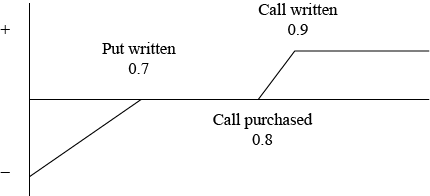
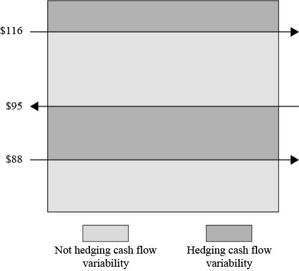
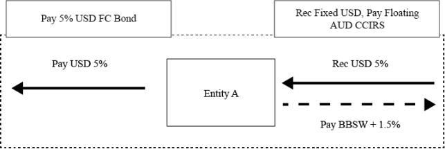
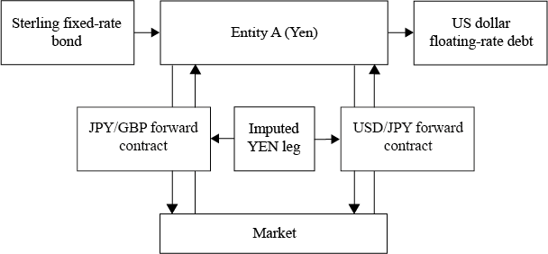
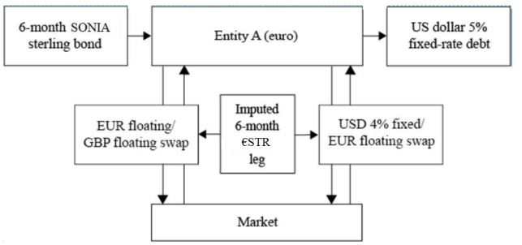
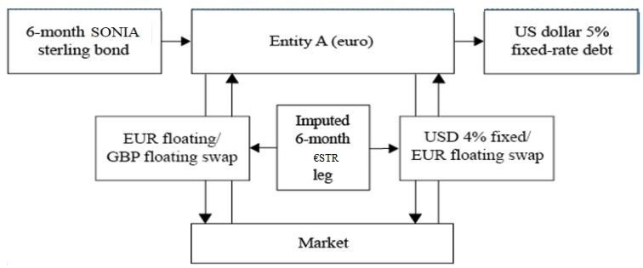
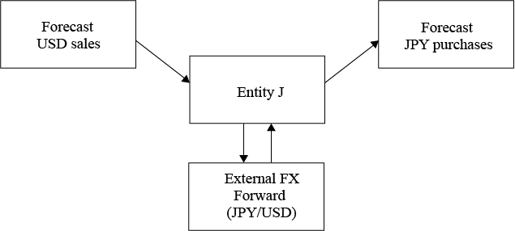

# 46 – Hedge accounting (IFRS 9)

[返回目录](README.md)

### FAQ 46.101.1 – Can net settled external derivatives with the same counterparty be designated in separate hedging relationships?

 

Reference to standard: IFRS 9 para B6.3.2  
 Reference to standing text: [46.101](74.md#s299-Para_46.101) 

  

  
 **Question**

Can several external derivatives with the same counterparty, which are net settled, be designated in separate hedging relationships?

**Illustration**

Entity A has a number of subsidiaries. All of the group’s treasury activities are undertaken by entity A. Individual subsidiaries intending to hedge their exposure to interest rate risk are required to enter into separate derivative contracts with entity A, which in turn enters into a separate offsetting matching derivative contract with a single external counterparty B. For instance, if entity A enters into an intra-group receive 5% fixed, pay the benchmark interest rate interest rate swap, entity A would also enter into a separate offsetting pay 5% fixed, receive the benchmark interest rate interest rate swap with counterparty B.

Although each of the external derivative contracts is formally documented as a separate contract, only the net of the payments on all of the external derivative contracts is settled by entity A, as there is a netting agreement with the external counterparty B.

Can each of the external derivatives with the counterparty B, which are net settled, be designated in separate hedging relationships?

**Answer**

Yes. The individual external derivative contracts, such as the pay 5% fixed, receive the benchmark interest rate interest rate swap above, can be designated as hedging instruments of underlying gross exposures (such as the exposure to changes in variable interest payments on a floating rate borrowing) in the group’s consolidated financial statements, even though the external derivatives are settled on a net basis.

External derivative contracts that are legally separate contracts and serve a valid business purpose (such as laying off risk exposures on a gross basis) qualify as hedging instruments, even if those external contracts are settled on a net basis with the same external counterparty, provided that the hedge accounting criteria in IFRS 9 are met. Note that it would not be considered a valid business purpose if the entity entered into the two transactions only to achieve hedge accounting for one of them (that is, if accounting treatment for one of them was the only reason for entering into two transactions and not one).

It might well be that, by entering into the external offsetting contracts and including them in the centralised portfolio, entity A is no longer able to evaluate the exposures on a net basis. As a result, it might decide to manage the portfolio of offsetting external derivatives separately from the entity’s other exposures. Thus, it enters into an additional, single derivative to offset the portfolio’s risk.

In this situation, the individual external derivative contracts in the portfolio can still be designated as hedging instruments of underlying gross exposures. This is so, even if the final external derivative is effected with the same counterparty under the same netting arrangement and, as a result, might net to zero.

The purpose of structuring the external derivative contracts in the above manner, which is consistent with the entity’s risk management objectives and strategies, constitutes a substantive business purpose. Therefore, external derivative contracts that are legally separate contracts and serve a valid business purpose qualify as hedging instruments. In other words, hedge accounting is not precluded simply because the entity has entered into a swap that mirrors exactly the terms of another swap with the same counterparty, if there is a substantive business purpose for structuring the transactions separately.

 

### FAQ 46.102.1 – Can a currency basis swap qualify as a hedging instrument in a cash flow hedge?

 

Reference to standard: IFRS 9 paras 6.2.1, 6.5.2(b)  
 Reference to standing text: [46.102](74.md#s299-Para_46.102)  Corporate Treasury

  

**Question**

Can a currency basis swap qualify as a hedging instrument in a cash flow hedge?

  
 **Illustration**

The risk management strategy of entity A, whose functional currency is the Euro, is to hedge any financial position against foreign currency risk. Entity A funds its activities issuing US dollar variable rate debt and decides to hedge its foreign currency exposure with a variable-to-variable cross-currency swap (or currency basis swap).

**Answer**

Yes, if the entity designates the hedged risk as the foreign currency spot component in the US dollar debt. The cash flow hedge is a hedge of the exposure to variability in cash flows that is attributable to a particular risk associated with all or a component of a recognised asset or liability or a highly probable forecast transaction, and could affect profit or loss. The fact that interest rates are not fixed in this example does not preclude hedging the foreign currency risk on the debt.

There are two possible accounting treatments when using a variable-to-variable cross-currency swap in a cash flow hedge:

- If the entity decides to separate the foreign currency basis spread component from the entire fair value of the currency basis swap, the treatment of the foreign currency basis spread is similar to the treatment of the forward points (that is, amortised on a rational basis to the income statement, with any further change in fair value being recognised in other comprehensive income and accumulated in equity).

- If the entity decides to designate the entire fair value of the currency basis swap as the hedging instrument, the effective portion of the entire fair value movements on the swap is accounted for in other comprehensive income and accumulated in equity, with any ineffectiveness (including that which is linked to the foreign currency basis spread) being recognised in the income statement.

One method commonly used by entities to assess hedge effectiveness is the hypothetical derivative method. In this scenario, the hypothetical derivative is a variable USD to variable EUR swap that reprices on an overnight basis and therefore, some ineffectiveness might arise due to the difference in repricing periods between the hedged item (that is, the hypothetical derivative) and that on the floating rate of the actual derivative (currency basis swap).

 

### FAQ 46.102.2 – What is the impact of mandatory termination clauses on hedge accounting?

 

Reference to standard: IFRS 9 paras 6.4.1(c)(i), 6.5.10  
 Reference to standing text: [46.102](74.md#s299-Para_46.102) 

  

  
**Illustration**

Entity A wants to designate a 10-year interest rate swap as a hedging instrument in a fair value hedge of interest rate risk on a 10-year loan. The critical terms of the interest rate swap match those of the loan except that the swap has a mandatory break clause. At the mandatory termination date (five years), the swap will terminate at fair value.

Contractually, the swap must be cash settled at its fair value at this date. Any new swap entered into would be independent of the previous swap and will be transacted at the then prevailing market rate.

**Question 1**

Can a 10-year swap, with a five-year mandatory termination date, be designated as the hedging instrument of the interest rate risk on a 10-year loan?

**Answer 1**

Yes. Entity A can designate the swap in a hedge of the full 10 years. Since the critical terms of the interest rate swap match those of the hedged loan, until the swap terminates there is an economic relationship between the hedged item and the hedging instrument.

Even though the swap has a mandatory termination date, because the swap is contractually a 10-year instrument and will be terminated at its then fair value in year 5, it will be expected to move in a similar but opposite direction to the hedged risk on the 10-year loan. The swap will be valued using a 10-year yield curve and will be terminated at fair value. Therefore the mandatory termination clause will have no impact on the valuation of the swap (with the potential exception of any adjustment for the credit risk of the swap counterparty).

Note: When the swap is within 12 months of the break clause, entity A will have to disclose it as current in accordance with paragraph 61 of IAS 1, because the entity cannot avoid paying out on the swap if it is in a liability position when the break clause is exercised. This is the case even though the debt which the swap is hedging will still be non-current at that point. There could be a balance sheet mismatch between non-current liabilities and current hedging instruments. Similarly, the IFRS 7 liquidity disclosures should be based on the contractual termination date. [IFRS 7 para 39].

**Question 2**

What would the accounting be at the mandatory termination date (that is, five years)?

**Answer 2**

At the end of year 5, the swap will be cash settled. Hedge accounting will be discontinued, because the original hedging instrument no longer exists. The hedged loan ceases to be adjusted for changes in its fair value attributable to the risk being hedged. The cumulative adjustment to the hedged loan that existed at the date when hedge accounting is discontinued is subsequently amortised to profit or loss over the remaining life of the loan in accordance with paragraph 6.5.10 of IFRS 9.

If a new swap is transacted, a new hedging relationship has to be set up.

 

### FAQ 46.105.1 – What is the effect of hedging with pre-existing derivatives?

 

Reference to standard: IFRS 9 para B6.5.28  
 Reference to standing text: [46.105](74.md#s299-Para_46.105) 

  

  
 **Question**

What is the effect of hedging with pre-existing derivatives?

**Illustration**

Where a pre-existing derivative is designated as a hedging instrument, it will usually have a non-zero fair value because of its ‘off-market terms’. How does this affect hedge accounting?

**Answer**

The 'off-market' nature of the derivative will be a source of ineffectiveness in the hedge relationship. In a cash flow hedge, ineffectiveness is commonly measured using a hypothetical derivatives method – see [FAQ 46.39.5](75.md#s303-FAQ_46.39.5). At the inception of the hedge relationship, the terms of the hypothetical derivative will be set to be ‘on-market’, and so will differ from those of the actual derivative, with the difference giving rise to ineffectiveness.

The ‘off-market’ nature of the derivative can be described as an ‘embedded financing’ within the derivative. For example, a derivative asset can be thought of as containing an ‘embedded loan receivable’, and a derivative liability as containing an ‘embedded loan payable’. This ‘embedded’ financing is the source of ineffectiveness, due to fair value movements on the opening balance and on the off-market element of the interest.

The actual settlement of the original carrying value is not itself a fair value change, and it can be excluded from the measurement of ineffectiveness at each reporting date. However, it does not change the fact that the instrument is still a derivative and must be carried in its entirety at fair value, with all fair value movements posted to P&amp;L or OCI, as appropriate.

Although ineffectiveness will need to be calculated and accounted for in profit or loss, IFRS 9 does not require the 80–125% ‘highly effective’ bright-line for the application of hedge accounting. Therefore, if using a non-zero fair value swap complies with the entity’s risk management strategy, and the IFRS 9 criteria for using hedge accounting are met (including that there is an economic relationship between the hedged item and the hedging instrument, and the proper determination of the hedge ratio), hedge accounting can still be applied.

 

### FAQ 46.105.2 – What is the impact of hedging with a swap whose fair value is not nil at the inception of the hedge?

 

Reference to standard: IFRS 9 para B6.5.28  
 Reference to standing text: [46.105](74.md#s299-Para_46.105)  Corporate Treasury

  

**Question**

What is the impact of hedging with a swap whose fair value is not nil at the inception of the hedge?

  
 **Illustration**

Entity A enters into a new variable rate borrowing. In accordance with its risk management strategy, it wants to fix the interest rate of the debt. In order to do so, entity A designates as the hedging instrument an existing receive variable/pay fixed interest rate swap (that is, the interest rate swap was originated well before the issuance of the new borrowing) having the same or similar maturity, same or similar payment dates, same variable interest rate and same nominal amount as this new borrowing.

**Answer**

The fair value of an existing hedging instrument at the time of its designation is normally not nil. The entity would therefore expect that the changes in the fair value of the hedging instrument will not perfectly offset the changes in the fair value of the hedged item (a hypothetical derivative created to represent this hedged item would have a nil fair value at the time of designation).

Consequently, over the remaining life of the hedging instrument, the financing element associated with the off-market value of the swap will create ineffectiveness.

Unlike IAS 39, IFRS 9 does not require the 80–125% ‘highly effective’ bright-line for the application of hedge accounting. Therefore, if using a non-zero fair value swap complies with the entity’s risk management strategy and the IFRS 9 criteria for using hedge accounting are met (including the proper determination of the hedge ratio), hedge accounting can be applied. Ineffectiveness will however need to be calculated and accounted for in profit or loss.

 

### FAQ 46.106.1 – Is it possible to use proportions of derivatives as hedging instruments?

 

Reference to standard: IFRS 9 para 6.2.4(c)  
 Reference to standing text: [46.106](74.md#s299-Para_46.106) 

  

**Question**

  
 Entity A, whose functional currency is the euro, enters into a US$10m forward contract on 1 June 20X1 to hedge forecast future US$-denominated sales in March 20X2. At the time of entering into the forward contract, only US$8m of forecast sales are considered to be highly probable of occurring in March 20X2. Can entity A designate US$8m of the notional on the derivative as a hedging instrument?

**Answer**

Yes. In this situation, entity A can designate 80% of the forward contract as a hedge of the highly probable future sales of US$8m in March 20X2. The remaining US$2m of the forward contract (20%) can be designated a hedging instrument in another hedge relationship but, if not so designated, will be measured at FVTPL.

 

### FAQ 46.108.1 – Can the spot risk of a forecast purchase of a commodity be designated as a hedged item under IFRS 9?

 

Reference to standard: IFRS 9 para 6.2.4  
 Reference to standing text: [46.108](74.md#s299-Para_46.108) 

  

**Question**

Can the spot risk of a forecast purchase of a commodity be designated as a hedged item under IFRS 9?

  
 **Illustration**

Entity A buys natural gas and wishes to hedge the cash flow variability arising from the highly probable purchase of natural gas in 6 months’ time in a cash flow hedge. Entity A will enter into a forward contract maturing in 6 months’ time and in matching quantity, to hedge the risk exposure.

Entity A intends to designate the spot price of natural gas as the hedged risk and to only designate the spot component of forward contract as the hedging instrument (that is, not to designate as the hedging instrument the entire forward contract but only the spot component).

Is this an acceptable hedge designation under IFRS 9?

**Answer**

Yes, this designation is acceptable under IFRS 9, provided it is in accordance with the entity’s risk management strategy.

Paragraph 6.2.4 of IFRS 9 allows separating the forward element and the spot element of a forward contract and designating as the hedging instrument only the change in the value of the spot element of the contract. In addition, in the basis for conclusions the IASB notes that the characteristics of forward elements depends on the underlying item, for example, for commodity risk, the forward element represents what is called the ‘cost of carry’ (for example, it includes costs such as storage costs).

This is a change from IAS 39, where paragraph 39.74(b) only allowed separating the ‘interest’ element of a forward contract, therefore, this type of designation was only allowed for financial instruments and could not be extended to hedges of commodities.

As previously noted, this designation must be in accordance with the entity’s risk management strategy and take into account the particular market structure to which the risks relate and in which the hedging activity takes place. Accordingly in some circumstances the designation of spot risk in the hedge relationship might not be appropriate. In addition, in some circumstances consideration should be given to the impact of the time value of money on the present value of the hedged item.

 

### FAQ 46.110.1 – Can an entity use a purchased option as a hedging instrument in a cash flow hedge?

 

Reference to standard: IFRS 9 paras 6.2.1, 6.3.7, B6.3.12  
 Reference to standing text: [46.110](74.md#s299-Para_46.110) 

  

  
 **Question**

Can an entity use a purchased option as a hedging instrument in a cash flow hedge?

**Illustration**

Entity A operates a mail-order business. Its functional currency is the euro, but it purchases approximately 20% of its merchandise from the USA.

Entity A issues the mail-order catalogue for the coming year, incorporating its price list, before entering into a firm purchase commitment with US suppliers. Entity A, therefore, sets the prices in the catalogue based on expected exchange rates of EUR1=USD1.25. It is highly probable that the entity will make purchases of at least EUR500,000 from the USA in the first six months.

The entity’s documented risk management policy requires it to hedge the risk that exchange rates will be higher than expected by purchasing a call option to buy US dollars for euros, with a strike price equal to the expected exchange rate. Entity A, therefore, purchased a call option at a rate of EUR1=USD1.25, for EUR500,000 in six months’ time at a cost of EUR60,000. The purchases will be settled in cash at the date of delivery.

The spot rate at the time of entering into the option contracts was EUR1=USD1.1.

**Answer**

Yes. Entity A can designate the intrinsic value of the purchased option as a hedge against movements in the exchange rate on the forecast purchases. The exposure being hedged is the variability in cash flows that would arise if the US dollar exchange rate exceeds the expected level of EUR1=USD1.25. To the extent that the hedge is effective, fair value movements on the intrinsic value of the option are recorded through other comprehensive income and deferred in equity until the hedged item (the forecast purchases) occur.

IFRS 9 requires the costs of hedging model to be used where an entity designates as the hedging instrument only the change in intrinsic value of an option. The benefit of the costs of hedging model is that the fair value movements in time value are recorded through other comprehensive income and deferred in equity until the purchases are made.

When the purchases are made and entity A recognises inventory, it transfers the balance in the hedging reserve to inventory (known as a basis adjustment). The balance in the costs of hedging reserve is also transferred to inventory at the same time. Note that these are not reclassification adjustments and the transfers do not go through other comprehensive income.

See [FAQ 46.146.1](77.md#s305-FAQ_46.146.1) for further details on de-designation of hedges where the hedged purchases result in accounts payable balances.

 

### FAQ 46.115.1 – Can a combination of written and purchased options be designated as a hedging instrument?

 

Reference to standard: IFRS 9 para 6.2.6  
 Reference to standing text: [46.115](74.md#s299-Para_46.115) 

  

**Question**

Can a combination of a written put and purchased call option be designated as a hedging instrument?

**Answer**

  
 Yes. Assume entity A purchases a call option from bank X and sells a put option to bank Y. Bank X and bank Y are not related. The contracts are entered into on the same day, with the purpose of creating a collar. The premium paid on the purchased call equals the premium received on the sold put; no net premium is, therefore, received.

The combination of these two instruments can be designated as a hedging instrument, even though one of the options is a sold (written) option for which a premium is received, because, when combined, they do not represent a net written option (that is, no net premium is received).

In this case, the entity is permitted to apply hedge accounting if the strategy is in line with the entity’s risk management strategy and all other conditions for hedge accounting are met.

 

### FAQ 46.115.2 – Combination of written and purchased options: can a cap spread structure qualify for hedge accounting?

 

Reference to standard: IFRS 9 para 6.2.6  
 Reference to standing text: [46.115](74.md#s299-Para_46.115) 

  

  
**Question**

Can a cap spread strategy qualify for hedge accounting?

**Illustration**

An entity is exposed to the risk of an increase in the short-term interest rate on its 10 million euro variable interest rate debt and desires to hedge the risk of the short-term interest rate increasing above 3%. Management’s assessment of the risk of the interest rate increasing above 4% is remote and management is prepared to bear that excess risk. Therefore, management enters into a ‘cap spread’ structure consisting of the following two separate derivatives:

- Purchase of a 10 million euro 2-year interest rate cap strike 3%.

- Sale of a 10 million euro 2-year interest rate cap strike 4% (written option).

Can management jointly designate the above derivatives as a hedging instrument in a cash flow hedge to hedge the risk of the short-term interest rate entering into a range of 3% to 4%?

**Answer**

Yes, the entity is permitted to apply hedge accounting provided that all the qualifying criteria in paragraph 6.4.1 of IFRS 9 are met, including that the combined hedging instrument is not a net written option (IFRS 9 para 6.2.6) at the time of designation and that the strategy is in line with the entity’s risk management strategy.

The following factors taken together suggest that an interest rate collar or other derivative instrument (or combination of derivatives that are jointly designated as the hedging instrument) that includes a written option is not a net written option (para BC6.153 of IFRS 9):

- No net premium is received either at inception or over the life of the combination of options. The distinguishing feature of a written option is the receipt of a premium to compensate the writer for the risk incurred.

- Except for the strike prices, the critical terms and conditions of the written option component and the purchased option component are the same (including underlying variable or variables, currency denomination and maturity date). Also, the notional amount of the written option component is not greater than the notional amount of the purchased option component.

In order to determine at inception of the hedge relationship whether a net premium is received, the entity should consider whether the fair value of the combination of options is negative on the designation date.

 

### FAQ 46.115.3 – Can an option with knock-in or knock-out features qualify as a hedging instrument?

 

Reference to standard: IFRS 9 para 6.2.6  
 Reference to standing text: [46.115](74.md#s299-Para_46.115)  Corporate Treasury

  

  
 **Question**

Can an option with knock-in or knock-out features qualify as a hedging instrument?

**Illustration**

Management of company U has invested in securities that bear a floating money market rate (that is, the three-month benchmark interest rate plus a spread). At inception, the current three-month benchmark interest rate is 3.5%. It wishes to enter into a floor option in order to limit the downside in interest rates. But to reduce the cost of the hedging strategy, management is considering purchasing a benchmark interest rate three-month interest rate floor with an out-of-the-money strike rate of 3% that is contingent on the benchmark interest rate three-month rate not falling below 2% at some time during its life (such contingency is commonly known as a ‘knock-out barrier’). Can company U designate this instrument as a hedging instrument?

**Answer**

It depends. There is no specific prohibition on designating an option with a knock-in or a knock-out feature as a hedging instrument, provided that the derivative is not a net written option. A combination of options is not a net written option when the entity does not receive a net premium for it, the critical terms of the options (except for the strike prices) are the same and the nominal amount of the written option is not greater than the notional amount of the purchase option. Furthermore, even though IFRS 9 does not require a quantitative assessment of effectiveness, an entity would need to consider whether this hedging transaction is in line with its risk management strategy and whether there is an economic relationship between the hedged item and the hedging instrument.

Company U does not expect the benchmark interest rate rates to fall below 2% and therefore does not expect the knock-out barrier to be activated; so it considers that there is an economic relationship between the hedging instrument and the hedged item, and it expects that the change in the present value of the hedged item’s interest rate flows will be partially offset by the change in the fair value of the hedging instrument. This assumption should be reassessed prospectively at each reporting date in order to determine whether hedge accounting can continue to be applied. Should company U expect the barrier to be activated, then hedge accounting should be discontinued because there would no longer be an economic relationship between the hedged item and the hedging instrument.

However, when calculating and posting fair value movements on the hedging instrument and hedged item, there will be ineffectiveness to record, because the hedged item does not contain a matching knock-out feature.

If hedge effectiveness is calculated on the basis of intrinsic value, the provisions of aligned time value need to be taken into account.

 

### FAQ 46.115.4 – What should be considered when using three-way options (net written option) under IFRS 9?

 

Reference to standard: IFRS 9 para 6.2.6  
 Reference to standing text: [46.115](74.md#s299-Para_46.115)  Corporate Treasury

  

**Question**

What should be considered when using three-way options (net written option) under IFRS 9?

  
 **Illustration**

A company with a functional currency of Euro has highly probable forecast purchases of USD100. To hedge the corresponding foreign currency (FX) risk, the company enters into a ‘three-way’ option strategy, which comprises:

- a written FX put for 100 USD (strike 0.7 EUR per USD);

- a purchased FX call for 100 USD (strike 0.8 EUR per USD); and

- a written FX call for 100 USD (strike 0.9 EUR per USD).

There is no net premium received for this combination.

The strategy is illustrated in the chart below:

- When the FX rate is less than 0.7 EUR, the company pays the difference between the market price and 0.7 EUR.

- When the FX rate is between 0.7 and 0.8 EUR, there is no financial exchange.

- When the FX rate is between 0.8 and 0.9 EUR, the bank pays the difference between 0.8 EUR and the market price.

- When the FX rate is more than 0.9 EUR, the bank pays the difference between 0.8 and 0.9 EUR. The gain is limited.

  
 The company intends to designate the combination of these derivatives as the hedging instrument in a cash flow hedge of the forecast purchases in USD.

**Answer**

No. Net written options are not allowed as hedging instruments. Factors to assess that a combination of derivatives is a not a net written option are:

- no net premium is received, and

- except for the strike prices, the critical terms and conditions of the written option component and the purchased option component are the same (including underlying, currency and maturity date). Also, the notional amount of the written option component is not greater than the notional amount of the purchased option component.

This three-way option is not eligible as a hedging instrument, because the notional amount of the written options (USD200) is greater than the notional amount of the purchased option (USD100).

 

### FAQ 46.115.5 – What should be considered when using three-way options (no net written option) under IFRS 9?

 

Reference to standard: IFRS 9 paras 6.2.1, B6.2.4, BC153  
  Reference to standing text: [46.115](74.md#s299-Para_46.115)  

  

  
 **Question**

Does the following three-way option qualify as hedging instrument under IFRS 9? If so, how is hedge effectiveness measured?

**Illustration**

Entity A wants to hedge a highly probable future purchase of ICE Brent. Its primary objective is to limit its cost of oil using a purchased cap. To avoid paying a premium for this option, it also writes a put (thereby creating a collar). However, in order to limit its downside risk it also purchases a put with a lower strike price. This combination is often referred to as an ‘alternate three-way collar’ (a ‘three-way’).

It enters this three-way as a single instrument with the following terms:

<table style="width:100%; border-collapse:collapse"><tr><td style="border:0.75pt solid #000000; padding-right:5.03pt; padding-left:5.03pt; vertical-align:top">
 
</td><td style="border:0.75pt solid #000000; padding-right:5.03pt; padding-left:5.03pt; vertical-align:top">
<b>Purchased call option</b>
</td><td style="border:0.75pt solid #000000; padding-right:5.03pt; padding-left:5.03pt; vertical-align:top">
<b>Written put option</b>
</td><td style="border:0.75pt solid #000000; padding-right:5.03pt; padding-left:5.03pt; vertical-align:top">
<b>Purchased put option</b>
</td></tr><tr><td style="border:0.75pt solid #000000; padding-right:5.03pt; padding-left:5.03pt; vertical-align:top">
<b>Product</b>
</td><td style="border:0.75pt solid #000000; padding-right:5.03pt; padding-left:5.03pt; vertical-align:top">
ICE Brent
</td><td style="border:0.75pt solid #000000; padding-right:5.03pt; padding-left:5.03pt; vertical-align:top">
ICE Brent
</td><td style="border:0.75pt solid #000000; padding-right:5.03pt; padding-left:5.03pt; vertical-align:top">
ICE Brent
</td></tr><tr><td style="border:0.75pt solid #000000; padding-right:5.03pt; padding-left:5.03pt; vertical-align:top">
<b>Nominal quantity</b>
</td><td style="border:0.75pt solid #000000; padding-right:5.03pt; padding-left:5.03pt; vertical-align:top">
100,000 bbl
</td><td style="border:0.75pt solid #000000; padding-right:5.03pt; padding-left:5.03pt; vertical-align:top">
100,000 bbl
</td><td style="border:0.75pt solid #000000; padding-right:5.03pt; padding-left:5.03pt; vertical-align:top">
100,000 bbl
</td></tr><tr><td style="border:0.75pt solid #000000; padding-right:5.03pt; padding-left:5.03pt; vertical-align:top">
<b>Trade date</b>
</td><td style="border:0.75pt solid #000000; padding-right:5.03pt; padding-left:5.03pt; vertical-align:top">
<b>Jan-X5</b>
</td><td style="border:0.75pt solid #000000; padding-right:5.03pt; padding-left:5.03pt; vertical-align:top">
<b>Jan-X5</b>
</td><td style="border:0.75pt solid #000000; padding-right:5.03pt; padding-left:5.03pt; vertical-align:top">
<b>Jan-X5</b>
</td></tr><tr><td style="border:0.75pt solid #000000; padding-right:5.03pt; padding-left:5.03pt; vertical-align:top">
<b>Maturity date</b>
</td><td style="border:0.75pt solid #000000; padding-right:5.03pt; padding-left:5.03pt; vertical-align:top">
Jun-X5
</td><td style="border:0.75pt solid #000000; padding-right:5.03pt; padding-left:5.03pt; vertical-align:top">
Jun-X5
</td><td style="border:0.75pt solid #000000; padding-right:5.03pt; padding-left:5.03pt; vertical-align:top">
Jun-X5
</td></tr><tr><td style="border:0.75pt solid #000000; padding-right:5.03pt; padding-left:5.03pt; vertical-align:top">
<b>Strike price</b>
</td><td style="border:0.75pt solid #000000; padding-right:5.03pt; padding-left:5.03pt; vertical-align:top">
$116.00
</td><td style="border:0.75pt solid #000000; padding-right:5.03pt; padding-left:5.03pt; vertical-align:top">
$95.00
</td><td style="border:0.75pt solid #000000; padding-right:5.03pt; padding-left:5.03pt; vertical-align:top">
$88.00
</td></tr></table>

  
 The hedging instrument is not a net-written option as no net premium was received and the nominal amount of the purchased options exceeds the nominal amount of the written option.

At inception of the contract, the forward price of ICE Brent for Jun X5 was $110. The hedging instrument is therefore out-of-the-money at inception.

The objective of the hedging strategy by Entity A is to eliminate the volatility in cash flows attributable to the ICE Brent purchase when the price per barrel is greater than $116 or between $88 and $95.

This can be represented graphically as follows:

  
 Accordingly, Entity A designates the instrument as a hedge of variability in the cash flows it will pay for a highly probable forecast purchase of 100,000 bbl of ICE Brent on 30 June X5 when the ICE Brent price is above $116 and between $88 and $95. Entity A intends to designate the intrinsic value of the three-way option as the hedging instrument in a cash flow hedge relationship.

**Question 1**

Does this three-way option qualify as hedging instrument under IFRS 9?

**Answer 1**

Yes. Paragraphs 6.2.1 and B6.2.4 of IFRS 9 allow derivatives to be designated as hedging instruments, except for some written options.

In addition, the Basis for Conclusions in IFRS 9 (para BC6.153) provide the following factors to ascertain that an interest rate collar or other derivative instrument that includes a written option is not a net written option:

- No net premium is received either at inception or over the life of the combination of options. The distinguishing feature of a written option is the receipt of a premium to compensate the writer for the risk incurred.

- Except for the strike prices, the critical terms and conditions of the written option component and the purchased option component are the same (including underlying variable or variables, currency denomination and maturity date). Also, the notional amount of the written option component is not greater than the notional amount of the purchased option component.

Based on the above guidance, the derivative used in the illustration is not a net written option due to the fact that no net premium was received and the purchased nominal amount exceeds the written nominal amount. As a result, it qualifies as hedging instrument under IFRS 9. Since Entity A intends to designate the hedging instrument as the intrinsic value of the three-way option, it would need to account for the changes in the time value of money in accordance with paragraph 6.5.15 of IFRS 9. That is, the change in fair value of the ‘aligned’ time value is recognised in other comprehensive income, accumulated in a separate component of equity, and subsequently amortised over the period during which the hedge adjustment for the option’s intrinsic value could affect profit or loss.

**Question 2**

How should Entity A measure effectiveness of the hedge given this designation?

**Answer 2**

Effectiveness should be measured by comparing the pay-off (that is, the intrinsic value) of the three-way option with:

- any excess of the ICE Brent price over $116; and

- the amount by which the ICE Brent price falls below $95, but with the pay-off capped as an outflow of $7.

Measuring effectiveness in this way is consistent with a designation of the hedge relationship as reducing cash flow variability in the amount that Entity A will pay for the ICE Brent due to movements in ICE Brent prices between $88 and $95 and above $116. This relationship will be perfectly effective in all scenarios.

The continued pay-off of $7 when the ICE Brent price goes below $88 is acceptable because the ICE Brent price must decline from $95 through this range to arrive at the lower price. Although variability in cash flows is not fully eliminated, the cash flow variability below $88 (that is, the difference between $95 and the market price) is still reduced by $7 as compared to what it would be without the hedging instrument, as the amount, net of the hedge, that the entity pays for the ICE Brent has not fallen as much as the price of ICE Brent itself.

 

### FAQ 46.115.6 – How should a company assess the impact of a knock-in feature when determining whether an economic relationship exists?

 

Reference to standard: IFRS 9 paras B6.4.4–6  
 Reference to standing text: [46.115](74.md#s299-Para_46.115) 

  

**Question**

How should a company assess the impact of a knock-in feature when determining whether an economic relationship exists?

  
**Background**

One of the requirements for a hedging relationship to qualify for hedge accounting is that there is an economic relationship between the hedged item and the hedging instrument. [IFRS 9 para 6.4.1]. In assessing whether an economic relationship exists, IFRS 9 requires an assessment of the relevant characteristics of the hedging instrument and hedged item (for example, the underlyings and contractual features such as a knock-in feature in the hedging instrument). However, it does not specify a particular method to perform the assessment and does not require that a hedge is 80–125% effective in order to qualify for hedge accounting.

**Illustration**

Company A, with Renminbi (RMB) as its functional currency, issued a 3-year 7% USD bond of $100M on 1 January 2016, with quarterly interest payments.

On the same day, company A entered into a 3-year European call option with a knock-in feature of $100 million with an investment grade counterparty that matures (‘EKI option’) to hedge the foreign currency risk associated with the principal repayment. The option has a strike of 7.5, but this knocks in only when the market exchange rate on settlement date is 8 or above. Under the terms of the EKI option, the net payoff of the EKI option will depend on the spot RMB/USD rate on settlement date:

<table style="width:100%; border-collapse:collapse"><tr><td style="border:0.75pt solid #000000; padding-right:5.03pt; padding-left:5.03pt; vertical-align:top">
If on settlement date…
</td><td style="border:0.75pt solid #000000; padding-right:5.03pt; padding-left:5.03pt; vertical-align:top">
Net payoff:
</td></tr><tr><td style="border:0.75pt solid #000000; padding-right:5.03pt; padding-left:5.03pt; vertical-align:top">
8 &lt; Spot rate
</td><td style="border:0.75pt solid #000000; padding-right:5.03pt; padding-left:5.03pt; vertical-align:top">
US$100M *(Spot – 7.5)
</td></tr><tr><td style="border:0.75pt solid #000000; padding-right:5.03pt; padding-left:5.03pt; vertical-align:top">
Spot rate = &lt; 8
</td><td style="border:0.75pt solid #000000; padding-right:5.03pt; padding-left:5.03pt; vertical-align:top">
0
</td></tr></table>

  
 Company A wishes to designate the EKI option as a hedging instrument to hedge the foreign currency risk associated with the principal repayment due to increases in the RMB/USD foreign exchange rate above 8. The hypothetical derivative is a plain-vanilla European call option with a strike rate of 8 RMB/USD (that is, no knock-in feature) (‘hypo option’).

The graph below shows the difference in intrinsic value of the EKI option and the hypo option depending on the market RMB/USD rate at settlement:

As indicated in the table above, once the market RMB/USD rate reaches above 8, there is intrinsic value in both the hypo option and EKI option. However, the degree to which the intrinsic value of the Hypo option is offset by the intrinsic value of the EKI option is less than 50% which gradually improves as the RMB/USD rate increases beyond 8.5.

How should company A assess the impact of the knock-in feature in the EKI option when determining whether an economic relationship exists?

**Answer**

Paragraph B6.4.4 of IFRS 9 explains that “the requirement that an economic relationship exists means that the hedging instrument and the hedged item have values that generally move in the opposite direction because of the same risk, which is the hedged risk. Hence, there must be an expectation that the value of the hedging instrument and the value of the hedged item will **systematically change** in response to movements in either the same underlying or underlyings that are economically related in such a way that they respond in a similar way to the risk that is being hedged” [emphasis added].

In the case of the EKI hedge, the EKI option will always move in the opposite direction to the hedged item (USD loan) and there is a systematic change in response to movements in the same underlying (RMB/USD exchange rates). Furthermore, this change is perfect (1:1) other than in the brief range from 8 to 8.0001 where the risk changes by 0.0001 while the derivative pay-off changes by 0.5001.

The hedge relationship is consistent with both a rational risk management strategy and the risk management objective for entering the derivative. The systematic change in value above 8.0001 demonstrates that this hedge meets the company’s risk management objective of minimising exchange risk associated with its foreign currency principal repayment, as required by paragraph B6.4.6 of IFRS 9. Indeed, the receipt of an additional RMB0.5 further reduces the company’s exposure to RMB weakness above 7.5 and hence is a rational risk management strategy, albeit not part of the designated hedge relationship given the knock-in status of the derivative. The use of the EKI rather than a plain vanilla option with a strike at 7.5 also meets the risk management objective since it is cheaper than such an option while not frustrating the protection obtained for FX rates above 8.

The notional amount of the EKI option and hedged principal payment are equal, such that there is no leverage and the hedge ratio is 1:1. The EKI is not a net written option; the entity paid a premium for the option and will only ever receive cash flows under the derivative.

The probability of falling in the FX rate range where cash flow changes are not systematic (that is, from 8 to 8.0001) is low. In view of the perfectly aligned, systematic change across all other exchange rates, the economic relationship test is met. Accordingly, since credit risk is not expected to dominate the value changes that result from the economic relationship and the hedge ratio is appropriate (1:1), the hedge relationship qualifies for hedge accounting. Ineffectiveness will arise, however, due to both the different intrinsic values of the aligned option (being a purchased call with a strike of 8) and the EKI option, as well as differing time values between the aligned and EKI options.

In different fact patterns, the hedging instrument and hedged item might not have systematic changes, or cash flows might be significantly more erratic, and hence the conclusion might differ in other, more complex, situations.

 

### FAQ 46.115.7 – Can a three-way option be designated in a conditional hedging relationship?

 

Reference to standard: IFRS 9 para 6.4.4-6  
 Reference to standing text: [46.115](74.md#s299-Para_46.115) 

  

 

**Background**

 

Entity A, with a functional currency of USD, has EUR1.5m of highly probable forecast sales denominated in EUR. To hedge the corresponding foreign currency (‘FX’) risk, the company enters into a ‘three-way’ option as a single instrument with the following terms:

 

<table style="border-collapse:collapse"><thead><tr><td style="border:0.75pt solid #000000; padding-right:5.03pt; padding-left:5.03pt; vertical-align:top">
Product
</td><td style="border:0.75pt solid #000000; padding-right:5.03pt; padding-left:5.03pt; vertical-align:top">
Purchased put option
</td><td style="border:0.75pt solid #000000; padding-right:5.03pt; padding-left:5.03pt; vertical-align:top">
Purchased put option
</td><td style="border:0.75pt solid #000000; padding-right:5.03pt; padding-left:5.03pt; vertical-align:top">
Written call option
</td></tr></thead><tbody><tr><td style="border:0.75pt solid #000000; padding-right:5.03pt; padding-left:5.03pt; vertical-align:top">
Nominal quantity
</td><td style="border:0.75pt solid #000000; padding-right:5.03pt; padding-left:5.03pt; vertical-align:top">
EUR750,000
</td><td style="border:0.75pt solid #000000; padding-right:5.03pt; padding-left:5.03pt; vertical-align:top">
EUR750,000
</td><td style="border:0.75pt solid #000000; padding-right:5.03pt; padding-left:5.03pt; vertical-align:top">
EUR750,000
</td></tr><tr><td style="border:0.75pt solid #000000; padding-right:5.03pt; padding-left:5.03pt; vertical-align:top">
Trade date
</td><td style="border:0.75pt solid #000000; padding-right:5.03pt; padding-left:5.03pt; vertical-align:top">
January 20X1
</td><td style="border:0.75pt solid #000000; padding-right:5.03pt; padding-left:5.03pt; vertical-align:top">
January 20X1
</td><td style="border:0.75pt solid #000000; padding-right:5.03pt; padding-left:5.03pt; vertical-align:top">
January 20X1
</td></tr><tr><td style="border:0.75pt solid #000000; padding-right:5.03pt; padding-left:5.03pt; vertical-align:top">
Maturity date
</td><td style="border:0.75pt solid #000000; padding-right:5.03pt; padding-left:5.03pt; vertical-align:top">
September 20X1
</td><td style="border:0.75pt solid #000000; padding-right:5.03pt; padding-left:5.03pt; vertical-align:top">
September 20X1
</td><td style="border:0.75pt solid #000000; padding-right:5.03pt; padding-left:5.03pt; vertical-align:top">
September 20X1
</td></tr><tr><td style="border:0.75pt solid #000000; padding-right:5.03pt; padding-left:5.03pt; vertical-align:top">
Strike price USD per EUR
</td><td style="border:0.75pt solid #000000; padding-right:5.03pt; padding-left:5.03pt; vertical-align:top">
0.7
</td><td style="border:0.75pt solid #000000; padding-right:5.03pt; padding-left:5.03pt; vertical-align:top">
0.9
</td><td style="border:0.75pt solid #000000; padding-right:5.03pt; padding-left:5.03pt; vertical-align:top">
0.9
</td></tr></tbody></table>

 

The market forward rate is 1.13 at inception of the contract. There is no net premium received for this combination.

 

The strategy is illustrated in the chart below:

 

- When the FX rate is less than 0.7, entity A sells EUR750,000 at USD0.7/EUR and a further EUR750,000 at USD0.9/EUR.

- When the FX rate is between 0.7 and 0.9, entity A sells EUR750,000 at USD0.9/EUR.

- When the FX rate is more than 0.9, the bank buys EUR750,000 at USD0.9/EUR.

 

The payoff from the option can be illustrated as follows:

 

 

At the inception of the contract, the put option at 0.7 has no intrinsic value, but it has time value (that is, it has a positive value). The remaining options together represent a forward contract at 0.9, which has a negative value of the same amount, because there is no premium paid or received for the three-way option.

 

Entity A wishes to designate the combination of these instruments as a cash flow hedge of the forecast sale in EUR to eliminate cash flow variability arising on forecast sales due to EUR:USD foreign currency exchange risk.

 

**Question 1**

 

Is this combination of derivatives an eligible hedging instrument under IFRS 9?

 

**Answer 1**

 

Yes. The three-way option represents an eligible hedging instrument, because the combination of derivatives is not a net written option. This is based on the assessment of the following factors at the date of designation in accordance with paragraph BC6.153 of IFRS 9:

 

- no net premium is received either at inception or over the life of the combination of options;

- except for the strike prices, the critical terms and conditions of the written option component and the purchased option component are the same (including underlying variable or variables, currency denomination and maturity date); and

- the notional amount of the written option component is not greater than the notional amount of the purchased option component.

 

**Question 2**

 

Entity A wishes to designate the hedging instrument in a single hedge relationship as a hedge of EUR1,500,000 of highly probable forecast sales when the EUR:USD FX rate is below 0.7, and EUR750,000 of highly probable forecast sales when the EUR:USD FX rate is above 0.7. Is this an eligible hedge designation?

 

**Answer 2**

 

No. This would not be an eligible designation under IFRS 9, because the entity cannot designate an amount of highly probable forecast sales that is conditional on the FX rate. [IFRS 9 App B para B6.3.12]. Paragraph B6.3.16 states that, in a single relationship, there needs to be a single, specified nominal amount (for example, EUR750,000).

 

Alternatively, entity A could designate the three-way option in two hedge relationships: one for EUR750,000 of highly probable forecast sales for all changes in the FX rate (using the synthetic forward comprised of the purchased put and written call with a strike of 0.9); and another for a further EUR750,000 of sales in a one-sided hedge of changes in the FX rate below 0.7 (using the purchased put with a strike of 0.7).

 

To the extent that the effectiveness criteria are met, this designation would be acceptable under IFRS 9, since the three-way option is designated in its entirety in accordance with paragraph 6.2.6 of IFRS 9, and the component used in each hedge relationship is an eligible hedging instrument in its own right (that is, neither component is a net written option, using the tests outlined in Question 1 above).

 

However, the off-market nature of the forward contract will need to be included in the IFRS 9 economic relationship assessment, and it will be a source of ineffectiveness, because any hypothetical forward used to measure ineffectiveness on this component of the hedge relationship needs to be defined so as to have an initial fair value of zero (see [FAQ 46.105.1 for a discussion of designation of non-zero fair value derivatives](77.md#s305-FAQ_46.105.1)).

 

### FAQ 46.116.2 – How should an entity calculate the intrinsic value of an option?

 

Reference to standard:   
 Reference to standing text: [46.116](74.md#s299-Para_46.116) 

  

  
 **Question**

How should an entity calculate the intrinsic value of an option?

**Illustration**

Entity A takes out an interest rate cap to hedge the exposure to interest rates on floating-rate debt of C1 million. The cap has a strike rate of 3% and the designated hedged risk is changes in the interest cash flows of the debt above this strike rate. Entity A designates only the intrinsic value of the option as the hedging instrument. How can entity A calculate the intrinsic value of the option for this purpose?

**Answer**

IFRS 9 does not specify how the intrinsic value of an option should be determined. In practice, it is calculated as either:

- the difference between the strike price of the option and the spot price of the underlying multiplied by the notional amount of the option (the 'spot intrinsic value'). In the case of the interest rate cap described above, this would be calculated by projecting all future cash flows on the cap at the current spot rate, comparing them to the cap’s strike rate and discounting the result (if positive) using the zero-coupon curve. If the current spot rate is below the strike rate, the cap is 'out of the money' in all periods; or

- the difference between the strike price of the option and the forward price of the underlying multiplied by the notional amount of the option (the 'forward intrinsic value'). In the case of the interest rate cap described above, this would be calculated by projecting each cash flow using the relevant forward rate for the relevant date. The result would be compared to the cap’s strike rate, and the result (if positive) would be discounted using the zero-coupon curve. Using this method, the cap might be ‘in the money’ in some periods, even when the current spot rate is below the strike price.

IFRS 9 is silent on whether the calculation of intrinsic value should be on a discounted basis. However, if the calculation is performed on an undiscounted basis, this will likely give rise to ineffectiveness when comparing the intrinsic value to the discounted value of the hedged item. For this reason, a discounted calculation will generally be preferable for a European-style option.

However, the intrinsic value of an American-style option can be defined as the difference between the undiscounted spot price on the day when the value is determined and the strike price specified in the option contract. This is because the American-style option can be exercised at any time.

 

### EX 46.119.1 – Example of separating the intrinsic and time value of the option, where the hedged item is a forecasted sale of a commodity (transaction related)

 

Reference to standard: IFRS 9 paras 6.5.15, B6.5.29–B6.5.33  
 Reference to standing text: [46.119](74.md#s299-Para_46.119) 

  

  
 Entity A forecasts that it will sell 200,000 units of commodity Y in three months’ time at the then prevailing market price. It enters into an option to hedge the risk of variability in the cash flows to be received on the forecast sales due to a fall in the market price, and it designates only the change in the intrinsic value of the option as the hedging instrument.

Time value is viewed as a cost of hedging the risk on the hedged item (similar to the cost of purchasing insurance cover). The amount held in the hedging reserve would be released to P&amp;L (via OCI) when the forecast sales (the hedged item) occur, and hence it would affect P&amp;L.

 

### EX 46.119.2 – Example of separating the intrinsic and time value of the option, where the hedged item is a firm commitment to purchase a non-financial item (transaction related)

 

Reference to standard:  IFRS 9 paras 6.5.15, B6.5.29–B6.5.33  
 Reference to standing text: [46.119](74.md#s299-Para_46.119) 

  

  
 Entity A has entered into a firm commitment to purchase machinery for C50,000 in foreign currency in 12 months’ time. It enters into an option to hedge the risk of a fall in the value of the contract for entity A due to increases in the foreign currency rate.

Time value is excluded from the designation, because it is not a component of the transaction and it is viewed as a cost of hedging the fair value risk.

The amount held in the hedging reserve would be transferred to property, plant and equipment as a basis adjustment (similarly to the transfer of amounts in the cash flow hedge reserve for other purchases of non-financial items) when the machinery is acquired. The basis adjustment will affect P&amp;L when the machinery is depreciated or impaired, but (as with other similar basis adjustments) is not recycled back through OCI.

 

### EX 46.119.3 – Example of separating the intrinsic and time value of the option, where the hedged item is a fair value hedge of inventory (time-period related)

 

Reference to standard: IFRS 9 paras 6.5.15, B6.5.29–B6.5.33  
 Reference to standing text: [46.119](74.md#s299-Para_46.119) 

  

  
 Entity A enters into an option to hedge the risk of a fall in the value of its inventory over the next six months due to changes in commodity prices. It designates only the intrinsic value of the option in the hedging relationship.

The time value is seen as an insurance cover against the risk over a period of time. The initial time value of the option is released to P&amp;L (via OCI) over the six-month hedged period.

 

### FAQ 46.119.4 – Is the cost of a swaption used to hedge a forecast debt issuance treated as a time related or transaction related cost of hedging?

 

Reference to standard: IFRS 9 paras 6.4.2,6.5.11, 6.5.15, B6.5.29–B6.5.33  
 Reference to standing text: [46.119](74.md#s299-Para_46.119) 

  

  
 **Question**

Where a company hedges a forecast debt issuance with a swaption and applies the cost of hedging model, when should the initial time value of the swaption be recognised in profit or loss?

**Illustration** 

Company A enters into a swaption (that is, an option to enter into an interest rate swap) to hedge the interest rate risk on a forecast debt issuance. The debt issuance is highly probable and all of the critical terms match. Company A pays a premium at the time when it enters into the swaption.

Company A designates, as the hedging instrument, only the change in the intrinsic value of the swaption (see para 6.4.2(a) of IFRS 9). Accordingly, it applies the cost of hedging approach to the time value of the swaption.

When should the initial time value (the premium paid for the swaption) be recognised in profit or loss?

**Answer**

The initial time value should be recognised as an expense in profit or loss over the life of the debt.

The risk being hedged is the risk of movements in interest rates in the period from inception of the hedge to when the debt is issued. However, this risk affects profit or loss over the life of the debt as interest expense is recognised. Hence, consistent with paragraph 6.5.15(c) of IFRS 9, the initial time value should be recognised over the life of the debt, because this is the “period during which the hedge adjustment for the option’s intrinsic value could affect profit or loss”. This approach is also supported by the example in paragraph B6.5.30(b) of IFRS 9, which spreads the time value of a forward starting cap over the period to which it relates (in that example, years 2 and 3 of a five-year bond).

Since the debt represents a financial item, no basis adjustment should be recorded against the carrying amount of the debt (see para 6.5.11(d) of IFRS 9) when the debt is issued. The cumulative amount that has been recognised in the cash flow hedge reserve is recycled, from that reserve to profit or loss, over the life of the debt as interest expense is recognised.

 

### FAQ 46.122.1 – When hedging with options, how should the ‘alignment’ principle be applied?

 

Reference to standard: IFRS 9 paras 6.5.15, B6.5.29–B6.5.33  
 Reference to standing text: [46.122](74.md#s299-Para_46.122)  Corporate Treasury

  

  
 **Question**

When hedging with options, how should the ‘alignment’ principle be applied?

**Illustration**

An entity’s risk management objective is to hedge the forecast purchase of 100 tonnes of a commodity on 15 April 20X1 against an increase in price above a specified threshold (that is, a one-sided risk). To meet this objective, the entity purchases a commodity option. The underlying commodity is the same and the option’s strike price matches the specified threshold. However, it matures on 30 April 20X1.

How should the aligned time value of the option be determined in this scenario?

**Answer**

The entire time value of the option relates to the hedged item if the critical terms (such as the notional amount, strike price, term and underlying) of the option and the hedged item are aligned.

In the above illustration, the entity cannot consider that the time value of the option is aligned with the hedged item because the dates do not match.

When the critical terms of the hedging option are not aligned with the critical terms of the hedged item, the entity determines the aligned time value using the valuation of the option whose critical terms would exactly match the critical terms of the hedged item (that is, in the above example an option that matures on 15 April 20X1).

If, at inception of the hedging relationship, the actual time value is higher than the aligned time value, the entity should:

- determine the amount that is accumulated in a separate component of equity on the basis of the aligned time value; and

- account for the differences in the fair value changes between the actual and aligned time values in profit or loss.

If, at inception of the hedging relationship, the actual time value is lower than the aligned time value, the entity should determine the amount that is accumulated in a separate component of equity by reference to the lower of the cumulative change in fair value of the actual and the aligned options. Any differences should be recognised in profit or loss.

The entity might need to use an option pricing model to measure the initial value of an option having characteristics that exactly match the critical terms of the hedged item.

 

### FAQ 46.123.1 – What is a forward contract?

 

Reference to standard:   
 Reference to standing text: [46.123](74.md#s299-Para_46.123) 

  

**Question**

What is a forward contract?

  
 **Illustration**

For hedging purposes, entity A enters into the following derivative instruments:

- A fixed-to-fixed cross-currency swap.

- A floating-to-floating cross-currency swap.

- A floating-to-fixed cross-currency swap.

Entity A’s management wishes to designate only the spot element of these derivatives as hedging instruments in separate hedging relationships.

What is a forward contract?

**Answer**

A simple forward contract is a contract to exchange a fixed amount of a financial or non-financial asset on a fixed future date or dates beyond the spot value date. The term ‘forward contract’ should be interpreted as being any derivative instrument that is a simple forward contract or can be constructed from a series of simple forward contracts. Forward contracts can be settled by gross delivery of the financial asset in return for cash, or on a net basis at each settlement date.

In the above illustration, the fixed-to-fixed cross-currency swap entered into by entity A is a forward contract, provided that the settlements on each leg of the swap occur on the same dates in the future (that is, there is no timing mismatch between the two legs of the swap). However, the other two derivatives (the floating-to-floating and the floating-to-fixed cross-currency swaps) are not forward contracts, since they cannot be constructed using only simple forward contracts.

Paragraph 6.2.4(b) of IFRS 9 allows an entity to designate the spot element of a derivative as a hedging instrument, provided that the derivative is a forward contract.

See also [paragraph 46.123](74.md#s299-Para_46.123) onwards and [FAQ 46.125.1](77.md#s305-FAQ_46.125.1) for further information on separating the forward and spot elements of a forward contract.

 

### FAQ 46.125.1 – What approaches are available for entities hedging foreign currency using a forward contract?

 

Reference to standard: IFRS 9 paras 6.2.4(b), B6.5.34–B6.5.38  
 Reference to standing text: [46.125](74.md#s299-Para_46.125) 

  

**Question**

What approaches are available for entities hedging foreign currency using a forward contract?

**Answer**

  
 An entity has a choice of three accounting approaches for hedges of foreign currency risk using a forward contract. The three possible approaches are:

- Forward rate: Designate the hedged risk as changes in the forward rate. Changes in the full fair value of the forward contract are accounted for through P&amp;L or OCI (to the extent the hedge is effective) in accordance with the type of hedge (fair value hedge or cash flow hedge). If forward points are included in the hedge relationship, they could generate ineffectiveness – for example, if the timing of the hedged forecast transaction changed, and the change in fair value of the forward was higher in absolute terms than the change in fair value of the hedged cash flow based on the forward rate. It is expected that, in most cases, this approach would produce the same or a similar accounting outcome as the third approach described below.

- Spot rate with forward points recognised in P&amp;L: Designate the hedged risk as movements in the spot rate (excluding changes due to interest rates, which is the forward element). Changes in the spot rate are part of the hedge relationship, and are accounted for in accordance with the type of hedge, whereas the changes in fair value of the hedging instrument due to the forward points are immediately recognised in P&amp;L.

- Spot rate with forward points deferred: Designate the hedged risk as movements in the spot rate, and account for the changes in the forward rate (interest rates) in OCI. This is the same accounting treatment as that applied for the time value of hedging with options (described in [paras 46.119 to 46.122](74.md#s299-Para_46.119)). However, unlike the accounting for options, this accounting treatment is optional rather than mandatory. Even though a forward contract can be considered to be related to a time period, IFRS 9 states that the relevant aspect for its accounting is the characteristic of the hedged item and how it affects P&amp;L. An entity must assess the type of hedge on the basis of the nature of the hedged item, regardless of whether the hedging relationship is a cash flow hedge or a fair value hedge. An entity determines if the hedge is transaction related (for example, the hedge of a forecast purchase of inventory in foreign currency) or whether it is time-period related (for example, a hedge of the fair value of commodity inventory for the next six months using a commodity forward contract). This third approach helps to reduce volatility in P&amp;L, as compared to the second approach.

See also [paragraph 46.123](74.md#s299-Para_46.123) onwards and [FAQ 46.123.1](77.md#s305-FAQ_46.123.1) for further information on forward contracts.

 

### FAQ 46.128.1 – Does foreign currency basis spread result in ineffectiveness in a hedge relationship?

 

Reference to standard: IFRS 9 paras 6.2.4(b), B6.5.34–B6.5.39  
 Reference to standing text: [46.128](74.md#s299-Para_46.128)  Corporate Treasury

  

  
 **Question**

Does foreign currency basis spread result in ineffectiveness in a hedge relationship?

**Illustration**

Company K, a Euro functional currency entity, issues a USD variable rate debt. Company K’s risk management strategy is to hedge the variability in both interest rates and foreign exchange rates. To meet its risk management strategy, company K enters into a floating-to-fixed cross-currency interest rate swap with matching critical terms (that is, matching currencies, payment dates, re-pricing dates, and interest basis on the variable leg).

**Answer**

Yes, foreign currency basis will result in ineffectiveness if not excluded from the designation of the hedging instrument.

A cross-currency interest rate swap or currency forward contract includes a pricing element (liquidity charge or credit) that reflects the fact that the derivative instrument results in the exchange of two currencies in the future. This pricing element is usually referred to as ‘foreign currency basis spread’. On the other hand, a hedged item (for example, a fixed or variable interest rate debt denominated in foreign currency) is usually a single currency instrument that, unlike the cross-currency interest rate swap, does not involve the exchange of two currencies. Hence its value does not include a foreign currency basis spread.

Since the foreign currency basis spread is a feature in the hedging instrument that is not included in the hedged item, it results in ineffectiveness in the hedging relationship.

As an alternative to recognising this ineffectiveness, IFRS 9 allows separation of the initial foreign currency basis spread and excluding it from the designated hedging instrument. If separated, the foreign currency basis spread could be accounted for as a cost of hedging, in a similar way to the forward points in a forward contract.

Hence, company K can choose to:

- include the currency basis spread in the hedge designation, which would result in some ineffectiveness because the currency basis spread does not exist in the hedged item (the USD debt);

- exclude the currency basis spread from the designated hedging instrument and recognise all movements in currency basis in profit or loss; or

- exclude the currency basis spread from the designated hedging instrument and apply the cost of hedging model in paragraphs 6.5.15–6.5.16 of IFRS 9. In this case, changes in the fair value of the forward contract attributable to currency basis are recognised in other comprehensive income. Because the hedged item is time related (the interest and foreign currency risks exist for the life of the debt), the initial value of the foreign currency basis spread will be amortised to profit or loss over the related hedging period.

 

### FAQ 46.128.2 – How is the foreign currency basis separated from a financial instrument?

 

Reference to standard: IFRS 9 paras 6.2.4(b), B6.5.34–B6.5.39  
 Reference to standing text: [46.128](74.md#s299-Para_46.128)  Corporate Treasury

  

**Question**

How is the foreign currency basis separated from a financial instrument?

**Answer**

  
 There is no single method for separating the foreign currency basis from a financial instrument. One acceptable method is presented below.

Entity A, a company with the Australian dollar (AUD) as its functional currency, issues debt by issuing a fixed-rate, USD bond in the global capital markets. The bond has a notional amount of US$150m, coupons are set at 5%, and the term is seven years.

Concurrent with the bond issue, entity A transacts a cross-currency interest rate swap (CCIRS), which receives principal and interest that exactly matches the obligation under the bond, and pays the AUD floating-rate index (bank bill swap rate or BBSW), plus a fixed margin of 1.5%.

At the time of issuance, the USD benchmark interest  fixed rate for the term of the bond is 3%. The fixed margin on the AUD payable leg of the CCIRS is 1.5%, reflecting a credit margin component of 1.3% and a currency basis spread of 0.2%.

  
 In order to separate the foreign currency basis, entity A performs the following:

- Determine value A – total fair value: this is the actual total fair value of the CCIRS in accordance with IFRS 13.

- Determine value B – fair value excluding currency basis: this is the fair value of the CCIRS excluding the effects of currency basis. In practice, this would be done by constructing a theoretical CCIRS, which removes the currency basis payment from the contractual cash flow (the spread of 20 bp in the above example). This instrument would be valued at inception and on an ongoing basis using the market discount curves, with the currency basis margin removed from the curve used for valuation. This theoretical instrument is depicted below:

  
 Assuming that the actual CCIRS had a fair value of zero at inception, removal of the basis cash flow from the CCIRS being measured (and also from the curve used for discounting) would give rise to a fair value of zero for this theoretical instrument at inception. Subsequent revaluations would reflect changes in benchmark rates and CVA adjustments, but not movements in the market price of basis spreads.

- Determine value C – fair value of the currency basis component: This is simply A – B, both initially and over the life of the hedge.

The accounting approach would therefore be:

- Value A is recorded on the balance sheet.

- Movements in value B would be recorded in P&amp;L (fair value hedge accounting).

- Movements in Value C would be recorded in OCI. Any initial currency basis would be amortised to P&amp;L over the life of the hedge (as it relates to a time-period related hedged item). However, if the initial swap has a zero fair value, this amortisation will not be required.

 

### FAQ 46.128.3 – How should an entity measure the aligned currency basis spreads in a partial term fair value hedge?

 

Reference to standard: IFRS 9 para BC6.95; IAS 39 para IG F2.17  
 Reference to standing text: [46.128](74.md#s299-Para_46.128)  Corporate Treasury

  

  
**Question**

Company A, with a functional currency of USD, issued a five-year fixed-rate EUR debt at time T0. At the same time, the company enters a three-year ‘receive fixed, pay floating’ cross-currency interest rate swap (‘swap’) to hedge the foreign currency risk and fair value interest rate risk arising in the first three years that the debt is outstanding.

Company A designates the debt and the swap in a partial term fair value hedge relationship at T0 for the period to the end of year 3 ([see also FAQ 46.76.2](76.md#s304-FAQ_46.76.2)). In addition, company A elects to exclude the currency basis spread from the hedge relationship and only designate the remainder of the swap as the hedging instrument. How should company A measure the aligned currency basis spread?

**Answer**

In order to calculate the ‘aligned’ currency basis spread, an aligned swap should be created with a profile that mirrors the hedged item. In the case of a partial term fair value hedge, the hedged risk includes the change in value of the principal payment due at maturity, to the extent affected by changes in forward rates relating to the first three years of the swap. Because the hedged risk is defined in this way, the aligned swap that mirrors the hedged risk should also be a swap with a principal payment at the end of year 3. Since the actual and aligned swap are defined consistently, the full amount of initial currency basis spread in the actual swap should be amortised to profit or loss over the life of the hedging relationship, with movements recognised in OCI.

 

### FAQ 46.128.4 – How should an entity apply the cost of hedging approach to currency basis spreads in a net investment hedge?

 

**Background**

 

Entity A, which has a USD functional currency, has a net investment in a foreign operation of EUR100m. Entity A wishes to eliminate foreign exchange risk associated with the re-translation of part of this net investment into its functional currency, and it enters into a fixed-fixed CCIRS, which it designates in a net investment hedging relationship.

 

The swap has a USD50m receive leg that receives interest at 3.90%, and a EUR45.4m pay leg that pays interest at 2.50% (assume that USD50m and EUR45.4m are equivalent, based on the spot rate at inception). The swap has quarterly interest settlements, a two-year maturity and a zero fair value at inception.

 

Net investment hedges are accounted for in a similar manner to cash flow hedges. In applying paragraph 6.5.13 of IFRS 9, entity A designates the hedged risk as changes in the forward rate on various notionals (that is, the sum of the notional principal and remaining interest cash flows – see [FAQ 46.29.3](75.md#s303-FAQ_46.29.3)). Accordingly, entity A deconstructs the fixed-fixed CCIRS into a series of forward contracts (one for each of the interest cash flows and one for the principal receivable at maturity).

 

It is acceptable to define the hypothetical derivative for the relationship as a whole as an at-market CCIRS. However, the hypothetical derivative must exclude the currency basis (‘CB’), which amounts to USD400,000 at inception of the hedge. Discounting has been ignored for simplicity.

 

Entity A has elected to treat the CB under the cost of hedging approach, and it applies paragraph 6.5.16 of IFRS 9 and the application guidance in paragraphs B6.5.34–B6.5.39. In accordance with paragraph B6.5.34(b), hedging a net investment in a foreign operation is considered a time-period-related hedged item, and hence amortisation should be performed over the life of the hedging relationship, using a systematic and rational basis.

 

**Question 1**

 

How should an entity apply the cost of hedging approach to currency basis spreads in a net investment hedge?

 

**Solution 1**

 

IFRS 9 does not provide detailed guidance about how the cost of hedging approach should be applied in practice.

 

One approach, that would meet the requirement for a systematic and rational basis of amortisation, is to treat the net investment hedge as analogous to a cash flow hedge of the foreign currency cash flows that would arise from a sale of the net investment at a (or several) future date(s) for the cash flow variability arising due to foreign currency risk. In other words, the hedged net investment is treated in a manner similar to a series of cash flows on various ‘deemed disposal’ dates in the future.

 

Under this approach, the CB relating to each FX forward within the CCIRS is amortised over the related period to maturity of that individual forward. This reflects the fact that the notional amount hedged is declining over the hedge relationship as interest cash flows on the CCIRS are settled. Such an amortisation method shares some similarities with the ‘graded vesting’ approach in share-based payment transactions, and it will result in the impact of CB in the income statement being larger in the earlier periods of the hedging relationship. This approach is illustrated in question 2 below.

 

An alternative approach would be to amortise the initial CB of USD400,000 on a straight-line basis over the entire life of the hedging relationship, in line with the notion of the cost of obtaining protection against a risk over a particular period of time. As a result, the total CB will be equally spread and recognised in the income statement over the hedging period (that is, USD50,000 per quarter).

 

### FAQ 46.129.1 – How is the fair value of a derivative separated into its different risk components?

 

Reference to standard: IFRS 9 para B6.2.6  
 Reference to standing text: [46.129](74.md#s299-Para_46.129) 

  

**Question**

How is the fair value of a derivative separated into its different risk components?

**Answer**

  
 In order to do this, the entity should be able to identify the hedged risks in each of the hedged items and split the single derivative into its components in order to allocate those components to each hedged risk identified.

As a derivative has only a single fair value, care should be taken in splitting a derivative so that it does not result in the recognition of cash flows in the single hedging instrument that do not contractually exist. For example, a swap might be analysed into its separate risk components for hedging purposes by imputing a notional leg denominated in the entity’s functional currency, so that no additional foreign currency risk exposure is created. The additional leg could be either fixed or floating, provided that the chosen alternative qualifies for hedge accounting for both of the exposures hedged and effectiveness can be reliably measured for both elements. All the hedge qualifying criteria must be met.

Hedging multiple risks in multiple items in this way is complex, and the desired effectiveness might not always be achieved. Therefore, expert guidance should always be sought.

 

### FAQ 46.129.2 – Can a single hedging instrument be designated in a hedge of multiple risks?

 

Reference to standard: IFRS 9 para B6.2.6  
 Reference to standing text: [46.129](74.md#s299-Para_46.129) 

  

  
 **Question**

Can a single hedging instrument be designated in a hedge of multiple risks?

**Illustration**

Entity A’s functional currency is the Japanese yen (JPY). Entity A has a five-year floating-rate US dollar liability and a five-year fixed-rate pound sterling-denominated bond (an asset). The principal amounts of the asset and liability, when converted into Japanese yen, are the same. Entity A enters into a single foreign currency forward contract to hedge its foreign currency exposure on both instruments, under which it receives US dollars and pays pounds sterling at the end of five years.

Entity A designates the forward exchange contract as a hedging instrument in a cash flow hedge against the foreign currency exposure on the principal repayments of both instruments. Since entity A’s functional currency is yen, it is exposed to USD/JPY foreign currency risk on the floating-rate liability, and JPY/GBP foreign exchange risk on the fixed-rate asset.

Can the forward exchange contract be designated as a hedge of both of the risks described above?

**Answer**

Yes. IFRS 9 permits a single hedging instrument to be designated as a hedge of multiple types of risk, provided it is documented and designated in accordance with paragraph B6.2.6 of IFRS 9, as follows:

- The risks hedged can be identified clearly. The risks are the exposures to changes in the forward exchange rates between US dollars and yen, and yen and pounds, respectively. The hedged items are the principal amounts of the liability and the note receivable in their respective currency of denomination.

- The economic relationship can be demonstrated. For the pound sterling bond, the effectiveness could be measured as the degree of offset between the fair value of the principal repayment in pounds sterling and the fair value of the pound sterling payment on the forward exchange contract. For the US dollar liability, the effectiveness could be measured as the degree of offset between the fair value of the principal repayment in US dollars and the US dollar receipt on the forward exchange contract.

It should be noted that, in respect of the second bullet point above, the USD/GBP forward is theoretically divided into two different derivatives. The yen is imputed as the base currency for the two derivatives, creating a synthetic USD/JPY (receive US dollar, pay yen) foreign currency forward, and a synthetic JPY/GBP (receive yen, pay sterling) foreign currency forward. The synthetic yen leg is defined in such a manner that the fair value of each synthetic forward contract is nil at the hedge’s inception. This can be pictorially represented as follows:

  
 Furthermore, it should be noted that the hedge accounting criteria must be satisfied for both of the designated hedged risks. For instance, if one of the hedged risks no longer exists, both hedges must be discontinued. This is because a derivative instrument must be fair valued and used as a hedging instrument in its entirety, apart from the specific exemptions discussed in [paragraph 46.107](74.md#s299-Para_46.107).

 

### EX 46.129.3 – Example of hedging a floating-rate foreign currency debt with a floating-rate cross-currency interest rate swap (eligible hedged risks)

 

Reference to standard:  IFRS 9 para B6.2.6  
 Reference to standing text: [46.129](74.md#s299-Para_46.129) 

  

Entity A’s functional currency is sterling. Entity A has issued a floating-rate (3-month USD benchmark interest rate) bond denominated in USD and, on the same date, entered into a cross-currency swap to hedge the bond to floating-rate (3-month GBP benchmark interest rate) in sterling. There is no credit spread on either the bond or the swap. So the swap (after the initial exchange of principal amounts) is to receive 3-month USD benchmark interest rate plus USD principal, and to pay 3-month GBP benchmark interest rate plus GBP principal.

 

Entity A wishes to designate the swap in its entirety as a cash flow hedge of the foreign exchange and interest rate risk on the bond so as to minimise ineffectiveness, including from currency basis. However, the swap can be designated only as a cash flow hedge of spot foreign exchange risk. All variability due to foreign exchange has been eliminated, and the foreign exchange movements, including the effect of changes in currency basis, can be recognised in OCI.

 

As regards interest rate risk, this cannot be designated as being hedged, because entity A’s exposure to cash flow variability associated with interest rate changes has not been reduced. Rather, entity A has merely exchanged one exposure to variable rates (3-month USD benchmark interest rate) for another (3-month GBP benchmark interest rate).

 

The hypothetical derivatives method can be used to measure the effectiveness of cash flow hedges. In the circumstances described, the USD leg of the hypothetical derivative would mirror the hedged debt, and hence have a receive leg of receive 3-month USD benchmark interest rate plus USD principal. However, the sterling leg should be to pay sterling overnight rates plus sterling principal (that is, with daily resets), to exclude any interest rate risk. As a result of the sterling leg of the hypothetical derivative resetting daily, some ineffectiveness will arise.

 

### EX 46.129.4 – Using a single derivative instrument to hedge more than one risk in more than one hedged item

 

Reference to standard:  IFRS 9 para B6.2.6  
 Reference to standing text: [46.129](74.md#s299-Para_46.129) 

  

  
 **Example 1 – Cross-currency interest rate swap hedging multiple risks in multiple hedged items**

Entity A’s functional currency is the euro. It has issued a 10-year fixed-rate debt denominated in US dollars with an annual 5% coupon, and has made a SONIA + 80bp loan for 10 years 6 months to a third party in sterling. Entity A has also entered into, on the same date, a cross-currency interest rate (CCIR) USD fixed/GBP floating swap. Under the terms of the swap, entity A will receive fixed interest in US dollars at 4% and will pay variable 6-month SONIA interest in sterling. The entity wishes to obtain hedge accounting for the swap.

With regard to the loan asset, entity A is exposed to a GBP/EUR exchange risk, because the loan is denominated in sterling, which is not entity A’s functional currency. It is also exposed to cash flow interest rate risk (sterling 6-month SONIA), because it will pay variable coupon on the loan. Entity A is also exposed to a credit risk (change in the credit rating of the issuer of the loan).

With regard to the liability, entity A is exposed to a risk of changes in the fair value of the debt due to EUR/USD exchange risk (both the notional amount and the interest on the loan are denominated in US dollars, which is not entity A’s functional currency). Entity A is also exposed to fair value interest rate risk (USD 6-month SONIA is defined as the benchmark risk), because it will pay a fixed coupon in US dollars on the debt.

Two ways in which entity A could use the CCIR swap as a hedging instrument are described below. A single swap (receive USD 4% fixed, pay floating GBP) could be analysed into its separate risk components for hedging purposes by imputing a notional leg denominated in the entity’s functional currency. The additional leg could be either fixed or floating, provided that the chosen alternative qualifies for hedge accounting under paragraph 6.4.1 of IFRS 9 for both of the exposures hedged. Both elements must meet these criteria in order for the hedge relationship to qualify for hedge accounting.

Therefore, the entity could separate the swap by inserting a euro floating leg (6-month SONIA) into the CCIR swap, creating a USD fix/EUR float swap and an EUR float/GBP float swap. Entity A will end up with a fair value hedge of both the interest rate and currency risk on the USD debt and a cash flow hedge of the foreign currency exposure on the sterling floating-rate loan. This is shown in the diagram below:

  
 Alternatively, entity A could separate the swap by inserting a € fixed leg into the CCIR swap, creating a USD fixed/EUR fixed swap and an EUR fixed/GBP floating swap. Entity A will end up with a cash flow hedge of the currency risk on the USD debt and a cash flow hedge of the interest rate and foreign currency risk on the sterling floating-rate loan. This is shown in the diagram below:

  
 The risks hedged can be identified clearly.

Situation 1 (euro floating leg)

For the US dollar-denominated debt, the hedging relationship is a fair value hedge of the exposure to changes in the fair value attributable to both changes in the six-month SOFR interest rate (benchmark rate) and USD/EUR spot rate movements.

For the sterling floating loan, the hedging relationship is a cash flow hedge of the variability in cash flow attributable to the GBP/EUR spot rate movements.

Situation 2 (euro fixed leg)

For the US dollar-denominated debt, the hedging relationship is a cash flow hedge of the variability in cash flow on the fixed-rate US dollar-denominated debt attributable to the USD/EUR spot rate movements.

For the sterling floating loan, the hedging relationship is a cash flow hedge of the variability in cash flow attributable to both the change in sterling 6-month SONIA (benchmark rate) and GBP/EUR spot rate movements.

**Example 2 – Using a single FX forward to hedge forecast transactions in two different currencies**

Entity J, whose functional currency is the euro, has highly probable forecast sales in US dollars and highly probable forecast purchases in Japanese yen. Entity J enters into an external foreign currency forward contract to sell US dollars and buy Japanese yen. Entity J’s management intends to designate the foreign currency forward contract as a hedge of both the US dollar/euro foreign currency risk associated with the forecast sales and the Japanese yen/euro foreign currency risk associated with the forecast purchases.

For hedge effectiveness testing, the Japanese yen/US dollar forward contract is theoretically divided into two different derivatives. The euro is imputed as the base currency for the two derivatives, creating a synthetic US dollar/euro foreign currency forward and a synthetic euro/Japanese yen foreign currency forward. The hedged item is designated as two risks:

- The foreign currency cash flow risk associated with the forecast US dollar sales.

- The foreign currency cash flow risk associated with the forecast Japanese yen purchases.

This is shown in the diagram below:

  
 The Japanese yen/US dollar forward could be designated as a cash flow hedge of both the foreign currency cash flow risks associated with the forecast sales in US dollars and the forecast purchases in Japanese yen, provided that all of the conditions in paragraph 6.4.1 of IFRS 9 are met.

However, if one of the two hedging relationships no longer meets the hedging criteria, hedge accounting will be discontinued prospectively for both hedge relationships.

 

### FAQ 46.129.5 – Can an entity designate a basis swap as a cash flow hedge of more than one risk exposure?

 

Reference to standard: IFRS 9 para B6.2.6  
 Reference to standing text: [46.129](74.md#s299-Para_46.129)  

  

  
**Question**

Can an entity designate a basis swap as a cash flow hedge of more than one risk exposure (such as, the interest rate risk exposure of both a variable rate asset and a variable rate liability)?

**Illustration**

Entity H has the following exposures to interest rate risk:

- 5-year $100,000 variable rate asset. Interest is receivable monthly based on 3-month benchmark interest rate.

- 5-year $100,000 variable rate liability. Interest is payable monthly based on 1-month benchmark interest rate.

Entity H enters into a 5-year basis swap to pay interest at 3-month benchmark interest rate and receive interest at 1-month benchmark interest rate at the end of each month on a notional amount of $100,000. Entity H wants to designate the swap as a cash flow hedge of the 5 years of interest receipts on the asset and the 5 years of interest payments on the liability.

**Answer**

Yes. Paragraph B6.2.6 of IFRS 9 permits the fair value of a single hedging instrument to be designated as a hedge of more than one type of risk provided that all the hedge qualifying criteria are met. [IFRS 9 para 6.4.1].

Entity H will need to demonstrate that the hedge qualifying criteria are met for each risk position and hence, the hedge effectiveness of each hedged risk should be assessed separately. To do so, the fair value of the interest rate swap is split into two components to allocate them to the corresponding risk exposures. Entity H will impute a notional leg as a base to split the single fair value of the interest rate swap for assessing and measuring hedge effectiveness. Since this is a cash flow hedge, the imputed notional leg has to be a fixed leg in order that cash flow variability is eliminated, and should be set at the market rate for the relevant maturity at the date of designation of the hedge.

In addition, the hedge qualifying criteria should be satisfied for both hedge relationships. In the event one of the two fails, then hedge accounting should be discontinued for both. This is because paragraph 6.2.4 of IFRS 9 requires that a derivative instrument must be fair valued and used as a hedging instrument in its entirety apart from the specific exemptions in that paragraph.

 

### FAQ 46.131.1 – Can derivatives acquired at different dates be combined and used as hedging instruments?

 

Reference to standard: IFRS 9 para B6.2.5  
 Reference to standing text: [46.131](74.md#s299-Para_46.131) 

  

**Question**

Can derivatives acquired at different dates be combined and used as hedging instruments?

**Answer**

  
 Multiple derivatives need not be acquired at the same time to be designated as a hedge of the same item. They could be acquired at different times. For instance, an entity can designate two purchased options as a hedge of the same hedged item.

Multiple derivatives can be used to hedge the same risk or different risks, provided that all of the other hedge criteria have been met and there is no ‘duplicate’ hedging of the same risk.

For example, assume that two derivatives are designated as a hedge of the risk of a change in the fair value of a foreign currency-denominated bond. One derivative hedges interest rate risk, and the other hedges currency risk. In assessing whether there is an economic relationship (that is, an expectation of offsetting changes in fair value that are attributable to the type of risk that is being hedged), an entity would consider the two hedges separately, since the derivatives are hedging two separate risks.

 

### FAQ 46.131.2 – Can an entity use a combination of derivatives designated as a hedging instrument to hedge a portion of the fair value or cashflows of a financial instrument?

 

Reference to standard: IFRS 9 para B6.2.5  
 Reference to standing text: [46.131](74.md#s299-Para_46.131) 

  

**Question**

  
 Entity A’s functional currency is pound sterling. On 1 January 20X5, the entity issues a five-year 5% fixed-rate £100m debt, with interest payable annually on 31 December. The debt is classified as, and measured at, amortised cost.

The risk management policy of entity A requires it to pay variable rate interest on debt except during the first two years. Accordingly, entity A enters into:

- A five-year £100m notional receive fixed 5%, pay floating (3-month SONIA) interest swap (swap 1).

- A two-year £100m notional pay fixed 5%, receive floating (3-month SONIA) interest swap (swap 2).

Can entity A designate the swaps in a hedging relationship to help it achieve its risk management policy?

**Answer**

Yes. IFRS 9 permits entity A to designate the combination of swap 1 and swap 2 as a hedge of the fair value exposure relating to interest rate movements in the debt instrument for the cash flows on the bond (principal plus interest) that will occur in the period from 1 January 20X7 to 31 December 20X9. This is because IFRS 9 permits the designation of a portion of the fair value or cash flows of a financial instrument as a hedged item. Therefore, provided all criteria for hedge accounting are met (in particular, that the hedge, as described, meets the hedge effectiveness requirements and the new hedge relationship is consistent with entity A’s risk management objective and strategy), fair value hedge accounting can be applied.

As a result of combining the two swaps, entity A will achieve its objective of paying fixed interest in the first two years and achieve fair value hedge of the interest rate risk in the remaining three years, as shown below:

Image illustrative_text/assets/Sonia.png missing

  
 Changes in the aggregate fair value of swap 1 and swap 2 will be recognised in P&amp;L. Similarly, changes in the fair value of the debt attributable to interest rate movements relating to the period from 1 January 20X7 to 31 December 20X9 will be recognised in P&amp;L. Some ineffectiveness is likely to arise because of the variable-rate leg of swap 1 that is not mirrored in the hedged item. Also, the fair value of swap 2 is based on a different section of the yield curve from the section of the yield curve used for determining swap 1’s fair value (2 years versus 5 years).

 

### FAQ 46.132.1 – Can a combination of derivatives and non-derivatives be designated as a hedging instrument?

 

Reference to standard: IFRS 9 para B6.2.5  
 Reference to standing text: [46.132](74.md#s299-Para_46.132) 

  

  
 **Question**

Can a combination of derivatives and non-derivatives be designated as a hedging instrument?

**Illustration**

IFRS 9 permits joint designation of hedging instruments. Can this be applied to combinations of derivatives and non-derivatives designated jointly as the hedging instrument in the same hedge relationship?

**Answer**

Yes. For example, an entity that has Swedish krona as its functional currency could hedge its net investment in a Korean subsidiary with debt denominated in US dollars, combined with a pay Korean won, receive US dollar swap (excluding forward points) in its consolidated financial statements.

Alternatively, if the entity wanted to minimise ineffectiveness, it could impute two identical (but offsetting) Swedish krona pay and receive legs and then designate the resulting pay Swedish krona, receive US dollar swap as a hedge of the US dollar debt, and the receive Swedish krona, pay Korean won swap as a hedge of its foreign net investment in Korea.

Similarly, an entity could use a combination of a foreign currency cash instrument and a derivative to hedge the foreign currency risk of a firm commitment, provided that all of the hedge accounting conditions are met.

 

### FAQ 46.132.2 – Can an entity designate a combination of several derivatives as a hedging instrument in a fair value hedge?

 

Reference to standard: IFRS 9 para B6.2.5  
 Reference to standing text: [46.132](74.md#s299-Para_46.132) 

  

**Question**

  
Entity A has issued a 7%, five-year fixed-rate bond and, at the same time, entered into a receive fixed (7%), pay floating (benchmark interest rate) five-year interest rate swap to hedge the bond against changes in fair values resulting from changes in interest rates. The entity has also entered into a zero cost collar (a combination of written floor at 5% and purchased cap at 10%) to limit variability in cash flows arising from the combination of the fixed-rate debt and interest rate swap. There is no net premium received for the cap and floor, so there is no net written option. Can entity A designate both the swap and collar in a fair value hedge?

**Answer**

Yes. Entity A’s management can designate the combination of the interest rate swap and the zero cost collar as a hedging instrument to hedge the changes in the bond’s fair value arising from changes in the risk-free rate, provided that all other hedge accounting criteria required by paragraph 6.4.1 of IFRS 9 are met. Although the zero cost collar contains a written option component, in combination with the purchased option, it is not a net written option, because no premium is received by entity A at inception or over the contract’s life.

The hedging documentation could specify that the hedged risk is the risk of changes in the bond’s fair value arising from changes in the risk-free rate within the range of 5–10%. Specifying the hedged risk in this way would improve hedge effectiveness.

 

### FAQ 46.133.1 – Are ‘all-in-one’ hedges allowed under IFRS 9?

 

Reference to standard:IAS 39 para IG F.2.5  
 Reference to standing text: [46.133](74.md#s299-Para_46.133) 

  

  
 **Question**

Are ‘all-in-one’ hedges allowed under IFRS 9?

**Illustration**

An ‘all-in-one’ hedge is the designation of a gross-settled derivative (that is, an instrument which is settled gross by delivery of the underlying asset and the payment of the price specified in the contract, rather than by net settlement of the difference between the two legs) as the hedging instrument in a cash flow hedge of the variability of the consideration to be paid or received in the future transaction that will occur on gross settlement of the derivative contract itself, assuming that the other cash flow hedge accounting criteria are met.

Are ‘all-in-one’ hedges permissible under IFRS 9?

**Answer**

Yes. Under IFRS 9, a derivative can be an instrument which is settled gross by delivery of the underlying asset and the payment of the price specified in the contract rather than by net settlement of the difference between the two legs. The implementation guidance in IAS 39 (the predecessor standard to IFRS 9) stated that such an instrument can be designated as a hedging instrument in a cash flow hedge of the variability of the consideration to be paid or received in the future transaction that will occur on gross settlement of the derivative contract itself, assuming that the other cash flow hedge accounting criteria are met. Without the derivative, there would be an exposure to variability in the purchase or sale price of the underlying asset. As the derivative eliminates the exposure, it qualifies as a hedging instrument. This guidance remains applicable under IFRS 9 and applies to all fixed-price contracts that are accounted for as derivatives under IFRS 9.

Such an ‘all-in-one’ hedge accounting strategy can be beneficial to entities. For instance, if an entity enters into a fixed-price contract to buy a commodity that falls to be accounted for as a derivative under IFRS 9, the contract would be recognised at fair value, with gains and losses recognised in P&amp;L. By applying an all-in-one hedge accounting strategy, the entity is able to defer gains and losses on the hedging instrument in OCI and defer them in equity under cash flow hedge accounting until the hedged transaction occurs. In other words, the entity is able to keep gains and losses from being recognised in P&amp;L on what is effectively a fixed-price purchase or sale commitment.

 

### FAQ 46.133.2 – Can a gross settled derivative be designated as an ‘all-in-one’ hedge?

 

Reference to standard: IAS 39 para IG F.2.5  
 Reference to standing text: [46.133](74.md#s299-Para_46.133) 

  

**Question**

  
 An entity enters into a forward contract to purchase a bond that will be settled by delivery. The forward contract is a derivative, because its term exceeds the regular way delivery period in the marketplace. Can such a gross settled derivative be designated as an ‘all-in-one’ hedge?

**Answer**

Yes. The entity could designate the forward as a cash flow hedge of the variability of the consideration to be paid to acquire the bond (a future transaction), even though the derivative is the contract under which the bond will be acquired.

 

### FAQ 46.133.3 – Is it possible to achieve an ‘all-in-one’ hedge when there is some variability in the contractual cash flows for the reporting entity?

 

Reference to standard: IAS 39 para IG F.2.5  
 Reference to standing text: [46.133](74.md#s299-Para_46.133) 

  

**Question**

Is it possible to achieve an ‘all-in-one’ hedge when there is some variability in the contractual cash flows for the reporting entity?

**Answer**

  
 In our view, any variables that would have been closely related if the contract could have been accounted for as an executory contract outside the scope of IFRS 9 should not prevent the otherwise fixed-price contract from being designated as an all-in-one hedge.

For example, a non-executory contract to purchase a commodity at a future date at a fixed price denominated in the counterparty’s functional currency could be eligible to be designated as an all-in-one hedge.

 

### FAQ 46.136.1 – Is it possible to use a non-derivative contract measured at FVTPL as a hedging instrument?

 

Reference to standard: IFRS 9 para 6.2.2  
 Reference to standing text: [46.136](74.md#s299-Para_46.136)  Corporate Treasury

  

**Question**

Is it possible to use a non-derivative contract measured at FVTPL as a hedging instrument?

  
 **Illustration**

Entity ABC holds a one-year maturity note with a yield that is indexed on the price of gold. Under IFRS 9, such a loan is accounted for at fair value through profit or loss (FVTPL).

Entity ABC also has firm commitments to purchase gold in one year’s time in order to manufacture certain computer components.

Entity ABC intends to designate the note indexed to gold prices as the hedging instrument of the commodity price risk exposure on the firm commitment to purchase gold for hedge accounting purposes.

**Answer**

Yes. Provided the hedge accounting criteria are met, a non-derivative financial asset or a non-derivative financial liability measured at fair value through profit or loss can be designated as a hedging instrument. The exception to this is a financial liability designated as at fair value through profit or loss for which the change in fair value that is attributable to changes in entity ABC’s own credit risk is presented in other comprehensive income.

 

### FAQ 46.139.1 – Is it possible to use a non-derivative financial instrument accounted for at amortised cost as a hedging instrument?

 

Reference to standard: IFRS 9 para 6.2.2  
 Reference to standing text: [46.139](74.md#s299-Para_46.139)  Corporate Treasury

  

**Question**

Is it possible to use a non-derivative financial instrument accounted for at amortised cost as a hedging instrument?

  
 **Illustration**

Company A, whose functional currency is the Euro, has a foreign currency debt of USD50 and a highly probable forecast to sell a product for USD100 in six months’ time. The debt is accounted for at amortised cost and revalued for changes in the foreign currency spot rate through profit or loss each month.

Company A plans to designate the foreign currency component of the debt as the hedging instrument of the foreign currency exposure arising on a proportion of the highly probable forecast sale in a cash flow hedge.

**Answer**

Yes, for hedges of foreign currency risk. The foreign currency risk component of a non-derivative financial asset or a non-derivative financial liability could be designated as a hedging instrument, provided that it is not an investment in an equity instrument. The foreign currency risk component of a non-derivative financial instrument is determined in accordance with IAS 21.

In this case, the discounted spot component of the retranslation of the debt would be deferred in other comprehensive income and recycled to profit or loss when the hedged sale impacts profit or loss.

 

### FAQ 46.139.2 – Can an entity hedge forecasted foreign currency sales with IFRS 16 lease liabilities?

 

Reference to standard: IFRS 9 paras 6.4.1, 6.5.11(d), 6.2.4(c)  
 Reference to standing text: [46.139](74.md#s299-Para_46.139) 

  

 

**Question**

 

Can an entity designate a foreign currency-denominated lease liability recognised under IFRS 16 as a hedging instrument in a cash flow hedge of the foreign currency risk of a highly probable forecast foreign currency transaction (such as forecast foreign currency sales)?

 

**Illustration**

 

An airline, with a functional currency of EUR, has highly probable forecast ticket sales denominated in USD. For these sales, cash is received at the date of the sale and recorded as a contract liability under IFRS 15. Subsequently, revenue is recognised as and when the performance obligation is satisfied (that is, when the flight occurs).

 

The entity has entered into aircraft leases that are denominated in USD. In applying IFRS 16, the entity has recognised lease liabilities measured at the present value of lease payments, discounted at the applicable incremental borrowing rate.

 

**Answer**

 

Yes. Under paragraph 6.2.2 of IFRS 9, the entity is permitted to designate the foreign currency lease liabilities as hedging instruments in a cash flow hedge of the foreign currency risk of highly probable forecast foreign currency sales, provided that IFRS 9’s requirements for hedge accounting are met. These include the factors set out below.

 

Risk management objective and strategy

 

The hedge documentation, put in place at the inception of the hedge relationship, should identify the risk management objective and strategy for undertaking the hedge. [IFRS 9 para 6.4.1(b)].

 

The IFRS Interpretations Committee (IC) agenda decision issued in September 2019 concluded that an entity can only apply hedge accounting if it is consistent with the entity’s risk management objective and strategy for managing its exposure. In light of the IC agenda decision, management cannot apply hedge accounting solely to reduce the accounting volatility that arises from retranslating foreign currency lease liabilities in accordance with IAS 21. Management will therefore need to ensure that the hedge designation is consistent with the entity’s risk management strategy for managing the foreign currency risk on the forecast sales.

 

Furthermore, the risk management strategy would need to consider timing differences in cash flows between the hedged item (foreign currency sales) and the hedging instrument (foreign currency lease liabilities), particularly since the hedging instrument (the lease liability) is an amortising liability. For example, where the entity has a variety of leases with different terms, the risk management strategy might be to hedge those leases with shorter terms that more closely match the timing of the forecast sales (see also ‘Lease term versus revenue term’ below).

 

Highly probable requirement

 

Management should demonstrate that the forecast foreign currency sales are both highly probable and identified with sufficient specificity so that, when sale transactions occur in the future, management will know whether they are the hedged sales or not.

 

[FAQ 46.83.1](76.md#s304-FAQ_46.83.1) sets out factors to consider when determining if a transaction is highly probable, and it notes that, other factors being equal, the more distant a transaction is, the less likely it would be regarded as highly probable. Other relevant factors to consider, in determining if the forecast sales are highly probable, might include the access to landing slots and routes, the entity’s business plan, seasonal effects, and other external influences (for example, passengers’ concerns about climate change, leading to them taking fewer flights).

 

Hedge designation

 

Hedge accounting can only be applied prospectively from when the designation is made. It cannot be applied retrospectively.

 

Time value of money and its impact on the effectiveness of the hedge

 

To the extent that the timings of the cash inflows from ticket sales and the lease cash outflows do not match, ineffectiveness will arise. This reflects the fact that, in measuring effectiveness, paragraph B6.5.4 of IFRS 9 requires discounting for time value of money. Ineffectiveness will also arise if the entity uses a different discount rate for foreign currency risk on the ticket sales and for the lease liability (see [FAQ 46.140.2](77.md#s305-FAQ_46.140.2)). Any ineffectiveness must be recognised in the income statement, subject to the normal ‘lower of’ test for a cash flow hedge.

 

Lease term versus revenue term

 

Management cannot designate a time portion of a lease liability (for example, the first two years of a five-year lease) as the hedging instrument. Management could, however, designate a percentage of each and every cash flow on the lease as the hedging instrument (for example, 40% of the cash flows of the lease liability), such that the designated cash flows cover the highly probable hedged ticket sales. To the extent that there are timing differences between the cash flows on the lease and those from ticket sales, ineffectiveness will arise. [IFRS 9 para 6.2.4(c)].

 

Hedge accounting entries when cash is received

 

Under IFRS 15, the ticket sales will move from being a forecast transaction to being recognised as a contract liability (non-financial item) on the balance sheet at the time when the cash is received from the customer. In the example above, this is before they affect profit or loss. In accordance with IFRIC 22, there will be no further foreign currency impact on those revenue amounts once the cash is received, and so hedge accounting for that particular forecast cash flow ceases at that date. Also, at the time when the cash is received and a contract liability is recognised, an appropriate amount will need to be reclassified from the cash flow hedge reserve, as a basis adjustment to the contract liability. [IFRS 9 para 6.5.11(d)].

 

### EX 46.140.1 – Examples of hedging with non-derivatives

 

Reference to standard: IFRS 9 para 6.2.2  
 Reference to standing text: [46.140](74.md#s299-Para_46.140) 

  

  
 The following examples illustrate the types of situation in which a non-derivative financial instrument can be designated as a hedging instrument.

**Example 1 – Hedging the fair value exposure of an amortised cost bond with a non-derivative**

Entity J, whose functional currency is the Japanese yen, has issued a US$5m five-year fixed-rate debt. It also owns a US$5m five-year fixed-rate bond that it has classified at amortised cost. Entity J intends to designate its US dollar liability as a hedging instrument in a fair value hedge of the entire fair value exposure of its US dollar bond.

The total change in the bond’s fair value is a function of interest rate risk, currency risk and credit risk. The debt instrument is a non-derivative that cannot be used to hedge the entire fair value exposure of the bond. However, the debt instrument can be designated as a hedge of the foreign currency component of the bond in either a fair value or cash flow hedge.

In this situation, hedge accounting is unnecessary, since the amortised cost of the hedging instrument and the hedged item are both remeasured using closing rates, with any differences arising in the period recognised in P&amp;L in accordance with IAS 21. In other words, there is a natural offset, regardless of whether entity J designates the relationship as a cash flow hedge or a fair value hedge. Any gain or loss on the non-derivative hedging instrument designated as a cash flow hedge is immediately recognised in P&amp;L, in accordance with paragraph 6.5.11(d)(ii) of IFRS 9, to correspond with the recognition of the change in spot rate on the hedged item in P&amp;L.

**Example 2 – Hedging a firm commitment with a non-derivative financial instrument**

Entity J’s functional currency is the Japanese yen. It has issued a fixed-rate debt instrument with semi-annual interest payments that matures in two years, with principal due at maturity of US$5 million. It has also entered into a fixed-price sales commitment for US$5 million that matures in two years and is not accounted for as a derivative, because it meets the exemption for normal sales. Entity J intends to designate the fixed-rate debt instrument as a hedge of the entire fair value change of the firm sales commitment.

The US dollar liability cannot be designated in a fair value hedge of the entire fair value exposure of its fixed-price sales commitment and qualify for hedge accounting, because it is a non-derivative that is not measured at fair value through P&amp;L. However, as IFRS 9 permits the designation of a non-derivative asset or liability as a hedging instrument in either a cash flow hedge or a fair value hedge of foreign exchange risk, entity J can designate its US dollar liability as either a cash flow or fair value hedge of the foreign currency exposure associated with the future receipt of US dollars on the fixed-price sales commitment.

If the hedge is designated as a cash flow hedge, any gain or loss on the non-derivative hedging instrument, that is recognised in equity during the period preceding the future sale, is recognised in P&amp;L when the sale takes place (see further [para 46.19](74.md#s296-Para_46.19)).

**Example 3 – Hedging a foreign currency exposure in a net investment with a hedging instrument denominated in a different currency**

An entity, with a Singapore dollar functional currency, has an investment in a subsidiary in Hong Kong with a Hong Kong dollar functional currency. Since the Hong Kong dollar is linked to the US dollar, management decides to designate a US dollar borrowing as the hedging instrument in a hedge of its net investment.

Management could use a US dollar borrowing to hedge a net investment denominated in Hong Kong dollars, provided there is evidence of an economic relationship (for example, if US dollars are highly correlated to Hong Kong dollars). A high degree of correlation between the two currencies can be achieved if one of the currencies is formally pegged to the other, as in this case; but, for hedge accounting to be possible, it must be reasonable to assume that this correlation will continue. Some ineffectiveness will arise and be recorded in P&amp;L as a result of inefficiencies in the currencies linking mechanism.

 

### FAQ 46.140.2 – How should an entity account for a cash flow hedge of a forecast sale where the hedging instrument is a term loan or issued bond?

 

Reference to standard: IFRS 9 para 6.2.2  
 Reference to standing text: [46.140](74.md#s299-Para_46.140) 

  

  
**Question**

How should an entity account for a cash flow hedge of a forecast sale where the hedging instrument is a term loan or issued bond? In particular, does the requirement in IFRS 9 to consider the time value of money result in ineffectiveness?

**Illustration**

Scenario 1 – Hedging instrument is a zero-coupon foreign currency loan or bond

Entity A, a GBP functional currency entity, has a zero-coupon US$400,000 loan repayable in one year’s time. It designates the loan as a hedge of the foreign currency risk on a highly probable US$400,000 forecast sale in one year. The hedged risk is designated as changes in the spot foreign exchange rate.

**Answer 1**

Note: When discussing ineffectiveness, the following solution does not consider the impact of credit risk.

Accounting impact

In accordance with paragraph 6.5.11 of IFRS 9, the lower of the cumulative gain or loss on the hedging instrument (the loan) and the cumulative change in fair value of the hedged item (the sale) is recognised through other comprehensive income in a separate component of equity. In the case of a loan (a non-derivative financial instrument), the relevant gain or loss on the hedging instrument is the IAS 21 retranslation amount. If this exceeds the cumulative change in fair value of the hedged item (the sale), the excess is recorded through profit or loss.  [IFRS 9 para BC6.281].

The amount in the hedging reserve is reclassified to profit or loss in the same period as the hedged cash flow (the forecast sale) takes place.

Consideration of the time value of money and ineffectiveness

The designated hedged item is a future cash flow in one year’s time. Accordingly, the fair value change of the hedged item (the forecast sale) is calculated by discounting changes in the spot exchange rate from the date of sale so as to take into account the time value of money.

The hedging instrument (the loan) is measured at amortised cost, which is itself a present value measurement that takes into account the time value of money. Furthermore, paragraph BC6.124 of IFRS 9 states that the foreign currency risk component of a non-derivative, such as a loan, that is used as a hedging instrument is the amount determined in accordance with IAS 21. This means that there is no requirement to make a further separate adjustment for the time value of money on the hedging instrument. [IFRS 9 para BC6.281].

The issue arises of what discount rate should be used when measuring the change in fair value of the hedged item (the forecast sale) and measuring ineffectiveness. IFRS 9 has no explicit guidance on what rate should be used. An acceptable approach would be to use a risk-free rate to discount both the hedged item and the hedging instrument for the purposes of calculating ineffectiveness.

Accordingly, the spot movement in the cash flows associated with both the forecast sale and the USD loan could be discounted at the risk-free rate.

To the extent that the cumulative discounted spot movement on the hedged sale equals, or exceeds, that on the USD loan, the entire IAS 21 retranslation gain/loss on the loan would be recognised in OCI though application of the ‘lower of’ guidance in paragraph 6.5.11 of IFRS 9. On the other hand, to the extent that the cumulative spot movement on the USD loan, when discounted at the risk-free rate, exceeds that on the hedged sale, the amount deferred in OCI would be the discounted spot movement on the forecast sale. However, the amount deferred in OCI should be restricted, where necessary, to the IAS 21 retranslation of the debt (in recognition of the fact that the discounted loan balance might be lower than the amount arising from discounting the loan cash flow at the risk-free rate).

**Scenario 2 – Hedging instrument is a one-year interest-bearing loan**

Entity A, a GBP functional currency entity, has an interest-bearing US$400,000 loan repayable in one year’s time. It designates the loan as a hedge of the foreign currency risk on a highly probable US$400,000 forecast sale in one year. The hedged risk is designated as changes in the spot foreign exchange rate.

**Answer 2**

The following solution covers three alternative scenarios for the cash flows on the loan and their implications for hedge accounting.

**Scenario 2.1**

There are monthly interest cash flows paid throughout the term of the loan and a principal repayment at maturity. The designated hedged amount of sales is equal to the principal repayment at maturity of the loan.

Accounting impact

The principal cash flows on the forecast sale and loan match, but there are additional cash flows on the loan (that is, the interest payments), which are not matched against forecast sales. These interest cash flows will result in some ineffectiveness (this is discussed further below).

In accordance with paragraph 6.5.11 of IFRS 9, the lower of the cumulative gain or loss on the hedging instrument (the loan) and the cumulative change in fair value of the hedged item (the sale) is recognised through other comprehensive income in a separate component of equity. In the case of a loan (a non-derivative financial instrument), the relevant gain or loss on the hedging instrument is the IAS 21 retranslation amount. [IFRS 9 para BC6.281]. If this exceeds the cumulative change in fair value of the hedged item (the sale), the excess is recorded through profit or loss.

The amount in the hedging reserve is reclassified to profit or loss in the same period as the hedged cash flows (the forecast sale) takes place.

Consideration of the time value of money and ineffectiveness

The designated hedged item is a future cash flow in one year’s time. Accordingly, the fair value change of the hedged item (the forecast sale) is calculated by discounting changes in the spot exchange rate from the date of sale so as to take into account the time value of money.

The hedging instrument (the loan) is measured at amortised cost, which is itself a present value measurement that takes into account the time value of money. [IFRS 9 para BC6.281]. Furthermore, paragraph BC6.124 of IFRS 9 states that the foreign currency risk component of a non-derivative, such as a loan, that is used as a hedging instrument is the amount determined in accordance with IAS 21. This means that there is no requirement to make a further separate adjustment for the time value of money on the hedging instrument.

However, there will be interest cash flows on the loan, over the next year, that are reflected in its amortised cost carrying value (that is, the present value of both principal and interest cash flows discounted using the original effective interest rate), but that are not matched by equivalent cash flows on the forecast sale. The carrying amount of the loan matches the forecast sale only if compared on an undiscounted basis. IFRS 9 requires an entity to consider the time value of money (para BC6.281 of IFRS 9) for calculating ineffectiveness, so the calculation of the fair value change attributable to foreign exchange risk of the hedged item (a forecast sale in one year’s time) must be on a discounted basis.

For example, assume that the amortised cost of the loan is $400,000, but the present value of the future sale is $380,000. This means that there will be greater foreign currency gains or losses on the loan, based on its retranslation under IAS 21, than on the hedged item (the forecast sale). Since only the lower amount is recognised through other comprehensive income in equity, the difference will be recorded as ineffectiveness in profit or loss.

See scenario 1 above for a discussion of the appropriate discount rate to use.

**Scenario 2.2**

There are monthly interest cash flows paid throughout the term of the loan and a principal repayment at maturity. The designated hedged amount of sales is equal to the principal repayment at the maturity of the loan, but entity A also designates additional sales during the term of the loan to match the interest cash flows.

Accounting impact

The cash flows on the loan (both principal and interest) match those on the forecast sales, so no ineffectiveness will arise (this is discussed further below).

In accordance with paragraph 6.5.11 of IFRS 9, the lower of the cumulative gain or loss on the hedging instrument (the loan) and the cumulative change in fair value of the hedged item (the sales) is recognised through other comprehensive income in a separate component of equity. In the case of a loan (a non-derivative financial instrument), the relevant gain or loss on the hedging instrument is the IAS 21 retranslation amount. If this exceeds the cumulative change in fair value of the hedged item (the sales), the excess is recorded through profit or loss. [IFRS 9 para BC 6.281].

The amount in the hedging reserve is reclassified to profit or loss in the same period as the hedged cash flows (the forecast sales) take place. Therefore an amount will be recycled each month as that month’s hedged sales occur.

Consideration of the time value of money and ineffectiveness

The designated hedged item is a series of future cash flows arising on sales in each month for the next year. Accordingly, the fair value change of the hedged item (the forecast sales) is calculated by discounting changes in the spot exchange rate from the date of each sale so as to take into account the time value of money.

The hedging instrument (the loan) is measured at amortised cost, which is itself a present value measurement that takes into account the time value of money. Furthermore, paragraph BC6.124 of IFRS 9 states that the foreign currency risk component of a non-derivative, such as a loan, that is used as a hedging instrument is the amount determined in accordance with IAS 21. This means that there is no requirement to make a further separate adjustment for the time value of money on the hedging instrument. [IFRS 9 para BC6.281].

The cash flows on the hedging instrument, being interest payments made during the term of the loan and the principal repayment, match the forecast sales during the period, including the forecast sale at maturity of the loan. If the discount rate used for the calculation of ineffectiveness is the same for both the hedged item (the forecast sales) and the hedging instrument (the loan), no ineffectiveness will arise (see the discussion on discount rates in Scenario 1 above).

**Scenario 2.3**

Interest accrues on the loan that is settled, together with the principal amount at maturity. The carrying value of the loan at the date of designating the hedge matches the principal repayment due at maturity in one year’s time (that is, there are no transaction costs or premium/discounts on the loan) and also the (undiscounted) amount of the forecast future sale.

Accounting impact

The principal cash flow on the loan matches the cash flow on the forecast sale. But there is an additional interest cash flow on the loan, which is not matched against forecast sales. This interest cash flow will result in some ineffectiveness (this is discussed further below).

In accordance with paragraph 6.5.11 of IFRS 9, the lower of the cumulative gain or loss on the hedging instrument (the loan) and the cumulative change in fair value of the hedged item (the sales) is recognised through other comprehensive income in a separate component of equity. In the case of a loan (a non-derivative financial instrument), the relevant gain or loss on the hedging instrument is the IAS 21 retranslation amount. If this exceeds the cumulative change in fair value of the hedged item (the sales), the excess is recorded through profit or loss. [IFRS 9 para BC6.281].

The amount in the hedging reserve is reclassified to profit or loss in the same period as the hedged cash flows (the forecast sales) take place.

Consideration of the time value of money and ineffectiveness

Since entity A has only designated sales equal to the amount of the principal repayment on the loan, similar to Scenario 1 above, the cash flows on the loan at maturity are greater than the designated value of sales and, as a result, ineffectiveness will arise.

Alternatively, similar to Scenario 2.2 above, entity A could designate additional sales, to equal the value of the cash repayment at maturity of the loan. In this case, no ineffectiveness will arise from the time value of money (see also the discussion on discount rates used under Scenario 1 above).

 

### FAQ 46.142.1 – Is it possible to use a derivative on an entity’s own equity instruments in a hedge relationship?

 

Reference to standard: IFRS 9 para 6.2.2  
 Reference to standing text: [46.142](74.md#s299-Para_46.142)  Corporate Treasury

  

  
 **Question**

Company F has several share-based compensation schemes for employees and is also using share-based payments to pay consultants providing services to the entity. Company F is exposed to movements in the fair value of its own equity instruments, either through cash payments based on the fair value movements or through being required to issue (or, alternatively, to acquire and deliver) its own equity instruments to the employee or consultant.

Management of company F enters into a financial instrument, for example, an option to purchase its own ordinary shares at a fixed price, to hedge the corresponding risk.

Can Company F use this type of financial instrument in hedging relationships to hedge the risk related to share-based or share-based payments?

**Answer**

It depends on both the classification of the financial instrument and the accounting treatment of the item being hedged.

If the financial instrument is classified as an equity instrument under IAS 32, it cannot be designated as a hedging instrument. For example, an option for the entity to purchase a fixed number of its own shares for a fixed price with no cash settlement alternative is an equity instrument under IAS 32 and cannot therefore be designated as a hedging instrument. Conversely, a net cash-settled option is classified and accounted for as a derivative and could be designated as a hedging instrument in a cash flow hedge, provided the conditions in the next paragraphs are met.

For a hedge to qualify for hedge accounting, the hedged item must expose the entity to a risk that could affect profit or loss (or other comprehensive income in the case where the hedged item is an equity instrument for which the entity has elected to account for fair value changes in other comprehensive income).

For example, if the hedged item is a forecast future repurchase of its own shares by the entity, it will never have an impact on the income statement and cannot qualify for hedge accounting. If the hedged item is a cash-settled share-based payment, changes in the fair value of the hedged item will have an impact on the income statement and can therefore qualify for cash flow hedge accounting if all other requirements for hedge accounting are fulfilled, including that it is highly probable that the amount of payment that is designated as being hedged will be made on the cash-settled share-based plan. In making this assessment, any performance or other vesting conditions in the share-based payment should be considered.

 

### FAQ 46.145.1 – When could a change in risk management objective result in discontinuation of hedge accounting?

 

Reference to standard: IFRS 9 paras 6.5.6, B6.5.23  
 Reference to standing text: [46.145](74.md#s300-Para_46.145)  Corporate Treasury

  

  
 Under IFRS 9, an entity cannot voluntarily de-designate and thereby discontinue a hedging relationship that:

- still meets the risk management objective on the basis of which hedge accounting was applied;

- and continues to meet all other qualifying criteria for hedge accounting (after taking into account any rebalancing, if applicable).

However, if the risk management objective changes, the entity is required to discontinue hedge accounting. The discontinuation of hedge accounting applies to the extent to which the risk management objective has changed.

What are some examples of a change in risk management objective?

**Illustration 1**

Company A’s risk management strategy is to hedge a proportion of its highly probable forecast sales in foreign currency amounting to FC100 in a range between 40% and 80% of such foreign currency exposure. The level of hedging will depend on market conditions, but the company’s currently designated risk management objective is to hedge 70% of its foreign currency exposure. The hedging instruments are foreign currency forward contracts for FC70.

Due to changes in market conditions, company A decides to reduce the hedged level from 70% to 50% of the forecast foreign currency-denominated sales (the sales forecast has not changed). Company A’s management enters into a new forward contract with the same maturity as the original hedge, partially offsetting the original hedging instrument, so that the combination of the two forward contracts reflects its new position (that is, a hedge of 50% of forecast foreign currency-denominated sales instead of 70%).

Is this a change in risk management objective such that Company A should discontinue the previous hedge?

**Solution 1**

Yes for the 20% of forecast sales that are no longer hedged, so company A should discontinue hedge accounting for a corresponding proportion (that is, FC20 of the FC70 designated) of the hedging relationship.

In this situation, there is a change in the risk management objective from hedging 70% of forecast sales to hedging 50% of forecast sales. Hence, company A’s management must discontinue its hedge accounting for 20% of the forecast foreign currency-denominated sales. Even though the risk management strategy remains unchanged, the risk management objective has changed. The risk management objective for the remaining 50% remains the same, and hence a corresponding proportion of the hedge (that is, FC50 of the FC70 designated) could continue (subject to normal effectiveness considerations).

**Illustration 2**

Company B with LC functional currency has an investment in a foreign subsidiary, company C, with FC functional currency. In accordance with its documented foreign currency risk management strategy, company B has designated an FC-denominated loan liability as a hedging instrument to hedge the foreign currency translation risk arising from its net investment in company C.

As part of its periodic exposure review, company B assesses its FC-denominated cash flow exposures. Due to recent currency volatility, it decides to eliminate the cash flow risk arising from the foreign currency exposure on the loan. As a result, it enters into a forward contract to hedge against cash flow volatility arising from the settlement of the FC-denominated loan.

Is this a change in risk management objective such that Company B should discontinue the previous net investment hedge?

**Solution 2**

Yes.

In this case unanticipated currency volatility has led company B to change its risk management objective to manage short-term cash flow volatility arising from the FC-denominated loan, rather than to use the FC loan to hedge its net investment. Accordingly, it should discontinue the original net investment hedge relationship at the date it enters into the forward contract.

**Illustration 3**

Company D with LC functional currency has investments in several foreign subsidiaries with different functional currencies. It applies net investment hedge accounting in accordance with its documented foreign currency risk management strategy. The strategy requires that management assesses foreign currency risk arising from net investments in foreign entities on a periodic basis.

Is the periodic reassessment a change in risk management objective such that Company D should discontinue the previous hedge?

**Solution 3**

It depends.

Periodically reassessing risk exposure might cause changes to risk management objectives, in which case hedge accounting should be discontinued to the extent that the risk management objective has changed. However, the timeframe for the reassessment should be reasonable based on the risk management strategy and how the entity actually manages its hedging instruments. For example, it would likely not be appropriate for company D to discontinue its net investment hedges on a daily basis, because it is unlikely that management would manage this type of foreign currency and the related hedging instruments on such a granular basis.

However, if the reassessment is annual, which coincides with the way that company D assesses its foreign currency risk or typically contracts for new hedging instruments then consistent with IFRS 9 para B6.5.24(b), this is a change in risk management objective. Hence, hedge accounting should be discontinued to the extent the risk management objective has changed. Depending on the facts and circumstances, this could affect all or some of each hedge relationship.

See [paragraphs 46.34](74.md#s297-Para_46.34), [46.35](74.md#s297-Para_46.35) and [FAQ 46.35.1](75.md#s303-FAQ_46.35.1), [FAQ 46.35.2](75.md#s303-FAQ_46.35.2) for further information on risk management strategy versus risk management objectives.

 

### FAQ 46.145.2 – Is it possible to continue to apply fair value hedge accounting following an intercompany transfer of the hedged item?

 

Reference to standard: IFRS 9 paras 6.5.9, B6.3.5  
  Reference to standing text: [46.145](74.md#s300-Para_46.145)  

  

  
**Question**

Is it possible to continue to apply fair value hedge accounting following an intercompany transfer of the hedged item?

**Illustration**

Company A with functional currency NOK has entered into a firm commitment to purchase X pieces of equipment from company B. The price of the equipment is fixed in USD which is the functional currency of company B.

To hedge the currency exposure in the firm commitment to purchase the X pieces of equipment, company A has, at inception of the contract with company B, entered into a fair value hedge of the foreign currency exposure using a NOK/USD foreign currency derivative contracted with bank C.

The X pieces of equipment will be delivered over an extended period of Y years with several down-payments before and during the delivery period.

The fair value hedge is documented in one combined document where each down-payment is tested separately for effectiveness. Based on the one set of documentation fair value hedge accounting is applied both in the separate and consolidated financial statements of company A.

The delivery period has just begun and company A has made several down-payments. For operational reasons, company A decides that the equipment should be used in a Swedish subsidiary (functional currency SEK). Company A agrees with company B to transfer the purchase contract to the Swedish subsidiary.

**Question 1**

Is it possible to analogise to paragraph B6.3.5 of IFRS 9 and continue fair value hedge accounting in the consolidated financial statements of company A?

**Answer 1**

No. Hedge accounting cannot continue in the consolidated financial statements with the NOK/USD derivative because that risk no longer exists in the consolidated accounts. However, since the purchase transaction will still occur from a group perspective, it is appropriate to continue to recognise the firm commitment as an asset or liability at the carrying value at the date of transfer. It should be subsequently incorporated as part of the initial carrying amount of the equipment purchased from company B, in accordance with paragraph 6.5.9 of IFRS 9.

**Question 2**

Can company A continue its current fair value hedge in its separate financial statements based on the current hedge documentation?

**Answer 2**

No. Hedge accounting cannot continue in the stand-alone financial statements of company A because the firm commitment to purchase the machine in USD no longer exists in that company. The transfer of the purchase contract is a de-recognition transaction (from the perspective of the stand-alone accounts) and a gain or loss related to the de-recognition of the firm commitment should be recognised in company A.

 

### FAQ 46.145.3 – Does an entity need to reassess the effectiveness of a net investment hedge if the carrying amount of the net investment changes?

 

Reference to standard:   
Reference to standing text: [46.145](74.md#s300-Para_46.145)  

  

  
**Question**

Does an entity need to reassess the effectiveness test performed in previous years if the carrying amount of the net investment changes?

**Illustration**

An entity applies net investment hedge accounting for a hedge of the foreign currency risk on the net assets of a foreign operation. On 1 January 20X1 the entity changed certain accounting policies. It applies the new policies retrospectively and restates comparative periods. As a result of these changes the carrying amount of the net investment designated as the hedged item decreased significantly.

**Answer**

Yes. When a change in accounting policies is applied retrospectively the entity adjusts the opening balance of each affected component of equity for the earliest prior period presented and the other comparative amounts disclosed for each prior period presented as if the new accounting policy had always been applied. [IAS 8 para 5]. [IAS 8 para 22].

Based on this general principle, an entity needs to reassess the effectiveness of the net investment hedge if the change in accounting policies affects the measurement of either the hedged item or the hedging instrument. If the net investment hedge no longer meets the effectiveness requirements in a comparative period, hedge accounting should be discontinued from the date the effectiveness requirements were not met. If the net investment hedge continues to qualify for hedge accounting, the entity should nevertheless recognise in the comparative period any additional ineffectiveness that arises from the retrospective application of the new accounting policies.

 

### FAQ 46.146.1 – Is it possible to de-designate a hedge of foreign currency exposure on forecast purchases or sales under IFRS 9?

 

Reference to standard: IFRS 9 para B6.5.23  
 Reference to standing text: [46.146](74.md#s300-Para_46.146) 

  

  
**Question**

Is it possible to de-designate a hedge of foreign currency exposure on forecast purchases or sales under IFRS 9?

**Illustration**

Entity A has highly probable forecast purchases of EUR10 million on 31 May 20X7 with payment due on 31 July 20X7. The entity’s risk management strategy is to hedge the foreign currency risk on foreign currency sales and purchases.

On 1 April 20X7, a EUR forward maturing on 31 July 20X7 is taken out and designated in a hedge relationship to offset EUR cash outflows on 31 July 20X7. The EUR cash flow on the derivative matches the cash flow on the hedged item.

Hedge accounting is applied from inception of the hedge, with the designated foreign currency risk being movements in the forward foreign exchange rate.

How could hedge accounting be applied in the above scenario, in particular in the period after the inventory has been recognised and is it possible to de-designate the hedging relationship?

**Answer**

It is not possible to discontinue hedge accounting if the risk management objective has not changed.

Entity A has a risk management strategy whereby it manages the foreign currency risk of forecast purchases and resulting receivables. In this regard, entity A designates the hedging strategy as mitigating volatility in cash flows arising from foreign currency risk on forecast purchases of EUR10 million and the resulting accounts payable balances. However, entity A has a choice of how to implement that strategy via its documented risk management objective for the hedge, which will determine the accounting required after recognition of the inventory purchased.

**Risk management objective 1**

The entity’s documented hedging objective is to mitigate volatility in cash flows arising from foreign currency risk on forecast purchases of EUR10 million and the resulting accounts payable balances using a EUR forward.

In these circumstances:

- For the period up to 31 May 20X7 the movement in the fair value of the derivative (assuming the hedge is 100% effective) is taken to the cash flow hedge reserve.

- On 31 May, when inventory is recognised, a basis adjustment is required. Therefore the gain/loss in the cash flow hedge reserve relating to the period from 1 April 20X7 to 31 May 20X7 is transferred to inventory.

- For the period from 31 May 20X7 to 31 July 20X7 the hedged item is foreign currency movements on the accounts payable balance. Changes in the fair value of the derivative (assuming the hedge is 100% effective) are taken to the cash flow hedge reserve, however the movement in spot rate is recycled to profit or loss to offset the IAS 21 translation of the accounts payable balance.

**Risk management objective 2**

The entity’s documented hedging objective is to manage foreign currency risk of forecast purchases and resulting payables; the entity manages foreign currency risk as a particular relationship only up to the point of recognition of the payable. After that date, entity A manages together the foreign currency risk from the EUR payables and the EUR forward.

In these circumstances:

- For the period up to 31 May 20X7, the movement in the fair value of the derivative (assuming the hedge is 100% effective) is taken to the cash flow hedge reserve.

- On 31 May, when inventory is recognised, a basis adjustment is required. Therefore the gain/loss in the cash flow hedge reserve is transferred to inventory.

- Once inventory has been recognised, there is a ‘natural’ hedge, because the gains and losses from the foreign currency risk on the derivative and payables are immediately recognised in profit or loss. Consequently, the hedging objective of the original hedge relationship no longer applies, and entity A can no longer apply hedge accounting (see para B6.5.24 of IFRS 9).

- Hence, fair value movements on the derivative for the period from 1 June 20X7 to 31 July 20X7 are recorded directly in profit or loss.

- However, on 31 May, an accounts payable balance is also recognised. Because this balance will be retranslated under IAS 21, with the foreign currency impact recorded in profit or loss, this provides a natural offset to the gains and losses on the derivative, and there is no need for hedge accounting.

**Note:**The analysis would be similar for a forecast sale on credit which results in recognition of an accounts receivable balance (except that no basis adjustment would be required).

 

### EX 46.147.1 – Example of a risk management strategy versus risk management objective

 

Reference to standard: IFRS 9 para B6.5.24  
 Reference to standing text: [46.147](74.md#s300-Para_46.147) 

  

  
 An entity has a strategy of managing its interest rate exposure on debt. Management sets ranges for the overall entity for the mix between variable- and fixed-rate funding. The entity’s strategy is to maintain 20–40% of its total debt at fixed rate. The entity decides, from time to time, how to execute this strategy, depending on the level of interest rates. If interest rates are low, the entity fixes the interest for more debt than when interest rates are high.

The entity’s total debt is C100m, all of which is variable-rate debt. In order to comply with its risk management strategy, it has swapped C30m into fixed rate, resulting in a fixed to floating ratio of 30%.

Assume that interest rates subsequently fall and the entity decides to issue additional debt. It therefore:

- issues additional fixed debt in a total amount of C50m; and

- reduces by C20m the extent to which it previously hedged its variable rate exposure, resulting in a total of C10m variable rate debt swapped into fixed-rate debt.

As a result of these changes, the entity has a total debt of C150m, of which C60m is fixed rate (that is, a fixed to floating ratio of 40%).

In this example, the risk management strategy remains unchanged, even though the entity’s execution of that strategy (that is, the risk management objective at the hedging relationship level) has changed.

In this situation, therefore, hedge accounting must be discontinued for C20m, which is the portion of variable-rate debt to which hedge accounting is no longer applied.

See [FAQ 46.35.1](75.md#s303-FAQ_46.35.1) and [FAQ 46.35.2](75.md#s303-FAQ_46.35.2) for further information on risk management strategy versus risk management objectives.

 

### FAQ 46.147.2 – Can risk management objectives change even if the risk management strategy does not?

 

Reference to standard: IFRS 9 para B6.5.24  
 Reference to standing text: [46.147](74.md#s300-Para_46.147)  Corporate Treasury

  

  
 **Question**

Company X’s risk management strategy is to fix the interest rate of a proportion of its debt in a range between 60% and 90%. The level of hedging will depend on market conditions, but the company’s currently documented risk management objective is to have 80% of total debt bearing fixed interest.

Due to changes in market conditions, company X decides to modify its risk management objective to reduce the proportion of fixed-rate debt from 80% to 70% of total debt. In this case, the risk management objective has changed while the risk management strategy remains unchanged. What are the implications for hedge accounting?

**Answer**

In certain situations, risk management objectives can change while the risk management strategy does not. IFRS 9 requires discontinuation of hedge accounting if the hedge relationship no longer meets the risk management objective.

As a result of the change in risk management objective, company X is required to discontinue its hedge accounting. The discontinuation of hedge accounting applies to the extent to which the risk management objective has changed (that is, 10%).

If the de-designated portion of the original hedging instruments is retained, it can be designated in another hedging relationship or measured at fair value through profit or loss.

See [FAQ 46.35.1](75.md#s303-FAQ_46.35.1) and [FAQ 46.35.2](75.md#s303-FAQ_46.35.2) for further information on risk management strategy versus risk management objectives.

 

### FAQ 46.149.1 – What is the accounting for the novation of a derivative which was designated as a hedging instrument in a hedge relationship?

 

Reference to standard: IFRS 9 para 6.5.6  
 Reference to standing text: [46.149](74.md#s300-Para_46.149)  Corporate Treasury

  

**Question**

What is the accounting for the novation of a derivative which was designated as a hedging instrument in a hedge relationship?

**Answer**

  
 In general, the novation of a derivative to a new counterparty causes the de-designation of the hedging relationship in which this derivative was designated as a hedging instrument. The new derivative then needs to be re-designated as the hedging instrument in a new hedging relationship. IFRS 9 allows for an exception to this general rule, where the novation has the following cumulative characteristics:

- it is done as a consequence of laws and regulations;

- the parties to the hedging instrument agree that one or more central clearing counterparties replace the original counterparties to become the new counterparty to each of the parties; and

- any changes to the derivative are limited to the changes that are necessary to effect such replacement.

If a novation of a derivative meets these strict criteria, the original hedge relationship is not discontinued and the original hedging instrument is replaced by the novated derivative. Other elements of the hedging relationship (such as characteristics of the hypothetical derivative, and amounts accumulated in other comprehensive income) should not be modified.

There could be additional limited circumstances where a novation might not result in the discontinuation of hedge accounting, but that will depend on specific facts and circumstances.

 

### FAQ 46.152.1 – What are the implications for the adjusted carrying value of the hedged item of discontinuing a fair value hedge of a bond?

 

Reference to standard: IFRS 9 para 6.5.10  
 Reference to standing text: [46.152](74.md#s300-Para_46.152) 

  

**Question**

  
 Two years ago, entity A issued at par a C4m, five-year fixed interest rate bond. At the same time, it entered into a five-year fixed-to-floating interest rate swap that it designated as a fair value hedge of the bond. After two years, the entity decides that its risk management objective has changed, because interest rates are expected to increase above the fixed rate on the bond over the next two to three years. At the last reporting date, the bond’s carrying value included a cumulative adjustment of C0.2m, reflecting the change in the fair value of the hedged risk. What accounting entries will need to be made to the adjusted carrying value of the bond over the remaining life of the bond?

**Answer**

Entity A discontinues hedge accounting prospectively (that is, previous accounting entries are not reversed). The adjustments to the carrying amount of the hedged item, to reflect the changes in fair value that are attributable to the hedged risk, remain as part of the item’s carrying value, but no further adjustments are made in future periods. When the hedged item is carried at amortised cost, these previous hedging adjustments are amortised over the item’s remaining life by recalculating its effective interest rate.

The adjusted carrying value of C4.2m will be the basis for calculating a new effective interest rate. The hedging adjustment of C0.2m is, therefore, recognised in P&amp;L over the bond’s remaining life.

 

### EX 46.153.1 – Example of the accounting for a discontinued cash flow hedge

 

Reference to standard: IFRS 9 para 6.5.12  
 Reference to standing text: [46.153](74.md#s300-Para_46.153) 

  

  
 On 1 January 20X6, entity A has a highly probable sale that is expected to occur on 31 May 20X6. Entity A expects to collect the cash on 30 June 20X6. Entity A’s functional currency is pound sterling, and the sale is denominated in US dollars. At the same time on 1 January 20X6, entity A takes out a GBP/USD forward contract to hedge the forward exchange risk on the future sale. This forward contract matures on 30 June 20X6. Entity A has put in place all the documentation required to achieve cash flow hedge accounting.

On 1 March 20X6, the transaction is no longer considered to be highly probable, but is still expected to occur. On 1 April 20X6, the transaction is no longer expected to occur. The entity does not close out the forward contract earlier than maturity.

The fair value of the forward contract at each date is as follows:

<table style="width:100%; border-collapse:collapse"><tr><td colspan="2" style="border:0.75pt solid #000000; padding-right:5.03pt; padding-left:5.03pt; vertical-align:top">
 
</td></tr><tr><td style="border:0.75pt solid #000000; padding-right:5.03pt; padding-left:5.03pt; vertical-align:top">
 
</td><td style="border:0.75pt solid #000000; padding-right:5.03pt; padding-left:5.03pt; vertical-align:top">
<b>Fair value of forward (maturity 30 June 20X6)</b>
</td></tr><tr><td colspan="2" style="border:0.75pt solid #000000; padding-right:5.03pt; padding-left:5.03pt; vertical-align:top">
 
</td></tr><tr><td style="border:0.75pt solid #000000; padding-right:5.03pt; padding-left:5.03pt; vertical-align:top">
 
</td><td style="border:0.75pt solid #000000; padding-right:5.03pt; padding-left:5.03pt; vertical-align:top">
£’000
</td></tr><tr><td style="border:0.75pt solid #000000; padding-right:5.03pt; padding-left:5.03pt; vertical-align:top">
31 January 20X6
</td><td style="border:0.75pt solid #000000; padding-right:5.03pt; padding-left:5.03pt; vertical-align:top">
35,000
</td></tr><tr><td style="border:0.75pt solid #000000; padding-right:5.03pt; padding-left:5.03pt; vertical-align:top">
28 February 20X6
</td><td style="border:0.75pt solid #000000; padding-right:5.03pt; padding-left:5.03pt; vertical-align:top">
30,000
</td></tr><tr><td style="border:0.75pt solid #000000; padding-right:5.03pt; padding-left:5.03pt; vertical-align:top">
31 March 20X6
</td><td style="border:0.75pt solid #000000; padding-right:5.03pt; padding-left:5.03pt; vertical-align:top">
25,000
</td></tr><tr><td style="border:0.75pt solid #000000; padding-right:5.03pt; padding-left:5.03pt; vertical-align:top">
30 April 20X6
</td><td style="border:0.75pt solid #000000; padding-right:5.03pt; padding-left:5.03pt; vertical-align:top">
27,000
</td></tr><tr><td style="border:0.75pt solid #000000; padding-right:5.03pt; padding-left:5.03pt; vertical-align:top">
31 May 20X6
</td><td style="border:0.75pt solid #000000; padding-right:5.03pt; padding-left:5.03pt; vertical-align:top">
28,000
</td></tr><tr><td style="border:0.75pt solid #000000; padding-right:5.03pt; padding-left:5.03pt; vertical-align:top">
30 June 20X6
</td><td style="border:0.75pt solid #000000; padding-right:5.03pt; padding-left:5.03pt; vertical-align:top">
32,000
</td></tr><tr><td colspan="2" style="border:0.75pt solid #000000; padding-right:5.03pt; padding-left:5.03pt; vertical-align:top">
 
</td></tr></table>

  
 The accounting entries from the inception of the hedge to settlement of the forward contract, assuming perfect effectiveness (that is, the hedged risk is the forward rate and no other mismatches occur), are as follows:

<table style="width:100%; border-collapse:collapse"><tr><td colspan="6" style="border:0.75pt solid #000000; padding-right:5.03pt; padding-left:5.03pt; vertical-align:top">
 
</td></tr><tr><td style="border:0.75pt solid #000000; padding-right:5.03pt; padding-left:5.03pt; vertical-align:top">
 
</td><td style="border:0.75pt solid #000000; padding-right:5.03pt; padding-left:5.03pt; vertical-align:top">
 
</td><td colspan="4" style="border:0.75pt solid #000000; padding-right:5.03pt; padding-left:5.03pt; vertical-align:top">
<b>Dr (Cr)</b>
</td></tr><tr><td colspan="6" style="border:0.75pt solid #000000; padding-right:5.03pt; padding-left:5.03pt; vertical-align:top">
 
</td></tr><tr><td style="border:0.75pt solid #000000; padding-right:5.03pt; padding-left:5.03pt; vertical-align:top">
<b>Date</b>
</td><td style="border:0.75pt solid #000000; padding-right:5.03pt; padding-left:5.03pt; vertical-align:top">
<b>Transaction</b>
</td><td style="border:0.75pt solid #000000; padding-right:5.03pt; padding-left:5.03pt; vertical-align:top">
<b>Cash</b>
</td><td style="border:0.75pt solid #000000; padding-right:5.03pt; padding-left:5.03pt; vertical-align:top">
<b>Forward contract</b>
</td><td style="border:0.75pt solid #000000; padding-right:5.03pt; padding-left:5.03pt; vertical-align:top">
<b>Equity</b>
</td><td style="border:0.75pt solid #000000; padding-right:5.03pt; padding-left:5.03pt; vertical-align:top">
<b>Profit or loss</b>
</td></tr><tr><td colspan="6" style="border:0.75pt solid #000000; padding-right:5.03pt; padding-left:5.03pt; vertical-align:top">
 
</td></tr><tr><td style="border:0.75pt solid #000000; padding-right:5.03pt; padding-left:5.03pt; vertical-align:top">
 
</td><td style="border:0.75pt solid #000000; padding-right:5.03pt; padding-left:5.03pt; vertical-align:top">
 
</td><td style="border:0.75pt solid #000000; padding-right:5.03pt; padding-left:5.03pt; vertical-align:top">
<b>£’000</b>
</td><td style="border:0.75pt solid #000000; padding-right:5.03pt; padding-left:5.03pt; vertical-align:top">
<b>£’000</b>
</td><td style="border:0.75pt solid #000000; padding-right:5.03pt; padding-left:5.03pt; vertical-align:top">
<b>£’000</b>
</td><td style="border:0.75pt solid #000000; padding-right:5.03pt; padding-left:5.03pt; vertical-align:top">
<b>£’000</b>
</td></tr><tr><td colspan="6" style="border:0.75pt solid #000000; padding-right:5.03pt; padding-left:5.03pt; vertical-align:top">
 
</td></tr><tr><td style="border:0.75pt solid #000000; padding-right:5.03pt; padding-left:5.03pt; vertical-align:top">
31 Jan 20X6
</td><td style="border:0.75pt solid #000000; padding-right:5.03pt; padding-left:5.03pt; vertical-align:top">
Change in fair value of forward
</td><td style="border:0.75pt solid #000000; padding-right:5.03pt; padding-left:5.03pt; vertical-align:top">
 
</td><td style="border:0.75pt solid #000000; padding-right:5.03pt; padding-left:5.03pt; vertical-align:top">
35
</td><td style="border:0.75pt solid #000000; padding-right:5.03pt; padding-left:5.03pt; vertical-align:top">
(35)
</td><td style="border:0.75pt solid #000000; padding-right:5.03pt; padding-left:5.03pt; vertical-align:top">
 
</td></tr><tr><td style="border:0.75pt solid #000000; padding-right:5.03pt; padding-left:5.03pt; vertical-align:top">
28 Feb 20X6
</td><td style="border:0.75pt solid #000000; padding-right:5.03pt; padding-left:5.03pt; vertical-align:top">
Change in fair value of forward
</td><td style="border:0.75pt solid #000000; padding-right:5.03pt; padding-left:5.03pt; vertical-align:top">
 
</td><td style="border:0.75pt solid #000000; padding-right:5.03pt; padding-left:5.03pt; vertical-align:top">
(5)
</td><td style="border:0.75pt solid #000000; padding-right:5.03pt; padding-left:5.03pt; vertical-align:top">
5
</td><td style="border:0.75pt solid #000000; padding-right:5.03pt; padding-left:5.03pt; vertical-align:top">
 
</td></tr><tr><td style="border:0.75pt solid #000000; padding-right:5.03pt; padding-left:5.03pt; vertical-align:top">
 
</td><td style="border:0.75pt solid #000000; padding-right:5.03pt; padding-left:5.03pt; vertical-align:top">
Hedge accounting ceases prospectively from 1 March 20X6. Gain deferred in equity remains in equity, but the forward is now marked to market through P&amp;L
</td><td style="border:0.75pt solid #000000; padding-right:5.03pt; padding-left:5.03pt; vertical-align:top">
 
</td><td style="border:0.75pt solid #000000; padding-right:5.03pt; padding-left:5.03pt; vertical-align:top">
 
</td><td style="border:0.75pt solid #000000; padding-right:5.03pt; padding-left:5.03pt; vertical-align:top">
 
</td><td style="border:0.75pt solid #000000; padding-right:5.03pt; padding-left:5.03pt; vertical-align:top">
 
</td></tr><tr><td style="border:0.75pt solid #000000; padding-right:5.03pt; padding-left:5.03pt; vertical-align:top">
31 Mar 20X6
</td><td style="border:0.75pt solid #000000; padding-right:5.03pt; padding-left:5.03pt; vertical-align:top">
Change in fair value of forward
</td><td style="border:0.75pt solid #000000; padding-right:5.03pt; padding-left:5.03pt; vertical-align:top">
 
</td><td style="border:0.75pt solid #000000; padding-right:5.03pt; padding-left:5.03pt; vertical-align:top">
(5)
</td><td style="border:0.75pt solid #000000; padding-right:5.03pt; padding-left:5.03pt; vertical-align:top">
 
</td><td style="border:0.75pt solid #000000; padding-right:5.03pt; padding-left:5.03pt; vertical-align:top">
5
</td></tr><tr><td style="border:0.75pt solid #000000; padding-right:5.03pt; padding-left:5.03pt; vertical-align:top">
30 Apr 20X6
</td><td style="border:0.75pt solid #000000; padding-right:5.03pt; padding-left:5.03pt; vertical-align:top">
Change in fair value of forward
</td><td style="border:0.75pt solid #000000; padding-right:5.03pt; padding-left:5.03pt; vertical-align:top">
 
</td><td style="border:0.75pt solid #000000; padding-right:5.03pt; padding-left:5.03pt; vertical-align:top">
2
</td><td style="border:0.75pt solid #000000; padding-right:5.03pt; padding-left:5.03pt; vertical-align:top">
 
</td><td style="border:0.75pt solid #000000; padding-right:5.03pt; padding-left:5.03pt; vertical-align:top">
(2)
</td></tr><tr><td style="border:0.75pt solid #000000; padding-right:5.03pt; padding-left:5.03pt; vertical-align:top">
30 Apr 20X6
</td><td style="border:0.75pt solid #000000; padding-right:5.03pt; padding-left:5.03pt; vertical-align:top">
Recycling of gain, as hedged transaction is no longer expected to occur
</td><td style="border:0.75pt solid #000000; padding-right:5.03pt; padding-left:5.03pt; vertical-align:top">
 
</td><td style="border:0.75pt solid #000000; padding-right:5.03pt; padding-left:5.03pt; vertical-align:top">
 
</td><td style="border:0.75pt solid #000000; padding-right:5.03pt; padding-left:5.03pt; vertical-align:top">
30
</td><td style="border:0.75pt solid #000000; padding-right:5.03pt; padding-left:5.03pt; vertical-align:top">
(30)
</td></tr><tr><td style="border:0.75pt solid #000000; padding-right:5.03pt; padding-left:5.03pt; vertical-align:top">
31 May 20X6
</td><td style="border:0.75pt solid #000000; padding-right:5.03pt; padding-left:5.03pt; vertical-align:top">
Change in fair value of forward
</td><td style="border:0.75pt solid #000000; padding-right:5.03pt; padding-left:5.03pt; vertical-align:top">
 
</td><td style="border:0.75pt solid #000000; padding-right:5.03pt; padding-left:5.03pt; vertical-align:top">
1
</td><td style="border:0.75pt solid #000000; padding-right:5.03pt; padding-left:5.03pt; vertical-align:top">
 
</td><td style="border:0.75pt solid #000000; padding-right:5.03pt; padding-left:5.03pt; vertical-align:top">
(1)
</td></tr><tr><td style="border:0.75pt solid #000000; padding-right:5.03pt; padding-left:5.03pt; vertical-align:top">
30 Jun 20X6
</td><td style="border:0.75pt solid #000000; padding-right:5.03pt; padding-left:5.03pt; vertical-align:top">
Change in fair value of forward
</td><td style="border:0.75pt solid #000000; padding-right:5.03pt; padding-left:5.03pt; vertical-align:top">
 
</td><td style="border:0.75pt solid #000000; padding-right:5.03pt; padding-left:5.03pt; vertical-align:top">
4
</td><td style="border:0.75pt solid #000000; padding-right:5.03pt; padding-left:5.03pt; vertical-align:top">
 
</td><td style="border:0.75pt solid #000000; padding-right:5.03pt; padding-left:5.03pt; vertical-align:top">
(4)
</td></tr><tr><td style="border:0.75pt solid #000000; padding-right:5.03pt; padding-left:5.03pt; vertical-align:top">
30 Jun 20X6
</td><td style="border:0.75pt solid #000000; padding-right:5.03pt; padding-left:5.03pt; vertical-align:top">
Settlement of forward
</td><td style="border:0.75pt solid #000000; padding-right:5.03pt; padding-left:5.03pt; vertical-align:top">
32
</td><td style="border:0.75pt solid #000000; padding-right:5.03pt; padding-left:5.03pt; vertical-align:top">
(32)
</td><td style="border:0.75pt solid #000000; padding-right:5.03pt; padding-left:5.03pt; vertical-align:top">
−
</td><td style="border:0.75pt solid #000000; padding-right:5.03pt; padding-left:5.03pt; vertical-align:top">
−
</td></tr><tr><td style="border:0.75pt solid #000000; padding-right:5.03pt; padding-left:5.03pt; vertical-align:top">
 
</td><td style="border:0.75pt solid #000000; padding-right:5.03pt; padding-left:5.03pt; vertical-align:top">
 
</td><td colspan="4" style="border:0.75pt solid #000000; padding-right:5.03pt; padding-left:5.03pt; vertical-align:top">
 
</td></tr><tr><td style="border:0.75pt solid #000000; padding-right:5.03pt; padding-left:5.03pt; vertical-align:top">
 
</td><td style="border:0.75pt solid #000000; padding-right:5.03pt; padding-left:5.03pt; vertical-align:top">
 
</td><td style="border:0.75pt solid #000000; padding-right:5.03pt; padding-left:5.03pt; vertical-align:top">
32
</td><td style="border:0.75pt solid #000000; padding-right:5.03pt; padding-left:5.03pt; vertical-align:top">
−
</td><td style="border:0.75pt solid #000000; padding-right:5.03pt; padding-left:5.03pt; vertical-align:top">
−
</td><td style="border:0.75pt solid #000000; padding-right:5.03pt; padding-left:5.03pt; vertical-align:top">
(32)
</td></tr><tr><td style="border:0.75pt solid #000000; padding-right:5.03pt; padding-left:5.03pt; vertical-align:top">
 
</td><td style="border:0.75pt solid #000000; padding-right:5.03pt; padding-left:5.03pt; vertical-align:top">
 
</td><td colspan="4" style="border:0.75pt solid #000000; padding-right:5.03pt; padding-left:5.03pt; vertical-align:top">
 
</td></tr></table>

  
 If the transaction had continued to be highly probable, the movements on the forward contract (to the extent that the hedge was effective) would continue to be taken to equity until the sale occurred in May, at which date the gain would be recycled from equity to the income statement. Management might then need to de-designate the forward contract as a hedge (as required by para B6.5.24(c) of IFRS 9) if the original risk management objective no longer applies. The fair value movements on the forward contract would be recorded through the income statement between May and June, and this should offset the gain or loss on the receivable (settlement due on 30 June 20X6) caused by currency fluctuations. There would be some income statement volatility, as the interest element (forward points) included in the forward contract’s fair value is not present in the undiscounted trade receivable. Alternatively, the forward contract could have been designated as a hedge of movements in the forward rate on the forecast sale and on the receivable, but this is not necessary because movements in the receivable and forward will approximately offset as the receivable is measured at spot exchange rates under IAS 21, irrespective of whether hedge accounting is applied.

 

### FAQ 46.156.1 – Can entities use the fair value option for ‘own use’ contracts to reduce P&amp;L volatility?

 

Reference to standard: IFRS 9 para 2.5  
 Reference to standing text: [46.156](74.md#s301-Para_46.156) 

  

**Question**

  
Entities in the utilities industry often have a large number of contracts requiring physical delivery of energy, and generally these contracts are ‘own use’ contracts under IFRS 9. These entities commonly hedge with energy derivatives. Can the utilities entities reduce P&amp;L volatility without formally designating their physical delivery contracts in hedge relationships by using the ‘fair value option’ in IFRS 9?

**Answer**

Yes. By electing to designate the physical contracts at fair value through P&amp;L, they are likely to significantly reduce the measurement inconsistency between the physical contracts and the energy derivatives, and thus achieve offsetting effects without the need to apply hedge accounting (and therefore comply with the hedge accounting criteria).

 

### FAQ 46.156.2 – What is the meaning of ‘readily convertible to cash’?

 

Reference to standard:IFRS 9 para 2.5  
 Reference to standing text: [46.156](74.md#s301-Para_46.156) 

  

**Question**

IFRS 9 introduced the ‘fair value option’ for ‘own use’ contracts providing certain criteria are met. It is also one of the criteria to consider in determining whether a contract is net settled and therefore eligible for own use treatment or not. What is the meaning of readily convertible to cash in this context?

**Answer**

  
 There is no explicit guidance on the meaning of ‘readily convertible to cash’ in IFRS. However, in the absence of a substantive net settlement provision in the contract, an entity would only be able to apply the fair value option if:

- there was a liquid market (spot or forward) in which the non-financial item (commodity or transformed product) could be sold for a price that preserves the value of the underlying raw material; in other words, it is not significantly less than would have been received under a net settlement provision; or

- it is possible to easily convert the non-financial item back into the raw material (for which there is a liquid market) with insignificant time, effort and cost.

 

### FAQ 46.156.3 – Fair value option alternative to hedge accounting: when does a contract meet the readily convertible to cash requirement?

 

Reference to standard:  IFRS 9 paras 2.5, [2.6](08.md#s13-Para_2.6)  
 Reference to standing text: [46.156](74.md#s301-Para_46.156) 

  

  
**Background**

Entities enter into fixed price purchase or sale contracts where the fair value of the contract could be derived with reference to market prices and/or components. Although IFRS 9 allows the designation of components for non-financial items as hedged items in certain circumstances, the application of hedge accounting requires additional administration such as the monitoring of designations, calculation of ineffectiveness and performing of prospective effectiveness assessments.

As an alternative to hedge accounting, IFRS 9 allows an entity to irrevocably designate and measure a contract to buy or sell a non-financial item that can be settled net in cash or another financial instrument, or by exchanging financial instruments (as if the contract was a financial instrument) at FVTPL, even if it was entered into for the purposes of the receipt or delivery of a non-financial item in accordance with the entity’s expected purchase, sale, or usage requirements (that is, an ‘own use’ contract), provided that it eliminates or significantly reduces an accounting mismatch. [IFRS 9 para 2.5].

[Paragraph 2.6](08.md#s13-Para_2.6) of IFRS 9 sets out four ways in which a contract can be settled net. Two of these (IFRS 9 para 2.6(b) and (c)) would automatically require the contract to be subject to the requirements of IFRS 9 and measured at FVTPL. For designation at FVTPL to therefore be relevant, one of the other two must be met. These are that the contract either includes a clause that permits net settlement in cash or another financial instrument (IFRS 9 para 2.6(a)), or the non-financial item that is subject to the contract is readily convertible to cash (IFRS 9 para 2.6(d)). If neither of these is met, the contract would not qualify for designation at FVTPL.

Note: It is assumed for the purpose of this memo that only fixed price contracts or contracts with fixed price components would qualify, since a variable price contract would most probably not give rise to material fair value adjustments.

**Question**

Considering the requirements above, when would a non-financial item that is the subject of a purchase or sale contract meet the ‘readily convertible to cash’ requirements of IFRS 9?

**Answer**

A non-financial item is readily convertible to cash only if the net amount of cash that would be received from its sale (that is, sale proceeds minus conversion costs) in an active market is either equal to or not significantly less than the amount the entity would typically have incurred in the production or purchase of the underlying item.

This would be the case if there is a liquid market for the non-financial item in its current state and location, and the entity is able to trade the item and not derive a significantly different result than an explicit net settlement provision would provide. This determination should consider the location of the item, the transport cost in relocating it to a liquid market hub, as well as the ease/timing of converting and selling the related item within the market without being exposed to undue market movements.

With regards to processed/manufactured products, that is, products derived from items that in themselves might be readily convertible to cash, one would similarly have to consider whether:

- There is a liquid market for the product (that is, the item in its current form and location) that enables recovery of the contract price; or

- The transformed product can be converted back into the underlying product which is traded in a liquid market with insignificant cost and time.

An entity should therefore evaluate the significance of the estimated costs of converting the item to cash (or back to its liquid trading form) in determining whether it is readily convertible to cash. The assessment of the significance of those conversion costs should be performed at inception of the contract. Where a product (for example, aluminium soft drink cans) is derived from an item in a liquid trading form (for example, aluminium ingots), the conversions costs should include both the initial conversion cost (that is, the cost of converting the aluminium ingots into cans), as well as the cost of converting the product back to its liquid trading form.

**Consider the following example:**

An entity has entered into a contract to sell aluminium soft drink cans for $1 each. The sales price of a can consists of the following components:

- a pure aluminium component amounting to $0.60;

- manufacturing and other costs of $0.35; and

- a profit margin of $0.05.

Assume that there is no liquid market for aluminium cans that enables the recovery of the contract price, and that the cost of melting down a can and recasting it into ingots which are traded in a liquid market amounts to $0.15.

In determining whether the cans are readily convertible to cash (from the seller’s point of view), the significance of the initial production/conversion cost as well as the cost of converting the item back into its ‘liquid trading’ form should be assessed against the amount that could be realised. The initial production cost, which is included in the cost of the original product (that is, the can) at inception of the contract, would essentially be lost during the subsequent conversion process and should therefore not be omitted from the analysis.

<table style="width:100%; border-collapse:collapse"><tr><td style="border:0.75pt solid #000000; padding-right:5.03pt; padding-left:5.03pt; vertical-align:top">
<b>Component</b>
</td><td style="border:0.75pt solid #000000; padding-right:5.03pt; padding-left:5.03pt; vertical-align:top">
<b>Amount</b>
</td></tr><tr><td style="border:0.75pt solid #000000; padding-right:5.03pt; padding-left:5.03pt; vertical-align:top">
Original aluminium component
</td><td style="border:0.75pt solid #000000; padding-right:5.03pt; padding-left:5.03pt; vertical-align:top">
$0.60
</td></tr><tr><td style="border:0.75pt solid #000000; padding-right:5.03pt; padding-left:5.03pt; vertical-align:top">
Original manufacturing and other costs
</td><td style="border:0.75pt solid #000000; padding-right:5.03pt; padding-left:5.03pt; vertical-align:top">
$0.35
</td></tr><tr><td style="border:0.75pt solid #000000; padding-right:5.03pt; padding-left:5.03pt; vertical-align:top">
<b>Original cost price</b>
</td><td style="border:0.75pt solid #000000; padding-right:5.03pt; padding-left:5.03pt; vertical-align:top">
<b>$0.95</b>
</td></tr><tr><td style="border:0.75pt solid #000000; padding-right:5.03pt; padding-left:5.03pt; vertical-align:top">
Gross recoverable amount
</td><td style="border:0.75pt solid #000000; padding-right:5.03pt; padding-left:5.03pt; vertical-align:top">
$0.60
</td></tr><tr><td style="border:0.75pt solid #000000; padding-right:5.03pt; padding-left:5.03pt; vertical-align:top">
Cost of converting product back to liquid trading form
</td><td style="border:0.75pt solid #000000; padding-right:5.03pt; padding-left:5.03pt; vertical-align:top">
($0.15)
</td></tr><tr><td style="border:0.75pt solid #000000; padding-right:5.03pt; padding-left:5.03pt; vertical-align:top">
<b>Net recoverable amount</b>
</td><td style="border:0.75pt solid #000000; padding-right:5.03pt; padding-left:5.03pt; vertical-align:top">
<b>$0.45</b>
</td></tr></table>

  
In this instance, an acceptable approach to doing the analysis would be to compare the recoverable amount to the cost of $0.95. It would only be possible to derive a maximum of $0.45 (that is, $0.60 of aluminium (assuming no product losses) after incurring the melting and recasting cost of $0.15) from every can which costs $0.95 to produce.

The original cost of the product ($0.95) would be regarded as significantly different to the net recoverable amount ($0.45) and the contract would therefore not meet the readily convertible to cash requirement.

Based on the criteria mentioned above, conclusions for a commodity could therefore differ within the same commodity chain due to different locations, availability of transformation facilities and/or the extent of product modifications. Each case would therefore have to be considered based on the specific facts and circumstances.

 

### FAQ 46.159.1 – Are index-based credit default swaps eligible hedging instruments for a portfolio of financial assets?

 

Reference to standard: IFRS 9 para 6.7.1  
 Reference to standing text: [46.159](74.md#s301-Para_46.159) 

  

**Question**

Are index-based credit default swaps eligible hedging instruments for a portfolio of financial assets?

**Answer**

  
 Given the IFRS 9 requirement to match the name of the borrower or seniority between the credit exposure and the credit derivative, index-based credit default swaps would not be eligible hedging instruments for a portfolio of financial assets.

 

### FAQ 46.159.2 – If the fair value option is elected, would there be a perfect offset between the credit exposure and the credit derivative?

 

Reference to standard: IFRS 9 para 6.7.1  
 Reference to standing text: [46.159](74.md#s301-Para_46.159) 

  

**Question**

If the fair value option is elected, would there be a perfect offset between the credit exposure and the credit derivative?

**Answer**

  
 Even where the fair value option is available, the fair value of the financial instrument designated at fair value through P&amp;L might be affected by other risks not present in the credit derivative (for instance, interest rate risk), and hence there will not be a perfect offset.

 

### FAQ 46.159.3 – When can an entity designate a financial instrument at fair value through profit or loss to help it manage credit risk?

 

<table style="border-collapse:collapse"><tr><td style="border:0.75pt solid #000000; padding-right:5.03pt; padding-left:5.03pt; vertical-align:top">
Reference to standard: IFRS 9 para 6.7.1
</td></tr><tr><td style="border:0.75pt solid #000000; padding-right:5.03pt; padding-left:5.03pt; vertical-align:top">
Reference to standing text: <a href="74.md#s301-Para_46.159">46.159</a>, <a href="63.md#s265-Para_42.59">42.59</a>
</td></tr><tr><td style="border:0.75pt solid #000000; padding-right:5.03pt; padding-left:5.03pt; vertical-align:top">
N/A
</td></tr></table>

 

**Question**

 

Paragraph 6.7.1 of IFRS 9 allows an entity to designate a financial instrument at fair value through profit or loss (FVTPL) where the entity uses a credit derivative to manage the credit risk of all or part of the credit exposure on that financial instrument. If such a designation is applied to a pre-existing credit exposure, then at the time of the designation, the difference between the carrying amount of the financial instrument, if any, and the fair value is recognised immediately in profit or loss.

 

What are the relevant requirements and practical considerations when assessing whether a financial instrument may be designated under paragraph 6.7.1?

 

**Answer**

 

The following requirements apply when designating a financial instrument:

 

- The entity must have adopted IFRS 9 hedge accounting. That is because, as noted in paragraph 7.2.21 of IFRS 9, if an entity applies the hedge accounting requirements of IAS 39 instead of applying chapter 6 of IFRS 9, paragraph 6.7.1 cannot be used.

- The credit derivative used to manage the credit risk of the financial instrument must be measured at FVTPL. Therefore, if, for example, the credit derivative meets the definition of a financial guarantee in Appendix A to IFRS 9 and is not measured at FVTPL, the associated credit exposure may not be designated as FVTPL under paragraph 6.7.1.

- The credit derivative must be used to manage the credit risk of all, or a part, of the financial instrument.

- Where only a proportion of the credit exposure (for example, 80%) is managed for credit risk using the credit derivative, an entity may only designate that proportion as measured at FVTPL.

- The name of the credit exposure (for example, the borrower or holder of the loan commitment) must match the reference entity of the credit derivative.

- The seniority of the financial instrument must match that of the instruments that can be delivered in accordance with the credit derivative.

- The entity must document the designation concurrently.

 

In addition, paragraph BC6.543(b) of IFRS 9 notes the IASB’s concern that paragraph 6.7.1 could be used for earnings management. Therefore it is important to ensure that the credit derivative is genuinely being used for credit risk management purposes and not for earnings management. Relevant factors in assessing whether this is the case, as well as other practical considerations, are set out below.

 

Risk management documentation – Documentation of the designation would be expected to be incorporated within the entity’s normal risk management framework. The credit risk management strategy would also be expected to be reviewed, approved and monitored by the appropriate governance forum(s) applicable to other similar risk management strategies of the entity.

 

Discontinuation – The risk management documentation would be expected to clearly explain the circumstances in which the credit derivative could be terminated / sold, or the credit exposure could cease to be managed using the credit derivative, given that such events would discontinue the designation. If a designation were discontinued after only a short period, that would call into question whether the designation was genuinely part of the entity’s risk management and a valid designation, rather than just short-term earnings management.

 

Term of credit derivative versus period of credit exposure – Paragraph 6.7.1 of IFRS 9 contains no requirement for the term of the credit derivative to equal or exceed the period of the credit exposure, thus avoiding the need to ‘roll’ or re-hedge at a later date or be exposed to credit risk during the remaining life of the credit exposure. Furthermore, paragraph 6.7.3(a)(i) contemplates a designation being discontinued where the credit derivative expires before the credit exposure, indicating that a designation can be valid where the period of the credit derivative is less than the term of the credit exposure. However, where an entity can purchase a credit derivative with a term that more closely matches the period of credit exposure, but chooses instead to purchase a credit derivative with a shorter term, it should be considered how this is consistent with the entity’s credit risk management policies, in order to demonstrate that the purchase of the credit derivative is to manage the credit risk of the exposure. This is likely to be particularly relevant for a credit exposure where the entire principal repayment – and therefore the substantial part of the credit risk – occurs at maturity.

 

The extent of credit risk exposure managed – Where only a proportion of the credit exposure is managed for credit risk using the credit derivative, the proportion designated as FVTPL should be determined in a manner consistent with the risk management policy. For example, consider a situation where an entity has purchased a five-year credit default swap (‘CDS’) to manage the risk on a seven-year credit exposure, and where the notional amount of the CDS matches the notional amount of the credit exposure. If, due to historical correlations between five-year and seven-year credit risk, the entity considers under its credit risk management policy that only a proportion (and not the entirety) of the credit risk is therefore being managed, it would be appropriate to designate only that proportion under paragraph 6.7.1. An example of a measure that some financial institutions might use to express this correlation in such a credit risk management policy is the sensitivity of fair value to a 1 basis point movement in credit spread, or ‘CV01’. Equally, if the entity considers under its credit risk management policy that the entirety of the credit risk is being managed, as the notional amounts match, it would designate the entire credit exposure under paragraph 6.7.1.

 

Where an entity has credit exposure arising from a variety of instruments classified as FVTPL, FVOCI and/or amortised cost, and it manages only a part of that total credit exposure with credit derivatives, unless the credit risk management policy clearly demonstrates otherwise, it would be expected that the credit derivatives would be considered to manage the credit risk of each of those instruments on a pro-rata basis.

 

Interaction with hedge accounting – Where the credit exposure is already designated within an accounting hedge relationship under IFRS 9 and is then designated at FVTPL under paragraph 6.7.1, there might be other considerations. 

 

For example, where the credit exposure is the hedged item in a fair value hedge of interest rate risk, the carrying value of the instrument will already have been adjusted for changes in fair value attributable to changes in interest rate risk, which will also have been recognised in profit or loss. As a result, the gain or loss on designation (equal to the difference between the carrying amount at the time of designation – including the adjustment for the fair value hedge – and the fair value) will not include the previously recognised interest rate-related gains / losses on the credit exposure. Following the paragraph 6.7.1 designation, the fair value hedge accounting relationship would either be expected to terminate or, if it continued, to have no practical effect, given that the hedged item will then be measured entirely at FVTPL (not just in respect of the hedged risk), along with the hedging instrument.

 

Where the credit exposure is in a cash flow hedge of interest rate risk, following the paragraph 6.7.1 designation the balance accumulated in the cash flow hedge reserve would continue to be recycled to profit or loss over time in accordance with paragraph 6.5.11d(ii). This reflects that the credit exposure is a variable-rate debt instrument whose fair value is not affected by movements in market interest rates, and so the designation would not accelerate the timing of when the hedged expected future cash flows affect profit or loss.

 

Disclosure – Where an entity has designated a credit exposure in accordance with paragraph 6.7.1, it will need to disclose:

 

- The carrying amounts of the credit exposures designated as FVTPL. [IFRS 7 para 8(a), (e)].

- The net gains or losses recognised in respect of the credit exposures, separately from other instruments measured at FVTPL. [IFRS 7 para 20(a)(i)].

- For credit derivatives used to manage the credit risk, a reconciliation of each of the nominal amount and the fair value at the beginning and end of the period. [IFRS 7 para 24G(a)].

- The gain or loss recognised in profit or loss on designation. [IFRS 7 para 24G(b)].

- On discontinuation, the financial instrument’s fair value that has become the new carrying amount in accordance with paragraph 6.7.4(b) of IFRS 9 and the related nominal or principal amount. Except for providing comparative information in accordance with IAS 1, an entity does not need to continue this disclosure in subsequent periods. [IFRS 7 para 24G(c)].

- Any changes to its objectives, policies and processes for managing credit risk and the methods used to measure credit risk (for example, where an entity starts to manage credit exposures using credit derivatives). [IFRS 7 para 33(c)].

 

In addition, where there is a critical accounting judgement in connection with the designation, this should be disclosed in accordance with paragraph 122 of IAS 1.

 

### FAQ 46.169.1 – Will an entity have to de-designate hedges on transition to IFRS 9 if it changes its method of calculating effectiveness to take account of the time value of money?

 

Reference to standard: IFRS 9 para B6.5.4  
 Reference to standing text: [46.169](74.md#s302-Para_46.169)  Corporate Treasury

  

  
**Background**

Entity A whose functional currency is the euro decides to hedge its foreign currency risk of USD1m highly probable sales in 9 months’ time. In accordance with its risk management policy it designates changes in the spot foreign currency rate as the hedged risk in a cash flow hedge. The designated hedging instrument is the spot component of a 9-month foreign exchange forward contract, expected to mature at the same time as the forecast sales.

IFRS 9 requires that the measurement of the effectiveness of a hedge relationship reflects the time value of money (see [para 46.55](74.md#s297-Para_46.55) for more details). Hence, for the purpose of measuring ineffectiveness the hedged item should be measured on a present value basis (which means the spot foreign currency rate will need to be discounted). This is a change from IAS 39 under which entities often do not discount when hedging changes in the spot rate.

**Question 1**

Is the entity required to de-designate its previous hedge on transition to IFRS 9 because IFRS 9 introduces the requirement to move to discounted spot basis for hedge effectiveness testing?

**Answer 1**

No. There is no clear guidance in IFRS 9 but, considering the nature of the change, our view is that beginning to measure hedge effectiveness using a discounted spot rather than on an undiscounted spot basis is a continuing hedge under IFRS 9. It is a refinement of the method of testing effectiveness, which is part of the required accounting rather than a change in designation. Therefore, entity A is not required to de-designate its hedge.

**Question 2**

As an alternative, could entity A choose to change the hedged risk from changes in the spot foreign currency rate to changes in the forward foreign currency rate? In this case would entity A be required to de-designate its previous hedge?

**Answer 2**

Yes. If entity A chooses to change the hedged risk from changes in the spot foreign currency rate to changes in the forward foreign currency rate, in our view this would give rise to a new hedge relationship under both IFRS 9 and IAS 39. This is a change in the documented hedged risk, which is an essential part of the designated hedge relationship, so entity A would be required to de-designate its hedge.

 

### EX 46.169.2 – Examples of how to transition to IFRS 9 for fair value hedges of interest rate risk

 

Reference to standard: IFRS 7.2.24  
 Reference to standing text: 45.169 

  

  
**Background and issue**

The transitional provisions of IFRS 9 requires the classification of financial assets and liabilities to be applied retrospectively, irrespective of the entity’s business model in prior periods. It requires hedge accounting to be applied prospectively (in most circumstances), and allows for hedging relationships which qualified for hedge accounting under both IAS 39 and IFRS 9 to be regarded as continuing relationships.

The standard is not clear on how fair value adjustments arising from the application of fair value hedge accounting under IAS 39 should be treated on transition. The discussion below illustrates scenarios where a fixed-rate bond asset is designated in a fair value hedge relationship, but depending on its classification under IAS 39 and the interpretation of the transitional provisions of IFRS 9, different retained income opening balances could potentially be achieved regardless of the fact that the same instruments and hedging strategies were applied. For example, in a fair value hedge relationship of interest rate risk, the change in the fair value of a fixed-rate bond and the offsetting swap would be recorded in retained income with a net impact of zero (assuming perfect effectiveness) up to the final IAS 39 application date. However, should a change in the classification of the bond (hedged item) on adoption of IFRS 9 require a reversal of the change in the fair value recorded, it could result in only the change in the fair value of the swap being recognised in the retained income opening balance – that is, a significant difference between the closing and opening retained income balance on adoption of IFRS 9. This is of particular concern to banks where the retained income opening balance might influence the regulatory capital measurements.

**Discussion and solutions**

**Scenario 1**

Bank A has invested in an unquoted fixed-rate bond. The bond asset is classified as a ‘loan and receivable’ under IAS 39. In order to hedge against changes in the fair value of the bond, the bank entered into a ‘pay fixed receive floating’ interest rate swap and designated the swap and the bond in a fair value hedge relationship. The fair value hedge accounting results in the carrying amount of the bond to be adjusted with the change in the fair value of the bond relating to the hedged risk (that is, interest rate risk), with the contra to be recognised in profit or loss.

Based on Bank A’s assessment of its business model and contractual cash flows of the bond, it has determined that on adoption of IFRS 9 the bond asset will continue to be carried at amortised cost. Hedge accounting will be continued for the relationship under IFRS 9 since the hedge relationship qualifies for hedge accounting under both IAS 39 and IFRS 9.

**Solution 1**

There is no indication that IFRS 9 requires the impact of qualifying hedge relationships to be reversed upon transition to the standard. Although the carrying amount of the bond has been adjusted with certain changes in its fair value, the adjustments are due to the application of hedge accounting and not the classification of the bond under IAS 39. Since the hedge relationship will continue under IFRS 9, no adjustment will be made to the fair value adjustment recorded against the carrying amount of the bond nor will its effective interest rate be revised.

Both the change in the fair value of the swap and the fair value of the bond recorded under IAS 39 will therefore remain within retained income, resulting in an unadjusted retained income opening balance.

**Scenario 2**

Same as scenario 1 above, but due to the revised composition of the balance sheet on adoption of IFRS 9, Bank A expects that the hedging of the bond and therefore hedge accounting would no longer be required. It will de-designate the hedge relationship on transition to IFRS 9 and expects to either close-out the swap or assign it to another portfolio shortly thereafter.

**Solution 2**

Although the carrying amount of the bond has been adjusted with certain changes in its fair value, the adjustments are due to the application of hedge accounting and not the classification of the bond under IAS 39. Since the hedge relationship will not continue under IFRS 9, the effective interest rate of the bond will be revised and the revised effective interest rate will be utilised for the recognition of interest under IFRS 9.

Both the change in the fair value of the swap and the fair value of the bond recognised under IAS 39 will therefore remain within retained income, resulting in an unadjusted retained income opening balance.

**Scenario 3**

Bank A has invested in a fixed-rate bond for liquid asset purposes. The bond is classified as an available-for-sale (‘AFS’) asset under IAS 39. In order to hedge against changes in the fair value of the bond, the bank entered into a ‘pay fixed receive floating’ interest rate swap and designated the swap and the bond in a fair value hedge relationship. The fair value hedge accounting results in the change in the fair value of the bond relating to the hedged risk (that is, interest rate risk) to be recognised in profit or loss rather than in OCI.

Based on Bank A’s assessment of its business model and contractual cash flows of the bond, it has determined that on adoption of IFRS 9 the bond asset will be carried at amortised cost. It has also determined that due to the revised composition of the balance sheet on adoption of IFRS 9, the hedging of the bond and subsequent hedge accounting would no longer be required. It will de-designate the hedge relationship on transition to IFRS 9 and expects to either close-out the swap or assign it to another portfolio shortly thereafter.

**Solution 3**

Although IFRS 9 requires the classification of the bond on transition to the standard to be applied retrospectively, the bond was designated in a fair value hedge relationship for a portion of its life. Based on the conclusion in scenario 2 above, the change in the fair value of the bond relating to the hedged risk recorded during the fair value hedge designation period should not be reversed (that is, only the residual fair value changes should be reversed).

The carrying amount of the bond should therefore be restated only to the extent of the ‘non-hedge accounted’ fair value adjustments. Any balance in the ‘AFS reserve’ relating to fair value adjustments on the bond should therefore be adjusted against the carrying amount of the bond (to clear out the ‘AFS reserve’ to zero).

Both the change in the fair value of the swap and the fair value of the bond (for the designated period) will therefore remain within retained income, resulting in an unadjusted retained income opening balance insofar as the interest rate risk was hedged (and hedge accounted).

Since the hedge relationship will not continue under IFRS 9, the effective interest rate of the bond will be revised based on the restated carrying amount (which consists of the amortised cost plus the hedge accounted fair value adjustments not reversed) and the revised effective interest rate will be utilised for the recognition of interest under IFRS 9.

**Scenario 4**

Same as scenario 3 above, but based on the entity’s assessment of the post IFRS 9 balance sheet structure, fair value hedging is still required. Fair value hedge accounting is therefore continued as the hedge relationship qualified for hedge accounting under both IAS 39 and IFRS 9.

**Solution 4**

Same as solution 3 above. The carrying amount of the bond should be restated only to the extent of the ‘non-hedge accounted’ fair value adjustments and hedge accounting will continue uninterrupted. The effective interest rate on the bond will ignore any fair value hedge adjustments since fair value hedge accounting has not yet ceased.

Both the change in the fair value of the swap and the fair value of the bond (for the designated period) will therefore remain within retained income, resulting in an unadjusted retained income opening balance insofar as the interest rate risk was hedged.

**Scenario 5**

Bank A has invested in a fixed-rate bond. The bond is designated at fair value through P&amp;L (‘FVTPL’) under IAS 39. In order to hedge against changes in the fair value of the bond, the bank entered into a ‘pay fixed receive floating’ interest rate swap but does not apply any hedge accounting due to the natural offset obtained in profit or loss.

Based on Bank A’s assessment of its business model and contractual cash flows of the bond, it has determined that on adoption of IFRS 9 the bond asset will be carried at amortised cost. The fair value of the bond would also continue to be economically hedged with the aforementioned interest rate swap.

**Solution 5**

The carrying amount of the bond will be restated to its amortised cost. Since the change in the fair value of the swap will however remain in retained income, this will result in a mismatch in the retained income opening balance.

However, should the Bank designate the bond at FVTPL based on an accounting mismatch, it would be able to avoid the reversal of the change in the fair value on the bond.

Additional consideration: In order to pre-empt the above-mentioned issue which would arise under IFRS 9, the entity could choose to designate the bond and swap in a fair value hedge relationship (provided that it is in line with their risk management strategy) regardless of the fact that it would not result in any accounting difference under IAS 39, apart from a different presentation in profit or loss. The adjustments made to the fair value of the bond due to the fair value hedge designation would then not be reversed on adoption of IFRS 9 as suggested under solutions 3 and 4 above.

 

### FAQ 46.171.1 – How should a basis adjustment be accounted for on transition to IFRS 9?

 

Reference to standard: IFRS 9 paras 6.5.11(d), 7.2.22  
 Reference to standing text: [46.171](74.md#s302-Para_46.171)  Corporate Treasury

  

  
**Illustration**

An entity might elect to hedge a forecast transaction that subsequently results in recognition of a non-financial asset or a non-financial liability. When the hedged transaction occurs, IAS 39 provides the entity with an accounting policy choice to:

- recycle the amount that has been accumulated in the cash flow hedge reserve to profit or loss in the same period or periods during which the non-financial asset acquired or non-financial liability assumed affects profit or loss; or

- adjust the initial cost or other carrying amount of the non-financial asset or the non-financial liability (often referred to as ‘basis adjustment in a cash flow hedge’).

Entity A previously chose to recycle when the hedged cash flows affected profit under IAS 39 (that is, it did not basis adjust the carrying amount of the non-financial asset or non-financial liability).

**Question**

How should the basis adjustment be accounted for on transition to IFRS 9?

**Answer**

IFRS 9 eliminates the accounting policy choice provided by IAS 39. Therefore going forward the entity must account for the basis adjustment.

On transition to IFRS 9, an accounting policy choice can be applied where the non-financial item has already been recognised at the date of initial application, but the hedging movements have been held in the hedging reserve.

**Option 1**

An entity can apply the new hedge accounting requirements to all hedge relationships existing on the date of transition. Accordingly, the amount accumulated in the cash flow hedge reserve at the date of initial application should be removed from the reserve and included in the carrying amount of the corresponding non-financial asset or non-financial liability. Entity A (a calendar-year reporter) would make an adjustment on 1 January in the year of adoption of IFRS 9. The comparative balance sheet (at 31 December) is not adjusted. This basis adjustment is not a reclassification adjustment, and so it does not affect entity A’s statement of comprehensive income.

**Option 2**

An entity can continue to hold amounts in the hedging reserve and recycle to profit and loss when the non-financial asset or non-financial liability affects profit or loss. This is a reclassification adjustment and is therefore recorded through other comprehensive income in the period of reclassification.

This accounting policy choice exists only for those non-financial items already recognised at the date of initial application. For subsequent recognition of non-financial items recognised as a result of a hedge of a forecast transaction, a basis adjustment must be made to the initial carrying value of the non-financial asset or non-financial liability.

 

### FAQ 46.171.2 – How should an entity account for the time value of options expiring before the date of initial application on transition to IFRS 9?

 

Reference to standard: IFRS 9.paras 7.2.26(a), 7.2.2  
 Reference to standing text: [46.171](74.md#s302-Para_46.171)  Corporate Treasury

  

  
**Background**

IFRS 9 requires, as a general rule, the hedge accounting requirements to be applied prospectively. [IFRS 9 para 7.2.22]. However, as an exception to this rule, an entity “shall apply the accounting for the time value of options in accordance with paragraph 6.5.15 retrospectively if, in accordance with IAS 39, only the change in an option’s intrinsic value was designated as a hedging instrument in a hedging relationship. This retrospective application applies only to those hedging instruments that existed at the beginning of the earliest comparative period or were designated thereafter”.

[IFRS 9 para 7.2.26(a)].

**Issue**

Entity H adopts IFRS 9 in its financial statements for the year ended 31 December 20X6. The date of initial application (‘DIA’) is 1 January 20X6. The entity prepares one year of comparative information in its financial statements, so the beginning of the earliest comparative period is 1 January 20X5.

In the past, entity H adopted an option-based hedging strategy, designating the intrinsic value of those options in a hedge relationship in accordance with IAS 39. However, those options expired (or were exercised) in November 20X5.

**Question**

Does entity H need to restate the 20X5 comparatives in its 20X6 financial statements to account for the time value of the options that expired or were exercised prior to the DIA in accordance withparagraph 6.5.15 upon adoption of IFRS 9? Note that the retrospective application of the requirements would impact the amount of time value deferred in OCI as at 1 January 20X5 and hence the aggregate charge in the 20X5 statement of profit or loss.

**Answer**

Entity H has an accounting policy choice as to whether to restate the 20X5 comparatives.

Paragraph 7.2.26(a) of IFRS 9 is clear that the accounting for time value of options must be applied retrospectively to those instruments existing at the beginning of the earliest comparative period (or designated thereafter) if, in accordance with IAS 39, only the change in an option’s intrinsic value was designated as a hedging instrument in a hedging relationship. This can be read to imply the 20X5 comparatives should be restated.

However, if the qualifying criteria for hedge accounting were not met at the date of initial application as defined in paragraph 7.2.2 of IFRS 9 (that is, at 1 January 20X6 in the above example), because there was no longer a hedging instrument outstanding at that date, then hedge accounting cannot be applied under paragraph 7.2.23 of IFRS 9. If IFRS 9 hedge accounting is not being applied, there is an argument that comparatives should not be restated to apply the IFRS 9 approach to the time value of the options that expired prior to 1 January 20X6.

We believe that a policy choice of restatement or not is available to entity H. The chosen policy should be applied consistently to all options expiring before the date of initial application of IFRS 9.

 

### FAQ 46.172.1 – How can an entity transition hedge relationships with cross-currency interest rate swaps to IFRS 9?

 

Reference to standard: IFRS 9 para 7.2.26  
 Reference to standing text: [46.172](74.md#s302-Para_46.172)  Corporate Treasury

  

  
**Background**

On 1 July 2015, company A entered into a five-year cross-currency interest rate swap (CCIRS) to hedge the foreign exchange risk on a foreign currency-denominated, five-year fixed-rate borrowing issued on the same date. The CCIRS swaps the fixed-rate foreign currency cash flows on the borrowing to floating-rate local currency cash flows (principal and interest).

The company applied hedge accounting under IAS 39 from the inception date of the swap. The hedge designation was a split/dual designation including:

- a cash flow hedge component (for the foreign currency risk on the credit margin component, that is, the spread above the benchmark interest rate); and

- a fair value hedge component (for the benchmark rate component, that is, the benchmark interest rate and the principal cash flow).

To measure the effectiveness of 1) above under IAS 39, the hypothetical derivative method was used. The hypothetical derivative (‘hypo’) was modelled as a derivative to mirror the hedged risk and while IAS 39 is silent on the matter, a charge for currency basis (CB) was included in the hypo’s cash flows because company A considered this charge to exist in such a stand-alone derivative. (See [chapter 6.8A para 29](14.md#s39-Para_6.29).)

At each subsequent effectiveness testing date, changes in value of the CCIRS due to CB were similarly mirrored in the change in value of the hypo and therefore did not give rise to ineffectiveness in the hedge relationship.

At 1 January 2018, company A adopts IFRS 9. The company wishes to treat its hedge relationships as ‘continuing’ hedges under paragraph 7.2.24 of IFRS 9 to avoid possible adverse consequences from de-designation and re-designation. IFRS 9 does not allow risks, such as CB, to be modelled in the hypothetical derivative if they only exist in the hedging instrument.

Assume the hedge relationships meet the qualifying criteria under [paragraph 6.4](14.md#s38-Para_6.4) of IFRS 9 and that company A maintains the split/dual designation as described above.

**Question**

What transition approaches would enable the company to treat their hedge relationships as ‘continuing’ hedges under IFRS 9?

**Answer**

<table style="width:100%; border-collapse:collapse"><tr><td style="border:0.75pt solid #000000; padding-right:5.03pt; padding-left:5.03pt; vertical-align:top">
<b>Transition approach</b>
</td><td style="border:0.75pt solid #000000; padding-right:5.03pt; padding-left:5.03pt; vertical-align:top">
<b>Description</b>
</td></tr><tr><td style="border:0.75pt solid #000000; padding-right:5.03pt; padding-left:5.03pt; vertical-align:top">
<b>A:</b>

Retrospectively change hedge designation to exclude CB. Retrospectively change hypo to exclude CB.
</td><td style="border:0.75pt solid #000000; padding-right:5.03pt; padding-left:5.03pt; vertical-align:top">
Approach:
<ul style="margin:0pt; padding-left:0pt"><li style="margin-left:27.6pt; padding-left:8.4pt; ">Remove CB from the hedge designation. [IFRS 9 para 6.5.15]. [IFRS 9 para 6.5.16]. This means that CB is not included in the hedging instrument for effectiveness testing purposes.</li><li style="margin-left:27.6pt; padding-left:8.4pt; ">Remove CB from the valuation of the hypo retrospectively. This means remodelling the hypo from inception of the hedge relationship as if it had always excluded CB.</li><li style="margin-left:27.6pt; padding-left:8.4pt; ">This approach would lead to a continuing hedge relationship upon transition.</li></ul>
The impact of retrospective application for company A at the date of transition and going forward is the following:
<ul style="margin:0pt; padding-left:0pt"><li style="margin-left:27.6pt; padding-left:8.4pt; ">There is no impact on cumulative hedge effectiveness. CB was included in both the hypo and the hedging instrument under IAS 39, and is now excluded from both the hypo and the hedging instrument under IFRS 9. Accordingly, hedge effectiveness will not be affected as under both standards the hedge effectiveness test was and remains symmetrical in relation to CB.</li><li style="margin-left:27.6pt; padding-left:8.4pt; ">The cumulative fair value changes on the hedging instrument deferred in the cash flow hedge reserve (CFHR) under IAS 39 (the effective portion) will be equal to the cumulative fair value of the hedging instrument excluding CB deferred in the CFHR under IFRS 9 (the effective portion) plus the cumulative fair value changes in CB deferred in OCI, assuming actual swap cash flows are recorded in P&amp;L.</li><li style="margin-left:27.6pt; padding-left:8.4pt; ">The company posts actual swap cash flows to profit or loss under both IAS 39 and IFRS 9, therefore the actual cost related to CB will continue to be recognised in profit or loss. This method of recognition of CB in profit or loss (amortisation) is consistent under the approach followed by the client for IAS 39 and the approach followed for IFRS 9.</li><li style="margin-left:27.6pt; padding-left:8.4pt; ">Company A presents cumulative deferred currency basis as a separate component of OCI in accordance with paragraph 6.5.15 of IFRS 9.</li><li style="margin-left:27.6pt; padding-left:8.4pt; ">Going forward, the change in fair value of the hedging instrument excluding CB will be deferred in equity in the cash flow hedge reserve (the effective portion) and the change in fair value of CB will be deferred in OCI.</li><li style="margin-left:27.6pt; padding-left:8.4pt; ">Ineffectiveness continues to be recorded in profit or loss in each period.</li></ul></td></tr><tr><td style="border:0.75pt solid #000000; padding-right:5.03pt; padding-left:5.03pt; vertical-align:top">
<b>B:</b>

No change to hedge designation. Prospectively change hypo to exclude CB.
</td><td style="border:0.75pt solid #000000; padding-right:5.03pt; padding-left:5.03pt; vertical-align:top">
Approach:
<ul style="margin:0pt; padding-left:0pt"><li style="margin-left:27.6pt; padding-left:8.4pt; ">From the date of adoption on a prospective basis, changes in value related to CB are excluded from the hypo when measuring hedge effectiveness.</li><li style="margin-left:27.6pt; padding-left:8.4pt; ">The company elects to leave the existing hedge designation unchanged. This means that the entire hedging instrument (including CB) remains designated for the purposes of assessing hedge effectiveness.</li><li style="margin-left:27.6pt; padding-left:8.4pt; ">The cumulative change in hedge effectiveness as a result of changing the hypo is recorded in profit or loss in the period of IFRS 9 adoption.</li><li style="margin-left:27.6pt; padding-left:8.4pt; ">This approach would lead to a continuing hedge relationship upon transition.</li></ul>
The impact for company A is the following:
<ul style="margin:0pt; padding-left:0pt"><li style="margin-left:27.6pt; padding-left:8.4pt; ">There is no impact on cumulative hedge effectiveness at the date of transition as prior period hedge effectiveness is not reopened.</li><li style="margin-left:27.6pt; padding-left:8.4pt; ">CB is likely to cause some ineffectiveness in the hedge relationship going forward given the asymmetry between the hedging instrument and the hypo. Ineffectiveness continues to be recorded in profit or loss in each period.</li><li style="margin-left:27.6pt; padding-left:8.4pt; ">The cumulative fair value changes on the hedging instrument deferred in equity in the cash flow hedge reserve under IAS 39 (the effective portion) will be unchanged.</li><li style="margin-left:27.6pt; padding-left:8.4pt; ">Going forward, the change in fair value of the hedging instrument will be deferred in the cash flow hedge reserve (the effective portion).</li><li style="margin-left:27.6pt; padding-left:8.4pt; ">Assuming the company posts actual swap cash flows to P&amp;L under both IAS 39 and IFRS 9, the actual cost related to CB will continue to be recognised in profit or loss.</li></ul></td></tr><tr><td style="border:0.75pt solid #000000; padding-right:5.03pt; padding-left:5.03pt; vertical-align:top">
<b>C:</b>

Change hedge designation to exclude CB prospectively. Prospectively change hypo to exclude CB.
</td><td style="border:0.75pt solid #000000; padding-right:5.03pt; padding-left:5.03pt; vertical-align:top">
Approach:
<ul style="margin:0pt; padding-left:0pt"><li style="margin-left:27.6pt; padding-left:8.4pt; ">From the date of adoption on a prospective basis, changes in value related to CB are excluded from the hypo when measuring hedge effectiveness.</li><li style="margin-left:27.6pt; padding-left:8.4pt; ">The hedge designation is changed to exclude CB prospectively.</li><li style="margin-left:27.6pt; padding-left:8.4pt; ">Changes in CB will not drive ineffectiveness in the hedge relationship going forward.</li><li style="margin-left:27.6pt; padding-left:8.4pt; ">There is no re-opening of prior period effectiveness tests.</li><li style="margin-left:27.6pt; padding-left:8.4pt; ">This approach triggers de-designation of the hedge relationship.</li></ul>
The hypo of the new hedge relationship will have a fair value at inception of zero, whereas the CCIRS has a starting value. This will result in ineffectiveness throughout the lifetime of the hedge relationship.

The impact for company A is the following:
<ul style="margin:0pt; padding-left:0pt"><li style="margin-left:27.6pt; padding-left:8.4pt; ">There is no impact on cumulative hedge effectiveness as prior period hedge effectiveness is not reopened.</li><li style="margin-left:27.6pt; padding-left:8.4pt; ">The cumulative fair value changes on the hedging instrument deferred in equity in the cash flow hedge reserve under IAS 39 (the effective portion) will be unchanged.</li><li style="margin-left:27.6pt; padding-left:8.4pt; ">Going forward, the change in fair value of the hedging instrument excluding CB will be deferred in the cash flow hedge reserve (the effective portion) and the change in fair value of CB will be deferred in OCI. Note that the new hedge relationship contains a CCIRS with a starting value whereas the new hypo will have a starting value of zero. This will cause hedge ineffectiveness over the lifetime of the new hedge relationship.</li><li style="margin-left:27.6pt; padding-left:8.4pt; ">The company posts actual swap cash flows to profit or loss under both IAS 39 and IFRS 9, therefore the actual cost related to CB will continue to be recognised in profit or loss.</li><li style="margin-left:27.6pt; padding-left:8.4pt; ">Going forward, company A presents deferred currency basis as a separate component of OCI in accordance with paragraph 6.5.15 of IFRS 9.</li><li style="margin-left:27.6pt; padding-left:8.4pt; ">Ineffectiveness continues to be recorded in profit or loss in each period.</li></ul></td></tr></table>

 

This eBook is licensed to peggy so, peggy.so@hk.ey.com, 

