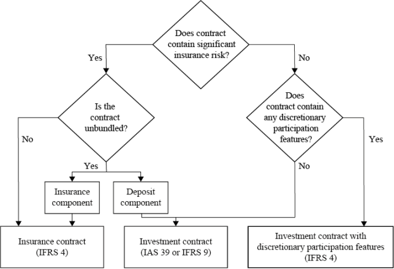

# 50 - Insurance contracts (IFRS 4)

[返回目录](README.md)

# 50 - Insurance contracts (IFRS 4)

Contents

- [50 - Insurance contracts (IFRS 4)](81.md#s325-chap_50_toc_h1)

- [Introduction and scope (paras 50.1- 50.7)](81.md#s326-chap_50_navPoint_1)

- [Scope](81.md#s326-chap_50_navPoint_2)

- [Definition of an insurance contract (paras 50.8- 50.23)](81.md#s327-chap_50_navPoint_3)

- [Specified uncertain future event](81.md#s327-chap_50_navPoint_4)

- [Significant insurance risk](81.md#s327-chap_50_navPoint_5)

- [Adversely affects the policyholder](81.md#s327-chap_50_navPoint_6)

- [Another party](81.md#s327-chap_50_navPoint_7)

- [Existing accounting policies](81.md#s327-chap_50_navPoint_8)

- [Recognition (paras 50.24 - 50.66)](81.md#s328-chap_50_navPoint_9)

- [De-recognition](81.md#s328-chap_50_navPoint_10)

- [Measurement](81.md#s328-chap_50_navPoint_11)

- [Changes in accounting policy](81.md#s328-chap_50_navPoint_12)

- [Current interest rates](81.md#s328-chap_50_navPoint_13)

- [Continuation of certain existing practices](81.md#s328-chap_50_navPoint_14)

- [Prudence](81.md#s328-chap_50_navPoint_15)

- [Future investment margins](81.md#s328-chap_50_navPoint_16)

- [Shadow accounting](81.md#s328-chap_50_navPoint_17)

- [Re-designation of financial assets](81.md#s328-chap_50_navPoint_18)

- [Distinction between insurance and investment contracts](81.md#s328-chap_50_navPoint_19)

- [Unbundling insurance contracts](81.md#s328-chap_50_navPoint_20)

- [Discretionary participation features](81.md#s328-chap_50_navPoint_21)

- [Embedded derivatives](81.md#s328-chap_50_navPoint_22)

- [Insurance contracts acquired in a business combination or portfolio transfer](81.md#s328-chap_50_navPoint_23)

- [Presentation and disclosure (paras 50.67 - 50.74)](81.md#s329-chap_50_navPoint_24)

- [Presentation](81.md#s329-chap_50_navPoint_25)

- [Disclosure](81.md#s329-chap_50_navPoint_26)

- [Disclosure in respect of investment contracts with discretionary participation features](81.md#s329-chap_50_navPoint_idp1721264600)

- [Applying IFRS 9 with IFRS 4 (paras 50.75-50.92)](81.md#s330-chap_50_navPoint_27)

- [Temporary exemption](81.md#s330-chap_50_navPoint_28)

- [Overlay approach](81.md#s330-chap_50_navPoint_29)

- [Illustrative text](81.md#s331-chap_50_navPoint_30)

- [Definition of insurance contracts](81.md#s331-chap_50_navPoint_32)

- [EX 50.8.1 – Contracts that are insurance contracts](81.md#s331-chap_50_navPoint_idp1721314136)

- [EX 50.8.2 – Contracts that are not insurance contracts](81.md#s331-chap_50_navPoint_idp1721320408)

- [Specified uncertain future event](81.md#s331-chap_50_navPoint_idp1721341528)

- [EX 50.10.1 – Fixed-fee property maintenance contract](81.md#s331-chap_50_navPoint_idp1721344216)

- [EX 50.10.2 – Manufacturer warranty contract](81.md#s331-chap_50_navPoint_idp1721366104)

- [Significant insurance risk](81.md#s331-chap_50_navPoint_idp1721389528)

- [FAQ 50.12.1 – Does an equity release mortgage with a ‘no negative equity’ guarantee transfer insurance risk?](81.md#s331-chap_50_navPoint_idp1721386200)

- [EX 50.16.1 – Payments for low probability events](81.md#s331-chap_50_navPoint_idp1721146328)

- [Adversely effects the policyholder](81.md#s331-chap_50_navPoint_idp1721156312)

- [EX 50.17.1 – Payment for insignificant loss](81.md#s331-chap_50_navPoint_idp1721163352)

- [EX 50.18.1 – Adversely affects the policyholder](81.md#s331-chap_50_navPoint_idp1721174104)

- [EX 50.18.2 – Climatic variables](81.md#s331-chap_50_navPoint_idp1721224920)

- [Another party](81.md#s331-chap_50_navPoint_idp1721236184)

- [EX 50.21.1 – Captive insurance subsidiaries](81.md#s331-chap_50_navPoint_idp1721243736)

- [Existing accounting policies](81.md#s331-chap_50_navPoint_33)

- [FAQ 50.23.1 – Can accounting policies that meet the requirements of IAS 37 meet the requirements in paragraph 13 of IFRS 4?](81.md#s331-chap_50_navPoint_idp1721269464)

- [Recognition](81.md#s331-chap_50_navPoint_34)

- [De-recognition](81.md#s331-chap_50_navPoint_idp1689837656)

- [EX 50.27.1 – Provision of services to discharge insurance obligations](81.md#s331-chap_50_navPoint_idp1689841368)

- [Unbundling insurance contracts](81.md#s331-chap_50_navPoint_idp1689844312)

- [EX 50.46.1 – Loan waiver on death](81.md#s331-chap_50_navPoint_idp1689848664)

- [Embedded derivatives](81.md#s331-chap_50_navPoint_35)

- [EX 50.60.1 – Embedded derivatives](81.md#s331-chap_50_navPoint_idp1689860696)

- [Presentation and disclosure](81.md#s331-chap_50_navPoint_36)

- [Disclosure](81.md#s331-chap_50_navPoint_idp1689868376)

- [EX 50.71.1 – Materiality of disclosures](81.md#s331-chap_50_navPoint_idp1689869784)

- [Applying IFRS 9 with IFRS 4](81.md#s331-chap_50_navPoint_37)

- [Temporary exemption](81.md#s331-chap_50_navPoint_idp1689890904)

- [FAQ 50.77.1 – Can a group use the temporary exemption from IFRS 9 to continue to apply IAS 39 in its consolidated financial statements?](81.md#s331-chap_50_navPoint_idp1689888344)

- [FAQ 50.78.1 – Can IFRS 9 be deferred for an insurance company incorporated after 31 December 2018?](81.md#s331-chap_50_navPoint_idp1687224072)

- [FAQ 50.82.1 – What activities should be included in the assessment of whether an insurer engages in ‘significant activity unconnected with insurance’ for the purpose of applying the temporary exemption?](81.md#s331-chap_50_navPoint_idp1687201928)

- [FAQ 50.83.1 – If an entity applies the temporary exemption from IFRS 9, should it provide the fair value and credit risk disclosures required by IFRS 4 in its interim financial statements?](81.md#s331-chap_50_navPoint_idp1698284728)

- [FAQ 50.83.2 – Is an insurer required to present comparative information in respect of the preceding reporting period for quantitative disclosures provided in accordance with paragraphs 39E to 39G of IFRS 4 when it first applies the temporary exemption?](81.md#s331-chap_50_navPoint_idp1698301752)

- [Overlay approach](81.md#s331-chap_50_navPoint_idp1698327352)

- [EX 50.86.1 – Assets held in respect of activity unconnected with insurance](81.md#s331-chap_50_navPoint_idp1698330040)

This eBook is licensed to peggy so, peggy.so@hk.ey.com, 

## Introduction and scope (paras 50.1- 50.7)

 

**50.1** IFRS 4 was designed as an interim standard with the objective of specifying the accounting for insurance contracts by entities that issue such contracts. IFRS 4 requires limited improvements to accounting practices for insurance contracts, and therefore allows entities to continue with their existing accounting policies for insurance contracts if those policies meet specified minimum criteria. Entities applying IFRS 4 are required to identify and explain, to the users of financial statements, the amount, timing and uncertainty of future cash flows arising from insurance contracts.

[IFRS 4 para 1].

**50.2**IFRS 4 will be replaced by IFRS 17 as amended in June 2020 (see [chapter 50A](81.md#s325-chap_50)). IFRS 17 will apply to annual periods beginning on or after 1 January 2023 (with early adoption permitted where IFRS 9 is also applied).

 

### Scope

 

**50.3** IFRS 4 applies to insurance and reinsurance contracts that an entity issues and reinsurance contracts that it holds. IFRS 4 also applies to financial instruments that an entity issues that have a ‘discretionary participation feature’.

[IFRS 4 para 2].

**50.4**IFRS 4 refers to any entity that issues an insurance contract as ‘an insurer’, whether or not the entity is regarded as an insurance company for legal or supervisory purposes. All references to an insurer shall be read as also referring to an issuer of a financial instrument that contains a discretionary participation feature.

[IFRS 4 paras 1, 5].

**50.5** IFRS 4 does not address other aspects of accounting by insurers, such as accounting for financial assets that they hold or financial liabilities that they issue, other than:

- permitting an insurer in specified circumstances to reclassify some or all of their financial assets at fair value through profit or loss (see [para 50.42](81.md#s328-Para_50.42)); and

- containing temporary exemptions in relation to the application of IFRS 9 (see [para 50.75 onwards](81.md#s330-Para_50.75)).

[IFRS 4 para 3].

**50.6** IFRS 4 does not apply to direct insurance contracts that an entity holds.

[IFRS 4 para 4(f)].

**50.7** IFRS 4 does not apply in the following situations (even if the definition of an insurance contract is met):

- Product warranties issued directly by a manufacturer, retailer or dealer are within the scope of IFRS 15, (see [chapter 11](19.md#s64-chap_11)) and IAS 37 (see [chapter 16](36.md#s115-chap_16)).

- Employee benefit plans and retirement benefit obligations are within the scope of IFRS 2 (see [chapter 13](24.md#s85-chap_13)) IAS 19 (see [chapter 12](23.md#s77-chap_12)) and IAS 26.

- Contractual rights or obligations that are contingent on the use of non-financial items and a lessee's residual value guarantee embedded in a lease are within the scope of IFRS 16 (see [chapter 15](33.md#s106-chap_15)), IFRS 15 (see [chapter 11](19.md#s64-chap_11)) and IAS 38 (see [chapter 21](38.md#s132-chap_21)).

- Financial guarantees are within the scope of IFRS 9 or IAS 39 (see [para 50.75 onwards](81.md#s330-Para_50.75)), ‘Financial instruments: recognition and measurement’ (see [chapter 40](61.md#s248-chap_40)). Financial guarantee contracts will be within the scope of IFRS 9 or IAS 39 (see [chapter 40](61.md#s248-chap_40)), except where the issuer has previously asserted explicitly that it regards such contracts as insurance contracts and has used accounting applicable to insurance contracts, in which case the issuer can irrevocably elect, on a contract-by-contract basis, to apply either:

- IFRS 9 or IAS 39, IAS 32 and IFRS 7(see [chapter 47](78.md#s306-chap_47)); or

- IFRS 4.

- Contingent consideration payable on a business combination is within the scope of IFRS 3 (see chapter 29).

[IFRS 4 para 4].

 

This eBook is licensed to peggy so, peggy.so@hk.ey.com, 

## Definition of an insurance contract (paras 50.8- 50.23)

 

**50.8** IFRS 4 defines an insurance contract as “a contract under which one party (the insurer) accepts significant insurance risk from another party (the policyholder) by agreeing to compensate the policyholder if a specified uncertain future event (the insured event) adversely affects the policyholder”.

[IFRS 4 App A].

[EX 50.8.1 – Contracts that are insurance contracts](81.md#s331-EX50.8.1)  
[EX 50.8.2 – Contracts that are not insurance contracts](81.md#s331-EX50.8.2)

**50.9** The key principle of an insurance contract is that there should be a transfer of significant insurance risk arising from an uncertain future event that adversely affects the policyholder and results in the payment of significant additional benefits.

 

### Specified uncertain future event

 

**50.10** Uncertainty (or risk) is the essence of an insurance contract. At least one of the following is uncertain at the inception of an insurance contract:

- whether an insured event will occur;

- when it will occur; or

- how much the insurer will need to pay if it occurs.

[IFRS 4 App B para B2].

[EX 50.10.1 – Fixed-fee property maintenance contract](81.md#s331-EX50.10.1)  
[EX 50.10.2 – Manufacturer warranty contract](81.md#s331-EX50.10.2)

 

### Significant insurance risk

 

**50.11** The risk accepted from the policyholder must be insurance risk. Insurance risk is any risk other than financial risk.

[IFRS 4 App A].

**50.12** Financial risk is: “the risk of a possible future change in one or more of a specified interest rate, financial instrument price, commodity price, foreign exchange rate, index of prices or rates, credit rating or credit index or other variable, provided in the case of a non-financial variable that the variable is not specific to a party to the contract”.

[IFRS 4 App A].

[FAQ 50.12.1 – Does an equity release mortgage with a ‘no negative equity’ guarantee transfer insurance risk?](81.md#s331-FAQ_50.12.1)

**50.13** Contracts can contain both financial and insurance risk; such contracts are not excluded from being insurance contracts, provided the insurance risk is significant.

[IFRS 4 App B para B10].

**50.14** Insurance risk is ‘significant’ if, and only if, the occurrence of an insured event could result in the payment of “significant additional benefits in any scenario, excluding scenarios that lack commercial substance (ie have no discernible effect on the economics of the transaction)”.

[IFRS 4 App B para B23].

**50.15** IFRS 4 does not set a numerical threshold for ‘significant’ insurance risk.

**50.15.1** The definition of insurance risk refers to risk that the insurer accepts from the policyholder. That is, insurance risk must be a pre-existing risk that is transferred from the policyholder to the insurer as a result of the contract, and is not a new risk created by the contract.

[IFRS 4 App B para B12].

**50.16** A scenario with commercial substance can be one that is extremely unlikely. An entity needs to consider whether the benefits are greater in a scenario with commercial substance in which the insured event occurs than in any other scenario. The entity will then have to determine whether the difference between the benefits under this scenario and the benefits if no insured event occurred is significant. If that is the case, the contract is an insurance contract.

[IFRS 4 App B para B23].

[EX 50.16.1 – Payments for low probability events](81.md#s331-EX50.16.1)

**50.17** ‘Additional benefits’ exclude payments conditional on an event that does not cause a significant loss to the policyholder.

[IFRS 4 App B para B24(c)].

[EX 50.17.1 – Payment for insignificant loss](81.md#s331-EX50.17.1)

 

### Adversely affects the policyholder

 

**50.18** A contract requiring payment to the policyholder if a specified uncertain event occurs is only an insurance contract if the event creates insurance (as opposed to financial) risk and that event adversely affects the policyholder.

[EX 50.18.1 – Adversely affects the policyholder](81.md#s331-EX50.18.1)  
[EX 50.18.2 – Climatic variables](81.md#s331-EX50.18.2)

**50.19** Payments under insurance contracts can be predetermined and do not need to exactly compensate the policyholder for the financial impact of the adverse event.

[IFRS 4 App B para B13].

**50.20** Payments under insurance contracts can be more than the loss suffered. One such case is ‘new-for-old’ policies where the insurer pays for the replacement cost of a new asset, rather than capping the compensation to the value of the old and damaged asset.

[IFRS 4 App B para B13].

 

### Another party

 

**50.21** Insurers must accept risk from another party (a separate entity) for insurance risk to exist.

[IFRS 4 IG example 1 para 1.28].

[EX 50.21.1 – Captive insurance subsidiaries](81.md#s331-EX50.21.1)

**50.22** IAS 37 applies where a group self-insures, and a provision will be recognised if there is an obligation at the reporting date (see [chapter 16](36.md#s115-chap_16) [EX 16.85.10](36.md#s122-EX16.85.10)).

[IFRS 4 App B para B19(c)].

 

### Existing accounting policies

 

**50.23** Insurers are exempt from applying the criteria for developing accounting policies in paragraphs 10 to 12 of IAS 8 (see [chapter 3 paras 7 to 9](09.md#s20-Para_3.7)) to insurance contracts. Entities can continue with their existing (local GAAP) accounting policies if those policies meet certain criteria.

[IFRS 4 para 13].

[FAQ 50.23.1 – Can accounting policies that meet the requirements of IAS 37 meet the requirements in paragraph 13 of IFRS 4?](81.md#s331-FAQ_50.23.1)

 

This eBook is licensed to peggy so, peggy.so@hk.ey.com, 

## Recognition (paras 50.24 - 50.66)

 

**50.24** For an insurer to recognise an insurance liability, a contractual relationship between the insurer and the policyholder must exist at the end of the reporting period. Liabilities for potential claims that might arise under future contracts cannot be recognised.

[IFRS 4 para 14(a)].

**50.25** Liabilities for potential claims are often called ‘catastrophe’ or ‘equalisation’ provisions, and are created when a liability is built up over time, to be used on the occurrence of a future catastrophic loss covered by current or future contracts. They are prohibited, because they do not meet the definition of a liability under the Framework.

[IFRS 4 para BC 89].

 

### De-recognition

 

**50.26** An insurer should only remove an insurance liability from its balance sheet when the obligation specified in the contract is discharged, or cancelled or expires. This is consistent with the treatment of financial liabilities under IAS 39 or IFRS 9 (see [chapter 44 para 101](68.md#s286-Para_44.101)).

[IFRS 4 para 14(c)].

**50.27** Some insurance liabilities, such as claim liabilities, are extinguished by payments in kind or the provision of services rather than by the payment of a monetary amount.

[EX 50.27.1 – Provision of services to discharge insurance obligations](81.md#s331-EX50.27.1)

 

### Measurement

 

**50.28**The amount of an insurance liability is subject to a liability adequacy test.

[IFRS 4 para 15].

**50.29** If an insurer applies a liability adequacy test that meets specified minimum requirements, IFRS 4 imposes no further requirements. The minimum requirements are that the liability adequacy test considers current estimates of all contractual cash flows, related cash flows (such as claims handling costs) and cash flows resulting from embedded options and guarantees. If an insurance liability is inadequate in the light of estimated future cash flows under the liability adequacy test, the entire deficiency must be recognised in profit or loss.

[IFRS 4 para 16].

**50.30** If the insurer’s liability adequacy test meets the minimum requirements of paragraph 16 of IFRS 4, that test is applied at the level of aggregation specified by that test.

[IFRS 4 para 18].

**50.31** Where the insurer’s accounting policies do not require a liability adequacy test meeting the specified minimum requirements, the insurer should compare the insurance liability’s carrying amount (less any related deferred acquisition costs and other insurance-related intangible assets) with the provision that would be required if it were measured using IAS 37. Where the net carrying amount of an insurance liability is insufficient when compared with IAS 37 measurement, the insurer should reduce the related assets or increase the liability. The difference should be recognised in profit or loss.

[IFRS 4 para 17].

**50.32** If the insurer compares the adequacy of its insurance liability with the provision that would be required by IAS 37, this comparison should be done for each portfolio of contracts. A portfolio includes all contracts managed together and that are subject to broadly similar risks.

[IFRS 4 para 18].

 

### Changes in accounting policy

 

**50.33** Requirements in respect of changes in accounting policies apply to insurers that already apply IFRSs and to those adopting IFRSs for the first time.

[IFRS 4 para 21].

**50.34** Insurers can only change their existing accounting policies for insurance contracts where the change results in presenting information that is more relevant and no less reliable, or more reliable and no less relevant, than before. The criteria in IAS 8 are used to determine whether a change in policy would result in more relevant or more reliable information.

[IFRS 4 para 22].

**50.35** IFRS 17 gives insurers further context for judgements about whether a change in accounting policies will make their financial statements more relevant and reliable.

[IFRS 4 para BC 123].

 

### Current interest rates

 

**50.36** Insurers can change their accounting policies to measure insurance liabilities to reflect current market interest rates. This can be for designated liabilities, without applying the policy to all similar liabilities.

[IFRS 4 para 24].

 

### Continuation of certain existing practices

**50.37** Some existing local GAAP accounting policies can continue to be used, but cannot be introduced as a change, because they do not satisfy the ‘more relevant and no less reliable’ or ‘more reliable and no less relevant’ criteria. These include:

- Measuring insurance liabilities on an undiscounted basis.

- Measuring contractual rights to future investment management fees at an amount that exceeds fair value.

- Using non-uniform accounting policies for insurance contracts of subsidiaries, except as noted in [paragraph 50.36](81.md#s328-Para_50.36).

[IFRS 4 para 25].

**50.38** An insurer can change accounting policies for insurance contracts of subsidiaries if they are not uniform, provided the change does not make accounting policies more diverse and satisfies IFRS 4’s other requirements for a change in accounting policy.

[IFRS 4 para 25(c)].

### Prudence

**50.39** Insurers do not need to eliminate excessive prudence if it was part of their previous accounting policies. Changes to accounting policies that introduce additional prudence are not permitted if the liabilities are already measured with sufficient levels of prudence.

[IFRS 4 para 26].

### Future investment margins

**50.40** Existing measurement practices for insurance liabilities can include future investment margins, either by using a discount rate that reflects the estimated return on an insurer’s assets or by projecting the returns on those assets at an estimated rate of return and then discounting those projected returns at a different rate. An insurer does not need to change its accounting policies to eliminate future investment margins, but there is a rebuttable presumption that an insurer’s financial statements will become less relevant and less reliable if it introduces such a policy.

[IFRS 4 para 27].

### Shadow accounting

**50.41** In some accounting models, realised gains or losses on an insurer’s assets have a direct effect on the measurement of its insurance contracts. An insurer is permitted, but not required, to change its accounting policies so that a recognised but unrealised gain or loss on an asset affects measurement in the same way as a realised gain or loss. The related adjustment to the insurance liability (or deferred acquisition costs or intangible assets) is recognised in other comprehensive income if the unrealised gains or losses are recognised in other comprehensive income. This practice is sometimes described as ‘shadow accounting’.

[IFRS 4 para 30].

### Re-designation of financial assets

**50.42** When an insurer changes its accounting policies for insurance liabilities, it can, but is not required to, reclassify some or all of its financial assets as ‘at fair value through profit or loss’. Reclassification is permitted if an insurer changes accounting policies when it first applies IFRS 4 and if it makes a subsequent policy change. The reclassification is a change in accounting policy and therefore IAS 8 applies.

[IFRS 4 para 45].

### Distinction between insurance and investment contracts

 

**50.43**Investment contract is an informal term used to describe contracts which take the legal form of insurance contracts but do not transfer significant insurance risk, and they are within the scope of IFRS 9 or IAS 39 (see [para 50.75 onwards](81.md#s330-Para_50.75)) because they create financial assets or liabilities.

[IFRS 4 paras BC 22, BC 23].

**50.44**There are circumstances in which IFRS 9 or IAS 39 (see [para 50.75 onwards](81.md#s330-Para_50.75)) can apply to elements within an insurance contract, and IFRS 4 can apply to investment contracts.

 

### Unbundling insurance contracts

 

**50.45**Deposit components are contractual components that are not accounted for as a derivative under IFRS 9 or IAS 39 (see [para 50.75 onwards](81.md#s330-Para_50.75)) and would be within the scope of IFRS 9 or IAS 39 if they were separate instruments.

**50.46**Some insurance contracts have an insurance component and a deposit component. Deposit components within insurance contracts either should or could be unbundled as follows:

- Unbundling is required if:

- the insurer can measure the deposit component (including any embedded surrender options) separately (that is, without considering the insurance component); and

- the insurer’s accounting policies do not require it to recognise all obligations and rights arising from the deposit component.

- Unbundling is permitted, but not required, if the insurer can measure the deposit component separately but its accounting policies require it to recognise all obligations and rights arising from the deposit component, regardless of the basis used to measure those rights and obligations.

- Unbundling is prohibited if an insurer cannot measure the deposit component separately.

[IFRS 4 para 10].

[EX 50.46.1 – Loan waiver on death](81.md#s331-EX50.46.1)

**50.47** Where an insurance contract is unbundled into separate deposit and insurance components, IFRS 9 or IAS 39 (see [para 50.75 onwards](81.md#s330-Para_50.75)) is used to account for the deposit component, and IFRS 4 is used to account for the insurance component.

[IFRS 4 para 12].

 

### Discretionary participation features

 

**50.48** Contracts that contain a discretionary participation feature are often called ‘with profits’ or ‘participating’ contracts.

**50.49**Discretionary participation features arise where the policyholder has a contractual right to receive additional benefits in excess of guaranteed benefits from the issuer. The additional benefits need to be:

- likely to be a significant portion of the total contractual benefits;

- contractually at the issuer’s discretion about their amount or timing; and

- contractually based on:

- the performance of a specified pool of contracts or a specified type of contract;

- realised and/or unrealised investment returns on a specified pool of assets held by the issuer; or

- the profit or loss of the company, fund or other entity that issues the contract.

[IFRS 4 App A].

**50.50** Issuers of contracts with discretionary participation features can either choose to treat the whole contract as a liability or separate out the guaranteed element and recognise that element as a liability.

[IFRS 4 para 34(a)].

**50.51** Where a discretionary participation feature is accounted for separately from the guaranteed element, it should be recognised as a liability, or a separate component of equity, or it can be split between the two. It should not be treated as an intermediate category that is neither debt nor equity.

[IFRS 4 para 34(b)].

**50.52** It is not specified how an issuer should determine the classification of discretionary participation features between liability and equity, but it should be done consistently.

[IFRS 4 para 34(b)].

**50.53** Premiums arising on contracts with discretionary participation features can be recognised as revenue, without separating any portion that relates to the equity element.

[IFRS 4 para 34(c)].

**50.54** Changes in the guaranteed element of contracts with discretionary participation features, and in the portion of the discretionary participation feature classified as a liability, are recognised in profit or loss.

[IFRS 4 para 34(c)].

**50.55** The portion of profit or loss attributable to any equity component of a contract with a discretionary participation feature is recognised as an allocation of profit or loss, rather than expense or income. This is similar to the presentation of non-controlling interests ([see chapter 26](45.md#s168-chap_26)).

[IFRS 4 para 34(c)].

**50.56** If a whole discretionary participation feature in an investment contract is classified as a liability, the issuer applies the liability adequacy test to the whole contract.

[IFRS 4 para 35(a)].

**50.57**If any part of a discretionary participation feature in an investment contract is classified as a separate component of equity, the liability recognised for the whole contract must be no less than the amount that would result from applying IFRS 9 or IAS 39 (see [para 50.75 onwards](81.md#s330-Para_50.75)) to the guaranteed element.

[IFRS 4 para 35(b)].

 

### Embedded derivatives

 

**50.58**Insurance contracts can contain embedded derivatives (see [chapter 41 para 73 ](62.md#s260-Para_41.73)onwards). Subject to [paragraph 50.59](81.md#s328-Para_50.59), IFRS 9 or IAS 39 (see [para 50.75 onwards](81.md#s330-Para_50.75)) applies to embedded derivatives contained in insurance contracts, unless the embedded derivative is itself an insurance contract.

[IFRS 4 para 7].

**50.59**An insurer does not need to separate, and measure at fair value, a policyholder’s option to surrender an insurance contract for a fixed amount (or for an amount based on a fixed amount and an interest rate). This is an exception to IFRS 9 and IAS 39 (see [para 50.75 onwards](81.md#s330-Para_50.75)).

[IFRS 4 para 8].

**50.60**Payments under an insurance contract can be linked to a price index. This link can be an embedded derivative but it can also transfer insurance risk. If the transfer of insurance risk is significant, the embedded derivative will meet the definition of an insurance contract. In this case, the embedded derivative need not be separated and measured at fair value according to IFRS 9 or IAS 39 (see [para 50.75 onwards](81.md#s330-Para_50.75)).

[IFRS 4 App B para B11].

[EX 50.60.1 – Embedded derivatives](81.md#s331-EX50.60.1)

 

### Insurance contracts acquired in a business combination or portfolio transfer

 

**50.61**An acquirer in a business combination should measure insurance liabilities assumed and insurance assets acquired at fair value.

[IFRS 4 para 31].

**50.62** An acquirer in a business combination can (but is not required to) expand the presentation of the fair value of the acquired insurance contracts into two components, as follows:

- a liability measured according to the insurer’s accounting policies for insurance contracts that it issues; and

- an intangible asset, representing the fair value of the contractual insurance rights and obligations acquired, to the extent that the liability does not reflect that fair value.

[IFRS 4 para 31].

**50.63** An insurer acquiring a portfolio of insurance contracts can use expanded presentation (set out within [paragraph 50.62](81.md#s328-Para_50.62) to reflect both the fair value of the liability acquired and the related intangible asset.)

[IFRS 4 para 32].

**50.64** Intangible assets related to acquired insurance contracts (as described in [paragraph 50.62](81.md#s328-Para_50.62)) are excluded from the scope of IAS 36 and IAS 38.

[IFRS 4 para 33].

**50.65** Subsequent measurement of intangible assets related to acquired insurance contracts should be consistent with the measurement of the related insurance liability.

[IFRS 4 para 31(b)].

**50.66** IAS 36 and IAS 38 apply to customer lists and customer relationships that are not part of the contractual insurance rights and obligations that existed at the date of the business combination.

[IFRS 4 para 33].

 

This eBook is licensed to peggy so, peggy.so@hk.ey.com, 

## Presentation and disclosure (paras 50.67 - 50.74)

### Presentation

 

**50.67** IFRS 4’s implementation guidance (see paras IG20 to IG24) provides guidance on how IAS 1’s presentation requirements could be met in respect of insurance contracts.

**50.68**An insurer should not net reinsurance amounts against the amounts arising from the related insurance contracts.

[IFRS 4 para 14(d)].

 

### Disclosure

 

**50.69** An insurer should disclose information that identifies and explains the amounts in its financial statements arising from insurance contracts.

[IFRS 4 para 36].

**50.70** An insurer should disclose information that enables users of its financial statements to evaluate the nature and extent of risks arising from insurance contracts.

[IFRS 4 para 38].

**50.71**The required disclosures are set out in paragraphs 37, 39 and 39A of IFRS 4, and paragraphs IG25 to IG71 of IFRS 4 discuss how these requirements could be met. For entities that apply the temporary exemption from IFRS 9 or the overlay approach, see [paragraphs 50.83](81.md#s330-Para_50.83) and [50.92](81.md#s330-Para_50.92) respectively for the related disclosure requirements.

[EX 50.71.1 – Materiality of disclosures](81.md#s331-EX50.71.1)

 

#### Disclosure in respect of investment contracts with discretionary participation features

**50.72**Investment contracts with discretionary participation features are within the scope of IFRS 7 and subject to its disclosure requirements (see [chapter 47](78.md#s306-chap_47)).

**50.73**The interest expense disclosed in accordance with paragraph 20(b) of IFRS 7 does not need to be calculated using the effective interest method.

[IFRS 4 para 35(d)].

**50.74**Fair value disclosures under IFRS 7 are not required if the fair value of the discretionary participation features cannot be reliably measured. In such instances, information should be disclosed to help users of the financial statements to make their own judgements about the extent of possible differences between the contracts’ carrying amount and fair value. These disclosures are set out in paragraph 30 of IFRS 7.

[IFRS 7 para 29(c)].

This eBook is licensed to peggy so, peggy.so@hk.ey.com, 

## Applying IFRS 9 with IFRS 4 (paras 50.75-50.92)

 

**50.75**The IASB published an amendment to IFRS 4 in September 2016. This amendment addresses the concerns of insurance companies about the different effective dates of IFRS 9 and IFRS 17. The amendment to IFRS 4 provides two different solutions for insurance companies: a temporary exemption from IFRS 9 for entities that meet specific requirements (applied at the reporting entity level); and the ‘overlay approach’. Both approaches are optional.

[IFRS 4 para 3].

**50.76**IFRS 4 will be superseded by IFRS 17, as amended in June 2020. Accordingly, both the ‘temporary exemption’ and the ‘overlay approach’ will cease to be applicable when IFRS 17 becomes effective on 1 January 2023.

[IFRS 4 para 20A].

 

### Temporary exemption

 

**50.77**Under the temporary exemption, insurers are permitted to continue to apply IAS 39, instead of adopting IFRS 9, if their activities are ‘predominantly connected with insurance’ and when IFRS 9 is not previously applied. The assessment of whether activities are predominantly connected with insurance is initially performed as at the annual reporting date immediately preceding 1 April 2016.

[IFRS 4 para 20B].

[FAQ 50.77.1 – Can a group use the temporary exemption from IFRS 9 to continue to apply IAS 39 in its consolidated financial statements?](81.md#s331-FAQ_50.77.1)

**50.78**Reassessments of eligibility for the temporary exemption at subsequent annual reporting dates are only made where there is a significant change in the entity’s activities, as described at paragraphs 20H to 20I of IFRS 4.

[IFRS 4 para 20G].

[FAQ 50.78.1 – Can IFRS 9 be deferred for an insurance company incorporated after 31 December 2018?](81.md#s331-FAQ_50.78.1)

**50.79**To assess whether activities are ‘predominantly connected with insurance’, two tests have to be performed. Only if both tests are passed are an insurer’s activities considered to be predominantly connected with insurance.

**50.80**First, an insurer assesses whether the carrying amount of its liabilities arising from contracts within IFRS 4’s scope (including any unbundled deposit components or embedded derivatives) is significant, compared to the total carrying amount of all of its liabilities. Secondly, the insurer compares the total carrying amount of its liabilities connected with insurance with the total carrying amount of all of its liabilities.

[IFRS 4 para 20D].

**50.81** In addition to liabilities arising from contracts within IFRS 4’s scope, liabilities connected with insurance include:

- non-derivative investment contract liabilities measured at fair value through profit or loss applying IAS 39; and

- liabilities that arise because the insurer issues, or fulfils obligations arising from, those insurance and non-derivative investment contracts.

[IFRS 4 para 20E].

**50.82** The second test is passed if the resulting percentage is:

- greater than 90%; or

- less than or equal to 90% but greater than 80%, and the insurer is not engaged in a significant activity unconnected with insurance.

[IFRS 4 para 20D].

[FAQ 50.82.1 – What activities should be included in the assessment of whether an insurer engages in ‘significant activity unconnected with insurance’ for the purpose of applying the temporary exemption?](81.md#s331-FAQ_50.82.1)

**50.83**Entities that apply the temporary exemption from IFRS 9 have to make extensive disclosures to help users to understand why they are allowed to apply the temporary exemption from IFRS 9 and how this affects their financial statements. The required disclosures are set out in paragraphs 39C, 39D, 39G, 39H, 39I and 39J of IFRS 4.

[IFRS 4 para 39B].

**50.83.1**Insurers applying the IFRS 4 temporary exemption to apply IAS 39 should consider Phase 2 Interest Rate Benchmark Reform Amendments to IFRS 9, IAS 39, IFRS 7, IFRS 4 and IFRS 16. Refer to Appendix A3.39, for the Phase 2 amendments issued in August 2020.

[FAQ 50.83.1 – If an entity applies the temporary exemption from IFRS 9, should it provide the fair value and credit risk disclosures required by IFRS 4 in its interim financial statements?](81.md#s331-FAQ_50.83.1)  
[FAQ 50.83.2 – Is an insurer required to present comparative information in respect of the preceding reporting period for quantitative disclosures provided in accordance with paragraphs 39E to 39G of IFRS 4 when it first applies the temporary exemption?](81.md#s331-FAQ_50.83.2)

 

### Overlay approach

 

**50.84** Under IFRS 9, certain financial assets have to be measured at fair value through profit or loss; whereas, under IFRS 4, the related liabilities from insurance contracts could be measured on a cost basis. This might create volatility in profit or loss. The ‘overlay approach’ seeks to address the additional accounting mismatches and volatility in profit or loss that might arise from applying IFRS 9 before IFRS 17. The overlay approach is only relevant to those insurers that apply IFRS 9 (that is, that are not eligible for, or choose not to apply, the temporary exemption).

**50.85**Under the overlay approach, an insurer is permitted to reclassify – from profit or loss to other comprehensive income – the difference between the amount that is reported in profit or loss under IFRS 9 and the amount that would have been reported in profit or loss under IAS 39 in respect of those designated financial assets to which the overlay approach is being applied.

[IFRS 4 para 35B].

**50.86** A financial asset is eligible for designation for the ‘overlay approach’ if it is measured at fair value through profit or loss under IFRS 9, but would not be so measured under IAS 39. In addition, the asset cannot be held in respect of an activity that is unconnected with contracts within IFRS 4’s scope .

[IFRS 4 para 35E].

[EX 50.86.1 – Assets held in respect of activity unconnected with insurance](81.md#s331-EX50.86.1)

**50.87**An insurer chooses which eligible financial assets to designate for the overlay approach when it elects to apply the overlay approach. Subsequently, it might designate eligible financial assets for the overlay approach only on initial recognition or when an asset first becomes eligible for the overlay approach subsequent to initial recognition.

[IFRS 4 para 35F].

**50.88**If a designated financial asset no longer meets the eligibility criteria for the overlay approach (for example, because it is transferred so that it is now held in respect of an entity’s banking activities or because the entity ceases to be an insurer), it should be de-designated.

[IFRS 4 para 35I].

**50.89**In that case, any balance accumulated in other comprehensive income relating to this financial asset is reclassified to profit or loss.

[IFRS 4 para 35J].

**50.90** The ‘overlay approach’ is applied retrospectively. Accordingly, the difference between the fair value of the designated financial assets and its carrying amount is recognised as an adjustment to the opening balance of accumulated other comprehensive income.

[IFRS 4 para 49].

**50.91**If, at the beginning of any accounting period, an insurer chooses to stop applying the overlay approach, it should apply IAS 8 to account for the change in accounting policy.

[IFRS 4 para 35I(b)].

**50.92**If an insurer applies the overlay approach, it has to provide information that enables users of the financial statements to understand how the amount that is reclassified from profit or loss to other comprehensive income is calculated and how the reclassification affects its financial statements. The required disclosures are set out in paragraphs 39L and 39M of IFRS 4.

[IFRS 4 para 39K].

 

This eBook is licensed to peggy so, peggy.so@hk.ey.com, 

## Illustrative text

### Definition of insurance contracts

#### EX 50.8.1 – Contracts that are insurance contracts

 

Reference to standard: IFRS 4 para B18  
 Reference to standing text: [50.8](81.md#s327-Para_50.8)  Insurance

  

  
 Examples of insurance contracts (if the transfer of insurance risk is significant) are:

- Insurance against theft or damage to property.

- Insurance against product liability, professional liability, civil liability or legal expenses.

- Life insurance and pre-paid funeral plans.

- Life-contingent annuities and pensions.

- Disability and medical cover.

- Travel insurance.

- Reinsurance contracts.

 

#### EX 50.8.2 – Contracts that are not insurance contracts

 

Reference to standard: IFRS 4 paras B19, B20, B21  
 Reference to standing text: [50.8](81.md#s327-Para_50.8)  Insurance

  

  
 Examples of contracts that are not insurance contracts are:

- Investment contracts that have the legal form of an insurance contract but do not transfer significant insurance risk.

- Retrospectively rated contracts that pass all significant insurance risk back to the policyholder (for example, through enforceable mechanisms that adjust future premiums as a direct result of incurred losses), such as some financial reinsurance or group contracts.

- Derivatives that expose one party to financial risk (such as changes in interest rate, commodity prices, foreign exchange rates and indexes) rather than insurance risk.

- Credit-related guarantees that trigger payments, even if the holder has not incurred a credit loss.

- Catastrophe bonds that provide for reduced payment of principal, interest or both, based on climatic or geological variables not specific to a party to the contract.

If any of the contracts above create financial assets or financial liabilities, they are accounted for using IFRS 9 (unless temporary exemptions in relation to the application of IFRS 9 apply (see [para 50.75 onwards](81.md#s330-Para_50.75))).

If any of the contracts above do not create financial assets or financial liabilities, they are accounted for using IFRS 15 ([see chapter 11](19.md#s64-chap_11)).

 

#### Specified uncertain future event

 

##### EX 50.10.1 – Fixed-fee property maintenance contract

 

Reference to standard: IFRS 4 para B2   
 Reference to standing text: [50.10](81.md#s327-Para_50.10)  Insurance

  

  
 Entity P owns a portfolio of properties. It outsources its property maintenance and repair on all of these properties to Entity S, a property management company, for a five-year period for a fixed fee. This fee covers both property management and the cost of repair work. All repairs and maintenance required to maintain the properties to an agreed standard, based on the condition on inception of the contract, are now the responsibility of Entity S. The contract covers normal wear and tear and certain other conditions (such as dry rot and damp, should they be discovered in the course of any remedial work). Repairs required as a result of external events, such as fire or storm damage, continue to be covered by Entity P’s property insurance arrangements with a regulated insurance company.

Where either the number of services to be performed over a period or the nature of those services is not pre-determined, there can be significant insurance risk. There is uncertainty in the situation above in the following areas:

- whether any particular repairs will be required;

- when any particular repairs will be required; and

- how much any particular repair will cost.

There is a specified uncertain event, because it is uncertain when or if any particular repair will be required and how much it might cost. The significance of the insurance risk for Entity S is assessed, on a contract-by-contract basis, under IFRS 4. Insurance risk could be significant, even though there might be a minimal probability of material losses for Entity S arising from all of its property management contracts, because a significant loss could arise on any one contract, such as the contract with Entity P. If the insurance risk is significant, this contract will be an insurance contract and IFRS 4 will apply.

 

##### EX 50.10.2 – Manufacturer warranty contract

 

Reference to standard: IFRS 4 paras 4(a), B2

  
 Reference to standing text: [50.10](81.md#s327-Para_50.10)  Insurance

  

  
Entity G sells photocopiers to small businesses. The photocopiers require servicing after each 100,000 copies are made, and they break down from time to time. The photocopiers are sold with a one-year manufacturer’s warranty. When selling a photocopier, Entity G offers its customers an extended fixed-period repair and maintenance contract. Under this extended contract, Entity G will perform servicing and repairs to the photocopier, as necessary, for a fixed annual fee.

There can be significant insurance risk where either the number of services to be performed over the term of a contract or the nature of those services is uncertain. This arises because the issuer of the warranty and the extended contract will be compensating the customer if the photocopier breaks down and the breakdown will adversely affect the customer. The potential number and extent of any breakdowns are unknown, so the warranty and the extended contract meet the ‘uncertain future event’ element of the insurance contract definition.

But paragraph 4(a) of IFRS 4 specifically excludes product warranties issued directly by a manufacturer, retailer or dealer from the scope of IFRS 4. The contracts in this example are warranty contracts that have been issued by Entity G, the retailer, and fall outside IFRS 4’s scope.

The scope exclusion would not apply if the same repairs and maintenance were to be provided by a party other than the manufacturer, retailer or dealer (such as an entity specialising in photocopier repairs or a competing retailer).

 

#### Significant insurance risk

 

##### FAQ 50.12.1 – Does an equity release mortgage with a ‘no negative equity’ guarantee transfer insurance risk?

 

Reference to standard: IFRS 4 App A  
Reference to standing text: [50.12](81.md#s327-Para_50.12)  
 Insurance

  

  
 **Background**

An entity issues an equity release mortgage (also commonly referred to as a 'lifetime or ‘reverse’ mortgage) with a ‘no negative equity’ guarantee. The contractual terms secure the mortgage against the borrower’s property. Principal and accrued interest are payable when the borrower dies or moves into long-term care. The property is then sold and the proceeds used to repay the mortgage balance (including any accrued interest). The entity is not entitled to any excess of the sales proceeds over the amount due but it bears any shortfall where the sales proceeds are not sufficient to repay the principal and accrued interest. Assume that the entity holds the equity release mortgage within a ‘hold to collect’ business model and that the contract contains no other features that could cause it to fail the solely payments of principle and interest (‘SPPI’) test in IFRS 9.

**Question**

Does the contract transfer insurance risk?

**Answer**

Yes. The contract exposes the entity to the risk of changes in fair value of the borrower’s property (that is, a non-financial asset). That is not a financial risk, because the fair value of the property reflects not only changes in market prices for properties in general (a financial variable) but also the physical condition of the specific asset (a non-financial variable). The contract therefore transfers insurance risk, as well as financial risk, from the borrower to the entity.

Under IFRS 4, a contract is treated as an insurance contract only if it transfers significant insurance risk, which arises if an insured event could cause an entity to pay significant additional benefits in at least one scenario with commercial substance. If that is the case and the entity could pay significant additional benefits to the policyholder/mortgagee in at least one scenario with commercial substance, then the instrument is an insurance contract within the scope of IFRS 4. The instrument would also be an insurance contract within the scope of IFRS 17 (when effective). When applying IFRS 17, the entity can choose to apply either IFRS 17 or IFRS 9 to such a contract ([see chapter 50A](81.md#s325-chap_50)).

If the contract does not transfer significant insurance risk, it is within the scope of IFRS 9. As the bank holds the equity release mortgage within a ‘hold to collect’ business model, the classification and measurement of the contract under IFRS 9 is determined based on the contractual cash flow characteristics of the financial asset (the SPPI test) in accordance with paragraph 4.1.1 of IFRS 9. In performing the SPPI test, the bank needs to consider whether the possible effect of the ‘no negative equity’ guarantee is more than de minimis and is genuine (refer to [FAQ 42.51.1](65.md#s272-FAQ_42.51.1)). In doing so, important considerations are that:

- The ‘significant additional benefits’ threshold in IFRS 4 is not the same as the de minimis threshold in IFRS 9. De minimis is a stricter threshold with regard to cash flow variability and is only met when the possible effects on cash flows are clearly trivial or negligible.

- In assessing whether the cash flows under the guarantee could arise only on the occurrence of an extremely rare, highly abnormal, or very unlikely event, so are not genuine, it should be questioned why the clause was included in the contract if it has no apparent commercial purpose. The remainder of this FAQ assumes the clause is genuine.

As a result, the equity release or ‘reverse’ mortgage will be measured in one of three ways, depending upon the extent of the possible cash flow variability arising from the ‘no negative equity’ guarantee:

- as an insurance contract under IFRS 4, where significant additional benefits accrue to the borrower (in the form of forgiveness of a shortfall that would otherwise be due) in at least one scenario with commercial substance;

- as a financial instrument under IFRS 9 at fair value through profit or loss, where the additional benefits will not be significant in any scenario with commercial substance but could be more than de minimis (that is, cash flows received are not SPPI as losses are borne by the lender if proceeds on sale of the property are insufficient to repay outstanding principal and interest); or

- as a financial instrument under IFRS 9 at amortised cost, where the additional benefits could never be more than de minimis.

Each individual contract should be analysed based on its specific facts and circumstances.

 

##### EX 50.16.1 – Payments for low probability events

 

Reference to standard: IFRS 4 para B23  
 Reference to standing text: [50.16](81.md#s327-Para_50.16)  Insurance

  

  
 An entity has a contract which requires an insurer to reimburse it for the value of a property that it owns in the event of the property being destroyed by a hurricane. The likelihood of a hurricane destroying a building is low (although the scenario has commercial substance), but the payment by the insurer would be substantial. In all other scenarios, a similar payment would not be made. The contract is therefore an insurance contract, because the insurance risk is significant.

 

#### Adversely effects the policyholder

 

##### EX 50.17.1 – Payment for insignificant loss

 

Reference to standard: IFRS 4 para B24(c)  
 Reference to standing text: [50.17](81.md#s327-Para_50.17)  Insurance

  

  
 A contract requires the issuer to pay CU1 million to the holder if an asset suffers physical damage causing an insignificant economic loss of CU1. The holder transfers to the insurer the insignificant loss of losing CU1. The contract also creates the non-insurance risk that the issuer will need to pay CU999,999 if the physical damage occurs. Because the issuer does not accept significant insurance risk from the holder, this contract is not an insurance contract.

 

##### EX 50.18.1 – Adversely affects the policyholder

 

Reference to standard: IFRS 4 para B19(d)  
 Reference to standing text: [50.18](81.md#s327-Para_50.18)  Insurance

  

  
 A gambler places a bet that a horse will win a race. This is a betting contract which depends on the outcome of a specified uncertain event. The gambler is not adversely affected by the outcome of the race before placing his bet, so the contract is not an insurance contract.

 

##### EX 50.18.2 – Climatic variables

 

Reference to standard: IFRS 4 para B19(g)  
 Reference to standing text: [50.18](81.md#s327-Para_50.18)  
  Insurance

  

  
An entity has a contract under which it will receive payments if the average rainfall is below 400 millimetres during the months of June, July and August. Contracts that require a payment based on climatic variables (sometimes described as ‘weather derivatives’), or on other geological or other physical variables, are not insurance contracts. Such contracts do not require an adverse effect on the policyholder as a precondition of payment. The risk transferred arises from a variable that is a non-financial variable not specific to either party to the contract. This is not an insurance contract, even if the policyholder uses the contract to mitigate an underlying risk exposure. A weather derivative that is triggered by its ‘underlying’ pays, even if the holder has not suffered any damage from the weather. (See [chapter 40](61.md#s248-chap_40).)

 

#### Another party

 

##### EX 50.21.1 – Captive insurance subsidiaries

 

Reference to standard: IFRS 4 IG example 1 para 1.28  
  Reference to standing text: [50.21](81.md#s327-Para_50.21)  
  Insurance

  

  
 A group can self-insure, using a captive insurance subsidiary to give insurance cover to all of the members of the group. This allows the captive insurer to pool the risks of the members of the group. The pooled risk might mean that the captive can insure (or reinsure) the pooled risks more cheaply with an insurer (or reinsurer) external to the group. If the captive insurance subsidiary presents separate financial statements and assumes significant insurance risks under the contracts with the other members of the group, it treats those as insurance contracts under IFRS 4. The transactions between the captive and the other members of the group are eliminated on consolidation, as are all other intra-group transactions. If the captive holds a reinsurance contract with a third party reinsurer, the group is the policyholder in that relationship, and so IFRS 4 does not apply to this contract in the group’s consolidated financial statements.

 

### Existing accounting policies

#### FAQ 50.23.1 – Can accounting policies that meet the requirements of IAS 37 meet the requirements in paragraph 13 of IFRS 4?

 

Reference to standard: IFRS 4 para 13  
 Reference to standing text: [50.23](81.md#s327-Para_50.23)  Insurance

  

**Question**

Can accounting policies that meet the requirements of IAS 37 meet the requirements in paragraph 13 of IFRS 4?

**Answer**

It depends. The existing accounting policies of entities that issue insurance contracts will often be determined by regulatory accounting requirements or local accounting standards. The IFRS 4 permission to continue with those policies (subject to the minimum requirements) results in diversity in how entities account for insurance contracts. Where the issuer is not an insurance company, the choice of accounting policies for an insurance contract can be complicated by the lack of specific local GAAP standards. Often, local GAAP for insurance contracts is directed at insurance companies and might not be applicable to other entities. IAS 37 excludes insurance contracts from its scope; but, where the issuer of insurance contracts is not an insurance company, accounting policies that meets the requirements of IAS 37 might be appropriate.

 

### Recognition

 

#### De-recognition

##### EX 50.27.1 – Provision of services to discharge insurance obligations

 

Reference to standard: IFRS 4 para 14(c)  
 Reference to standing text: [50.27](81.md#s328-Para_50.27)  Insurance

  

  
Entity C provides car breakdown services to customers. Customers pay a fixed fee and Entity C undertakes to provide roadside assistance or to tow the car to a nearby garage for repair. Entity C has determined that there is significant insurance risk and, therefore, the contract is within the scope of IFRS 4. In this case, Entity C discharges its obligation by the provision of either assistance at the roadside or by towing the car, rather than by paying a monetary amount.

 

#### Unbundling insurance contracts

##### EX 50.46.1 – Loan waiver on death

 

Reference to standard: IFRS 4 para 10, IG example 1 para 1.24

  
 Reference to standing text: [50.46](81.md#s328-Para_50.46)  Insurance

  

  
 Entity B loans CU100,000 to a customer over a period of 10 years. If the customer dies during the period of the loan agreement, the loan’s remaining balance will be waived.

The contract between Entity B and the customer contains a deposit element (the loan) and an insurance element (waiving the remaining loan balance on death is equivalent to a cash death benefit). Unbundling the deposit component from the insurance contract is required or permitted if the criteria in paragraph 10 of IFRS 4 are met. If the insurance component is not unbundled, the contract is an insurance contract if the insurance component is significant in relation to the whole contract.

 

### Embedded derivatives

#### EX 50.60.1 – Embedded derivatives

 

Reference to standard: IFRS 4 paras 7, 8, B11  
 Reference to standing text: [50.60](81.md#s328-Para_50.60)  Insurance

  

  
 Entity G (who is not the manufacturer, retailer or dealer) offers a repair or replacement service for washing machines and other domestic appliances for a predetermined fee. If a faulty appliance cannot be repaired, Entity G is obliged to make a specified payment to the policyholder for a replacement appliance. This payment is based on a formula that adjusts the appliance’s original cost by an inflation index.

The link to the inflation index is an embedded derivative. However, the payment is contingent on an uncertain future event (that is, whether the appliance breaks down and needs replacing), which adversely affects the policyholder (by being unable to use the appliance). So, the payment transfers insurance risk, and the embedded derivative meets the definition of an insurance contract.

 

### Presentation and disclosure

#### Disclosure

 

##### EX 50.71.1 – Materiality of disclosures

 

Reference to standard: IFRS 4 para IG12  
 Reference to standing text: [50.71](81.md#s329-Para_50.71)  Insurance

  

  
 The implementation guidance explains in more detail how an entity can satisfy its disclosure requirements. An insurer decides, in the light of its circumstances, how much detail it gives to satisfy those requirements, how much emphasis it places on different aspects of the requirements, and how it aggregates information to display the overall picture without combining information that has materially different characteristics. It is necessary to strike a balance, so that important information is not obscured either by the inclusion of a large amount of insignificant detail or by the aggregation of items that have materially different characteristics. For example:

- A large international insurance group that operates in a wide range of regulatory jurisdictions typically provides disclosures that differ in format, content and detail from those provided by a specialised niche insurer operating in one jurisdiction.

- Many insurance contracts have similar characteristics. Where no single contract is individually material, a summary by classes of contract is appropriate.

- Information about an individual contract might be material where it is, for example, a significant contributor to an insurer’s risk profile.

 

### Applying IFRS 9 with IFRS 4

#### Temporary exemption

 

##### FAQ 50.77.1 – Can a group use the temporary exemption from IFRS 9 to continue to apply IAS 39 in its consolidated financial statements?

 

Reference to standard: IFRS 4 paras BC 260, BC 261, BC 262, BC 263  
 Reference to standing text: [50.77](81.md#s330-Para_50.77)  Insurance

  

**Question**

Can a group use the temporary exemption from IFRS 9 to continue to apply IAS 39 in its consolidated financial statements?

**Answer**

It depends. The temporary exemption from IFRS 9 only applies at the level of the reporting entity. The temporary exemption can only be applied in a group’s consolidated financial statements if the whole group is eligible for the temporary exemption. When a group fails to qualify for the temporary exemption because its activities are not predominantly connected with insurance:

- The group should apply IFRS 9 in its consolidated financial statements.

- The group can provide additional information to explain the effects of applying IFRS 9 with IFRS 4.

- Eligible insurance subsidiaries of the group can continue to apply IAS 39 in their individual financial statements, but will have to prepare IFRS 9 information for consolidation purposes.

 

##### FAQ 50.78.1 – Can IFRS 9 be deferred for an insurance company incorporated after 31 December 2018?

 

Reference to standard: IFRS 4 paras 20B, 20G  
Reference to standing text: [50.78](81.md#s330-Para_50.78) Insurance

  

 

**Question**

 

Can IFRS 9 be deferred for an insurance entity incorporated after 31 December 2018?

 

**Answer**

 

No. Paragraph 20B(b) of IFRS 4 requires an entity to assess whether its activities are predominantly connected with insurance at its annual reporting date immediately preceding 1 April 2016. Paragraph 20G(b) of IFRS 4 further requires any reassessment to be made at a subsequent annual reporting date before 31 December 2018 (that is, the effective date of IFRS 9).

 

##### FAQ 50.82.1 – What activities should be included in the assessment of whether an insurer engages in ‘significant activity unconnected with insurance’ for the purpose of applying the temporary exemption?

 

Reference to standard: IFRS 4 para 20F  
 Reference to standing text: [50.82](81.md#s330-Para_50.82)  Insurance

  

**Question**

What activities should be included in the assessment of whether an insurer engages in ‘significant activity unconnected with insurance’ for the purpose of applying the temporary exemption?

**Answer**

An insurer should consider only those activities from which it might earn revenue and incur expenses. This will take into account qualitative and/or quantitative factors, including publicly available information such as the industry classification that users of financial statements apply to the insurer. There is no guidance in IFRS 4 on how the term ‘significant’ should be interpreted. In practice, this will be one of the key areas of judgement in applying the temporary exemption.

 

##### FAQ 50.83.1 – If an entity applies the temporary exemption from IFRS 9, should it provide the fair value and credit risk disclosures required by IFRS 4 in its interim financial statements?

 

Reference to standard: IFRS 4 para 39B,IAS 34 paras 6, 16A  
Reference to standing text: [50.83](81.md#s330-Para_50.83)  
 Insurance

  

**Background**

IFRS 4 allows qualifying entities, whose activities are predominantly connected with insurance, to continue applying IAS 39, instead of adopting IFRS 9 for annual periods beginning before 1 January 2023.

Entities that apply the temporary exemption from IFRS 9 are required, by paragraphs 39B to 39G of IFRS 4, to make additional disclosures to help users to understand why they are permitted to apply the temporary exemption from IFRS 9 and how this affects their financial statements. The objective of these disclosures is to provide information that permits some comparison between insurers applying the temporary exemption and entities applying IFRS 9.

**Question**

If an entity applies the temporary exemption from IFRS 9, should it provide the fair value and the credit risks disclosures required by paragraphs 39B to 39G of IFRS 4 in its interim financial statements prepared under IAS 34?

**Answer**

No. The IFRS 4 amendment made no consequential amendments to IAS 34 (see [chapter 35](60.md#s243-chap_35)), and it did not introduce any specific new interim disclosure requirements. However, judgement is required to meet the general requirements of IAS 34, including paragraphs 6 and 16A(a).

Paragraph 6 of IAS 34 states that the interim financial report is intended to provide an update on the latest complete set of annual financial statements and, accordingly, it focuses on new activities, events and circumstances. The adoption of the temporary exemption is such an event or circumstance.

Paragraph 16A(a) of IAS 34 requires an entity to provide “a statement that the same accounting policies and methods of computation are followed in the interim financial statements as compared with the most recent annual financial statements or, if those policies or methods have been changed, a description of the nature and effect of the change”. The adoption of the temporary exemption is an accounting policy choice, so it would be appropriate for an insurer to provide sufficient disclosures under paragraph 16A(a) of IAS 34 to help users to understand why it is permitted to apply the temporary exemption. This would be especially important if there is significant judgement applied in determining the eligibility for this option.

If the entity has disclosed sufficient information applying paragraph 30 of IAS 8 (see chapter 3), regarding deferral of IFRS 9 in the latest financial statements, a cross-reference from the interim financial statements to the latest financial statements could be included in the interim financial statements to satisfy the IAS 34 requirements.

In certain jurisdictions, there might be local regulatory rules and requirements that need to be considered for interim reporting, in addition to the points noted above.

 

##### FAQ 50.83.2 – Is an insurer required to present comparative information in respect of the preceding reporting period for quantitative disclosures provided in accordance with paragraphs 39E to 39G of IFRS 4 when it first applies the temporary exemption?

 

Reference to standard: IFRS 4 paras 39B, 47   
Reference to standing text: [50.83](81.md#s330-Para_50.83)  

  

**Background**

For annual periods beginning before 1 January 2023, the amendment to IFRS 4 allows qualifying entities, whose activities are predominantly connected with insurance, to continue applying IAS 39, instead of adopting IFRS 9.

Entities that apply the temporary exemption from IFRS 9 are required, by paragraphs 39E to 39G of IFRS 4, to make additional quantitative disclosures to help users to understand how this affects the financial statements. The objective of these disclosures is to provide information that permits some comparison of insurers applying the temporary exemption with entities applying IFRS 9.

**Question**

Is an insurer required to present comparative information in respect of the preceding reporting period for the quantitative disclosures provided in accordance with paragraphs 39E to 39G of IFRS 4 when it first applies the temporary exemption (that is, for an entity with a calendar reporting year-end, in its financial statements as at 31 December 2018)?

**Answer**

No, insurers are permitted, but not required, to provide comparative information for these disclosures.

The objective of the disclosure requirements in the amendment is “to enable users of financial statements to make some comparisons between insurers applying the temporary exemption and entities applying IFRS 9”. In 2017 – the comparative period – all insurers still apply IAS 39 (except for those that have decided to early adopt IFRS 9), since IFRS 9 becomes effective for periods beginning on or after 1 January 2018. Thus, there is no need for comparative disclosures of IFRS 9 amounts for 2017. [IFRS 4 para BC269].

Furthermore, paragraph 47 of IFRS 4 points out that “… an entity that discloses the information required by paragraphs 39B–39J shall use the transitional provisions in IFRS 9 ….”. IFRS 9 provides relief from restating comparative information. Instead, entities are required to provide the disclosures set out in paragraphs 42L to 42O of IFRS 7 in the period when they first apply IFRS 9. Disclosures for the preceding period are not required. If an insurer that applies the temporary exemption had to present comparative information, it would be required to present information that an insurer that chooses to apply IFRS 9 or others (that is, non-insurers) would not. This would contradict the objective of the amendment to IFRS 4 to facilitate the transition process for insurers. [IFRS 9 para 7.2.15].

 

#### Overlay approach

 

##### EX 50.86.1 – Assets held in respect of activity unconnected with insurance

 

Reference to standard: IFRS 4 para 35E  
 Reference to standing text: [50.86](81.md#s330-Para_50.86)  Insurance

  

 

  
 The amendment does not define the circumstances in which activities are connected with contracts within the scope of IFRS 4. It only points out that:

 

- assets held in respect of banking activities; or

- financial assets held in funds relating to investment contracts that are outside the scope of IFRS 4,

 

are not eligible for the overlay approach. As an example of financial assets that might be eligible for the overlay approach, the Basis for Conclusions mentions financial assets held for insurance regulatory requirements or for meeting the internal capital objectives of the insurance business.

 

The guidance on liabilities connected with insurance (see [FAQ 50.82.1](81.md#s331-FAQ_50.82.1)) might help the analysis of when business activities are connected to contracts within the scope of IFRS 4.

 

This eBook is licensed to peggy so, peggy.so@hk.ey.com, 

