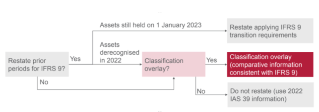
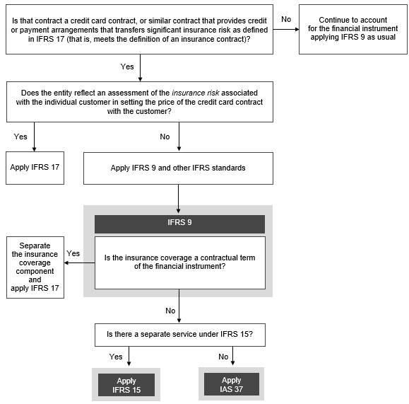
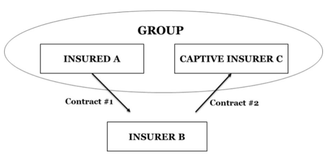
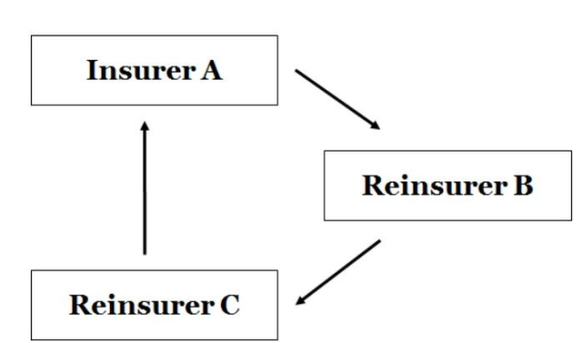
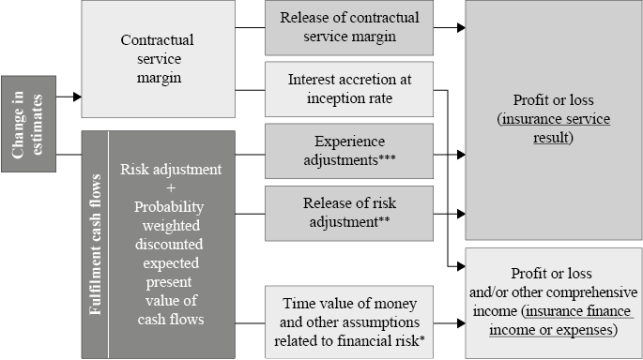
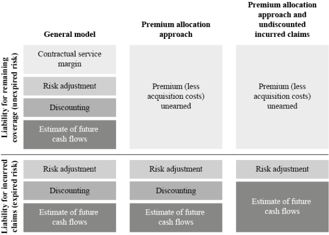
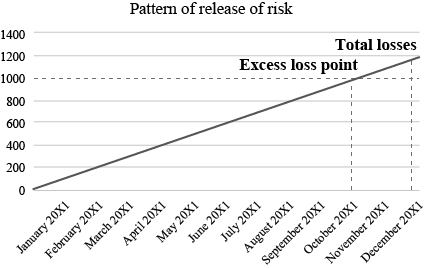

# 50A - Insurance contracts (IFRS 17)

[返回目录](README.md)

# 50A - Insurance contracts (IFRS 17)

Contents

- [50A - Insurance contracts (IFRS 17)](82.md#s332-chap_50A_toc_h1)

- [Introduction and scope (paras 50A.1-50A.29)](82.md#s333-chap_50A_navPoint_1)

- [Scope of IFRS 17, classification of contracts by insurers](82.md#s333-chap_50A_navPoint_2)

- [Insurance contracts](82.md#s333-chap_50A_navPoint_3)

- [Specified uncertain future event](82.md#s333-chap_50A_navPoint_4)

- [Significant insurance risk](82.md#s333-chap_50A_navPoint_5)

- [Adversely affects the policyholder](82.md#s333-chap_50A_navPoint_6)

- [Changes in the level of insurance risk](82.md#s333-chap_50A_navPoint_7)

- [Reinsurance contracts](82.md#s333-chap_50A_navPoint_8)

- [Investment contracts with discretionary participation features](82.md#s333-chap_50A_navPoint_9)

- [Scope exemptions](82.md#s333-chap_50A_navPoint_10)

- [Combination and separation of insurance contracts (paras 50A.30 - 50A.62)](82.md#s334-chap_50A_navPoint_11)

- [Combination of insurance contracts](82.md#s334-chap_50A_navPoint_12)

- [Separation of insurance contracts](82.md#s334-chap_50A_navPoint_13)

- [Embedded derivatives](82.md#s334-chap_50A_navPoint_14)

- [Investment components](82.md#s334-chap_50A_navPoint_15)

- [Promises to transfer distinct goods or services other than insurance contract services](82.md#s334-chap_50A_navPoint_16)

- [Level of aggregation](82.md#s334-chap_50A_navPoint_17)

- [Recognition (paras 50A.63 - 50A.74)](82.md#s335-chap_50A_navPoint_18)

- [Timing of initial recognition](82.md#s335-chap_50A_navPoint_19)

- [Insurance acquisition cash flows](82.md#s335-chap_50A_navPoint_20)

- [Measurement of insurance contracts: general model (paras 50A.75 - 50A.146)](82.md#s336-chap_50A_navPoint_21)

- [Measurement of insurance contracts: general model](82.md#s336-chap_50A_navPoint_22)

- [Estimated future cash flows](82.md#s336-chap_50A_navPoint_23)

- [Cash flows within contract boundary](82.md#s336-chap_50A_navPoint_24)

- [Discretionary cash flows](82.md#s336-chap_50A_navPoint_25)

- [Mutualisation cash flows](82.md#s336-chap_50A_navPoint_26)

- [Use of all reasonable and supportable information available without undue cost or effort](82.md#s336-chap_50A_navPoint_27)

- [Market and non-market variables](82.md#s336-chap_50A_navPoint_28)

- [Current estimates and assumptions](82.md#s336-chap_50A_navPoint_29)

- [Discount rates](82.md#s336-chap_50A_navPoint_30)

- [Risk adjustment for non-financial risk](82.md#s336-chap_50A_navPoint_31)

- [Contractual service margin](82.md#s336-chap_50A_navPoint_32)

- [Initial measurement of the contractual service margin](82.md#s336-chap_50A_navPoint_33)

- [Subsequent measurement of the contractual service margin](82.md#s336-chap_50A_navPoint_34)

- [New contracts added to the group](82.md#s336-chap_50A_navPoint_35)

- [Accretion of interest](82.md#s336-chap_50A_navPoint_36)

- [Changes in fulfilment cash flows that relate to future periods and experience adjustments](82.md#s336-chap_50A_navPoint_37)

- [Release of the contractual service margin to profit or loss](82.md#s336-chap_50A_navPoint_38)

- [Onerous insurance contracts](82.md#s336-chap_50A_navPoint_39)

- [Measurement of insurance contracts: Premium allocation approach (paras 50A.147 - 50A.159)](82.md#s337-chap_50A_navPoint_40)

- [Initial measurement under the premium allocation approach](82.md#s337-chap_50A_navPoint_41)

- [Subsequent measurement under the premium allocation approach](82.md#s337-chap_50A_navPoint_42)

- [Measurement of contracts with direct participation features (paras 50A. 160 - 50A.178)](82.md#s338-chap_50A_navPoint_43)

- [Defining contracts with direct participation features](82.md#s338-chap_50A_navPoint_44)

- [Applying the variable fee approach](82.md#s338-chap_50A_navPoint_45)

- [Risk mitigation option](82.md#s338-chap_50A_navPoint_46)

- [Measurement of investment contracts with discretionary participation features](82.md#s338-chap_50A_navPoint_47)

- [Measurement of reinsurance contracts (paras 50A.179 - 50A.196)](82.md#s339-chap_50A_navPoint_48)

- [Reinsurance contracts issued](82.md#s339-chap_50A_navPoint_49)

- [Reinsurance contracts held](82.md#s339-chap_50A_navPoint_50)

- [Level of aggregation of reinsurance contracts held](82.md#s339-chap_50A_navPoint_idp1700302040)

- [Date of initial recognition of reinsurance contracts held](82.md#s339-chap_50A_navPoint_idp1700319832)

- [Measurement of reinsurance contracts held](82.md#s339-chap_50A_navPoint_idp1700335704)

- [Derecognition and modifications (paras 50A.197- 50A.205)](82.md#s340-chap_50A_navPoint_51)

- [Modification that results in derecognition of the original contract](82.md#s340-chap_50A_navPoint_52)

- [Modification that does not result in derecognition of the original contract](82.md#s340-chap_50A_navPoint_53)

- [Derecognition](82.md#s340-chap_50A_navPoint_54)

- [Acquisition of insurance contracts (paras 50A.206 - 50A.218)](82.md#s341-chap_50A_navPoint_55)

- [Transfer of insurance contracts](82.md#s341-chap_50A_navPoint_56)

- [Business combinations](82.md#s341-chap_50A_navPoint_57)

- [Acquisition costs for contracts acquired in a transfer of insurance contracts or in a business combination](82.md#s341-chap_50A_navPoint_58)

- [Interim financial statements](82.md#s341-chap_50A_navPoint_59)

- [Presentation and disclosure (paras 50A.220- 50A.279)](82.md#s342-chap_50A_navPoint_60)

- [Presentation in the statement of financial position](82.md#s342-chap_50A_navPoint_61)

- [Recognition and presentation in the statement(s) of financial performance](82.md#s342-chap_50A_navPoint_62)

- [Insurance service result](82.md#s342-chap_50A_navPoint_idp1721269208)

- [Insurance service expenses](82.md#s342-chap_50A_navPoint_idp1721369816)

- [Reinsurance contracts held](82.md#s342-chap_50A_navPoint_idp1721159512)

- [Insurance finance income or expenses](82.md#s342-chap_50A_navPoint_idp1721183960)

- [Disclosure](82.md#s342-chap_50A_navPoint_63)

- [Explanation of recognised amounts – statement of financial position](82.md#s342-chap_50A_navPoint_64)

- [Explanation of recognised amounts – statement(s) of financial performance](82.md#s342-chap_50A_navPoint_65)

- [Significant judgements](82.md#s342-chap_50A_navPoint_66)

- [Nature and extent of risks that arise from contracts within scope of IFRS 17](82.md#s342-chap_50A_navPoint_67)

- [Transition (paras 50A.280 - 50A.337)](82.md#s343-chap_50A_navPoint_68)

- [Retrospective application](82.md#s343-chap_50A_navPoint_69)

- [Modified retrospective approach](82.md#s343-chap_50A_navPoint_70)

- [Assessments at the date of inception or initial recognition of groups of insurance contracts](82.md#s343-chap_50A_navPoint_idp1695724888)

- [Contractual service margin for insurance contracts without direct participation features](82.md#s343-chap_50A_navPoint_idp1695744472)

- [Contractual service margin for insurance contracts with direct participation features](82.md#s343-chap_50A_navPoint_idp1689500760)

- [Insurance finance income or expenses](82.md#s343-chap_50A_navPoint_idp1689532504)

- [Fair value approach](82.md#s343-chap_50A_navPoint_71)

- [Presentation and disclosure](82.md#s343-chap_50A_navPoint_72)

- [Applying IFRS 17 after previously applying IFRS 9](82.md#s343-chap_50A_navPoint_73)

- [Illustrative text](82.md#s344-chap_50A_navPoint_74)

- [Scope of IFRS 17, classification of contracts by insurers](82.md#s344-chap_50A_navPoint_76)

- [Introduction](82.md#s344-chap_50A_navPoint_idp1714330072)

- [FAQ 50A.1.1 – Does IFRS 17 apply to entities other than regulated insurers?](82.md#s344-chap_50A_navPoint_idp1714328024)

- [Insurance contracts](82.md#s344-chap_50A_navPoint_idp1714347096)

- [EX 50A.3.1 – Contracts that are insurance contracts](82.md#s344-chap_50A_navPoint_idp1714344408)

- [EX 50A.3.2 – Contracts that are not insurance contracts](82.md#s344-chap_50A_navPoint_idp1714361560)

- [FAQ 50A.5.1 – Do terms in a contract that waive premiums in specified circumstances create insurance risk?](82.md#s344-chap_50A_navPoint_idp1714381144)

- [FAQ 50A.5.2 – Is a contract that offers a significantly higher benefit on death than the amount payable on surrender an insurance contract?](82.md#s344-chap_50A_navPoint_idp1714396888)

- [FAQ 50A.5.3 – Is there a transfer of significant insurance risk if the payment is conditional on an event that does not cause a significant loss to the holder of the contract?](82.md#s344-chap_50A_navPoint_idp1714416856)

- [FAQ 50A.6.1 – If a non-insurance group self-insures through a captive insurance subsidiary, is this arrangement within the scope of IFRS 17 in the group’s consolidated financial statements?](82.md#s344-chap_50A_navPoint_idp1714430168)

- [Significant insurance risk](82.md#s344-chap_50A_navPoint_idp1714436056)

- [FAQ 50A.10.1 – Is a contract classified as an insurance contract if it insures expense risk and lapse risk?](82.md#s344-chap_50A_navPoint_idp1714441176)

- [FAQ 50A.14.1 – Is a contract classified as an insurance contract if the probability of the insured event is low?](82.md#s344-chap_50A_navPoint_idp1714470360)

- [FAQ 50A.14.2 – Is a contract that offers, on death, the greater of unit value and accumulated premiums an insurance contract?](82.md#s344-chap_50A_navPoint_idp1721373784)

- [EX 50A.14.3 – Classification of a \'whole of life unitised with-profit\' discretionary participating contract with a market value adjustment](82.md#s344-chap_50A_navPoint_idp1721129176)

- [EX 50A.14.4 – Classification of a last survivor deferred annuity contract, where the annuitants are the immediate family](82.md#s344-chap_50A_navPoint_idp1721203672)

- [Adversely affects the policyholder](82.md#s344-chap_50A_navPoint_idp1721240920)

- [EX 50A.17.1 – Classification of a saving plan, with rights to receive cash awards based on lottery-type draws](82.md#s344-chap_50A_navPoint_idp1721237464)

- [EX 50A.17.2 – Classification of a contract based on a climatic variable that is not specific to a party to the contract](82.md#s344-chap_50A_navPoint_idp1721329368)

- [EX 50A.17.3 – Classification of performance guarantees](82.md#s344-chap_50A_navPoint_idp1721344984)

- [FAQ 50A.17.4 – Is a performance guarantee contract, that requires the applicant to indemnify the issuer for any amounts paid by the issuer to the policyholder, an insurance contract?](82.md#s344-chap_50A_navPoint_idp1695826376)

- [Changes in the level of insurance risk](82.md#s344-chap_50A_navPoint_idp1695864776)

- [EX 50A.20.1 – Classification of a contract for which the holder has received no insurance guarantees, other than the option to buy a life-contingent annuity at a future date](82.md#s344-chap_50A_navPoint_idp1695866056)

- [EX 50A.20.2 – Classification of a deferred annuity contract with an option to convert at constrained, but not guaranteed, rates](82.md#s344-chap_50A_navPoint_idp1695884104)

- [Reinsurance contracts](82.md#s344-chap_50A_navPoint_idp1695908424)

- [FAQ 50A.23.1 – Is a reinsurance contract held, that covers the movement in value of a death benefit as a result of the change in an index, a reinsurance contract held within the scope of IFRS 17?](82.md#s344-chap_50A_navPoint_idp1695914440)

- [FAQ 50A.23.2 – Is a reinsurance contract held, that transfers risks from an investment contract with discretionary participation features, a reinsurance contract held within the scope of IFRS 17?](82.md#s344-chap_50A_navPoint_idp1689061496)

- [EX 50A.23.3 – Commission received from \'reinsurers\' related to ‘reinsured’ IFRS 9 investment contracts](82.md#s344-chap_50A_navPoint_idp1689080056)

- [Investment contracts with discretionary participation features](82.md#s344-chap_50A_navPoint_idp1689123960)

- [FAQ 50A.25.1 – Should investment contracts with discretionary participation features be accounted for differently in consolidated financial statements and individual financial statements of a subsidiary?](82.md#s344-chap_50A_navPoint_idp1688340424)

- [EX 50A.25.2 – Classification of a contract where the issuer has an unconstrained contractual discretion to set a ‘crediting rate’](82.md#s344-chap_50A_navPoint_idp1688349896)

- [EX 50A.25.3 – Classification of a contract where the policyholder receives a crediting rate determined by reference to a benchmark interest rate plus a discretionary spread](82.md#s344-chap_50A_navPoint_idp1688367176)

- [Scope exemptions](82.md#s344-chap_50A_navPoint_77)

- [EX 50A.26.1 – Warranty contracts and extended warranty contracts](82.md#s344-chap_50A_navPoint_idp1688383816)

- [FAQ 50A.26.2 - Is a credit card with insurance coverage within the scope of IFRS 17?](82.md#s344-chap_50A_navPoint_idp1688416328)

- [FAQ 50A.27.1 – Can an entity, on transition to IFRS 17, reassess which standard it chooses to apply for financial guarantee contracts?](82.md#s344-chap_50A_navPoint_idp1688330952)

- [FAQ 50A.27.2 – Can an entity apply IFRS 17 to financial guarantee contracts that it issues for the first time after 1 January 2021?](82.md#s344-chap_50A_navPoint_idp1700277592)

- [EX 50A.28.1 – Fixed-fee service contracts](82.md#s344-chap_50A_navPoint_idp1700307416)

- [EX 50A.28.2 – Classification of a ‘fixed-fee property maintenance contract’](82.md#s344-chap_50A_navPoint_idp1700310488)

- [FAQ 50A.29.1 – Where a residual value guarantee is embedded in a car financing arrangement issued by a financial institution, is the financial arrangement as a whole an insurance contract?](82.md#s344-chap_50A_navPoint_idp1700339416)

- [FAQ 50A.29.2 – Does an equity release mortgage with a ‘no negative equity’ guarantee transfer insurance risk?](82.md#s344-chap_50A_navPoint_idp1700367064)

- [Combination and separation of insurance contracts](82.md#s344-chap_50A_navPoint_78)

- [Combination of insurance contracts](82.md#s344-chap_50A_navPoint_idp1698003032)

- [FAQ 50A.30.1 – When is it necessary to treat a set or series of insurance contracts as a single contract?](82.md#s344-chap_50A_navPoint_idp1698002904)

- [FAQ 50A.30.2 – When should insurance and reinsurance contracts with the same or a related party be combined?](82.md#s344-chap_50A_navPoint_idp1698027608)

- [Separation of insurance contracts](82.md#s344-chap_50A_navPoint_idp1698070360)

- [EX 50A.31.1 – Determining the components of an insurance contract that are required to be separated](82.md#s344-chap_50A_navPoint_idp1698068568)

- [FAQ 50A.33.1 – Does IFRS 17 permit or require the separation of an insurance contract into smaller insurance components?](82.md#s344-chap_50A_navPoint_idp1698071512)

- [Embedded derivatives](82.md#s344-chap_50A_navPoint_idp1698106584)

- [EX 50A.36.1 – Separation of embedded derivatives in equity-indexed annuities](82.md#s344-chap_50A_navPoint_idp1698111576)

- [EX 50A.37.1 – Separation of embedded derivatives in unit-linked insurance contracts with minimum guarantee features](82.md#s344-chap_50A_navPoint_idp1698132312)

- [FAQ 50A.38.1 – Is a surrender option in a motor insurance contract an embedded derivative?](82.md#s344-chap_50A_navPoint_idp1698165464)

- [FAQ 50A.38.2 – Is a surrender option in a unit-linked insurance contract an embedded derivative?](82.md#s344-chap_50A_navPoint_idp1698185816)

- [Investment components](82.md#s344-chap_50A_navPoint_idp1698201560)

- [FAQ 50A.40.1 – Does a contract contain an investment component if an entity is required to repay amounts in all circumstances to a policyholder but not necessarily to the original policyholder that paid the premiums?](82.md#s344-chap_50A_navPoint_idp1698197976)

- [FAQ 50A.42.1 – Are an investment component and insurance component in an insurance contract highly interrelated if the lapse or maturity of one component causes the lapse or maturity of the second component, or does the expiry of the second component also need to cause the lapse or maturity of the first component?](82.md#s344-chap_50A_navPoint_idp1698220120)

- [FAQ 50A.42.2 – Are guaranteed payments in a payout annuity a distinct investment component if such payments are made even if the policyholder dies?](82.md#s344-chap_50A_navPoint_idp1698235736)

- [FAQ 50A.44.2 – When is an entity required to measure a non-distinct investment component?](82.md#s344-chap_50A_navPoint_idp1688627336)

- [FAQ 50A.44.3 – When assessing the existence of a non-distinct investment component in an insurance contract, are voluntary policyholder actions such as surrendering or cancelling an insurance contract considered under ‘all circumstances’?](82.md#s344-chap_50A_navPoint_idp1688658312)

- [FAQ 50A.44.4 – Are all payments made to a policyholder, where a claim has not been incurred, repayments of a non-distinct investment component?](82.md#s344-chap_50A_navPoint_idp1688665352)

- [FAQ 50A.44.5 – Are there circumstances where an entity might determine a non-distinct investment component on a present value basis?](82.md#s344-chap_50A_navPoint_idp1688677768)

- [FAQ 50A.44.6 – Should an entity measure a non-distinct investment component net or gross of surrender charges?](82.md#s344-chap_50A_navPoint_idp1688698760)

- [EX 50A.44.7 – Identifying investment components in insurance products](82.md#s344-chap_50A_navPoint_idp1688705544)

- [Promises to transfer distinct goods or services other than insurance contract services](82.md#s344-chap_50A_navPoint_idp1688768648)

- [FAQ 50A.48.1 – What factors should be considered when evaluating if an insurance contract contains distinct services other than insurance contract services under paragraphs 12 and B33 to B35 of IFRS 17?](82.md#s344-chap_50A_navPoint_idp1688771208)

- [FAQ 50A.48.2 – What criteria should be considered when identifying distinct service components?](82.md#s344-chap_50A_navPoint_idp1688791304)

- [Level of aggregation](82.md#s344-chap_50A_navPoint_79)

- [FAQ 50A.50.1 – In defining a portfolio of insurance contracts, which risks should an entity consider?](82.md#s344-chap_50A_navPoint_idp1688819336)

- [FAQ 50A.50.2 – Can insurance contracts and investment contracts with discretionary participation features be aggregated in one portfolio?](82.md#s344-chap_50A_navPoint_idp1688833544)

- [FAQ 50A.50.3 – What risks are considered in aggregating contracts into portfolios?](82.md#s344-chap_50A_navPoint_idp1688851080)

- [FAQ 50A.51.1 – Is an entity required to perform a quantitative assessment of profitability for each contract that it issues?](82.md#s344-chap_50A_navPoint_idp1688872840)

- [FAQ 50A.56.1 – Can insurance contracts that are expected to have different profitability due to regulatory requirements be grouped together?](82.md#s344-chap_50A_navPoint_idp1686638408)

- [FAQ 50A.57.1 – At what level should the profitability of insurance contracts be assessed when determining which group a contract falls into at initial recognition?](82.md#s344-chap_50A_navPoint_idp1686683464)

- [FAQ 50A.58.1 – In establishing a group of insurance contracts, how should ‘no significant possibility of becoming onerous’ be interpreted?](82.md#s344-chap_50A_navPoint_idp1686699848)

- [FAQ 50A.59.1 – Where an entity chooses not to update estimates from previous interim reporting periods applying paragraph B137 of IFRS 17, does the entity’s choice restrict the level of aggregation to contracts issued within each interim reporting period?](82.md#s344-chap_50A_navPoint_idp1686724936)

- [FAQ 50A.60.1 – In determining groups of contracts, can an entity use a lower level of aggregation than the minimum groups required by paragraph 16 of IFRS 17?](82.md#s344-chap_50A_navPoint_idp1686750152)

- [Recognition](82.md#s344-chap_50A_navPoint_80)

- [Timing of initial recognition](82.md#s344-chap_50A_navPoint_idp1686759624)

- [FAQ 50A.64.1 – How is the coverage period determined where there is potential insurance risk consequent on an incurred claim?](82.md#s344-chap_50A_navPoint_idp1686759752)

- [Insurance acquisition cash flows](82.md#s344-chap_50A_navPoint_idp1686779336)

- [FAQ 50A.66.1 – Are insurance acquisition cash flows restricted to those which are incremental at the portfolio level?](82.md#s344-chap_50A_navPoint_idp1686785096)

- [FAQ 50A.66.2 – Can costs related to successful and unsuccessful efforts to originate insurance contracts be included as acquisition cash flows under IFRS 17?](82.md#s344-chap_50A_navPoint_idp1686800584)

- [FAQ 50A.66.3 – Can transaction-based taxes imposed on an insurer be considered as insurance acquisition cash flows?](82.md#s344-chap_50A_navPoint_idp1686818632)

- [FAQ 50A.66.4 – Should insurance acquisition cash flows under both the general model and the variable fee approach be amortised in each reporting period in a systematic way on the basis of the passage of time?](82.md#s344-chap_50A_navPoint_idp1686824392)

- [FAQ 50A.66.5 – Are entities permitted to allocate insurance acquisition cash flows in the same pattern as insurance revenue under the premium allocation approach?](82.md#s344-chap_50A_navPoint_idp1686844232)

- [FAQ 50A.67.1 – Is the classification of insurance acquisition cash flows restricted to those which are related to the initial recognition of the group of insurance contracts, or could ‘renewal commissions’ be classified as insurance acquisition cash flows?](82.md#s344-chap_50A_navPoint_idp1686861768)

- [FAQ 50A.67.2 – Should the same metric be used for the allocation of pre-coverage acquisition cash flows to groups of insurance contracts and for the allocation of insurance revenue related to insurance acquisition costs?](82.md#s344-chap_50A_navPoint_idp1686617032)

- [FAQ 50A.72.1 – How should the impairment tests in paragraph B35D of IFRS 17 be performed?](82.md#s344-chap_50A_navPoint_idp1712444648)

- [EX 50A.72.2 – Additional impairment test in paragraph B35D of IFRS 17](82.md#s344-chap_50A_navPoint_idp1712489320)

- [Measurement – Introduction](82.md#s344-chap_50A_navPoint_81)

- [FAQ 50A.78.1 – How should foreign currency-denominated insurance contracts be translated?](82.md#s344-chap_50A_navPoint_idp1712553064)

- [FAQ 50A.78.2 – Is a ‘group currency’ or ‘CSM currency’ required to be identified for a group of insurance contracts that comprises cash flows in multiple currencies?](82.md#s344-chap_50A_navPoint_idp1712601064)

- [FAQ 50A.78.3 – Is a risk adjustment currency required to be identified for a group of insurance contracts that comprises cash flows in multiple currencies?](82.md#s344-chap_50A_navPoint_idp1712628584)

- [FAQ 50A.78.4 – How should an entity determine the ‘group currency’ or ‘CSM currency’ for a group of insurance contracts that comprises cash flows in multiple currencies?](82.md#s344-chap_50A_navPoint_idp1712640232)

- [FAQ 50A.78.5 – Are changes in foreign exchange rates between the cash flow base currencies, the selected group currency or CSM currency and the entity’s functional currency considered to be changes arising from financial risk?](82.md#s344-chap_50A_navPoint_idp1712657896)

- [FAQ 50A.78.6 – How should changes in foreign exchange rates between the cash flow base currencies, the selected group currency or CSM currency and the entity’s functional currency be accounted for under the general model?](82.md#s344-chap_50A_navPoint_idp1712676200)

- [EX 50A.78.7 – Translation of foreign currency-denominated insurance contracts under the general model and the variable fee approach?](82.md#s344-chap_50A_navPoint_idp1687603480)

- [EX 50A.78.8 – Translation of foreign currency-denominated insurance contracts under the premium allocation approach?](82.md#s344-chap_50A_navPoint_idp1687719960)

- [EX 50A.78.9 – Accounting for changes in foreign exchange rates between the cash flow base currencies, the selected group currency or CSM currency and the entity’s functional currency under the general model?](82.md#s344-chap_50A_navPoint_idp1687787416)

- [Measurement of insurance contracts: General model](82.md#s344-chap_50A_navPoint_82)

- [EX 50A.79.1 – The building blocks of the general model, and their effect on the statement of comprehensive income](82.md#s344-chap_50A_navPoint_idp1711562824)

- [Estimated future cash flows](82.md#s344-chap_50A_navPoint_idp1711568840)

- [Cash flows within contract boundary](82.md#s344-chap_50A_navPoint_idp1711564872)

- [FAQ 50A.81.1 – How should cash flows that, on initial recognition, are outside the contract boundary of an insurance contract for accounting purposes, but that belong to the same legal contract, be accounted for?](82.md#s344-chap_50A_navPoint_idp1711579976)

- [FAQ 50A.82.1 – Which ‘risks’ are included in the reassessment of risks under paragraph 34 of IFRS 17?](82.md#s344-chap_50A_navPoint_idp1711600200)

- [FAQ 50A.82.2 – How should entities interpret the phrase ‘practical ability to reassess the risks’ of a policyholder or a portfolio of insurance contracts when assessing the boundary of an insurance contract?](82.md#s344-chap_50A_navPoint_idp1711612744)

- [FAQ 50A.82.3 – Where the pricing of an insurance contract is subject to constraints stemming from law or regulation, how are such constraints considered when assessing the contract boundary?](82.md#s344-chap_50A_navPoint_idp1711627848)

- [FAQ 50A.82.4 – Should an entity consider a regulator’s statutory right to veto changes in prices in assessing the contract boundary?](82.md#s344-chap_50A_navPoint_idp1711651400)

- [FAQ 50A.82.5 – How should the exercise of an option to convert an insurance contract to a different type of contract be treated?](82.md#s344-chap_50A_navPoint_idp1711673032)

- [FAQ 50A.82.6 – When do cash flows arising from options to add insurance coverage fall within the boundary of an insurance contract?](82.md#s344-chap_50A_navPoint_idp1711698888)

- [FAQ 50A.82.7 – What is the contract boundary of a contract where the insurer can cancel ‘free’ additional insurance coverage at any time?](82.md#s344-chap_50A_navPoint_idp1711717832)

- [FAQ 50A.82.8 – Should the cash flows arising from riders to a host insurance contract, where the insurer can reprice the rider and can also revoke the rider prior to or on election by the policyholder, be included in the contract boundary at inception of the contract?](82.md#s344-chap_50A_navPoint_idp1711733320)

- [EX 50A.82.9 – Practical considerations in assessing contract boundaries](82.md#s344-chap_50A_navPoint_idp1711742792)

- [EX 50A.82.10 – A life insurance contract with a step-rated premium table based on age, that can be repriced annually at the portfolio level](82.md#s344-chap_50A_navPoint_idp1711744840)

- [EX 50A.82.11 – Determining the contract boundary in a group insurance policy](82.md#s344-chap_50A_navPoint_idp1711767624)

- [FAQ 50A.82.12 – Can a reinsurer ‘combine’ a series of contracts that relate to the same legal reinsurance contract issued but are treated as separate contracts under IFRS 17?](82.md#s344-chap_50A_navPoint_idp1711522760)

- [FAQ 50A.83.1 – Premium- and other transaction-based taxes](82.md#s344-chap_50A_navPoint_idp1711818584)

- [FAQ 50A.83.2 – How does an insurer account for the allocation of expenses such as pension expenses that are included in the fulfilment cash flows under IFRS 17 but are also recognised under other standards?](82.md#s345-chap_50A_navPoint_idp1698842712)

- [FAQ 50A.83.3 – Can an entity include the finance expense on the lease liability arising from the application of IFRS 16 as a fulfilment cash flow under IFRS 17?](82.md#s345-chap_50A_navPoint_idp1698853720)

- [FAQ 50A.83.4 – How do the fulfillment cash flows reflect the rights of policyholders to share in the returns of a mutual insurer?](82.md#s345-chap_50A_navPoint_idp1698874200)

- [EX 50A.83.5 – Treatment of a payment made under a ‘group insurance policy’](82.md#s345-chap_50A_navPoint_idp1698881112)

- [FAQ 50A.83.6 – Could investment expenses incurred by an insurer meet the definition of fulfilment cash flows under paragraph B65(ka)(i) of IFRS 17 if the amount payable to the policyholder when an insured event occurs does not vary directly as a result of the insurer’s investment activity?](82.md#s345-chap_50A_navPoint_idp1698905176)

- [FAQ 50A.83.7 – Is the premium due to an insurer from an intermediary within the scope of IFRS 17 or IFRS 9? (old FAQ 50A.151.1)](82.md#s345-chap_50A_navPoint_idp1721260888)

- [Discretionary cash flows](82.md#s345-chap_50A_navPoint_idp1721288280)

- [FAQ 50A.88.1 – For insurance contracts with discretionary cash flows, how does an entity treat payments of amounts that are different from amounts based on its commitment under the contract?](82.md#s345-chap_50A_navPoint_idp1721290328)

- [Mutualisation cash flows](82.md#s345-chap_50A_navPoint_idp1721315032)

- [EX 50A.90.1 - An example of mutualisation](82.md#s345-chap_50A_navPoint_idp1721312472)

- [FAQ 50A.92.1 – At what level should contracts with mutualisation be aggregated?](82.md#s345-chap_50A_navPoint_idp1721319128)

- [Market and non-market variables](82.md#s345-chap_50A_navPoint_idp1721350104)

- [FAQ 50A.102.1 – How are market consistent measurement principles applied in the modelling of options and guarantees?](82.md#s345-chap_50A_navPoint_idp1721349208)

- [Discount rates](82.md#s345-chap_50A_navPoint_idp1721372248)

- [FAQ 50A.111.1 – Can an asset-based discount rate be used to measure insurance contracts?](82.md#s345-chap_50A_navPoint_idp1721376344)

- [FAQ 50A.111.2 – Where there are cash flows in more than one currency within a group of insurance contracts, should separate discount rates be applied for the cash flows in each of the different currencies?](82.md#s345-chap_50A_navPoint_idp1721154136)

- [FAQ 50A.117.1 – What is the impact of negative interest rates on the estimation of a discount rate?](82.md#s345-chap_50A_navPoint_idp1721169112)

- [FAQ 50A.117.2 – Can an entity use the actual assets held to back its insurance liabilities as the reference portfolio to calculate the top-down discount rate?](82.md#s345-chap_50A_navPoint_idp1721184088)

- [FAQ 50A.117.3 – Can an entity change the reference portfolio over the duration of a group of contracts?](82.md#s345-chap_50A_navPoint_idp1721206488)

- [FAQ 50A.117.4 – Can the Solvency II discount rate be used in IFRS 17?](82.md#s345-chap_50A_navPoint_idp1714225368)

- [Risk adjustment for non-financial risk](82.md#s345-chap_50A_navPoint_idp1714303576)

- [FAQ 50A.121.1 – What should be considered in the estimation of an explicit risk adjustment for non-financial risk?](82.md#s345-chap_50A_navPoint_idp1714300504)

- [FAQ 50A.122.1 - Should the risk adjustment for non-financial risk for insurance contracts without direct participation features take into account uncertainty related to how management applies discretion?](82.md#s345-chap_50A_navPoint_idp1689413672)

- [FAQ 50A.122.2 – Can the risk adjustment for non-financial risk for a group of contracts held be negative due to the allocation of a diversification benefit?](82.md#s345-chap_50A_navPoint_idp1689429544)

- [FAQ 50A.122.3 – Should the effect of reinsurance be considered in the determination of the risk adjustment for non-financial risk for contracts that have been reinsured?](82.md#s345-chap_50A_navPoint_idp1689447592)

- [FAQ 50A.124.1 – In determining the risk adjustment for non-financial risk, can a rolling one-year horizon over the contract duration be used, or should entities use the full contract duration?](82.md#s345-chap_50A_navPoint_idp1689460904)

- [FAQ 50A.124.2 – Should the risk adjustment for non-financial risk for participating contracts, where the entity/shareholders and policyholders share profits from the contracts, reflect non-financial risks on 100% of the expected future fulfilment cash flows?](82.md#s345-chap_50A_navPoint_idp1689059192)

- [FAQ 50A.124.3 – At what level within an insurance group (consolidated level or subsidiary level) should the risk adjustment be determined?](82.md#s345-chap_50A_navPoint_idp1689029496)

- [FAQ 50A.124.4 – At what level should the risk adjustment for non-financial risk be determined for insurance contracts that are within industry pools managed by an association?](82.md#s345-chap_50A_navPoint_idp1690689944)

- [Contractual service margin](82.md#s345-chap_50A_navPoint_idp1717784680)

- [FAQ 50A.128.1 – Can an investment-return service be provided in a contract that does not contain an investment component?](82.md#s345-chap_50A_navPoint_idp1717797480)

- [Initial measurement of the contractual service margin](82.md#s345-chap_50A_navPoint_idp1717804264)

- [EX 50A.130.1 – Calculating the contractual service margin at initial recognition](82.md#s345-chap_50A_navPoint_idp1717798504)

- [Subsequent measurement of the contractual service margin](82.md#s345-chap_50A_navPoint_idp1717857768)

- [FAQ 50A.133.1 – In what order should the adjustments to the contractual service margin be made in each reporting period?](82.md#s345-chap_50A_navPoint_idp1717860584)

- [Accretion of interest](82.md#s345-chap_50A_navPoint_idp1717876840)

- [FAQ 50A.135.1 – For insurance contracts that have both cash flows that vary with the returns on an underlying item and cash flows that do not vary, what rates should be used to accrete interest on the contractual service margin when applying the general measurement model?](82.md#s345-chap_50A_navPoint_idp1717872488)

- [Changes in fulfilment cash flows that relate to future periods and experience adjustments](82.md#s345-chap_50A_navPoint_idp1717889768)

- [FAQ 50A.136.1 – How should experience adjustments for premium receipts that relate to services provided in both the current reporting period and future periods be treated under the general measurement model?](82.md#s345-chap_50A_navPoint_idp1717891432)

- [FAQ 50A.136.2 – For insurance contracts that have cash flows that vary with the returns on an underlying item, what discount rates should be used to measure the changes to the contractual service margin when applying the general measurement model?](82.md#s345-chap_50A_navPoint_idp1717933416)

- [FAQ 50A.137.1 – When applying the general model, should the adjustment required by paragraph B96(c) of IFRS 17 exclude the effect of changes in assumptions for financial risks (including the discount rate) during the reporting period?](82.md#s345-chap_50A_navPoint_idp1717950312)

- [FAQ 50A.139.1 – For insurance contracts without direct participation features, how should the difference between the expected and the actual crediting rate applied to a policyholder’s account balance be treated?](82.md#s345-chap_50A_navPoint_idp1717966440)

- [FAQ 50A.139.2 – How should changes in the time value of embedded options and guarantees in insurance contracts be treated under the general model?](82.md#s345-chap_50A_navPoint_idp1717985640)

- [FAQ 50A.139.3 – How should an entity treat past changes in financial risk in calculating the effect of changes in fulfilment cash flows that adjust the contractual service margin under the general model?](82.md#s345-chap_50A_navPoint_idp1718005992)

- [EX 50A.139.4 – The treatment of changes in financial assumptions when calculating the effect of changes in fulfilment cash flows that adjust the contractual service margin under the general model](82.md#s345-chap_50A_navPoint_idp1693963976)

- [Release of the contractual service margin to profit or loss](82.md#s345-chap_50A_navPoint_idp1694127816)

- [FAQ 50A.140.1 – What is meant by the ‘expected coverage duration’?](82.md#s345-chap_50A_navPoint_idp1694127560)

- [FAQ 50A.140.2 – Does an entity have an accounting policy choice over how to determine coverage units for a group of contracts?](82.md#s345-chap_50A_navPoint_idp1694141256)

- [FAQ 50A.140.3 – At what level should coverage units be determined?](82.md#s345-chap_50A_navPoint_idp1694151368)

- [FAQ 50A.140.4 – Can methods that reflect the performance of assets that an entity holds to back insurance contracts be considered in determining benefit for insurance coverage where the amounts paid under the contracts do not depend on the returns on the assets?](82.md#s345-chap_50A_navPoint_idp1694168520)

- [FAQ 50A.140.5 – What methods could be considered reasonable proxies for determining the investment-related services provided under a group of insurance contracts?](82.md#s345-chap_50A_navPoint_idp1694172744)

- [FAQ 50A.140.6 – What methods could be considered reasonable proxies for determining the investment-return services provided under a group of insurance contracts?](82.md#s345-chap_50A_navPoint_idp1694189000)

- [FAQ 50A.140.7 – Can coverage units be based on expected claims (or other expected cash flows)?](82.md#s345-chap_50A_navPoint_idp1694208584)

- [FAQ 50A.140.8 – Is the pattern of expected cash flows or the release of the risk adjustment for non-financial risk relevant in determining coverage units for insurance coverage?](82.md#s345-chap_50A_navPoint_idp1693953352)

- [FAQ 50A.140.9 – Are methods based on premiums permitted in determining coverage units for insurance coverage?](82.md#s345-chap_50A_navPoint_idp1694242520)

- [FAQ 50A.140.10 – Could methods based on cash flows be considered reasonable proxies for the benefits provided under the group of insurance contracts in each period?](82.md#s345-chap_50A_navPoint_idp1694249432)

- [FAQ 50A.140.11 – What are possible methods for determining the quantity of benefits related to insurance coverage?](82.md#s345-chap_50A_navPoint_idp1694269528)

- [FAQ 50A.140.12 – Should different levels of cover provided by a contract in different periods be reflected in determining coverage units?](82.md#s345-chap_50A_navPoint_idp1694283736)

- [FAQ 50A.140.13 – How should coverage units be defined for contracts in a group with different types of benefit?](82.md#s345-chap_50A_navPoint_idp1694286936)

- [FAQ 50A.140.14 – Can an entity divide a group of contracts into ‘subgroups’ and allocate the contractual service margin between the coverage units assigned to each subgroup?](82.md#s345-chap_50A_navPoint_idp1694304984)

- [FAQ 50A.140.15 – How should the quantity of benefits and expected coverage duration be established in situations where an incurred claim results in insurance risk that would not exist if no claim were made?](82.md#s345-chap_50A_navPoint_idp1694326744)

- [FAQ 50A.140.16 – How should an entity determine the coverage period and allocation of coverage units for contracts that have both prospective and retrospective insurance elements?](82.md#s345-chap_50A_navPoint_idp1694337240)

- [FAQ 50A.140.17 – When an annual cohort is ‘closed’, does the insurer need to update the relative weightings between coverage units in subsequent periods?](82.md#s345-chap_50A_navPoint_idp1694369112)

- [EX 50A.140.18 – Calculation of the release pattern of the contractual service margin](82.md#s345-chap_50A_navPoint_idp1694391000)

- [EX 50A.140.19 – Coverage units for example contracts](82.md#s345-chap_50A_navPoint_idp1694427480)

- [FAQ 50A.140.20 – When determining coverage units for insurance coverage in a reporting period, can an entity define the ‘quantity of benefits’ in the reporting period as the present value of the total expected remaining future annuity payments in a life contingent immediate annuity contract or a life contingent deferred annuity contract?](82.md#s345-chap_50A_navPoint_idp1720060632)

- [FAQ 50A.142.1 – Can the effect of time value of money (discounting) be taken into account in determining the allocation of the contractual service margin to reporting periods using coverage units?](82.md#s345-chap_50A_navPoint_idp1720085336)

- [FAQ 50A.142.2 – When an entity discounts coverage units for the purposes of allocating the contractual service margin to reporting periods, what measures of time value can be used under both the general model and variable fee approach?](82.md#s345-chap_50A_navPoint_idp1720099032)

- [FAQ 50A.142.3 – Where an entity takes time value of money (discounting) into account in determining the allocation of contractual service margin to reporting periods using coverage units, should the rate used be a current rate or a locked-in rate?](82.md#s345-chap_50A_navPoint_idp1720116312)

- [Onerous insurance contracts](82.md#s345-chap_50A_navPoint_idp1720130904)

- [FAQ 50A.146.1 – How should groups of onerous contracts be measured?](82.md#s345-chap_50A_navPoint_idp1720138072)

- [FAQ 50A.146.2 – How should the contractual service margin be treated in subsequent reporting periods if it is nil at initial recognition?](82.md#s345-chap_50A_navPoint_idp1720143448)

- [FAQ 50A.146.3 – How should any movement in the liability for remaining coverage be allocated between the loss component and the liability for remaining coverage excluding the loss component under the general measurement model?](82.md#s345-chap_50A_navPoint_idp1720160216)

- [FAQ 50A.146.4 – When the loss component is remeasured for changes in fulfilment cash flows (and estimates of fulfilment cash flows) applying paragraph 48(a)/49 and paragraph 50 of IFRS 17, should the changes in fulfilment cash flows be measured using a ‘locked-in’ or a current discount rate?](82.md#s345-chap_50A_navPoint_idp1720243288)

- [FAQ 50A.146.5 – When there is a reversal of losses in an onerous group of insurance contracts, should the contractual service margin that is re-established be amortised in the same period?](82.md#s345-chap_50A_navPoint_idp1720271704)

- [Measurement of insurance contracts: Premium allocation approach](82.md#s345-chap_50A_navPoint_83)

- [FAQ 50A.147.1 – How should the eligibility assessment for the premium allocation approach be performed?](82.md#s345-chap_50A_navPoint_idp1720280664)

- [FAQ 50A.147.2 – Can contracts that have coverage periods of one year or less and contracts that have coverage periods of greater than one year be grouped together in assessing eligibility for the premium allocation approach?](82.md#s345-chap_50A_navPoint_idp1720312808)

- [FAQ 50A.147.3 – What amounts are compared when performing the eligibility analysis for the premium allocation approach under paragraph 53(a) of IFRS 17?](82.md#s345-chap_50A_navPoint_idp1720336232)

- [FAQ 50A.147.4 – When is a quantitative test needed to determine eligibility for the premium allocation approach?](82.md#s345-chap_50A_navPoint_idp1720350824)

- [FAQ 50A.147.5 – How should \'reasonably expects\' be interpreted in determining eligibility for the premium allocation approach?](82.md#s345-chap_50A_navPoint_idp1720372200)

- [FAQ 50A.148.1 – Is an entity required or permitted to reassess a contract’s eligibility for the premium allocation approach?](82.md#s345-chap_50A_navPoint_idp1720400104)

- [FAQ 50A.148.2 – Is it necessary to assess eligibility for the premium allocation approach every reporting period for all new groups?](82.md#s345-chap_50A_navPoint_idp1720412776)

- [EX 50A.148.3 – Comparison of the liability measurement under the general model and the premium allocation approach](82.md#s345-chap_50A_navPoint_idp1720432744)

- [FAQ 50A.149.1 – Under the premium allocation approach, is an entity required to identify only whether a contract would be in an onerous group?](82.md#s345-chap_50A_navPoint_idp1720441832)

- [Initial measurement under the premium allocation approach](82.md#s345-chap_50A_navPoint_idp1720461544)

- [FAQ 50A.150.1 – In measuring the liability for remaining coverage under the premium allocation approach, are premiums required to be actually received in order to be recorded as an increase to the liability for remaining coverage?](82.md#s345-chap_50A_navPoint_idp1720463080)

- [Subsequent measurement under the premium allocation approach](82.md#s345-chap_50A_navPoint_idp1720479336)

- [FAQ 50A.152.1 – What level of aggregation should be used where an entity chooses to expense insurance acquisition cash flows when applying paragraph 59(a) of IFRS 17?](82.md#s345-chap_50A_navPoint_idp1720477928)

- [FAQ 50A.152.2 – Where an entity chooses to expense insurance acquisition cash flows for a group of insurance contracts, can it expense some, but not all, types of acquisition cash flows when applying paragraph 59(a) of IFRS 17?](82.md#s345-chap_50A_navPoint_idp1720499432)

- [FAQ 50A.153.1 – Can an entity accrete interest on the carrying amount of the liability for remaining coverage for contracts where the gap between premium receipt and provision of service is no more than a year?](82.md#s345-chap_50A_navPoint_idp1720515048)

- [FAQ 50A.153.2 – Treatment of significant financing component under the premium allocation approach](82.md#s345-chap_50A_navPoint_idp1720518376)

- [FAQ 50A.154.1 – What pattern of revenue should be used when applying the premium allocation approach for hurricane insurance?](82.md#s345-chap_50A_navPoint_idp1720585176)

- [FAQ 50A.154.2 – What pattern of revenue should be used when applying the premium allocation approach for an excess loss reinsurance contract?](82.md#s345-chap_50A_navPoint_idp1720591704)

- [FAQ 50A.154.3 – When allocating premium revenue under the premium allocation approach based on the expected timing of incurred insurance service expenses, what types of expenses are considered ‘incurred insurance service expenses’?](82.md#s345-chap_50A_navPoint_idp1720613848)

- [FAQ 50A.154.4 – How should revenue be released under the premium allocation approach for a group of contracts containing a significant financing component?](82.md#s345-chap_50A_navPoint_idp1720627672)

- [FAQ 50A.156.1 – How should onerous contracts be measured under the premium allocation approach?](82.md#s345-chap_50A_navPoint_idp1720790488)

- [FAQ 50A.156.2 – Applying the premium allocation approach, should an increase in the liability for remaining coverage, and the related loss that was recognised in profit or loss, be reversed in subsequent periods?](82.md#s345-chap_50A_navPoint_idp1720810584)

- [FAQ 50A.156.3 – When are insurance acquisition cash flows excluded from the onerous contract assessment when applying the premium allocation approach?](82.md#s345-chap_50A_navPoint_idp1720821464)

- [FAQ 50A.157.1 – If the expectation of the timing of the cash flows changes, is the entity required to start discounting the cash flows for the incurred claims under the premium allocation approach?](82.md#s345-chap_50A_navPoint_idp1712807384)

- [FAQ 50A.157.2 – Where the premium allocation approach is used, paragraph 59(a) of IFRS 17 permits a practical expedient to not consider the time value of money for cash flows expected to be paid within a year of claims being made. Can this practical expedient be applied to contracts under the general model?](82.md#s345-chap_50A_navPoint_idp1712818136)

- [Measurement of contracts with direct participation features](82.md#s345-chap_50A_navPoint_84)

- [Defining contracts with direct participation features](82.md#s345-chap_50A_navPoint_idp1712834264)

- [FAQ 50A.160.1 – Consistency in cash flow categorisation between paragraphs B101 and B104](82.md#s345-chap_50A_navPoint_idp1712847064)

- [FAQ 50A.161.1 – At what level are the eligibility criteria for the variable fee approach assessed?](82.md#s345-chap_50A_navPoint_idp1712864088)

- [FAQ 50A.161.2 – In assessing the eligibility criteria for the variable fee approach at contract level, should the entity consider cash flows to or from policyholders of other contracts?](82.md#s345-chap_50A_navPoint_idp1712884824)

- [FAQ 50A.161.3 – Should the assessment of the eligibility for the variable fee approach consider variability over the duration of the contract?](82.md#s345-chap_50A_navPoint_idp1712912728)

- [EX 50A.161.4 – Assessing eligibility for the variable fee approach where there are mutualised cash flows](82.md#s345-chap_50A_navPoint_idp1712922840)

- [FAQ 50A.162.1 – Is an insurer required to de-recognise investments in its own debt or equity instruments it holds as underlying items for insurance contracts or investment contracts with discretionary participation features accounted for using the variable fee approach?](82.md#s345-chap_50A_navPoint_idp1712958040)

- [FAQ 50A.163.1 – How should an entity interpret and apply ‘contractual terms’ in paragraph B101(a) of IFRS 17?](82.md#s345-chap_50A_navPoint_idp1713004248)

- [FAQ 50A.163.2 – Is the criterion in paragraph B101(a) of IFRS 17 met where law or regulation requires an entity to share investment returns with policyholders, but this is not explicitly written in the insurance contract?](82.md#s345-chap_50A_navPoint_idp1713006424)

- [FAQ 50A.164.1 – Do terms (either implicit in regulation or explicit in the contract) that give an entity discretion to vary the amounts paid to policyholders meet the requirement that the contract provides ‘a share’ of a clearly identified pool of underlying items in assessing eligibility for the variable fee approach?](82.md#s345-chap_50A_navPoint_idp1712776792)

- [FAQ 50A.164.2 – How does the fixed account component of an insurance contract, with both fixed and ‘pass-through’ return components of the policyholder’s account balance, affect the assessment of the criteria in paragraph B107(a) for variable fee approach eligibility and subsequent measurement?](82.md#s345-chap_50A_navPoint_idp1713067352)

- [FAQ 50A.165.1 – Does the test of eligibility for the variable fee approach require a quantitative assessment?](82.md#s345-chap_50A_navPoint_idp1713101400)

- [FAQ 50A.165.2 – Do the assessments in paragraphs B101(b) and (c) of IFRS 17 require the entity to carry out a robust statistical process?](82.md#s345-chap_50A_navPoint_idp1713113944)

- [FAQ 50A.165.3 – How should the fair value returns on underlying items be estimated?](82.md#s345-chap_50A_navPoint_idp1713136984)

- [FAQ 50A.165.4 – Both paragraphs B101(b) and (c) of IFRS 17 refer to a ‘substantial share’ and a ‘substantial proportion’. How should the term ‘substantial’ be interpreted?](82.md#s345-chap_50A_navPoint_idp1713154392)

- [FAQ 50A.165.5 – Which cash flows should an entity consider when assessing eligibility for the variable fee approach in paragraph B101(b) of IFRS 17?](82.md#s345-chap_50A_navPoint_idp1713168728)

- [FAQ 50A.165.6 – Can a contract qualify for the variable fee approach if it currently credits, to a particular group of policyholders, the amortised cost return of an identified pool of invested assets?](82.md#s345-chap_50A_navPoint_idp1713184088)

- [FAQ 50A.165.7 – Which cash flows should an entity consider in assessing paragraph B101(c) of IFRS 17?](82.md#s345-chap_50A_navPoint_idp1713198168)

- [EX 50A.165.8 – Analysing different types of cash flows and assessing the criterion in paragraph B101(b) of IFRS 17](82.md#s345-chap_50A_navPoint_idp1713216472)

- [EX 50A.165.9 – The principles that the assessment of paragraph B101(c) of IFRS 17 needs to consider](83.md#s346-chap_50A_navPoint_idp1719008088)

- [FAQ 50A.167.1 – When measuring the fair value of underlying items under the variable fee approach measurement model, should the requirements of IFRS 13, paragraph 47 (deposit floor) be applied?](83.md#s346-chap_50A_navPoint_idp1719050328)

- [Applying the variable fee approach](83.md#s346-chap_50A_navPoint_idp1719087704)

- [FAQ 50A.168.1 - Classification of variable fee cash flows paid out of the entity’s share of the fair value of underlying items](83.md#s346-chap_50A_navPoint_idp1719087192)

- [FAQ 50A.169.1 – Under the variable fee approach, how are changes in cash flows that form part of the entity’s share of underlying items accounted for?](83.md#s346-chap_50A_navPoint_idp1719107160)

- [FAQ 50A.169.2 – Under the variable fee approach, how are cash flows that do not vary based on the returns on the underlying items accounted for?](83.md#s346-chap_50A_navPoint_idp1719116888)

- [FAQ 50A.169.3 – How does paragraph B113(b) of IFRS 17 apply to changes in the cost of options and guarantees that vary based on both financial inputs (such as interest rates) and non-financial factors (such as mortality, morbidity and lapse) if those cash flows do not vary based on the return of the underlying items?](83.md#s346-chap_50A_navPoint_idp1719140824)

- [FAQ 50A.169.4 – How does paragraph B113(b) of IFRS 17 apply to changes in investment management costs which do not vary based on the returns on the underlying items?](83.md#s346-chap_50A_navPoint_idp1719148504)

- [FAQ 50A.169.5 – For insurance contracts with direct participation features, are cash flows that relate to periods when insurance coverage is no longer provided, and the policyholder bears all of the risks related to the investment- related services, within the boundary of the contract?](83.md#s346-chap_50A_navPoint_idp1719162712)

- [EX 50A.169.6 – The differences between the measurement of the contractual service margin using the general model and the requirements for contracts with direct participation features](83.md#s346-chap_50A_navPoint_idp1719178456)

- [Risk mitigation option](83.md#s346-chap_50A_navPoint_idp1719196376)

- [FAQ 50A.173.1 – How can the effect of economic hedging and risk mitigation techniques be presented in the financial statements?](83.md#s346-chap_50A_navPoint_idp1719205208)

- [EX 50A.174.1 – When would it be considered that credit risk dominates the economic offset?](83.md#s346-chap_50A_navPoint_idp1711866072)

- [Measurement of reinsurance contracts](83.md#s346-chap_50A_navPoint_85)

- [Reinsurance contracts held](83.md#s346-chap_50A_navPoint_idp1711882712)

- [EX 50A.181.1 – Differences arising from the accounting for insurance contracts issued and associated reinsurance contracts held](83.md#s346-chap_50A_navPoint_idp1711878616)

- [Date of initial recognition of reinsurance contracts held](83.md#s346-chap_50A_navPoint_idp1711897048)

- [EX 50A.184.1 – Determining the initial recognition date and annual cohort for contracts that provide retrospective cover](83.md#s346-chap_50A_navPoint_idp1711895768)

- [Measurement of reinsurance contracts held](83.md#s346-chap_50A_navPoint_idp1711918808)

- [FAQ 50A.188.1 – How is the contract boundary of a reinsurance contract held determined?](83.md#s346-chap_50A_navPoint_idp1711924568)

- [FAQ 50A.188.1.1 – How is the contract boundary of an insurance contract or reinsurance contract determined when the rights and obligations of the insurer/reinsurer and the policyholder/cedant are asymmetrical?](83.md#s346-chap_50A_navPoint_idp1711950808)

- [FAQ 50A.188.2 – Will the contract boundary for a reinsurance contract held be affected by the existence of an open-ended contractual termination clause?](83.md#s346-chap_50A_navPoint_idp1711978456)

- [FAQ 50A.188.3 – What is the contract boundary where the holder of a reinsurance contract (cedant) is required to continue paying premiums unless the issuer (reinsurer) exercises an option to reprice the contract?](83.md#s346-chap_50A_navPoint_idp1712000088)

- [FAQ 50A.188.4 – Should an entity include cash flows expected to arise from underlying contracts that are expected to be issued in the future in determining the fulfilment cash flows for reinsurance contracts held?](83.md#s346-chap_50A_navPoint_idp1712032088)

- [FAQ 50A.188.5 – Should the risk of non-performance by the reinsurer be considered within the estimates of future cash flows for reinsurance contracts held?](83.md#s346-chap_50A_navPoint_idp1689390120)

- [FAQ 50A.188.6 – Is the discount rate in a reinsurance contract held required to be identical to the discount rate applied in the underlying ceded contracts that have been reinsured?](83.md#s346-chap_50A_navPoint_idp1689216040)

- [FAQ 50A.189.1 – How should the risk adjustment for non-financial risk for reinsurance contracts held be calculated?](83.md#s346-chap_50A_navPoint_idp1689236264)

- [FAQ 50A.189.2 – Can the allocated risk adjustment for non-financial risk to a group of reinsurance contracts held be nil?](83.md#s346-chap_50A_navPoint_idp1689245352)

- [FAQ 50A.191.1 – How should fees paid by the ceding company to a third-party broker on entering into a reinsurance contract held be treated under IFRS 17?](83.md#s346-chap_50A_navPoint_idp1689304104)

- [FAQ 50A.192.1 – How do you assess the coverage period of reinsurance contracts?](83.md#s346-chap_50A_navPoint_idp1689336360)

- [FAQ 50A.192.2 – For reinsurance contracts held, are the coverage units determined based on the services provided by the reinsurer, or should a ‘look-through’ approach based on the coverage units of the underlying insurance contracts be used?](83.md#s346-chap_50A_navPoint_idp1689356840)

- [FAQ 50A.192.3 – How should an entity treat changes in the asset for remaining adverse development reinsurance coverage that result from changes in the liability for underlying incurred claims?](83.md#s346-chap_50A_navPoint_idp1689367592)

- [FAQ 50A.193.1 – How should the reinsurance held contractual service margin be adjusted at the inception of the onerous underlying group of insurance contracts?](83.md#s346-chap_50A_navPoint_idp1698666968)

- [EX 50A.194.1 – Interaction of the treatment of losses on underlying insurance contracts and the treatment of recoveries of losses from reinsurance contracts held](83.md#s346-chap_50A_navPoint_idp1698744152)

- [EX 50A.194.2 – The requirements relating to the loss-recovery component of the reinsurance contract held and the loss component of the underlying insurance contracts](83.md#s346-chap_50A_navPoint_idp1698780376)

- [FAQ 50A.194.3 – On initial recognition of onerous underlying insurance contracts, what is the appropriate level of granularity for calculating the adjustment to the contractual service margin of a group of reinsurance contracts held, applying paragraph 66A of IFRS 17?](83.md#s346-chap_50A_navPoint_idp1698819800)

- [FAQ 50A.194.4 – How do changes in estimates of cash flows of the underlying reinsured insurance contracts adjust the loss-recovery component?](83.md#s346-chap_50A_navPoint_idp1690665496)

- [FAQ 50A.194.5 – How should the upper limit on the carrying amount of the loss-recovery component in paragraph B119F of IFRS 17 be interpreted?](83.md#s346-chap_50A_navPoint_idp1720957624)

- [FAQ 50A.194.6 – How does an entity determine the adjustment to the contractual service margin for a group of reinsurance contracts held when an underlying group of insurance contracts that was initially onerous becomes profitable?](83.md#s346-chap_50A_navPoint_idp1715167080)

- [EX 50A.194.7 – Determining a loss-recovery component applying paragraph 66A of IFRS 17](83.md#s346-chap_50A_navPoint_idp1715206632)

- [EX 50A.194.8 – Determining the effect of a change in underlying insurance contracts on a loss-recovery component](83.md#s346-chap_50A_navPoint_idp1715275368)

- [EX 50A.196.1 – Initial recognition and measurement of an excess of loss reinsurance contract held](83.md#s346-chap_50A_navPoint_idp1715311720)

- [FAQ 50A.196.2 – Applying the premium allocation approach, should an increase in the asset for remaining coverage for reinsurance contracts held that was recognised applying paragraph 70A of IFRS 17, be reversed in subsequent periods?](83.md#s346-chap_50A_navPoint_idp1715388008)

- [Derecognition and modifications](83.md#s346-chap_50A_navPoint_86)

- [Modification that results in derecognition of the original contract](83.md#s346-chap_50A_navPoint_idp1715409256)

- [FAQ 50A.199.1 – When a contract is derecognised from a group of insurance contracts, how does an entity update coverage units for the group?](83.md#s346-chap_50A_navPoint_idp1715410536)

- [FAQ 50A.200.1 – When a new contract is recognised as a result of a modification, should the IFRS 17 requirements that were previously assessed be reassessed for this newly recognised contract?](83.md#s346-chap_50A_navPoint_idp1719236328)

- [Modification that does not result in derecognition of the original contract](83.md#s346-chap_50A_navPoint_idp1719253864)

- [FAQ 50A.201.1 – Where a contract modification does not meet the conditions for derecognition, and instead requires application of paragraph 73 of IFRS 17 as a change in fulfilment cash flows, how is the guidance in paragraphs 40 to 52 of IFRS 17 applied?](83.md#s346-chap_50A_navPoint_idp1719259880)

- [Derecognition](83.md#s346-chap_50A_navPoint_idp1719284200)

- [FAQ 50A.202.1 – Can an insurer derecognise insurance contracts under IFRS 17 where policyholders are no longer contactable?](83.md#s346-chap_50A_navPoint_idp1719283816)

- [FAQ 50A.205.1 – Under the premium allocation approach, where a contract within a group meets any of the derecognition criteria, should the derecognition have an immediate effect on the amount recognised in profit or loss?](83.md#s346-chap_50A_navPoint_idp1719308264)

- [Acquisition of insurance contracts](83.md#s346-chap_50A_navPoint_87)

- [FAQ 50A.206.1 – Accounting for business combinations within the scope of IFRS 3 and transfers of insurance contracts between third parties that do not meet the definition of a business (portfolio transfers)](83.md#s346-chap_50A_navPoint_idp1719319272)

- [Business combinations](83.md#s346-chap_50A_navPoint_idp1719355240)

- [FAQ 50A.213.1 – Business combinations, capital reorganisations and other transactions between entities under common control under IFRS 17](83.md#s346-chap_50A_navPoint_idp1719355624)

- [FAQ 50A.213.2 – When are claims incurred for contracts that cover adverse development of claims and for contracts acquired in their settlement period?](83.md#s346-chap_50A_navPoint_idp1719404776)

- [FAQ 50A.213.3 – How should insurance contracts that have been acquired in their settlement period in a business combination or a portfolio transfer be accounted for at and subsequent to the acquisition date?](83.md#s346-chap_50A_navPoint_idp1719422568)

- [FAQ 50A.213.4 – How should insurance contracts in their settlement period acquired in a business combination or a portfolio transfer be characterised at the acquisition date?](83.md#s346-chap_50A_navPoint_idp1719427048)

- [FAQ 50A.213.5 – What is the period of coverage for insurance contracts that have been acquired in their settlement period in conjunction with a business combination or a portfolio transfer?](83.md#s346-chap_50A_navPoint_idp1719443688)

- [FAQ 50A.213.6 – How should insurance revenue be presented for insurance contracts that have been acquired in their settlement period in conjunction with a business combination or a portfolio transfer](83.md#s346-chap_50A_navPoint_idp1719452392)

- [FAQ 50A.213.7 – If the general model is used for insurance contracts that have been acquired in their settlement period in conjunction with a business combination or a portfolio transfer, how is the contractual service margin recognised in profit or loss in subsequent periods?](83.md#s346-chap_50A_navPoint_idp1719468392)

- [FAQ 50A.213.8 – What are considered to be ‘changes in fulfilment cash flows relating to future service’ that adjust the contractual service margin under paragraph 44(c) of IFRS 17 for insurance contracts that have been acquired in their settlement period in conjunction with a business combination or a portfolio transfer?](83.md#s346-chap_50A_navPoint_idp1719216616)

- [FAQ 50A.213.9 – At what date should an entity perform the assessment of contract classification as an insurance contract (or an investment contract with discretionary participation features) acquired in a business combination?](83.md#s346-chap_50A_navPoint_idp1714774744)

- [FAQ 50A.213.10 – In applying IFRS 17 transition using the fully retrospective application, should entities perform the other assessments required by IFRS 17 at the original contract inception date or at the acquisition date?](83.md#s346-chap_50A_navPoint_idp1714788952)

- [FAQ 50A.213.11 – Can the provisions for acquired contracts in a business combination also be applied to acquisitions of contracts in transactions outside the scope of IFRS 3, such as portfolio transfers?](83.md#s346-chap_50A_navPoint_idp1714800088)

- [Interim financial statements](83.md#s346-chap_50A_navPoint_88)

- [FAQ 50A.219.1 – Do interim financial statements that fully comply with IAS 34 but that are not published externally qualify as ‘interim financial statements’ when applying paragraph B137 of IFRS 17?](83.md#s346-chap_50A_navPoint_idp1714819800)

- [FAQ 50A.219.2 – How does the accounting policy choice in paragraph B137 of IFRS 17 affect the measurement and amortisation of the contractual service margin?](83.md#s346-chap_50A_navPoint_idp1714840280)

- [FAQ 50A.219.3 – What disclosures are required when an entity publishes interim financial statements and then changes estimates later in the year?](83.md#s346-chap_50A_navPoint_idp1714896088)

- [FAQ 50A.219.4 – When applying paragraph B137 of IFRS 17, should an entity restate previously reported interim amounts due to changes in estimates?](83.md#s346-chap_50A_navPoint_idp1714910552)

- [FAQ 50A.219.5 – Where the reporting frequency of a group differs from the reporting frequency of its subsidiary, would the measurement of the insurance contracts issued by the subsidiary be equal in the group\'s consolidated financial statements and the subsidiary’s stand-alone financial statements?](83.md#s346-chap_50A_navPoint_idp1714918360)

- [Presentation and disclosure](83.md#s346-chap_50A_navPoint_89)

- [Recognition and presentation in the statement(s) of financial performance](83.md#s346-chap_50A_navPoint_idp1714939224)

- [Insurance service result](83.md#s346-chap_50A_navPoint_idp1714945240)

- [FAQ 50A.226.1 – Under the general model, should an entity use financial assumptions (including the discount rate) at the beginning of the period to measure the amount included in insurance revenue under paragraph B124(a) of IFRS 17?](83.md#s346-chap_50A_navPoint_idp1714942040)

- [FAQ 50A.227.1 – What is the non-distinct investment component where the surrender value increases over time?](83.md#s346-chap_50A_navPoint_idp1714962264)

- [FAQ 50A.227.2 – Can the insurance service result include expenses that would not be included in the fulfilment cash flows under the general measurement model and/or variable fee approach?](83.md#s346-chap_50A_navPoint_idp1714983384)

- [FAQ 50A.227.3 – Can \'shareholder\' and \'policyholder\' tax be presented separately on the face of the statement of comprehensive income?](83.md#s346-chap_50A_navPoint_idp1715004120)

- [FAQ 50A.228.1 – Should insurance acquisition cash flows consider the time value of money in determining insurance service revenue and insurance service expense in the period?](83.md#s346-chap_50A_navPoint_idp1714753112)

- [FAQ 50A.230.1 – Should an entity exclude from revenue any premiums waived as a result of an insured event or should it account for them as part of insurance service expense and insurance revenue?](83.md#s346-chap_50A_navPoint_idp1696786440)

- [FAQ 50A.231.1 – Is the effect of changes in discount rate on the risk adjustment for non-financial risk excluded from the insurance service result?](83.md#s346-chap_50A_navPoint_idp1696804104)

- [FAQ 50A.231.2 – When should the portion of revenue relating to the risk adjustment for non-financial risk be recognised under the general model for a contract that has a two-year coverage period but, say, a 10-year expected settlement period?](83.md#s346-chap_50A_navPoint_idp1696808968)

- [FAQ 50A.231.3 – Is a reporting entity required to apply consistently the accounting policy election not to disaggregate the change in the risk adjustment for non-financial risk?](83.md#s346-chap_50A_navPoint_idp1696829448)

- [Insurance service expenses](83.md#s346-chap_50A_navPoint_idp1696839304)

- [FAQ 50A.233.1 – Where should changes in the value of a reinsurance contract held relating to non-performance of a reinsurer be presented in the statement of profit and loss?](83.md#s346-chap_50A_navPoint_idp1696842760)

- [FAQ 50A.233.2 – Under the general model, should an entity use current financial assumptions (including the discount rate) to measure the incurred insurance service expenses in profit or loss for the period?](83.md#s346-chap_50A_navPoint_idp1696856968)

- [EX 50A.234.1 – Calculation of insurance revenue and insurance service expenses](84.md#s347-chap_50A_navPoint_idp1696894472)

- [EX 50A.234.2 – Accounting for a longevity swap under IFRS 17](84.md#s347-chap_50A_navPoint_idp1697000328)

- [Reinsurance contracts held](84.md#s347-chap_50A_navPoint_idp1697057624)

- [FAQ 50A.236.1 – Determining insurance revenue and insurance service expenses for insurance and reinsurance contracts issued with adjustable features](84.md#s347-chap_50A_navPoint_idp1697053656)

- [Insurance finance income or expenses](84.md#s347-chap_50A_navPoint_idp1700465144)

- [EX 50A.241.1 – Examples of when assumptions about inflation relate to financial risk under IFRS 17](84.md#s347-chap_50A_navPoint_idp1700475256)

- [FAQ 50A.243.1 – Can differing accounting policies for insurance finance expenses be selected for different portfolios in the same entity?](84.md#s347-chap_50A_navPoint_idp1700508152)

- [FAQ 50A.243.2 – Is there a required order in which to apply the elections of using the fair value option on underlying financial assets held under IFRS 9 and disaggregating the effects of changes in interest rate on insurance liabilities under IFRS 17 (OCI option)?](84.md#s347-chap_50A_navPoint_idp1700520440)

- [FAQ 50A.243.3 – When using the accounting policy choice to disaggregate insurance finance income or expenses between profit or loss and other comprehensive income under the general model, how should differences between actual and expected total finance income or expense be treated?](84.md#s347-chap_50A_navPoint_idp1700543480)

- [EX 50A.243.4 – The impact of the selection of the accounting policy for insurance finance expenses on the matching of results from assets and liabilities](84.md#s347-chap_50A_navPoint_idp1700556920)

- [FAQ 50A.253.1 – For contracts with direct participation features, can paragraph B134 of IFRS 17 be applied to eliminate the accounting mismatches that occur when expected credit losses are recognised in profit and loss for financial instruments measured at fair value through other comprehensive income?](84.md#s347-chap_50A_navPoint_idp1700578040)

- [Explanation of recognised amounts - statement of financial position](84.md#s347-chap_50A_navPoint_idp1700589816)

- [FAQ 50A.259.1 – Is a change in fulfilment cash flows, related to future service that decreases the loss component, required to be disclosed separately from a different change in fulfilment cash flows that increases the loss component?](84.md#s347-chap_50A_navPoint_idp1700595192)

- [FAQ 50A.259.2 – Should an insurer include cash inflows receivable, such as premiums receivable, related to past services in the liability (or asset) for incurred claims?](84.md#s347-chap_50A_navPoint_idp1700618488)

- [Significant judgements](84.md#s347-chap_50A_navPoint_idp1700629240)

- [FAQ 50A.274.1 – Can an entity disclose the confidence level as a range instead of a single confidence level?](84.md#s347-chap_50A_navPoint_idp1700631672)

- [FAQ 50A.274.2 – When disclosing the confidence level, can the confidence level based on a one-year distribution of losses be applied?](84.md#s347-chap_50A_navPoint_idp1700662648)

- [FAQ 50A.274.3 – Is there a requirement for the level at which an entity is required to provide the confidence level disclosure (for example, at an overall entity, portfolio or group of contracts level)?](84.md#s347-chap_50A_navPoint_idp1700668376)

- [FAQ 50A.274.4 – Is an entity required to provide a single confidence level disclosure for insurance contracts issued separately from reinsurance contracts held?](84.md#s347-chap_50A_navPoint_idp1700705496)

- [FAQ 50A.274.5 – In applying the general measurement model, is the confidence level disclosure required to be disaggregated between the liability for incurred claims and the liability for remaining coverage?](84.md#s347-chap_50A_navPoint_idp1700722648)

- [FAQ 50A.274.6 – In applying the premium allocation approach, does the confidence level disclosure need to be applied to the whole group of contracts or only to the liability for incurred claims?](84.md#s347-chap_50A_navPoint_idp1700740952)

- [EX 50A.274.7 – Impact of risk diversification on confidence levels](84.md#s347-chap_50A_navPoint_idp1700758744)

- [Transition](84.md#s347-chap_50A_navPoint_90)

- [FAQ 50A.281.1 – Can IFRS 17 accounting policies be adopted prior to the effective date as a change in accounting policies under IFRS 4?](84.md#s347-chap_50A_navPoint_idp1700839384)

- [FAQ 50A.287.1 – How should an entity assess whether or not a retrospective approach for groups of in-force contracts is ‘impracticable’ at the date of transition to IFRS 17?](84.md#s347-chap_50A_navPoint_idp1700858584)

- [EX 50A.287.2 – Avoiding the use of hindsight when applying the full retrospective transition approach for contracts modified before the transition date](84.md#s347-chap_50A_navPoint_idp1700900184)

- [FAQ 50A.288.1 – Will there be differing results from applying each of the three transition approaches?](84.md#s347-chap_50A_navPoint_idp1700951272)

- [FAQ 50A.288.2 – How are contracts that are acquired in a business combination measured on transition?](84.md#s347-chap_50A_navPoint_idp1700960104)

- [EX 50A.288.3 – Why does IFRS 17 permit three different transition approaches under IFRS 17?](84.md#s347-chap_50A_navPoint_idp1700975720)

- [EX 50A.288.4 – Practical implications of IFRS 17 transition choices](84.md#s347-chap_50A_navPoint_idp1700993128)

- [Retrospective application](84.md#s347-chap_50A_navPoint_idp1701011048)

- [FAQ 50A.293.1 – Is an entity that is using the fully retrospective approach on transition to IFRS 17 required to calculate the contractual service margin as if it applied paragraph B137 of IFRS 17 in its interim reporting in accordance with IAS 34?](84.md#s347-chap_50A_navPoint_idp1701006056)

- [Modified retrospective application](84.md#s347-chap_50A_navPoint_idp1701034472)

- [FAQ 50A.302.1 - When applying the modified retrospective approach on transition under the general model, can the risk adjustment modification be applied only up to the date at which the risk adjustment for non-financial risk can be determined on a retrospective basis?](84.md#s347-chap_50A_navPoint_idp1701035368)

- [FAQ 50A.314.1 – For contracts with direct participation features, when applying the modified retrospective approach, can the contractual service margin be calculated at a date earlier than the transition date?](84.md#s347-chap_50A_navPoint_idp1701053160)

- [Fair value approach](84.md#s347-chap_50A_navPoint_idp1701059688)

- [FAQ 50A.320.1 – Does an entity have a free choice to use the fair value approach on transition?](84.md#s347-chap_50A_navPoint_idp1701063144)

- [FAQ 50A.320.2 – Will the fair value approach on transition provide an outcome comparable with the other two transition approaches?](84.md#s347-chap_50A_navPoint_idp1701069800)

- [FAQ 50A.321.1 - When applying the fair value approach on transition in accordance with paragraph C20 of IFRS 17, is the entity required to include the liability for incurred claims when calculating the fair value of the group of insurance contracts?](84.md#s347-chap_50A_navPoint_idp1701093224)

- [EX 50A.321.2 Illustrative example on applying the fair value approach on transition](84.md#s347-chap_50A_navPoint_idp1701105512)

- [FAQ 50A.324.1 – Will the measurement of the fair value of a group of insurance contracts under IFRS 13 be different from IFRS 17 fulfilment cash flows?](84.md#s347-chap_50A_navPoint_idp1701166568)

- [FAQ 50A.324.2 – How could the fair value of a group of contracts be determined under IFRS 13?](84.md#s347-chap_50A_navPoint_idp1701189480)

- [FAQ 50A.324.3 – Can an alternative existing measure of economic value be used as the fair value of contracts for the purposes of transition to IFRS 17?](84.md#s347-chap_50A_navPoint_idp1700941032)

- [FAQ 50A.324.4 – In determining the contractual service margin, what cash flows are included in the fair value measurement of a group of insurance contracts when the fair value approach is used on transition to IFRS 17?](84.md#s347-chap_50A_navPoint_idp1715445336)

- [FAQ 50A.324.5 – Would the discount rate used for fair value measurement on transition always equal the rate used in calculating the IFRS 17 fulfilment value of the contracts under IFRS 17?](84.md#s347-chap_50A_navPoint_idp1715453016)

- [FAQ 50A.324.6 – How will the fair value approach on transition apply for groups of contracts that are onerous immediately prior to the transition date?](84.md#s347-chap_50A_navPoint_idp1715465816)

- [FAQ 50A.324.7 – How will the fair value approach on transition apply for groups of contracts that are onerous at the transition date, and how is subsequent accounting impacted?](84.md#s347-chap_50A_navPoint_idp1715476568)

- [FAQ 50A.324.8 – What is the fair value of a reinsurance contract held from the perspective of the cedant?](84.md#s347-chap_50A_navPoint_idp1715491800)

- [FAQ 50A.325.1 – When applying the fair value approach on transition, can an entity select different dates for each of the four assessments listed in paragraph C21 of IFRS 17?](84.md#s347-chap_50A_navPoint_idp1715516888)

- [FAQ 50A.325.2 – When applying the level of aggregation relief in the modified retrospective and fair value approaches on transition, should the profitability of a contract be assessed as if it was issued at the date of initial recognition or at the date of transition?](84.md#s347-chap_50A_navPoint_idp1715539032)

- [FAQ 50A.326.1 - When applying the fair value approach on transition under the general model can the assumptions for financial risks that are ‘locked in’ be determined at the transition date, in a similar manner to the discount rate?](84.md#s347-chap_50A_navPoint_idp1715554648)

- [Presentation and disclosure](84.md#s347-chap_50A_navPoint_idp1715573592)

- [FAQ 50A.330.1 – Are there some other requirements where additional comparative information on transition to IFRS 17 is mandated?](84.md#s347-chap_50A_navPoint_idp1715578328)

- [Applying IFRS 17 after previously adopting IFRS 9](84.md#s347-chap_50A_navPoint_idp1715588440)

- [FAQ 50A.333.1 – Can an entity reclassify an amount from the accumulated OCI reserves for the insurance liability on transition to eliminate the accounting mismatch with the respective underlying assets?](84.md#s347-chap_50A_navPoint_idp1715590872)

 

This eBook is licensed to peggy so, peggy.so@hk.ey.com, 

## Introduction and scope (paras 50A.1-50A.29)

 

This chapter provides guidance on IFRS 17. IFRS 17 is effective for annual periods beginning on or after 1 January 2023. Early application is permitted, provided that the entity also applies IFRS 9.

 

### Scope of IFRS 17, classification of contracts by insurers

 

**50A.1** IFRS 17 applies to:

 

- insurance contracts that an entity issues (see [para 50A.2](82.md#s333-Para_50A.2));

- all reinsurance contracts (that is, those that an entity issues and those that an entity holds) (see [para 50A.22](82.md#s333-Para_50A.22)); and

- investment contracts with discretionary participation features that an entity issues, provided that an entity also issues insurance contracts (see [para 50A.24](82.md#s333-Para_50A.24)).

 

[IFRS 17 para 3].

 

[FAQ 50A.1.1](82.md#s344-FAQ_50A.1.1)

– Does IFRS 17 apply to entities other than regulated insurers?

### Insurance contracts

 

**50A.2** IFRS 17 defines an insurance contract as a contract under which one party (the issuer) accepts significant insurance risk from another party (the policyholder) by agreeing to compensate the policyholder if a specified uncertain future event (the insured event) adversely affects the policyholder.

 

[IFRS 17 App A].

 

**50A.3** A contract is an agreement between two or more parties that creates enforceable rights and obligations. The enforceability of rights or obligations is a matter of law. Contracts can be written, oral or implied by customary business practices. Contractual terms can be either explicit or implicit, including those terms that are imposed by law or regulation. In applying the standard to insurance contracts, an entity should consider its substantive rights and obligations arising from a contract, law or regulation. However, contractual terms that confer no discernible effect on the economics of the contract should be disregarded, since they lack commercial substance (see para [50A.11](82.md#s333-Para_50A.11)).

 

[IFRS 17 para 2].

 

[EX 50A.3.1](82.md#s344-EX50A.3.1) – Contracts that are insurance contracts

 

[EX 50A.3.2](82.md#s344-EX50A.3.2) – Contracts that are not insurance contracts

 

**50A.4** An insurance contract must transfer significant insurance risk arising from an uncertain future event that adversely affects the policyholder and results in the payment of significant additional amounts. These terms are discussed further in paragraphs [50A.5 to 50A.19](82.md#s333-Para_50A.5).

 

[IFRS 17 App B para B17]. [IFRS 17 App B para B18].

 

**50A.5** The definition of insurance risk refers to risk that the entity accepts from the policyholder. That is, insurance risk must be a pre-existing risk that is transferred from the policyholder to the entity as a result of the contract, and it must not be a new risk created by the contract.

 

[IFRS 17 App B para B11].

 

[FAQ 50A.5.1](82.md#s344-FAQ_50A.5.1) – Do terms in a contract that waive premiums in specified circumstances create insurance risk?

 

[FAQ 50A.5.2](82.md#s344-FAQ_50A.5.2) – Is a contract that offers a significantly higher benefit on death than the amount payable on surrender an insurance contract?

 

[FAQ 50A.5.3](82.md#s344-FAQ_50A.5.3) – Is there a transfer of significant insurance risk if the payment is conditional on an event that does not cause a significant loss to the holder of the contract?

 

**50A.6** Entities must accept risk from another party (a separate entity) in order for insurance risk to exist.

 

[IFRS 17 App B para B27(c)].

 

[FAQ 50A.6.1](82.md#s344-FAQ_50A.6.1) – If a non-insurance group self-insures through a captive insurance subsidiary, is this arrangement within the scope of IFRS 17 in the group’s consolidated financial statements?

 

### Specified uncertain future event

 

**50A.7** Uncertainty (or risk) is the essence of an insurance contract. At least one of the following is uncertain at the inception of an insurance contract:

 

- the probability of an insured event occurring;

- when it will occur; or

- how much the entity will need to pay if it occurs.

[IFRS 17 App B para B3].

### Significant insurance risk

 

**50A.8** The risk accepted from the policyholder must be insurance risk. Insurance risk is any risk other than financial risk that is transferred from the holder of the contract to the issuer.

 

[IFRS 17 App A].

 

**50A.9** Financial risk is “the risk of a possible future change in one or more of a specified interest rate, financial instrument price, commodity price, currency exchange rate, index of prices or rates, credit rating or credit index or other variable, provided in the case of a non-financial variable that the variable is not specific to a party to the contract”.

 

[IFRS 17 App A].

 

**50A.10** Contracts can contain both financial and insurance risk. Such contracts are not excluded from being insurance contracts, provided that the insurance risk is significant.

 

[IFRS 17 App B para B9].

 

[FAQ 50A.10.1](82.md#s344-FAQ_50A.10.1) – Is a contract classified as an insurance contract if it insures expense risk and lapse risk?

 

**50A.11** Insurance risk is ‘significant’ if, and only if, the occurrence of an insured event could cause the entity to pay additional amounts that are “significant in any single scenario, excluding scenarios that have no commercial substance (that is, no discernible effect on the economics of the transaction)”.

 

[IFRS 17 App B para B18]. [IFRS 17 App B para B19].

 

**50A.12** IFRS 17 does not set a numerical threshold for ‘significant’ insurance risk.

 

[IFRS 17 para BC 78].

 

**50A.13** A scenario with commercial substance can be one that is extremely unlikely. An entity needs to consider whether the additional amounts that would be payable are greater in a scenario with commercial substance in which the insured event occurs than in any other scenario. The entity will then have to determine whether the difference between the additional amounts payable under this scenario and the additional amounts payable if no insured event occurred is significant.

 

[IFRS 17 App B para B18].

 

**50A.14** This assessment should be made on a present value basis. The discount rate used to calculate the present value should reflect the time value of money, the characteristics of the cash flows and the liquidity characteristics of the insurance contract. The same rate is also used for measurement purposes if the contract meets the definition of an insurance contract (see para [50A.111](82.md#s336-Para_50A.111)).

 

[IFRS 17 App B para B20].

 

[FAQ 50A.14.1](82.md#s344-FAQ_50A.14.1) – Is a contract classified as an insurance contract if the probability of the insured event is low?

 

[FAQ 50A.14.2](82.md#s344-FAQ_50A.14.2) – Is a contract that offers, on death, the greater of the unit value and accumulated premiums an insurance contract?

 

[EX 50A.14.3](82.md#s344-EX50A.14.3) – Classification of a 'whole of life unitised with-profit' discretionary participating contract with a market value adjustment

 

[EX 50A.14.4](82.md#s344-EX50A.14.4) – Classification of a last survivor deferred annuity contract, where the annuitants are the immediate family

 

**50A.15** ‘Additional amounts’ exclude payments conditional on an event that does not cause a significant loss to the policyholder.

 

[IFRS 17 App B para B21(c)].

 

**50A.16** The significance of the insurance risk is assessed on a contract-by-contract basis. Accordingly, the insurance risk can be significant, even if there is minimal probability of significant losses for a portfolio or a group of contracts.

 

[IFRS 17 App B para B22].

 

### Adversely affects the policyholder

 

**50A.17** A contract requiring payment to the policyholder if a specified uncertain event occurs is only an insurance contract if the event creates insurance risk (as opposed to financial risk) and that event adversely affects the policyholder.

 

[IFRS 17 App A].

 

[EX 50A.17.1](82.md#s344-EX50A.17.1) – Classification of a savings plan, with rights to receive cash awards based on lottery-type draws

 

[EX 50A.17.2](82.md#s344-EX50A.17.2) – Classification of a contract based on a climatic variable that is not specific to a party to the contract

 

[EX 50A.17.3](82.md#s344-EX50A.17.3) – Classification of performance guarantees

 

[FAQ 50A.17.4](82.md#s344-FAQ_50A.17.4) – Is a performance guarantee contract, that requires the applicant to indemnify the issuer for any amounts paid by the issuer to the policyholder, an insurance contract?

 

**50A.18** Payments under insurance contracts can be predetermined. They do not need to exactly compensate the policyholder for the financial impact of the adverse event.

 

[IFRS 17 App B para B12].

 

**50A.19** Payments under insurance contracts can be more than the loss suffered. One such case is ‘new for old’ insurance coverage, where the entity pays for the replacement cost of a new asset, rather than capping the compensation to the value of the old and damaged asset.

 

[IFRS 17 App B para B12].

 

### Changes in the level of insurance risk

 

**50A.20** Some contracts transfer insurance risk to the issuer only after a period of time. For such contracts, an entity has to make an assessment as to whether there is a transfer of significant insurance risk from the policyholder resulting from cash flows that are within the boundary of the contract (see para [50A.81](82.md#s336-Para_50A.81)). A contract meets the definition of an insurance contract at inception if there is a transfer of significant insurance risk arising from cash flows within the boundary of the contract.

 

[IFRS 17 App B para B24].

 

[EX 50A.20.1](82.md#s344-EX50A.20.1) – Classification of a contract for which the holder has received no insurance guarantees, other than the option to buy a life-contingent annuity at a future date

 

[EX 50A.20.2](82.md#s344-EX50A.20.2) – Classification of a deferred annuity contract with an option to convert at constrained, but not guaranteed, rates

 

**50A.21** Where a contract meets the definition of an insurance contract, it remains an insurance contract until all of the rights and obligations under the contract are extinguished, unless a contract is derecognised as a result of contract modification (see para [50A.197](82.md#s340-Para_50A.197)).

 

[IFRS 17 App B para B25].

 

### Reinsurance contracts

 

**50A.22** IFRS 17 defines a reinsurance contract as an insurance contract issued by one entity (the reinsurer) to compensate another entity for claims arising from one or more insurance contracts issued by that other entity (underlying contracts).

 

[IFRS 17 App A].

 

**50A.23** The requirements for the assessment of significant insurance risk in a reinsurance contract are the same as for an insurance contract. However, additionally, a reinsurance contract transfers significant insurance risk if it transfers substantially all of the insurance risk resulting from the reinsured portion of the underlying insurance contract, even if it does not expose the reinsurer to the possibility of a significant loss.

 

[IFRS 17 App B para B19].

 

[FAQ 50A.23.1](82.md#s344-FAQ_50A.23.1) – Is a reinsurance contract held, that covers the movement in value of a death benefit as a result of the change in an index, a reinsurance contract held within the scope of IFRS 17?

 

[FAQ 50A.23.2](82.md#s344-FAQ_50A.23.2) – Is a reinsurance contract held, that transfers risks from an investment contract with discretionary participation features, a reinsurance contract held within the scope of IFRS 17?

 

[EX 50A.23.3](82.md#s344-EX50A.23.3) – Commission received from 'reinsurers' related to ‘reinsured’ IFRS 9 investment contracts

 

### Investment contracts with discretionary participation features

 

**50A.24** IFRS 17 defines an investment contract with discretionary participation features as a financial instrument that provides a particular investor with the contractual right to receive, as a supplement to an amount not subject to the discretion of the issuer, additional amounts:

 

- that are expected to be a significant portion of the total contractual benefits;

- the amount or timing of which is contractually at the discretion of the issuer; and

- that are contractually based on either:

- the returns on a specified pool of contracts or a specified type of contract,

- realised and/or unrealised investment returns on a specified pool of assets held by the issuer, or

- the profit or loss of the entity or fund that issues the contract.

 

[IFRS 17 App A].

 

**50A.25** Investment contracts with discretionary participation features are only within the scope of IFRS 17 if the entity also issues insurance contracts. Otherwise, they are accounted for as compound instruments containing a financial liability component (within the scope of IFRS 9) and an equity component, if applicable.

 

[IFRS 17 para 3(c)].

 

[FAQ 50A.25.1](82.md#s344-FAQ_50A.25.1) – Should investment contracts with discretionary participation features be accounted for differently in consolidated financial statements and individual financial statements of a subsidiary?

 

[EX 50A.25.2](82.md#s344-EX50A.25.2) – Classification of a contract where the issuer has an unconstrained contractual discretion to set a ‘crediting rate’

 

[EX 50A.25.3](82.md#s344-EX50A.25.3) – Classification of a contract where the policyholder receives a crediting rate determined by reference to a benchmark interest rate plus a discretionary spread

 

### Scope exemptions

 

**50A.26** Other standards, rather than IFRS 17, apply to the following (even if the definition of an insurance contract is met):

 

- Product warranties provided by a manufacturer, retailer or dealer in connection with the sale of its products (either a good or a service) to a customer are within the scope of IFRS 15 (see chapter 11) and IAS 37 (see chapter 16).

- Employers’ assets and liabilities from employee benefit plans are within the scope of IAS 19 (see chapter 12) and IFRS 2 (see chapter 13); and retirement benefit obligations reported by defined benefit retirement plans are within the scope of IAS 26.

- Contractual rights or obligations that are contingent on the future use of, or the right to use, a non-financial item are within the scope of IFRS 16 (see chapter 15), IFRS 15 (see chapter 11) and IAS 38 (see chapter 21).

- Residual value guarantees provided by a manufacturer, dealer or retailer are within the scope of IFRS 15 (see chapter 11).

- Residual value guarantees for lessees embedded in a lease are within the scope of IFRS 16 (see chapter 15).

- Financial guarantee contracts are within the scope of IFRS 9, unless the issuer has previously asserted explicitly that it regards such contracts as insurance contracts and has used the accounting guidance applicable to insurance contracts (see para [50A.27](82.md#s333-Para_50A.27)).

- Contingent consideration payable or receivable in a business combination is within the scope of IFRS 3 (see chapter 29).

- Insurance contracts in which the entity is the policyholder, unless those contracts are reinsurance contracts held (see para [50A.181](82.md#s339-Para_50A.181)).

- Credit card contracts (or similar contracts that provide credit or payment arrangements) that meet the definition of an insurance contract if, and only if, the entity does not reflect an assessment of the insurance risk associated with an individual customer in setting the price of the contract with that customer are within the scope of IFRS 9 (see chapter 40) and other applicable IFRS standards. However, IFRS 17 applies to an insurance coverage component if, and only if, IFRS 9 requires an entity to separate such an insurance coverage component embedded in such a contract (see para 2.1(e)(iv) of IFRS 9).

 

[IFRS 17 para 7].

 

[EX 50A.26.1 – Warranty contracts and extended warranty contracts](82.md#s344-EX50A.26.1)

 

[FAQ 50A.26.2 – Is a credit card with insurance coverage within the scope of IFRS 17?](82.md#s344-FAQ_50A.26.2)

 

**50A.27** Financial guarantee contracts are contracts that require the issuer to make specified payments to reimburse the holder for a loss that it incurs because a specified debtor fails to make a payment when due. Such contracts meet the definition of an insurance contract. They are, however, outside the scope of IFRS 17, unless the issuer has previously asserted explicitly that it regards such contracts as insurance contracts and has used the accounting guidance applicable to insurance contracts. For such contracts, the issuer can choose to apply either IFRS 17 or the requirements in IAS 32, IFRS 7 and IFRS 9 (see chapter 40). The issuer can make the election on a contract-by-contract basis, but the election for each contract is irrevocable.

 

[IFRS 17 para 7(e)].

 

[FAQ 50A.27.1](82.md#s344-FAQ_50A.27.1) – Can an entity, on transition to IFRS 17, reassess which standard it chooses to apply for financial guarantee contracts?

 

[FAQ 50A.27.2](82.md#s344-FAQ_50A.27.2) – Can an entity apply IFRS 17 to financial guarantee contracts that it issues for the first time after 1 January 2021?

 

**50A.28** Some contracts might meet the definition of an insurance contract but have as their primary purpose the provision of services to a customer for a fixed fee. An entity can make an irrevocable choice to apply IFRS 15 instead of IFRS 17 to these contracts if all of the following conditions are met:

 

- the price of the contract does not reflect an assessment of the risk with an individual customer;

- the contract compensates the customer by providing a service; and

- the insurance risk arises primarily from the customer’s use of services rather than from uncertainty over the cost of the service.

 

The choice can be made on a contract-by-contract basis, but the choice made for each contract is irrevocable.

 

[IFRS 17 para 8].

 

[EX 50A.28.1](82.md#s344-EX50A.28.1) – Fixed-fee service contracts

 

[EX 50A.28.2](82.md#s344-EX50A.28.2) – Classification of a ‘fixed-fee property maintenance contract’

 

**50A.29** Some contracts meet the definition of an insurance contract but limit the compensation for insured events to the amount otherwise required to settle the policyholder's obligation created by the contract (for example, loans with death waivers). An entity shall choose to apply either IFRS 17 or IFRS 9 to such contracts that it issues, unless such contracts are excluded from the scope of IFRS 17 (see para [50A.26](82.md#s333-Para_50A.26)). The choice can be made for each portfolio of insurance contracts, and the choice made for each portfolio is irrevocable.

 

[IFRS 17 para 8A].

 

[FAQ 50A.29.1](82.md#s344-FAQ_50A.29.1) – Where a residual value guarantee is embedded in a car financing arrangement issued by a financial institution, is the financing arrangement as a whole an insurance contract?

 

[FAQ 50A.29.2](82.md#s344-FAQ_50A.29.2) – Does an equity release mortgage with a ‘no negative equity’ guarantee transfer insurance risk?

 

This eBook is licensed to peggy so, peggy.so@hk.ey.com, 

## Combination and separation of insurance contracts (paras 50A.30 - 50A.62)

 

### Combination of insurance contracts

 

**50A.30** An entity might enter into a series of insurance contracts with the same or a related counterparty to achieve an overall commercial effect. In order to ensure that the accounting reflects the substance of these contracts, it might be necessary to combine the group or series of contracts and analyse them in their entirety. If, for example, an entity enters into two separate insurance contracts with the same counterparty at the same time with exactly opposite rights and obligations, the combined effect is that no rights and obligations exist.

 

[IFRS 17 para 9].

 

[FAQ 50A.30.1](82.md#s344-FAQ_50A.30.1) – When is it necessary to treat a set or series of insurance contracts as a single contract?

 

[FAQ 50A.30.2](82.md#s344-FAQ_50A.30.2) – When should insurance and reinsurance contracts with the same or a related party be combined?

 

### Separation of insurance contracts

 

**50A.31** Before an entity accounts for an insurance contract applying IFRS 17, it should analyse whether IFRS 17 requires one or more components to be separated and accounted for applying other standards. IFRS 17 identifies three different components that have to be separated from a host insurance contract if certain criteria are met. These are:

 

- embedded derivatives;

- investment components; and

- promises to transfer to a policy holder distinct goods or services other than insurance contract services.

 

**50A.31.1** The measurement for the embedded derivative might differ depending on whether the embedded derivative is separated and accounted for under IFRS 9 or accounted for as part of the insurance contract under IFRS 17. Both standards use market consistent assumptions. However, the IFRS 9 approach requires embedded derivatives to be measured at fair value, which includes own performance risk, and implicitly includes a market-participant risk adjustment and a market-participant discount rate. In contrast, the IFRS 17 measurement approach excludes own performance risk and requires an entity-specific risk adjustment margin and a discount rate with an illiquidity premium. Different disclosure would be required depending on whether IFRS 9 or IFRS 17 applies.

 

[IFRS 17 para 11]. [IFRS 17 para 12].

 

[EX 50A.31.1](82.md#s344-EX50A.31.1) – Determining the components of an insurance contract that are required to be separated

 

**50A.32** After applying paragraph 50A.31, an entity applies IFRS 17 to all remaining components of the contract. Separation of any other components is prohibited.

 

[IFRS 17 para 13]. [IFRS 17 para BC 114].

 

**50A.33**The lowest unit of account that is used in IFRS 17 is the contract (after separating any required components, applying para 50A.31). A contract might include more than one insurance component.

 

[IFRS 17 para 13].

 

[FAQ 50A.33.1](82.md#s344-FAQ_50A.33.1)

– Does IFRS 17 permit or require the separation of an insurance contract into smaller insurance components?

### Embedded derivatives

 

**50A.34** An entity applies the requirements in IFRS 9 to determine whether an embedded derivative should be separated and accounted for applying IFRS 9.

 

[IFRS 17 para 11].

 

**50A.35** Applying IFRS 9, an embedded derivative is separated and accounted for as a derivative if all of the following conditions are met:

 

- the economic characteristics and risks of the embedded derivative are not closely related to the economic characteristics and risks of the host contract;

- a separate instrument with the same terms as the embedded derivative would meet the definition of a derivative; and

- the hybrid contract is not measured at fair value, with changes in fair value recognised in profit or loss.

 

[IFRS 9 para 4.3.3].

 

**50A.36** A derivative embedded in an insurance contract is closely related to the host insurance contract if the embedded derivative and host insurance contract are so interdependent that an entity cannot measure the embedded derivative separately without considering the host contract.

 

[IFRS 9 App B para B4.3.8(h)].

 

[EX 50A.36.1 – Separation of embedded derivatives in equity-indexed annuities](82.md#s344-EX50A.36.1)

 

**50A.37** A unit-linking feature embedded within a host insurance contract (that is, a contractual term that requires payments denominated in units of an internal or external investment fund) is closely related to the host contract if the unit-linked payments are measured at current unit values that represent the fair value of the assets of the fund.

 

[IFRS 9 App B para B4.3.8(g)].

 

[EX 50A.37.1 – Separation of embedded derivatives in unit-linked insurance contracts with minimum guarantee features](82.md#s344-EX50A.37.1)

 

**50A.38** A contract that might result in the payment of an amount linked to a price index does not give rise to a component that is a non-closely related embedded derivative if the payment itself is triggered by an insured event and the transfer of insurance risk is significant.

 

[IFRS 17 App B para B10].

 

[FAQ 50A.38.1](82.md#s344-FAQ_50A.38.1) – Is a surrender option in a motor insurance contract an embedded derivative?

 

[FAQ 50A.38.2](82.md#s344-FAQ_50A.38.2) – Is a surrender option in a unit-linked insurance contract an embedded derivative?

 

### Investment components

 

**50A.39** After considering whether a host insurance contract contains an embedded derivative, an entity then separates any investment component that is distinct.

 

[IFRS 17 para 11(b)].

 

**50A.40** IFRS 17 defines an investment component as the amounts that an insurance contract requires the entity to repay to a policyholder in all circumstances, regardless of whether an insured event occurs.

 

[IFRS 17 App A].

 

[FAQ 50A.40.1](82.md#s344-FAQ_50A.40.1) – Does a contract contain an investment component if an entity is required to repay amounts in all circumstances to a policyholder but not necessarily to the original policyholder that paid the premiums?

 

**50A.41** An investment component is distinct if both of the following criteria are met:

 

- the investment component and the insurance component are not highly interrelated; and

- a contract with terms equivalent to the investment component is sold, or could be sold, separately in the same market or same jurisdiction; an entity takes into account all reasonably available information when it makes this assessment, but it does not have to undertake an exhaustive search.

 

[IFRS 17 App B para B31].

 

**50A.42** An investment component and an insurance component are highly interrelated if the value of one component varies with the value of the other component, and hence the entity is unable to measure each component without considering the other. The components are also highly interrelated if the policyholder is unable to benefit from one component unless the other is also present. This is the case, for example, if the maturity or lapse of one component causes the maturity or lapse of the other component.

 

[IFRS 17 App B para B32].

 

[FAQ 50A.42.1](82.md#s344-FAQ_50A.42.1) – Are an investment component and an insurance component in an insurance contract highly interrelated if the lapse or maturity of one component causes the lapse or maturity of the second component, or does the expiry of the second component also need to cause the lapse or maturity of the first component?

 

[FAQ 50A.42.2](82.md#s344-FAQ_50A.42.2) – Are guaranteed payments in a payout annuity a distinct investment component if such payments are made even if the policyholder dies?

 

**50A.43** A distinct investment component that is separated from the insurance contract is accounted for as a financial instrument within the scope of IFRS 9, unless it is an investment contract with discretionary participation features within the scope of IFRS 17 (see paras [50A.1](82.md#s333-Para_50A.1) and [50A.24](82.md#s333-Para_50A.24)).

 

[IFRS 17 para 11(b)].

 

**50A.44** An investment component that is non-distinct and is not separated from an insurance contract for the purpose of measurement should be excluded from both insurance revenue and insurance service expenses (see paras [50A.225](82.md#s342-Para_50A.225) and [50A.233](82.md#s342-Para_50A.233)).

 

[IFRS 17 para 85].

 

FAQ 50A.44.1 – not used

 

[FAQ 50A.44.2](82.md#s344-FAQ_50A.44.2) – When is an entity required to measure a non-distinct investment component?

 

[FAQ 50A.44.3](82.md#s344-FAQ_50A.44.3) – When assessing the existence of a non-distinct investment component in an insurance contract, are voluntary policyholder actions such as surrendering or cancelling an insurance contract considered under ‘all circumstances’?

 

[FAQ 50A.44.4](82.md#s344-FAQ_50A.44.4) – Are all payments made to a policyholder, where a claim has not been incurred, repayments of a non-distinct investment component?

 

[FAQ 50A.44.5](82.md#s344-FAQ_50A.44.5) – Are there circumstances where an entity might determine a non-distinct investment component on a present value basis?

 

[FAQ 50A.44.6](82.md#s344-FAQ_50A.44.6) – Should an entity measure a non-distinct investment component net or gross of surrender charges?

 

[EX 50A.44.7](82.md#s344-EX50A.44.7) – Identifying investment components in insurance products

 

### Promises to transfer distinct goods or services other than insurance contract services

 

**50A.45** After separating non-closely related embedded derivatives and distinct investment components, an entity should separate from the host insurance contract any promise to transfer to a policyholder distinct goods or services other than insurance contract services.

 

[IFRS 17 para 12].

 

**50A.46** A good or service other than an insurance contract service promised to a policyholder is distinct if the policyholder can benefit from the good or service, either on its own or together with other resources that are readily available to the policyholder. A resource is readily available if either it is sold separately or the policyholder already owns it.

 

[IFRS 17 App B para B34].

 

**50A.47** A good or service other than an insurance contract service promised to a policyholder is not distinct if the cash flows and risks associated with that good or service are highly interrelated with those of the insurance components and the entity provides a significant service in integrating the good or service with the insurance components.

 

[IFRS 17 App B para B35].

 

**50A.48** Activities that an entity has to perform to fulfil the insurance contract, such as administrative tasks to set up the contract, do not transfer a service to the policyholder.

 

[IFRS 17 App B para B33].

 

[FAQ 50A.48.1](82.md#s344-FAQ_50A.48.1) – What factors should be considered when evaluating if an insurance contract contains distinct services other than insurance contract services under paragraphs 12 and B33 to B35 of IFRS 17?

 

[FAQ 50A.48.2](82.md#s344-FAQ_50A.48.2) – What criteria should be considered when identifying distinct service components? 

 

**50A.49** Once the entity has concluded that a promise to transfer goods or services other than insurance contract services is accounted for separately, it should apply IFRS 15 to attribute the cash inflows between the insurance component and any promises to provide distinct goods or services other than insurance contract services. Cash outflows that directly relate to each component should be attributed to that component, with any remaining cash outflows being attributed on a systematic and rational basis.

 

[IFRS 17 para 12].

 

### Level of aggregation

 

**50A.50** At initial recognition, an entity should identify portfolios of insurance contracts. A portfolio of insurance contracts is defined as insurance contracts that are subject to similar risks and managed together. It is generally expected that contracts in different product lines will have different risks. For example, single premium fixed annuities and regular term life insurance contracts are expected to be in different portfolios, because they cover different insurance risks.

 

[IFRS 17 para 14].

 

[FAQ 50A.50.1](82.md#s344-FAQ_50A.50.1) – In defining a portfolio of insurance contracts, which risks should an entity consider?

 

[FAQ 50A.50.2](82.md#s344-FAQ_50A.50.2) – Can insurance contracts and investment contracts with discretionary participation features be aggregated in one portfolio?

 

[FAQ 50A.50.3](82.md#s344-FAQ_50A.50.3) – What risks are considered in aggregating contracts into portfolios?

 

**50A.51** Portfolios should be further disaggregated into groups of insurance contracts that are, on initial recognition:

 

- onerous, if any;

- profitable, with no significant possibility of subsequently becoming onerous, if any; and

- remaining contracts, if any.

 

[IFRS 17 para 16].

 

[FAQ 50A.51.1](82.md#s344-FAQ_50A.51.1) – Is an entity required to perform a quantitative assessment of profitability for each contract that it issues?

 

**50A.52** A contract is onerous at initial recognition where the expected fulfilment cash flows, any previously recognised acquisition cash flows and any cash flows arising from the contract at the date of initial recognition in total are a net outflow.

 

[IFRS 17 para 47].

 

**50A.53** It is possible that, for an individual portfolio, there are no contracts in one or even two of the three groups. For example, if an entity expects that all insurance contracts in a portfolio are not onerous and have no significant possibility of becoming onerous, only one out of three profitability-based groups will be required.

 

**50A.54** An entity is permitted to further subdivide the groups described in paragraph 50A.51.

 

[IFRS 17 para 21].

 

**50A.55** In some jurisdictions, laws and regulations might constrain an entity’s practical ability to set prices or the level of benefits based on a specific characteristic (such as gender anti-discrimination laws). An entity is not required to allocate contracts to different groups based on different profitability resulting from such constraints.

 

[IFRS 17 para 20].

 

**50A.56** Other situations, such as general anti-discrimination laws that do not specifically relate to insurance premiums or benefits, self-regulatory practices or practices based on the law in other jurisdictions not applicable to the contract, will not qualify for this exemption from including contracts in separate groups.

 

[IFRS 17 para BC 133]. [IFRS 17 para BC 134].

 

[FAQ 50A.56.1](82.md#s344-FAQ_50A.56.1) – Can insurance contracts that are expected to have different profitability due to regulatory requirements be grouped together?

 

**50A.57** It might not be necessary to assess the profitability of each insurance contract on initial recognition if an entity has reasonable and supportable information to conclude that each contract in a set (being an aggregation of contracts) will all be in the same group (applying para 50A.51). Profitability of insurance contracts should be assessed individually at inception if the entity does not have such information.

 

[IFRS 17 para 17].

 

[FAQ 50A.57.1](82.md#s344-FAQ_50A.57.1) – At what level should the profitability of insurance contracts be assessed when determining which group a contract falls into at initial recognition?

 

**50A.58** For contracts which are not accounted under the premium allocation approach (see para 50A.147), an entity should assess the significance of the possibility of contracts becoming onerous based on the likelihood of changes in assumptions which, if they occurred, would result in contracts becoming onerous. This assessment should use information about estimates provided by the entity’s internal reporting.

 

[IFRS 17 para 19].

 

[FAQ 50A.58.1](82.md#s344-FAQ_50A.58.1) – In establishing a group of insurance contracts, how should ‘no significant possibility of becoming onerous’ be interpreted?

 

**50A.59** A group can only include contracts that have been issued within one year of each other.

 

[IFRS 17 para 22].

 

[FAQ 50A.59.1](82.md#s344-FAQ_50A.59.1) – Where an entity chooses not to update estimates from previous interim reporting periods applying paragraph B137 of IFRS 17, does the entity’s choice restrict the level of aggregation to contracts issued within each interim reporting period?

 

**50A.60** A group could consist of one contract.

 

[IFRS 17 para 23].

 

[FAQ 50A.60.1](82.md#s344-FAQ_50A.60.1) – In determining groups of contracts, can an entity use a lower level of aggregation than the minimum groups required by paragraph 16 of IFRS 17?

 

**50A.61** Entities should aggregate contracts, at inception, in groups for recognition, measurement, presentation and disclosure. Other than through the addition of contracts in accordance with paragraph 50A.65, the composition of groups should not be reconsidered after initial recognition.

 

[IFRS 17 para 24].

 

**50A.62** An entity should group reinsurance contracts held in a manner that is consistent with the approach for insurance contracts issued, except that references to onerous contracts are replaced with references to those reinsurance contracts with a net gain on initial recognition. As for insurance contracts issued (see para 50A.60), a group could consist of one contract.

 

[IFRS 17 para 61].

 

This eBook is licensed to peggy so, peggy.so@hk.ey.com, 

## Recognition (paras 50A.63 - 50A.74)

 

### Timing of initial recognition

 

**50A.63** Groups of insurance contracts are initially recognised from the earliest of:

 

- when the coverage period starts;

- when the first payment from a policyholder is due (or actually received, if there is no due date); and

- when the group of contracts is onerous, if facts and circumstances indicate that the group is onerous.

 

[IFRS 17 para 25]. [IFRS 17 para 26].

 

**50A.64** The coverage period is the period during which the entity provides insurance contract services. This period includes the insurance contract services that relate to all premiums within the boundary of the insurance contract.

 

[IFRS 17 App A].

 

[FAQ 50A.64.1](82.md#s344-FAQ_50A.64.1) – How is the coverage period determined where there is potential insurance risk consequent on an incurred claim?

 

**50A.65** An entity should only include contracts that individually meet one of the criteria in paragraph 50A.63 in an existing group. An entity can include more contracts in a group after the end of a reporting period, provided that all contracts in the group were issued within a year. This could lead to a change in the discount rate from initial recognition of the group (also see para [50A.118](82.md#s336-Para_50A.118)).

 

[IFRS 17 para 28].

 

### Insurance acquisition cash flows

 

**50A.66** Insurance acquisition cash flows included within the insurance contract boundary are defined as cash flows arising from the costs arising from selling, underwriting and starting a group of insurance contracts (issued or expected to be issued) that are directly attributable to the portfolio of insurance contracts to which the group belongs. There is no requirement for the cash flows to be directly attributed to an individual insurance contract or a group of contracts, provided that they are directly attributable to a portfolio.

 

[IFRS 17 App A].

 

[FAQ 50A.66.1](82.md#s344-FAQ_50A.66.1) – Are insurance acquisition cash flows restricted to those which are incremental at the portfolio level?

 

[FAQ 50A.66.2](82.md#s344-FAQ_50A.66.2) – Can costs related to successful and unsuccessful efforts to originate insurance contracts be included as acquisition cash flows under IFRS 17?

 

[FAQ 50A.66.3](82.md#s344-FAQ_50A.66.3) – Can transaction-based taxes imposed on an insurer be considered as insurance acquisition cash flows?

 

[FAQ 50A.66.4](82.md#s344-FAQ_50A.66.4) – Should insurance acquisition cash flows under both the general model and the variable fee approach be amortised in each reporting period in a systematic way on the basis of the passage of time?

 

[FAQ 50A.66.5](82.md#s344-FAQ_50A.66.5) – Are entities permitted to allocate insurance acquisition cash flows in the same pattern as insurance revenue under the premium allocation approach?

 

**50A.67** An entity not applying paragraph 59(a) of IFRS 17 (see para [50A.152](82.md#s337-Para_50A.152)) should allocate insurance acquisition cash flows, using a systematic and rational method, to:

 

(a)  insurance acquisition cash flows directly attributable to a group of insurance contracts:

 

(i)  to that group; and

 

(ii) to groups that will include insurance contracts that are expected to arise from renewals of the insurance contracts in that group;

 

(b)  insurance acquisition cash flows directly attributable to a portfolio of insurance contracts, other than those in (a), to groups of contracts in the portfolio.

 

[IFRS 17 para 28A]. [IFRS 17 App B para B35A].

 

[FAQ 50A.67.1](82.md#s344-FAQ_50A.67.1) – Is the classification of insurance acquisition cash flows restricted to those which are related to the initial recognition of the group of insurance contracts, or could ‘renewal commissions’ be classified as insurance acquisition cash flows?

 

[FAQ 50A.67.2](82.md#s344-FAQ_50A.67.2) – Should the same metric be used for the allocation of pre-coverage acquisition cash flows to groups of insurance contracts and for the allocation of insurance revenue related to insurance acquisition costs?

 

**50A.68** At the end of each reporting period, an entity should revise amounts allocated as specified in paragraph 50A.67 to reflect any changes in assumptions that determine the inputs to the method of allocation used. An entity should not change amounts allocated to a group of insurance contracts after all contracts have been added to the group (see para [50A.70](82.md#s335-Para_50A.70)).

 

[IFRS 17 App B para B35B].

 

**50A.69** An entity not applying paragraph 59(a) of IFRS 17 (see para [50A.152](82.md#s337-Para_50A.152)) should recognise, as an asset, insurance acquisition cash flows paid (or insurance acquisition cash flows for which a liability has been recognised applying another IFRS standard) before the related group of insurance contracts is recognised. An entity should recognise such an asset for each related group of insurance contracts. An entity should derecognise such an asset where the insurance acquisition cash flows are included in the measurement of the related group of insurance contracts.

 

[IFRS 17 para 28B]. [IFRS 17 para 28C].

 

**50A.70** When an entity adds insurance contracts to a group of insurance contracts across more than one reporting period (see para [50A.65](82.md#s335-Para_50A.65)), the entity should derecognise the portion of an asset for insurance acquisition cash flows that relates to insurance contracts added to the group in that period. The entity should continue to recognise an asset for insurance acquisition cash flows to the extent that the asset relates to insurance contracts expected to be added to the group in a future reporting period.

 

[IFRS 17 App B para B35C].

 

**50A.71** At the end of each reporting period, an entity should assess the recoverability of an asset for insurance acquisition cash flows if facts and circumstances indicate that the asset might be impaired. If an impairment loss is identified, the entity should adjust the carrying amount of the asset and recognise an impairment loss in profit or loss.

 

[IFRS 17 para 28E].

 

**50A.72** To apply the impairment test in paragraph 50A.71, an entity should:

 

- recognise an impairment loss in profit or loss and reduce the carrying amount of an asset for insurance acquisition cash flows so that it does not exceed the expected net cash inflow for the related group; and

- recognise an additional impairment loss in profit or loss specific to cash flows for expected renewals, by reducing the carrying amount of the related assets for insurance acquisition cash flows to the extent that:

 

(i)  the entity expects those insurance acquisition cash flows to exceed the net cash inflow for the expected renewals; and

 

(ii) the excess determined applying (b)(i) has not already been recognised as an impairment loss applying (a).

 

[IFRS 17 App B para B35D].

 

[FAQ 50A.72.1 – How should the impairment tests in paragraph B35D of IFRS 17 be performed?](82.md#s344-FAQ_50A.72.1)  
[EX 50A.72.2 – Additional impairment test in paragraph B35D of IFRS 17](82.md#s344-EX50A.72.2)

 

**50A.73** An entity should recognise in profit or loss a reversal of some or all of an impairment loss previously recognised applying paragraphs 50A.71 and 50A.72 and increase the carrying amount of the asset, to the extent that the impairment conditions no longer exist or have improved.

 

[IFRS 17 para 28F].

 

**50A.74** Before the recognition of a group of insurance contracts, an entity might be required to recognise an asset or liability for cash flows related to the group of insurance contracts other than insurance acquisition cash flows, either because of the occurrence of the cash flows or because of the requirements of another IFRS standard. Cash flows are related to the group of insurance contracts if those cash flows would have been included in the fulfilment cash flows at the date of initial recognition of the group if they had been paid or received after that date. To apply paragraph 38(c)(ii) of IFRS 17 (see para [50A.130](82.md#s336-Para_50A.130)), an entity should derecognise such an asset or liability to the extent that the asset or liability would not be recognised separately from the group of insurance contracts if the cash flow or the application of the IFRS standard occurred at the date of initial recognition of the group of insurance contracts.

 

[IFRS 17 App B para B66A].

 

This eBook is licensed to peggy so, peggy.so@hk.ey.com, 

## Measurement of insurance contracts: general model (paras 50A.75 - 50A.146)

 

**50A.75** There are three measurement approaches under IFRS 17 for different types of insurance contract:

 

- General model. This approach is applied to all insurance contracts, unless they have direct participation features or the contract is eligible for, and the entity elects to apply, the premium allocation approach.

- Premium allocation approach. This approach is an optional simplification of the measurement of the liability for remaining coverage, for insurance contracts with short-term coverage.

- Variable fee approach. This approach is applied to insurance contracts with direct participation features. Such contracts are substantially investment-related service contracts under which an entity promises an investment return based on underlying items. This approach cannot be used for the measurement of reinsurance contracts issued or held.

 

[IFRS 17 para 29]. [IFRS 17 App B para B101]. [IFRS 17 App B para B109].

 

**50A.76** This manual uses the term ‘participating contracts’ to refer to insurance contracts or investment contracts with discretionary participation features where an entity directly or indirectly shares the performance of underlying items with policyholders. All other contracts are referred to as ‘non-participating contracts’.

 

**50A.77** IFRS 17 requires differing approaches for different kinds of participating contracts, depending on whether the contract has ‘direct participation features’. For participating contracts without direct participation features, the general model is applied. For participating contracts with direct participation features, the variable fee approach is applied. In addition, both kinds of participating contract might be eligible for the premium allocation approach.

 

**50A.78** An entity should treat a group of contracts, including the contractual service margin, as a monetary item when applying IAS 21 to a group of insurance contracts that generate cash flows in a foreign currency.

 

[IFRS 17 para 30].

 

[FAQ 50A.78.1](82.md#s344-FAQ_50A.78.1) – How should foreign currency-denominated insurance contracts be translated?

 

[FAQ 50A.78.2](82.md#s344-FAQ_50A.78.2) – Is a ‘group currency’ or ‘CSM currency’ required to be identified for a group of insurance contracts that comprises cash flows in multiple currencies?

 

[FAQ 50A.78.3](82.md#s344-FAQ_50A.78.3) – Is a risk adjustment currency required to be identified for a group of insurance contracts that comprises cash flows in multiple currencies?

 

[FAQ 50A.78.4](82.md#s344-FAQ_50A.78.4) – How should an entity determine the ‘group currency’ or ‘CSM currency’ for a group of insurance contracts that comprises cash flows in multiple currencies?

 

[FAQ 50A.78.5](82.md#s344-FAQ_50A.78.5) – Are changes in foreign exchange rates between the cash flow base currencies, the selected group currency or CSM currency and the entity’s functional currency considered to be changes arising from financial risk?

 

[FAQ 50A.78.6](82.md#s344-FAQ_50A.78.6) – How should changes in foreign exchange rates between the cash flow base currencies, the selected group currency or CSM currency and the entity’s functional currency be accounted for under the general model?

 

[EX 50A.78.7](82.md#s344-EX50A.78.7) – Translation of foreign currency-denominated insurance contracts under the general model and the variable fee approach?

 

[EX 50A.78.8](82.md#s344-EX50A.78.8) – Translation of foreign currency-denominated insurance contracts under the premium allocation approach?

 

[EX 50A.78.9](82.md#s344-EX50A.78.9) – Accounting for changes in foreign exchange rates between the cash flow base currencies, the selected group currency or CSM currency and the entity’s functional currency under the general model?

 

### Measurement of insurance contracts: general model

 

**50A.79** The general model is based on the following building blocks:

 

- the fulfilment cash flows which comprise:

- a current estimate of future cash flows expected (probability-weighted mean) to arise during the life of the contract;

- an adjustment to reflect the time value of money (discounting) and the financial risks related to the future cash flows, such as liquidity and currency risks, to the extent that the financial risks are not included in the estimates of the future cash flows; and

- an explicit risk adjustment for non-financial risk; and

- a contractual service margin representing the unearned profit from the contract.

 

[IFRS 17 para 32].

 

[EX 50A.79.1](82.md#s344-EX50A.79.1) – The building blocks of the general model and their effect on the statement of comprehensive income

 

**50A.80** An entity should estimate the building blocks of the general model as follows:

 

- cash flows should be estimated separately from the adjustment for the time value of money and financial risk, unless the most appropriate measurement technique combines these estimates (see para [50A.101](82.md#s336-Para_50A.101) for such a technique); and

- the risk adjustment for non-financial risk should be estimated separately from the other estimates (see paras [50A.120](82.md#s336-Para_50A.120) and [50A.121](82.md#s336-Para_50A.121)).

 

[IFRS 17 para 33(d)].

 

### Estimated future cash flows

 

### Cash flows within contract boundary

 

**50A.81** The contract boundary is used to determine which cash flows should be considered in the measurement of an insurance contract. Cash flows that are not within the boundary of an insurance contract relate to future insurance contracts.

 

[IFRS 17 para 35].

 

[FAQ 50A.81.1](82.md#s344-FAQ_50A.81.1) – How should cash flows that, on initial recognition, are outside the contract boundary of an insurance contract for accounting purposes, but that belong to the same legal contract, be accounted for?

 

**50A.82** Cash flows are within the boundary of an insurance contract if they arise from substantive rights and obligations that exist during the period in which either the policyholder is obliged to pay premiums or the entity has a substantive obligation to provide the policyholder with insurance contract services. A substantive obligation ends when:

 

- the entity has the practical ability to reprice risks of the particular policyholder or change the level of benefits so that the price fully reflects those risks; or

- both of the following criteria are satisfied:

- the entity has the practical ability to reprice the portfolio containing the contracts so that the price fully reflects the reassessed risk of that portfolio; and

- the pricing of premiums up to the date when risks are reassessed does not reflect risks related to periods beyond the reassessment date.

 

[IFRS 17 para 34].

 

[FAQ 50A.82.1](82.md#s344-FAQ_50A.82.1) – Which ‘risks’ are included in the reassessment of risks under paragraph 34 of IFRS 17?

 

[FAQ 50A.82.2](82.md#s344-FAQ_50A.82.2) – How should entities interpret the phrase ‘practical ability to reassess the risks’ of a policyholder or a portfolio of insurance contracts when assessing the boundary of an insurance contract?

 

[FAQ 50A.82.3](82.md#s344-FAQ_50A.82.3) – Where the pricing of an insurance contract is subject to constraints stemming from law or regulation, how are such constraints considered when assessing the contract boundary?

 

[FAQ 50A.82.4](82.md#s344-FAQ_50A.82.4) – Should an entity consider a regulator’s statutory right to veto changes in prices in assessing the contract boundary?

 

[FAQ 50A.82.5](82.md#s344-FAQ_50A.82.5) – How should the exercise of an option to convert an insurance contract to a different type of contract be treated?

 

[FAQ 50A.82.6](82.md#s344-FAQ_50A.82.6) – When do cash flows arising from options to add insurance coverage fall within the boundary of an insurance contract?

 

[FAQ 50A.82.7](82.md#s344-FAQ_50A.82.7) – What is the contract boundary of a contract where the insurer can cancel free additional insurance coverage at any time?

 

[FAQ 50A.82.8](82.md#s344-FAQ_50A.82.8) – Should the cash flows arising from riders to a host insurance contract, where the insurer can reprice the rider and can also revoke the rider prior to or on election by the policyholder, be included in the contract boundary at inception of the contract?

 

[EX 50A.82.9](82.md#s344-EX50A.82.9) – Practical considerations in assessing contract boundaries

 

[EX 50A.82.10](82.md#s344-EX50A.82.10) – A life insurance contract with a step-rated premium table based on age, that can be repriced annually at the portfolio level

 

[EX 50A.82.11](82.md#s344-EX50A.82.11) – Determining the contract boundary in a group insurance policy

 

[FAQ 50A.82.12](82.md#s344-FAQ_50A.82.12) – Can a reinsurer ‘combine’ a series of contracts that relate to the same legal reinsurance contract issued but are treated as separate contracts under IFRS 17?

 

[FAQ 50A.188.1](83.md#s346-FAQ_50A.188.1) – How is the contract boundary of a reinsurance contract held determined?

 

[FAQ 50A.188.1.1](83.md#s346-FAQ_50A.188.1.1) – How is the contract boundary of an insurance contract or reinsurance contract determined when the rights and obligations of the insurer/reinsurer and the policyholder/cedant are asymmetrical?

 

**50A.83** Cash flows within the contract boundary include the following types of cash flow related directly to the fulfilment of an insurance contract:

 

- premiums and related payments, including premium adjustments and instalment premiums;

- claims and benefits, including reported but not settled claims, incurred but not reported claims, and future claims expected to be incurred within the contract boundary;

- discretionary payments and payments to policyholders that vary depending on returns from underlying items from existing contracts, regardless of whether those payments are expected to be made to current or future policyholders;

- payments resulting from embedded derivatives (such as options and guarantees) and non-distinct investment and service components that are not separated from the insurance contracts;

- an allocation of insurance acquisition cash flows, if they are attributable to the portfolio to which the contract belongs;

- claim handling costs;

- costs of contractual benefits paid in kind;

- policy administration and maintenance costs, including recurring commissions paid to intermediaries;

- transaction-based taxes and levies (such as premium taxes) that arise directly from existing insurance contracts or that can be attributed to them on a reasonable and consistent basis;

- payments by the entity in a fiduciary capacity to meet tax obligations incurred by the policyholder;

- recoveries on future and past claims, such as salvage and subrogation, to the extent that they are not recognised as separate assets;

- costs incurred performing investment activity (to the extent that the activity enhances benefits from insurance coverage for policyholders) and costs of providing investment-return and investment-related services to policyholders;

- an allocation of fixed and variable overheads directly attributable to fulfilling the insurance contracts; and

- other costs chargeable to the policyholder in accordance with the terms of the contract.

 

[IFRS 17 App B para B65].

 

[FAQ 50A.83.1](82.md#s344-FAQ_50A.83.1) – Premium- and other transaction-based taxes

 

[FAQ 50A.83.2](82.md#s345-FAQ_50A.83.2) – How does an insurer account for the allocation of expenses such as pension expenses that are included in the fulfilment cash flows under IFRS 17 but are also recognised under other standards?

 

[FAQ 50A.83.3](82.md#s345-FAQ_50A.83.3) – Can an entity include the finance expense on the lease liability arising from the application of IFRS 16 as a fulfilment cash flow under IFRS 17?

 

[FAQ 50A.83.4](82.md#s345-FAQ_50A.83.4) – How do the fulfilment cash flows reflect the rights of policyholders to share in the returns of a mutual insurer?

 

[EX 50A.83.5](82.md#s345-EX50A.83.5) – Treatment of a payment made under a ‘group insurance policy’

 

[FAQ 50A.83.6](82.md#s345-FAQ_50A.83.6) – Could investment expenses incurred by an insurer meet the definition of fulfilment cash flows under paragraph B65(ka)(i) of IFRS 17 if the amount payable to the policyholder when an insured event occurs does not vary directly as a result of the insurer’s investment activity?

 

[FAQ 50A.83.7](82.md#s345-FAQ_50A.83.7) – Is the premium due to an insurer from an intermediary within the scope of IFRS 17 or IFRS 9? (old FAQ 50A.151.1)

 

**50A.84** Some costs, such as some product development and training costs, might not be directly attributable to a portfolio of insurance contracts. Such costs are recognised in profit or loss as incurred.

 

[IFRS 17 App B para B66].

 

**50A.85** The following are also excluded from the fulfilment cash flows of an insurance contract:

 

- asset investment returns;

- cash flows from reinsurance contracts held;

- cash flows arising from future contracts;

- cash flows arising from abnormal amounts of wasted labour or other resources;

- income taxes paid or received not in a fiduciary capacity or that are not specifically chargeable to the policyholder under the terms of the contract;

- cash flows between different components of the reporting entity (such as policyholder and shareholder funds), if those cash flows do not change the amount that will be paid to policyholders; and

- cash flows related to components separated from insurance contracts.

 

[IFRS 17 App B para B66].

 

### Discretionary cash flows

 

**50A.86** Some contracts give an entity discretion over the cash flows to be paid to policyholders (either in their timing or in their amount). A change in the discretionary cash flows is regarded as relating to future service and, accordingly, it adjusts the contractual service margin. To determine how to identify a change in discretionary cash flows, an entity should specify, at inception of the contract, the basis on which it expects to determine its commitment under the contract. An entity should use that specification to distinguish between the effect of:

 

- changes in assumptions that relate to financial risk on that commitment; and

- discretionary changes to that commitment.

 

[IFRS 17 App B para B98]. [IFRS 17 App B para B99].

 

**50A.87** Changes in assumptions that relate to financial risk on the commitment (that is, estimates of cash outflows that arise as a consequence of changes in financial variables, such as changes in interest rates and asset gains or losses, and the corresponding change in discount rates) should be recognised in insurance finance income or expenses. In contrast, changes in estimates that arise as a result of changes in the application of discretion (such as changes in the participation percentage for policyholder crediting) affect the future consideration that the entity will receive from the contract and adjust the contractual service margin.

 

[IFRS 17 App B para B98]. [IFRS 17 App B para B99].

 

**50A.88** There might be a number of acceptable ways to define the commitment and thus to distinguish changes in financial variables related to the commitment from discretionary changes. An entity should define, at inception of a contract, how it defines discretion, and it should apply that definition consistently throughout the life of the contract. Example 6 of the illustrative examples to IFRS 17 explains how discretion could be defined and how that affects the amounts recognised in the contractual service margin and in profit and loss.

 

[IFRS 17 App B para B98]. [IFRS 17 paras IE 56–IE 71].

 

[FAQ 50A.88.1](82.md#s345-FAQ_50A.88.1) – For insurance contracts with discretionary cash flows, how does an entity treat payments of amounts that are different from amounts based on its commitment under the contract?

 

**50A.89** If an entity cannot define, at inception of the contract, what it regards as its commitment and what it regards as discretionary, it should regard its commitment as the return implicit in the estimate of the fulfilment cash flows at inception of the contract, updated to reflect current assumptions that relate to financial risk.

 

[IFRS 17 App B para B100].

 

### Mutualisation cash flows

 

**50A.90** Some participating contracts have ‘mutualisation’ with other contracts. These are terms that require:

 

- the policyholder to share with policyholders of other contracts the returns on the same specified pool of underlying items; and

- either:

- the policyholder to bear a reduction in their share of the returns on the underlying items because of payments to policyholders of other contracts that share in that pool; or

- policyholders of other contracts to bear a reduction in their share of returns on the underlying items because of payments to the policyholder.

 

[IFRS 17 App B para B67].

 

[EX 50A.90.1](82.md#s345-EX50A.90.1) – An example of mutualisation

 

**50A.91** An entity should reflect the effect of mutualisation when it estimates fulfilment cash flows. The fulfilment cash flows of each group of contracts subject to mutualisation include payments arising from the terms of the contracts in that group that are expected to be made to policyholders in other (current or future) groups, but they exclude payments to the group’s policyholders that have been included in the fulfilment cash flows of another group.

 

[IFRS 17 App B para B68].

 

**50A.92** The fulfilment cash flows of contracts with mutualisation terms might include expected payments to current policyholders in other groups or future policyholders, even where all insurance contract services have been provided to the contracts in a group. An entity is not required to allocate such fulfilment cash flows to specific groups, but it can instead recognise a liability for such fulfilment cash flows arising from all groups.

 

[IFRS 17 App B para B71].

 

[FAQ 50A.92.1](82.md#s345-FAQ_50A.92.1) – At what level should contracts with mutualisation be aggregated?

 

### Use of all reasonable and supportable information available without undue cost or effort

 

**50A.93** The estimates of future cash flows should incorporate all reasonable and supportable information available without undue cost or effort about the amount, timing and uncertainty of those future cash flows. To accomplish this, an entity should estimate the expected value of the full range of possible outcomes. Estimates and assumptions should be unbiased (that is, neither conservative nor optimistic).

 

[IFRS 17 para 33(a)].

 

**50A.94** The expected value represents a probability-weighted mean of a range of scenarios that reflects the full range of possible outcomes. For each scenario, the entity should identify the amount, timing and probability of that outcome. Solely using the most likely outcome or more-likely-than-not outcome does not comply with the objective of IFRS 17. Scenarios include estimates of catastrophic losses, but they do not include claims under possible future contracts.

 

[IFRS 17 App B para B38]. [IFRS 17 App B para B40].

 

**50A.95** The objective of considering the full range of all possible outcomes is to incorporate all reasonable and supportable information. However, in practice, an entity is not required to explicitly identify every possible scenario if the result meets the objective. It follows that a single scenario, based on the most likely outcome or the more-likely-than-not outcome, would generally not meet the objective; this is because, for most insurance contracts, there is a non-linear relationship between the different scenarios and the associated changes in measurement. Judgement is required to determine the appropriate number of scenarios that will capture material non-linearity. This will depend on facts and circumstances and should be periodically reassessed.

 

[IFRS 17 App B para B39].

 

**50A.96** Reasonable and supportable information is defined as information reasonably available at the reporting date without undue cost or effort. Uncertainty and judgement associated with available information do not necessarily mean that information is not reasonable and supportable. Information available without undue cost and effort will include an entity’s own internal information (such as historical claims, benefits and lapse data and any forecasts of potential future claims, benefits and lapses) as well as externally available information (such as economists’ forecasts and statistics – for example, mortality information – for a country where the entity operates).

 

[IFRS 17 App B para B37].

 

**50A.97** The following are examples of possible sources of information about probabilities, amounts and timing of future payments:

 

- actual information available about policyholders, such as claims already reported;

- an entity’s own historical experience, such as claims previously reported for similar contracts;

- country or industry information about historical experience, such as country mortality rates;

- current price information, if available, for reinsurance contracts and other financial instruments covering similar risks;

- information about emerging trends or changes in economic, demographic and other conditions, such as development of a treatment for diseases that impact mortality rates; and

- changes in an entity’s own procedures that might affect the way in which information is gathered and presented, such as gathering sufficient statistically credible data for new products that enable an entity to measure liabilities using its own statistics, while previously that was not possible.

 

[IFRS 17 App B para B41].

 

### Market and non-market variables

 

**50A.98** The estimates of future cash flows should reflect the perspective of the entity, provided that the estimates of any relevant market variables are consistent with observable market prices for those variables.

 

[IFRS 17 para 33(b)].

 

**50A.99** Market variables are variables that can be observed, or derived directly, from the market. For insurance contracts, market variables can include interest rates, quoted prices of debt and equity securities for participating contracts, inflation rates, and prices of embedded derivatives that are not separated, such as options and guarantees.

 

[IFRS 17 App B para B42(a)].

 

**50A.100**For market variables, an entity is required to maximise the use of relevant observable inputs and minimise the use of unobservable inputs, except for the following circumstances:

 

- where an entity holds a large number of similar assets or liabilities, but the market price for each asset or liability is not readily accessible;

- where the quoted price does not represent fair value at the measurement date (for example, where significant events take place after the close of the market but before the measurement date); or

- where available market prices are adjusted for specific factors to reflect the characteristics of the asset or liability.

 

Where unobservable inputs are required (for example, because no observable market variables exist), they should be as consistent as possible with observable market variables.

 

[IFRS 17 App B para B44]. [IFRS 13 para 79].

 

**50A.101** For some contracts, some cash flows from the liability will exactly match cash flows of a theoretical portfolio of assets in all scenarios (that is, a ‘replicating portfolio’). In this case, the value of the replicating portfolio of assets and cash flows arising from the liability would be identical and the entity could use the market value of the replicating assets portfolio to measure cash flows from the liabilities. This approach is referred to as the ‘replicating portfolio technique’. If a replicating portfolio exists for some of the cash flows that arise for a group of insurance contracts and an entity chooses not to use a replicating portfolio technique, it must satisfy itself that its approach will not lead to a materially different measurement.

 

[IFRS 17 App B para B46]. [IFRS 17 App B para B47].

 

**50A.102** IFRS 17 does not require the use of any specific modelling techniques. Entities should exercise judgement to identify the technique that best meets the objective of maximising the use of observable market inputs. In particular, the technique used should result in the measurement of any options and guarantees included in the insurance contracts being consistent with observable market prices for such options and guarantees.

 

[IFRS 17 App B para B48].

 

[FAQ 50A.102.1](82.md#s345-FAQ_50A.102.1) – How are market consistent measurement principles applied in the modelling of options and guarantees?

 

**50A.103** Non-market variables include all variables that cannot be observed, or derived directly, from the market. For insurance contracts, non-market variables can include information about amounts, timing and uncertainty of incurred and future claims, lapse rates, mortality and morbidity rates, and expectations about how the entity will exercise discretion in the future.

 

[IFRS 17 App B para B42(b)].

 

**50A.104** Entities can use both internal and external sources of non-market variables. Judgement is required to identify the most relevant information where both internal and external information is available. For example, mortality information is usually available both internally (from an entity’s accumulated data about mortality experience) and externally (such as mortality statistics of the country where the entity operates). Mortality statistics of a country might be less relevant if an entity issues policies only in one region of the country. On the other hand, if such a company decides to expand its business from a single region to the whole country, its internally accumulated mortality experience might be less relevant for the new portfolio, and country statistics or other external sources of information might be more relevant.

 

[IFRS 17 App B para B50].

 

**50A.105** In some cases, non-market variables might correlate with market variables. For example, for a participating contract with an embedded guarantee of minimum returns, the lapse rate might correlate with market interest rates (that is, the probability of lapse decreases with a decrease in market interest rates). In such cases, entities should ensure in relevant scenarios that probabilities associated with non-market variables are consistent with observable market information.

 

[IFRS 17 App B para B53].

 

**50A.106** Market variables are often associated with financial risk, and non-market variables with non-financial risk, but this will not always be the case. For example, debt and equity instrument prices and interest rates always give rise to financial risk but they are not always observable in the market. Non-market variables should be as consistent as possible with available market information.

 

[IFRS 17 App B para B43]. [IFRS 17 App B para B51].

 

### Current estimates and assumptions

 

**50A.107** The estimates of future cash flows should be current (that is, they should reflect conditions existing at the measurement date, including assumptions at that date about the future).

 

[IFRS 17 para 33(c)].

 

**50A.108**At each reporting date, an entity should review estimates to ensure that estimates faithfully represent the conditions at the end of the reporting period. A range of reasonable estimates, rather than a point estimate, could be identified. Selecting a different point in a range compared to the previous reporting period, if conditions have not changed, does not faithfully represent a change in conditions during the reporting period. Generally, no changes in estimated future cash flows are expected if there are no changes in conditions.

 

[IFRS 17 App B para B54].

 

**50A.109** The most recent actual experience might not be representative of estimates of future cash flows. An entity should consider the following questions to analyse the effect that the most recent actual experience has on estimates of future cash flows:

 

- Is the change expected to last?

- Have the characteristics of the insured population changed?

- Does the most recent experience represent a random fluctuation?

- Are there any other non-recurring causes affecting the most recent experience?

 

[IFRS 17 App B para B56].

 

**50A.110** For non-market variables, an entity should analyse information about the past experience and expectations about future changes compared to the past experience. Future changes in legislation that would change, discharge or create obligations should not be considered until they are substantively enacted.

 

[IFRS 17 App B para B57]. [IFRS 17 App B para B60].

 

### Discount rates

 

**50A.111** The estimates of future cash flows should be adjusted to reflect the time value of money and the financial risks related to future cash flows, such as currency and liquidity risk associated with those cash flows, to the extent that the financial risks have not been included in the estimates of cash flows. The discount rates should:

 

- reflect the time value of money, the characteristics of the cash flows and the liquidity characteristics of the insurance contracts;

- be consistent with observable current market prices for financial instruments with cash flows whose characteristics are consistent with those of the insurance contracts, in terms of, for example, timing, currency and liquidity; and

- exclude the effect of factors that influence such observable market prices but do not affect the future cash flows of the insurance contracts.

 

[IFRS 17 para 36].

 

[FAQ 50A.111.1](82.md#s345-FAQ_50A.111.1) – Can an asset-based discount rate be used to measure insurance contracts?

 

[FAQ 50A.111.2](82.md#s345-FAQ_50A.111.2) – Where there are cash flows in more than one currency within a group of insurance contracts, should separate discount rates be applied for the cash flows in each of the different currencies?

 

**50A.112** The following are examples of the required linkage between the discount rate and characteristics of the related cash flows:

 

- For contracts where underlying items determine some of the amounts payable to a policyholder:

- Cash flows that vary with returns on the underlying items are discounted using discount rates reflecting that variability. Alternatively, if the cash flows are adjusted to eliminate the variability, the discount rate applied should also be adjusted to exclude the variability from the underlying items (such as a risk-free rate).

- Cash flows that do not vary with the underlying items (such as fulfilment expenses, claims handling expenses and cash flows from options and guarantees) should be discounted using interest rates that do not reflect the characteristics of the underlying items.

- Cash flows that include the effect of inflation (nominal cash flows) should be discounted using interest rates not adjusted for inflation (nominal interest rates). Cash flows that exclude the effect of inflation (real cash flows) should be discounted using interest rates adjusted for inflation (real interest rates).

 

[IFRS 17 App B para B74].

 

**50A.113** An entity is not required to divide estimated cash flows into those that vary based on underlying items and those that do not, and to measure them separately. The discount rate applied to the cash flows should be relevant to the characteristics of the cash flows being measured. If an entity does not measure the cash flows separately and uses a single discount rate or a yield curve for the contract as a whole, the discount rates used applying paragraph B72 should be blended to reflect the different characteristics of combined cash flows. Stochastic modelling or risk-neutral measurement techniques are examples of approaches that can be used where a single discount rate is applied to the whole insurance contract.

 

[IFRS 17 App B para B75]. [IFRS 17 App B para B76]. [IFRS 17 App B para B77].

 

**50A.114** The discount rate can be determined using either a top-down approach or, where cash flows of the insurance contract do not vary with the returns on any underlying items, a bottom-up approach.

 

[IFRS 17 App B para B80]. [IFRS 17 App B para B81].

 

**50A.115** Using a top-down approach, an entity first determines a yield curve reflecting the current market rates of return for a reference portfolio of assets. An entity should maximise the use of relevant observable market inputs in determining the yield curve. The reference portfolio could be the assets supporting the liability or some other portfolio, since IFRS 17 does not specify restrictions on the reference portfolio. It is expected that a reference portfolio of assets typically will have liquidity characteristics closer to the liquidity characteristics of a group of insurance contracts than would be the case for highly liquid, high-quality bonds. The entity then adjusts the yield curve for differences between the characteristics of the reference portfolio and the insurance contracts being measured. Such differences include duration mismatches and the market premium for credit risks. However, there is no requirement to adjust differences in liquidity characteristics between the insurance contracts and the reference portfolio.  

 

[IFRS 17 App B para B78]. [IFRS 17 App B para B81]. [IFRS 17 App B para B82]. [IFRS 17 App B para B83]. [IFRS 17 para BC 196(b)].

 

**50A.116** Under a bottom-up approach, an entity first determines a yield curve in the appropriate currency for instruments that expose the holder to no or negligible credit risk, and then it adjusts it to reflect the illiquidity of the insurance contract compared to the instrument for which market information is available. An entity should maximise the use of relevant observable market inputs in determining the yield curve. The illiquidity adjustment reflects the fact that policyholders often either cannot terminate insurance contracts at all or can terminate them only subject to surrender penalties. Thus, the discount rate under the bottom-up approach represents a risk-free rate plus an illiquidity premium.

 

[IFRS 17 App B para B78]. [IFRS 17 App B para B80].

 

**50A.117** Calculation of the discount rate using a top-down or bottom-up approach represents an estimate in accordance with IAS 8. In practice, discount rates estimated using top-down and bottom-up approaches will often be different, due to inherent limitations on the way in which adjustments are calculated and the lack of liquidity adjustment for the top-down approach. An entity is required to use one of the two approaches consistently for similar portfolios of insurance contracts, and it is not required either to calculate or to reconcile the result to the approach not used.

 

[IFRS 17 App B para B84].

 

[FAQ 50A.117.1](82.md#s345-FAQ_50A.117.1) – What is the impact of negative interest rates on the estimation of a discount rate?

 

[FAQ 50A.117.2](82.md#s345-FAQ_50A.117.2) – Can an entity use the actual assets held to back its insurance liabilities as the reference portfolio to calculate the top-down discount rate?

 

[FAQ 50A.117.3](82.md#s345-FAQ_50A.117.3) – Can an entity change the reference portfolio over the duration of a group of contracts?

 

[FAQ 50A.117.4](82.md#s345-FAQ_50A.117.4) – Can the Solvency II discount rate be used in IFRS 17?

 

**50A.118** Sometimes an entity will be required to use interest rates locked in at inception of the group of insurance contracts, such as accretion of interest on the contractual service margin in the general model. Where contracts are added to a group after its initial recognition, the discount rate at the date of initial recognition of the group might change. An entity could use weighted-average discount rates, over the period when contracts in the group are issued, to determine the discount rates at the date of initial recognition of a group of contracts.

 

[IFRS 17 App B para B73]. [IFRS 17 para 28].

 

### Risk adjustment for non-financial risk

 

**50A.119**The risk adjustment for non-financial risk is the compensation that an entity requires for bearing the uncertainty about the amount and timing of the cash flows that arise from non-financial risk as the entity fulfils the insurance contract.

 

[IFRS 17 App A].

 

**50A.120** The risk adjustment for non-financial risk is conceptually separate from the other components of the fulfilment cash flows. Adjustments for financial risks are included either in the estimates of future cash flows or in the discount rate.

 

[IFRS 17 para 32]. [IFRS 17 para 37]. [IFRS 17 App B para B90].

 

**50A.121**The risk adjustment for non-financial risk should be included in the measurement in an explicit way. An entity should avoid double counting when measuring the risk adjustment, by having an explicit risk adjustment and not adjusting future cash flows or discount rates implicitly to reflect associated non-financial risks.

 

[IFRS 17 App B para B90].

 

[FAQ 50A.121.1](82.md#s345-FAQ_50A.121.1) – What should be considered in the estimation of an explicit risk adjustment for non-financial risk?

 

**50A.122** The risk adjustment for non-financial risk represents compensation required for bearing the non-financial risk arising from uncertainty in future cash flows, so it should also reflect the following:

 

- the degree of diversification benefit that the entity includes when determining the compensation that it requires for bearing that risk; and

- both favourable and unfavourable outcomes in a way that reflects the entity’s degree of risk aversion.

 

[IFRS 17 App B para B88].

 

[FAQ 50A.122.1](82.md#s345-FAQ_50A.122.1) – Should the risk adjustment for non-financial risk for insurance contracts without direct participation features take into account uncertainty related to how management applies discretion?

 

[FAQ 50A.122.2](82.md#s345-FAQ_50A.122.2) – Can the risk adjustment for non-financial risk for a group of contracts held be negative due to the allocation of a diversification benefit?

 

[FAQ 50A.122.3](82.md#s345-FAQ_50A.122.3) – Should the effect of reinsurance be considered in the determination of the risk adjustment for non-financial risk for contracts that have been reinsured?

 

**50A.123** The risk adjustment for non-financial risk should not reflect the risks that do not arise from the insurance contract, such as general operational risk.

 

[IFRS 17 App B para B89].

 

**50A.124**An entity can use different methods to determine the risk adjustment for non-financial risk, provided that the method complies with the general principles. To reflect the compensation that the entity would require for bearing the non-financial risk, the risk adjustment for non-financial risk should have the following characteristics:

 

- risks with low frequency and high severity will result in higher risk adjustments for non-financial risk than risks with high frequency and low severity;

- for similar risks, contracts with a longer duration will result in higher risk adjustments for non-financial risk than contracts with a shorter duration;

- risks with a wider probability distribution will result in higher risk adjustments for non-financial risk than risks with a narrower distribution;

- the less that is known about the current estimate and its trend, the higher the risk adjustment for non-financial risk; and

- to the extent that emerging experience reduces uncertainty about the amount and timing of cash flows, risk adjustments for non-financial risk will decrease, and vice versa.

 

[IFRS 17 App B para B91].

 

[FAQ 50A.124.1](82.md#s345-FAQ_50A.124.1) – In determining the risk adjustment for non-financial risk, can a rolling one-year horizon over the contract duration be used, or should entities use the full contract duration?

 

[FAQ 50A.124.2](82.md#s345-FAQ_50A.124.2) – Should the risk adjustment for non-financial risk for participating contracts, where the entity/shareholders and policyholders share profits from the contracts, reflect non-financial risks on 100% of the expected future fulfilment cash flows?

 

[FAQ 50A.124.3](82.md#s345-FAQ_50A.124.3) – At what level within an insurance group (consolidated level or subsidiary level) should the risk adjustment be determined?

 

[FAQ 50A.124.4](82.md#s345-FAQ_50A.124.4) – At what level should the risk adjustment for non-financial risk be determined for insurance contracts that are within industry pools managed by an association?

 

### Contractual service margin

 

**50A.125** The contractual service margin is a component of the carrying amount of the asset or liability for a group of insurance contracts representing the unearned profit that the entity will recognise as it provides insurance contract services under the insurance contracts in the group.

 

[IFRS 17 App A].

 

**50A.126** The services that an entity provides to a policyholder of an insurance contract are defined as ‘insurance contract services’ and comprise:

 

- coverage for an insurance event (insurance coverage);

- the generation of an investment return (investment-return services) for insurance contracts without direct participation features; and

- the management of underlying items on behalf of the policyholder (investment-related services) for insurance contracts with direct participation features.

 

[IFRS 17 App A].

 

**50A.127** An investment-return service (for insurance contracts without direct participation features) only exists if:

 

- the contract includes an investment component, or the policyholder has a right to withdraw an amount;

- the investment component or amount that the policyholder has a right to withdraw is expected to include an investment return (the investment return could be below zero); and

- the entity expects to perform investment activity to generate that investment return.

 

[IFRS 17 App B para B119B].

 

**50A.128** The conditions specified in paragraph [50A.127](82.md#s336-Para_50A.127) are necessary to identify, but are not determinative of, the existence of an investment-return service. Judgement is required to determine whether an insurance contract that meets the conditions in paragraph [50A.127](82.md#s336-Para_50A.127) provides an investment-return service.

 

[IFRS 17 para BC 283E].

 

[FAQ 50A.128.1](82.md#s345-FAQ_50A.128.1) – Can an investment-return service be provided in a contract that does not contain an investment component?

 

**50A.129** A ‘right to withdraw’ in paragraph [50A.127](82.md#s336-Para_50A.127) includes a policyholder's right to receive a surrender value or premium refund on cancellation of a policy, or a policyholder’s right to transfer an amount to another insurance provider.

 

[IFRS 17 para BC 283C].

 

### Initial measurement of the contractual service margin

 

**50A.130** An entity should measure the contractual service margin on initial recognition of a group of insurance contracts (that is not onerous at inception) at an amount that results in no income or expenses arising from:

 

- the initial recognition of the fulfilment cash flows;

- any cash flows arising from the contracts in the group at that date;

- the derecognition at the date of initial recognition of any asset recognised for insurance acquisition cash flows (see para [50A.69](82.md#s335-Para_50A.69)); and

- any other asset or liability previously recognised for cash flows relates to a group of contracts (see para [50A.74](82.md#s335-Para_50A.74)).

 

[IFRS 17 para 38].

 

[EX 50A.130.1](82.md#s345-EX50A.130.1) – Calculating the contractual service margin at initial recognition

 

**50A.131**A group of insurance contracts is onerous at the date of initial recognition if the total contractual cash flows recognised at initial recognition (that is, the total of those described in para 50A.130) are a net outflow. In these circumstances, a loss is immediately recognised in profit or loss. Measurement requirements for onerous groups of insurance contracts are discussed in [paragraph 50A.143](82.md#s336-Para_50A.143).

 

[IFRS 17 para 47].

 

### Subsequent measurement of the contractual service margin

 

**50A.132** After initial recognition, the contractual service margin at the end of each reporting period is measured as the opening contractual service margin adjusted for the following items:

 

- new contracts added to the group;

- accretion of interest;

- changes in fulfilment cash flows that relate to future services;

- currency exchange differences; and

- the amount recognised as revenue reflecting the transfer of insurance contract services in the period.

 

[IFRS 17 para 44].

 

**50A.133** The adjustment to recognise the contractual service margin in revenue, to reflect the transfer of insurance contract services during the reporting period, should be made after all other adjustments.

 

[IFRS 17 para 44(e)].

 

[FAQ 50A.133.1](82.md#s345-FAQ_50A.133.1) – In what order should the adjustments to the contractual service margin be made in each reporting period?

 

### New contracts added to the group

 

**50A.134** Where, during a reporting period, new contracts are added to a previously recognised group (see [para 50A.65](82.md#s335-Para_50A.65)), the contractual service margin in respect of that group is adjusted to reflect those additions.

 

[IFRS 17 para 44(a)].

 

### Accretion of interest

 

**50A.135** Interest is accreted on the contractual service margin using locked-in discount rates determined at the initial recognition of the group of insurance contracts. See further detail on discount rates (at [para 50A.118](82.md#s336-Para_50A.118)) and insurance finance income or expenses (at [para 50A.237](82.md#s342-Para_50A.237)).

 

[IFRS 17 para 44(b)]. [IFRS 17 App B para B72(b)].

 

[FAQ 50A.135.1](82.md#s345-FAQ_50A.135.1) – For insurance contracts that have both cash flows that vary with the returns on an underlying item and cash flows that do not vary, what rates should be used to accrete interest on the contractual service margin when applying the general measurement model?

 

### Changes in fulfilment cash flows that relate to future periods and experience adjustments

 

**50A.136**Changes in the fulfilment cash flows that relate to future services adjust the contractual service margin. The following changes relate to future services and adjust the contractual service margin:

 

- Experience adjustments for premiums received that relate to future services and related cash flows (such as premium-based taxes and acquisition costs). Experience adjustments represent differences between the estimate, at the beginning of the period, of amounts expected in the period and the actual payments during the period (for example, where fewer contracts lapse/surrender than expected).

- Changes in estimates of the present value of the future cash flows in the liability for remaining coverage (such as a change in the mortality assumption), except for changes arising from the effect of time value of money and financial risks related to the cash flows.

- Differences between investment components that are not separated from insurance contracts expected to become payable in the period and the actual investment component that becomes payable in the period.

- Differences between any loan to a policyholder expected to become repayable in the period and the actual loan that becomes repayable in the period.

- Changes in the risk adjustment for non-financial risk that relate to future services.

 

[IFRS 17 App A]. [IFRS 17 App B para B96].

 

[FAQ 50A.136.1](82.md#s345-FAQ_50A.136.1) – How should experience adjustments for premium receipts that relate to services provided in both the current reporting period and future periods be treated under the general measurement model?

 

[FAQ 50A.136.2](82.md#s345-FAQ_50A.136.2) – For insurance contracts that have cash flows that vary with the returns on an underlying item, what discount rates should be used to measure the changes to the contractual service margin when applying the general measurement model?

 

**50A.137** The differences in [paragraph 50A.136](82.md#s336-Para_50A.136) relating to non-distinct investment components and any loan to a policyholder are determined by comparing:

 

- the actual amount that becomes (re)payable in the period; with

- the (re)payment expected at the start of the period plus any insurance finance income or expense related to that expected (re)payment before it becomes (re)payable.

 

[IFRS 17 App B para B96(c)–(ca)].

 

[FAQ 50A.137.1](82.md#s345-FAQ_50A.137.1) – When applying the general model, should the adjustment required by paragraph B96(c) of IFRS 17 exclude the effect of changes in assumptions for financial risks (including the discount rate) during the reporting period?

 

**50A.138** An entity is not required to disaggregate the change in the risk adjustment for non-financial risk in [paragraph 50A.136](82.md#s336-Para_50A.136) between (i) a change related to non-financial risk, and (ii) the effect of the time value of money and changes in the time value of money. If an entity makes such a disaggregation, it should adjust the contractual service margin for the change related to non-financial risk, measured at the discount rates determined on initial recognition in paragraph B72(c) of IFRS 17.

 

[IFRS 17 App B para B96(d)].

 

**50A.139** The changes listed below do not relate to future services. They do not adjust the contractual service margin, and they are recognised in profit or loss for the reporting period:

 

- the effect of the time value of money and changes in the time value of money, and the effect of financial risk and changes in financial risk; such effects are recognised in the statement of comprehensive income, as discussed in relation to insurance finance income or expenses;

- changes related to the liability for incurred claims; and

- experience adjustments, except those arising from premiums received in the period that relate to future services.

 

[IFRS 17 App B para B97].

 

[FAQ 50A.139.1](82.md#s345-FAQ_50A.139.1) – For insurance contracts without direct participation features, how should the difference between the expected and the actual crediting rate applied to a policyholder’s account balance be treated?

 

[FAQ 50A.139.2](82.md#s345-FAQ_50A.139.2) – How should changes in the time value of embedded options and guarantees in insurance contracts be treated under the general model?

 

[FAQ 50A.139.3](82.md#s345-FAQ_50A.139.3) – How should an entity treat past changes in financial risk in calculating the effect of changes in fulfilment cash flows that adjust the contractual service margin under the general model?

 

[EX 50A.139.4](82.md#s345-EX50A.139.4) – The treatment of changes in financial assumptions when calculating the effect of changes in fulfilment cash flows that adjust the contractual service margin under the general model

 

### Release of the contractual service margin to profit or loss

 

**50A.140** An entity should recognise the contractual service margin for a group of insurance contracts in profit or loss, to reflect insurance contract services transferred to policyholders during the period based on coverage units. The quantity of coverage units is determined by considering, for each contract, the quantity of the benefits provided under a contract and its expected coverage duration. The contractual service margin at the end of the period (before recognising in revenue any amount for insurance contract services provided in the period but after all other adjustments) is split equally between coverage units in the group and allocated between coverage units related to the current period and coverage units related to future periods. The amount of the contractual service margin related to the current period is recognised in revenue. The balance related to future periods represents unearned profit for the in-force group of insurance contracts.

 

[IFRS 17 App B para B119].

 

[FAQ 50A.140.1](82.md#s345-FAQ_50A.140.1) – What is meant by the ‘expected coverage duration’?

 

[FAQ 50A.140.2](82.md#s345-FAQ_50A.140.2) – Does an entity have an accounting policy choice over how to determine coverage units for a group of contracts?

 

[FAQ 50A.140.3](82.md#s345-FAQ_50A.140.3) – At what level should coverage units be determined?

 

[FAQ 50A.140.4](82.md#s345-FAQ_50A.140.4) – Can methods that reflect the performance of assets that an entity holds to back insurance contracts be considered in determining benefit for insurance coverage where the amounts paid under the contracts do not depend on the returns on the assets?

 

[FAQ 50A.140.5](82.md#s345-FAQ_50A.140.5) – What methods could be considered reasonable proxies for determining the investment-related services provided under a group of insurance contracts?

 

[FAQ 50A.140.6](82.md#s345-FAQ_50A.140.6) – What methods could be considered reasonable proxies for determining the investment-return services provided under a group of insurance contracts?

 

[FAQ 50A.140.7](82.md#s345-FAQ_50A.140.7) – Can coverage units be based on expected claims (or other expected cash flows)?

 

[FAQ 50A.140.8](82.md#s345-FAQ_50A.140.8) – Is the pattern of expected cash flows or the release of the risk adjustment for non-financial risk relevant in determining coverage units for insurance coverage?

 

[FAQ 50A.140.9](82.md#s345-FAQ_50A.140.9) – Are methods based on premiums permitted in determining coverage units for insurance coverage?

 

[FAQ 50A.140.10](82.md#s345-FAQ_50A.140.10) – Could methods based on cash flows be considered reasonable proxies for the benefits provided under the group of insurance contracts in each period?

 

[FAQ 50A.140.11](82.md#s345-FAQ_50A.140.11) – What are possible methods for determining the quantity of benefits related to insurance coverage?

 

[FAQ 50A.140.12](82.md#s345-FAQ_50A.140.12) – Should different levels of cover provided by a contract in different periods be reflected in determining coverage units?

 

[FAQ 50A.140.13](82.md#s345-FAQ_50A.140.13) – How should coverage units be defined for contracts in a group with different types of benefit?

 

[FAQ 50A.140.14](82.md#s345-FAQ_50A.140.14) – Can an entity divide a group of contracts into ‘subgroups’ and allocate the contractual service margin between the coverage units assigned to each subgroup?

 

[FAQ 50A.140.15](82.md#s345-FAQ_50A.140.15) – How should the quantity of benefits and expected coverage duration be established in situations where an incurred claim results in insurance risk that would not exist if no claim were made?

 

[FAQ 50A.140.16](82.md#s345-FAQ_50A.140.16) – How should an entity determine the coverage period and allocation of coverage units for contracts that have both prospective and retrospective insurance elements?

 

[FAQ 50A.140.17](82.md#s345-FAQ_50A.140.17) – When an annual cohort is ‘closed’, does the insurer need to update the relative weightings between coverage units in subsequent periods?

 

[EX 50A.140.18](82.md#s345-EX50A.140.18) – Calculation of the release pattern of the contractual service margin

 

[EX 50A.140.19](82.md#s345-EX50A.140.19) – Coverage units for example contracts

 

[FAQ 50A.140.20](82.md#s345-FAQ_50A.140.20) – When determining coverage units for insurance coverage in a reporting period, can an entity define the ‘quantity of benefits’ in the reporting period as the present value of the total expected remaining future annuity payments in a life contingent immediate annuity contract or a life contingent deferred annuity contract?

 

**50A.141** To apply paragraph 50A.140, the period of investment-return service or investment-related service ends at or before the date that all amounts due to current policyholders relating to those services have been paid, without considering payments to future policyholders included in the fulfilment cash flows applying [paragraph 50A.91](82.md#s336-Para_50A.91).

 

[IFRS 17 App B para B119A].

 

**50A.142** IFRS 17 does not specify whether an entity should consider the time value of money in determining the equal allocation of the contractual service margin to coverage units related to the current and future periods. This is a matter of judgement by an entity.

 

[IFRS 17 para BC 282].

 

[FAQ 50A.142.1](82.md#s345-FAQ_50A.142.1)

– Can the effect of time value of money (discounting) be taken into account in determining the allocation of the contractual service margin to reporting periods using coverage units?

[FAQ 50A.142.2](82.md#s345-FAQ_50A.142.2) – When an entity discounts coverage units for the purposes of allocating the contractual service margin to reporting periods, what measures of time value can be used under both the general model and variable fee approach?  
[FAQ 50A.142.3](82.md#s345-FAQ_50A.142.3)– Where an entity takes time value of money (discounting) into account in determining the allocation of contractual service margin to reporting periods using coverage units, should the rate used be a current rate or a locked-in rate?

### Onerous insurance contracts

 

**50A.143** A group of insurance contracts is onerous at initial recognition if the total of insurance acquisition cash flows, cash flows occurring on initial recognition of the insurance contracts and fulfilment cash flows result in a net cash outflow. Such a net cash outflow is recognised immediately in profit or loss. On subsequent measurement, insurance contracts can become onerous when adjustments that would reduce the contractual service margin exceed the amount of the contractual service margin. Such an excess is recognised immediately in profit or loss.

 

[IFRS 17 para 47]. [IFRS 17 para 48].

 

**50A.144** An entity should recognise all balances resulting from insurance contracts being onerous as a loss component of the liability for remaining coverage. Subsequently, an entity should allocate, on a systematic basis, the subsequent changes in the fulfilment cash flows of the liability for remaining coverage listed below between the loss component and the remaining component of liability for remaining coverage:

 

- estimates of the present value of future claims and expenses released from the liability for remaining coverage as a result of incurred insurance service expenses for the period;

- any change in the risk adjustment for non-financial risk that relates to services rendered in prior or the current reporting periods; and

- insurance finance income or expenses.

 

[IFRS 17 para 51].

 

**50A.145**The allocation is made to reverse the remaining loss component and to exclude balances related to the loss components from revenue.

 

[IFRS 17 para 49]. [IFRS 17 para 50]. [IFRS 17 para 51].

 

**50A.146** An entity should allocate any decrease in fulfilment cash flows in subsequent periods to the remaining loss component, until it becomes zero, before the entity can reinstate any contractual service margin.

 

[IFRS 17 para 50].

 

[FAQ 50A.146.1](82.md#s345-FAQ_50A.146.1) – How should groups of onerous contracts be measured?

 

[FAQ 50A.146.2](82.md#s345-FAQ_50A.146.2) – How should the contractual service margin be treated in subsequent reporting periods if it is nil at initial recognition?

 

[FAQ 50A.146.3](82.md#s345-FAQ_50A.146.3) – How should any movement in the liability for remaining coverage be allocated between the loss component and the liability for remaining coverage excluding the loss component under the general measurement model?

 

[FAQ 50A.146.4](82.md#s345-FAQ_50A.146.4) – When the loss component is remeasured for changes in fulfilment cash flows (and estimates of fulfilment cash flows) applying paragraph 48(a)/49 and paragraph 50 of IFRS 17, should the changes in fulfilment cash flows be measured using a ‘locked-in’ or a current discount rate?

 

[FAQ 50A.146.5](82.md#s345-FAQ_50A.146.5) – When there is a reversal of losses in an onerous group of insurance contracts, should the contractual service margin that is re-established be amortised in the same period?

 

This eBook is licensed to peggy so, peggy.so@hk.ey.com, 

## Measurement of insurance contracts: Premium allocation approach (paras 50A.147 - 50A.159)

 

**50A.147** The premium allocation approach is a simplified method for measuring the liability for remaining coverage for eligible groups of insurance contracts. Under this approach, the liability for incurred claims is still measured using the general model. A group is eligible for the premium allocation approach if, at inception:

 

- each contract in the group has a coverage period (that is, the period in which the entity provides insurance contract services) of one year or less; or

- the measurement of the liability for remaining coverage for the group using the premium allocation approach is reasonably expected to produce a measurement which is not materially different from using the general model or the variable fee approach.

 

[IFRS 17 para 53].

 

[FAQ 50A.147.1](82.md#s345-FAQ_50A.147.1) – How should the eligibility assessment for the premium allocation approach be performed?

 

[FAQ 50A.147.2](82.md#s345-FAQ_50A.147.2) – Can contracts that have coverage periods of one year or less and contracts that have coverage periods of greater than one year be grouped together in assessing eligibility for the premium allocation approach?

 

[FAQ 50A.147.3](82.md#s345-FAQ_50A.147.3) – What amounts are compared when performing the eligibility analysis for the premium allocation approach under paragraph 53(a) of IFRS 17?

 

[FAQ 50A.147.4](82.md#s345-FAQ_50A.147.4) – When is a quantitative test needed to determine eligibility for the premium allocation approach?

 

[FAQ 50A.147.5](82.md#s345-FAQ_50A.147.5) – How should 'reasonably expects' be interpreted in determining eligibility for the premium allocation approach ?

 

**50A.148** The second criterion noted above is not met if, at the inception of the group, an entity expects significant variability in fulfilment cash flows that would affect the measurement of the liability for remaining coverage during the period before a claim is incurred. The following are examples of situations where variability in the fulfilment cash flows increases:

 

- there are embedded derivatives that have not been separated and that impact the fulfilment cash flows of the contracts; and

- insurance contracts with longer coverage periods.

 

[IFRS 17 para 54].

 

[FAQ 50A.148.1](82.md#s345-FAQ_50A.148.1) – Is an entity required or permitted to reassess a contract’s eligibility for the premium allocation approach?

 

[FAQ 50A.148.2](82.md#s345-FAQ_50A.148.2) – Is it necessary to assess eligibility for the premium allocation approach every reporting period for all new groups?

 

[EX 50A.148.3](82.md#s345-EX50A.148.3) – Comparison of the liability measurement under the general model and the premium allocation approach

 

**50A.149** When grouping contracts under the premium allocation approach, an entity should assume that no contracts in the portfolio are onerous at initial recognition, unless facts and circumstances indicate otherwise. Further, an entity should assess whether contracts have no significant possibility of becoming onerous by assessing the likelihood of changes in applicable facts and circumstances.

 

[IFRS 17 para 18].

 

[FAQ 50A.149.1](82.md#s345-FAQ_50A.149.1) – Under the premium allocation approach, is an entity required to identify only whether a contract would be in an onerous group?

 

### Initial measurement under the premium allocation approach

 

**50A.150**The liability for the remaining coverage is initially recognised as follows:

 

- the premiums received, if any;

- any insurance acquisition cash flows paid (unless the entity has elected to expense these as incurred – see para [50A.152](82.md#s337-Para_50A.152)); and

- derecognition of any asset for insurance acquisition cash flows (see para [50A.69](82.md#s335-Para_50A.69)) and any other asset or liability previously recognised for cash flows related to the group of contracts, as noted in para [50A.74](82.md#s335-Para_50A.74) (including both inflows and outflows).

 

[IFRS 17 para 55(a)].

 

[FAQ 50A.150.1](82.md#s345-FAQ_50A.150.1) – In measuring the liability for remaining coverage under the premium allocation approach, are premiums required to be actually received in order to be recorded as an increase to the liability for remaining coverage?

 

### Subsequent measurement under the premium allocation approach

 

**50A.151** After initial recognition, the liability for remaining coverage at the end of each reporting period is measured as the opening liability for remaining coverage:

 

- plus the premiums received in the period;

- minus insurance acquisition cash flows (if elected not to expense insurance acquisition cash flows under para 59(a) of IFRS 17);

- plus any amounts relating to the amortisation of insurance acquisition cash flows (if elected not to expense insurance acquisition cash flows under para 59(a) of IFRS 17);

- plus any adjustment to a financing component (if applying para 56 of IFRS 17);

- minus the amount recognised as insurance revenue for services provided in the period; and

- minus any investment component paid or transferred to the liability for incurred claims.

 

[IFRS 17 para 55(b)

 

[FAQ 50A.83.7 – Is the premium due to an insurer from an intermediary within the scope of IFRS 17 or IFRS 9? (old FAQ 50A.151.1)](82.md#s345-FAQ_50A.83.7)

 

**50A.152** An entity can choose to recognise insurance acquisition cash flows as an expense when incurred if each contract in a group has a coverage period of one year or less.

 

[IFRS 17 para 59(a)].

 

[FAQ 50A.152.1 – What level of aggregation should be used where an entity chooses to expense insurance acquisition cash flows when applying paragraph 59(a) of IFRS 17?](82.md#s345-FAQ_50A.152.1)

 

[FAQ 50A.152.2 – Where an entity chooses to expense insurance acquisition cash flows for a group of insurance contracts, can it expense some, but not all, types of acquisition cash flows when applying paragraph 59(a) of IFRS 17?](82.md#s345-FAQ_50A.152.2)

 

**50A.153** An entity should accrete interest on the liability for remaining coverage, at the rate determined at inception of the group, if insurance contracts in the group have a significant financing component. Accretion of interest is not required if, at the inception of the group, the entity expects that the time between provision of services and the related premium due date is not more than a year. The interest rate should be that determined on initial recognition.

 

[IFRS 17 para 56]. [IFRS 17 App B para B72(d)].

 

[FAQ 50A.153.1 – Can an entity accrete interest on the carrying amount of the liability for remaining coverage for contracts where the gap between premium receipt and provision of service is not more than a year?](82.md#s345-FAQ_50A.153.1)

 

[FAQ 50A.153.2 – Treatment of significant financing component under the premium allocation approach](82.md#s345-FAQ_50A.153.2)

 

**50A.154** Revenue is the amount recognised in profit or loss to reflect the transfer of insurance contract services during the period. An entity should allocate the expected premium (adjusted for any investment component and accretion of interest, if required) to profit or loss:

 

- on the basis of passage of time; or

- on the basis of the expected timing of incurred insurance service expenses, if the expected pattern of release of risk is significantly different from the passage of time.

 

[IFRS 17 App B para B126].

 

[FAQ 50A.154.1 – What pattern of revenue should be used when applying the premium allocation approach for hurricane insurance?](82.md#s345-FAQ_50A.154.1)

 

[FAQ 50A.154.2– What pattern of revenue should be used when applying the premium allocation approach for an excess loss reinsurance contract?](82.md#s345-FAQ_50A.154.2)

 

[FAQ 50A.154.3 – When allocating premium revenue under the premium allocation approach based on the expected timing of incurred insurance service expenses, what types of expenses are considered ‘incurred insurance service expenses’?](82.md#s345-FAQ_50A.154.3)

 

[FAQ 50A.154.4 – How should revenue be released under the premium allocation approach for a group of contracts containing a significant financing component?](82.md#s345-FAQ_50A.154.4)

 

**50A.155** Insurance service expense comprises incurred claims and other incurred insurance service expenses and the release of acquisition cash flows. 

 

[IFRS 17 para 84].

 

FAQ 50A.155.1 – Not used

 

**50A.156**A loss from onerous contracts should be recognised immediately in profit or loss if facts and circumstances indicate that a group of contracts measured using the premium allocation approach is onerous at any time during the coverage period. The loss is measured as the difference between fulfilment cash flows related to the remaining coverage of the group using the general model, and liability for the remaining coverage using the premium allocation approach.

 

[IFRS 17 para 57]. [IFRS 17 para 58].

 

[FAQ 50A.156.1](82.md#s345-FAQ_50A.156.1) – How should onerous contracts be measured under the premium allocation approach?

 

[FAQ 50A.156.2](82.md#s345-FAQ_50A.156.2) – Should an increase in the liability for remaining coverage affecting the loss component be reversed in subsequent periods?

 

[FAQ 50A.156.3 – When are insurance acquisition cash flows excluded from the onerous contract assessment when applying the premium allocation approach?](82.md#s345-FAQ_50A.156.3)

 

**50A.157** When measuring the liability for incurred claims under the premium allocation approach, an entity is not required to adjust future cash flows for the time value of money and other financial risks if those cash flows are expected to be paid or received in one year or less from the date when the claims are incurred.

 

[IFRS 17 para 59(b)].

 

[FAQ 50A.157.1](82.md#s345-FAQ_50A.157.1) – If the expectation of the timing of the cash flows changes, is the entity required to start discounting the cash flows for the incurred claims under the premium allocation approach?

 

[FAQ 50A.157.2](82.md#s345-FAQ_50A.157.2) – Where the premium allocation approach is used, paragraph 59(a) of IFRS 17 permits a practical expedient to not consider the time value of money for cash flows expected to be paid within a year of claims being made. Can this practical expedient be applied to contracts under the general model?

 

**50A.158** If an entity does not adjust liability for the incurred claims for the time value of money and other financial risks, it should not adjust the fulfilment cash flows for the time value of money and other financial risks to measure the loss component of onerous contracts.

 

[IFRS 17 para 57(b)].

 

**50A.159** In applying the premium allocation approach, the difference between the current rate and the locked-in (historical) discount rate, at initial recognition of the related liability for incurred claims, applied to the fulfilment cash flows is recognised in other comprehensive income if an entity exercises the accounting policy choice to recognise the effect from changes in discount rates in other comprehensive income.

 

[IFRS 17 App B para B72(e)(iii)].

 

This eBook is licensed to peggy so, peggy.so@hk.ey.com, 

## Measurement of contracts with direct participation features (paras 50A. 160 - 50A.178)

 

### Defining contracts with direct participation features

 

**50A.160** An insurance contract with direct participation features is defined as an insurance contract which, at inception, meets all of the following criteria:

 

- the contractual terms specify that the policyholder participates in a share of a clearly identified pool of underlying items;

- the entity expects to pay to the policyholder an amount equal to a substantial share of the fair value returns on the underlying items; and

- the entity expects a substantial proportion of any change in the amounts to be paid to the policyholder to vary with the change in fair value of the underlying items.

 

[IFRS 17 App A]. [IFRS 17 App B para B101].

 

[FAQ 50A.160.1](82.md#s345-FAQ_50A.160.1) – Consistency in cash flow categorisation between paragraphs B101 and B104

 

**50A.161** Contracts meeting the above criteria are accounted for applying the variable fee approach.

 

[IFRS 17 App A]. [IFRS 17 App B para B101].

 

[FAQ 50A.161.1](82.md#s345-FAQ_50A.161.1) – At what level are the eligibility criteria for the variable fee approach assessed?

 

[FAQ 50A.161.2](82.md#s345-FAQ_50A.161.2) – In assessing the eligibility criteria for the variable fee approach at contract level, should the entity consider cash flows to policyholders of other contracts?

 

[FAQ 50A.161.3](82.md#s345-FAQ_50A.161.3) – Should the assessment of the eligibility for the variable fee approach consider variability over the duration of the contract?

 

[EX 50A.161.4](82.md#s345-EX50A.161.4) – Assessing eligibility for the variable fee approach where there are mutualised cash flows

 

**50A.162** Underlying items are items that determine some of the amounts payable to a policyholder. They can comprise any items, such as a reference portfolio of assets, the net assets of the entity or a specified subset thereof.

 

[IFRS 17 App A].

 

**50A.163** ‘Contractual terms’ in paragraph B101(a) of IFRS 17 include all substantive rights and obligations that are enforceable by contract, law or regulation. Contracts with similar terms might be treated differently in different jurisdictions because of different regulation and legal practice.

 

[IFRS 17 para 2]. [IFRS 17 App B para B105].

 

[FAQ 50A.163.1](82.md#s345-FAQ_50A.163.1) – How should an entity interpret and apply ‘contractual terms’ in paragraph B101(a) of IFRS 17?

 

[FAQ 50A.163.2](82.md#s345-FAQ_50A.163.2) – Is the criterion in paragraph B101(a) of IFRS 17 met where law or regulation requires an entity to share investment returns with certain insurance policyholders, but this is not explicitly written in the insurance contract?

 

**50A.164** To meet the criterion in paragraph B101(a) of IFRS 17, it is not necessary for an entity to hold the underlying items, provided that the items are clearly defined in the contract. The criterion in paragraph B101(a) of IFRS 17 is not met where:

 

- an entity can change the underlying items retrospectively; or

- there are no underlying items identified.

 

[IFRS 17 App B para B106].

 

[FAQ 50A.164.1](82.md#s345-FAQ_50A.164.1) – Do terms (either implicit in regulation or explicit in the contract) that give an entity discretion to vary the amounts paid to policyholders meet the requirement that the contract provides ‘a share’ of a clearly identified pool of underlying items in assessing eligibility for the variable fee approach?

 

[FAQ 50A.164.2](82.md#s345-FAQ_50A.164.2) – How does the fixed account component of an insurance contract, with both fixed and ‘pass-through’ return components of the policyholder’s account balance, affect the assessment of the criteria in paragraph B107(a) of IFRS 17 for variable fee approach eligibility and subsequent measurement?

 

**50A.165** The criteria in paragraphs B101(b) and (c) of IFRS 17 are assessed at inception, based on the present value of the probability-weighted average of expected scenarios.

 

[IFRS 17 App B para B107]. [IFRS 17 App B para B108].

 

[FAQ 50A.165.1](82.md#s345-FAQ_50A.165.1) – Does the test of eligibility for the variable fee approach require a quantitative assessment?

 

[FAQ 50A.165.2](82.md#s345-FAQ_50A.165.2) – Do the assessments in paragraphs B101(b) and (c) of IFRS 17 require the entity to carry out a robust statistical process?

 

[FAQ 50A.165.3](82.md#s345-FAQ_50A.165.3) – How should the fair value returns on underlying items be estimated?

 

[FAQ 50A.165.4](82.md#s345-FAQ_50A.165.4) – Both paragraphs B101(b) and (c) of IFRS 17 refer to a ‘substantial share’ and a ‘substantial proportion’. How should the term ‘substantial’ be interpreted?

 

[FAQ 50A.165.5](82.md#s345-FAQ_50A.165.5) – Which cash flows should an entity consider when assessing eligibility for the variable fee approach in paragraph B101(b) of IFRS 17?

 

[FAQ 50A.165.6](82.md#s345-FAQ_50A.165.6) – Can a contract qualify for the variable fee approach if it currently credits, to a particular group of policyholders, the amortised cost return of an identified pool of invested assets?

 

[FAQ 50A.165.7](82.md#s345-FAQ_50A.165.7) – Which cash flows should an entity consider in assessing paragraph B101(c) of IFRS 17?

 

[EX 50A.165.8](82.md#s345-EX50A.165.8) – Analysing different types of cash flows and assessing the criterion in paragraph B101(b) of IFRS 17

 

[EX 50A.165.9](83.md#s346-EX50A.165.9) – The principles that the assessment of paragraph B101(c) of IFRS 17 needs to consider

 

**50A.166** The initial assessment of eligibility for the variable fee approach should not be reconsidered subsequently.

 

[IFRS 17 App B para B102].

 

### Applying the variable fee approach

 

**50A.167** An entity’s obligation to the policyholder under contracts with direct participation features is the net of:

 

- the obligation to pay the policyholder an amount equal to the fair value of the underlying items; and

- a variable fee for future services.

 

[IFRS 17 App B para B104].

 

[FAQ 50A.167.1 – When measuring the fair value of underlying items under the variable fee approach measurement model, should the requirements of IFRS 13, paragraph 47 (deposit floor) be applied?](83.md#s346-FAQ_50A.167.1)

 

**50A.168** The variable fee for future services equals the amount of the entity’s share of the fair value of the underlying items less fulfilment cash flows that do not vary based on the returns on underlying items.

 

[IFRS 17 App B para B104].

 

[FAQ 50A.160.1](82.md#s345-FAQ_50A.160.1) – Consistency in cash flow categorisation between paragraphs B101 and B104  
[FAQ 50A.168.1](83.md#s346-FAQ_50A.168.1) - Classification of variable fee cash flows paid out of the entity’s share of the fair value of underlying items

 

**50A.169** The general model requirements for measurement of insurance contracts apply to the measurement of contracts with direct participation features, except for the measurement of the contractual service margin after initial recognition. After initial recognition, the contractual service margin at the end of each reporting period is measured as the opening contractual service margin adjusted for the following items:

 

- the effect of any new contracts added to the group;

- the change in the amount of the entity’s share of the fair value changes of underlying items;

- changes in estimates of fulfilment cash flows relating to future services;

- currency exchange differences; and

- the amount recognised as insurance revenue for insurance contract services provided in the period.

 

[IFRS 17 para 45]. [IFRS 17 App B para B110].

 

[FAQ 50A.169.1](83.md#s346-FAQ_50A.169.1) – Under the variable fee approach, how are changes in cash flows that form part of the entity’s share of underlying items accounted for?

 

[FAQ 50A.169.2](83.md#s346-FAQ_50A.169.2) – Under the variable fee approach, how are cash flows that do not vary based on the returns on the underlying items accounted for?

 

[FAQ 50A.169.3](83.md#s346-FAQ_50A.169.3) – How does paragraph B113(b) of IFRS 17 apply to changes in the cost of options and guarantees that vary based on both financial inputs (such as interest rates) and non-financial factors (such as mortality, morbidity and lapse) if those cash flows do not vary based on the return of the underlying items?

 

[FAQ 50A.169.4](83.md#s346-FAQ_50A.169.4) – How does paragraph B113(b) of IFRS 17 apply to changes in investment management costs which do not vary based on the returns on the underlying items?

 

[FAQ 50A.169.5](83.md#s346-FAQ_50A.169.5) – For insurance contracts with direct participation features, are cash flows that relate to periods when insurance coverage is no longer provided, and the policyholder bears all of the risks related to the investment- related services, within the boundary of the contract? 

 

[EX 50A.169.6](83.md#s346-EX50A.169.6) – The differences between the measurement of the contractual service margin using the general model and the requirements for contracts with direct participation features

 

**50A.170** Separate adjustments are not required to be identified for changes in the contractual service margin for changes in the amount of the entity’s share of the fair value of the underlying items and changes in estimates of fulfilment cash flows relating to future services. A combined amount might be determined for some or all of the adjustments.

 

[IFRS 17 App B para B114].

 

**50A.171** Applying the variable fee approach, the adjustments to the contractual service margin are determined using current discount rates; whereas, under the general model, adjustments are determined using discount rates locked in at inception of a group of insurance contracts.

 

[IFRS 17 App B para B113(a)].

 

**50A.172**The contractual service margin for contracts with direct participation features is not explicitly adjusted for the accretion of interest, in contrast to the general model. Adjustment of the contractual service margin for the changes in the amount of the entity’s share of the fair value of underlying items already incorporates an adjustment for financial risks, and it represents an implicit adjustment using current rates for the time value of money and other financial risks.

[IFRS 17 App B para B112]. [IFRS 17 App B para B113].

### Risk mitigation option

 

**50A.173** An entity might use financial instruments measured at fair value through profit or loss (including derivatives) or reinsurance contracts to mitigate financial risks arising from insurance contracts with direct participation features. IFRS 17 allows an entity to choose not to recognise a change in the contractual service margin to reflect some or all of the changes in the effect of the time value of money and financial risk on:

 

- the amount of the entity’s share of the underlying items, if the entity mitigates the effect of financial risk on that amount using derivatives or reinsurance contracts held; and

- the change in the effect of the time value of money and financial risks not arising from the underlying items, if the entity mitigates the effect of financial risk on those amounts using derivatives, non-derivative financial instruments measured at fair value through profit or loss, or reinsurance contracts held.

 

[IFRS 17 App B para B115].

 

[FAQ 50A.173.1](83.md#s346-FAQ_50A.173.1) – How can the effect of economic hedging and risk mitigation techniques be presented in the financial statements?

 

**50A.174** To be eligible for this exception, an entity should have previously documented the risk management objective and strategy to mitigate financial risk from the group of insurance contracts by using derivatives, non-derivative financial instruments measured at fair value through profit or loss, or reinsurance contracts held. In applying that objective and strategy:

 

- an economic offset exists between the insurance contracts and the derivative, non-derivative financial instrument measured at fair value through profit or loss, or reinsurance contract held (that is, the values of the insurance contracts and those risk mitigating items generally move in opposite directions, because they respond in a similar way to the changes in the risk being mitigated); an entity should not consider accounting measurement differences in assessing the economic offset; and

- credit risk does not dominate the economic offset.

 

[IFRS 17 App B para B116].

 

[EX 50A.174.1](83.md#s346-EX50A.174.1) – When would it be considered that credit risk dominates the economic offset?

 

**50A.175** When an entity elects to apply the risk mitigation option to a group of insurance contracts, it should apply the risk mitigation option in a consistent manner in each reporting period

 

[IFRS 17 App B para B117].

 

**50A.176** Insurance finance income or expenses that arise from the application of the risk mitigation option should be presented in a way that best matches the changes in the mitigating instrument. As such, an entity should present:

 

- changes in the insurance contract liability that are mitigated using financial assets measured at fair value through profit or loss, in profit or loss; and

- changes in the insurance contract liability that are mitigated using reinsurance contracts held, applying the same accounting policy that the entity has chosen for the mitigating reinsurance contracts held in paragraphs 88 and 90 of IFRS 17.

 

[IFRS 17 App B para B117A].

 

**50A.177** If, and only if, the economic offset ceases to exist, the entity should recognise all subsequent changes in financial risks in the contractual service margin. There should be no adjustment for changes already recognised in profit or loss.

[IFRS 17 App B para B118].

### Measurement of investment contracts with discretionary participation features

 

**50A.178** Investment contracts with discretionary participation features are measured in the same way as other contracts measured under the general model approach, variable fee approach or premium allocation approach, with the following exceptions, intended to reflect that an investment contract with discretionary participation features does not include significant insurance risk:

 

- A contract is initially recognised when an entity becomes a party to the contract.

- In assessing the contract boundary, the substantive obligation ends when the entity can reprice the contract so that the new price fully reflects the promise to deliver cash in the future and the related risks.

- The contractual service margin is recognised in profit or loss over the duration of a group of contracts in a systematic way that best reflects the transfer of investment management services under the contract.

 

[IFRS 17 para 71].

 

This eBook is licensed to peggy so, peggy.so@hk.ey.com, 

## Measurement of reinsurance contracts (paras 50A.179 - 50A.196)

 

**50A.179** A reinsurance contract is an insurance contract issued by one entity (the reinsurer) to compensate another entity (the cedant) for claims arising from one or more insurance contracts issued by that other entity (underlying contracts). Reinsurance contracts issued and reinsurance contracts held cannot be insurance contracts with direct participation features, and the variable fee approach does not apply to them.

 

[IFRS 17 App A]. [IFRS 17 App B para B109].

 

### Reinsurance contracts issued

 

**50A.180** Reinsurance contracts issued should be accounted for by the reinsurer using either the general model or the premium allocation approach, in the same way as other insurance contracts issued.

 

[IFRS 17 App B para B109]. [IFRS 17 para BC 296].

 

### Reinsurance contracts held

 

**50A.181** IFRS 17 requires a reinsurance contract held to be accounted for separately from the underlying insurance contracts to which it relates. The requirements for reinsurance contracts held by the cedant are modified as set out in paragraphs 50A.182– to 50A.196.

 

[IFRS 17 para 29(b)]. [IFRS 17 para 60]. [IFRS 17 para BC 298].

 

[EX 50A.181.1](83.md#s346-EX50A.181.1) – Differences arising from the accounting for insurance contracts issued and associated reinsurance contracts held

 

#### Level of aggregation of reinsurance contracts held

 

**50A.182** Reinsurance contracts held cannot be onerous. When dividing portfolios of reinsurance contracts into groups (in accordance with the aggregation requirements in paras 14 to 24 of IFRS 17), references to onerous contracts should be replaced with references to contracts where there is a net gain on initial recognition. Thus, an entity divides portfolios of reinsurance contracts held into groups of reinsurance contracts on which, on initial recognition:

 

- there is a net gain;

- there is no significant possibility of a net gain arising subsequently; and

- remaining contracts.

 

[IFRS 17 para 61]. [IFRS 17 para 68].

 

**50A.183** For some reinsurance contracts held, applying the requirements in IFRS 17 will result in a group that comprises a single contract.

 

[IFRS 17 para 61].

 

#### Date of initial recognition of reinsurance contracts held

 

**50A.184** A group of reinsurance contracts held should be recognised from the earlier of:

 

- the beginning of the coverage period of the group of reinsurance contracts held; and

- the date when the entity recognises an onerous group of underlying insurance contracts applying paragraph 25(c) of IFRS 17, if the entity entered into the related reinsurance contract held in the group of reinsurance contracts held at or before that date.

 

Not withstanding (a), an entity should delay the recognition of a group of reinsurance contracts held that provide proportionate coverage until the date when any underlying insurance contract is initially recognised, if that date is later than the beginning of the coverage period of the group of reinsurance contracts held.

 

[IFRS 17 para 62]. [IFRS 17 para 62A].

 

[EX 50A.184.1](83.md#s346-EX50A.184.1) – Determining the initial recognition date and annual cohort for contracts that provide retrospective cover

 

**50A.185** Reinsurance contracts held are divided into those that provide proportionate coverage and those that provide other coverage. In contracts that provide proportionate coverage, the cash flows of the reinsurance contract can be directly traced to individual underlying insurance contracts. In contracts that provide coverage on another basis, the cash flows of the reinsurance contract cannot be traced to individual underlying contracts. For example, excess of loss coverage contracts do not provide proportionate coverage, because premiums and reimbursement are based on the performance of a set of underlying contracts.

 

#### Measurement of reinsurance contracts held

 

**50A.186** The measurement of reinsurance contracts held differs from the measurement of insurance contracts issued, as follows:

 

- the risk adjustment for non-financial risk for reinsurance contracts held represents the amount of risk being transferred by the holder of the group of reinsurance contracts to the issuer of those contracts (see [para 50A.189](82.md#s339-Para_50A.189)); and

- the requirements that relate to determining the contractual service margin on initial recognition and subsequently are modified to reflect the fact that, for a group of reinsurance contracts held, there is no unearned profit but, instead, a net cost or net gain on purchasing the reinsurance (see [para 50A.190](82.md#s339-Para_50A.190)).

 

[IFRS 17 para 29(b)]. [IFRS 17 para 60]. [IFRS 17 para 64]. [IFRS 17 para 65].

 

**50A.187** An entity measures the fulfilment cash flows of a group of reinsurance contracts held in the same way as the general model, using consistent assumptions to measure the estimates of the present value of the future cash flows from the group of reinsurance contracts held and the estimates of the present value of the future cash flows from the groups of underlying insurance contracts.

 

[IFRS 17 para 63].

 

**50A.188** Non-performance risk of the reinsurer should be included in the estimates of the present value of future cash flows, and subsequent changes in the non-performance risk should be recognised immediately in profit or loss. Under the premium allocation approach, reinsurer credit risk should also be considered.

 

[IFRS 17 para 63].

 

[FAQ 50A.188.1](83.md#s346-FAQ_50A.188.1) – How is the contract boundary of a reinsurance contract held determined?

 

[FAQ 50A.188.1.1](83.md#s346-FAQ_50A.188.1.1) – How is the contract boundary of an insurance contract or reinsurance contract determined when the rights and obligations of the insurer/reinsurer and the policyholder/cedant are asymmetrical?

 

[FAQ 50A.188.2](83.md#s346-FAQ_50A.188.2) – Will the contract boundary for a reinsurance contract held be affected by the existence of an open-ended contractual termination clause?

 

[FAQ 50A.188.3](83.md#s346-FAQ_50A.188.3) – What is the contract boundary where the holder of a reinsurance contract (cedant) is required to continue paying premiums unless the issuer (reinsurer) exercises an option to reprice the contract?

 

[FAQ 50A.188.4](83.md#s346-FAQ_50A.188.4) – Should an entity include cash flows expected to arise from underlying contracts that are expected to be issued in the future in determining the fulfilment cash flows for reinsurance contracts held?

 

[FAQ 50A.188.5](83.md#s346-FAQ_50A.188.5) – Should the risk of non-performance by the reinsurer be considered within the estimates of future cash flows for reinsurance contracts held?

 

[FAQ 50A.188.6](83.md#s346-FAQ_50A.188.6) – Is the discount rate in a reinsurance contract held required to be identical to the discount rate applied in the underlying ceded contracts that have been reinsured?

 

**50A.189** The risk adjustment for non-financial risk reflects the amount of risk transferred from the entity (that is, the holder of the reinsurance contracts) to the reinsurer.

 

[IFRS 17 para 64].

 

[FAQ 50A.189.1](83.md#s346-FAQ_50A.189.1) – How should the risk adjustment for non-financial risk for reinsurance contracts held be calculated?

 

[FAQ 50A.189.2](83.md#s346-FAQ_50A.189.2) – Can the allocated risk adjustment for non-financial risk to a group of reinsurance contracts held be nil?

 

**50A.190** For reinsurance contracts held, both day 1 gains (net gain) and day 1 losses (net cost) are initially recognised in the statement of financial position as a contractual service margin, and the net gain or cost is subsequently recognised in profit or loss as the reinsurer renders services. However, the net cost should be recognised in profit or loss if it relates to events that occurred before the initial recognition of the reinsurance contract held.

 

[IFRS 17 para 65]. [IFRS 17 para 65A].

 

**50A.191** The net gain or cost on purchasing a group of reinsurance contracts held should be recognised as a contractual service margin measured at initial recognition as the sum of:

 

- the fulfilment cash flows;

- any amount derecognised at that date of any asset or liability previously recognised for cash flows related to the group of reinsurance contracts held;

- any cash flows arising at that date; and

- any income recognised in profit or loss applying paragraph 66A of IFRS 17 (see [para 50A.193](82.md#s339-Para_50A.193)).

 

[IFRS 17 para 65].

 

[FAQ 50A.191.1 – How should fees paid by the ceding company to a third-party broker on entering into a reinsurance contract held be treated under IFRS 17?](83.md#s346-FAQ_50A.191.1)

 

**50A.192** The contractual service margin of a group of reinsurance contracts held at the end of the reporting period should be measured as the carrying amount determined at the start of the reporting period, adjusted for:

 

- new contracts added to the group;

- accretion of interest;

- income recognised in profit or loss in the reporting period applying paragraph 66A of IFRS 17 (see [para 50A.193](82.md#s339-Para_50A.193));

- reversals of a loss-recovery component recognised applying paragraph 66B of IFRS 17 (see [para 50A.194](82.md#s339-Para_50A.194)), to the extent that those reversals are not changes in the fulfilment cash flows of the group of reinsurance contracts held;

- changes in the fulfilment cash flows to the extent that the change relates to future service, unless:

- the change results from a change in fulfilment cash flows allocated to a group of underlying insurance contracts that does not adjust the contractual service margin for the group of underlying insurance contracts; or

- the change results from applying paragraphs 57 and 58 of IFRS 17 (on onerous contracts), if the entity measures a group of underlying insurance contracts applying the premium allocation approach;

- the effect of any currency exchange differences arising on the contractual service margin; and

- the amount recognised in profit or loss because of services received in the period.

 

[IFRS 17 para 66].

 

[FAQ 50A.192.1](83.md#s346-FAQ_50A.192.1) – How do you assess the coverage period of reinsurance contracts?

 

[FAQ 50A.192.2](83.md#s346-FAQ_50A.192.2) – For reinsurance contracts held, are the coverage units determined based on the services provided by the reinsurer, or should a ‘look-through’ approach based on the coverage units of the underlying insurance contracts be used?

 

[FAQ 50A.192.3](83.md#s346-FAQ_50A.192.3) – How should an entity treat changes in the asset for remaining adverse development reinsurance coverage that result from changes in the liability for underlying incurred claim

 

**50A.193**Provided that a reinsurance contract held is entered into before or at the same time as an onerous group of underlying insurance contracts are recognised, an entity should adjust the contractual service margin of the group of reinsurance contracts held and, as a result, recognise income when the entity recognises a loss on initial recognition of the onerous group of underlying insurance contracts or on addition of onerous underlying insurance contracts to a group. The adjustment is determined by multiplying:

 

- the loss recognised on the underlying insurance contracts; and

- the percentage of claims on the underlying insurance contracts that the entity expects to recover from the group of reinsurance contracts held.

 

[IFRS 17 para 66A]. [IFRS 17 App B para B119C]. [IFRS 17 App B para B119D].

 

[FAQ 50A.193.1](83.md#s346-FAQ_50A.193.1) – How should the reinsurance held contractual service margin be adjusted at the inception of the onerous underlying group of insurance contracts?

 

**50A.194**An entity should establish (or adjust) a loss-recovery component of the asset for remaining coverage for a group of reinsurance contracts held, depicting the recovery of losses recognised applying paragraphs 50A.192 and 50A.193. The loss-recovery component determines the amounts that are presented in profit or loss as reversals of recoveries of losses from reinsurance contracts held and are consequently excluded from the allocation of premiums paid to the reinsurer. The carrying amount of the loss-recovery component should not exceed the portion of the carrying amount of the loss component of the onerous group of underlying insurance contracts that the entity expects to recover from the group of reinsurance contracts held.

 

[IFRS 17 para 66B]. [IFRS 17 App B para B119F].

 

[EX 50A.194.1 – Interaction of the treatment of losses on underlying insurance contracts and the treatment of recoveries of losses from reinsurance contracts held](83.md#s346-EX50A.194.1)

 

[EX 50A.194.2 – The requirements relating to the loss-recovery component of the reinsurance contract held and the loss component of the underlying insurance contracts](83.md#s346-EX50A.194.2)

 

[FAQ 50A.194.3 – On initial recognition of onerous underlying insurance contracts, what is the appropriate level of granularity for calculating the adjustment to the contractual service margin of a group of reinsurance contracts held, applying paragraph 66A of IFRS 17?](83.md#s346-FAQ_50A.194.3)

 

[FAQ 50A.194.4 – How do changes in estimates of cash flows of the underlying reinsured insurance contracts adjust the loss-recovery component?](83.md#s346-FAQ_50A.194.4)

 

[FAQ 50A.194.5 – How should the upper limit on the carrying amount of the loss-recovery component in paragraph B119F of IFRS 17 be interpreted?](83.md#s346-FAQ_50A.194.5)

 

[FAQ 50A.194.6 – How does an entity determine the adjustment to the contractual service margin for a group of reinsurance contracts held when an underlying group of insurance contracts that was initially onerous becomes profitable?](83.md#s346-FAQ_50A.194.6)

 

[EX 50A.194.7 – Determining a loss-recovery component applying paragraph 66A of IFRS 17](83.md#s346-EX50A.194.7)

 

[EX 50A.194.8 – Determining the effect of a change in underlying insurance contracts on a loss-recovery component](83.md#s346-EX50A.194.8)

 

**50A.195** An entity might include, in an onerous group of insurance contracts, both onerous insurance contracts covered by a group of reinsurance contracts held and onerous insurance contracts not covered by the group of reinsurance contracts held. To apply paragraphs 66(c) (see [para 50A.192](82.md#s339-Para_50A.192)) and 66A (see [para 50A.193](82.md#s339-Para_50A.193)) of IFRS 17 in such cases, the entity should apply a systematic and rational method of allocation to determine the portion of losses recognised on the group of insurance contracts that relates to insurance contracts covered by the group of reinsurance contracts held.

 

[IFRS 17 App B para B119E].

 

**50A.196** An entity is permitted to use the premium allocation approach for reinsurance contracts held if they meet the eligibility criteria (see [para 50A.147](82.md#s337-Para_50A.147)). If an entity measures a group of reinsurance contracts held applying the premium allocation approach, the entity shall apply paragraph 66A of IFRS 17 (see [para 50A.193](82.md#s339-Para_50A.193)) by adjusting the carrying amount of the asset for remaining coverage instead of adjusting the contractual service margin.

 

[IFRS 17 para 69].

 

[EX 50A.196.1](83.md#s346-EX50A.196.1) – Initial recognition and measurement of an excess of loss reinsurance contract held

 

[FAQ 50A.196.2](83.md#s346-FAQ_50A.196.2) – Applying the premium allocation approach, should an increase in the asset for remaining coverage for reinsurance contracts held that was recognised applying paragraph 70A of IFRS 17, be reversed in subsequent periods?

 

This eBook is licensed to peggy so, peggy.so@hk.ey.com, 

## Derecognition and modifications (paras 50A.197- 50A.205)

 

### Modification that results in derecognition of the original contract

 

**50A.197** If the terms of an insurance contract are modified, an entity should assess whether this change should result in derecognition of the original contract and initial recognition of the modified contract. A modification can be triggered by an agreement between the parties to the contract or by a change in regulation. The exercise of a right that was part of the original terms of the contract does not result in a modification. A change in terms results in a derecognition of the original contract and recognition of a new contract if one of the criteria below is met:

 

- The modified contract would have been excluded from the scope of IFRS 17 if the modified terms had already been included at inception of the contract.

- The entity would have separated different components from the host insurance contract if the modified terms had already been included at inception of the contract.

- The modified contract would have had a substantially different contract boundary if the modified terms had already been included at inception of the contract.

- The modified contract would have been included in a different group of contracts if the modified terms had already been included at inception of the contract.

- The modified contract no longer meets the definition of an insurance contract with direct participation features, whereas the original contract did (or vice versa).

- The entity applied the premium allocation approach to the original contract, but the criteria for the premium allocation approach are no longer met for the modified contract.

 

[IFRS 17 para 72].

 

**50A.198** The derecognition of the original contract from a group results in a number of adjustments to that group. These are:

 

- Fulfilment cash flows: The present value of the future cash flows and the risk adjustment for non-financial risk that relate to the contract that is derecognised are eliminated.

- Contractual service margin: The contractual service margin of the group is adjusted to the extent required by paragraphs 44(c) and 45(c) of IFRS 17 (see [paras 50A.132](82.md#s336-Para_50A.132) and [50A.169](82.md#s338-Para_50A.169)), unless paragraph 77 of IFRS 17 (see [para 50A.199](82.md#s340-Para_50A.199)) applies.

- Number of coverage units: The number of coverage units for the expected remaining insurance contract services is adjusted to reflect the coverage units derecognised from the group.

 

[IFRS 17 para 76].

 

**50A.199**The contractual service margin of the group from which the contract is derecognised is adjusted as follows (unless the decrease in fulfilment cash flows is allocated to the loss component of the liability for remaining coverage):

 

- Adjust the contractual service margin for fulfilment cash flows related to any rights of, or obligations to, the policyholder in the contract derecognised.

- Increase the contractual service margin for any additional premium charged for the modification.

- Reduce the contractual service margin for any hypothetical premium not received but that a third party would have charged for a contract with equivalent terms.

 

[IFRS 17 para 77(a)].

 

[FAQ 50A.199.1](83.md#s346-FAQ_50A.199.1) – When a contract is derecognised from a group of insurance contracts, how does an entity update coverage units for the group?

 

**50A.200** When recognising and measuring the new contract, the entity assumes that it had actually received the ‘hypothetical’ premium referred to in the last bullet point of [paragraph 50A.199](82.md#s340-Para_50A.199).

 

[IFRS 17 para 77(b)].

 

[FAQ 50A.200.1](83.md#s346-FAQ_50A.200.1) – When a new contract is recognised as a result of a modification, should the IFRS 17 requirements that were previously assessed be reassessed for this newly recognised contract?

 

### Modification that does not result in derecognition of the original contract

 

**50A.201** If the modification of a contract does not result in a derecognition, the entity treats any changes in cash flows as changes in estimates of the fulfilment cash flows.

 

[IFRS 17 para 73].

 

[FAQ 50A.201.1](83.md#s346-FAQ_50A.201.1) – Where a contract modification does not meet the conditions for derecognition, and instead requires application of paragraph 73 of IFRS 17 as a change in fulfilment cash flows, how is the guidance in paragraphs 40 to 52 of IFRS 17 applied?

 

### Derecognition

 

**50A.202** There are two scenarios in which an insurance contract is derecognised:

 

- The contract is extinguished. A contract is extinguished when the obligation specified in the contract expires or is discharged or cancelled.

- The contract is modified, and additional criteria are met (see [para 50A.197](82.md#s340-Para_50A.197)).

 

[IFRS 17 para 74].

 

[FAQ 50A.202.1](83.md#s346-FAQ_50A.202.1) – Can an insurer derecognise insurance contracts under IFRS 17 where policyholders are no longer contactable?

 

**50A.203** The mere fact that the entity has mitigated the risks resulting from the insurance contract (for example, by buying a reinsurance contract) does not result in a derecognition of the underlying insurance contract.

 

[IFRS 17 para 75].

 

**50A.204** The adjustments that have to be made if an insurance contract (or a part of it) is derecognised from a group of contracts have already been described above (see [para 50A.198](82.md#s340-Para_50A.198)). The only difference where a contract is extinguished (rather than modified) relates to the adjustment of the contractual service margin.

 

[IFRS 17 para 76].

 

**50A.205**The adjustment of the contractual service margin depends on why the insurance contract is derecognised:

 

- Extinguishment (that is, the contractual obligations are cancelled, discharged or expire) other than through transfer to a third party: The contractual service margin is adjusted for the change in the fulfilment cash flows relating to future service (unless the decrease in fulfilment cash flows is allocated to the loss component of the liability for remaining coverage) in accordance with paragraph 44(c) or 45(c) of IFRS 17 (see [paras 50A.132](82.md#s336-Para_50A.132) and [50A.169](82.md#s338-Para_50A.169)).

- Transfer to a third party: The contractual service margin is adjusted by the difference between the amount by which the fulfilment cash flows are adjusted and the premium charged by the third party to which the contract has been transferred (unless the decrease in fulfilment cash flows is allocated to the loss component of the liability for remaining coverage).

- Modification: See [paragraph 50A.197](82.md#s340-Para_50A.197) onwards.

 

[IFRS 17 para 76(b)]. [IFRS 17 para 77].

 

[FAQ 50A.205.1](83.md#s346-FAQ_50A.205.1) – Under the premium allocation approach, where a contract within a group meets any of the derecognition criteria, should the derecognition have an immediate effect on the amount recognised in profit or loss?

 

This eBook is licensed to peggy so, peggy.so@hk.ey.com, 

## Acquisition of insurance contracts (paras 50A.206 - 50A.218)

 

**50A.206** An entity might acquire insurance contracts issued or reinsurance contracts held either in a transfer of such contracts or in a business combination. Such contracts are accounted for in the same way as all other insurance contracts. Additional requirements exist on transition ([see para 50A.280 ](82.md#s343-Para_50A.280)onwards).

 

[IFRS 17 para 5].

 

[FAQ 50A.206.1](83.md#s346-FAQ_50A.206.1) – Accounting for business combinations within the scope of IFRS 3 and transfers of insurance contracts between third parties that do not meet the definition of a business (portfolio transfers)

 

### Transfer of insurance contracts

 

**50A.207** An entity accounts for insurance contracts acquired in a transfer as if it had entered into the contracts at the date of the transaction.

 

[IFRS 17 App B para B93].

 

**50A.208** When calculating the contractual service margin, the consideration received or paid is regarded as a proxy for the premium received.

 

[IFRS 17 App B para B94].

 

**50A.209** For a group of reinsurance contracts held to which [paragraphs 50A.193](82.md#s339-Para_50A.193) and [50A.194](82.md#s339-Para_50A.194) apply, the loss-recovery component of the asset for remaining coverage at the date of the transaction is calculated by multiplying:

 

- the loss component of the liability for remaining coverage of the underlying insurance contracts at the date of the transaction; and

 

- the percentage of claims on the underlying insurance contracts the entity expects at the date of the transaction to recover from the group of reinsurance contracts held.

 

[IFRS 17 App B para B95B].

 

**50A.210** The amount of the loss-recovery component determined applying paragraph 50A.209 is recognised as income in profit or loss for contracts acquired in a transfer.

 

[IFRS 17 App B para B95C].

 

**50A.211** For onerous contracts, an entity recognises the excess of the fulfilment cash flows over the consideration paid or received as a loss in profit or loss.

 

[IFRS 17 App B para B95A].

 

**50A.212** In a transaction that includes other elements besides the transfer of insurance contracts, the part of the consideration that relates to other assets and/or liabilities is not part of the consideration for insurance contracts.

 

[IFRS 17 App B para B94].

 

### Business combinations

 

**50A.213** The accounting for a group of insurance contracts acquired in a business combination within the scope of IFRS 3 is similar to the accounting for insurance contracts acquired in a transfer. The consideration received or paid (and hence the amount of premium received that is taken into account when determining the contractual service margin) is the fair value of the contracts at the date of acquisition. For contracts with a demand feature, IFRS 13 specifies that fair value is not less than the amount payable on demand discounted from the first date that the amount could be required to be paid. However, this part of IFRS 13 is not applied when measuring insurance contracts in a business combination.

 

[IFRS 17 App B para B94]. 

 

[FAQ 50A.213.1](83.md#s346-FAQ_50A.213.1) – Business combinations, capital reorganisations and other transactions between entities under common control under IFRS 17

 

[FAQ 50A.213.2](83.md#s346-FAQ_50A.213.2) – When are claims incurred for contracts that cover adverse development of claims and for contracts acquired in their settlement period?

 

[FAQ 50A.213.3](83.md#s346-FAQ_50A.213.3) – How should insurance contracts that have been acquired in their settlement period in a business combination or a portfolio transfer be accounted for at and subsequent to the acquisition date?

 

[FAQ 50A.213.4](83.md#s346-FAQ_50A.213.4) – How should insurance contracts in their settlement period acquired in a business combination or a portfolio transfer be characterised at the acquisition date?

 

[FAQ 50A.213.5](83.md#s346-FAQ_50A.213.5) – What is the period of coverage for insurance contracts that have been acquired in their settlement period in conjunction with a business combination or a portfolio transfer?

 

[FAQ 50A.213.6](83.md#s346-FAQ_50A.213.6) – How should insurance revenue be presented for insurance contracts that have been acquired in their settlement period in conjunction with a business combination or a portfolio transfer?

 

[FAQ 50A.213.7](83.md#s346-FAQ_50A.213.7) – If the general model is used for insurance contracts that have been acquired in their settlement period in conjunction with a business combination or a portfolio transfer, how is the contractual service margin recognised in profit or loss in subsequent periods?

 

[FAQ 50A.213.8](83.md#s346-FAQ_50A.213.8) – What are considered to be ‘changes in fulfilment cash flows relating to future service’ that adjust the contractual service margin under paragraph 44(c) of IFRS 17 for insurance contracts that have been acquired in their settlement period in conjunction with a business combination or a portfolio transfer?

 

[FAQ 50A.213.9](83.md#s346-FAQ_50A.213.9) – At what date should an entity perform the assessment of contract classification as an insurance contract (or an investment contract with discretionary participation features) acquired in a business combination?

 

[FAQ 50A.213.10](83.md#s346-FAQ_50A.213.10) – In applying IFRS 17 transition using the fully retrospective application, should entities perform the other assessments required by IFRS 17 at the original contract inception date or at the acquisition date?

 

[FAQ 50A.213.11](83.md#s346-FAQ_50A.213.11) – Can the provisions for acquired contracts in a business combination also be applied to acquisitions of contracts in transactions outside the scope of IFRS 3, such as portfolio transfers?

 

**50A.214** The amount of the loss-recovery component calculated as noted in paragraph 50A.209 is recognised as part of goodwill or gain on a bargain purchase for reinsurance contracts held acquired in a business combination within the scope of IFRS 3.

 

[IFRS 17 App B para B95C].

 

**50A.215** For onerous contracts, the entity recognises the excess of the fulfilment cash flows over the consideration paid or received as part of the goodwill or as a gain on a bargain purchase. For all other contracts, the difference will result in a contractual service margin.

 

[IFRS 17 App B para B95A].

 

### Acquisition costs for contracts acquired in a transfer of insurance contracts or in a business combination

 

**50A.216** For insurance contracts acquired in a transfer of insurance contracts or in a business combination within the scope of IFRS 3, an entity should recognise an asset for insurance acquisition cash flows at fair value at the date of the transaction for the rights to obtain:

 

- future insurance contracts that are renewals of insurance contracts recognised at the date of the transaction; and

 

- future insurance contracts, other than those above, after the date of the transaction, without paying again insurance acquisition cash flows that the acquiree has already paid that are directly attributable to the related portfolio of insurance contract.

 

[IFRS 17 App B para B95E].

 

**50A.217** The amount of an asset recognised for insurance acquisition cash flows is not included in the measurement of the acquired group of insurance contracts.

[IFRS 17 App B para B95F].

 

### Interim financial statements

 

**50A.218** If an entity prepares interim financial statements applying IAS 34 (see chapter 35), it should make an accounting policy choice whether to change the treatment of accounting estimates made in previous interim financial statements when applying IFRS 17 in subsequent interim financial statements and in the annual reporting period.

 

[IFRS 17 App B para B137].

 

**50A.219** The accounting policy choice in paragraph 50A.218 should be applied to all groups of insurance contracts that the entity issues and groups of reinsurance contracts that it holds.

 

[FRS 17 App B para B137]

 

[FAQ 50A.219.1](83.md#s346-FAQ_50A.219.1) – Do interim financial statements that fully comply with IAS 34 but that are not published externally qualify as ‘interim financial statements’ when applying paragraph B137 of IFRS 17?

 

[FAQ 50A.219.2](83.md#s346-FAQ_50A.219.2) – How does the accounting policy choice in paragraph B137 of IFRS 17 affect the measurement and amortisation of the contractual service margin?

 

[FAQ 50A.219.3](83.md#s346-FAQ_50A.219.3) – What disclosures are required when an entity publishes interim financial statements and then changes estimates later in the year?

 

[FAQ 50A.219.4](83.md#s346-FAQ_50A.219.4) – When applying paragraph B137 of IFRS 17, should an entity restate previously reported interim amounts due to changes in estimates?

 

[FAQ 50A.219.5](83.md#s346-FAQ_50A.219.5) – Where the reporting frequency of a group differs from the reporting frequency of its subsidiary, would the measurement of the insurance contracts issued by the subsidiary be equal in the group's consolidated financial statements and the subsidiary’s stand-alone financial statements?

 

This eBook is licensed to peggy so, peggy.so@hk.ey.com, 

## Presentation and disclosure (paras 50A.220- 50A.279)

 

### Presentation in the statement of financial position

 

**50A.220** On the face of the statement of financial position, an entity presents separately the carrying amount of portfolios of:

 

- insurance contracts issued that are assets;

- insurance contracts issued that are liabilities;

- reinsurance contracts held that are assets; and

- reinsurance contracts held that are liabilities.

 

[IFRS 17 para 78].

 

**50A.221** Any assets for insurance acquisition cash flows (see [para 50A.69](82.md#s335-Para_50A.69)) are included in the carrying amount of the related portfolio of insurance contracts issued, and not presented as separate assets. Any assets or liabilities for cash flows related to portfolios of reinsurance contracts held (see para 65(b) of IFRS 17) are included in the carrying amount of the portfolios of reinsurance contracts held.

 

[IFRS 17 para 79].

 

### Recognition and presentation in the statement(s) of financial performance

 

**50A.222** In the statement of financial performance, an entity presents separately:

 

- an insurance service result, containing insurance revenue and insurance service expenses; and

- insurance finance income or expenses.

 

[IFRS 17 para 80].

 

**50A.223** Income or expenses from insurance contracts issued is presented separately from income or expenses from reinsurance contracts held.

 

[IFRS 17 para 82].

 

#### Insurance service result

 

**50A.224** Insurance revenue reflects the consideration to which the entity expects to be entitled in exchange for the provision of services arising from the groups of contracts issued.

 

[IFRS 17 para 83].

 

**50A.225** Under the general model and the variable fee approach, insurance contract revenue can be calculated in two different ways that both result in the same outcome; in both methods, investment components do not affect revenue.

 

[IFRS 17 para 85]. [IFRS 17 App B para B123]. [IFRS 17 App B para B124].

 

**50A.226** The first approach is to consider the sum of the changes in the liability for remaining coverage in the period that relate to services for which the entity expects to receive consideration. These would comprise:

 

- Insurance claims and expenses incurred in the period (measured at the amounts expected at the beginning of the period), but excluding:

- any amounts allocated to the loss component of the liability for remaining coverage;

- any repayments of investment components;

- any amounts related to transaction-based taxes collected on behalf of third parties;

- any insurance acquisition expenses; and

- the amount related to the risk adjustment for non-financial risk (see below).

- Changes in the risk adjustment for non-financial risk in the period, but excluding:

- any changes included in insurance finance income or expenses;

- any changes that relate to future service; and

- any amounts allocated to the loss component of the liability for remaining coverage.

- The amount of the contractual service margin recognised in profit or loss for the period.

- Other amounts, if any, for example, experience adjustments for premium receipts other than those that relate to future service.

 

[IFRS 17 App B para B124].

 

[FAQ 50A.226.1 – Under the general model, should an entity use financial assumptions (including the discount rate) at the beginning of the period to measure the amount included in insurance revenue under paragraph B124(a) of IFRS 17?](83.md#s346-FAQ_50A.226.1)

 

**50A.227**The second approach is to consider the reduction in the liability for remaining coverage less changes that do not relate to services expected to be covered by the consideration received by the entity. This method starts with the total amount of changes in the liability for remaining coverage, and it then deducts any changes that either do not relate to services provided in the period or for which the entity does not expect consideration. Examples of such changes are:

 

- Those not related to services provided in the period, for example:

- changes resulting from cash inflows from premiums received;

- changes that relate to investment components in the period;

- changes resulting from cash flows from loans to policyholders;

- changes that relate to transaction-based taxes collected on behalf of third parties;

- insurance finance income or expense;

- insurance acquisition cash flows; and

- derecognition of liabilities transferred to a third party.

- Those related to services provided in the period, but for which no consideration is expected, such as increases and decreases in the loss component of the liability for remaining coverage.

 

[IFRS 17 App B para B123].

 

[FAQ 50A.227.1](83.md#s346-FAQ_50A.227.1) – What is the non-distinct investment component where the surrender value increases over time?

 

[FAQ 50A.227.2 ](83.md#s346-FAQ_50A.227.2)– Can the insurance service result include expenses that would not be included in the fulfilment cash flows under IFRS 17?

 

[FAQ 50A.227.3](83.md#s346-FAQ_50A.227.3) – Can 'shareholder' and 'policyholder' tax be presented separately on the face of the statement of comprehensive income?

 

**50A.228** Under both methods, insurance acquisition cash flows are allocated in a systematic way on the basis of the passage of time. The amount allocated to each period is included in insurance revenue and insurance service expenses.

 

[IFRS 17 App B para B125].

 

[FAQ 50A.228.1](83.md#s346-FAQ_50A.228.1) – Should insurance acquisition cash flows consider the time value of money in determining insurance service revenue and insurance service expense in the period?

 

**50A.229** To the extent that an entity derecognises an asset for cash flows other than insurance acquisition cash flows at the date of initial recognition of a group of insurance contracts (see paras 38(c)(ii) and B66A of IFRS 17) (see [paras 50A.74](82.md#s335-Para_50A.74) and [50A.130](82.md#s336-Para_50A.130)), it should recognise insurance revenue and expenses for the amount derecognised at that date.

 

[IFRS 17 App B para B123A].

 

**50A.230** Revenue under IFRS 17 will not be equal to the premium received in the period. IFRS 17 makes it clear that an entity should not present premium information in profit or loss if that information is not in line with the definition of insurance revenue.

 

[IFRS 17 para 85].

 

[FAQ 50A.230.1](83.md#s346-FAQ_50A.230.1) – Should an entity exclude from revenue any premiums waived as a result of an insured event or should it account for them as part of insurance service expense and insurance revenue?

 

**50A.231** An entity can include the change in the risk adjustment for non-financial risk in the insurance service result. Alternatively, it can choose to disaggregate that change between the insurance service result and insurance finance income or expenses. Any element of the change in the risk adjustment for non-financial risk that relates to future service adjusts the contractual service margin, and so does not result in a change in the measurement of the insurance contract.

 

[IFRS 17 para 81]. [IFRS 17 App B para B96(d)].

 

[FAQ 50A.231.1](83.md#s346-FAQ_50A.231.1) – Is the effect of changes in discount rate on the risk adjustment for non-financial risk excluded from the insurance service result?

 

[FAQ 50A.231.2](83.md#s346-FAQ_50A.231.2) – When should the portion of revenue relating to the risk adjustment for non-financial risk be recognised under the general model for a contract that has a two-year coverage period but, say, a 10-year expected settlement period?

 

[FAQ 50A.231.3](83.md#s346-FAQ_50A.231.3) – Is a reporting entity required to apply consistently the accounting policy election not to disaggregate the change in the risk adjustment for non-financial risk?

 

**50A.232** Entities applying the premium allocation approach determine revenue for the period by allocating the amount of expected premium receipts (excluding any investment component and adjusted to reflect the time value of money and financial risk) to the period. See [paragraph 50A.154](82.md#s337-Para_50A.154).

 

[IFRS 17 App B para B126].

 

#### Insurance service expenses

 

**50A.233** The insurance service expenses will comprise:

 

- incurred claims (excluding repayments of investment components);

- other incurred insurance service expenses;

- amortisation of insurance acquisition cash flows;

- changes relating to past services (changes in fulfilment cash flows relating to liabilities for incurred claims); and

- in the case of onerous contracts, changes relating to future services (losses/reversals on onerous groups of contracts).

 

[IFRS 17 para 84]. [IFRS 17 para 103(b)].

 

[FAQ 50A.233.1 – Where should changes in the value of a reinsurance contract held relating to non-performance of a reinsurer be presented in the statement of profit and loss?](83.md#s346-FAQ_50A.233.1)  
[FAQ 50A.233.2 – Under the general model, should an entity use current financial assumptions (including the discount rate) to measure the incurred insurance service expenses in profit or loss for the period?](83.md#s346-FAQ_50A.233.2)

 

**50A.234** Payments relating to investment components are excluded from insurance revenue and insurance service expenses.

 

[IFRS 17 para 85].

 

[EX 50A.234.1 – Calculation of insurance revenue and insurance service expense](84.md#s347-EX50A.234.1)  
[EX 50A.234.2 – Accounting for a longevity swap under IFRS 17](84.md#s347-EX50A.234.2)

 

#### Reinsurance contracts held

 

**50A.235** For a group of reinsurance contracts held, IFRS 17 allows two different ways to present income and expenses (other than insurance finance income or expenses). An entity can present:

 

- separately the amounts recovered from the reinsurer (as income) and an allocation of the premiums paid (as expense); or

- one single net amount.

 

[IFRS 17 para 86].

 

**50A.236** If an entity decides to present separately the amounts recovered from the reinsurer and an allocation of the premiums paid, it should:

 

- treat reinsurance cash flows that are contingent on claims on the underlying contracts as part of the claims that are expected to be reimbursed under the reinsurance contract held;

- treat reinsurance cash inflows that are not contingent on claims on the underlying contracts as a reduction in the premiums to be paid to the reinsurer;

- treat amounts recognised relating to recovery of losses applying paragraphs 66(c)(i)‒(ii) (see [para 50A.192](82.md#s339-Para_50A.192)) and 66A‒66B (see [paras 50A.193](82.md#s339-Para_50A.193) and [50A.194](82.md#s339-Para_50A.194)) of IFRS 17 as amounts recovered from the reinsurer; and

- not present the allocation of premiums paid as a reduction in revenue.

 

[IFRS 17 para 86].

 

[FAQ 50A.236.1](84.md#s347-FAQ_50A.236.1) – Determining insurance revenue and insurance service expenses for insurance and reinsurance contracts issued with adjustable features

 

#### Insurance finance income or expenses

 

**50A.237** Insurance finance income or expenses reflect the changes in the carrying amount of the group of insurance contracts that relate to financial risks. They comprise the effect of the time value of money (that is, the accretion of interest on all of the fulfilment cash flows, the risk adjustment for non-financial risk and the contractual service margin) as well as the effect of financial risk and changes in financial risks.

 

[IFRS 17 para 87].

 

**50A.238** Insurance finance income or expenses resulting from the risk adjustment for non-financial risk can also be presented as part of the insurance service result.

 

[IFRS 17 para 81].

 

**50A.239** For groups of insurance contracts with direct participation features, losses might arise if the entity’s share of a decrease in the fair value of the underlying items, or an increase in fulfilment cash flows relating to future services, exceeds the carrying amount of the contractual service margin (see [para 50A.169](82.md#s338-Para_50A.169)). These changes are part of the insurance service expenses, even if they arise from the time value of money or financial risks.

 

[IFRS 17 para 87].

 

**50A.240** A financial risk is the risk of a possible future change in one or more of a specified interest rate, financial instrument price, commodity price, currency exchange rate, index of prices or rates, credit rating or credit index or other variable, provided that, in the case of a non-financial variable, the variable is not specific to a party to the contract.

 

[IFRS 17 App A].

 

**50A.241** Assumptions about inflation are considered to relate to financial risk if they are based on an index of prices or rates, or on prices of assets with inflation-linked returns. If they are based on an entity’s expectations of specific price changes, they do not relate to a financial risk.

 

[IFRS 17 App B para B128(a), (b)].

 

[EX 50A.241.1 – Examples of when assumptions about inflation relate to financial risk under IFRS 17](84.md#s347-EX50A.241.1)

 

**50A.242** Changes in the measurement of a group of insurance contracts caused by changes in the value of underlying items (excluding additions and withdrawals) are changes arising from the effect of the time value of money and financial risk and changes therein.

 

[IFRS 17 App B para B128(c)].

 

**50A.243** An entity has an accounting policy choice either to present the entire amount of insurance finance income or expenses for the period in profit or loss, or to split it into one part that is included in profit or loss and the other part that is included in other comprehensive income. The accounting policy choice is applied on a portfolio basis. 

 

[IFRS 17 para 88]. [IFRS 17 para 89]. [IFRS 17 App B para B129].

 

[FAQ 50A.243.1](84.md#s347-FAQ_50A.243.1) – Can differing accounting policies for insurance finance expenses be selected for different portfolios in the same entity?

 

[FAQ 50A.243.2](84.md#s347-FAQ_50A.243.2) – Is there a required order in which to apply the elections of using the fair value option on underlying financial assets held under IFRS 9 and disaggregating the effects of changes in interest rate on insurance liabilities under IFRS 17 (OCI option)?

 

[FAQ 50A.243.3](84.md#s347-FAQ_50A.243.3) – When using the accounting policy choice to disaggregate insurance finance income or expenses between profit or loss and other comprehensive income under the general model, how should differences between actual and expected total finance income or expense be treated?

 

[EX 50A.243.4](84.md#s347-EX50A.243.4) – The impact of the selection of the accounting policy for insurance finance expenses on the matching of results from assets and liabilities

 

**50A.244**If an entity chooses to split insurance finance income or expenses between profit or loss and other comprehensive income, the way in which this is done depends on the method that the entity applies to account for the insurance contract. Furthermore, there is specific guidance for insurance contracts with direct participation features for which the entity holds the underlying items (see [paras 50A.246](82.md#s342-Para_50A.246)–[50A.255](82.md#s342-Para_50A.255)).

 

[IFRS 17 para 88(b)]. [IFRS 17 para 89(b)].

 

**50A.245** Where an entity chooses to split insurance finance income or expenses between profit or loss and other comprehensive income, any foreign exchange differences relating to changes in carrying amounts included in other comprehensive income are also recognised in other comprehensive income, and all other foreign exchange differences are recognised in profit or loss.

 

[IFRS 17 para 92].

 

Disaggregation of insurance finance income or expenses between profit or loss and other comprehensive income under the general model or variable fee approach for insurance contracts with direct participation features for which the entity does not hold the underlying items (Approach A)

 

**50A.246** An entity that:

 

- applies the general model; or

- applies the variable fee approach for insurance contracts with direct participation features for which it does not hold the underlying items,

 

defines a pattern by which the expected total insurance finance income or expenses over the duration of the group of contracts will be allocated systematically to each period. The difference between the amount allocated to each period, based on this systematic allocation, and the total insurance finance income or expenses of the period is recognised in other comprehensive income.

 

[IFRS 17 para 88(b)]. [IFRS 17 para 90].

 

**50A.247** A systematic allocation of the total insurance finance income or expenses should:

 

- be based solely on characteristics of the contract; the allocation of the finance income or expenses should, for example, not be based on expected recognised returns on assets if those expected recognised returns do not affect the contract cash flows; and

- result in the total amount recognised in other comprehensive income over the life of the contract as zero.

 

[IFRS 17 App B para B130].

 

**50A.248** For groups of insurance contracts where changes in assumptions relating to financial risks do not have a substantial effect on the amount paid to the policyholder, the allocation is made using the discount rate by which estimated future cash flows were discounted on initial recognition.

 

[IFRS 17 App B para B131]. 

 

**50A.249** For groups of insurance contracts for which changes in assumptions relating to financial risks have a substantial effect on the amount paid to the policyholder, a systematic allocation of total insurance finance income or expenses should be determined in the following ways:

 

- For fulfilment cash flows, the risk adjustment for non-financial risk (if separately disaggregated) and, for contracts with direct participation features where the entity does not hold the underlying items, the contractual service margin either:

- using a rate that allocates the remaining revised expected finance income or expenses over the remaining duration of the contract at a constant rate (‘effective yield approach’); or

- for contracts that use a crediting rate to determine amounts due to policyholders, using an allocation that is based on the amounts credited in the period and expected to be credited in future periods (‘projected credit rate approach’).

- For the contractual service margin for contracts without direct participation features:

- using the discount rate used at initial recognition.

 

[IFRS 17 App B para B132].

 

**50A.250** Changes in assumptions relating to financial risk might have a substantial effect on the amount paid to policyholders because of participation features. This is the case regardless of whether the insurance contract is an insurance contract with direct participation features.

 

**50A.251** Where an entity transfers a group of insurance contracts or derecognises an insurance contract, any remaining amount previously recognised in other comprehensive income under Approach A is reclassified to profit or loss as a reclassification adjustment.

 

[IFRS 17 para 91(a)]. 

 

Disaggregation of insurance finance income or expenses between profit or loss and other comprehensive income under the variable fee approach for insurance contracts with direct participation features for which the entity holds the underlying items (Approach B)

 

**50A.252** For insurance contracts with direct participation features for which the entity holds the underlying items, the objective of the disaggregation of insurance finance income and expenses is to eliminate accounting mismatches with income or expenses included in profit or loss arising on the underlying items held.

 

[IFRS 17 para 89].

 

**50A.253** To achieve this objective, an entity includes, in profit or loss, income or expenses that exactly match the income or expenses included in profit or loss for the underlying items. As a result, the net of the separately presented items is nil.

 

[IFRS 17 App B para B134].

 

[FAQ 50A.253.1](84.md#s347-FAQ_50A.253.1) – For contracts with direct participation features, can paragraph B134 of IFRS 17 be applied to eliminate the accounting mismatches that occur when expected credit losses are recognised in profit and loss for financial instruments measured at fair value through other comprehensive income?

 

**50A.254** When an entity transfers a group of insurance contracts or derecognises an insurance contract, any remaining amount previously recognised in other comprehensive income under Approach B is not reclassified to profit or loss.

 

[IFRS 17 para 91(b)]. 

 

**50A.255** Sometimes, an entity that has issued an insurance contract with direct participation features holds the underlying items only in some periods.

 

- If an entity formerly did not hold the underlying items but subsequently starts to hold them, it stops being eligible to apply Approach A and could apply Approach B prospectively. At this point, the accumulated amount previously included in other comprehensive income is not recalculated as if the new disaggregation had always been applied. Instead, the entity includes in profit or loss the accumulated amount as it is before the change, as if it were continuing Approach A based on the assumptions that applied immediately prior to the change. Prior period comparative information is not adjusted.

- If an entity no longer holds the underlying items, it stops being eligible to apply Approach B and could apply Approach A prospectively. The treatment of the accumulated amounts included in other comprehensive income follows the principle outlined above.

 

[IFRS 17 App B para B135]. [IFRS 17 App B para B136].

 

Disaggregation of insurance finance income or expenses between profit or loss and other comprehensive income under the premium allocation approach (Approach C)

 

**50A.256** An entity that applies the premium allocation approach and chooses, or is required, to discount the liability for incurred claims can also decide to disaggregate insurance finance income or expenses between other comprehensive income and profit or loss. If it decides to disaggregate insurance finance income or expenses, the interest expense in profit or loss is determined using the discount rate at the date of initial recognition of the liability for incurred claims.

 

[IFRS 17 App B para B133]

 

### Disclosure

 

**50A.257** The disclosures required in IFRS 17 should allow users of financial statements to assess the effect that contracts within the scope of the standard have on the entity’s financial position, financial performance and cash flows. Information should be aggregated or disaggregated so that useful information is not obscured. The standard includes examples of aggregations that might be appropriate, as follows:

 

- type of contract (for example, major product lines);

- geographical area (for example, country or region); or

- reportable segment, as defined in IFRS 8.

 

[IFRS 17 para 93]. [IFRS 17 para 95]. [IFRS 17 para 96].

 

**50A.258**There are three different kinds of disclosure required, namely qualitative and quantitative information about:

 

- amounts recognised in the financial statements;

- significant judgements and changes in those judgements; and

- nature and extent of risks.

 

[IFRS 17 para 93].

 

### Explanation of recognised amounts – statement of financial position

 

General model / variable fee approach

 

**50A.259** An entity must provide reconciliations showing how the net carrying amounts of contracts changed during the period as a result of cash flows and income and expenses recognised in the statement(s) of financial performance. It discloses reconciliations for:

 

- net liabilities (or assets) for the remaining coverage component, excluding any loss component;

- any loss component;

- liabilities for incurred claims;

- estimates of the present value of the future cash flows;

- risk adjustment for non-financial risk; and

- contractual service margin.

 

[IFRS 17 para 98]. [IFRS 17 para 100]. [IFRS 17 para 101].

 

[FAQ 50A.259.1](84.md#s347-FAQ_50A.259.1) – Is a change in fulfilment cash flows, related to future service that decreases the loss component, required to be disclosed separately from a different change in fulfilment cash flows that increases the loss component?

 

[FAQ 50A.259.2 – Should an insurer include cash inflows receivable, such as premiums receivable, related to past services in the liability (or asset) for incurred claims? ](84.md#s347-FAQ_50A.259.2)

 

**50A.260** The reconciliations are given separately for insurance contracts issued and reinsurance contracts held. They are further disaggregated into a total for portfolios of contracts in an asset position and a total for portfolios of contracts in a liability position.

 

[IFRS 17 para 98]. [IFRS 17 para 99].

 

**50A.261** Paragraphs 103 to 105 of IFRS 17 specify the items to be included in each of these reconciliations.

 

[IFRS 17 para 103]. [IFRS 17 para 104]. [IFRS 17 para 105].

 

**50A.262** An entity should disclose any investment components excluded from insurance revenue and insurance service expenses (combined with refunds of premiums, unless refunds of premiums are presented as part of the cash flows in the period described in para 105(a)(i) of IFRS 17.

 

[IFRS 17 para 103(c)].

 

**50A.263** An entity should disclose a reconciliation from the opening to the closing balance of assets for insurance acquisition cash flows recognised (see [para 50A.69](82.md#s335-Para_50A.69)), and it should separately disclose any impairment losses and reversals of impairment losses recognised (see paras [50A.71–50A.73](82.md#s335-Para_50A.71)). An entity should also disclose quantitatively, in appropriate time bands, when it expects to derecognise an asset for insurance acquisition cash flows.

 

[IFRS 17 para 105A]. [IFRS 17 para 105B]. [IFRS 17 para 109A].

 

**50A.264** For insurance contracts that are initially recognised in the period, an entity should disclose separately, for insurance contracts issued and reinsurance contracts held, the effect on:

 

- the estimates of the present value of future cash outflows, showing separately the amount of the insurance acquisition cash flows;

- the estimates of the present value of future cash inflows;

- risk adjustment for non-financial risk; and

- contractual service margin.

 

[IFRS 17 para 107].

 

**50A.265** The effects of contracts acquired from other entities in transfers or business combinations, and from groups of contracts that are onerous, are shown separately from other contracts initially recognised in the period.

 

[IFRS 17 para 108].

 

**50A.266** An entity should disclose quantitatively, in appropriate time bands, when it expects to recognise the contractual service margin remaining at the end of the reporting period in profit or loss, separately for insurance contracts issued and reinsurance contracts held.

 

[IFRS 17 para 109].

 

Premium allocation approach

 

**50A.267** For entities applying the premium allocation approach, reconciliations are provided of the net liabilities (or assets) for the remaining coverage component (excluding any loss component), any loss component and liabilities for incurred claims, with separate reconciliations for the estimates of the present value of future cash flows and the risk adjustment for non-financial risk. Paragraphs 98–100, 102–103, 105–105B and 109A of IFRS 17 specify the items to be included in each of these reconciliations.

 

[IFRS 17 para 97].

 

**50A.268** An entity also discloses the reason why it was eligible to apply the premium allocation approach and:

 

- whether it chose to adjust the carrying amount of the liability for remaining coverage to reflect the time value of money and the effect of financial risk (provided that the criteria are met); and

- which method it chose to recognise any insurance acquisition cash flows.

 

[IFRS 17 para 97].

 

### Explanation of recognised amounts – statement(s) of financial performance

 

Insurance revenue

 

**50A.269** An entity provides an analysis of insurance revenue recognised in the period. The analysis contains:

 

- the insurance service expenses incurred during the period;

- the change in the risk adjustment for non-financial risk;

- the amount of the contractual service margin released to profit or loss because of insurance contract services transferred in the period;

- other amounts, if any; for example, experience adjustments for premium receipts other than those that relate to future service as specified in paragraph B124(d) of IFRS 17 (see [para 50A.226](82.md#s342-Para_50A.226)); and

- the allocation of the portion of the premiums that relates to the recovery of insurance acquisition cash flows.

 

This requirement does not apply to contracts that are accounted for using the premium allocation approach.

 

[IFRS 17 para 106].

 

Insurance finance income or expenses

 

**50A.270** An entity should disclose and explain the relationship between insurance finance income or expenses and the investment return on the related assets that the entity holds.

 

[IFRS 17 para 110].

 

**50A.271**For insurance contracts with direct participation features, the following additional disclosures are required:

 

- The composition of the underlying items and their fair value.

- The effect of the decision not to adjust the contractual service margin for some changes in the fulfilment cash flows, applying paragraph B115 of IFRS 17 (see [para 50A.173](82.md#s338-Para_50A.173)).

- Additional explanations if the entity changes the basis of disaggregation of insurance finance income or expenses shown in profit or loss and in other comprehensive income because it either no longer holds the underlying items or starts to hold them.

 

[IFRS 17 para 111]. [IFRS 17 para 112]. [IFRS 17 para 113].

 

### Significant judgements

 

**50A.272** An entity should disclose the inputs, assumptions and estimation techniques used for significant judgements and changes in changes in judgements made in applying IFRS 17, including:

 

- The methods used to measure insurance contracts and the processes for estimating the inputs to those methods, as well as changes in methods and processes.

- Quantitative information about the inputs, unless it is impracticable to do so.

- For contracts without direct participation features, the approach used to distinguish changes in the estimate of future cash flows as a result of the exercise of discretion from other changes in estimates.

- The approach to determining the risk adjustment for non-financial risk, including whether changes are disaggregated between an insurance service component and an insurance finance component, or if all are included in the insurance service result.

- The approach for determining discount rates.

- The approach for determining investment components.

- The approach used to determine the relative weighting of the benefits provided by insurance coverage and investment-return service or by insurance coverage and investment-related service (see paras [50A.127](82.md#s336-Para_50A.127), [50A.140](82.md#s336-Para_50A.140) and [50A.141](82.md#s336-Para_50A.141)).

 

[IFRS 17 para 117].

 

**50A.273** If an entity has chosen to disaggregate insurance finance income or expenses (see [para 50A.243](82.md#s342-Para_50A.243)), disclosure is required to explain the methods used to determine the amount recognised in profit or loss.

 

[IFRS 17 para 118].

 

**50A.274** An entity should disclose the confidence level that the risk adjustment for non-financial risk corresponds to, both when it uses the confidence level approach and when it uses a different method for determining the risk adjustment for non-financial risk. The yield curve (or range of yield curves) used to discount cash flows that do not vary based on the returns from underlying items should also be disclosed.

 

[IFRS 17 para 119]. [IFRS 17 para 120].

 

[FAQ 50A.274.1 – Can an entity disclose the confidence level as a range instead of a single confidence level?](84.md#s347-FAQ_50A.274.1)

 

[FAQ 50A.274.2 – When disclosing the confidence level, can the confidence level based on a one-year distribution of losses be applied?](84.md#s347-FAQ_50A.274.2)

 

[FAQ 50A.274.3 – Is there a requirement for the level at which an entity is required to provide the confidence level disclosure (for example, at an overall entity, portfolio or group of contracts level)?](84.md#s347-FAQ_50A.274.3)

 

[FAQ 50A.274.4 – Is an entity required to provide a single confidence level disclosure for insurance contracts issued separately from reinsurance contracts held?](84.md#s347-FAQ_50A.274.4)

 

[FAQ 50A.274.5 – In applying the general measurement model, is the confidence level disclosure required to be disaggregated between the liability for incurred claims and the liability for remaining coverage?](84.md#s347-FAQ_50A.274.5)

 

[FAQ 50A.274.6 – In applying the premium allocation approach, does the confidence level disclosure need to be applied to the whole group of contracts or only to the liability for incurred claims?](84.md#s347-FAQ_50A.274.6)

 

[EX 50A.274.7 – Impact of risk diversification on confidence levels](84.md#s347-EX50A.274.7)

 

### Nature and extent of risks that arise from contracts within scope of IFRS 17

 

**50A.275** An entity discloses information that enables users of its financial statements to evaluate the nature, amount, timing and uncertainty of future cash flows from contracts within the scope of IFRS 17. Risks typically arise from insurance risk and financial risks (including market risk, credit risk and liquidity risk).

 

[IFRS 17 para 121]. [IFRS 17 para 122].

 

**50A.276**For each type of risk, the entity discloses its exposure, how the exposure arises, the entity’s objectives, policies and processes for managing the risk, and the methods that are used to measure the risk. Furthermore, any changes in risks or risk management compared to the previous period should be disclosed.

 

[IFRS 17 para 124].

 

**50A.277**An entity should provide summary quantitative information about its exposure to each of the risks. At a minimum, the entity should make the disclosures outlined below:

 

- Insurance risk sensitivity: unless the ‘alternative approach’ below is used, a sensitivity analysis showing the effect on profit or loss and equity of reasonably possible changes in insurance risk, both before and after any mitigation by reinsurance contracts, including the methods and assumptions used in preparing the sensitivity analysis, with detail and reasons for any changes from prior periods.

- Market risk sensitivity: unless the ‘alternative approach’ below is used, a sensitivity analysis showing, for reasonably possible changes in each type of market risk, the effect, on profit or loss and equity, of the relationship between sensitivity arising from insurance contracts and sensitivity arising from financial assets, including the methods and assumptions used in preparing the sensitivity analysis, with detail and reasons for any changes from prior periods.

- Alternative approach: where an entity prepares sensitivity analysis that shows how different amounts (that is, amounts other than profit and loss and equity) are affected by changes in risk variables as part of its management of risks from contracts within the scope of IFRS 17, it can use this information instead of the sensitivity described for insurance risk and market risk above. However, in addition, it must disclose an explanation of the method used in its calculation, the key parameters and assumptions, and an explanation of the objective of the method and any resulting limitations in the information disclosed.

- Insurance risk – claims development: unless claims are settled within one year, details of claims development, showing a comparison of actual claims and previous estimates, and a reconciliation with the liabilities for incurred claims.

- Credit risk: amount that best represents the maximum exposure to credit risk and information about the credit quality of reinsurance contracts held that are assets.

- Liquidity risk: maturity analysis of portfolios of contracts within the scope of IFRS 17, describing how these are managed and showing, at a minimum, each of the first five years and aggregated cash outflows after five years and any amounts that are payable on demand.

 

[IFRS 17 para 128]. [IFRS 17 para 129]. [IFRS 17 para 130]. [IFRS 17 para 131]. [IFRS 17 para 132].

 

**50A.278** An entity should provide information about concentrations of risk. An entity could, for example, provide interest rate guarantees that come into effect at the same level for a material number of contracts, or it could provide product liability protection to pharmaceutical companies in which it also holds investments.

 

[IFRS 17 para 127].

 

**50A.279** The regulatory framework in which the entity operates might also give rise to risks (for example, due to minimum capital requirements or required interest rate guarantees). These restrictions should be explained in the notes. If legal or regulatory constraints on pricing affect how the entity groups contracts, this fact should also be disclosed.

 

[IFRS 17 para 126].

 

This eBook is licensed to peggy so, peggy.so@hk.ey.com, 

## Transition (paras 50A.280 - 50A.337)

 

**50A.280** IFRS 17 should be applied for annual reporting periods beginning on or after 1 January 2023. Early adoption is permitted if the entity applies IFRS 9 not later than on the date of initial application of IFRS 17.

 

[IFRS 17 App C para C1].

 

**50A.281** The date of initial application of IFRS 17, for entities with a December year-end, is 1 January 2023, unless an entity early adopts IFRS 17. For such entities, the transition date is the beginning of the reporting period immediately preceding the date of initial application (that is 1 January 2022).

 

[IFRS 17 App C para C2].

 

[FAQ 50A.281.1](84.md#s347-FAQ_50A.281.1) – Can IFRS 17 accounting policies be adopted prior to the effective date as a change in accounting policies under IFRS 4?

 

**50A.282** The IASB has provided the same options for entities adopting IFRS 17 for the first time after 2023 as for those transitioning to IFRS 17 in 2023. Relevant amendments were made to IFRS 1 to allow the modified retrospective approach and the fair value approach.

 

[IFRS 1 App B para B13].

 

**50A.283** On transition, an entity should apply IFRS 17 retrospectively, unless it is impracticable to do so. An entity should apply a modified retrospective approach or fair value approach if it is impracticable to apply IFRS 17 retrospectively for a group of insurance contracts.

 

[IFRS 17 App C para C5].

 

**50A.284** An entity should use the fair value approach if it cannot obtain reasonable and supportable information needed to apply the modified retrospective approach.

 

[IFRS 17 App C para C6(a)].

 

**50A.285** An entity that has the information to apply a full retrospective approach might choose to apply the fair value approach for a group of insurance contracts with direct participation features if:

 

- it chooses to apply the risk mitigation option in paragraph B115 of IFRS 17 (see para [50A.173](82.md#s338-Para_50A.173)) to the group of insurance contracts prospectively from the transition date; and

- it used derivatives, non-derivative financial instruments measured at fair value through profit or loss, or reinsurance contracts held to mitigate financial risk arising from a group of reinsurance contracts, as specified in paragraph B115 of IFRS 17, before the transition date.

 

[IFRS 17 App C para C5A].

 

**50A.286** If the only reason that the full retrospective approach is impracticable relates to the determination of an asset for insurance acquisition cash flows, an entity can use the modified retrospective approach or the fair value approach to measure the asset for insurance acquisition cash flows. The entity should apply the full retrospective approach to all other amounts.

 

[IFRS 17 App C para C5B].

 

**50A.287** An entity might consider that it would be impracticable to apply IFRS 17 retrospectively where, after making every reasonable effort, it determines that:

 

- the effects of the retrospective application are not determinable;

- the retrospective application requires assumptions about what management’s intent would have been in the prior period(s); or

- the retrospective application requires significant estimates of amounts, and it is impossible to distinguish objectively information about those estimates that:

- provides evidence of circumstances that existed on the date(s) as at which those amounts are to be recognised, measured or disclosed; and

- would have been available, when the financial statements for that prior period(s) were authorised for issue, from other information.

 

EX8 para 5].

 

[FAQ 50A.287.1](84.md#s347-FAQ_50A.287.1) – How should an entity assess whether or not a retrospective approach for groups of in-force contracts is ‘impracticable’ at the date of transition to IFRS 17?

 

[EX 50A.287.2](84.md#s347-EX50A.287.2) – Avoiding the use of hindsight when applying the full retrospective transition approach for contracts modified before the transition date

 

**50A.288** Measuring some amounts needed for retrospective application would, in many cases, require the use of hindsight, meaning that retrospective application would be impracticable. The following diagram illustrates the application of the IFRS 17 transition requirements to a group of insurance contracts.

 

 

* If the only reason why the full retrospective approach is impracticable relates to the determination of an asset for insurance acquisition cash flows, an entity can use the modified retrospective approach or the fair value approach to measure the asset for insurance acquisition cash flows. The entity should apply the full retrospective approach to all other amounts. (C5B)  
** An entity that has the information to apply the full retrospective approach can choose to apply the fair value approach for a group of insurance contracts with direct participation features if the entity (i) chooses to apply the risk mitigation option in paragraph B115 prospectively from the transition date; and (ii) used derivatives, non-derivative financial instruments measured at fair value through profit or loss or reinsurance contracts held to mitigate financial risk arising from a group of reinsurance contracts, as specified in paragraph B115, before the transition date. (C5A)

 

[FAQ 50A.288.1](84.md#s347-FAQ_50A.288.1) – Will there be differing results from applying each of the three transition approaches?

 

[FAQ 50A.288.2](84.md#s347-FAQ_50A.288.2) – How are contracts that are acquired in a business combination measured on transition?

 

[EX 50A.288.3](84.md#s347-EX50A.288.3) – Why does IFRS 17 permit three different transition approaches under IFRS 17?

 

[EX 50A.288.4](84.md#s347-EX50A.288.4) – Practical implications of IFRS 17 transition choices

 

### Retrospective application

 

**50A.289** An entity should, at the transition date, recognise and measure each group of insurance contracts in force at that date and derecognise any existing balances that would not exist, as if IFRS 17 had always applied.

 

[IFRS 17 App C para C4(a), (b)].

 

**50A.290** An entity should, at the transition date, identify, recognise and measure any assets for insurance acquisition cash flows as if IFRS 17 had always applied. An entity is not required to assess the recoverability of any such assets for insurance acquisition cash flows before the transition date.

 

[IFRS 17 App C para C4(aa)].

 

**50A.291** An entity should, at the transition date, recognise in equity, on a net basis, any differences between amounts recognised under IFRS 4 and other applicable standards and IFRS 17.

 

[IFRS 17 App C para C4(c)].

 

**50A.292** An entity need not disclose the following information required by IAS 8 for either the current period or each prior period presented:

 

- the amount of the adjustment for each financial statement line affected; and

- the amount of the adjustment to basic and diluted earnings per share.

 

[IFRS 17 App C para C3(a)].

 

**50A.293** The risk mitigation option in paragraph B115 of IFRS 17 (see [para 50A.173](82.md#s338-Para_50A.173)) can only be applied prospectively on or after the transition date, if the entity designated the risk mitigation relationships at or before the date when it applied the risk mitigation option.

 

[IFRS 17 App C para C3(b)].

 

[FAQ 50A.293.1](84.md#s347-FAQ_50A.293.1) – Is an entity that is using the fully retrospective approach on transition to IFRS 17 required to calculate the contractual service margin as if it applied paragraph B137 of IFRS 17 in its interim reporting in accordance with IAS 34?

 

### Modified retrospective approach

 

**50A.294**The objective of the modified retrospective approach is to achieve the closest outcome to retrospective application possible, using reasonable and supportable information available without undue cost or effort.

 

[IFRS 17 App C para C6].

 

**50A.295** The simplifications listed below are available when applying the modified retrospective approach. An entity should use these simplifications only where it does not have reasonable and supportable information, available without undue cost or effort, needed to apply a retrospective approach:

 

- assessments at the date of inception or initial recognition of groups of insurance contracts;

- contractual service margin for insurance contracts without direct participation features;

- contractual service margin for insurance contracts with direct participation features; and

- insurance finance income or expenses.

 

[IFRS 17 App C para C7]. [IFRS 17 App C para C8].

 

#### Assessments at the date of inception or initial recognition of groups of insurance contracts

 

**50A.296** An entity is permitted to aggregate, together in a group, contracts that have been issued more than one year apart if there is no reasonable and supportable information available without undue cost or effort.

 

[IFRS 17 App C para C10].

 

**50A.297** In many cases, it will be impracticable for entities to group contracts in force on transition according to the year when they were written, because information might not be available at that level of detail. Entities can aggregate contracts issued more than one year apart in one group in such circumstances. This simplification is expected to streamline the aggregation of contracts on transition and reduce implementation costs.

 

[IFRS 17 App C para C10].

 

**50A.298** An entity is permitted to apply the requirements listed below, using information available at the transition date, instead of applying them at the date of initial recognition of a group of insurance contracts:

 

- identification of groups of insurance contracts;

- assessment of whether an insurance contract has direct participation features;

- identifying discretionary cash flows for contracts without direct participation features; and

- assessment of whether a contract meets the definition of an investment contract with discretionary participation features.

 

[IFRS 17 App C para C9].

 

**50A.299** An entity might classify a liability for insurance contracts acquired in their settlement period in a transfer of insurance contracts that do not form a business or in a business combination within the scope of IFRS 3 prior to the transition date as a liability for incurred claims (rather than a liability for remaining coverage) if it does not have reasonable and supportable information to apply a retrospective approach.

 

[IFRS 17 App C para C9A].

 

#### Contractual service margin for insurance contracts without direct participation features

 

**50A.300**Future cash flows at the date of initial recognition of a group of insurance contracts can be estimated as the future cash flows at the transition date (or earlier date, if determinable), adjusted by the actual cash flows that have occurred between the transition (or earlier) date and the date of initial recognition. Actual cash flows include cash flows from contracts derecognised before the transition date.

 

[IFRS 17 App C para C12].

 

**50A.301**The discount rate to be applied at the date of initial recognition can be determined:

 

- by using an observable yield curve that, for at least three years immediately before the transition date, approximates to the yield curve required by IFRS 17, if such an observable yield curve exists; and

- if an observable yield curve does not exist, by calculating the average spread between an observable yield curve and the yield curve required by IFRS 17 for at least three years before the transition date, and applying that spread to that observable yield curve.

 

These rates should be used to accrete interest on the contractual service margin when determining the contractual service margin at the date of transition.

 

[IFRS 17 App C para C13]. [IFRS 17 App C para C15(a)].

 

**50A.302** The risk adjustment for non-financial risk can be determined as the risk adjustment for non-financial risk at the transition date, adjusted for the expected release of risk before the transition date. The expected release of risk should be determined by reference to the release of risk for similar insurance contracts that the entity issues at the transition date.

 

[IFRS 17 App C para C14].

 

[FAQ 50A.302.1 - When applying the modified retrospective approach on transition under the general model, can the risk adjustment modification be applied only up to the date at which the risk adjustment for non-financial risk can be determined on a retrospective basis?](84.md#s347-FAQ_50A.302.1)

 

**50A.303** An entity that chooses to not change the treatment of accounting estimates made in previous interim financial statements (applying para B137 of IFRS 17) might, to the extent that the entity does not have reasonable and supportable information available without undue cost or effort, determine the contractual service margin, loss component and amounts related to insurance finance income or expenses at transition as if no interim financial statements had been prepared before the transition date.

 

[IFRS 17 App C para C14A].

 

**50A.304** An entity should use the same systematic and rational method that it expects to use after the transition date when allocating insurance acquisition cash flows paid (or for which a liability has been recognised applying another IFRS standard) before the transition date (excluding any amount relating to insurance contracts that ceased to exist before the transition date) to:

 

- groups of insurance contracts that are recognised at the transition date; and

- groups of insurance contracts that are expected to be recognised after the transition date.

 

[IFRS 17 App C para C14B].

 

**50A.305** Insurance acquisition cash flows paid before the transition date that are allocated to a group of insurance contracts recognised at the transition date adjust the contractual service margin of that group, to the extent that insurance contracts expected to be in the group have been recognised at that date (see paras [50A.69](82.md#s335-Para_50A.69) and [50A.70](82.md#s335-Para_50A.70)). Other insurance acquisition cash flows paid before the transition date, including those allocated to a group of insurance contracts expected to be recognised after the transition date, are recognised as an asset, applying paragraph 28B of IFRS 17 (see para [50A.69](82.md#s335-Para_50A.69)).

 

[IFRS 17 App C para C14C].

 

**50A.306** If an entity does not have reasonable and supportable information to apply paragraph 50A.304, it should determine the following amounts to be nil at the transition date:

 

- the adjustment to the contractual service margin of a group of insurance contracts recognised at the transition date and any asset for insurance acquisition cash flows relating to that group; and

- the asset for insurance acquisition cash flows for groups of insurance contracts expected to be recognised after the transition date.

 

[IFRS 17 App C para C14D].

 

**50A.307** The contractual service margin recognised in profit or loss, as a result of the transfer of services before the transition date, is determined by comparing the remaining coverage units at the transition date to the coverage units provided under the group of contracts before the transition date.

 

[IFRS 17 App C para C15(b)].

 

**50A.308** Amounts allocated to the loss component before the transition date should be allocated using a systematic basis of allocation.

 

[IFRS 17 App C para C16].

 

**50A.309** For a group of reinsurance contracts held, an entity should determine the loss-recovery component at the transition date (see paras [50A.193](82.md#s339-Para_50A.193) and [50A.194](82.md#s339-Para_50A.194)) by multiplying:

 

- the loss component of the liability for remaining coverage for the underlying insurance contracts at the transition date (see paras [50A.308](82.md#s343-Para_50A.308) and [50A.321](82.md#s343-Para_50A.321)); and

- the percentage of claims for the underlying insurance contracts that the entity expects to recover from the group of reinsurance contracts held.

 

[IFRS 17 App C para C16A].

 

**50A.310** At the transition date, an entity might include in an onerous group of insurance contracts both onerous insurance contracts covered by a group of reinsurance contracts held and onerous insurance contracts not covered by the group of reinsurance contracts held. To apply paragraph 50A.309 in such cases, an entity should use a systematic and rational basis of allocation to determine the portion of the loss component of the group of insurance contracts that relates to insurance contracts covered by the group of reinsurance contracts held.

 

[IFRS 17 App C para C16B].

 

**50A.311** If an entity does not have reasonable and supportable information to apply paragraph 50A.309, it should not identify a loss-recovery component for the group of reinsurance contracts held.

 

[IFRS 17 App C para C16C].

 

#### Contractual service margin for insurance contracts with direct participation features

 

**50A.312** To the extent that there is no reasonable and supportable information available to apply a retrospective approach without undue cost or effort, the contractual service margin (or loss component) for insurance contracts with direct participation features at the transition date can be calculated as:

 

- the total fair value of the underlying items at the transition date; minus

- the fulfilment cash flows at the transition date, adjusted for:

- amounts charged by the entity to the policyholder before that date;

- amounts paid to the policyholder before that date that would not have varied based on the underlying items;

- release of the risk adjustment for non-financial risk before transition date; and

- insurance acquisition cash flows paid before the transition date.

 

[IFRS 17 App C para C17(a)–(c)].

 

**50A.313** The resulting contractual service margin is a proxy for the contractual service margin before any amounts have been recycled in profit or loss. This amount is therefore further reduced for services provided before the transition date, based on the coverage units by comparing the remaining coverage units at the transition date to the coverage units provided under the group of contracts before the transition date.

 

[IFRS 17 App C para C17(d)].

 

**50A.314** If the calculated contractual service margin results in a loss component, the resulting loss component is reduced to nil by transfer of the amount to the liability for remaining coverage excluding the loss component.

 

[IFRS 17 App C para C17(e)].

 

[FAQ 50A.314.1](84.md#s347-FAQ_50A.314.1) – For contracts with direct participation features, when applying the modified retrospective approach, can the contractual service margin be calculated at a date earlier than the transition date?

 

**50A.315** An entity should apply [paragraphs 50A.304](82.md#s343-Para_50A.304) to [50A.306](82.md#s343-Para_50A.306) to recognise an asset for insurance acquisition cash flows, and any adjustment to the contractual service margin of a group of insurance contracts with direct participation features for insurance acquisition cash flows (see para C17)(c)(iv) of IFRS 17.

 

[IFRS 17 App C para C17A].

 

#### Insurance finance income or expenses

 

**50A.316** For a group of contracts that has insurance contracts issued more than one year apart (see [para 50A.297](82.md#s343-Para_50A.297)), an entity can:

 

- apply a discount rate locked in at the date of transition rather than at the date of initial recognition or at the date of an incurred claim; or

- if choosing to split insurance finance income and expenses between profit or loss and other comprehensive income, determine the cumulative amount recognised in other comprehensive income at the transition date as:

- for insurance contracts with direct participation features where an entity holds the underlying items, the cumulative amount for the underlying items recognised in other comprehensive income; or

- for other insurance contracts, nil.

 

[IFRS 17 App C para C18].

 

**50A.317** For a group of contracts that has no insurance contracts issued more than one year apart, an entity should:

 

- apply a discount rate using the simplification described in [paragraph 50A.301](82.md#s343-Para_50A.301); or

- if choosing to split insurance finance income and expenses between profit or loss and other comprehensive income, determine the cumulative amount recognised in other comprehensive income at the transition date:

- for insurance contracts with direct participation features where an entity holds the underlying items, as the cumulative amount for the underlying items recognised in other comprehensive income;

- for insurance contracts without direct participation features for which changes in financial assumptions do not have a substantial effect on the amounts paid to the policyholder, using the discount rates that applied at the date of initial recognition, determined as described in paragraph [50A.118](82.md#s336-Para_50A.118);

- for insurance contracts without direct participation features for which changes in financial assumptions do have a substantial effect on the amounts paid to the policyholder, as nil; or

- for insurance contracts measured using the premium allocation approach, using the discount rates as determined by applying the requirements of [paragraph 50A.301](82.md#s343-Para_50A.301).

 

[IFRS 17 App C para C19].

 

**50A.318** Applying paragraph B137 of IFRS 17 (see paras [50A.218](82.md#s341-Para_50A.218) and [50A.219](82.md#s341-Para_50A.219)), an entity might choose not to change the treatment of accounting estimates made in previous interim financial statements. Such an entity can determine amounts related to insurance finance income or expenses at the transition date as if it had not prepared interim financial statements before the transition date.

 

[IFRS 17 App C para C19A].

 

### Fair value approach

 

**50A.319** An entity can elect to use the fair value approach if the full retrospective approach is impracticable, and it should use the fair value approach if both the full retrospective approach is impracticable and it cannot obtain reasonable and supportable information needed to apply the modified retrospective approach without undue cost or effort.

 

[IFRS 17 App C para C5].

 

**50A.320** An entity can also elect to use the fair value approach for a group of insurance contracts with direct participation features to which it could apply IFRS 17 retrospectively if, and only if:

 

- the entity chooses to apply the risk mitigation option in paragraph B115 of IFRS 17 (see para [50A.173](82.md#s338-Para_50A.173)) to the group of insurance contracts prospectively from the transition date; and

- the entity used derivatives, reinsurance contracts held, or non-derivative financial instruments measured at fair value through profit or loss to mitigate financial risk arising from the group of insurance contracts, as specified in paragraph B115 of IFRS 17 before the transition date.

 

[IFRS 17 App C para C5A].

 

[FAQ 50A.320.1](84.md#s347-FAQ_50A.320.1) – Does an entity have a free choice to use the fair value approach on transition?

 

[FAQ 50A.320.2](84.md#s347-FAQ_50A.320.2) – Will the fair value approach on transition provide an outcome comparable with the other two transition approaches?

 

**50A.321** Under the fair value approach, the contractual service margin is determined as the difference between the fair value of a group of insurance contracts, measured in accordance with IFRS 13, and its fulfilment cash flows at the transition date. However, an entity should not increase the fair value to the amount that would be payable on demand, as IFRS 13 requires.

 

[FAQ 50A.321.1](84.md#s347-FAQ_50A.321.1) - When applying the fair value approach on transition in accordance with paragraph C20 of IFRS 17, is the entity required to include the liability for incurred claims when calculating the fair value of the group of insurance contracts?

 

[EX 50A.321.2](84.md#s347-EX50A.321.2) -  Illustrative example on applying the fair value approach on transition

 

[IFRS 17 App C para C20].

 

**50A.322** For a group of reinsurance contracts held to which paragraphs [50A.193](82.md#s339-Para_50A.193) and [50A.194](82.md#s339-Para_50A.194) apply, an entity should determine the loss-recovery component of the asset for remaining coverage at the transition date by multiplying:

 

- the loss component of the liability for remaining coverage for the underlying insurance contracts at the transition date (see [paras 50A.308](82.md#s343-Para_50A.308) and [50A.321](82.md#s343-Para_50A.321)); and

- the percentage of claims for the underlying insurance contracts that the entity expects to recover from the group of reinsurance contracts held.

 

[IFRS 17 App C para C20A].

 

**50A.323** At the transition date, an entity might include in an onerous group of insurance contracts both onerous insurance contracts covered by a group of reinsurance contracts held and onerous insurance contracts not covered by the group of reinsurance contracts held. To apply paragraph 50A.322 in such cases, an entity should use a systematic and rational basis of allocation to determine the portion of the loss component of the group of insurance contracts that relates to insurance contracts covered by the group of reinsurance contracts held.

 

[IFRS 17 App C para C20B].

 

**50A.324** Under the fair value approach, an entity can choose to include, in a group, contracts issued more than one year apart.

 

[IFRS 17 App C para C23].

 

[FAQ 50A.324.1](84.md#s347-FAQ_50A.324.1) – Will the measurement of the fair value of a group of insurance contracts under IFRS 13 be different from IFRS 17 fulfilment cash flows?

 

[FAQ 50A.324.2](84.md#s347-FAQ_50A.324.2) – How could the fair value of a group of contracts be determined under IFRS 13?

 

[FAQ 50A.324.3](84.md#s347-FAQ_50A.324.3) – Can an alternative existing measure of economic value be used as the fair value of contracts for the purposes of transition to IFRS 17?

 

[FAQ 50A.324.4](84.md#s347-FAQ_50A.324.4) – In determining the contractual service margin, what cash flows are included in the fair value measurement of a group of insurance contracts when the fair value approach is used on transition to IFRS 17?

 

[FAQ 50A.324.5](84.md#s347-FAQ_50A.324.5) – Would the discount rate used for fair value measurement on transition always equal the rate used in calculating the IFRS 17 fulfilment value of the contracts under IFRS 17?

 

[FAQ 50A.324.6](84.md#s347-FAQ_50A.324.6) – How will the fair value approach on transition apply for groups of contracts that are onerous immediately prior to the transition date?

 

[FAQ 50A.324.7](84.md#s347-FAQ_50A.324.7) – How will the fair value approach on transition apply for groups of contracts that are onerous at the transition date, and how is subsequent accounting impacted?

 

[FAQ 50A.324.8](84.md#s347-FAQ_50A.324.8) – What is the fair value of a reinsurance contract held from the perspective of the cedant?

 

**50A.325** In applying the fair value approach, an entity can choose to determine the following, either retrospectively (if reasonable and supportable data exists without use of hindsight) or using reasonable and supportable information available at the transition date:

 

- aggregation of insurance contracts into groups;

- whether an insurance contract meets the definition of an insurance contract with direct participation features;

- definition of discretion for contracts without direct participation features; and

- whether an investment contract meets the definition of an investment contract with discretionary participation features.

 

[IFRS 17 App C para C21]. [IFRS 17 App C para C22].

 

[FAQ 50A.325.1](84.md#s347-FAQ_50A.325.1) – When applying the fair value approach on transition, can an entity select different dates for each of the four assessments listed in paragraph C21 of IFRS 17?

 

[FAQ 50A.325.2](84.md#s347-FAQ_50A.325.2) – When applying the level of aggregation relief in the modified retrospective and fair value approaches on transition, should the profitability of a contract be assessed as if it was issued at the date of initial recognition or at the date of transition?

 

**50A.326** Irrespective of the choices made for when the items in paragraph 50A.325 are determined, an entity is permitted to determine the discount rate at initial recognition of a group of contracts or at the date of an incurred claim, at the date of transition.

 

[IFRS 17 App C para C23].

 

[FAQ 50A.326.1 - When applying the fair value approach on transition under the general model can the assumptions for financial risks that are ‘locked in’ be determined at the transition date, in a similar manner to the discount rate?](84.md#s347-FAQ_50A.326.1)

 

**50A.327** An entity could classify as a liability for incurred claims a liability for settlement of claims incurred before an insurance contract was acquired in a transfer of insurance contracts that do not form a business or in a business combination within the scope of IFRS 3 before the transition date.

 

[IFRS 17 App C para C22A].

 

**50A.328** An entity can choose to determine the cumulative amount recognised in other comprehensive income before the transition date, as described below, if it chooses to recognise an eligible portion of insurance finance income and expenses in other comprehensive income:

 

- retrospectively, if there is reasonable and supportable information available;

- as equal to the cumulative amount for the underlying items recognised in other comprehensive income, for insurance contracts with direct participation features where an entity holds underlying items as assets; or

- as nil, in any other circumstances.

 

[IFRS 17 App C para C24].

 

**50A.329** The amount of an asset for insurance acquisition cash flows at the transition date, applying the fair value approach, equals insurance acquisition cash flows that an entity would incur at the transition date for the rights to obtain:

 

- recoveries of insurance acquisition cash flows from premiums of insurance contracts issued before the transition date but not recognised at the transition date;

- future insurance contracts that are renewals of insurance contracts recognised at the date of the transaction and insurance contracts as described above; and

- future insurance contracts after the transition date, without paying again insurance acquisition cash flows that the acquiree has already paid that are directly attributable to the related portfolio of insurance contracts.

 

[IFRS 17 App C para C24A].

 

### Presentation and disclosure

 

**50A.330** An entity is required to present restated comparative information in accordance with the requirements of IAS 1. That means that, as a minimum, the following information should be presented in the financial statements when an entity first applies IFRS 17:

 

- three statements of financial position;

- two statements of profit or loss and other comprehensive income;

- two separate statements of profit or loss (if presented);

- two statements of cash flows;

- two statements of changes in equity; and

- related notes.

 

An entity is permitted, but not required, to present additional comparative information.

 

[IFRS 17 App C para C25]. [IAS 1 para 40A]. [IAS 1 para 41]. [IAS 1 para 42]. [IAS 1 para 43]. [IAS 1 para 44].

 

[FAQ 50A.330.1](84.md#s347-FAQ_50A.330.1) – Are there some other requirements where additional comparative information on transition to IFRS 17 is mandated?

 

**50A.331** IFRS 17’s disclosure requirements are not required for any voluntarily presented additional comparative periods.

 

[IFRS 17 App C para C26].

 

**50A.332** On transition, insurance contracts that were previously issued will be measured differently from insurance contracts that will be issued after IFRS 17 has been implemented, unless the full retrospective approach is applied. This difference in measurement will have an effect on the statement of financial position and in the statement(s) of financial performance for each period, until the insurance contracts in force on transition are derecognised. In such cases, the following disclosures are required for all periods affected:

 

- Reconciliation of the contractual services margin and revenue for the period presenting separately contracts measured using the modified retrospective approach, contracts measured using the fair value approach and all other contracts, together with an explanation of the methods used and judgements applied for the measurement on transition using the modified and fair value approaches.

- For entities that use simplifications on transition to disaggregate insurance finance income or expenses between profit or loss and other comprehensive income, reconciliation of accumulated other comprehensive income for the reporting period for financial assets measured at fair value through other comprehensive income related to the groups of insurance contracts to which the disaggregation applies.

 

[IFRS 17 para 114]. [IFRS 17 para 115]. [IFRS 17 para 116].

 

### Applying IFRS 17 after previously applying IFRS 9

 

**50A.333** IFRS 17 allows an entity that has previously applied IFRS 9 to revisit the following classifications for financial assets associated with insurance at the date of initial application of IFRS 17:

 

- designations of financial assets at fair value through profit or loss;

- assessments of the business model; or

- designations of equity instruments at fair value through other comprehensive income, including revoking a previous designation.

 

An entity should revoke previous designations of financial assets at fair value through profit or loss if doing so no longer eliminates or significantly reduces accounting mismatches at the date of initial application of IFRS 17.

 

[IFRS 17 App C para C29].

 

[FAQ 50A.333.1](84.md#s347-FAQ_50A.333.1) – Can an entity reclassify an amount from the accumulated OCI reserves for the insurance liability on transition to eliminate the accounting mismatch with the respective underlying assets?

 

**50A.334** An entity should apply [paragraph 50A.333](82.md#s343-Para_50A.333) on the basis of the facts and circumstances that exist at the date of initial application of IFRS 17. An entity should apply those designations and classifications retrospectively. In doing so, the entity should apply the relevant transition requirements in IFRS 9. The date of initial application for that purpose is deemed to be the date of initial application of IFRS 17.

 

[IFRS 17 App C para C30].

 

**50A.335** An entity that applies [paragraph 50A.333](82.md#s343-Para_50A.333) is not required to restate prior periods to reflect such changes in designations or classifications. The entity can restate prior periods only if it is possible without the use of hindsight. If an entity restates prior periods, the restated financial statements must reflect all of the requirements of IFRS 9 for those affected financial assets. If an entity does not restate prior periods, the entity should recognise, in the opening retained earnings (or other component of equity, as appropriate) at the date of initial application, any difference between the previous carrying amount of those financial assets and the carrying amount of those financial assets at the date of initial application.

 

[IFRS 17 App C para C31].

 

**50A.336** Where an entity applies [paragraph 50A.333](82.md#s343-Para_50A.333), it should disclose in that annual reporting period for those financial assets by class:

 

- its basis for determining eligible financial assets (if para C29(a) of IFRS 17 applies);

- the measurement category and carrying amount of the affected financial assets determined immediately before the date of initial application of IFRS 17; and the new measurement category and carrying amount of the affected financial assets determined after applying [paragraph 50A.333](82.md#s343-Para_50A.333) (if any of paras C29(a) to C29(e) of IFRS 17 applies); and

- the carrying amount of financial assets in the statement of financial position that were previously designated as measured at fair value through profit or loss applying paragraph 4.1.5 of IFRS 9 that are no longer so designated (if para C29(b) of IFRS 17 applies).

 

[IFRS 17 App C para C32].

 

[FAQ 50A.326.1](84.md#s347-FAQ_50A.326.1) - When applying the fair value approach on transition under the general model can the assumptions for financial risks that are ‘locked in’ be determined at the transition date, in a similar manner to the discount rate?

 

**50A.337** Where an entity applies [paragraph 50A.333](82.md#s343-Para_50A.333), it should disclose in that annual reporting period qualitative information that would enable users of financial statements to understand:

 

- how it applied paragraph C29 of IFRS 17 to financial assets the classification of which has changed on initially applying IFRS 17;

- the reasons for any designation or de-designation of financial assets as measured at fair value through profit or loss applying paragraph 4.1.5 of IFRS 9; and

- why the entity came to any different conclusions in the new assessment applying paragraph 4.1.2(a) or 4.1.2A(a) of IFRS 9.

 

[IFRS 17 App C para C33].

 

**50A.338** Where a financial asset is derecognised between the transition date and the date of initial application of IFRS 17, an entity may apply paragraphs C28B-C28E of IFRS 17 for the purpose of presenting comparative information as if paragraph C29 of IFRS 17 had been applied to that asset. Such an entity shall adapt the requirements of paragraphs C28B-C28E of IFRS 17 so that the classification overlay is based on how the entity expects the financial asset would have been designated, applying paragraph C29 of IFRS 17 at the date of initial application of IFRS 17.

 

[IFRS 17 para C33A].

 

Entities that first apply IFRS 17 and IFRS 9 at the same time    

 

**50A.339** An entity that first applies IFRS 17 and IFRS 9 at the same time can choose to apply the classification overlay described in [paragraphs 50A.340](82.md#s343-Para_50A.340) - [50A.348](82.md#s343-Para_50A.348) for presenting comparative information, where the entity has chosen not to restate prior periods for IFRS 9, or the entity restates prior periods for IFRS 9 but the assets have been derecognised during the prior periods. The following diagram illustrates when the classification overlay may be applied.

 

[IFRS 17 para C28A].

 

 

**50A.340** The classification overlay does not amend the transition requirements of IFRS 9. Therefore, entities that choose to apply the classification overlay to some or all of their financial assets are still required to apply the requirements of IFRS 9 to financial assets that continue to be recognised at the date of initial application of IFRS 9. This means that at the date of initial application of IFRS 9, entities that apply the classification overlay will be required to assess whether the classification of financial assets that continue to be recognised at that date is in accordance with IFRS 9. If the classification determined by applying the classification overlay does not meet the requirements of IFRS 9 on the date of initial application of IFRS 9, the entity would be required to update the classification of a financial asset on that date and apply the updated classification retrospectively.

 

[IFRS 9 para 7.2.3]. [IFRS 17 para BC398K].

 

**50A.341** The classification overlay may be applied on an instrument-by-instrument basis. However, an entity may apply the classification overlay at a higher level of aggregation, e.g. at the level at which the entity would assess its business model when applying IFRS 9.

 

[IFRS 17 para BC398R].

 

**50A.342** An entity should use reasonable and supportable information available on initial application of IFRS 9 to determine how the asset would have been classified if the classification and measurement requirements of IFRS 9 had been applied. Such reasonable and supportable information could include, e.g., preliminary assessments of the business model and cash flow characteristics. 

 

[IFRS 17 para C28B]. [IFRS 17 para BC398J].

 

**50A.343** An entity should collect relevant information on a timely basis to apply the classification overlay to the comparative periods without the use of hindsight.

 

[IFRS 17 para BC398Q].

 

**50A.344** When an entity applies the classification overlay to financial assets, it is permitted, but not required to apply the impairment requirements of Section 5.5 of IFRS 9 to those financial assets. If an entity does not apply the requirements of Section 5.5 of IFRS 9, the entity shall continue to present any impairment amounts recognised under IAS 39 to the extent the asset’s new classification under IFRS 9 would be subject to impairment requirements.

 

[IFRS 17 para C28C].[IFRS17 para BC398M]

 

**50A.345** Any difference between the previous carrying amount of a financial asset and the carrying amount at the transition date that results from applying the classification overlay is recognised in opening retained earnings (or other component of equity, as appropriate) at the transition date. If, for example, using the classification overlay, a financial asset previously measured at amortised cost is instead measured at fair value through profit or loss, the carrying amount of that asset at the transition date to IFRS 17 would be its fair value measured at that date.

 

[IFRS 17 para C28D]. [IFRS 17 para BC398L].

 

**50A.346** An entity that applies the classification overlay shall:

 

- disclose qualitative information that enables users of financial statements to understand:

- the extent to which the classification overlay has been applied (for example, whether it has been applied to all financial assets derecognised in the comparative period);

- whether and to what extent the impairment requirements in Section 5.5 of IFRS 9 have been applied.

- only apply those paragraphs to comparative information for reporting periods between the transition date to IFRS 17 and the date of initial application of IFRS 17; and

- at the date of initial application of IFRS 9, apply the transition requirements in IFRS 9.

 

[IFRS 17 para C28E]. [IFRS 9 para 7.2].

 

**50A.347** An entity is not required to provide quantitative disclosures regarding the use of the classification overlay for comparative information.

 

[IFRS 17 para BC398N].

 

**50A.348** IAS 1 requires entities to disclose material accounting policy information and provide additional disclosures when compliance with the specific requirements in IFRS Standards is insufficient to enable users of financial statements to understand the impact of particular transactions, other events and conditions on the entity’s financial position and financial performance. Furthermore, in presenting comparative information as required by IAS 1 for the amounts reported in the current period’s financial statements (which include the notes), an entity also provides narrative descriptions or disaggregations of the comparative information to support information for items presented in the primary financial statements.

 

[IFRS 17 para BC398O]. [IAS 1 para 31]. [IAS 1 para 117-122].

 

This eBook is licensed to peggy so, peggy.so@hk.ey.com, 

## Illustrative text

 

### Scope of IFRS 17, classification of contracts by insurers

 

#### Introduction

 

##### FAQ 50A.1.1 – Does IFRS 17 apply to entities other than regulated insurers?

 

Reference to standard: IFRS 17 para 3  
Reference to standing text: [50A.1](82.md#s333-Para_50A.1)

  

 

**Question**

 

Does IFRS 17 apply to entities other than regulated insurers?

 

**Answer**

 

Yes. IFRS 17 is relevant to all entities, not only to insurance companies. All contracts that meet the definition of insurance contracts in IFRS 17 and that do not qualify for one of the scope exceptions are within the scope of the standard, regardless of the entity that issues them.

 

So, for example, manufacturers, dealers or retailers sometimes retain certain risks related to the product sold that go beyond the types of warranty or residual value guarantee that are explicitly outside the scope of the standard. Telecommunication companies might, for example, provide protection against theft, loss or damage for mobile devices that they have sold. These kinds of contracts are likely to meet the definition of an insurance contract and are accounted for applying IFRS 17, unless they are specifically excluded from the scope of IFRS 17 and are accounted for applying other IFRS standards (for example, a fixed-fee service contract can be accounted for using either IFRS 17 or IFRS 15).

 

#### Insurance contracts

 

##### EX 50A.3.1 – Contracts that are insurance contracts

 

Reference to standard: IFRS 17 App B para B26  
Reference to standing text: [50A.3](82.md#s333-Para_50A.3)

  

 

Examples of insurance contracts (if the transfer of insurance risk is significant) are as follows:

 

- Insurance against theft or damage to property.

- Insurance against product liability, professional liability, civil liability or legal expenses.

- Life insurance and prepaid funeral plans.

- Life-contingent annuities and pensions.

- Disability and medical cover.

- Travel insurance.

- Surety bonds or performance bonds (that is, contracts that compensate for failure to perform a contractual obligation).

- Title insurance.

- Catastrophe bonds that provide for reduced payment if a specified adverse event that creates significant insurance risk adversely affects the issuer.

- Insurance swaps that relate to climatic, geological or physical variables that are specific to a party to the contract.

 

##### EX 50A.3.2 – Contracts that are not insurance contracts

 

Reference to standard: IFRS 17 App B paras B27, B28  
Reference to standing text: [50A.3](82.md#s333-Para_50A.3)

  

 

Examples of contracts that are not insurance contracts are as follows:

 

- Investment contracts that have the legal form of an insurance contract but do not transfer significant insurance risk.

- Retrospectively rated contracts that pass all significant insurance risk back to the policyholder (for example, through enforceable mechanisms that adjust future premiums as a direct result of incurred losses), such as some financial reinsurance or group contracts.

- Derivatives that expose one party to financial risk (such as changes in interest rate, commodity prices, foreign exchange rates and indexes) rather than insurance risk.

- Contracts that require a payment related to an uncertain future event but do not require the event to adversely affect the policyholder (for example, gambling contracts).

- Credit-related guarantees that trigger payments, even if the holder has not incurred a credit loss.

- Catastrophe bonds that provide for reduced payment of principal, interest or both, based on climatic or geological variables not specific to a party to the contract.

 

An entity should apply other applicable standards, such as IFRS 9 or IFRS 15, to these contracts.

 

##### FAQ 50A.5.1 – Do terms in a contract that waive premiums in specified circumstances create insurance risk?

 

Reference to standard: IFRS 17 App B para 11  
Reference to standing text: [50A.5](82.md#s333-Para_50A.5)

  

 

**Background**

 

Some contracts include terms that allow a policyholder to avoid paying premiums in specified circumstances (for example, if the policyholder has been disabled for six consecutive months). In this situation, the policyholder continues to receive the benefits originally promised under the contract. This contractual term can sometimes be known as a ‘premium waiver’.

 

**Question**

 

Do terms such as a ‘premium waiver’ in a contract, that allow a policyholder to avoid paying premiums, represent a pre-existing risk of the policyholder transferred to the entity (and hence insurance risk)?

 

**Answer**

 

Yes. As noted in the September 2018 meeting summary and staff paper AP07, the IASB Transition Resource Group for IFRS 17 Insurance Contracts ('TRG') concluded that there is insurance risk if the event that gives rise to the premium waiver (for example, becoming disabled) adversely affects the policyholder and is a risk transferred to the issuer of the contract (that is, the risk that waives the premiums existed prior to the contract). Therefore the risk that the issuer of the contract is obligated to continue to provide the same benefits (for example, other insurance coverage or investment services) to the policyholder, without receiving any consideration, is insurance risk.

 

The existence of a premium waiver in a contract that otherwise would be an investment contract could result in a contract being classified as an insurance contract in its entirety (unless the investment component separation criteria are met) if the premium waiver constitutes significant insurance risk.

 

The existence of a premium waiver in insurance contracts (for example, a term life insurance policy with a premium waiver on disability) is likely to affect the pattern of coverage, and it could also impact the coverage period to the extent that the coverage period for the waiver differs from that of the base insurance contract.

 

##### FAQ 50A.5.2 – Is a contract that offers a significantly higher benefit on death than the amount payable on surrender an insurance contract?

 

Reference to standard: IFRS 17 App B paras B11, B18, B21(b)  
Reference to standing text: [50A.5](82.md#s333-Para_50A.5)  

  

 

**Background**

 

Insurer A issues a 10-year contract denominated in units of an internal fund held by insurer A. Insurer A charges an annual fee of 1%, reducing the amount payable under the contract at the beginning of each calendar year. The policyholder has the following benefits:

 

- on surrender, insurer A will pay the value of the units, less a surrender penalty of 10% applicable only to surrenders in the first five years;

- at maturity, insurer A will pay the value of the units at maturity date; and

- in case of death at any point during the life of the contract, insurer A will pay an amount equal to the value of the units at the time of death.

 

**Question**

 

Is a contract that offers a significantly higher benefit on death than the amount payable on surrender an insurance contract?

 

**Answer**

 

No, this is not an insurance contract.

 

The definition of an insurance risk in Appendix A to IFRS 17 refers to risk that the insurer accepts from the policyholder. This means that the entity must accept, from the policyholder, a risk to which the policyholder was already exposed. Any new risk created by the contract, for the entity or the policyholder, is not insurance risk (see para B11 of IFRS 17).

 

Paragraph B18 of IFRS 17 notes that insurance risk is significant if, and only if, an insured event could cause the issuer to pay additional amounts that are significant in any single scenario, excluding scenarios that have no commercial substance. Paragraph B21(b) of IFRS 17 clarifies that these additional amounts exclude a waiver, on death, of charges that would be made on cancellation or surrender. This is because the contract brought those charges into existence, so the waiver does not compensate the policyholder for a pre-existing risk. Consequently, those charges are not relevant when assessing how much insurance risk is transferred by the contract.

 

##### FAQ 50A.5.3 – Is there a transfer of significant insurance risk if the payment is conditional on an event that does not cause a significant loss to the holder of the contract?

 

Reference to standard: IFRS 17 App B para B21(c)  
Reference to standing text: [50A.5](82.md#s333-Para_50A.5)

  

 

**Question**

 

Is there a transfer of significant insurance risk if the payment is conditional on an event that does not cause a significant loss to the holder of the contract?

 

**Answer**

 

No. For example, if a contract requires the issuer to pay CU1 million to the holder if an asset suffers physical damage causing an insignificant economic loss of CU1 to the holder, the holder transfers to the insurer only the insignificant loss of losing CU1. In addition, the requirement in the contract that the issuer also needs to pay CU999,999 if the physical damage occurs creates non-insurance risk. Because the issuer does not accept significant insurance risk from the holder, this contract is not an insurance contract.

 

##### FAQ 50A.6.1 – If a non-insurance group self-insures through a captive insurance subsidiary, is this arrangement within the scope of IFRS 17 in the group’s consolidated financial statements?

 

Reference to standard: IFRS 17 App B para B27(c)  
Reference to standing text: [50A.6](82.md#s333-Para_50A.6)  

  

 

**Question**

 

If a non-insurance group self-insures through a captive insurance subsidiary, is this arrangement within the scope of IFRS 17 in the group’s consolidated financial statements?

 

**Answer**

 

No. A non-insurance group can self-insure, using a captive insurance subsidiary to give insurance cover to all of the members of the group for risks to which those group members are exposed through their business activities. This allows the captive insurer to pool the risks of the members of the group. The pooled risk might mean that the captive can insure (or reinsure) the pooled risks more cheaply with an insurer (or reinsurer) external to the group. If the captive insurance subsidiary presents separate financial statements and assumes significant insurance risks under the contracts with the other members of the group, it treats those as insurance contracts under IFRS 17. The transactions between the captive and the other members of the group are eliminated on consolidation, as are all other intra-group transactions. If the captive holds a reinsurance contract with a third party reinsurer, the group is the policyholder in that relationship. Because the group does not issue an insurance contract, IFRS 17 does not apply to this contract in the group’s consolidated financial statements.

 

#### Significant insurance risk

 

##### FAQ 50A.10.1 – Is a contract classified as an insurance contract if it insures expense risk and lapse risk?

 

Reference to standard: IFRS 17 para 7(g),

App B para B14, B15

  
Reference to standing text: [50A.10](82.md#s333-Para_50A.10)  

  

 

**Background**

Insurer Y writes unit-linked investment contracts where the benefits payable to the contract holder are contractually linked to the fair value of a pool of underlying assets ('the linked fund'). The only risks that insurer Y has under these contracts are expense risk (that is, the risk that it costs more to administer these contracts than the charges made to the policyholder) and lapse risk on a portfolio of unit-linked investment contracts (that is, the risk that the policyholder surrenders the policy sooner than anticipated). Insurer Y reinsures the expense and lapse risk to insurer Z, such that any additional costs that insurer Y bears on the portfolio, from adverse expense and lapse experience, is borne by insurer Z.

**Question 1**

 

For insurer Y, are the unit-linked contracts issued within the scope of IFRS 17?

 

**Answer**

 

No. These are not insurance contracts, because neither lapse risk nor expense risk adversely affects the policyholder (see para B14 of IFRS 17).

 

**Question 2**

 

Is the contract between insurer Y and insurer Z an insurance contract within the scope of IFRS 17?

 

**Answer**

 

Yes. The contract between insurer Y and insurer Z is an insurance contract under IFRS 17. Insurer Y is the policyholder of the contract and will be adversely affected by both lapse and expense risk, while the contract exposes insurer Z to this insurance risk (see para B15 of IFRS 17). Insurer Z, as the issuer of an insurance contract, applies IFRS 17 to this contract.

 

**Question 3**

 

Is insurer Y required to apply IFRS 17 to its contract with insurer Z?

 

Answer

 

No. Since insurer Y is the policyholder of an insurance contract (and not a reinsurance contract), it is not required to apply IFRS 17 (see para 7(g) of IFRS 17). This contract is not a ‘reinsurance contract’, as defined in IFRS 17, because the underlying unit-linked contracts are accounted for under IFRS 9, rather than insurance contracts.

 

##### FAQ 50A.14.1 – Is a contract classified as an insurance contract if the probability of the insured event is low?

 

Reference to standard: IFRS 17 App B para B18  
Reference to standing text: [50A.14](82.md#s333-Para_50A.14)

  

 

**Question**

 

Is a contract classified as an insurance contract if the probability of the insured event is low?

 

**Answer**

 

Yes. An entity has a contract which requires an insurer to reimburse it for the value of a property that it owns in the event of the property being destroyed by a hurricane. The likelihood of a hurricane destroying a building is low (although the scenario has commercial substance), but the payment by the insurer would be substantial. In all other scenarios, a similar payment would not be made. The contract is therefore an insurance contract, because the insurance risk is significant.

 

##### FAQ 50A.14.2 – Is a contract that offers, on death, the greater of unit value and accumulated premiums an insurance contract?

 

Reference to standard: IFRS 17 App B para B20  
Reference to standing text: [50A.14](82.md#s333-Para_50A.14)  

  

 

**Background**

 

An insurer issued a contract that provides a death benefit, being the greater of unit account value or payment of accumulated premiums paid to date on the contract if the policyholder dies. The policyholder has the right to surrender the contract, and he will receive the unit value if he exercises that option.

 

This feature is presented in the graphic below:

 

 

**Question**

 

Is a contract that offers, on death, the greater of unit value and accumulated premiums an insurance contract?

 

**Answer**

 

Yes, provided that there is a scenario with commercial substance in which the present value of death benefits (based on the accumulated premiums) is significantly higher than the unit value benefits. The graphic above shows that, during market downturns, there is the possibility that the insurer has mortality risk, in the event that the cumulative premiums are in excess of the unit account value at the time of death. In this case, there is an additional benefit, which is the difference between the unit value and the accumulated premiums.

 

The insurer must determine at inception whether the insurance risk that the contract transfers is significant – that is, whether the underlying assets are sufficiently volatile to create a scenario with commercial substance in which the present value of death benefits (based on the accumulated premiums) is significantly higher than the unit value benefits.

 

##### EX 50A.14.3 – Classification of a 'whole of life unitised with-profit' discretionary participating contract with a market value adjustment

 

Reference to standard: IFRS 17 App B para B20  
Reference to standing text: [50A.14](82.md#s333-Para_50A.14)

  

 

**Background**

 

Insurer A issues a discretionary participating contract with no maturity date (‘whole of life’ policy) and with unitised discretionary benefits (‘unitised with-profit’). Insurer A determines the death benefits under the policy as a unit price based on the unitised value of a specified investment fund that it holds. The insurer applies its discretion to determine a minimum death unit price, to smooth the fluctuations in the fair value of the underlying assets. Insurer A cannot reduce the minimum death unit price determined in previous periods. In the event of the policyholder’s death, the benefits are based on this minimum death unit price, even if the fair value of the underlying assets is particularly low at that time.

 

If the holder elects to surrender the contract, Insurer A can apply a market value adjustment to pay a benefit equal to the fair value of the underlying assets. However, if the fair value of the underlying assets at the date of surrender or death is higher than the minimum death benefit, insurer A pays the higher amount. In this scenario, the benefits payable on death and on surrender are identical.

 

**Question**

 

Is a ‘whole of life unitised with-profit’ discretionary participating contract with a market value adjustment an insurance contract?

 

**Answer**

 

It depends. If the expected volatility of the assets held in the specified investment fund creates scenarios where the adjusted value of the death benefits, determined on a present value basis, could be significantly higher than the fair value of the underlying assets, the contract is an insurance contract, as defined in Appendix A to IFRS 17.

 

##### EX 50A.14.4 – Classification of a last survivor deferred annuity contract, where the annuitants are the immediate family

 

Reference to standard: IFRS 17 App B paras B18, B26(d)  
Reference to standing text: [50A.14](82.md#s333-Para_50A.14)

  

 

**Background**

 

Insurer X issues deferred annuity contracts. In accordance with local pension tax laws, a policyholder has to select one of the following three options at the inception of the contract:

 

Option 1: The annuity will be payable for as long as the policyholder survives.

 

Option 2: The annuity will be payable for as long as the policyholder and any other surviving members of the policyholder's immediate family (that is, the policyholder, the policyholder’s spouse, and the policyholder’s children up to a certain age) survive. This option requires the insurer to pay the annuity also on death of the policyholder prior to the annuity vesting date if there are surviving members of the policyholder's immediate family.

 

Option 3: The annuity will be payable for as long as the policyholder and any other surviving members of the policyholder's immediate family (that is, the policyholder, the policyholder’s spouse, and the policyholder’s children up to a certain age) survive, up to a maximum fixed period of time selected by the policyholder at the inception of the contract, subject to a minimum period of five years.

 

Annuity rates are guaranteed at inception. However, for Option 3, no mortality risk is considered by the insurer in determining the premium that the policyholder pays for the annuity.

 

**Question**

 

How should insurer X classify a deferred annuity contract where the beneficiaries entitled to receive the annuity payments are the policyholder and, on the policyholder's death, any surviving members of the policyholder's immediate family?

 

**Answer**

 

Under Options 1 and 2, the annuity is life-contingent (either on the life of the policyholder in Option 1, or on the life of the policyholder or the policyholder’s surviving family members in Option 2), and it has been issued at rates guaranteed at inception. Such contracts normally transfer significant insurance risk in accordance with paragraph B26(d) of IFRS 17.

 

Under Option 3, insurer X should assess whether there are scenarios with commercial substance that would transfer significant insurance risk (see para B18 of IFRS 17). The insured event is survival until the date when the annuity is payable. One scenario is that at least one of the family members remains alive throughout the term of the annuity. The annuity payments represent the benefits payable for the insured event occurring – that is, the beneficiaries survive throughout the annuity term (Scenario A).

 

This should be compared with the benefits payable under another scenario: where all of the family members die before the end of the contract (Scenario B). Under Scenario A, the insurer has to make greater annuity payments than under Scenario B, and the difference (determined, in both scenarios, on a present value basis) is likely to be significant.

 

Insurer X needs to assess whether or not both of these scenarios have commercial substance. This means that insurer X determines whether they have a discernible effect on the economics of the contract (see para B18 of IFRS 17). Although mortality risk was not taken into account when pricing the contract under Option 3, in the event of Scenario B occurring, there will be a discernible effect on the profits of the insurer. For example, if the whole family were to die in the same incident, such as a motor car accident, before the end of the annuity term, there would be a discernible impact on the insurer’s profitability. Therefore, Scenario B has commercial substance, and the contract in Option 3 is an insurance contract.

 

#### Adversely affects the policyholder

 

##### EX 50A.17.1 – Classification of a saving plan, with rights to receive cash awards based on lottery-type draws

 

Reference to standard: IFRS 17 App A,

App B para B27(d)

  
Reference to standing text: [50A.17](82.md#s333-Para_50A.17)

  

 

**Background**

An entity issues a contract whereby the customer pays monthly deposits of CU100 under a 60-month saving plan, with a guaranteed annual interest of approximately 6% (equivalent to market rates applicable to saving accounts or

other inflation index). Interest is only accrued for those monthly deposits which are not withdrawn after the first 12 months of the plan. These plans are sometimes referred to as 'capitalisation plans'.

 

Customers are entered, during the term of the plan, into monthly lotteries that award a cash prize equivalent to 1,000 times the amount of the last deposit made (that is, cash prize equals CU100,000). Each customer receives a certificate with a numerical identification that might coincide with the winning numbers from the National Lottery. Every month, there will be one winner amongst all participants in the plan.

 

The deposits are redeemable in full, plus interest, only after one year. If the customer redeems the monthly deposits before one year, it will be subject to a surrender penalty. Surrender penalties are applied during the whole term of the contract, and they vary from 90% at inception of the contract to 0% after the 60 months, in order to encourage customers to keep their funds with the entity for a longer period of time.

 

At inception of the contract, all customers nominate a beneficiary that will receive the prize or the accumulated surrender value of the deposits in the event of the customer’s death.

 

**Question**

 

Is the saving plan, with rights to receive cash awards based on lottery-type draws, an insurance contract?

 

**Answer**

 

No, this is not an insurance contract as defined in Appendix A to IFRS 17. Although it is clear that there is a substantial benefit to be paid to a customer who wins the monthly lottery, the fact that the customer has the winning lottery numbers does not qualify as an insured event, because the event does not affect the customer adversely. This is a gambling contract.

 

##### EX 50A.17.2 – Classification of a contract based on a climatic variable that is not specific to a party to the contract

 

Reference to standard: IFRS 17 App A  
Reference to standing text: [50A.17](82.md#s333-Para_50A.17)

  

 

**Question**

 

Is a contract based on a climatic variable that is not specific to a party to the contract (for example, a contract under which an entity will receive payments if rainfall is below average during the monsoon months) an insurance contract?

 

**Answer**

 

No. Contracts that require a payment based only on climatic variables (sometimes described as ‘weather derivatives’), or on other geological or other physical variables, are not insurance contracts, even if the policyholder uses the contract to mitigate an underlying risk exposure. Such contracts do not require an adverse effect on the policyholder as a precondition of payment, and the risk transferred arises from a non-financial variable not specific to either party to the contract. Examples of contracts based on climatic variables that are not insurance contracts include a weather derivative that is triggered by its 'underlying', even if the holder has not suffered any damage from the weather (for example, a contract under which an entity will receive payments if rainfall is below average during the monsoon months).

 

In contrast, if the contract was based on a climatic variable specific to a party to the contract (for example, reduced crop yields from land that is owned and farmed by the holder of the contract as a result of below-average rainfall in the region during the monsoon months), the contract might be within the scope of IFRS 17, and the issuer should assess if the contract contains significant insurance risk. 

 

##### EX 50A.17.3 – Classification of performance guarantees

 

Reference to standard: IFRS 17 App A  
Reference to standing text: [50A.17](82.md#s333-Para_50A.17)

  

 

**Background**

 

Entity A enters into a contract to construct a building for entity B. In order to manage its risks, entity B obtains a performance guarantee from entity C, an unrelated third party. Under the performance guarantee, if entity A ceases trading or fails to complete construction by a specified date, entity C will complete the construction for no additional consideration.

 

**Question**

 

Does the contract transfer insurance risk?

 

**Answer**

 

Yes. The risk transferred is that entity A fails to complete construction of the building, which is an uncertain event that adversely affects entity B. Failure to complete a building does not meet the definition of a financial risk, and is therefore insurance risk. This contract might be within the scope of IFRS 17 if the transferred insurance risk is significant.

 

##### FAQ 50A.17.4 – Is a performance guarantee contract, that requires the applicant to indemnify the issuer for any amounts paid by the issuer to the policyholder, an insurance contract?

 

Reference to standard: IFRS 17 para 7(a), App B para B11, B18-B23  
Reference to standing text: [50A.17](82.md#s333-Para_50A.17)  

  

 

**Background**

 

Banks and insurers issue many types of performance guarantees (also referred to as ‘surety bonds’). A performance guarantee is a written obligation provided by a guarantor (the ‘issuer’, such as a bank or insurer) covering the beneficiary (the ‘policyholder’, a customer of the applicant) against the non-performance of the bonded or guaranteed company (the ‘applicant’”, such as a building contractor). Such a guarantee might be an integral part of a construction contract or a requirement of a separate construction contract between the applicant and the policyholder. The guarantee secures the fulfilment of contractual, commercial or legal obligations of the applicant to the policyholder. As noted in [FAQ 40.75.1 When is the definition of a financial guarantee met?](61.md#s253-FAQ_40.75.1), performance guarantee contracts do not meet the definition of a financial guarantee. Some performance guarantees provide the issuer with indemnification rights to recover any payments made to the policyholder from the applicant.

 

Note: This FAQ assumes that the indemnification rights form part of the performance guarantee – that is, they are a single ‘unit of account’ for accounting purposes. In some cases, the performance guarantee provided to the policyholder and the indemnification rights from the applicant might be set out in separate legal agreements, rather than in a single tripartite legal agreement. In such cases, the issuer might need to apply judgement to assess whether the separate legal contracts form a single contract or ‘unit of account’ (see MoA [para 1.71](07.md#s9-Para_1.71)).

 

Performance guarantee contracts with no indemnifications are considered in [EX 50A.17.3 – Classification of performance guarantees](82.md#s344-EX50A.17.3).

 

**Question**

 

Is a performance guarantee contract, that requires the applicant to indemnify the issuer for any amounts paid by the issuer to the policyholder, an insurance contract?

 

**Answer**

 

It depends. Paragraph B11 of IFRS 17 indicates that insurance risk is the risk that the issuer accepts from the policyholder, and it is a risk to which the policyholder was already exposed. That is, insurance risk must be a pre-existing risk that is transferred from the policyholder to the entity as a result of the contract, and it must not be a new risk created by the contract (see [para 50A.5](82.md#s333-Para_50A.5)). The definition of an insurance contract refers to a specified uncertain future event that adversely affects the policyholder.

 

The issuer should consider the specific terms and conditions of the performance guarantee contract and its interaction with any other contracts entered into, in contemplation of each other, by the policyholder, applicant and issuer.

 

Generally, a performance guarantee contract contains insurance risk, because the policyholder is compensated for an adverse event. The issuer should assess whether it has accepted insurance risk and the significance of such insurance risk, taking into account the indemnification arrangement and any collateral in place. Applying paragraph B18 of IFRS 17, insurance risk is significant if, and only if, an insured event could cause the issuer to pay additional amounts that are significant in any single scenario, excluding scenarios that have no commercial substance. For example, if the performance guarantee contract requires the applicant to fully collateralise its obligations to indemnify the issuer, the issuer might conclude that it has not accepted significant insurance risk if there are no scenarios with commercial substance that would cause the issuer to pay significant additional amounts to the policyholder.

 

The issuer might need to exercise significant judgement to determine whether a performance guarantee contract that fully indemnifies the issuer exposes the issuer to insurance risk, applying paragraphs B11–B12 of IFRS 17 (that is, whether the issuer is the insurer), and whether such insurance risk, if accepted by the issuer, is significant, applying paragraphs B18–B23 of IFRS 17. The issuer should apply IFRS 17 to the contract if it concludes that it accepts significant insurance risk from the policyholder. If the issuer concludes that it has not accepted insurance risk from the policyholder, or that the insurance risk is not considered to be significant, the issuer should account for the performance guarantee as a loan commitment to the applicant applying IFRS 9, since the contract would meet the definition of a loan commitment (see MoA [para 40.76](61.md#s252-Para_40.76)).

 

If the applicant, rather than the issuer, is deemed to have accepted significant insurance risk from the policyholder (that is, the applicant is the insurer), it might be exempt from the requirement to apply IFRS 17 to this contract under paragraph 7(a) of IFRS 17 relating to warranties provided by a manufacturer, dealer or retailer in connection with the sale of its goods or services to a customer.

 

#### Changes in the level of insurance risk

 

##### EX 50A.20.1 – Classification of a contract for which the holder has received no insurance guarantees, other than the option to buy a life-contingent annuity at a future date

 

Reference to standard: IFRS 17 App B para B24  
Reference to standing text: [50A.20](82.md#s333-Para_50A.20)

  

 

**Background**

 

An insurer issues contracts that do not provide the holder with any insurance guarantees other than an option exercisable at a future date to convert the capital created by the premium payments (and associated interest) into a life-contingent annuity. The insurer operates in a number of different legal jurisdictions. In some jurisdictions, annuity rates are established at inception by law or regulation and are guaranteed at maturity. However, in other jurisdictions, the insurer issues contracts stipulating that the annuity rates will be those in force at the date when the options are exercised.

 

**Question**

 

Is a contract for which the holder has received no insurance guarantees, other than the option to buy a life-contingent annuity at a future date, an insurance contract?

 

**Answer**

 

It depends. According to paragraph B24 of IFRS 17, if the contract specifies the annuity rates (or a basis other than market rates for setting the annuity rates), the contract transfers insurance risk to the issuer, because the issuer is exposed to the risk that the annuity rates will be unfavourable to the issuer when the policyholder exercises the option. In that case, the cash flows that would occur when the option is exercised are within the boundary of the contract.

 

If the life-contingent payment is significant in any scenario with commercial substance, the contract meets the definition of an insurance contract.

 

However, if the contract stipulates that the annuity rate will be that in force at the date when the option is exercised, there is no transfer of insurance risk, and the contract will not meet the definition of an insurance contract until the option to receive the annuity is exercised. According to paragraph B24 of IFRS 17, such a contract transfers insurance risk to the insurer only after the option is exercised, because the insurer remains free to price the annuity on a basis that reflects the insurance risk that will be transferred to the entity at that time. Consequently, the cash flows that would occur on the exercise of the option fall outside the boundary of the contract, and before exercise there are no insurance cash flows within the boundary of the contract.

 

##### EX 50A.20.2 – Classification of a deferred annuity contract with an option to convert at constrained, but not guaranteed, rates

 

Reference to standard: IFRS 17 App B para B24  
Reference to standing text: [50A.20](82.md#s333-Para_50A.20)

  

 

**Background**

 

Insurer A issues investment savings contracts that, on maturity, contain an option for the policyholder to use the proceeds of the investment to buy a life-contingent annuity.

 

Scenario 1:

 

The contract imposes constraints on the mortality rates that the issuer can use to determine the annuity rate at the time when the option is exercised and the annuity vests. The contract requires the issuer to use mortality rates published at inception of the deferred annuity contract to determine annuity payments. However, there is no constraint on the interest rates that the issuer will use to determine the annuity payments.

 

Scenario 2:

 

The contract provides for a specified fixed interest rate to be used to determine annuity payments at the time when the option is exercised and the annuity vests. The contract does not provide for specific mortality rates, but it does set constraints on the mortality rates that the issuer can use to determine the annuity rate – that is, the contract requires the issuer to determine annuity rates using mortality rates published by the local insurance regulator at the annuity vesting date.

 

**Question**

 

Is a deferred annuity contract that imposes constraints on the issuer's ability to set annuity rates at conversion, but does not specify a single guaranteed interest rate, an insurance contract?

 

**Answer**

 

Scenario 1:

 

No. The annuity rate is determined by a combination of the expected mortality rate and the interest rate. Unless both of these rates are constrained at inception, there is no transfer of insurance risk prior to the exercise of the option to convert the investment product into a life-contingent annuity, and so the contract does not constitute an insurance contract.

 

The transfer of significant insurance risk occurs from inception only where the issuer has no ability to vary the terms of the annuity rate to achieve a market-equivalent annuity rate. Where the constraint is partial, the rates are effectively unconstrained, since the insurer can adjust the unconstrained factor (that is, the interest rate in this example) to achieve a market rate.

 

Scenario 2:

 

It depends. The transfer of significant insurance risk occurs from inception only where the issuer has no ability to vary the terms of the annuity rate to achieve a market-equivalent annuity rate. Paragraph B24 of IFRS 17 notes that:

 

“if the contract specifies the annuity rates (or a basis other than market rates for setting the annuity rates), the contract transfers insurance risk to the issuer because the issuer is exposed to the risk that the annuity rates will be unfavourable to the issuer when the policyholder exercises the option.”

 

The contract specifies mortality rates published by the regulator at the annuity vesting date. Although these rates are not absolute rates, the basis for the rates is known and fixed at inception. This means that the mortality rates are not within the control of the issuer, such that the issuer does not have the ability to vary the terms to achieve a market-equivalent rate. The ultimate decision, as to whether the annuitisation terms result in the contract meeting the definition of an insurance contract, is whether the combination of the specified interest rate and the published regulatory mortality rates together could result in significant insurance risk to the issuer.

 

#### Reinsurance contracts

 

##### FAQ 50A.23.1 – Is a reinsurance contract held, that covers the movement in value of a death benefit as a result of the change in an index, a reinsurance contract held within the scope of IFRS 17?

 

Reference to standard: IFRS 17 App A, App B paras B9, B10   
Reference to standing text: [50A.23](82.md#s333-Para_50A.23)  

  

 

**Background**

 

Insurer A sells life coverage products, where the insured value is indexed by inflation (measured as the change in CPI) for the duration of the product. The insured value can grow in excess of CPI, up to a maximum of 25% per annum, linked to the return of a chosen overseas index or basket of indices or exchange rates. The policies have no surrender values; amounts are paid under a policy on death or disability only. The policy issued meets the definition of an insurance contract in IFRS 17.

 

The original insurance contract value consists of the following components:

 

Contract value = original sum insured + CPI + (index movement if &gt; 0 to a max of 25% pa).

 

Insurer A has entered into a reinsurance contract which hedges the index return portion of the policy in the event of death of the policyholder. The reinsurance contract is not for the full value, but only for the risk that the index option will be ‘in the money’. The reinsurance contract value is as follows:

 

Contract value = index movement if &gt; 0 to a max of 25% pa. Both the insurance and the reinsurance contracts pay on death or disability only.

 

**Question**

 

Is the reinsurance contract within the scope of IFRS 17?

 

**Answer**

 

Yes. The reinsurance contract transfers insurance risk, as defined in Appendix A to IFRS 17, and that insurance risk is significant. The reinsurance contract will only pay in the case of an insured event (death or disability of the policyholder). The payment is not based solely on changes in one or more financial risk, but rather on the combination of an insurance risk and financial risk. Paragraph B9 of IFRS 17 states that some contracts expose the issuer to financial risk in addition to significant insurance risk, and that such contracts are insurance contracts.

 

Under some contracts, an insured event triggers the payment of an amount linked to a price index (see para B10 of IFRS 17). Such contracts are insurance contracts, provided that the payment contingent on the insured event could be significant. The payment, being dependent on the death or disability of the policyholder, transfers insurance risk. The resulting transfer of insurance risk is significant, because it is possible that index returns in excess of CPI will form a significant portion of the total contract value. Therefore, the reinsurance contract meets the definition of an insurance contract.

 

##### FAQ 50A.23.2 – Is a reinsurance contract held, that transfers risks from an investment contract with discretionary participation features, a reinsurance contract held within the scope of IFRS 17?

 

Reference to standard: IFRS 17 paras 3(b), 4(b), App A   
Reference to standing text: [50A.23](82.md#s333-Para_50A.23)  

  

 

**Background**

 

An insurer issues investment contracts with discretionary participation features – in addition to insurance contracts – and holds a contract that cedes all risks from an investment contract with discretionary participation features from the insurer (cedant) to a reinsurer.

 

**Question**

 

Is the contract a reinsurance contract held within the scope of IFRS 17?

 

**Answer**

 

Yes. A reinsurance contract is defined in Appendix A to IFRS 17 as “an **insurance contract** issued by one entity (the reinsurer) to compensate another entity for claims arising from one or more insurance contracts issued by that other entity (underlying contracts)”. Further, paragraph 4(b) of IFRS 17 notes that all references to insurance contracts in IFRS 17 also apply to investment contracts with discretionary participation features, except for references in paragraphs 3(c) and 71 of IFRS 17. Since the definition of a reinsurance contract is not specifically mentioned in paragraph 4(b) of IFRS 17, the definition of a reinsurance contract includes contracts that cover investment contracts with discretionary participation features. Paragraph 3(b) of IFRS 17 requires reinsurance contracts held to be within the scope of IFRS 17. Therefore, such a reinsurance contract is within the scope of IFRS 17.

 

##### EX 50A.23.3 – Commission received from 'reinsurers' related to ‘reinsured’ IFRS 9 investment contracts

 

Reference to standard: IFRS 9 para 3.3.1, App B paras B3.3.1, B5.2.2A, IAS 8 para 10   
Reference to standing text: [50A.23](82.md#s333-Para_50A.23)  

  

 

**Background**

 

Insurer I issues 'investment contracts' (for example, unit-linked contracts with no significant insurance risk), and it accounts for such contracts under IFRS 9. The financial liability established for these contracts is CU100.

 

Insurer I enters into a 100% quota share agreement with reinsurer R. Under the quota share agreement, insurer I pays a premium to reinsurer R equal to the liabilities assumed (CU100), and reinsurer R pays a non-refundable commission (CU10) to insurer I. The quota share arrangement is legally a reinsurance contract, which means that it does not result in the legal discharge, cancellation or expiry of the underlying investment contracts. Therefore, there is no derecognition of the underlying investment contracts, since insurer I is not legally released from its primary responsibility for the liability (see paras 3.3.1 and B3.3.1 of IFRS 9).

 

Reinsurer R might be prepared to pay such a commission, because it will have the right to make future management charges whilst the contract remains in existence.

 

**Question**

 

How should insurer I account for its contract with reinsurer R?

 

Scenario 1 – Quota share agreement is an insurance contract

 

In this scenario, insurer I is the policyholder of a direct insurance contract. Insurer I’s asset:

 

- is not within the scope of IFRS 17, because that standard does not cover policyholder accounting other than for reinsurance contracts held;

- is not within the scope of IFRS 9, because that standard does not cover insurance contracts;

- is not a contingent asset within the scope of IAS 37, because, whilst the timing and amount of the asset might be uncertain, its existence is not confirmed only by the occurrence or non-occurrence of uncertain future events not wholly within the control of the entity;

- is not a reimbursement within the scope of IAS 37, because the underlying liability is not within the scope of that standard; and

- is not an intangible asset within the scope of IAS 38, because the asset is a financial asset as defined in IFRS 9 (although it is not within the scope of that standard).

 

Since this asset is not within the scope of any standard, the hierarchy at paragraph 10 of IAS 8 should be applied, with consideration being given to standards and interpretations dealing with similar and related issues, and the IFRS Framework. Consideration might also be given to the pronouncements of other standard-setting bodies and accepted industry practice, to the extent that they are not inconsistent with relevant IFRS pronouncements.

 

Taking into account these requirements, it would not be appropriate to recognise a profit on entering into a direct insurance contract; this is because:

 

- if the asset fell within the scope of any of the standards set out above, it would not be permissible to recognise a gain on the purchase of the asset;

- the criteria for the recognition of revenue in IFRS 15 have not been met – if the potential gain is considered to be the profit on the service element on the contract, insurer I has, in effect, subcontracted the performance of this service to reinsurer R, but the obligation to perform the service remains with insurer I and performance has not yet been undertaken; and

- there is no accepted industry practice of recognising gains on the purchase of direct insurance contracts.

 

It would therefore be appropriate to measure the asset at CU90 on entering into the contract, reflecting the cost of the asset at that time.

 

Any deferred origination costs that insurer I had established on inception of the underlying contracts is unchanged.

 

Scenario 2 – Quota share agreement is a financial instrument within the scope of IFRS 9

 

Insurer I has purchased a financial instrument from reinsurer R. The net consideration for the financial instrument is CU90. The allocation between 'premium' and 'commission' is arbitrary, and it should not impact the accounting (for example, the agreement would be economically identical if it was structured with a premium of CU200 and a commission of CU110).

 

The financial asset gives rise to a single future cash inflow to insurer I from reinsurer R at the time of settlement of the underlying policy. Therefore, insurer I has acquired a single financial asset for a net consideration of CU90.

 

On initial recognition, this asset should be recognised at the transaction price of CU90 in accordance with paragraph B5.1.2A of IFRS 9. It is not anticipated that there would be observable market transactions in the same instrument (without repackaging) that would support a differing price. In particular, the fact that the financial liability of the underlying investment contracts is recorded as CU100 does not mean that insurer I’s financial asset can be recorded at CU100, because the quota share contract is not the same instrument as the underlying contract.

 

Any deferred origination costs that insurer I had established on inception of the underlying contracts is unchanged.

 

#### Investment contracts with discretionary participation features

 

##### FAQ 50A.25.1 – Should investment contracts with discretionary participation features be accounted for differently in consolidated financial statements and individual financial statements of a subsidiary?

 

Reference to standard: IFRS 17 para 3(c)  
Reference to standing text: [50A.25](82.md#s333-Para_50A.25)  

  

 

**Background**

 

Entity S is a subsidiary of entity P, and it has issued investment contracts with discretionary participation features but no insurance contracts. Entity P issues insurance contracts.

 

**Question**

 

Should investment contracts with discretionary participation features be accounted for differently in consolidated financial statements and individual financial statements of a subsidiary?

 

**Answer**

 

Yes. The investment contracts are accounted for as liabilities or as compound instruments within the scope of IFRS 9/IAS 32 in the separate financial statements of entity S. This is because entity S does not issue insurance contracts, and IFRS 17 only applies to investment contracts with discretionary participation features if an entity also issues insurance contracts. Entity P issues insurance contracts, and so IFRS 17 should be applied to the investment contracts with discretionary participation features in the consolidated financial statements of the group. 

 

##### EX 50A.25.2 – Classification of a contract where the issuer has an unconstrained contractual discretion to set a ‘crediting rate’

 

Reference to standard: IFRS 17 App A  
Reference to standing text: [50A.25](82.md#s333-Para_50A.25)  

  

 

**Background**

 

An issuer declares its annual crediting rate to holders of its contracts at the beginning of the annual period. There is no contractual requirement for the rate to be based on the performance of a specified pool of assets or contracts or on the profit or loss of any entity or fund within the issuer’s group

 

**Question**

 

Is a contract where the issuer has an unconstrained contractual discretion to set a ‘crediting rate’ an insurance contract with direct participation features or an investment contract with discretionary participation features?

 

**Answer**

 

No. Such a contract does not meet the definition of an insurance contract with direct participation features or an investment contract with discretionary participation features, as defined in Appendix A to IFRS 17, because the contractual terms do not specify any form of participation in a clearly identified pool of underlying items.

The existence of unconstrained contractual discretion to set the crediting rate has some similarities to the contractual discretion that exists in insurance contracts with direct participation features or investment contracts with discretionary participation features. However, the crediting rate is declared in advance, and there is no adjustment subsequently that links the crediting rate to the performance of a clearly identified pool of underlying items.

##### EX 50A.25.3 – Classification of a contract where the policyholder receives a crediting rate determined by reference to a benchmark interest rate plus a discretionary spread

 

Reference to standard: IFRS 17 App A  
Reference to standing text: [50A.25](82.md#s333-Para_50A.25)

  

 

**Background**

 

An insurer declares its annual crediting rate to holders of its investment contracts at the beginning of the annual period. The insurer is contractually required to base the rate on a specific benchmark interest rate at the declaration date, and it has the discretion to add a positive spread. The insurer’s past practice is to base the positive spread on the past and anticipated performance of the debt securities that it holds.

 

**Question**

 

Is a contract where the policyholder receives a crediting rate determined by reference to a benchmark interest rate plus a discretionary spread an investment contract with discretionary participation features?

 

**Answer**

 

No, this does not create an investment contract with discretionary participation features, as defined in Appendix A to IFRS 17. This is because the benefits attributable to the holders are not contractually based on the performance of the underlying assets. This is the case even if, in practice, the issuer regularly monitors the return on its assets.

 

### Scope exemptions

#### EX 50A.26.1 – Warranty contracts and extended warranty contracts

 

Reference to standard: IFRS 17 paras 7(a), 8

  
Reference to standing text: [50A.26](82.md#s333-Para_50A.26)  

  

 

**Background**

 

A consumer electronics company provides its customers, at the time of the sale of its electronics products, with a three-year free of charge warranty to cover repairs due to manufacturing defects. In addition, for a fixed price, the customer can purchase a further two-year extended warranty repair cover, which is offered through a warranty subsidiary of the manufacturing company

 

**Question 1**

 

Is either of these two warranty products an insurance contract that is within the scope of IFRS 17 in the consolidated group’s financial statements? 

 

**Answer**

 

No. From a group perspective, the electronic products, the three-year warranty, and the two-year extended warranty are provided by the same reporting entity. There will be insurance risk in the contract, because either the number of services to be performed or the nature of those services, or both, is uncertain. Both the warranty and the extended warranty contracts provide protection to the customer against an 'uncertain future event' and, assuming that risk is significant, would meet the insurance contract definition. However, since both types of warranty are available at the time of the sale, they will meet the scope exclusion in paragraph 7(a) of IFRS 17 which notes that an entity does not apply IFRS 17 to "warranties provided by a manufacturer, dealer or retailer in connection with the sale of its goods or services to a customer" and references IFRS 15 for further guidance

 

**Question 2**

 

Would the answer change if the extended warranty contract is provided at a later date and the terms of the original sale did not provide for the future purchase of the warranty at a fixed price?

 

**Answer**

 

If the extended warranty is provided at a later stage and not in conjunction with the sale (that is, the terms of the original sale did not provide for the future purchase of the warranty at a fixed price), the extended warranty will not meet the exemption in IFRS 17 as it is not provided 'in connection with the sale'. However, if the extended warranty meets the conditions in paragraph 8 of IFRS 17 relating to fixed-fee service contracts (no risk assessment in the price determination, the provision of service rather than cash payments to the customer, and frequency risk rather than severity risk), it is eligible for voluntary exemption from IFRS 17 and can be accounted for under IFRS 15 (see [para 50A.28](82.md#s333-Para_50A.28)).

 

**Question 3**

 

Would the answer change in the separate financial statements of the subsidiary providing the extended warranty services?

 

**Answer**

 

For the separate financial statements of the subsidiary that provides the extended warranty cover, the scope exclusion in paragraph 7(a) of IFRS 17 would not apply, as the repairs and maintenance are provided by a party other than the manufacturer, retailer or dealer. The extended warranty might meet the conditions in paragraph 8 of IFRS 17 relating to fixed-fee service contracts in the separate financial statements of the subsidiary, as discussed above.

 

#### FAQ 50A.26.2 - Is a credit card with insurance coverage within the scope of IFRS 17?

 

Reference to standard: IFRS 17 paras 7(h), IFRS 9 para 2.1(e)(iv)   
Reference to standing text: [50A.26](82.md#s333-Para_50A.26)   
Insurance, Banking

  

 

**Background**

 

A bank issues a credit card (or other similar contract) to a customer. Under the credit card contract, a customer is protected against the purchase of goods or services that are faulty or not delivered to the customer as well as fraud protection for the cardholder against the misuse of the card. In addition, the customer is protected against any additional costs incurred related to the purchase (which could be higher than just merely refunding the purchase price). The bank does not charge any fees to the cardholder that reflects an assessment of the cardholder’s individual risk associated with the protection provided.

 

The scope exclusions in IFRS 9 have been amended for financial instruments arising under credit card contracts, or similar contracts that provide credit or payment arrangements (effective 1 January 2023).

 

**Question**

 

Does the bank apply IFRS 17 to the contract with the cardholder?

 

**Answer**

 

The bank will need to assess whether the contract is an insurance contract as defined in IFRS 17. Both the discovery of faulty goods or services / failure to deliver goods or services and potential fraud are uncertain future events which adversely affect the cardholder. In addition, the customer is protected against any additional costs incurred related to the purchase (which could be higher than just merely refunding the purchase price). The risk transferred to the bank is an insurance risk. If there is significant insurance risk as defined in IFRS 17, the contract is an insurance contract under the scope of IFRS 17.

 

The following diagram sets out the typical questions that the bank will need to consider in determining the accounting for credit card contracts, or similar contracts that provide credit or payment arrangements:

 

 

The following paragraphs analyse each of these questions for the specific fact pattern included in the question.

 

Does the bank reflect an assessment of the insurance risk associated with the individual customer in setting the price of the credit card contract with the customer?

 

The bank will need to consider the IFRS 17 scope exclusion relating to credit card contracts that meet the definition of an insurance contract. This example meets the criteria for the scope exclusion, because the bank does not charge any fees to the cardholder that reflect an assessment of the cardholder’s individual risk.

 

Is the insurance coverage a contractual term of the financial instrument?

 

Applying IFRS 9, the bank will need to determine whether the insurance coverage is a contractual term of the financial instrument. The interpretation of ‘contractual term’ should be consistent with IFRS 9 (since the contract is in scope of IFRS 9). In particular, the interpretation should be consistent with that applied in interpreting paragraph B4.1.13 of IFRS 9 that clarifies that, where payments arise only as a result of legislation that gives the regulatory authority power to impose changes to an instrument, they should be disregarded when assessing the SPPI criterion, because that power is not part of the contractual terms of a financial instrument. Instrument E in paragraph B4.1.13 of IFRS 9 specifically refers to bail-in instruments as an example that might meet the SPPI criterion.

 

[FAQ 42.45.3](64.md#s271-FAQ_42.45.3) specifies that a clause should not be taken into account, when assessing the SPPI criterion, where the clause merely acknowledges the existence of legislation (that is, the clause does not create additional rights or obligations that would not have existed in the absence of such a clause). Applying that conclusion to insurance coverage, the insurance coverage clause should not be considered to be part of the ‘contractual terms of such a financial instrument’ where the clause merely acknowledges the existence of the insurance coverage legislation. For this to be the case, it is necessary that:

 

- the insurance coverage regulations themselves specify all of the key terms, including what the insurance coverage trigger is and the effects of the trigger being met; and

- the contract terms are drafted such that, if the regulations change, the insurance coverage terms of the instrument change in exactly the same way.

 

In some situations, it might be appropriate to obtain legal advice to determine whether or not the contractual terms included create additional rights or obligations that would not have existed in the absence of such a clause.

 

If the bank concludes that the insurance coverage is a contractual term of the financial instrument, IFRS 9 requires that the insurance coverage component is separated from the contract and accounted for under IFRS 17. [IFRS 17 para 7(h)]. [IFRS 9 para 2.1(e)(iv)].

 

However, if the insurance coverage is not a contractual term of the financial instrument, it will not be within the scope of IFRS 9 and the bank will need to consider other applicable IFRS standards as discussed below.

 

Is there a separate service under IFRS 15?

 

In paragraph BC94C of the Basis of Conclusions on IFRS 17 the IASB noted that other IFRS standards, such as IFRS 15 or IAS 37, might apply to other components of the contract, such as other service components or insurance components required by law or regulation.

 

Under IFRS 15, promises in a contract can be explicit, or implicit if they create a valid expectation that the entity will provide a good or service based on the entity’s customary business practices, published policies or specific statements [IFRS 15 para 24].  Warranties might be written in the contract, or they might be implicit as a result of either customary business practices or legal requirements. The bank will need to assess whether the insurance coverage for faulty goods or services / failure to deliver goods or services and fraud are separate performance obligations to be accounted for under IFRS 15. This assessment requires judgement; however, we think that generally:

 

- Faulty goods or services / failure to deliver goods or services. The insurance coverage is not likely to be a separate performance obligation, since it only provides assurance that a product will function as expected and in accordance with certain specifications. The warranty is generally intended to safeguard the customer against existing defects and does not provide any incremental service to the customer.

- Fraud protection. In our view, the insurance coverage for fraud protection might also be viewed as an assurance-type warranty. The bank is providing assurance that it will execute a transaction that was appropriately authorised by the credit cardholder, and funds will be transferred to a valid merchant account. [IFRS 15 App B para B28–B33].

 

As a result, where the insurance coverage for fraud and for faulty goods or services / failure to deliver goods or services is not part of the contractual terms of the financial instrument, the insurance coverage will generally be accounted for under IAS 37. [IFRS 15 App B para B30]. 

 

#### FAQ 50A.27.1 – Can an entity, on transition to IFRS 17, reassess which standard it chooses to apply for financial guarantee contracts?

 

Reference to standard: IFRS 17 para 7(e)  
Reference to standing text: [50A.27](82.md#s333-Para_50A.27)  

  

 

**Background**

 

IFRS 17 states that financial guarantee contracts are outside the scope of the standard**,**unless the issuer has previously asserted explicitly that it regards such contracts as insurance contracts and has used accounting applicable to these insurance contracts. If so, entities are given the irrevocable choice, on a contract-by-contract basis, to apply either IFRS 17 or IAS 32, IFRS 7 and IFRS 9.

 

**Question** **1**

 

Can an entity, on transition to IFRS 17, reassess which standard it chooses to apply for financial guarantee contracts previously accounted for under IFRS 4?

 

**Answer**

 

Yes. Although the scope exemptions in paragraph 7(e) of IFRS 17 and paragraph 4(d) of IFRS 4 are similar, on transition to IFRS 17, an entity applies the requirements in IFRS 17 for the first time and, consequently, it can make the policy election for the first time. Therefore, at the transition date to IFRS 17, an entity currently applying IFRS 4 to existing financial guarantee contracts can choose to apply IFRS 17, or it can instead choose to apply IFRS 9 to such contracts. Either approach would result in a change in accounting policy and would require application of IAS 8 for such changes (or use of the transitional reliefs in IFRS 17, if that is selected). 

 

**Question** **2**

 

Is an entity that currently accounts for financial guarantee contracts as financial instruments under IAS 39 or IFRS 9 allowed to account for them under IFRS 17 when IFRS 17 is adopted? 

 

**Answer**

 

No. For existing financial guarantee contracts currently accounted for under IAS 39 or IFRS 9, the criterion “unless the issuer has previously asserted explicitly that it regards such contracts as insurance contracts and has used accounting applicable to insurance contracts” will not be met.

 

#### FAQ 50A.27.2 – Can an entity apply IFRS 17 to financial guarantee contracts that it issues for the first time after 1 January 2021?

 

Reference to standard: IFRS 17 para 7(e), IFRS 9 App A  
Reference to standing text: [50A.27](82.md#s333-Para_50A.27)  

  

 

Scenario 1 – An entity that has not previously issued financial guarantee contracts acquires a credit insurer that has issued financial guarantee contracts in the past

 

During 2021, entity G acquired entity K. Entity K has issued financial guarantee contracts in the past and has previously asserted explicitly that it regards such contracts as insurance contracts and has used accounting applicable to insurance contracts. Entity G has not previously issued such contracts.

 

**Question**

 

Is entity G able to account for these contracts under IFRS 17 in its consolidated financial statements?

 

**Answer**

 

Yes. Entity G can designate the financial guarantee contracts issued to be accounted for under IFRS 17. Entity K has issued financial guarantee contracts prior to 2021 and has been accounting for these contracts as insurance contracts and it was clear that it regarded them as insurance contracts. Both criteria under paragraph 7(e) of IFRS 17 are met.

 

Scenario 2 – An insurer that has not previously issued financial guarantee contracts begins to issue financial guarantee contracts

 

Entity J is an insurer. During 2021, it commences issuing financial guarantee contracts. It has not previously issued such contracts, but it had issued insurance contracts and accounted for them as such under IFRS 17. In its communications with customers and regulators, contracts, business documentation on issuance of these financial guarantee contracts, entity J can demonstrate that it considers them as insurance contracts.

 

**Question**

 

Is entity J able to account for these contracts under IFRS 17?

 

**Answer**

 

Yes. Entity J can designate the financial guarantee contracts that it issues to be accounted for under IFRS 17, applying the choice available in paragraph 7(e) of IFRS 17 which is applied on a contract-by-contract basis and is irrevocable. In relation to the second criterion in paragraph 7(e) of IFRS 17, because entity J uses accounting applicable to insurance contracts, it should be sufficient to indicate that, if it had previously issued financial guarantee contracts, it would have accounted for them as insurance contracts and so it would meet the second criterion. If entity J is a newly incorporated entity after 1 January 2021 and it issues financial guarantee contracts, it would also be able to account for these contracts under IFRS 17.

 

#### EX 50A.28.1 – Fixed-fee service contracts

 

Reference to standard: IFRS 17 para 8  
Reference to standing text: [50A.28](82.md#s333-Para_50A.28)

  

 

Examples of ‘fixed-fee service contracts’ are maintenance contracts under which the service provider is obliged to repair specified equipment after a malfunction, or car breakdown services in which the provider is obliged to provide roadside assistance or tow the car to a nearby garage. Because the level of service and thereby the obligation of the service provider depends on an uncertain future event, these kinds of contract might meet the definition of an insurance contract.

 

#### EX 50A.28.2 – Classification of a ‘fixed-fee property maintenance contract’

 

Reference to standard: IFRS 17 para 8  
Reference to standing text: [50A.28](82.md#s333-Para_50A.28)  

  

 

**Background**

 

Entity P owns a portfolio of properties. It outsources to entity S, a property management company, its property maintenance and repair on all of these properties for a five-year period for a fixed fee. This fee covers both property management and the cost of repair work. All repairs and maintenance required to maintain the properties to an agreed standard, based on the condition on inception of the contract, are now the responsibility of entity S. In entering into this contract, entity S made an assessment of the risks and likely repairs that would be required in respect of the specific portfolio of properties owned by entity P. This included normal wear and tear and certain other conditions (such as dry rot and damp, should they be discovered in the course of any remedial work). The price was fixed at the outset. Repairs required as a result of external events, such as fire or storm damage, continue to be covered by entity P’s property insurance arrangements with a regulated insurance company.

 

**Question**

 

When is a ‘fixed-fee property maintenance contract’ an insurance contract that is within the scope of IFRS 17?

 

**Answer**

 

Where either the number of services to be performed over a period or the nature of those services is not pre-determined, there can be significant insurance risk. There is uncertainty in the situation above in the following areas:

 

- whether any particular repair will be required;

- when any particular repair will be required; and

- how much any particular repair will cost.

 

There is a specified uncertain event, because it is uncertain when or if any particular repair will be required and how much it might cost. The significance of the insurance risk for entity S is assessed, on a contract-by-contract basis, under IFRS 17. Insurance risk could be significant, even though there might be a minimal probability of material losses for entity S arising from all of its property management contracts, because a significant loss could arise on any one contract, such as the contract with entity P. If the insurance risk is significant, IFRS 17 will apply. Since entity S priced the contract based on an assessment of the risk associated with entity P’s properties, this contract is not eligible for the fixed-fee contract scope exemption, and is within the scope of IFRS 17.

 

#### FAQ 50A.29.1 – Where a residual value guarantee is embedded in a car financing arrangement issued by a financial institution, is the financial arrangement as a whole an insurance contract?

 

Reference to standard: IFRS 17 paras 7(d), 8A  
Reference to standing text: [50A.29](82.md#s333-Para_50A.29)  

  

 

**Background**

 

To finance a car purchase, a customer applies for a loan to be granted by entity B (a financial institution). The loan amount equals the purchase price of the car. At maturity of the loan, the customer has the right to return the car to entity B instead of repaying the loan.

 

Scenario A:

 

The customer is not obliged to pay any difference between the residual value of the car and the repayment amount of the loan (that is, entity B bears the risk that the repayment amount of the loan might exceed the residual value of the car).

 

Scenario B:

 

The customer is obliged to pay the difference between the residual value of the car and a reference market price for the car determined using general market data for similar cars (that is, entity B only bears the risk that the repayment amount of the loan might exceed the reference market price of the car).

 

Scenario C:

 

The customer is not obliged to pay the difference between the residual value of the car and the repayment amount of the loan (as in Scenario A). However, the customer is obliged to pay for excess mileage and deterioration in excess of fair wear and tear (that is, entity B bears the risk that the repayment amount of the loan might exceed the sum of any charges for excess mileage and deterioration in excess of fair wear and tear and residual value of the car).

 

**Question**

 

Where a residual value guarantee is embedded in a car financing arrangement issued by a financial institution, is the financing arrangement as a whole an insurance contract?

 

**Answer**

 

It depends. The contract should be assessed using the definition of an insurance contract and the scope requirements of IFRS 17. Such an assessment would consider whether the contract meets the definition of an insurance contract. In this example, the scope exclusion for residual value guarantees in paragraph 7(d) of IFRS 17 does not apply, because entity B is not a car manufacturer, dealer or retailer. However, if entity B is a subsidiary of the car manufacturer, the scope exclusion applies in the group’s consolidated financial statements. In such cases, IFRS 15, including the requirements for repurchase agreements, should be considered.

 

Scenario A:

 

In the situation where entity B receives the car as full repayment of the loan, the risk of changes in the fair value of the specific car is not a financial risk, because the fair value reflects not only changes in market prices for cars generally (a financial variable), but also the condition of the specific car held (a non-financial variable). As a result, the contract meets the definition of an insurance contract under IFRS 17 if it transfers significant insurance risk to entity B.

 

In the fact pattern described above, the compensation for insured events is, however, limited to the amount required to settle the policyholder’s obligation created by the loan. The financial institution therefore has an accounting policy choice to apply either IFRS 17 or IFRS 9 as per paragraph 8A of IFRS 17. The entity should make an irrevocable choice for each portfolio of insurance contracts. If the financial institution chooses to apply IFRS 9, the loan will be accounted for at fair value through profit or loss, since it gives rise to cash flows that are not solely payments of principal and interest on the principal amount outstanding.

 

Scenario B:

 

In this scenario, the contract compensates the insured party only for changes in market prices for cars generally, and not for changes in the condition of the specific car held. So the contract only contains a financial risk but no insurance risk and is within the scope of IFRS 9. The loan is accounted for at fair value through profit or loss, since it gives rise to cash flows that are not solely payments of principal and interest on the principal amount outstanding.

 

Scenario C:

 

Entity B has to assess whether, as a result of the additional charges for excess mileage and deterioration in excess of fair wear and tear, it only bears the risk that the repayment amount of the loan exceeds the reference market price of the car. If the sum of the charges and the residual value of the car approximates the reference market price of the car in all scenarios with commercial substance, the contract would be within the scope of IFRS 9 (similar to Scenario B).

 

Otherwise, the contract transfers insurance risk and entity B has to assess whether the insurance risk transferred is significant. If the insurance risk is significant, the contract meets the definition of an insurance contract and the guidance in Scenario A would apply. If the insurance risk is not significant, the contract is accounted for in accordance with IFRS 9.

 

#### FAQ 50A.29.2 – Does an equity release mortgage with a ‘no negative equity’ guarantee transfer insurance risk?

 

Reference to standard: IFRS 17 para 8A App A, IFRS 9 para 4.1.1  
Reference to standing text: [50A.29](82.md#s333-Para_50A.29)  

  

 

**Background**

 

An entity issues an equity release mortgage (also commonly referred to as a ‘lifetime’ or ‘reverse’ mortgage) with a ‘no negative equity’ guarantee. The contractual terms secure the mortgage against the borrower’s property. Interest is accrued. Principal and accrued interest are payable when the borrower dies or moves into long-term care. The property is then sold and the proceeds used to repay the mortgage balance (including any accrued interest). The entity is not entitled to any excess of the sales proceeds over the amount due, but it bears any shortfall where the sales proceeds are not sufficient to repay the principal and accrued interest. Assume that the entity holds the equity release mortgage within a ‘hold to collect’ business model, and that the contract contains no other features that could cause it to fail the ‘solely payments of principal and interest’ test in IFRS 9.

 

**Question**

 

Does the contract transfer insurance risk?

 

**Answer**

 

Yes. The contract exposes the entity to the risk of changes in fair value of the borrower’s property (a non-financial asset). That is not a financial risk, because the fair value of the property reflects not only changes in market prices for properties in general (a financial variable) but also the physical condition of the specific asset (a non-financial variable). The contract therefore transfers insurance risk, as well as financial risk, from the borrower to the entity.

 

This contract might meet the optional scope exclusion in [para 50A.29](82.md#s333-Para_50A.29), because the maximum shortfall is the mortgage balance (that is, the benefit to the borrower is limited to the amount otherwise required to settle their obligation). Under IFRS 4, many entities account for these mortgages using IAS 39 principles, and so electing IFRS 9 on transition to IFRS 17 might be operationally less disruptive. If the entity does not elect to apply IFRS 9 to the related portfolio, the contract might be within the scope of IFRS 17.

 

Under IFRS 17, a contract is treated as an insurance contract only if it transfers significant insurance risk, which arises if an insured event could cause an insurer to pay significant additional amounts in at least one scenario with commercial substance. If the entity could pay significant additional amounts to the policyholder/mortgagee in at least one scenario with commercial substance, the instrument is an insurance contract within the scope of IFRS 17. 

 

If the contract does not transfer significant insurance risk, it is within the scope of IFRS 9. Since the entity holds the equity release mortgage within a ‘hold to collect’ business model, the classification and measurement of the contract under IFRS 9 is determined based on the contractual cash flow characteristics of the financial asset (the ‘SPPI’ test) in accordance with paragraph 4.1.1 of IFRS 9. In performing the SPPI test, the entity needs to consider whether the possible effect of the ‘no negative equity’ guarantee is more than ‘de minimis’ and is genuine (see [FAQ 42.51.1](65.md#s272-FAQ_42.51.1)). In doing so, important considerations are that:

 

- The ‘significant additional amounts’ threshold in IFRS 17 is not the same as the ‘de minimis’ threshold in IFRS 9. ‘De minimis’ is a different threshold with regard to cash flow variability, and it is only met where the possible effects on cash flows are clearly trivial or negligible.

- In assessing whether the cash flows under the guarantee could arise only on the occurrence of an extremely rare, highly abnormal or very unlikely event, so are not genuine, it should be questioned why the clause was included in the contract if it has no apparent commercial purpose. The remainder of this FAQ assumes that the clause is genuine.

 

As a result, the equity release or ‘reverse’ mortgage will be measured in one of three ways, depending on the extent of the possible cash flow variability arising from the ‘no negative equity’ guarantee:

 

- as an insurance contract under IFRS 17, where significant additional amounts accrue to the borrower (in the form of forgiveness of a shortfall that would otherwise be due) in at least one scenario with commercial substance;

- as a financial instrument under IFRS 9 at fair value through profit or loss, where the additional amounts will not be significant in any scenario with commercial substance but could be more than ‘de minimis’ (that is, cash flows received are not SPPI, because losses are borne by the lender if proceeds on sale of the property are insufficient to repay outstanding principal and interest); or

- as a financial instrument under IFRS 9 at amortised cost, where the additional amounts could never be more than ‘de minimis’.

 

Each individual contract should be analysed based on its specific facts and circumstances.

 

### Combination and separation of insurance contracts

#### Combination of insurance contracts

##### FAQ 50A.30.1 – When is it necessary to treat a set or series of insurance contracts as a single contract?

 

Reference to standard: IFRS 17 para 9  
Reference to standing text: [50A.30](82.md#s334-Para_50A.30)  

  

 

**Background**

 

Paragraph 9 of IFRS 17 states that: “A set or series of insurance contracts with the same or related counterparty may achieve, or be designed to achieve, an overall commercial effect. In order to report the substance of such contracts, it may be necessary to treat the set or series of contracts as a whole …”.

 

This raises a question as to the circumstances in which it is appropriate to combine separate legal contracts and consider them as one single insurance contract for accounting purposes.

 

**Question**

 

When is it necessary to treat a set or series of insurance contracts as a single contract?

 

**Answer**

 

The May 2018 TRG meeting summary notes that “determining whether it is necessary to treat a set or series of insurance contract as a single contract involves significant judgement and careful consideration of all relevant facts and circumstances”.

 

TRG members discussed factors that might be relevant in the analysis of whether a set or series of contracts achieve, or are designed to achieve, an overall commercial effect and are therefore required to be combined. They noted that no single factor is determinative in applying this assessment but that the following considerations might be relevant:

 

- Whether the rights and obligations of the contracts are different when looked at together, compared to when looked at individually – for example, when rights and obligations of one contract negate the rights and obligations of another contract (see para 9 of IFRS 17).

- Whether the entity is unable to measure one contract without considering the other. This might be the case where there is interdependency between the different risks covered in each contract, and the contracts lapse together.

 

The fact that a set or series of insurance contracts with the same counterparty are entered into at the same time, or that a discount applies if a policyholder purchases more than one contract, is not sufficient grounds to conclude that the contracts achieve an overall commercial effect and should be combined; careful consideration of the facts and circumstances is required.

 

TRG members also observed that the principle for combining insurance contracts in paragraph 9 of IFRS 17 should be consistent with the principle for separating insurance components from a single contract, as discussed at the February 2018 meeting of the TRG (see [FAQ 50A.33.1](82.md#s344-FAQ_50A.33.1)).

 

##### FAQ 50A.30.2 – When should insurance and reinsurance contracts with the same or a related party be combined?

 

Reference to standard: IFRS 17 para 9  
Reference to standing text: [50A.30](82.md#s334-Para_50A.30)  

  

 

**Scenario 1:**

 

Insurer B insures specified risks of Insured A through an insurance contract (Contract #1). Insurer B enters into a separate reinsurance contract (Contract #2) with Captive Insurer C, under which Captive Insurer C assumes some (or all) of the same risks specified in Contract #1. Insured A and Captive Insurer C are in the same consolidated group.

 

 

**Question**

 

For accounting purposes, should an insurance contract issued to one entity (Insured A) be combined with a reinsurance contract held that is purchased from another entity (Captive Insurer C), where Insured A and Captive Insurer C are in the same consolidated group?

 

**Answer**

 

i) Accounting by Insurer B

 

It depends. Paragraph 9 of IFRS 17 notes that a series of insurance contracts with a single or related counterparty might be designed to achieve an overall commercial effect. In order to report the substance of such contracts, it might be necessary to combine them.

 

In the above situation, Insurer B should consider whether the two contracts should be combined in order to report the commercial substance. For example, if there is an agreement such that Insurer B does not have to pay claims from Insured A unless recoveries are received from Captive Insurer C, the two contracts should be considered as one contract, because cash flows of one contract depend on performance of the other and are designed to achieve an overall commercial effect. In this case, if 100% of the risk assumed under Contract #1 is transferred to Captive Insurer C by Contract #2, this would result in no insurance risk being assumed by Insurer B; accordingly, the definition of an insurance contract would not be met, and thus the contract would not be accounted for as an insurance contract within the scope of IFRS 17. Conversely, if only some of the risk assumed under Contract #1 is transferred to Captive Insurer C by Contract #2, and the net risk that is retained by Insurer B is significant, the net transaction would be treated by Insurer B as an insurance contract under IFRS 17.

 

Regardless of whether the contracts are combined or not, the statement of financial position should reflect the terms and conditions of each of the contracts. If a right to set-off exists between amounts owed by Insured A, Insurer B and Captive Insurer C, the amounts in the statement of financial position would be offset. On the other hand, if there is no legally enforceable right to set-off, or Insurer B does not intend to settle on a net basis or simultaneously, it would be necessary to show the gross balances. For example, if there is no net insurance risk in the contract, but claim reimbursements owed by Insurer B to Insured A under legal Contract #1 cannot be offset against any claims recoverable owed to Insurer B by Captive Insurer C under Contract #2, each of the amounts would need to be shown on the statement of financial position as separate assets and liabilities.

 

ii) Accounting in the separate financial statements of Insurer A and Captive Insurer C

 

In the separate financial statements of Insured A and Captive Insurer C, each of the two contracts would be accounted for, respectively, as insurance purchased (Insured A) and insurance written (Captive Insurer C) if there was significant insurance risk transferred.

 

iii) Accounting by the group that contains Insurer A and Captive Insurer C

 

In the consolidated accounts of the group, if all of the risk is transferred back to Captive Insurer C, there will be no insurance contract in the consolidated accounts (in much the same way as if a contract were to exist between Insured A and Captive Insurer C). However, if only some of the insurance risk is passed back to Captive Insurer C, with insurance risk being assumed by third party Insurer B, the consolidated group statements would reflect the net insurance purchased.

 

The statement of financial position should reflect the terms and conditions of the contracts. If a right to set-off exists between Insured A, Insurer B and Captive Insurer C (that is, a legally enforceable right to set-off and the intent to settle net or simultaneously), the amounts in the statement of financial position would need to be offset; on the other hand, if there is no right to net settlement, it would be necessary to show the gross balances between the group and Insurer B.

 

**Scenario 2:**

 

Some contracts between insurers and reinsurers pass risk from the insurer (the original insurer or reinsurer) to one or more reinsurers, before ultimately passing back some or all of the risk to the original insurer. This series of arrangements is circular and is often referred to as a ‘spiral’. It exists due to the build-up of retrocession arrangements, given the relatively limited size of the reinsurance market in some territories.

 

 

**Question**

 

Should reinsurance contracts that pass insurance risk from an insurer (or reinsurer) to a third party reinsurer, and then ultimately pass some or all of that risk back to the original insurer, be combined as one contract?

 

**Answer**

 

It depends. Such contracts might need to be combined if they are entered into with the same or a related counterparty and they achieve, or are designed to achieve, an overall commercial effect. Each entity that is party to the transaction will need to assess whether there is any contractual link between the contracts, whether written or oral or implied by an entity’s business practices, and considering any amendments or side agreements that would result in the transactions being deemed to be ‘with the same or related counterparties’.

 

#### Separation of insurance contracts

##### EX 50A.31.1 – Determining the components of an insurance contract that are required to be separated

 

Reference to standard: IFRS 17 paras 11,12  
Reference to standing text: [50A.31](82.md#s334-Para_50A.31)  

  

 

The following flow chart illustrates how an entity determines whether it is required to separate components from an insurance contract before it accounts for an insurance contract under IFRS 17:

 

 

##### FAQ 50A.33.1 – Does IFRS 17 permit or require the separation of an insurance contract into smaller insurance components?

 

Reference to standard: IFRS 17 para 13  
Reference to standing text: [50A.33](82.md#s334-Para_50A.33)  

  

 

**Question**

 

Does IFRS 17 permit or require the separation of an insurance contract into smaller insurance components?

 

**Answer**

 

It depends. This issue was discussed by the TRG in February 2018. The lowest unit of account explicitly mentioned in IFRS 17 is the contract, and there is a presumption that an insurance arrangement with the legal form of a single contract would generally be considered a single unit of account. However, ‘substance over form’ is a relevant principle in applying IFRS 17, just as it is in the application of other IFRSs. There might be cases where the legal form of a contract does not reflect the substance, and thus where separation is required for accounting purposes. The Conceptual Framework should be a guiding principle in determining when such separation is appropriate. [February and May 2018 TRG meeting summaries].

 

The February 2018 TRG meeting summary noted that “overriding the contract unit of account presumption by separating insurance components of a single insurance contract involves significant judgement and careful consideration of all relevant facts and circumstances. It is not an accounting policy choice”. No single factor is determinative in applying the assessment.

 

The TRG cited a few factors that might be relevant to the assessment of whether the legal form as a single contract reflects the substance, including:

 

- interdependency between the different risks covered (for example, whether there are shared deductibles and limits);

- whether the components lapse together; and

- whether the components can be priced and sold separately.

 

The TRG also noted that:

 

- combining different types of products or coverages that have different risks into one legal insurance contract is not, in itself, sufficient to conclude that the legal form of the contract does not reflect the substance of its contractual rights and obligations;

- the availability of information to separate cash flows for different risks is not, in itself, sufficient to conclude that the contract does not reflect the substance of its contractual rights and obligations; and

- the fact that a reinsurance contract held provides cover for underlying contracts that are included in different groups is not, in itself, sufficient to conclude that accounting for the reinsurance contract held as a single contract does not reflect the substance.

 

An example of where the presumption that a single legal contract is the lowest unit of account under IFRS 17 might be overridden is a situation where transactions that are typically written as separate contracts have been bundled together as one legal contract, for customer convenience, but where there are no interdependencies between the different components.

 

The following example was provided at the February 2018 TRG meeting of a contract containing long-term life coverage with annual renewable health riders. At each annual renewal date, the entity can reassess the risks and it can set a price that fully reflects these risks with respect to the renewable health riders, but it cannot reprice or cancel the life coverage of the contract, and so it cannot reprice or cancel the contract as a whole. The following factors indicate its substance as a single contract:

 

- the renewable health riders are not sold separately;

- if the life coverage is cancelled by the policyholder, the renewable riders are cancelled at the same time; and

- the renewable riders are rarely cancelled, and most of them remain until the end of the coverage period of the life contract.

Based on the above specific fact pattern, the TRG noted that the contract is included in a single portfolio and in a single group, and that cash flows within the boundary of the contract would be assessed for the contract in its entirety, meaning that cash flows relating to premiums within the contract boundary include cash flows relating to the renewable health riders beyond the annual repricing date.

#### Embedded derivatives

##### EX 50A.36.1 – Separation of embedded derivatives in equity-indexed annuities

 

Reference to standard: IFRS 17 para 11; IFRS 9 App B paras 4.3.5(c), 4.3.8(h)  
Reference to standing text: [50A.36](82.md#s334-Para_50A.36)  
  

  

 

**Background**

 

An equity-indexed annuity is an asset accumulation product, with a guaranteed minimum interest rate plus interest crediting based on the performance of a specified equity index over a specified term (such as one, three or five years) during the accumulation/deferral phase.

 

Example product terms:

 

- Deposits are subject to a minimum guaranteed return of 0%.

- Deposits are subject to participation in a specified percentage of the appreciation (but not any depreciation) of an external equity index, subject to a cap, over a specified ‘indexing period’ (or ‘term’); for example, in the current year, the insurer offers:

- 50% of any increase in the S&amp;P 500 index;

- subject to a cap of 6% return; and

- the indexing period is one year; once the return is credited to the account balance at the end of each indexing period, that balance is guaranteed.

- At the end of the indexing period, the policyholder account balance is automatically invested for a renewal S&amp;P indexing period; or the policyholder can choose to move his/her account balance to a fund that credits a fixed, periodically declared interest rate (such as 1%).

- Participation rates and caps in renewal S&amp;P indexing periods are determined by the insurer at its discretion at the beginning of the renewal period, but subject to specified participation rate and cap ranges. For example, the contract might state that minimum future participation rates can be as low as 10%, and future cap rates can be as low as 50 or 100 basis points. Actual participation rates might range from 10%–80%, and are rarely 100%. Actual cap rates might be as high as seven or eight times the guarantee rate.

- On surrender prior to the end of any indexing period, or in the event of death, the current period indexing to date is credited. In addition, specified surrender charges apply, typically grading down over a specified period (for example, grading from 7% to 0% over seven years).

- Guaranteed maximum annuitisation purchase rates (mortality and interest rates) are set at contract inception; if annuitisation is elected, the policyholder elects period-certain or life-contingent annuity payments based on the accumulated policyholder account balance on the date of annuitisation.

 

Because of the guaranteed annuitisation purchase feature in the contract, the contract is determined to have significant insurance risk, and so the contract as a whole is an insurance contract subject to IFRS 17. The contract boundary extends through to the end of the annuitisation pay-out period; expected cash flows will take into consideration death, lapse and annuitisation utilisation.

 

**Analysis**

 

The equity return embedded in the guaranteed annuitisation feature is not an embedded derivative feature, because the policyholder needs to live until the annuitisation date to obtain the benefit, and so it is an insurance benefit.

 

Paragraph B4.3.8(h) of IFRS 9 states that: “A derivative embedded in an insurance contract is closely related to the host insurance contract if the embedded derivative and host insurance contract are so interdependent that an entity cannot measure the embedded derivative separately (ie without considering the host contract)”.

 

Measuring the value of the equity-indexed return surrender feature (that is, the value of the option to surrender the policy and receive an equity return) takes into account the likelihood of the surrender payment. That likelihood is affected by mortality and persistency risk. The value of the option is the difference between the equity-indexed account balance to date, expected to be received, and the strike price (that is, the annuitisation guarantee that is being terminated on surrender). In addition, the surrender option terminates when the policyholder dies; therefore, the time value of the derivative is determined based on how long the person is expected to live. Given that the measurement of the equity-indexed interest surrender feature is interdependent with the host insurance contract, it would qualify for the interdependent exception in paragraph B4.3.8(h) of IFRS 9.

 

Paragraph B4.3.5(c) of IFRS 9 states that “equity-indexed interest or principal payments embedded in a host debt instrument or insurance contract – by which the amount of interest or principal is indexed to the value of equity instruments – are not closely related to the host instrument because the risks inherent in the host and the embedded derivative are dissimilar”. However, while the equity-indexed return surrender feature meets the criteria in paragraph B4.3.5(c), paragraph B4.3.8(h) of IFRS 9 takes precedence.

 

##### EX 50A.37.1 – Separation of embedded derivatives in unit-linked insurance contracts with minimum guarantee features

 

Reference to standard: IFRS 17 para 11; IFRS 9 App B paras 4.3.5(c), 4.3.8(g), 4.3.8(h)  
Reference to standing text: [50A.37](82.md#s334-Para_50A.37)  
  

  

 

**Background**

 

A unit-linked investment contract provides benefits that are determined by reference to the price of units in an internal or external investment fund (that is, a designated pool of assets held by the insurer or by a third party and operated in a manner similar to a mutual fund).

 

Example product terms:

 

- Unit-linked investment contract with an accidental death benefit.

- Initially invested premiums are CU1,000.

- Deposits are invested in an equity fund, and the unit-linking feature requires payments denominated in units of the fund.

- After a certain duration or age, a fixed percentage of the account balance or a guaranteed amount of CU1,000, whichever is higher, can be withdrawn (withdrawal option).

- On accidental death, the policy pays 200% of the account balance.

- At maturity, the policy pays out the higher of the account balance and CU1,000 (that is, the CU1,000 is a minimum guaranteed maturity value).

 

**Analysis**

 

The unit linked insurance contract with a minimum guarantee feature meets the definition of an insurance contract, because the contract pays a benefit on death. Therefore, IFRS 17 applies to the contract as a whole, subject to the requirements for separation of components.

 

There are several features in this product that should be analysed for potential embedded derivatives, including the unit-linked feature, the maturity guarantee and the withdrawal option guarantee. The unit-linked feature is not separated, provided that the liability reflects the fair value of the assets in the fund. [IFRS 9 App B para B4.3.8(g)]. In this example, the maturity guarantee and the withdrawal option guarantee are closely related to the host insurance contract, because they are so interdependent that an entity cannot measure the embedded derivative separately (that is, without considering the host contract). [IFRS 9 App B para B4.3.8(h)]. Paragraph B4.3.8(h) of IFRS 9 states that: “A derivative embedded in an insurance contract is closely related to the host insurance contract if the embedded derivative and host insurance contract are so interdependent that an entity cannot measure the embedded derivative separately (ie without considering the host contract)”.

 

In contracts where the non-insurance guarantee feature terminates when a host insurance contract ends, measuring the value of any embedded minimum surrender or withdrawal option takes into account the likelihood of payment. That likelihood is affected by mortality and persistency risk of the insurance host. Given that the value of the CU1,000 withdrawal option guarantee is interdependent with the host insurance contract, the withdrawal guarantee would qualify for the interdependent exception in paragraph B4.3.8(h) of IFRS 9.

 

We note that paragraph B.4.3.5(e) of IFRS 9 states that a call, put or prepayment option embedded in a host debt contract or host insurance contract is not closely related to the host contract unless certain criteria are met. While the withdrawal option guarantee is, in effect, a put option, our view is that paragraph B4.3.8(h) of IFRS 9 takes precedence.

 

##### FAQ 50A.38.1 – Is a surrender option in a motor insurance contract an embedded derivative?

 

Reference to standard: IFRS 9 para 4.3.3,App A  
Reference to standing text: [50A.38](82.md#s334-Para_50A.38)  

  

 

**Background**

 

An entity issues a motor insurance contract with a coverage period of one year and premiums of CU1,000. The policy pays out a maximum of CU3,000 on the insured event, and the amount paid depends on the amount required to repair damage to the car. A policyholder can surrender the contract during the first six months of the coverage period for a fixed amount of CU500.

 

**Question**

 

Is a surrender option in a motor insurance contract an embedded derivative?

 

**Answer**

 

No. The surrender option is not an embedded derivative.

 

IFRS 9 defines a derivative as a financial instrument whose value changes in response to the change in a variable (sometimes called the ‘underlying’). The underlying for a derivative can be either financial or non-financial, provided that (in the case of a non-financial variable) the variable is not specific to a party to the contract. Where a feature (such as a surrender option) has multiple underlyings and one of them is a financial variable, the definition of an embedded derivative is met, even if the other underlyings are non-financial and are specific to a party to the contract.

 

The underlying of the surrender option embedded in the motor contract is the insurance risk which, under the definition in IFRS 17, is a non-financial risk and is specific to the policyholder. Therefore, the surrender option embedded in the motor insurance contract does not meet the definition of a derivative, because the underlying is specific to a party to the contract.

 

##### FAQ 50A.38.2 – Is a surrender option in a unit-linked insurance contract an embedded derivative?

 

Reference to standard: IFRS 9 para 4.3.1,4.3.3, App A  
Reference to standing text: [50A.38](82.md#s334-Para_50A.38)  
  

  

 

**Background**

 

An entity issues a unit-linked investment contract with an accidental death insurance rider attached. The coverage period of the contract is one year. Initially invested premiums are CU1,000. The policy pays out the account balance on maturity, CU1,000 (fixed amount) on surrender, and 110% of the account balance on accidental death. Premiums are invested in an equity fund.

 

**Question**

 

Is a surrender option in a unit-linked insurance contract an embedded derivative?

 

**Answer**

 

Yes, the CU1,000 fixed surrender option in a unit-linked insurance contract meets the definition of an embedded derivative. However the CU1,000 surrender option is interdependent with the insurance contract; therefore, it would not be separated and accounted for under IFRS 9, but instead would be measured under IFRS 17.

 

IFRS 9 defines a derivative as a financial instrument whose value changes in response to the change in a variable (sometimes called the ‘underlying’). The underlying for a derivative can be either financial or non-financial, provided that (in the case of a non-financial variable) the variable is not specific to a party to the contract.

 

The underlying affecting the value of the surrender option is the value of the insurance contract that is lost if the contract is surrendered, which will be affected by both financial risks (such as equity prices) and non-financial risks (such as the risk of death of the policyholder). Paragraph 4.3.1 of IFRS 9 notes that, if a contract contains more than one embedded derivative, each derivative must be assessed to see whether it warrants separate accounting.

 

Generally, multiple embedded derivatives in a single hybrid contract are treated as a single compound embedded derivative, unless those derivatives relate to different risk exposures and are readily separable and independent of each other. Given that there is financial risk in this contract, there is an embedded derivative to be considered. However, the CU1,000 surrender option is interdependent with the insurance contract; therefore, it would not be separated and accounted for under IFRS 9, but the contract as a whole would be measured under IFRS 17.

 

#### Investment components

##### FAQ 50A.40.1 – Does a contract contain an investment component if an entity is required to repay amounts in all circumstances to a policyholder but not necessarily to the original policyholder that paid the premiums?

 

Reference to standard: IFRS 17 APP A

Illustrative example [50A.40](82.md#s334-Para_50A.40)

  

 

**Background**

 

In some insurance contracts, an entity might be required to repay amounts in all circumstances to a policyholder but not necessarily to the original policyholder that paid the premiums. For example, certain contracts accounted for under the variable fee approach include mutualisation features between the policyholders, such that some amounts are paid to the pool of policyholders in all circumstances but not necessarily to the same policyholder that paid the premiums. This might be the case where, on death, the account balance of a policyholder increases the benefits of surviving policyholders, but in no circumstances do such amounts accrue to the entity.

 

**Question**

 

Does a contract contain an investment component if an entity is required to repay amounts in all circumstances to a policyholder but not necessarily to the original policyholder that paid the premiums?

 

**Answer**

 

It is unclear how the definition of an investment component in Appendix A to IFRS 17 should be applied to such contracts. The following approaches are acceptable:

 

Approach A – Yes, the contract contains an investment component

 

The fact that the payments are repaid to different policyholders does not prevent them from being classified as investment components. The term ‘repay to a policyholder’ in the definition of an investment component can be read as ‘repay to any policyholder’. From the insurer’s perspective, these amounts are paid to ‘a policyholder’ in all circumstances.

 

Approach B – No, the contract does not contain an investment component

 

To qualify as an investment component, the amounts have to be repaid to the same policyholder that paid in the premiums. The definition of an investment component refers to amounts that ‘an insurance contract’ requires the entity to ‘repay to a policyholder’, which can therefore be read at the contract level, such that the definition of the investment component means ‘repay to the same policyholder’. From the policyholder’s perspective, there are circumstances where the policyholder is not being repaid any of the premiums, and so the definition of an investment component is not met.

 

An entity should apply either approach consistently.

 

##### FAQ 50A.42.1 – Are an investment component and insurance component in an insurance contract highly interrelated if the lapse or maturity of one component causes the lapse or maturity of the second component, or does the expiry of the second component also need to cause the lapse or maturity of the first component?

 

Reference to standard: IFRS 17 para 11(b), App B para B32(b)  
Reference to standing text: [50A.42](82.md#s334-Para_50A.42)

  

 

**Background**

 

Paragraph 11(b) of IFRS 17 requires distinct investment components to be separated from an insurance contract and accounted for under IFRS 9. An investment component is distinct if it is not highly interrelated, and a contract with equivalent terms is, or could be, sold separately in the same market or jurisdiction. An investment component and an insurance component are highly interrelated if the policyholder is unable to benefit from one component unless the other is also present (see para B32(b) of IFRS 17).

 

**Question**

 

Are an investment component and insurance component in an insurance contract highly interrelated if the lapse or maturity of one component causes the lapse or maturity of the second component, or does the expiry of the second component also need to cause the lapse or maturity of the first component?

 

**Answer**

 

This is a ‘one-way’ test. The components will be highly interrelated (and not separated) if the lapse or maturity of only one component causes the lapse or maturity of the second component. There is no further requirement for the second component to cause the expiry of the first component.

 

##### FAQ 50A.42.2 – Are guaranteed payments in a payout annuity a distinct investment component if such payments are made even if the policyholder dies?

 

Reference to standard: IFRS 17 App B paras B31,B32  
Reference to standing text: [50A.42](82.md#s334-Para_50A.42)

  

 

**Background**

 

Annuity contracts can include both guaranteed and life-contingent payments. Life-contingent payments are those that are only paid if the policyholder is alive and that cease when the policyholder dies. Guaranteed payments are paid out even if the policyholder dies. The policyholder receives the guaranteed payments when alive but, if the policyholder dies during the guaranteed period (typically within three to five years), the beneficiaries continue to receive the annual annuity payments.

 

In some contracts, the guaranteed payments might be accelerated and payable in a lump sum on the date of death of the policyholder, if this occurs during the guaranteed payment term.

 

**Question**

 

Are guaranteed payments in a payout annuity a distinct investment component if such payments are made even if the policyholder dies?

 

**Answer**

 

Generally, no. Consideration of the facts and circumstances is required to determine whether the guaranteed payments are a distinct investment component in accordance with paragraphs B31 and B32 of IFRS 17. However, at the April 2019 TRG meeting, TRG members observed that the hurdle for separation of investment components from an insurance contract is high. Separation would normally only be met if clearly distinct components were combined in one contract for administrative purposes. 

 

An entity needs to consider whether an investment component and an insurance component are highly interrelated. In accordance with paragraph B32 of IFRS 17, if the entity is unable to measure the components separately, or the policyholder cannot benefit from one of the components unless the other is also present, the components are highly interrelated and the investment component should not be separated from the insurance component.

 

In a situation where the payments continue to the end of the guaranteed term, the entity might be able to measure the components separately. However, it could be argued that the policyholder is not able to access the insurance component unless the policyholder has benefited from the investment component during the guaranteed period. So the policyholder is not able to benefit from one component in the absence of the other component, and the components are highly interrelated. This is also the case where the guaranteed payments might be accelerated on death of the policyholder, regardless of whether the lump sum is the nominal or present value of the guaranteed payments. As a result, the entity is likely to conclude that the investment component within these contracts is not distinct and is not separated from the insurance component.

 

So, in practice, it is unlikely that an investment component as outlined above would meet the distinct criteria. 

 

This was discussed at the April 2019 TRG meeting (see staff paper AP01).

 

##### FAQ 50A.44.2 – When is an entity required to measure a non-distinct investment component?

 

Reference to standard: IFRS 17 paras 11(b), App A  
Reference to standing text: [50A.44](82.md#s334-Para_50A.44)

  

 

**Question**

 

When is an entity required to identify and measure a non-distinct investment component?

 

**Answer**

 

To meet the requirement of paragraph 11(b) of IFRS 17, an entity has to first identify on initial recognition of a contract whether the contract contains investment components. The entity separates any distinct investment components. Any remaining investment components are non-distinct.

 

An entity should consider the terms and conditions, excluding those that do not have commercial substance, for the full duration of a contract when identifying whether a non-distinct investment component exists.

 

As noted in Agenda Paper 1 of the TRG meeting in April 2019, in some scenarios, the amount of a payment under the contract could be zero. However, this does not necessarily mean that no investment component exists. For example, an entity would need to consider whether a scenario in which the amount of payment is zero arises from a payment that an entity makes to the policyholder early in the coverage period that might reduce the investment component to zero later in the coverage period or the policyholder’s decision to use a payment due from the entity to settle amounts due to the entity.

 

The measurement of the amount of a non-distinct investment component is required only at the time that revenue and incurred claims are recognised. Paragraphs 83–85 of IFRS 17 require that insurance revenue and insurance service expenses presented in profit or loss exclude any investment components.  When an amount is incurred or a payment is made in a period under a contract that has a non-distinct investment component, the amount that is payable or would have been paid if the insured event had not occurred is excluded from insurance service expense and related revenue.

 

For example, a whole life contract with a surrender value that increases with time will have an increasing investment component.  Upon a death claim payment, the amount on that date that would have been paid upon surrender is excluded from insurance service expenses as it is a repayment of a non-distinct investment component.

 

A contract that does not contain a non-distinct investment component might in any event include a policyholder right to withdraw an amount.  IFRS 17 is silent about how to account for rights to withdraw (other than refunds of premiums) and an entity might elect to account for such rights in a similar way to non-distinct investment components, particularly when they are considered to be similar in nature.

 

##### FAQ 50A.44.3 – When assessing the existence of a non-distinct investment component in an insurance contract, are voluntary policyholder actions such as surrendering or cancelling an insurance contract considered under ‘all circumstances’?

 

Reference to standard: IFRS 17 paras 83, 85  
Reference to standing text: [50A.44](82.md#s334-Para_50A.44)

  

 

**Question**

 

When assessing the existence of a non-distinct investment component in an insurance contract (that is, whether an insurance contract requires an entity to repay an amount to a policyholder in all circumstances), are voluntary policyholder actions such as surrendering or cancelling an insurance contract considered under ‘all circumstances’?

 

**Answer**

 

Yes. A policyholder action such as early surrender is likely to be a scenario with commercial substance. Payment on surrender could be a repayment of a non-distinct investment component (such as with the surrender value of a whole life contract) or a return of premium for future coverage (such as refund of prepaid auto insurance premiums when an annual policy is terminated and premiums related to unused months of coverage are returned).

 

##### FAQ 50A.44.4 – Are all payments made to a policyholder, where a claim has not been incurred, repayments of a non-distinct investment component?

 

Reference to standard: IFRS 17 para 103  
Reference to standing text: [50A.44](82.md#s334-Para_50A.44)

  

 

**Question**

 

Are all payments made to a policyholder, where a claim has not been incurred, repayments of a non-distinct investment component?

 

**Answer**

 

No. Payments to a policyholder other than where a claim has been incurred might represent repayment of a non-distinct investment component, experience refunds, a policyholder’s right to withdraw an amount from the entity or other non-claims payments. 

 

A policyholder’s right to withdraw an amount might include a policyholder’s right to a surrender value or refund of premium on cancellation of a policy or a policyholder’s right to transfer an amount to another insurance provider. Consistent with the disclosure requirement in paragraph 103 of IFRS 17, a refund of premium (which was paid in advance for future service) that is paid to the policyholder on cancellation of a policy would reduce the liability for remaining coverage and would not be recognised as insurance claim expense or insurance revenue although it is not an investment component. An entity is not required to separate a refund of premium and an investment component, since they are both excluded from insurance revenue and expense.

 

An insurer should develop a policy for accounting for other non-claims payments that are not a non-distinct investment component or a premium refund and apply this policy consistently to similar transactions.

 

##### FAQ 50A.44.5 – Are there circumstances where an entity might determine a non-distinct investment component on a present value basis?

 

Reference to standard: IFRS 17 paras 85 103  
Reference to standing text: [50A.44](82.md#s334-Para_50A.44)  

  

 

**Question**

 

Are there circumstances where an entity might determine a non-distinct investment component on a present value basis?

 

**Answer**

 

Yes. An entity might consider it appropriate to determine the amount of a non-distinct investment component to exclude from insurance revenue and insurance service expenses on a present value basis. For example, in a non-cancellable contract that requires an entity to pay the policyholder an amount when the policyholder dies or reaches the age of 80, using the present value of the payments that the contract requires the entity to make at the age of 80 – to determine the investment component and the difference as the insurance service expense – would result in a reasonable outcome, because death in early periods of coverage would reflect a higher insurance claim than in later periods. See April 2019 TRG meeting summary.

 

##### FAQ 50A.44.6 – Should an entity measure a non-distinct investment component net or gross of surrender charges?

 

Reference to standard: IFRS 17 App A  
Reference to standing text: [50A.44](82.md#s334-Para_50A.44)  

  

 

**Question**

 

Should an entity measure a non-distinct investment component net or gross of surrender charges?

 

**Answer**

 

IFRS 17 is silent on the treatment of surrender charges when measuring non-distinct investment components. An entity can choose to measure a non-distinct investment component either net or gross of surrender charges. The entity should apply that choice consistently to all non-distinct investment components. 

 

##### EX 50A.44.7 – Identifying investment components in insurance products

 

Reference to standard: IFRS 17 para 85  
Reference to standing text: [50A.44](82.md#s334-Para_50A.44)  

  

 

<table style="border-collapse:collapse"><thead><tr><td style="border:0.75pt solid #000000; padding-right:5.03pt; padding-left:5.03pt; vertical-align:top">
<b>Example products and key features</b>
</td><td style="border:0.75pt solid #000000; padding-right:5.03pt; padding-left:5.03pt; vertical-align:top">
<b>Analysis</b>
</td></tr></thead><tbody><tr><td style="border:0.75pt solid #000000; padding-right:5.03pt; padding-left:5.03pt; vertical-align:top">
<b>Motor policy with no claims bonus feature</b>
<ul style="margin:0pt; padding-left:0pt"><li style="margin-left:27.6pt; padding-left:8.4pt; ">24-month motor policy, with monthly premiums payable of CU41.67 (CU1,000 over the two year policy term). </li><li style="margin-left:27.6pt; padding-left:8.4pt; ">If the policyholder does not make a claim for the entire 24-month term of the contract, the policyholder will receive a no claims bonus refund of 25% of premiums (that is, 25% X CU1000 = CU250 refund) at the end of the contract. </li><li style="margin-left:27.6pt; padding-left:8.4pt; ">Policy is cancellable by the policyholder but the insurer does not have the unilateral right to cancel or reprice the contract (that is, the contract boundary is 24 months).</li><li style="margin-left:27.6pt; padding-left:8.4pt; ">If the policyholder cancels the policy before the end of the 24-month contract term, the policyholder is not obligated to pay the remaining premiums (even if claims have been incurred; the claim payment is paid in full and not reduced for unpaid future premiums); the policyholder forfeits the no claims bonus and receives nothing back (that is, there is no 25% refund of the premiums paid to date).</li><li style="margin-left:27.6pt; padding-left:8.4pt; ">There is no limit to coverage in the amount and number of claims.</li></ul></td><td style="border:0.75pt solid #000000; padding-right:5.03pt; padding-left:5.03pt; vertical-align:top">
This contract does not contain an investment component. There is commercial substance in the possibility of a circumstance in which the policyholder does not receive any cash (that is, the circumstance in which the policyholder cancels the policy early, thereby avoiding paying the future monthly premiums).  This indicates that there is no non-distinct investment component. 

However, although the no claims bonus is not an investment component, it  might represent a refund of premium. See <a href="82.md#s344-FAQ_50A.44.4">FAQ 50A.44.4 – ‘Are all payments made to a policyholder, where a claim has not been incurred, repayments of a non-distinct investment component?’</a>.

If the policyholder was contractually required to pay the total premiums for 24 months upfront and would forfeit both the no claims bonus and any prepaid premiums on cancellation of the policy, there is no commercial reason for the policyholder to ever cancel the policy (that is, the circumstance of no cash being repaid to the policyholder does not have commercial substance). Accordingly, any amounts that are paid back to the policyholder in all circumstances in the form of a no claims bonus or claims (that is CU250) would be considered an investment component.
</td></tr><tr><td style="border:0.75pt solid #000000; padding-right:5.03pt; padding-left:5.03pt; vertical-align:top">
<b>Life cover contract</b>
<ul style="margin:0pt; padding-left:0pt"><li style="margin-left:27.6pt; padding-left:8.4pt; ">In exchange for a single premium upfront of CU1,000, the life cover contract promises to pay an amount of CU2,000 if the policyholder reaches 80 years old or dies before reaching 80 years old.</li><li style="margin-left:27.6pt; padding-left:8.4pt; ">The policyholder cannot terminate the contract.</li><li style="margin-left:27.6pt; padding-left:8.4pt; ">When the contract is written, the policyholder is 60 years old.</li></ul></td><td style="border:0.75pt solid #000000; padding-right:5.03pt; padding-left:5.03pt; vertical-align:top">
This contract includes an investment component, as the contract requires the entity to make a payment to the policyholder in all circumstances, that is, whether the policyholder reaches 80 years old or dies before reaching 80 years old.

This example was included in the April 2019 TRG paper AP01 (example 1).
</td></tr><tr><td style="border:0.75pt solid #000000; padding-right:5.03pt; padding-left:5.03pt; vertical-align:top">
<b>Whole-life insurance contract</b>
<ul style="margin:0pt; padding-left:0pt"><li style="margin-left:27.6pt; padding-left:8.4pt; ">In exchange for a single premium upfront, the contract promises to pay a fixed amount to the beneficiaries of the policyholder when the policyholder dies.</li><li style="margin-left:27.6pt; padding-left:8.4pt; ">The policyholder cannot terminate the contract.</li></ul></td><td style="border:0.75pt solid #000000; padding-right:5.03pt; padding-left:5.03pt; vertical-align:top">
This contract includes an investment component, as the contract requires the entity to pay a fixed amount in all circumstances, that is, when the policyholder dies. It is certain that the policyholder will die, but the date of death is uncertain.

This example was included in the April 2019 TRG paper AP01 (example 2).
</td></tr><tr><td style="border:0.75pt solid #000000; padding-right:5.03pt; padding-left:5.03pt; vertical-align:top">
<b>Immediate annuity contract with a guarantee payment period</b>
<ul style="margin:0pt; padding-left:0pt"><li style="margin-left:27.6pt; padding-left:8.4pt; ">In exchange for a premium, the contract promises to make regular payments to the policyholder for the remainder of the policyholder’s life or the estate of the policyholder for a remaining guaranteed period, if the policyholder dies before the end of the guaranteed period of three years.</li><li style="margin-left:27.6pt; padding-left:8.4pt; ">The policyholder cannot terminate the contract.</li></ul></td><td style="border:0.75pt solid #000000; padding-right:5.03pt; padding-left:5.03pt; vertical-align:top">
The contract includes an investment component, as the contract requires the entity to make a payment in all circumstances, that is, regular payments to the policyholder or to the estate of the policyholder for a guaranteed period.

This example was included in the April 2019 TRG paper AP01 (example 3).
</td></tr><tr><td style="border:0.75pt solid #000000; padding-right:5.03pt; padding-left:5.03pt; vertical-align:top">
<b>Deferred annuity contract with no guaranteed payment period</b>
<ul style="margin:0pt; padding-left:0pt"><li style="margin-left:27.6pt; padding-left:8.4pt; ">Premiums are paid upfront and earn a return during the accumulation phase and the accumulated amount can be converted into an annuity at a fixed conversion rate.</li><li style="margin-left:27.6pt; padding-left:8.4pt; ">The accumulation phase could be a substantial number of years. During the accumulation phase, the policyholder has the right to transfer the accumulated amount to another annuity provider or to receive the accumulated amount if he dies.</li><li style="margin-left:27.6pt; padding-left:8.4pt; ">After conversion into an annuity, there is no period of guaranteed payments. If the policyholder dies after conversion but before the first annuity payment, he receives nothing.</li><li style="margin-left:27.6pt; padding-left:8.4pt; ">The policy cannot be surrendered after conversion into an annuity.</li></ul>
As a result of the guaranteed annuity purchase rates, the contract transfers insurance risk and is accounted for under IFRS 17 from its inception (that is, the option to exercise the annuitisation option is within the contract boundary).
</td><td style="border:0.75pt solid #000000; padding-right:5.03pt; padding-left:5.03pt; vertical-align:top">
The contract does not include an investment component as the policyholder receives nothing if he dies after conversion but before the first annuity payment. However, the policyholder has a right during the accumulation phase to withdraw an amount from the entity that includes an investment return.

This example was included in the May 2019 IASB staff paper AP2C (Sweep issues - Section A) and rebuts a previous analysis in the April 2019 TRG paper AP01 (example 4) that supported the identification of an investment component.
</td></tr><tr><td style="border:0.75pt solid #000000; padding-right:5.03pt; padding-left:5.03pt; vertical-align:top">
<b>Life cover (endowment) contract with surrender value and penalty fee</b>
<ul style="margin:0pt; padding-left:0pt"><li style="margin-left:27.6pt; padding-left:8.4pt; ">Single upfront premium, CU1,000.</li><li style="margin-left:27.6pt; padding-left:8.4pt; ">Cover amount CU2,000 is payable on the earlier of death or the policyholder turning 80.</li><li style="margin-left:27.6pt; padding-left:8.4pt; ">Upon early cancellation by the policyholder there are explicit surrender charges.</li><li style="margin-left:27.6pt; padding-left:8.4pt; ">The surrender charges can be equal to or higher than the surrender amount in earlier years. Therefore, in some circumstances, the surrender charges might be set off against the surrender value.</li></ul></td><td style="border:0.75pt solid #000000; padding-right:5.03pt; padding-left:5.03pt; vertical-align:top">
This contract contains an investment component. The circumstance where no payment is made to the policyholder is only upon voluntary early termination when explicit surrender charges offset the payable amount in early years but not in later years.  This is a penalty for terminating before the insurance company can at least recoup administrative and origination costs and does not mean that a non-distinct investment component does not exist in the contract.

Consideration of surrender charges when identifying investment components was included in the April 2019 TRG paper AP01 (para 10).
</td></tr><tr><td style="border:0.75pt solid #000000; padding-right:5.03pt; padding-left:5.03pt; vertical-align:top">
<b>Unit linked policy with surrender penalty that could be larger than growth in funds</b>
<ul style="margin:0pt; padding-left:0pt"><li style="margin-left:27.6pt; padding-left:8.4pt; ">A unit-linked contract has a premium with accumulated investment returns in an account balance. Premium is due each year.</li><li style="margin-left:27.6pt; padding-left:8.4pt; ">The account balance is credited a return equivalent to the return on a pool of underlying assets.</li><li style="margin-left:27.6pt; padding-left:8.4pt; ">The cash surrender value upon voluntary termination is based on the account balance at the time of surrender less a penalty (that is, the investments into the underlying assets plus the growth over the period less a penalty).</li><li style="margin-left:27.6pt; padding-left:8.4pt; ">In the earlier periods, the net surrender value could be nil due to the growth of the assets not exceeding the penalty.</li><li style="margin-left:27.6pt; padding-left:8.4pt; ">The contract provides a premium waiver benefit upon disability, and is thus within the scope of IFRS 17.</li></ul></td><td style="border:0.75pt solid #000000; padding-right:5.03pt; padding-left:5.03pt; vertical-align:top">
This contract contains an investment component. The circumstance where no payment is made to the policyholder is upon voluntary early termination when explicit surrender charges offset the payable amount in early years but are not expected to fully offset in later years as the account balance grows.  This is a penalty for terminating before the insurance company can at least recoup administrative and origination costs and does not mean that an investment component does not exist in the contract.

Consideration of surrender charges when identifying investment components was included in the April 2019 TRG paper AP01 (para 10).
</td></tr><tr><td style="border:0.75pt solid #000000; padding-right:5.03pt; padding-left:5.03pt; vertical-align:top">
<b>Pure protection</b>
<ul style="margin:0pt; padding-left:0pt"><li style="margin-left:27.6pt; padding-left:8.4pt; ">In exchange for premiums, the contract promises to pay a fixed amount on death if death occurs within five years. </li><li style="margin-left:27.6pt; padding-left:8.4pt; ">No payment is made at the end of the contract if death does not occur. </li><li style="margin-left:27.6pt; padding-left:8.4pt; ">There is a variable surrender option payment measured based on the remaining coverage period.</li></ul></td><td style="border:0.75pt solid #000000; padding-right:5.03pt; padding-left:5.03pt; vertical-align:top">
This contract does not contain an investment component.

This is term insurance with the ability to get a refund if canceled before coverage ends.  If the policy is kept through the five years and the policyholder survives, no amount is paid to the policyholder under the policy, and so there is no non-distinct investment component.  However, the decreasing surrender value over the life of the contract is a refund for unused coverage and is considered a refund of premium. The analysis for this contract would be similar for most pure protection property and casualty contracts as well.

This example was included in the April 2019 TRG paper AP01 (example 5).
</td></tr></tbody></table>

 

Consistent with paragraphs [50A.41-44](82.md#s334-Para_50A.41) and the analysis in the April 2019 TRG paper AP01, the investment components identified above are non-distinct and would be accounted for under IFRS 17.

 

#### Promises to transfer distinct goods or services other than insurance contract services

 

##### FAQ 50A.48.1 – What factors should be considered when evaluating if an insurance contract contains distinct services other than insurance contract services under paragraphs 12 and B33 to B35 of IFRS 17?

 

Reference to standard: IFRS 17 para 12 App B paras B33, B34, B35  
Reference to standing text: [50A.46](82.md#s334-Para_50A.46)  

  

 

**Background**

 

Paragraph 12 of IFRS 17 requires non-insurance services to be separated from the host insurance contract if those services are ‘distinct’. Paragraph B35 of IFRS 17 provides two criteria which, if they are both met, will result in the non-insurance service being non-distinct:

 

“(a) the cash flows and risks associated with the good or service are highly interrelated with the cash flows and risks associated with the insurance components in the contract; and

 

(b) the entity provides a significant service in integrating the good or non-insurance service with the insurance components.”

 

**Question**

 

What factors should be considered when evaluating if an insurance contract contains distinct services other than insurance contract services under paragraphs 12 and B33 to B35 of IFRS 17?

 

**Answer**

 

The following factors are indicators, but not an exhaustive list, of a distinct non-insurance service:

 

- The service constitutes a separate service to the policyholder rather than being tasks that the insurer must undertake to fulfil its obligations under the insurance component of the contract. For example, underwriting and contract set-up procedures are not distinct.

- The policyholder could receive substantially the same benefits by purchasing the service from another party.

- The separate service received by the policyholder is substantive, and it benefits the policyholder without the insurance services. For example, receiving a gym membership has benefits to the policyholder in addition to potentially reducing their insurance premiums due to reduced insurance risks faced by the insurer. In contrast, the use of a motor insurance box that tracks driving and speed of the policyholder primarily helps the insurer to better analyse insurance risk, but it does not provide a substantive service that benefits the policyholder in addition to the insurance coverage.

 

##### FAQ 50A.48.2 – What criteria should be considered when identifying distinct service components?

 

Reference to standard: IFRS 17 paras B33, B34, Illustrative examples IE 51, IE 52, IE 54, IE 55   
Reference to standing text: [50A.48](82.md#s334-Para_50A.48)  

  

 

**Question**

 

What criteria should be considered when identifying distinct service components?

 

**Answer**

 

The criteria in IFRS 17, to assess whether a promise to transfer goods or non-insurance services is distinct, are similar to the criteria in IFRS 15. Under both standards, an entity should analyse whether the customer is able to benefit from the good or service, either on its own or together with resources that are readily available, and whether the transfer of the good or service is interrelated with other components of the contract. Under certain circumstances, the additional guidance provided in IFRS 15 might therefore be helpful in interpreting the term ‘distinct’ in IFRS 17.

 

In general, processing the claims received is part of the activities that the insurer must undertake to fulfil the contract, and it is not a distinct service that should be separated. However, there are exceptions, in particular if the insurance company provides the service to an entity that self-insures a part of its risks. Illustrative Example 5 to IFRS 17 describes a contract with a distinct claims processing service component that should be separated. [IFRS 17 paras IE 51-IE 55 (example 5)].

 

### Level of aggregation

 

#### FAQ 50A.50.1 – In defining a portfolio of insurance contracts, which risks should an entity consider?

 

Reference to standard: IFRS 17 paras 14

34

  
 Reference to standing text: [50A.50](82.md#s334-Para_50A.50)  
 

  

 

**Background**

 

In determining the level of aggregation in IFRS 17, entities are required, first, to identify a portfolio of insurance contracts, and then to subdivide this portfolio into groups of insurance contracts, based on the contracts’ expected profitability and date of issuance.

 

Paragraph 14 of IFRS 17 notes that a portfolio of insurance contracts comprises contracts that are subject to similar risks and managed together, and that contracts in different product lines are not expected to be subject to similar risks (for example, single premium fixed annuities and regular term life assurance). However, IFRS 17 does not provide any further guidance on how ‘similar risks’ should be interpreted.

 

**Question**

 

In defining a portfolio of insurance contracts, which risks should an entity consider in the assessment of ‘similar risks’?

 

**Answer**

 

In determining whether contracts are subject to similar risks, judgement is required to be applied.

 

The consideration of the risks that should be considered when identifying a portfolio is similar to the consideration applied in paragraph 34 of IFRS 17 when assessing whether the issuer can reprice a contract to fully reflect the risks for the purpose of determining the contract boundary. Paragraph 34 of IFRS 17 is clear that the risks being referred to are policyholder risks (that is, the risks transferred from the policyholder to the insurer). As noted in the February 2018 TRG meeting summary, policyholder risks include both the insurance risk and the financial risk transferred from the policyholder to the entity, but they exclude risks that are created by the contract, such as lapse risk and expense risk.

 

It is considered reasonable to apply a similar approach when determining the risks referred to in paragraph 14 of IFRS 17. Consequently, otherwise identical contracts written in different currencies (where both benefits and premiums are paid in those different currencies) would be considered to be subject to similar risks, since the currency risk is not a risk transferred from the policyholder to the insurer. Therefore, if those contracts also meet the ‘managed together’ criterion, they could be in the same portfolio.

 

#### FAQ 50A.50.2 – Can insurance contracts and investment contracts with discretionary participation features be aggregated in one portfolio?

 

Reference to standard: IFRS 17 para 14  
 Reference to standing text: [50A.50](82.md#s334-Para_50A.50)  
 

  

 

**Question**

 

Can insurance contracts and investment contracts with discretionary participation features be aggregated in one portfolio?

 

**Answer**

 

It depends. Contracts are aggregated in portfolios if they are subject to similar risks and are managed together. Entities should exercise judgement to conclude whether insurance and investment contracts have similar risks and, hence, whether they can be aggregated and measured together.

 

#### FAQ 50A.50.3 – What risks are considered in aggregating contracts into portfolios?

Reference to standard: IFRS 17 paras 14

34

  
 Reference to standing text: [50A.50](82.md#s334-Para_50A.50)  
 

  

 

**Background**

 

The requirements around the level of aggregation under paragraph 14 of IFRS 17 require portfolios to comprise contracts subject to similar risks and managed together. Some insurance risks transferred by individual policyholder contracts are shared amongst groups of policyholders, such as in participating funds (that is, when considering the ultimate risk transferred to the entity after the effects of mutualisation have been taken into account), and so they are not risks that the insurer is exposed to when managed with other policyholder contracts. Other risks, such as lapse and expense risk, are risks of the insurer, but they are not transferred by the policyholder to the insurer.

 

**Question 1**

 

Should the aggregation of contracts into IFRS 17 portfolios only consider risks transferred from the policyholder to the entity?

 

**Answer**

 

Yes. The risks that should be considered when identifying a portfolio are similar to the consideration applied in paragraph 34 of IFRS 17 when assessing whether the issuer can reprice a contract to fully reflect the risks for the purpose of determining the contract boundary. As noted in the February 2018 TRG meeting summary, policyholder risks include both the insurance risk and financial risk transferred from the policyholder to the entity, but they exclude risks that are created by the contract, such as lapse risk and expense risk.

 

**Question 2**

 

Can an entity consider the effect of mutualisation when aggregating contracts into portfolios?

 

**Answer**

 

No. The aggregation of contracts into IFRS 17 portfolios only considers the risks transferred from the policyholder to the entity (as in Question 1) and not the risks that remain with the entity after allowing for mutualisation between different contracts.

 

For example, consider an entity writing participating annuity and savings contracts. The participating annuity contracts transfer longevity risk from the policyholder to the entity, and so they would be expected to be in a different portfolio from the participating savings contracts, which do not transfer longevity risk. This is regardless of any mutualisation that might exist between these two products, where the fulfilment cash flows on the savings contracts are affected by the longevity risk.

 

**Question 3**

 

Is an entity precluded from aggregating contracts in different currencies in the same portfolio?

 

**Answer**

 

No. Contracts written in different currencies, that are otherwise identical, would be considered to be subject to similar risks, since the currency risk is not a risk transferred from the policyholder to the insurer. Therefore, if those contracts also meet the ‘managed together’ criterion, they can be included in the same portfolio.

 

#### FAQ 50A.51.1 – Is an entity required to perform a quantitative assessment of profitability for each contract that it issues?

Reference to standard: IFRS 17 paras 14,16, 17, 19, 20

BC 129

  
 Reference to standing text: [50A.51](82.md#s334-Para_50A.51)  
 

  

 

**Background**

 

In determining the level of aggregation in IFRS 17, an entity is required to first identify a portfolio of insurance contracts in accordance with paragraph 14 of IFRS 17. Paragraph 16 of IFRS 17 then requires a portfolio to be subdivided into groups of insurance contracts based on the contracts’ expected profitability, into a minimum of:

 

- a group of contracts that are onerous at initial recognition, if any;

- a group of contracts that are not onerous at initial recognition and that have no significant possibility of becoming onerous subsequently, if any; and

- a group of all remaining contracts, if any.

 

Such groups shall be further divided so that no group includes contracts issued more than a year apart (see para 22 of IFRS 17).

 

**Question**

 

Is an entity required to perform a quantitative assessment of profitability for each contract that it issues?

 

**Answer**

 

Yes, unless it has reasonable and supportable information that a contract, or a set of contracts, all would be in the same group.

 

Paragraph 17 of IFRS 17 notes that, if an entity has reasonable and supportable information to conclude that a set of contracts will all be in the same group, it can measure the set to determine if the contracts are onerous, and it can assess the set to determine if the contracts have no significant possibility of becoming onerous. Paragraph BC 129 of the Basis for Conclusions on IFRS 17 notes that “the entity can measure that set to determine whether the contracts are onerous or not, because there will be no offsetting effects in the measurement of the set. The same principle applies to the identification of contracts that are not onerous at initial recognition and that have no significant possibility of becoming onerous subsequently”. Therefore, depending on the facts and circumstances, an entity is not required to measure each contract individually. However, where an entity does not have reasonable and supportable information for a set of contracts, it is required to assess which group the contract belongs to on an individual basis.

 

In distinguishing contracts that are not considered to be onerous on inception,paragraph 19 of IFRS 17 notes that an entity should use the information provided by its internal reporting system but it does not need to gather additional information to identify whether a contract (or set of contracts) would be in the group ‘no significant possibility of becoming onerous subsequently’ or the remaining group. For example, when an entity issues an insurance contract, the information considered in the pricing of the contract, if it is available in the reporting system, should be considered.

 

#### FAQ 50A.56.1 – Can insurance contracts that are expected to have different profitability due to regulatory requirements be grouped together?

Reference to standard: IFRS 17 para 20  
 Reference to standing text: [50A.56](82.md#s334-Para_50A.56)  
 

  

 

**Background**

 

In some jurisdictions, law or regulation can constrain an entity’s practical ability to set a different price or level of benefits for some insurance contracts with different characteristics. All market participants in that market or jurisdiction will normally be constrained in the same way, particularly if such entities are unable to refuse to provide insurance coverage. Paragraph 20 of IFRS 17 allows contracts with different expected profitability to be in the same group if the different expectation of profit is only because law or regulation prevents the entity from setting a different price or level of benefits for policyholders with different characteristics.

 

Consider the following scenarios

 

Scenario 1:

 

An entity which issues life insurance contracts is, by law, restricted from setting different prices between male and female policyholders (often known as gender-neutral pricing requirements). Due to this restriction (except for gender, all other policyholder characteristics can be priced independently), contracts that are issued to male policyholders are expected to be onerous, whilst contracts issued to female policyholders are expected to be profitable. In aggregate, all contracts issued within that annual cohort are expected to be profitable. Market forces prevent the entity from setting a higher price for either male and female policyholders. Whilst it would be able to set a higher price for the male policyholders, regulation prevents this.

 

Scenario 2:

 

An entity issues a motor insurance contract. Regulation restricts it from setting a price that exceeds a pre-approved pricing and risk multiple. In this scenario, the prices are restricted to a base premium, subject to adjustments for different ‘pricing multiples’ which will adjust the final price – for example, type of motor vehicle, engine, location and so on. The same rate applies for all contracts issued in the market; the insurer can select to set a price that is less than the calculated premium based on the rates for any policyholder, but it cannot set a price that exceeds this for any policyholder. Some contracts are therefore expected to be onerous, whilst the portfolio as a whole is expected to be profitable.

 

Scenario 3:

 

An entity issues health insurance contracts and sets a price without considering differences in specific policyholder characteristics. The insurer ignores these specific characteristics (for example, geographic location) because reflecting these characteristics could have a negative effect on the entity’s brand and reputation. However, there is no law or regulation that restricts the insurer from setting a price that is different. Therefore, some of the contracts are expected to be onerous at inception.

 

**Question**

 

Can insurance contracts that are expected to have different profitability due to regulatory requirements be grouped together?

 

**Answer**

 

It depends; for some of the scenarios, the exemption in paragraph 20 of IFRS 17 will be met. Paragraph 20 of IFRS 17 notes that an entity can group both onerous and profitable contracts in the same group only when law or regulation specifically constrains the entity’s practical ability to set a different price for the contracts.

 

Scenario 1:

 

Yes. The regulation specifically constrains the entity’s practical ability to set a different price between male and female policyholders. Although the entity is not restricted from increasing the price for both female and male policyholders, making both sets profitable, the market is likely to constrain the entity from setting this higher price. Consequently, all market participants are constrained in the same way, and it is solely the different characteristic related to gender that restricts setting a different price for these contracts. Therefore contracts issued to both male and female policyholders can be grouped together.

 

Scenario 2:

 

It depends. If it is the entity’s decision to sell onerous contracts to some policyholders and not charge the regulatory maximum premium allowed, it would not be comparable to scenario 1 above. However, if an entity treats policyholders with the same characteristics equally, and it charges the regulatory maximum premium, those contracts could be grouped in the same group as contracts that are expected to be profitable. However, if an entity selects a lower price on a contract-by-contract basis, it would not meet the criteria for the exemption in paragraph 20 of IFRS 17.

 

Scenario 3:

 

No. In this scenario, it is not the law or regulation that specifically constrains the entity’s practical ability to set a different price or level of benefits for policyholders with different characteristics. The fact that the market as a whole treats those contracts similarly is not relevant to meeting the criteria in paragraph 20 of IFRS 17, which are specific to law or regulatory requirements.

 

The exemption would also not be met in a scenario where, for example, an entity thinks that applying that characteristic in the determination of different prices for different policyholders will be restricted by law in the future (often referred to as ‘self-regulatory practices’) or if applying the characteristic is restricted by regulation in a neighbouring jurisdiction. The exemption in paragraph 20 of IFRS 17 would not allow onerous contracts issued in these scenarios to be grouped together with profitable contracts.

 

#### FAQ 50A.57.1 – At what level should the profitability of insurance contracts be assessed when determining which group a contract falls into at initial recognition?

Reference to standard: IFRS 17 paras 17, 20  
 Reference to standing text: [50A.57](82.md#s334-Para_50A.57)  
 

  

 

**Question**

 

Often, entities will have information about the profitability of insurance contracts in a portfolio or a set without assessing individually each insurance contract. At what level should the profitability of insurance contracts be assessed when determining which group a contract falls into at initial recognition?

 

**Answer**

 

The assessment of profitability should be made based on the information available to an entity at inception.

 

Throughout the coverage period, the information about the profitability of each insurance contract in a group will change and, ultimately, some contracts in the group will be profitable and some will be onerous. However, for a sufficiently homogeneous population of contracts, the expectation about the profitability of each contract at inception, measured on an expected probability-weighted basis, is likely to be similar.

 

An entity cannot use information about insurance contracts in a portfolio, a group or a set for contracts on an aggregate basis if the insurance contracts are not sufficiently homogeneous. For example, an entity might have reasonable and supportable information about a portfolio of motor insurance contracts that demonstrates that it is expected to be profitable at inception. However, at inception, on a probability-weighted basis, policies issued to female drivers are expected to be profitable with no significant risk of becoming onerous, policies issued to male drivers of a specified age group are expected to be onerous, and policies issued to other male drivers will be profitable with significant possibility of becoming onerous. Unless paragraph 20 of IFRS 17 applies, aggregation of contracts based on profitability of the portfolio as a whole would not be acceptable (in this example), because the entity cannot conclude that each contract in the portfolio has the same profitability at inception. However, it might be possible to use separate information about policies issued to female drivers, male drivers of a specified age group and other male drivers, without assessment of each individual insurance contract in each of the indicated sets. The exception on regulatory pricing might also apply.

 

For some contracts, such as some bespoke (individually tailored) commercial contracts, there will be no information on an aggregated basis, and entities will be required to assess profitability of each contract at inception individually.

 

#### FAQ 50A.58.1 – In establishing a group of insurance contracts, how should ‘no significant possibility of becoming onerous’ be interpreted?

Reference to standard: IFRS 17 paras 16(a), 19

BC 130

  
 Reference to standing text: [50A.58](82.md#s334-Para_50A.58)  
 

  

 

**Background**

 

A key issue in developing the measurement requirements for the contractual service margin in IFRS 17 is the level of aggregation of insurance contracts to which the requirements should be applied.

 

An entity is required to divide a portfolio of insurance contracts issued into a minimum of:

 

- a group of contracts that are onerous at initial recognition, if any;

- a group of contracts that, at initial recognition, have no significant possibility of becoming onerous subsequently, if any; and

- a group of the remaining contracts in the portfolio, if any.

 

A portfolio of insurance contracts comprises contracts subject to similar risks and managed together.

 

**Question**

 

In establishing a group of insurance contracts, how should ‘no significant possibility of becoming onerous’ be interpreted? Can the same threshold that is used for the determination of significant insurance risk be applied?

 

**Answer**

 

The term ‘no significant possibility’ in paragraph 16(b) of IFRS 17 was considered by the TRG at its May 2018 meeting in submission S35. The TRG noted that this term should be interpreted in the context of the objective of the requirement. The objective is to identify contracts with no significant possibility of becoming onerous at initial recognition, in order to group such contracts separately from contracts that are onerous at initial recognition and any remaining contracts in the portfolio that are not onerous at initial recognition. ‘No significant possibility of becoming onerous’ is different from ‘significant insurance risk’, and the concept of significant insurance risk should not be used by analogy.

 

Entities are required to apply judgement, using reasonable and supportable information on initial recognition, to identify whether contracts have a significant possibility of becoming onerous subsequently. Paragraph BC 130 of the Basis for Conclusions on IFRS 17 states that information available from the entity's internal reporting system provides a sufficient basis to conclude whether contracts have a significant possibility of becoming onerous.

 

Submission 51 for the September 2018 TRG meeting asked whether the requirement in paragraph 16(b) of IFRS 17 should be read as ‘no significant probability’. In responding to that submission, the staff confirmed in staff paper AP11 for the September 2018 meeting that the term should be interpreted in the context of the objective.

 

#### FAQ 50A.59.1 – Where an entity chooses not to update estimates from previous interim reporting periods applying paragraph B137 of IFRS 17, does the entity’s choice restrict the level of aggregation to contracts issued within each interim reporting period?

Reference to standard: IFRS 17 para 22

IFRS 17 para 28, App B paras B73, B137

  
 Reference to standing text: [50A.59](82.md#s334-Para_50A.59)  
 

  

 

**Question**

 

Where an entity chooses not to update estimates from previous interim periods applying paragraph B137 of IFRS 17, does the entity’s choice restrict the level of aggregation to contracts written within a quarter if the entity does quarterly reporting?

 

**Answer**

 

No. Paragraph 22 of IFRS 17 specifically notes that the restriction on level of aggregation is an annual one, not a shorter interim period. Paragraph B137 of IFRS 17 allows entities to choose not to change the treatment of accounting estimates made in previous interim financial statements when applying IFRS 17 in subsequent interim reporting periods or in the annual period. An entity that has made this choice determines, at the beginning of the reporting period, whether a change in cash flows represents a change in estimate from that expected at the beginning of the period (an experience adjustment), rather than a change in expectations of future cash flows (an adjustment to the contractual service margin). In the subsequent reporting period, an entity uses the beginning of that reporting period as its starting point. Similarly, in its annual financial statements, it does not go back and re-estimate cash flows based on information as of the beginning of the annual period.

 

The reporting period requirement in paragraph B137 of IFRS 17, for measurement of changes in cash flows, does not affect the annual restriction for contract groupings. For example, paragraph 28 of IFRS 17 notes that contracts incepted in the current reporting period can be added to an existing group of contracts that incepted in a prior reporting period, subject to the annual limitation in paragraph 22 of IFRS 17. This might result in a change in the determination of the 'at inception' discount rate, for example by calculating a revised weighted-average discount rate (see para B73 of IFRS 17) for the cumulative year-to-date period. The revised weighted-average discount rate would be applied from the start of the reporting period in which the new contracts are added.

 

#### FAQ 50A.60.1 – In determining groups of contracts, can an entity use a lower level of aggregation than the minimum groups required by paragraph 16 of IFRS 17?

Reference to standard: IFRS 17 paras 16, 21, 23  
 Reference to standing text: [50A.60](82.md#s334-Para_50A.60)  
 

  

 

**Question**

 

Paragraph 16 of IFRS 17 sets out requirements for how an entity should determine the minimum number of groups of contracts for the purpose of applying other requirements in the standard. In determining such groups of contracts, can an entity use a lower level of aggregation than the minimum groups required by paragraph 16 of IFRS 17?

 

**Answer**

 

Yes. There are no restrictions to further disaggregate when determining groups (see para 21 of IFRS 17), provided that the minimum number of groups described in paragraph 16 is followed. In some cases, an entity could determine a group to be an individual contract (see para 23 of IFRS 17).

 

### Recognition

 

#### Timing of initial recognition

 

##### FAQ 50A.64.1 – How is the coverage period determined where there is potential insurance risk consequent on an incurred claim?

 

Reference to standard: IFRS 17 App A

IAS 8 para 13

  
 Reference to standing text: [50A.64](82.md#s335-Para_50A.64)  
 

  

 

**Background**

 

Some insurance contracts exist where an incurred claim under the original contract can create additional insurance risk for the entity that would not have existed if no claim were made (referred to as ‘consequential insurance risk’). An example is a policy that provides coverage for a policyholder becoming disabled during a specified period. The consequential insurance risk is that, if a valid claim is made, the entity is required to make regular payments to the policyholder until the policyholder recovers, reaches a specified age, or dies. Another example is a fire insurance coverage that provides coverage for the (potentially uncertain) cost of rebuilding a house damaged by fire.

 

**Question**

 

Does the coverage period comprise only the specified period in which a policyholder suffers an event covered by the contract (such as becoming disabled or the occurrence of a fire), or does it comprise the period over which the amount of payments is uncertain (for example, until the period of disability or the cost of rebuilding the house is known)?

 

**Answer**

 

The September 2018 TRG meeting summary indicates that either approach could be a valid interpretation of IFRS 17, and that it is a matter of judgement for the entity to develop an accounting policy that reflects the insurance service provided by the entity to the policyholder.

 

In accordance with paragraph 13 of IAS 8, an entity is required to apply accounting policies consistently for similar transactions, other events and conditions. For example, the same approach should be applied to contracts of the same product type or with similar insurance service; but an entity might adopt different policies for, say, disability products and workers’ compensation products. However, different accounting policies could not be applied to the same products offered in different geographies.

 

#### Insurance acquisition cash flows

 

##### FAQ 50A.66.1 – Are insurance acquisition cash flows restricted to those which are incremental at the portfolio level?

 

Reference to standard: IFRS 17 App A,

App B para B65

  
 Reference to standing text: [50A.66](82.md#s335-Para_50A.66)  
 

  

 

**Question**

 

Are insurance acquisition cash flows restricted to those which are incremental at the portfolio level?

 

**Answer**

 

No. Insurance acquisition cash flows are defined in IFRS 17 as “cash flows arising from the costs of selling, underwriting and starting a group of insurance contracts (issued or expected to be issued) that are directly attributable to the portfolio of insurance contracts to which the group belongs”.

 

Unless the entity uses the practical expedient under the premium allocation approach, paragraph B65(e) of IFRS 17 requires entities to include an allocation of acquisition cash flows that are attributable to the portfolio to which an insurance contract belongs in the fulfilment cash flows of an insurance contract. Paragraph B65(l) is relevant for determining the types of acquisition cash flows that meet the criterion of being directly attributable. Paragraph B65(l) notes that fulfilment cash flows (which include acquisition costs) include an allocation of directly attributable fixed and variable overheads, allocated to groups of contracts using methods that are systematic and rational, and are consistently applied to all costs that have similar characteristics.

 

Cash flows arising from selling, underwriting and starting a group of insurance contracts incurred at a 'higher level' than the portfolio might meet the definition of acquisition cash flows, provided that they are ‘directly’ attributable to a portfolio. Judgement is required to determine which cash flows meet the definition of acquisition cash flows, both in assessing whether the cash flows arise from the costs of selling, underwriting and starting a group of insurance contracts and in assessing whether those cash flows are directly attributable to the portfolio of insurance contracts to which the group belongs.

 

Some expenses might relate to more than one identified portfolio of insurance contracts in the entity (for example, lease costs of a sales office that issues a variety of insurance contracts in different product lines). The lease costs of the sales office, to the extent that it is operating at normal capacity, would generally be considered an overhead cost that would be directly attributable to the issuance of contracts in different portfolios.

 

However, some expenses relate to the entity as a whole (for example, corporate brand advertising expenses). Although it is possible to allocate, in a systematic way, these costs to a portfolio, they would not be considered to be directly attributable to the issuance of particular policies.

Certain expenses might be incremental at the portfolio level, such as outsourced administrative activities (falling within para B65(h) of IFRS 17), priced on a ‘per policy’ basis. Such costs are directly attributable to a portfolio but, since the cash flows are not ‘arising from the costs of selling, underwriting and starting a group of insurance contracts’, but are instead consequences of the sale, they would not meet the definition of an acquisition expense, even though they would not be incurred if the policy had not been sold.

##### FAQ 50A.66.2 – Can costs related to successful and unsuccessful efforts to originate insurance contracts be included as acquisition cash flows under IFRS 17?

 

Reference to standard: IFRS 17 App A  
 Reference to standing text: [50A.66](82.md#s335-Para_50A.66)  
 

  

 

**Question**

 

Can costs related to successful and unsuccessful efforts to originate insurance contracts be included as acquisition cash flows under IFRS 17?

 

**Answer**

 

Yes. Costs of originating a portfolio of contracts include costs related to unsuccessful efforts to originate individual insurance contracts or a group of insurance contracts. An entity usually attempts to originate numerous contracts, and some of those attempts are generally not successful. Therefore, the costs of all attempts are necessary to originate a portfolio of successful contracts.

 

##### FAQ 50A.66.3 – Can transaction-based taxes imposed on an insurer be considered as insurance acquisition cash flows?

 

Reference to standard: IFRS 17 App A  
 Reference to standing text: [50A.66](82.md#s335-Para_50A.66)  
 

  

 

**Question**

 

Can transaction-based taxes imposed on the insurer (that is, where the insurer is acting as principal) be considered as insurance acquisition cash flows?

 

**Answer**

 

Yes, transaction-based taxes imposed on the insurer on new contracts meet the definition of insurance acquisition cash flows. It follows that such transaction taxes would be recognised in a systematic manner over the coverage period of the contract, as are all other insurance acquisition cash flows, with a corresponding amount of revenue recognised in the same period as the expense.

 

##### FAQ 50A.66.4 – Should insurance acquisition cash flows under both the general model and the variable fee approach be amortised in each reporting period in a systematic way on the basis of the passage of time?

 

Reference to standard: IFRS 17 App B para B125  
Reference to standing text: [50A.66](82.md#s335-Para_50A.66)  

  

 

Yes. Insurance acquisition cash flows should be amortised in a systematic way, on the basis of the passage of time, under both the general model and the variable fee approach. An entity is not precluded from using coverage units to amortise insurance acquisition cash flows.

 

Paragraph B125 of IFRS 17, which refers to allocating insurance acquisition cash flows to reporting periods in a systematic way on the basis of the passage of time, applies to all types of contracts, unless the entity has elected to use the premium allocation approach, in which case paragraph B126 of IFRS 17 applies.

 

##### FAQ 50A.66.5 – Are entities permitted to allocate insurance acquisition cash flows in the same pattern as insurance revenue under the premium allocation approach?

 

Reference to standard: IFRS 17 para 59(a)

App B para B126

  
 Reference to standing text: [50A.66](82.md#s335-Para_50A.66)  
 

  

 

**Question**

 

Are entities permitted to allocate insurance acquisition cash flows in the same pattern as insurance revenue under the premium allocation approach?

 

**Answer**

 

Yes. Under the premium allocation approach, entities are permitted to allocate insurance acquisition cash flows to expense in the same pattern as insurance revenue.

 

Paragraph B125 of IFRS 17, which refers to allocating insurance acquisition expenses in a systematic way on the basis of the passage of time, applies to all types of contracts, unless the entity has elected to use the premium allocation approach, in which case paragraph B126 of IFRS 17 applies (see [FAQ 50A.66.4](82.md#s344-FAQ_50A.66.4)).

 

##### FAQ 50A.67.1 – Is the classification of insurance acquisition cash flows restricted to those which are related to the initial recognition of the group of insurance contracts, or could ‘renewal commissions’ be classified as insurance acquisition cash flows?

 

Reference to standard: IFRS 17 App A App B paras B65(e), B65(h), B125   
Reference to standing text: [50A.67](82.md#s335-Para_50A.67)  

  

 

**Background**

 

The timing of insurance acquisition cash flows might differ, depending on the agreement between the insurer and an intermediary. In some situations, a deferred payment schedule might exist to share in the insurer’s lapse risk or to decrease the amount of upfront costs on inception of the insurance contract. Commission payments might comprise both initial commission and recurring commissions. Consider the following example:

 

An insurance intermediary places insurance contracts with an insurance entity, whereby premiums are paid over a number of years.

 

The insurer and the intermediary have agreed that the intermediary will receive commissions, for the first three years, of 20%, 15% and 10% of premiums paid in a particular year respectively and, for Year 4 onwards, of 3% of the premiums paid subsequently.

 

All commissions are calculated and paid based on the premiums paid, and they are not subject to any clawbacks once paid.

 

**Question**

 

Is classification of insurance acquisition cash flows under IFRS 17 restricted to those which are related to the initial recognition of the group of insurance contracts? Can ‘renewal commissions’ be classified as insurance acquisition cash flows?

 

**Answer**

 

It depends. The classification of costs as insurance acquisition cash flows will depend on the facts and circumstances of the agreement between the insurer and the intermediary. Entities are required to apply judgement to determine which cash flows meet the definition of insurance acquisition cash flows in Appendix A to IFRS 17. The timing of payments of acquisition cash flows is not determinative in the analysis of whether the cash flows meet the definition of an acquisition cash flow. However, certain other cash flows (such as level renewal commissions that are recurring throughout the entire life of the contract) will not meet the definition of insurance acquisition cash flows, but instead are policy administration or maintenance expense fulfilment cash flows. These latter types of costs are mentioned in paragraph B65(h) of IFRS 17, and they would not be considered acquisition cash flows under paragraph B65(e) of IFRS 17.

 

In the probability-weighted estimated cash flows, entities are required to include all acquisition cash flows and policy administration and maintenance expenses within the contract boundary of the group of insurance contracts. The acquisition cash flows will subsequently be presented as insurance revenue and insurance service expenses ‘in a systematic way based on the passage of time’ (see para B125 of IFRS 17). (For entities that apply the premium allocation approach, see [FAQ 50A.66.5.](82.md#s344-FAQ_50A.66.5)) Costs classified as policy administration and maintenance costs are expensed as incurred, and they are classified as insurance service expenses. The expected amount of these expenses is recognised as revenue in the same period.

 

##### FAQ 50A.67.2 – Should the same metric be used for the allocation of pre-coverage acquisition cash flows to groups of insurance contracts and for the allocation of insurance revenue related to insurance acquisition costs?

 

Reference to standard: IFRS 17 para 28C, App B para B125   
Reference to standing text: [50A.67](82.md#s335-Para_50A.67)  

  

 

**Question**

 

Should the same metric be used for the allocation of pre-coverage acquisition costs to groups of insurance contracts and for the allocation of insurance revenue related to insurance acquisition costs?

 

**Answer**

 

No. IFRS 17 does not require the same basis to be used for the allocation of pre-coverage acquisition costs to groups (see para 28C of IFRS 17) as for the allocation of insurance revenue related to insurance acquisition costs to reporting periods (see para B125 of IFRS 17), because the objective of each allocation is different. The allocation of pre-coverage acquisition cash flows to groups should reflect the economic costs incurred in acquiring each group of insurance contracts, which includes those recognised in both current and future periods. The allocation of insurance revenue related to insurance acquisition costs to reporting periods reflects the pattern over which services are provided.

 

##### FAQ 50A.72.1 – How should the impairment tests in paragraph B35D of IFRS 17 be performed?

 

Reference to standard: IFRS 17 App B para B35D  
Reference to standing text: [50A.72](82.md#s335-Para_50A.72)  
  

  

 

**Background**

 

IFRS 17 requires an entity that does not apply paragraph 59(a) of IFRS 17 to recognise as an asset insurance acquisition cash flows paid before the related group of insurance contracts is recognised. An entity is further required to assess, at the end of each reporting period, the recoverability of an asset for insurance acquisition cash flows if facts and circumstances indicate that the asset might be impaired. Paragraph B35D of IFRS 17 sets out how the recoverability of the asset should be assessed.

 

Applying paragraph B35D of IFRS 17, an entity is required to perform two impairment tests:

 

“(a) an entity shall recognise an impairment loss in profit or loss and reduce the carrying amount of an asset for insurance acquisition cash flows so that the carrying amount of the asset does not exceed the expected net cash inflow for the related group of insurance contracts, determined applying paragraph 32(a).

 

(b) when an entity allocates insurance acquisition cash flows to groups of insurance contracts applying paragraph B35A(a)(ii), the entity shall recognise an impairment loss in profit or loss and reduce the carrying amount of the related assets for insurance acquisition cash flows to the extent that:

 

(i) the entity expects those insurance acquisition cash flows to exceed the net cash inflow for the expected renewals, determined applying paragraph 32(a); and

 

(ii) the excess determined applying (b)(i) has not already been recognised as an impairment loss applying (a).”

 

**Question 1**

 

How should the impairment test in paragraph B35D(a) of IFRS 17 be performed?

 

**Answer**

 

The test in paragraph B35D(a) of IFRS 17 applies to a group of contracts, and it considers whether all of the assets for insurance acquisition cash flows related to that group are recoverable from the total expected net cash inflows of that group.

 

The total expected net cash inflows of that group will include cash flows allocated to that group from:

 

- renewals of contracts issued in the past;

- renewals of contracts still to be issued; and

- renewals of contracts issued in the reporting period.

 

**Question 2**

 

How should the impairment test in paragraph B35D(b) of IFRS 17 be performed?

 

**Answer**

 

The additional impairment test in paragraph B35D(b) of IFRS 17 is specific to assets for insurance acquisition cash flows allocated to expected contract renewals.

 

Paragraph BC 184K of the Basis for Conclusions on IFRS 17 notes that the Board decided “to require an additional impairment test specific to cash flows for expected renewals. The additional impairment test results in the recognition of any impairment losses when the entity no longer expects the renewals supporting the asset to occur, or expects the net cash inflows to be lower than the amount of the asset. Without the additional impairment test, cash flows from contracts unrelated to any expected renewals might prevent the recognition of such an impairment loss”.

 

Applying paragraph B35D(b) of IFRS 17, an entity is required to assess whether the total amount of insurance acquisition cash flows allocated to expected renewals is recoverable from the total expected net cash inflows from those expected renewals. This can be seen in [EX 50A.72.2](82.md#s344-EX50A.72.2).

 

A more granular interpretation of the requirement in paragraph B35D(b) of IFRS 17 is not precluded. That is, the entity could assess whether the amount allocated to each asset for insurance acquisition cash flows related to a group of insurance contracts is recoverable from the net cash inflows from renewals of the contracts that give rise to that asset for insurance acquisition cash flows.

 

##### EX 50A.72.2 – Additional impairment test in paragraph B35D of IFRS 17

 

Reference to standard: IFRS 17 App B para B35D  
Reference to standing text: [50A.72](82.md#s335-Para_50A.72)  
  

  

 

**Background**

 

In 20X0, an entity issued a group of insurance contracts that had associated insurance acquisition cash flows of CU15, which it allocates to future renewals of contracts expected to be recognised in the following groups of insurance contracts as follows:

 

- CU5 to the 20X3 group of insurance contracts; and

- CU10 to the 20X4 group of insurance contracts.

 

In 20X1, the entity issued a group of insurance contracts that has associated insurance acquisition cash flows of CU30, which it allocates to future renewals of contracts expected to be recognised in the following groups of insurance contracts as follows:

 

- CU10 to the 20X3 group of insurance contracts; and

- CU20 to the 20X4 group of insurance contracts.

 

In 20X2, the entity issued a group of insurance contracts that has associated insurance acquisition cash flows of CU45, which it allocates to future renewals of contracts expected to be recognised in the following groups of insurance contracts as follows:

 

- CU15 to the 20X3 group of insurance contracts; and

- CU30 to the 20X4 group of insurance contracts.

 

At the end of the 20X2 reporting period, the assets for insurance acquisition cash flows (“IACF”) expected from renewals can be illustrated as follows:

 

<table style="border-collapse:collapse"><thead><tr><td style="border:0.75pt solid #000000; padding-right:5.03pt; padding-left:5.03pt; vertical-align:top">
Past group issued in:
</td><td style="border:0.75pt solid #000000; padding-right:5.03pt; padding-left:5.03pt; vertical-align:top">
20X0

CU
</td><td style="border:0.75pt solid #000000; padding-right:5.03pt; padding-left:5.03pt; vertical-align:top">
20X1

CU
</td><td style="border:0.75pt solid #000000; padding-right:5.03pt; padding-left:5.03pt; vertical-align:top">
20X2

CU
</td><td style="border:0.75pt solid #000000; padding-right:5.03pt; padding-left:5.03pt; vertical-align:top">
Total

CU
</td></tr></thead><tbody><tr><td style="border:0.75pt solid #000000; padding-right:5.03pt; padding-left:5.03pt; vertical-align:top">
Related to the 20X3 group of insurance contracts
</td><td style="border:0.75pt solid #000000; padding-right:5.03pt; padding-left:5.03pt; vertical-align:top">
5
</td><td style="border:0.75pt solid #000000; padding-right:5.03pt; padding-left:5.03pt; vertical-align:top">
10
</td><td style="border:0.75pt solid #000000; padding-right:5.03pt; padding-left:5.03pt; vertical-align:top">
15
</td><td style="border:0.75pt solid #000000; padding-right:5.03pt; padding-left:5.03pt; vertical-align:top">
30
</td></tr><tr><td style="border:0.75pt solid #000000; padding-right:5.03pt; padding-left:5.03pt; vertical-align:top">
Related to the 20X4 group of insurance contracts
</td><td style="border:0.75pt solid #000000; padding-right:5.03pt; padding-left:5.03pt; vertical-align:top">
10
</td><td style="border:0.75pt solid #000000; padding-right:5.03pt; padding-left:5.03pt; vertical-align:top">
20
</td><td style="border:0.75pt solid #000000; padding-right:5.03pt; padding-left:5.03pt; vertical-align:top">
30
</td><td style="border:0.75pt solid #000000; padding-right:5.03pt; padding-left:5.03pt; vertical-align:top">
60
</td></tr><tr><td style="border:0.75pt solid #000000; padding-right:5.03pt; padding-left:5.03pt; vertical-align:top">
Total
</td><td style="border:0.75pt solid #000000; padding-right:5.03pt; padding-left:5.03pt; vertical-align:top">
15
</td><td style="border:0.75pt solid #000000; padding-right:5.03pt; padding-left:5.03pt; vertical-align:top">
30
</td><td style="border:0.75pt solid #000000; padding-right:5.03pt; padding-left:5.03pt; vertical-align:top">
45
</td><td style="border:0.75pt solid #000000; padding-right:5.03pt; padding-left:5.03pt; vertical-align:top">
90
</td></tr></tbody></table>

 

**Question**

 

How should the impairment test in paragraph B35D(b)  of IFRS 17 be performed?

 

**Answer**

 

Applying paragraph B35D(b), the entity is required to assess whether the total amount of insurance acquisition cash flows allocated to expected renewals is recoverable from the total expected net cash inflows from those expected renewals.

 

In this example, at the end of the 20X2 period, if facts and circumstances indicate that the asset might be impaired, the entity is required to compare the following:

 

- The IACF of CU15 for all expected renewals of the 20X0 group of contracts (that is, the IACF allocated to all future groups because of expected renewals of the 20X0 contracts) to the total net cash inflows for the expected renewals from the contracts originally issued in 20X0.

- The IACF of CU30 for all expected renewals of the 20X1 group of contracts (that is, the IACF allocated to all future groups because of expected renewals of the 20X1 contracts) to the total net cash inflows for the expected renewals from the contracts originally issued in 20X1.

- The IACF of CU45 for all expected renewals of the 20X2 group of contracts (that is, the IACF allocated to all future groups because of expected renewals of the 20X2 contracts) to the total net cash inflows for the expected renewals from the contracts originally issued in 20X2.

 

A more granular interpretation of the requirement in paragraph B35D(b) is not precluded. That is, the entity could assess whether the amount allocated to each asset for insurance acquisition cash flows related to a group of insurance contracts is recoverable from the net cash inflows from renewals of the contracts that give rise to that asset for insurance acquisition cash flows.

 

In this example, if taking this more granular approach, at the end of the 20X2 period, the entity would therefore compare:

 

- the amount deferred from 20X0 to expected renewals in the 20X3 group of CU5 to the total net expected cash inflows for the renewals in 20X3 of contracts that were originally issued in 20X0 and subsequently renewed;

- the amount deferred from 20X0 to expected renewals in the 20X4 group of CU10 to the total net expected cash inflows for the renewal in 20X3 of contracts that were originally issued in 20X0 and subsequently renewed;

- the amount deferred from 20X1 to expected renewals in the 20X3 group of CU10 to the total net expected cash inflows for the renewal in 20X3 of contracts that were originally issued in 20X1 and subsequently renewed;

- the amount deferred from 20X1 to expected renewals in the 20X4 group of CU20 to the total net expected cash inflows for the renewal in 20X3 of contracts that were originally issued in 20X1 and subsequently renewed;

- the amount deferred from 20X2 to expected renewals in the 20X3 group of CU15 to the total net expected cash inflows for the renewal in 20X3 of contracts that were originally issued in 20X2 and subsequently renewed; and

- the amount deferred from 20X2 to expected renewals in the 20X4 group of CU30 to the total net expected cash inflows for the renewal in 20X3 of contracts that were originally issued in 20X2 and subsequently renewed.

 

This more granular approach differs from the above, in that it looks only at the amount allocated to insurance acquisition cash flows in the year from the originally issued contracts, whereas the less granular approach considers whether all the renewals from the 20X0 contracts together support the total amount deferred.

 

### Measurement – Introduction

 

#### FAQ 50A.78.1 – How should foreign currency-denominated insurance contracts be translated?

 

Reference to standard: IFRS 17 para 30 IFRS 17 para 44, App B para B119, IAS 21 paras 21, 22, 23   
Reference to standing text: [50A.78](82.md#s336-Para_50A.78)  

  

 

**Question 1**

 

How should foreign currency-denominated insurance contracts be translated under the general model and the variable fee approach?

 

**Answer**

 

There is no difference in the requirements between the general model and the variable fee approach for exchange rate differences. However, there are two acceptable methods to perform the translation.

 

When applying IAS 21 to a group of insurance contracts that generate cash flows in a foreign currency, paragraph 30 of IFRS 17 requires an entity to treat the group of contracts, including the contractual service margin, as a monetary item. Paragraph 23 of IAS 21 requires an entity to translate monetary items outstanding at the reporting date using closing exchange rates. This applies to a group of insurance contracts.

 

An entity includes exchange differences on changes in the carrying amount of groups of insurance contracts in the statement of profit or loss, unless they relate to changes in the carrying amount of groups of insurance contracts for which the other comprehensive income accounting policy choice is made under paragraph 88 or 89 of IFRS 17, in which case they are disaggregated between profit or loss and comprehensive income.

 

There is no further guidance in IFRS 17 explaining how to apply these requirements to the release of the contractual service margin or to other components, such as the amount of expected insurance services expenses that are included in insurance revenue in the current period. Paragraph 21 of IAS 21 states that “A foreign currency transaction shall be recorded, on initial recognition in the functional currency, by applying to the foreign currency amount the spot exchange rate between the functional currency and the foreign currency at the date of the transaction”. Also, paragraph 22 of IAS 21 notes that average rates might be permissible in circumstances where exchange rates do not fluctuate significantly within the reporting period.

 

We believe that an entity can adopt either of the methods outlined below, but the method chosen should be applied consistently to groups of insurance contracts. 

 

Method 1:

 

Foreign currency-denominated insurance contracts measured under the general model and the variable fee approach are translated as follows:

 

- Prior period end balance is carried forward using the closing rate at the prior period end.

- Transactions relating to the group of contracts (including projected cash flows in relation to new contracts), changes in the liability for remaining coverage, changes in the liability for incurred claims, amortisation of contractual service margin and interest accreted on the contractual service margin are translated using the rate on the date of the transaction (or, for practical reasons, a rate that approximates the exchange rates at the transaction dates, such as an average rate).

- Period end balance is translated using the closing rate at the end of the period, with the difference between the calculated balance (that is, (1) + (2)) and the period end translated balance being recognised as foreign currency exchange gains and losses.

 

Method 2:

 

Alternatively, it can be argued that amortisation of the contractual service margin is the last step in the application of paragraph 44 of IFRS 17, by which time the contractual service margin has already been retranslated to the closing rate in accordance with IAS 21 and paragraph 44(d) of IFRS 17. Accordingly, the amortisation is a mechanical calculation that allocates the amount of contractual service margin (which has already been retranslated and hence is already measured in the entity’s functional currency) equally to each coverage unit provided in the current and future periods, and recognises in profit or loss the amount allocated to coverage units provided in the period, in accordance with paragraph B119 of IFRS 17. This mathematical exercise results in the contractual service margin being recognised in profit or loss, based on the closing exchange rate.

 

An illustrative example, showing the impact of applying each of these two approaches, is set out in [FAQ 50A.78.7](82.md#s344-FAQ_50A.78.7).

 

**Question 2**

 

How should foreign currency-denominated insurance contracts be translated under the premium allocation approach?

 

**Answer**

 

A foreign currency-denominated insurance contract, measured using the premium allocation approach for the liability for remaining coverage, is translated as follows:

 

- Prior period end balance is carried forward using the closing rate of the prior period.

- Transactions relating to the group of contracts (including amounts recognised as insurance revenue, claims expenses and amortisation of acquisition costs for coverage provided) are translated using the rate on the date of the transaction (or, for practical reasons, a rate that approximates the exchange rates at the transaction dates, such as an average rate).

- Period end balance is translated using the closing rate at the end of the period, with the difference between the calculated balance (that is, (1) + (2)) and the period end translated balance being recognised as foreign currency exchange gains and losses.

 

An illustrative example, showing the impact of applying this approach on the liability for remaining coverage and the liability for incurred claims, is set out in [FAQ 50A.78.2.](82.md#s344-FAQ_50A.78.2)

 

#### FAQ 50A.78.2 – Is a ‘group currency’ or ‘CSM currency’ required to be identified for a group of insurance contracts that comprises cash flows in multiple currencies?

 

Reference to standard: IFRS 17 paras 30,

92, IAS 21 para 16

  
 Reference to standing text: [50A.78](82.md#s336-Para_50A.78)  
 

  

 

**Question**

 

Is a ‘group currency’ or ‘CSM currency’ required to be identified for a group of insurance contracts that comprises cash flows in multiple currencies?

 

**Answer**

 

There are two acceptable approaches. An entity should select an acceptable approach and apply it consistently.

 

Approach A – A currency is assigned for the group of contracts as a whole (‘group currency’)

 

The measurement requirements of IFRS 17 apply to a single unit of account (that is, a group of insurance contracts). Paragraph 30 of IFRS 17 notes that, when applying IAS 21 “to a group of insurance contracts that generate cash flows in a foreign currency, an entity shall treat the group of contracts, including the contractual service margin, as a monetary item”.  Paragraph 16 of IAS 21 defines a monetary item as a right to receive (or an obligation to deliver) a fixed or determinable number of units of currency, which indicates that each monetary item denominates in a specified currency. To apply the mechanics of IAS 21 to IFRS 17, a single currency can be assigned to the group of contracts (the ‘group currency’), including the contractual service margin.

 

Approach B – The contractual service margin component of the group of contracts is assigned a currency (‘CSM currency’)

 

While paragraph 30 of IFRS 17 requires the entity to treat the entire group of contracts as being a monetary item when applying IAS 21, it does not require there to be a ‘single currency' for the group. Paragraph 92 of IFRS 17 infers that paragraph 30 of IFRS 17 requires an entity to treat ‘an insurance contract’, as opposed to the whole group of contracts, as a monetary item. So, it can be interpreted that the key requirement is only for the entire group of contracts to be regarded as monetary, including the contractual service margin. All of the fulfilment cash flows, excluding the risk adjustment component (see [FAQ 50A.78.1](82.md#s344-FAQ_50A.78.1)), within the group of contracts already have their own currency, and so they do not need to be allocated a 'group currency'. The contractual service margin, on the other hand, is a residual for the group as a whole. It does not have its own currency identity, and so it can be assigned a ‘CSM currency’ in order to operate the mechanics of IFRS 17.

 

#### FAQ 50A.78.3 – Is a risk adjustment currency required to be identified for a group of insurance contracts that comprises cash flows in multiple currencies?

 

Reference to standard: IFRS 17 paras 30,

92

  
 Reference to standing text: [50A.78](82.md#s336-Para_50A.78)  
 

  

 

**Question**

 

Is a risk adjustment currency required to be identified for a group of insurance contracts that comprises cash flows in multiple currencies?

 

**Answer**

 

Generally, yes. There are two acceptable approaches.

 

Approach A – A currency is assigned for the group of contracts as a whole (‘group currency’)

 

The risk adjustment currency would be the ‘group currency’, as outlined in [FAQ 50A.78.1.](82.md#s344-FAQ_50A.78.1)

 

Approach B – Provided that the entity calculates and tracks the risk adjustment for each stream of cash flows in separate currencies and there is no consideration of diversification in the compensation, the risk adjustment component of the group of contracts retains the currencies of the cash flows to which it relates; otherwise, a currency might need to be ‘allocated’ to some or all of the risk adjustment relating to a group of contracts (‘risk adjustment currency’)

 

While paragraph 30 of IFRS 17 requires the entity to treat the entire group of contracts as being a monetary item when applying IAS 21, it does not require there to be a ‘single currency' for the group. Paragraph 92 of IFRS 17 infers that paragraph 30 of IFRS 17 requires an entity to treat ‘an insurance contract’, as opposed to the whole group of contracts, as a monetary item. So, it can be interpreted that the key requirement is only for the entire contract to be regarded as monetary, including the risk adjustment. All of the fulfilment cash flows, excluding the risk adjustment component, within the group of contracts already have their own currency, and so they do not need to be assigned a ‘group currency’. The risk adjustment, on the other hand, reflects the compensation that the entity requires for bearing the uncertainty about cash flows denominated in different currencies, including reflecting the entity’s risk appetite and the effect of diversification. If the entity calculates and tracks the risk adjustment for each stream of cash flows in separate currencies, and it does not consider diversification across the multiple currency cash flows in its compensation for risk, the risk adjustment might retain its own currency identity. Otherwise, a currency might need to be ‘allocated’ to some or all of the risk adjustment relating to a group of contracts to operate the mechanics of IFRS 17. This might be the case, for example, where the entity calculates the diversification benefit at a higher level, denominated in a particular currency, and allocates this to groups of contracts. In such circumstances, the currency of the diversification benefit might differ from that associated with the fulfilment cash flows for the group before diversification, resulting in a component of the risk adjustment having a single currency allocated to it (the ‘risk adjustment currency’). 

 

#### FAQ 50A.78.4 – How should an entity determine the ‘group currency’ or ‘CSM currency’ for a group of insurance contracts that comprises cash flows in multiple currencies?

 

Reference to standard: IFRS 17 paras 30,

92, App A

  
 Reference to standing text: [50A.78](82.md#s336-Para_50A.78)  
 

  

 

**Question**

 

How should an entity determine the ‘group currency’ or ‘CSM currency’ for a group of insurance contracts that comprises cash flows in multiple currencies?

 

**Answer**

 

IFRS 17 and IAS 21 do not provide guidance on determining the ‘group currency’ or ‘CSM currency’ of a group of contracts. An entity should exercise judgement to develop and apply consistently an approach that is both relevant and reliable, and it should determine which aspects of IAS 21 might be considered relevant in developing such an approach.

 

In some instances, substantially all of the cash flows of a group of contracts might be denominated in a single foreign currency, and the determination might not require significant judgement. However, for groups of contracts with significant cash flows in multiple currencies, the determination of the ‘group currency’ or ‘CSM currency’ is likely to require significant judgement.

 

#### FAQ 50A.78.5 – Are changes in foreign exchange rates between the cash flow base currencies, the selected group currency or CSM currency and the entity’s functional currency considered to be changes arising from financial risk?

 

Reference to standard: IFRS 17 paras 30

92, App A

  
 Reference to standing text: [50A.78](82.md#s336-Para_50A.78)  
 

  

 

**Question**

 

For the purposes of adjusting the contractual service margin, are changes in foreign exchange rates between the cash flow base currencies, the selected group currency or CSM currency and the entity’s functional currency considered to be changes arising from financial risk?

 

**Answer**

 

Yes. Based on the definition of financial risk in Appendix A to IFRS 17, currency risk should be regarded as a financial risk. The measurement of the contractual service margin of the group of insurance contracts in the selected group currency or CSM currency is subject to changes, due to fluctuations in the exchange rates between the base currencies and the group currency or CSM currency of the group of contracts. Further, the translation of the contractual service margin from the group currency or CSM currency to the entity’s functional currency gives rise to additional financial risk, as noted in paragraph 92 of IFRS 17.

 

For both approach A (‘group currency’) and approach B (‘CSM currency’) outlined in [FAQ 50A.78.1](82.md#s344-FAQ_50A.78.1), the foreign exchange changes between the cash flow base currencies and the entity’s functional currency are considered to be changes arising from financial risk.

 

#### FAQ 50A.78.6 – How should changes in foreign exchange rates between the cash flow base currencies, the selected group currency or CSM currency and the entity’s functional currency be accounted for under the general model?

 

Reference to standard: IFRS 17 paras 30,

87

  
 Reference to standing text: [50A.78](82.md#s336-Para_50A.78)  
 

  

 

**Question 1**

 

When unlocking the contractual service margin for changes in base currency cash flows related to future services under the general model, should an entity ‘lock in’ the exchange rates between the base currency and the group currency or CSM currency?

 

**Answer**

 

Yes. Changes in base currency cash flows related to future services, measured in the group currency or CSM currency, might partly change due to changes in exchange rates between the base currency and the group currency or CSM currency. IFRS 17 requires the contractual service margin to be unlocked for changes in cash flows related to future services but not for changes in financial risks. Since foreign currency risk is considered to be financial risk, where there is a change in base currency cash flows related to future services, the adjustment to the contractual service margin is calculated using locked-in exchange rates. This is illustrated in [EX 50A.78.9](82.md#s344-EX50A.78.9).

 

**Question 2**

 

Should changes in cash flows measured in the group currency and the functional currency of the entity be reflected in the contractual service margin where there have been no changes in the base currency cash flows but there have been changes in foreign exchange rates?

 

**Answer**

 

No. Such changes are due to changes in financial risk only and do not unlock the contractual service margin. This is illustrated in [EX 50A.78.9](82.md#s344-EX50A.78.9).

 

**Question 3**

 

Should the foreign currency differences identified in Questions 1 and 2 above be included in insurance finance income and expenses?

 

**Answer**

 

Yes. Paragraph 87 of IFRS 17 requires the effect of changes in financial risks to be reflected in insurance finance income and expenses. This is illustrated in [EX 50A.78.9](82.md#s344-EX50A.78.9). The foreign currency differences arise due to a change in financial risk, and they are recognised in profit or loss unless an entity elects to disaggregate insurance finance income and expenses for the period between profit or loss and other comprehensive income, applying paragraphs 88(b), B130 to B133 of IFRS 17.

 

#### EX 50A.78.7 – Translation of foreign currency-denominated insurance contracts under the general model and the variable fee approach?

 

Reference to standard: IFRS 17 paras 30,

44

  
 Reference to standing text: [50A.78](82.md#s336-Para_50A.78)  
 

  

 

This example focuses on the treatment of foreign currency differences for the contractual service margin movement only. The treatment for other components of the insurance liability are discussed in [FAQ 50A.78.1.](82.md#s344-FAQ_50A.78.1) This example, where ‘FC’ stands for foreign currency and ‘CU’ for functional and reporting currency, is based on a group of insurance contracts with the following assumptions:

 

- coverage is for two years;

- services are provided equally throughout the period of cover, and so the contractual service margin is amortised on a straight-line basis;

- the discount rate is 5%, which does not change over the period;

- premiums of FC100 are collected at the beginning of the first year, and claims of FC30 are expected in each year, resulting in a contractual service margin of FC23.5 on initial recognition;

- there are no experience adjustments; and

- the foreign currency exchange rate, for translation from FC to CU at the beginning of the first year, is 10; the average rate for the year (which is a reasonable approximation of the spot rates over the period) is 10.5; and the rate at the end of the first year is 11.

 

Method 1 – Using average rate

 

<table style="border-collapse:collapse"><tr><td style="border:0.75pt solid #000000; padding-right:5.03pt; padding-left:5.03pt; vertical-align:top">
 
</td><td style="border:0.75pt solid #000000; padding-right:5.03pt; padding-left:5.03pt; vertical-align:top">
<b>IFRS 17 reference</b>
</td><td style="border:0.75pt solid #000000; padding-right:5.03pt; padding-left:5.03pt; vertical-align:top">
<b>FC</b>
</td><td style="border:0.75pt solid #000000; padding-right:5.03pt; padding-left:5.03pt; vertical-align:top">
<b>Rate</b>
</td><td style="border:0.75pt solid #000000; padding-right:5.03pt; padding-left:5.03pt; vertical-align:top">
<b>CU</b>
</td></tr><tr><td style="border:0.75pt solid #000000; padding-right:5.03pt; padding-left:5.03pt; vertical-align:top">
Contractual service margin movement – one year
</td><td style="border:0.75pt solid #000000; padding-right:5.03pt; padding-left:5.03pt; vertical-align:top">
 
</td><td style="border:0.75pt solid #000000; padding-right:5.03pt; padding-left:5.03pt; vertical-align:top">
 
</td><td style="border:0.75pt solid #000000; padding-right:5.03pt; padding-left:5.03pt; vertical-align:top">
 
</td><td style="border:0.75pt solid #000000; padding-right:5.03pt; padding-left:5.03pt; vertical-align:top">
 
</td></tr><tr><td style="border:0.75pt solid #000000; padding-right:5.03pt; padding-left:5.03pt; vertical-align:top">
Opening balance
</td><td style="border:0.75pt solid #000000; padding-right:5.03pt; padding-left:5.03pt; vertical-align:top">
 
</td><td style="border:0.75pt solid #000000; padding-right:5.03pt; padding-left:5.03pt; vertical-align:top">
-
</td><td style="border:0.75pt solid #000000; padding-right:5.03pt; padding-left:5.03pt; vertical-align:top">
10.0
</td><td style="border:0.75pt solid #000000; padding-right:5.03pt; padding-left:5.03pt; vertical-align:top">
-
</td></tr><tr><td style="border:0.75pt solid #000000; padding-right:5.03pt; padding-left:5.03pt; vertical-align:top">
New contracts
</td><td style="border:0.75pt solid #000000; padding-right:5.03pt; padding-left:5.03pt; vertical-align:top">
44(a)
</td><td style="border:0.75pt solid #000000; padding-right:5.03pt; padding-left:5.03pt; vertical-align:top">
23.5
</td><td style="border:0.75pt solid #000000; padding-right:5.03pt; padding-left:5.03pt; vertical-align:top">
10.0
</td><td style="border:0.75pt solid #000000; padding-right:5.03pt; padding-left:5.03pt; vertical-align:top">
235.0
</td></tr><tr><td style="border:0.75pt solid #000000; padding-right:5.03pt; padding-left:5.03pt; vertical-align:top">
Interest accretion
</td><td style="border:0.75pt solid #000000; padding-right:5.03pt; padding-left:5.03pt; vertical-align:top">
44(b)
</td><td style="border:0.75pt solid #000000; padding-right:5.03pt; padding-left:5.03pt; vertical-align:top">
1.3
</td><td style="border:0.75pt solid #000000; padding-right:5.03pt; padding-left:5.03pt; vertical-align:top">
10.5
</td><td style="border:0.75pt solid #000000; padding-right:5.03pt; padding-left:5.03pt; vertical-align:top">
13.6
</td></tr><tr><td style="border:0.75pt solid #000000; padding-right:5.03pt; padding-left:5.03pt; vertical-align:top">
Effect of the change in future cash flows
</td><td style="border:0.75pt solid #000000; padding-right:5.03pt; padding-left:5.03pt; vertical-align:top">
44(c)
</td><td style="border:0.75pt solid #000000; padding-right:5.03pt; padding-left:5.03pt; vertical-align:top">
-
</td><td style="border:0.75pt solid #000000; padding-right:5.03pt; padding-left:5.03pt; vertical-align:top">
 
</td><td style="border:0.75pt solid #000000; padding-right:5.03pt; padding-left:5.03pt; vertical-align:top">
-
</td></tr><tr><td style="border:0.75pt solid #000000; padding-right:5.03pt; padding-left:5.03pt; vertical-align:top">
Sub-total
</td><td style="border:0.75pt solid #000000; padding-right:5.03pt; padding-left:5.03pt; vertical-align:top">
 
</td><td style="border:0.75pt solid #000000; padding-right:5.03pt; padding-left:5.03pt; vertical-align:top">
24.8
</td><td style="border:0.75pt solid #000000; padding-right:5.03pt; padding-left:5.03pt; vertical-align:top">
 
</td><td style="border:0.75pt solid #000000; padding-right:5.03pt; padding-left:5.03pt; vertical-align:top">
248.6
</td></tr><tr><td style="border:0.75pt solid #000000; padding-right:5.03pt; padding-left:5.03pt; vertical-align:top">
Currency exchange differences
</td><td style="border:0.75pt solid #000000; padding-right:5.03pt; padding-left:5.03pt; vertical-align:top">
44(d)
</td><td style="border:0.75pt solid #000000; padding-right:5.03pt; padding-left:5.03pt; vertical-align:top">
-
</td><td style="border:0.75pt solid #000000; padding-right:5.03pt; padding-left:5.03pt; vertical-align:top">
 
</td><td style="border:0.75pt solid #000000; padding-right:5.03pt; padding-left:5.03pt; vertical-align:top">
24.2
</td></tr><tr><td style="border:0.75pt solid #000000; padding-right:5.03pt; padding-left:5.03pt; vertical-align:top">
Contractual service margin before release
</td><td style="border:0.75pt solid #000000; padding-right:5.03pt; padding-left:5.03pt; vertical-align:top">
 
</td><td style="border:0.75pt solid #000000; padding-right:5.03pt; padding-left:5.03pt; vertical-align:top">
24.8
</td><td style="border:0.75pt solid #000000; padding-right:5.03pt; padding-left:5.03pt; vertical-align:top">
11.0
</td><td style="border:0.75pt solid #000000; padding-right:5.03pt; padding-left:5.03pt; vertical-align:top">
272.8
</td></tr><tr><td style="border:0.75pt solid #000000; padding-right:5.03pt; padding-left:5.03pt; vertical-align:top">
Contractual service margin release
</td><td style="border:0.75pt solid #000000; padding-right:5.03pt; padding-left:5.03pt; vertical-align:top">
44(e)
</td><td style="border:0.75pt solid #000000; padding-right:5.03pt; padding-left:5.03pt; vertical-align:top">
(12.4)
</td><td style="border:0.75pt solid #000000; padding-right:5.03pt; padding-left:5.03pt; vertical-align:top">
10.5
</td><td style="border:0.75pt solid #000000; padding-right:5.03pt; padding-left:5.03pt; vertical-align:top">
(130.2)
</td></tr><tr><td style="border:0.75pt solid #000000; padding-right:5.03pt; padding-left:5.03pt; vertical-align:top">
Currency exchange differences
</td><td style="border:0.75pt solid #000000; padding-right:5.03pt; padding-left:5.03pt; vertical-align:top">
 
</td><td style="border:0.75pt solid #000000; padding-right:5.03pt; padding-left:5.03pt; vertical-align:top">
-
</td><td style="border:0.75pt solid #000000; padding-right:5.03pt; padding-left:5.03pt; vertical-align:top">
 
</td><td style="border:0.75pt solid #000000; padding-right:5.03pt; padding-left:5.03pt; vertical-align:top">
(6.2)
</td></tr><tr><td style="border:0.75pt solid #000000; padding-right:5.03pt; padding-left:5.03pt; vertical-align:top">
Contractual service margin ending balance
</td><td style="border:0.75pt solid #000000; padding-right:5.03pt; padding-left:5.03pt; vertical-align:top">
 
</td><td style="border:0.75pt solid #000000; padding-right:5.03pt; padding-left:5.03pt; vertical-align:top">
12.4
</td><td style="border:0.75pt solid #000000; padding-right:5.03pt; padding-left:5.03pt; vertical-align:top">
11.0
</td><td style="border:0.75pt solid #000000; padding-right:5.03pt; padding-left:5.03pt; vertical-align:top">
136.4
</td></tr></table>

 

Method 2 – Using closing rate

 

<table style="border-collapse:collapse"><tr><td style="border:0.75pt solid #000000; padding-right:5.03pt; padding-left:5.03pt; vertical-align:top">
 
</td><td style="border:0.75pt solid #000000; padding-right:5.03pt; padding-left:5.03pt; vertical-align:top">
<b>IFRS 17 reference</b>
</td><td style="border:0.75pt solid #000000; padding-right:5.03pt; padding-left:5.03pt; vertical-align:top">
<b>FC</b>
</td><td style="border:0.75pt solid #000000; padding-right:5.03pt; padding-left:5.03pt; vertical-align:top">
<b>Rate</b>
</td><td style="border:0.75pt solid #000000; padding-right:5.03pt; padding-left:5.03pt; vertical-align:top">
<b>CU</b>
</td></tr><tr><td style="border:0.75pt solid #000000; padding-right:5.03pt; padding-left:5.03pt; vertical-align:top">
Contractual service margin movement – one year
</td><td style="border:0.75pt solid #000000; padding-right:5.03pt; padding-left:5.03pt; vertical-align:top">
 
</td><td style="border:0.75pt solid #000000; padding-right:5.03pt; padding-left:5.03pt; vertical-align:top">
 
</td><td style="border:0.75pt solid #000000; padding-right:5.03pt; padding-left:5.03pt; vertical-align:top">
 
</td><td style="border:0.75pt solid #000000; padding-right:5.03pt; padding-left:5.03pt; vertical-align:top">
 
</td></tr><tr><td style="border:0.75pt solid #000000; padding-right:5.03pt; padding-left:5.03pt; vertical-align:top">
Opening balance
</td><td style="border:0.75pt solid #000000; padding-right:5.03pt; padding-left:5.03pt; vertical-align:top">
 
</td><td style="border:0.75pt solid #000000; padding-right:5.03pt; padding-left:5.03pt; vertical-align:top">
-
</td><td style="border:0.75pt solid #000000; padding-right:5.03pt; padding-left:5.03pt; vertical-align:top">
10.0
</td><td style="border:0.75pt solid #000000; padding-right:5.03pt; padding-left:5.03pt; vertical-align:top">
-
</td></tr><tr><td style="border:0.75pt solid #000000; padding-right:5.03pt; padding-left:5.03pt; vertical-align:top">
New contracts 
</td><td style="border:0.75pt solid #000000; padding-right:5.03pt; padding-left:5.03pt; vertical-align:top">
44(a)
</td><td style="border:0.75pt solid #000000; padding-right:5.03pt; padding-left:5.03pt; vertical-align:top">
23.5
</td><td style="border:0.75pt solid #000000; padding-right:5.03pt; padding-left:5.03pt; vertical-align:top">
10.0
</td><td style="border:0.75pt solid #000000; padding-right:5.03pt; padding-left:5.03pt; vertical-align:top">
235.0
</td></tr><tr><td style="border:0.75pt solid #000000; padding-right:5.03pt; padding-left:5.03pt; vertical-align:top">
Interest accretion
</td><td style="border:0.75pt solid #000000; padding-right:5.03pt; padding-left:5.03pt; vertical-align:top">
44(b)
</td><td style="border:0.75pt solid #000000; padding-right:5.03pt; padding-left:5.03pt; vertical-align:top">
1.3
</td><td style="border:0.75pt solid #000000; padding-right:5.03pt; padding-left:5.03pt; vertical-align:top">
10.5
</td><td style="border:0.75pt solid #000000; padding-right:5.03pt; padding-left:5.03pt; vertical-align:top">
13.6
</td></tr><tr><td style="border:0.75pt solid #000000; padding-right:5.03pt; padding-left:5.03pt; vertical-align:top">
Effect of the change in future cash flows
</td><td style="border:0.75pt solid #000000; padding-right:5.03pt; padding-left:5.03pt; vertical-align:top">
44(c)
</td><td style="border:0.75pt solid #000000; padding-right:5.03pt; padding-left:5.03pt; vertical-align:top">
-
</td><td style="border:0.75pt solid #000000; padding-right:5.03pt; padding-left:5.03pt; vertical-align:top">
 
</td><td style="border:0.75pt solid #000000; padding-right:5.03pt; padding-left:5.03pt; vertical-align:top">
-
</td></tr><tr><td style="border:0.75pt solid #000000; padding-right:5.03pt; padding-left:5.03pt; vertical-align:top">
Sub-total
</td><td style="border:0.75pt solid #000000; padding-right:5.03pt; padding-left:5.03pt; vertical-align:top">
 
</td><td style="border:0.75pt solid #000000; padding-right:5.03pt; padding-left:5.03pt; vertical-align:top">
24.8
</td><td style="border:0.75pt solid #000000; padding-right:5.03pt; padding-left:5.03pt; vertical-align:top">
 
</td><td style="border:0.75pt solid #000000; padding-right:5.03pt; padding-left:5.03pt; vertical-align:top">
248.6
</td></tr><tr><td style="border:0.75pt solid #000000; padding-right:5.03pt; padding-left:5.03pt; vertical-align:top">
Currency exchange differences
</td><td style="border:0.75pt solid #000000; padding-right:5.03pt; padding-left:5.03pt; vertical-align:top">
44(d)
</td><td style="border:0.75pt solid #000000; padding-right:5.03pt; padding-left:5.03pt; vertical-align:top">
-
</td><td style="border:0.75pt solid #000000; padding-right:5.03pt; padding-left:5.03pt; vertical-align:top">
 
</td><td style="border:0.75pt solid #000000; padding-right:5.03pt; padding-left:5.03pt; vertical-align:top">
24.2
</td></tr><tr><td style="border:0.75pt solid #000000; padding-right:5.03pt; padding-left:5.03pt; vertical-align:top">
Contractual service margin before release
</td><td style="border:0.75pt solid #000000; padding-right:5.03pt; padding-left:5.03pt; vertical-align:top">
 
</td><td style="border:0.75pt solid #000000; padding-right:5.03pt; padding-left:5.03pt; vertical-align:top">
24.8
</td><td style="border:0.75pt solid #000000; padding-right:5.03pt; padding-left:5.03pt; vertical-align:top">
11.0
</td><td style="border:0.75pt solid #000000; padding-right:5.03pt; padding-left:5.03pt; vertical-align:top">
272.8
</td></tr><tr><td style="border:0.75pt solid #000000; padding-right:5.03pt; padding-left:5.03pt; vertical-align:top">
Contractual service margin release
</td><td style="border:0.75pt solid #000000; padding-right:5.03pt; padding-left:5.03pt; vertical-align:top">
44(e)
</td><td style="border:0.75pt solid #000000; padding-right:5.03pt; padding-left:5.03pt; vertical-align:top">
(12.4)
</td><td style="border:0.75pt solid #000000; padding-right:5.03pt; padding-left:5.03pt; vertical-align:top">
11.0
</td><td style="border:0.75pt solid #000000; padding-right:5.03pt; padding-left:5.03pt; vertical-align:top">
(136.4)
</td></tr><tr><td style="border:0.75pt solid #000000; padding-right:5.03pt; padding-left:5.03pt; vertical-align:top">
Contractual service margin ending balance
</td><td style="border:0.75pt solid #000000; padding-right:5.03pt; padding-left:5.03pt; vertical-align:top">
 
</td><td style="border:0.75pt solid #000000; padding-right:5.03pt; padding-left:5.03pt; vertical-align:top">
12.4
</td><td style="border:0.75pt solid #000000; padding-right:5.03pt; padding-left:5.03pt; vertical-align:top">
11.0
</td><td style="border:0.75pt solid #000000; padding-right:5.03pt; padding-left:5.03pt; vertical-align:top">
136.4
</td></tr></table>

 

#### EX 50A.78.8 – Translation of foreign currency-denominated insurance contracts under the premium allocation approach?

 

Reference to standard: IFRS 17 para 30  
 Reference to standing text: [50A.78](82.md#s336-Para_50A.78)  
 

  

 

This example, where ‘FC’ stands for base foreign currency and ‘CU’ for functional and reporting currency, is based on a group of insurance contracts with the following assumptions:

 

- coverage is provided for 12 months;

- services are provided equally throughout the period of cover, and so revenue and acquisition costs are recognised on a straight-line basis;

- there is no significant financing component, and claims settle within 12 months, so there is no interest accretion;

- premiums of FC120 are collected at the beginning of the year, net of commissions of FC20; at the start of Q2, the liability for remaining coverage is FC75;

- claims of FC20 are incurred in each quarter and paid in the following quarter; and

- the foreign currency exchange rate, for translation from FC to CU at the beginning of Q2, is 10; the average rate for the quarter (which is a reasonable approximation of the spot rates over the period) is 10.5; and the rate at the end of the quarter is 11.

 

<table style="border-collapse:collapse"><tr><td style="border:0.75pt solid #000000; padding-right:5.03pt; padding-left:5.03pt; vertical-align:top">
<b>Q2</b>
</td><td style="border:0.75pt solid #000000; padding-right:5.03pt; padding-left:5.03pt; vertical-align:top">
<b>FC</b>
</td><td style="border:0.75pt solid #000000; padding-right:5.03pt; padding-left:5.03pt; vertical-align:top">
<b>Rate</b>
</td><td style="border:0.75pt solid #000000; padding-right:5.03pt; padding-left:5.03pt; vertical-align:top">
<b>CU</b>
</td></tr><tr><td style="border:0.75pt solid #000000; padding-right:5.03pt; padding-left:5.03pt; vertical-align:top">
Liability for remaining coverage
</td><td style="border:0.75pt solid #000000; padding-right:5.03pt; padding-left:5.03pt; vertical-align:top">
 
</td><td style="border:0.75pt solid #000000; padding-right:5.03pt; padding-left:5.03pt; vertical-align:top">
 
</td><td style="border:0.75pt solid #000000; padding-right:5.03pt; padding-left:5.03pt; vertical-align:top">
 
</td></tr><tr><td style="border:0.75pt solid #000000; padding-right:5.03pt; padding-left:5.03pt; vertical-align:top">
Opening balance in Q2
</td><td style="border:0.75pt solid #000000; padding-right:5.03pt; padding-left:5.03pt; vertical-align:top">
75
</td><td style="border:0.75pt solid #000000; padding-right:5.03pt; padding-left:5.03pt; vertical-align:top">
10
</td><td style="border:0.75pt solid #000000; padding-right:5.03pt; padding-left:5.03pt; vertical-align:top">
750
</td></tr><tr><td style="border:0.75pt solid #000000; padding-right:5.03pt; padding-left:5.03pt; vertical-align:top">
Amortisation of acquisition cash flows
</td><td style="border:0.75pt solid #000000; padding-right:5.03pt; padding-left:5.03pt; vertical-align:top">
5
</td><td style="border:0.75pt solid #000000; padding-right:5.03pt; padding-left:5.03pt; vertical-align:top">
10.5
</td><td style="border:0.75pt solid #000000; padding-right:5.03pt; padding-left:5.03pt; vertical-align:top">
52.5
</td></tr><tr><td style="border:0.75pt solid #000000; padding-right:5.03pt; padding-left:5.03pt; vertical-align:top">
Release to insurance revenue
</td><td style="border:0.75pt solid #000000; padding-right:5.03pt; padding-left:5.03pt; vertical-align:top">
(30)
</td><td style="border:0.75pt solid #000000; padding-right:5.03pt; padding-left:5.03pt; vertical-align:top">
10.5
</td><td style="border:0.75pt solid #000000; padding-right:5.03pt; padding-left:5.03pt; vertical-align:top">
(315)
</td></tr><tr><td style="border:0.75pt solid #000000; padding-right:5.03pt; padding-left:5.03pt; vertical-align:top">
Exchange difference
</td><td style="border:0.75pt solid #000000; padding-right:5.03pt; padding-left:5.03pt; vertical-align:top">
 
</td><td style="border:0.75pt solid #000000; padding-right:5.03pt; padding-left:5.03pt; vertical-align:top">
 
</td><td style="border:0.75pt solid #000000; padding-right:5.03pt; padding-left:5.03pt; vertical-align:top">
62.5
</td></tr><tr><td style="border:0.75pt solid #000000; padding-right:5.03pt; padding-left:5.03pt; vertical-align:top">
Ending balance
</td><td style="border:0.75pt solid #000000; padding-right:5.03pt; padding-left:5.03pt; vertical-align:top">
50
</td><td style="border:0.75pt solid #000000; padding-right:5.03pt; padding-left:5.03pt; vertical-align:top">
11
</td><td style="border:0.75pt solid #000000; padding-right:5.03pt; padding-left:5.03pt; vertical-align:top">
550
</td></tr><tr><td style="border:0.75pt solid #000000; padding-right:5.03pt; padding-left:5.03pt; vertical-align:top">
<b>Q2</b>
</td><td style="border:0.75pt solid #000000; padding-right:5.03pt; padding-left:5.03pt; vertical-align:top">
<b>FC</b>
</td><td style="border:0.75pt solid #000000; padding-right:5.03pt; padding-left:5.03pt; vertical-align:top">
<b>Rate</b>
</td><td style="border:0.75pt solid #000000; padding-right:5.03pt; padding-left:5.03pt; vertical-align:top">
<b>CU</b>
</td></tr><tr><td style="border:0.75pt solid #000000; padding-right:5.03pt; padding-left:5.03pt; vertical-align:top">
Liability for incurred claims
</td><td style="border:0.75pt solid #000000; padding-right:5.03pt; padding-left:5.03pt; vertical-align:top">
 
</td><td style="border:0.75pt solid #000000; padding-right:5.03pt; padding-left:5.03pt; vertical-align:top">
 
</td><td style="border:0.75pt solid #000000; padding-right:5.03pt; padding-left:5.03pt; vertical-align:top">
 
</td></tr><tr><td style="border:0.75pt solid #000000; padding-right:5.03pt; padding-left:5.03pt; vertical-align:top">
Opening balance in Q2
</td><td style="border:0.75pt solid #000000; padding-right:5.03pt; padding-left:5.03pt; vertical-align:top">
20
</td><td style="border:0.75pt solid #000000; padding-right:5.03pt; padding-left:5.03pt; vertical-align:top">
10
</td><td style="border:0.75pt solid #000000; padding-right:5.03pt; padding-left:5.03pt; vertical-align:top">
200
</td></tr><tr><td style="border:0.75pt solid #000000; padding-right:5.03pt; padding-left:5.03pt; vertical-align:top">
Incurred claims during Q2
</td><td style="border:0.75pt solid #000000; padding-right:5.03pt; padding-left:5.03pt; vertical-align:top">
20
</td><td style="border:0.75pt solid #000000; padding-right:5.03pt; padding-left:5.03pt; vertical-align:top">
10.5
</td><td style="border:0.75pt solid #000000; padding-right:5.03pt; padding-left:5.03pt; vertical-align:top">
210
</td></tr><tr><td style="border:0.75pt solid #000000; padding-right:5.03pt; padding-left:5.03pt; vertical-align:top">
Claims paid in Q2
</td><td style="border:0.75pt solid #000000; padding-right:5.03pt; padding-left:5.03pt; vertical-align:top">
(20)
</td><td style="border:0.75pt solid #000000; padding-right:5.03pt; padding-left:5.03pt; vertical-align:top">
10.5
</td><td style="border:0.75pt solid #000000; padding-right:5.03pt; padding-left:5.03pt; vertical-align:top">
(210)
</td></tr><tr><td style="border:0.75pt solid #000000; padding-right:5.03pt; padding-left:5.03pt; vertical-align:top">
Exchange rate difference
</td><td style="border:0.75pt solid #000000; padding-right:5.03pt; padding-left:5.03pt; vertical-align:top">
 
</td><td style="border:0.75pt solid #000000; padding-right:5.03pt; padding-left:5.03pt; vertical-align:top">
 
</td><td style="border:0.75pt solid #000000; padding-right:5.03pt; padding-left:5.03pt; vertical-align:top">
20
</td></tr><tr><td style="border:0.75pt solid #000000; padding-right:5.03pt; padding-left:5.03pt; vertical-align:top">
Ending balance
</td><td style="border:0.75pt solid #000000; padding-right:5.03pt; padding-left:5.03pt; vertical-align:top">
20
</td><td style="border:0.75pt solid #000000; padding-right:5.03pt; padding-left:5.03pt; vertical-align:top">
11
</td><td style="border:0.75pt solid #000000; padding-right:5.03pt; padding-left:5.03pt; vertical-align:top">
220
</td></tr></table>

#### EX 50A.78.9 – Accounting for changes in foreign exchange rates between the cash flow base currencies, the selected group currency or CSM currency and the entity’s functional currency under the general model?

 

Reference to standard: IFRS 17 paras 30,

87

  
 Reference to standing text: [50A.78](82.md#s336-Para_50A.78)  
 

  

 

- The group currency or CSM currency of the group of insurance contracts is ‘CCU’. The functional and presentation currency of the entity is ‘FCU’.

- Included in the group of insurance contracts are underlying contracts with cash flows that are denominated in ‘BCU’. This example focuses on the BCU cash outflows only which are expected to occur in Q3.

 

- The following exchange rates apply at inception and in each quarter:

 

<table style="border-collapse:collapse"><tr><td style=" border:0.75pt solid #000000; padding-right:5.03pt; padding-left:5.03pt; vertical-align:top">
 
</td><td style=" border:0.75pt solid #000000; padding-right:5.03pt; padding-left:5.03pt; vertical-align:top">
Initial recognition
</td><td style=" border:0.75pt solid #000000; padding-right:5.03pt; padding-left:5.03pt; vertical-align:top">
Q1
</td><td style=" border:0.75pt solid #000000; padding-right:5.03pt; padding-left:5.03pt; vertical-align:top">
Q2
</td></tr><tr><td style=" border:0.75pt solid #000000; padding-right:5.03pt; padding-left:5.03pt; vertical-align:top">
BCU: CCU
</td><td style=" border:0.75pt solid #000000; padding-right:5.03pt; padding-left:5.03pt; vertical-align:top">
1:1.5
</td><td style=" border:0.75pt solid #000000; padding-right:5.03pt; padding-left:5.03pt; vertical-align:top">
1:3
</td><td style=" border:0.75pt solid #000000; padding-right:5.03pt; padding-left:5.03pt; vertical-align:top">
1:3
</td></tr><tr><td style=" border:0.75pt solid #000000; padding-right:5.03pt; padding-left:5.03pt; vertical-align:top">
BCU: FCU
</td><td style=" border:0.75pt solid #000000; padding-right:5.03pt; padding-left:5.03pt; vertical-align:top">
1:1
</td><td style=" border:0.75pt solid #000000; padding-right:5.03pt; padding-left:5.03pt; vertical-align:top">
1:2
</td><td style=" border:0.75pt solid #000000; padding-right:5.03pt; padding-left:5.03pt; vertical-align:top">
1:3
</td></tr><tr><td style=" border:0.75pt solid #000000; padding-right:5.03pt; padding-left:5.03pt; vertical-align:top">
CCU: FCU
</td><td style=" border:0.75pt solid #000000; padding-right:5.03pt; padding-left:5.03pt; vertical-align:top">
1.5:1
</td><td style=" border:0.75pt solid #000000; padding-right:5.03pt; padding-left:5.03pt; vertical-align:top">
1.5:1
</td><td style=" border:0.75pt solid #000000; padding-right:5.03pt; padding-left:5.03pt; vertical-align:top">
1:1
</td></tr></table>

- The initial contractual service margin amount, from the contracts in the group with a currency of BCU, is BCU200 (CCU300).

- Premiums were received at inception, and the group of contracts recognised, but coverage only starts in Q3 for the BCU contracts.

- At inception, the expected future BCU cash outflows are BCU400.

- At the end of Q1, the exchange rates have changed, as noted in the table above. Further changes in exchange rates are noted at the end of Q2.

- At the end of Q2, there is an increase of BCU100 (from BCU400 to BCU500) in the estimate of the future BCU cash outflows in Q3.

- For simplicity, assume no risk adjustment and discounting, and that the entity reports quarterly.

The following table shows the development of the BCU cash flows included within the liability for remaining coverage and the contractual service margin, respectively in each quarter; cash flows denominated in other currencies are not included in the analysis below:

<table style="border-collapse:collapse"><tr><td style=" border:0.75pt solid #000000; padding-right:5.03pt; padding-left:5.03pt; vertical-align:top">
 
</td><td style=" border:0.75pt solid #000000; padding-right:5.03pt; padding-left:5.03pt; vertical-align:top">
Liability for remaining coverage related to BCU cash flows

(Approach A – group currency)
</td><td style=" border:0.75pt solid #000000; padding-right:5.03pt; padding-left:5.03pt; vertical-align:top">
Liability for remaining coverage related to BCU cash flows

(Approach B – CSM currency)
</td><td style=" border:0.75pt solid #000000; padding-right:5.03pt; padding-left:5.03pt; vertical-align:top">
Contractual service margin related to BCU cash flows

(Both approaches)
</td></tr><tr><td style=" border:0.75pt solid #000000; padding-right:5.03pt; padding-left:5.03pt; vertical-align:top">
Initial recognition
</td><td style=" border:0.75pt solid #000000; padding-right:5.03pt; padding-left:5.03pt; vertical-align:top">
CCU600

(BCU400 × 1.5)

= FCU400
</td><td style=" border:0.75pt solid #000000; padding-right:5.03pt; padding-left:5.03pt; vertical-align:top">
BCU400

= FCU400
</td><td style=" border:0.75pt solid #000000; padding-right:5.03pt; padding-left:5.03pt; vertical-align:top">
CCU300

(BCU200 × 1.5)

= FCU200
</td></tr><tr><td style=" border:0.75pt solid #000000; padding-right:5.03pt; padding-left:5.03pt; vertical-align:top">
End of Q1

(Effect of change in rate between BCU and CCU)
</td><td style=" border:0.75pt solid #000000; padding-right:5.03pt; padding-left:5.03pt; vertical-align:top">
+ CCU600 

(BCU400 × (3.0 – 1.5))

+ FCU400
</td><td style=" border:0.75pt solid #000000; padding-right:5.03pt; padding-left:5.03pt; vertical-align:top">
+ BCU400

+ FCU400
</td><td style=" border:0.75pt solid #000000; padding-right:5.03pt; padding-left:5.03pt; vertical-align:top">
No impact on the contractual service margin, since the change relates to financial risk and is reflected in insurance finance income and expenses under both approaches
</td></tr><tr><td style=" border:0.75pt solid #000000; padding-right:5.03pt; padding-left:5.03pt; vertical-align:top">
End of Q1 Carrying amount
</td><td style=" border:0.75pt solid #000000; padding-right:5.03pt; padding-left:5.03pt; vertical-align:top">
CCU1,200

(BCU400 × 3.0)

= FCU800
</td><td style=" border:0.75pt solid #000000; padding-right:5.03pt; padding-left:5.03pt; vertical-align:top">
BCU400

= FCU800
</td><td style=" border:0.75pt solid #000000; padding-right:5.03pt; padding-left:5.03pt; vertical-align:top">
CCU300

= FCU200
</td></tr><tr><td style=" border:0.75pt solid #000000; padding-right:5.03pt; padding-left:5.03pt; vertical-align:top">
End of Q2

(Effect of change in estimates of BCU cash outflows in Q3)
</td><td style=" border:0.75pt solid #000000; padding-right:5.03pt; padding-left:5.03pt; vertical-align:top">
+ CCU300

(BCU100 × 3.0)

+ FCU300
</td><td style=" border:0.75pt solid #000000; padding-right:5.03pt; padding-left:5.03pt; vertical-align:top">
+ BCU100

+ FCU300
</td><td style=" border:0.75pt solid #000000; padding-right:5.03pt; padding-left:5.03pt; vertical-align:top">
– CCU150

(– BCU100 × 1.5)

= – FCU150

(adjustment to contractual service margin using locked-in BCU/CCU exchange rate at inception) Difference of FCU150 from the change in the liability for remaining coverage is reflected in insurance finance income and expenses
</td></tr><tr><td style=" border:0.75pt solid #000000; padding-right:5.03pt; padding-left:5.03pt; vertical-align:top">
End of Q2

(Effect of change in rate between CCU and FCU on opening balance)
</td><td style=" border:0.75pt solid #000000; padding-right:5.03pt; padding-left:5.03pt; vertical-align:top">
+ FCU400

((CCU1,200 × 1) – FCU800) IAS 21 translation differences – include in insurance finance income and expenses
</td><td style=" border:0.75pt solid #000000; padding-right:5.03pt; padding-left:5.03pt; vertical-align:top">
+FCU400

((BCU400 × 3) – FCU800) IAS 21 translation differences – include in insurance finance income and expenses
</td><td style=" border:0.75pt solid #000000; padding-right:5.03pt; padding-left:5.03pt; vertical-align:top">
+ 100 FCU

((CCU300 × 1) – FCU200) IAS 21 translation differences – include in insurance finance income and expenses
</td></tr><tr><td style=" border:0.75pt solid #000000; padding-right:5.03pt; padding-left:5.03pt; vertical-align:top">
End of Q2 Carrying amount
</td><td style=" border:0.75pt solid #000000; padding-right:5.03pt; padding-left:5.03pt; vertical-align:top">
CCU1,500

(BCU500 × 3.0)

= FCU1,500
</td><td style=" border:0.75pt solid #000000; padding-right:5.03pt; padding-left:5.03pt; vertical-align:top">
BCU500

= FCU1,500
</td><td style=" border:0.75pt solid #000000; padding-right:5.03pt; padding-left:5.03pt; vertical-align:top">
CCU150

= FCU150
</td></tr></table>

The table below illustrates the impact of the changes in the exchange rates and future cash flow estimates for the BCU contracts on the statement of comprehensive income in each quarter, assuming that the option in paragraph 88(b) of IFRS 17 (OCI option) has not been elected:

<table style="border-collapse:collapse"><tr><td style=" border:0.75pt solid #000000; padding-right:5.03pt; padding-left:5.03pt; vertical-align:top">
 
</td><td style=" border:0.75pt solid #000000; padding-right:5.03pt; padding-left:5.03pt; vertical-align:top">
 
</td><td style=" border:0.75pt solid #000000; padding-right:5.03pt; padding-left:5.03pt; vertical-align:top">
Approaches A and B
</td></tr><tr><td style=" border:0.75pt solid #000000; padding-right:5.03pt; padding-left:5.03pt; vertical-align:top">
In FCU
</td><td style=" border:0.75pt solid #000000; padding-right:5.03pt; padding-left:5.03pt; vertical-align:top">
Q1
</td><td style=" border:0.75pt solid #000000; padding-right:5.03pt; padding-left:5.03pt; vertical-align:top">
Q2
</td></tr><tr><td style=" border:0.75pt solid #000000; padding-right:5.03pt; padding-left:5.03pt; vertical-align:top">
Insurance finance income and expense (included in profit or loss)
</td><td style=" border:0.75pt solid #000000; padding-right:5.03pt; padding-left:5.03pt; vertical-align:top">
– 400
</td><td style=" border:0.75pt solid #000000; padding-right:5.03pt; padding-left:5.03pt; vertical-align:top">
– 650

(– 150 – 400 – 100)
</td></tr></table>

An entity might elect to disaggregate insurance finance income and expenses for the period between profit or loss and other comprehensive income, applying paragraphs 88(b), 90 and B130–B133 of IFRS 17.

### Measurement of insurance contracts: General model

 

#### EX 50A.79.1 – The building blocks of the general model, and their effect on the statement of comprehensive income

 

Reference to standard: IFRS 17 para 32;  
Reference to standing text: [50A.79](82.md#s336-Para_50A.79)   

  

 

The diagram below summarises the building blocks in the general model, and how the changes in the building blocks flow into the statement of comprehensive income:

 

 

* Accounting policy choice for future cash flows and risk adjustment for non-financial risk: (1) recognise all in profit or loss; or (2) recognise insurance finance income or expenses by unwinding discount rate locked in at inception in profit or loss, and changes in discount rate in other comprehensive income.

 

** Entity can choose whether to disaggregate change in risk adjustment for non-financial and financial risk. If it does not, the entire change is in the insurance service result.

 

*** Not all experience adjustments are recognised in profit or loss. Experience adjustments for premiums related to future services are treated as changes in estimates; that is, they adjust the contractual service margin and are not recognised in profit or loss immediately.

 

#### Estimated future cash flows

 

##### Cash flows within contract boundary

 

###### FAQ 50A.81.1 – How should cash flows that, on initial recognition, are outside the contract boundary of an insurance contract for accounting purposes, but that belong to the same legal contract, be accounted for?

 

Reference to standard: IFRS 17 paras 25; 34, 35; App B para B64  
Reference to standing text: [50A.81](82.md#s336-Para_50A.81)  

  

 

**Background**

 

Many insurance contracts have repricing mechanisms within the legal terms of the contract. For example:

 

- An entity issues insurance contracts which have a duration of five years.

- The issuer has the right to fully reprice the premiums on each annual anniversary date of the contracts. The entity cannot compel the policyholders to continue to pay premiums irrespective of whether the premiums are repriced.

 

In accordance with paragraph 34 of IFRS 17, the boundary of the contracts would be one year, given the entity’s right to fully reprice on each annual anniversary date and the insurer’s inability to compel the policyholder to continue to pay.

 

**Question**

 

How should cash flows that, on initial recognition, are outside the contract boundary of an insurance contract for accounting purposes, but that belong to the same legal contract, be accounted for?

 

**Answer**

 

Paragraph 35 of IFRS 17 notes that expected premiums or expected claims outside the contract boundary relate to future insurance contracts. The annual premium for each subsequent year relates to a new contract, since they are outside the contract boundary. This is not a modification of the original contract (since no contract terms have changed) or an update/reassessment of the contract boundary of the existing contract, as noted in the September 2018 TRG meeting summary. The TRG noted that the reassessment of the contract boundary referred to in paragraph B64 of IFRS 17 is not applicable in situations such as this, because there are no changes in the circumstances of the entity’s substantive rights and obligations.

 

The annual premium in each subsequent year would be recognised, in accordance with paragraph 25 of IFRS 17, at the earliest of the beginning of the coverage period of the group of contracts, the date when the first payment from a policyholder in the group becomes due, or when the group becomes onerous.

 

###### FAQ 50A.82.1 – Which ‘risks’ are included in the reassessment of risks under paragraph 34 of IFRS 17?

 

Reference to standard: IFRS 17 para 34  
Reference to standing text: [50A.82](82.md#s336-Para_50A.82)  

  

 

**Question**

 

When assessing the boundary of a contract under paragraph 34 of IFRS 17, which risks are included to determine whether the entity issuing the contracts ‘has the practical ability to reassess the risks’ of the particular policyholder or of the portfolio of insurance contracts?

 

**Answer**

 

At the February and May 2018 TRG meetings, it was clarified that the ‘reassessment of risks’ (referred to in determining the contract boundary under para 34(b) of IFRS 17) refers only to risks transferred from the policyholder to the entity, such as insurance risk and financial risk. It does not include other risks, such as lapse and expense risk.

 

The TRG meeting summary notes that paragraph 34(b) of IFRS 17 is an extension of paragraph 34(a) of IFRS 17, which focuses on policyholder risk. Therefore, insurance risk is relevant, because it is a risk transferred from the policyholder to the entity. Other risks, such as lapse and expense risk, are not relevant in the assessment, since these are risks of the insurer but they are not risks transferred from the policyholder.

 

###### FAQ 50A.82.2 – How should entities interpret the phrase ‘practical ability to reassess the risks’ of a policyholder or a portfolio of insurance contracts when assessing the boundary of an insurance contract?

 

Reference to standard: IFRS 17 paras 33, 34, BC161  
Reference to standing text: [50A.82](82.md#s336-Para_50A.82)   

  

 

**Question**

 

How should entities interpret the phrase ‘practical ability to reassess the risks’ of a policyholder or a portfolio of insurance contracts when assessing the boundary of an insurance contract?

 

**Answer**

 

Paragraph BC 161 of the Basis for Conclusions on IFRS 17 clarifies that, if an entity has the practical ability to reassess the risk presented by a policyholder but it does not have the right to set a price that fully reflects the reassessed risk, the contract still binds the entity.

 

As a result, the practical ability to reassess the risks is not a stand-alone criterion, but it always has to be accompanied by the entity’s ability to set a price or level of benefits that fully reflects those risks. The phrase ‘practical ability to reassess the risks’ has to be interpreted as part of a pricing process whose objective is to calculate prices that fully reflect the risks of an insurance contract (or a portfolio of insurance contracts) or to set a level of benefits to align the risks to the price that will be charged.

 

As noted in the May 2018 meeting summary, TRG members observed that the ability ‘to set a price or level of benefits that fully reflects … risks’ includes consideration of contractual, legal and regulatory restrictions, as well as market competitiveness and commercial considerations. For example, although permitted by the terms of the contract, an increase in the price (or a decrease in the level of benefits) of the contract, to reflect an increase in the risks of the particular policyholder or portfolio, might result in unfavourable economic consequences for the entity. Competitive pressure, reputational risk, or negative reactions from distribution channels might prevent an entity from setting a price that fully reflects its risks and thereby extend the contract boundary. (As noted in [FAQ 50A.82.3](82.md#s344-FAQ_50A.82.3), entities need to evaluate whether the same constraints exist for current and new policyholders.) On the other hand, an entity might voluntarily decide, as a marketing strategy, not to raise its price, which might not be deemed a limitation on the entity’s practical ability to reprice the contract.

 

###### FAQ 50A.82.3 – Where the pricing of an insurance contract is subject to constraints stemming from law or regulation, how are such constraints considered when assessing the contract boundary?

 

Reference to standard: IFRS 17 para 34, App B para B64, BC 161  
Reference to standing text: [50A.82](82.md#s336-Para_50A.82)   

  

 

**Question**

 

Where the pricing of an insurance contract is subject to constraints stemming from law or regulation, how are such constraints considered when assessing the contract boundary?

 

**Answer**

 

When determining the boundary of an insurance contract, an entity should consider its substantive rights and obligations, whether they arise from a contract, law or regulation. However, the entity should disregard terms that have no commercial substance (that is, that have no discernible effect on the economics of the contract). As noted in paragraph BC 161 of the Basis for Conclusions on IFRS 17, if an entity has the practical ability to reassess the risk presented by a policyholder, but it does not have the right to set a price that fully reflects the reassessed risk, the contract still binds the entity. Thus, cash flows after that point would be within the boundary of the existing contract, unless the restriction on the entity’s ability to reprice the contract is so minimal that it has no commercial substance.

 

Some local regulations might:

 

- require an entity to fix contractual benefits at contract inception; and

- prevent an entity from reducing those benefits over the whole term of the contract (although benefit enhancements might be allowed).

 

The May 2018 TRG meeting summary notes that, although such regulatory restrictions might prevent the entity from amending the benefits of an existing contract, in applying paragraph B64 of IFRS 17, the entity should assess whether those restrictions would affect existing contracts and new contracts to the same extent. If the entity can set the same price for the existing contract as it would for a new contract with the same characteristics issued on the same date, or it can reprice the existing contract to reflect overall changes in the risks in a portfolio, the entity’s practical ability to set a price that fully reflects the risks of the policyholders would not be constrained by such regulatory restrictions, and the cash flows after that point would not be within the boundary of the contract.

 

###### FAQ 50A.82.4 – Should an entity consider a regulator’s statutory right to veto changes in prices in assessing the contract boundary?

 

Reference to standard: IFRS 17 paras 2, IFRS 17 para 34, App B para B64  
Reference to standing text: [50A.82](82.md#s336-Para_50A.82)   

  

 

**Background**

 

In some jurisdictions, regulators might have a right to veto price increases by insurers. 

 

Consider the following example: a yearly renewable health insurance contract, where renewals are guaranteed without requiring the policyholder to be subject to an annual health assessment. On renewal, the premium rates will increase with the age of the policyholder (the rate table is fixed on inception). On an individual policyholder basis, the issuer does not have a right to reprice the contract, but it has a right to reassess the risks of the portfolio and to reprice premium rates for that portfolio. However, all changes in rates are subject to approval by the regulatory body in that jurisdiction. Historically, the regulators have not vetoed or disapproved any of the issuer’s attempt to reprice the premiums. 

 

**Question**

 

Should an entity consider the regulator's statutory right to veto in assessing the contract boundary when considering if it has the practical ability to reprice the risks in the context of determination of the contract boundary?

 

**Answer**

 

Yes, rights and obligations under an insurance contract include those that arise from law and regulation (see para 2 of IFRS 17). Therefore, the regulator’s right to veto any price increases should not be ignored. 

 

However, there could be situations where, despite the regulatory veto rights, the issuer still has the practical ability to reprice the risks in accordance with paragraphs 34 and B64 of IFRS 17. Factors to consider include the objective of such regulatory veto rights – for example, whether the regulator has introduced this veto right from a solvency perspective (for example, to protect the policyholders from bankruptcy of the insurer) or whether it is to meet the regulatory objective of regulating market prices. Paragraph 2 of IFRS 17 notes that customary business practice should be considered, and the historical behaviour of the regulators might indicate that the regulatory constraint lacks commercial substance in accordance with paragraph 2 of IFRS 17. 

 

Therefore, an entity needs to consider all facts and circumstances to determine whether regulatory veto rights on price increases by a regulator restrict the entity’s practical ability to reprice a contract.

 

###### FAQ 50A.82.5 – How should the exercise of an option to convert an insurance contract to a different type of contract be treated?

 

Reference to standard: IFRS 17 para 34, 72, App B para B64  
Reference to standing text: [50A.82](82.md#s336-Para_50A.82)   

  

 

**Background**

 

An insurance contract might contain options to convert to a different type of contract when exercised – for example, an insurance contract which can be converted to an annuity contract, or a non-participating life contract which can be converted to a participating life contract.

 

**Question**

 

How should the exercise of an option to convert an insurance contract to a different type of contract be treated?

 

**Answer**

 

It depends on whether or not the option is within the contract boundary. The assessment of whether an insurance contract is accounted for applying the general model or the variable fee approach is made at inception of a contract in its entirety. The assessment of which model to apply is not revisited on exercise of an option within the contract boundary. 

 

An entity should consider whether cash flows arising from the exercise of an option are within the boundary of the contract. Applying paragraphs 34 and 72 of IFRS 17, the exercise of a substantive right included in the terms of a contract is not a contract modification. 

 

However, in some contracts, some rights might not be substantive at contract inception and might only become substantive later during the contract term. Applying paragraph B64 of IFRS 17, in determining the estimates of future cash flows at the end of a reporting period, an entity reassesses the boundary of an insurance contract to include the effect of changes in circumstances on the entity’s substantive rights and obligations. This might result in a longer or shorter contract boundary where such rights become substantive or no longer have substance.

 

###### FAQ 50A.82.6 – When do cash flows arising from options to add insurance coverage fall within the boundary of an insurance contract?

 

Reference to standard: IFRS 17 para 34  
Reference to standing text: [50A.82](82.md#s336-Para_50A.82)   

  

 

**Question**

 

When do cash flows arising from options to add insurance coverage fall within the boundary of an insurance contract?

 

**Answer**

 

This issue was discussed by the TRG in May 2018 as noted in the meeting summary.

 

If an option to add insurance coverage in the future is not accounted for as a separate contract and the terms are guaranteed by the issuer, the cash flows arising from the option would be within the boundary of the contract.

 

If an option to add insurance coverage is not a separate contract and the terms are not guaranteed by the issuer, then, assuming that the option is considered to create substantive rights and obligations, the cash flows arising from the option will be within the boundary of the contract, unless the entity has the practical ability to set a price that fully reflects the reassessed risks of the contract as a whole, including the original base contract when the option is exercised.

 

Contractual terms (including options to add coverage) that have no commercial substance are disregarded.

 

 

Note to Step 1: Separation of insurance components at a level lower than the legal contract does not usually reflect the agreement. However, insurance components might be considered separable depending on the facts and circumstances. See [FAQ 50A.33.1](82.md#s344-FAQ_50A.33.1) for further details.

 

###### FAQ 50A.82.7 – What is the contract boundary of a contract where the insurer can cancel ‘free’ additional insurance coverage at any time?

 

Reference to standard: IFRS 17 paras 2, 34  
Reference to standing text: [50A.82](82.md#s336-Para_50A.82)  

  

 

**Question**

 

In a particular entity, parties become members by purchasing an insurance contract. The members are also provided with ‘free’ additional insurance coverage that the entity can cancel at any time. Are cash flows relating to the free additional coverage within the boundary of the insurance contracts purchased by the policyholders?

 

**Answer**

 

No. This question was raised as submission S62 for the TRG meeting in September 2018. The staff categorised this question as one that could be answered by applying only the words in IFRS 17 (see staff paper AP11), noting that:“An entity applies paragraph 2 of IFRS 17 to determine the rights and obligations arising from an insurance contract. The right of an entity to cancel coverage at any time means that the entity does not have a substantive obligation to provide future services related to the free additional insurance coverage. The expected cash flows related to future free additional insurance coverage are therefore not included in the boundary of the insurance contract and are not included in the liability for remaining coverage. If the entity has a substantive obligation for the free additional insurance coverage that has already been provided, such as unpaid claims, the cash flows related to that coverage are within the boundary of the contract and are included in the liability for incurred claims.”

 

###### FAQ 50A.82.8 – Should the cash flows arising from riders to a host insurance contract, where the insurer can reprice the rider and can also revoke the rider prior to or on election by the policyholder, be included in the contract boundary at inception of the contract?

 

Reference to standard: IFRS 17 para 34  
Reference to standing text: [50A.82](82.md#s336-Para_50A.82)   

  

 

**Question**

 

Should the cash flows arising from riders to a host insurance contract, where the insurer can reprice the rider and can also revoke the rider prior to or on election by the policyholder, be included in the contract boundary at inception of the contract?

 

**Answer**

 

No. The cash flows arising from such riders should be excluded from the contract boundary of the insurance contract at inception. As set out in paragraph 34 of IFRS 17, cash flows are within the boundary of the insurance contract if they arise from substantive rights and obligations that exist during the reporting period in which the entity can compel the policyholder to pay the premiums or in which the entity has a substantive obligation to provide services. However, in this case, since the issuance of the rider is at the discretion of the insurer until exercise, there is no substantive obligation to provide additional services within the host insurance contract boundary, because the insurer can revoke the rider. This is different from the example where the insurer can reprice the rider but cannot revoke the rider altogether.

 

When the policyholder elects the rider and the insurer accepts to provide the coverage, this would represent a new contract.

 

###### EX 50A.82.9 – Practical considerations in assessing contract boundaries

 

Reference to standard: IFRS 17 para 34  
Reference to standing text: [50A.82](82.md#s336-Para_50A.82)  

  

 

The result of the contract boundary assessment depends on an entity’s practical ability to reprice a portfolio of insurance contracts. Thus, contract boundaries could be affected by how an entity defines the portfolio. Applying the definition of a portfolio in practice might require judgement.

 

Health insurance products in some jurisdictions offer annual guaranteed renewal options. Entities are often not able to reassess risks fully for individual policyholders, because a policyholder does not have to go through health assessment procedures on renewal. However, entities can reset the price based on full reassessment of the risks for the portfolio of insurance contracts, considering insurance risk up to the next renewal date. Such contracts will have an annual contract boundary if other criteria in the contract boundary assessment also indicate that this is a one-year contract.

 

###### EX 50A.82.10 – A life insurance contract with a step-rated premium table based on age, that can be repriced annually at the portfolio level

 

Reference to standard: IFRS 17 para 34   
Reference to standing text: [50A.82](82.md#s336-Para_50A.82)   

  

 

It depends. A similar question was discussed by the TRG in February 2018. The fact pattern in this example, and in the one noted in the TRG meeting summary, assumes that premiums increase in line with age each year, based on the step-rated table (that is, the contract does not charge level premiums), and as a result it is assumed that the requirements in paragraph 34(b)(ii) of IFRS 17 are met. With regard to the criterion in paragraph 34(b)(i) of IFRS 17, if, in the annual portfolio repricing exercise, the entity has the contractual right to use the actual experience of the portfolio, rather than a general mortality table, the entity is effectively repricing to a level that fully reflects the risk of the portfolio. In other words, even if individual policyholders are not medically re-underwritten to reflect changes in individual mortality risk, the entire portfolio is effectively re-underwritten by considering the experience of the group. As a result, the requirement in paragraph 34(b)(i) of IFRS 17 is met. Therefore, the requirements in both paragraph 34(b)(i) and (ii) of IFRS 17 are met, resulting in an annual contract boundary.

 

Conversely, if, in repricing the portfolio, the entity was not allowed to consider the risks of the specific portfolio, but the repricing was based instead on general mortality tables, the answer would be different. The entity potentially would not be able to reprice to a level that fully reflects the risks of the portfolio; as a result, the criterion in paragraph 34(b)(i) of IFRS 17 would not be met, and the contract boundary would extend until the entity no longer had the substantive obligation to provide the policyholder with services.

 

###### EX 50A.82.11 – Determining the contract boundary in a group insurance policy

 

Reference to standard: IFRS 17 paras 2, 34, BC 64  
Reference to standing text: [50A.82](82.md#s336-Para_50A.82)  

  

 

**Background**

 

Under a ‘group insurance policy’, an entity might provide insurance coverage to members of an association or to customers of a bank. Members or customers that purchase insurance coverage might be referred to as ‘certificate holders’ in such programmes. The entity might have a right to terminate the group insurance policy at any time, with a notice period such as 90 days, which, in turn, terminates the insurance coverage for all certificate holders. However, a certificate holder’s and the entity’s expectations are that the group insurance policy will not be terminated earlier than the end of the stated contract term. The entity cannot compel the certificate holders to pay premiums. Further, such policies might include retrospective rating agreements, whereby the certificate holders or the association/bank might be entitled to payments from the entity.

 

**Question**

 

How should the contract boundary in a group insurance policy be determined?

 

**Answer**

 

The entity's ability to terminate the contract makes the contract boundary 90 days. In order to determine the contract boundary or boundaries, it must first be determined whether there is one insurance contract for the group of certificate holders, or separate contracts with each certificate holder. A contract with the legal form of a single contract would generally be considered to be a single contract under IFRS 17. However, there might be circumstances in which the legal form of a single contract does not reflect the substance of its contractual rights and obligations. Rebutting the presumption that the contract is a single contract by separating components involves judgement and careful consideration of all facts and circumstances. The following facts and circumstances are indicative that this group arrangement reflects multiple insurance contracts (that is, an insurance contract with each certificate holder):

 

- the insurance coverage is priced and sold separately to each individual;

- other than being members of the association or customers of the bank, the individuals are not related to one another; and

- purchasing the insurance coverage is an option for each individual.

 

The entity’s substantive obligation to provide services under each contract ends at the point when the entity can terminate the contract (that is 90 days in this example). A certificate holder’s and/or the bank’s or association’s expectations that the group insurance policy will not be terminated earlier than the end of the contract term are not relevant to the assessment of the contract boundary, applying paragraph 34 of IFRS 17.

 

These issues were discussed at the September 2018 TRG meeting (staff papers AP03 and AP08) and April 2019 TRG meeting (staff paper AP02, TRG log S109). TRG members observed that, in practice, there are many group insurance policies with different terms. The above considerations should be applied to group insurance policies, taking into account all relevant facts and circumstances.

 

###### FAQ 50A.82.12 – Can a reinsurer ‘combine’ a series of contracts that relate to the same legal reinsurance contract issued but are treated as separate contracts under IFRS 17?

 

Reference to standard: IFRS 17 paras 2, 9, 14 to 24 , 25, 28, 72, 74, App B para B64

Reference to standing text: [50A.82](82.md#s336-Para_50A.82)

  

 

**Background**

 

A reinsurance company assumes risks from a proportional reinsurance contract that contains the following clauses:

 

- X% proportional coverage for all risks.

- All underlying contracts written in the period from 1 January 20X1 to 31 December 20X3 are covered.

- The reinsurer and the insurance company issuing the underlying contracts each have the right to unilaterally terminate the reinsurance contract with regard to accepting new policies issued by the insurance company by providing three months’ written notice on the first day of each quarter. The termination rights are considered to be substantive under paragraph 2 of IFRS 17.

- Profit commissions are calculated on a whole treaty basis over the whole period of the reinsurance contract.

 

Consistent with [FAQ 50A.188.1 ‘How is the contract boundary of a reinsurance contract held determined?’](83.md#s346-FAQ_50A.188.1) and [FAQ 50A.188.2 'Will the contract boundary for a reinsurance contract held be affected by the existence of an open-ended contractual termination clause?’](83.md#s346-FAQ_50A.188.2), the reinsurer determines that the termination clause results in the initial contract boundary being three months, followed by a series of three-month contracts for every quarter that notice is not served on the first day of the previous quarter. Each resulting contract for accounting purposes is assumed to be profitable, and it does not meet the recognition criteria under paragraph 25 of IFRS 17 until the start of each quarter.

 

**Question**

 

Can a reinsurer ‘combine’ a series of contracts that relate to the same legal reinsurance contract issued but are treated as separate contracts under IFRS 17?

 

**Answer**

 

No. Paragraph 9 of IFRS 17 on combination of insurance contracts does not apply in this scenario.

 

The contracts that are recognised as separate three-month contracts result from the contract boundary requirements of IFRS 17, and they are recognised in each quarter when the recognition criteria of each accounting contract are met. While the profit commissions are calculated on a whole treaty basis over the whole duration of the reinsurance contract, combining the contracts that are recognised in subsequent quarters for accounting purposes with the initial accounting contract, as and when each accounting contract meets the IFRS 17 recognition criteria, is inconsistent with the contract boundary reassessment/extension and contract modification/derecognition requirements in IFRS 17.

 

A similar example from the cedant’s perspective was discussed at the September 2018 TRG meeting, where it was noted that paragraph B64 of IFRS 17 would not apply. That is, there is no reassessment and extension of the original three-month accounting contract, because paragraph B64 of IFRS 17 applies only where there are matters considered related to the determination of the original contract boundary that have since changed (such as a change in facts and circumstances relating to pricing constraints). The accounting for the reinsurer in this scenario is consistent with the cedant.

 

The recognition of the second and subsequent three-month contracts for accounting purposes is also not a modification or extinguishment of the initial contract, because the modification or extinguishment criteria in paragraphs 72 and 74, respectively, of IFRS 17 are not met.

 

Paragraph 28 of IFRS 17 allows entities to group contracts issued within one year together and, as such, the different contracts for accounting purposes assumed in this scenario could be grouped together, provided that they meet the criteria set out in paragraphs 14 to 24 of IFRS 17. The reinsurer should reflect the profit commissions arrangement in the fulfilment cash flows of each group of accounting contracts on a probability-weighted basis.

 

###### FAQ 50A.83.1 – Premium- and other transaction-based taxes

 

Reference to standard: IFRS 17 App B paras B65(i), (j), B123(a)(iii), B124(a)(iii), B126  
Reference to standing text: [50A.83](82.md#s336-Para_50A.83)   

  

 

**Background**

 

Under paragraph B65(i) of IFRS 17, transaction-based taxes (and levies) that arise under, or can be directly attributable to, existing insurance contracts are included as cash flows within the boundary of the contract. Similarly, paragraph B65(j) of IFRS 17 states that payments by an insurer in a fiduciary capacity to meet tax obligations incurred by a policyholder are included as cash flows within the contract boundary. Paragraph B65 does not distinguish between cash flows arising from transaction-based taxes that are collected on behalf of third parties and those that are not. Therefore, cash flows relating to transaction-based taxes within the boundary of a contract are fulfilment cash flows, irrespective of whether they are collected on behalf of third parties or paid as principal.

 

The standard does not provide any further guidance on how to determine whether transaction-based taxes are collected on behalf of third parties (that is, where the insurer is acting as the agent) or whether they are being imposed on the insurer itself as principal. This distinction is important because, as noted in the definition of ‘revenue’ in paragraphs B123(a)(iii) and B124(a)(iii) of IFRS 17, ‘transaction-based taxes collected on behalf of third parties’ should not be included in insurance revenue.

 

**Question 1**

 

How should an insurer determine whether transaction-based taxes (such as premium taxes, value added taxes, and goods and services taxes) are collected on behalf of third parties or whether the tax is imposed on the insurer as principal?

 

**Answer**

 

Judgement is required, based on the particular facts and circumstances, to determine whether the entity is the principal or the agent for the tax. Entities need to assess each tax, on a jurisdiction-by-jurisdiction basis, to conclude whether the tax is collected on behalf of third parties or whether the tax is imposed on the insurer as principal. The intention of the tax, as written into the tax legislation in the particular jurisdiction, should also be considered.The name of the tax (for example, sales tax or excise tax) is not always determinative when assessing whether the entity is the principal or the agent for the tax. Whether or not the customer knows the amount of tax also does not necessarily impact the analysis. Management needs to look to the underlying characteristics of the tax, and the tax laws in the relevant jurisdiction, to determine whether the entity is primarily obligated to pay the tax or whether the tax is levied on the customer. This could be a significant undertaking for some entities, particularly those that operate in numerous jurisdictions with different tax regimes.

 

Some indicators that might be relevant in this analysis (which are given as examples rather than determinative criteria) include:

 

- What happens if the customer does not pay the premium; is the entity still obligated to calculate and pay the transaction-based taxes? For example, sometimes the insurer issues a policy ‘on credit’ to a policyholder. If coverage is provided but the policyholder ultimately fails to pay the premium, and the insurer is not obligated to pay the premium taxes derived from the expected receipt, or it can claim a refund for any taxes already paid relating to the uncollectable premium, this is an indicator that the entity is acting as an agent. Conversely, if the entity is obligated to pay premium taxes irrespective of collection of premiums, this indicates that the taxes are imposed on the insurer.

- Is there tax relief for the entity from other taxes based on the amount paid for transaction-based taxes? In some jurisdictions, the tax regulations are developed to impose a certain minimum level of taxes and assessments payable. In these jurisdictions, transaction-based taxes might be used as a credit or offset to other taxes or assessments payable, or vice versa. If the total tax payment to the authorities will be dependent on the premium taxes paid, it indicates that the taxes are imposed on the insurer. This should be distinguished from other situations, where cash settlements can be made on a net basis for different amounts owed to or due from the government for various types of tax.

- Are there any differences in tax rates based on entity-specific characteristics? In some situations, the same insurance product, issued in the same jurisdiction, might be subject to different tax rates, depending on the characteristics of the issuer. For example, the same insurance coverage might be subject to a higher tax rate, based on the location of the insurer’s headquarters. This indicates that the nature of the tax is dependent on the issuer, and not the product, and indicates that it is imposed on the entity. On the other hand, it is not uncommon for different tax rates to apply to different products. This fact pattern is not sufficient to conclude that the tax is based on entity-specific characteristics.

 

**Question 2**

 

How should transaction-based taxes collected by the insurer on behalf of third parties be characterised and accounted for in the statement of financial position and in the statement of profit and loss?

 

**Answer**

 

Where the entity acts as an agent, the gross expected premiums from customers and the expected payments to the authorities would be included in fulfilment cash flows, and the taxes incurred would not be included either in revenue or as an expense.

 

These taxes, representing a cash flow directly related to the contract, would be included in the fulfilment cash flows as required by paragraph B65(i) of IFRS 17. Further, paragraph B65(j) of IFRS 17 requires payments of taxes (within the boundary) in a fiduciary capacity, to meet tax obligations incurred by the policyholders, to be included in the estimated cash flows.

 

Where the premium allocation approach is applied, the term ‘premium receipts’ in paragraph B126 of IFRS 17 should be interpreted as excluding the element of receipts that represent the collection of ‘transaction-based taxes collected on behalf of third parties’, and there would correspondingly be no expense recorded for such pass-through payments to the taxing authorities on behalf of the policyholders.

 

This eBook is licensed to peggy so, peggy.so@hk.ey.com, 

###### FAQ 50A.83.2 – How does an insurer account for the allocation of expenses such as pension expenses that are included in the fulfilment cash flows under IFRS 17 but are also recognised under other standards?

 

Reference to standard: App B para B65   
Reference to standing text: [50A.83](82.md#s336-Para_50A.83)   

  

 

**Question**

 

Some expenses, such as policy administration expenses, can be included in the fulfilment cash flows under IFRS 17, but they are also recognised under other standards (for example, pension expense accounted for under IAS 19 or depreciation expense accounted for under IAS 16). How do these other standards and IFRS 17 interact in terms of recognition in the statement(s) of financial performance and statement of financial position?

 

**Answer**

 

Expected future costs, described in paragraph B65 of IFRS 17, are accounted for as fulfilment cash flows. Costs included in IFRS 17 fulfilment cash flows could include cash expenditures such as salaries, as well as allocations of future expected costs which other standards require to be recognised in periods other than when the cash payment is made, such as pension and depreciation expenses. 

 

The IFRS 17 liability is reduced in each period as the allocated costs are incurred under the other IFRS standards. For example, since pension expense is recognised in profit or loss under IAS 19, a corresponding entry is recorded to reduce the IFRS 17 liability and pension expense for the portion of such pension cost that was included in the IFRS 17 measurement. This is different from the incurred cash flows that are payable to policyholders (for example, insurance claims and benefits), which are recognised and presented as part of the insurance contract liability until paid.

 

###### FAQ 50A.83.3 – Can an entity include the finance expense on the lease liability arising from the application of IFRS 16 as a fulfilment cash flow under IFRS 17?

 

Reference to standard: App B para B65   
Reference to standing text: [50A.83](82.md#s336-Para_50A.83)   

  

 

**Background**

 

The lease accounting model in IFRS 16 reflects the notion of the lessee buying a right to use an asset for a period of time and entering a loan to settle its obligation to pay for this right. This results in the recognition of both a ‘right of use’ asset and a borrowing (that is, a lease liability). Accordingly, in each period an entity recognises a depreciation expense on the ‘right of use’ asset and a finance expense on the lease liability.

 

IFRS 17 requires cash flows within the boundary of an insurance contract to be those that relate directly to the fulfilment of the contract. In particular, paragraph B65(l) of IFRS 17 requires an allocation of fixed and variable overheads directly attributable to fulfilling insurance contracts to be treated as cash flows within the boundary of an insurance contract (fulfilment cash flows). Paragraph B65(l) of IFRS 17 includes ‘rent’ as an example of such overheads.

 

**Question**

 

While depreciation of a ‘right of use’ asset that is directly attributable to fulfilling an insurance contract is included as a fulfilment cash flow under IFRS 17, can an entity also include the finance expense on the lease liability arising from the application of IFRS 16 as a fulfilment cash flow under IFRS 17?

 

**Answer**

 

No. IFRS 17 does not distinguish between how assets are financed when assessing what can be included in fulfilment cash flows. Accordingly, since borrowings to acquire a ‘right of use’ asset (or, indeed, other assets such as property, plant and equipment) do not directly relate to the fulfilment of insurance contracts, finance expense incurred on the lease liability is not treated as a fulfilment cash flow.

 

###### FAQ 50A.83.4 – How do the fulfillment cash flows reflect the rights of policyholders to share in the returns of a mutual insurer?

 

Reference to standard: IFRS 17 App B para B65, paras BC 265–BC 267  
Reference to standing text: [50A.83](82.md#s336-Para_50A.83)   

  

 

**Question**

 

How do the fulfilment cash flows reflect the rights of policyholders to share in the returns of a mutual insurer?

 

**Answer**

 

A mutual insurer generally issues insurance contracts that provide policyholders with a share in its returns. In some situations, the fulfilment cash flows of a contract issued by a mutual insurer might include cash flows relating to the rights of policyholders to the whole of any surplus of assets over liabilities, and the mutual insurer has no shareholders. As a result, the residual interest of such mutual insurers is due to current and future policyholders. Such amounts would be included in the fulfilment cash flows, determined using current estimates. Mutual insurers might elect to measure the majority of assets at fair value in accordance with other IFRSs, except for some assets and liabilities for which fair value measurement is not permitted, such as goodwill, deferred income tax and provisions. Accordingly, some accounting mismatches are likely between the value of assets and liabilities measured at current value, due to different measurement bases.

 

The result of the accounting mismatches (that is, the difference between total assets and insurance liabilities) will be recognised as either liability or equity, depending on the legal form of the mutual insurer’s organisation and terms of its insurance contracts. In some scenarios, there might be no, or negative, equity remaining and nil net comprehensive income reported in any accounting period.

 

The IASB has issued educational material for mutual insurers, entitled ‘Insurance contracts issued by mutual entities’, that can be found on its website.

 

###### EX 50A.83.5 – Treatment of a payment made under a ‘group insurance policy’

 

Reference to standard:  IFRS 17 App B paras B65, B68  
Reference to standing text: [50A.83](82.md#s336-Para_50A.83)   

  

 

**Background**

 

Under a ‘group insurance policy’, an entity might provide insurance coverage to members of an association or to customers of a bank. Members or customers that purchase insurance coverage might be referred to as ‘certificate holders’ in such programmes. The entity might have a right to terminate the group insurance policy at any time, with a notice period such as 90 days, which, in turn, terminates the insurance coverage for all certificate holders. However, a certificate holder’s and the entity’s expectations are that the group insurance policy will not be terminated earlier than the end of the stated contract term. The entity cannot compel the certificate holders to pay premiums. Further, such policies might include retrospective rating agreements, whereby the certificate holders or the association/bank might be entitled to payments from the entity.

 

**Question**

 

For this group insurance policy, how is a payment that is made under a retrospective rating agreement treated if it is paid to the certificate holders or the association/bank, respectively?

 

**Answer**

 

It depends. IFRS 17 defines a policyholder by its right to compensation if it is adversely affected by an insured event. This is the case regardless of whether that compensation is received directly or indirectly by paying amounts on the policyholder’s behalf.

 

Payments to policyholders are considered in fulfilment cash flows. For this group insurance policy, the certificate holders (and not the association or bank) would be the policyholders. Payments to the association or bank are assessed as to whether they represent acquisition cash flows or an intangible asset for the right to sell insurance contracts.

 

The IFRS 17 requirements for changes in fulfilment cash flows are further differentiated with respect to the presentation of amounts as an insurance service expense or a reduction in revenue (discussed at the September 2018 TRG meeting in staff paper AP03). Payments made to the certificate holders, as the policyholders, might be viewed as a premium refund or insurance service expense, depending on the specific facts and circumstances around the retrospective rating agreement.  

 

Payments made to non-policyholders (such as the bank or association) cannot represent a reduction in revenue, because these represent exchanges of amounts between the entity and parties other than the policyholders. Depending on the substance of the payments, they could instead be viewed as acquisition cash flows or an intangible asset for the right to sell insurance contracts to members of the association or customers of the bank.

 

###### FAQ 50A.83.6 – Could investment expenses incurred by an insurer meet the definition of fulfilment cash flows under paragraph B65(ka)(i) of IFRS 17 if the amount payable to the policyholder when an insured event occurs does not vary directly as a result of the insurer’s investment activity?

 

Reference to standard: IFRS 17 App B para B65(ka)  
Reference to standing text: [50A.83](82.md#s336-Para_50A.83)  

  

 

**Background**

 

Paragraph B65(ka)(i) of IFRS 17 requires entities to include expenses relating to the following in the fulfilment cash flows under the general measurement model:

 

“performing investment activity, to the extent the entity performs that activity to enhance benefits from insurance coverage for policyholders. Investment activities enhance benefits from insurance coverage if the entity performs those activities expecting to generate an investment return from which policyholders will benefit if an insured event occurs.”

 

Insurers typically invest insurance premiums received from policyholders and incur expenses relating to managing the investments. In setting the insurance premiums charged to the policyholders, the insurer generally factors in an assumed level of investment return.

 

For products that do not provide investment return services and so fall under paragraph B65(ka)(ii) of IFRS 17, the insurer’s investment activity might still benefit the policyholder directly when an insured event happens through a higher pay-out (for example, an endowment policy with no surrender option). In this case, the expenses incurred by the insurer meet the definition of costs under paragraph B65(ka)(i) of IFRS 17.

 

However, for some products such as an immediate annuity (where the policyholder pays an upfront premium and receives a regular payment until death), the amount payable to the policyholder if an insured event occurs might not vary directly as a result of the insurer’s investment activity.

 

**Question**

 

Could investment expenses incurred by an insurer meet the definition of fulfilment cash flows under paragraph B65(ka)(i) of IFRS 17 if the amount payable to the policyholder when an insured event occurs does not vary directly as a result of the insurer’s investment activity?

 

**Answer**

 

Paragraph B65(ka)(i) of IFRS 17 only states that investment activities “enhance benefits from insurance coverage if the entity performs those activities expecting to generate an investment return from which the policyholder will benefit if an insured event occurs”. IFRS 17 does not include any further guidance on what such activities are. There are two acceptable views of what is meant by ‘enhance benefits’, and an entity should apply either view consistently.

 

View 1

 

View 1 considers that the policyholder receives enhanced benefits, because the insurer considers the effect of its investment activities and expected investment returns in setting the benefits payable in the event of a claim and/or the premiums specified in the contract, even when the claim benefits are contractually fixed at inception. If the insurer were to invest the premiums received in less risky asset classes, a lower level of benefits (for example, annual annuity payments) would likely be offered for the same premiums, or higher premiums would be charged for the same level of benefits. Therefore, the benefits to the policyholder if an insured event occurs are enhanced by the investment activities performed by the insurer, and so the associated expenses should be included within the fulfilment cash flows.

 

View 2

 

View 2 considers that claim benefits are fixed at inception, and hence there are no explicit enhanced benefits to the policyholder arising from investment returns if an insured event occurs. Therefore, the expenses incurred by the insurer relating to its investment assets are for its own benefits rather than the policyholder’s, and so they should not be included within the fulfilment cash flows, even if those investment funds were generated from insurance premiums. Further, the pricing for an insurance contract might be dictated by market conditions and competitors in the market, rather than solely the insurer’s expected investment returns.

 

###### FAQ 50A.83.7 – Is the premium due to an insurer from an intermediary within the scope of IFRS 17 or IFRS 9? (old FAQ 50A.151.1)

 

Reference to standard: IFRS 17 paras 55, B65  
Reference to standing text: [50A.83](82.md#s336-Para_50A.83)  
 Insurance

  

 

**Background**

 

A policyholder has remitted premiums due under an insurance contract to an intermediary. The intermediary has not yet remitted the premiums to the insurer.

 

**Question**

 

Is the premium due to an insurer within the scope of IFRS 17 or IFRS 9 in the following scenarios?

 

Scenario 1 – The intermediary is acting on behalf of the policyholder

 

In the event of default by the intermediary, the insurer can either enforce payment of the premium by the policyholder or cancel the insurance contract.

 

**Answer**

 

IFRS 17 applies. The premium receivable has arisen from an insurance contract, so it should be accounted for in accordance with IFRS 17. That is, the premium receivable is still due from the policyholder (or, in this case, from the intermediary, who is acting as the policyholder’s agent), and therefore represents a fulfilment cash flow not yet received.

 

Scenario 2 – The intermediary is acting on behalf of the insurer

 

In the event of default by the intermediary, the insurer is still obliged to fulfil its obligations to the policyholder under the insurance contract.

 

**Answer**

 

IFRS 9 applies. The entity has a receivable from the intermediary. The payment of the premium by the policyholder to the intermediary discharges the insurer's right to payment from the policyholder under the insurance contract (since the insurer is now unconditionally obliged to fulfil its contractual obligations to the policyholder). The right to receive premiums from the intermediary is a separate right not arising under an insurance contract, and so it is included in the scope of IFRS 9. That is, on payment by the policyholder to the intermediary, expected fulfilment cash inflows should be reduced by the insurer and a separate receivable from the intermediary should be established. Unlike Scenario 1, in Scenario 2 the intermediary is acting as the agent for the insurer, and not as the agent for the policyholder. Therefore, the policyholder has effectively paid the premium to the insurer (albeit, the insurer has chosen to accept payment to its agent, the intermediary, which results in the establishment of an IFRS 9 receivable from the agent).

 

##### Discretionary cash flows

 

###### FAQ 50A.88.1 – For insurance contracts with discretionary cash flows, how does an entity treat payments of amounts that are different from amounts based on its commitment under the contract?

 

Reference to standard: IFRS 17 App B paras B96(c), B98, B99, B100  
Reference to standing text: [50A.88](82.md#s336-Para_50A.88)   

  

 

**Background**

 

For insurance contracts without direct participation features that allow the entity discretion over the cash flows paid to the policyholder, changes in discretionary cash flows relate to future services under paragraphs B98 to B100 of IFRS 17, and such changes adjust the contractual service margin. Changes in assumptions that relate to financial risk do not adjust the contractual service margin. This FAQ considers how differences between an investment component expected to become payable in the period and the actual payment that becomes payable in the period are treated.

 

**Question**

 

For insurance contracts without direct participation features with discretionary cash flows, how does an entity treat payments of amounts that are different from amounts based on its commitment under the contract?

 

**Answer**

 

At inception of the contract, an entity is required to specify how it expects to determine its commitment of cash flows to the policyholder, clearly describing the financial and discretionary changes. For instance, an entity might decide that it expects to credit to the policyholder account balance an amount based on the returns of a specified pool of assets (financial risk) less a specified spread (non-financial risk). Another product could have a specified index rate as the financial risk, and any crediting to policyholders that is different from the index rate as the non-financial risk.

 

In these examples, changes in fulfilment cash flows related to the change in the return on the specified pool of assets or the specified index rate are due to financial risk, and they do not adjust the contractual service margin. Changes between the actual spread credited/paid in the period and the specified expected spread are due to non-financial risk, and they do adjust the contractual service margin.

 

To the extent that the changes in the fulfilment cash flows reflect differences between an investment component expected to become payable in the period and the actual amount that becomes payable in the period, an entity adjusts the contractual service margin applying paragraph B96(c) of IFRS 17.

 

##### Mutualisation cash flows

 

###### EX 50A.90.1 - An example of mutualisation

 

Reference to standard: IFRS 17 App B para B67  
Reference to standing text: [50A.90](82.md#s336-Para_50A.90)   

  

 

An entity issues participating contracts to two policyholders that share in the same pool of underlying items. The terms of the contracts are the same, except for the minimum return guarantee which is 5% for policyholder 1 and 2% for policyholder 2. The actual return from the underlying items is 4%. For policyholder 1, the actual return from the underlying items of 4% is below the minimum return guarantee of 5%. For policyholder 2, the actual return from the underlying items of 4% is above the minimum return guarantee of 2%. Based on the contractual terms for both policyholders, policyholder 1 receives 5% (minimum return guarantee), and policyholder 2 receives the residual return of 3% (4% less 1% additional return paid to policyholder 1). The entity pays out only the returns generated from the underlying items to both policyholders, and it does not pay the difference between the actual returns from the underlying items and the minimum return guarantee to policyholder 1.

 

The entity would have to contribute its own funds to make payments to the policyholders only if returns from the assets are not sufficient to pay the minimum return guarantee to both policyholders. For example, when the actual returns from the underlying items are 2%, the entity will have to make payments to policyholder 1 for the difference between the minimum return guarantee of 5% and the actual return from the underlying items of 2%. Policyholder 2 in this case cannot absorb additional losses, because the minimum return guarantee is the same as the actual returns from the underlying items.

 

###### FAQ 50A.92.1 – At what level should contracts with mutualisation be aggregated?

 

Reference to standard: IFRS 17 para BC 138  
Reference to standing text: [50A.92](82.md#s336-Para_50A.92)   

  

 

**Question**

 

At what level should contracts with mutualisation be aggregated?

 

**Answer**

 

As discussed in paragraph BC 138 of the Basis for Conclusions on IFRS 17, there are no exceptions to the level of aggregation requirements for contracts with mutualisation. Such contracts should be disaggregated in different groups, so that there are no contracts issued more than one year apart in one group (annual cohorts). However, entities can avoid disaggregation of portfolios into annual cohorts if there is no difference in the measurement of insurance contracts when they are disaggregated into annual cohorts and when they are not disaggregated.

 

It is expected that, in many circumstances, disaggregation of portfolios into annual cohorts will result in different measurement outcomes; however, there could be circumstances where there will be no difference, such as contracts which participate 100% in returns of the company and thus have no contractual service margin.

 

##### Market and non-market variables

 

###### FAQ 50A.102.1 – How are market consistent measurement principles applied in the modelling of options and guarantees?

 

Reference to standard: IFRS 17 App B para B48  
Reference to standing text: [50A.102](82.md#s336-Para_50A.102)  

  

 

**Question**

 

How are market consistent measurement principles applied in the modelling of options and guarantees?

 

**Answer**

 

Options and guarantees (such as a guaranteed maturity value).should be recognised and measured on a current, market consistent basis. All cash flows, including fixed, guaranteed and cash flows that vary with underlying items, should be measured on a probability-weighted basis using market variables, where relevant, and considering all possible scenarios. The measurement of options and guarantees will, in many cases, involve stochastic modelling or using a deterministic model, run multiple times, to reflect a range of scenarios because of the non-symmetric distribution of outcomes for those features. A single deterministic approach might, for example, omit valuing the scenarios where the expected investment return is less than a guaranteed return. For certain simple options and guarantees, a formula (such as 'Black-Scholes') might exist which could be equivalent to stochastic modelling.

 

The most common methods for measuring financial options and guarantees on a market consistent, stochastic basis are the 'risk neutral' and 'real world/deflator' methods. In these methods, the financial options and guarantees are measured consistently with the cost of hedging the obligation (where observable) at the reporting date. This is achieved through the modelling of the interactions between cash flows that vary with underlying items and the discount rate for the contract as a whole. There are alternative 'real world' stochastic methods where, based on historical market averages, some asset classes (such as equity instruments and real estate) are assumed to outperform fixed-income asset classes. These 'real world' methods are not permitted under IFRS 17, because financial options and guarantees would not then be measured consistently with observable current market prices.

 

#### Discount rates

 

##### FAQ 50A.111.1 – Can an asset-based discount rate be used to measure insurance contracts?

 

Reference to standard: IFRS 17 para 36  
Reference to standing text: [50A.111](82.md#s336-Para_50A.111)   

  

 

**Question**

 

Can an asset-based discount rate be used to measure insurance contracts?

 

**Answer**

 

It depends. IFRS 17 does not permit the use of an unadjusted asset-based discount rate if the asset returns do not affect the cash flows of the insurance contracts. However, depending on the characteristics of the liabilities, the assets held by the entity could be the starting point for determining a permissible discount rate.

 

##### FAQ 50A.111.2 – Where there are cash flows in more than one currency within a group of insurance contracts, should separate discount rates be applied for the cash flows in each of the different currencies?

 

Reference to standard: IFRS 17 para 36;  
Reference to standing text: [50A.111](82.md#s336-Para_50A.111)   

  

 

**Background**

 

An insurer might issue insurance contracts which have cash flows in multiple currencies. For example, one insurance contract could have premium inflows in one currency unit, whilst the cash outflows are in one or several different currency units.

 

**Question**

 

Where there are cash flows in more than one currency within a group of insurance contracts, should separate discount rates be applied for the cash flows in each of the different currencies?

 

**Answer**

 

Yes, subject to materiality considerations. To meet the objective in paragraph 36 of IFRS 17, entities are required to apply discount rates that are representative of the fulfilment cash flows to which they are exposed and which therefore reflect the characteristics of those cash flows, including their currency.

 

The principle in paragraph 36 of IFRS 17 is that the discount rate reflects the characteristics of the cash flows, and that the discount rate should be consistent with observable market inputs (for example, related to timing, currency and liquidity). Therefore, an entity would need to apply a discount rate that reflects the characteristics of the currency in which the cash flows occur. In developing this market consistent estimate, subject to materiality considerations, entities could arrive at a representative discount rate that considers all of the characteristics of the cash flows and results in a representative ‘blended’ discount rate that meets the objective.

 

##### FAQ 50A.117.1 – What is the impact of negative interest rates on the estimation of a discount rate?

 

Reference to standard: IFRS 17 App B para B84  
Reference to standing text: [50A.117](82.md#s336-Para_50A.117)   

  

 

**Question**

 

What is the impact of negative interest rates on the estimation of a discount rate?

 

**Answer**

 

In some economic environments, the interest rates for instruments with characteristics similar to those of the insurance contract might be negative. Our view is that the entity should nevertheless use those rates, even if this results in the present value of the payments exceeding the nominal amount. The use of a 0% floor is not appropriate.

 

##### FAQ 50A.117.2 – Can an entity use the actual assets held to back its insurance liabilities as the reference portfolio to calculate the top-down discount rate?

 

Reference to standard: IFRS 17 paras 36, 117, App B para B85  
Reference to standing text: [50A.117](82.md#s336-Para_50A.117)   

  

 

**Question**

 

Can an entity use the actual assets held to back its insurance liabilities as the reference portfolio to calculate the top-down discount rate?

 

**Answer**

 

Yes. The selected discount rate must achieve the objectives set out in paragraph 36 of IFRS 17. However, as set out in paragraph B85 of IFRS 17, and as noted in the September 2018 TRG meeting summary (Agenda Paper 2), IFRS 17 does not specify restrictions on the reference portfolio of assets in a top-down approach to setting the discount rate.

 

Paragraph 117 of IFRS 17 requires the disclosure of significant judgements and changes in judgements made in applying IFRS 17. This includes the approach used to determine discount rates as well as any changes in the methods used for estimation inputs, the reasons for the changes and types of contract affected. Therefore, the selection of, and any changes to, the reference portfolio is likely to require appropriate disclosures, which might include the following:

 

- the methods used to determine discount rates and the processes for estimating the inputs to those methods, including the identification of a reference portfolio, the adjustments to the yield curve to determine the discount rates, and the use of the simplification mentioned in paragraph B81 of IFRS 17; and

- the effect of a change in the composition of the assets in the reference portfolio on discount rates used to measure insurance contracts, if material.

 

##### FAQ 50A.117.3 – Can an entity change the reference portfolio over the duration of a group of contracts?

 

Reference to standard: IFRS 17 paras 36, 117, App B para B85  
Reference to standing text: [50A.117](82.md#s336-Para_50A.117)   

  

 

**Question**

 

Can an entity change the reference portfolio over the duration of a group of contracts?

 

**Answer**

 

Yes. IFRS 17 does not specify or prescribe the approach to be used for setting the reference portfolio for the purpose of setting a top-down discount rate. Entities should exercise judgement in determining that the overall objectives for the discount rate, as set out in paragraph 36 of IFRS 17, are met. As noted in the September 2018 TRG meeting summary and in the April 2019 TRG staff paper AP02 (TRG log S91), “identifying a reference portfolio of assets that will enable an entity to meet that objective is dependent on the specific facts and circumstances”.

 

In addition, as discussed at the TRG meeting in September 2018 and in paragraph B81 of IFRS 17, there is a simplification in the top-down discount rate approach such that no adjustment is required for differences in liquidity characteristics of the insurance contracts and the reference portfolio. In that discussion, the TRG also noted that “the Board expected a reference portfolio of assets typically to have liquidity characteristics closer to the liquidity characteristics for a group of insurance contracts than would be the case for highly liquid, high-quality bonds as reflected in the Basis for Conclusions on IFRS 17”.

 

Where an entity uses this simplification related to liquidity, small changes in discount rates that result from changes in the composition of the reference portfolio or the liquidity characteristics of the reference portfolio could result in significant changes to the insurance contract liabilities measured using those rates, particularly with respect to long-term insurance contracts. As a consequence, similar to Question 1, appropriate disclosures are required.

 

In practice, an example of a change in the reference portfolio could be to transition from the target asset mix that the entity plans to invest in for the group of insurance contracts at the outset to the actual asset mix for all relevant contracts (across groups of insurance contracts). In adopting such an approach, an entity would need to specify the approach adopted and apply this consistently in each future reporting period. The entity should also consider how to provide appropriate disclosures to explain the approach adopted.

 

##### FAQ 50A.117.4 – Can the Solvency II discount rate be used in IFRS 17?

 

Reference to standard: IFRS 17 paras 36  
Reference to standing text: [50A.117](82.md#s336-Para_50A.117)   

  

 

**Background to Solvency II discount rates**

 

Since 2016, Solvency II has been the insurance regulatory regime in Europe. In Solvency II, the discount rate, known as the risk-free interest rate term structure (that is, a curve not a single rate), is determined by the European Insurance and Occupational Pension Authority (EIOPA) using a prescribed methodology which is set out on its website. EIOPA provides risk-free interest rate term structures for a broad range of currencies, including a number outside Europe (for example, US Dollar, Canada Dollar, Japanese Yen).

 

The risk-free interest rate term structure consists of the following components:

 

Basic risk-free interest rate term structure

 

For each currency, the basic risk-free interest rate has a term structure (that is, a curve) determined as follows:

 

- Where domestic swap markets are determined to be ‘deep, liquid and transparent’, these rates are used. Where swaps do not meet this criterion, government bond yields are used. This is assessed for each maturity.

- A credit risk adjustment is applied (based on a prescribed methodology) as a parallel downward adjustment to the curve, to reflect the credit risk inherent.

- The last liquid point is typically determined as the longest term where markets are sufficiently liquid that yields can be reliably observed.

- For terms where no data is available or not deemed to be reliably observed, curves are interpolated and extrapolated using a ‘Smith-Wilson’ methodology. The Smith-Wilson methodology ensures that all market data before the last liquid point is replicated in the basic risk-free interest rate term structure.

- For the purpose of extrapolation, EIOPA specifies a long-term average ultimate forward rate and a convergence period from the last liquid point to achieve the ultimate forward rate.

- The ultimate forward rate is determined by EIOPA using a prescribed methodology. Within this methodology, the change in the ultimate forward rate is capped, period on period, by specified basis points, say 15. That is, if the recalculated ultimate forward rate (based on observable market variables) is less than +/- 15 basis points from the current level, there is no change to the ultimate forward rate; and if the difference is greater than +/- 15 basis points, the change in the ultimate forward rate is capped to +/- 15 basis points.

 

Additions to the basic risk-free interest rate term structure

 

Subject to the relevant supervisory approvals, insurers might choose to add either a matching adjustment (applicable to certain contracts where there is close cash flow matching between backing assets and liabilities) or a volatility adjustment (applicable more widely) to the basic risk-free interest term structure.

 

Volatility adjustment

 

The purpose of the volatility adjustment is to prevent pro-cyclical investment behaviour, which is achieved by adjusting the discount rate to mitigate the effect of exaggerations of bond spreads. The volatility adjustment varies by currency and by country (where relevant, such as in the eurozone). For each currency, the volatility adjustment is measured as 65% of the risk-adjusted spread of a reference portfolio of assets over the basis risk-free interest rate; and where a currency covers more than one country (for example, euro), there can be country-specific adjustments. The reference portfolio is typically based on government and corporate bonds in each currency (or country, where relevant) that an insurer would hold. The volatility adjustment is a single value applied to the underlying swap data before extrapolation.

 

Matching adjustment

 

For certain liabilities where there is close cash flow matching between the backing assets and liabilities, an increase to the basic risk-free interest rate term structure is permitted, because the insurer is not exposed to the risk of changing spread on these assets. In Solvency II, this primarily applies only to pay-out annuity products in the UK and Spain. The matching adjustment is applied to the basic risk-free interest rate term structure after extrapolation. The matching adjustment is determined as the yield on the actual asset portfolio backing the liabilities (subject to eligibility requirements) less EIOPA-calibrated expected defaults and the cost of downgrades (known as the ‘fundamental spread’).

 

**Background to IFRS 17 discount rates**

 

Unlike Solvency II, the approach to determine the discount rate in IFRS 17 is principles-based. Paragraph 36 of IFRS 17 notes that the discount rate reflects the liquidity characteristics of the insurance contract, is consistent with observable market prices (with similar characteristics in terms of timing, currency and liquidity), and excludes the effect of any factors that are not relevant to the insurance contract liabilities.

 

A ‘top-down’ or ‘bottom-up’ approach can be adopted. In a ‘top-down’ approach (under paras B81 to B85 of IFRS 17), the yield on a reference portfolio of assets is used, with deductions for default (both expected and unexpected) and ‘mismatch’ risk (to adjust for differences in the timing of asset and liability cash flows). In a ‘bottom-up’ approach (under para B80 of IFRS 17), a risk-free reference rate is used with the addition of an illiquidity premium.

 

In addition:

 

- There is no requirement, in a ‘top-down’ approach, to adjust for differences in liquidity characteristics of the insurance contracts and the reference portfolio (see para B81 of IFRS 17).

- It is acknowledged that a ‘top-down’ approach and a ‘bottom-up’ approach might result in different discount rates (see para B84 of IFRS 17).

- There are no restrictions on the selection of the reference portfolio of assets in a ‘top-down’ approach (see para B85 of IFRS 17).

 

Estimation techniques are likely to be required to determine the discount rate in a number of areas (for example, where there is no observable market data, to determine the bottom-up illiquidity premium). When applying estimation techniques, there is a requirement to maximise the use of observable inputs (see para B78(a) of IFRS 17).

 

**Question**

 

Can the Solvency II discount rate be used in IFRS 17?

 

**Answer**

 

It depends.

 

**Where the matching adjustment does not apply in Solvency II**

 

Inclusion of an illiquidity premium

 

In IFRS 17, through either a ‘top-down’ or a ‘bottom-up’ approach, an illiquidity premium is included in the discount rate. There is no explicit illiquidity premium in Solvency II, and so:

 

- for liabilities which are fully liquid, the Solvency II basic risk-free interest rate term structure could be considered for use in IFRS 17 (subject to subsequent comments); and

- for liabilities which are not fully liquid, an adjustment for illiquidity would need to be applied to the Solvency II basic risk-free interest rate term structure to allow for this characteristic of the liability.

 

Using the basic risk-free interest rate term structure

 

To use the Solvency II basis risk-free interest rate term structure, an assessment against the principles of IFRS 17 is required. Key considerations in this assessment are:

 

- Is there significant observable market data that is not reflected in the discount rate? For example, there might be deep, liquid and transparent data after the last liquid point and the extrapolation method results in a discount rate that does not replicate this market data. As a consequence, the basic risk-free interest rate term structure determined using Solvency II principles might not meet the IFRS 17 principles. For example, in the Euro, the Solvency II literature indicates that the last liquid point is expected to be 20 years and this might be the period that is used by EIOPA even where yields in ‘deep, liquid and transparent’ markets are observable beyond this date.

- Does the selection of the ultimate forward rate meet the IFRS 17 principles? The ultimate forward rate should be considered as a whole, including the methodology applied, limitations in the underlying data, and the application of say 15 basis points period-on-period movement cap used to address some of the limitations. In addition, the financial impact of the selection of the ultimate forward rate might be low if the last liquid point has a high maturity relative to the duration of the liabilities (say 50 years for US Dollar and UK Pound Sterling).

 

Using the volatility adjustment

 

The volatility adjustment, by definition, does not reflect the characteristics of the liabilities in IFRS 17, because it is a regulatory stability mechanism (linked to bond market conditions). Some might argue that the volatility adjustment is a material approximation for an illiquidity premium. However, if this is the case, care will be needed to ensure that this is appropriate, including explicitly considering the following:

 

- The selection of the reference portfolio used to determine the volatility adjustment relative to the liquidity characteristics of the liability.

- The application of the volatility adjustment, as a single value, to the underlying swap data before extrapolation (so how does this meet the IFRS principles?).

- That the volatility adjustment is subject to regulatory approval in some European countries, and the IFRS 17 result should not depend on whether an entity has sought, or the regulator has granted, approval

 

**Where the matching adjustment does apply in Solvency II**

 

There are clear similarities between the Solvency II matching adjustment and the ‘top-down’ approach under IFRS 17, given:

 

- the close cash flow matching of the supporting assets to the liabilities in Solvency II;

- that there is no specified reference portfolio (see para B85 of IFRS 17);

- that there is no requirement to adjust for differences in liquidity characteristics of the insurance contracts and the reference portfolio (see para 81 of IFRS 17); and

- that the matching adjustment represents an illiquidity premium.

 

Insurers will need to assess the calibration of the Solvency II fundamental spread compared to the IFRS requirements, to allow for both expected and unexpected default risk for debt instruments.Also, insurers will need to consider how a matching adjustment calculated at an aggregated level (commonly across a whole annuity portfolio) is applied in the context of the annual groups in IFRS 17.

 

#### Risk adjustment for non-financial risk

 

##### FAQ 50A.121.1 – What should be considered in the estimation of an explicit risk adjustment for non-financial risk?

 

Reference to standard: IFRS 17 App B para B90  
Reference to standing text: [50A.121](82.md#s336-Para_50A.121)   

  

 

IFRS 17 does not require entities to use any specific technique to estimate the risk adjustment for non-financial risk. Examples of the techniques that entities might use include confidence level, conditional tail expectation and cost of capital. The significance of the challenge for entities to reliably and consistently measure the risk adjustment will vary by territory, depending on the experience in that territory and whether risk adjustment techniques are used for capital management or solvency requirements.

 

The time value of money is independent from the estimate of future cash flows, so the risk of changes in discount rates is not part of the risk adjustment. For example, risk related to reinvestment rates for long-term bonds to determine an appropriate discount rate for liabilities will not affect the amount of the risk adjustment.

 

The table below describes an insurance contract under a simplified range of scenarios that reflect all possible outcomes. The table summarises information about net cash inflows and the probability of each scenario:

 

<table style="border-collapse:collapse"><tr><td style="border:0.75pt solid #000000; padding-right:5.03pt; padding-left:5.03pt; vertical-align:top">
<b>Scenario</b>
</td><td style="border:0.75pt solid #000000; padding-right:5.03pt; padding-left:5.03pt; vertical-align:top">
<b>Net cash inflows/ (outflows)</b>

<b>CU</b>
</td><td style="border:0.75pt solid #000000; padding-right:5.03pt; padding-left:5.03pt; vertical-align:top">
<b>Probability</b>
</td><td style="border:0.75pt solid #000000; padding-right:5.03pt; padding-left:5.03pt; vertical-align:top">
<b>Probability-weighted outcome</b>

<b>CU</b>
</td></tr><tr><td style="border:0.75pt solid #000000; padding-right:5.03pt; padding-left:5.03pt; vertical-align:top">
1
</td><td style="border:0.75pt solid #000000; padding-right:5.03pt; padding-left:5.03pt; vertical-align:top">
10,000
</td><td style="border:0.75pt solid #000000; padding-right:5.03pt; padding-left:5.03pt; vertical-align:top">
84%
</td><td style="border:0.75pt solid #000000; padding-right:5.03pt; padding-left:5.03pt; vertical-align:top">
8,400
</td></tr><tr><td style="border:0.75pt solid #000000; padding-right:5.03pt; padding-left:5.03pt; vertical-align:top">
2
</td><td style="border:0.75pt solid #000000; padding-right:5.03pt; padding-left:5.03pt; vertical-align:top">
15,000
</td><td style="border:0.75pt solid #000000; padding-right:5.03pt; padding-left:5.03pt; vertical-align:top">
16%
</td><td style="border:0.75pt solid #000000; padding-right:5.03pt; padding-left:5.03pt; vertical-align:top">
2,400
</td></tr><tr><td style="border:0.75pt solid #000000; padding-right:5.03pt; padding-left:5.03pt; vertical-align:top">
Total
</td><td style="border:0.75pt solid #000000; padding-right:5.03pt; padding-left:5.03pt; vertical-align:top">
 
</td><td style="border:0.75pt solid #000000; padding-right:5.03pt; padding-left:5.03pt; vertical-align:top">
100%
</td><td style="border:0.75pt solid #000000; padding-right:5.03pt; padding-left:5.03pt; vertical-align:top">
10,800
</td></tr></table>

 

The expected probability-weighted future cash flows for the insurance contract are CU10,800. Two outcomes are possible, due to uncertainty that arises from insurance, lapse, persistency, expense and other non-financial risks associated with the contract.

 

An entity will require compensation for the uncertainty, if it has a choice between an insurance contract and a financial instrument (such as a deposit) that pays CU10,800 and has no uncertainty. The risk adjustment represents this compensation for non-financial risks arising from insurance contracts.

 

##### FAQ 50A.122.1 - Should the risk adjustment for non-financial risk for insurance contracts without direct participation features take into account uncertainty related to how management applies discretion?

 

Reference to standard: IFRS 17 App B paras B88, B89, B98  
Reference to standing text: [50A.122](82.md#s336-Para_50A.122)   

  

 

**Question**

 

Should the risk adjustment for non-financial risk for insurance contracts without direct participation features take into account uncertainty related to how management applies discretion?

 

**Answer**

 

It depends.

 

Paragraph B88 of IFRS 17 states that the risk adjustment for non-financial risk reflects the compensation that the entity would require for bearing the non-financial risk arising from the uncertain amount and timing of the cash flows. It reflects both favourable and unfavourable outcomes, in a way that reflects the entity’s degree of risk aversion.

 

Paragraph B89 of IFRS 17 states that the risk adjustment for non-financial risk reflects all non-financial risks associated with the insurance contracts, but it does not reflect risks that do not arise from the insurance contracts, such as general operational risk.

 

Paragraph B98 of IFRS 17 distinguishes between a change in the discretionary cash flows that is regarded as relating to future service, and changes in assumptions that relate to financial risk affecting an entity’s commitment. Therefore, uncertainty related to how management will apply its discretion for a group of insurance contracts, if not considered a general operational risk, is expected to be captured in the risk adjustment for non-financial risk. To the extent that management discretion reduces the amount that it would charge for uncertainty, that discretion would reduce the risk adjustment for non-financial risk.

 

This issue was discussed at the April 2019 TRG meeting (see staff paper AP02, TRG log S110).

 

##### FAQ 50A.122.2 – Can the risk adjustment for non-financial risk for a group of contracts held be negative due to the allocation of a diversification benefit?

 

Reference to standard: IFRS 17 App B para B88  
Reference to standing text: [50A.122](82.md#s336-Para_50A.122)   

  

 

**Question**

 

Can the risk adjustment for non-financial risk for a group of contracts held be negative due to the allocation of a diversification benefit?

 

**Answer**

 

No. The risk adjustment is defined in terms of the ‘compensation’ that an entity requires and, by its nature, it cannot be negative.

 

The risk adjustment for non-financial risk might reflect a diversification benefit that the entity considers when determining the amount of compensation that it requires for bearing that uncertainty. However, IFRS 17 does not specify how this diversification benefit is allocated between units of account.

 

An entity is required to apply judgement in the allocation of the diversification benefits, and different approaches might be appropriate, provided that the risk adjustment is not negative for any group of contracts.

 

##### FAQ 50A.122.3 – Should the effect of reinsurance be considered in the determination of the risk adjustment for non-financial risk for contracts that have been reinsured?

 

Reference to standard: IFRS 17 App B para B88  
Reference to standing text: [50A.122](82.md#s336-Para_50A.122)   

  

 

**Question**

 

Should the effect of reinsurance be considered in the determination of the risk adjustment for non-financial risk for contracts that have been reinsured?

 

**Answer**

 

It depends. Paragraph B88 of IFRS 17 requires the risk adjustment for non-financial risk to reflect the compensation that the entity would require for bearing the non-financial risk arising from the uncertain amount and timing of the cash flows. The risk adjustment for non-financial risk reflects the degree of diversification benefit that the entity includes when determining the compensation that it requires for bearing that risk. Therefore, if an entity considers reinsurance when determining the compensation that it requires for bearing non-financial risk related to underlying insurance contracts, the effect of the reinsurance (both cost and benefit) would be reflected in the risk adjustment for non-financial risk of the underlying insurance contracts. For example, an entity might estimate mean cash flows of CU100 with a risk adjustment of CU30. However, if the entity considers its expectation to reinsure half of that business and transfer some of that risk, it might determine that its risk adjustment on the direct contract is only CU25 rather than CU30. 

 

This issue was discussed at the April 2019 TRG meeting (see staff paper AP02, TRG log S118).

 

##### FAQ 50A.124.1 – In determining the risk adjustment for non-financial risk, can a rolling one-year horizon over the contract duration be used, or should entities use the full contract duration?

 

Reference to standard: IFRS 17 App B para B91  
Reference to standing text: [50A.124](82.md#s336-Para_50A.124)   

  

 

**Background**

 

IFRS 17 does not prescribe the methodology for determining the risk adjustment for non-financial risk, so a number of different techniques could be used.

 

In some territories, entities might have techniques for calculating an allowance for risk for regulatory reporting that they might want to leverage to calculate the risk adjustment under IFRS 17 (with suitable adjustments to meet IFRS 17’s requirements, such as differences in the risks included, and separating gross and reinsured amounts).

 

For example, under the Solvency II regime in Europe, a ‘risk margin’ is determined based on a cost of capital approach, where a ‘cost of capital’ is applied to projections of capital requirements over the life of the contracts. At each future date, the projected capital requirements are designed to cover a confidence level of 99.5% over a one-year time horizon.

 

**Question**

 

Can using such a rolling one-year time horizon over the contract duration meet the requirements of the risk adjustment in IFRS 17, or does the standard require insurers to use the full contract duration?

 

**Answer**

 

It depends. The purpose of the risk adjustment in IFRS 17 is to determine the compensation that the entity requires for bearing the uncertainty about the amount and timing of the cash flows that arise from non-financial risk. There is no prescribed technique or limit on the range of techniques, provided that the chosen technique meets the requirements of IFRS 17. Paragraph B91 of IFRS 17 requires consideration of risks over the full duration of the contract. However, if an entity applies a rolling one-year perspective over the full duration of the contract when it determines the compensation that it requires for non-financial risk, a similar approach could be used to calculate the risk adjustment. An entity needs to disclose the actual confidence level corresponding to the calculated risk adjustment, where this has been calibrated to reflect non-financial risk over the full contract duration.

 

##### FAQ 50A.124.2 – Should the risk adjustment for non-financial risk for participating contracts, where the entity/shareholders and policyholders share profits from the contracts, reflect non-financial risks on 100% of the expected future fulfilment cash flows?

 

Reference to standard: IFRS 17 para 37, App B paras B67–B71  
Reference to standing text: [50A.124](82.md#s336-Para_50A.124)   

  

 

**Background**

 

Paragraph 37 of IFRS 17 requires an entity to adjust its estimates of the present value of the expected future cash flows to reflect the compensation that the entity requires for bearing the uncertainty about the amount and timing of the cash flows that arises from non-financial risk. In order to do this, the entity must assess the non-financial risk that it bears.

 

IFRS 17 provides guidance (in paras B67 to B71) for contracts with cash flows that affect or are affected by cash flows to other policyholders or contracts. IFRS 17 does not prescribe how the risk adjustment should be calculated for participating contracts where the entity/shareholders and policyholders share in the results from the underlying items (for example, 90:10 funds where the entity/shareholders receive 10% of the interest in the underlying items and the other 90% is shared with policyholders).

 

In July 2018 the IASB issued educational material for mutual entities where it determined that:

 

“Although the policyholders with a residual interest as a whole bear the pooled risk collectively, the mutual,  as a separate entity, has accepted risk from each individual policyholder.

 

The risk adjustment for contracts with policyholders that have residual interests in a mutual entity reflects the compensation the mutual entity requires for bearing the uncertainty from the non-financial risk in those contracts.”

 

**Question**

 

Should the risk adjustment for participating contracts, where the entity/shareholders and policyholders share profits from the contracts, reflect non-financial risks on 100% of the expected future fulfilment cash flows?

 

**Answer**

 

No. The risk adjustment for non-financial risk is the compensation that the entity requires for bearing the uncertainty about the amount and timing of the cash flows that arises from non-financial risk as the entity fulfils the insurance contract.

 

For mutual entities, there are no other parties to take on the risk, and so 100% of the non-financial risk is borne by the mutual entity. This is different from a participating contract in a shareholder entity, where the entity/shareholders and policyholders share in the results from the underlying items. However, the entity’s/shareholders’ compensation should not be limited to its share in the underlying items (that is, 10% in the example above) if it is also exposed to ‘burn-through’ risk on the policyholders’ share – that is, the risk beyond the 10% absorbed by the entity/shareholders relating to insufficient funds to honour guarantees for the 90% policyholder share.

 

The risk adjustment should reflect the non-financial risks on the proportion (10%) of the cash flows to which the entity/shareholders are exposed, as well as an additional amount for the ‘burn-through’ risk – that is, the risk of the shareholders being exposed to more than 10% of losses if adverse experience occurs.

 

##### FAQ 50A.124.3 – At what level within an insurance group (consolidated level or subsidiary level) should the risk adjustment be determined?

 

Reference to standard: IFRS 17 para 37  
Reference to standing text: [50A.124](82.md#s336-Para_50A.124)   

  

 

**Question**

 

At what level within an insurance group (consolidated level or subsidiary level) should the risk adjustment be determined?

 

**Answer**

 

It depends. The risk adjustment for non-financial risks is defined in paragraph 37 of IFRS 17 as the compensation that the entity requires for bearing uncertainty about the amount and timing of the cash flows that arises from non-financial risks as the entity fulfils insurance contracts. The May 2018 TRG meeting summary (see agenda paper 2) notes that:

 

- IFRS 17 does not specify the level at which to determine the risk adjustment for non-financial risk.

- In the individual financial statements of the issuing entity, the degree of risk diversification that occurs at a level higher than the issuing entity level is required to be considered in the determination of the risk adjustment for non-financial risk if, and only if, it is considered when determining the compensation that the issuing entity would require for bearing non-financial risk related to insurance contracts that it issues. Equally, risk diversification that occurs at a level higher than the issuing entity level must not be considered when determining the risk adjustment for non-financial risk if it is not considered when determining the compensation that the issuing entity would require for bearing non-financial risk related to insurance contracts that it issues.

 

Therefore, depending on the circumstances:

 

- the individual financial statements of the subsidiary could therefore reflect the degree of risk diversification available at the consolidated group (the risk adjustment for non-financial risk would be the same at the consolidated level and the subsidiary level for a group of contracts); or

- there could be a different risk adjustment for non-financial risk at the consolidated group level and subsidiary level for a group of contracts.

 

##### FAQ 50A.124.4 – At what level should the risk adjustment for non-financial risk be determined for insurance contracts that are within industry pools managed by an association?

 

Reference to standard: IFRS 17 para 27, App A, App B para B86-B92  
Reference to standing text: [50A.124](82.md#s336-Para_50A.124)  

  

 

**Background**

 

In some jurisdictions, all entities issuing some types of insurance contracts (for example, motor insurance) are required by law to be a member of an association. The operations of the association are determined by articles that are enforceable by law, and the purpose of the association is primarily to ensure that insurance coverage is provided to policyholders that cannot obtain that insurance in the voluntary market. The association itself is typically not the entity that issues insurance contracts, but it might manage different types of industry pools. Industry pooling arrangements can vary significantly between different jurisdictions. This question specifically considers an association that manages two types of industry pools:

 

- Pool 1: in which some members are appointed to issue contracts on behalf of all of the members; and

- Pool 2: to which members can choose to transfer some insurance contracts that they have issued.

 

For both industry pools managed by the association:

 

- all members share in the results of the industry pool based on specific sharing formulae (generally based on market share); and

- if a member is unable to meet its obligations to the industry pool, the remaining members are required to fulfil those obligations.

 

This pooling arrangement was outlined in the September 2018 TRG meeting (staff paper AP09), and readers should consider their specific facts and circumstances, if substantially different from these examples.

 

**Question 1**

 

Who is (are) the issuer(s) of the insurance contracts in the examples above?

 

**Answer**

 

It depends. The meeting summary of the TRG meeting noted that, in some cases, the parties to the contract are clear from the legal form of the contract. In other cases, the terms of the contract require analysis, to identify the substance of the rights and obligations, including who is the issuer of the contract. For insurance contracts in an industry pool, the issuer could be:

 

(i) the individual member entity that writes the contracts;

 

(ii) each member entity for its respective share of each contract in the pool; or

 

(iii) the collective, comprising all member entities.

 

IFRS 17 applies to insurance contracts issued by an entity, and it does not have specific requirements for insurance contracts issued by more than one entity. Entities should assess whether an arrangement under which an insurance contract is issued by more than one entity is also within the scope of another IFRS standard, such as IFRS 11. IAS 8 includes requirements for an entity to apply in the absence of a standard that specifically applies to a transaction, other event or condition.

 

In some cases, an individual member entity might write an insurance contract and then subsequently transfer the contract to the industry pool. If that member entity is the issuer of the contract applying IFRS 17, the entity should consider whether the transfer:

 

- is a contract that meets the definition of a reinsurance contract, applying IFRS 17; or

- extinguishes the individual member’s obligations to the policyholder, applying paragraph 74 of IFRS 17.

 

The TRG meeting summary noted the specific fact pattern in the example and observed that the assessment of identifying the issuer of insurance contracts within an industry pool arrangement, and the accounting for an insurance contract that is issued by more than one entity, should be applied consistently to similar arrangements, considering all relevant facts and circumstances.

 

**Question 2**

 

At what level should the risk adjustment for non-financial risk be determined for insurance contracts that are within the industry pools managed by the association outlined above?

 

**Answer**

 

It depends. Depending on facts and circumstances, the risk adjustment for non-financial risk should be determined at either:

 

- the association level; or

- the individual member entity level.

 

Paragraph B88 of IFRS 17 requires the risk adjustment for non-financial risk to reflect the degree of diversification benefit included in the compensation required for bearing non-financial risk.

 

For contracts issued by an individual member entity of an industry pool, the risk adjustment for non-financial risk should be determined by the individual member entity.

 

On the other hand, for contracts issued by the collective, comprising all members, the risk adjustment for non-financial risk might be determined by the collective. An alternative view is that, applying paragraph B88 of IFRS 17, each individual entity could consider the compensation that it would require for bearing non-financial risk, rather than the compensation required by the association. This is consistent with differing views as to whether, for a group of insurance contracts, the risk adjustment for non-financial risk at the consolidated group level could differ from the risk adjustment for non-financial risk at the individual issuing entity level (see [FAQ 50A.124.3](82.md#s345-FAQ_50A.124.3)).

 

#### Contractual service margin

 

##### FAQ 50A.128.1 – Can an investment-return service be provided in a contract that does not contain an investment component?

 

Reference to standard: IFRS 17 App B para B119B  
Reference to standing text: [50A.128](82.md#s336-Para_50A.128)  

  

 

**Question**

 

Can an investment-return service be provided in a contract that does not contain an investment component?

 

**Answer**

 

Yes. An investment-return service could be provided in some insurance contracts that do not include an investment component, if those contracts require the entity to repay amounts to the policyholder in specified circumstances and those payments give the policyholder the right to benefit from investment returns if those payments are made.

 

##### Initial measurement of the contractual service margin

 

###### EX 50A.130.1 – Calculating the contractual service margin at initial recognition

 

Reference to standard: IFRS 17 para 38  
Reference to standing text: [50A.130](82.md#s336-Para_50A.130)   

  

 

An entity issues an insurance contract which is the only contract in a group. The entity has paid acquisition costs of CU50 before the start of the coverage period, and the acquisition costs meet the definition of insurance acquisition cash flows. The total premiums are CU1,000, paid at the beginning of the coverage period (immediately after initial recognition). Total present value of expected cash outflows is CU545. The risk adjustment for non-financial risk on initial recognition equals CU90. At the date when acquisition costs were paid, the entity should recognise prepaid acquisition costs of CU50.

 

The measurement of the group of insurance contracts on initial recognition is as follows:

 

<table style="border-collapse:collapse"><tr><td style="border:0.75pt solid #000000; padding-right:5.03pt; padding-left:5.03pt; vertical-align:top">
<b>Description</b>
</td><td style="border:0.75pt solid #000000; padding-right:5.03pt; padding-left:5.03pt; vertical-align:top">
<b>Amount</b>

<b>CU</b>
</td><td style="border:0.75pt solid #000000; padding-right:5.03pt; padding-left:5.03pt; vertical-align:top">
<b>Clarification</b>
</td></tr><tr><td style="border:0.75pt solid #000000; padding-right:5.03pt; padding-left:5.03pt; vertical-align:top">
(A) Estimates of the present value of future cash inflows
</td><td style="border:0.75pt solid #000000; padding-right:5.03pt; padding-left:5.03pt; vertical-align:top">
(1,000)
</td><td style="border:0.75pt solid #000000; padding-right:5.03pt; padding-left:5.03pt; vertical-align:top">
Expected premiums to be received at inception
</td></tr><tr><td style="border:0.75pt solid #000000; padding-right:5.03pt; padding-left:5.03pt; vertical-align:top">
(B) Estimates of the present value of future cash outflows
</td><td style="border:0.75pt solid #000000; padding-right:5.03pt; padding-left:5.03pt; vertical-align:top">
545
</td><td style="border:0.75pt solid #000000; padding-right:5.03pt; padding-left:5.03pt; vertical-align:top">
Estimates of the present value of future cash outflows
</td></tr><tr><td style="border:0.75pt solid #000000; padding-right:5.03pt; padding-left:5.03pt; vertical-align:top">
(C) Risk adjustment for non-financial risk
</td><td style="border:0.75pt solid #000000; padding-right:5.03pt; padding-left:5.03pt; vertical-align:top">
90
</td><td style="border:0.75pt solid #000000; padding-right:5.03pt; padding-left:5.03pt; vertical-align:top">
To recognise the risk adjustment for non-financial risk
</td></tr><tr><td style="border:0.75pt solid #000000; padding-right:5.03pt; padding-left:5.03pt; vertical-align:top">
(D) Derecognition of insurance acquisition cash flows paid before the initial recognition date
</td><td style="border:0.75pt solid #000000; padding-right:5.03pt; padding-left:5.03pt; vertical-align:top">
50
</td><td style="border:0.75pt solid #000000; padding-right:5.03pt; padding-left:5.03pt; vertical-align:top">
Acquisition costs paid before inception
</td></tr><tr><td style="border:0.75pt solid #000000; padding-right:5.03pt; padding-left:5.03pt; vertical-align:top">
(E) Fulfilment cash flows
</td><td style="border:0.75pt solid #000000; padding-right:5.03pt; padding-left:5.03pt; vertical-align:top">
(315)
</td><td style="border:0.75pt solid #000000; padding-right:5.03pt; padding-left:5.03pt; vertical-align:top">
Total of (A) to (D)
</td></tr><tr><td style="border:0.75pt solid #000000; padding-right:5.03pt; padding-left:5.03pt; vertical-align:top">
(F) Contractual service margin
</td><td style="border:0.75pt solid #000000; padding-right:5.03pt; padding-left:5.03pt; vertical-align:top">
315
</td><td style="border:0.75pt solid #000000; padding-right:5.03pt; padding-left:5.03pt; vertical-align:top">
Balancing number – in order to recognise no income or expenses at initial recognition arising from (A) to (D)
</td></tr><tr><td style="border:0.75pt solid #000000; padding-right:5.03pt; padding-left:5.03pt; vertical-align:top">
Insurance contracts (asset) / liability on initial recognition
</td><td style="border:0.75pt solid #000000; padding-right:5.03pt; padding-left:5.03pt; vertical-align:top">
-
</td><td style="border:0.75pt solid #000000; padding-right:5.03pt; padding-left:5.03pt; vertical-align:top">
 
</td></tr></table>

 

Immediately after initial recognition, the entity receives the premium of CU1,000, and the carrying amount of the group of insurance contracts is as follows:

 

<table style="border-collapse:collapse"><tr><td style="border:0.75pt solid #000000; padding-right:5.03pt; padding-left:5.03pt; vertical-align:top">
<b>Description</b>
</td><td style="border:0.75pt solid #000000; padding-right:5.03pt; padding-left:5.03pt; vertical-align:top">
<b>Amount</b>

<b>CU</b>
</td></tr><tr><td style="border:0.75pt solid #000000; padding-right:5.03pt; padding-left:5.03pt; vertical-align:top">
(A) Estimates of the present value of future cash inflows
</td><td style="border:0.75pt solid #000000; padding-right:5.03pt; padding-left:5.03pt; vertical-align:top">
-
</td></tr><tr><td style="border:0.75pt solid #000000; padding-right:5.03pt; padding-left:5.03pt; vertical-align:top">
(B) Estimates of the present value of future cash outflows
</td><td style="border:0.75pt solid #000000; padding-right:5.03pt; padding-left:5.03pt; vertical-align:top">
545
</td></tr><tr><td style="border:0.75pt solid #000000; padding-right:5.03pt; padding-left:5.03pt; vertical-align:top">
(C) Risk adjustment for non-financial risk
</td><td style="border:0.75pt solid #000000; padding-right:5.03pt; padding-left:5.03pt; vertical-align:top">
90
</td></tr><tr><td style="border:0.75pt solid #000000; padding-right:5.03pt; padding-left:5.03pt; vertical-align:top">
(D) Derecognition of insurance acquisition cash flows paid before the initial recognition date
</td><td style="border:0.75pt solid #000000; padding-right:5.03pt; padding-left:5.03pt; vertical-align:top">
-
</td></tr><tr><td style="border:0.75pt solid #000000; padding-right:5.03pt; padding-left:5.03pt; vertical-align:top">
(E) Fulfilment cash flows
</td><td style="border:0.75pt solid #000000; padding-right:5.03pt; padding-left:5.03pt; vertical-align:top">
635
</td></tr><tr><td style="border:0.75pt solid #000000; padding-right:5.03pt; padding-left:5.03pt; vertical-align:top">
(F) Contractual service margin
</td><td style="border:0.75pt solid #000000; padding-right:5.03pt; padding-left:5.03pt; vertical-align:top">
315
</td></tr><tr><td style="border:0.75pt solid #000000; padding-right:5.03pt; padding-left:5.03pt; vertical-align:top">
Insurance contracts (asset) / liability on initial recognition
</td><td style="border:0.75pt solid #000000; padding-right:5.03pt; padding-left:5.03pt; vertical-align:top">
950
</td></tr></table>

 

##### Subsequent measurement of the contractual service margin

 

###### FAQ 50A.133.1 – In what order should the adjustments to the contractual service margin be made in each reporting period?

 

Reference to standard: IFRS 17 para 44  
Reference to standing text: [50A.133](82.md#s336-Para_50A.133)   

  

 

**Question**

 

In what order should the adjustments to the contractual service margin be made in each reporting period?

 

**Answer**

 

The adjustment to recognise the contractual service margin in revenue, to reflect the transfer of services during the reporting period, should be made last, after all other adjustments.

 

The order in which the other adjustments should be recognised is not specified in IFRS 17. An entity can recognise these adjustments in any order. The order of the adjustments could affect the amount of the contractual service margin recognised at the end of the reporting period.

 

##### Accretion of interest

 

###### FAQ 50A.135.1 – For insurance contracts that have both cash flows that vary with the returns on an underlying item and cash flows that do not vary, what rates should be used to accrete interest on the contractual service margin when applying the general measurement model?

 

Reference to standard: IFRS 17 App B para B72  
Reference to standing text: [50A.135](82.md#s336-Para_50A.135)   

  

 

**Question**

 

For insurance contracts that have both cash flows that vary with the returns on an underlying item and cash flows that do not vary, what rates should be used to accrete interest on the contractual service margin when applying the general measurement model?

 

**Answer**

 

Interest should be accreted on the contractual service margin based on the discount rates applied to cash flows that do not vary with the returns on an underlying item at initial recognition (that is, the locked-in rate), consistent with paragraph B72(b) of IFRS 17.

 

##### Changes in fulfilment cash flows that relate to future periods and experience adjustments

 

###### FAQ 50A.136.1 – How should experience adjustments for premium receipts that relate to services provided in both the current reporting period and future periods be treated under the general measurement model?

 

Reference to standard: IFRS 17 paras 44, 106(iv), App A, App B paras B96, B97(c), B124(d)  
Reference to standing text: [50A.136](82.md#s336-Para_50A.136)   

  

 

**Background**

 

Appendix A to IFRS 17 defines an experience adjustment for premium receipts (and any related cash flows such as insurance acquisition cash flows and insurance premium taxes) as the difference between the estimate at the beginning of the period of the amounts expected in the period and the actual cash flows in the period.

 

Paragraph B96(a) of IFRS 17 states that experience adjustments arising from premiums received in the period that relate to future service (and related cash flows such as insurance acquisition cash flows and premium-based taxes) adjust the contractual service margin. Paragraph B97(c) of IFRS 17 states that experience adjustments, except those described in paragraph B96(a) of IFRS 17, do not relate to future service and, therefore, do not adjust the contractual service margin.

 

Further, paragraphs 106(iv) and B124(d) of IFRS 17 include a component in the insurance revenue reconciliation for ‘experience adjustment for premium receipts other than those that relate to future service’.  

 

Experience adjustments for premium receipts that relate to past services (discussed at the September 2018 TRG – see staff paper AP04) are recognised immediately as insurance revenue and are not considered further in this FAQ. However, it is unclear how experience adjustments for premium receipts that relate to services provided in both the current reporting period and future periods should be treated under IFRS 17.

 

**Question**

 

How should experience adjustments for premium receipts that relate to services provided in both the current reporting period and future periods be treated under the general measurement model?

 

**Answer**

 

IFRS 17 does not prescribe whether and how experience adjustments should be allocated between future and current services. There are two acceptable approaches:

 

Approach A: Treat experience adjustments for premium receipts as relating to future services from the start of the reporting period

 

Under this approach, the entire difference between expected premium receipts and actual premium cash flows in the period is treated as relating to future services and adjusts the contractual service margin in accordance with paragraph B96(a) of IFRS 17. This is considered to be consistent with paragraphs 44 and B96(a) of IFRS 17 – that is, ‘future services’ relates to services from the start of the reporting period, and recognition of the contractual service margin is prospective from the beginning of the reporting period. Unlike claims experience adjustments, for premium receipts, there is no concept of ‘current services’.

 

This approach eliminates the need for complex allocations of experience adjustments for premium receipts and related cash flows between current and future periods.

 

Approach B: Allocate experience adjustments for premium receipts between current and future services

 

An allocation is made where the premium experience adjustments could be partially attributed to current services. The portion that relates to current services is recognised in the current period’s insurance revenue, while the remaining portion that relates to future services adjusts the contractual service margin. This approach is consistent with paragraph 17 of the September 2018 TRG meeting summary which notes that “Premium experience adjustments related to current or past service should be recognised immediately in the statement of profit or loss as part of insurance revenue applying paragraphs B120 and B123 of IFRS 17”.

 

Different methods of allocation between ‘current services’ and ‘future services’ might meet the requirements of IFRS 17, including (but not limited to):

 

- Allocation based on contractual premium payment coverage period: where the contractual period covered by the premium payment crosses the reporting date, a pro-rata allocation of the premium receipt variances to applicable coverage periods is made. The portion of the premium allocated before the reporting date is current service, and the portion allocated after it is future service.

- Allocation based on ‘risk covered’ period: where the premium is priced to cover risks beyond the reporting period (for example, a contract with gradually increasing insurance risk over the coverage period, while the premium due remains the same in each reporting period), only the portion of premium covering the risk in the reporting period would reflect current service. An allocation is not made when the current period premiums are priced to cover risks of the current period only (for example, yearly renewable term pricing), and it might be reasonable to assume that experience adjustments for such products reflect ‘current services’ only.

 

###### FAQ 50A.136.2 – For insurance contracts that have cash flows that vary with the returns on an underlying item, what discount rates should be used to measure the changes to the contractual service margin when applying the general measurement model?

 

Reference to standard: IFRS 17 para 36, App B para 72(c), 17 Illustrative Example 6   
Reference to standing text: [50A.136](82.md#s336-Para_50A.136)  

  

 

**Question**

 

For insurance contracts that have cash flows that vary with the returns on an underlying item, what discount rates should be used to measure the changes to the contractual service margin when applying the general measurement model?

 

**Answer**

 

Changes to the contractual service margin should be measured reflecting both the discount rate applied at initial recognition to the cash flows that vary with the returns on an underlying item, and the discount rate applied at initial recognition to the cash flows that do not vary with the returns on an underlying item. This might result in two discount rates being applied. Using discount rates determined at initial recognition would be consistent with paragraph B72(c) of IFRS 17, and it would reflect the characteristics of the liability at initial recognition, consistent with paragraph 36 of IFRS 17. This approach is illustrated in IFRS 17 Illustrative Example 6 (IE 71(c)).

 

However, using a weighted average of the two rates to measure changes in contractual service margin might result in the locked-in discount rates being consistent with the rates of accretion on the contractual service margin.

 

###### FAQ 50A.137.1 – When applying the general model, should the adjustment required by paragraph B96(c) of IFRS 17 exclude the effect of changes in assumptions for financial risks (including the discount rate) during the reporting period?

 

Reference to standard: IFRS 17 App B para B96(c)  
Reference to standing text: [50A.137](82.md#s336-Para_50A.137)  
  

  

 

**Question**

 

When applying the general model, should the adjustment required by paragraph B96(c) of IFRS 17 exclude the effect of changes in assumptions for financial risks (including the discount rate) during the reporting period?

 

**Answer**

 

Yes. Paragraph B96(c) of IFRS 17 requires that, for insurance contracts without direct participation features, the changes that adjust the contractual service margin applying paragraph 44(c) of IFRS 17 include “differences between any investment component expected to become payable in the period and the actual investment component that becomes payable in the period”.

 

So, the adjustment to the contractual service margin under paragraph B96(c) of IFRS 17 should exclude, in addition to the unwind of the discount rate on the opening discounted non-distinct investment component cash flows, the effect of changes in assumptions for financial risks (including the discount rate) during the reporting period. This exclusion is consistent with the statement in the footnote to paragraph BC235 of the Basis for Conclusions on IFRS 17.

 

As the adjustment to the contractual service margin under paragraph B96(b) of IFRS 17 for changes in estimates of the present value of future cash flows is calculated using financial assumptions (including the discount rate) determined at initial recognition of the group of contracts, that adjustment might not be fully offset by the corresponding adjustment to the contractual service margin under paragraph B96(c) of IFRS 17. As a result, timing differences in the payment of a non-distinct investment component might result in a net effect on the contractual service margin.

 

###### FAQ 50A.139.1 – For insurance contracts without direct participation features, how should the difference between the expected and the actual crediting rate applied to a policyholder’s account balance be treated?

 

Reference to standard: IFRS 17 App B para B96(c)  
Reference to standing text: [50A.139](82.md#s336-Para_50A.139)  

  

 

**Background**

 

Some policies that fail the eligibility requirements for the variable fee approach model maintain a policyholder account balance that is credited each period for investment returns. An example is a US-style universal life contract or a participating contract with significant guarantees. The amount credited to the account is determined at the end of the period, and it might differ from expectations due to company investment experience. Assume, for the purposes of this example, that the change between the expected and the actual crediting rate did not result from discretionary changes to the entity's committed crediting rate, but instead related to market interest rate changes.

 

**Question**

 

For insurance contracts without direct participation features, how should the difference between the expected and the actual crediting rate applied to a policyholder’s account balance be treated?

 

**Answer**

 

The difference is included in insurance finance income or expenses. Paragraph B96(c) of IFRS 17 is applicable for differences between any investment component expected to become payable in the period and the actual investment component that becomes payable in the period. In the fact pattern provided, the account balance is not expected to become payable in the period, and it does not become payable in the period, and so paragraph B96(c) of IFRS 17 is not applicable. 

 

This issue was included in the September 2018 TRG meeting (S57).

 

###### FAQ 50A.139.2 – How should changes in the time value of embedded options and guarantees in insurance contracts be treated under the general model?

 

Reference to standard: IFRS 17 paras 11, 44(c), App B paras B77, B97  
Reference to standing text: [50A.139](82.md#s336-Para_50A.139)  

  

 

**Background**

 

Many insurance contracts contain significant embedded options and guarantees. Such embedded options and guarantees have a time value. To the extent that those options and guarantees are not separated from the insurance contract applying the requirements in IFRS 9 (see para 11 of IFRS 17), they remain embedded in the insurance contracts. The measurement approach in IFRS 17 incorporates the time value of embedded options and guarantees. Paragraph B77 of IFRS 17 does not require an entity to recognise and measure the time value of embedded options and guarantees explicitly, but nevertheless requires its quantification under the general measurement principles. The time value of embedded options and guarantees represents the value of the options and guarantees that would increase or decrease before their expiry, depending on the changes in financial inputs (for example, interest rate) and non-financial inputs (for example, mortality, morbidity and lapse). Therefore, the change in the time value of embedded options and guarantees that is included in the fulfilment cash flows could arise from two different effects: the changes that arise from financial inputs; and the changes that arise from non-financial inputs.

 

**Question**

 

How should changes in the time value of embedded options and guarantees in insurance contracts be treated under the general model?

 

**Answer**

 

The change in value needs to be split between non-financial and financial changes. Changes arising from non-financial items and relating to future service adjust the contractual service margin in accordance with paragraph 44(c) of IFRS 17; whereas changes arising from financial inputs (such as the effect of the time value of money and financial risk) do not adjust the contractual service margin in accordance with paragraph B97 of IFRS 17. See [FAQ 50A.139.3](82.md#s345-FAQ_50A.139.3) for further analysis and illustration.

 

###### FAQ 50A.139.3 – How should an entity treat past changes in financial risk in calculating the effect of changes in fulfilment cash flows that adjust the contractual service margin under the general model?

 

Reference to standard: IFRS 17 paras 87, App B paras B97(a), B128 paras BC228-BC231   
Reference to standing text: [50A.139](82.md#s336-Para_50A.139)  

  

 

**Background**

 

Paragraph B97(a) of IFRS 17 notes that, under the general model, an entity should not adjust the contractual service margin for the effect of the time value of money and changes in the time value of money and the effect of financial risk on fulfilment cash flows. This is because these changes do not relate to future service.

 

These effects comprise:

 

- the effect, if any, on estimated future cash flows;

- the effect, if disaggregated, on the risk adjustment for non-financial risk; and

- the effect of a change in discount rate.

 

For insurance contracts without direct participation features, the IASB concluded that changes in the effects of the time value of money and financial risk do not affect the amount of unearned profit. This is the case, even if the payments to policyholders vary with returns on underlying items through a participation mechanism, for the reasons set out in paragraphs BC229–BC231 of the Basis for Conclusions of IFRS 17. Accordingly, the entity does not adjust the contractual service margin to reflect the effects of changes in these assumptions. [IFRS 17 para BC229].

 

Some estimates of future cash flows might change due to changes in both financial and non-financial assumptions, and the change in value needs to be split between non-financial and financial assumption changes, as noted in [FAQ 50A.139.2](82.md#s345-FAQ_50A.139.2).

 

**Question**

 

How should an entity treat past changes in financial risk in calculating the effect of changes in fulfilment cash flows that adjust the contractual service margin under the general model?  

 

**Answer**

 

Under paragraph B97(a) of IFRS 17, changes in financial risk do not adjust the contractual service margin and, accordingly, when calculating the effect of changes in fulfilment cash flows that adjust the contractual service margin, an entity should determine the effect of the change in fulfilment cash flows on the basis of the financial risk assumptions determined at inception. However, IFRS 17 does not provide explicit requirements on whether such changes should be determined on the basis of current estimates of cash flows that reflect the effect of past changes in financial risk, or whether those cash flows should be adjusted to eliminate the effect of past changes in financial risk.

 

The following are two acceptable approaches to applying these requirements, and an entity should apply either approach consistently for all financial risks.

 

Both of these approaches require using financial assumptions locked in at inception to determine the fulfilment cash flows.

Approach 1: Lock in both past and future financial risk (retrospective and prospective lock-in)

 

The financial risk assumptions used to determine the fulfilment cash flows are those determined at initial recognition. Any adjustments to the contractual service margin are determined excluding all changes in financial assumptions since the date of initial recognition.

 

Consistent with paragraph B97(a) of IFRS 17, this approach excludes from the adjustment to the contractual service margin all of the effect of financial risk on future cash flows. The effect of changes in the liability for incurred claims and remaining coverage attributable to the time value of money and the effect of financial risk are included in insurance finance income and expenses, in accordance with paragraph 87 of IFRS 17.

 

Approach 2: Lock in future financial risk only (prospective lock-in only)

 

The financial risk assumptions used to determine the fulfilment cash flows are those determined at initial recognition. Any adjustments to the contractual service margin are determined on the basis of current estimates of cash flows that reflect the effect of actual historical financial risk assumptions up to either the start or the end of the current reporting period.

 

Consistent with Paragraph B97(a) of IFRS 17, this approach excludes from the adjustment to the contractual service margin all of the effect of financial risk on future cash flows. Past changes in financial assumptions are not considered when determining the amount that adjusts the contractual service margin.

 

[EX 50A.139.4](82.md#s345-EX50A.139.4) illustrates these two approaches.

 

###### EX 50A.139.4 – The treatment of changes in financial assumptions when calculating the effect of changes in fulfilment cash flows that adjust the contractual service margin under the general model

 

Reference to standard: IFRS 17 paras 87, App B paras B97(a), B128 paras BC228-BC231  
Reference to standing text: [50A.139](82.md#s336-Para_50A.139)  

  

 

This example illustrates the two acceptable approaches in [FAQ 50A.139.3](82.md#s345-FAQ_50A.139.3). An entity should apply either approach consistently for all financial assumptions.

 

The example below only considers inflation based on an index, but the same principles would apply to other financial risks such as interest rates, equity prices, commodity prices and foreign exchange rates. This would apply to all contracts under the general measurement model, including all participating contracts that are not eligible for the variable fee approach and are accounted for under the general measurement model.

 

Consider an entity that issues a group of inflation-linked life-contingent payout annuities (that is, where cash flows are contractually linked to an inflation index which is a financial risk in accordance with para B128(a) of IFRS 17) which are expected to have a five-year duration. At inception, it is assumed that inflation will increase the annuity payout by CU10 every year. For simplicity, the impact of discounting and the risk adjustment for non-financial risk have not been considered. The entity in this example is modelling its fulfilment cash flows using nominal cash flows.

 

At initial recognition:

 

<table style="border-collapse:collapse"><thead><tr><td style="border:0.75pt solid #000000; padding-right:5.03pt; padding-left:5.03pt; vertical-align:top">
 
</td><td style="border:0.75pt solid #000000; padding-right:5.03pt; padding-left:5.03pt; vertical-align:top">
<b>Year 1</b>
</td><td style="border:0.75pt solid #000000; padding-right:5.03pt; padding-left:5.03pt; vertical-align:top">
<b>Year 2</b>
</td><td style="border:0.75pt solid #000000; padding-right:5.03pt; padding-left:5.03pt; vertical-align:top">
<b>Year 3</b>
</td><td style="border:0.75pt solid #000000; padding-right:5.03pt; padding-left:5.03pt; vertical-align:top">
<b>Year 4</b>
</td><td style="border:0.75pt solid #000000; padding-right:5.03pt; padding-left:5.03pt; vertical-align:top">
<b>Year 5</b>
</td><td style="border:0.75pt solid #000000; padding-right:5.03pt; padding-left:5.03pt; vertical-align:top">
<b>Year 6</b>
</td></tr></thead><tbody><tr><td style="border:0.75pt solid #000000; padding-right:5.03pt; padding-left:5.03pt; vertical-align:top">
Original real cash flows (CU)
</td><td style="border:0.75pt solid #000000; padding-right:5.03pt; padding-left:5.03pt; vertical-align:top">
100
</td><td style="border:0.75pt solid #000000; padding-right:5.03pt; padding-left:5.03pt; vertical-align:top">
100
</td><td style="border:0.75pt solid #000000; padding-right:5.03pt; padding-left:5.03pt; vertical-align:top">
100
</td><td style="border:0.75pt solid #000000; padding-right:5.03pt; padding-left:5.03pt; vertical-align:top">
100
</td><td style="border:0.75pt solid #000000; padding-right:5.03pt; padding-left:5.03pt; vertical-align:top">
100
</td><td style="border:0.75pt solid #000000; padding-right:5.03pt; padding-left:5.03pt; vertical-align:top">
-
</td></tr><tr><td style="border:0.75pt solid #000000; padding-right:5.03pt; padding-left:5.03pt; vertical-align:top">
Inflation assumption (CU)
</td><td style="border:0.75pt solid #000000; padding-right:5.03pt; padding-left:5.03pt; vertical-align:top">
-
</td><td style="border:0.75pt solid #000000; padding-right:5.03pt; padding-left:5.03pt; vertical-align:top">
10
</td><td style="border:0.75pt solid #000000; padding-right:5.03pt; padding-left:5.03pt; vertical-align:top">
20
</td><td style="border:0.75pt solid #000000; padding-right:5.03pt; padding-left:5.03pt; vertical-align:top">
30
</td><td style="border:0.75pt solid #000000; padding-right:5.03pt; padding-left:5.03pt; vertical-align:top">
40
</td><td style="border:0.75pt solid #000000; padding-right:5.03pt; padding-left:5.03pt; vertical-align:top">
50
</td></tr><tr><td style="border:0.75pt solid #000000; padding-right:5.03pt; padding-left:5.03pt; vertical-align:top">
Original nominal cash flows (CU)
</td><td style="border:0.75pt solid #000000; padding-right:5.03pt; padding-left:5.03pt; vertical-align:top">
100
</td><td style="border:0.75pt solid #000000; padding-right:5.03pt; padding-left:5.03pt; vertical-align:top">
110
</td><td style="border:0.75pt solid #000000; padding-right:5.03pt; padding-left:5.03pt; vertical-align:top">
120
</td><td style="border:0.75pt solid #000000; padding-right:5.03pt; padding-left:5.03pt; vertical-align:top">
130
</td><td style="border:0.75pt solid #000000; padding-right:5.03pt; padding-left:5.03pt; vertical-align:top">
140
</td><td style="border:0.75pt solid #000000; padding-right:5.03pt; padding-left:5.03pt; vertical-align:top">
-
</td></tr></tbody></table>

 

Year 1:

 

During year 1, longevity assumptions change, and annuitants are now expected to live for six years. Inflation assumptions are unchanged. 

 

<table style="border-collapse:collapse"><thead><tr><td style="border:0.75pt solid #000000; padding-right:5.03pt; padding-left:5.03pt; vertical-align:top">
<b>Expected cash flows in year 1:</b>
</td><td style="border:0.75pt solid #000000; padding-right:5.03pt; padding-left:5.03pt; vertical-align:top">
<b>Year 1</b>
</td><td style="border:0.75pt solid #000000; padding-right:5.03pt; padding-left:5.03pt; vertical-align:top">
<b>Year 2</b>
</td><td style="border:0.75pt solid #000000; padding-right:5.03pt; padding-left:5.03pt; vertical-align:top">
<b>Year 3</b>
</td><td style="border:0.75pt solid #000000; padding-right:5.03pt; padding-left:5.03pt; vertical-align:top">
<b>Year 4</b>
</td><td style="border:0.75pt solid #000000; padding-right:5.03pt; padding-left:5.03pt; vertical-align:top">
<b>Year 5</b>
</td><td style="border:0.75pt solid #000000; padding-right:5.03pt; padding-left:5.03pt; vertical-align:top">
<b>Year 6</b>
</td></tr></thead><tbody><tr><td style="border:0.75pt solid #000000; padding-right:5.03pt; padding-left:5.03pt; vertical-align:top">
Updated nominal cash flows (CU)
</td><td style="border:0.75pt solid #000000; padding-right:5.03pt; padding-left:5.03pt; vertical-align:top">
100
</td><td style="border:0.75pt solid #000000; padding-right:5.03pt; padding-left:5.03pt; vertical-align:top">
110
</td><td style="border:0.75pt solid #000000; padding-right:5.03pt; padding-left:5.03pt; vertical-align:top">
120
</td><td style="border:0.75pt solid #000000; padding-right:5.03pt; padding-left:5.03pt; vertical-align:top">
130
</td><td style="border:0.75pt solid #000000; padding-right:5.03pt; padding-left:5.03pt; vertical-align:top">
140
</td><td style="border:0.75pt solid #000000; padding-right:5.03pt; padding-left:5.03pt; vertical-align:top">
150
</td></tr><tr><td style="border:0.75pt solid #000000; padding-right:5.03pt; padding-left:5.03pt; vertical-align:top">
Original nominal cash flows (CU)
</td><td style="border:0.75pt solid #000000; padding-right:5.03pt; padding-left:5.03pt; vertical-align:top">
100
</td><td style="border:0.75pt solid #000000; padding-right:5.03pt; padding-left:5.03pt; vertical-align:top">
110
</td><td style="border:0.75pt solid #000000; padding-right:5.03pt; padding-left:5.03pt; vertical-align:top">
120
</td><td style="border:0.75pt solid #000000; padding-right:5.03pt; padding-left:5.03pt; vertical-align:top">
130
</td><td style="border:0.75pt solid #000000; padding-right:5.03pt; padding-left:5.03pt; vertical-align:top">
140
</td><td style="border:0.75pt solid #000000; padding-right:5.03pt; padding-left:5.03pt; vertical-align:top">
-
</td></tr><tr><td style="border:0.75pt solid #000000; padding-right:5.03pt; padding-left:5.03pt; vertical-align:top">
Changes in estimates (CU)
</td><td style="border:0.75pt solid #000000; padding-right:5.03pt; padding-left:5.03pt; vertical-align:top">
-
</td><td style="border:0.75pt solid #000000; padding-right:5.03pt; padding-left:5.03pt; vertical-align:top">
-
</td><td style="border:0.75pt solid #000000; padding-right:5.03pt; padding-left:5.03pt; vertical-align:top">
-
</td><td style="border:0.75pt solid #000000; padding-right:5.03pt; padding-left:5.03pt; vertical-align:top">
-
</td><td style="border:0.75pt solid #000000; padding-right:5.03pt; padding-left:5.03pt; vertical-align:top">
-
</td><td style="border:0.75pt solid #000000; padding-right:5.03pt; padding-left:5.03pt; vertical-align:top">
150
</td></tr><tr><td style="border:0.75pt solid #000000; padding-right:5.03pt; padding-left:5.03pt; vertical-align:top">
Changes due to longevity (CU)
</td><td style="border:0.75pt solid #000000; padding-right:5.03pt; padding-left:5.03pt; vertical-align:top">
-
</td><td style="border:0.75pt solid #000000; padding-right:5.03pt; padding-left:5.03pt; vertical-align:top">
-
</td><td style="border:0.75pt solid #000000; padding-right:5.03pt; padding-left:5.03pt; vertical-align:top">
-
</td><td style="border:0.75pt solid #000000; padding-right:5.03pt; padding-left:5.03pt; vertical-align:top">
-
</td><td style="border:0.75pt solid #000000; padding-right:5.03pt; padding-left:5.03pt; vertical-align:top">
-
</td><td style="border:0.75pt solid #000000; padding-right:5.03pt; padding-left:5.03pt; vertical-align:top">
150
</td></tr></tbody></table>

 

The change of CU150 adjusts the contractual service margin, because the change in cash flows is due to a non-financial assumption.

 

Year 2:

 

During year 2, the inflation assumption changes, and it is now expected that the annuity payment will increase by CU5 every year instead of CU10. This is illustrated below:

 

<table style="border-collapse:collapse"><thead><tr><td style="border:0.75pt solid #000000; padding-right:5.03pt; padding-left:5.03pt; vertical-align:top">
<b>Expected cash flows in year 2:</b>
</td><td style="border:0.75pt solid #000000; padding-right:5.03pt; padding-left:5.03pt; vertical-align:top">
<b>Year 2</b>
</td><td style="border:0.75pt solid #000000; padding-right:5.03pt; padding-left:5.03pt; vertical-align:top">
<b>Year 3</b>
</td><td style="border:0.75pt solid #000000; padding-right:5.03pt; padding-left:5.03pt; vertical-align:top">
<b>Year 4</b>
</td><td style="border:0.75pt solid #000000; padding-right:5.03pt; padding-left:5.03pt; vertical-align:top">
<b>Year 5</b>
</td><td style="border:0.75pt solid #000000; padding-right:5.03pt; padding-left:5.03pt; vertical-align:top">
<b>Year 6</b>
</td><td rowspan="5" style="border:0.75pt solid #000000; padding-right:5.03pt; padding-left:5.03pt; vertical-align:top">
 
</td></tr></thead><tbody><tr><td style="border:0.75pt solid #000000; padding-right:5.03pt; padding-left:5.03pt; vertical-align:top">
Updated inflation assumption (CU)
</td><td style="border:0.75pt solid #000000; padding-right:5.03pt; padding-left:5.03pt; vertical-align:top">
5
</td><td style="border:0.75pt solid #000000; padding-right:5.03pt; padding-left:5.03pt; vertical-align:top">
10
</td><td style="border:0.75pt solid #000000; padding-right:5.03pt; padding-left:5.03pt; vertical-align:top">
15
</td><td style="border:0.75pt solid #000000; padding-right:5.03pt; padding-left:5.03pt; vertical-align:top">
20
</td><td style="border:0.75pt solid #000000; padding-right:5.03pt; padding-left:5.03pt; vertical-align:top">
25
</td></tr><tr><td style="border:0.75pt solid #000000; padding-right:5.03pt; padding-left:5.03pt; vertical-align:top">
Updated nominal cash flows (CU)
</td><td style="border:0.75pt solid #000000; padding-right:5.03pt; padding-left:5.03pt; vertical-align:top">
105
</td><td style="border:0.75pt solid #000000; padding-right:5.03pt; padding-left:5.03pt; vertical-align:top">
110
</td><td style="border:0.75pt solid #000000; padding-right:5.03pt; padding-left:5.03pt; vertical-align:top">
115
</td><td style="border:0.75pt solid #000000; padding-right:5.03pt; padding-left:5.03pt; vertical-align:top">
120
</td><td style="border:0.75pt solid #000000; padding-right:5.03pt; padding-left:5.03pt; vertical-align:top">
125
</td></tr><tr><td style="border:0.75pt solid #000000; padding-right:5.03pt; padding-left:5.03pt; vertical-align:top">
Previous estimates (CU)
</td><td style="border:0.75pt solid #000000; padding-right:5.03pt; padding-left:5.03pt; vertical-align:top">
110
</td><td style="border:0.75pt solid #000000; padding-right:5.03pt; padding-left:5.03pt; vertical-align:top">
120
</td><td style="border:0.75pt solid #000000; padding-right:5.03pt; padding-left:5.03pt; vertical-align:top">
130
</td><td style="border:0.75pt solid #000000; padding-right:5.03pt; padding-left:5.03pt; vertical-align:top">
140
</td><td style="border:0.75pt solid #000000; padding-right:5.03pt; padding-left:5.03pt; vertical-align:top">
150
</td></tr><tr><td style="border:0.75pt solid #000000; padding-right:5.03pt; padding-left:5.03pt; vertical-align:top">
Changes in estimates due to inflation (CU)
</td><td style="border:0.75pt solid #000000; padding-right:5.03pt; padding-left:5.03pt; vertical-align:top">
(5)
</td><td style="border:0.75pt solid #000000; padding-right:5.03pt; padding-left:5.03pt; vertical-align:top">
(10)
</td><td style="border:0.75pt solid #000000; padding-right:5.03pt; padding-left:5.03pt; vertical-align:top">
(15)
</td><td style="border:0.75pt solid #000000; padding-right:5.03pt; padding-left:5.03pt; vertical-align:top">
(20)
</td><td style="border:0.75pt solid #000000; padding-right:5.03pt; padding-left:5.03pt; vertical-align:top">
(25)
</td></tr></tbody></table>

 

All of the changes in cash flows (CU75 in total) in year 2 are reflected in insurance finance income and expenses, because these relate to financial risk. There is no impact on the contractual service margin.

 

Year 3:

 

During year 3, there is another change in longevity assumption, such that annuitants are only expected to live for five years. Inflation assumptions remain unchanged from year 2.

 

<table style="border-collapse:collapse"><thead><tr><td style="border:0.75pt solid #000000; padding-right:5.03pt; padding-left:5.03pt; vertical-align:top">
<b>Expected cash flows in year 3:</b>
</td><td style="border:0.75pt solid #000000; padding-right:5.03pt; padding-left:5.03pt; vertical-align:top">
<b>Year 3</b>
</td><td style="border:0.75pt solid #000000; padding-right:5.03pt; padding-left:5.03pt; vertical-align:top">
<b>Year 4</b>
</td><td style="border:0.75pt solid #000000; padding-right:5.03pt; padding-left:5.03pt; vertical-align:top">
<b>Year 5</b>
</td><td style="border:0.75pt solid #000000; padding-right:5.03pt; padding-left:5.03pt; vertical-align:top">
<b>Year 6</b>
</td></tr></thead><tbody><tr><td style="border:0.75pt solid #000000; padding-right:5.03pt; padding-left:5.03pt; vertical-align:top">
Updated nominal cash flows (CU)
</td><td style="border:0.75pt solid #000000; padding-right:5.03pt; padding-left:5.03pt; vertical-align:top">
110
</td><td style="border:0.75pt solid #000000; padding-right:5.03pt; padding-left:5.03pt; vertical-align:top">
115
</td><td style="border:0.75pt solid #000000; padding-right:5.03pt; padding-left:5.03pt; vertical-align:top">
120
</td><td style="border:0.75pt solid #000000; padding-right:5.03pt; padding-left:5.03pt; vertical-align:top">
-
</td></tr><tr><td style="border:0.75pt solid #000000; padding-right:5.03pt; padding-left:5.03pt; vertical-align:top">
Previous estimates (CU)
</td><td style="border:0.75pt solid #000000; padding-right:5.03pt; padding-left:5.03pt; vertical-align:top">
110
</td><td style="border:0.75pt solid #000000; padding-right:5.03pt; padding-left:5.03pt; vertical-align:top">
115
</td><td style="border:0.75pt solid #000000; padding-right:5.03pt; padding-left:5.03pt; vertical-align:top">
120
</td><td style="border:0.75pt solid #000000; padding-right:5.03pt; padding-left:5.03pt; vertical-align:top">
125
</td></tr><tr><td style="border:0.75pt solid #000000; padding-right:5.03pt; padding-left:5.03pt; vertical-align:top">
Changes in estimates (CU)
</td><td style="border:0.75pt solid #000000; padding-right:5.03pt; padding-left:5.03pt; vertical-align:top">
-
</td><td style="border:0.75pt solid #000000; padding-right:5.03pt; padding-left:5.03pt; vertical-align:top">
-
</td><td style="border:0.75pt solid #000000; padding-right:5.03pt; padding-left:5.03pt; vertical-align:top">
-
</td><td style="border:0.75pt solid #000000; padding-right:5.03pt; padding-left:5.03pt; vertical-align:top">
(125)
</td></tr><tr><td style="border:0.75pt solid #000000; padding-right:5.03pt; padding-left:5.03pt; vertical-align:top">
Previous estimates using locked-in inflation assumption from inception – Approach 1 (CU)
</td><td style="border:0.75pt solid #000000; padding-right:5.03pt; padding-left:5.03pt; vertical-align:top">
120
</td><td style="border:0.75pt solid #000000; padding-right:5.03pt; padding-left:5.03pt; vertical-align:top">
130
</td><td style="border:0.75pt solid #000000; padding-right:5.03pt; padding-left:5.03pt; vertical-align:top">
140
</td><td style="border:0.75pt solid #000000; padding-right:5.03pt; padding-left:5.03pt; vertical-align:top">
150
</td></tr><tr><td style="border:0.75pt solid #000000; padding-right:5.03pt; padding-left:5.03pt; vertical-align:top">
Previous estimates using locked-in inflation assumption prospectively and actual inflation assumption to measurement date – Approach 2 (CU)
</td><td style="border:0.75pt solid #000000; padding-right:5.03pt; padding-left:5.03pt; vertical-align:top">
110
</td><td style="border:0.75pt solid #000000; padding-right:5.03pt; padding-left:5.03pt; vertical-align:top">
120
</td><td style="border:0.75pt solid #000000; padding-right:5.03pt; padding-left:5.03pt; vertical-align:top">
130
</td><td style="border:0.75pt solid #000000; padding-right:5.03pt; padding-left:5.03pt; vertical-align:top">
140
</td></tr><tr><td style="border:0.75pt solid #000000; padding-right:5.03pt; padding-left:5.03pt; vertical-align:top">
Changes in estimates due to longevity – Approach 1 (CU)
</td><td style="border:0.75pt solid #000000; padding-right:5.03pt; padding-left:5.03pt; vertical-align:top">
 
</td><td style="border:0.75pt solid #000000; padding-right:5.03pt; padding-left:5.03pt; vertical-align:top">
 
</td><td style="border:0.75pt solid #000000; padding-right:5.03pt; padding-left:5.03pt; vertical-align:top">
 
</td><td style="border:0.75pt solid #000000; padding-right:5.03pt; padding-left:5.03pt; vertical-align:top">
(150)
</td></tr><tr><td style="border:0.75pt solid #000000; padding-right:5.03pt; padding-left:5.03pt; vertical-align:top">
Changes in estimates due to longevity – Approach 2 (CU)
</td><td style="border:0.75pt solid #000000; padding-right:5.03pt; padding-left:5.03pt; vertical-align:top">
 
</td><td style="border:0.75pt solid #000000; padding-right:5.03pt; padding-left:5.03pt; vertical-align:top">
 
</td><td style="border:0.75pt solid #000000; padding-right:5.03pt; padding-left:5.03pt; vertical-align:top">
 
</td><td style="border:0.75pt solid #000000; padding-right:5.03pt; padding-left:5.03pt; vertical-align:top">
(140)
</td></tr></tbody></table>

 

This results in a decrease in future cash flows of CU125 at year 3, representing the decrease in cash flows for year 6. This amount implicitly allows for the effect of change in inflation in year 2, and so adjusting the contractual service margin by CU125 would be inconsistent with paragraph B97(a) of IFRS 17. This is evident in this example because the corresponding change in longevity assumption in year 1 resulted in an adjustment of CU150 to the contractual service margin.

 

Applying Approach 1, the effect of financial risk is CU25 (that is, CU150 using locked-in inflation assumptions at inception, less CU125). The change in cash flows of CU125 is split between the amount that is due to the change in non-financial assumption of CU150 (to adjust the contractual service margin) and the amount that represents financial risk of CU25 (included in insurance finance income and expense).

 

Applying Approach 2, the effect of financial risk is CU15 (that is, CU140 using locked-in future inflation assumptions from year 3 onwards, less CU125). The change in cash flows of CU125 is split between the amount that is due to the change in non-financial assumption of CU140 (to adjust the contractual service margin) and the amount that represents financial risk of CU15 (included in insurance finance income and expense).

 

##### Release of the contractual service margin to profit or loss

 

###### FAQ 50A.140.1 – What is meant by the ‘expected coverage duration’?

 

Reference to standard: IFRS 17 App B para B119  
Reference to standing text: [50A.140](82.md#s336-Para_50A.140)  

  

 

**Question**

 

What is meant by the ‘expected coverage duration’?

 

**Answer**

 

The expected coverage duration is the period over which services are expected to be provided. The expected coverage duration should be probability-weighted – that is, it should reflect the likelihood of a policy remaining in force in each future period (for example, due to deaths/lapses).

 

###### FAQ 50A.140.2 – Does an entity have an accounting policy choice over how to determine coverage units for a group of contracts?

 

Reference to standard: IFRS 17 App B para B119  
Reference to standing text: [50A.140](82.md#s336-Para_50A.140)  

  

 

**Question**

 

Does an entity have an accounting policy choice over how to determine coverage units for a group of contracts?

 

**Answer**

 

The determination of coverage units is not an accounting policy choice, but it involves estimation uncertainty and is likely to require the application of significant judgement to best achieve the principle of reflecting the benefits provided in each period. Those judgements and estimates should be applied systematically and rationally.

 

In addition, an entity must disclose information about the judgements and estimates that it makes.

 

###### FAQ 50A.140.3 – At what level should coverage units be determined?

 

Reference to standard: IFRS 17 App B para B119  
Reference to standing text: [50A.140](82.md#s336-Para_50A.140)  

  

 

**Question**

 

At what level should coverage units be determined?

 

**Answer**

 

Paragraph B119 of IFRS 17 requires an entity, for the purpose of recognising the contractual service margin in profit or loss, to identify the coverage units at the level of a group of contracts.

 

###### FAQ 50A.140.4 – Can methods that reflect the performance of assets that an entity holds to back insurance contracts be considered in determining benefit for insurance coverage where the amounts paid under the contracts do not depend on the returns on the assets?

 

Reference to standard: IFRS 17 App B para B119  
Reference to standing text: [50A.140](82.md#s336-Para_50A.140)  

  

 

**Question**

 

Can methods that reflect the performance of assets that an entity holds to back insurance contracts be considered in determining benefit for insurance coverage where the amounts paid under the contracts do not depend on the returns on the assets?

 

**Answer**

 

No. The quantity of benefits relating to insurance coverage cannot be affected by the performance of any of the entity’s assets. The quantity of benefits provided under insurance coverage depends solely on the insurance benefits provided.

 

###### FAQ 50A.140.5 – What methods could be considered reasonable proxies for determining the investment-related services provided under a group of insurance contracts?

 

Reference to standard: IFRS 17 App B para B119  
Reference to standing text: [50A.140](82.md#s336-Para_50A.140)  

  

 

**Question**

 

What methods could be considered reasonable proxies for determining the investment-related services provided under a group of insurance contracts?

 

**Answer**

 

For investment-related services, the following methods could be considered reasonable proxies for the services provided under a group of insurance contracts in each period that investment-related services are provided:

 

- Using the amount of assets under management. A practical approach for assessing the quantity of benefits for investment-related services is to use the quantity of assets being managed for the policyholder under the contract.

- Using the expected investment return to be earned in each period on assets being managed by the insurer.

- Using the stand-ready obligation to provide access to investments and access to investment opportunities not otherwise available. Although the activity related to that service might vary over time, the service could in some cases be considered to be provided evenly over time.

 

Where a contract provides substantive financial guarantees, the amount of service varies depending on the likelihood that the guarantee would be called on (which depends on facts such as current market interest rates, minimum guarantee return of the products, historical actual payout rates, and other facts and circumstances). It is unlikely that the provision of investment service in a contract with substantive guarantees would be provided on a straight-line basis.

 

###### FAQ 50A.140.6 – What methods could be considered reasonable proxies for determining the investment-return services provided under a group of insurance contracts?

 

Reference to standard: IFRS 17 App B para B119  
Reference to standing text: [50A.140](82.md#s336-Para_50A.140)  

  

 

**Question**

 

What methods could be considered reasonable proxies for determining the investment-return services provided under a group of insurance contracts?

 

**Answer**

 

For investment-return services, the following methods could be considered reasonable proxies for the services provided under a group of insurance contracts in each period that investment services are provided:

 

- Using the amount of assets under management or that an entity has a right to withdraw, where such amounts reflect the level of investment-return service. Such amounts could include a transfer value or surrender value.

- Using the expected investment return to be earned in each period.

- Using the stand ready obligation to provide access to investments and access to investment opportunities not otherwise available. Although the activity related to that service might vary over time, the service could in some cases be considered to be provided evenly over time.

 

Where a contract provides substantive financial guarantees, the amount of service varies depending on the likelihood that the guarantee would be called on (which depends on facts such as current market interest rates, minimum guarantee return of the products, historical actual payout rates, and other facts and circumstances). It is unlikely that the provision of investment services in a contract with substantive guarantees would be provided on a straight-line basis.

 

###### FAQ 50A.140.7 – Can coverage units be based on expected claims (or other expected cash flows)?

 

Reference to standard: IFRS 17 App B para B119  
Reference to standing text: [50A.140](82.md#s336-Para_50A.140)  

  

 

**Question**

 

Can coverage units be based on expected claims (or other expected cash flows)?

 

**Answer**

 

No, coverage units cannot be based on expected claims or other expected cash flows, unless expected claims can be demonstrated to be a reasonable proxy for the service provided under the group of insurance contracts for each period. The likelihood of insurance events occurring in a period should not dictate the quantity of benefits provided, given that an entity is standing ready to provide coverage, regardless of the claims expected to be incurred in a period.

 

Paragraph 35(h)(v) of the meeting summary for the May 2018 TRG meeting notes that method based on expected cash flows might achieve the objective of the standard in some circumstances; however, it would not do so if it results in no allocation of the contractual service margin to periods in which the entity is standing ready to meet valid claims.

 

###### FAQ 50A.140.8 – Is the pattern of expected cash flows or the release of the risk adjustment for non-financial risk relevant in determining coverage units for insurance coverage?

 

Reference to standard: IFRS 17 App B para B119  
Reference to standing text: [50A.140](82.md#s336-Para_50A.140)  

  

 

**Question**

 

Is the pattern of expected cash flows or the release of the risk adjustment for non-financial risk relevant in determining coverage units for insurance coverage?

 

**Answer**

 

No. Paragraph BC 279 of the Basis for Conclusions on IFRS 17 explains that the pattern of expected cash flows and the release of the risk adjustment for non-financial risk are not relevant factors in determining the provision of coverage, which is provided over the whole of the coverage period, and not just when the entity incurs a claim. They are already included in the measurement of the fulfilment cash flows and do not need to be considered in the allocation of the contractual service margin.

 

Since the risk and expected cash flows should not be considered, the pattern of release of the contractual service margin for life insurance contracts based on mortality tables is not acceptable.

 

###### FAQ 50A.140.9 – Are methods based on premiums permitted in determining coverage units for insurance coverage?

 

Reference to standard: IFRS 17 App B para B119  
Reference to standing text: [50A.140](82.md#s336-Para_50A.140)  

  

 

**Question**

 

Are methods based on premiums permitted in determining coverage units for insurance coverage?

 

**Answer**

 

No, unless those methods are reasonable proxies for the service provided by the entity in each period. Premiums will not be reasonable proxies, when comparing services across periods, if they are receivable in different periods to those in which insurance services are provided, or they reflect different probabilities of claims for the same type of insured event in different periods rather than different levels of service of standing ready to meet claims. Additionally, premiums will not be reasonable proxies, when comparing contracts in a group, if the premiums reflect different levels of profitability in contracts. The level of profitability in a contract does not affect the services provided by the contract.

 

###### FAQ 50A.140.10 – Could methods based on cash flows be considered reasonable proxies for the benefits provided under the group of insurance contracts in each period?

 

Reference to standard: IFRS 17 App B para B119  
Reference to standing text: [50A.140](82.md#s336-Para_50A.140)  

  

 

**Question**

 

Could methods based on cash flows be considered reasonable proxies for the benefits provided under the group of insurance contracts in each period?

 

**Answer**

 

No, unless those methods are reasonable proxies for the service provided by the entity in each period.

 

Methods that result in no allocation of the contractual service margin to periods in which the entity is standing ready to meet valid claims do not meet the objective.

 

###### FAQ 50A.140.11 – What are possible methods for determining the quantity of benefits related to insurance coverage?

 

Reference to standard: IFRS 17 App B para B119  
Reference to standing text: [50A.140](82.md#s336-Para_50A.140)  

  

 

**Question**

 

What are possible methods for determining the quantity of benefits related to insurance coverage?

 

**Answer**

 

Possible methods for determining the quantity of benefits provided under an insurance contract could, if they are reasonable proxies for insurance coverage provided in each period, include, but are not limited to the use of:

 

- a straight-line allocation over the passage of time, but reflecting the number of contracts in a group;

- a method based on the maximum contractual cover in each period; and

- the amount that the entity expects the policyholder to be able to validly claim in each period if an insured event occurs.

 

###### FAQ 50A.140.12 – Should different levels of cover provided by a contract in different periods be reflected in determining coverage units?

 

Reference to standard: IFRS 17 App B para B119  
Reference to standing text: [50A.140](82.md#s336-Para_50A.140)  

  

 

**Question**

 

Should different levels of cover provided by a contract in different periods be reflected in determining coverage units?

 

**Answer**

Yes. Agenda paper 5 for the February 2018 TRG meeting explains that reflecting different levels of cover across periods (for example, a death benefit that fell from CU10m to CU1m over the duration of the contract) would be consistent with the principle of reflecting different levels of cover across contracts, and that the principle implicit in the words of IFRS 17 is that different levels of cover across periods should be included in the determination of the quantity of benefits.

###### FAQ 50A.140.13 – How should coverage units be defined for contracts in a group with different types of benefit?

 

Reference to standard: IFRS 17 App B para B119  
Reference to standing text: [50A.140](82.md#s336-Para_50A.140)  

  

 

**Question**

 

How should coverage units be defined for contracts in a group with different types of benefit?

 

**Answer**

 

Paragraph 18 of agenda paper 5 of the May 2018 TRG meeting states that, where contracts provide different benefits, an entity will require a method to compare the different benefits attributable to each component in the contract. This will require the application of judgement by the entity. As one example, paragraph B42(c) of agenda paper 5 of the May 2018 TRG meeting suggests allocating the quantity of benefits for each contract within the group based on the sum of all of the levels of cover provided within the different contracts. For example, if contract A within a group provides for CU2,000 accidental death cover, CU1,000 cancer diagnosis, CU500 surgery, and CU50 of in-patient treatment, the coverage units for contract A would be CU3,550. If contract B provides only CU1,000 cancer diagnosis and CU500 surgery, the coverage units for contract B would be CU1,500. However, in certain instances, merely adding up the coverages of the individual components might not meet the objective of allocating the contractual service margin based on benefits provided, and therefore it might not be appropriate.

 

In the case of contracts that combine insurance coverage with investment-related or investment-return services, judgement is required to define coverage units relating to the benefits arising from the two different types of benefit.

 

###### FAQ 50A.140.14 – Can an entity divide a group of contracts into ‘subgroups’ and allocate the contractual service margin between the coverage units assigned to each subgroup?

 

Reference to standard: IFRS 17 App B para B119  
Reference to standing text: [50A.140](82.md#s336-Para_50A.140)  

  

 

**Question**

 

Can an entity divide a group of contracts into ‘subgroups’ and allocate the contractual service margin between the coverage units assigned to each subgroup?

 

**Answer**

 

No, unless determining the contractual service margin based on the initial fulfilment cash flows at a subgroup level and aggregating to a group results in:

 

- the allocation of the contractual service margin equally to each coverage unit in the group; it should be noted that this will only be the case if the contractual service margin determined for each benefit provided by the group is proportionate to the quantity of coverage provided by that group; and

- a change in estimate that adjusts the contractual service margin of the group that is applied equally to each coverage unit in the group.

 

Paragraph B119(b) of IFRS 17 requires the contractual service margin for a group of contracts to be divided equally between coverage units.

 

###### FAQ 50A.140.15 – How should the quantity of benefits and expected coverage duration be established in situations where an incurred claim results in insurance risk that would not exist if no claim were made?

 

Reference to standard: IFRS 17 App B para B119  
Reference to standing text: [50A.140](82.md#s336-Para_50A.140)  

  

 

**Question**

 

How should the quantity of benefits and expected coverage duration be established in situations where an incurred claim results in insurance risk that would not exist if no claim were made (for example, insurance coverage for disability that provides an annuity for the period in which the policyholder is disabled, or insurance coverage for fire damage that provides compensation for the uncertain cost of restoring or rebuilding a house after a fire)?

 

**Answer**

 

The definition of coverage units for these types of products is dependent on the definition of an insured event. This was discussed in agenda paper 1 of the September 2018 TRG meeting, with the following views for the example of the disability product (the illustration for the fire coverage product is shown in the TRG paper):

 

- View A – the insured event is the uncertain event that a policyholder becomes disabled because of the occurrence of an accident/illness. The coverage period is the period in which a policyholder can make a valid claim for becoming disabled due to an accident/illness.

- View B – the insured events are the uncertain event of the policyholder becoming disabled following an accident/illness in the period specified in the contract and the uncertain event of the policyholder remaining disabled and eligible to claim. The coverage period is the period in which a policyholder might be eligible to make a claim for being disabled.

 

The meeting summary for that meeting noted that the TRG observed that the definitions in IFRS 17 allow an entity to use judgement when determining whether the obligation to pay an annuity after a disability event and the obligation to pay the costs of rebuilding a house after a fire event are part of a liability for remaining coverage or a liability for incurred claims. Thus, it is a matter of judgement for an entity to develop an accounting policy that reflects the insurance service provided by the entity to the policyholder under the contract in accordance with IFRS 17. The paper for the TRG meeting notes that this judgement will be influenced by:

 

- the complexity of the approach; and

- comparability with other products in the market.

 

In accordance with IAS 8, an entity is required to apply accounting policies consistently for similar transactions, other events and conditions. For example, the same approach should be applied to contracts of the same product type or with a similar insurance benefit. An entity might adopt different policies for, say, disability products and workers’ compensation products. However, different accounting policies could not be applied to the same products offered in different geographies.

 

###### FAQ 50A.140.16 – How should an entity determine the coverage period and allocation of coverage units for contracts that have both prospective and retrospective insurance elements?

 

Reference to standard: IFRS 17 App A, App B paras B5, B119  
Reference to standing text: [50A.140](82.md#s336-Para_50A.140)  

  

 

**Background**

 

Coverage period is defined in Appendix A of IFRS 17 as “the period during which the entity provides insurance contract services”. Paragraph B5 of IFRS 17 notes that the insured event for a contract that provides retrospective coverage is the determination of the ultimate cost of the claim.

 

In some situations, insurance contracts provide both prospective and retrospective coverage. This could occur, for example, in the accounting for reinsurance contracts or where, halfway through the coverage period of an existing insurance contract, there is a transfer of the insurance contract between two insurers in a business combination or loss portfolio transfer.

 

Consider the following example:

 

- An entity purchases an existing block of insurance contracts from a third party.

- The purchased contracts originally provided two-year property fire cover to policyholders, and now have an average remaining contractual coverage period of one year.

- The block of business consists of a homogeneous set of contracts (that is, the contracts are similar in terms of quantity of benefits, as determined based on similarity of coverage type and maximum cover amount). Therefore, prior to the sale, the number of contracts was used by the seller to determine coverage units.

- When claims arise, there is a variation in the size of claims and how long it takes to finally settle the claim.

 

**Question**

 

How should the acquiring insurer determine the coverage period and allocation of coverage units, since the contract has both prospective and retrospective insurance elements?

 

**Answer**

 

The coverage provided by the acquiring insurer is for two sets of distinct insured events:

 

- fire cover in respect of the unexpired period of the policies in the group; and

- adverse development cover in respect of the claims incurred prior to the acquisition date for acquired contracts.

 

The coverage period is from the date of acquisition to the later of the expiry of the coverage period for fire cover and the date at which the ultimate claims already incurred at the date of the acquisition are settled. Consequently, in amortising the contractual service margin, the coverage units should reflect the different risks being covered. The determination of coverage units and allocation of contractual service margin will require judgement.

 

###### FAQ 50A.140.17 – When an annual cohort is ‘closed’, does the insurer need to update the relative weightings between coverage units in subsequent periods?

 

Reference to standard: IFRS 17 App B para B119  
Reference to standing text: [50A.140](82.md#s336-Para_50A.140)  

  

 

**Background**

 

An insurer issues insurance contracts that contain multiple services (for example, both insurance services and investment-return services). The different services need to be combined in order to apply paragraph B119 of IFRS 17. The insurer therefore determines relative weightings applicable for each type of service at initial recognition of the group of insurance contracts.

 

**Question**

 

When an annual cohort is ‘closed’ (that is, no new contracts are added to the group), does the insurer need to update the relative weightings between the services in subsequent periods?

 

**Answer**

 

No. The purpose of weighting is to convert the services into comparable coverage units that can then be combined in a meaningful way. The weighting aims to identify the relative level of benefits provided for each type of service provided by the group of contracts.

 

The services to be provided to the group of policyholders is defined and specified in the contractual terms at inception. Unless there is a modification to the contractual terms of the group of contracts there is no need to update the weighting applied to different types of services.

 

Nevertheless, IFRS 17 does not preclude an insurer from updating the weightings to reflect a change in expectations should they wish to do so. The method of estimation chosen should be applied consistently.

 

###### EX 50A.140.18 – Calculation of the release pattern of the contractual service margin

 

Reference to standard: IFRS 17 App B para B119  
Reference to standing text: [50A.140](82.md#s336-Para_50A.140)  

  

 

This example illustrates one of the possible interpretations of the requirements related to treatment of coverage units. Other interpretations of the requirements might also be acceptable.

 

The contractual service margin at the end of the reporting period, after all adjustments other than release of the contractual service margin to revenue, is CU1,000. At the end of the period, there are two contracts in force in a group. Presented below is the information about benefits and remaining coverage periods for those contracts:

 

<table style="border-collapse:collapse"><tr><td style="border:0.75pt solid #000000; padding-right:5.03pt; padding-left:5.03pt; vertical-align:top">
 
</td><td style="border:0.75pt solid #000000; padding-right:5.03pt; padding-left:5.03pt; vertical-align:top">
<b>Maximum amount payable to the policyholder if insured event occurs</b>
</td><td style="border:0.75pt solid #000000; padding-right:5.03pt; padding-left:5.03pt; vertical-align:top">
<b>Number of coverage periods including reporting period (expected duration)</b>
</td></tr><tr><td style="border:0.75pt solid #000000; padding-right:5.03pt; padding-left:5.03pt; vertical-align:top">
<b>Contract 1</b>
</td><td style="border:0.75pt solid #000000; padding-right:5.03pt; padding-left:5.03pt; vertical-align:top">
CU100,000
</td><td style="border:0.75pt solid #000000; padding-right:5.03pt; padding-left:5.03pt; vertical-align:top">
3
</td></tr><tr><td style="border:0.75pt solid #000000; padding-right:5.03pt; padding-left:5.03pt; vertical-align:top">
<b>Contract 2</b>
</td><td style="border:0.75pt solid #000000; padding-right:5.03pt; padding-left:5.03pt; vertical-align:top">
CU150,000
</td><td style="border:0.75pt solid #000000; padding-right:5.03pt; padding-left:5.03pt; vertical-align:top">
2
</td></tr></table>

The number of coverage units and the allocation of the contractual service margin between the current period and future periods could be calculated as follows:

<table style="border-collapse:collapse"><tr><td style="border:0.75pt solid #000000; padding-right:5.03pt; padding-left:5.03pt; vertical-align:top">
 
</td><td style="border:0.75pt solid #000000; padding-right:5.03pt; padding-left:5.03pt; vertical-align:top">
<b>Current period</b>
</td><td style="border:0.75pt solid #000000; padding-right:5.03pt; padding-left:5.03pt; vertical-align:top">
<b>Future period 1</b>
</td><td style="border:0.75pt solid #000000; padding-right:5.03pt; padding-left:5.03pt; vertical-align:top">
<b>Future period 2</b>
</td><td style="border:0.75pt solid #000000; padding-right:5.03pt; padding-left:5.03pt; vertical-align:top">
<b>Total</b>
</td></tr><tr><td style="border:0.75pt solid #000000; padding-right:5.03pt; padding-left:5.03pt; vertical-align:top">
Contract 1 (CU)
</td><td style="border:0.75pt solid #000000; padding-right:5.03pt; padding-left:5.03pt; vertical-align:top">
100,000
</td><td style="border:0.75pt solid #000000; padding-right:5.03pt; padding-left:5.03pt; vertical-align:top">
100,000
</td><td style="border:0.75pt solid #000000; padding-right:5.03pt; padding-left:5.03pt; vertical-align:top">
100,000
</td><td style="border:0.75pt solid #000000; padding-right:5.03pt; padding-left:5.03pt; vertical-align:top">
300,000
</td></tr><tr><td style="border:0.75pt solid #000000; padding-right:5.03pt; padding-left:5.03pt; vertical-align:top">
Contract 2(CU)
</td><td style="border:0.75pt solid #000000; padding-right:5.03pt; padding-left:5.03pt; vertical-align:top">
150,000
</td><td style="border:0.75pt solid #000000; padding-right:5.03pt; padding-left:5.03pt; vertical-align:top">
150,000
</td><td style="border:0.75pt solid #000000; padding-right:5.03pt; padding-left:5.03pt; vertical-align:top">
         –
</td><td style="border:0.75pt solid #000000; padding-right:5.03pt; padding-left:5.03pt; vertical-align:top">
300,000
</td></tr><tr><td style="border:0.75pt solid #000000; padding-right:5.03pt; padding-left:5.03pt; vertical-align:top">
Total (CU)
</td><td style="border:0.75pt solid #000000; padding-right:5.03pt; padding-left:5.03pt; vertical-align:top">
250,000
</td><td colspan="2" style="border:0.75pt solid #000000; padding-right:5.03pt; padding-left:5.03pt; vertical-align:top">
350,000
</td><td style="border:0.75pt solid #000000; padding-right:5.03pt; padding-left:5.03pt; vertical-align:top">
600,000
</td></tr><tr><td style="border:0.75pt solid #000000; padding-right:5.03pt; padding-left:5.03pt; vertical-align:top">
Total
</td><td style="border:0.75pt solid #000000; padding-right:5.03pt; padding-left:5.03pt; vertical-align:top">
42%
</td><td colspan="2" style="border:0.75pt solid #000000; padding-right:5.03pt; padding-left:5.03pt; vertical-align:top">
58%
</td><td style="border:0.75pt solid #000000; padding-right:5.03pt; padding-left:5.03pt; vertical-align:top">
100%
</td></tr><tr><td style="border:0.75pt solid #000000; padding-right:5.03pt; padding-left:5.03pt; vertical-align:top">
Allocation of contractual service margin
</td><td style="border:0.75pt solid #000000; padding-right:5.03pt; padding-left:5.03pt; vertical-align:top">
CU42
</td><td colspan="2" style="border:0.75pt solid #000000; padding-right:5.03pt; padding-left:5.03pt; vertical-align:top">
CU 580
</td><td style="border:0.75pt solid #000000; padding-right:5.03pt; padding-left:5.03pt; vertical-align:top">
CU1,000
</td></tr></table>

 

###### EX 50A.140.19 – Coverage units for example contracts

 

Reference to standard: IFRS 17 para 71(c), App B para B119  
Reference to standing text: [50A.140](82.md#s336-Para_50A.140)  

  

 

Examples of coverage units for different products that could meet the principles above are set out below, but they are not the only permissible approaches:

 

<table style="border-collapse:collapse"><tr><td style=" border:0.75pt solid #000000; padding-right:5.03pt; padding-left:5.03pt; vertical-align:top">
#
</td><td style=" border:0.75pt solid #000000; padding-right:5.03pt; padding-left:5.03pt; vertical-align:top">
<b>Contract</b>
</td><td style=" border:0.75pt solid #000000; padding-right:5.03pt; padding-left:5.03pt; vertical-align:top">
<b>Benefits that the policyholder receives</b>
</td><td style=" border:0.75pt solid #000000; padding-right:5.03pt; padding-left:5.03pt; vertical-align:top">
<b>Permissible approach to determining coverage units</b>
</td><td style=" border:0.75pt solid #000000; padding-right:5.03pt; padding-left:5.03pt; vertical-align:top">
<b>Rationale</b>
</td></tr><tr><td style=" border:0.75pt solid #000000; padding-right:5.03pt; padding-left:5.03pt; vertical-align:top">
1
</td><td style=" border:0.75pt solid #000000; padding-right:5.03pt; padding-left:5.03pt; vertical-align:top">
Level term assurance
</td><td style=" border:0.75pt solid #000000; padding-right:5.03pt; padding-left:5.03pt; vertical-align:top">
Payment of a sum assured on death within a defined term. Sum assured is level throughout term.

No surrender value payable.
</td><td style=" border:0.75pt solid #000000; padding-right:5.03pt; padding-left:5.03pt; vertical-align:top">
Projected total sum assured in-force
</td><td style=" border:0.75pt solid #000000; padding-right:5.03pt; padding-left:5.03pt; vertical-align:top">
This reflects the benefit that a policyholder can claim (rather than expectation of claim amounts), and the difference in size of different contracts within the group; and the expected coverage duration appropriately allows for expected decrements (lapses/deaths).
</td></tr><tr><td style=" border:0.75pt solid #000000; padding-right:5.03pt; padding-left:5.03pt; vertical-align:top">
2
</td><td style=" border:0.75pt solid #000000; padding-right:5.03pt; padding-left:5.03pt; vertical-align:top">
Decreasing term assurance
</td><td style=" border:0.75pt solid #000000; padding-right:5.03pt; padding-left:5.03pt; vertical-align:top">
Payment of a sum assured on death within a defined term. Sum assured decreases over policy term
</td><td style=" border:0.75pt solid #000000; padding-right:5.03pt; padding-left:5.03pt; vertical-align:top">
Projected total sum assured in-force
</td><td style=" border:0.75pt solid #000000; padding-right:5.03pt; padding-left:5.03pt; vertical-align:top">
In addition to the above, this recognises the expected change in level of coverage provided over time.
</td></tr><tr><td style=" border:0.75pt solid #000000; padding-right:5.03pt; padding-left:5.03pt; vertical-align:top">
3
</td><td style=" border:0.75pt solid #000000; padding-right:5.03pt; padding-left:5.03pt; vertical-align:top">
Immediate annuity (level)
</td><td style=" border:0.75pt solid #000000; padding-right:5.03pt; padding-left:5.03pt; vertical-align:top">
Fixed annual payment for as long as the policyholder stays alive. Benefit is level throughout.
</td><td style=" border:0.75pt solid #000000; padding-right:5.03pt; padding-left:5.03pt; vertical-align:top">
Projected annual annuity in-force
</td><td style=" border:0.75pt solid #000000; padding-right:5.03pt; padding-left:5.03pt; vertical-align:top">
Similar to the projected sum assured in-force for the above products, the projected annuity in-force reflects the benefit that a policyholder can claim in each period and the expected coverage duration.
</td></tr><tr><td style=" border:0.75pt solid #000000; padding-right:5.03pt; padding-left:5.03pt; vertical-align:top">
4
</td><td style=" border:0.75pt solid #000000; padding-right:5.03pt; padding-left:5.03pt; vertical-align:top">
Immediate annuity (indexed)
</td><td style=" border:0.75pt solid #000000; padding-right:5.03pt; padding-left:5.03pt; vertical-align:top">
Fixed annual payment for as long as the policyholder stays alive. Benefit increases – either at a fixed rate or according to an index (such as inflation).
</td><td style=" border:0.75pt solid #000000; padding-right:5.03pt; padding-left:5.03pt; vertical-align:top">
Projected annual annuity in-force
</td><td style=" border:0.75pt solid #000000; padding-right:5.03pt; padding-left:5.03pt; vertical-align:top">
Similar to the projected sum assured in-force for the above products, this recognises the expected change in level of coverage provided over time from benefit increases.
</td></tr><tr><td style=" border:0.75pt solid #000000; padding-right:5.03pt; padding-left:5.03pt; vertical-align:top">
5
</td><td style=" border:0.75pt solid #000000; padding-right:5.03pt; padding-left:5.03pt; vertical-align:top">
Joint life immediate annuity
</td><td style=" border:0.75pt solid #000000; padding-right:5.03pt; padding-left:5.03pt; vertical-align:top">
Fixed annual payment for as long as the policyholder stays alive. On death, an immediate annuity with a reduced benefit (such as 50%) is paid to the spouse until their death.
</td><td style=" border:0.75pt solid #000000; padding-right:5.03pt; padding-left:5.03pt; vertical-align:top">
Projected annual annuity in-force
</td><td style=" border:0.75pt solid #000000; padding-right:5.03pt; padding-left:5.03pt; vertical-align:top">
In line with Examples 1–4, this reflects the duration over which coverage is provided, while recognising the expected change in level of coverage provided over time (that is, the continuation of a reduced benefit on death of the first life).
</td></tr><tr><td style=" border:0.75pt solid #000000; padding-right:5.03pt; padding-left:5.03pt; vertical-align:top">
6
</td><td style=" border:0.75pt solid #000000; padding-right:5.03pt; padding-left:5.03pt; vertical-align:top">
Deferred annuity with spouse benefit
</td><td style=" border:0.75pt solid #000000; padding-right:5.03pt; padding-left:5.03pt; vertical-align:top">
After an initial accumulation phase/deferral period, fixed annual payment for as long as the policyholder stays alive. On death (during the accumulation/deferral period or payment phase), an immediate annuity with a reduced benefit (such as 50%) is paid to the spouse until death.

In this example, there is no investment component or right to withdraw during the accumulation/deferral phase.
</td><td style=" border:0.75pt solid #000000; padding-right:5.03pt; padding-left:5.03pt; vertical-align:top">
During accumulation phase/deferral period:
<ul style="margin:0pt; padding-left:0pt"><li style="margin-left:27.6pt; padding-left:8.4pt; ">Projected policy count, weighted by spouse annuity (assume that all policies provide the same level of coverage)</li></ul>
Following accumulation phase/deferral period:
<ul style="margin:0pt; padding-left:0pt"><li style="margin-left:27.6pt; padding-left:8.4pt; ">Projected policy count, weighted by first life annuity</li></ul></td><td style=" border:0.75pt solid #000000; padding-right:5.03pt; padding-left:5.03pt; vertical-align:top">
This is an example of a product where benefits change over the coverage duration of a policy, and so judgement is required to compare the different benefits and determine coverage units. There is no single answer for the appropriate weighting between these different benefits, but we would expect entities to provide justification for the judgement taken. The following is the rationale for the option presented here.

During deferral period/accumulation phase:

The entity is standing by, ready to pay the annual spouse annuity, in the following situations:

where the first life and spouse are both in-force (that is, both are still alive) at the start of the period – a claim will arise if the first life dies during the period; and
<ul style="margin:0pt; padding-left:0pt"><li style="margin-left:27.6pt; padding-left:8.4pt; ">where the first life is not in-force at the start of the period (or not expected to be, where this relates to future periods) but the spouse is (that is, the spouse annuity has already begun).</li></ul>
Coverage units should reflect the expected number of policies in the above scenarios (that is, all policies where the spouse is expected to be alive). If the proportion of scenarios where the spouse is not alive can be shown to be immaterial, the projected policy count, weighted by the spouse annuity amount, could serve as a reasonable proxy.

Expected claims might not act as a reasonable proxy during the deferral period/accumulation phase, because they do not reflect all policies for which the entity is standing by, ready to pay a spouse annuity (that is, if the first life dies in the period).

Following the deferral period/accumulation phase:

The benefit consists of:
<ul style="margin:0pt; padding-left:0pt"><li style="margin-left:27.6pt; padding-left:8.4pt; ">the first life annuity payment – to all those first lives in-force (or expected to be); and</li><li style="margin-left:27.6pt; padding-left:8.4pt; ">the spouse annuity payment – to all those where the first life is not in-force (or expected to be) but the spouse is.</li></ul>
Following the accumulation phase/deferral period, coverage units are in line with the joint life annuity example (Example 5) above.
</td></tr><tr><td style=" border:0.75pt solid #000000; padding-right:5.03pt; padding-left:5.03pt; vertical-align:top">
7
</td><td style=" border:0.75pt solid #000000; padding-right:5.03pt; padding-left:5.03pt; vertical-align:top">
Longevity swap
</td><td style=" border:0.75pt solid #000000; padding-right:5.03pt; padding-left:5.03pt; vertical-align:top">
Payment of actual claims on a portfolio of immediate annuities (‘floating leg’), in exchange for ‘fixed leg’ of premiums received (often from a pension scheme in a ‘buy-in’ arrangement).
</td><td style=" border:0.75pt solid #000000; padding-right:5.03pt; padding-left:5.03pt; vertical-align:top">
Projected annual annuity in-force
</td><td style=" border:0.75pt solid #000000; padding-right:5.03pt; padding-left:5.03pt; vertical-align:top">
There is no difference in the quantity of benefits and coverage period between a group of immediate annuities (see Example 3) and a single contract that covers the same group (this example), nor between an immediate annuity with just one ‘leg’ (see Example 3) and a longevity swap with two ‘legs’.
</td></tr><tr><td style=" border:0.75pt solid #000000; padding-right:5.03pt; padding-left:5.03pt; vertical-align:top">
8
</td><td style=" border:0.75pt solid #000000; padding-right:5.03pt; padding-left:5.03pt; vertical-align:top">
Income protection
</td><td style=" border:0.75pt solid #000000; padding-right:5.03pt; padding-left:5.03pt; vertical-align:top">
Regular fixed payments to policyholders when sick and unable to work. Payments continue until the policyholder recovers and returns to work (beyond the term of the original policy, if necessary).
</td><td style=" border:0.75pt solid #000000; padding-right:5.03pt; padding-left:5.03pt; vertical-align:top">
View A:

Quantity of benefit = Present Value of regular payments on claim inception

Coverage period = expected term of policy (allowing for lapses)

View B:

Quantity of benefit = fixed regular payment amount payable in each period

Coverage period = probability-weighted duration of claim payments
</td><td style=" border:0.75pt solid #000000; padding-right:5.03pt; padding-left:5.03pt; vertical-align:top">
This is dependent on the definition of the insured event and incurred claim, as described in Question 6 above.

View A: – The insured event is the policyholder becoming sick, so the coverage period is limited to the term of the policy.

View B: – The insured event is the policyholder continuing to be sick. The coverage period is the probability-weighted duration of the expected claims (in line with examples 3 to 6 above).
</td></tr><tr><td style=" border:0.75pt solid #000000; padding-right:5.03pt; padding-left:5.03pt; vertical-align:top">
9
</td><td style=" border:0.75pt solid #000000; padding-right:5.03pt; padding-left:5.03pt; vertical-align:top">
Conventional endowment (under the variable fee approach)
</td><td style=" border:0.75pt solid #000000; padding-right:5.03pt; padding-left:5.03pt; vertical-align:top">
Regular and terminal bonuses added to initial sum assured (in line with underlying investment returns) and paid out on death or maturity. Surrender value paid out on policyholder surrender.
</td><td style=" border:0.75pt solid #000000; padding-right:5.03pt; padding-left:5.03pt; vertical-align:top">
Projected total sum assured in-force (including expected bonuses)
</td><td style=" border:0.75pt solid #000000; padding-right:5.03pt; padding-left:5.03pt; vertical-align:top">
As in example 15 in the May 2018 TRG paper AP05:

“Coverage units should be determined reflecting the benefits to the policyholder of the insurance services and the investment-related services. One method of doing this would be by using the amount payable on death (i.e. including the surrender value).”
</td></tr><tr><td style=" border:0.75pt solid #000000; padding-right:5.03pt; padding-left:5.03pt; vertical-align:top">
10
</td><td style=" border:0.75pt solid #000000; padding-right:5.03pt; padding-left:5.03pt; vertical-align:top">
Unit-linked investment contract

(say an investment contract with discretionary participation features under the variable fee approach)
</td><td style=" border:0.75pt solid #000000; padding-right:5.03pt; padding-left:5.03pt; vertical-align:top">
Policyholders receive returns relative to a given index or underlying assets2.
</td><td style=" border:0.75pt solid #000000; padding-right:5.03pt; padding-left:5.03pt; vertical-align:top">
Unit fund (funds under management/account balances)
</td><td style=" border:0.75pt solid #000000; padding-right:5.03pt; padding-left:5.03pt; vertical-align:top">
For investment contracts with discretionary participation features, “the entity shall recognise the contractual service margin over the duration of the group of contracts in a systematic way that reflects the transfer of investment services under the contract” (see para 71(c) of IFRS 17).

The investment services relate to 100% of the unit fund.
</td></tr><tr><td style=" border:0.75pt solid #000000; padding-right:5.03pt; padding-left:5.03pt; vertical-align:top">
11
</td><td style=" border:0.75pt solid #000000; padding-right:5.03pt; padding-left:5.03pt; vertical-align:top">
Unit-linked savings product with death benefit for initial period (under the variable fee approach)
</td><td style=" border:0.75pt solid #000000; padding-right:5.03pt; padding-left:5.03pt; vertical-align:top">
Payment of a sum assured on death (such as 110% of the unit fund) within a defined period (for example, first five years of a 10-year policy).
</td><td style=" border:0.75pt solid #000000; padding-right:5.03pt; padding-left:5.03pt; vertical-align:top">
Higher of death benefit and unit fund (that is, 110% of unit fund in the first five years, and unit fund balance thereafter)
</td><td style=" border:0.75pt solid #000000; padding-right:5.03pt; padding-left:5.03pt; vertical-align:top">
Coverage should reflect both insurance and investment components during the initial period, and investment service provided following the initial period.

Where benefits change over the coverage duration of a policy, judgement is required to compare the different benefits and determine coverage units (per para 18 of the May 2018 TRG paper AP05). There is no single answer for the appropriate weighting between these different benefits, but we would expect entities to provide justification for the judgement taken.
</td></tr></table>

 

1 This might be within the scope of IFRS 17 for certain hybrid contracts where a policyholder can invest in participating (unitised with-profit) or unit-linked funds.

 

###### FAQ 50A.140.20 – When determining coverage units for insurance coverage in a reporting period, can an entity define the ‘quantity of benefits’ in the reporting period as the present value of the total expected remaining future annuity payments in a life contingent immediate annuity contract or a life contingent deferred annuity contract?

 

Reference to standard: IFRS 17 App B para B119  
Reference to standing text:  [50A.140](82.md#s336-Para_50A.140)  
Insurance

  

 

**Question**

 

When determining coverage units for insurance coverage in a reporting period, can an entity define the ‘quantity of benefits’ in the reporting period as the present value of the total expected remaining future annuity payments in:

 

- a life contingent immediate annuity contract, that requires the policyholder to pay an initial premium and, in return, the policyholder receives regular periodic payments commencing immediately which cease on the policyholder’s death; or

- a life contingent deferred (or forward starting) annuity contract that requires the policyholder to pay an initial premium and, in return, the policyholder receives regular periodic payments commencing at some date in the future until the policyholder’s death?

 

**Answer**

 

No. The use of the present value of the total expected remaining future annuity payments in the contract as a period’s coverage unit is not a valid measure of the quantity of benefits, because it does not reflect the service provided in each period. Rather, it represents a transfer of risk from the policyholder to the insurer. While the entity bears insurance risk in this period, it is not standing by ready to pay out that amount as a claim in each period. It is not appropriate to define coverage units in any given period based on claims that could be paid in future periods. 

 

Further, this definition is inconsistent with the conclusion reached at the TRG meeting in May 2018 that “a policyholder benefits from the entity standing ready to meet valid claims … The quantity of benefits provided therefore relates to the amounts that can be claimed by the policyholder”. The present value of future expected payments does not reflect the amounts that can be claimed by the policyholder.

 

For a life contingent deferred annuity, there will be no contractual service margin allocated for insurance coverage during the deferral period (i.e. the period prior to payments commencing) related to payments that will be made after the deferral period. There could be contractual service margin recognition during the deferral period for other insurance contract services, such as an investment-return service, if applicable.

 

[EX 50A.140.19](82.md#s345-EX50A.140.19) sets out examples of coverage units for different products, including annuity contracts.

 

Whilst the use of the present value of the total expected remaining future annuity payments in the contract is not a valid measure of the quantity of benefits in determining coverage units, [FAQ 50A.142.1](82.md#s345-FAQ_50A.142.1) explains that discounting can be taken into account in determining the allocation of the contractual service margin.

 

###### FAQ 50A.142.1 – Can the effect of time value of money (discounting) be taken into account in determining the allocation of the contractual service margin to reporting periods using coverage units?

 

Reference to standard: IFRS 17 para 36, App B paras B72(b), B119   
Reference to standing text: [50A.142](82.md#s336-Para_50A.142)  

  

 

**Question**

 

Can the effect of time value of money (discounting) be taken into account in determining the allocation of the contractual service margin to reporting periods using coverage units?

 

**Answer**

 

Yes. Whether discounting is taken into account in determining the allocation of contractual service margin is a matter of judgement for an entity (IFRS 17 BC282). However, the judgement would be expected to be applied consistently for similar transactions.

 

###### FAQ 50A.142.2 – When an entity discounts coverage units for the purposes of allocating the contractual service margin to reporting periods, what measures of time value can be used under both the general model and variable fee approach?

 

**Question**

 

When an entity discounts coverage units for the purposes of allocating the contractual service margin to reporting periods, what measures of time value can be used under both the general model and variable fee approach?

 

**Answer**

 

IFRS 17 BC282 acknowledges that the measurement of coverage units may reflect the timing of the expected provision of the coverage units. However, IFRS 17 provides no other guidance on the determination of rates that may be used to measure the time value associated with insurance contract services.  In our view, an insurer therefore needs to apply judgement in identifying a rate that would be appropriate for a group of contracts.  This judgement might take into account, for example, the nature of cash flows that will arise as the entity fulfils insurance contracts in the group, or techniques and assumptions used in pricing those contracts.

 

Examples of rates that might typically be applied to discount coverage rates in practice include:

 

- bottom up or top down rates, similar to those used in the measurement of fulfilment cash flows for non-participating contracts in accordance with IFRS 17.B80 and IFRS 17.B81, respectively;

- risk neutral or real-world rates, similar to those used for participating contracts in accordance with IFRS 17.B74(b)(ii) and IFRS 17.B74(b)(i), respectively; or

- long-term investment returns used in product pricing or Embedded Value reporting (where applicable).

 

Entities should apply their chosen method of determining discount rates consistently to similar transactions, other events and conditions.  Accordingly, an entity may be able to apply different discount rate methodologies to different groups of contracts, but only to the extent that it can demonstrate that those groups are dissimilar in a way that is relevant to the selection of a discount rate methodology.  For example, it might be acceptable for an insurer to elect to use a real-world discount rate for groups of contracts that contain investment services and a bottom up or top down rate for groups of contracts that contain only insurance coverage.

 

Where the impact of discounting is material to the allocation of contractual service margin, the entity should provide the disclosures required by paragraph 117(a) of IFRS 17, which requires the disclosure of inputs, assumptions and estimation techniques used to measure insurance contracts, including quantitative information about those inputs (unless impracticable).

 

###### FAQ 50A.142.3 – Where an entity takes time value of money (discounting) into account in determining the allocation of contractual service margin to reporting periods using coverage units, should the rate used be a current rate or a locked-in rate?

 

**Question**

 

Where an entity takes time value of money (discounting) into account in determining the allocation of contractual service margin to reporting periods using coverage units, should the rate used be a current rate or a locked-in rate?

 

**Answer**

 

It depends. IFRS 17 BC282 acknowledges that the allocation of contractual service margin to coverage units may reflect the timing of the expected provision of the coverage units. However, IFRS 17 does not specify whether the rate to be used must be a current rate or a locked-in rate. In our view, both current and locked-in discount rates reflect the timing of the expected provision of coverage units under both the general model and variable fee approach.  Locked-in discount rates are used to measure time value in IFRS 17 (for example to accrete CSM under the general model) and IFRS 9 (for example the effective interest rate used for amortised cost financial assets and liabilities), while current rates are used to measure fair value under IFRS 13 as well as the effect of time value on fulfilment cash flows under IFRS 17 and to unlock the CSM for groups measured under the variable fee approach.

 

The basis is chosen by the entity to reflect the timing of the expected provision of coverage units and should be applied consistently to similar groups of contracts.  In addition, IFRS 17 requires the determination of coverage units to be performed and updated each reporting period using current estimates, and hence any discount rate should always be applied to a current determination of coverage units.

 

Where the impact of discounting is material to the allocation of contractual service margin, the entity should provide the disclosures required by paragraph 117(a) of IFRS 17, which requires the disclosure of inputs, assumptions and estimation techniques used to measure insurance contracts, including quantitative information about those inputs (unless impracticable).

 

#### Onerous insurance contracts

 

##### FAQ 50A.146.1 – How should groups of onerous contracts be measured?

 

Reference to standard: IFRS 17 paras 49, 50  
Reference to standing text: [50A.146](82.md#s336-Para_50A.146)  

  

 

**Question**

 

How should groups of onerous contracts be measured?

 

**Answer**

 

An entity should maintain accounting records for the loss component of the liability for remaining coverage. Throughout the coverage period, the entity should allocate changes in the liability for remaining coverage and insurance finance expenses between the loss component and liability for remaining coverage excluding the loss components on a systematic basis. Applying a proportion, calculated as the ratio of the loss component to the present value of expected future cash outflows, is an acceptable example of a systematic allocation basis. Entities would be expected to apply a consistent allocation basis period-on-period. The amount of the change in the liability for remaining coverage allocated to the loss component represents a decrease in insurance service expenses during the period rather than insurance contract revenue.  

 

An example of accounting for onerous contracts is presented in Illustrative Example 8 to IFRS 17.

 

##### FAQ 50A.146.2 – How should the contractual service margin be treated in subsequent reporting periods if it is nil at initial recognition?

 

Reference to standard: IFRS 17 para 49  
Reference to standing text: [50A.146](82.md#s336-Para_50A.146)  

  

 

**Question**

 

How should the contractual service margin be treated in subsequent reporting periods if it is nil at initial recognition?

 

**Answer**

 

For groups of insurance contracts that are onerous at initial recognition, no contractual service margin is established, and instead an immediate loss is recognised through a loss component within the liability for remaining coverage. As set out in paragraph 49 of IFRS 17: “the loss component determines the amounts that are presented in profit or loss as reversals of losses on onerous groups and are consequently excluded from the determination of insurance revenue”.

 

If the group of contracts subsequently becomes profitable (for example, if the fulfilment cash flows allocated to the group subsequently decrease as a result of improved anticipated future assumptions), IFRS 17 requires the loss component to first be reduced. If the change is larger than the loss component, a contractual service margin for the group should be established for any amount that is in excess of the loss component.

 

The May 2018 TRG meeting clarified that the same treatment applies to contracts that are not onerous but have a contractual service margin of zero at initial recognition (see staff paper AP07, TRG log S32).

 

##### FAQ 50A.146.3 – How should any movement in the liability for remaining coverage be allocated between the loss component and the liability for remaining coverage excluding the loss component under the general measurement model?

 

Reference to standard: IFRS 17 paras 47, 48, 49, 50, 51, 52  
Reference to standing text: [50A.146](82.md#s336-Para_50A.146)  

  

 

**Background**

 

When a group of contracts is or becomes onerous, a loss component is established as part of the liability for remaining coverage. On subsequent measurement, any movement in the liability for remaining coverage must be allocated between the loss component and the liability for remaining coverage excluding the loss component.

 

**Question**

 

How should any movement in the liability for remaining coverage be allocated between the loss component and the liability for remaining coverage excluding the loss component under the general measurement model?

 

**Answer**

 

The requirements of paragraphs 47 to 52 of IFRS 17 cover the treatment of onerous contracts and state that the allocation should be performed on a ‘systematic basis’. There is no prescribed approach in IFRS 17. As long as a systematic basis is used and the approach used reduces the loss component to zero at the end of the coverage period (provided a contractual service margin is not reinstated earlier), the requirements of IFRS 17 would be met. The example approaches A, B and C outlined below would meet these requirements.

 

A loss component allocation ratio, which denotes the proportion of expected claims and expenses, risk adjustment release and insurance finance income and expenses allocated to the loss component, might be determined using the following approaches:

 

Approach A:

 

Determine the ratio when the loss component is first recognised in the initial period and at the start of each subsequent reporting period thereafter. Once determined, this ratio does not change during the reporting period and no adjustment is made for changes in fulfilment cash flows during the period.

 

Loss component allocation ratio =                            opening loss component amount                                             

 

                                                        opening present value of expected fulfilment cash flows + risk adjustment

 

Approach B:

 

Determine the ratio as in Approach A but also allow for changes in fulfilment cash flows during the reporting period. The ratio reflects changes in fulfilment cash flows that might impact the loss component in a disproportionate way.

 

Loss component allocation ratio

 

= opening loss component amount + impact from changes in fulfilment cash flows on loss component

 

   opening present value of expected fulfilment cash flows + risk adjustment

 

Approach C:

 

Treat the loss component in a similar way to the contractual service margin, by following a systematic allocation approach where the opening loss component multiplied by the locked-in interest rate is used to allocate insurance finance income and expenses to the loss component, and coverage units are used to derive loss component releases deducted from insurance revenue. This will require splitting the loss component releases between expected claims and expenses and the release of risk adjustment for expired risk. This split might be achieved in several ways to fulfil the requirements of paragraphs 50 to 52 of IFRS 17.

 

##### FAQ 50A.146.4 – When the loss component is remeasured for changes in fulfilment cash flows (and estimates of fulfilment cash flows) applying paragraph 48(a)/49 and paragraph 50 of IFRS 17, should the changes in fulfilment cash flows be measured using a ‘locked-in’ or a current discount rate?

 

Reference to standard: IFRS 17 para 48(a), 50(a), 50(b)(i)  
Reference to standing text: [50A.146](82.md#s336-Para_50A.146)  

  

 

**Background**

 

When a group of contracts measured under the general measurement model is onerous, an entity establishes a loss component of the liability for remaining coverage. The loss component is remeasured by allocating:

 

- a portion of the subsequent changes in fulfilment cash flows of the liability for remaining coverage, on a systematic basis (paragraph 50(a) of IFRS 17); and

- any subsequent change in fulfilment cash flows relating to future service arising from changes in estimates of future cash flows and the risk adjustment for non-financial risk (paragraph 48(a)/49 and paragraph 50(b)(i) of IFRS 17).

 

**Question**

 

When the loss component is remeasured for changes in fulfilment cash flows (and estimates of fulfilment cash flows) applying paragraph 48(a)/49 and paragraph 50 of IFRS 17, should the changes in fulfilment cash flows be measured using a ‘locked-in’ or a current discount rate?

 

**Answer**

 

An entity can use either approach, but the approach should be applied consistently.

 

IFRS 17 is clear that the liability for remaining coverage, of which the loss component is a component, is measured using current discount rates, whereas the contractual service margin is a separate building block for which remeasurements are made using a locked-in discount rate for contracts under the general measurement model. Since IFRS 17 does not define the loss component as a negative contractual service margin (because it is a part of the liability for remaining coverage), an insurer might take the view that the discount rate should be consistent with the liability for remaining coverage and hence remeasure the loss component using a current discount rate.

 

However, paragraph 50(a) of IFRS 17 is clear that subsequent remeasurement of the loss component for changes in fulfilment cash flows is performed based on an allocation, on a systematic basis, of the total changes in fulfilment cash flows. IFRS 17 does not contain any further requirements specifying how that allocation should be performed, or what might represent a systematic basis. Accordingly, an insurer might take the alternative view that this allocation could be performed using a locked-in discount rate. To be consistent with this allocation approach, a locked-in discount rate might also be used to determine the amount of the adjustment to the loss component applying paragraph 48(a)/49 and paragraph 50(b)(i) of IFRS 17.

 

##### FAQ 50A.146.5 – When there is a reversal of losses in an onerous group of insurance contracts, should the contractual service margin that is re-established be amortised in the same period?

 

Reference to standard: IFRS 17 paras 44(c), 44(e), 50(b)  
Reference to standing text: [50A.146](82.md#s336-Para_50A.146)  

  

 

**Question**

 

When there is a reversal of losses in an onerous group of insurance contracts, should the contractual service margin that is re-established be amortised in the same period?

 

**Answer**

 

Yes. Paragraph 44(c) of IFRS 17 (or, for contracts under the variable fee approach, para 45(c) of IFRS 17) notes that any changes in fulfilment cash flows that relate to future services should adjust the contractual service margin, except to the extent that the decrease in fulfilment cash flows is allocated to the loss component of the liability for remaining coverage, applying paragraph 50(b) of IFRS 17. Paragraph 44(e) of IFRS 17 notes that the amortisation of the contractual service margin is the final step when the contractual service margin is adjusted, and the amount recognised as insurance revenue is determined by the allocation of the contractual service margin “remaining at the end of the reporting period (before any allocation) over the current and remaining coverage period applying paragraph B119”. Therefore, to the extent that the re-establishment of the contractual service margin results from the reversal of losses in the current period, a portion of the newly re-established contractual service margin should be allocated to the current reporting period.

 

### Measurement of insurance contracts: Premium allocation approach

#### FAQ 50A.147.1 – How should the eligibility assessment for the premium allocation approach be performed?

 

Reference to standard: IFRS 17 para 53  
Reference to standing text: [50A.147](82.md#s337-Para_50A.147)  

  

 

**Question**

 

How should the eligibility assessment for the premium allocation approach be performed?

 

**Answer**

 

The decision tree below illustrates the process to use in determining whether a group of insurance contracts can be measured under the premium allocation approach:

 

 

1 [See FAQ 50A.82.2](82.md#s344-FAQ_50A.82.2) – How should entities interpret the phrase ‘practical ability to reassess the risks’ of a policyholder or a portfolio of insurance contracts when assessing the boundary of an insurance contract?

 

2 See [FAQ 50A.147.2](82.md#s345-FAQ_50A.147.2) – Can contracts that have coverage periods of one year or less and contracts that have coverage periods of greater than one year be grouped together in assessing eligibility for the premium allocation approach?

 

3 See [FAQ 50A.147.4](82.md#s345-FAQ_50A.147.4) – When is a quantitative test needed to determine eligibility for the premium allocation approach?

 

4 See [FAQ 50A.147.3](82.md#s345-FAQ_50A.147.3) – What amounts are compared when performing the eligibility analysis for the premium allocation approach under paragraph 53(a) of IFRS 17?

 

5 See [FAQ 50A.147.5](82.md#s345-FAQ_50A.147.5) – How should ‘reasonably expects’ be interpreted in determining eligibility for the premium allocation approach?

 

6 See [FAQ 50A.148.1](82.md#s345-FAQ_50A.148.1) – Is an entity required or permitted to reassess a contract’s eligibility for the premium allocation approach? and [FAQ 50A.148.2](82.md#s345-FAQ_50A.148.2) – Is it necessary to assess eligibility for the premium allocation approach every reporting period for all new groups?

 

#### FAQ 50A.147.2 – Can contracts that have coverage periods of one year or less and contracts that have coverage periods of greater than one year be grouped together in assessing eligibility for the premium allocation approach?

 

Reference to standard: IFRS 17 para 53  
Reference to standing text: [50A.147](82.md#s337-Para_50A.147)  
  Insurance

  

 

**Question**

 

Can contracts that have coverage periods of one year or less and contracts that have coverage periods of greater than one year be grouped together in assessing eligibility for the premium allocation approach?

 

**Answer**

 

Yes, for eligibility purposes, an entity is not prohibited from combining contracts with coverage periods of one year or less with those that have coverage periods of greater than one year. However, paragraph 53(b) of IFRS 17 is only applicable if the coverage period of ‘each contract’ in the group is one year or less. Therefore, if contracts that have coverage periods of one year or less and contracts that have coverage periods of greater than one year are combined into one group, paragraph 53(b) of IFRS 17 is not applicable to that group; instead, the eligibility analysis must be performed under paragraph 53(a) of IFRS 17.

 

Alternatively, an entity can disaggregate a portfolio of contracts written in a single year into separate groupings for those in which (1) each contract within the group has a coverage period of one year or less and (2) each contract within the group has a coverage period greater than one year. The first group will be automatically eligible for the premium allocation approach under paragraph 53(b) of IFRS 17. For the second group, the entity should perform the eligibility assessment under paragraph 53(a).

 

#### FAQ 50A.147.3 – What amounts are compared when performing the eligibility analysis for the premium allocation approach under paragraph 53(a) of IFRS 17?

 

Reference to standard: IFRS 17 para 53(a)  
Reference to standing text: [50A.147](82.md#s337-Para_50A.147)  
  Insurance

  

 

**Question**

 

What amounts are compared when performing the eligibility analysis for the premium allocation approach under paragraph 53(a) of IFRS 17?

 

**Answer**

 

The guidance specifically states that the comparison between the two approaches should consider only the "measurement of the liability for remaining coverage for the group". Therefore, eligibility for the premium allocation approach is based on a comparison, at inception, made through consideration of a range of potential scenarios that can be reasonably expected to occur in each future reporting period, of the expected balance of the liability for remaining coverage under the premium allocation approach model versus the expected balance of the liability for remaining coverage under the general model or the variable fee approach.

 

Although the test itself is conducted only at inception, it is implicit in paragraph 53(a) of IFRS 17 that the test would need to consider what the liability for remaining coverage balances might reasonably be expected to be at each future reporting date, and whether the two balances would not materially differ at any of those reporting dates. In some situations, larger percentage differences between the liability for remaining coverage under the premium allocation approach and the liability for remaining coverage under the general model or variable fee approach might be observed, but the absolute amount of the difference is small. This circumstance commonly arises in evaluation dates near the end of the coverage period, or where a significant portion of the premiums are paid in instalments. In such situations, judgement needs to be applied to determine whether the absolute amounts of the balances are materially different. The objective is to determine whether the premium allocation approach would produce a reasonable approximation of the general model or variable fee approach over time.

 

#### FAQ 50A.147.4 – When is a quantitative test needed to determine eligibility for the premium allocation approach?

 

Reference to standard: IFRS 17 para 53(a)  
 Reference to standing text: [50A.147](82.md#s337-Para_50A.147)  
  Insurance

  

 

**Question**

 

In performing the premium allocation approach eligibility analysis under paragraph 53(a) of IFRS 17 at inception of a group of contracts, and determining whether an entity 'reasonably expects' that the premium allocation approach would produce a measurement of the liability for remaining coverage for the group that would not differ materially from the one that would be produced applying the requirements in the general model or variable fee approach, would a quantitative analysis be required in all situations? Or are there some situations where a qualitative test might be sufficient?

 

**Answer**

 

It depends. While IFRS 17 does not explicitly state that a quantitative analysis is required or provide any specifics on the calculations, because one is comparing the difference in measurement between two balances, there is an inherent expectation that some estimation of those balances will be required. A number of factors might cause differences between the liability for remaining coverage balances under the premium allocation approach and the general model or variable fee approach, including:

 

- Reasonably expected variability in expected future cash flows during the unexpired risk period, which will increase with the length of the coverage period.

- The extent of reasonably expected changes in discount rates during the unexpired risk period.

- The expected premium allocation approach revenue recognition pattern versus the combined results of the following:

- the recognition pattern of the contractual service margin under the general model or variable fee approach;

- the timing of release of the liability for remaining coverage under the general model or variable fee approach; and

- the pattern of release of the risk adjustment under the general model or variable fee approach.

 

Given the number of variables that impact the analysis, it would seem unlikely that a purely qualitative assessment would be sufficient to demonstrate eligibility under paragraph 53(a) of IFRS 17 in most instances.

 

However, there might be some limited circumstances where a qualitative assessment might satisfy the quantitative 'not materially different' requirement; in effect, where the quantitative analysis is obvious. For example, this might be the case with very short-tail business, in very stable interest-rate environments, where the time value of money could be expected to have an immaterial impact, and, in addition, where it is a predictable type of coverage (high-frequency, low-value insurance) in which claims are not expected to change much in the short term and are expected to have a relatively straight-line pattern of claims, along with an even pattern of risk expiration. In these limited instances, an entity might reach its conclusions about premium allocation approach eligibility for a group of contracts by evaluating its adherence to the above or similar characteristics of the class of contracts to which it belongs. These conclusions and the supporting rationale should be clearly documented.

 

We believe that a quantitative test might not be required for each group of contracts that incepts within each reporting period if the entity has already performed quantitative calculations for groups of contracts within a portfolio that have substantially the same characteristics and measurement factors (for example, discount rates, timing of claims) and where the entity can assert that those measurement factors have not changed since that initial quantitative assessment. For example, an entity might have done a quantitative assessment for a group of two-year motor contracts that incepted on 1 January of the current year and determined that the group was eligible for the premium allocation approach. Throughout the remainder of the year, the entity might write additional two-year motor contracts and, after determining that the measurement factors have not changed since that prior quantitative assessment, make a qualitative assessment that its prior judgement is appropriate.

 

#### FAQ 50A.147.5 – How should 'reasonably expects' be interpreted in determining eligibility for the premium allocation approach?

 

Reference to standard: IFRS 17 para 53(a)  
Reference to standing text:[50A.147](82.md#s337-Para_50A.147)  
  Insurance

  

 

**Question**

 

How should 'reasonably expects' be interpreted in determining eligibility for the premium allocation approach?

 

**Answer**

 

Paragraph 53(a) of IFRS 17 notes that the premium allocation approach can be applied where "at the inception of the group the entity reasonably expects that such simplification would produce a measurement of the liability for remaining coverage for the group that would not differ materially from the one that would be produced applying the requirements in paragraphs 32–52".

 

Although the test itself is conducted only at inception, it is implicit in paragraph 53(a) that the test would need to consider what the liability for remaining coverage balances might reasonably be expected to be at each future reporting date, and whether the two balances would not materially differ at any of those reporting dates. The standard does not define what is meant by 'reasonably expects', and judgement will be required in making this determination. Therefore, we believe that, at inception of a group of contracts, entities will need to consider a range of potential scenarios that they believe can be reasonably expected to occur in each future reporting period within the coverage period, and compare the liability for remaining coverage using the general model or variable fee approach and the liability for remaining coverage using the premium allocation approach.

 

If the expected balance of the liability for remaining coverage under the premium allocation approach model, compared to the expected balance of the liability for remaining coverage under the general model or variable fee approach, is within the insurer's quantitative thresholds under all reasonably expected scenarios, the premium allocation approach can be used. Where one or more scenarios differ materially from the reasonably expected result under the general model or variable fee approach, the general model or variable fee approach should be used.

 

As noted in [FAQ 50A.147.4](82.md#s345-FAQ_50A.147.4), in some limited circumstances, where the quantitative analysis is obvious, the running of a range of potential scenarios might not be required.

 

#### FAQ 50A.148.1 – Is an entity required or permitted to reassess a contract’s eligibility for the premium allocation approach?

 

Reference to standard: IFRS 17 para 53  
Reference to standing text: [50A.148](82.md#s337-Para_50A.148)  
 Insurance

  

 

**Question**

 

Is an entity required or permitted to reassess a contract’s eligibility for the premium allocation approach?

 

**Answer**

 

No. An entity can apply the premium allocation approach to a group of insurance contracts, provided that specified criteria are met at inception. As required by paragraph 53 of IFRS 17, the assessment and election are made only at the inception of each group. The standard does not require or permit reassessment of the eligibility or the election to apply the premium allocation approach at any time after inception of the group.

 

This issue was included in the April 2019 TRG meeting (staff paper AP02, TRG log S123).

 

#### FAQ 50A.148.2 – Is it necessary to assess eligibility for the premium allocation approach every reporting period for all new groups?

 

Reference to standard: IFRS 17 para 53  
Reference to standing text: [50A.148](82.md#s337-Para_50A.148)  
  Insurance

  

 

**Question**

 

Is it necessary to assess eligibility for the premium allocation approach every reporting period for all new groups?

 

**Answer**

 

Yes. Insurers will need to assess whether new groups of contracts are eligible for the premium allocation approach before concluding that this is the appropriate measurement model to use for the new groups. Even if a group of contracts written in 20X0 is eligible for the premium allocation approach, it will still be necessary to confirm that the 20X1 group of contracts is eligible. However, it might not be necessary to perform a full quantitative assessment each year if the insurer can demonstrate, through qualitative assessment, that the conclusions reached in prior quantitative eligibility assessments can be relied on to demonstrate eligibility for the new groups. In making this assessment, insurers might consider the following:

 

- The nature of the business within the proposed new group – is the proposed new group similar (in terms of the line of business, size, underwriting pattern, mix of coverage durations, claims settlement durations, and expected profitability) to a group that was written in previous years and deemed to be eligible for the premium allocation approach?

- The actual experience of the group compared to the assumptions made in the previous assessment – have the assumptions made in the previous eligibility assessment (such as profitability, earnings patterns, expense ratios and premium receipt patterns) been borne out in the actual experience of the previous group? If not, it might be necessary to re-perform additional quantitative analysis in order to confirm that the previous conclusions regarding eligibility could be leveraged for future groups. For example, if actual experience indicates greater deviations than was expected under the original scenarios used to assess eligibility for the premium allocation approach, a quantitative review of eligibility under revised reasonably expected scenarios might be required.

- External factors – have there been any changes in external factors (for example, the economic or claims environment) which could result in a change in view as to appropriateness of historical assumptions or the reasonably expected scenarios that might occur? If so, it might be necessary to perform a quantitative assessment of eligibility.

 

#### EX 50A.148.3 – Comparison of the liability measurement under the general model and the premium allocation approach

 

Reference to standard: IFRS 17 paras 53(a), 54  
Reference to standing text: [50A.148](82.md#s337-Para_50A.148)  
 Insurance

  

 

The diagram below compares the major building blocks in the general measurement model with the premium allocation approach (both with and without the discounting of incurred claims):

 

 

Note: the third column would represent contracts that meet the definition to apply the premium allocation approach, but where settlement of incurred claims occurs quickly and therefore the impact of discounting would be trivial.

 

#### FAQ 50A.149.1 – Under the premium allocation approach, is an entity required to identify only whether a contract would be in an onerous group?

 

Reference to standard: IFRS 17 paras 16, 18, BC 128  
Reference to standing text: [50A.149](82.md#s337-Para_50A.149)  
 Insurance

  

 

**Question**

 

Under the premium allocation approach, is an entity required to identify only whether a contract would be in an onerous group?

 

**Answer**

 

No. For contracts that are eligible for the premium allocation approach, all profitability buckets are applicable. Paragraph 16 of IFRS 17 requires a portfolio to be subdivided into groups of insurance contracts, based on the contracts’ expected profitability, into a minimum of:

 

- a group of contracts that are onerous at initial recognition, if any;

- a group of contracts that are not onerous at initial recognition and that have no significant possibility of becoming onerous subsequently, if any; and

- a group of all remaining contracts, if any.

 

Although the introduction in paragraph 18 of IFRS 17 notes that an entity “shall assume no contracts in the portfolio are onerous at initial recognition, unless facts and circumstances indicate otherwise”, the paragraph also notes that an entity should assess whether a non-onerous contract on inception has a significant possibility of becoming onerous later; that is, whether it would be in another group. Further, paragraph BC 128 of the Basis for Conclusions on IFRS 17 explicitly notes that the same principle of grouping applies to insurance contracts where the premium allocation approach is applied.

 

#### Initial measurement under the premium allocation approach

##### FAQ 50A.150.1 – In measuring the liability for remaining coverage under the premium allocation approach, are premiums required to be actually received in order to be recorded as an increase to the liability for remaining coverage?

 

Reference to standard: IFRS 17 paras 55, 121–132, App B para B126  
 Reference to standing text: [50A.150](82.md#s337-Para_50A.150)  
  Insurance

  

 

**Question**

 

In measuring the liability for remaining coverage under the premium allocation approach, are premiums required to be actually received in order to be recorded as an increase to the liability for remaining coverage?

 

**Answer**

 

Yes; the liability for remaining coverage should be increased only by premiums actually received. However, this does not impact the recognition of premium revenue, which is based on expected rather than actual premium receipts.

 

The words ‘premiums, if any, received’ in paragraph 55(a)(i) and (b)(i) of IFRS 17 mean that premiums should be received. Premiums received do not include premiums due or premiums expected to be paid.

 

However, the timing of receipt of premiums does not affect revenue recognition, because paragraph B126 of IFRS 17 requires an entity to recognise insurance revenue based on expected premium receipts on a straight-line basis or, if the expected pattern of release of risk differs significantly from the passage of time, on the basis of incurred insurance service expenses (see [FAQ 50A.154.3](82.md#s345-FAQ_50A.154.3) for further guidance). Therefore, in situations in which expected premiums are recognised as revenue, despite the entity not yet having received them, this could result in the establishment of an liability for remaining coverage in an asset position. When the premiums are ultimately received, this asset will be reduced and a liability for remaining coverage liability will be recorded.

 

This issue was clarified by the TRG in February and May 2018. The May TRG staff paper AP06 included a numerical example and noted that entities should consider the disclosure requirements included in paragraphs 121–132 of IFRS 17 to provide information about the entity’s exposure to credit risk. Paragraph 131 of IFRS 17 requires entities to disclose the maximum exposure to credit risk that arises from the insurance contracts.

 

#### Subsequent measurement under the premium allocation approach

##### FAQ 50A.152.1 – What level of aggregation should be used where an entity chooses to expense insurance acquisition cash flows when applying paragraph 59(a) of IFRS 17?

 

Reference to standard: IFRS 17 para 59(a)

Reference to standing text: [50A.152](82.md#s337-Para_50A.152)

  

 

**Question**

 

At what level of aggregation does an entity determine the insurance acquisition cash flows to recognise as an expense when applying paragraph 59(a) of IFRS 17?

 

**Answer**

The premium allocation approach is a simplified method for measuring the liability for remaining coverage for eligible groups of insurance contracts. The choice of applying the premium allocation approach is an option available for groups of insurance contracts, and so the insurance acquisition cash flows that the entity can choose to expense, when applying paragraph 59(a) of IFRS 17, should also be determined at the level of a group of contracts.

##### FAQ 50A.152.2 – Where an entity chooses to expense insurance acquisition cash flows for a group of insurance contracts, can it expense some, but not all, types of acquisition cash flows when applying paragraph 59(a) of IFRS 17?

 

Reference to standard: IFRS 17 para 59(a)

Reference to standing text: [50A.152](82.md#s337-Para_50A.152)

  

 

**Question**

 

Where an entity chooses to expense insurance acquisition cash flows for a group of insurance contracts, can it expense some, but not all, types of acquisition cash flows when applying paragraph 59(a) of IFRS 17?

 

**Answer**

 

No. Where an entity chooses to expense insurance acquisition cash flows for a group of insurance contracts measured applying the premium allocation approach, it should expense all insurance acquisition cash flows related to that group of insurance contracts (see para BC292(c) of the Basis of Conclusions to IFRS 17).

 

##### FAQ 50A.153.1 – Can an entity accrete interest on the carrying amount of the liability for remaining coverage for contracts where the gap between premium receipt and provision of service is no more than a year?

 

Reference to standard: IFRS 17 para 56  
 Reference to standing text: [50A.153](82.md#s337-Para_50A.153)  
  Insurance

  

 

**Question**

 

Can an entity accrete interest on the carrying amount of the liability for remaining coverage for contracts where the gap between premium receipt and provision of service is no more than a year?

 

**Answer**

 

Yes. If, at initial recognition, an entity expects that the time between providing each part of the services and the related premium due date is no more than a year, an entity can choose to accrete interest on the carrying amount of the liability for remaining coverage at the rate determined at initial recognition, even though it is not required to do so under IFRS 17. This accounting policy choice should be applied consistently to all similar transactions.

 

##### FAQ 50A.153.2 – Treatment of significant financing component under the premium allocation approach

 

Reference to standard: IFRS 17 paras 17,36, 56, App B para B72(d); IFRS 15 para 61(b)   
 Reference to standing text: [50A.153](82.md#s337-Para_50A.153)  
   Insurance

  

 

**Question 1**

 

What level of granularity is required to determine whether there is a significant financing component under the premium allocation approach?

 

**Answer**

 

The assessment of whether there is a significant financing component, which would require adjustment of the liability for remaining coverage for the time value of money under the premium allocation approach, should be performed at an individual contract level.

 

At initial recognition of the contract, entities apply judgement to determine if there is a significant financing component. When applying this judgement, entities should consider the rights and obligations that arise from the contract. Applying this judgement is similar to the assessment of whether contracts contain significant insurance risk, which is performed at the contract level. However, as with other guidance in IFRS 17 (such as para 17), entities can use reasonable approximations for homogeneous sets of contracts and treat all contracts in that set in the same way.

 

**Question 2**

 

Does a contract have a significant financing component when applying the premium allocation approach if, at initial recognition, the entity expects that the time between providing each part of the services and the related premium due date is more than a year?

 

**Answer**

 

It depends.

 

The one-year criterion in paragraph 56 of IFRS 17 is a practical expedient from the general principle, under which there is deemed to be no significant financing component if there is no more than one year between the premium due date and the related coverage provided.

 

IFRS 17 does not specify that a significant financing component always exists where there is more than one year between the premium due date and the provision of service. The one-year criterion is not determinative in identifying when a significant financing component is present; an entity is required to apply judgement.

 

Consideration of actual facts and circumstances, and the use of judgement, is required to determine whether a significant financing component exists. Since IFRS 17 is silent on how to determine whether there is a significant financing component, an entity might consider the principles in IFRS 15 by analogy. Paragraph 61 of IFRS 15 notes that the objective, when adjusting the revenue for a significant financing component, is “for an entity to recognise revenue at an amount that reflects the price that a customer would have paid for the promised goods or services if the customer had paid cash for those goods or services when (or as) they transfer to the customer (ie the cash selling price)”.

 

For example, if there is a prepayment (upfront payment) and the coverage (services from the insurer) is completed over time, judgement is required to determine if the policyholder has, in fact, provided financing to the entity. Paragraph 61(b) of IFRS 15 notes that the combined impact of prevailing interest rates and the gap between payment and the provision of services should be taken into account. Therefore, all other things being equal, the lower the prevailing interest rates are, the longer that gap might be between premium payment and provision of coverage before an insurance contract is considered to contain a significant financing component.

 

**Question 3**

 

Where there is a significant financing component in a contract accounted for under the premium allocation approach, should the discount rate be updated on subsequent measurement?

 

**Answer**

 

No. Paragraph 56 of IFRS 17 requires the discount rate used to adjust the liability for remaining coverage for the time value of money and the effect of financial risk to be determined on initial recognition, and paragraph B72(d) of IFRS 17 notes that this rate should not be updated subsequently.

 

Even if the imputed interest (or the contractual interest for instalment premiums) differs from the interest rate determined by applying paragraph 36 of IFRS 17, entities are still required to use the discount rate determined by applying paragraph 36 of IFRS 17 at initial recognition.

 

For example:

 

- An entity issues a two-year insurance contract that is eligible for the premium allocation approach.

- The policyholder has the option to pay either CU125 in monthly instalments for two years (total of CU3,000) or CU2,750 at inception, and has elected to pay CU2,750 at inception.

- Applying paragraph 36 of IFRS 17, the applicable discount rate is determined to be 5%.

- Applying judgement, the entity has concluded that the contract has a significant financing component.

 

The entity would, on initial recognition, recognise CU2,750 as the liability for remaining coverage, and it would accrete interest on the remaining balance of the liability for remaining coverage over the coverage period of the group, applying the discount rate of 5% in accordance with paragraph 36 of IFRS 17. This accretion of interest on the remaining liability for remaining coverage balance would be recorded as insurance service finance expense, and the amount recognised as revenue would be higher than the consideration received, due to the financing component.

 

##### FAQ 50A.154.1 – What pattern of revenue should be used when applying the premium allocation approach for hurricane insurance?

 

Reference to standard: IFRS 17 App B para B126  
 Reference to standing text: [50A.154](82.md#s337-Para_50A.154)  
  Insurance

  

 

**Question**

 

What pattern of revenue should be used when applying the premium allocation approach for hurricane insurance?

 

**Answer**

 

The expected pattern of release of risk is usually not linear for an annual policy with coverage against damage from hurricanes. The probability of damage caused by hurricanes is significantly higher during the hurricane season. The pattern of revenue recognition for such insurance coverage should reflect the fact that the risk of incurring a claim is significantly higher in the hurricane season and lower throughout the rest of the year. The difference in risk throughout the policy coverage period is likely to be captured using the expected pattern of incurred claims as a proxy of the risk release pattern.

 

##### FAQ 50A.154.2 – What pattern of revenue should be used when applying the premium allocation approach for an excess loss reinsurance contract?

 

Reference to standard: IFRS 17 App B para B126  
 Reference to standing text: [50A.154](82.md#s337-Para_50A.154)  
  Insurance

  

 

**Question**

 

What pattern of revenue should be used when applying the premium allocation approach for an excess loss reinsurance contract?

 

**Answer**

 

The following diagram demonstrates an example of the pattern of release of risk for an excess loss reinsurance contract issued by a reinsurer with a coverage period of one year where loss limits are triggered.

 

Generally, risks under such contracts are released throughout the year, even though claims reimbursements might be expected towards the end of the year when the excess loss point is reached. IFRS 17 requires the revenue recognition pattern to be based on the passage of time if the pattern of release of risk is not significantly different from the passage of time. Because, in this example, the pattern of release of risk from the underlying contract is not significantly different from the passage of time, the pattern of revenue recognition for such contract should also be based on the passage of time.

##### FAQ 50A.154.3 – When allocating premium revenue under the premium allocation approach based on the expected timing of incurred insurance service expenses, what types of expenses are considered ‘incurred insurance service expenses’?

 

Reference to standard: IFRS 17 App B para B126, para BC 290  
 Reference to standing text: [50A.154](82.md#s337-Para_50A.154)  
  Insurance

  

 

**Question**

 

When allocating premium revenue under the premium allocation approach based on the expected timing of incurred insurance service expenses, what types of expenses are considered ‘incurred insurance service expenses’?

 

**Answer**

 

‘Incurred insurance service expenses’ are not explicitly defined in IFRS 17. However, paragraph BC 290 of the Basis for Conclusions on IFRS 17 clarifies the requirement in paragraph B126 of IFRS 17. Where the release from risk differs from the passage of time, paragraph BC 290 notes that the allocation of the liability for remaining coverage should be recognised based on the expected timing of incurred claims and benefits. Therefore, the basis of allocation should not consider amortisable acquisition costs. That is, acquisition costs are capitalised and amortised rather than being expensed as incurred, and so they are not ‘incurred insurance service expenses’.

 

##### FAQ 50A.154.4 – How should revenue be released under the premium allocation approach for a group of contracts containing a significant financing component?

 

Reference to standard: IFRS 17 App B para B126  
Reference to standing text: [50A.154](82.md#s337-Para_50A.154)  
  Insurance

  

 

**Background**

 

An entity is required to allocate the expected premium receipts to each period of coverage on the basis of passage of time [IFRS 17 para B126(a)], unless the expected pattern of release of risk during the coverage period differs significantly from the passage of time, in which case the basis of expected timing of incurred insurance service expenses is used. [IFRS 17 para B126(b)].

 

**Question 1**

 

If applying paragraph B126(a) of IFRS 17 (that is, on the basis of passage of time), how should revenue be released under the premium allocation approach for a group of contracts containing a significant financing component?

 

**Answer**

 

The following are both acceptable approaches to release revenue on the basis of passage of time:

 

- release revenue as a proportion of the remaining coverage period;

- release revenue uniformly across the coverage period, after adjusting for the impact of the significant financing component.

 

These approaches result in a different allocation of revenue and finance income or expense to each reporting period, as illustrated below.

 

**Illustration**

 

Entity A issues an insurance contract with the following features:

 

- a single-premium policy with three years’ coverage;

- a premium of CU1,000 is received upfront;

- an interest rate of 5% per annum;

- the risk-release pattern is on a straight-line basis (that is, para B126(a) of IFRS 17 applies); and

- the contract is eligible for measurement under the premium allocation approach.

 

All other components of the liability for remaining coverage are ignored for simplicity.

 

Approach 1: Release revenue as a proportion of the remaining coverage period

 

Interest is accreted on the carrying amount of the liability for remaining coverage at the beginning of each reporting period, and revenue is recognised on the basis of passage of time across each period as a portion of the remaining liability for remaining coverage. The amount of revenue to be recognised in each period is calculated using the formula:

 

Liability for remaining                         Liability for remaining                         Interest accreted

 

coverage allocated to    =                   coverage at the beginning      +          during the reporting

 

insurance revenue                              of the reporting period                        period

 

during the reporting                             _______________________________________________

 

period                                                  Total number of years remaining at the beginning of the

 

reporting period                                  

 

<table style="border-collapse:collapse"><tr><td rowspan="3" style="border:0.75pt solid #000000; padding-right:5.03pt; padding-left:5.03pt; vertical-align:top">
Liability for remaining coverage allocated to insurance revenue during the reporting period
</td><td rowspan="3" style="border:0.75pt solid #000000; padding-right:5.03pt; padding-left:5.03pt; vertical-align:top">
=
</td><td style="border:0.75pt solid #000000; padding-right:5.03pt; padding-left:5.03pt; vertical-align:top">
Liability for remaining  coverage at the beginning of the reporting period
</td><td style="border:0.75pt solid #000000; padding-right:5.03pt; padding-left:5.03pt; vertical-align:top">
+
</td><td style="border:0.75pt solid #000000; padding-right:5.03pt; padding-left:5.03pt; vertical-align:top">
Interest accreted during the reporting period
</td></tr><tr><td colspan="3" style="border:0.75pt solid #000000; padding-right:5.03pt; padding-left:5.03pt; vertical-align:top">
_______________________________________________
</td></tr><tr><td colspan="3" style="border:0.75pt solid #000000; padding-right:5.03pt; padding-left:5.03pt; vertical-align:top">
Total number of years remaining at the beginning of the reporting period
</td></tr></table>

 

Based on this formula, the amount of the liability for remaining coverage allocated to insurance revenue in the first year is CU350, which is calculated as a proportion of the remaining coverage of three years, factoring in the liability for remaining coverage of CU1,000 at the beginning of the first year, with an interest accretion of CU50 which is 5% of the opening liability for remaining coverage.

 

The revenue recognised in the second year is CU367.50, which is calculated as a proportion of the remaining coverage of two years after interest accretion of 5% on the opening liability for remaining coverage. Using the same formula, the revenue recognised in the third year is CU385.88.

 

Approach 2: Release revenue uniformly across the coverage period  

 

The entity first calculates the total revenue to be recognised across the lifetime of the group of contracts, adjusting for the impact of the significant financing component. This is done by using an effective interest rate of 5% to estimate the total significant financing component to be excluded from revenue and using a release pattern of revenue over three years. The total significant financing component calculated on this basis over the coverage period is CU101.63, and the total revenue over the coverage period is CU1,101.63 (that is, CU1,000 premiums plus finance expense of CU101.63). So the entity recognises revenue of CU367.21 in each reporting period, using the basis of passage of time (that is, straight-line).

 

**Question 2**

 

If applying paragraph B126(b) of IFRS 17 (that is, the expected pattern of release of risk differs significantly from the passage of time), how should revenue be released under the premium allocation approach for a group of contracts containing a significant financing component?

 

**Answer**

 

The following are both acceptable approaches to release revenue on the basis of expected timing of incurred insurance service expenses:

 

Approach 1: Release revenue using the ratio of expected incurred insurance service expenses in the period (after accreting interest on the opening liability for remaining coverage)

 

<table style="border-collapse:collapse"><tr><td style="border:0.75pt solid #000000; padding-right:5.03pt; padding-left:5.03pt; vertical-align:top">
Liability for remaining coverage allocated to insurance revenue during the reporting period
</td><td style="border:0.75pt solid #000000; padding-right:5.03pt; padding-left:5.03pt; vertical-align:top">
<b>=</b><b> </b><b>(</b>
</td><td style="border:0.75pt solid #000000; padding-right:5.03pt; padding-left:5.03pt; vertical-align:top">
Liability for remaining

coverage at the beginning of the reporting period
</td><td style="border:0.75pt solid #000000; padding-right:5.03pt; padding-left:5.03pt; vertical-align:top">
+
</td><td style="border:0.75pt solid #000000; padding-right:5.03pt; padding-left:5.03pt; vertical-align:top">
Interest accreted during the period
</td><td style="border:0.75pt solid #000000; padding-right:5.03pt; padding-left:5.03pt; vertical-align:top">
<b>)</b><b> </b><b>x</b>
</td><td style="border:0.75pt solid #000000; padding-right:5.03pt; padding-left:5.03pt; vertical-align:top">
Expected insurance service expenses in the period

 

__________________
</td></tr><tr><td style="border:0.75pt solid #000000; padding-right:5.03pt; padding-left:5.03pt; vertical-align:top">
 
</td><td style="border:0.75pt solid #000000; padding-right:5.03pt; padding-left:5.03pt; vertical-align:top">
 
</td><td style="border:0.75pt solid #000000; padding-right:5.03pt; padding-left:5.03pt; vertical-align:top">
 
</td><td style="border:0.75pt solid #000000; padding-right:5.03pt; padding-left:5.03pt; vertical-align:top">
 
</td><td style="border:0.75pt solid #000000; padding-right:5.03pt; padding-left:5.03pt; vertical-align:top">
Total expected remaining insurance service expenses at the beginning of the period
</td><td colspan="2" style="border:0.75pt solid #000000; padding-right:5.03pt; padding-left:5.03pt; vertical-align:top">
 
</td></tr></table>

 

Approach 2: Release revenue using the expected incurred insurance service expenses across the coverage period (after adjusting for the significant financing component)

 

<table style="border-collapse:collapse"><tr><td style="border:0.75pt solid #000000; padding-right:5.03pt; padding-left:5.03pt; vertical-align:top">
Liability for remaining

coverage allocated to insurance revenue during the reporting period
</td><td style="border:0.75pt solid #000000; padding-right:5.03pt; padding-left:5.03pt; vertical-align:top">
<b>=</b><b> </b><b>(</b>
</td><td style="border:0.75pt solid #000000; padding-right:5.03pt; padding-left:5.03pt; vertical-align:top">
Total expected revenue over the coverage period
</td><td style="border:0.75pt solid #000000; padding-right:5.03pt; padding-left:5.03pt; vertical-align:top">
+
</td><td style="border:0.75pt solid #000000; padding-right:5.03pt; padding-left:5.03pt; vertical-align:top">
Significant financing component over coverage period
</td><td style="border:0.75pt solid #000000; padding-right:5.03pt; padding-left:5.03pt; vertical-align:top">
<b>)</b><b> </b><b>x</b>
</td><td style="border:0.75pt solid #000000; padding-right:5.03pt; padding-left:5.03pt; vertical-align:top">
Expected insurance service expenses in the period

 

__________________
</td></tr><tr><td style="border:0.75pt solid #000000; padding-right:5.03pt; padding-left:5.03pt; vertical-align:top">
 
</td><td style="border:0.75pt solid #000000; padding-right:5.03pt; padding-left:5.03pt; vertical-align:top">
 
</td><td style="border:0.75pt solid #000000; padding-right:5.03pt; padding-left:5.03pt; vertical-align:top">
 
</td><td style="border:0.75pt solid #000000; padding-right:5.03pt; padding-left:5.03pt; vertical-align:top">
 
</td><td style="border:0.75pt solid #000000; padding-right:5.03pt; padding-left:5.03pt; vertical-align:top">
Total expected remaining insurance service expenses at the beginning of the period
</td><td colspan="2" style="border:0.75pt solid #000000; padding-right:5.03pt; padding-left:5.03pt; vertical-align:top">
 
</td></tr></table>

 

These approaches are broadly similar to the approaches outlined in Question 1 above, except that, instead of using the number of years as a basis to allocate revenue, the portion of the expected incurred insurance service expenses in each reporting period over the total expected incurred insurance service expenses at the beginning of the reporting period is used.

 

##### FAQ 50A.156.1 – How should onerous contracts be measured under the premium allocation approach?

 

Reference to standard: IFRS 17 para 57   
Reference to standing text: [50A.156](82.md#s337-Para_50A.156)  
  Insurance

  

 

**Question**

 

How should onerous contracts be measured under the premium allocation approach?

 

**Answer**

 

Paragraph 58 of IFRS 17 requires that an entity recognise a loss from onerous contracts immediately in profit or loss if facts and circumstances indicate that a group of contracts measured using the premium allocation approach is onerous at any time during the coverage period. The loss is measured as the difference between:

 

- the fulfilment cash flows related to the remaining coverage of the group using the general model (para 57(b) of IFRS 17); and

- the carrying amount of the liability for the remaining coverage using the premium allocation approach (paragraph 57(a) of IFRS 17).

 

The requirements for the measurement of the liability for the remaining coverage using the premium allocation approach in paragraph 57(b) are similar to the requirements for the general model. Furthermore, if an entity elected not to adjust the future cash flows for the time value of money and the effect of financial risk, applying paragraph 59(b) of IFRS 17, it shall not include such an adjustment in the fulfilment cash flows when measuring the liability for remaining coverage in paragraph 57(b) of IFRS 17.

 

##### FAQ 50A.156.2 – Applying the premium allocation approach, should an increase in the liability for remaining coverage, and the related loss that was recognised in profit or loss, be reversed in subsequent periods?

 

Reference to standard: 17 paras 57(b) , 58  
Reference to standing text: [50A.156](82.md#s337-Para_50A.156)  
  Insurance

  

 

**Background**

 

When contracts measured under the premium allocation approach are onerous at initial recognition or become onerous subsequently, paragraph 58 of IFRS 17 requires a loss to be recognised, with a corresponding increase in the liability for remaining coverage. However, IFRS 17 is silent on whether the entity should reverse any such losses.

 

**Question**

 

Applying the premium allocation approach, should an increase in the liability for remaining coverage, and the related loss that was recognised in profit or loss, be reversed in subsequent periods?

 

**Answer**

 

There are no specific requirements in paragraphs 53–59 of IFRS 17 relating to the reversal of increases in the liability for remaining coverage and related losses. An entity should develop an accounting policy for the treatment when facts and circumstances indicate that the carrying amount of the liability for remaining coverage exceeds the amount described in paragraph 57(b) of IFRS 17 for a group of contracts in subsequent periods.

 

##### FAQ 50A.156.3 – When are insurance acquisition cash flows excluded from the onerous contract assessment when applying the premium allocation approach?

 

Reference to standard: IFRS 17 paras 18, 28A, 55(a)(ii), 57, 59(a), App B paras B35A–B35B  
 Reference to standing text: [50A.156](82.md#s337-Para_50A.156)  
  Insurance

  

 

**Question 1**

 

In applying the premium allocation approach, should insurance acquisition cash flows be excluded from the onerous contract assessment and measurement of the onerous loss if, at initial recognition, an entity has made an accounting policy choice under paragraph 59(a) of IFRS 17 to expense these costs?

 

**Answer**

 

Yes, insurance acquisition cash flows that were expensed when an entity applied the accounting policy choice, in accordance with paragraph 59(a), should be excluded from the onerous contract assessment at initial recognition.

 

Paragraph 59(a) of IFRS 17 allows entities applying the premium allocation approach to make an accounting policy choice to expense insurance acquisition cash flows immediately, instead of including these costs in the measurement of the liability for remaining coverage at initial recognition. An entity is required to perform an onerous contract assessment if there are facts and circumstances that indicate that a group of contracts is onerous at initial recognition [IFRS 17 para 18] or subsequent to issuance. [IFRS 17 para 57]. At initial recognition, an entity measures the liability for remaining coverage under the premium allocation approach (applying para 55(a)(ii) of IFRS 17) as premiums received “minus any insurance acquisition cash flows at that date, unless the entity chooses to recognise the payments as an expense applying paragraph 59(a)”. Further, applying paragraphs 28A and B35A–B35B of IFRS 17, an entity allocates insurance acquisition cash flows to groups of insurance contracts using a systematic and rational method, unless it chooses to recognise them as expenses applying paragraph 59(a) of IFRS 17.

 

Therefore, where an entity applies the accounting policy choice and expenses insurance acquisition cash flows immediately on initial recognition, it would exclude those costs from the measurement of the liability for remaining coverage, both when determining if a contract is onerous at initial recognition and in measuring the amount of any resulting loss.

 

**Question 2**

 

Should insurance acquisition cash flows that are expected to be incurred in the future be included in the onerous contract assessment and in the measurement of the loss component if an entity has made an accounting policy choice under paragraph 59(a) of IFRS 17 to expense these costs?

 

**Answer**

 

On both initial and subsequent measurement, there might be future insurance acquisition cash flows that are expected to be incurred that are not already expensed applying paragraph 59(a) (for example, costs relating to renewals that are within the contract boundary). IFRS 17 does not specify whether these costs should be included in, or excluded from, the onerous contract assessment. Accordingly, an entity can choose to include such costs in, or exclude such costs from, the onerous contract assessment if it has taken an accounting policy choice to expense them. Applying paragraph 57 of IFRS 17, the loss component will be determined as the difference between the carrying amount of the liability for remaining coverage and the fulfilment cash flows for the group, which will include or exclude future acquisition cash flows consistent with the treatment of these cash flows in the onerous contract assessment.

 

##### FAQ 50A.157.1 – If the expectation of the timing of the cash flows changes, is the entity required to start discounting the cash flows for the incurred claims under the premium allocation approach?

 

Reference to standard: IFRS 17 para 59(b); IAS 8 para 36  
 Reference to standing text: [50A.157](82.md#s337-Para_50A.157)  
  Insurance

  

 

**Background**

 

Paragraph 59(b) of IFRS 17 allows an entity to not discount the fulfilment cash flows for incurred claims if the cash flows are expected to be paid or received within one year or less from the date when the claims are incurred.

 

**Question**

 

If the expectation of the timing of the cash flows changes, is the entity required to start discounting the cash flows for the incurred claims?

 

**Answer**

 

Yes. The eligibility for the practical expedient from the general requirement to discount claims is based on an estimate of the expected timing of the expected cash flows (that is, it is an accounting estimate). In accordance with paragraph 36 of IAS 8, an entity is required to apply changes in estimates prospectively from the date of changes in the estimate. Therefore, an entity is required to start discounting if facts and circumstances change such that the claims are no longer expected to meet the criteria for applying the practical expedient of not discounting.

 

An entity is, in all circumstances, permitted to discount claims, since the requirement in paragraph 59(b) of IFRS 17 is a practical expedient from the general requirement to discount.

 

##### FAQ 50A.157.2 – Where the premium allocation approach is used, paragraph 59(a) of IFRS 17 permits a practical expedient to not consider the time value of money for cash flows expected to be paid within a year of claims being made. Can this practical expedient be applied to contracts under the general model?

 

Reference to standard: IFRS 17 paras 59(b), BC 294  
 Reference to standing text: [50A.157](82.md#s337-Para_50A.157)   
  Insurance

  

 

**Question**

 

Where the premium allocation approach is used, paragraph 59(a) of IFRS 17 permits a practical expedient to not consider the time value of money for cash flows expected to be paid within a year of claims being made. Can this practical expedient be applied to contracts under the general model?

 

**Answer**

 

No. This question was submitted to the TRG in September 2018 (TRG log S64), and IASB staff considered this to not meet the submission criteria, since it can be answered by applying the words in IFRS 17, noting in the staff paper AP11 that:

 

“The practical expedient in paragraph 59(b) of IFRS 17, as explained in paragraph BC 294 of the Basis for Conclusions on IFRS 17, is a simplification that applies only to groups of insurance contracts accounted for applying the premium allocation approach which is a simplified approach. Applying the requirements of IFRS 17 to contracts applying the general model, subject to materiality considerations, an entity is required to adjust the estimates of future cash flows to reflect the time value of money and the effect of financial risk.”

 

### Measurement of contracts with direct participation features

 

#### Defining contracts with direct participation features

 

##### FAQ 50A.160.1 – Consistency in cash flow categorisation between paragraphs B101 and B104

 

Reference to standard: IFRS 17 App B paras B101, B104  
Reference to standing text: [50A.160](82.md#s338-Para_50A.160)  
  Insurance

  

 

**Question**

 

Can an entity consider charges to be:

 

- part of the policyholder’s share for the purposes of assessing eligibility for the variable fee approach in paragraph B101(b) of IFRS 17; and

- part of the entity’s share for the purposes of applying the variable fee approach, in particular for assessing the treatment of changes of the fair value of the underlying items in paragraph B104 of IFRS 17?

 

**Answer**

 

Yes, the eligibility and measurement of contracts under the variable fee approach have different requirements. The purpose of paragraphs B101 and B104, and the terminology used to define the respective amounts, differ. Accordingly, certain amounts  might reasonably be considered to fall within both the policyholder’s share for the purpose of determining eligibility for the variable fee approach applying  paragraph B101(b) of IFRS 17, and within the entity’s share of underlying items for the purpose of applying paragraph B104(b)(i) of IFRS 17. For example, fixed charges for purchasing protection insurance are determined as being part of the policyholder’s share for the eligibility assessment for the variable fee approach (as discussed in the April 2019 TRG meeting - staff paper AP2, TRG log S115). However, an entity is not precluded from including such charges as part of the entity’s share of the fair value of underlying items under paragraph B104(b)(i) of IFRS 17.

 

##### FAQ 50A.161.1 – At what level are the eligibility criteria for the variable fee approach assessed?

 

Reference to standard: IFRS 17 App B paras B101, B107   
 Reference to standing text: [50A.161](82.md#s338-Para_50A.161)  
   Insurance

  

 

**Question**

 

At what level are the eligibility criteria for the variable fee approach assessed?

 

**Answer**

 

Paragraph B107 of IFRS 17 specifies that, when assessing whether a contract meets the definition of an insurance contract with direct participation features, an entity assesses the variability of the amounts to be paid to the policyholder over the duration of the insurance contract.

 

At its meeting in March 2020 (Agenda paper 2C), the IASB noted that the amendment to paragraph B107 of IFRS 17 affects the variability test in paragraph B101(c) of IFRS 17, and that it makes a difference to the assessment only when the contract has cash flows for which the assessment of variability changes when assessed for an individual contract rather than for a group of contracts.

 

In practice, insurers are likely to initially assess the eligibility criteria considering the contractual terms of representative policies selected to capture the key features in each product line that determine eligibility. For example, the features could be the nature and extent of financial options and guarantees and fixed insurance features (such as death benefits, and the nature of the sharing mechanism).

 

It might be clear, from that initial assessment, to what extent contracts with similar contractual features and similar risk-sharing mechanisms pass the eligibility criteria. Further investigation, including at a lower level, would be required for contracts where eligibility is not clearly demonstrated in this way.

 

##### FAQ 50A.161.2 – In assessing the eligibility criteria for the variable fee approach at contract level, should the entity consider cash flows to or from policyholders of other contracts?

 

Reference to standard: IFRS 17 App B paras B68–B70,B101–B103   
Reference to standing text: [50A.161](82.md#s338-Para_50A.161)  
  Insurance

  

 

**Question**

 

In assessing the eligibility criteria for the variable fee approach at contract level, should the entity consider cash flows to policyholders of other contracts?

 

**Answer**

 

Yes. Paragraph B102 of IFRS 17 requires an entity to assess whether the conditions in paragraph B101 of IFRS 17 are met using its expectations at inception of the contract. The fulfilment cash flows for a group include all cash flows arising from the contracts in the group.

 

Paragraph B103 of IFRS 17 specifies that, to the extent that insurance contracts in a group affect the cash flows to policyholders of contracts in other groups, an entity should assess whether the conditions in paragraph B101 of IFRS 17 are met by considering the cash flows that the entity expects to pay to the policyholders, applying paragraphs B68–B70 of IFRS 17.

 

Because IFRS 17 does not specify which policyholders are referred to in paragraph B103, we believe that there are two acceptable views (which are further illustrated in [EX 50A.161.4](82.md#s345-EX50A.161.4)). An entity should apply either view consistently to all contracts that it issues.

 

View 1:

 

The cash flows that the entity expects to pay to the policyholders refer only to the current policyholders of the contracts in the group.

 

View 2:

 

The cash flows that the entity expects to pay to the policyholders include all of the cash flows described in paragraph B68 of IFRS 17. Paragraph B68 of IFRS 17 states that the fulfilment cash flows for a group include payments arising from the terms of existing contracts to policyholders of contracts in other groups, regardless of whether those payments are expected to be made to current or future policyholders.

 

Because the eligibility for the variable fee approach is assessed at a contract level, the cash flows included in that assessment reflect the level at which the cash flows are specified in the terms of the contract. Those cash flows reflect the level at which the contract specifies that returns on underlying items are shared, including when the contract specifies that cash flows are shared with current or future policyholders of other contracts, both in the group and in other groups. In considering the contractual terms, the entity should consider all of the terms of the contract, explicit or implied, including those imposed by law or regulation.

 

##### FAQ 50A.161.3 – Should the assessment of the eligibility for the variable fee approach consider variability over the duration of the contract?

 

Reference to standard: IFRS 17 App B paras B101, B107  
Reference to standing text: [50A.161](82.md#s338-Para_50A.161)  

  

 

**Question**

 

Should the assessment of the eligibility for the variable fee approach consider variability over the duration of the contract?

 

**Answer**

 

Yes. Although eligibility for the variable fee approach is assessed at inception, the assessment should consider the variability expected over the duration of contract – paragraph B107(b)(i) of IFRS 17 requires the variability in the amounts in paragraph B101(b) and (c) of IFRS 17 to be assessed ‘over the duration of the group of insurance contracts’.

 

##### EX 50A.161.4 – Assessing eligibility for the variable fee approach where there are mutualised cash flows

 

Reference to standard: IFRS 17 App B para B101   
Reference to standing text: [50A.161](82.md#s338-Para_50A.161)  
  Insurance

  

 

**Background**

 

IFRS 17 requires an entity to apply the variable fee approach to insurance contracts with direct participation features. Paragraph B101 of IFRS 17 defines insurance contracts with direct participation features as insurance contracts for which:

 

"(a) the contractual terms specify that the policyholder participates in a share of a clearly identified pool of underlying items (see paragraphs B105–B106);

 

(b) the entity expects to pay to the policyholder an amount equal to a substantial share of the fair value returns on the underlying items (see paragraph B107); and

 

(c) the entity expects a substantial proportion of any change in the amounts to be paid to the policyholder to vary with the change in fair value of the underlying items (see paragraph B107)."

 

This example illustrates the assessment of the criteria in paragraphs B101(b) and(c) of IFRS 17 for contracts where insurance contracts in a group affect the cash flows to policyholders of contracts in other groups, as explained in paragraphs B67–B71 of IFRS 17.

 

**Example**

 

An entity has two groups of insurance contracts (Group A and Group B) where the policyholders share returns on the same specified pool of underlying items, and Group A’s policyholders could be required to bear a reduction in their share of the return on the underlying items because of guaranteed payments to Group B’s policyholders.

 

In this example, the entity expects that the future payments to policyholders of Group A will be reduced, from a share in the returns on underlying items of CU350 to CU250, in order for the entity to make payments of a guaranteed amount to policyholders in Group B.

 

Paragraph B101(b) of IFRS 17 requires an assessment based on an amount that “the entity expects to pay to the policyholder”, and paragraph B101(c) requires an assessment based on the “amounts to be paid to the policyholder”. Because IFRS 17 does not specify which policyholders are referred to in paragraph B103, there are two views (as described below) of the cash flows that should be considered in those assessments. An entity should apply either view consistently to all contracts that it issues. In many cases, the determination of the cash flows that are considered in this assessment would be a judgement that has a significant effect on the amounts recognised in the financial statements, and it would be disclosed applying paragraph 122 of IAS 1.

 

View 1:

 

The amounts that“the entity expects to pay to the policyholder” refer to the amounts determined after considering the fact that the amount that the entity expects to pay the policyholder could be more or less as a result of sharing returns with other (groups of) contracts.

 

The entity should include only those amounts that the entity expects to pay to the current policyholders of the contracts in the group. These cash flows are sometimes referred to as ‘post-mutualisation cash flows’. In this example, the entity would include the post-mutualisation cash flows of CU250 when considering the criteria in paragraphs B101(b) and B101(c) of IFRS 17.

 

View 2:

 

The amounts that  "the entity expects to pay to the policyholder" should be based on all of the fulfilment cash flows for the contract, which include all of the cash flows attributable to the contract, including those which might (because of the contractual requirement in the contract to share returns with other policyholders) be paid to other policyholders, including future policyholders.

 

The entity should include all of the cash flows that the entity expects to pay to all policyholders, both those in the group and those in the other groups that the cash flows are shared with, and both to current and future policyholders.

 

These cash flows are sometimes referred to as ‘pre-mutualisation cash flows’. In this example, the entity would include the pre-mutualisation cash flows of CU350 when considering the criteria in paragraphs B101(b) and B101(c) of IFRS 17.

 

##### FAQ 50A.162.1 – Is an insurer required to de-recognise investments in its own debt or equity instruments it holds as underlying items for insurance contracts or investment contracts with discretionary participation features accounted for using the variable fee approach?

 

Reference to standard: IFRS 9 para 3.3.5, App B para 3.3.2; IAS 32 paras 33, 33A   
Reference to standing text: [50A.162](82.md#s338-Para_50A.162)  

  

 

**Background**

 

An insurer has issued listed equity and debt instruments, and it has issued both insurance contracts with direct participation features and investment contracts with discretionary participation features accounted for under the VFA model. The underlying assets for these contracts held by the insurer include debt and equity instruments issued by the insurer.

 

**Question**

 

Is an entity required to de-recognise investments in its own debt or equity instruments that it holds as underlying items for insurance contracts or investment contracts with discretionary participation features accounted for using the variable fee approach?

 

**Answer**

 

It depends.

 

Own debt

 

Paragraph B3.3.2 of IFRS 9 states that the condition for extinguishment of a financial liability is met if an entity repurchases a debt instrument that it has previously issued, even if the entity is a market maker or intends to resell it in the near term. However, paragraph 3.3.5 of IFRS 9 (as amended by IFRS 17) states that, despite the other requirements of IFRS 9, an entity can irrevocably elect, on an instrument-by-instrument basis, not to derecognise a financial liability where these instruments are repurchased for the purpose of:

 

- holding in an investment fund that provides investors with benefits determined by units in the fund and recognises financial liabilities for the amounts to be paid to those investors; or

- holding as underlying items for groups of insurance contracts (or investment contracts with discretionary participation features) with direct participation features.

 

Applying this election, the entity can continue to account for the instrument as a financial liability and to account for the repurchased instrument as if the instrument were a financial asset and measure it at fair value through profit or loss.

 

If this election is not made, the insurer should recognise the difference between the consideration paid and the carrying amount of the derecognised amount of the financial liability in profit or loss.

 

Own equity

 

Where an entity reacquires its own equity instruments, those instruments (referred to as ‘treasury shares’) should be deducted from equity and accounted for as treasury shares. [IAS 32 para 33]. This will also apply if the shares are held by subsidiaries.

 

However, paragraph 33A of IAS 32 (as amended by IFRS 17) states that, despite this requirement of IAS 32, an entity can irrevocably elect, on an instrument-by-instrument basis, not to deduct from equity a treasury share that is:

 

- included in an investment fund that provides investors with benefits determined by units in the fund and recognises financial liabilities for the amounts to be paid to those investors; or

- an underlying item for groups of insurance contracts (or investment contracts with discretionary participation features) with direct participation features.

 

Applying this election, the entity can continue to account for the treasury share as equity and to account for the reacquired instrument as if the instrument were a financial asset and measure it at fair value through profit or loss in accordance with IFRS 9.

 

If this election is not made, the insurer will deduct the consideration paid for these shares from equity, and these investments will not be shown as a financial asset. No gain or loss will be recognised on the purchase, sale, issue, fair value changes or cancellation of these shares.

 

##### FAQ 50A.163.1 – How should an entity interpret and apply ‘contractual terms’ in paragraph B101(a) of IFRS 17?

 

Reference to standard: IFRS 17 paras 2, BC 69  
Reference to standing text: [50A.163](82.md#s338-Para_50A.163)  
  Insurance

  

 

**Question**

 

How should an entity interpret and apply ‘contractual terms’ in paragraph B101(a) of IFRS 17?

 

**Answer**

 

As discussed in paragraph BC 69 of the Basis for Conclusions on IFRS 17, the standard explains that contracts can be written, oral or implied by an entity’s business practices. An entity is also required to consider all substantive rights and obligations, whether they arise from contract, law or regulation (see para 2 of IFRS 17). Thus, when referring to contractual terms, the effects of law and regulation (including the effects of such laws and regulation on contracts implied by an entity’s customary business practices) are also considered.

 

In many cases, there might be no established legal practice or principles related to an entity’s obligations. In such situations, the entity might need to exercise significant judgement to conclude whether an insurance contract has direct participation features.

 

##### FAQ 50A.163.2 – Is the criterion in paragraph B101(a) of IFRS 17 met where law or regulation requires an entity to share investment returns with policyholders, but this is not explicitly written in the insurance contract?

 

Reference to standard: IFRS 17 App B paras B101, B105, B106   
Reference to standing text: [50A.163](82.md#s338-Para_50A.163)  
  Insurance

  

 

**Background**

 

Some insurance contracts are primarily savings products with an insurance cover, where the linkage to participation in a pool of underlying items might not be explicit in the terms of the insurance contract.

 

For example, consider a contract that has the following features:

 

- A high percentage of premiums paid are invested in a portfolio of assets. The law requires the entity to pay to the policyholder at least a specified minimum percentage of the investment return above a minimum guaranteed rate.

- The contractual terms do not explicitly state that the policyholder participates in a clearly identified pool of underlying items. However, by law, the entity’s investment policy is required to be communicated to the policyholder and cannot be adjusted with retrospective effect.

- A separate investment ledger system is established that records the investments, so the entity can determine the return on the investments and calculate the return that will be shared with each of the policyholders.

- The assets held for such policies are clearly identified in the financial statements of the entity and are not managed with the entity's other investments.

 

**Question**

 

Is the criterion in paragraph B101(a) of IFRS 17 met where law or regulation requires an entity to share investment returns with policyholders, but this is not explicitly written in the insurance contract? Is this sufficient to conclude that the contractual terms specify that the policyholder participates in a clearly identified pool of underlying items?

 

**Answer**

 

It depends. Careful consideration of the facts and circumstances is required on a case-by-case basis.

 

Paragraph B105 of IFRS 17 requires the link to the underlying items to be enforceable. As set out in paragraph 2 of IFRS 17, enforceability is a matter of law, and the contractual terms are not limited to those written in the policy; they include implied terms imposed by law or regulation. Therefore, the eligibility criterion in paragraph B101(a) of IFRS 17 can be met where the law requires the policyholder to participate in a share of a clearly identified pool of underlying items.

 

In this example, the entity has an identifiable pool of assets and the policyholders are notified of the investment policy. The specific investments are identified in the financial statements of the entity, and the policyholders’ share of the assets is tracked on each of their own ‘accounts’. The amount attributable to the policyholder is not set at the end of the period based on the performance of those assets (that is, the participation is not a crediting rate, as noted in paragraph B106(b) of IFRS 17). In addition, the investment policy cannot change the underlying items with retrospective effect. Therefore, the criterion in paragraph B101(a) of IFRS 17 is met.

 

The entity would also need to evaluate whether the remaining criteria in paragraph B101 of IFRS 17 are met – that is, whether the entity expects to pay a substantial share of the fair value returns on the underlying items to policyholders, and whether the entity expects that a substantial proportion of any changes in the amounts to be paid to the policyholder will vary with the change in fair value of the underlying items.

 

##### FAQ 50A.164.1 – Do terms (either implicit in regulation or explicit in the contract) that give an entity discretion to vary the amounts paid to policyholders meet the requirement that the contract provides ‘a share’ of a clearly identified pool of underlying items in assessing eligibility for the variable fee approach?

 

Reference to standard: IFRS 17 para 2, App B para B105, para BC 69   
 Reference to standing text: [50A.164](82.md#s338-Para_50A.164)  
   Insurance

  

 

**Question**

 

Do terms (either implicit in regulation or explicit in the contract) that give an entity discretion to vary the amounts paid to policyholders meet the requirement that the contract provides ‘a share’ of a clearly identified pool of underlying items in assessing eligibility for the variable fee approach?

 

**Answer**

 

Yes, paragraph B105 of IFRS 17 states that a share does not preclude the existence of the entity’s discretion to vary the amounts paid to the policyholder, and it notes that the link to the underlying items must be enforceable (see paragraph 2 of IFRS 17).

 

Accordingly, the policyholder participates in a share of a clearly identified pool of underlying items, typically, under the following terms:

 

- The entity has discretion over the amount of gains that it shares with the policyholder, but it does not share any losses with the policyholder.

- The entity has discretion over the amount of gains that it shares with the policyholder, subject to a limitation in the amount of losses that it can share with policyholders (for example, to ensure that the policyholder receives at least a return of premium).

- The share is, or the underlying items are, defined in regulation rather than directly in the contract.

 

The underlying items are not clearly defined in the contract where:

 

- the entity can change the underlying items retrospectively; or

- there are no underlying items identified.

 

##### FAQ 50A.164.2 – How does the fixed account component of an insurance contract, with both fixed and ‘pass-through’ return components of the policyholder’s account balance, affect the assessment of the criteria in paragraph B107(a) for variable fee approach eligibility and subsequent measurement?

 

Reference to standard: IFRS 17 App B paras B98, B101, B113   
Reference to standing text: [50A.164](82.md#s338-Para_50A.164)  
  Insurance

  

 

**Background**

 

Some insurance contracts offer investment returns to the policyholder on an accumulating account balance, based on policyholder investment selections. Some of the investment selections provide for 100% ‘pass through’ of the investment returns of a pool of assets (these are typically called ‘separate account’ or ‘unit linked’ options). Another option type is a ‘fixed account option’, where the policyholder account balance is credited with an interest return that is determined by the insurer based on its discretion which, typically, might be based on the investment returns being earned on some portion of assets owned by the insurer.

 

**Question 1**

 

Does the fixed account component of the insurance contract described above meet the criteria in paragraph B101(a) of IFRS 17 of having contractual terms specifying that the policyholder participates in a share of a clearly identified pool of underlying items?

 

**Answer**

 

No. The fixed account component of this contract does not provide a return based on the fair value of underlying items, but instead provides a discretionary return. Hence, the fixed account component of the contract cannot be considered to meet the criterion in paragraph B101(a) of IFRS 17. Assuming that the fixed account component is part of a single insurance contract with the ‘pass-through’ component, both components will need to be combined in considering the variable fee approach eligibility of the entire contract.

 

**Question 2**

 

If the entire contract qualifies for the variable fee approach due to a substantial ‘pass-through’ component, should an entity apply the requirements in paragraph B98 and Example 6 of IFRS 17, applicable to some ‘insurance contracts without direct participation features’ (commonly referred to as ‘indirect participation contracts’), to the cash flows related to the discretionary crediting rate in the fixed account component?

 

**Answer**

 

No. The fixed account component of a contract accounted for under the variable fee approach is required to be accounted for using the variable fee approach and not the requirements in paragraph B98 of IFRS 17. This is because application of the variable fee approach is mandatory if the variable fee approach criteria are met for the contract as a whole. The standard does not allow for different accounting approaches within a single insurance contract.

 

**Question 3**

 

How should the fixed account component of an insurance contract that qualifies for the variable fee approach be measured?

 

**Answer**

 

The variable fee approach must be followed for the entire insurance contract. Therefore, changes in fulfilment cash flows relating to the fixed component that relate to the time value of money and financial risk should follow the requirements in paragraph B113(b) of IFRS 17. Changes in the fair value of underlying items relating to the fixed account component will be recognised in profit and loss (assuming that assets are carried at fair value through profit or loss) or through other comprehensive income, but related liability changes will unlock the contractual service margin, because they are part of fulfilment cash flows that do not vary based on the returns on underlying items, resulting in potential mismatches.

 

##### FAQ 50A.165.1 – Does the test of eligibility for the variable fee approach require a quantitative assessment?

 

Reference to standard: IFRS 17 App B para B107   
Reference to standing text: [50A.165](82.md#s338-Para_50A.165)  

  

 

**Question**

 

Does the test of eligibility for the variable fee approach require a quantitative assessment?

 

**Answer**

 

While IFRS 17 does not explicitly state that a quantitative test should be performed, or provide any specifics on the calculations, the requirement in paragraph B107 of IFRS 17 to make the determination ‘on a present value probability-weighted basis’ indicates an inherent expectation that some quantitative assessment is required.

 

##### FAQ 50A.165.2 – Do the assessments in paragraphs B101(b) and (c) of IFRS 17 require the entity to carry out a robust statistical process?

 

Reference to standard: IFRS 17 App B paras B37, B38, B39, B101, B107   
Reference to standing text: [50A.165](82.md#s338-Para_50A.165)  

  

 

**Question**

 

Do the assessments in paragraphs B101(b) and (c) of IFRS 17 require the entity to carry out a robust statistical process?

 

**Answer**

 

Yes. Paragraph B107(b) of IFRS 17 refers to the assessment of the variability in the amounts in paragraphs B101(b) and (c) of IFRS 17 being made on a present value probability-weighted average basis, not a best or worst outcome basis, referring to paragraphs B37–B38 of IFRS 17 relating to estimates of cash flows. Thus, there needs to be a comprehensive scenario analysis, and the assessment should not be restricted to just some scenarios.

 

Paragraph B38 of IFRS 17 states that the starting point for an estimate of the cash flows is a range of scenarios that reflects the full range of possible outcomes. Paragraph B39 of IFRS 17 states that, when considering the full range of possible outcomes, the objective is to incorporate all reasonable and supportable information available without undue cost or effort in an unbiased way, rather than to identify every possible scenario. Paragraph B39 of IFRS 17 also notes that, if an entity estimates that the probability distribution of outcomes is broadly consistent with a probability distribution that can be described completely with a small number of parameters, it will be sufficient to estimate the smaller number of parameters. However, in some cases, the cash flows might be driven by complex underlying factors and might respond in a non-linear fashion to changes in economic conditions. In such cases, more sophisticated stochastic modelling is likely to be necessary.

 

##### FAQ 50A.165.3 – How should the fair value returns on underlying items be estimated?

 

<table style="width:100%; border-collapse:collapse"><tr><td style="border:0.75pt solid #000000; padding-right:5.03pt; padding-left:5.03pt; vertical-align:top">
Reference to standard: IFRS 17 App B paras B44, B51, B101 Reference to standing text: <a href="82.md#s338-Para_50A.165">50A.165</a>

</td></tr><tr><td style="border:0.75pt solid #000000; padding-right:5.03pt; padding-left:5.03pt; vertical-align:top">
 
</td></tr></table>

 

**Question**

 

How should the fair value returns on underlying items be estimated?

 

**Answer**

 

The use of the word ‘expects’, when describing the assessments in paragraphs B101(b) and (c) of IFRS 17, indicates that an assessment over the life of the contract should be performed, which reflects expectations of future returns, and the variability of returns on underlying items, based on available market evidence, if any.

 

Paragraph B44 of IFRS 17 requires estimates of market variables to be consistent with observable market prices at the measurement date. Paragraph 51 of IFRS 17 states that estimated probabilities for non-market variables should not contradict observable market variables. This means that, where an entity’s own view of long-term expected returns is used, it is still necessary to ensure that market evidence is taken into account in determining both the expected returns and the variability of returns.

 

##### FAQ 50A.165.4 – Both paragraphs B101(b) and (c) of IFRS 17 refer to a ‘substantial share’ and a ‘substantial proportion’. How should the term ‘substantial’ be interpreted?

 

Reference to standard: IFRS 17 App B paras B101, B107   
Reference to standing text: [50A.165](82.md#s338-Para_50A.165)  

  

 

**Question**

 

Both paragraphs B101(b) and (c) of IFRS 17 refer to a ‘substantial share’ and a ‘substantial proportion’. How should the term ‘substantial’ be interpreted?

 

**Answer**

 

The interpretation of the terms ‘substantial share’ (used in paragraph B101(b) of IFRS 17) and ‘substantial proportion’ (used in paragraph B101(c) of IFRS 17) are matters of judgement. While IFRS 17 provides no guidance on the definition of ‘substantial’, the terms should be read in the context of the objective, which is to identify contracts that are substantially investment-related service contracts (see paras B101 and B107(a) of IFRS 17).

 

##### FAQ 50A.165.5 – Which cash flows should an entity consider when assessing eligibility for the variable fee approach in paragraph B101(b) of IFRS 17?

 

Reference to standard: IFRS 17 App B para B101(b)  
Reference to standing text: [50A.165](82.md#s338-Para_50A.165)  
  Insurance

  

 

**Question**

 

Which cash flows should an entity consider when assessing eligibility for the variable fee approach in paragraph B101(b) of IFRS 17?

 

**Answer**

 

The criterion in paragraph B101(b) of IFRS 17 is intended to assess the extent to which the policyholder shares in the total returns on the underlying items.

 

To assess this criterion, the entity will need to assess the ratio of the returns that the entity expects to pay to the policyholder to the total fair value returns on the underlying items.

 

The policyholder share of the fair value returns on the underlying items is determined as the gross share, before any deductions for charges paid by the policyholder from its share (for example, for protection benefits). Such charges might be fixed, or they might vary with the underlying items. IFRS 17 does not include requirements or guidance for determining when charges should be considered to be paid by the policyholder from its share. Entities need to apply judgement when establishing a principle for determining which amounts to include in the policyholder’s share. For example, an insurer might determine that charges should be added back when they relate to benefits provided that arise other than from the underlying items, or alternatively where the charges relate to insurance rather than investment-related services.

 

In addition, the policyholder’s share of the fair value returns on the underlying items is not affected by amounts paid to third parties, if those amounts do not vary with the underlying items.

 

##### FAQ 50A.165.6 – Can a contract qualify for the variable fee approach if it currently credits, to a particular group of policyholders, the amortised cost return of an identified pool of invested assets?

 

Reference to standard: IFRS 17 App B para B101   
Reference to standing text: [50A.165](82.md#s338-Para_50A.165)  
  Insurance

  

 

**Question**

 

Can a contract qualify for the variable fee approach if it currently credits, to a particular group of policyholders, the amortised cost return of an identified pool of invested assets?

 

**Answer**

 

Yes, a contract that provides a return to current policyholders based on amortised cost can qualify for the variable fee approach, provided that the entity expects to pay a substantial share of the fair value return to the group of policyholders over the life of the underlying items. Applying View 1 of [FAQ 50A.161.2](82.md#s345-FAQ_50A.161.2), the group of policyholders would comprise only the current group of policyholders over the life of the underlying items. Applying View 2 of [FAQ 50A.161.2](82.md#s345-FAQ_50A.161.2), the group of policyholders would comprise the current group of policyholders and policyholders in other groups (including future policyholders) over the life of the underlying items.

 

In February 2018, the TRG noted, in responding to submission S26: “Contracts that provide a return that is based on an amortised cost measurement of the underlying items would not automatically fail the definition of insurance contract with direct participation features. Applying paragraph B107 of IFRS 17, entities expectations would be assessed over the duration of the contracts, and therefore returns based on amortised cost measurement might equal returns based on fair value of the underlying items over that duration”.

 

##### FAQ 50A.165.7 – Which cash flows should an entity consider in assessing paragraph B101(c) of IFRS 17?

 

Reference to standard: IFRS 17 App B para B101(c)  
Reference to standing text: [50A.165](82.md#s338-Para_50A.165)  
  Insurance

  

 

**Question**

 

Which cash flows should an entity consider in assessing paragraph B101(c) of IFRS 17?

 

**Answer**

 

This criterion is intended to assess the extent to which the variability of the payments that the entity expects to pay to the policyholder arises because of variability in the fair value of underlying items.

 

The expected policyholder cash flows can be analysed as comprising:

 

- cash flows that vary with underlying items; and

- fixed cash flows, and cash flows that vary, but not with underlying items.

 

To assess this criterion, the entity will need to assess the extent to which changes in the policyholder cash flows (that is, items 1 and 2 listed above) arise because of changes in the fair value returns on underlying items.

 

##### EX 50A.165.8 – Analysing different types of cash flows and assessing the criterion in paragraph B101(b) of IFRS 17

 

Reference to standard: IFRS 17 App B para B101(b)   
Reference to standing text: [50A.165](82.md#s338-Para_50A.165)  
  Insurance

  

 

The following simple example illustrates how the entity analyses different types of cash flows and assesses the criterion in paragraph B101(b) of IFRS 17.

 

Consider a contract with a premium of CU1,000 that is invested by the entity on behalf of a policyholder in underlying items. The expected fair value (FV) return on the invested premium is CU100. Assume that the entity (E):

 

- pays to the policyholder 80% of the FV return and retains 20% of the FV return, from which it pays a third party asset manager 5%;

- expects to pay claims of CU10 and fixed expenses of CU4 to a third party, and the policyholder does not share in the expense and mortality result; and

- receives a fixed protection charge of CU13 from the policyholder.

 

The cash flows that arise from, and hence vary with, the FV returns on the underlying items are as follows:

 

- The FV returns on the underlying items = CU100. Of these:

- the entity expects to pay 80% of the FV returns to the policyholder = CU80

- the entity expects to receive 20% of the FV returns, of which it pays 5% to a third party; thus:

□        the entity expects to receive 20 – 5 = CU15

□        the entity expects to pay to third party = CU5.

 

In summary:

 

- E receives 20 – 5 – 10 – 4 + 13 = CU14 (this is the entity’s fee)

- Policyholder receives 80 + 10 – 13 = CU77

- Third parties receive 5 + 4 = CU9.

 

Therefore, in measuring the contract, the entity determines the change in fulfilment cash flows over the period as CU77 + CU9 = CU86, of which:

 

- 80 + 5 = CU85 vary with underlying items; and

- 10 – 13 + 4 = CU1 do not vary with underlying items.

 

In the example above, the amount that the entity expects to pay to the policyholder is 80% of the FV returns on underlying items – that is, CU801. The expected claims of CU10 and the protection charge of CU13 charged to the policyholder do not affect that share. Thus, paragraph B101(b) of IFRS 17 requires the entity to assess whether CU80 is equal to a substantial share of the CU100.

 

This eBook is licensed to peggy so, peggy.so@hk.ey.com, 

