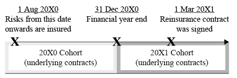

# 50A - Insurance contracts (IFRS 17)

[返回目录](README.md)

##### EX 50A.165.9 – The principles that the assessment of paragraph B101(c) of IFRS 17 needs to consider

 

Reference to standard: IFRS 17 App B para B101(c)  
Reference to standing text: [50A.165](82.md#s338-Para_50A.165)  
 Insurance

  

 

The following, highly simplified, example illustrates the principles that the assessment of paragraph B101(c) of IFRS 17 needs to consider:

 

- the extent to which the cash flows in the contract are expected to vary with the underlying items on a probability-weighted basis; and

- the effect of fixed cash flows (for example, from a death benefit or because of the effect of a financial guarantee) on the assessment of paragraph B101(c) of IFRS 17.

 

Consider a contract issued by an entity where the policyholder receives either the fair value (FV) on the underlying items on survival to maturity or a benefit of CU20,000 on death. Assume that:

 

- There is a 99.8% probability that the policyholder survives to maturity, and a 0.2% probability that the policyholder dies during the contract term.

- Independent of the survival of the policyholder, there is a 50% probability that the underlying items grow to CU10,000 and a 50% probability that the underlying items grow to CU3,000.

 

For simplicity, discounting has been ignored for the purposes of illustration.

 

There are four possible scenarios1:

 

Scenario 1: 49.9% probability that the policyholder survives to maturity and the underlying items grow to CU10,000 which the entity pays to the policyholder (that is, policyholder cash flows are varying directly with the FV on the underlying items).

 

Scenario 2: 49.9% probability that the policyholder survives to maturity and the underlying items grow to CU3,000 which the entity pays to the policyholder (that is, policyholder cash flows are varying directly with the FV on the underlying items).

 

Scenario 3: 0.1% probability that the policyholder dies during the contract term, the underlying items grow to CU10,000 and the entity pays the death benefit of CU20,000 to the policyholder.

 

Scenario 4: 0.1% probability that the policyholder dies during the contract term, the underlying items grow to CU3,000 and the entity pays the death benefit of CU20,000 to the policyholder.

 

The fulfilment cash flows are the probability-weighted value of the four scenarios, that is CU6,5272.

 

The probability-weighted value of the growth in underlying items is CU6,500.3

 

1 Given that there are two potential outcomes for the underlying items which are independent of the survival or death of the policyholder, this leads to four possible scenarios for the entity. So, in Scenario 1, the probability of 49.9% = 99.8% x 50%.

 

2 CU6,527 = 49.9% x CU10,000 + 49.9% x CU3,000 + 0.1% x CU20,000 + 0.1% x CU20,000.

 

3 CU6,500 = 50% x CU10,000 + 50% x CU3,000.

 

##### FAQ 50A.167.1 – When measuring the fair value of underlying items under the variable fee approach measurement model, should the requirements of IFRS 13, paragraph 47 (deposit floor) be applied?

 

Reference to standard: IFRS 17 App B paras B94, B101-B114, App C paras C17, C20; IFRS 13 para 47  
Reference to standing text: [50A.167](82.md#s338-Para_50A.167)  

  

 

**Background**

 

IFRS 13, paragraph 47 explains that the fair value of a financial liability with a demand feature cannot be less than the amount payable on demand, discounted from the first date that the amount could be required to be repaid. This is referred to as the deposit floor.

 

IFRS 17, paragraph B94 clarifies that when measuring the fair value of contracts in a business combination, an entity shall not apply paragraph 47 of IFRS 13. In addition, IFRS 17, paragraph C20 explains that when applying the fair value approach to determine the contractual service margin on transition, an entity shall not apply paragraph 47 of IFRS 13.

 

**Question**

 

In applying the eligibility and measurement guidance of the variable fee approach, paragraphs B101 - B114 of IFRS 17 require an entity to determine the obligation to pay the policyholder an amount equal to the fair value of the underlying items. Should an entity apply the requirements of paragraph 47 of IFRS 13 in determining the fair value of the underlying items?

 

**Answer**

 

Yes. IFRS 13 applies when another IFRS requires fair value measurement. Thus, an entity applies paragraph 47 of IFRS 13 when applying paragraphs B101-B114 of IFRS 17 to determine both eligibility for the variable fee approach and measurement of  the fair value of underlying items in that approach. Nevertheless, in the variable fee approach the unit of account being measured is the pool of underlying items. In the majority of scenarios, this pool of underlying items is in a net asset position, and therefore paragraph 47, which covers the measurement of financial liabilities with a demand feature, would not apply.

 

Although the pool of underlying items may include financial liabilities or insurance contracts, measurement of the pool of underlying items would not be applied on a “look-through” basis.

 

Paragraph 47 of IFRS 13 applies only when there is a demand feature. Therefore, even if the pool of underlying items were to be in a net liability position, IFRS 13, paragraph 47 would again not apply, given the pool itself cannot be demanded.

 

However, where an entity is carrying on the balance sheet an individual financial liability that is also within the pool of underlying items, and that liability is measured at fair value, IFRS 13, paragraph 47 applies to the measurement of that liability on a stand-alone basis.

The considerations in this FAQ would equally apply to the application of the modified retrospective approach on transition and the reference to the fair value of underlying items in paragraph C17 of IFRS 17.

#### Applying the variable fee approach

 

##### FAQ 50A.168.1 - Classification of variable fee cash flows paid out of the entity’s share of the fair value of underlying items

 

Reference to standard: IFRS 17 App B paras B104, B112  
Reference to standing text: [50A.168](82.md#s338-Para_50A.168)  
  Insurance

  

 

**Background**

 

Some fees and charges in direct participating contracts are expressed as a percentage of the underlying items. Such fees and charges  might be contractually paid out of the underlying items before determining the respective policyholder and entity shares of the fair value of the underlying items; or might be contractually paid by the entity out of its share. Economically, in either scenario, the fees vary directly with the underlying items and might leave both the policyholder and the insurer in a neutral position.  Such fees can relate to protection charges, investment management fees and other charges that vary directly with the underlying items.

 

For example, consider a pool of underlying items with a fair value of CU100 from which the policyholder receives CU90 and the entity receives CU8 net of investment management fees of 2% (CU2). This outcome could be achieved by structuring the contract such that:

 

- The entity shares 10% of the fair value of underlying items (i.e. CU10, being 10% of CU100) and pays CU2 to the investment manager out of its share; or

- The fair value of the underlying items is contractually determined to be net of the fees of CU2 (i.e. CU98) with the entity entitled to CU8 (i.e. 4/49 of CU98) and the policyholder entitled to CU90 (i.e. 45/49 of CU98).

 

In both scenarios, the entity receives CU8 on a net basis and the policyholder CU90.

 

**Question**

 

In the variable fee approach, can cash flows that vary directly with underlying items, but are paid by the entity out of its share, be included within the entity’s share of the fair value of the underlying items (para B104(b)(i) and B112)?

 

**Answer**

 

Yes, an entity is not precluded from viewing such cash flows as being part of the entity’s share of fair value of the underlying items (para B104(b)(i) and B112) as they vary directly with the underlying items.

 

##### FAQ 50A.169.1 – Under the variable fee approach, how are changes in cash flows that form part of the entity’s share of underlying items accounted for?

 

Reference to standard: IFRS 17 App B paras B104, B112   
Reference to standing text: [50A.169](82.md#s338-Para_50A.169)  
  Insurance

  

 

**Question**

 

Under the variable fee approach, how are changes in cash flows that form part of the entity’s share of underlying items accounted for?

 

**Answer**

 

Applying paragraph B112 of IFRS 17, the entity’s share of the fair value of underlying items (that is, para B104(b)(i) of IFRS 17) relates to future service and adjusts the contractual service margin, applying paragraph 45(b) of IFRS 17. This includes current period variances in the entity’s share of underlying items.

 

##### FAQ 50A.169.2 – Under the variable fee approach, how are cash flows that do not vary based on the returns on the underlying items accounted for?

 

Reference to standard: IFRS 17 App B paras B104, B113   
Reference to standing text: [50A.169](82.md#s338-Para_50A.169)  
  Insurance

  

 

**Question**

 

Under the variable fee approach, how are cash flows that do not vary based on the returns on the underlying items accounted for?

 

**Answer**

 

Applying paragraph B113(a) of IFRS 17, the cash flows that do not vary based on the returns on underlying items (that is, para B104(b(ii) of IFRS 17), excluding the change in the effect of the time value of money and financial risks not arising from the underlying items, adjust the contractual service margin or are recognised in profit and loss, depending on whether the changes affect future service, consistent with insurance contracts without direct participation features (although using current rather than locked-in discount rates when adjusting the contractual service margin).

 

Applying paragraph B113(b) of IFRS 17, changes in the effect of the time value of money and financial risks not arising from the underlying items (for example, the effect of financial guarantees) relate to future service and therefore adjust the contractual service margin, except to the extent that the requirement in paragraph B115 of IFRS 17 relating to the risk mitigation option applies.

 

##### FAQ 50A.169.3 – How does paragraph B113(b) of IFRS 17 apply to changes in the cost of options and guarantees that vary based on both financial inputs (such as interest rates) and non-financial factors (such as mortality, morbidity and lapse) if those cash flows do not vary based on the return of the underlying items?

 

Reference to standard: IFRS 17 App B para B113(b)   
Reference to standing text: [50A.169](82.md#s338-Para_50A.169)  
  Insurance

  

 

**Question**

 

How does paragraph B113(b) of IFRS 17 apply to changes in the cost of options and guarantees that vary based on both financial inputs (such as interest rates) and non-financial factors (such as mortality, morbidity and lapse) if those cash flows do not vary based on the return of the underlying items?

 

**Answer**

 

The change in the cost of options and guarantees should be analysed into (1) the change in the effect of the time value of money and financial risks not arising from the underlying items, which relate to future service, and (2) other changes (such as non-financial factors), which should be further analysed into those that relate to future service and those that do not. The changes that relate to future service adjust the contractual service margin.

 

##### FAQ 50A.169.4 – How does paragraph B113(b) of IFRS 17 apply to changes in investment management costs which do not vary based on the returns on the underlying items?

 

Reference to standard: IFRS 17 App B para B113(b)   
Reference to standing text: [50A.169](82.md#s338-Para_50A.169)  
  Insurance

  

 

**Question**

 

How does paragraph B113(b) of IFRS 17 apply to changes in investment management costs which do not vary based on the returns on the underlying items (as described in para B104(b)(ii) of IFRS 17)?

 

**Answer**

 

The changes in investment management costs should be analysed into (1) the change in the effect of the time value of money and financial risks not arising from the underlying items, which relate to future service, and (2) other changes (such as non-financial factors), which should be further analysed into those that relate to future service and those that do not. The changes that relate to future service adjust the contractual service margin.

 

##### FAQ 50A.169.5 – For insurance contracts with direct participation features, are cash flows that relate to periods when insurance coverage is no longer provided, and the policyholder bears all of the risks related to the investment- related services, within the boundary of the contract?

Reference to standard: IFRS 17 para 34   
Reference to standing text: [50A.169](82.md#s338-Para_50A.169)  
  Insurance

  

 

**Question 1**

 

For insurance contracts with direct participation features, are cash flows that relate to periods when insurance coverage is no longer provided, and the policyholder bears all of the risks related to the investment-related services, within the boundary of the contract? 

 

**Answer**

 

It depends. An entity is required to apply paragraph 34 of IFRS 17 to determine cash flows within the boundary of a contract. Periods of coverage might be outside the boundary of a contract if an entity can fully reprice premiums. Assuming that there is no ability to fully reprice premiums, cash flows that relate to periods when insurance coverage is no longer provided, and the policyholder bears all of the risks related to the investment-related services, are within the boundary of the contract.

 

**Question 2**

 

If the cash flows are deemed to be within the boundary of the contract, does this extend the coverage period of the contract to include the period in which an investment component exists but no insurance coverage is provided?

 

**Answer**

 

Yes. The definition of ‘coverage period’ for insurance contracts with direct participation features includes periods in which the entity provides investment-related services.

 

This issue was discussed at the September 2018 TRG meeting (staff paper AP11, TRG log S79).

 

##### EX 50A.169.6 – The differences between the measurement of the contractual service margin using the general model and the requirements for contracts with direct participation features

 

Reference to standard: IFRS 17 para 45, App B paras B111, B112, B113, B114  
Reference to standing text: [50A.169](82.md#s338-Para_50A.169)  
 Insurance

  

 

The diagram below summarises the differences between the measurement of the contractual service margin using the general model and the requirements for contracts with direct participation features:

 

 

- No explicit adjustment is required for each component; there might be just one adjustment for all components to the CSM.

- IFRS 17 App B para B111

- IFRS 17 App B para B112

- No effect on measurement of assets / liabilities from insurance contracts in general model.

- IFRS 17 App B para B113

- Under the VFA, adjustments to the CSM use current discount rates; under the general model, they use discount rates locked in at inception of a group of insurance contracts.

 

#### Risk mitigation option

 

##### FAQ 50A.173.1 – How can the effect of economic hedging and risk mitigation techniques be presented in the financial statements?

 

Reference to standard: IFRS 17 App B para B116   
Reference to standing text: [50A.173](82.md#s338-Para_50A.173)  

  

 

**Question**

 

How can the effect of economic hedging and risk mitigation techniques be presented in the financial statements?

 

**Answer**

 

Entities using economic hedging and risk mitigation techniques usually want to present information that reflects this outcome in the financial statements in a way that reflects those risk management practices. An example of such a situation is the macroeconomic management of economic risks. IFRSs currently have two ways to achieve this: the risk mitigation exception in IFRS 17 for insurance liabilities measured under the variable fee approach; and hedge accounting in IFRS 9. The measurement exception under the risk mitigation exception in IFRS 17 applies only to contracts measured under the variable fee approach, and it does not apply to the contracts to which the general model applies. Entities might provide additional disclosure in such situations to explain risk management practices to the users of the financial statements.

 

##### EX 50A.174.1 – When would it be considered that credit risk dominates the economic offset?

 

Reference to standard: IFRS 17 App B para B116   
Reference to standing text: [50A.174](82.md#s338-Para_50A.174)  
  Insurance

  

 

This example demonstrates the criterion in paragraph B116(b) of IFRS 17 for using an exception to the general requirements of the variable fee approach for risk mitigating activities.

 

An entity manages the risk of changes in interest rates (financial risk) for a portfolio of contracts with direct participation features with a derivative instrument. The parties do not provide any collateral to secure payments on the derivative instrument. If there is a significant increase in credit risk of the counterparty to that derivative in the future, the effect of the changes in the counterparty’s credit risk might outweigh the effect of other changes in financial risk on the fair value of the derivative, whereas changes in the value of the portfolio of contracts with direct participation features depend on these other changes in financial risk. In such a situation, there might be little to no offset of gains and losses from the derivative and the portfolio of contracts with direct participation features. The exception to the general requirements for accounting for the contractual service margin of contracts with direct participation features cannot be used.

 

### Measurement of reinsurance contracts

 

#### Reinsurance contracts held

 

##### EX 50A.181.1 – Differences arising from the accounting for insurance contracts issued and associated reinsurance contracts held

 

Reference to standard: IFRS 17 paras 29(b), 60   
Reference to standing text: [50A.181](82.md#s339-Para_50A.181)  
  Insurance

  

 

IFRS 17 requires a reinsurance contract held to be accounted for separately from the underlying insurance contracts to which it relates. Under IFRS 17, the matching of gains and losses from underlying insurance contracts issued and reinsurance contracts held will not always be possible. The following requirements for reinsurance contracts held could cause mismatches:

 

- Reinsurance contracts held cannot meet the definition of an insurance contract with direct participation features, so they are measured using either the general model or the premium allocation approach, while the underlying insurance contracts with direct participation features are measured using the variable fee approach.

- Some reinsurance contracts might not be eligible for the premium allocation approach, while the underlying contracts might be eligible due to the different coverage periods.

- Day 1 gains are deferred for insurance contracts issued, and day 1 losses are recognised immediately in profit or loss. The net gains and costs on initial recognition of the associated reinsurance contracts held are deferred, unless:

- the coverage relates to past events, in which case the net cost is recognised immediately in profit or loss; or

- losses are recognised, on initial recognition, on the associated insurance contracts issued, in which case expected recoveries of those losses from the reinsurance contracts held, entered into before or at the same time as the loss-making insurance contracts, can be recognised on day 1.

- The period for release of the contractual service margin for underlying insurance contracts issued, and that of the reinsurance contracts held, might be different due to the different coverage periods.

 

##### Date of initial recognition of reinsurance contracts held

 

###### EX 50A.184.1 – Determining the initial recognition date and annual cohort for contracts that provide retrospective cover

 

Reference to standard: IFRS 17 para 62, App A   
 Reference to standing text: [50A.184](82.md#s339-Para_50A.184)  
   Insurance

  

 

**Background**

 

Some reinsurance contracts held might assume risks that relate to a period before the reinsurance contract is agreed. For example, consider an entity for which the financial year closes on 31 December. On 1 March 20X1, the entity signed a reinsurance contract held that provides excess of loss coverage. This contract assumes risks starting from 1 August 20X0 to a future date. The entity does not have any other reinsurance contracts held on 1 March 20X1, and so the entity identifies the group of reinsurance contracts held as the single contract.

 

 

**Question**

 

Is the date of initial recognition of the reinsurance contract held 1 March 20X1?

 

**Answer**

 

Yes. The initial recognition date is 1 March 20X1.

 

Paragraph 62 of IFRS 17 specifies that an entity should recognise a group of reinsurance contracts held from the earlier of:

 

- the beginning of the coverage period of the group of reinsurance contracts held; and

- the date when the entity recognises an onerous group of underlying insurance contracts applying paragraph 25(c) of IFRS 17, if the entity entered into the related reinsurance contract held in the group of reinsurance contracts held at or before that date.

 

Coverage period is defined in Appendix A to IFRS 17 as the period during which the entity provides coverage for insurance contract services.

 

The fact that the reinsurance contract held covers risks arising from underlying insurance contracts written from 1 August 20X0 onwards does not mean that the coverage period for the reinsurance contract held is earlier than the existence of the reinsurance contract (that is, the signing date of 1 March 20X1).

 

This reinsurance contract includes both retrospective cover and prospective insurance cover. Paragraph B5 of IFRS 17 notes that the insured event for a contract that provides retrospective coverage is the determination of the ultimate cost of the claim, which will happen only after 1 March 20X1. Accordingly, the coverage period during which coverage for insured events is provided starts from the existence of the reinsurance contract. Hence, the beginning of the coverage period is 1 March 20X1.

 

##### Measurement of reinsurance contracts held

 

###### FAQ 50A.188.1 – How is the contract boundary of a reinsurance contract held determined?

 

Reference to standard: IFRS 17 paras 4(a), 34

Reference to standing text: [50A.188](82.md#s339-Para_50A.188)

  Insurance

  

 

**Question**

 

How is the contract boundary of a reinsurance contract held determined?

 

**Answer**

 

The application of IFRS 17's contract boundary requirements to reinsurance contracts held means that cash flows within the boundary of the contract arise from the substantive rights and obligations of the holder of the contract (e.g., the substantive rights to receive services from the reinsurer and the substantive obligation to pay amounts to the reinsurer).

 

A substantive right to receive services from the reinsurer ends either:

 

- when the reinsurer can reprice the contract to fully reflect the reinsured risk, or

 

- when the reinsurer has a substantive right to terminate coverage.

 

A substantive obligation to pay amounts to the reinsurer ends when the reinsurer no longer has a right to compel the cedant to pay premiums.

 

In responding to a TRG submission (S75), staff paper AP11 for the September 2018 TRG meeting confirmed that a symmetrical treatment of the contract boundary would be expected from the perspective of the cedant and the reinsurer, noting:

 

“The contract boundary is the same from each perspective because:

 

- when the cedant has a right to receive services, the reinsurer has an obligation to provide services; and

- when the cedant has an obligation to pay premiums, the reinsurer has a right to compel premiums.”

 

###### FAQ 50A.188.1.1 – How is the contract boundary of an insurance contract or reinsurance contract determined when the rights and obligations of the insurer/reinsurer and the policyholder/cedant are asymmetrical?

 

Reference to standard: IFRS 17 para 34

Reference to standing text: [50A.188](82.md#s339-Para_50A.188)

Insurance

  

 

**Background**

 

Consider an example of a contract where the insurer can cancel or reprice a 12-month policy by providing 30 days’ notice to the policyholder during the contract term. However, the policyholder cannot cancel the policy unless the insurer exercises its right to reprice the contract. Thus, the insurer can compel the policyholder  to pay premiums for the full 12 months.

 

Similarly, consider a contract where a reinsurer can cancel or reprice a 12-month policy by providing 30 days’ notice to the cedant during the contract term. However, the cedant cannot cancel the policy unless the reinsurer exercises its right to reprice the contract. Thus, the reinsurer can compel the cedant to pay premiums for the full 12 months.

 

**Question**

 

How is the contract boundary of an insurance contract or reinsurance contract determined when the rights and obligations of the insurer/reinsurer and the policyholder/cedant are asymmetrical?

 

**Answer**

 

The contract boundary is determined as the later of the period in which rights or obligations exist, even when the insurer or reinsurer has a unilateral right to cancel or reprice the contract. Consistent with paragraph 34 of IFRS 17, both the rights and obligations within a contract need to be considered when determining the contract boundary. So, consistent with [FAQ 50A.188.1 ‘How is the contract boundary of a reinsurance contract held determined?’](83.md#s346-FAQ_50A.188.1), the contract boundary for the insurer/ reinsurer and the cedant is 12 months.

 

However, all options that could be exercised by either party to the contract need to be considered when measuring the fulfilment cash flows within the contract boundary on a probability-weighted basis.

 

###### FAQ 50A.188.2 – Will the contract boundary for a reinsurance contract held be affected by the existence of an open-ended contractual termination clause?

 

Reference to standard: IFRS 17 paras 28, 14–24, 34, 35, 61, App B para B64  
Reference to standing text: [50A.188](82.md#s339-Para_50A.188)  
 Insurance

  

 

**Background**

 

An insurance company purchases a proportional reinsurance contract, which contains the following clauses:

 

- X% proportional coverage for all risks.

- All underlying contracts written in the period from 1 January 20X1 to 31 December 20X1 are covered.

- The reinsurer and the insurance company issuing the underlying contracts each have the right to unilaterally terminate the contract with regard to accepting new policies issued by the insurance company on 90 days’ written notice.

 

**Question**

 

Will the contract boundary for a reinsurance contract held be affected by the existence of an open-ended contractual termination clause?

 

**Answer**

 

Yes. The termination clause will have an impact on the determination of the boundary of the reinsurance contract. Under paragraph 34 of IFRS 17, cash flows are within the boundary of the contract if they arise from rights and obligations where the issuer can compel the policyholder to pay the premium or where the issuer has a substantive obligation to provide a service to the entity. The substantive obligation to provide services ends when the entity has the practical ability to reassess the risk and set a premium that fully reflects this risk. In this case, the reinsurance company (issuer of the contract) has the practical ability to reassess the risk by terminating the contract with regard to accepting new policies issued by the insurance company on 90 days’ notice. Consequently, cash flows that are within the boundary of the reinsurance contract on day 0 are restricted to those relating to reinsurance of underlying contracts written from 1 January 20X1 to 31 March 20X1.

 

Cash flows arising from underlying contracts issued on 1 April 20X1 would not be included in this contract but, in accordance with paragraph 35 of IFRS 17, they would belong to a new contract. This new contract would not be recognised until the criteria in paragraph 62 of IFRS 17 are met. Paragraph 28 of IFRS 17 allows entities to group contracts issued within one year together and, as such, the different reinsurance contracts held established in this scenario could be grouped together, provided that they meet the criteria set out in paragraphs 14 to 24 of IFRS 17 (as modified for reinsurance contracts held by para 61 of IFRS 17).

 

A similar example was discussed at the September 2018 TRG meeting, where it was also noted that paragraph B64 of IFRS 17 would not apply to this fact pattern. That is, there is no reassessment and extension of the original 90-day accounting contract, because paragraph B64 of IFRS 17 applies only where there are matters considered related to determination of the original contract boundary that have since changed (such as a change in facts and circumstances relating to pricing constraints).

 

###### FAQ 50A.188.3 – What is the contract boundary where the holder of a reinsurance contract (cedant) is required to continue paying premiums unless the issuer (reinsurer) exercises an option to reprice the contract?

 

Reference to standard: IFRS 17 para 34   
Reference to standing text: [50A.188](82.md#s339-Para_50A.188)  
  Insurance

  

 

**Background**

 

Consider the following reinsurance contract:

 

- The reinsurance contract has no specified maturity or termination date.

- The reinsurer has the right to adjust premiums prospectively for remaining coverage related to underlying insurance contracts that have already been issued, subject to a minimum notice period of 90 days.

- The exercise of the repricing right triggers an option for the holder of the contract (cedant) to cancel the contract.

- Unless the reinsurer exercises the repricing right, the cedant is obliged to continue paying premiums.

- The reinsurer has no other rights to cancel the contract.

 

**Question**

 

What is the contract boundary where the holder of a reinsurance contract (cedant) is required to continue paying premiums unless the issuer (reinsurer) exercises an option to reprice the contract?

 

**Answer**

 

Applying paragraph 34 of IFRS 17, cash flows are included in the contract boundary if they arise “from substantive rights and obligations that exist during the reporting period in which the entity can compel the policyholder to pay the premiums or in which the entity has a substantive obligation to provide the policyholder with services” (emphasis added). That is, there are two criteria, either of which can lead to the inclusion of cash flows within the contract boundary.

 

At the February 2018 TRG meeting (staff paper AP03), the TRG observed that, in the context of paragraph 34 of IFRS 17 for reinsurance contracts held, cash flows within the boundary of a reinsurance contract held arise from the substantive right of the cedant to receive services from the reinsurer, or from the substantive obligation of the cedant to pay premiums to the issuer (reinsurer) of the contract.

 

Related to the substantive obligation, the TRG noted in May 2018 (staff paper AP04) that, because the cedant in the above example cannot cancel unless there is a repricing, and because the reinsurer’s ability to reprice is outside the cedant’s control, the cedant has a substantive obligation to pay premiums for the full reinsurance contractual term.

 

The contract boundary of the reinsurance contract held will reflect the full duration of the underlying contracts. However, the fulfilment cash flows for the reinsurance contract held would be required to reflect the likelihood of future premium adjustments and cedant recapture decisions.

 

As noted in [FAQ 50A.188.1](83.md#s346-FAQ_50A.188.1), there will be symmetry between the contract boundary assessment by the cedant and the issuer. However, the reinsurer’s estimates of expected cash flows within that contract boundary might differ.

 

###### FAQ 50A.188.4 – Should an entity include cash flows expected to arise from underlying contracts that are expected to be issued in the future in determining the fulfilment cash flows for reinsurance contracts held?

 

Reference to standard: IFRS 17 paras 34, 62   
Reference to standing text: [50A.188](82.md#s339-Para_50A.188)  
  Insurance

  

 

**Question**

 

Should an entity include cash flows expected to arise from underlying contracts that are expected to be issued in the future in determining the fulfilment cash flows for reinsurance contracts held?

 

**Answer**

 

Yes, provided that these underlying contracts will be covered by the reinsurance contract. One of the main principles of IFRS 17 is that both insurance contracts issued and reinsurance contracts held are measured applying the measurement approach in IFRS 17. However, IFRS 17 has some modifications to the measurement model for reinsurance contracts held (for example, related to the date of initial recognition), to reflect the fact that such contracts are not issued by the entity.

 

In measuring a reinsurance contract held, an entity applies the contract boundary requirements in paragraph 34 of IFRS 17 for both the direct insurance contracts that it issues and the reinsurance contracts that it holds. As noted in [FAQ 50A.188.1](83.md#s346-FAQ_50A.188.1), the cash flows within the boundary of a reinsurance contract held arise from the entity’s substantive rights and substantive obligations under that contract. This means that the entity has a substantive right to receive services from, and an obligation to pay amounts to, the issuer of that contract (the reinsurer). Therefore, if an entity has a substantive right to receive services from the reinsurer for underlying contracts that are expected to be issued in the future, cash flows within the boundary of the reinsurance contract held will include cash flows relating to those future underlying contracts.

 

For example, an entity holds a one-year risk-attaching reinsurance contract that covers claims arising from motor insurance contracts that it issues between 1 January 20X2 and 31 December 20X2. For the reinsurance contract, the contract boundary includes cash flows arising from contracts issued in that one year. The coverage period for the underlying motor contract is one year from when it is issued. The coverage period of the reinsurance contract held would therefore be from 1 January 20X2 to the end of the coverage period of the last underlying insurance contract, which could be up to 31 December 20X3.

 

The initial recognition date of that reinsurance contract is, in accordance with paragraph 62(a) of IFRS 17, determined to be 1 January 20X2. Applying paragraph 34 of IFRS 17 to this contract, the future cash flows for all expected underlying motor contracts to be covered by the reinsurance contract are included in the measurement of the reinsurance contract on that initial recognition date.

 

###### FAQ 50A.188.5 – Should the risk of non-performance by the reinsurer be considered within the estimates of future cash flows for reinsurance contracts held?

 

Reference to standard: IFRS 17 paras 63, 64   
Reference to standing text: [50A.188](82.md#s339-Para_50A.188)  
  Insurance

  

 

**Question**

 

Should the risk of non-performance by the reinsurer be considered within the estimates of future cash flows for reinsurance contracts held?

 

**Answer**

 

Yes. The entity should reflect the non-performance risk of the reinsurer in the estimate of the present value of future cash flows (see para 63 of IFRS 17).

 

In accordance with paragraph 64 of IFRS 17, the risk adjustment for non-financial risk in respect of reinsurance contracts held represents the risk transferred by the holder of the group of reinsurance contracts to the issuer of those contracts. The risk of non-performance by the reinsurer is not transferred from the insurer to the reinsurer. Therefore, the risk adjustment in respect of reinsurance contracts held does not include the risk of non-performance by the reinsurer.

 

This issue was included in the April 2019 TRG meeting (staff paper AP02, TRG log S119).

 

Subsequent to initial measurement, an entity might revise the present value of future cash flows of the reinsurance contract held to reflect any changes in non-performance risk of the reinsurer. In applying paragraph 64 of IFRS 17, this change might in turn affect the amount of the risk adjustment for non-financial risk of the underlying insurance contract, depending on the approach used by the entity for determining the risk adjustment. Such a change in risk adjustment is accounted for as any other changes in risk adjustment, consistent with the entity’s measurement and presentation approach.

 

###### FAQ 50A.188.6 – Is the discount rate in a reinsurance contract held required to be identical to the discount rate applied in the underlying ceded contracts that have been reinsured?

 

Reference to standard: IFRS 17 paras 36, 63   
Reference to standing text: [50A.188](82.md#s339-Para_50A.188)  
  Insurance

  

 

**Question**

 

Is the discount rate in a reinsurance contract held required to be identical to the discount rate applied in the underlying ceded contracts that have been reinsured?

 

**Answer**

 

No. This question was raised in a submission (S17) to the TRG. Paragraph 63 of IFRS 17 requires an entity to use consistent assumptions to measure the estimates of the present value of the future cash flows for the group of reinsurance contracts held and the estimates of the present value of the future cash flows for the group(s) of underlying insurance contracts (ceded contracts). This requirement does not require the entity to use identical discount rates for measuring the reinsurance contract held and the ceded contracts. The extent of the dependency between the cash flows of the reinsurance contract held and the ceded contracts should be evaluated in applying paragraph 63 of IFRS 17. Thus the discount rate applied in the measurement of the reinsurance contract held should meet the criteria set out in paragraph 36 of IFRS 17. If, for example, the liquidity characteristics of the ceded contracts are not the same as the reinsurance contract held, the discount rates applied in the measurement of the ceded contracts and the reinsurance contract would be different.

 

###### FAQ 50A.189.1 – How should the risk adjustment for non-financial risk for reinsurance contracts held be calculated?

 

Reference to standard: IFRS 17 paras 64, BC 213   
Reference to standing text: [50A.189](82.md#s339-Para_50A.189)  
  Insurance

  

 

**Question**

 

How should the risk adjustment for non-financial risk for reinsurance contracts held be calculated?

 

**Answer**

 

There are no specific requirements in IFRS 17 regarding the approaches that should be used to determine the amount of risk being transferred by the holder to the issuer of a reinsurance contract. It is possible to directly calculate the risk inherent in the portion of the risk that is ceded, similar to how a reinsurer would calculate its risk adjustment for the business assumed (also known as ‘gross less ceded equals net’), or as the difference between the risk adjustment on the gross underlying contracts and the risk adjustment for the net risk retained after considering the reinsurance (also known as ‘gross less net equals ceded’). Paragraph BC 213 of the Basis for Conclusions on IFRS 17 explains the IASB’s reasons for not requiring specific approaches for the calculation of the risk adjustment for non-financial risk for reinsurance contracts held, even though the results of the different approaches might be different in practice.

 

###### FAQ 50A.189.2 – Can the allocated risk adjustment for non-financial risk to a group of reinsurance contracts held be nil?

 

Reference to standard: IFRS 17 para 64  
Reference to standing text: [50A.189](82.md#s339-Para_50A.189)  
 Insurance

  

 

**Question**

 

Can the allocated risk adjustment for non-financial risk to a group of reinsurance contracts held be nil?

 

**Answer**

 

It depends. IFRS 17 does not specify the estimation techniques to be used to determine the risk adjustment for non-financial risk. Paragraph 64 of IFRS 17 requires the risk adjustment for non-financial risk for reinsurance contracts held to represent the amount of risk being transferred by the holder of the group of reinsurance contracts to the issuer of those contracts. Therefore, the risk adjustment for non-financial risk of the reinsurance contracts held could not be nil, unless: 

 

- the entity considers reinsurance when determining the compensation that it requires for bearing non-financial risk related to the underlying insurance contracts; and

- the cost of acquiring the reinsurance is equal to or less than the expected recoveries.

 

This issue was included in the April 2019 TRG meeting (staff paper AP02, TRG log S118) with an example, as shown below.

 

**Example**

 

Suppose an entity would determine the premium it charges for insurance contracts as illustrated in the following table, ignoring the possibility of reinsurance and before considering any profit:

 

<table style="border-collapse:collapse"><tr><td style="border:0.75pt solid #000000; padding-right:5.03pt; padding-left:5.03pt; vertical-align:top">
Present value of claims
</td><td style="border:0.75pt solid #000000; padding-right:5.03pt; padding-left:5.03pt; vertical-align:top">
100
</td></tr><tr><td style="border:0.75pt solid #000000; padding-right:5.03pt; padding-left:5.03pt; vertical-align:top">
Risk adjustment for non-financial risk
</td><td style="border:0.75pt solid #000000; padding-right:5.03pt; padding-left:5.03pt; vertical-align:top">
30
</td></tr><tr><td colspan="2" style="border:0.75pt solid #000000; padding-right:5.03pt; padding-left:5.03pt; vertical-align:top">
 
</td></tr><tr><td style="border:0.75pt solid #000000; padding-right:5.03pt; padding-left:5.03pt; vertical-align:top">
Premium
</td><td style="border:0.75pt solid #000000; padding-right:5.03pt; padding-left:5.03pt; vertical-align:top">
60
</td></tr><tr><td colspan="2" style="border:0.75pt solid #000000; padding-right:5.03pt; padding-left:5.03pt; vertical-align:top">
 
</td></tr></table>

 

However, the entity knows that reinsurance is available to it, and the entity expects to cover 50% of claims using reinsurance. It expects the cost of purchasing this reinsurance to be 60. When the entity includes this possibility in its assessment of the premium that it will charge for the insurance contracts (still before thinking about any profit), it determines the following amounts:

 

<table style="border-collapse:collapse"><tr><td style="border:0.75pt solid #000000; padding-right:5.03pt; padding-left:5.03pt; vertical-align:top">
 
</td><td style="border:0.75pt solid #000000; padding-right:5.03pt; padding-left:5.03pt; vertical-align:top">
<b>Expected to be covered by reinsurance</b>
</td><td style="border:0.75pt solid #000000; padding-right:5.03pt; padding-left:5.03pt; vertical-align:top">
<b>Not expected to be covered by reinsurance</b>
</td><td style="border:0.75pt solid #000000; padding-right:5.03pt; padding-left:5.03pt; vertical-align:top">
<b>Total insurance contracts issues</b>
</td></tr><tr><td style="border:0.75pt solid #000000; padding-right:5.03pt; padding-left:5.03pt; vertical-align:top">
Present value of claims
</td><td style="border:0.75pt solid #000000; padding-right:5.03pt; padding-left:5.03pt; vertical-align:top">
50
</td><td style="border:0.75pt solid #000000; padding-right:5.03pt; padding-left:5.03pt; vertical-align:top">
50
</td><td style="border:0.75pt solid #000000; padding-right:5.03pt; padding-left:5.03pt; vertical-align:top">
100
</td></tr><tr><td style="border:0.75pt solid #000000; padding-right:5.03pt; padding-left:5.03pt; vertical-align:top">
Risk adjustment for non-financial risk
</td><td style="border:0.75pt solid #000000; padding-right:5.03pt; padding-left:5.03pt; vertical-align:top">
10
</td><td style="border:0.75pt solid #000000; padding-right:5.03pt; padding-left:5.03pt; vertical-align:top">
15
</td><td style="border:0.75pt solid #000000; padding-right:5.03pt; padding-left:5.03pt; vertical-align:top">
25
</td></tr><tr><td style="border:0.75pt solid #000000; padding-right:5.03pt; padding-left:5.03pt; vertical-align:top">
Premium
</td><td style="border:0.75pt solid #000000; padding-right:5.03pt; padding-left:5.03pt; vertical-align:top">
60
</td><td style="border:0.75pt solid #000000; padding-right:5.03pt; padding-left:5.03pt; vertical-align:top">
65
</td><td style="border:0.75pt solid #000000; padding-right:5.03pt; padding-left:5.03pt; vertical-align:top">
125
</td></tr></table>

 

The reinsurance contract held transfers 50% of the risk from the entity, so it is accounted for as follows:

 

<table style="border-collapse:collapse"><tr><td style="border:0.75pt solid #000000; padding-right:5.03pt; padding-left:5.03pt; vertical-align:top">
Present value of claim recoveries
</td><td style="border:0.75pt solid #000000; padding-right:5.03pt; padding-left:5.03pt; vertical-align:top">
50
</td></tr><tr><td style="border:0.75pt solid #000000; padding-right:5.03pt; padding-left:5.03pt; vertical-align:top">
Risk adjustment for non-financial risk (= 25/2)
</td><td style="border:0.75pt solid #000000; padding-right:5.03pt; padding-left:5.03pt; vertical-align:top">
12.5
</td></tr><tr><td style="border:0.75pt solid #000000; padding-right:5.03pt; padding-left:5.03pt; vertical-align:top">
Contractual service margin (net gain)
</td><td style="border:0.75pt solid #000000; padding-right:5.03pt; padding-left:5.03pt; vertical-align:top">
(2.5)
</td></tr><tr><td colspan="2" style="border:0.75pt solid #000000; padding-right:5.03pt; padding-left:5.03pt; vertical-align:top">
 
</td></tr><tr><td style="border:0.75pt solid #000000; padding-right:5.03pt; padding-left:5.03pt; vertical-align:top">
Reinsurance premium
</td><td style="border:0.75pt solid #000000; padding-right:5.03pt; padding-left:5.03pt; vertical-align:top">
60
</td></tr><tr><td colspan="2" style="border:0.75pt solid #000000; padding-right:5.03pt; padding-left:5.03pt; vertical-align:top">
 
</td></tr></table>

 

###### FAQ 50A.191.1 – How should fees paid by the ceding company to a third-party broker on entering into a reinsurance contract held be treated under IFRS 17?

 

Reference to standard: IFRS 17 paras 65, 69, App B para B66   
Reference to standing text: [50A.191](82.md#s339-Para_50A.191)  
  Insurance

  

 

**Background**

 

Fees paid by a ceding entity to a third-party broker do not meet the definition of acquisition costs cash flows in Appendix A to IFRS 17, because they do not relate to insurance contracts that are issued or expected to be issued. This FAQ addresses how such fees should be treated.

 

**Question 1**

 

How should fees paid by the ceding entity to a third-party broker on entering into a reinsurance contract held be treated under IFRS 17?

 

**Answer**

 

General model:

 

Broker fees paid by the ceding entity to obtain reinsurance coverage are included in the fulfilment cash flows of the reinsurance contracts held (applying para B65(a) of IFRS 17). Therefore, assuming that the costs are incurred at the same time that the reinsurance contract is recognised, or later, they would be included in fulfilment cash flows of the reinsurance contract held. They would therefore impact the contractual service margin and would be effectively amortised within the contractual service margin.

 

Premium allocation approach:

 

Broker fees paid by the ceding entity to obtain reinsurance coverage are part of the cost of reinsurance held. The guidance in paragraph 69 of IFRS 17 notes that “An entity may use the premium allocation approach set out in paragraphs 55–56 and 59 (adapted to reflect the features of reinsurance contracts held that differ from insurance contracts issued, for example the generation of expenses or reduction in expenses rather than revenue) …” . As an adaptation under paragraph 69, fees paid to brokers represent part of the costs incurred in entering into the reinsurance contract held.

 

Therefore, the carrying amount of a reinsurance contract held would include both the reinsurance premium paid to the reinsurer and any associated fees paid to a third-party broker to obtain the coverage. The broker fees would subsequently be recognised in profit or loss over the coverage period of the group of reinsurance contracts held.

 

**Question 2**

 

How are broker fees recognised where incurred prior to recognition of the reinsurance contract?

 

**Answer**

 

Under both models, broker fees incurred prior to recognition of the reinsurance contract held are recognised as a prepayment asset when incurred. The fees are then derecognised under paragraph 65 of IFRS 17 when the reinsurance contract held is recognised, and they are included either as part of the reinsurance contract held fulfilment cash flows (under the general model) or as the cost of reinsurance (under the premium allocation approach). The broker fees would subsequently be recognised in profit or loss over the coverage period of the group of reinsurance contracts held.

 

###### FAQ 50A.192.1 – How do you assess the coverage period of reinsurance contracts?

 

Reference to standard: IFRS 17 para 66   
Reference to standing text: [50A.192](82.md#s339-Para_50A.192)  
  Insurance

  

 

**Question**

 

How do you assess the coverage period of reinsurance contracts?

 

**Answer**

 

Some reinsurance contracts cover underlying direct business that begins during a one-year coverage period of the reinsurance contract (risk-attaching reinsurance contracts). Because of this feature, the coverage period of these reinsurance contracts can effectively be more than one year.

 

For example, a reinsurance contract covers risks from all underlying direct motor insurance contracts signed during a calendar year. The coverage period of each underlying direct motor insurance contract is one year. However, the reinsurance contract will provide cover for claims that arise within two years, because it covers the claims during the coverage period of one year on underlying direct contracts written in the year. The coverage period of the reinsurance contract ends when the coverage periods of all underlying contracts are expected to end.

 

###### FAQ 50A.192.2 – For reinsurance contracts held, are the coverage units determined based on the services provided by the reinsurer, or should a ‘look-through’ approach based on the coverage units of the underlying insurance contracts be used?

 

Reference to standard: IFRS 17 para 66(e), App B para B119  
Reference to standing text: [50A.192](82.md#s339-Para_50A.192)  

  

 

**Question**

 

For reinsurance contracts held, are the coverage units determined based on the services provided by the reinsurer, or should a ‘look-through’ approach based on the coverage units of the underlying insurance contracts be used?

 

**Answer**

 

As noted in the May 2018 TRG staff paper AP07 (TRG log S41), according to paragraphs 66(e) and B119 of IFRS 17, the coverage units for a group of reinsurance contracts held are determined based on the quantity of coverage provided by the reinsurance contracts held in the group. The quantity of coverage is the coverage received by the insurer from the reinsurance contracts held, and not the coverage provided by the insurer to its policyholders through the underlying insurance contracts.

 

When determining the quantity of benefits received from a reinsurance contract held, entities should consider the relevant facts and circumstances related to the underlying insurance contracts.

 

Examples of how to determine coverage units for reinsurance contracts held were provided in Example 8 of Appendix B to staff paper AP05 of the May 2018 TRG meeting. It was noted that, for an adverse development cover with a contractual maximum, methods for determining the quantity of benefits could include: (1) comparing the contractual maximum amount that could have been claimed in the period with the remaining contractual maximum amount that can be claimed as a constant amount for each future coverage period; or (2) comparing the expected amount of underlying claims covered in the period with the expected amount of underlying claims remaining to be covered in future periods. For an adverse development cover without a contractual maximum, methods could include: (a) assuming equal benefits in each coverage period, which would end at the date of the last expected settlement payment; or (b) using method (2) as noted above.

 

###### FAQ 50A.192.3 – How should an entity treat changes in the asset for remaining adverse development reinsurance coverage that result from changes in the liability for underlying incurred claims?

 

Reference to standard: IFRS 17 paras 65A,  66(c), App B para B5   
Reference to standing text: [50A.192](82.md#s339-Para_50A.192)  
  Insurance

  

 

**Background**

 

An entity purchases adverse development reinsurance coverage on incurred claims of a portfolio of underlying issued contracts (the claims occurred prior to the purchase of the reinsurance coverage). 

 

**Question**

 

How should an entity treat changes in the asset for remaining adverse development reinsurance coverage that result from changes in the liability for underlying incurred claims?

 

**Answer**

 

Applying paragraph 65A of IFRS 17, notwithstanding the requirements of paragraph B5 of IFRS 17, the net cost of purchasing the reinsurance coverage is recognised immediately in profit or loss as an expense, because this relates to events that occurred before the purchase of the reinsurance contract. Changes in the liability for incurred claims are reflected in profit or loss, because these relate to past coverage.

 

Applying paragraph 66(c)(ii) of IFRS 17, changes in the asset for remaining reinsurance coverage due to changes in the liability for incurred claims are reflected in profit or loss.

 

The reinsurance contractual service margin is not adjusted for changes that result from changes in fulfilment cash flows of the underlying group of insurance contracts that do not adjust the contractual service margin of the underlying group of insurance contracts. In this scenario, there is no contractual service margin or remaining coverage left on the underlying group of contracts, and all changes in the liability for incurred claims are reflected in profit or loss. Accordingly, the corresponding changes in the asset for remaining reinsurance coverage are also reflected in profit or loss.

 

###### FAQ 50A.193.1 – How should the reinsurance held contractual service margin be adjusted at the inception of the onerous underlying group of insurance contracts?

 

Reference to standard: IFRS 17 paras 66(c), 66A, App B para B119D   
 Reference to standing text: [50A.193](82.md#s339-Para_50A.193)  
   Insurance

  

 

**Background**

 

A company has issued a group of single premium insurance contracts with a contract duration of 10 years. At inception of the group, expected cash flows are as follows:

 

<table style="border-collapse:collapse"><tr><td style="border:0.75pt solid #000000; padding-right:5.03pt; padding-left:5.03pt; vertical-align:top">
Single premiums received
</td><td style="border:0.75pt solid #000000; padding-right:5.03pt; padding-left:5.03pt; vertical-align:top">
CU1,000
</td></tr><tr><td style="border:0.75pt solid #000000; padding-right:5.03pt; padding-left:5.03pt; vertical-align:top">
Expected future benefit outflows
</td><td style="border:0.75pt solid #000000; padding-right:5.03pt; padding-left:5.03pt; vertical-align:top">
CU1,200
</td></tr><tr><td style="border:0.75pt solid #000000; padding-right:5.03pt; padding-left:5.03pt; vertical-align:top">
Onerous loss recognised in year 1
</td><td style="border:0.75pt solid #000000; padding-right:5.03pt; padding-left:5.03pt; vertical-align:top">
CU200
</td></tr><tr><td style="border:0.75pt solid #000000; padding-right:5.03pt; padding-left:5.03pt; vertical-align:top">
Claims expected to be incurred in year
</td><td style="border:0.75pt solid #000000; padding-right:5.03pt; padding-left:5.03pt; vertical-align:top">
CU125.
</td></tr></table>

 

At inception of the group, the company has reinsurance held in place that can be repriced by the reinsurer after 12 months, therefore having a contract boundary of 12 months. The reinsurance contract held will reimburse the company for all claims in excess of CU100 within the period of 12 months. The expected cash flows of the reinsurance contract held for the 12 months are as follows:

 

<table style="border-collapse:collapse"><tr><td style="border:0.75pt solid #000000; padding-right:5.03pt; padding-left:5.03pt; vertical-align:top">
Premiums paid to reinsurer
</td><td style="border:0.75pt solid #000000; padding-right:5.03pt; padding-left:5.03pt; vertical-align:top">
CU10
</td></tr><tr><td style="border:0.75pt solid #000000; padding-right:5.03pt; padding-left:5.03pt; vertical-align:top">
Expected claims reimbursement
</td><td style="border:0.75pt solid #000000; padding-right:5.03pt; padding-left:5.03pt; vertical-align:top">
CU25
</td></tr></table>

 

Paragraph 66A of IFRS 17 prescribes the method of determining the adjustment to the contractual service margin on reinsurance held where the underlying insurance contracts are onerous at inception and the reinsurance held contracts are in place at that date. 

 

This FAQ focuses on adjustments to the reinsurance held contractual service margin in situations where an entity recognises a loss on initial recognition of an onerous group of underlying insurance contracts, or on the addition of onerous underlying insurance contracts to that group. There is no prescribed method for determining the adjustment when the loss component on the underlying contracts arises or changes in periods subsequent to initial recognition of the underlying insurance contracts (see para 66)(c) of IFRS 17.

 

**Question**

 

How should the reinsurance held contractual service margin be adjusted at the inception of the onerous underlying group of insurance contracts?

 

**Answer**

 

Since the reinsurance was in place at the inception of the onerous underlying group, the contractual service margin of CU15 (that is, the fulfilment cash flows of the contract at initial recognition) is adjusted in accordance with paragraph 66A of IFRS 17. The amount of the adjustment is determined by applying paragraph B119D of IFRS 17. This calculation is outlined in the two steps below:

 

Step 1: Calculate the allocated loss on the underlying reinsured insurance contracts by allocating a portion of the total loss of the onerous group of insurance contracts to the underlying reinsured insurance contracts in the group based on a systematic and rational allocation method (for example, as a percentage of claims):

 

<table style="border-collapse:collapse"><tr><td style="border:0.75pt solid #000000; padding-right:5.03pt; padding-left:5.03pt; vertical-align:top">
Allocated loss = Loss on group ×
</td><td style="border:0.75pt solid #000000; padding-right:5.03pt; padding-left:5.03pt; vertical-align:top">
expected claims on underlying reinsured contracts
</td></tr><tr><td style="border:0.75pt solid #000000; padding-right:5.03pt; padding-left:5.03pt; vertical-align:top">
 
</td><td style="border:0.75pt solid #000000; padding-right:5.03pt; padding-left:5.03pt; vertical-align:top">
expected claims on the group
</td></tr></table>

 

Step 2: Multiply the results of Step 1 (allocated loss recognised on the underlying reinsured contracts) by the percentage of claims on underlying reinsured insurance contracts that the entity expects to recover from the reinsurance contract held (that is, a ratio where the numerator is the expected amount of claims recoverable under the reinsurance contract, and the denominator is the expected claims incurred on the underlying reinsured portion of claims in the group). See paragraph BC 315H and Illustration Example 12C of IFRS 17. The percentage is calculated based on:

 

<table style="border-collapse:collapse"><tr><td style="border:0.75pt solid #000000; padding-right:5.03pt; padding-left:5.03pt; vertical-align:top">
% underlying claims recoverable = 
</td><td style="border:0.75pt solid #000000; padding-right:5.03pt; padding-left:5.03pt; vertical-align:top">
covered claims on underlying reinsured contracts
</td></tr><tr><td style="border:0.75pt solid #000000; padding-right:5.03pt; padding-left:5.03pt; vertical-align:top">
 
</td><td style="border:0.75pt solid #000000; padding-right:5.03pt; padding-left:5.03pt; vertical-align:top">
expected claims on underlying reinsured contracts
</td></tr></table>

 

For quota share reinsurance, the percentage would simply be the quota share percentage. However, for excess of loss or stop loss reinsurance, this percentage is not fixed.

 

Combining Steps 1 and 2 into one formula:

 

Allocated loss × % underlying claims recoverable

  

 

<table style="border-collapse:collapse"><tr><td style="border:0.75pt solid #000000; padding-right:5.03pt; padding-left:5.03pt; vertical-align:top">
Loss on group ×
</td><td style="border:0.75pt solid #000000; padding-right:5.03pt; padding-left:5.03pt; vertical-align:top">
expected claims on underlying
</td><td style="border:0.75pt solid #000000; padding-right:5.03pt; padding-left:5.03pt; vertical-align:top">
×
</td><td style="border:0.75pt solid #000000; padding-right:5.03pt; padding-left:5.03pt; vertical-align:top">
covered claims on underlying contracts
</td></tr><tr><td style="border:0.75pt solid #000000; padding-right:5.03pt; padding-left:5.03pt; vertical-align:top">
 
</td><td style="border:0.75pt solid #000000; padding-right:5.03pt; padding-left:5.03pt; vertical-align:top">
expected claims on group
</td><td style="border:0.75pt solid #000000; padding-right:5.03pt; padding-left:5.03pt; vertical-align:top">
 
</td><td style="border:0.75pt solid #000000; padding-right:5.03pt; padding-left:5.03pt; vertical-align:top">
expected claims on underlying contracts
</td></tr></table>

 

<table style="border-collapse:collapse"><tr><td style="border:0.75pt solid #000000; padding-right:5.03pt; padding-left:5.03pt; vertical-align:top">
Loss on group ×
</td><td style="border:0.75pt solid #000000; padding-right:5.03pt; padding-left:5.03pt; vertical-align:top">
covered claims on underlying contracts
</td></tr><tr><td style="border:0.75pt solid #000000; padding-right:5.03pt; padding-left:5.03pt; vertical-align:top">
 
</td><td style="border:0.75pt solid #000000; padding-right:5.03pt; padding-left:5.03pt; vertical-align:top">
expected claims on group
</td></tr></table>

 

In this example, the adjustment to the reinsurance held contractual service margin and income recognised at the inception of the underlying insurance group is CU4.2, calculated as follows:

 

<table style="border-collapse:collapse"><tr><td style="border:0.75pt solid #000000; padding-right:5.03pt; padding-left:5.03pt; vertical-align:top">
 
</td><td style="border:0.75pt solid #000000; padding-right:5.03pt; padding-left:5.03pt; vertical-align:top">
CU200 (loss on group) x CU25 (covered claims)/CU1200 (expected claims of the group).
</td></tr><tr><td style="border:0.75pt solid #000000; padding-right:5.03pt; padding-left:5.03pt; vertical-align:top">
 
</td><td style="border:0.75pt solid #000000; padding-right:5.03pt; padding-left:5.03pt; vertical-align:top">
 
</td></tr></table>

 

The contractual service margin of the reinsurance held group is CU15 less the adjustment of CU4.2 (that is, CU10.8).

 

###### EX 50A.194.1 – Interaction of the treatment of losses on underlying insurance contracts and the treatment of recoveries of losses from reinsurance contracts held

 

Reference to standard: IFRS 17 para 66, 66A  
Reference to standing text: [50A.194](82.md#s339-Para_50A.194)  
  Insurance

  

 

IFRS 17 requires entities to measure insurance contracts issued and reinsurance contracts held based on fulfilment cash flows and a contractual service margin. However, the contractual service margin of an insurance contract issued and of a reinsurance contract held represent different things:

 

- For insurance contracts issued, the contractual service margin represents the unearned profit arising from the contract. The contractual service margin is recognised over the period for which the contract provides insurance contract services. The contractual service margin at initial recognition and subsequently cannot be negative, with the result that losses expected at initial recognition or subsequently are recognised in profit or loss immediately.

- For reinsurance contracts held, the contractual service margin represents the net cost of purchasing reinsurance (unless the net cost of purchasing reinsurance is recognised immediately in profit or loss as an expense, applying para 65A of IFRS 17). The contractual service margin is recognised as the reinsurance service is received, and it can be either negative (representing a net cost of purchasing reinsurance) or positive (representing a net gain – in other words, a reduction of the net cost of purchasing reinsurance). Thus, the entity recognises any recoveries of losses from reinsurance contracts held in profit or loss over time as the company receives reinsurance coverage.

 

Accounting mismatches can arise because IFRS 17 requires losses from underlying insurance contracts to be recognised immediately in profit or loss, while the expected recoveries of those losses from the reinsurance contracts held are reflected in the contractual service margin and recognised in profit or loss over time. IFRS 17 reduces accounting mismatches between the treatment of losses on underlying insurance contracts and recoveries of losses from reinsurance contracts held in two ways:

 

- When an entity recognises losses on initial recognition of a group of reinsured onerous contracts, or on addition of onerous underlying insurance contracts to a group, paragraph 66A of IFRS 17 requires the entity to adjust the contractual service margin for the group of reinsurance contracts held and, as a result, to recognise income. This modification treats the loss recognised for the onerous insurance contracts as early recognition of a portion of the claims, and the income as early recognition of the claim recoveries.

- When an entity recognises changes in the fulfilment cash flows of the underlying insurance contracts that are recognised in profit or loss (rather than by adjusting the contractual service margin), paragraph 66(c) requires the entity to recognise corresponding changes in estimates of cash flows relating to future service for the reinsurance contract held in profit or loss, instead of adjusting the contractual service margin. This modification matches the effect of a change in cash flows in the underlying insurance contracts, and a consequent change in cash flows for the reinsurance contract held, and both are recognised in profit and loss.

 

The following table summarises these two requirements:

 

<table style="border-collapse:collapse"><tr><td style="border:0.75pt solid #000000; padding-right:5.03pt; padding-left:5.03pt; vertical-align:top">
 
</td><td style="border:0.75pt solid #000000; padding-right:5.03pt; padding-left:5.03pt; vertical-align:top">
Paragraph 66A<b> of IFRS 17</b>
</td><td style="border:0.75pt solid #000000; padding-right:5.03pt; padding-left:5.03pt; vertical-align:top">
Paragraph 66<b>(c) of IFRS 17</b>
</td></tr><tr><td style="border:0.75pt solid #000000; padding-right:5.03pt; padding-left:5.03pt; vertical-align:top">
When available
</td><td style="border:0.75pt solid #000000; padding-right:5.03pt; padding-left:5.03pt; vertical-align:top">
Only when the reinsurance contract is entered into before, or at the same time as, the underlying insurance contracts.
</td><td style="border:0.75pt solid #000000; padding-right:5.03pt; padding-left:5.03pt; vertical-align:top">
The reinsurance contract need not be entered into before, or at the same time as, the underlying insurance contracts.
</td></tr><tr><td style="border:0.75pt solid #000000; padding-right:5.03pt; padding-left:5.03pt; vertical-align:top">
Adjustment of the contractual service margin of the reinsurance contract
</td><td style="border:0.75pt solid #000000; padding-right:5.03pt; padding-left:5.03pt; vertical-align:top">
Adjusts the contractual service margin for a group of reinsurance contracts held and, as a result, recognises income when the entity recognises a loss on initial recognition of an onerous group of underlying insurance contracts or on addition of onerous underlying insurance contracts to a group.

This modification treats the loss recognised for the onerous insurance contracts as early recognition of a portion of the claims, and the income as early recognition of the claim recoveries.
</td><td style="border:0.75pt solid #000000; padding-right:5.03pt; padding-left:5.03pt; vertical-align:top">
Instead of adjusting the contractual service margin for a group of reinsurance contracts held to reflect changes in estimates relating to future service, an entity recognises such changes in profit or loss if those changes correspond to changes in the fulfilment cash flows of the underlying insurance contracts that are recognised in profit or loss.
</td></tr><tr><td style="border:0.75pt solid #000000; padding-right:5.03pt; padding-left:5.03pt; vertical-align:top">
How adjustment is determined
</td><td style="border:0.75pt solid #000000; padding-right:5.03pt; padding-left:5.03pt; vertical-align:top">
Determined as the percentage of claims that the entity expects to recover from the reinsurance contract held, multiplied by the loss recognised on the underlying contracts.

If necessary, an entity might need to apply a systematic and rational method of allocation to determine the portion of claims recognised on the underlying insurance contracts that relates to the contracts covered by the reinsurance contracts held. [IFRS 17 App B para B119E].
</td><td style="border:0.75pt solid #000000; padding-right:5.03pt; padding-left:5.03pt; vertical-align:top">
Determined as changes in fulfilment cash flows of the reinsurance contract held that correspond to changes in fulfilment cash flows of the underlying insurance contracts that are recognised in profit or loss.

Changes in the fulfilment cash flows of the underlying insurance contracts could be recognised in profit or loss when an underlying group of insurance contracts becomes onerous (or more or less onerous) after initial recognition.

If necessary, an entity might need to apply a systematic and rational method of allocation to determine the portion of losses recognised on the underlying insurance contracts that relates to the contracts covered by the reinsurance contracts held. [IFRS 17 App B para B119E].
</td></tr><tr><td style="border:0.75pt solid #000000; padding-right:5.03pt; padding-left:5.03pt; vertical-align:top">
Result
</td><td style="border:0.75pt solid #000000; padding-right:5.03pt; padding-left:5.03pt; vertical-align:top">
The entity recognises no net effect of the loss and gain in profit or loss for the period, to the extent that the entity expects to recover claims from the reinsurer for the onerous insurance contracts. In other words, profit or loss will reflect only the degree to which the losses on initial recognition of the underlying contracts are not covered by reinsurance.
</td><td style="border:0.75pt solid #000000; padding-right:5.03pt; padding-left:5.03pt; vertical-align:top">
The entity recognises no net effect of the loss and gain in profit or loss for the period, to the extent that the change in the fulfilment cash flows of the underlying group of insurance contracts is matched with a change in the fulfilment cash flows of the group of reinsurance contracts held. In other words, profit or loss will reflect only the degree to which the changes in the fulfilment cash flows that are recognised in profit or loss are not covered by reinsurance.
</td></tr></table>

 

###### EX 50A.194.2 – The requirements relating to the loss-recovery component of the reinsurance contract held and the loss component of the underlying insurance contracts

 

Reference to standard:  IFRS 17 paras 46-52, 66, 66B, App B para B119F   
Reference to standing text: [50A.194](82.md#s339-Para_50A.194)  
  Insurance

  

 

IFRS 17 requires changes in fulfilment cash flows, on an onerous group of insurance contracts that are recognised in profit or loss, to be tracked using a loss component. Similarly, when an entity holds a group of reinsurance contracts that provide coverage over onerous insurance contracts, and the entity recognises losses (or reversals of losses) in profit or loss on those underlying onerous insurance contracts, the entity tracks the recovery of those losses (or reversals of losses) that it recognises in profit or loss by means of a loss-recovery component of the asset for remaining coverage for the group of reinsurance contracts held. [IFRS 17 para 66B]. The following table summarises the requirements relating to the loss component and the loss-recovery component:

 

<table style="border-collapse:collapse"><tr><td style="border:0.75pt solid #000000; padding-right:5.03pt; padding-left:5.03pt; vertical-align:top">
 
</td><td style="border:0.75pt solid #000000; padding-right:5.03pt; padding-left:5.03pt; vertical-align:top">
<b>Loss component of underlying insurance contracts issued</b>
</td><td style="border:0.75pt solid #000000; padding-right:5.03pt; padding-left:5.03pt; vertical-align:top">
<b>Loss-recovery component of reinsurance contracts held</b>
</td></tr><tr><td style="border:0.75pt solid #000000; padding-right:5.03pt; padding-left:5.03pt; vertical-align:top">
Purpose
</td><td style="border:0.75pt solid #000000; padding-right:5.03pt; padding-left:5.03pt; vertical-align:top">
Determines the amounts that are presented in profit or loss as reversals of losses on onerous groups, and those amounts are consequently excluded from the determination of insurance revenue.
</td><td style="border:0.75pt solid #000000; padding-right:5.03pt; padding-left:5.03pt; vertical-align:top">
Determines the amounts that are presented in profit or loss as reversals of recoveries of losses from reinsurance contracts held, and those amounts are consequently excluded from the allocation of premiums paid to the reinsurer.
</td></tr><tr><td style="border:0.75pt solid #000000; padding-right:5.03pt; padding-left:5.03pt; vertical-align:top">
When established
</td><td style="border:0.75pt solid #000000; padding-right:5.03pt; padding-left:5.03pt; vertical-align:top">
When an entity recognises a loss in profit or loss at initial recognition of a group of onerous contracts, or when a group of insurance contracts becomes onerous, applying paragraphs 47–49 of IFRS 17.
</td><td style="border:0.75pt solid #000000; padding-right:5.03pt; padding-left:5.03pt; vertical-align:top">
When the entity recognises income, applying paragraph 66A or 66(c) of IFRS 17.
</td></tr><tr><td style="border:0.75pt solid #000000; padding-right:5.03pt; padding-left:5.03pt; vertical-align:top">
When/how adjusted
</td><td style="border:0.75pt solid #000000; padding-right:5.03pt; padding-left:5.03pt; vertical-align:top">
Adjusted by:

●   an allocation, on a systematic basis, of subsequent changes in fulfilment cash flows that arise from incurred insurance service expenses, release from risk and insurance finance income and expense (para 50(a) of IFRS 17);

●   any subsequent changes relating to future service in fulfilment cash flows (para 50(b) of IFRS 17).

If an entity applied a systematic and rational method of allocation to determine the portion of losses recognised on the underlying insurance contracts that relates to the contracts covered by the reinsurance contracts held, the same basis of allocation would be used to determine the portion of subsequent changes in the loss component of the group of insurance contracts that relates to contracts in the group covered by the reinsurance contracts held.
</td><td style="border:0.75pt solid #000000; padding-right:5.03pt; padding-left:5.03pt; vertical-align:top">
The entity adjusts the loss-recovery component for changes in the loss component for the group of underlying insurance contracts. The determination of this adjustment is discussed below.

If necessary, an entity might need to apply a systematic and rational method of allocation to determine the portion of losses recognised on the underlying insurance contracts that relates to the contracts covered by the reinsurance contracts held.

Additionally, the carrying amount of the loss component of the loss-recovery component should not exceed the portion of the carrying amount of the loss component of the onerous group of underlying insurance contracts that the entity expects to recover from the group of reinsurance contracts held. [IFRS 17 App B para B119F].
</td></tr></table>

 

###### FAQ 50A.194.3 – On initial recognition of onerous underlying insurance contracts, what is the appropriate level of granularity for calculating the adjustment to the contractual service margin of a group of reinsurance contracts held, applying paragraph 66A of IFRS 17?

 

Reference to standard:  IFRS 17 para 66A, App B paras B119D-B119E  
Reference to standing text: [50A.194](82.md#s339-Para_50A.194)  
  Insurance

  

 

**Question**

 

On initial recognition of onerous underlying insurance contracts, what is the appropriate level of granularity for calculating the adjustment to the contractual service margin of a group of reinsurance contracts held, applying paragraph 66A of IFRS 17, and hence the income recognised?

 

**Answer**

 

The unit of account for measurement is a group of contracts, in this case the group of reinsurance contracts. However, an entity might include in an onerous group of insurance contracts both onerous insurance contracts covered by a group of reinsurance contracts held and onerous insurance contracts not covered by the group of reinsurance contracts held. Applying paragraph B119E of IFRS 17, an entity applies a systematic and rational method of allocation to determine the portion of losses recognised on the group or groups of insurance contracts that contains the insurance contracts covered by the group of reinsurance contracts held that is the unit of account.

 

An entity is not precluded from using a lower level of granularity when calculating the income to offset losses on underlying issued contracts on initial recognition in accordance with paragraph B119D of IFRS 17, provided that a systematic and rational method of allocation is applied. For example, if a group of reinsurance contracts covers more than one onerous group of underlying contracts, the adjustment required by paragraph 66A of IFRS 17 for that group of reinsurance contracts could be calculated separately for each underlying group and then added together, rather than performing a single calculation at the level of the group of reinsurance contracts.

 

See also [EX 50A.194.7](83.md#s346-EX50A.194.7).

 

###### FAQ 50A.194.4 – How do changes in estimates of cash flows of the underlying reinsured insurance contracts adjust the loss-recovery component?

 

Reference to standard:  IFRS 17 paras 50-52, 66, App B para B119F   
Reference to standing text: [50A.194](82.md#s339-Para_50A.194)  
  Insurance

  

 

**Background**

 

Paragraph B119F of IFRS 17 requires that:

 

“After an entity has established a loss-recovery component applying paragraph 66B, the entity shall adjust the loss-recovery component to reflect changes in the loss component of an onerous group of underlying insurance contracts (see paragraphs 50–52). The carrying amount of the loss-recovery component shall not exceed the portion of the carrying amount of the loss component of the onerous group of underlying insurance contracts that the entity expects to recover from the group of reinsurance contracts held.”

 

**Question**

 

How do changes in estimates of cash flows of the underlying reinsured insurance contracts adjust the loss-recovery component?

 

**Answer**

 

The table below considers how different changes should be treated on subsequent measurement of a group of reinsurance contracts covering onerous group(s) of underlying contracts:

 

<table style="border-collapse:collapse"><tr><td style="border:0.75pt solid #000000; padding-right:5.03pt; padding-left:5.03pt; vertical-align:top">
<b>Change in fulfilment cash flows of underlying insurance contracts</b>
</td><td style="border:0.75pt solid #000000; padding-right:5.03pt; padding-left:5.03pt; vertical-align:top">
<b>Change in fulfilment cash flows of reinsurance contracts</b>
</td><td style="border:0.75pt solid #000000; padding-right:5.03pt; padding-left:5.03pt; vertical-align:top">
<b>Effect of change in fulfilment cash flows of underlying insurance contracts on the loss component</b>
</td><td style="border:0.75pt solid #000000; padding-right:5.03pt; padding-left:5.03pt; vertical-align:top">
<b>Effect of change in fulfilment cash flows of underlying insurance contracts on the reinsurance contractual service margin</b>
</td><td style="border:0.75pt solid #000000; padding-right:5.03pt; padding-left:5.03pt; vertical-align:top">
<b>Effect of change in fulfilment cash flows of underlying insurance contracts on the loss-recovery component</b>
</td></tr><tr><td style="border:0.75pt solid #000000; padding-right:5.03pt; padding-left:5.03pt; vertical-align:top">
<b>Decrease</b> in insurance fulfilment cash flows relating to future service not covered by reinsurance, such as expenses.

 
</td><td style="border:0.75pt solid #000000; padding-right:5.03pt; padding-left:5.03pt; vertical-align:top">
No change in reinsurance fulfilment cash flows.
</td><td style="border:0.75pt solid #000000; padding-right:5.03pt; padding-left:5.03pt; vertical-align:top">
Adjusted applying paragraph 50(b) of IFRS 17 – loss component is decreased (subject to minimum of zero).
</td><td style="border:0.75pt solid #000000; padding-right:5.03pt; padding-left:5.03pt; vertical-align:top">
Adjusted applying paragraph 66(bb) of IFRS 17 – same value of adjustment as for loss-recovery component (from para B119F of IFRS 17).
</td><td style="border:0.75pt solid #000000; padding-right:5.03pt; padding-left:5.03pt; vertical-align:top">
Adjusted applying paragraph B119F of IFRS 17. Since paragraph B119F is not specific about how this adjustment is determined, any suitable approach would be permitted (see <a href="83.md#s346-EX50A.194.8">EX 50A.194.8</a>). Such approaches could include, for example, reflecting 100% of the change in the loss component, or a lower percentage based on the reinsurance percentage and/or the proportion reinsured, or keeping the ratio of loss-recovery component to loss component constant. The chosen approach should be applied consistently.
</td></tr><tr><td style="border:0.75pt solid #000000; padding-right:5.03pt; padding-left:5.03pt; vertical-align:top">
<b>Increase</b> in insurance fulfilment cash flows relating to future service not covered by reinsurance, such as expenses.
</td><td style="border:0.75pt solid #000000; padding-right:5.03pt; padding-left:5.03pt; vertical-align:top">
No change in reinsurance fulfilment cash flows.
</td><td style="border:0.75pt solid #000000; padding-right:5.03pt; padding-left:5.03pt; vertical-align:top">
Adjusted applying paragraph 50(b) of IFRS 17 – loss component is increased.
</td><td style="border:0.75pt solid #000000; padding-right:5.03pt; padding-left:5.03pt; vertical-align:top">
No adjustment. Paragraph 66(bb) of IFRS 17 refers to ‘reversals of a loss-recovery component’ only, and not the possibility of increases.
</td><td style="border:0.75pt solid #000000; padding-right:5.03pt; padding-left:5.03pt; vertical-align:top">
No adjustment, because there is no expectation that the additional losses will be recovered.
</td></tr><tr><td style="border:0.75pt solid #000000; padding-right:5.03pt; padding-left:5.03pt; vertical-align:top">
<b>Increase or decrease </b>in insurance fulfilment cash flows relating to future service, such as claims (affecting both reinsured and non-reinsured portions of group).
</td><td style="border:0.75pt solid #000000; padding-right:5.03pt; padding-left:5.03pt; vertical-align:top">
<b>Increase or decrease</b> in reinsurance fulfilment cash flows relating to future service, such as recovery of claims.
</td><td style="border:0.75pt solid #000000; padding-right:5.03pt; padding-left:5.03pt; vertical-align:top">
Adjusted applying paragraph 50(b) of IFRS 17 – loss component is increased or decreased (subject to minimum of zero).
</td><td style="border:0.75pt solid #000000; padding-right:5.03pt; padding-left:5.03pt; vertical-align:top">
Adjusted applying paragraph 66(c)(i) of IFRS 17 for the change in reinsurance fulfilment cash flows.

 

Adjusted applying paragraph 66(bb) of IFRS 17 for any decrease in insurance fulfilment cash flows on the non-reinsured portion of the group. No adjustment for any increase in insurance fulfilment cash flows on the non-reinsurance portion of the group.
</td><td style="border:0.75pt solid #000000; padding-right:5.03pt; padding-left:5.03pt; vertical-align:top">
Adjusted applying paragraph B119F of IFRS 17 for changes in the reinsurance fulfilment cash flows.

 

The adjustment would be limited if the change in reinsurance fulfilment cash flows is more than sufficient to reduce the loss-recovery component to zero.
</td></tr><tr><td style="border:0.75pt solid #000000; padding-right:5.03pt; padding-left:5.03pt; vertical-align:top">
No change in insurance fulfilment cash flows.
</td><td style="border:0.75pt solid #000000; padding-right:5.03pt; padding-left:5.03pt; vertical-align:top">
Change in reinsurance fulfilment cash flows relating to future service, such as reinsurance expenses.
</td><td style="border:0.75pt solid #000000; padding-right:5.03pt; padding-left:5.03pt; vertical-align:top">
No adjustment.
</td><td style="border:0.75pt solid #000000; padding-right:5.03pt; padding-left:5.03pt; vertical-align:top">
Adjusted applying paragraph 66(c) of IFRS 17 for the change in reinsurance fulfilment cash flows.
</td><td style="border:0.75pt solid #000000; padding-right:5.03pt; padding-left:5.03pt; vertical-align:top">
No adjustment. Since there is no change in the losses recognised, there should be no change in the balance tracking recovered losses.
</td></tr><tr><td style="border:0.75pt solid #000000; padding-right:5.03pt; padding-left:5.03pt; vertical-align:top">
Subsequent changes in insurance fulfilment cash flows defined in paragraph 51 of IFRS 17.
</td><td style="border:0.75pt solid #000000; padding-right:5.03pt; padding-left:5.03pt; vertical-align:top">
Similar to subsequent changes in reinsurance fulfilment cash flows.
</td><td style="border:0.75pt solid #000000; padding-right:5.03pt; padding-left:5.03pt; vertical-align:top">
Adjusted applying paragraph 50(a) of IFRS 17 – allocation on systematic basis.
</td><td style="border:0.75pt solid #000000; padding-right:5.03pt; padding-left:5.03pt; vertical-align:top">
No adjustment.
</td><td style="border:0.75pt solid #000000; padding-right:5.03pt; padding-left:5.03pt; vertical-align:top">
Adjusted applying paragraph B119F of IFRS 17. Since paragraph B119F is not specific about how this adjustment is determined, any suitable approach would be permitted. Such approaches could include, for example, reflecting 100% of the change in the loss component, or a lower percentage based on the reinsurance percentage and/or the proportion reinsured, or keeping the ratio of loss-recovery component to loss component constant. The chosen approach should be applied consistently.
</td></tr></table>

 

###### FAQ 50A.194.5 – How should the upper limit on the carrying amount of the loss-recovery component in paragraph B119F of IFRS 17 be interpreted?

 

Reference to standard:  IFRS 17  App B paras B119D-B119F  
Reference to standing text: [50A.194](82.md#s339-Para_50A.194)  
  Insurance

  

 

**Background**

 

Paragraph B119F of IFRS 17 requires that “the carrying amount of the loss-recovery component shall not exceed the portion of the carrying amount of the loss component of the onerous group of underlying insurance contracts that the entity expects to recover from the group of reinsurance contracts held”.

 

**Question**

 

How should the upper limit on the carrying amount of the loss-recovery component be interpreted?

 

**Answer**

 

The portion of the carrying amount of the loss component of the onerous group of underlying insurance contracts that the entity expects to recover from the group of reinsurance contracts held should be determined with reference to the portion of insurance contracts in the group that are reinsured.

 

That portion is the same as that referred to in paragraph B119E of IFRS 17 – that is, the portion of losses recognised on the group of insurance contracts that relates to those which are covered by the group of reinsurance contracts and that is determined using a systematic and rational allocation of the total recognised losses, applying paragraph B119E. It need not be reduced to take account of the percentage of claims on the underlying insurance contracts that are expected to be recovered from reinsurance contracts, referred to in paragraph B119D(b) of IFRS 17.

 

###### FAQ 50A.194.6 – How does an entity determine the adjustment to the contractual service margin for a group of reinsurance contracts held when an underlying group of insurance contracts that was initially onerous becomes profitable?

 

Reference to standard:  IFRS 17 para 66(c), App B para B119F  
Reference to standing text: [50A.194](82.md#s339-Para_50A.194)  
  Insurance

  

 

**Background**

 

An entity adjusts the loss-recovery component for a reinsurance contract held when there is a change in the loss component of the underlying insurance contracts and a corresponding change in reinsurance fulfilment cash flows.

 

**Question**

 

How does an entity determine the adjustment to the contractual service margin for a group of reinsurance contracts held when an underlying group of insurance contracts that was initially onerous becomes profitable?

 

**Answer**

 

Paragraph 66(c)(i) of IFRS 17 requires the contractual service margin for a group of reinsurance contracts held to be adjusted for changes in the reinsurance fulfilment cash flow related to future service “unless the change results from a change in fulfilment cash flows allocated to a group of underlying insurance contracts that does not adjust the contractual service margin for the group of underlying insurance contracts”. IFRS 17 does not specify the magnitude of the adjustment.

 

The following approaches for determining the adjustment to the contractual service margin for a group of reinsurance contracts held are acceptable, although options (c) and (d) are relevant only when the group of reinsurance contracts held covers a portion of the contracts in an onerous underlying group.

 

<table style="border-collapse:collapse"><tr><td style="border:0.75pt solid #000000; padding-right:5.03pt; padding-left:5.03pt; vertical-align:top">
 
</td><td style="border:0.75pt solid #000000; padding-right:5.03pt; padding-left:5.03pt; vertical-align:top">
<b>Approach</b>
</td></tr><tr><td style="border:0.75pt solid #000000; padding-right:5.03pt; padding-left:5.03pt; vertical-align:top">
(a)
</td><td style="border:0.75pt solid #000000; padding-right:5.03pt; padding-left:5.03pt; vertical-align:top">
Reinsurance contractual service margin is adjusted for a proportion of the change in reinsurance fulfilment cash flows, where the proportion is equal to the proportion of the change in gross fulfilment cash flows that adjusts the contractual service margin of the group of underlying insurance contracts.
</td></tr><tr><td style="border:0.75pt solid #000000; padding-right:5.03pt; padding-left:5.03pt; vertical-align:top">
(b)
</td><td style="border:0.75pt solid #000000; padding-right:5.03pt; padding-left:5.03pt; vertical-align:top">
The effect on profit or loss from changes in reinsurance fulfilment cash flows is calculated as the gross effect on profit or loss multiplied by the percentage of business reinsured (subject to a maximum of the change in reinsurance fulfilment cash flows); reinsurance contractual service margin is adjusted for the remainder of the change in reinsurance fulfilment cash flows.
</td></tr><tr><td style="border:0.75pt solid #000000; padding-right:5.03pt; padding-left:5.03pt; vertical-align:top">
(c)
</td><td style="border:0.75pt solid #000000; padding-right:5.03pt; padding-left:5.03pt; vertical-align:top">
Consider the reinsured and non-reinsured portions of the underlying group of insurance contracts separately (reinsured first), and then apply option (a) or (b).
</td></tr><tr><td style="border:0.75pt solid #000000; padding-right:5.03pt; padding-left:5.03pt; vertical-align:top">
(d)
</td><td style="border:0.75pt solid #000000; padding-right:5.03pt; padding-left:5.03pt; vertical-align:top">
As for option (c), but considering the non-reinsured business first.
</td></tr><tr><td style="border:0.75pt solid #000000; padding-right:5.03pt; padding-left:5.03pt; vertical-align:top">
(e)
</td><td style="border:0.75pt solid #000000; padding-right:5.03pt; padding-left:5.03pt; vertical-align:top">
The impact on the profit or loss from reinsurance is set equal to the gross effect on profit or loss, subject to a maximum of the change in reinsurance fulfilment cash flows; reinsurance contractual service margin is adjusted for the remainder, if any, of the change in reinsurance fulfilment cash flows.
</td></tr></table>

 

For each approach:

 

- if the amount of the change in reinsurance fulfilment cash flows allocated to profit or loss is insufficient to reduce the loss-recovery component to zero, an adjustment would be required to comply with paragraph B119F of IFRS 17 (see [FAQ 50A.194.4](83.md#s346-FAQ_50A.194.4));

- if the amount of the change in reinsurance fulfilment cash flows allocated to profit or loss exceeds the amount required to reduce the loss-recovery component to zero, the excess amount would be presented as ‘Changes in the fulfilment cash flows related to future service that do not adjust the contractual service margin for the group of underlying insurance contracts’ (or similar), rather than as ‘Reversal of recovery of losses previously recognised’.

 

###### EX 50A.194.7 – Determining a loss-recovery component applying paragraph 66A of IFRS 17

 

Reference to standard:  IFRS 17 para 66A, App B paras B119D-B119E  
Reference to standing text: [50A.194](82.md#s339-Para_50A.194)  
  Insurance

  

 

The unit of account for measurement is a group of contracts (see [FAQ 50A.194.3](83.md#s346-FAQ_50A.194.3)). However, an entity is not precluded from using a lower level of granularity when calculating the income to offset losses on underlying issued contracts on initial recognition, in accordance with paragraph B119D of IFRS 17, provided that a systematic and rational method of allocation is applied.

 

When an entity determines the loss-recovery component at the level of a group of reinsurance contracts held, the adjustment to the contractual service margin for the group of reinsurance contracts would be determined by multiplying:

 

- the loss recognised on all of the underlying insurance contracts (regardless of whether these contracts comprise a group, a subset of a group, or components of more than one group) for which the group of reinsurance contracts provides coverage; and

- the percentage of claims on all of the underlying insurance contracts for which the group of reinsurance contracts provides coverage that the entity expects to recover from the group of reinsurance contracts held (regardless of whether those underlying insurance contracts comprise a group, a subset of a group, or components of more than one group).

 

If an entity chooses to use a lower level of granularity, the determination of the adjustment to the contractual service margin for a group of reinsurance contracts could instead be determined by:

 

- identifying sub-divisions of underlying insurance contracts that are each homogeneous with respect to the percentage of claims expected to be recovered from the group of reinsurance contracts;

- performing a systematic and rational allocation of the total loss recognised on all onerous insurance contracts in the underlying group(s) between these sub-divisions (per para B119E of IFRS 17);

- calculating the adjustment to the reinsurance contractual service margin for each sub-division as the product of the allocation of the total loss recognised and the percentage of claims expected to be recovered from the group of reinsurance contracts for that sub-division (per para B119D of IFRS 17); and

- summing the results of these calculations across all sub-divisions of the underlying insurance contracts to obtain the total adjustment to the contractual service margin for the group of reinsurance contracts.

 

The effect of using a lower level of granularity to determine the adjustment to the contractual service margin of the reinsurance contract held is illustrated considering an example of a group consisting of the following three insurance contracts (ignoring risk adjustment):

 

<table style="border-collapse:collapse"><tr><td style="border:0.75pt solid #000000; padding-right:5.03pt; padding-left:5.03pt; vertical-align:top">
 
</td><td style="border:0.75pt solid #000000; padding-right:5.03pt; padding-left:5.03pt; vertical-align:top">
Contract A

CU
</td><td style="border:0.75pt solid #000000; padding-right:5.03pt; padding-left:5.03pt; vertical-align:top">
Contract B

CU
</td><td style="border:0.75pt solid #000000; padding-right:5.03pt; padding-left:5.03pt; vertical-align:top">
Contract C

CU
</td><td style="border:0.75pt solid #000000; padding-right:5.03pt; padding-left:5.03pt; vertical-align:top">
Total

CU
</td></tr><tr><td style="border:0.75pt solid #000000; padding-right:5.03pt; padding-left:5.03pt; vertical-align:top">
Present value premiums
</td><td style="border:0.75pt solid #000000; padding-right:5.03pt; padding-left:5.03pt; vertical-align:top">
(900)
</td><td style="border:0.75pt solid #000000; padding-right:5.03pt; padding-left:5.03pt; vertical-align:top">
(350)
</td><td style="border:0.75pt solid #000000; padding-right:5.03pt; padding-left:5.03pt; vertical-align:top">
(780)
</td><td style="border:0.75pt solid #000000; padding-right:5.03pt; padding-left:5.03pt; vertical-align:top">
(2,030)
</td></tr><tr><td style="border:0.75pt solid #000000; padding-right:5.03pt; padding-left:5.03pt; vertical-align:top">
Present value claims
</td><td style="border:0.75pt solid #000000; padding-right:5.03pt; padding-left:5.03pt; vertical-align:top">
1000
</td><td style="border:0.75pt solid #000000; padding-right:5.03pt; padding-left:5.03pt; vertical-align:top">
500
</td><td style="border:0.75pt solid #000000; padding-right:5.03pt; padding-left:5.03pt; vertical-align:top">
800
</td><td style="border:0.75pt solid #000000; padding-right:5.03pt; padding-left:5.03pt; vertical-align:top">
2300
</td></tr><tr><td style="border:0.75pt solid #000000; padding-right:5.03pt; padding-left:5.03pt; vertical-align:top">
Day 1 fulfilment cash flows
</td><td style="border:0.75pt solid #000000; padding-right:5.03pt; padding-left:5.03pt; vertical-align:top">
100
</td><td style="border:0.75pt solid #000000; padding-right:5.03pt; padding-left:5.03pt; vertical-align:top">
150
</td><td style="border:0.75pt solid #000000; padding-right:5.03pt; padding-left:5.03pt; vertical-align:top">
20
</td><td style="border:0.75pt solid #000000; padding-right:5.03pt; padding-left:5.03pt; vertical-align:top">
270
</td></tr><tr><td style="border:0.75pt solid #000000; padding-right:5.03pt; padding-left:5.03pt; vertical-align:top">
Loss component = recognised loss
</td><td style="border:0.75pt solid #000000; padding-right:5.03pt; padding-left:5.03pt; vertical-align:top">
 
</td><td style="border:0.75pt solid #000000; padding-right:5.03pt; padding-left:5.03pt; vertical-align:top">
 
</td><td style="border:0.75pt solid #000000; padding-right:5.03pt; padding-left:5.03pt; vertical-align:top">
 
</td><td style="border:0.75pt solid #000000; padding-right:5.03pt; padding-left:5.03pt; vertical-align:top">
270
</td></tr></table>

 

A reinsurance contract is in place (before any of these contracts is recognised) which covers contracts A, B and C. The total recognised losses of CU270 can be allocated in a systematic and rational manner, reflecting the present value of cash flows at inception for each contract. The percentage of claims expected to be recovered from the reinsurance contract is markedly different for each contract, as shown in the table below; each reinsurance percentage is applied to the allocated loss for the relevant contract, and the results are summed to obtain the total income adjustment of CU235.

 

<table style="border-collapse:collapse"><tr><td style="border:0.75pt solid #000000; padding-right:5.03pt; padding-left:5.03pt; vertical-align:top">
 
</td><td style="border:0.75pt solid #000000; padding-right:5.03pt; padding-left:5.03pt; vertical-align:top">
Contract A
</td><td style="border:0.75pt solid #000000; padding-right:5.03pt; padding-left:5.03pt; vertical-align:top">
Contract B
</td><td style="border:0.75pt solid #000000; padding-right:5.03pt; padding-left:5.03pt; vertical-align:top">
Contract C
</td><td style="border:0.75pt solid #000000; padding-right:5.03pt; padding-left:5.03pt; vertical-align:top">
Total
</td></tr><tr><td style="border:0.75pt solid #000000; padding-right:5.03pt; padding-left:5.03pt; vertical-align:top">
Present value reinsurance recoveries
</td><td style="border:0.75pt solid #000000; padding-right:5.03pt; padding-left:5.03pt; vertical-align:top">
CU750
</td><td style="border:0.75pt solid #000000; padding-right:5.03pt; padding-left:5.03pt; vertical-align:top">
CU500
</td><td style="border:0.75pt solid #000000; padding-right:5.03pt; padding-left:5.03pt; vertical-align:top">
CU400
</td><td style="border:0.75pt solid #000000; padding-right:5.03pt; padding-left:5.03pt; vertical-align:top">
CU1,650
</td></tr><tr><td style="border:0.75pt solid #000000; padding-right:5.03pt; padding-left:5.03pt; vertical-align:top">
Reinsurance percentage
</td><td style="border:0.75pt solid #000000; padding-right:5.03pt; padding-left:5.03pt; vertical-align:top">
75%
</td><td style="border:0.75pt solid #000000; padding-right:5.03pt; padding-left:5.03pt; vertical-align:top">
100%
</td><td style="border:0.75pt solid #000000; padding-right:5.03pt; padding-left:5.03pt; vertical-align:top">
50%
</td><td style="border:0.75pt solid #000000; padding-right:5.03pt; padding-left:5.03pt; vertical-align:top">
 
</td></tr><tr><td style="border:0.75pt solid #000000; padding-right:5.03pt; padding-left:5.03pt; vertical-align:top">
Notional allocation of loss component
</td><td style="border:0.75pt solid #000000; padding-right:5.03pt; padding-left:5.03pt; vertical-align:top">
CU100
</td><td style="border:0.75pt solid #000000; padding-right:5.03pt; padding-left:5.03pt; vertical-align:top">
CU150
</td><td style="border:0.75pt solid #000000; padding-right:5.03pt; padding-left:5.03pt; vertical-align:top">
CU20
</td><td style="border:0.75pt solid #000000; padding-right:5.03pt; padding-left:5.03pt; vertical-align:top">
CU270
</td></tr><tr><td style="border:0.75pt solid #000000; padding-right:5.03pt; padding-left:5.03pt; vertical-align:top">
Contribution to reinsurance CSM adjustment = recognised income
</td><td style="border:0.75pt solid #000000; padding-right:5.03pt; padding-left:5.03pt; vertical-align:top">
CU75
</td><td style="border:0.75pt solid #000000; padding-right:5.03pt; padding-left:5.03pt; vertical-align:top">
CU150
</td><td style="border:0.75pt solid #000000; padding-right:5.03pt; padding-left:5.03pt; vertical-align:top">
CU10
</td><td style="border:0.75pt solid #000000; padding-right:5.03pt; padding-left:5.03pt; vertical-align:top">
CU235
</td></tr></table>

 

If the calculation was performed at the level of the group of reinsurance contracts held rather than at this more granular level, the single reinsurance percentage would be calculated across the underlying contracts as 1,650 / 2,300 = 71.74%. Applying this to the total recognised loss of CU270 would result in recognition of income of CU194, in contrast to CU235 from the more granular calculation.

 

###### EX 50A.194.8 – Determining the effect of a change in underlying insurance contracts on a loss-recovery component

 

Reference to standard:  IFRS 17 paras 50-52, 66, App B para B119F  
Reference to standing text: [50A.194](82.md#s339-Para_50A.194)  
  Insurance

  

 

Consider a group of reinsurance contracts held which covers claims on 60% of the insurance contracts in an onerous group. The remaining 40% of the contracts in the onerous group are not reinsured. The expectation is that 75% of all claims on the reinsured portion of the insurance contracts will be recovered.

 

Assume that the loss initially recognised on the underlying insurance contracts is CU200. The loss-recovery component of the group of reinsurance contracts held is established applying paragraph 66B of IFRS 17, reflecting the 60% of insurance contracts covered and the 75% expected recovery rate. The loss-recovery component at initial recognition of the underlying insurance contracts is thus 60% * 75% * 200 = CU90.

 

Assume that there is a subsequent change in the assumption for future expenses which reduces the insurance fulfilment cash flows by CU120. The loss component and loss-recovery component, after reflecting the change in assumptions, could be determined using any of the following approaches:

 

<table style="border-collapse:collapse"><tr><td style="border:0.75pt solid #000000; padding-right:5.03pt; padding-left:5.03pt; vertical-align:top">
 
</td><td style="border:0.75pt solid #000000; padding-right:5.03pt; padding-left:5.03pt; vertical-align:top">
 
</td><td style="border:0.75pt solid #000000; padding-right:5.03pt; padding-left:5.03pt; vertical-align:top">
Loss component of onerous group
</td><td style="border:0.75pt solid #000000; padding-right:5.03pt; padding-left:5.03pt; vertical-align:top">
Loss-recovery component of reinsurance contract held
</td></tr><tr><td style="border:0.75pt solid #000000; padding-right:5.03pt; padding-left:5.03pt; vertical-align:top">
(a)
</td><td style="border:0.75pt solid #000000; padding-right:5.03pt; padding-left:5.03pt; vertical-align:top">
Full mirroring approach – reduce loss-recovery component by full reduction in loss component
</td><td style="border:0.75pt solid #000000; padding-right:5.03pt; padding-left:5.03pt; vertical-align:top">
CU80
</td><td style="border:0.75pt solid #000000; padding-right:5.03pt; padding-left:5.03pt; vertical-align:top">
max(90-120,0) = CU0
</td></tr><tr><td style="border:0.75pt solid #000000; padding-right:5.03pt; padding-left:5.03pt; vertical-align:top">
(b)
</td><td style="border:0.75pt solid #000000; padding-right:5.03pt; padding-left:5.03pt; vertical-align:top">
Fully proportional approach – change in loss-recovery component is same percentage of pre-change value as change in loss component
</td><td style="border:0.75pt solid #000000; padding-right:5.03pt; padding-left:5.03pt; vertical-align:top">
CU80
</td><td style="border:0.75pt solid #000000; padding-right:5.03pt; padding-left:5.03pt; vertical-align:top">
90 * 80/200 = CU36
</td></tr><tr><td style="border:0.75pt solid #000000; padding-right:5.03pt; padding-left:5.03pt; vertical-align:top">
(c)
</td><td style="border:0.75pt solid #000000; padding-right:5.03pt; padding-left:5.03pt; vertical-align:top">
Based on portion reinsured – change in loss-recovery component taken as 60% of change in loss component
</td><td style="border:0.75pt solid #000000; padding-right:5.03pt; padding-left:5.03pt; vertical-align:top">
CU80
</td><td style="border:0.75pt solid #000000; padding-right:5.03pt; padding-left:5.03pt; vertical-align:top">
90 – 60% * 120 = CU18
</td></tr><tr><td style="border:0.75pt solid #000000; padding-right:5.03pt; padding-left:5.03pt; vertical-align:top">
(d)
</td><td style="border:0.75pt solid #000000; padding-right:5.03pt; padding-left:5.03pt; vertical-align:top">
Based on reinsurance % – change in loss-recovery component taken as 75% of change in loss component
</td><td style="border:0.75pt solid #000000; padding-right:5.03pt; padding-left:5.03pt; vertical-align:top">
CU80
</td><td style="border:0.75pt solid #000000; padding-right:5.03pt; padding-left:5.03pt; vertical-align:top">
90 – 75% * 120 = CU0
</td></tr></table>

 

See also [FAQ 50A.194.4](83.md#s346-FAQ_50A.194.4).

 

###### EX 50A.196.1 – Initial recognition and measurement of an excess of loss reinsurance contract held

 

Reference to standard: IFRS 17 paras 29(b), 60   
 Reference to standing text: [50A.196](82.md#s339-Para_50A.196)  
   Insurance

  

 

This example assumes that the reinsurance contract held is accounted for using the general model rather than the premium allocation approach.

 

An insurer cedes losses from a motor insurance portfolio to a reinsurer in accordance with an excess of loss reinsurance contract held. The reinsurance contract represents a single contract in the group. Reinsurance coverage is provided for claims arising from policies that are underwritten during the period to which the reinsurance relates, starting from 1 January 20X1 and ending on 31 December 20X1. There is coverage during the whole period of the underlying insurance contract, even if claims are only discovered after the expiration date of the reinsurance contract held. Direct insurance contracts that are underwritten before inception (1 January 20X1) or after expiry of the reinsurance contract are not covered, even if claims occur during the period of the reinsurance contract held (risk-attaching basis). There are no pre-coverage cash flows and no cash flows at the date when the reinsurance contract held is initially recognised. The premium paid for the reinsurance contract held on 1 January 20X1 is CU1,000. The excess point is CU3,500 loss from the underlying portfolio. The risk adjustment for non-financial risk and the effect of discounting are assumed to be nil for this example.

 

The expectations for the ceded direct insurance contracts at inception are presented in the table below:

 

<table style="border-collapse:collapse"><tr><td style="border:0.75pt solid #000000; padding-right:5.03pt; padding-left:5.03pt; vertical-align:top">
 
</td><td colspan="3" style="border:0.75pt solid #000000; padding-right:5.03pt; padding-left:5.03pt; vertical-align:top">
<b>Coverage period</b>
</td><td colspan="2" style="border:0.75pt solid #000000; padding-right:5.03pt; padding-left:5.03pt; vertical-align:top">
<b>Claims expected from direct insurance contracts CU</b>
</td></tr><tr><td style="border:0.75pt solid #000000; padding-right:5.03pt; padding-left:5.03pt; vertical-align:top">
<b>Start date</b>
</td><td style="border:0.75pt solid #000000; padding-right:5.03pt; padding-left:5.03pt; vertical-align:top">
<b>End date</b>
</td><td colspan="4" style="border:0.75pt solid #000000; padding-right:5.03pt; padding-left:5.03pt; vertical-align:top">
 
</td></tr><tr><td style="border:0.75pt solid #000000; padding-right:5.03pt; padding-left:5.03pt; vertical-align:top">
1.
</td><td style="border:0.75pt solid #000000; padding-right:5.03pt; padding-left:5.03pt; vertical-align:top">
23 January 20X1
</td><td colspan="3" style="border:0.75pt solid #000000; padding-right:5.03pt; padding-left:5.03pt; vertical-align:top">
22 January 20X2
</td><td style="border:0.75pt solid #000000; padding-right:5.03pt; padding-left:5.03pt; vertical-align:top">
900
</td></tr><tr><td style="border:0.75pt solid #000000; padding-right:5.03pt; padding-left:5.03pt; vertical-align:top">
2.
</td><td style="border:0.75pt solid #000000; padding-right:5.03pt; padding-left:5.03pt; vertical-align:top">
31 January 20X1
</td><td colspan="3" style="border:0.75pt solid #000000; padding-right:5.03pt; padding-left:5.03pt; vertical-align:top">
30 January 20X2
</td><td style="border:0.75pt solid #000000; padding-right:5.03pt; padding-left:5.03pt; vertical-align:top">
750
</td></tr><tr><td style="border:0.75pt solid #000000; padding-right:5.03pt; padding-left:5.03pt; vertical-align:top">
3.
</td><td style="border:0.75pt solid #000000; padding-right:5.03pt; padding-left:5.03pt; vertical-align:top">
16 March 20X1
</td><td colspan="3" style="border:0.75pt solid #000000; padding-right:5.03pt; padding-left:5.03pt; vertical-align:top">
15 March 20X2
</td><td style="border:0.75pt solid #000000; padding-right:5.03pt; padding-left:5.03pt; vertical-align:top">
1,600
</td></tr><tr><td style="border:0.75pt solid #000000; padding-right:5.03pt; padding-left:5.03pt; vertical-align:top">
4.
</td><td style="border:0.75pt solid #000000; padding-right:5.03pt; padding-left:5.03pt; vertical-align:top">
18 July 20X1
</td><td colspan="3" style="border:0.75pt solid #000000; padding-right:5.03pt; padding-left:5.03pt; vertical-align:top">
17 July 20X2
</td><td style="border:0.75pt solid #000000; padding-right:5.03pt; padding-left:5.03pt; vertical-align:top">
280
</td></tr><tr><td style="border:0.75pt solid #000000; padding-right:5.03pt; padding-left:5.03pt; vertical-align:top">
5.
</td><td style="border:0.75pt solid #000000; padding-right:5.03pt; padding-left:5.03pt; vertical-align:top">
11 October 20X1
</td><td colspan="3" style="border:0.75pt solid #000000; padding-right:5.03pt; padding-left:5.03pt; vertical-align:top">
10 October 20X2
</td><td style="border:0.75pt solid #000000; padding-right:5.03pt; padding-left:5.03pt; vertical-align:top">
925
</td></tr><tr><td colspan="3" style="border:0.75pt solid #000000; padding-right:5.03pt; padding-left:5.03pt; vertical-align:top">
Total
</td><td colspan="3" style="border:0.75pt solid #000000; padding-right:5.03pt; padding-left:5.03pt; vertical-align:top">
4,455
</td></tr><tr style="height:0pt"><td></td><td></td><td></td><td></td><td></td><td></td></tr></table>

 

**Question 1**

 

What is the date of initial recognition of the reinsurance contract held?

 

**Answer**

 

A group of reinsurance contracts held that provide excess of loss coverage should be initially recognised on the date when reinsurance coverage of any reinsurance contract in the group starts. The date when the coverage of the reinsurance contract held starts is 1 January 20X1, so this is the date of initial recognition of the reinsurance contract held.

 

**Question 2**

 

What is the contractual service margin of the reinsurance contract held at the date of initial recognition?

 

**Answer**

 

Premiums paid on the date of initial recognition of the reinsurance contract held on 1 January 20X1 are CU1,000. Expected reinsurance claims are CU955, calculated as expected claims from the underlying portfolio of CU4,455 less excess point of CU3,500. Net fulfilment cash flows on 1 January 20X1 are CU45. Similar to the initial recognition of the contractual service margin for insurance contracts issued, the contractual service margin for reinsurance contracts held at inception is the amount of the fulfilment cash flows less cash flows paid at the date when coverage starts. So, the contractual service margin is CU45 (debits are presented as negative amounts, and credits as positive):

 

<table style="border-collapse:collapse"><tr><td style="border:0.75pt solid #000000; padding-right:5.03pt; padding-left:5.03pt; vertical-align:top">
<b>Description</b>
</td><td style="border:0.75pt solid #000000; padding-right:5.03pt; padding-left:5.03pt; vertical-align:top">
<b>Amount CU</b>
</td><td style="border:0.75pt solid #000000; padding-right:5.03pt; padding-left:5.03pt; vertical-align:top">
<b>Clarification</b>
</td></tr><tr><td style="border:0.75pt solid #000000; padding-right:5.03pt; padding-left:5.03pt; vertical-align:top">
Cash – premiums paid
</td><td style="border:0.75pt solid #000000; padding-right:5.03pt; padding-left:5.03pt; vertical-align:top">
1,000
</td><td style="border:0.75pt solid #000000; padding-right:5.03pt; padding-left:5.03pt; vertical-align:top">
Fulfilment cash outflows paid at the inception date
</td></tr><tr><td style="border:0.75pt solid #000000; padding-right:5.03pt; padding-left:5.03pt; vertical-align:top">
Fulfilment cash flows
</td><td style="border:0.75pt solid #000000; padding-right:5.03pt; padding-left:5.03pt; vertical-align:top">
(955)
</td><td style="border:0.75pt solid #000000; padding-right:5.03pt; padding-left:5.03pt; vertical-align:top">
To recognise present value of expected future cash flows and risk adjustment
</td></tr><tr><td style="border:0.75pt solid #000000; padding-right:5.03pt; padding-left:5.03pt; vertical-align:top">
Contractual service margin
</td><td style="border:0.75pt solid #000000; padding-right:5.03pt; padding-left:5.03pt; vertical-align:top">
(45)
</td><td style="border:0.75pt solid #000000; padding-right:5.03pt; padding-left:5.03pt; vertical-align:top">
To recognise the contractual service margin – balancing number
</td></tr></table>

 

**Question 3**

 

What is the coverage period of the reinsurance contract held?

 

**Answer**

 

The coverage period for risk-attaching contracts starts with the initial recognition of the reinsurance contract held and ends when the coverage period of the last underlying insurance contract ends. The coverage period represents the period when the reinsurer has the contractual obligation to reimburse losses to the insurer if they incur during this period. The coverage period of the reinsurance contract held is from 1 January 20X1 to 10 October 20X2. The end of the coverage period represents the entity’s expectation at inception. The contractual service margin of CU45 for the reinsurance contract held should be released to expenses over that period, based on coverage units, if the general model is used.

 

###### FAQ 50A.196.2 – Applying the premium allocation approach, should an increase in the asset for remaining coverage for reinsurance contracts held that was recognised applying paragraph 70A of IFRS 17, be reversed in subsequent periods?

 

Reference to standard: IFRS 17 paras 66A, 70A   
Reference to standing text: [50A.196](82.md#s339-Para_50A.196)  
  Insurance

  

 

**Background**

 

Paragraph 66A of IFRS 17 requires an entity to adjust the contractual service margin of a group of reinsurance contracts held, and as a result recognise income, when the entity recognises a loss on initial recognition of an onerous group of underlying insurance contracts or on addition of onerous underlying insurance contracts to a group.

 

Paragraph 70A of IFRS 17 requires an entity that measures a group of reinsurance contracts held applying the premium allocation approach to “apply paragraph 66A by adjusting the carrying amount of the asset for remaining coverage instead of adjusting the contractual service margin”.

 

**Question**

 

Applying the premium allocation approach, should an increase in the asset for remaining coverage for reinsurance contracts held that was recognised applying paragraph 70A of IFRS 17, be reversed in subsequent periods?

 

**Answer**

 

There are no specific requirements in paragraphs 55–56, 59 and 70A of IFRS 17 relating to the reversal of an increase in the asset for remaining coverage for reinsurance contracts held. An entity should develop an accounting policy for when it adjusts the asset for remaining coverage in periods subsequent to the recognition of income in profit or loss for a group of reinsurance contracts held in accordance with paragraph 70A of IFRS 17 and apply it consistently.

 

### Derecognition and modifications

 

#### Modification that results in derecognition of the original contract

 

##### FAQ 50A.199.1 – When a contract is derecognised from a group of insurance contracts, how does an entity update coverage units for the group?

 

Reference to standard: IFRS 17 paras 76, 77  
Reference to standing text: [50A.199](82.md#s340-Para_50A.199)  
  Insurance

  

 

**Background**

 

The number of coverage units in a group is the quantity of coverage provided by the contracts, determined by considering for each contract the quantity of benefits provided and its expected duration. Coverage units reflect the basis for amortising the contractual service margin, using the following formula:

 

Contractual service margin amortisation for the period = updated contractual service margin balance × actual coverage units provided in the current period ÷ (actual coverage units provided in the current period + latest estimate of remaining coverage units in future periods)

 

**Question**

 

When a contract is derecognised from a group of insurance contracts, how does an entity update coverage units for the group?

 

**Answer**

 

The coverage units recognised in the current period should reflect the quantity of service provided as a proportion of the new adjusted total quantity of coverage units for the group.

 

When a contract is derecognised, the latest estimate of remaining coverage units relating to future periods (used in the denominator of the coverage unit ratio) is adjusted in the current period, to derecognise the units no longer expected to be provided in future periods.

 

Assume, for example, that an entity that reports annually issues two similar insurance contracts of equal size on 1 January, and both are expected to have a coverage period of two years. The beginning of the period estimate of total coverage units over the life of this group of contracts is four – that is, one coverage unit per year for each contract. However, at the end of the first year, one of the contracts lapses. Two coverage units were outstanding throughout year 1, providing two actual coverage units in year 1. While the beginning of the period estimate of total coverage units over the life of the group was four, the revised estimate after the contract lapses is three units (that is, two actual units in year 1 plus one estimated remaining unit in year 2). Therefore, the coverage unit ratio for the current period contractual service margin amortisation is 2/3.

 

This accounting is consistent with the order specified in paragraph 76 of IFRS 17 which requires that:

 

“An entity derecognises an insurance contract from within a group of contracts by applying the following requirements in IFRS 17:

 

- the fulfilment cash flows allocated to the group are adjusted to eliminate the present value of the future cash flows and risk adjustment for non-financial risk relating to the rights and obligations that have been derecognised from the group, applying paragraphs 40(a)(i) and 40(b);

- the contractual service margin of the group is adjusted for the change in paragraphs 44(c) and 45(c), unless paragraph 77 applies; and

- the number of coverage units for expected remaining coverage is adjusted to reflect the coverage units derecognised from the group, and the amount of the contractual service margin recognised in profit or loss in the period is based on that adjusted number, applying paragraph B119.”

 

Paragraph 76(a) and (b) of IFRS 17 requires cash flows and the contractual service margin amount to be adjusted for current period activity prior to the amortisation of contractual service margin, and paragraph 76(c) of IFRS 17 requires adjustment of future periods’ expected coverage units for current period activity prior to amortisation. In the example above, it would be inconsistent with the paragraph 76 of IFRS 17 ordering requirements to apply a coverage unit ratio of 3/4 for current period contractual service margin amortisation, because this would effectively amortise the contractual service margin using the ratio set at the beginning of the period – that is, 2/4 (before adjustment reflecting current period activity) and then an additional 1/4 for the derecognised contract.

 

##### FAQ 50A.200.1 – When a new contract is recognised as a result of a modification, should the IFRS 17 requirements that were previously assessed be reassessed for this newly recognised contract?

 

Reference to standard: IFRS 17 paras 72, 77  
Reference to standing text: [50A.200](82.md#s340-Para_50A.200)  
  Insurance

  

 

**Question**

 

When a new contract is recognised as a result of a modification, should the IFRS 17 requirements that were previously assessed be reassessed for this newly recognised contract?

 

**Answer**

 

Yes. A similar question was raised at the TRG meeting in April 2019 (staff paper AP02, TRG log S82).

 

Paragraph 72 of IFRS 17 notes that, where specified modification criteria are met, the previous contract should be derecognised and a new contract should be recognised, applying either IFRS 17 or any other standard. That is, assuming that the new contract is within the scope of IFRS 17, entities need to recognise a new contract from the date of the modification. This means that, amongst other things, entities need to: determine what the insured event is (for example, whether the new contract would be considered to be the same as the issuance of an adverse development contract in accordance with para B5 of IFRS 17); group the contract in accordance with paragraphs 14 to 22 of IFRS 17; and determine whether the contract would be eligible for the variable fee approach.

 

Paragraph 77 of IFRS 17 notes that the premium received for the newly recognised contract should be the premium that the entity would have charged if it had entered into a contract with equivalent terms at the date of the modification, less any additional premiums charged for the modifications.

 

#### Modification that does not result in derecognition of the original contract

 

##### FAQ 50A.201.1 – Where a contract modification does not meet the conditions for derecognition, and instead requires application of paragraph 73 of IFRS 17 as a change in fulfilment cash flows, how is the guidance in paragraphs 40 to 52 of IFRS 17 applied?

 

Reference to standard: IFRS 17 paras 44(c), 55(b), 73, IAS 8 para 36  
Reference to standing text: [50A.201](82.md#s340-Para_50A.201)  
  Insurance

  

 

**Background**

 

On 1 January 20X3 an entity issued a nine-month contract insuring equipment used in the construction of a building, and it applied the premium allocation approach. The expected pattern of release of risk is straight line over the contract period.

 

On 30 June 20X3, six months into the contract, both parties to the contract agreed to extend the coverage period to 12 months from initial recognition, ending on 31 December 20X3, to reflect a delay in the building construction progress. The entity has concluded that the modified contract does not meet the criteria for derecognition of the existing contract and recognition for a new contract, and the change should be accounted for as changes in estimates in the fulfilment cash flows.

 

Assume that the entity issues interim reports in accordance with IAS 34 on a quarterly basis, and it has issued the 31 March 20X3 interim report. 

 

**Question**

 

How should this contract modification be accounted for in the 30 June 20X3 report?

 

**Answer**

 

The entity should account for this modification as a change in estimate of the fulfilment cash flows using a prospective approach. The entity should make the election of whether the modification should be accounted for (a) using the ‘beginning of the period’ prospective approach, by analogy with paragraph 44(c) of IFRS 17, since the premium allocation approach is seen as a simplification of the general model, or (b) prospectively from the date of the modification, which will reflect coverage that has been provided up to the time of the change (para 55(b)(v) of IFRS 17) and by analogy with a change in accounting estimate (see para 36 of IAS 8).

 

#### Derecognition

 

##### FAQ 50A.202.1 – Can an insurer derecognise insurance contracts under IFRS 17 where policyholders are no longer contactable?

 

Reference to standard: IFRS 17 paras 74, BC 321; IFRS 9 App B para B3.3.1  
Reference to standing text: [50A.202](82.md#s340-Para_50A.202)  
  Insurance

  

 

**Background**

 

Insurer A is based in country X. When the policyholder is no longer contactable, and insurer A’s efforts to trace the policyholder are not successful, insurer A is unable to discharge its obligations under the contract.

 

Insurer A’s legal advisors have told management that a general rule of contract law in country X is that there must be ‘tender of performance’. This only applies where the policyholder is given a reasonable opportunity of examining the money tendered under the contract. If insurer A is unable to trace the policyholder, the insurer is unlikely to be able to argue that it has tendered performance. Therefore, even if the nominal term of legal limitation has passed, the insurer has not been legally released from its obligation under the contract.

 

**Questione**

 

Some insurance companies have a policy of removing old insurance liabilities after a period of time, when every effort has been made to locate the policyholder without any positive result.

 

Can an insurer derecognise insurance contracts under IFRS 17 where policyholders are no longer contactable?

 

**Answer**

 

No. Other than as a result of a contract modification, an entity should derecognise an insurance contract when, and only when, it is extinguished – that is, when the obligation specified in the insurance contract expires or is discharged or cancelled (see para 74(a) of IFRS 17). This requirement is consistent with requirements in other IFRSs, including the derecognition requirements for financial liabilities in IFRS 9 (see para BC 321 of IFRS 17).

 

IFRS 9 clarifies that a financial liability (or part of it) is extinguished when the debtor is legally released from primary responsibility for the liability (or part of it), either by process of law or by the creditor (see para B3.3.1 of IFRS 9).

 

Therefore, insurer A cannot derecognise insurance contracts where the policyholder is not contactable after a defined period of time, because the insurer has not been legally released from its obligation under the contract. Insurer A’s legal advisors stated that, in the jurisdiction where insurer A operates, there is no legal release, and the accounting policy does not satisfy the requirement of IFRS 17 to derecognise the liability. This conclusion depends on the legal mechanisms to release a debtor from its liability, and it might differ depending on the legal jurisdiction in which the entity operates.

 

##### FAQ 50A.205.1 – Under the premium allocation approach, where a contract within a group meets any of the derecognition criteria, should the derecognition have an immediate effect on the amount recognised in profit or loss?

 

Reference to standard: IFRS 17 para 76  
Reference to standing text: [50A.205](82.md#s340-Para_50A.205)  
  Insurance

  

 

**Question**

 

Under the premium allocation approach, where a contract within a group meets any of the derecognition criteria, should the derecognition have an immediate effect on the amount recognised in profit or loss?

 

**Answer**

 

Yes. The premium allocation approach is a simplification of the general measurement model, under which the liability for remaining coverage recognised under the premium allocation approach is not separated between fulfilment cash flows and the contractual service margin. As a result, there is no contractual service margin to adjust for changes in future fulfilment cash flows, because the amounts recognised as the liability for remaining coverage under the premium allocation approach are based on premium received rather than the fulfilment cash flows. Therefore, the application of paragraph 76 of IFRS 17 for an insurance contract accounted for under the premium allocation approach requires the difference in fulfilment cash flows (that is, derecognised liability for remaining coverage less premiums refunded) to be recognised in profit or loss.

 

For example, an annual contract within a larger group of contracts has a total premium that has been paid upfront of CU500, a portion of which will be refunded if the contract is cancelled during the coverage period. After six months, the contract is cancelled and CU240 is refunded to the policyholder. The liability for remaining coverage of CU250 would be reversed, cash of CU240 would be refunded, and profit or loss would be credited for CU10. Under the general model, the contractual service margin rather than profit or loss would be credited for CU10, as required by paragraph 76 of IFRS 17.

 

### Acquisition of insurance contracts

 

#### FAQ 50A.206.1 – Accounting for business combinations within the scope of IFRS 3 and transfers of insurance contracts between third parties that do not meet the definition of a business (portfolio transfers)

 

Reference to standard: IFRS 17 para 5, App B paras B5, B93, B95  
Reference to standing text: [50A.206](82.md#s341-Para_50A.206)  
  Insurance

  

 

**Question 1**

 

Is an acquiring entity required to reassess the classification of insurance contracts acquired in a business combination or in the purchase of a portfolio of insurance contracts that does not meet the definition of a business?

 

**Answer**

 

Yes. IFRS 17 resulted in a consequential amendment to IFRS 3 which deletes the previous exception from the main principle in IFRS 3 to classify contracts based on the terms and conditions that exist at the acquisition date. Consequently, under IFRS 17 and IFRS 3, as amended, the acquirer will need to classify contracts based on the terms and conditions that exist at the acquisition date.

 

For example, a contract with an account balance component might have included insurance coverage for a specified period of time. If, at the acquisition date, the insurance coverage period has expired but the investment component is still outstanding, the contract is a financial instrument which would not be accounted for under IFRS 17 in the financial statements of the acquirer.

 

**Question 2**

 

Is an acquiring entity required to reassess eligibility for the modified IFRS 17 accounting models – variable fee approach or premium allocation approach – at the time of the acquisition in a business combination or in the purchase of a portfolio of insurance contracts that does not meet the definition of a business?

 

**Answer**

 

Yes. Paragraph 5 of IFRS 17 indicates that all references to insurance contracts issued also apply to contracts acquired by an entity in a transfer of insurance contracts or a business combination. Therefore, entities are required to assess whether, for example, the variable fee approach or the premium allocation approach is appropriate for acquired contracts.

 

Assume that an entity purchased a business where the acquiree had determined that a group of contracts qualified for the variable fee approach at contract inception. The acquirer would need to assess whether the group of contracts is eligible for the variable fee approach as of the acquisition date. The presence of minimum interest rate guarantees, combined with a low interest rate environment at the acquisition date, might result in the acquirer concluding that the group of contracts is not eligible to be accounted for under the variable fee approach by the acquirer. This is because it does not expect that a substantial proportion of any change in the amounts to be paid to the policyholder will vary with the change in the fair value of the underlying items (see para B101(c) of IFRS 17).

 

Alternatively, assume that an entity purchased a business where the underlying contracts have a one-year coverage period and are accounted for applying the premium allocation approach in the financial statements of the acquired company. Some of these contracts might be outside the coverage period, but they still have claims in settlement. For these groups of contracts, the acquirer is providing coverage relating to the uncertainty of the ultimate settlement amount (in accordance with para B5 of IFRS 17), and therefore the insured event is the determination of the ultimate cost of those claims. Consequently, for contracts where the claims settlement is expected to be longer than a year after the acquisition date, the entity cannot automatically apply the one-year premium allocation approach exemption, and it would instead need to demonstrate eligibility for the premium allocation approach by applying the requirements in paragraph 53(a) of IFRS 17.

 

**Question 3**

 

Is an acquiring entity required to calculate a new contractual service margin for insurance contracts purchased in a business combination or in the purchase of a portfolio of insurance contracts that does not meet the definition of a business?

 

**Answer**

 

Yes. Paragraph B93 of IFRS 17 indicates that an acquirer should identify the groups of contracts acquired as if it had entered into the contracts at the date of the transaction. Unless the group is eligible and has chosen the premium allocation approach, a contractual service margin is calculated at the date of the acquisition (see para B95 of IFRS 17). The consideration received or paid for the contract should be used as a proxy for premiums received. In a business combination, the fair value of the insurance contracts acquired should be used as the consideration paid or received for these insurance contracts. In the determination of fair value, entities should not apply the deposit floor in paragraph 47 of IFRS 13 (which requires that the fair value of a financial liability with a demand feature should not be less than the amount payable on demand).

 

#### Business combinations

 

##### FAQ 50A.213.1 – Business combinations, capital reorganisations and other transactions between entities under common control under IFRS 17

 

Reference to standard: IFRS 17 para 39, App B paras B93–B95; IFRS 3 para 2  
Reference to standing text: [50A.213](82.md#s341-Para_50A.213)  

  

 

**Background**

 

Paragraphs 39 and B93–B95 of IFRS 17 contain requirements relating to insurance contracts acquired in a transfer of insurance contracts or a business combination within the scope of IFRS 3. These paragraphs require the contracts to be treated as if the transferee had entered into them on the date of the transaction. This means that the contracts need to be newly analysed and classified as under the general model, the variable fee approach or the premium allocation approach, based on the facts and circumstances at the acquisition date. An entity is further required to remeasure insurance liabilities (that is, liability for remaining coverage) using the consideration received or paid as a proxy for premiums in the contracts acquired. The standard does not distinguish between transfers of insurance contracts between entities that are under common control, on the one hand, and transfers of insurance contracts between third parties on the other. The standard also does not provide guidance on business combinations that are not within the scope of IFRS 3. Care will need to be taken to assess the specific facts and circumstances, to determine whether the transaction meets the definition of a business or a capital reorganisation.

 

Questions 1 and 2 of this FAQ respectively deal with business combinations between entities under common control and capital reorganisations. Question 3 of this FAQ deals with transfers of insurance contracts that do not meet the definition of a business combination between entities under common control or a capital reorganisation.

 

**Question 1: Transactions that are business combinations between entities under common control**

 

When accounting for a business combination between two entities that are under common control, are the related insurance contracts required to be recognised and measured in accordance with IFRS 17?

 

**Answer**

 

No. Entities are permitted, but not required, to follow the guidance in paragraphs 39 and B93–B95 of IFRS 17 for business combinations between entities under common control. Paragraphs 39 and B93–B95 of IFRS 17 apply to business combinations within the scope of IFRS 3. Paragraph 2 of IFRS 3 notes that the guidance in IFRS 3 applies to transactions or other events that meet the definition of a business combination, and that it does not apply to a combination of entities or businesses under common control.

 

Currently, because business combinations under common control are not covered by any IFRS, entities have the ability under IAS 8 to select an appropriate accounting policy for these transactions. One such policy would be to adopt the IFRS 3 acquisition method, which would include applying the remeasurement requirements in paragraphs 39 and B93–B95 of IFRS 17. Another option would be to apply predecessor accounting. If predecessor accounting is elected, because other items relating to the business combination would not be remeasured (for example, identifiable intangible assets such as customer lists and distribution channels), it would be inconsistent for an entity to use predecessor accounting for all other items in the business combination and require remeasurement of the insurance contracts under paragraphs 39 and B93–B95 of IFRS 17. As a result, remeasurement under IFRS 17 would not be appropriate if predecessor accounting is elected, because this would not enhance the comparability, as noted by the Conceptual Framework under ‘qualitative characteristics of useful financial information’ in paragraphs 2.24–2.29.

 

**Question 2:** **Transactions that are capital reorganisations**

 

In some situations involving a combination of companies, one of the entities might not meet the definition of a business in IFRS 3, with the result that the transaction is not a business combination. For example, as described inFAQ A1.42.1, the acquisition of a business by a newly established single reporting entity does not meet the definition of a business combination. Should the related insurance contracts transferred in such transactions be recognised and measured in accordance with the requirements of IFRS 17 for transfers of insurance contracts?

 

**Answer**

 

No. In a capital reorganisation where only the legal form of the entities within the group has changed, the substance of the group is not changed. This transaction does not represent a substantive economic change. It would therefore be inappropriate to remeasure the assets and liabilities within the scope of IFRS 17. The pre-combination book values of all assets and liabilities of the existing entity are transferred into the new entity’s financial statements.

 

**Question 3: Transactions that are neither a business combination between entities under common control nor a capital reorganisation**

 

When accounting for insurance contracts acquired in a transfer of insurance contracts between entities that are under common control that is neither a business combination nor a capital reorganisation, are the related insurance contracts required to be recognised and measured in accordance with the guidance in paragraphs 39 and B93–B95 of IFRS 17?

 

**Answer**

Yes. Where the acquisition/transfer of the portfolio of insurance contracts does not constitute a business combination, and the transaction is not a capital reorganisation, IFRS 17 applies, requiring the remeasurement of the contracts as described in paragraphs B93–B95 of IFRS 17. For example, where a portfolio of insurance contracts is acquired from one entity by another entity within the same insurance group and both entities continue as before the transaction, IFRS 17 would apply.

##### FAQ 50A.213.2 – When are claims incurred for contracts that cover adverse development of claims and for contracts acquired in their settlement period?

 

Reference to standard: IFRS 17 App B para B5  
Reference to standing text: [50A.213](82.md#s341-Para_50A.213)  

  

 

**Question**

 

When are claims incurred for contracts that cover adverse development of claims and for contracts acquired in their settlement period?

 

**Answer**

 

As noted in the May 2018 TRG staff paper AP07 describing other issues submitted (TRG log S32), acquiring contracts in the settlement period after insurance coverage has expired is essentially providing coverage for the adverse development of the settlement of the claims.

For insurance contracts that cover events that have already occurred, but the financial effect of which is still uncertain, the claims are incurred when the financial effect is determined, applying paragraph B5 of IFRS 17. This is not the point at which an entity has a reliable estimate if there is still uncertainty involved. Conversely, this is not necessarily when the claims are paid, if certainty has been achieved prior to the actual payment.

##### FAQ 50A.213.3 – How should insurance contracts that have been acquired in their settlement period in a business combination or a portfolio transfer be accounted for at and subsequent to the acquisition date?

 

Reference to standard: IFRS 17 App B para B5  
Reference to standing text: [50A.213](82.md#s341-Para_50A.213)  

  

 

**Question**

 

How should insurance contracts that have been acquired in their settlement period in a business combination or a portfolio transfer be accounted for at and subsequent to the acquisition date?

 

**Answer**

 

In a business combination, the acquirer often assumes insurance obligations relating to past insurable events. For example, in a business combination involving the purchase of a property/casualty (or general insurance) entity, the insurance contracts acquired might include those for which the coverage to the policyholder has fully or partially expired. Similarly, an entity might acquire a group of contracts that do not form a business but instead are a ‘portfolio transfer’ that results in the acquiring entity assuming the remaining obligation from the original direct writer, and the direct writer’s obligation to the policyholder being extinguished.

While a business combination involves the purchase of an entire business, that business will include a number of individual acquired insurance contracts. For accounting purposes, those acquired contracts are treated as if the acquirer (or reinsurer) had entered into those contracts on the date of the transaction, similar to how an assuming reinsurer would account for reinsurance of insurance contracts, including contracts for which the coverage period has expired. Consistent with paragraph B5 of IFRS 17, the insurance contract is providing coverage against adverse development of events that have already occurred. Paragraph B5 notes that

“in such contracts, the insured event is the discovery of the ultimate cost of those claims”

. Therefore, the coverage period of the contracts will extend until the final settlement amount of all claims under the contract is known.

##### FAQ 50A.213.4 – How should insurance contracts in their settlement period acquired in a business combination or a portfolio transfer be characterised at the acquisition date?

 

Reference to standard: IFRS 17 App B para B5  
Reference to standing text: [50A.213](82.md#s341-Para_50A.213)  

  

 

**Question**

 

How should insurance contracts in their settlement period acquired in a business combination or a portfolio transfer be characterised at the acquisition date?

 

**Answer**

While the seller would have classified these obligations as part of the ‘liability for incurred claims’, acquiring contracts in their settlement period is essentially providing coverage for the adverse development of claims. Under the general model, the fulfilment cash flows are part of the liability for remaining coverage, with any remaining positive difference between the consideration received for the contracts at the acquisition date and the fulfilment cash flows recognised as a contractual service margin. If the premium allocation approach is used (for example, for claims with very short payout periods), the entire consideration would initially be classified as a liability for remaining coverage.

##### FAQ 50A.213.5 – What is the period of coverage for insurance contracts that have been acquired in their settlement period in conjunction with a business combination or a portfolio transfer?

 

Reference to standard: IFRS 17 App B para B5  
Reference to standing text: [50A.213](82.md#s341-Para_50A.213)  

  

 

**Question**

 

What is the period of coverage for insurance contracts that have been acquired in their settlement period in conjunction with a business combination or a portfolio transfer?

 

**Answer**

 

Consistent with paragraph B5 of IFRS 17, the contracts acquired are providing coverage against adverse development of insured events that have already occurred. Paragraph B5 of IFRS 17 notes that “in such contracts, the insured event is the discovery of the ultimate cost of those claims”. Therefore, the coverage period of each contract will extend through to when the financial effect of the claim is certain. This will often be the final settlement date of all claims under each contract. However, if certainty has been achieved prior to the actual payment, the coverage period will end earlier than the date when the claim is settled.

 

##### FAQ 50A.213.6 – How should insurance revenue be presented for insurance contracts that have been acquired in their settlement period in conjunction with a business combination or a portfolio transfer

 

Reference to standard: IFRS 17 para 41, App B para B5  
Reference to standing text: [50A.213](82.md#s341-Para_50A.213)  

  

 

**Question**

 

How should insurance revenue be presented for insurance contracts that have been acquired in their settlement period in conjunction with a business combination or a portfolio transfer?

 

**Answer**

 

As noted in staff paper AP07 (TRG log S04) prepared for the February 2018 TRG meeting, for these contracts, the insured event is the determination of the ultimate cost of the claim. Consistent with paragraph B5 of IFRS 17, acquiring contracts in their settlement period is essentially providing coverage for the adverse development of claims. Citing paragraph 41 of IFRS 17, the submission log notes that, accordingly, revenue would reflect the entire expected claims. If some cash flows meet the definition of an investment component, those cash flows will not be reflected in revenue or expenses.

Revenue would also be recognised as the risk adjustment expires, and as the contractual service margin is recognised over the coverage period of the contract, which would extend through to when the final settlement amount of all claims under the contract is known.

##### FAQ 50A.213.7 – If the general model is used for insurance contracts that have been acquired in their settlement period in conjunction with a business combination or a portfolio transfer, how is the contractual service margin recognised in profit or loss in subsequent periods?

 

Reference to standard: IFRS 17 App B paras B5, B94  
Reference to standing text: [50A.213](82.md#s341-Para_50A.213)  

  

 

**Question**

 

If the general model is used for insurance contracts that have been acquired in their settlement period in conjunction with a business combination or a portfolio transfer, how is the contractual service margin recognised in profit or loss in subsequent periods?

 

**Answer**

 

Paragraph B94 of IFRS 17 notes that the consideration received for assuming a portfolio transfer and the fair value of the contracts acquired in a business combination is considered the premium received for purposes of establishing the contractual service margin. The contractual service margin is recognised in profit and loss over the coverage period of the insurance contract, which extends through to the date when the final settlement amount of all claims under the contract is known. Judgement should be applied when determining coverage units used to amortise the contractual service margin.

 

##### FAQ 50A.213.8 – What are considered to be ‘changes in fulfilment cash flows relating to future service’ that adjust the contractual service margin under paragraph 44(c) of IFRS 17 for insurance contracts that have been acquired in their settlement period in conjunction with a business combination or a portfolio transfer?

 

Reference to standard: IFRS 17 paras 42(a), 44(c), App B para B5  
Reference to standing text: [50A.213](82.md#s341-Para_50A.213)  

  

 

**Question**

 

What are considered to be ‘changes in fulfilment cash flows relating to future service’ that adjust the contractual service margin under paragraph 44(c) of IFRS 17 for insurance contracts that have been acquired in their settlement period in conjunction with a business combination or a portfolio transfer?

 

**Answer**

Any changes in estimate (unless they are actual claim settlements) are considered ‘changes in fulfilment cash flows relating to future service’ in paragraph 44(c) of IFRS 17. The actual occurrence of a claim is deemed to occur only when the final settlement amount of the claim is known. Changes in estimates of fulfilment cash flows relating to future service adjust the contractual service margin, unless the contractual service margin is no longer a positive amount. In contrast, differences between the amounts for claims

expected to be settled

in a period and the amounts for claims

actually settled

in a period are recognised in profit and loss under paragraph 42(a) of IFRS 17, given that the settled claims represent incurred claims for the acquired contracts.

##### FAQ 50A.213.9 – At what date should an entity perform the assessment of contract classification as an insurance contract (or an investment contract with discretionary participation features) acquired in a business combination?

 

Reference to standard: IFRS 17 para 39, App B paras B93–B95  
Reference to standing text: [50A.213](82.md#s341-Para_50A.213)  

  

 

**Question**

 

At what date should an entity perform the assessment of contract classification as an insurance contract (or an investment contract with discretionary participation features) acquired in a business combination?

 

**Answer**

An entity should assess whether or not contracts acquired in a business combination are insurance contracts based on the terms and conditions that exist at the acquisition date. The assessment applies only to contracts acquired in business combinations with an acquisition date after the date of initial application of IFRS 17. For business combinations with an acquisition date before the application date of IFRS 17, the contract classification as an insurance contract (including an investment contract with discretionary participation features) is retained from the original contract inception date.

##### FAQ 50A.213.10 – In applying IFRS 17 transition using the fully retrospective application, should entities perform the other assessments required by IFRS 17 at the original contract inception date or at the acquisition date?

 

Reference to standard: IFRS 17 para 39, App B paras B93–B95; IFRS 3 para 31A  
Reference to standing text: [50A.213](82.md#s341-Para_50A.213)  

  

 

**Question**

 

In applying IFRS 17 transition using the fully retrospective application, should entities perform the other assessments (such as eligibility for the premium allocation approach) required by IFRS 17 at the original contract inception date or at the acquisition date?

 

**Answer**

The assessment of coverage period and model eligibility should be done at the date of the business combination. The amendment to paragraph 31A of IFRS 3 notes that the measurement of rights and obligations within the scope of IFRS 17 should be measured, in accordance with paragraphs 39 and B93–B95 of IFRS 17, at the acquisition date.

##### FAQ 50A.213.11 – Can the provisions for acquired contracts in a business combination also be applied to acquisitions of contracts in transactions outside the scope of IFRS 3, such as portfolio transfers?

 

Reference to standard: IFRS 3 paras 15, 17  
Reference to standing text: [50A.213](82.md#s341-Para_50A.213)  

  

 

**Question**

 

Can the provisions for acquired contracts in a business combination also be applied to acquisitions of contracts in transactions outside the scope of IFRS 3, such as portfolio transfers?

 

**Answer**

No.Paragraphs 15 and 17 of IFRS 3 specifically apply only to business combinations. A transaction that does not meet the definition of a business combination is, by its nature, different from a business combination.

### Interim financial statements

 

#### FAQ 50A.219.1 – Do interim financial statements that fully comply with IAS 34 but that are not published externally qualify as ‘interim financial statements’ when applying paragraph B137 of IFRS 17?

Reference to standard: IFRS 17 App B para B137; IAS 34 para 1  
Reference to standing text:  [50A.219](82.md#s341-Para_50A.219)  

  

 

**Background**

 

A consolidated group publishes interim financial statements externally to meet its listing requirements. The consolidated group has chosen an accounting policy to not update estimates from the previous interim period(s) as allowed under paragraph B137 of IFRS 17. A subsidiary of the group does not publish interim financial statements externally. However, the subsidiary prepares interim financial statements that are subject to the entity’s normal governance processes and are compliant with IAS 34 and provided to its shareholders.

 

**Question**

 

Do such financial statements qualify as ‘interim financial statements’ for the purpose of applying paragraph B137 of IFRS 17?

 

**Answer**

 

Yes. To apply paragraph B137 of IFRS 17, an entity needs to prepare interim financial statements that are compliant with IAS 34. For the interim financial statements to be compliant with IAS 34, they need to be subject to the entity’s governance processes (for example, the interim financial statements might need to be approved by the board and provided to the entity’s shareholders). However, interim financial statements do not need to be published externally to be considered interim financial statements in accordance with paragraph 1 of IAS 34.

 

#### FAQ 50A.219.2 – How does the accounting policy choice in paragraph B137 of IFRS 17 affect the measurement and amortisation of the contractual service margin?

Reference to standard: IFRS 17 App B para B137  
Reference to standing text: [50A.219](82.md#s341-Para_50A.219)  

  

 

**Background**

 

Consider the following example:

 

- An entity has an opening contractual service margin of CU100 which it expects to release evenly over two years.

- In the interim financial statements for the first half of the year (H1), a contractual service margin of 25 is recognised as income.

- In the second half of the year (H2), the entity expects additional claims of CU60 to be incurred for future services.

- The entity is now preparing H2 interim financial statements and the annual financial statements.

 

**Question**

 

How does the accounting policy choice in paragraph B137 of IFRS 17 affect the measurement and amortisation of the contractual service margin?

 

**Answer**

 

Option 1 – Prospective: do not update estimates from the previous interim period

 

The entity will determine the contractual service margin by considering the opening balance of the contractual service margin at the start of the H2 interim financial reporting period. The opening balance of the contractual service margin of CU75 will be unlocked for CU60 of expected additional claims which relate to future services, resulting in a contractual service margin of CU15 prior to amortisation for the period. CU5 (that is, relating to six months of the remaining 18 months) of the contractual service margin is released as income in the H2 interim financial statements.

 

In the annual financial statements, the release of the contractual service margin for each interim reporting period is added together, and so CU30 will be recognised as the annual release of the contractual service margin in the annual financial statements.

 

Option 2 – Cumulative catch up: update estimates from the previous interim period

 

The entity will determine the contractual service margin by considering the opening balance of the contractual service margin at the start of the annual financial reporting period. The opening balance of the contractual service margin of CU100 will be unlocked for CU60 of expected additional claims which relate to future services, resulting in a contractual service margin of CU40 prior to amortisation for the period. CU20 (that is, relating to 12 months of the remaining 24 months) of the contractual service margin is released as income in the annual financial statements.

 

In the H2 interim financial statements, a reversal of the contractual service margin of CU5 will be reflected in profit or loss, since the amortisation of the contractual service margin is updated from the start of the annual reporting period.

 

The table below compares the two options, and it also compares to the situation where no interim financial statements had been prepared:

 

<table style="border-collapse:collapse"><tr><td style="border:0.75pt solid #000000; padding-right:5.03pt; padding-left:5.03pt; vertical-align:top">
 
</td><td style="border:0.75pt solid #000000; padding-right:5.03pt; padding-left:5.03pt; vertical-align:top">
<b>Opening balance of the contractual service margin</b>
</td><td style="border:0.75pt solid #000000; padding-right:5.03pt; padding-left:5.03pt; vertical-align:top">
<b>H1 contractual service margin release</b>
</td><td style="border:0.75pt solid #000000; padding-right:5.03pt; padding-left:5.03pt; vertical-align:top">
<b>H2 unlock contractual service margin</b>
</td><td style="border:0.75pt solid #000000; padding-right:5.03pt; padding-left:5.03pt; vertical-align:top">
<b>H2 contractual service margin release (and true-up)</b>
</td><td style="border:0.75pt solid #000000; padding-right:5.03pt; padding-left:5.03pt; vertical-align:top">
<b>Total release of contractual service margin in year</b>
</td><td style="border:0.75pt solid #000000; padding-right:5.03pt; padding-left:5.03pt; vertical-align:top">
<b>Closing balance of the contractual service margin</b>
</td></tr><tr><td style="border:0.75pt solid #000000; padding-right:5.03pt; padding-left:5.03pt; vertical-align:top">
Option 1 – Prospective
</td><td style="border:0.75pt solid #000000; padding-right:5.03pt; padding-left:5.03pt; vertical-align:top">
100
</td><td style="border:0.75pt solid #000000; padding-right:5.03pt; padding-left:5.03pt; vertical-align:top">
(25)
</td><td style="border:0.75pt solid #000000; padding-right:5.03pt; padding-left:5.03pt; vertical-align:top">
(60)
</td><td style="border:0.75pt solid #000000; padding-right:5.03pt; padding-left:5.03pt; vertical-align:top">
(5) P/L credit
</td><td style="border:0.75pt solid #000000; padding-right:5.03pt; padding-left:5.03pt; vertical-align:top">
(30)
</td><td style="border:0.75pt solid #000000; padding-right:5.03pt; padding-left:5.03pt; vertical-align:top">
10
</td></tr><tr><td style="border:0.75pt solid #000000; padding-right:5.03pt; padding-left:5.03pt; vertical-align:top">
Option 2 – cumulative catch-up
</td><td style="border:0.75pt solid #000000; padding-right:5.03pt; padding-left:5.03pt; vertical-align:top">
100
</td><td style="border:0.75pt solid #000000; padding-right:5.03pt; padding-left:5.03pt; vertical-align:top">
(25)
</td><td style="border:0.75pt solid #000000; padding-right:5.03pt; padding-left:5.03pt; vertical-align:top">
(60)
</td><td style="border:0.75pt solid #000000; padding-right:5.03pt; padding-left:5.03pt; vertical-align:top">
5 P/L debit
</td><td style="border:0.75pt solid #000000; padding-right:5.03pt; padding-left:5.03pt; vertical-align:top">
(20)
</td><td style="border:0.75pt solid #000000; padding-right:5.03pt; padding-left:5.03pt; vertical-align:top">
20
</td></tr><tr><td style="border:0.75pt solid #000000; padding-right:5.03pt; padding-left:5.03pt; vertical-align:top">
No interim financial statements prepared
</td><td style="border:0.75pt solid #000000; padding-right:5.03pt; padding-left:5.03pt; vertical-align:top">
100
</td><td style="border:0.75pt solid #000000; padding-right:5.03pt; padding-left:5.03pt; vertical-align:top">
 
</td><td style="border:0.75pt solid #000000; padding-right:5.03pt; padding-left:5.03pt; vertical-align:top">
(60)

At year end
</td><td style="border:0.75pt solid #000000; padding-right:5.03pt; padding-left:5.03pt; vertical-align:top">
 
</td><td style="border:0.75pt solid #000000; padding-right:5.03pt; padding-left:5.03pt; vertical-align:top">
(20)
</td><td style="border:0.75pt solid #000000; padding-right:5.03pt; padding-left:5.03pt; vertical-align:top">
20
</td></tr></table>

 

Option 2 is comparable to entities only preparing annual financial statements.

 

Option 1 might result in greater operational complexity, because it might require multiple sets of records for subsidiaries that prepare stand-alone annual financial statements while being part of a consolidated group that prepares interim financial statements. See [FAQ 50A.219.1](83.md#s346-FAQ_50A.219.1).

 

#### FAQ 50A.219.3 – What disclosures are required when an entity publishes interim financial statements and then changes estimates later in the year?

Reference to standard: IFRS 17 App B para B137, IAS 34 para 16A  
Reference to standing text: [50A.219](82.md#s341-Para_50A.219)  

  

 

**Question**

 

What disclosures are required when an entity publishes interim financial statements and then changes estimates later in the year?

 

**Answer**

 

If an entity publishes interim financial statements, an entity should disclose the “the nature and amount of changes in estimates of amounts reported in prior interim periods” (see para 16A(d) of IAS 34).

 

When the entity prepares annual financial statements, unless it prepares a separate report for the final interim period (for example, the second half of the year), any significant changes should be disclosed in the annual financial statements (see para 41 of chapter 35).

 

IAS 34 does not specify what format the disclosure should take, or how the amount of changes should be calculated. Judgement will be required and an entity should consider the significance of the change; the more significant a change is, the more disclosure would be expected. An entity could also consider the disclosure requirements for period-end reporting in IFRS 17; for example, a reconciliation from the opening to closing balance of the contractual service margin might be useful.

 

#### FAQ 50A.219.4 – When applying paragraph B137 of IFRS 17, should an entity restate previously reported interim amounts due to changes in estimates?

Reference to standard: IFRS 17 App B para B137, IAS 8 para 36  
Reference to standing text: [50A.219](82.md#s341-Para_50A.219)  

  

 

**Question**

 

When applying paragraph B137 of IFRS 17, should an entity restate previously reported interim amounts due to changes in estimates?

 

**Answer**

No. Regardless of which option an entity chooses to apply under paragraph B137 of IFRS 17, it should not restate the previously reported amounts in the interim accounts unless there was an error or omission under IAS 8. In accordance with paragraph 36 of IAS 8, changes in estimates are applied prospectively and not retrospectively

#### FAQ 50A.219.5 – Where the reporting frequency of a group differs from the reporting frequency of its subsidiary, would the measurement of the insurance contracts issued by the subsidiary be equal in the group's consolidated financial statements and the subsidiary’s stand-alone financial statements?

Reference to standard: IFRS 17 App B para B137  
Reference to standing text: [50A.219](82.md#s341-Para_50A.219)  

  

 

**Question**

 

Where the reporting frequency of a group differs from the reporting frequency of its subsidiary, would the measurement of the insurance contracts issued by the subsidiary be equal in the group's consolidated financial statements and the subsidiary’s stand-alone financial statements?

 

**Answer**

 

Not necessarily. Requiring the contractual service margin to be adjusted for changes in estimates of the fulfilment cash flows related to future events, but not for experience adjustments, has the consequence that the accounting depends on the timing of a reporting date.

 

If a group made the accounting policy choice in paragraph B137 of IFRS 17 not to change the treatment of accounting estimates made in previous interim financial statements when applying IFRS 17 in subsequent interim financial statements or in the annual financial statements, the measurement of insurance contracts issued by a subsidiary might differ between the subsidiary’s and the group’s financial statements if the group and subsidiary have different reporting frequencies.

 

For example, assume that a group prepares half-yearly interim financial statements (in accordance with IAS 34), but a subsidiary within the group does not. Assume that, in one of the subsidiaries (H1), there is a change in the estimate of fulfilment cash flows for an existing group of insurance contracts issued by the subsidiary that relates to service to be provided in another subsidiary (H2). Assume that the actual cash flows in H2 are in line with those revised expectations. For the purposes of H1 reporting of the group, there would be a change in estimate of the fulfilment cash flows in respect of future service that would adjust the contractual service margin of the group of insurance contracts. In accordance with the accounting policy choice made in paragraph B137 of IFRS 17, this adjustment to the contractual service margin would be reflected in the group's annual financial statements, which would therefore not account for any experience adjustment as a result of the change in cash flows. However, in the subsidiary's annual financial statements, this change would be accounted for solely as an experience adjustment in relation to current service, and would not adjust the contractual service margin.

The accounting policy choice in paragraph B137 of IFRS 17 (that is, not to change the treatment of accounting estimates made in previous interim financial statements) also applies to the amortisation of the contractual service margin. This means that the reporting period referred to in paragraphs 44 and 45 of IFRS 17 applies to the period since the last reporting date, which will include interim financial statements within the scope of IAS 34. Where the group prepares half-yearly interim financial statements, the reporting period used for the consolidated accounts at the year-end, to remeasure the contractual service margin and release the contractual service margin to revenue, would be the six-month period since the interim reporting date. In contrast, if the subsidiary only prepares annual financial statements, the contractual service margin amortisation would be for the year.

### Presentation and disclosure

 

#### Recognition and presentation in the statement(s) of financial performance

 

##### Insurance service result

 

###### FAQ 50A.226.1 – Under the general model, should an entity use financial assumptions (including the discount rate) at the beginning of the period to measure the amount included in insurance revenue under paragraph B124(a) of IFRS 17?

Reference to standard: IFRS 17 para 41(a), App B para B124   
Reference to standing text: [50A.226](82.md#s342-Para_50A.226)  

  

**Background**

Paragraph 41(a) of IFRS 17 requires that an entity recognise insurance revenue for the reduction in the liability for remaining coverage because of services provided in the period, measured applying paragraphs B120–B124 of IFRS 17.  Such changes in the liability for remaining coverage include “insurance service expenses incurred in the period (measured at the amounts expected at the beginning of the period), excluding…”. [IFRS 17 para B124(a)].

**Question**

Should an entity use financial assumptions (including the discount rate) at the beginning of the period to measure the amount included in insurance revenue under paragraph B124(a) of IFRS 17?

**Answer**

Yes. Insurance revenue should be calculated based on the expected insurance service expenses (excluding the items under paragraph B124(a)(i)–(v) of IFRS 17) using the current financial assumptions (including the discount rate) as at the beginning of the period.

This is different from the contractual service margin that is recognised in profit or loss under paragraph B124(c) of IFRS 17 based on the discount rate and other financial assumptions at the date of initial recognition of the group of contracts.

###### FAQ 50A.227.1 – What is the non-distinct investment component where the surrender value increases over time?

 

Reference to standard: IFRS 17 App A  
Reference to standing text: [50A.227](82.md#s342-Para_50A.227)  

  

 

**Background**

 

An insurance contract has the following features:

 

- contract term of four years;

- CU100 premium at start of each year;

- sum assured of CU500 on death; and

- surrender value of CU25 in year 1, CU50 in year 2, CU75 in year 3 and CU100 in year 4.

 

For simplicity, the effect of time value of money is ignored, and the contract does not have any distinct investment components.

 

**Question**

 

What is the non-distinct investment component in a contract where the surrender value increases over time?

 

**Answer**

 

Entities are required to identify the non-distinct investment component at the time when incurred claims and revenue are recognised. The amount of the investment component to be excluded from claims and revenue will be determined in each period, and it is based on the amount repayable to the policyholder in all circumstances, regardless of whether an insured event occurs (that is, the amount that would be payable to the policyholder in the event of surrender rather than death) in that period.

In year 1, the amount of the investment component if a death or surrender occurs will be CU25, since this would be the amount that would be repaid if the policyholder dies or surrenders in the year. The investment component would be CU50 in year 2, CU75 in year 3, and CU100 in year 4.

###### FAQ 50A.227.2 – Can the insurance service result include expenses that would not be included in the fulfilment cash flows under the general measurement model and/or variable fee approach?

 

Reference to standard: IFRS 17 para 84, App A  
Reference to standing text: [50A.227](82.md#s342-Para_50A.227)  

  

 

**Question**

 

Can the insurance service result include expenses that would not be included in the fulfilment cash flows under the general measurement model and/or variable fee approach?

 

**Answer**

 

No. The insurance service result comprises insurance revenue and insurance service expenses. The insurance service expenses must arise from a group of insurance contracts issued (see para 84 of IFRS 17). The expenses cannot originate from sources other than those directly attributable to fulfilling a group of insurance contracts. Insurance service expenses recognised in the insurance service result should only comprise those cash flows that are included in the fulfilment cash flows (see defined terms in App A to IFRS 17) and experience adjustments related to those cash flows.

 

Expenses that are not directly attributable to fulfilling a group of insurance contracts should be presented in a separate financial statement line item, such as ‘Other expenses’, consistent with the presentation within the illustrative examples to IFRS 17. [IFRS 17 IE 79].

 

###### FAQ 50A.227.3 – Can 'shareholder' and 'policyholder' tax be presented separately on the face of the statement of comprehensive income?

 

Reference to standard: IAS 12 para 5;IAS 1 para 82, 85A  
Reference to standing text: [50A.227](82.md#s342-Para_50A.227)  

  

 

**Background**

 

In some jurisdictions, life insurers are charged corporation tax under an ‘I minus E’ (that is, income plus chargeable gains less expenses) basis of taxation, an amalgamation of trading profits arising for the benefit of shareholders and investment return arising for the benefit of policyholders. A substantial proportion of this aggregate tax charge will generally be borne by policyholders, by direct or indirect deduction from policy benefits.

 

It is assumed that these amounts are not considered to be paid or received in a fiduciary capacity, and so they are recognised, measured and presented separately applying IAS 12.

 

**Question**

 

Can 'shareholder' and 'policyholder' tax be presented separately on the face of the statement of comprehensive income?

 

**Answer**

 

Tax expense is defined in paragraph 5 of IAS 12 as "the aggregate amount included in the determination of profit or loss for the period in respect of current tax and deferred tax". Current tax is "the amount of income taxes payable (recoverable) in respect of taxable profit (tax loss) for a period". The entire ‘I minus E’ tax charge therefore comes within the definition of tax expense under IAS 12. This is regardless of whether the tax is tax on shareholder trading profits or policyholder investment returns, and of whether it will be borne by policyholders or shareholders.

 

IAS 1 requires tax expense to be included on the face of the income statement (see para 82 of IAS 1). This tax expense will include both ‘shareholder’ and ‘policyholder’ tax, and so it can lead to some unusual effective tax rates. Whilst IAS 1 is quite clear in its requirement to show total tax expense in the income statement, companies can explain the effect of ‘policyholder’ tax on the effective tax rate through additional note disclosure.

 

Where an entity presents additional line items (including by disaggregating line items) to those listed in paragraph 82 of IAS 1, those subtotals should comprise line items made up of amounts recognised and measured in accordance with IFRS and not displayed with more prominence than the subtotals and totals required in IFRS (see para 85A of IAS 1). Some companies give additional information on the face of the income statement to distinguish between the components of the total tax expense attributable to 'policyholders' and 'shareholders', as well as disclosing the required total tax expense. Whilst such additional disclosure might be helpful to users, in preparing such disclosures insurers should ensure that the method used to derive the split between ‘policyholder’ and ‘shareholder’ tax is disclosed and applied consistently. If the disclosure is intended to reflect the actual economic burden of the tax charge between shareholders and policyholders, the disclosure should explain how the split achieves this approximation.

 

Alternatively, insurers can seek to disclose a split of the total tax charge on the basis of definitions in local tax legislation. Where such a presentation is adopted, the insurer should ensure that amounts are presented and labelled in a manner that makes the line items clear and understandable (see para 85A of IAS 1). In particular, it would not be appropriate to infer that such a split represents the tax expense attributable to policyholders and shareholders unless it actually does. Where insurers use an estimation technique to derive the split according to the legislation, the disclosure should explain how the split achieves this approximation.

 

###### FAQ 50A.228.1 – Should insurance acquisition cash flows consider the time value of money in determining insurance service revenue and insurance service expense in the period?

 

Reference to standard: IFRS 17 App B paras B120, B125  
Reference to standing text: [50A.228](82.md#s342-Para_50A.228)  

  

 

**Question**

 

Should insurance acquisition cash flows consider the time value of money in determining insurance service revenue and insurance service expense in the period (that is, should the amount paid on acquisition cash flows be subject to interest accretion)?

 

**Answer**

 

It is an accounting policy choice whether or not to consider the time value of money in allocating the portion of the premiums that relates to the recovery of acquisition cash flows.

 

Paragraph B120 of IFRS 17 requires the total insurance revenue for a group of insurance contracts to be the consideration for the contracts, which is the amount of premiums paid to the entity, adjusted for financing effects and excluding any investment components. Paragraph B125 of IFRS 17 requires an entity to determine insurance revenue related to insurance acquisition cash flows by allocating the portion of the premiums that relates to recovering those cash flows to each reporting period in a systematic way on the basis of passage of time. An entity recognises the same amount as insurance service expense. A systematic way to recognise insurance service expense and revenue related to insurance acquisition cash flows does not preclude a way that considers interest accretion.

 

This issue was discussed at the April 2019 TRG meeting (staff paper AP02, TRG log S121).

 

The following example illustrates three possible approaches, given the requirement in paragraph B120 to consider the time value of money on premium, and given that paragraph B125 of IFRS 17 on acquisition costs is silent as to time value of money.

 

**Example: One-year contract with premium of CU1,000 paid up-front. Acquisition costs of CU100 paid up-front; interest rate of 5%.**

 

Approach A: Interest is accreted on both premium cash flows and up-front acquisition cash flows.

 

Approach B: Interest is accreted on premium cash flows but not on up-front acquisition cost cash flows, requiring an adjustment to finance expense.

 

Approach C: Interest is not accreted on up-front acquisition costs; premium revenue is determined using acquisition costs under paragraph B125.

 

<table style="border-collapse:collapse"><tr><td style="border:0.75pt solid #000000; padding-right:5.03pt; padding-left:5.03pt; vertical-align:top">
 
</td><td style="border:0.75pt solid #000000; padding-right:5.03pt; padding-left:5.03pt; vertical-align:top">
<b>Approach A</b>
</td><td style="border:0.75pt solid #000000; padding-right:5.03pt; padding-left:5.03pt; vertical-align:top">
<b>Approach B</b>
</td><td style="border:0.75pt solid #000000; padding-right:5.03pt; padding-left:5.03pt; vertical-align:top">
<b>Approach C</b>
</td></tr><tr><td style="border:0.75pt solid #000000; padding-right:5.03pt; padding-left:5.03pt; vertical-align:top">
Revenue
</td><td style="border:0.75pt solid #000000; padding-right:5.03pt; padding-left:5.03pt; vertical-align:top">
1,050*
</td><td style="border:0.75pt solid #000000; padding-right:5.03pt; padding-left:5.03pt; vertical-align:top">
1,050*
</td><td style="border:0.75pt solid #000000; padding-right:5.03pt; padding-left:5.03pt; vertical-align:top">
1,045*
</td></tr><tr><td style="border:0.75pt solid #000000; padding-right:5.03pt; padding-left:5.03pt; vertical-align:top">
Acquisition costs
</td><td style="border:0.75pt solid #000000; padding-right:5.03pt; padding-left:5.03pt; vertical-align:top">
(105)
</td><td style="border:0.75pt solid #000000; padding-right:5.03pt; padding-left:5.03pt; vertical-align:top">
(100)
</td><td style="border:0.75pt solid #000000; padding-right:5.03pt; padding-left:5.03pt; vertical-align:top">
(100)
</td></tr><tr><td style="border:0.75pt solid #000000; padding-right:5.03pt; padding-left:5.03pt; vertical-align:top">
Finance expense
</td><td style="border:0.75pt solid #000000; padding-right:5.03pt; padding-left:5.03pt; vertical-align:top">
(45)
</td><td style="border:0.75pt solid #000000; padding-right:5.03pt; padding-left:5.03pt; vertical-align:top">
(50)
</td><td style="border:0.75pt solid #000000; padding-right:5.03pt; padding-left:5.03pt; vertical-align:top">
(45)
</td></tr><tr><td style="border:0.75pt solid #000000; padding-right:5.03pt; padding-left:5.03pt; vertical-align:top">
Net insurance result
</td><td style="border:0.75pt solid #000000; padding-right:5.03pt; padding-left:5.03pt; vertical-align:top">
900
</td><td style="border:0.75pt solid #000000; padding-right:5.03pt; padding-left:5.03pt; vertical-align:top">
900
</td><td style="border:0.75pt solid #000000; padding-right:5.03pt; padding-left:5.03pt; vertical-align:top">
900
</td></tr></table>

 

*This is a simplified application of the interest at 5%. Note that total contract revenue under the application of paragraph B120 should be CU1,050 (CU1,000 × 5%).

 

###### FAQ 50A.230.1 – Should an entity exclude from revenue any premiums waived as a result of an insured event or should it account for them as part of insurance service expense and insurance revenue?

 

Reference to standard: IFRS 17 App A  
Reference to standing text: [50A.230](82.md#s342-Para_50A.230)  

  

 

**Question**

 

Should an entity exclude from revenue any premiums waived as a result of an insured event or should it account for them as part of insurance service expense (as an incurred claim) and insurance revenue?

 

**Answer**

 

An entity should account for premium waivers as part of insurance service expense (as an incurred claim) and insurance revenue. Insured events give rise to claims. To the extent that a premium waiver results from an insured event, it is a claim. IFRS 17 requires an entity to recognise insurance service expenses for claims incurred in the period, regardless of whether claims were settled net of premiums due. Waiver of premium gives rise to a change in the amounts exchanged between the insurer and policyholder that is contingent on a claim event; treating premiums that are waived as a result of an insured event as incurred claims, rather than offsetting insurance service revenue, is therefore consistent with the requirements of IFRS 17.

 

For example, consider a 12-month term assurance policy where the policy pays CU50,000 in the event of death during the policy term. The premium due is CU100 per month. If, in any month, the policyholder is unable to work due to illness, the contract provides that the premium for that month is waived. Waiver of premium does not affect the benefit payable on death. Assume that the policyholder does not die during the contract term and the policyholder pays the premium as due in months one to nine. However, in months 10, 11 and 12 the policyholder is unable to work due to illness, and the premium in respect of those months is waived.

 

The fact that the policyholder is unable to work due to illness is an insured event giving rise to a claim in the form of a premium waiver benefit, which results in an insurance service expense of CU300 in months 10, 11 and 12. Revenue over the 12-month term is CU1,200.

 

This issue was discussed at the April 2019 TRG meeting (staff paper AP02, TRG log S117).

 

###### FAQ 50A.231.1 – Is the effect of changes in discount rate on the risk adjustment for non-financial risk excluded from the insurance service result?

 

Reference to standard: IFRS 17 App B para B96  
Reference to standing text: [50A.231](82.md#s342-Para_50A.231)  

  

 

**Question**

 

Is the effect of changes in discount rate on the risk adjustment for non-financial risk excluded from the insurance service result?

 

**Answer**

 

It depends. Depending on the technique that the entity has chosen to determine the risk adjustment for non-financial risk, it might not be possible to identify the effect of a change in the discount rate on the risk adjustment. In practice, some entities will decide to show the entire change in the risk adjustment for non-financial risk as part of the insurance service result.

 

###### FAQ 50A.231.2 – When should the portion of revenue relating to the risk adjustment for non-financial risk be recognised under the general model for a contract that has a two-year coverage period but, say, a 10-year expected settlement period?

 

Reference to standard: IFRS 17 paras 41, 81, App B para B124  
Reference to standing text: [50A.231](82.md#s342-Para_50A.231)  

  

 

**Question**

 

When should the portion of revenue relating to the risk adjustment for non-financial risk be recognised under the general model for a contract that has a two year coverage period (for example, a two-year general liability cover) but, say, a 10-year expected settlement period? Assume that there is potential volatility in the liability for incurred claims during the settlement period.

 

**Answer**

 

Revenue relating to the expected risk adjustment should be recognised, along with revenue relating to expected claims and the contractual service margin amortisation, over the two-year coverage period in accordance with paragraphs 41 and B124 of IFRS 17. That is, the risk adjustment determined on initial recognition (plus or minus any changes in estimate prior to release) is part of the liability for remaining coverage, which is released and recognised as revenue over the expected coverage period of the contract.

 

A liability for incurred claims is recognised as claim events occur, which includes both expected cash flows and a risk adjustment relating to the uncertainty of claims settlement. To the extent that the risk adjustment relating to the liability for incurred claims expires or is adjusted for changes in estimate, that amount will be recognised as a component of ‘insurance service/claim expense’. Because risk is expected to expire over both the coverage and settlement periods, the change in the risk adjustment relating to the liability for incurred claims will be recognised in insurance service/claim expense over both the coverage and settlement periods.

 

As an alternative form of presentation, an entity can choose to disaggregate the change in the risk adjustment (for both the incurred claims and the liability for remaining coverage) between ‘insurance service/claim expense’ and insurance finance income or expenses in accordance with paragraph 81 of IFRS 17.

 

###### FAQ 50A.231.3 – Is a reporting entity required to apply consistently the accounting policy election not to disaggregate the change in the risk adjustment for non-financial risk?

 

Reference to standard: IFRS 17 App B para B96; IAS 8 para 13  
Reference to standing text: [50A.231](82.md#s342-Para_50A.231)  

  

 

**Question**

 

Is a reporting entity required to apply consistently the accounting policy election not to disaggregate the change in the risk adjustment for non-financial risk?

 

**Answer**

 

Yes. Paragraph 13 of IAS 8 requires an entity to select and apply its accounting policies consistently for similar transactions, other events and conditions, unless an IFRS specifically requires or permits categorisation of items for which different policies might be appropriate.

 

This issue was included in the April 2019 TRG meeting (staff paper AP02, TRG log S113).

 

##### Insurance service expenses

 

###### FAQ 50A.233.1 – Where should changes in the value of a reinsurance contract held relating to non-performance of a reinsurer be presented in the statement of profit and loss?

 

Reference to standard: IFRS 17 paras 63, 84, 103   
 Reference to standing text: [50A.233](82.md#s342-Para_50A.233)  
 

  

 

**Question**

 

Where should changes in the value of a reinsurance contract held relating to non-performance of a reinsurer be presented in the statement of profit and loss?

 

**Answer**

 

Changes in the value of a reinsurance contract held relating to non-performance risk of a reinsurer should be presented under insurance service expenses. Credit risk is not a financial risk, because it is specific to a party to the contract.

This FAQ does not apply to changes in risk adjustment for non-financial risk that are indirectly caused by changes in non-performance of a reinsurer. See

[FAQ 50A.188.5](83.md#s346-FAQ_50A.188.5)

.

###### FAQ 50A.233.2 – Under the general model, should an entity use current financial assumptions (including the discount rate) to measure the incurred insurance service expenses in profit or loss for the period?

 

Reference to standard: IFRS 17 paras 42(a), 87, App A   
Reference to standing text: [50A.233](82.md#s342-Para_50A.233)  

  

 

**Background**

 

An experience adjustment for insurance service expenses (excluding insurance acquisition expenses) is defined as the difference between “the estimate at the beginning of the period of the amounts expected to be incurred in the period and the actual amounts incurred in the period”. [IFRS 17 App A].

 

The present value of the amounts actually incurred in a period might differ from the amounts an entity expected to incur in the period (as estimated at the beginning of the period) due to:

 

- changes in the discount rate during the period;

- changes in financial assumptions (other than discount rate) during the period;

- changes in the nominal value of claims incurred during the period;

- timing differences between when claims were expected to be incurred and when they are actually incurred;

- timing differences between when claims incurred in the period were expected to be settled (as estimated at the beginning of the period) and the timing of expected settlement determined at the measurement date; and

- any combination of the above.

 

Such differences might be more pronounced when there is a significant lag between when claims are incurred and settled.     

 

**Question**

 

Should an entity use current financial assumptions (including the discount rate) to measure the incurred insurance service expenses in profit or loss for the period?

 

**Answer**

 

Yes. The liability for incurred claims is measured using current financial assumptions (including the discount rate), and so changes in the liability relating to insurance service expenses incurred in the period applying paragraph 42(a) of IFRS 17 should also reflect current financial assumptions (including the discount rate). The incurred insurance service expenses in the period consist of the expected incurred insurance services expenses (included in insurance revenue) measured using current financial assumptions at the beginning of the period and experience adjustments. IFRS 17 is silent on whether the effect of differences in the timing of cash flows and/or changes in financial assumptions during the reporting period should be reflected in the calculation of experience adjustments (that is, as part of insurance service expenses) or insurance finance income or expenses.  Either of the following approaches are acceptable but should be applied consistently: 

 

Approach A – Calculate incurred insurance service expenses using current financial assumptions (including the discount rate) at the beginning of the period

 

Under this approach, if nominal cash flows are as expected, the actual incurred expenses would equal the expected amount for the period as determined at the beginning of the period and the amount recorded as insurance revenue in the period.  Incurred insurance service expenses are initially reflected in the liability for incurred claims using current assumptions at the beginning of the period. The effect of re-measuring the liability for incurred claims using current assumptions at the reporting date is included in insurance finance income and expenses.  So, any changes in financial assumptions and/or timing of cash flows from the beginning of the period through to the date that expenses are incurred are implicitly reflected in insurance finance income and expenses applying paragraph 87 of IFRS 17.

 

Approach B – Calculate incurred insurance service expenses using current financial assumptions (including the discount rate) at the date the claim is incurred

Under this approach, all differences (including the effect of changes in current assumptions and timing of cash flows during the period) between the actual amount incurred measured using current financial assumptions at the date the claim is incurred and the expected amount incurred (measured using current assumptions at the beginning of the period) are treated as experience adjustments applying the definition in Appendix A of IFRS 17.  Incurred insurance service expenses are reflected in the liability for incurred claims using current assumptions at the date the claim is incurred, and subsequent changes in financial assumptions resulting in remeasurement of the liability for incurred claims at the reporting date are included in insurance finance income and expenses. In practice, an entity might use the current financial assumptions at each reporting date under this approach rather than the dates when each individual claim is incurred if it determines that the resulting difference would not be material.

This eBook is licensed to peggy so, peggy.so@hk.ey.com, 

