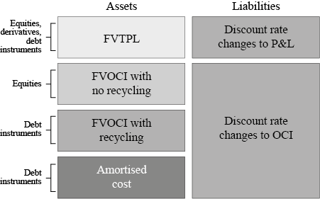
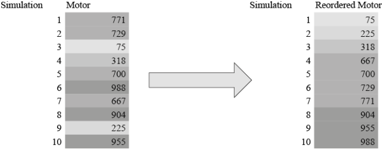
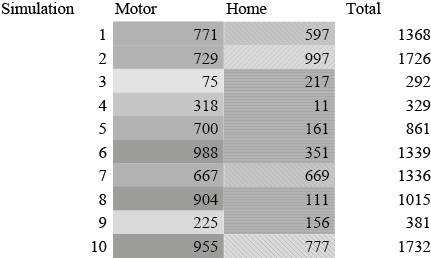
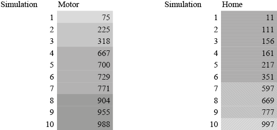
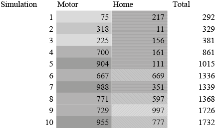
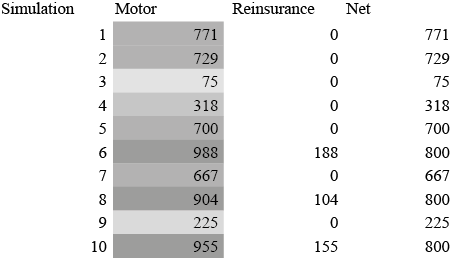
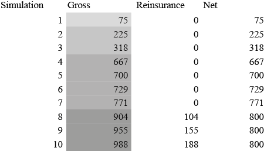

# 50A - Insurance contracts (IFRS 17)

[返回目录](README.md)

###### EX 50A.234.1 – Calculation of insurance revenue and insurance service expenses

 

Reference to standard: IFRS 17 paras 80–85, App B paras B123–B125   
 Reference to standing text: [50A.234](82.md#s342-Para_50A.234)  
 

  

 

An entity issues an insurance contract with a coverage period of three years. The coverage period starts when the insurance contract is issued; it is assumed that the contract will not lapse before the end of the coverage period. 

 

The premium of CU900 is expected to be paid immediately after initial recognition, and so the expected present value of cash inflows is also CU900. The entity estimates the annual expected cash outflows (to be paid immediately when expenses are incurred) as follows:

 

<table style="border-collapse:collapse"><tr><td style="border:0.75pt solid #000000; padding-right:5.03pt; padding-left:5.03pt; vertical-align:top">
 
</td><td style="border:0.75pt solid #000000; padding-right:5.03pt; padding-left:5.03pt; vertical-align:top">
<b>CU</b>
</td></tr><tr><td style="border:0.75pt solid #000000; padding-right:5.03pt; padding-left:5.03pt; vertical-align:top">
Expected annual cash outflows (end of year)
</td><td style="border:0.75pt solid #000000; padding-right:5.03pt; padding-left:5.03pt; vertical-align:top">
200
</td></tr><tr><td style="border:0.75pt solid #000000; padding-right:5.03pt; padding-left:5.03pt; vertical-align:top">
 
</td><td style="border:0.75pt solid #000000; padding-right:5.03pt; padding-left:5.03pt; vertical-align:top">
(total 600)
</td></tr><tr><td style="border:0.75pt solid #000000; padding-right:5.03pt; padding-left:5.03pt; vertical-align:top">
Risk adjustment for non-financial risk
</td><td style="border:0.75pt solid #000000; padding-right:5.03pt; padding-left:5.03pt; vertical-align:top">
120
</td></tr></table>

 

Using a discount rate of 5%, the expected present value of annual cash outflows is CU545. This results in the present value of expected cash flows of CU545 – CU900 = (CU355) and a contractual service margin of CU900 – CU545 – CU120 = CU235.

 

At the end of the year, the amounts are as follows:

 

<table style="border-collapse:collapse"><tr><td style="border:0.75pt solid #000000; padding-right:5.03pt; padding-left:5.03pt; vertical-align:top">
 
</td><td style="border:0.75pt solid #000000; padding-right:5.03pt; padding-left:5.03pt; vertical-align:top">
<b>PV expected cash inflows/ (outflows)</b>
</td><td style="border:0.75pt solid #000000; padding-right:5.03pt; padding-left:5.03pt; vertical-align:top">
<b>Risk adjustment non-financial risk</b>
</td><td style="border:0.75pt solid #000000; padding-right:5.03pt; padding-left:5.03pt; vertical-align:top">
<b>Contractual service margin</b>
</td><td style="border:0.75pt solid #000000; padding-right:5.03pt; padding-left:5.03pt; vertical-align:top">
<b>Total liability</b>
</td></tr><tr><td style="border:0.75pt solid #000000; padding-right:5.03pt; padding-left:5.03pt; vertical-align:top">
 
</td><td style="border:0.75pt solid #000000; padding-right:5.03pt; padding-left:5.03pt; vertical-align:top">
<b>CU</b>
</td><td style="border:0.75pt solid #000000; padding-right:5.03pt; padding-left:5.03pt; vertical-align:top">
<b>CU</b>
</td><td style="border:0.75pt solid #000000; padding-right:5.03pt; padding-left:5.03pt; vertical-align:top">
<b>CU</b>
</td><td style="border:0.75pt solid #000000; padding-right:5.03pt; padding-left:5.03pt; vertical-align:top">
<b>CU</b>
</td></tr><tr><td style="border:0.75pt solid #000000; padding-right:5.03pt; padding-left:5.03pt; vertical-align:top">
<b>Opening balance</b>
</td><td style="border:0.75pt solid #000000; padding-right:5.03pt; padding-left:5.03pt; vertical-align:top">
<b>(355)</b>
</td><td style="border:0.75pt solid #000000; padding-right:5.03pt; padding-left:5.03pt; vertical-align:top">
<b>120</b>
</td><td style="border:0.75pt solid #000000; padding-right:5.03pt; padding-left:5.03pt; vertical-align:top">
<b>235</b>
</td><td style="border:0.75pt solid #000000; padding-right:5.03pt; padding-left:5.03pt; vertical-align:top">
<b>–</b>
</td></tr><tr><td style="border:0.75pt solid #000000; padding-right:5.03pt; padding-left:5.03pt; vertical-align:top">
Cash inflows/premium received
</td><td style="border:0.75pt solid #000000; padding-right:5.03pt; padding-left:5.03pt; vertical-align:top">
900
</td><td style="border:0.75pt solid #000000; padding-right:5.03pt; padding-left:5.03pt; vertical-align:top">
 
</td><td style="border:0.75pt solid #000000; padding-right:5.03pt; padding-left:5.03pt; vertical-align:top">
 
</td><td style="border:0.75pt solid #000000; padding-right:5.03pt; padding-left:5.03pt; vertical-align:top">
900
</td></tr><tr><td style="border:0.75pt solid #000000; padding-right:5.03pt; padding-left:5.03pt; vertical-align:top">
Insurance finance expenses
</td><td style="border:0.75pt solid #000000; padding-right:5.03pt; padding-left:5.03pt; vertical-align:top">
27
</td><td style="border:0.75pt solid #000000; padding-right:5.03pt; padding-left:5.03pt; vertical-align:top">
 
</td><td style="border:0.75pt solid #000000; padding-right:5.03pt; padding-left:5.03pt; vertical-align:top">
12
</td><td style="border:0.75pt solid #000000; padding-right:5.03pt; padding-left:5.03pt; vertical-align:top">
39
</td></tr><tr><td style="border:0.75pt solid #000000; padding-right:5.03pt; padding-left:5.03pt; vertical-align:top">
Release for the year
</td><td style="border:0.75pt solid #000000; padding-right:5.03pt; padding-left:5.03pt; vertical-align:top">
 
</td><td style="border:0.75pt solid #000000; padding-right:5.03pt; padding-left:5.03pt; vertical-align:top">
(40)
</td><td style="border:0.75pt solid #000000; padding-right:5.03pt; padding-left:5.03pt; vertical-align:top">
(82)
</td><td style="border:0.75pt solid #000000; padding-right:5.03pt; padding-left:5.03pt; vertical-align:top">
(122)
</td></tr><tr><td style="border:0.75pt solid #000000; padding-right:5.03pt; padding-left:5.03pt; vertical-align:top">
Cash outflows
</td><td style="border:0.75pt solid #000000; padding-right:5.03pt; padding-left:5.03pt; vertical-align:top">
(200)
</td><td style="border:0.75pt solid #000000; padding-right:5.03pt; padding-left:5.03pt; vertical-align:top">
 
</td><td style="border:0.75pt solid #000000; padding-right:5.03pt; padding-left:5.03pt; vertical-align:top">
 
</td><td style="border:0.75pt solid #000000; padding-right:5.03pt; padding-left:5.03pt; vertical-align:top">
(200)
</td></tr><tr><td style="border:0.75pt solid #000000; padding-right:5.03pt; padding-left:5.03pt; vertical-align:top">
<b>Closing balance</b>
</td><td style="border:0.75pt solid #000000; padding-right:5.03pt; padding-left:5.03pt; vertical-align:top">
<b>372</b>
</td><td style="border:0.75pt solid #000000; padding-right:5.03pt; padding-left:5.03pt; vertical-align:top">
<b>80</b>
</td><td style="border:0.75pt solid #000000; padding-right:5.03pt; padding-left:5.03pt; vertical-align:top">
<b>165</b>
</td><td style="border:0.75pt solid #000000; padding-right:5.03pt; padding-left:5.03pt; vertical-align:top">
<b>617</b>
</td></tr></table>

 

The insurance finance expenses are calculated as the interest based on the opening balance adjusted for the cash flows paid on day 1 of CU900 using the locked-in discount rate of 5%.

 

As explained above, insurance revenue for the period can be calculated in two different ways:

 

**Method A:**

 

<table style="border-collapse:collapse"><tr><td style="border:0.75pt solid #000000; padding-right:5.03pt; padding-left:5.03pt; vertical-align:top">
 
</td><td style="border:0.75pt solid #000000; padding-right:5.03pt; padding-left:5.03pt; vertical-align:top">
<b>CU</b>
</td></tr><tr><td style="border:0.75pt solid #000000; padding-right:5.03pt; padding-left:5.03pt; vertical-align:top">
Insurance claims and expenses expected to be incurred in the period          
</td><td style="border:0.75pt solid #000000; padding-right:5.03pt; padding-left:5.03pt; vertical-align:top">
200
</td></tr><tr><td style="border:0.75pt solid #000000; padding-right:5.03pt; padding-left:5.03pt; vertical-align:top">
Change in the risk adjustment for non-financial risk                                         
</td><td style="border:0.75pt solid #000000; padding-right:5.03pt; padding-left:5.03pt; vertical-align:top">
40
</td></tr><tr><td style="border:0.75pt solid #000000; padding-right:5.03pt; padding-left:5.03pt; vertical-align:top">
Amount of the contractual service margin recognised in profit or loss
</td><td style="border:0.75pt solid #000000; padding-right:5.03pt; padding-left:5.03pt; vertical-align:top">
82
</td></tr><tr><td style="border:0.75pt solid #000000; padding-right:5.03pt; padding-left:5.03pt; vertical-align:top">
<b>Insurance revenue</b>
</td><td style="border:0.75pt solid #000000; padding-right:5.03pt; padding-left:5.03pt; vertical-align:top">
<b>322</b>
</td></tr></table>

 

**Method B:**

 

<table style="border-collapse:collapse"><tr><td colspan="2" style="border:0.75pt solid #000000; padding-right:5.03pt; padding-left:5.03pt; vertical-align:top">
 
</td><td style="border:0.75pt solid #000000; padding-right:5.03pt; padding-left:5.03pt; vertical-align:top">
<b>CU</b>
</td></tr><tr><td colspan="2" style="border:0.75pt solid #000000; padding-right:5.03pt; padding-left:5.03pt; vertical-align:top">
Total expected changes in liability for remaining coverage          
</td><td style="border:0.75pt solid #000000; padding-right:5.03pt; padding-left:5.03pt; vertical-align:top">
(617)
</td></tr><tr><td style="border:0.75pt solid #000000; padding-right:5.03pt; padding-left:5.03pt; vertical-align:top">
 
</td><td style="border:0.75pt solid #000000; padding-right:5.03pt; padding-left:5.03pt; vertical-align:top">
- Changes resulting from cash inflows from premiums
</td><td style="border:0.75pt solid #000000; padding-right:5.03pt; padding-left:5.03pt; vertical-align:top">
900
</td></tr><tr><td style="border:0.75pt solid #000000; padding-right:5.03pt; padding-left:5.03pt; vertical-align:top">
 
</td><td style="border:0.75pt solid #000000; padding-right:5.03pt; padding-left:5.03pt; vertical-align:top">
- Insurance finance income or expenses
</td><td style="border:0.75pt solid #000000; padding-right:5.03pt; padding-left:5.03pt; vertical-align:top">
39
</td></tr><tr><td colspan="2" style="border:0.75pt solid #000000; padding-right:5.03pt; padding-left:5.03pt; vertical-align:top">
<b>Insurance revenue</b>
</td><td style="border:0.75pt solid #000000; padding-right:5.03pt; padding-left:5.03pt; vertical-align:top">
<b>322</b>
</td></tr></table>

 

Insurance service expenses are equal to the amount of incurred claims (that is, CU200). In this example, there are no acquisition costs that qualify as fulfilment cash flows. If there were, they would be amortised and recorded as an expense, with an equivalent amount of revenue recorded.

 

###### EX 50A.234.2 – Accounting for a longevity swap under IFRS 17

 

Reference to standard: IFRS 17 paras 33(a), 86, App B para B120  
Reference to standing text: [50A.234](82.md#s342-Para_50A.234)  

  

 

**Background**

 

A longevity swap is an insurance or reinsurance contract that transfers the longevity risk associated with a group of annuity contracts from a pension scheme or sponsoring company to an insurer, or from an insurer to a reinsurer. Longevity risk in such contracts is the risk of an annuity provider, insurer or reinsurer having to pay a greater value of annuity payments due to annuitants living longer than expected.

 

A longevity swap typically comprises three elements:

 

- The holder of the contract agrees to pay a fixed series of payments (the ‘fixed leg’) to the issuer, representing the expected benefits payable on the underlying contracts. These fixed payments are determined at contract inception and do not change over the life of the contract, other than for the effect of financial risk (for example, an inflation index) where the contractual terms include this.

- In return, the issuer reimburses the holder for benefits that fall due on the underlying contracts, based on actual mortality (the ‘floating leg’).

- An upfront fixed fee to cover the issuer’s expenses and a profit margin.

 

An insurer, as the holder of the longevity swap in this example, presents income and expenses from reinsurance contracts on a gross basis in profit or loss, as permitted under paragraph 86 of IFRS 17. The cash flows between the fixed and floating legs are net settled on a quarterly basis. Other payment structures might exist in practice, but this example only considers this specific fact pattern and does not consider financial risk, such as inflation, further.

 

**Question 1**

 

How should the holder of a longevity swap determine premium ceded and amounts recovered from the reinsurer?

 

**Answer**

 

An insurer generally, as the holder of a longevity swap, determines that any contractual amounts that are not contingent on claims on the underlying contracts are treated as part of the premium ceded for the contracts. Applying the principles of paragraph B120 of IFRS 17, the premium ceded would include the fees paid to the issuer plus the fixed-leg amounts as stipulated in the contract, excluding any investment components and adjusted for any financing effect. The fees associated with the longevity swap are a fixed amount and unrelated to underlying claims, and so they should be treated as part of the premium ceded. The fixed-leg amounts are also not contingent on the claims on underlying contracts, since they remain at the level set out in the contract, irrespective of the actual experience.

 

The holder of the longevity swap might determine the amounts recovered from the reinsurer based on the amounts of the floating leg (excluding any investment components), because these amounts are contingent on claims on the underlying contracts. This treatment is consistent with paragraph 86(a) of IFRS 17, which states that an entity should “treat reinsurance cash flows that are contingent on claims on the underlying contracts as part of the claims that are expected to be reimbursed under the reinsurance contract held”.

 

**Question 2**

 

How should the issuer of a longevity swap determine insurance revenue and claims incurred?

 

**Answer**

 

An insurer generally, as the issuer of a longevity swap, determines the claims incurred based on the amounts of the floating leg (excluding any investment components), since these amounts are contingent on claims on the underlying contracts.

 

Applying paragraph B120 of IFRS 17, insurance revenue can be determined as the sum of the fees received plus the fixed-leg amounts as stipulated in the contract, excluding any investment components and adjusted for any financing effect. This amount represents the consideration received and/or receivable by the issuer for bearing longevity risk if an insured event did not happen (that is, all annuitants died prior to the first annuities becoming payable).

 

**Question 3**

 

How should an issuer or a holder model the amounts and timing of future cash flows on a longevity swap?

 

**Answer**

 

The issuer and the holder of a longevity swap should apply the requirements of paragraph 33(a) of IFRS 17.

 

For modelling purposes, an entity might choose to reflect the amounts of the gross fixed- and floating-leg cash flows or the net expected settlement amounts. Both approaches will give a similar result. However, the timing of the cash flows should reflect the expected settlement dates of each cash flow on the longevity swap, whether the amounts modelled are on a gross or net basis. If an entity models the cash flows using the gross amounts of the fixed and floating legs, it would be inappropriate to model the timing of the floating legs to mirror the timing of the actual claim payments on the underlying annuities if the floating leg is settled net of the fixed leg on a quarterly basis, rather than as and when underlying claims are paid.

 

**Question 4**

 

How should the holder and issuer of the longevity swap determine the risk adjustment?

 

**Answer**

 

From both the holder’s and issuer’s perspective, the risk adjustment represents the amount of uncertainty arising from non-financial risks transferred to the reinsurer and assumed from the cedant, respectively. This amount excludes the risk of non-performance by the reinsurer (see [FAQ 50A.188.5](83.md#s346-FAQ_50A.188.5) - Should the risk of non-performance by the reinsurer be considered within the estimates of future cash flows for reinsurance contracts held?). Under the terms of the longevity swap, there is uncertainty in the amount of the floating leg (which is based on actual mortality experience) but not in either the fixed upfront fee or the fixed leg (which is based on mortality assumptions at the outset). Only the floating-leg amounts contribute to variability when different points on the distribution of possible mortality outcomes are considered. The risk adjustment will be the same whether calculated using the gross amounts of the fixed and floating legs or using the net amounts.

 

##### Reinsurance contracts held

 

###### FAQ 50A.236.1 – Determining insurance revenue and insurance service expenses for insurance and reinsurance contracts issued with adjustable features

 

Reference to standard:IFRS 17 paras 42, 86, App B paras B120, B123, B126  
Reference to standing text: [50A.236](82.md#s342-Para_50A.236)  
  Insurance

  

 

**Background**

 

Insurers and reinsurers often issue contracts with adjustable features (that is, in addition to a fixed premium, there are features that provide for payments between the parties that vary based on claims experience). These adjustable features might be described in contracts in various ways, including profit commission, sliding scale commission, variable ceding commission, premium adjustment, mandatory premium reinstatement, no claims bonus, or retrospectively rated adjustment.

 

These adjustable features might be used where the policyholder and the insurer cannot agree on a fixed price for the risk or where the policyholder wants to participate in the benefit of controlling its claims. Based on the contract's loss experience, the insurance contract will provide for changes in the amount or timing of future contractual cash flows, including adjusting the original premium or changing the amount of covered claims.

 

**Question 1**

 

What is the appropriate presentation in the statement of profit or loss of various payments between insurers and reinsurers relating to contracts with adjustable features?

 

**Answer**

 

Premium revenue is the amount that an insurer is entitled to retain, even if there is no insured event. Premium revenue excludes any investment component or premium refund that the insurer is required to repay to the policyholder. Amounts collected that are based on claims experience are not premium (consistent with para 86(a) of IFRS 17), but instead are adjustments to insurance service expense. As noted in the September 2018 TRG meeting summary:

 

“the economic effect of amounts exchanged between a reinsurer and a cedant that are contingent on claims is equivalent to reimbursing a different amount of claims than expected. Therefore, those amounts would be recognised as part of insurance service expenses applying paragraph 42(a) of IFRS 17.”

 

The September 2018 TRG staff paper AP03 noted that the concepts inherent in paragraph 86 of IFRS 17 relating to reinsurance contracts held are also applicable to reinsurance contracts issued, because the economic effect is the same on both parties. Similarly, we believe that those concepts are applicable to insurance contracts issued, because there is no economic difference between an issued reinsurance contract and an issued insurance contract.

 

The description of payments between the parties in the contract is not relevant to the accounting classification in the statement of profit or loss. Total insurance revenue, as set out in paragraph B120 of IFRS 17, is the consideration for the contract – that is, the amount of premiums paid to the entity (a) adjusted for a financing effect, and (b) excluding any investment components.

 

The principles described above apply equally to contracts accounted for under the general model and those accounted for using the premium allocation approach, as confirmed by references to both general model and premium allocation approach paragraphs in the September 2018 TRG meeting summary and staff paper AP03.

 

**Question 2**

 

How do the concepts relating to adjustable features in contracts in Question 1 above apply to a contract that has commissions contingent on claims in the form of a sliding scale commission?

 

**Answer**

 

Adjustable features go by many names, and contracts might structure the timing of cash flows differently, but nevertheless the features should be analysed using the same principles noted in Question 1 above. Paragraphs 38–46 of staff paper AP03 from the September 2018 TRG meeting provides an example of commissions that are contingent on claims in the form of a sliding scale commission arrangement in a reinsurance contract. In the example, the reinsurance premium is CU6,000, representing 60% of premium on the underlying insurance contracts.

 

The sliding scale commission is an amount due from the reinsurer to the cedant. Terms are as follows:

 

<table style="border-collapse:collapse"><tr><td style="border:0.75pt solid #000000; padding-right:5.03pt; padding-left:5.03pt; vertical-align:top">
<b>Loss ratio</b>
</td><td style="border:0.75pt solid #000000; padding-right:5.03pt; padding-left:5.03pt; vertical-align:top">
<b>Commission as a % of reinsurance premium</b>
</td><td style="border:0.75pt solid #000000; padding-right:5.03pt; padding-left:5.03pt; vertical-align:top">
<b>Amount (CU)</b>
</td></tr><tr><td style="border:0.75pt solid #000000; padding-right:5.03pt; padding-left:5.03pt; vertical-align:top">
At or above 75%
</td><td style="border:0.75pt solid #000000; padding-right:5.03pt; padding-left:5.03pt; vertical-align:top">
Minimum commission 20%
</td><td style="border:0.75pt solid #000000; padding-right:5.03pt; padding-left:5.03pt; vertical-align:top">
1,200
</td></tr><tr><td style="border:0.75pt solid #000000; padding-right:5.03pt; padding-left:5.03pt; vertical-align:top">
55%–75%
</td><td style="border:0.75pt solid #000000; padding-right:5.03pt; padding-left:5.03pt; vertical-align:top">
Commission in the range of 20%–40%
</td><td style="border:0.75pt solid #000000; padding-right:5.03pt; padding-left:5.03pt; vertical-align:top">
Sliding scale
</td></tr><tr><td style="border:0.75pt solid #000000; padding-right:5.03pt; padding-left:5.03pt; vertical-align:top">
At or below 55%
</td><td style="border:0.75pt solid #000000; padding-right:5.03pt; padding-left:5.03pt; vertical-align:top">
Maximum commission of 40%
</td><td style="border:0.75pt solid #000000; padding-right:5.03pt; padding-left:5.03pt; vertical-align:top">
2,400
</td></tr></table>

 

- The commission amount is dependent on the loss experience of the contract, varying between 20% and 40% of the reinsurance premium of CU6,000 for loss ratios between 75% and 55%.

- A provisional commission amount of CU1,800 based on an expected loss ratio of 65% and commission rate of 30% is settled net, with the upfront premium charged to the cedant.

- The final commission amount is determined several years after the coverage period when all claims are fully paid.

 

The TRG observed that the economic effect of amounts exchanged between a reinsurer and a cedant that are not contingent on claims is equivalent to the effect of charging a different premium. Therefore, those amounts would be recognised as part of insurance revenue, applying paragraph B123 or B126 of IFRS 17. In the sliding scale commission example above, the staff paper noted that:

 

“the amount due to the cedant regardless of the loss experience of the contract is CU2,400:

 

- if there are no claims, cash flows of CU2,400 are due to the cedant

- if there are claims, the cedant receives CU2,400 plus a portion of the amount claimed (it does not matter whether the amounts are described as commissions or as claims, or as a combination depending on insurance outcomes)

 

The economic effect of the commission is equivalent to charging a premium of CU3,600 rather than CU6,000.”

 

The TRG also observed that the economic effect of amounts exchanged between a reinsurer and a cedant that are contingent on claims is equivalent to reimbursing a different amount of claims than expected. Therefore, those amounts would be recognised as part of insurance service expenses, applying paragraph 42(a) of IFRS 17.

 

The following tables illustrate the application of these principles to the sliding scale commission fact pattern in six simulations, each having a different loss ratio (that is, a different claims experience):

 

<table style="border-collapse:collapse"><tr><td style="border:0.75pt solid #000000; padding-right:5.03pt; padding-left:5.03pt; vertical-align:top">
<b>Simulation</b>
</td><td style="border:0.75pt solid #000000; padding-right:5.03pt; padding-left:5.03pt; vertical-align:top">
<b>Premium</b>
</td><td style="border:0.75pt solid #000000; padding-right:5.03pt; padding-left:5.03pt; vertical-align:top">
<b>Loss ratio</b>
</td><td style="border:0.75pt solid #000000; padding-right:5.03pt; padding-left:5.03pt; vertical-align:top">
<b>Claim</b>
</td><td style="border:0.75pt solid #000000; padding-right:5.03pt; padding-left:5.03pt; vertical-align:top">
<b>Total profit commission</b>
</td><td style="border:0.75pt solid #000000; padding-right:5.03pt; padding-left:5.03pt; vertical-align:top">
<b>Adjustment to premium</b>
</td><td style="border:0.75pt solid #000000; padding-right:5.03pt; padding-left:5.03pt; vertical-align:top">
<b>Adjustment to claims</b>
</td></tr><tr><td style="border:0.75pt solid #000000; padding-right:5.03pt; padding-left:5.03pt; vertical-align:top">
 
</td><td style="border:0.75pt solid #000000; padding-right:5.03pt; padding-left:5.03pt; vertical-align:top">
CU
</td><td style="border:0.75pt solid #000000; padding-right:5.03pt; padding-left:5.03pt; vertical-align:top">
 
</td><td style="border:0.75pt solid #000000; padding-right:5.03pt; padding-left:5.03pt; vertical-align:top">
CU
</td><td style="border:0.75pt solid #000000; padding-right:5.03pt; padding-left:5.03pt; vertical-align:top">
 
</td><td style="border:0.75pt solid #000000; padding-right:5.03pt; padding-left:5.03pt; vertical-align:top">
 
</td><td style="border:0.75pt solid #000000; padding-right:5.03pt; padding-left:5.03pt; vertical-align:top">
 
</td></tr><tr><td style="border:0.75pt solid #000000; padding-right:5.03pt; padding-left:5.03pt; vertical-align:top">
1
</td><td style="border:0.75pt solid #000000; padding-right:5.03pt; padding-left:5.03pt; vertical-align:top">
6,000
</td><td style="border:0.75pt solid #000000; padding-right:5.03pt; padding-left:5.03pt; vertical-align:top">
0%
</td><td style="border:0.75pt solid #000000; padding-right:5.03pt; padding-left:5.03pt; vertical-align:top">
0
</td><td style="border:0.75pt solid #000000; padding-right:5.03pt; padding-left:5.03pt; vertical-align:top">
2,400
</td><td style="border:0.75pt solid #000000; padding-right:5.03pt; padding-left:5.03pt; vertical-align:top">
(2,400)
</td><td style="border:0.75pt solid #000000; padding-right:5.03pt; padding-left:5.03pt; vertical-align:top">
0
</td></tr><tr><td style="border:0.75pt solid #000000; padding-right:5.03pt; padding-left:5.03pt; vertical-align:top">
2
</td><td style="border:0.75pt solid #000000; padding-right:5.03pt; padding-left:5.03pt; vertical-align:top">
6,000
</td><td style="border:0.75pt solid #000000; padding-right:5.03pt; padding-left:5.03pt; vertical-align:top">
55%
</td><td style="border:0.75pt solid #000000; padding-right:5.03pt; padding-left:5.03pt; vertical-align:top">
3,300
</td><td style="border:0.75pt solid #000000; padding-right:5.03pt; padding-left:5.03pt; vertical-align:top">
2,400
</td><td style="border:0.75pt solid #000000; padding-right:5.03pt; padding-left:5.03pt; vertical-align:top">
(2,400)
</td><td style="border:0.75pt solid #000000; padding-right:5.03pt; padding-left:5.03pt; vertical-align:top">
0
</td></tr><tr><td style="border:0.75pt solid #000000; padding-right:5.03pt; padding-left:5.03pt; vertical-align:top">
3
</td><td style="border:0.75pt solid #000000; padding-right:5.03pt; padding-left:5.03pt; vertical-align:top">
6,000
</td><td style="border:0.75pt solid #000000; padding-right:5.03pt; padding-left:5.03pt; vertical-align:top">
65%
</td><td style="border:0.75pt solid #000000; padding-right:5.03pt; padding-left:5.03pt; vertical-align:top">
3,900
</td><td style="border:0.75pt solid #000000; padding-right:5.03pt; padding-left:5.03pt; vertical-align:top">
1,800
</td><td style="border:0.75pt solid #000000; padding-right:5.03pt; padding-left:5.03pt; vertical-align:top">
(2,400)
</td><td style="border:0.75pt solid #000000; padding-right:5.03pt; padding-left:5.03pt; vertical-align:top">
(600)
</td></tr><tr><td style="border:0.75pt solid #000000; padding-right:5.03pt; padding-left:5.03pt; vertical-align:top">
4
</td><td style="border:0.75pt solid #000000; padding-right:5.03pt; padding-left:5.03pt; vertical-align:top">
6,000
</td><td style="border:0.75pt solid #000000; padding-right:5.03pt; padding-left:5.03pt; vertical-align:top">
75%
</td><td style="border:0.75pt solid #000000; padding-right:5.03pt; padding-left:5.03pt; vertical-align:top">
4,500
</td><td style="border:0.75pt solid #000000; padding-right:5.03pt; padding-left:5.03pt; vertical-align:top">
1,200
</td><td style="border:0.75pt solid #000000; padding-right:5.03pt; padding-left:5.03pt; vertical-align:top">
(2,400)
</td><td style="border:0.75pt solid #000000; padding-right:5.03pt; padding-left:5.03pt; vertical-align:top">
(1,200)
</td></tr><tr><td style="border:0.75pt solid #000000; padding-right:5.03pt; padding-left:5.03pt; vertical-align:top">
5
</td><td style="border:0.75pt solid #000000; padding-right:5.03pt; padding-left:5.03pt; vertical-align:top">
6,000
</td><td style="border:0.75pt solid #000000; padding-right:5.03pt; padding-left:5.03pt; vertical-align:top">
80%
</td><td style="border:0.75pt solid #000000; padding-right:5.03pt; padding-left:5.03pt; vertical-align:top">
4,800
</td><td style="border:0.75pt solid #000000; padding-right:5.03pt; padding-left:5.03pt; vertical-align:top">
1,200
</td><td style="border:0.75pt solid #000000; padding-right:5.03pt; padding-left:5.03pt; vertical-align:top">
(2,400)
</td><td style="border:0.75pt solid #000000; padding-right:5.03pt; padding-left:5.03pt; vertical-align:top">
(1,200)
</td></tr><tr><td style="border:0.75pt solid #000000; padding-right:5.03pt; padding-left:5.03pt; vertical-align:top">
6
</td><td style="border:0.75pt solid #000000; padding-right:5.03pt; padding-left:5.03pt; vertical-align:top">
6,000
</td><td style="border:0.75pt solid #000000; padding-right:5.03pt; padding-left:5.03pt; vertical-align:top">
90%
</td><td style="border:0.75pt solid #000000; padding-right:5.03pt; padding-left:5.03pt; vertical-align:top">
5,400
</td><td style="border:0.75pt solid #000000; padding-right:5.03pt; padding-left:5.03pt; vertical-align:top">
1,200
</td><td style="border:0.75pt solid #000000; padding-right:5.03pt; padding-left:5.03pt; vertical-align:top">
(2,400)
</td><td style="border:0.75pt solid #000000; padding-right:5.03pt; padding-left:5.03pt; vertical-align:top">
(1,200)
</td></tr></table>

 

<table style="border-collapse:collapse"><tr><td colspan="8" style="border:0.75pt solid #000000; padding-right:5.03pt; padding-left:5.03pt; vertical-align:top">
                                                                                                           Simulation
</td></tr><tr><td style="border:0.75pt solid #000000; padding-right:5.03pt; padding-left:5.03pt; vertical-align:top">
 
</td><td style="border:0.75pt solid #000000; padding-right:5.03pt; padding-left:5.03pt; vertical-align:top">
 
</td><td style="border:0.75pt solid #000000; padding-right:5.03pt; padding-left:5.03pt; vertical-align:top">
1
</td><td style="border:0.75pt solid #000000; padding-right:5.03pt; padding-left:5.03pt; vertical-align:top">
2
</td><td style="border:0.75pt solid #000000; padding-right:5.03pt; padding-left:5.03pt; vertical-align:top">
3
</td><td style="border:0.75pt solid #000000; padding-right:5.03pt; padding-left:5.03pt; vertical-align:top">
4
</td><td style="border:0.75pt solid #000000; padding-right:5.03pt; padding-left:5.03pt; vertical-align:top">
5
</td><td style="border:0.75pt solid #000000; padding-right:5.03pt; padding-left:5.03pt; vertical-align:top">
6
</td></tr><tr><td rowspan="3" style="border:0.75pt solid #000000; padding-right:5.03pt; padding-left:5.03pt; vertical-align:top">
Insurance

revenue
</td><td style="border:0.75pt solid #000000; padding-right:5.03pt; padding-left:5.03pt; vertical-align:top">
Premium received
</td><td style="border:0.75pt solid #000000; padding-right:5.03pt; padding-left:5.03pt; vertical-align:top">
6,000
</td><td style="border:0.75pt solid #000000; padding-right:5.03pt; padding-left:5.03pt; vertical-align:top">
6,000
</td><td style="border:0.75pt solid #000000; padding-right:5.03pt; padding-left:5.03pt; vertical-align:top">
6,000
</td><td style="border:0.75pt solid #000000; padding-right:5.03pt; padding-left:5.03pt; vertical-align:top">
6,000
</td><td style="border:0.75pt solid #000000; padding-right:5.03pt; padding-left:5.03pt; vertical-align:top">
6,000
</td><td style="border:0.75pt solid #000000; padding-right:5.03pt; padding-left:5.03pt; vertical-align:top">
6,000
</td></tr><tr><td style="border:0.75pt solid #000000; padding-right:5.03pt; padding-left:5.03pt; vertical-align:top">
Adjustment
</td><td style="border:0.75pt solid #000000; padding-right:5.03pt; padding-left:5.03pt; vertical-align:top">
(2,400)
</td><td style="border:0.75pt solid #000000; padding-right:5.03pt; padding-left:5.03pt; vertical-align:top">
(2,400)
</td><td style="border:0.75pt solid #000000; padding-right:5.03pt; padding-left:5.03pt; vertical-align:top">
(2,400)
</td><td style="border:0.75pt solid #000000; padding-right:5.03pt; padding-left:5.03pt; vertical-align:top">
(2,400)
</td><td style="border:0.75pt solid #000000; padding-right:5.03pt; padding-left:5.03pt; vertical-align:top">
(2,400)
</td><td style="border:0.75pt solid #000000; padding-right:5.03pt; padding-left:5.03pt; vertical-align:top">
(2,400)
</td></tr><tr><td style="border:0.75pt solid #000000; padding-right:5.03pt; padding-left:5.03pt; vertical-align:top">
<b>Insurance revenue</b>
</td><td style="border:0.75pt solid #000000; padding-right:5.03pt; padding-left:5.03pt; vertical-align:top">
<b>3,600</b>
</td><td style="border:0.75pt solid #000000; padding-right:5.03pt; padding-left:5.03pt; vertical-align:top">
<b>3,600</b>
</td><td style="border:0.75pt solid #000000; padding-right:5.03pt; padding-left:5.03pt; vertical-align:top">
<b>3,600</b>
</td><td style="border:0.75pt solid #000000; padding-right:5.03pt; padding-left:5.03pt; vertical-align:top">
<b>3,600</b>
</td><td style="border:0.75pt solid #000000; padding-right:5.03pt; padding-left:5.03pt; vertical-align:top">
<b>3,600</b>
</td><td style="border:0.75pt solid #000000; padding-right:5.03pt; padding-left:5.03pt; vertical-align:top">
<b>3,600</b>
</td></tr><tr><td rowspan="3" style="border:0.75pt solid #000000; padding-right:5.03pt; padding-left:5.03pt; vertical-align:top">
Insurance

service expenses
</td><td style="border:0.75pt solid #000000; padding-right:5.03pt; padding-left:5.03pt; vertical-align:top">
Claims
</td><td style="border:0.75pt solid #000000; padding-right:5.03pt; padding-left:5.03pt; vertical-align:top">
0
</td><td style="border:0.75pt solid #000000; padding-right:5.03pt; padding-left:5.03pt; vertical-align:top">
3,300
</td><td style="border:0.75pt solid #000000; padding-right:5.03pt; padding-left:5.03pt; vertical-align:top">
3,900
</td><td style="border:0.75pt solid #000000; padding-right:5.03pt; padding-left:5.03pt; vertical-align:top">
4,500
</td><td style="border:0.75pt solid #000000; padding-right:5.03pt; padding-left:5.03pt; vertical-align:top">
4,800
</td><td style="border:0.75pt solid #000000; padding-right:5.03pt; padding-left:5.03pt; vertical-align:top">
5,400
</td></tr><tr><td style="border:0.75pt solid #000000; padding-right:5.03pt; padding-left:5.03pt; vertical-align:top">
Adjustment
</td><td style="border:0.75pt solid #000000; padding-right:5.03pt; padding-left:5.03pt; vertical-align:top">
0
</td><td style="border:0.75pt solid #000000; padding-right:5.03pt; padding-left:5.03pt; vertical-align:top">
0
</td><td style="border:0.75pt solid #000000; padding-right:5.03pt; padding-left:5.03pt; vertical-align:top">
-600
</td><td style="border:0.75pt solid #000000; padding-right:5.03pt; padding-left:5.03pt; vertical-align:top">
(1,200)
</td><td style="border:0.75pt solid #000000; padding-right:5.03pt; padding-left:5.03pt; vertical-align:top">
(1,200)
</td><td style="border:0.75pt solid #000000; padding-right:5.03pt; padding-left:5.03pt; vertical-align:top">
(1,200)
</td></tr><tr><td style="border:0.75pt solid #000000; padding-right:5.03pt; padding-left:5.03pt; vertical-align:top">
<b>Net claims incurred</b>
</td><td style="border:0.75pt solid #000000; padding-right:5.03pt; padding-left:5.03pt; vertical-align:top">
<b>0</b>
</td><td style="border:0.75pt solid #000000; padding-right:5.03pt; padding-left:5.03pt; vertical-align:top">
<b>3,300</b>
</td><td style="border:0.75pt solid #000000; padding-right:5.03pt; padding-left:5.03pt; vertical-align:top">
<b>3,300</b>
</td><td style="border:0.75pt solid #000000; padding-right:5.03pt; padding-left:5.03pt; vertical-align:top">
<b>3,300</b>
</td><td style="border:0.75pt solid #000000; padding-right:5.03pt; padding-left:5.03pt; vertical-align:top">
<b>3,600</b>
</td><td style="border:0.75pt solid #000000; padding-right:5.03pt; padding-left:5.03pt; vertical-align:top">
<b>4,200</b>
</td></tr><tr><td style="border:0.75pt solid #000000; padding-right:5.03pt; padding-left:5.03pt; vertical-align:top">
<b>Insurance results</b>
</td><td style="border:0.75pt solid #000000; padding-right:5.03pt; padding-left:5.03pt; vertical-align:top">
 
</td><td style="border:0.75pt solid #000000; padding-right:5.03pt; padding-left:5.03pt; vertical-align:top">
<b>3,600</b>
</td><td style="border:0.75pt solid #000000; padding-right:5.03pt; padding-left:5.03pt; vertical-align:top">
<b>300</b>
</td><td style="border:0.75pt solid #000000; padding-right:5.03pt; padding-left:5.03pt; vertical-align:top">
<b>300</b>
</td><td style="border:0.75pt solid #000000; padding-right:5.03pt; padding-left:5.03pt; vertical-align:top">
<b>300</b>
</td><td style="border:0.75pt solid #000000; padding-right:5.03pt; padding-left:5.03pt; vertical-align:top">
<b>0</b>
</td><td style="border:0.75pt solid #000000; padding-right:5.03pt; padding-left:5.03pt; vertical-align:top">
<b>(600)</b>
</td></tr></table>

 

The ‘premium’, for accounting purposes, is always CU3,600 (that is, it is gross CU6,000 minus the maximum amount (CU2,400) that would be refunded if there were no claims). The economic effect is the same as having a premium of CU3,600 and covering 100% of losses, excluding the corridor from 55% to 75% where no losses are actually covered.

 

Because the sliding scale commission varies from CU1,200 to CU2,400, depending on the loss ratio within a specified band (loss ratio 55%–75%), this effectively means that payments to the cedant vary with claims experience.

 

**Question 3**

 

How do the concepts relating to adjustable features in contracts in Question 1 above apply to an insurance contract that has payments contingent on claims in the form of a retrospective rating feature?

 

**Answer**

 

Adjustable features go by many names, and contracts might structure the timing of cash flows differently, but nevertheless the features should be analysed using the same principles noted in Question 1 above. For example, consider two different versions of a retrospectively rated insurance contract sold by an insurer to commercial policyholders as set out below:

 

Contract 1:

 

- premium of CU200 is paid by the policyholder to the insurer at the beginning of the coverage period; and

- an additional premium of 80% of claims paid is required to be paid by the policyholder to the insurer, up to a maximum additional premium of CU800.

 

Contract 2:

 

- premium of CU1,000 is paid by the policyholder to the insurer at the beginning of the coverage period; and

- the insurer will refund the policyholder 80% of any profit at the end of the contract.

 

The two contracts are economically similar and have the same revenue of CU200. Under both contracts, adjustments to cash flows as a result of claims experience would be an adjustment of insurance service expense.

 

The rationale for this approach was described in more detail in the September TRG staff paper AP03 as follows.

 

In Contract 1:

 

- Insurance revenue is the non-refundable minimum premium (CU200), since this represents the compensation for providing coverage that is not contingent on claims.

- Any additional premium up to the maximum CU800 is contingent on claims, because it is charged to the policyholder only if claims are incurred under the contract. The additional ‘premium’ is therefore part of claims and should be recognised as part of (adjustment to) insurance service expense.

 

In Contract 2:

 

- The premium of CU1,000 paid at the start of the coverage period is the contract premium. Unlike Contract 1, there is an amount (CU800) that will meet the definition of an investment component, because it is repaid to the policyholder in all circumstances. If there are no claims, the CU800 will be refunded; and, if there is some amount of claims incurred (such as CU1,500), the CU800 is effectively repaid to the policyholder as part of the claim reimbursement (that is, insurance service expense would be CU700); and insurance revenue would also be CU200, consistent with Contract 1.

 

While both contracts are economically similar, and have the same contract revenue of CU200, Contract 2 contains an investment component (a financial component that Contract 1 does not have) which would change the financial income or expense of Contract 2. That impact is not reflected in this simplified example, which assumes a 0% discount rate.

 

The following tables illustrate the application of these principles in four simulations, each having a different claims experience:

 

<table style="border-collapse:collapse"><tr><td style="border:0.75pt solid #000000; padding-right:5.03pt; padding-left:5.03pt; vertical-align:top">
<b>Simulation</b>
</td><td style="border:0.75pt solid #000000; padding-right:5.03pt; padding-left:5.03pt; vertical-align:top">
<b>Contract 1 initial premium</b>
</td><td style="border:0.75pt solid #000000; padding-right:5.03pt; padding-left:5.03pt; vertical-align:top">
<b>Contract 2 initial premium</b>
</td><td style="border:0.75pt solid #000000; padding-right:5.03pt; padding-left:5.03pt; vertical-align:top">
<b>Claims</b>
</td><td style="border:0.75pt solid #000000; padding-right:5.03pt; padding-left:5.03pt; text-align:right; vertical-align:top"><b>Contract 1 additional payment</b><b> </b><b>(80% of claims; max 800)</b></td><td style="border:0.75pt solid #000000; padding-right:5.03pt; padding-left:5.03pt; text-align:right; vertical-align:top"><b>Contract 2 refund</b><b> </b><b>(80% premium – claims)</b></td><td style="border:0.75pt solid #000000; padding-right:5.03pt; padding-left:5.03pt; vertical-align:top">
<b>Net cash</b>
</td></tr><tr><td style="border:0.75pt solid #000000; padding-right:5.03pt; padding-left:5.03pt; vertical-align:top">
1
</td><td style="border:0.75pt solid #000000; padding-right:5.03pt; padding-left:5.03pt; vertical-align:top">
200
</td><td style="border:0.75pt solid #000000; padding-right:5.03pt; padding-left:5.03pt; vertical-align:top">
1,000
</td><td style="border:0.75pt solid #000000; padding-right:5.03pt; padding-left:5.03pt; vertical-align:top">
0
</td><td style="border:0.75pt solid #000000; padding-right:5.03pt; padding-left:5.03pt; vertical-align:top">
0
</td><td style="border:0.75pt solid #000000; padding-right:5.03pt; padding-left:5.03pt; vertical-align:top">
800
</td><td style="border:0.75pt solid #000000; padding-right:5.03pt; padding-left:5.03pt; vertical-align:top">
200
</td></tr><tr><td style="border:0.75pt solid #000000; padding-right:5.03pt; padding-left:5.03pt; vertical-align:top">
2
</td><td style="border:0.75pt solid #000000; padding-right:5.03pt; padding-left:5.03pt; vertical-align:top">
200
</td><td style="border:0.75pt solid #000000; padding-right:5.03pt; padding-left:5.03pt; vertical-align:top">
1,000
</td><td style="border:0.75pt solid #000000; padding-right:5.03pt; padding-left:5.03pt; vertical-align:top">
600
</td><td style="border:0.75pt solid #000000; padding-right:5.03pt; padding-left:5.03pt; vertical-align:top">
480
</td><td style="border:0.75pt solid #000000; padding-right:5.03pt; padding-left:5.03pt; vertical-align:top">
320
</td><td style="border:0.75pt solid #000000; padding-right:5.03pt; padding-left:5.03pt; vertical-align:top">
80
</td></tr><tr><td style="border:0.75pt solid #000000; padding-right:5.03pt; padding-left:5.03pt; vertical-align:top">
3
</td><td style="border:0.75pt solid #000000; padding-right:5.03pt; padding-left:5.03pt; vertical-align:top">
200
</td><td style="border:0.75pt solid #000000; padding-right:5.03pt; padding-left:5.03pt; vertical-align:top">
1,000
</td><td style="border:0.75pt solid #000000; padding-right:5.03pt; padding-left:5.03pt; vertical-align:top">
1,000
</td><td style="border:0.75pt solid #000000; padding-right:5.03pt; padding-left:5.03pt; vertical-align:top">
800
</td><td style="border:0.75pt solid #000000; padding-right:5.03pt; padding-left:5.03pt; vertical-align:top">
0
</td><td style="border:0.75pt solid #000000; padding-right:5.03pt; padding-left:5.03pt; vertical-align:top">
0
</td></tr><tr><td style="border:0.75pt solid #000000; padding-right:5.03pt; padding-left:5.03pt; vertical-align:top">
4
</td><td style="border:0.75pt solid #000000; padding-right:5.03pt; padding-left:5.03pt; vertical-align:top">
200
</td><td style="border:0.75pt solid #000000; padding-right:5.03pt; padding-left:5.03pt; vertical-align:top">
1,000
</td><td style="border:0.75pt solid #000000; padding-right:5.03pt; padding-left:5.03pt; vertical-align:top">
1,500
</td><td style="border:0.75pt solid #000000; padding-right:5.03pt; padding-left:5.03pt; vertical-align:top">
800
</td><td style="border:0.75pt solid #000000; padding-right:5.03pt; padding-left:5.03pt; vertical-align:top">
0
</td><td style="border:0.75pt solid #000000; padding-right:5.03pt; padding-left:5.03pt; vertical-align:top">
(500)
</td></tr></table>

 

<table style="border-collapse:collapse"><tr><td colspan="6" style="border:0.75pt solid #000000; padding-right:5.03pt; padding-left:5.03pt; vertical-align:top">
                                                            Simulation – Contract 1                                          
</td></tr><tr><td style="border:0.75pt solid #000000; padding-right:5.03pt; padding-left:5.03pt; vertical-align:top">
 
</td><td style="border:0.75pt solid #000000; padding-right:5.03pt; padding-left:5.03pt; vertical-align:top">
 
</td><td style="border:0.75pt solid #000000; padding-right:5.03pt; padding-left:5.03pt; vertical-align:top">
1
</td><td style="border:0.75pt solid #000000; padding-right:5.03pt; padding-left:5.03pt; vertical-align:top">
2
</td><td style="border:0.75pt solid #000000; padding-right:5.03pt; padding-left:5.03pt; vertical-align:top">
3
</td><td style="border:0.75pt solid #000000; padding-right:5.03pt; padding-left:5.03pt; vertical-align:top">
4
</td></tr><tr><td rowspan="3" style="border:0.75pt solid #000000; padding-right:5.03pt; padding-left:5.03pt; vertical-align:top">
Insurance revenue
</td><td style="border:0.75pt solid #000000; padding-right:5.03pt; padding-left:5.03pt; vertical-align:top">
Premium received
</td><td style="border:0.75pt solid #000000; padding-right:5.03pt; padding-left:5.03pt; vertical-align:top">
200
</td><td style="border:0.75pt solid #000000; padding-right:5.03pt; padding-left:5.03pt; vertical-align:top">
200
</td><td style="border:0.75pt solid #000000; padding-right:5.03pt; padding-left:5.03pt; vertical-align:top">
200
</td><td style="border:0.75pt solid #000000; padding-right:5.03pt; padding-left:5.03pt; vertical-align:top">
200
</td></tr><tr><td style="border:0.75pt solid #000000; padding-right:5.03pt; padding-left:5.03pt; vertical-align:top">
Adjustment
</td><td style="border:0.75pt solid #000000; padding-right:5.03pt; padding-left:5.03pt; vertical-align:top">
 
</td><td style="border:0.75pt solid #000000; padding-right:5.03pt; padding-left:5.03pt; vertical-align:top">
 
</td><td style="border:0.75pt solid #000000; padding-right:5.03pt; padding-left:5.03pt; vertical-align:top">
 
</td><td style="border:0.75pt solid #000000; padding-right:5.03pt; padding-left:5.03pt; vertical-align:top">
 
</td></tr><tr><td style="border:0.75pt solid #000000; padding-right:5.03pt; padding-left:5.03pt; vertical-align:top">
<b>Insurance revenue</b>
</td><td style="border:0.75pt solid #000000; padding-right:5.03pt; padding-left:5.03pt; vertical-align:top">
<b>200</b>
</td><td style="border:0.75pt solid #000000; padding-right:5.03pt; padding-left:5.03pt; vertical-align:top">
<b>200</b>
</td><td style="border:0.75pt solid #000000; padding-right:5.03pt; padding-left:5.03pt; vertical-align:top">
<b>200</b>
</td><td style="border:0.75pt solid #000000; padding-right:5.03pt; padding-left:5.03pt; vertical-align:top">
<b>200</b>
</td></tr><tr><td rowspan="3" style="border:0.75pt solid #000000; padding-right:5.03pt; padding-left:5.03pt; vertical-align:top">
Insurance service expenses
</td><td style="border:0.75pt solid #000000; padding-right:5.03pt; padding-left:5.03pt; vertical-align:top">
Claims
</td><td style="border:0.75pt solid #000000; padding-right:5.03pt; padding-left:5.03pt; vertical-align:top">
0
</td><td style="border:0.75pt solid #000000; padding-right:5.03pt; padding-left:5.03pt; vertical-align:top">
600
</td><td style="border:0.75pt solid #000000; padding-right:5.03pt; padding-left:5.03pt; vertical-align:top">
1,000
</td><td style="border:0.75pt solid #000000; padding-right:5.03pt; padding-left:5.03pt; vertical-align:top">
1,500
</td></tr><tr><td style="border:0.75pt solid #000000; padding-right:5.03pt; padding-left:5.03pt; vertical-align:top">
Adjustment
</td><td style="border:0.75pt solid #000000; padding-right:5.03pt; padding-left:5.03pt; vertical-align:top">
0
</td><td style="border:0.75pt solid #000000; padding-right:5.03pt; padding-left:5.03pt; vertical-align:top">
(480)
</td><td style="border:0.75pt solid #000000; padding-right:5.03pt; padding-left:5.03pt; vertical-align:top">
(800)
</td><td style="border:0.75pt solid #000000; padding-right:5.03pt; padding-left:5.03pt; vertical-align:top">
(800)
</td></tr><tr><td style="border:0.75pt solid #000000; padding-right:5.03pt; padding-left:5.03pt; vertical-align:top">
<b>Net claims incurred</b>
</td><td style="border:0.75pt solid #000000; padding-right:5.03pt; padding-left:5.03pt; vertical-align:top">
<b>0</b>
</td><td style="border:0.75pt solid #000000; padding-right:5.03pt; padding-left:5.03pt; vertical-align:top">
<b>120</b>
</td><td style="border:0.75pt solid #000000; padding-right:5.03pt; padding-left:5.03pt; vertical-align:top">
<b>200</b>
</td><td style="border:0.75pt solid #000000; padding-right:5.03pt; padding-left:5.03pt; vertical-align:top">
<b>700</b>
</td></tr><tr><td style="border:0.75pt solid #000000; padding-right:5.03pt; padding-left:5.03pt; vertical-align:top">
<b>Insurance results</b>
</td><td style="border:0.75pt solid #000000; padding-right:5.03pt; padding-left:5.03pt; vertical-align:top">
 
</td><td style="border:0.75pt solid #000000; padding-right:5.03pt; padding-left:5.03pt; vertical-align:top">
<b>200</b>
</td><td style="border:0.75pt solid #000000; padding-right:5.03pt; padding-left:5.03pt; vertical-align:top">
<b>80</b>
</td><td style="border:0.75pt solid #000000; padding-right:5.03pt; padding-left:5.03pt; vertical-align:top">
<b>0</b>
</td><td style="border:0.75pt solid #000000; padding-right:5.03pt; padding-left:5.03pt; vertical-align:top">
<b>(500)</b>
</td></tr></table>

 

<table style="border-collapse:collapse"><tr><td colspan="6" style="border:0.75pt solid #000000; padding-right:5.03pt; padding-left:5.03pt; vertical-align:top">
Simulation – Contract 2
</td></tr><tr><td style="border:0.75pt solid #000000; padding-right:5.03pt; padding-left:5.03pt; vertical-align:top">
 
</td><td style="border:0.75pt solid #000000; padding-right:5.03pt; padding-left:5.03pt; vertical-align:top">
 
</td><td style="border:0.75pt solid #000000; padding-right:5.03pt; padding-left:5.03pt; vertical-align:top">
1
</td><td style="border:0.75pt solid #000000; padding-right:5.03pt; padding-left:5.03pt; vertical-align:top">
2
</td><td style="border:0.75pt solid #000000; padding-right:5.03pt; padding-left:5.03pt; vertical-align:top">
3
</td><td style="border:0.75pt solid #000000; padding-right:5.03pt; padding-left:5.03pt; vertical-align:top">
4
</td></tr><tr><td rowspan="3" style="border:0.75pt solid #000000; padding-right:5.03pt; padding-left:5.03pt; vertical-align:top">
Insurance revenue
</td><td style="border:0.75pt solid #000000; padding-right:5.03pt; padding-left:5.03pt; vertical-align:top">
Premium received
</td><td style="border:0.75pt solid #000000; padding-right:5.03pt; padding-left:5.03pt; vertical-align:top">
1,000
</td><td style="border:0.75pt solid #000000; padding-right:5.03pt; padding-left:5.03pt; vertical-align:top">
1,000
</td><td style="border:0.75pt solid #000000; padding-right:5.03pt; padding-left:5.03pt; vertical-align:top">
1,000
</td><td style="border:0.75pt solid #000000; padding-right:5.03pt; padding-left:5.03pt; vertical-align:top">
1,000
</td></tr><tr><td style="border:0.75pt solid #000000; padding-right:5.03pt; padding-left:5.03pt; vertical-align:top">
Adjustment
</td><td style="border:0.75pt solid #000000; padding-right:5.03pt; padding-left:5.03pt; vertical-align:top">
(800)
</td><td style="border:0.75pt solid #000000; padding-right:5.03pt; padding-left:5.03pt; vertical-align:top">
(800)
</td><td style="border:0.75pt solid #000000; padding-right:5.03pt; padding-left:5.03pt; vertical-align:top">
(800)
</td><td style="border:0.75pt solid #000000; padding-right:5.03pt; padding-left:5.03pt; vertical-align:top">
(800)
</td></tr><tr><td style="border:0.75pt solid #000000; padding-right:5.03pt; padding-left:5.03pt; vertical-align:top">
<b>Insurance revenue</b>
</td><td style="border:0.75pt solid #000000; padding-right:5.03pt; padding-left:5.03pt; vertical-align:top">
<b>200</b>
</td><td style="border:0.75pt solid #000000; padding-right:5.03pt; padding-left:5.03pt; vertical-align:top">
<b>200</b>
</td><td style="border:0.75pt solid #000000; padding-right:5.03pt; padding-left:5.03pt; vertical-align:top">
<b>200</b>
</td><td style="border:0.75pt solid #000000; padding-right:5.03pt; padding-left:5.03pt; vertical-align:top">
<b>200</b>
</td></tr><tr><td rowspan="3" style="border:0.75pt solid #000000; padding-right:5.03pt; padding-left:5.03pt; vertical-align:top">
Insurance service expenses
</td><td style="border:0.75pt solid #000000; padding-right:5.03pt; padding-left:5.03pt; vertical-align:top">
Claims
</td><td style="border:0.75pt solid #000000; padding-right:5.03pt; padding-left:5.03pt; vertical-align:top">
0
</td><td style="border:0.75pt solid #000000; padding-right:5.03pt; padding-left:5.03pt; vertical-align:top">
600
</td><td style="border:0.75pt solid #000000; padding-right:5.03pt; padding-left:5.03pt; vertical-align:top">
1,000
</td><td style="border:0.75pt solid #000000; padding-right:5.03pt; padding-left:5.03pt; vertical-align:top">
1,500
</td></tr><tr><td style="border:0.75pt solid #000000; padding-right:5.03pt; padding-left:5.03pt; vertical-align:top">
Adjustment
</td><td style="border:0.75pt solid #000000; padding-right:5.03pt; padding-left:5.03pt; vertical-align:top">
0
</td><td style="border:0.75pt solid #000000; padding-right:5.03pt; padding-left:5.03pt; vertical-align:top">
(480)
</td><td style="border:0.75pt solid #000000; padding-right:5.03pt; padding-left:5.03pt; vertical-align:top">
(800)
</td><td style="border:0.75pt solid #000000; padding-right:5.03pt; padding-left:5.03pt; vertical-align:top">
(800)
</td></tr><tr><td style="border:0.75pt solid #000000; padding-right:5.03pt; padding-left:5.03pt; vertical-align:top">
<b>Net claims incurred</b>
</td><td style="border:0.75pt solid #000000; padding-right:5.03pt; padding-left:5.03pt; vertical-align:top">
<b>0</b>
</td><td style="border:0.75pt solid #000000; padding-right:5.03pt; padding-left:5.03pt; vertical-align:top">
<b>120</b>
</td><td style="border:0.75pt solid #000000; padding-right:5.03pt; padding-left:5.03pt; vertical-align:top">
<b>200</b>
</td><td style="border:0.75pt solid #000000; padding-right:5.03pt; padding-left:5.03pt; vertical-align:top">
<b>700</b>
</td></tr><tr><td style="border:0.75pt solid #000000; padding-right:5.03pt; padding-left:5.03pt; vertical-align:top">
<b>Insurance results</b>
</td><td style="border:0.75pt solid #000000; padding-right:5.03pt; padding-left:5.03pt; vertical-align:top">
 
</td><td style="border:0.75pt solid #000000; padding-right:5.03pt; padding-left:5.03pt; vertical-align:top">
<b>200</b>
</td><td style="border:0.75pt solid #000000; padding-right:5.03pt; padding-left:5.03pt; vertical-align:top">
<b>80</b>
</td><td style="border:0.75pt solid #000000; padding-right:5.03pt; padding-left:5.03pt; vertical-align:top">
<b>0</b>
</td><td style="border:0.75pt solid #000000; padding-right:5.03pt; padding-left:5.03pt; vertical-align:top">
<b>(500)</b>
</td></tr></table>

 

**Question 4**

 

How do the concepts in Question 1 above apply to an insurance contract that has payments contingent on claims in the form of a profit commission?

 

**Answer**

 

Adjustable features go by many names, and contracts might structure the timing of cash flows differently, but nevertheless the features should be analysed using the same principles noted in Question 1 above. For example, consider a reinsurance contract with a profit feature that provides for a payment to the cedant of 25% of the positive profit under the contract. The profit under the contract is the difference between the premiums and the losses assumed by the reinsurer.

 

Reinsurance premium: CU1,000 Profit commission = 25% × (reinsurance premium – claims incurred by the reinsurer) if positive

 

<table style="border-collapse:collapse"><tr><td style="border:0.75pt solid #000000; padding-right:5.03pt; padding-left:5.03pt; vertical-align:top">
<b>Simulation</b>
</td><td style="border:0.75pt solid #000000; padding-right:5.03pt; padding-left:5.03pt; vertical-align:top">
<b>Premium</b>
</td><td style="border:0.75pt solid #000000; padding-right:5.03pt; padding-left:5.03pt; vertical-align:top">
<b>Claims</b>
</td><td style="border:0.75pt solid #000000; padding-right:5.03pt; padding-left:5.03pt; vertical-align:top">
<b>Profit commission calculation</b>
</td><td style="border:0.75pt solid #000000; padding-right:5.03pt; padding-left:5.03pt; vertical-align:top">
<b>Total Profit commission</b>
</td><td style="border:0.75pt solid #000000; padding-right:5.03pt; padding-left:5.03pt; vertical-align:top">
<b>Total payment to cedant</b>
</td><td style="border:0.75pt solid #000000; padding-right:5.03pt; padding-left:5.03pt; vertical-align:top">
<b>Adjustment to premium</b>
</td><td style="border:0.75pt solid #000000; padding-right:5.03pt; padding-left:5.03pt; vertical-align:top">
<b>Adjustment to claims</b>
</td></tr><tr><td style="border:0.75pt solid #000000; padding-right:5.03pt; padding-left:5.03pt; vertical-align:top">
1
</td><td style="border:0.75pt solid #000000; padding-right:5.03pt; padding-left:5.03pt; vertical-align:top">
1,000
</td><td style="border:0.75pt solid #000000; padding-right:5.03pt; padding-left:5.03pt; vertical-align:top">
0
</td><td style="border:0.75pt solid #000000; padding-right:5.03pt; padding-left:5.03pt; vertical-align:top">
(1,000 – 0) x 25%
</td><td style="border:0.75pt solid #000000; padding-right:5.03pt; padding-left:5.03pt; vertical-align:top">
250
</td><td style="border:0.75pt solid #000000; padding-right:5.03pt; padding-left:5.03pt; vertical-align:top">
250
</td><td style="border:0.75pt solid #000000; padding-right:5.03pt; padding-left:5.03pt; vertical-align:top">
(250)
</td><td style="border:0.75pt solid #000000; padding-right:5.03pt; padding-left:5.03pt; vertical-align:top">
0
</td></tr><tr><td style="border:0.75pt solid #000000; padding-right:5.03pt; padding-left:5.03pt; vertical-align:top">
2
</td><td style="border:0.75pt solid #000000; padding-right:5.03pt; padding-left:5.03pt; vertical-align:top">
1,000
</td><td style="border:0.75pt solid #000000; padding-right:5.03pt; padding-left:5.03pt; vertical-align:top">
100
</td><td style="border:0.75pt solid #000000; padding-right:5.03pt; padding-left:5.03pt; vertical-align:top">
(1,000 – 100) x 25%
</td><td style="border:0.75pt solid #000000; padding-right:5.03pt; padding-left:5.03pt; vertical-align:top">
225
</td><td style="border:0.75pt solid #000000; padding-right:5.03pt; padding-left:5.03pt; vertical-align:top">
325
</td><td style="border:0.75pt solid #000000; padding-right:5.03pt; padding-left:5.03pt; vertical-align:top">
(250)
</td><td style="border:0.75pt solid #000000; padding-right:5.03pt; padding-left:5.03pt; vertical-align:top">
(25)
</td></tr><tr><td style="border:0.75pt solid #000000; padding-right:5.03pt; padding-left:5.03pt; vertical-align:top">
3
</td><td style="border:0.75pt solid #000000; padding-right:5.03pt; padding-left:5.03pt; vertical-align:top">
1,000
</td><td style="border:0.75pt solid #000000; padding-right:5.03pt; padding-left:5.03pt; vertical-align:top">
500
</td><td style="border:0.75pt solid #000000; padding-right:5.03pt; padding-left:5.03pt; vertical-align:top">
(1,000 – 500) x 25%
</td><td style="border:0.75pt solid #000000; padding-right:5.03pt; padding-left:5.03pt; vertical-align:top">
125
</td><td style="border:0.75pt solid #000000; padding-right:5.03pt; padding-left:5.03pt; vertical-align:top">
625
</td><td style="border:0.75pt solid #000000; padding-right:5.03pt; padding-left:5.03pt; vertical-align:top">
(250)
</td><td style="border:0.75pt solid #000000; padding-right:5.03pt; padding-left:5.03pt; vertical-align:top">
(125)
</td></tr><tr><td style="border:0.75pt solid #000000; padding-right:5.03pt; padding-left:5.03pt; vertical-align:top">
4
</td><td style="border:0.75pt solid #000000; padding-right:5.03pt; padding-left:5.03pt; vertical-align:top">
1,000
</td><td style="border:0.75pt solid #000000; padding-right:5.03pt; padding-left:5.03pt; vertical-align:top">
1,500
</td><td style="border:0.75pt solid #000000; padding-right:5.03pt; padding-left:5.03pt; vertical-align:top">
(1,000 – 1,500) = 500 loss
</td><td style="border:0.75pt solid #000000; padding-right:5.03pt; padding-left:5.03pt; vertical-align:top">
0
</td><td style="border:0.75pt solid #000000; padding-right:5.03pt; padding-left:5.03pt; vertical-align:top">
1,500
</td><td style="border:0.75pt solid #000000; padding-right:5.03pt; padding-left:5.03pt; vertical-align:top">
(250)
</td><td style="border:0.75pt solid #000000; padding-right:5.03pt; padding-left:5.03pt; vertical-align:top">
(250)
</td></tr></table>

 

<table style="border-collapse:collapse"><tr><td colspan="6" style="border:0.75pt solid #000000; padding-right:5.03pt; padding-left:5.03pt; vertical-align:top">
Simulation
</td></tr><tr><td style="border:0.75pt solid #000000; padding-right:5.03pt; padding-left:5.03pt; vertical-align:top">
 
</td><td style="border:0.75pt solid #000000; padding-right:5.03pt; padding-left:5.03pt; vertical-align:top">
 
</td><td style="border:0.75pt solid #000000; padding-right:5.03pt; padding-left:5.03pt; vertical-align:top">
1
</td><td style="border:0.75pt solid #000000; padding-right:5.03pt; padding-left:5.03pt; vertical-align:top">
2
</td><td style="border:0.75pt solid #000000; padding-right:5.03pt; padding-left:5.03pt; vertical-align:top">
3
</td><td style="border:0.75pt solid #000000; padding-right:5.03pt; padding-left:5.03pt; vertical-align:top">
4
</td></tr><tr><td rowspan="3" style="border:0.75pt solid #000000; padding-right:5.03pt; padding-left:5.03pt; vertical-align:top">
Insurance revenue
</td><td style="border:0.75pt solid #000000; padding-right:5.03pt; padding-left:5.03pt; vertical-align:top">
Premium received
</td><td style="border:0.75pt solid #000000; padding-right:5.03pt; padding-left:5.03pt; vertical-align:top">
1,000
</td><td style="border:0.75pt solid #000000; padding-right:5.03pt; padding-left:5.03pt; vertical-align:top">
1,000
</td><td style="border:0.75pt solid #000000; padding-right:5.03pt; padding-left:5.03pt; vertical-align:top">
1,000
</td><td style="border:0.75pt solid #000000; padding-right:5.03pt; padding-left:5.03pt; vertical-align:top">
1,000
</td></tr><tr><td style="border:0.75pt solid #000000; padding-right:5.03pt; padding-left:5.03pt; vertical-align:top">
Adjustment
</td><td style="border:0.75pt solid #000000; padding-right:5.03pt; padding-left:5.03pt; vertical-align:top">
(250)
</td><td style="border:0.75pt solid #000000; padding-right:5.03pt; padding-left:5.03pt; vertical-align:top">
(250)
</td><td style="border:0.75pt solid #000000; padding-right:5.03pt; padding-left:5.03pt; vertical-align:top">
 
</td><td style="border:0.75pt solid #000000; padding-right:5.03pt; padding-left:5.03pt; vertical-align:top">
(250)
</td></tr><tr><td style="border:0.75pt solid #000000; padding-right:5.03pt; padding-left:5.03pt; vertical-align:top">
<b>Insurance revenue</b>
</td><td style="border:0.75pt solid #000000; padding-right:5.03pt; padding-left:5.03pt; vertical-align:top">
<b>750</b>
</td><td style="border:0.75pt solid #000000; padding-right:5.03pt; padding-left:5.03pt; vertical-align:top">
<b>750</b>
</td><td style="border:0.75pt solid #000000; padding-right:5.03pt; padding-left:5.03pt; vertical-align:top">
<b>750</b>
</td><td style="border:0.75pt solid #000000; padding-right:5.03pt; padding-left:5.03pt; vertical-align:top">
<b>750</b>
</td></tr><tr><td rowspan="3" style="border:0.75pt solid #000000; padding-right:5.03pt; padding-left:5.03pt; vertical-align:top">
Insurance service expenses
</td><td style="border:0.75pt solid #000000; padding-right:5.03pt; padding-left:5.03pt; vertical-align:top">
Claims
</td><td style="border:0.75pt solid #000000; padding-right:5.03pt; padding-left:5.03pt; vertical-align:top">
0
</td><td style="border:0.75pt solid #000000; padding-right:5.03pt; padding-left:5.03pt; vertical-align:top">
100
</td><td style="border:0.75pt solid #000000; padding-right:5.03pt; padding-left:5.03pt; vertical-align:top">
500
</td><td style="border:0.75pt solid #000000; padding-right:5.03pt; padding-left:5.03pt; vertical-align:top">
1,500
</td></tr><tr><td style="border:0.75pt solid #000000; padding-right:5.03pt; padding-left:5.03pt; vertical-align:top">
Adjustment
</td><td style="border:0.75pt solid #000000; padding-right:5.03pt; padding-left:5.03pt; vertical-align:top">
0
</td><td style="border:0.75pt solid #000000; padding-right:5.03pt; padding-left:5.03pt; vertical-align:top">
(25)
</td><td style="border:0.75pt solid #000000; padding-right:5.03pt; padding-left:5.03pt; vertical-align:top">
(125)
</td><td style="border:0.75pt solid #000000; padding-right:5.03pt; padding-left:5.03pt; vertical-align:top">
(250)
</td></tr><tr><td style="border:0.75pt solid #000000; padding-right:5.03pt; padding-left:5.03pt; vertical-align:top">
<b>Net claims incurred</b>
</td><td style="border:0.75pt solid #000000; padding-right:5.03pt; padding-left:5.03pt; vertical-align:top">
<b>0</b>
</td><td style="border:0.75pt solid #000000; padding-right:5.03pt; padding-left:5.03pt; vertical-align:top">
<b>75</b>
</td><td style="border:0.75pt solid #000000; padding-right:5.03pt; padding-left:5.03pt; vertical-align:top">
<b>375</b>
</td><td style="border:0.75pt solid #000000; padding-right:5.03pt; padding-left:5.03pt; vertical-align:top">
<b>1,250</b>
</td></tr><tr><td style="border:0.75pt solid #000000; padding-right:5.03pt; padding-left:5.03pt; vertical-align:top">
<b>Insurance results</b>
</td><td style="border:0.75pt solid #000000; padding-right:5.03pt; padding-left:5.03pt; vertical-align:top">
 
</td><td style="border:0.75pt solid #000000; padding-right:5.03pt; padding-left:5.03pt; vertical-align:top">
<b>750</b>
</td><td style="border:0.75pt solid #000000; padding-right:5.03pt; padding-left:5.03pt; vertical-align:top">
<b>675</b>
</td><td style="border:0.75pt solid #000000; padding-right:5.03pt; padding-left:5.03pt; vertical-align:top">
<b>375</b>
</td><td style="border:0.75pt solid #000000; padding-right:5.03pt; padding-left:5.03pt; vertical-align:top">
<b>(500)</b>
</td></tr></table>

 

Insurance revenue in all circumstances will be CU750; the reinsurer will pay to the cedant a minimum amount of CU250. All other payments to the cedant are contingent on claims. The TRG staff paper AP03 noted that:

 

“the economic effect of the profit commission is equivalent to charging a premium of 750 and paying 75% of the claims up to 1,000 and 100% of claims above 1,000. Therefore, applying paragraph B123 of IFRS 17 or paragraph B126 of IFRS 17, insurance revenue for the reinsurer in this example should be 750 (1,000 – 250) for the contract. In the third scenario shown in which the claims are 500, the claims incurred applying IFRS 17 should be 375 (500 x 75%) for the contract and there would not be an additional/separate expense of 125 for the profit commission paid as this amount is part of the premium. Assuming the cedant paid the premium of 1,000 at the inception of the contract, an amount of 250 may meet the definition of investment component.”

 

This reflects application of the TRG observation that “amounts exchanged between the issuer of an insurance contract and a policyholder that are contingent on claims (ie. the amounts excluding any minimum amounts that are, in effect, non-contingent [in this case, CU250]) are part of [that is, would adjust] claims and would therefore be recognised as part of insurance service expenses”.

 

This example is similar to the sliding scale commission described in Question 2 above, except that, mechanically, the amount of the profit commission is determined here as a constant percentage of profit, versus the earlier example where the commission percentage varied within a specified band and was applied to the fixed premium. In substance, they are similar.

 

**Question 5**

 

How do the concepts relating to adjustable features in contracts described in Question 1 above apply to voluntary reinstatement premiums and mandatory reinstatement premiums?

 

**Answer**

 

Voluntary reinstatement premiums:

 

Voluntary reinstatement premiums are amounts that can be charged to a cedant (or direct policyholder in commercial direct contracts) on predetermined terms following the occurrence of an insured event in order to continue insurance coverage. Unlike mandatory reinstatement premiums, the cedant (or direct policyholder) can decide not to pay the reinstatement premium and, in that case, the contract terminates. The reinsurer (or insurer) is required to accept the reinstatement premium paid and to provide the further insurance coverage.

 

Paragraphs 54–58 of the September 2018 TRG staff paper AP03 on voluntary reinstatement premiums observed that the economic effect of a voluntary reinstatement premium is equivalent to the effect of charging a higher premium to extend the contract coverage to an additional period/higher level of exposure. As such, the reinstatement premium and related cash flows (assuming that the terms are predetermined and the reinsurer (or insurer) cannot cancel the contract) are within the boundary of the initial insurance contract. Voluntary reinstatement premiums should be recognised as insurance service revenue as the additional coverage is provided. While the voluntary reinstatement premium is, in part, based on claims (since the need for coverage is not relevant unless claims within the boundary of a contract reach a certain level), it is also contingent on the policyholder choosing to extend the coverage and is therefore not considered an adjustment of claims.

 

Mandatory reinstatement premiums:

 

A mandatory reinstatement premium is an amount that is required to be paid to a reinsurer (or insurer) in the event that a certain level of claims occurs; the contract cannot be terminated before the end of the contractual term. The mandatory reinstatement premium is predetermined (that is, it is priced at contract inception, with no subsequent underwriting or repricing) and the amount paid is contingent on the claim amount. If no insured event occurs, no reinstatement premium is due. Premium amounts are often settled together with the claim payment to the cedant (or policyholder).

 

Mandatory reinstatement premiums were discussed at the September 2018 TRG meeting, where the TRG observed that mandatory reinstatement premiums that are payable based on the level of claims are within the boundary of the existing reinsurance (or insurance) contract, and they should be recognised as adjustments to claims incurred by the reinsurer (or insurer) when the related claims are incurred. The TRG paper noted that the cash flows relating to claims are within the boundary of the contract, as are the cash flows relating to the reinstatement premiums. Therefore, they cannot be considered cash flows relating to a future contract.

 

Effectively, the amount of insurance protection provided under the original contract has not changed or been extended – that is, it does not present new or additional coverage, it represents the amount of coverage agreed to by the original terms of the contract. In form, the contract refers to the potential additional payment as a ‘premium’. However, the initial premium (exclusive of the ‘reinstatement premium’) represents the true risk premium that should be recognised over the coverage period of the contract, and that period includes the period that is encompassed by the mandatory ‘reinstatement’ provisions. Because the reinstatement premium is only due on the occurrence of a loss, in substance the additional payment represents a form of per claim deductible (for example, the reinsurer is covering only 75% of any claim for the first CU1,000 in claims).

 

Paragraphs 48–58 of the September 2018 TRG paper AP03 included an example of a reinsurance contract with a mandatory reinstatement premium provision. The following illustrates the application of the TRG observations relating to these contracts:

 

Reinsurance premium of CU250.

 

- Claim limit: maximum amount that can be claimed per claim event of CU1,000.

- Aggregate claim limit: maximum amount that can be claimed under the contract of CU2,000.

- Reinstatement premium is charged when a claim is incurred; amount is based on a percentage of the premium charged and the amount of claims made:

- Simulation 1: no claims: 0 reinstatement premium.

- Simulation 2: claims of CU100: CU25 reinstatement premium (CU250 reinsurance premium x 10%, where 10% represents the percentage of claim limit used (CU100/CU1,000)).

- Simulation 3: claims of CU1,500 from 2 events: maximum reinstatement premium reached of CU250 (CU250 reinsurance premium x 100%, where 100% represents the percentage of claim limit used (CU1,000/CU1,000)).

 

<table style="border-collapse:collapse"><tr><td colspan="5" style="border:0.75pt solid #000000; padding-right:5.03pt; padding-left:5.03pt; vertical-align:top">
                                                              Simulation
</td></tr><tr><td style="border:0.75pt solid #000000; padding-right:5.03pt; padding-left:5.03pt; vertical-align:top">
 
</td><td style="border:0.75pt solid #000000; padding-right:5.03pt; padding-left:5.03pt; vertical-align:top">
 
</td><td style="border:0.75pt solid #000000; padding-right:5.03pt; padding-left:5.03pt; vertical-align:top">
1
</td><td style="border:0.75pt solid #000000; padding-right:5.03pt; padding-left:5.03pt; vertical-align:top">
2
</td><td style="border:0.75pt solid #000000; padding-right:5.03pt; padding-left:5.03pt; vertical-align:top">
3
</td></tr><tr><td rowspan="3" style="border:0.75pt solid #000000; padding-right:5.03pt; padding-left:5.03pt; vertical-align:top">
Insurance revenue
</td><td style="border:0.75pt solid #000000; padding-right:5.03pt; padding-left:5.03pt; vertical-align:top">
Premium received
</td><td style="border:0.75pt solid #000000; padding-right:5.03pt; padding-left:5.03pt; vertical-align:top">
250
</td><td style="border:0.75pt solid #000000; padding-right:5.03pt; padding-left:5.03pt; vertical-align:top">
250
</td><td style="border:0.75pt solid #000000; padding-right:5.03pt; padding-left:5.03pt; vertical-align:top">
250
</td></tr><tr><td style="border:0.75pt solid #000000; padding-right:5.03pt; padding-left:5.03pt; vertical-align:top">
Adjustment
</td><td style="border:0.75pt solid #000000; padding-right:5.03pt; padding-left:5.03pt; vertical-align:top">
 
</td><td style="border:0.75pt solid #000000; padding-right:5.03pt; padding-left:5.03pt; vertical-align:top">
 
</td><td style="border:0.75pt solid #000000; padding-right:5.03pt; padding-left:5.03pt; vertical-align:top">
 
</td></tr><tr><td style="border:0.75pt solid #000000; padding-right:5.03pt; padding-left:5.03pt; vertical-align:top">
<b>Insurance revenue</b>
</td><td style="border:0.75pt solid #000000; padding-right:5.03pt; padding-left:5.03pt; vertical-align:top">
<b>250</b>
</td><td style="border:0.75pt solid #000000; padding-right:5.03pt; padding-left:5.03pt; vertical-align:top">
<b>250</b>
</td><td style="border:0.75pt solid #000000; padding-right:5.03pt; padding-left:5.03pt; vertical-align:top">
<b>250</b>
</td></tr><tr><td rowspan="3" style="border:0.75pt solid #000000; padding-right:5.03pt; padding-left:5.03pt; vertical-align:top">
Insurance service expenses
</td><td style="border:0.75pt solid #000000; padding-right:5.03pt; padding-left:5.03pt; vertical-align:top">
Claims
</td><td style="border:0.75pt solid #000000; padding-right:5.03pt; padding-left:5.03pt; vertical-align:top">
0
</td><td style="border:0.75pt solid #000000; padding-right:5.03pt; padding-left:5.03pt; vertical-align:top">
100
</td><td style="border:0.75pt solid #000000; padding-right:5.03pt; padding-left:5.03pt; vertical-align:top">
1,500
</td></tr><tr><td style="border:0.75pt solid #000000; padding-right:5.03pt; padding-left:5.03pt; vertical-align:top">
Adjustment
</td><td style="border:0.75pt solid #000000; padding-right:5.03pt; padding-left:5.03pt; vertical-align:top">
0
</td><td style="border:0.75pt solid #000000; padding-right:5.03pt; padding-left:5.03pt; vertical-align:top">
(25)
</td><td style="border:0.75pt solid #000000; padding-right:5.03pt; padding-left:5.03pt; vertical-align:top">
(250)
</td></tr><tr><td style="border:0.75pt solid #000000; padding-right:5.03pt; padding-left:5.03pt; vertical-align:top">
<b>Net claims incurred</b>
</td><td style="border:0.75pt solid #000000; padding-right:5.03pt; padding-left:5.03pt; vertical-align:top">
<b>0</b>
</td><td style="border:0.75pt solid #000000; padding-right:5.03pt; padding-left:5.03pt; vertical-align:top">
<b>75</b>
</td><td style="border:0.75pt solid #000000; padding-right:5.03pt; padding-left:5.03pt; vertical-align:top">
<b>1,250</b>
</td></tr><tr><td style="border:0.75pt solid #000000; padding-right:5.03pt; padding-left:5.03pt; vertical-align:top">
<b>Insurance results</b>
</td><td style="border:0.75pt solid #000000; padding-right:5.03pt; padding-left:5.03pt; vertical-align:top">
 
</td><td style="border:0.75pt solid #000000; padding-right:5.03pt; padding-left:5.03pt; vertical-align:top">
<b>250</b>
</td><td style="border:0.75pt solid #000000; padding-right:5.03pt; padding-left:5.03pt; vertical-align:top">
<b>175</b>
</td><td style="border:0.75pt solid #000000; padding-right:5.03pt; padding-left:5.03pt; vertical-align:top">
<b>(1,000)</b>
</td></tr></table>

 

In the above example, the economic effect of a reinstatement premium is equivalent to the effect of charging a premium of CU250 and paying 75% of the claims up to CU1,000 and 100% of the claims up to CU2,000.

Applying paragraph B123 or B126 of IFRS 17 would result in insurance revenue for the reinsurer of CU250 in all scenarios, and any reinstatement premium would be recognised as part of insurance service expenses when incurred.

##### Insurance finance income or expenses

 

###### EX 50A.241.1 – Examples of when assumptions about inflation relate to financial risk under IFRS 17

 

Reference to standard: IFRS 17 App B paras B128(a)-(b)  
Reference to standing text: [50A.241](82.md#s342-Para_50A.241)   

  

 

Paragraphs B128(a)–(b) of IFRS 17 state that assumptions about inflation based on an index of prices or rates or on prices of assets with inflation-linked returns are assumptions that relate to financial risk. However, assumptions about inflation based on an entity’s expectation of specific price changes are not assumptions that relate to financial risk.

 

Therefore, cash flows that an entity expects to vary with an index are considered to be an assumption that relates to financial risks, even if they are not contractually linked to a specified index.

 

This issue was discussed at the April 2019 TRG meeting (see staff paper AP02, TRG log S122).

 

In practice, there are a number of cash flows where it is unclear whether the entity expects those cash flows to vary with an index (and so relate to financial risk) or expects those cash flows to vary with the entity’s expectation of specific price changes (and so do not relate to financial risk). Judgement might need to be exercised to determine whether the assumptions about inflation relate to financial risk or not. Correlation with an index of prices or rates on its own is not sufficient to conclude that an assumption about inflation relates to financial risk.

 

The table below provides some illustrative examples of inflation assumptions commonly used when measuring insurance contracts under IFRS 17:

 

<table style="border-collapse:collapse"><thead><tr><td style="border:0.75pt solid #000000; padding-right:5.03pt; padding-left:5.03pt; vertical-align:top">
<b>Example of inflation assumption</b>
</td><td style="border:0.75pt solid #000000; padding-right:5.03pt; padding-left:5.03pt; vertical-align:top">
<b>Does assumption relate to financial risk?</b>
</td></tr></thead><tbody><tr><td style="border:0.75pt solid #000000; padding-right:5.03pt; padding-left:5.03pt; vertical-align:top">
Policy benefits are contractually linked to Retail Price Inflation or a medical care price inflation index.
</td><td style="border:0.75pt solid #000000; padding-right:5.03pt; padding-left:5.03pt; vertical-align:top">
Relates to financial risk.
</td></tr><tr><td style="border:0.75pt solid #000000; padding-right:5.03pt; padding-left:5.03pt; vertical-align:top">
Policy benefits are contractually linked to Retail Price Inflation plus 1%, subject to a cap of 5% and a floor of 1%.
</td><td style="border:0.75pt solid #000000; padding-right:5.03pt; padding-left:5.03pt; vertical-align:top">
Relates to financial risk. The addition of a fixed amount and/or caps and floors does not alter the conclusion that the assumption is based on an index.
</td></tr><tr><td style="border:0.75pt solid #000000; padding-right:5.03pt; padding-left:5.03pt; vertical-align:top">
Policy benefits are related to the value of the policyholder’s home. The future value of this is estimated by reference to House Price Inflation, which is an index published by the government or a bank in the country.
</td><td style="border:0.75pt solid #000000; padding-right:5.03pt; padding-left:5.03pt; vertical-align:top">
This could be considered to be financial or non-financial, depending on the specific facts and circumstances.

Judgement is required as to whether the policy benefits are assumed to increase in line with a House Price Inflation index (financial risk), or whether they are based on changes in specific house prices, where the index used in the calculation acts as a proxy for the increase in those prices (non-financial risk).
</td></tr><tr><td style="border:0.75pt solid #000000; padding-right:5.03pt; padding-left:5.03pt; vertical-align:top">
A component of policy maintenance costs is expected to increase by 2% annually, based on internal assumptions used by management to estimate the future changes in those costs.
</td><td style="border:0.75pt solid #000000; padding-right:5.03pt; padding-left:5.03pt; vertical-align:top">
Does not relate to financial risk. Expenses are assumed to increase based on the entity’s expectation of specific price changes.
</td></tr><tr><td style="border:0.75pt solid #000000; padding-right:5.03pt; padding-left:5.03pt; vertical-align:top">
Expense inflation (for example, salary costs), a component of policy maintenance costs, is expected to increase over time, and this increase is expressed by the insurer for the purposes of setting assumptions relative to a specified inflation index.
</td><td style="border:0.75pt solid #000000; padding-right:5.03pt; padding-left:5.03pt; vertical-align:top">
This could be considered to be financial or non-financial, depending on the specific facts and circumstances.

Judgement is required as to whether the expenses are assumed to increase in line with an index (financial risk), or whether they are based on changes in specific prices, where the index used in the calculation acts as a proxy for the increase in those prices (non-financial risk).
</td></tr><tr><td style="border:0.75pt solid #000000; padding-right:5.03pt; padding-left:5.03pt; vertical-align:top">
Maintenance expenses for an insurance company that are paid to a service company within the insurance group, and the service agreement stipulates that these inflate in line with an index (for example, Retail Price Inflation).

At the consolidated group level, management forms its own expectations of price changes in underlying expenses incurred by the service company rather than the contractual index-linked amounts charged by the service company.
</td><td style="border:0.75pt solid #000000; padding-right:5.03pt; padding-left:5.03pt; vertical-align:top">
For the purposes of the standalone insurance company, this assumption would relate to financial risk, as the inflation assumption is based on an index.

For the consolidated group, the service company charges are eliminated on consolidation. See ‘FAQ: Elimination of intra-group transactions in consolidated financial statements’.

The inflation assumptions do not relate to financial risk when looking through to the underlying expenses incurred in the service company.
</td></tr></tbody></table>

 

###### FAQ 50A.243.1 – Can differing accounting policies for insurance finance expenses be selected for different portfolios in the same entity?

 

Reference to standard: IFRS 17 App B para B129   
 Reference to standing text: [50A.243](82.md#s342-Para_50A.243)  
 

  

 

**Question**

 

Can differing accounting policies for insurance finance expenses be selected for different portfolios in the same entity?

 

**Answer**

Yes. IFRS 17 explicitly requires entities to apply the accounting policy choice to portfolios of insurance contracts. A ‘portfolio’ is defined as insurance contracts with similar risks that are managed together. Since portfolios, by definition, can be managed differently and have different risks, it might be appropriate to have differing accounting policies for finance expenses for different portfolios of an entity. In assessing the appropriate accounting policy, the entity will consider, for each portfolio, the assets that it holds and how it accounts for them.

###### FAQ 50A.243.2 – Is there a required order in which to apply the elections of using the fair value option on underlying financial assets held under IFRS 9 and disaggregating the effects of changes in interest rate on insurance liabilities under IFRS 17 (OCI option)?

 

Reference to standard: IFRS 17 paras 88, 89  
Reference to standing text: [50A.243](82.md#s342-Para_50A.243)  

  

 

**Background**

 

Some combinations of the various measurement methods for financial instruments under IFRS 9 and insurance liabilities under IFRS 17 could lead to accounting mismatches. IFRS 9 allows for the fair value measurement option on financial assets if the election reduces an accounting mismatch. Similarly, IFRS 17 allows the OCI option for the purposes of reducing accounting mismatches.

 

**Question**

 

Is there a required order in which to apply the elections of using the fair value option on underlying financial assets held under IFRS 9 and disaggregating the effects of changes in interest rate on insurance liabilities under IFRS 17 (OCI option)?

 

**Answer**

 

No. Entities have a choice over the order in which to apply the fair value option for financial assets and the OCI option for interest rate changes for insurance contracts, because the purpose of both elections is to reduce accounting mismatches. An entity can choose the combination of the two elections that maximises the reduction in accounting mismatches.

 

When determining whether to apply the OCI option, entities would consider the expected accounting mismatches that might arise, and the potential ways to mitigate them, by considering:

 

- the expected classification and measurement of financial assets under IFRS 9;

- all available options under the relevant standard; and

- the entity’s approach to accounting mismatches and volatility in the financial statements.

 

In particular, based on the classification and measurement of financial assets under IFRS 9:

 

- for financial assets at fair value through profit or loss, the income and expenses reported in profit or loss under IFRS 17 for insurance contracts are expected to offset (at least to some extent) the volatility in profit or loss that might arise from financial assets accounted for at fair value through profit or loss under IFRS 9;

- for financial assets that would otherwise be measured at amortised cost, the insurer can elect the fair value option under IFRS 9 in order to reduce accounting mismatches with the insurance contracts; and

- for financial assets that would otherwise be measured at fair value through other comprehensive income, the insurer can either:

- elect the fair value option under IFRS 9 in order to reduce accounting mismatches with the insurance contracts; or

- elect the option under IFRS 17 to disaggregate financial income or expense between profit or loss and other comprehensive income for the insurance contracts.

 

###### FAQ 50A.243.3 – When using the accounting policy choice to disaggregate insurance finance income or expenses between profit or loss and other comprehensive income under the general model, how should differences between actual and expected total finance income or expense be treated?

 

Reference to standard: IFRS 17 paras 88, 89, App B para B130   
 Reference to standing text: [50A.243](82.md#s342-Para_50A.243)   
 

  

 

**Question**

 

When using the accounting policy choice to disaggregate insurance finance income or expenses between profit or loss and other comprehensive income under the general model, should the accumulated other comprehensive income balance be reclassified to profit and loss for differences between actual and expected total finance income or expense during the period?

 

**Answer**

 

No. Applying paragraph B130 of IFRS 17, the cumulative amount recognised in other comprehensive income at any date is the difference between the carrying amount of the group of contracts and the amount that the group would be measured at when applying the systematic allocation of expected insurance finance income or expense. Therefore, the change in accumulated other comprehensive income during the period will include any experience differences during the period, without any additional reclassification. This results in the amounts recognised in other comprehensive income over the duration of the group of contracts totalling zero. As the expected finance income and expense changes due to experience, the systematic allocation will reflect the change in expectation. The amount of insurance finance income or expenses allocated to profit or loss is determined by a systematic allocation of the expected total finance income or expenses over the duration of the group, without any additional reclassification.

 

This issue was included in the April 2019 TRG meeting (staff paper AP2, TRG log S102).

 

###### EX 50A.243.4 – The impact of the selection of the accounting policy for insurance finance expenses on the matching of results from assets and liabilities

 

Reference to standard: IFRS 17 paras 88, 89  
Reference to standing text: [50A.243](82.md#s342-Para_50A.243)  

  

 

How the accounting policy choice for insurance finance expenses will be applied depends, to a certain extent, on how the related assets are measured under IFRS 9. In practice, we expect insurers to choose an approach that minimises overall volatility in profit or loss, as shown in the diagram below:

 

 

It will not be possible to completely eliminate mismatches between assets and liabilities, even if an entity decides to recognise changes in the discount rate for insurance liabilities in other comprehensive income. Listed below are some of the common situations that will result in mismatches between investment income and insurance finance income or expenses in the statement(s) of financial performance:

 

- Regular premiums rather than a single premium are paid under the terms of the insurance contract. The discount rate for the insurance contract will be locked in at inception of the contract, and the discount rate for the related assets will be locked in when premiums are received and invested in assets.

- Balances recognised in other comprehensive income for insurance contracts are recycled to profit or loss during the life of the contract, while other comprehensive income for related equity instruments is never recycled to profit or loss.

- It might be challenging to select an accounting policy for changes in discount rates for insurance liabilities to achieve better matching if related assets are classified in various categories.

 

###### FAQ 50A.253.1 – For contracts with direct participation features, can paragraph B134 of IFRS 17 be applied to eliminate the accounting mismatches that occur when expected credit losses are recognised in profit and loss for financial instruments measured at fair value through other comprehensive income?

 

Reference to standard: IFRS 17 App B para B134, para BC 48   
 Reference to standing text: [50A.253](82.md#s342-Para_50A.253)   
 

  

 

**Background**

 

Under the variable fee approach, an entity adjusts the contractual service margin of a group of contracts with direct participation features based on changes in the fair value of underlying items. IFRS 17 permits a policy choice of disaggregating insurance finance income or expenses for the period to include, in profit or loss, an amount that eliminates accounting mismatches with income or expenses included in profit or loss on the underlying items held. Applying this choice, an entity includes, in profit or loss, expenses or income that exactly match the income or expenses included in profit or loss for the underlying items, resulting in the net of the two separately presented items being nil.

 

Where expected credit losses are recognised for financial instruments measured at fair value through other comprehensive income, the expected credit losses are included in profit or loss, and so an accounting mismatch could arise.

 

**Question**

 

For contracts with direct participation features, can paragraph B134 of IFRS 17 be applied to eliminate the accounting mismatches that occur when expected credit losses are recognised in profit and loss for financial instruments measured at fair value through other comprehensive income?

 

**Answer**

 

Yes. For insurance contracts with direct participation features for which the entity holds the underlying items, it is possible to eliminate accounting mismatches between the insurance contracts and the underlying items by using the current period book yield. The objective of the current period book yield is to eliminate accounting mismatches between the insurance contracts and the underlying items held. The current period book yield is the change in the carrying amount of assets regarded as backing the insurance contracts, recognised in profit or loss for the period (see para BC 48 of the Basis for Conclusions on IFRS 17). The current period book yield results in the net of the insurance finance income or expenses on the insurance contracts and the income or expense on the underlying items held being nil.

 

#### Explanation of recognised amounts - statement of financial position

 

##### FAQ 50A.259.1 – Is a change in fulfilment cash flows, related to future service that decreases the loss component, required to be disclosed separately from a different change in fulfilment cash flows that increases the loss component?

 

Reference to standard: IFRS 17 paras 100(b), 103(b), 104   
 Reference to standing text: [50A.259](82.md#s342-Para_50A.259)  
 

  

 

**Question**

 

Is a change in fulfilment cash flows, related to future service that decreases the loss component, required to be disclosed separately from a different change in fulfilment cash flows related to future service that increases the loss component in the reconciliation of a loss component required by paragraph 100(b) of IFRS 17?

 

**Answer**

 

No. Paragraphs 103(b) and 104 of IFRS 17 require an entity to provide disclosure of changes that relate to future service separately from those related to current or past service. There is no requirement to disaggregate changes related to future services.

This issue was included in the April 2019 TRG meeting (S125).

##### FAQ 50A.259.2 – Should an insurer include cash inflows receivable, such as premiums receivable, related to past services in the liability (or asset) for incurred claims?

 

Reference to standard: IFRS 17 paras 40, 100, App A   
 Reference to standing text: [50A.259](82.md#s342-Para_50A.259)  
 

  

 

**Background**

 

A group of insurance contracts might have net cash inflows receivable relating to past services. This might be the case where certain cash flows relating to past services are not yet settled. Consider the following examples:

 

- contracts where premiums are paid in arrears, but all incurred claims have been settled;

- reinsurance assumed contracts which are subject to a final net settlement (which might be a net receivable amount) after coverage has been provided; and

- contracts such as reinsurance assumed treaties which are subject to premium adjustments for differences in exposure data after coverage has already been provided.

 

**Question**

 

Should an insurer include cash inflows receivable, such as premiums receivable, related to past services in the liability (or asset) for incurred claims? 

 

**Answer**

 

Yes. To the extent that such cash inflows relate to past services, they should be included in the liability for incurred claims. For a group of contracts that still has remaining coverage, an entity should use a rational basis to allocate both cash outflows and inflows, including premiums receivable, between the liability (or asset) for incurred claims and the liability for remaining coverage at the end of each reporting period, to reflect the level of services already provided. For a group of contracts that has no remaining coverage, any remaining net cash flows receivable or payable for the group should be included in the asset or liability for incurred claims. 

 

#### Significant judgements

 

##### FAQ 50A.274.1 – Can an entity disclose the confidence level as a range instead of a single confidence level?

 

Reference to standard: IFRS 17 paras 95, 96, 119, 120, BC 215   
 Reference to standing text: [50A.274](82.md#s342-Para_50A.274)  
 

  

 

**Background**

 

IFRS 17 is not prescriptive on how an entity determines the risk adjustment for non-financial risk. Paragraph 119 of IFRS 17 requires entities to disclose the confidence level used to determine the risk adjustment for non-financial risk. If an entity uses an approach other than the confidence level technique to determine the risk adjustment for non-financial risk, it is required by paragraph 119 of IFRS 17 to disclose the technique used and the confidence level corresponding to the results of that technique.

 

**Question**

 

To meet the disclosure requirement required in both scenarios described in paragraph 119 of IFRS 17, can an entity disclose a range within which the confidence level lies? For example, can it meet the requirement by disclosing that the confidence level lies ‘within the 75th to 90th percentile’ or is ‘at least the 75th percentile’?

 

**Answer**

 

No. Paragraph 119 of IFRS 17 requires an entity to disclose the actual confidence level used to calculate the risk adjustment, if the confidence level approach is used to calculate the risk adjustment, or to disclose the corresponding confidence level where the risk adjustment is not calculated using the confidence level technique. As such, disclosure of an estimate of the range within which the confidence level lies does not meet this disclosure requirement under either scenario.

 

Paragraph 119 of IFRS 17 notes that entities should disclose the confidence level used or the confidence level corresponding to the results. Paragraph BC 215 of the Basis for Conclusions on IFRS 17 explains that the reason behind this requirement is to allow users of the financial statements to understand how entity-specific assumptions differ from one entity to another. Disclosure of a range would not meet the objective of increased comparability.

 

However, consistent with the requirements in paragraph 120 of IFRS 17 for discount rates, where certain groups of contracts have differing confidence levels lying within a relatively narrow range, an entity could disclose that relatively narrow range of the confidence levels for those (groups of) contracts. In addition, paragraph 95 of IFRS 17 notes that an entity should aggregate information so that information is not obscured by the inclusion of a large amount of insignificant detail, and paragraph 96 of IFRS 17 refers to the requirements of IAS 1 on materiality and aggregation of information.

 

##### FAQ 50A.274.2 – When disclosing the confidence level, can the confidence level based on a one-year distribution of losses be applied?

 

Reference to standard: IFRS 17 paras 119, 120   
 Reference to standing text: [50A.274](82.md#s342-Para_50A.274)  
 

  

 

**Question**

 

When disclosing the confidence level, can the confidence level based on a one-year distribution of losses be applied?

 

**Answer**

 

No. Entities are required to disclose the confidence level associated with the risk adjustment. The purpose of this disclosure is to allow users of the financial statements to understand how entity-specific assumptions differ from one entity to another.

 

If, for example, a cost of capital method is applied to calculate the risk adjustment, and the capital is determined at a 99.5% confidence level over a one-year horizon and projected in line with the run-off of the business, the disclosure should specify the confidence level that this corresponds to over the life of the contracts.

 

##### FAQ 50A.274.3 – Is there a requirement for the level at which an entity is required to provide the confidence level disclosure (for example, at an overall entity, portfolio or group of contracts level)?

 

Reference to standard: IFRS 17 paras 37, 64, 98–108, 119, BC 215   
 Reference to standing text: [50A.274](82.md#s342-Para_50A.274)  
 

  

 

**Background**

 

IFRS 17 requires the measurement of insurance contracts issued and reinsurance contracts held to include a risk adjustment for non-financial risk.

 

For insurance contracts issued, paragraph 37 of IFRS 17 requires that:

 

“An entity shall adjust the estimate of the present value of the future cash flows to reflect the compensation that the entity requires for bearing the uncertainty about the amount and timing of the cash flows that arises from non-financial risk.”

 

For reinsurance contracts held, paragraph 64 of IFRS 17 requires that:

 

“Instead of applying paragraph 37, an entity shall determine the risk adjustment for non-financial risk so that it represents the amount of risk being transferred by the holder of the group of reinsurance contracts to the issuer of those contracts.”

 

Both the risk adjustment for insurance contracts issued and the risk adjustment for reinsurance contracts held reflect an entity’s own perception of its degree of risk aversion, rather than a market participant’s perception. Because of that entity-specific view of risk, paragraph 119 of IFRS 17 requires an entity to disclose the confidence level used to determine the risk adjustment for non-financial risk, to allow users of financial statements to understand how the entity-specific assessment of risk aversion might differ from entity to entity. [IFRS 17 para BC 215]. If the entity uses a technique other than the confidence level technique for determining the risk adjustment for non-financial risk, it should disclose the technique used and the confidence level corresponding to the results of that technique.

 

**Question**

 

Is there a requirement for the level at which an entity is required to provide the confidence level disclosure (for example, at an overall entity, portfolio or group of contracts level)?

 

**Answer**

 

No. An entity applies judgement to determine the level at which it provides the confidence level disclosure.

 

Depending on its specific facts and circumstances, an entity might determine that the confidence level should be disclosed at the same level of disaggregation as is disclosed for the risk adjustment – that is, at the level of the reconciliation tables required by paragraphs 98–108 of IFRS 17.

 

However, disaggregating the confidence level disclosure at the same level as other disclosures might not provide additional useful information in the following cases:

 

- when an entity determines the risk adjustment for two or more portfolios without reflecting diversification benefit between them and uses the same confidence level to measure the risk adjustments for those portfolios, such that no additional information would be provided by disaggregating the confidence level disclosure to the level of each portfolio;

- when an entity determines the risk adjustment based on a total distribution of losses that reflects diversification benefit, it might conclude that a single confidence level disclosure would explain the judgements used for determining the risk adjustment, if that is the confidence level that was actually used to determine the risk adjustment and that reflects the entity’s degree of risk aversion.

 

##### FAQ 50A.274.4 – Is an entity required to provide a single confidence level disclosure for insurance contracts issued separately from reinsurance contracts held?

 

Reference to standard: IFRS 17 para 119   
 Reference to standing text: [50A.274](82.md#s342-Para_50A.274)  
 

  

 

**Question**

 

Is an entity required to provide a single confidence level disclosure for insurance contracts issued separately from reinsurance contracts held?

 

**Answer**

 

No. Depending on an entity’s specific facts and circumstances, a single confidence level disclosure for both insurance contracts issued and reinsurance contracts held might be acceptable.

 

Because the risk adjustment for reinsurance contracts held is determined so that it represents the amount of risk being transferred by the holder of the group of reinsurance contracts to the issuer of those contracts, the degree of risk aversion allowed for in the risk adjustment for the reinsurance contract held is generally the same as the degree of risk aversion in the underlying contracts. This is because the amount of risk transferred is generally determined on the same basis as for the risk adjustment in the underlying insurance contracts.

 

That confidence level is consistent with the entity-specific risk appetite for both direct and outwards reinsurance risk mitigation. In addition, given that the entity might determine the compensation that it required for bearing the risk on the underlying contracts, taking into account the availability and existence of reinsurance contracts held, there is only one confidence level that applies to both the underlying contracts and the reinsurance contracts. See Example 3 of [EX 50A.274.7](84.md#s347-EX50A.274.7).

 

In some circumstances, the determination of the risk adjustment for the underlying contracts might reflect different confidence levels applied to different sets of cash flows. To the extent that the reinsurance contract held covers claims on only some of the cash flows, disclosure of the confidence level for reinsurance contracts held that relate to the covered cash flows might need to be provided separately from the confidence level disclosure that applies to the underlying insurance contracts as a whole (for example, excess of loss reinsurance where the entity covers all losses but only reinsures severe losses, resulting in a different risk profile).

 

##### FAQ 50A.274.5 – In applying the general measurement model, is the confidence level disclosure required to be disaggregated between the liability for incurred claims and the liability for remaining coverage?

 

Reference to standard: IFRS 17 paras 32119   
 Reference to standing text: [50A.274](82.md#s342-Para_50A.274)  
 

  

 

**Question**

 

In applying the general measurement model, is the confidence level disclosure required to be disaggregated between the liability for incurred claims and the liability for remaining coverage?

 

**Answer**

 

No. The unit of account in IFRS 17 is the group of insurance contracts which includes both the liability for remaining coverage and the liability for incurred claims. Paragraph 32 of IFRS 17 specifies that the entity measures a group of insurance contracts including a risk adjustment for non-financial risk. Therefore, applying the general measurement model, the confidence level disclosure that is required, when an entity uses a technique other than the confidence level technique, should cover both the liability for remaining coverage and the liability for incurred claims. Unless the confidence level corresponding to the risk adjustment determined for the liability for incurred claims and the liability for remaining coverage differ, there is no requirement to disaggregate the confidence level disclosure between the liability for incurred claims and the liability for remaining coverage.

 

##### FAQ 50A.274.6 – In applying the premium allocation approach, does the confidence level disclosure need to be applied to the whole group of contracts or only to the liability for incurred claims?

 

Reference to standard: IFRS 17 para 119   
 Reference to standing text: [50A.274](82.md#s342-Para_50A.274)  
 

  

 

**Question**

 

In applying the premium allocation approach, does the confidence level disclosure need to be applied to the whole group of contracts or only to the liability for incurred claims?

 

**Answer**

 

Under the premium allocation approach, an entity only determines the risk adjustment for non-financial risk on the liability for incurred claims, unless a group is onerous. An entity that uses a confidence level technique to determine the risk adjustment on the liability for incurred claims and to establish a loss component, if any, discloses the confidence level used in both determinations.

 

However, if an entity uses a different technique to determine risk adjustment for non-financial risk, and it only discloses the confidence level corresponding to the results of that technique, IFRS 17 is not prescriptive and either of the following approaches might be acceptable:

 

- Paragraph 119 is applied to the whole group of contracts when the premium allocation approach is applied

 

The confidence level disclosure in paragraph 119 of IFRS 17 is the confidence level corresponding to the risk adjustment determined for the whole group of insurance contracts (that is, both the liability for remaining coverage and the liability for incurred claims). This approach would be consistent with regarding the premium allocation approach as a simplification of the general model, and the unit of account within IFRS 17, that the confidence level disclosure covers the group of contracts as a whole.

 

- Paragraph 119 only applies to the liability for incurred claims when the premium allocation approach is applied, unless the group of contracts is onerous

 

Since the confidence level disclosure is intended to address the degree of entity-specific input into the determination of the risk adjustment for non-financial risk, the entity could disclose the confidence level corresponding to the risk adjustment determined only for the liability for incurred claims component, unless the group of contracts is onerous. Applying the premium allocation approach, the risk adjustment for the liability for remaining coverage is implicitly included in the measurement using the premium, and there is no explicit risk adjustment that the entity can vary according to entity-specific inputs. However, an explicit risk adjustment is required to be determined for the liability for incurred claims, testing for onerous contracts if facts and circumstances indicate that the group of contracts is onerous, and the loss component for onerous contracts, if any. Therefore, if the group of contracts is onerous, paragraph 119 of IFRS 17 would apply to both the liability for remaining coverage and the liability for incurred claims. If the group of contracts is not onerous, paragraph 119 would apply only to the liability for incurred claims.

Regardless of which approach is adopted, the entity must be clear in its disclosures as to what approach is used, and it must ensure that it is consistent with how the risk adjustment is determined (that is, if the risk adjustment is determined across liability for incurred claims and the liability for remaining coverage in a way that reflects diversification benefits between them, a combined confidence level would be consistent with the determination and, hence, more appropriate).

##### EX 50A.274.7 – Impact of risk diversification on confidence levels

 

Reference to standard: IFRS 17 para 119  
Reference to standing text: [50A.274](82.md#s342-Para_50A.274)  

  

 

The confidence level approach to calculating the risk adjustment needs a distribution of losses. The risk adjustment is taken as the difference between the point on the distribution at a chosen confidence level and the mean. The following examples describe, at a simplified level, how an entity might determine the risk adjustment using a confidence level based on a distribution of total losses.

 

**Example 1****–****Single portfolio**

 

To create a distribution for a single portfolio, a risk adjustment model will run a number of simulations for that portfolio. To measure the loss at the 80th confidence level, a set of 10 simulations are reordered to identify the 8th highest loss (904 in the example below). This is because, 8 times out of the 10 simulations, the loss was equal to or less than 904. The risk adjustment would then be calculated as the difference between 904 and the mean of the distribution.

 

 

**Example 2****–****An entity writes two portfolios (for example, motor and home)**

 

An entity with two portfolios might have a diversification benefit between the portfolios. A diversification benefit exists when two risks are not perfectly positively correlated – that is, when the two risks do not always increase or decrease in value together in the same way in response to changes in variables.

 

The largest diversification benefit exists when:

 

- there is a negative correlation (that is, when a change in a variable causes losses on one portfolio (such as motor) to increase and, at the same time, causes losses on the second portfolio (such as home) to decrease); or

- there is weak positive correlation (that is, when a change in variable causes both portfolios (for example, motor and home) to increase, but one to a much greater extent than the other).

 

However, diversification will still exist even when there is strong positive correlation between the claims from both portfolios (that is, when a change in variable causes both portfolios to increase in the same direction to a similar extent). An example of strong positive correlation would be when the claims in each portfolio include a link to Retail Price Index inflation, because an increase in Retail Price Index inflation would increase claims from both portfolios in the same direction, although it might affect each to a different extent.

 

In practice, there would be a range of variables affecting the claims. In the example of two portfolios below, each simulation can be thought of as an example of a single variable change.

 

 

In this example, the addition of the ‘home’ portfolio does not change the individual losses in the ‘motor’ portfolio from Example 1. However, there is no simulation that gives both the largest home and largest motor loss at the same time. The largest loss for motor is in the 6th simulation, when home has only its 5th largest loss.

 

Therefore:

 

- there is no negative correlation between motor and home (that is, a change in a variable that causes losses on motor to increase does not cause losses on home to decrease); and

- there is no perfect positive correlation between motor and home (that is, a change in a variable does not cause losses on motor and home to increase or decrease in value together in the same way).

 

Example 2a shows how the risk adjustment would be determined, not allowing for diversification within the risk adjustment. Example 2b shows how the risk adjustment would be determined, allowing for diversification within the risk adjustment.

 

**Example 2a****–****Not allowing for diversification within the risk adjustment**

 

In this example, there is no allowance for diversification, either because the entity chooses not to allow for this diversification benefit when pricing for a portfolio, or because the risks are perfectly positively correlated so that no diversification exists (very unlikely in practice).

 

In this scenario, the entity only considers the distribution of motor and home losses individually.

 

 

If the company measures the risk adjustment at the 80th confidence level (by reading off the 8th simulation above):

 

- the 80th confidence level for motor is 904;

- the 80th confidence level for home is 669; and

- the total of the two 80th confidence levels is 1573.

 

No additional information would be provided by disaggregating the confidence level to the portfolio level when the company uses the same confidence level to measure the risk adjustments for the two portfolios (see [FAQ 50A.274.3](84.md#s347-FAQ_50A.274.3)).

 

Alternatively, if the company had a different risk tolerance towards its motor portfolio compared to the home portfolio, it might choose to measure the 80th confidence level for motor but only the 70th confidence level for home. In this case:

 

- the 80th confidence level for motor is 904;

- the 70th confidence level for home is 597; and

- the total of 1501 (904 + 597) is between the 70th (1368) and 80th (1573) on the overall distribution.

 

When the company uses different confidence levels to measure the risk adjustments for the two portfolios, providing confidence level information for motor and home separately gives additional information to the user of financial statements to understand the difference in risk tolerances between motor and home. The entity applies judgement in determining whether to disclose this disaggregated information.

 

**Example 2b****–****Allowing for diversification within the risk adjustment**

 

In this example, the company does allow for the diversification benefit that exists between motor and home when pricing its contracts, and so it allows for this diversification in the risk adjustment.

 

Because a change in a variable does not cause losses on motor and home to increase or decrease in value together in the same way (that is, because there is not perfect positive correlation between motor and home), the effect of the diversification benefit is only present in the distribution of total losses. In allowing for the diversification benefit between motor and home, the company considers the distribution of total losses and sets a risk tolerance at the 80th confidence level for the total losses. The 80th confidence level of the total loss from the example below can be seen to be 1368. This corresponds to a motor loss of 771, and a home loss of 597.

 

 

This example highlights that the diversification benefit is only present in the distribution of total losses. Comparing to Example 2a, the sum of the 80th percentile for motor and home on the individual distributions (904 + 669 = 1573) is more than the 80th percentile of the distribution of total losses of 1368 – that is, there is a diversification benefit of 205 (1573 – 1368) at the 80th percentile.

 

If the company sets its risk tolerance at the 80th percentile based on the total distribution of losses, reflecting losses on both motor and home, the confidence level is the 80th percentile for both motor and home, and the confidence level used to determine the risk adjustment is the 80th percentile. In this case, no additional information can be gained from disaggregating the confidence level to the portfolio level (see [FAQ 50A.274.3](84.md#s347-FAQ_50A.274.3)).

 

Alternatively, disaggregating the confidence level might be understood as needing to subsequently measure the risk adjustment for motor and home, after allowing for the diversification benefit against the individual distributions. By definition, the individual distributions for motor and home in isolation would not contain a diversification benefit.

 

Consider the individual distribution for motor, as introduced in Example 1:

 

 

In Example 2b, the risk adjustment for the total losses of 1368 corresponded to a loss of 771 for motor. On the individual distribution, this represents the 70th confidence level, which is lower than the 80th confidence level used to calculate the distribution of losses. Similarly, on the individual distribution for home, the loss of 597 represents the 70th confidence level.

 

**Example 3**

 

This example illustrates that, when an entity determines the compensation that it requires for bearing the risk of the underlying direct contracts, taking into account the availability and existence of reinsurance contracts held, there is only one confidence level that applies to both the direct contracts and the reinsurance contracts.

 

There is an excess of loss reinsurance policy in place to cover the excess of losses above 800. The reinsurance distribution is determined as the risk transferred from the insurer to the reinsurer in each simulation.

 

 

Reordering the simulations:

 

 

The reinsurance risk adjustment represents the risk transferred from the insurer to the reinsurer, which means that the gross and reinsurance must be measured in relation to the same simulation. The 80th confidence level for the gross loss would be 904. The reinsurance transferred to the reinsurer in this case is 104, and so the confidence level for the reinsurance is also the 80th.

 

Furthermore, an entity might practically determine the confidence level for both the reinsurance contracts held and the underlying groups of insurance contracts on the basis of the total net distribution of losses. However, as above, theoretically this single net confidence level is consistent with the confidence level for both insurance contracts held and the risk transferred to the reinsurer.

 

### Transition

 

#### FAQ 50A.281.1 – Can IFRS 17 accounting policies be adopted prior to the effective date as a change in accounting policies under IFRS 4?

 

Reference to standard: IFRS 4 paras 22, BC 123; IAS 8 paras 19(b), 27  
Reference to standing text: [50A.281](82.md#s343-Para_50A.281)  

  

 

**Question**

 

Can IFRS 17 accounting policies be adopted prior to the effective date as a change in accounting policies under IFRS 4?

 

**Answer**

 

It might be possible for an insurer to apply IFRS 17 accounting policies by changing the accounting policies under IFRS 4 without applying IFRS 17 as a whole.

 

Under IFRS 4, an entity can change its existing accounting policies for insurance contracts where the change results in financial statements that are more relevant to the economic decision-making needs of users and no less reliable, or more reliable and no less relevant to those needs (see para 22 of IFRS 4). Paragraph BC 123 of the Basis for Conclusions on IFRS 4 notes that “as the Board's conclusions for phase II develop, they will give insurers further context for judgements about whether a change in accounting policies meets the criteria”. Therefore, changing to an accounting policy that is an IFRS 17 requirement is considered to meet the criteria for changes.

 

However, unless IFRS 17 is early adopted, entities must follow IAS 8 requirements for changes in accounting policies. Those requirements specify that changes in accounting policies are applied retrospectively, unless impracticable (see para 19(b) of IAS 8). The simplified transitional approaches in IFRS 17 (modified retrospective application and fair value approach) are not available for use in such situations, because they are not part of IAS 8 or IFRS 4.

 

Consequently, if an entity chooses to change its IFRS 4 accounting policies to IFRS 17 policies prior to the effective date, and retrospective application is impracticable, paragraph 27 of IAS 8 notes that “When it is impracticable for an entity to apply a new accounting policy retrospectively, because it cannot determine the cumulative effect of applying the policy to all prior periods, the entity, in accordance with paragraph 25, applies the new policy prospectively from the start of the earliest period practicable ...”. As a result, entities that cannot apply the new policy retrospectively, and instead elect to adopt prospectively under IFRS 4, will need to perform another transition for past contracts under IFRS 17 transition rules when adopted.

 

In addition, the disclosure requirements of IFRS 4 will continue to apply until the entity adopts IFRS 17. However, an entity is permitted to include other disclosures, and so it could include the additional disclosures required by IFRS 17 where relevant.

 

#### FAQ 50A.287.1 – How should an entity assess whether or not a retrospective approach for groups of in-force contracts is ‘impracticable’ at the date of transition to IFRS 17?

 

Reference to standard: IFRS 17 App C para C3, paras BC 381–BC 382; IAS 8 para 5  
Reference to standing text: [50A.287](82.md#s343-Para_50A.287)  

  

 

**Background**

 

According to paragraph C3 of IFRS 17, an entity should apply IFRS 17 retrospectively unless impracticable. Only if it is impracticable for an entity to apply paragraph C3 of IFRS 17 for a group of insurance contracts can an entity apply alternative approaches.

 

Retrospective application involves assessing each component – that is, fulfilment cash flows and contractual service margin – at each point in time from inception (the year of sale for the policy with the longest duration in the group of contracts), using all known factors including in-year actual experience and relevant assumptions.

 

The contractual service margin would be adjusted at each period for certain assumption changes and the prospective impact of experience variances (where these affect future cash flows). As such, this would require complete policyholder data, a complete set of assumptions (demographic and economic), and pre-coverage cash flows including premiums and acquisition costs. This process would be repeated, adjusting the contractual service margin for each reporting period based on the specific assumptions for each reporting period until the date of transition.

 

**Question**

 

How should an entity assess whether or not a retrospective approach for groups of in-force contracts is ‘impracticable’ at the date of transition to IFRS 17?

 

**Answer**

 

Paragraph 5 of IAS 8 states that, “Applying a requirement is impracticable when the entity cannot apply it after making every reasonable effort to do so”. Effort relates to collection of information, but it also relates to the creation of information where an entity did not collect the relevant data in the prior periods (see para 50 of IAS 8 and [FAQ 3.49.1)](09.md#s25-FAQ_3.49.1).

 

In the process of collecting or creating information, the additional guidance in paragraph 5 of IAS 8 should be considered.

 

Effects are ‘not determinable’ if there is not enough data available to be able to determine the impact of IFRS 17 components at inception or, between inception and the transition date, to perform the roll-forward of the contractual service margin to the transition date. For example, best estimate assumptions might not have been documented or saved. There will be judgement required in determining whether existing data is available, or can be recreated, at an appropriate granularity and at a quality that can be used in the retrospective calculations. These reasons will be less likely to be supportable for groups of contracts issued closer to the transition date.

 

Paragraph 51 of IAS 8 highlights the need to make estimates in applying accounting policies, and it notes that developing estimates is potentially more difficult in retrospective application, because of the longer time period that might have passed since the affected transaction occurred. Paragraph 53 of IAS 8 states that hindsight should not be used, so there might be areas of the calculations where retrospective application will not be possible. This means that, for retrospective application to be practicable, the measurement of the present value of future cash flows, risk adjustment and contractual service margin, at inception and in subsequent periods, should apply management’s estimates at that point in time, with only the information that would have been available at that point in time.

 

Examples of amounts needed for retrospective application, but that might often be impracticable to be measured for a group of insurance contracts at the transition date (because they can be determined only using hindsight), are included in paragraph BC 378 of the Basis for Conclusions on IFRS 17:

 

- the estimates of cash flows at the date of initial recognition;

- the risk adjustment for non-financial risk at the date of initial recognition;

- the changes in estimates that would have been recognised in profit or loss for each accounting period because they did not relate to future service, and the extent to which changes in the fulfilment cash flows would have been allocated to the loss component;

- the discount rates at the date of initial recognition; and

- the effect of changes in discount rates on estimates of future cash flows for contracts for which changes in financial assumptions have a substantial effect on the amounts paid to policyholders.

 

Further, paragraphs BC 381 and BC 382 of the Basis for Conclusions on IFRS 17 indicate that, for contracts in force on transition, performing the following assessments at the initial recognition of the contracts would often be impracticable (that is, they would be impossible without the use of hindsight):

 

- eligibility for the variable fee approach;

- level of aggregation; and

- effect of discretion on estimated cash flows for contracts subject to the general model.

 

In addition, paragraph BC 390 of the Basis for Conclusions on IFRS 17 explains that, for the fully retrospective approach, it will be necessary to estimate the effect of contracts derecognised before the transition date on the allocation of the contractual service margin between past and future periods on transition date. This might be particularly challenging for large portfolios of long-term contracts, for which terms and circumstances (for example, size and number of contracts issued in prior reporting periods) often change.

 

Entities will need to consider, for each component within the measurement model, what data is available per group for contracts, and thus to determine what historical data is available, or can be recreated, and to assess the extent to which the retrospective approach calculation could be performed without the use of hindsight.

 

#### EX 50A.287.2 – Avoiding the use of hindsight when applying the full retrospective transition approach for contracts modified before the transition date

 

Reference to standard: IFRS 17 para 72; IAS 8 paras 51, 53  
Reference to standing text: [50A.287](82.md#s343-Para_50A.287)  

  

 

**Background**

 

Significant judgement might need to be exercised in assessing whether or not it is impracticable to apply the full retrospective transition approach under IFRS 17 to a group of in-force insurance contracts ([see FAQ 50A.287.1](84.md#s347-FAQ_50A.287.1)). In particular, paragraph 51 of IAS 8 highlights that, where estimates are required to be made, these are potentially more difficult due to the time period that has elapsed since the transaction. Further, as detailed in paragraph 53 of IAS 8, hindsight must not be used, which might make retrospective application impracticable.

 

IFR 17 requires accounting that might need data or estimates that were not considered, documented or saved at the point of the original transaction, raising questions over how such information might be determined.

 

**Question**

 

Can the entities adopt the full retrospective transition approach under IFRS 17 for each of the following scenarios?

 

Scenario 1:

 

Insurer A holds a portfolio of insurance contracts issued many years ago. These contracts were modified two years prior to the IFRS 17 transition date, to bring their contractual terms in line with more recently issued contracts. The modification did not result in a derecognition under IFRS 4 but, on transition to IFRS 17, it results in a derecognition in accordance with paragraph 72 of IFRS 17, requiring these original contracts to be recognised as ‘new’ contracts on modification. No cash flows occurred at the point of modification. For retrospective transition purposes, an estimate of the notional premium is required, in order to recognise the new contracts on modification.

 

At the time of the modification, insurer A also sold new contracts with the same terms as the modified contracts, covering similar risk profiles.

 

**Answer**

 

It depends. Management of insurer A might have supportable data (including premium data for similar contracts issued immediately prior to or on the modification date) that, while not directly linked to the modified transaction, is a good approximation and fairly reflects the characteristics of the modified transaction and can be used to measure the notional premium. In this case, assuming that no further adjustments or additional assumptions are made, it might meet the requirements of IAS 8.

 

Scenario 2:

 

Insurer B holds a portfolio of insurance contracts that were initially sold five years prior to the IFRS 17 transition date. Management uses a cost of capital approach to determine the risk adjustment, which is similar to its current local regulatory reporting. However, such an approach has only been effective for regulatory reporting purposes for the last three years prior to the IFRS 17 transition date. Management is proposing to estimate the risk adjustment on the same basis for contracts initially recognised in the first two years of the full retrospective approach – that is, prior to the cost of capital approach becoming effective for local regulatory purposes.

 

**Answer**

 

Probably not. Given the lack of the calculation and modelling of the cost of capital approach for the first two years, it is unlikely that management will be able to meet the requirements of IAS 8. The required estimates and judgements needed will be challenging without the use of hindsight, particularly since the time elapsed between the contract start date and the transition date is significant. Therefore, unless insurer B modelled and documented the risk adjustment calculations using the cost of capital approach prior to this being required for regulatory purposes, insurer B will most likely need to adopt a different transition approach.

 

Scenario 3:

 

Reinsurer C assumes mortality risk exposures on protection products through various facultative reinsurance contracts (that is, reinsurance coverage provided to primary insurers to cover a single risk or a block of risks held by the respective primary insurers). These reinsurance contracts issued are accounted for using the general measurement model. A reinsurance contract was modified five years prior to transition to IFRS 17 which did not result in derecognition under IFRS 4 but, in accordance with paragraph 72 of IFRS 17, it results in derecognition of the original contract and recognition of a new contract on transition to IFRS 17. For retrospective transition purposes, an estimate of the notional premium is required, in order to recognise the new contracts on modification.

 

The modified reinsurance agreement relates to business that reinsurer C no longer sells. Each contract is highly customised for each cedant, requiring tailored underwriting, and therefore each contract is considered to be unique. Data is available for other current reinsurance contracts, also covering mortality risk, but with different overall risk profiles and underlying insurance contracts. Management of reinsurer C is proposing to make adjustments to premium information with respect to new business contracts issued in the year of modification, in order to estimate the notional premium.

 

**Answer**

No. While there is some data that relates to similar contracts issued at the same time as the modified contract, there is no information that is specific to the risk profiles of the insureds. It is likely that significant judgement will be required to assess the appropriate profit levels in excess of the remaining cash flows, in order to estimate a notional premium. This will not be achievable without the use of hindsight, because each facultative reinsurance contract is considered to be unique.

#### FAQ 50A.288.1 – Will there be differing results from applying each of the three transition approaches?

 

Reference to standard: IFRS 17 App C paras C3, C5–C5B  
Reference to standing text: [50A.288](82.md#s343-Para_50A.288)  

  

 

**Question**

 

Will there be differing results from applying each of the three transition approaches?

 

**Answer**

 

Yes. The result of measurement of the same group of contracts, from applying the three transition approaches, will be different. The measurement using the full retrospective approach and the modified retrospective approach might be relatively close, compared to the fair value approach, depending on the availability of information and simplifications used. The fair value approach might provide a very different measurement compared to the fully retrospective or modified retrospective approach. For example, there might be no contractual service margin when applying the full retrospective approach or the modified retrospective approach if the contracts are onerous, while there might be a contractual service margin when the fair value approach is applied, because IFRS 13 indicates that the fair value includes the profit margin that a market participant would require to accept obligations under insurance contracts.

The IASB acknowledged that the optionality available on transition will result in less comparable financial statements until the contracts written before the transition date are derecognised. However, the IASB concluded that the costs associated with the full retrospective approach or modified retrospective approach might exceed the benefits if there is little information available on the transition date. Thus, the fair value approach is permitted as an accounting policy choice in accordance with IAS 8 if a full retrospective approach is impracticable.

#### FAQ 50A.288.2 – How are contracts that are acquired in a business combination measured on transition?

 

Reference to standard: IFRS 17 App B para B94  
Reference to standing text: [50A.288](82.md#s343-Para_50A.288)  

  

 

**Question**

 

How are contracts that are acquired in a business combination measured on transition?

 

**Answer**

 

The coverage period, contractual service margin and locked-in assumptions might be different in the financial statements of an acquired subsidiary and in the consolidated financial statements of the group, because the contract inception date is:

 

- the date when the contracts were written, in the financial statements of a subsidiary; and

- the date when contracts were purchased, in the consolidated financial statements of a group.

 

Measurement on transition in the financial statements of an acquired subsidiary and in the consolidated financial statements will be different, depending on the transition approaches that are used.

 

Measurement will be different, both on transition and after transition, if the fully retrospective or modified retrospective approach is used. The dates of initial measurement of contracts and the amount used to calculate the contractual service margin will be different for the acquired subsidiary and the group, resulting in different retrospective measurements. Coverage periods for the acquired subsidiary might be shorter than coverage periods for the acquiring entity, and this will result in different measurement of the contractual service margin after transition.

There will be no differences in measurement of insurance contracts on transition if the fair value approach is used, because the fair value is expected to be the same, whether viewed from a subsidiary or group perspective. However, after transition the measurement might be different, because the coverage periods might still be different, resulting in different measurements of the contractual service margin.

#### EX 50A.288.3 – Why does IFRS 17 permit three different transition approaches under IFRS 17?

 

Reference to standard: IFRS 17 App C paras C3, C5-C5B  
Reference to standing text: [50A.288](82.md#s343-Para_50A.288)  

  

 

IAS 8 generally requires retrospective application of new accounting policies, unless it is impracticable to do so. This is also the starting point for initial application of IFRS 17. Insurers might issue long-term contracts, especially in the life insurance business. Gathering information for contracts issued many years before transition could be either very costly or not possible. Determining assumptions and estimates for such contracts at the contract inception date might not be possible without the use of hindsight. Accordingly, IFRS 17 specifies alternatives (that is, the modified retrospective approach and the fair value approach) for transition where full retrospective application is impracticable.

 

The objective of the modified retrospective approach is to achieve a transition amount that is as close to the retrospective application as possible where only some information is missing. The modified retrospective approach provides specified simplifications compared to the full retrospective approach. However, each modification to the fully retrospective approach would mean that the outcome is more different than one that would have been obtained if a fully retrospective approach had been applied.

 

At the same time, the IASB acknowledged that there might be very little information available on transition. Application of the modified retrospective approach in such cases could be costly. So the IASB permitted a fair value approach as an accounting policy choice, to reduce the cost of IFRS 17 implementation.

 

#### EX 50A.288.4 – Practical implications of IFRS 17 transition choices

 

Reference to standard: IFRS 17 App C paras C3, C5  
Reference to standing text: [50A.288](82.md#s343-Para_50A.288)  

  

 

The choice between the modified retrospective approach and the fair value approach on transition will impact shareholders’ equity on transition and the release of profit from the insurance contracts in force after transition. It is also likely to affect operational complexity and the cost of IFRS 17 implementation. In addition, some profits from insurance contracts might not be recognised at all in profit or loss (that is, they would not have been recognised in profit or loss under IFRS 4 and will be recognised as an adjustment to equity on transition to IFRS 17), while other profits might be recognised in profit or loss twice (that is, they would have been recognised in profit or loss under IFRS 4 and will be recognised in the contractual service margin and then in profit or loss after transition to IFRS 17). This is an unavoidable result of differences between measurement approaches used under IFRS 4 and on transition to IFRS 17.

 

Equity on transition and release of profit from insurance contracts after transition

 

The contractual service margin on transition represents the profit from insurance contracts in force that insurers will earn after transition. On transition, the higher the contractual service margin is, the lower is the accumulated profit from insurance contracts recognised in shareholders’ equity and the greater is the profit that insurers will recognise in future periods until the end of the coverage of insurance contracts in force on transition.

 

This might impact the ability to pay future dividends, solvency capital or taxation, depending on local legal and regulatory requirements. This might also impact the way in which investors assess the performance of the entity on transition and at future dates until the end of the coverage period of the contracts in force on transition. Additional disclosures will be required, as explained in [paragraph 50A.282](82.md#s343-Para_50A.282).

 

Operational complexity and cost of IFRS 17 implementation

 

The complexity of application of the different transition approaches and the cost of transition to IFRS 17 might be different, depending on the availability of information. Generally, for insurance contracts issued a long time before the transition date, the full retrospective approach and the modified retrospective approach will be more expensive to apply. For short-term contracts and contracts issued close to the transition date, more information is likely to be available, and the fair value approach might be more complex and more expensive compared to the alternatives.

 

#### Retrospective application

 

##### FAQ 50A.293.1 – Is an entity that is using the fully retrospective approach on transition to IFRS 17 required to calculate the contractual service margin as if it applied paragraph B137 of IFRS 17 in its interim reporting in accordance with IAS 34?

 

Reference to standard: IFRS 17 App B para B137, App C paras C8, C14A; IAS 8 para 22  
Reference to standing text: [50A.293](82.md#s343-Para_50A.293)  

  

 

**Background**

 

Some of the adjustments to the contractual service margin might be different in an interim period compared to the annual reporting period. This is because IFRS 17 requires the contractual service margin to be adjusted for changes in cash flows relating to future service, and future service determined at the end of an interim reporting period might differ from that determined at the end of the annual reporting period. Paragraph B137 of IFRS 17 gives an accounting policy choice over whether an entity changes the treatment of accounting estimates made in previous interim financial statements when applying IFRS 17 in subsequent interim financial statements and in the annual financial statements.

 

When an entity applies IFRS 17 for the first time and has chosen, as its accounting policy, to change the treatment of accounting estimates made in previous interim financial statements, the contractual service margin at each previous annual reporting date will not vary depending on whether the entity has prepared previous interim financial statements. However, when an entity applies IFRS 17 for the first time using the fully retrospective approach, and has chosen, as its accounting policy, not to change the treatment of accounting estimates made in previous interim financial statements, the contractual service margin at each previous annual reporting date will depend on whether and when the entity has prepared previous interim financial statements.

 

**Question**

 

Is an entity that is using the fully retrospective approach on transition to IFRS 17 required to calculate the contractual service margin as if it applied paragraph B137 of IFRS 17 in its interim reporting in accordance with IAS 34?

 

**Answer**

 

Yes. Paragraph 22 of IAS 8 notes that, if an entity is changing its accounting policies retrospectively, it should adjust equity (and the comparatives) as if the new accounting policy had always been applied.

 

Thus, if an entity has chosen, as its accounting policy, not to change the treatment of accounting estimates made in previous interim financial statements, retrospective application requires the entity to calculate the ‘roll forward’ of the contractual service margin from inception, considering each interim reporting period, subject to materiality considerations.

 

If an entity is unable to use the fully retrospective approach and instead uses the modified retrospective approach to the extent allowed by paragraph C8 of IFRS 17, paragraph C14A of IFRS 17 permits an entity to determine the contractual service margin at the transition date as if the entity had not prepared interim financial statements before the transition date.

 

#### Modified retrospective application

 

##### FAQ 50A.302.1 - When applying the modified retrospective approach on transition under the general model, can the risk adjustment modification be applied only up to the date at which the risk adjustment for non-financial risk can be determined on a retrospective basis?

 

Reference to standard: IFRS 17 App C para C14

Reference to standing text: [50A.302](82.md#s343-Para_50A.302)

  

 

**Question**

 

When applying the modified retrospective approach on transition under the general model, can the risk adjustment modification in paragraph C14 of IFRS 17 be applied only up to the date at which the risk adjustment for non-financial risk can be determined on a retrospective basis?

 

**Answer**

 

No. The modification should be applied from the date of initial recognition of an insurance contract up until the transition date. As set out in paragraph C14 of IFRS 17, the risk adjustment at initial recognition is calculated by adjusting the risk adjustment at transition for the expected release of risk before the transition date.

 

##### FAQ 50A.314.1 – For contracts with direct participation features, when applying the modified retrospective approach, can the contractual service margin be calculated at a date earlier than the transition date?

 

Reference to standard: IFRS 17 App C para C2, C17  
Reference to standing text: [50A.314](82.md#s343-Para_50A.314)  

  

 

**Question**

 

For contracts with direct participation features, when applying the modified retrospective approach on transition, can the contractual service margin be calculated at a date earlier than the transition date by using the fair value approach, followed by a yearly roll-forward under the full retrospective approach until the transition date?

 

**Answer**

 

No. One of the simplifications available under the modified retrospective approach allows entities to determine the contractual service margin for contracts with direct participation features by using the fair value of the underlying items at the transition date minus the fulfilment cash flows at the transition date (see para C17 of IFRS 17). Paragraph C2 of IFRS 17 determines the transition date as the beginning of the annual reporting period immediately preceding the date of initial application.

 

#### Fair value approach

 

##### FAQ 50A.320.1 – Does an entity have a free choice to use the fair value approach on transition?

 

Reference to standard: IFRS 17 App C para C3  
Reference to standing text: [50A.320](82.md#s343-Para_50A.320)  

  

 

**Question**

 

Does an entity have a free choice to use the fair value approach on transition?

 

**Answer**

 

No. The full retrospective approach must be used on transition, unless it is impracticable to do so, in which case the entity can choose between the modified retrospective approach and the fair value approach to calculate the contractual service margin or the loss component. If the modified retrospective approach is also impracticable, the fair value approach must be used.

 

##### FAQ 50A.320.2 – Will the fair value approach on transition provide an outcome comparable with the other two transition approaches?

 

Reference to standard: IFRS 17 App C para C3  
Reference to standing text: [50A.320](82.md#s343-Para_50A.320)  

  

 

**Question**

 

Will the fair value approach on transition provide an outcome comparable with the other two transition approaches?

 

**Answer**

 

No. The objective of the fair value approach is different from that of the other two transition approaches:

 

- For the modified retrospective approach is to achieve an outcome closer to the full retrospective approach using certain simplifications.

- The fair value approach is to determine the contractual service margin in the absence of historical cash flow information.

 

##### FAQ 50A.321.1 - When applying the fair value approach on transition in accordance with paragraph C20 of IFRS 17, is the entity required to include the liability for incurred claims when calculating the fair value of the group of insurance contracts?

 

Reference to standard: IFRS 17 App C para C20   
Reference to standing text: [50A.321](82.md#s343-Para_50A.321)  

  

 

**Background**

 

Groups of insurance contracts on transition may include contracts with partially or fully expired coverages and claims that have incurred prior to the transition date. Examples of such contracts include long-tail insurance contracts such as liability insurance, or health insurance contracts that provide coverage for long-term sickness.

 

**Question**

 

When applying the fair value approach on transition in accordance with paragraph C20 of IFRS 17, is the entity required to include the liability for incurred claims when calculating the fair value of the group of insurance contracts?

 

**Answer**

 

Yes. The unit of account being measured is the group of insurance contracts. The opening contractual service margin at the transition date should therefore be calculated based on the fair value of the group of insurance contracts in its entirety. This would require considering the fair value of both the liability for incurred claims and the liability for remaining coverage.

 

##### EX 50A.321.2 Illustrative example on applying the fair value approach on transition

 

Reference to standard: IFRS 17 App C para C20   
Reference to standing text: [50A.321](82.md#s343-Para_50A.321)  

  

 

**Worked example**

 

Consider the following fact pattern to demonstrate the impact of the inclusion or exclusion of the liability for incurred claims (“LIC”) would have on the measurement of the fair value:

 

- Assume that there are 200 contracts in a group of insurance contracts.

- At transition date, among these 200 insurance contracts:

- 25 contracts have no remaining coverage (i.e. liability for remaining coverage (“LRC”) = 0), but an outstanding incurred claim balance; while

- 175 contracts have unexpired remaining coverage and – for simplicity – each of the 175 contracts has no outstanding incurred claim balance (i.e. LIC = 0).

As explained in

[FAQ 50A.321.1](84.md#s347-FAQ_50A.321.1)

, the unit of account being measured is the group of insurance contracts. For the purposes of illustration, the fair value has been shown separately for the contracts with no remaining coverage and for the contracts with no outstanding incurred claim balance.

<table style="border-collapse:collapse"><thead><tr><td style="border:0.75pt solid #000000; padding-right:5.03pt; padding-left:5.03pt; vertical-align:top">
 
</td><td style="border:0.75pt solid #000000; padding-right:5.03pt; padding-left:5.03pt; vertical-align:top">
<b>25 Contracts </b> <b>(LRC=0)</b>
</td><td style="border:0.75pt solid #000000; padding-right:5.03pt; padding-left:5.03pt; vertical-align:top">
<b>175 Contracts </b> <b>(LIC =0)</b>
</td><td style="border:0.75pt solid #000000; padding-right:5.03pt; padding-left:5.03pt; vertical-align:top">
<b>Total for the group of insurance contracts</b>
</td><td style="border:0.75pt solid #000000; padding-right:5.03pt; padding-left:5.03pt; vertical-align:top">
<b>Comments</b>
</td></tr></thead><tbody><tr><td style="border:0.75pt solid #000000; padding-right:5.03pt; padding-left:5.03pt; vertical-align:top">
Fair value at transition date
</td><td style="border:0.75pt solid #000000; padding-right:5.03pt; padding-left:5.03pt; vertical-align:top">
500
</td><td style="border:0.75pt solid #000000; padding-right:5.03pt; padding-left:5.03pt; vertical-align:top">
2,500
</td><td style="border:0.75pt solid #000000; padding-right:5.03pt; padding-left:5.03pt; vertical-align:top">
3,000
</td><td style="border:0.75pt solid #000000; padding-right:5.03pt; padding-left:5.03pt; vertical-align:top">
 
</td></tr><tr><td style="border:0.75pt solid #000000; padding-right:5.03pt; padding-left:5.03pt; vertical-align:top">
Fulfilment cash flow
</td><td style="border:0.75pt solid #000000; padding-right:5.03pt; padding-left:5.03pt; vertical-align:top">
490
</td><td style="border:0.75pt solid #000000; padding-right:5.03pt; padding-left:5.03pt; vertical-align:top">
2,000
</td><td style="border:0.75pt solid #000000; padding-right:5.03pt; padding-left:5.03pt; vertical-align:top">
2,490
</td><td style="border:0.75pt solid #000000; padding-right:5.03pt; padding-left:5.03pt; vertical-align:top">
 
</td></tr><tr><td style="border:0.75pt solid #000000; padding-right:5.03pt; padding-left:5.03pt; vertical-align:top">
Contractual service margin (CSM) of the group of insurance contracts
</td><td style="border:0.75pt solid #000000; padding-right:5.03pt; padding-left:5.03pt; vertical-align:top; background-color:#e5e5e5">
 
</td><td style="border:0.75pt solid #000000; padding-right:5.03pt; padding-left:5.03pt; vertical-align:top; background-color:#e5e5e5">
 
</td><td style="border:0.75pt solid #000000; padding-right:5.03pt; padding-left:5.03pt; vertical-align:top">
510
</td><td style="border:0.75pt solid #000000; padding-right:5.03pt; padding-left:5.03pt; vertical-align:top">
 
</td></tr><tr><td colspan="5" style="border:0.75pt solid #000000; padding-right:5.03pt; padding-left:5.03pt; vertical-align:top">
<b>Measurement as per the guidance in </b><a href="84.md#s347-FAQ_50A.321.1">FAQ 50A.321.1</a>
</td></tr><tr><td style="border:0.75pt solid #000000; padding-right:5.03pt; padding-left:5.03pt; vertical-align:top">
CSM of the group of insurance contracts <b>(A)</b>
</td><td style="border:0.75pt solid #000000; padding-right:5.03pt; padding-left:5.03pt; vertical-align:top; background-color:#e5e5e5">
 
</td><td style="border:0.75pt solid #000000; padding-right:5.03pt; padding-left:5.03pt; vertical-align:top; background-color:#e5e5e5">
 
</td><td style="border:0.75pt solid #000000; padding-right:5.03pt; padding-left:5.03pt; vertical-align:top">
510
</td><td style="border:0.75pt solid #000000; padding-right:5.03pt; padding-left:5.03pt; vertical-align:top">
Where the FV of LIC is included, all the contracts are considered to give a total CSM of 510.1
</td></tr><tr><td style="border:0.75pt solid #000000; padding-right:5.03pt; padding-left:5.03pt; vertical-align:top">
LRC of group of contracts at transition date <b>(B)</b>
</td><td style="border:0.75pt solid #000000; padding-right:5.03pt; padding-left:5.03pt; vertical-align:top">
 
</td><td style="border:0.75pt solid #000000; padding-right:5.03pt; padding-left:5.03pt; vertical-align:top">
2000+510
</td><td style="border:0.75pt solid #000000; padding-right:5.03pt; padding-left:5.03pt; vertical-align:top">
2510
</td><td style="border:0.75pt solid #000000; padding-right:5.03pt; padding-left:5.03pt; vertical-align:top">
The LRC at transition includes the total CSM as calculated in <b>A.</b>
</td></tr><tr><td style="border:0.75pt solid #000000; padding-right:5.03pt; padding-left:5.03pt; vertical-align:top">
LIC of group of contracts at transition date <b>(C)</b>
</td><td style="border:0.75pt solid #000000; padding-right:5.03pt; padding-left:5.03pt; vertical-align:top">
490
</td><td style="border:0.75pt solid #000000; padding-right:5.03pt; padding-left:5.03pt; vertical-align:top">
 
</td><td style="border:0.75pt solid #000000; padding-right:5.03pt; padding-left:5.03pt; vertical-align:top">
490
</td><td style="border:0.75pt solid #000000; padding-right:5.03pt; padding-left:5.03pt; vertical-align:top">
 
</td></tr><tr><td style="border:0.75pt solid #000000; padding-right:5.03pt; padding-left:5.03pt; vertical-align:top">
<b>Total insurance liability (D = B+C)</b>
</td><td style="border:0.75pt solid #000000; padding-right:5.03pt; padding-left:5.03pt; vertical-align:top">
490
</td><td style="border:0.75pt solid #000000; padding-right:5.03pt; padding-left:5.03pt; vertical-align:top">
2000+510
</td><td style="border:0.75pt solid #000000; padding-right:5.03pt; padding-left:5.03pt; vertical-align:top">
3,000
</td><td style="border:0.75pt solid #000000; padding-right:5.03pt; padding-left:5.03pt; vertical-align:top">
Following this approach results in the total insurance liability equating to the fair value of the contracts at transition (3,000).
</td></tr></tbody></table>

 

1If the fair value of LIC were to be excluded, this would result in the initial carrying value of the total insurance liability being the difference between the fair value of the LIC at the transition date and the fulfilment cash flows relating to the LIC at that date (i.e CU500 - CU490) being excluded from the FV of the group of insurance contracts. This would result in the total insurance liability for the group of insurance contracts of CU2,990 (i.e. CU3000 - CU10) being less than the fair value of the group of insurance contracts of CU3,000. This would therefore contradict the requirements of IFRS 17, para C20.

 

##### FAQ 50A.324.1 – Will the measurement of the fair value of a group of insurance contracts under IFRS 13 be different from IFRS 17 fulfilment cash flows?

 

Reference to standard: IFRS 17 App C para C20; IFRS 13 para 22  
Reference to standing text: [50A.324](82.md#s343-Para_50A.324)  

  

 

**Question**

 

Will the measurement of the fair value of a group of insurance contracts under IFRS 13 be different from IFRS 17 fulfilment cash flows?

 

**Answer**

 

Yes, there could be differences between the IFRS 13 fair value and the IFRS 17 measurement of fulfilment cash flows.

 

Fair value measurement applying IFRS 13 reflects how the current market would be expected to price the asset or liability, by incorporating the factors that market participants would consider in agreeing to a price. The entity is not required to identify specific market participants; instead, it should develop a profile of hypothetical market participants. The profile should consider factors specific to the group of contracts being fair valued, the principal (or, in its absence, the most advantageous) market for it, and market participants with whom the entity would be able to transact in that market.

 

Estimation of the market participant’s view of the expected profit from holding a group of contracts requires judgement. When using a valuation technique, paragraph 22 of IFRS 13 requires an entity measuring the fair value to assume that market participants act in their economic best interest. Irrespective of the estimation approach used, an entity would consider observable market data from comparable market transactions, including portfolio transfers, acquisitions or reinsurance, if it is reasonable that market participants would use this data.

 

In the absence of recent market transactions of similar contracts, some form of a present value technique will typically be used to value a group of contracts. Where the expected cash flows approach is used, a starting point is a set of cash flows that represents the probability-weighted average of all possible future cash flows, adjusted to incorporate uncertainties with respect to the amount and timing of projected cash flows. Cash flows included in the fair value measurement are limited to those falling within the boundaries of the respective contracts under IFRS 17, although market participants might have different assumptions about those cash flows (for example, different policyholder or mortality assumptions). They should therefore exclude future renewals and new business that would be outside the boundaries of the contracts under IFRS 17.

 

Under IFRS 13, the fair value of a financial liability with a demand feature (such as a demand deposit) is not less than the amount payable on demand, discounted from the first date when the amount could be required to be paid (sometimes referred to as the ‘deposit floor’). IFRS 17 does not allow the application of a deposit floor when measuring insurance contracts, either under the general measurement or when using the fair value approach on transition. (However, IFRS 17 requires entities to disclose the amount payable on demand in a way that highlights the relationship between such amounts and the carrying amount of the related contracts.)

 

Examples of some potential differences between the IFRS 13 and the IFRS 17 measurements could include the following:

 

- Expected cash flows under IFRS 17 might include some entity-specific assumptions outside an industry range that would be adjusted in determining the fair value using the market participant’s view. For example, an entity might assume a level of future expenses that is not consistent with the market expectation, due to entity-specific economies of scale. Another example could be differences in expected settlement of claims to protect the brand (such as payment of claims on items similar to those covered by the policy).

- Those expenses and income taxes that are not part of the fulfilment cash flows under IFRS 17 and that will be expensed as incurred might still be considered by a market participant in pricing a group of contracts, and thus adjust the fair value measurement.

- The IFRS 17 measurement reflects the compensation that an entity requires for bearing the uncertainty about the amount and timing of the cash flows that arises from non-financial risks. Typically, this is an entity-specific assessment. For the purpose of an IFRS 13 measurement, a risk adjustment needs to reflect the risks and a degree of risk aversion consistent with a market view. A market participant might use a different method, assume different diversification benefits or require a different level of compensation.

- In some markets, where investment returns are part of the embedded profit in a contract, and premiums take this into account, market participants could include the estimates of those returns in pricing the group of contracts. The profit component could also include an adjustment for the asset-liability mismatch risk (being a financial risk, such an adjustment would not be part of the risk adjustment under IFRS 17).

- In certain territories, regulatory capital requirements and associated funding costs are considered by market participants in pricing respective groups of contracts. In those cases, the fair value of an insurance liability might include such costs of holding required solvency capital.

 

##### FAQ 50A.324.2 – How could the fair value of a group of contracts be determined under IFRS 13?

 

Reference to standard: IFRS 17 App C para C20  
Reference to standing text: [50A.324](82.md#s343-Para_50A.324)  

  

 

**Question**

 

How could the fair value of a group of contracts be determined under IFRS 13?

 

**Answer**

 

IFRS 13 requires a fair value measurement of a liability to be a value that a market participant would require in return for assuming all of the obligations related to that liability. Entities are already using IFRS 13 for measurement of insurance contracts at fair value where they have business combinations accounted for in accordance with IFRS 3 or portfolio transfers. For business combinations and portfolio transfers, insurers generally have a market price, which is the transaction price. On transition to IFRS 17, there will be few or no observable market prices for many insurance contracts. This will require additional judgement compared to the use of IFRS 13 for business combinations or portfolio transfers today.

 

Discount rate:

 

Cash flows and discount rates should reflect the assumptions that market participants would use when pricing the asset or liability. To avoid double-counting or omitting the effects of risk factors, discount rates should reflect assumptions that are consistent with those inherent in the cash flows.

 

In contrast to the measurement requirements under IFRS 17:

 

- own credit risk related to the liability should be considered in a fair value measurement; and

- an asset-based discount rate could be used if such approaches are used by market participants in pricing liabilities in actual transactions.

 

Profit margin:

 

Irrespective of the approach used for measurement of the fair value, entities should compare the results to any actual market transactions, and they should adjust the measurement to consider the actual market transactions or quotes for similar groups of contracts. In particular, an acquirer of a group of insurance contracts is likely to require a profit margin (above the probability-weighted, risk-adjusted discounted cash flows), even if the contract would have no unearned profit if a full retrospective approach had been applied on transition.

 

Application of the fair value approach might be expected to result in the fair value of a group of insurance contracts being higher than its fulfilment cash flows. This is because IFRS 13 considers the fair value of insurance contracts from the perspective of a market participant, and a market participant would generally require a profit margin on top of the fulfilment cash flows to accept a liability. This will be different from the full retrospective measurement or modified retrospective approach, where it is generally expected that onerous insurance contracts will have no contractual service margin, because losses will be immediately recognised in profit or loss.

 

##### FAQ 50A.324.3 – Can an alternative existing measure of economic value be used as the fair value of contracts for the purposes of transition to IFRS 17?

 

Reference to standard: IFRS 17 App C para C20  
Reference to standing text: [50A.324](82.md#s343-Para_50A.324)  

  

 

**Question**

 

Can an alternative existing measure of economic value be used as the fair value of contracts for the purposes of transition to IFRS 17?

 

**Answer**

 

Historically, many insurers issuing long-term contracts applied Market Consistent Embedded Value (MCEV) or European Embedded Value (EEV) Principles, issued by the European Insurance CFO Forum, to measure insurance contracts for supplementary reporting purposes. Where still produced, entities will be able to use these measurements or other economic-based regulatory measures (such as Solvency II in Europe) as a starting point for the fair value approach on transition to IFRS 17. However, entities should ensure that such measurement is consistent with the IFRS 13 requirements, and they should adjust it for any differences.

 

##### FAQ 50A.324.4 – In determining the contractual service margin, what cash flows are included in the fair value measurement of a group of insurance contracts when the fair value approach is used on transition to IFRS 17?

 

Reference to standard:  IFRS 17 App C para C20  
Reference to standing text: [50A.324](82.md#s343-Para_50A.324)  

  

 

**Question**

 

In determining the contractual service margin, what cash flows are included in the fair value measurement of a group of insurance contracts when the fair value approach is used on transition to IFRS 17?

 

**Answer**

 

For the purpose of determining the contractual service margin at the transition date if the fair value approach is used on transition, groups of insurance contracts in force as at that date are subject to fair value measurement. Cash flows included in the fair value measurement are limited to those falling within the boundaries of the respective contracts under IFRS 17, and they should therefore exclude future renewals and new business that would be outside the boundaries of the contracts under IFRS 17.

 

In addition, IFRS 17 does not require or allow the application of a deposit floor when measuring insurance contracts using the fair value approach on transition.

 

IFRS 13 stipulates that fair value measurement assumes that a liability is transferred to a market participant at the measurement date, and not settled or extinguished. The price paid to a third party might differ from the settlement value that the direct counterparty would be willing to accept, for example, in a structured settlement arrangement. In measuring the fair value, an entity would assume that the insurance contract liability remains outstanding, and the market participant transferee would be required to fulfil the obligation under the insurance contracts. The fair value of an insurance liability would therefore be the price that a market participant would be willing to pay to assume the obligation and the remaining risks of the in-force contracts as at the transition date.

 

##### FAQ 50A.324.5 – Would the discount rate used for fair value measurement on transition always equal the rate used in calculating the IFRS 17 fulfilment value of the contracts under IFRS 17?

 

Reference to standard: IFRS 17 para 36, App C para C20  
Reference to standing text: [50A.324](82.md#s343-Para_50A.324)  

  

 

**Question**

 

Would the discount rate used for fair value measurement on transition always equal the rate used in calculating the IFRS 17 fulfilment value of the contracts under IFRS 17?

 

**Answer**

 

No. The nature of insurance and investment products, the local regulatory regime, risk appetite and diversification strategies could impact the market participant’s view of the appropriate discount rate to be applied in measuring fair value on transition.

 

A market participant would use a discount rate that could include financial risks. That discount rate could differ from the discount rate used under IFRS 17 as paragraph 36 of IFRS 17 allows financial risks to be reflected either in the discount rate or in the cash flows. The discount rate used for fair value measurement would include a provision for the non-performance risk (including insurer’s credit risk) of the insurer. Under IFRS 13, non-performance risk is assumed to be the same before and after the transfer of the liability. The assertion is that the liability would transfer to a credit-equivalent entity.

Where consistent with market practice, discount rates used for fair value measurement will reflect the perspective of market participants on the liquidity characteristics of the group of insurance contracts. In addition, in pricing a transaction, a market participant would typically include profit arising from investment management, either by adjusting the discount rate or incorporating this into future cash flows.

##### FAQ 50A.324.6 – How will the fair value approach on transition apply for groups of contracts that are onerous immediately prior to the transition date?

 

Reference to standard: IFRS 17 App C para C20  
Reference to standing text: [50A.324](82.md#s343-Para_50A.324)  

  

 

**Question**

 

How will the fair value approach on transition apply for groups of contracts that are onerous immediately prior to the transition date?

 

**Answer**

 

When measuring groups of contracts that were onerous immediately prior to transition, the application of the market participant’s view under the fair value approach is likely to result in a contractual service margin, because a market participant would require compensation in profit margin above a risk adjustment to take on the obligations. Accordingly, future profits would then be recorded on these previously onerous groups of contracts, whereas such profits would not occur if a full retrospective approach is followed.

 

##### FAQ 50A.324.7 – How will the fair value approach on transition apply for groups of contracts that are onerous at the transition date, and how is subsequent accounting impacted?

 

Reference to standard: IFRS 17 App C para C20  
Reference to standing text: [50A.324](82.md#s343-Para_50A.324)  

  

 

**Question**

 

How will the fair value approach on transition apply for groups of contracts that are onerous at the transition date, and how is subsequent accounting impacted?

 

**Answer**

 

Generally, the fair value of a group of existing contracts (that is, the potential amount that a market participant would demand to assume the liabilities) is likely to be more than the IFRS 17 liability measurement, resulting in the recognition of a contractual service margin at transition. For example, a market participant might demand CU105 to assume liabilities that have an IFRS 17 liability for remaining coverage measurement of CU100. In this example, a liability for remaining coverage of CU100 and a positive contractual service margin of CU5 would be recorded at transition.

 

However, in some circumstances, application of the fair value approach might result in a fair value of a group of existing contracts that is less than the liability fulfilment cash flows under IFRS 17. For example, the fair value might be CU95 and the IFRS 17 measurement might be a liability of CU100. In these cases, the fulfilment cash flows should be recorded (CU100 in this example), and the difference between the fair value and the fulfilment cash flows (CU5 in this example) would not be recorded (because negative contractual service margin is not permissible). Rather, the excess of fulfilment cash flows over fair value would be identified as a loss component of the liability for remaining coverage.

Subsequent to transition, an entity should apply paragraphs 49–52 of IFRS 17 to allocate subsequent changes in fulfilment cash flows to that loss component. For example, if the liability for remaining coverage was subsequently re-estimated to be CU93, the liability would be reduced by CU7, profit or loss would be credited for CU5, and a contractual service margin would be established for CU2.

##### FAQ 50A.324.8 – What is the fair value of a reinsurance contract held from the perspective of the cedant?

 

Reference to standard:  IFRS 17 App B para B93, App C para C20, para BC 298; IFRS 13 para 14  
Reference to standing text: [50A.324](82.md#s343-Para_50A.324)  

  

 

**Background**

 

IFRS 17 requires the fair value of reinsurance contracts held to be determined both on transition to IFRS 17, where an entity uses the fair value approach, and in a business combination.

 

Entity A has reinsurance contracts held that cover a single underlying insurance contract on a fully proportionate basis. The premium has already been paid to the reinsurer, and hence the reinsurance contracts held are an asset for entity A. The underlying contract covers a single event for which probability of a claim is 50%. If the event occurs, the amount of the claim will be CU500. If there is no claim, there is no further cash flow under the contract. The contract is short term, and so the impact of discounting is immaterial and, for the purposes of this example, it has been ignored.

 

As such, the present value of the expected cash flow of the reinsurance contracts held to the cedant is: 50% × CU500 + 50% × CU0 = CU250.

 

Assume that, in this circumstance, the reinsurer would require a risk premium of CU20 for taking on this risk (for example, a reinsurer would charge a premium of CU270 – CU250 plus the CU20 premium for writing such a contract).

 

**Question**

 

What is the fair value of the reinsurance contracts held from the perspective of the cedant (that is, entity A)?

 

**Answer**

 

The fair value of the reinsurance contracts held is CU270.

 

IFRS 13 does not specify the unit of account for measuring fair value, but it refers to other standards that require or permit the use of fair value (see para 14 of IFRS 13).

 

Under IFRS 17, reinsurance contracts held are treated as a separate unit of account from the related underlying insurance contracts (see paras B93, C20 and BC 298 of IFRS 17). In particular, paragraph BC 298 states that IFRS 17 requires reinsurance contracts held subsequently to be accounted for separately from the underlying insurance contracts to which they relate.

 

However, when determining fair value under IFRS 13, it is necessary to identify the amount that a market participant would be willing to pay to acquire this asset. For this purpose, it is necessary to assume that a market participant would also be exposed to the same underlying risk, or else the transaction would not occur, because any counterparty/reinsurer would require a premium of CU270. Such a participant would be willing to pay CU270 in recognition of those underlying risks essentially being transferred to the reinsurer through reinsurance contracts held. The cedant of the underlying risk would be willing to pay the same amount to dispose of the risk as the reinsurer would demand for assuming it.

 

##### FAQ 50A.325.1 – When applying the fair value approach on transition, can an entity select different dates for each of the four assessments listed in paragraph C21 of IFRS 17?

 

Reference to standard: IFRS 17 App C para C21  
Reference to standing text: [50A.325](82.md#s343-Para_50A.325)  

  

 

**Background**

 

In applying the fair value approach on transition, paragraph C21 of IFRS 17 sets out four assessments to be performed. These relate to identifying groups of insurance contracts, assessing eligibility for the variable fee approach, determining discretionary cash flows under the general measurement model, and assessing whether an investment contract has a discretionary participation feature. In performing these assessments, paragraph C22 of IFRS 17 allows the insurer to use ‘reasonable and supportable’ information either at the date of inception (or initial recognition) or at the transition date.

 

**Question**

 

When applying the fair value approach on transition, can an entity select different dates for each of the four assessments listed in paragraph C21 of IFRS 17?

 

**Answer**

 

Yes. An insurer can use different dates for each of the four assessments in paragraph C21 of IFRS 17, depending on when it has ‘reasonable and supportable’ information.

If, for one of the assessments, an insurer has ‘reasonable and supportable information’ at both the date of inception and the transition date, it has a choice over which date to use.

##### FAQ 50A.325.2 – When applying the level of aggregation relief in the modified retrospective and fair value approaches on transition, should the profitability of a contract be assessed as if it was issued at the date of initial recognition or at the date of transition?

 

Reference to standard: IFRS 17 App C paras 9(a),C21(a), C22(b)  
Reference to standing text: [50A.325](82.md#s343-Para_50A.325)  

  

 

**Background**

 

The transition relief for determining groups of insurance contracts under the modified retrospective and fair value approaches allows for the use of information available at the transition date, rather than information available at the date of initial recognition. Paragraph BC382 of the Basis for Conclusions on IFRS 17 explains that the transition reliefs were put in place as it would often be impracticable for assessments (including the level of aggregation of insurance contracts) to be made using assumptions about the date of initial recognition without the use of hindsight.

 

**Question**

 

On transition, when applying the level of aggregation relief in the modified retrospective (paragraph C9(a) of IFRS 17) and fair value (paragraphs C21(a) and C22(b) of IFRS 17) approaches, should the profitability of a contract be assessed as if it was issued at the date of initial recognition or at the date of transition?

 

**Answer**

 

Either approach is acceptable and should be applied consistently for all groups of contracts.

 

When assessing profitability groups (as part of the requirements for determining the level of aggregation), IFRS 17 allows for the use of available information at the transition date, but it does not specify whether the assessment of profitability of the contract is at the transition date or at the date of initial recognition.

 

The transition paragraphs could be read as requiring the profitability assessment to be determined using information available at the transition date, to infer the profitability of the contract as if it had been issued at the date of transition. Alternatively, the paragraphs could be read to mean that the profitability assessment should be determined using available information at the transition date in order to determine what the contract profitability would have been at the date of initial recognition of the contract.

 

In performing the profitability assessment, an entity can either use an approach that determines profitability at initial recognition, provided that the approach does not make use of hindsight, or it can make the assessment on the basis that the contract is issued at the transition date.

 

##### FAQ 50A.326.1 - When applying the fair value approach on transition under the general model can the assumptions for financial risks that are ‘locked in’ be determined at the transition date, in a similar manner to the discount rate?

 

Reference to standard: IFRS 17 App C para C23

Reference to standing text: [50A.326](82.md#s343-Para_50A.326)

  

 

**Background**

 

Under the general model, discount rates at initial recognition for a group of contracts are ‘locked in’, in order to accrete interest on the contractual service margin and to determine the amount by which changes in the estimates of future cash flows adjust the contractual service margin on subsequent measurement. In addition, where groups of contracts include cash flows that are dependent on financial risks (for example, inflation based on an index), the assumptions for these other financial risks are also required to be ‘locked in’ at initial recognition in addition to discount rates. The requirement to lock in financial risks is explained in[FAQ 50A.139.3 - How should an entity treat past changes in financial risk in calculating the effect of changes in fulfilment cash flows that adjust the contractual service margin under the general model?](82.md#s345-FAQ_50A.139.3)

 

When applying the fair value approach on transition, paragraph C23 of IFRS 17 allows the ‘locked in’ discount rates to be determined at the date of transition (rather than at the date of initial recognition).

 

**Question**

 

When applying the fair value approach on transition under the general model can the assumptions for financial risks that are ‘locked in’ be determined at the transition date, in a similar manner to the discount rate?

 

**Answer**

 

Yes. Paragraph C23 of IFRS 17 only refers to discount rates and is silent on the treatment of other financial risks. The fair value approach by reference to IFRS 13 implicitly requires an entity to use current assumptions for financial risks at the transition date to determine the contractual service margin on transition. Consistent with the principles of determining the contractual service margin using current assumptions for financial risks at the transition date, an entity might choose to apply the modification in paragraph C23 of IFRS 17 to all assumptions for financial risks.

 

#### Presentation and disclosure

 

##### FAQ 50A.330.1 – Are there some other requirements where additional comparative information on transition to IFRS 17 is mandated?

 

Reference to standard: IFRS 17 App C para C25  
Reference to standing text: [50A.330](82.md#s343-Para_50A.330)  

  

 

**Question**

 

Are there some other requirements where additional comparative information on transition to IFRS 17 is mandated?

 

**Answer**

 

Some regulatory bodies require the presentation of comparative information for more comparative periods than is required under IFRS.

The IFRS 17 transition date is the beginning of the annual reporting period immediately preceding the date of initial application. This provides some relief from full retrospective application for all periods presented for entities filing with some regulatory bodies, such as the US Securities and Exchange Commission, which require presentation of financial statements and financial information for periods greater than two years. An entity should clearly identify the information that has not been adjusted, disclose that it has been prepared on a different basis, and explain that basis. Alternatively, an entity can present adjusted comparative information applying IFRS 17 for any earlier periods presented, but it is not required to do so.

#### Applying IFRS 17 after previously adopting IFRS 9

 

##### FAQ 50A.333.1 – Can an entity reclassify an amount from the accumulated OCI reserves for the insurance liability on transition to eliminate the accounting mismatch with the respective underlying assets?

 

Reference to standard: IFRS 17 App C para C29  
Reference to standing text: [50A.333](82.md#s343-Para_50A.333)  

  

 

**Background**

 

On transition to IFRS 9, the classification of assets held to back the obligations arising from insurance contracts eligible for the current period book yield approach under the variable fee approach (applying para 89(b) of IFRS 17) could change from available for sale (under IAS 39) to fair value through profit or loss (under IFRS 9). Any amounts accumulated in the OCI reserves for an available for sale portfolio would be reclassified to retained earnings at the date of initial application of IFRS 9, applying paragraph 7.2.15 of IFRS 9.

 

When both the insurance liability and the respective underlying assets are measured on a retrospective basis on transition, an accounting mismatch results, because the amounts accumulated in the OCI reserve for the insurance contracts, applying the current period book yield approach under the variable fee approach, are not reclassified to retained earnings.

 

**Question**

 

Can an entity reclassify an amount from the accumulated OCI reserves for the insurance liability on transition to eliminate the accounting mismatch with the respective underlying assets?

 

**Answer**

 

Yes. IFRS 17 does not preclude an entity from reclassifying accumulated OCI reserves relating to insurance contracts to retained earnings on transition to IFRS 17 to avoid the accounting mismatch.

 

This eBook is licensed to peggy so, peggy.so@hk.ey.com, 

