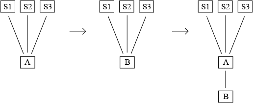
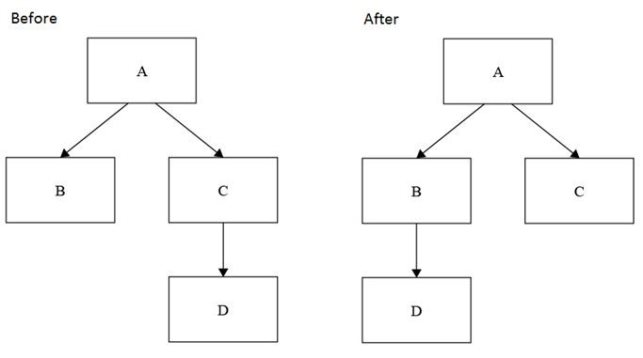

# Appendix 1 - Business combinations under common control, transfers of investments within groups and capital re-organisations

[返回目录](README.md)

# Appendix 1 - Business combinations under common control, transfers of investments within groups and capital re-organisations

Contents

- [Appendix 1 - Business combinations under common control, transfers of investments within groups and capital re-organisations](86.md#s355-chap_Appendix_1_toc_h1)

- [Introduction](86.md#s356-chap_Appendix_1_navPoint_1)

- [Definition](86.md#s357-chap_Appendix_1_navPoint_2)

- [Controlling party](86.md#s357-chap_Appendix_1_navPoint_3)

- [Transitory control](86.md#s357-chap_Appendix_1_navPoint_4)

- [Non-controlling interests](86.md#s357-chap_Appendix_1_navPoint_5)

- [Accounting treatment](86.md#s358-chap_Appendix_1_navPoint_6)

- [Accounting in consolidated financial statements](86.md#s358-chap_Appendix_1_navPoint_7)

- [Acquisition accounting](86.md#s358-chap_Appendix_1_navPoint_idp1689361448)

- [Predecessor accounting](86.md#s358-chap_Appendix_1_navPoint_idp1689378472)

- [Accounting in separate financial statements](86.md#s358-chap_Appendix_1_navPoint_8)

- [Transfer of a business from a subsidiary to its parent (hive-up transactions)](86.md#s358-chap_Appendix_1_navPoint_idp1689451048)

- [Transfer of a business from a parent to its subsidiary (hive-down transactions)](86.md#s358-chap_Appendix_1_navPoint_idp1689468200)

- [Transfer of subsidiaries or businesses around the group](86.md#s358-chap_Appendix_1_navPoint_idp1689209640)

- [Transfer of a subsidiary by dividend](86.md#s358-chap_Appendix_1_navPoint_idp1689219752)

- [Transfer of a subsidiary at other than fair value](86.md#s358-chap_Appendix_1_navPoint_idp1689267368)

- [New companies in common control transactions](86.md#s358-chap_Appendix_1_navPoint_9)

- [Capital re-organisations: other situations](86.md#s359-chap_Appendix_1_navPoint_10)

- [ ](86.md#s359-chap_Appendix_1_navPoint_idp1689463464)

- [Illustrative text](86.md#s361-chap_Appendix_1_navPoint_12)

- [Definition](86.md#s361-chap_Appendix_1_navPoint_13)

- [Controlling party](86.md#s361-chap_Appendix_1_navPoint_idp1689299240)

- [EX A1.5.1 – Assessing common control in transactions involving family-owned or managed businesses](86.md#s361-chap_Appendix_1_navPoint_idp1689301416)

- [EX A1.5.2 – Assessing common control in transactions involving entities with a high degree of common ownership](86.md#s361-chap_Appendix_1_navPoint_idp1689324968)

- [EX A1.6.1 – Common control transactions involving two joint ventures](86.md#s361-chap_Appendix_1_navPoint_idp1689352232)

- [Transitory control](86.md#s361-chap_Appendix_1_navPoint_idp1689420456)

- [EX A1.7.1 – Common control that is transitory](86.md#s361-chap_Appendix_1_navPoint_idp1689432232)

- [Non-controlling interest](86.md#s361-chap_Appendix_1_navPoint_idp1689442728)

- [EX A1.10.1 – Non-controlling interests and common control](86.md#s361-chap_Appendix_1_navPoint_idp1689444136)

- [Accounting treatment](86.md#s361-chap_Appendix_1_navPoint_14)

- [Accounting in consolidated financial statements](86.md#s361-chap_Appendix_1_navPoint_idp1689459880)

- [Predecessor accounting](86.md#s361-chap_Appendix_1_navPoint_idp1689468584)

- [EX A1.21.1 – Predecessor values not from the highest level of consolidation](86.md#s361-chap_Appendix_1_navPoint_idp1689469352)

- [EX A1.24.1 – Predecessor values from the highest level of consolidation](86.md#s361-chap_Appendix_1_navPoint_idp1689215912)

- [EX A1.27.1 – Comparison of predecessor accounting to acquisition accounting](86.md#s361-chap_Appendix_1_navPoint_idp1689229992)

- [Accounting in separate financial statements](86.md#s361-chap_Appendix_1_navPoint_idp1682922136)

- [Transfer of a business from a subsidiary to its parent (hive-up transaction)](86.md#s361-chap_Appendix_1_navPoint_idp1682925080)

- [EX A1.34.1 – Hive-up immediately after acquisition](86.md#s361-chap_Appendix_1_navPoint_idp1682921112)

- [EX A1.34.2 – Hive-up sometime after original acquisition](86.md#s361-chap_Appendix_1_navPoint_idp1702230936)

- [Transfer of subsidiaries or businesses around the group](86.md#s361-chap_Appendix_1_navPoint_idp1702046360)

- [EX A1.36.1.1 – Impairment in a group re-organisation](86.md#s361-chap_Appendix_1_navPoint_idp1702042136)

- [EX A1.36.1.2 – Transfer of investment based on relative values](86.md#s361-chap_Appendix_1_navPoint_idp1702073240)

- [Transfer of a subsidiary by dividends](86.md#s361-chap_Appendix_1_navPoint_idp1702094616)

- [EX A1.40.1 – Measurement of investment when subsidiary distributes shares to its parent](86.md#s361-chap_Appendix_1_navPoint_idp1702097048)

- [Transfer of a subsidiary at other than fair value](86.md#s361-chap_Appendix_1_navPoint_idp1683455336)

- [FAQ A1.40.1.1 – How should a company determine the investment cost of a subsidiary with a business transferred at other than fair value in a common control transaction?](86.md#s361-chap_Appendix_1_navPoint_idp1683467496)

- [FAQ A1.40.1.2 – How should a company account for the transfer of a subsidiary at other than fair value, with or without, a notional capital contribution or distribution?](86.md#s361-chap_Appendix_1_navPoint_idp1683478632)

- [New companies in common control transactions](86.md#s361-chap_Appendix_1_navPoint_idp1683501416)

- [EX A1.42.1 – Transaction involving new company](86.md#s361-chap_Appendix_1_navPoint_idp1683501928)

- [FAQ A1.44.1 – What are the main differences between predecessor, acquisition, and capital re-organisation accounting?](86.md#s361-chap_Appendix_1_navPoint_idp1684242728)

- [EX A1.45.1 – New company acquires different reporting entities](86.md#s361-chap_Appendix_1_navPoint_idp1684297256)

- [EX A1.46.1 – Subsidiary moved under a new company before an IPO](86.md#s361-chap_Appendix_1_navPoint_idp1684322472)

- [Capital re-organisations: other situations](86.md#s361-chap_Appendix_1_navPoint_idp1684352040)

- [EX A1.49.1 – Reverse acquisition into shell company](86.md#s361-chap_Appendix_1_navPoint_idp1684354984)

This eBook is licensed to peggy so, peggy.so@hk.ey.com, 

## Introduction

 

**A1.1** Combinations involving entities or businesses under common control are excluded from the scope of IFRS 3. This appendix sets out some common issues that arise in common control and similar transactions.

[IFRS 3 para 2]. [IFRS 3 para 2A].

 

This eBook is licensed to peggy so, peggy.so@hk.ey.com, 

## Definition

 

**A1.2**A combination involving  entities or businesses under common control is defined in IFRS 3 as “a business combination in which all of the combining entities or businesses are ultimately controlled by the same party or parties both before and after the business combination and that control is not transitory”.

[IFRS 3 App B para B1].

 

### Controlling party

 

**A1.3** The controlling party is the party that controls the combining entities or businesses.

**A1.4** The definition of entities or businesses under common control is not limited to control by another entity; control can also rest with an individual or a group of individuals. A group of individuals is regarded as controlling an entity when, “as a result of contractual arrangements”, they collectively control the entity. There has to be more than a common body of shareholders when the combining entities are governed by a group of individuals. A group of individuals does not have the collective power to govern in the absence of a contractual agreement, unless individuals within the control group are all part of the same close family group.

[IFRS 3 App B para B2].

**A1.5** A family-owned or managed business could consist of a number of separate entities that are not controlled by any one individual or collectively under the terms of a contractual arrangement. A control group is presumed to exist between spouses and their children. Control groups involving siblings should be considered based on specific facts and circumstances. A contractual agreement is needed to conclude that a control group exists in other circumstances. Where a control group exists, business combinations involving entities controlled by that group will be considered to be combinations of entities under common control.

[EX A1.5.1 – Assessing common control in transactions involving family-owned or managed businesses](86.md#s361-EXA1.5.1)  
[EX A1.5.2 – Assessing common control in transactions involving entities with a high degree of common ownership](86.md#s361-EXA1.5.2)

**A1.6** The exemption from IFRS 3 for a combination involving entities or businesses under common control also applies where the combining entities are owned by entities that jointly control the combining entities by means of contractual arrangements (that is, joint venture arrangements). None  None of these entities would have overall control.

[EX A1.6.1 – Common control transactions involving two joint ventures](86.md#s361-EXA1.6.1)

 

### Transitory control

 

**A1.7** The definition of a combination between entities or businesses under common control requires “that control is not transitory” for the combining entities or businesses ultimately controlled by the same party or parties, both before and after the combination. The reason for this condition is to prevent the use of ‘grooming' transactions, whereby, for a brief period immediately before the combination, the combining entities or businesses are under common control. It might otherwise be possible for combinations that should otherwise be accounted for in accordance with IFRS 3 (that is, using the acquisition method) to be structured so that there was temporary common control.

[EX A1.7.1 – Common control that is transitory](86.md#s361-EXA1.7.1)

**A1.8**Common control is not transitory when the combining entities or businesses have been under common control for a period before the combination. A re-organisation within a group, to facilitate a spin-off or an initial listing, is a business combination involving entities under common control, although the parent loses control shortly after the transaction.

[IFRIC Update – March 2006].

 

### Non-controlling interests

 

**A1.9** Non-controlling interest is defined in IFRS 3 as the “equity in a subsidiary not attributable, directly or indirectly, to a parent”.

[IFRS 3 App A].

**A1.10** The key feature of a business combination among entities under common control is that there is no change in the ultimate control of the combining entities as a result of the transaction. The extent of non-controlling interests in each of the combining entities before and after the business combination is not relevant to determining whether the combination involves entities under common control.

[IFRS 3 App B para B4].

[EX A1.10.1 – Non-controlling interests and common control](86.md#s361-EXA1.10.1)

 

This eBook is licensed to peggy so, peggy.so@hk.ey.com, 

## Accounting treatment

 

**A1.11**There is currently no guidance in IFRS on the accounting treatment for combinations among entities or businesses under common control.

**A1.12**IAS 8 requires management, if there is no specifically applicable standard or interpretation, to develop a policy that is relevant to the decision-making needs of users and that is reliable. The entity first considers requirements and guidance in other international standards and interpretations dealing with similar issues, and then the content of the IASB’s Conceptual Framework for Financial Reporting (Conceptual Framework). Management might consider the pronouncements of other standard-setting bodies that use a similar conceptual framework to the IASB’s, provided that they do not conflict with the IASB’'s sources of guidance.

[IAS 8 para 10]. [IAS 8 para 11]. [IAS 8 para 12].

**A1.13** Accounting policies are applied consistently for similar transactions, other events and conditions, unless a standard or an interpretation specifically requires or permits categorisation of items for which different policies might be appropriate. Depending on the specific facts and circumstances surrounding a particular business combination under common control, management selects an appropriate accounting policy, and it applies that policy consistently from period to period to all business combinations under common control that are considered similar in nature (see [paras A1.17 and A1.18](86.md#s358-Para_A1.17) for the criteria to be considered when analysing particular facts and circumstances). Management then applies one of either acquisition accounting (see [para A1.14](86.md#s358-Para_A1.14)) or predecessor accounting (see [para A1.15](86.md#s358-Para_A1.15)) for those similar transactions. A fresh start policy, for example, that restates all combining entities or businesses to fair value would not be acceptable, because this is not supported by the principles of business combination accounting or by the Conceptual Framework for Financial Reporting ( Conceptual Framework).

[IAS 8 para 13].

 

### Accounting in consolidated financial statements

#### Acquisition accounting

 

**A1.14** Considering facts and circumstances (see [paras A1.17 and A1.18](86.md#s358-Para_A1.17)), management could refer to IFRS 3 in determining a policy for business combinations under common control and decide to adopt the acquisition method as its accounting policy. IFRS 3 is the standard that applies to most business combinations. Management could select IFRS 3 acquisition accounting for business combinations involving entities or businesses under common control, notwithstanding the fact that these transactions are excluded from the scope of IFRS 3 (see [para A1.1](86.md#s356-Para_A1.1)). The requirements of IFRS 3 should be applied in full. See chapter 29. Applying IFRS 3 requires management to identify which entity is the acquirer and which entity is the acquiree. In situations where a new company is involved, the new company might or might not be the acquirer, depending on the facts and circumstances. Refer to chapter 29 paras 39 to 41.

[IFRS 3 App B para B18].

 

#### Predecessor accounting

 

**A1.15** Considering facts and circumstances ([see paras A1.17 and A1.18](86.md#s358-Para_A1.17)) management could apply a method broadly described as predecessor accounting. The principles of predecessor accounting are:

- Assets and liabilities of the acquired entity are stated at predecessor carrying values ([see paras A1.19 to A1.21](86.md#s358-Para_A1.19)). Fair value measurement is not required.

- No new goodwill arises in predecessor accounting.

- Any difference between the consideration given and the aggregate carrying value of the assets and liabilities of the acquired entity at the date of the transaction is included in equity in retained earnings or in a separate reserve.

**A1.16** Some commonly used methods for predecessor accounting in consolidated financial statements are:

- Retrospective presentation method. The acquired entity’s results and balance sheet are incorporated as if both entities (acquirer and acquiree) had always been combined, or using the results from the date when either entity joined the group, where such a date is later.

- Prospective presentation method. The acquired entity’s results and balance sheet are incorporated prospectively from the date on which the business combination between entities under common control occurred.

**A1.17** The accounting policy that management selects will be determined by the substance and the specific facts and circumstances surrounding any particular business combination under common control. A consistent policy should be applied to transactions of a similar nature. The following criteria might be used in determining which accounting policy best reflects the substance of each business combination under common control:

- Existence of non-controlling interests: if non-controlling interests are affected, this might point towards acquisition accounting being an appropriate policy. Conversely, if the entities are wholly owned, this might point towards predecessor accounting being more appropriate.

- Consideration for the transfer: if the fair value for an entity or a business is paid in full in cash, this might point towards acquisition accounting being an appropriate policy. Conversely, if the consideration for the transfer is set at the existing book values in the accounts of the transferring entity, this might point towards predecessor accounting being an appropriate policy.

- Management of combining entities: if combining entities were managed together before and after the combination, this might point towards the predecessor method being an appropriate policy. Conversely, if the combining entities or businesses were not managed together, although still controlled by the same ultimate controlling party, acquisition accounting might be more appropriate.

- Purpose of the transaction: if the transaction is undertaken in connection with an IPO or other change in control or significant change in ownership event, this might point towards acquisition accounting being an appropriate policy. Conversely, if the transaction is undertaken to effect an internal simplification, or it is driven perhaps by internal tax planning strategies, this might point towards predecessor accounting being an appropriate policy.

**A1.18** The above list of criteria is not exhaustive. Management might need to make a judgement, and disclose the policy chosen and reasons for it, as part of its critical judgement disclosures as required by IAS 1. Applying acquisition accounting is not a free policy choice but it requires management to demonstrate economic substance. If there is no economic substance, acquisition accounting is not considered appropriate. Applying substance when selecting a policy might result in two business combinations under common control being accounted for differently by the reporting entity where the specific facts and circumstances indicate that the transactions are not similar in nature and warrant different treatment.

[IAS 1 para 125].

**A1.19** As stated in [paragraphs A1.11](86.md#s358-Para_A1.11) and [A1.12](86.md#s358-Para_A1.12), there is no guidance in IFRS on the treatment for business combinations under common control; however, the IASB is currently debating the topic. Several issues were raised with the IFRS IC and subsequently the IASB decided to address the topic as part of a wider project starting with a issuance of a discussion paper expected in late 2020. Currently, the selection of predecessor accounting versus acquisition accounting would need to be made following the guidance in IAS 8, as would the selection of values used when applying predecessor accounting. Predecessor carrying values are the carrying values related to the acquired entity. They are generally selected as the carrying amounts of assets and liabilities of the acquired entity from the consolidated financial statements of the highest entity that has common control for which consolidated financial statements are prepared. These amounts include any goodwill (and other fair value adjustments) recorded at the consolidated level in respect of the acquired entity. This is because the transaction is under the control of that entity, and it is a portion of the controlling entity that is being moved around in the transaction.

**A1.20** The controlling party might not prepare consolidated financial statements. In such situations, the book values used are generally those from the highest set of consolidated financial statements available. If no consolidated financial statements are produced, the values used would be those from the financial statements of the acquired entity.

**A1.21** Given the absence of definitive guidance in IFRS, there might be circumstances that support the use of other values as predecessor values (for example, carrying values from the financial statements of an intermediate sub-group or from the acquired entity), even where consolidated financial statements are prepared at a higher level. Careful analysis of the facts and circumstances is required to determine whether it would be more meaningful to select such alternative values. For example, we believe that the following considerations would typically be relevant in determining appropriate values to use as predecessor values:

- Transaction in preparation for a listing.  
The values in the highest level of consolidation will typically be more relevant if the common control business combination is in preparation for a listing or sale. Transactions in preparation for a listing can occur in a variety of ways. For example, two existing subsidiaries might be merged into one, and the surviving subsidiary is then listed. Alternatively, a New Co might be involved and the accounting could be more complex, because the transaction might not be a business combination under common control. There is no guidance in IFRS, so the substance of the transaction needs to be considered to determine whether the transaction is a business combination under common control or a capital re-organisation. See [paragraphs A1.22 to A1.23](86.md#s358-Para_A1.22) and [A1.47 to A1.49](86.md#s359-Para_A1.47) below.

- Identity of users.  
If the users of the financial statements of the reporting entity that now includes the transferred business are users that previously relied on the financial statements of the transferred business, the book values of the transferred business might be more relevant.

- Timing of transaction.  
The timing of the transaction should be considered in relation to when the business over which the receiving and reporting entity now has control was originally established or acquired by the group as a whole. The longer the time period, the less relevant the values in the business’s own financial statements are likely to be if the business has been directed and operated as part of the wider group.

[EX A1.21.1 – Predecessor values not from the highest level of consolidation](86.md#s361-EXA1.21.1)

**A1.22** The selection of a policy that applies predecessor or acquisition accounting is only relevant where there is a combination of two or more businesses under common control. This situation might arise in separate financial statements where a business is transferred up into an existing entity that is itself a business. It might also arise in the consolidated financial statements of a business entity that has acquired a subsidiary that also qualifies as a business.

**A1.23** If a New Co is involved, care needs to be taken when analysing what, if any, substance New Co has and what role it plays, because the transaction might not be a business combination under common control:

- If New Co is not a business, the transfer up of a business or sale of a subsidiary to New Co might, in substance, be that of a capital re-organisation. See [EX A1.42.1](86.md#s361-EXA1.42.1), where a New Co is set up to receive another group entity and obtains external financing.

- Conversely, there might be situations where a new company is set up as an acquisition vehicle by the purchaser and for purchaser’s benefit. In such a case – as outlined in [EX 29.40.1](51.md#s215-EX29.40.1) for the VCP Acq Co in Step C – the new acquisition company would be seen as the acquirer in a business combination, and it should apply IFRS 3 acquisition accounting.

- It might also be the case that New Co, similar to the situation in the first bullet above, does not have any substance, but it acquires two separate and independent businesses from within the common control group. In that case, because two or more businesses are being combined, one of the combining businesses would be identified as the acquirer and one as the acquiree. In that case, a business combination exists and, similar to EX 29.39.1, acquisition accounting could be applied. Alternatively, because this is a scenario under common control, predecessor accounting could be applied. The selection should be based on facts and circumstances (see [para A1.17](86.md#s358-Para_A1.17) above).

**A1.24**The acquiree could have been previously acquired by the controlling party in a business combination. The controlling party would have applied the acquisition method, and it would have recognised assets and liabilities (including goodwill) in accordance with IFRS 3. The numbers from the highest level of common control used in predecessor accounting would differ from the carrying amounts in the stand-alone financial statements of the acquiree. These numbers are not pushed down to the financial statements of the acquiree under IFRS.

[EX A1.24.1 – Predecessor values from the highest level of consolidation](86.md#s361-EXA1.24.1)

**A1.25** The combining entities are looked at from the perspective of a transfer made by the controlling party. The transaction is not seen as an equal exchange of values and a change of control from the date of the business combination. No goodwill beyond that recorded by the controlling party in relation to the acquiree can therefore arise.

**A1.26** When the retrospective presentation method is used, the consolidated financial statements reflect both entities' full-year results, even though the business combination might have occurred part of the way through the year. The corresponding amounts for the previous year reflect the combined results of both entities, even though the transaction did not occur until the current year. This reflects the view that the transaction involves two entities controlled by a controlling party. The financial statements reflect the numbers from the perspective of that party, and they reflect the period over which that party has had control. When incorporating the results of the acquiree, entities should also incorporate any profit and loss impact of consolidation adjustments picked up as part of the predecessor accounting, as discussed in [paragraph A1.15](86.md#s358-Para_A1.15).

**A1.27** Where the prospective presentation method is used, the consolidated financial statements do not reflect the results of the acquired entity for the period before the transaction occurred. The corresponding amounts for the previous year are also not restated. In addition to the comparison of predecessor accounting with acquisition accounting given in [EX A1.27.1](86.md#s361-EXA1.27.1), the main differences between the methods of predecessor, acquisition and capital re-organisation accounting are summarised in [FAQ A1.44.1](86.md#s361-FAQ_A1.44.1).

[EX A1.27.1 – Comparison of predecessor accounting to acquisition accounting](86.md#s361-EXA1.27.1)

**A1.28** The local regulator might dictate that a particular method should be used in some jurisdictions. Some jurisdictions (for example, UK or US) permit, or even require, using predecessor accounting for group reconstructions and other common control transactions.

 

### Accounting in separate financial statements

 

**A1.29** Transactions under common control mainly occur in two ways:

- transfers of an equity investment within the group; or

- transfers of the underlying activities and assets of a subsidiary within the group.

**A1.30**The acquisition of an equity investment in a subsidiary in an entity’s separate financial statements is not a business combination. The acquirer includes its interest in the acquiree as an investment in a subsidiary in accordance with IAS 27.

[IAS 27 para 10].

**A1.31**A business combination occurs in separate financial statements only if the entity acquires an unincorporated business or a set of activities and assets meeting the definition of a business.

 

#### Transfer of a business from a subsidiary to its parent (hive-up transactions)

 

**A1.32** The transfer of a subsidiary’s business (a set of activities and assets) to its parent is often referred to as a ‘hive-up’. The consideration is often payable via an inter-company account. If a subsidiary is 100% owned, such a transaction does not result in any change from a group perspective. The issue is how to account for the transaction in separate financial statements.

**A1.33**The entity could account for the transaction using either the predecessor values method (see [para A1.15](86.md#s358-Para_A1.15)) or the acquisition accounting method (see [para A1.14](86.md#s358-Para_A1.14)).

**A1.34** Acquisition accounting applied to the hive-up results in the same accounting treatment, practically speaking, as predecessor accounting if a hive-up takes place immediately after an acquisition.

[EX A1.34.1 – Hive-up immediately after acquisition](86.md#s361-EXA1.34.1)  
[EX A1.34.2 – Hive-up sometime after original acquisition](86.md#s361-EXA1.34.2)

**A1.35** Specific facts and circumstances, together with local regulations, should be considered when determining the accounting policy in each case.

 

#### Transfer of a business from a parent to its subsidiary (hive-down transactions)

**A1.36**The accounting treatment in a hive-down situation, where the ‘surviving’ legal entity is the subsidiary, results in the same accounting treatment as for a hive-up. This approach reflects the substance of the transaction rather than its legal form.

#### Transfer of subsidiaries or businesses around the group

 

**A1.36.1** A group might re-organise itself by transferring subsidiaries or businesses around the group for less than the carrying amount of the investment. There might be no legal restriction or tax implication that prevents the group from transferring subsidiaries at less than fair value. Investments might be transferred at, for example, the carrying amount of the subsidiary’s net assets, or for no consideration. This can appear to cause an impairment of the parent’s investment in the transferor. There is no specific guidance in IFRS on how to account for such transactions. An accounting policy can be developed in accordance with IAS 8 to reflect the economic substance of the transaction and be applied consistently.

[EX A1.36.1.1 – Impairment in a group re-organisation](86.md#s361-EXA1.36.1.1)  
[EX A1.36.1.2 – Transfer of investment based on relative values](86.md#s361-EXA1.36.1.2)

 

#### Transfer of a subsidiary by dividend

 

**A1.37** The transfer of the subsidiary could be achieved by transferring equity instruments between entities under common control. The appropriate accounting treatment for such a transfer is based on the substance of the transaction. Judgement should be applied to determine whether a distribution from an investee to a parent is a return on capital (dividend income) or a return of capital (a reduction or reallocation of the cost of investment). See also [chapter 28 paras 32](49.md#s200-Para_28.32) and 33 and [FAQ 28.33.1](49.md#s205-FAQ_28.33.1), ‘How is a distribution in the form of an investment in a subsidiary accounted for?'.

[IFRS 9 App B para B5.7.1].

**A1.38**Dividend income should be recognised by the transferee in profit or loss and would typically be recorded at fair value. However, if the dividend income relates to the receipt of an investment in a subsidiary (which constitutes a business), there is a policy choice to record the investment received and therefore the dividend income either at the carrying amount of the investment in the transferor’s separate financial statements at the date of transfer (that is, ‘predecessor value’) or at fair value. 

[IFRS 9 para 5.7.1A].

**A1.39** There is no specific guidance in IFRS that deals with distributions of non-cash assets that meet the definition of a business between entities under common control. Management of the transferee should select either acquisition accounting or predecessor values method, and it should apply that policy as outlined in [paragraph A1.14](86.md#s358-Para_A1.14) onwards.

**A1.40** The transferor has an accounting policy choice as to whether to recognise the dividend at the book value or fair value of the investment that is being distributed. IFRIC 17 requires a fair value approach for certain transactions. However, IFRIC 17 does not apply to a distribution of a non-cash asset that is ultimately controlled by the same party or parties (that is, common control) before and after the distribution. This exclusion applies to the separate, individual and consolidated financial statements of an entity that makes the distribution. Further guidance on transfers of a subsidiary within a group, including impairment issues arising from group re-organisations, is given in [paragraph A1.36.1](86.md#s358-Para_A1.36.1) above.

[IFRIC 17 para 5].

[EX A1.40.1 – Measurement of investment when subsidiary distributes shares to its parent](86.md#s361-EXA1.40.1)

 

#### Transfer of a subsidiary at other than fair value

 

**A1.40.1**A transaction that is undertaken at other than fair value involving entities under common control can be argued, in substance, to have an element that is a transaction with a shareholder (that is, there exists a notional capital contribution or distribution).

[FAQ A1.40.1.1 –  How should a company determine the investment cost of a subsidiary with a business transferred at other than fair value in a common control transaction?](86.md#s361-FAQ_A1.40.1.1)  
[FAQ A1.40.1.2 – How should a company account for the transfer of a subsidiary at other than fair value, with or without a notional capital contribution or distribution?](86.md#s361-FAQ_A1.40.1.2)

 

### New companies in common control transactions

 

**A1.41** Complications might arise where a common control transaction involves a new company set up by the group to effect the combination of entities under common control. The combination of a new company and a single reporting entity is unlikely to meet the definition of a business combination in the context of IFRS 3. The new company will not be the acquirer; and it is not a business, so reverse acquisition accounting principles will not be available, because reverse acquisition is an application of IFRS 3. If neither acquisition accounting nor predecessor accounting is available, the transaction is accounted for as a capital re-organisation.

**A1.42** The new company’s consolidated financial statements include the existing entity’s full results (including comparatives), even though the re-organisation might have occurred part of the way through the year. This reflects the view that the transaction involves two entities controlled by the same controlling party – they reflect the period over which that party has had control. The assets and liabilities of the existing entity are incorporated at their pre-combination carrying amounts without fair value uplift. This is on the basis that there is no substantive economic change.

[EX A1.42.1 – Transaction involving new company](86.md#s361-EXA1.42.1)

**A1.43** There are other common control situations involving the establishment of a new company and the combination of more than two entities. In those situations, there is a selection to be made between applying predecessor accounting and acquisition accounting (see [paras A1.17 and A1.18](86.md#s358-Para_A1.17) above). Capital re-organisation accounting will be applied in relation to the financial statements of the identified acquirer (see also [para A1.45](86.md#s358-Para_A1.45)).

**A1.44** A new company might combine with more than one entity under common control. In the new company’s consolidated financial statements, management will have to decide, based on the specific facts and circumstances, whether to apply acquisition accounting in accordance with IFRS 3 or predecessor accounting, provided that the transaction meets the definition of a business combination. If acquisition accounting is used, the new company will not be identified as the acquirer. Instead, one of the combining entities will be the acquirer. In its consolidated financial statements, the new company recognises the pre-combination book values of the identified acquirer with no fair value uplift. The assets and liabilities of the acquired business or businesses, including goodwill, are recognised in the new company’s financial statements at fair value in accordance with IFRS 3 at the acquisition date.

[IFRS 3 App B para B18].

[FAQ A1.44.1 – What are the main differences between predecessor, acquisition and capital re-organisation accounting?](86.md#s361-FAQ_A1.44.1)

**A1.45** The businesses under common control that are being combined under the new company might have single management or oversight at some level. These businesses might be seen as a single reporting entity. The transaction will not be a business combination, but rather it will be a capital re-organisation of the existing reporting entity (see further [para A1.41 onwards](86.md#s358-Para_A1.41) and chapter 29 paras 39 to 41).

[EX A1.45.1 – New company acquires different reporting entities](86.md#s361-EXA1.45.1)

**A1.46** A shareholder or parent may incorporate a new entity and position that entity as the parent of an existing group via the issue of shares. The new entity might be formed in connection with a planned divestment. From the new entity’s consolidated perspective, depending on facts and circumstances, such a transaction might not meet the definition of a business combination under IFRS 3, and in such a case it would be accounted for as a capital re-organisation. The IFRS Interpretations Committee discussed this topic in July and September 2011, but it was not added to the Board’s agenda. Rather, the Committee recommended that this issue should be dealt with as part of the Board’s project on Business Combinations under Common Control more broadly. Whilst the current guidance is therefore unclear, there may be facts and circumstances that would indicate that a business combination outside common control exists. In such a case, fair value accounting would be applied in the consolidated financial statements by the new entity formed as part of the divestment. Management should apply judgement to the specific facts and circumstances. Where the judgement is significant, relevant disclosures should be provided.

[EX A1.46.1 – Subsidiary moved under a new company before an IPO](86.md#s361-EXA1.46.1)

 

This eBook is licensed to peggy so, peggy.so@hk.ey.com, 

## Capital re-organisations: other situations

### 

 

**A1.47**The merger of a private operating entity into a non-operating public shell corporation with nominal net assets typically results in:

- the owners of the private entity gaining control over the combined entity after the transaction; and

- the shareholders of the former public shell corporation continuing only as passive investors.

The private operating entity is seeking to obtain the listing status of the non-operating public shell corporation. This transaction is usually not considered to be a business combination, because the non-operating public shell corporation does not meet the definition of a business. This is a capital transaction of the legal acquiree and is equivalent to the issuance of shares by the private entity for the net monetary assets of the public shell corporation, accompanied by a recapitalisation. This is not a business combination under IFRS 3.

[IFRS 3 App B para B19].

**A1.48** There is no acquisition accounting and no recognition of goodwill, because the public shell corporation is not a business. The transaction falls within the scope of IFRS 2. The deemed shares issued by the private entity (that is, the consideration for the acquisition of the public shell company) are recognised at fair value and recorded as an expense.

[IFRS 2 para 10].

**A1.49** The IFRS IC confirmed that, if the listed non-operating entity is not a business, the transaction is not a business combination, but it is a share-based payment transaction under IFRS 2. Any difference between the fair value of the shares deemed to have been issued by the private operating company and the fair value of the public shell company’s identifiable net assets represents a service received by the acquirer. Regardless of the level of monetary or non-monetary assets owned by the non-listed operating entity, the entire difference should be considered to be payment for a service of a stock exchange listing for its shares. No amount is considered to be a cost of raising capital. The service received in the form of a stock exchange listing does not meet the definition of an intangible asset, because it is not separable. The service received does not meet the definition of an asset, and the cost of the service received should be recognised as an expense.

[IFRS 2 para 13A].

[EX A1.49.1 – Reverse acquisition into shell company](86.md#s361-EXA1.49.1)

[FAQ 13.4.13 - How should share based contingent consideration with the shareholders or sponsors of a special purpose acquisition company be recognised in a reverse merger with a non-listed operating company?](25.md#s93-FAQ_13.4.13)

[FAQ 13.4.14 - How should share based contingent consideration with the shareholders of a non-listed operating company be recognised in a reverse merger with a special purpose acquisition company?](25.md#s93-FAQ_13.4.14)

 

This eBook is licensed to peggy so, peggy.so@hk.ey.com, 

 

 

This eBook is licensed to peggy so, peggy.so@hk.ey.com, 

## Illustrative text

### Definition

#### Controlling party

##### EX A1.5.1 – Assessing common control in transactions involving family-owned or managed businesses

 

Reference to standard: IFRS 3 para 2  
Reference to standing text: [A1.5](86.md#s357-Para_A1.5)

  

**Example:**

  
The Smith family runs a retail business. The retail outlets are operated by seven companies that are owned in different proportions by Mr. Smith, his wife, and their three children. No one member of the family has more than 50% of the equity of any of the operating companies; and there is no contractual arrangement among the members of the family. None of the companies has previously acquired a business from a member of the family.

The family has been advised to consolidate their holdings for tax purposes. A new holding company, entity X, has been formed and will acquire all of the operating companies by issuing shares to Mr. and Mrs. Smith and their three children. Each family member will own 20% of entity X after the transaction.

**Analysis:**

The Smith family together controls all of the combining entities before and after the transaction. The reorganisation is a business combination involving entities under common control. The combining entities are entity X and the existing operating companies. Even though there is no contractual arrangement that gives the family common control, in many cases, such an arrangement is presumed to exist due to the close family relationships.

In such a case, management should select an accounting policy based on the substance and specific facts and circumstances surrounding the transaction – either the acquisition method or the predecessor values method, if this is the acquiring entity’s first business combination involving entities under common control. All of the requirements of IFRS 3 are applied if the acquisition method is used. Entity X cannot be the acquirer (see [para A1.44](86.md#s358-Para_A1.44)).

If a new entity is formed to issue equity interests to effect a business combination, one of the combining entities that existed before the business combination shall be identified as the acquirer by applying the guidance in IFRS 3. All of the existing companies together should be identified as the acquirer if they are managed together as a single business. The accounting result would be similar to predecessor accounting in the case where all of the companies together are the acquirer under IFRS 3.

 

##### EX A1.5.2 – Assessing common control in transactions involving entities with a high degree of common ownership

 

Reference to standard: IFRS 3 para 2  
 Reference to standing text: [A1.5](86.md#s357-Para_A1.5) 

  

  
**Example:**

Entity A is owned 40%, 40%, and 20% by three unrelated shareholders (S1, S2 and S3). There is no contractual agreement in place that creates control for any single shareholder or group of shareholders. Entity B, which has a fair value equal to entity A, is owned 30%, 30%, 30% and 10% by shareholders S1, S2, S3 and S4, respectively.

Entity A incorporates a new entity, entity X, which issues shares and acquires 100% of the shares of entity A and entity B. Shareholders S1, S2, S3 and S4 own 35%, 35%, 25% and 5%, respectively, of entity X subsequent to the transaction.

**Analysis:**

This is not a business combination between entities under common control. There is no contractual agreement in place that gives an individual shareholder or group of shareholders control of entity A or entity B. The acquisition method should be applied in this fact pattern. Entity A or entity B should be identified as the acquirer (see chapter 29 para 39).

Situations arise where two or more entities or individuals sometimes act collectively to manage and operate the activities of another entity. These arrangements may be joint arrangements in the context of the definition in IFRS 11. For common control transactions involving two joint ventures, see [EX A1.6.1](86.md#s361-EXA1.6.1).

 

##### EX A1.6.1 – Common control transactions involving two joint ventures

 

Reference to standard: IFRS 3 paras 2, 2A  
Reference to standing text: [A1.6](86.md#s357-Para_A1.6)  

  

  
**Example:**

  
 There are two joint venture agreements between S1, S2 and S3: one setting out joint control of entity A, and the other setting out joint control of entity B. S1, S2 and S3 could be individual shareholders or entities that have entered into two separate joint venture agreements governing entities A and B. The joint venture agreements require unanimous consent on decisions about the relevant activities. Control is not transitory (see [para A1.7](86.md#s357-Para_A1.7)). Entity A acquires entity B. How is this transaction accounted for?

**Analysis:**

Entity A’s acquisition of entity B is outside the scope IFRS 3 because the joint venture agreements establish joint control over each entity. Since entities A and B are controlled collectively by the same shareholders, the acquisition is a business combination between entities or businesses under common control.

 

#### Transitory control

##### EX A1.7.1 – Common control that is transitory

 

Reference to standard: IFRS 3 para 2  
 Reference to standing text: [A1.7](86.md#s357-Para_A1.7)  
 

  

  
**Example:**

Entities D and P provide oilfield services in the North Sea. Entity D is owned by a group of individuals, none of whom have control, and who do not have a collective control agreement. Entity P is owned by a single individual, Mr X. The owners of entities D and P have decided to combine their entities. The consideration will be settled in shares of entity P.

Entity P issues new shares, amounting to 30% of its issued share capital, to its controlling shareholder, Mr X. Mr X then transfers the shares to the owners of entity D in exchange for their interest in entity D. At this point, Mr X controls both entities D and P, owning 100% of entity D and 70% of entity P. Mr X then contributes the controlling interest in entity D to entity P. Mr X had a controlling interest in both entities D and P before and after the contribution. Is the combination of entities D and P a combination of entities under common control?

**Analysis:**

No. This is not a business combination of entities under common control. Mr X’s control of both entities before the business combination was transitory. The substance of the transaction is that entity P has obtained control of entity D. Entity P accounts for this transaction as a business combination under IFRS 3 using acquisition accounting.

 

#### Non-controlling interest

##### EX A1.10.1 – Non-controlling interests and common control

 

Reference to standard: IFRS 3 App B para B4  
 Reference to standing text: [A1.10](86.md#s357-Para_A1.10) 

  

  
**Example:**

Entity B is the intermediate parent company of subsidiary entities C, D and E. There is a non-controlling interest of 10% in entity B, the remainder of whose shares are owned by the ultimate parent, entity A. Entity A has a further direct subsidiary, entity X. Entity B enters into two transactions:

First, it transfers ownership of entity C to entity E in exchange for shares in entity E (which are issued to entity B).

Second, it transfers entity E (which now owns entity C) to entity X in return for shares issued by entity X.

Both entities E and X prepare consolidated financial statements.

  
 Do the two stages of the transaction amount to business combinations involving entities under common control?

**Analysis**

Transaction 1 – Yes. In the first transaction, the transfer of entity C to entity E, the non-controlling interest is not affected, because the composition of the sub-group headed by entity B remains unchanged. In entity E's consolidated financial statements, the combination with entity C qualifies for the exemption from IFRS 3 for a combination between entities under common control; this is because it is a business combination in which the combining entities (entities E and C) are controlled by the same party (entity A) both before and after the combination.

Transaction 2 – Yes. In the second transaction, entity E and its subsidiary entity C move out of the entity B sub-group; entity B's investment in entity E (and its subsidiary entity C) is replaced by an investment in entity X (but entity X does not become a subsidiary of entity B). The non-controlling interest in entity B has disposed of part of the entity B sub-group. The combining entities (entities X and E) are controlled by the same party (entity A) both before and after the combination. Although there is a change in the non-controlling interest, the transfer qualifies for the exemption from IFRS 3 for entities under common control.

 

### Accounting treatment

#### Accounting in consolidated financial statements

##### Predecessor accounting

###### EX A1.21.1 – Predecessor values not from the highest level of consolidation

 

Reference to standard:  
Reference to standing text: [A1.21](86.md#s358-Para_A1.21)  

  

**Example:**

Company A is a publicly listed company with numerous subsidiaries with substantive operations. One of these subsidiaries, company G, has debt that is publicly listed. Company G has three subsidiaries – companies X, Y and Z – that constitute its operations in three different countries. In anticipation of an IPO, company X acquires company Z. Assume that company A and company G have different carrying values for the assets of company Z. What predecessor values should company X use in its consolidated financial statements?

**Analysis:**

The consolidated figures from the highest level should normally be used for business combinations under common control (see [para A1.19](86.md#s358-Para_A1.19)). That would mean that company X would use the values as recorded in the consolidated financial statements of company A with respect to company Z. However, given that this re-organisation has occurred entirely within the consolidated operations of company G, and there are third party stakeholders in company G's financial statements, using the values from the consolidated financial statements of company G might be more relevant in this case.

 

###### EX A1.24.1 – Predecessor values from the highest level of consolidation

 

Reference to standard:  
 Reference to standing text: [A1.24](86.md#s358-Para_A1.24) 

  

  
**Example:**

The group headed by entity A acquired the group headed by entity X in 20X1. The acquisition was accounted for using the acquisition method.

In 20X3, the sub-group headed by entity X is transferred to entity B (a wholly-owned subsidiary of entity A), in return for the issue of equity shares by entity B to its parent entity A.

  
 Both entities A and B prepare consolidated financial statements, and all companies are wholly owned. How is the transaction accounted for in the consolidated financial statements of entities A and B?

**Analysis**

The transfer of entity X to entity B does not affect entity A's consolidated financial statements, because entity X is wholly owned by entity A, both before and after the transfer.

The combination with the entity X sub-group is reflected in entity B's consolidated financial statements. As both entities B and X are controlled by entity A, both before and after the combination, this is a common control business combination and is outside the scope of IFRS 3. Therefore, entity B can use predecessor accounting to account for the combination with entity X, if this is in accordance with its accounting policy for this type of transaction.

Where predecessor accounting is applied, the book values used are generally those in the consolidated financial statements of the ultimate parent, unless there are circumstances that support the use of other values as predecessor values (see [paras A1.19 to A1.21](86.md#s358-Para_A1.19)).

For this example, it is assumed that management makes a judgement using appropriate indicators (see [para A1.21](86.md#s358-Para_A1.21)) and considers that the book values to be used are those that are included in entity A's consolidated financial statements, and not the historical figures of the entity X sub-group. This means that the book values used will reflect fair value adjustments and goodwill arising on the acquisition of the entity X sub-group by entity A.

 

###### EX A1.27.1 – Comparison of predecessor accounting to acquisition accounting

 

Reference to standard:  
 Reference to standing text: [A1.27](86.md#s358-Para_A1.27) 

  

  
**Example:**

UK Parent Co owns a 100% interest in an Australian entity, Aus Hold Co, and a 100% interest in a NZ entity, NZ Hold Co. Both Aus Hold Co and NZ Hold Co have one trading subsidiary each, Aus Trading Co and NZ Trading Co, respectively. UK Parent Co is re-organising its operations so that both Aus Trading Co and NZ Trading Co will be 100% owned by Aus Hold Co. Aus Hold Co pays C20m to NZ Hold Co, on inter-company account, for its investment in NZ Trading Co.

NZ Trading Co’s fair value at the date of the transaction is C20m. The value of NZ Trading Co’s net assets at the date of the transaction is C15m. The carrying value of net assets in NZ Trading Co’s own separate financial statements (and in UK Parent Co's consolidated financial statements) is C10m.

Assume, for the purposes of this example, that there are no additional assets or liabilities to be recognised under IFRS 3 (such as intangible assets).

Aus Hold Co applies IFRS in both its separate and its consolidated financial statements.

**Analysis:**

1. The double entries in Aus Hold Co’s separate financial statements, to record the investment in NZ Trading Co, are as follows:

<table style="width:100%; border-collapse:collapse"><tr><td style="border:0.75pt solid #000000; padding-right:5.03pt; padding-left:5.03pt; vertical-align:top">
 
</td><td colspan="2" style="border:0.75pt solid #000000; padding-right:5.03pt; padding-left:5.03pt; vertical-align:top">
 
</td><td style="border:0.75pt solid #000000; padding-right:5.03pt; padding-left:5.03pt; vertical-align:top">
<b>C'm</b>
</td><td style="border:0.75pt solid #000000; padding-right:5.03pt; padding-left:5.03pt; vertical-align:top">
<b>C'm</b>
</td></tr><tr><td style="border:0.75pt solid #000000; padding-right:5.03pt; padding-left:5.03pt; vertical-align:top">
 
</td><td colspan="2" style="border:0.75pt solid #000000; padding-right:5.03pt; padding-left:5.03pt; vertical-align:top">
 
</td><td style="border:0.75pt solid #000000; padding-right:5.03pt; padding-left:5.03pt; vertical-align:top">
<b>Dr</b>
</td><td style="border:0.75pt solid #000000; padding-right:5.03pt; padding-left:5.03pt; vertical-align:top">
<b>Cr</b>
</td></tr><tr><td style="border:0.75pt solid #000000; padding-right:5.03pt; padding-left:5.03pt; vertical-align:top">
Dr
</td><td colspan="2" style="border:0.75pt solid #000000; padding-right:5.03pt; padding-left:5.03pt; vertical-align:top">
Investment
</td><td style="border:0.75pt solid #000000; padding-right:5.03pt; padding-left:5.03pt; vertical-align:top">
20
</td><td style="border:0.75pt solid #000000; padding-right:5.03pt; padding-left:5.03pt; vertical-align:top">
 
</td></tr><tr><td style="border:0.75pt solid #000000; padding-right:5.03pt; padding-left:5.03pt; vertical-align:top">
 
</td><td style="border:0.75pt solid #000000; padding-right:5.03pt; padding-left:5.03pt; vertical-align:top">
Cr
</td><td style="border:0.75pt solid #000000; padding-right:5.03pt; padding-left:5.03pt; vertical-align:top">
Inter-company account
</td><td style="border:0.75pt solid #000000; padding-right:5.03pt; padding-left:5.03pt; vertical-align:top">
 
</td><td style="border:0.75pt solid #000000; padding-right:5.03pt; padding-left:5.03pt; vertical-align:top">
20
</td></tr></table>

  
 2. The double entries in Aus Hold Co’s consolidated financial statements, if it adopts predecessor accounting for this type of common control transaction, are as follows:

<table style="width:100%; border-collapse:collapse"><tr><td style="border:0.75pt solid #000000; padding-right:5.03pt; padding-left:5.03pt; vertical-align:top">
 
</td><td colspan="2" style="border:0.75pt solid #000000; padding-right:5.03pt; padding-left:5.03pt; vertical-align:top">
 
</td><td style="border:0.75pt solid #000000; padding-right:5.03pt; padding-left:5.03pt; vertical-align:top">
<b>C'm</b>
</td><td style="border:0.75pt solid #000000; padding-right:5.03pt; padding-left:5.03pt; vertical-align:top">
<b>C'm</b>
</td></tr><tr><td style="border:0.75pt solid #000000; padding-right:5.03pt; padding-left:5.03pt; vertical-align:top">
 
</td><td colspan="2" style="border:0.75pt solid #000000; padding-right:5.03pt; padding-left:5.03pt; vertical-align:top">
 
</td><td style="border:0.75pt solid #000000; padding-right:5.03pt; padding-left:5.03pt; vertical-align:top">
<b>Dr</b>
</td><td style="border:0.75pt solid #000000; padding-right:5.03pt; padding-left:5.03pt; vertical-align:top">
<b>Cr</b>
</td></tr><tr><td style="border:0.75pt solid #000000; padding-right:5.03pt; padding-left:5.03pt; vertical-align:top">
Dr
</td><td colspan="2" style="border:0.75pt solid #000000; padding-right:5.03pt; padding-left:5.03pt; vertical-align:top">
Goodwill
</td><td style="border:0.75pt solid #000000; padding-right:5.03pt; padding-left:5.03pt; vertical-align:top">
–
</td><td style="border:0.75pt solid #000000; padding-right:5.03pt; padding-left:5.03pt; vertical-align:top">
 
</td></tr><tr><td style="border:0.75pt solid #000000; padding-right:5.03pt; padding-left:5.03pt; vertical-align:top">
Dr
</td><td colspan="2" style="border:0.75pt solid #000000; padding-right:5.03pt; padding-left:5.03pt; vertical-align:top">
Net assets
</td><td style="border:0.75pt solid #000000; padding-right:5.03pt; padding-left:5.03pt; vertical-align:top">
10
</td><td style="border:0.75pt solid #000000; padding-right:5.03pt; padding-left:5.03pt; vertical-align:top">
 
</td></tr><tr><td style="border:0.75pt solid #000000; padding-right:5.03pt; padding-left:5.03pt; vertical-align:top">
Dr
</td><td colspan="2" style="border:0.75pt solid #000000; padding-right:5.03pt; padding-left:5.03pt; vertical-align:top">
Equity
</td><td style="border:0.75pt solid #000000; padding-right:5.03pt; padding-left:5.03pt; vertical-align:top">
10
</td><td style="border:0.75pt solid #000000; padding-right:5.03pt; padding-left:5.03pt; vertical-align:top">
 
</td></tr><tr><td style="border:0.75pt solid #000000; padding-right:5.03pt; padding-left:5.03pt; vertical-align:top">
 
</td><td style="border:0.75pt solid #000000; padding-right:5.03pt; padding-left:5.03pt; vertical-align:top">
Cr
</td><td style="border:0.75pt solid #000000; padding-right:5.03pt; padding-left:5.03pt; vertical-align:top">
Investments
</td><td style="border:0.75pt solid #000000; padding-right:5.03pt; padding-left:5.03pt; vertical-align:top">
 
</td><td style="border:0.75pt solid #000000; padding-right:5.03pt; padding-left:5.03pt; vertical-align:top">
20
</td></tr></table>

The debit to equity is required, because predecessor accounting (which uses predecessor values) is applied and no goodwill is recorded. The debit, a difference on consolidation, might be said to represent a distribution to NZ Hold Co (which has taken place, in effect, via the parent company, since the transaction was under its control), because C20m has been paid for something that has been recorded at C10m in the consolidated financial statements.

3. The double entries in Aus Hold Co’s consolidated financial statements, if it adopts acquisition accounting in accordance with IFRS 3 for this type of common control transaction, are as follows:

<table style="width:100%; border-collapse:collapse"><tr><td style="border:0.75pt solid #000000; padding-right:5.03pt; padding-left:5.03pt; vertical-align:top">
 
</td><td colspan="2" style="border:0.75pt solid #000000; padding-right:5.03pt; padding-left:5.03pt; vertical-align:top">
 
</td><td style="border:0.75pt solid #000000; padding-right:5.03pt; padding-left:5.03pt; vertical-align:top">
<b>C'm</b>
</td><td style="border:0.75pt solid #000000; padding-right:5.03pt; padding-left:5.03pt; vertical-align:top">
<b>C'm</b>
</td></tr><tr><td style="border:0.75pt solid #000000; padding-right:5.03pt; padding-left:5.03pt; vertical-align:top">
 
</td><td colspan="2" style="border:0.75pt solid #000000; padding-right:5.03pt; padding-left:5.03pt; vertical-align:top">
 
</td><td style="border:0.75pt solid #000000; padding-right:5.03pt; padding-left:5.03pt; vertical-align:top">
<b>Dr</b>
</td><td style="border:0.75pt solid #000000; padding-right:5.03pt; padding-left:5.03pt; vertical-align:top">
<b>Cr</b>
</td></tr><tr><td style="border:0.75pt solid #000000; padding-right:5.03pt; padding-left:5.03pt; vertical-align:top">
Dr
</td><td colspan="2" style="border:0.75pt solid #000000; padding-right:5.03pt; padding-left:5.03pt; vertical-align:top">
Goodwill
</td><td style="border:0.75pt solid #000000; padding-right:5.03pt; padding-left:5.03pt; vertical-align:top">
5
</td><td style="border:0.75pt solid #000000; padding-right:5.03pt; padding-left:5.03pt; vertical-align:top">
 
</td></tr><tr><td style="border:0.75pt solid #000000; padding-right:5.03pt; padding-left:5.03pt; vertical-align:top">
Dr
</td><td colspan="2" style="border:0.75pt solid #000000; padding-right:5.03pt; padding-left:5.03pt; vertical-align:top">
Net assets
</td><td style="border:0.75pt solid #000000; padding-right:5.03pt; padding-left:5.03pt; vertical-align:top">
15
</td><td style="border:0.75pt solid #000000; padding-right:5.03pt; padding-left:5.03pt; vertical-align:top">
 
</td></tr><tr><td style="border:0.75pt solid #000000; padding-right:5.03pt; padding-left:5.03pt; vertical-align:top">
Dr
</td><td colspan="2" style="border:0.75pt solid #000000; padding-right:5.03pt; padding-left:5.03pt; vertical-align:top">
Equity
</td><td style="border:0.75pt solid #000000; padding-right:5.03pt; padding-left:5.03pt; vertical-align:top">
–
</td><td style="border:0.75pt solid #000000; padding-right:5.03pt; padding-left:5.03pt; vertical-align:top">
 
</td></tr><tr><td style="border:0.75pt solid #000000; padding-right:5.03pt; padding-left:5.03pt; vertical-align:top">
 
</td><td style="border:0.75pt solid #000000; padding-right:5.03pt; padding-left:5.03pt; vertical-align:top">
Cr
</td><td style="border:0.75pt solid #000000; padding-right:5.03pt; padding-left:5.03pt; vertical-align:top">
Investments
</td><td style="border:0.75pt solid #000000; padding-right:5.03pt; padding-left:5.03pt; vertical-align:top">
 
</td><td style="border:0.75pt solid #000000; padding-right:5.03pt; padding-left:5.03pt; vertical-align:top">
20
</td></tr></table>

  
Where the principles of IFRS 3 are applied, the net assets are recorded at their fair value of C15m. The difference between this and the consideration paid, which is the C20m cost of investment, is recorded as goodwill.

 

#### Accounting in separate financial statements

##### Transfer of a business from a subsidiary to its parent (hive-up transaction)

###### EX A1.34.1 – Hive-up immediately after acquisition

 

Reference to standard:  
 Reference to standing text: [A1.34](86.md#s358-Para_A1.34) 

  

  
**Example:**

Entity A acquires entity B from a third party for fair value of C100. Immediately after the acquisition, 100% of entity B’s business is transferred to entity A for C40, which is the carrying value of the business (all assets and liabilities) in entity B’s financial statements. The fair value of the identifiable net assets is C80, and the consideration of C40 is payable to entity B via the inter-company account.

The transfer of the business is the first common control transaction that entity A has undertaken, so it should select an appropriate accounting policy and apply this consistently to all future common control transactions that are considered similar in nature.

**Analysis:**

In the books of entity A, the initial purchase of the investment in entity B would be recorded as follows:

<table style="width:100%; border-collapse:collapse"><tr><td style="border:0.75pt solid #000000; padding-right:5.03pt; padding-left:5.03pt; vertical-align:top">
 
</td><td colspan="2" style="border:0.75pt solid #000000; padding-right:5.03pt; padding-left:5.03pt; vertical-align:top">
 
</td><td style="border:0.75pt solid #000000; padding-right:5.03pt; padding-left:5.03pt; vertical-align:top">
<b>C'm</b>
</td><td style="border:0.75pt solid #000000; padding-right:5.03pt; padding-left:5.03pt; vertical-align:top">
<b>C'm</b>
</td></tr><tr><td style="border:0.75pt solid #000000; padding-right:5.03pt; padding-left:5.03pt; vertical-align:top">
 
</td><td colspan="2" style="border:0.75pt solid #000000; padding-right:5.03pt; padding-left:5.03pt; vertical-align:top">
 
</td><td style="border:0.75pt solid #000000; padding-right:5.03pt; padding-left:5.03pt; vertical-align:top">
<b>Dr</b>
</td><td style="border:0.75pt solid #000000; padding-right:5.03pt; padding-left:5.03pt; vertical-align:top">
<b>Cr</b>
</td></tr><tr><td style="border:0.75pt solid #000000; padding-right:5.03pt; padding-left:5.03pt; vertical-align:top">
Dr
</td><td colspan="2" style="border:0.75pt solid #000000; padding-right:5.03pt; padding-left:5.03pt; vertical-align:top">
Investment in entity B
</td><td style="border:0.75pt solid #000000; padding-right:5.03pt; padding-left:5.03pt; vertical-align:top">
100
</td><td style="border:0.75pt solid #000000; padding-right:5.03pt; padding-left:5.03pt; vertical-align:top">
 
</td></tr><tr><td style="border:0.75pt solid #000000; padding-right:5.03pt; padding-left:5.03pt; vertical-align:top">
 
</td><td style="border:0.75pt solid #000000; padding-right:5.03pt; padding-left:5.03pt; vertical-align:top">
Cr
</td><td style="border:0.75pt solid #000000; padding-right:5.03pt; padding-left:5.03pt; vertical-align:top">
Cash
</td><td style="border:0.75pt solid #000000; padding-right:5.03pt; padding-left:5.03pt; vertical-align:top">
 
</td><td style="border:0.75pt solid #000000; padding-right:5.03pt; padding-left:5.03pt; vertical-align:top">
100
</td></tr></table>

  
 If entity A had prepared consolidated financial statements immediately after the acquisition but before the hive-up, it would have recorded net assets acquired of C80 and goodwill of C20 for entity B.

Predecessor accounting would give the following accounting entries, to record the acquisition of the business of entity B at its predecessor values:

<table style="width:100%; border-collapse:collapse"><tr><td style="border:0.75pt solid #000000; padding-right:5.03pt; padding-left:5.03pt; vertical-align:top">
 
</td><td colspan="2" style="border:0.75pt solid #000000; padding-right:5.03pt; padding-left:5.03pt; vertical-align:top">
 
</td><td style="border:0.75pt solid #000000; padding-right:5.03pt; padding-left:5.03pt; vertical-align:top">
<b>C'm</b>
</td><td style="border:0.75pt solid #000000; padding-right:5.03pt; padding-left:5.03pt; vertical-align:top">
<b>C'm</b>
</td></tr><tr><td style="border:0.75pt solid #000000; padding-right:5.03pt; padding-left:5.03pt; vertical-align:top">
 
</td><td colspan="2" style="border:0.75pt solid #000000; padding-right:5.03pt; padding-left:5.03pt; vertical-align:top">
 
</td><td style="border:0.75pt solid #000000; padding-right:5.03pt; padding-left:5.03pt; vertical-align:top">
<b>Dr</b>
</td><td style="border:0.75pt solid #000000; padding-right:5.03pt; padding-left:5.03pt; vertical-align:top">
<b>Cr</b>
</td></tr><tr><td style="border:0.75pt solid #000000; padding-right:5.03pt; padding-left:5.03pt; vertical-align:top">
Dr
</td><td colspan="2" style="border:0.75pt solid #000000; padding-right:5.03pt; padding-left:5.03pt; vertical-align:top">
Net assets acquired
</td><td style="border:0.75pt solid #000000; padding-right:5.03pt; padding-left:5.03pt; vertical-align:top">
80
</td><td style="border:0.75pt solid #000000; padding-right:5.03pt; padding-left:5.03pt; vertical-align:top">
 
</td></tr><tr><td style="border:0.75pt solid #000000; padding-right:5.03pt; padding-left:5.03pt; vertical-align:top">
Dr
</td><td colspan="2" style="border:0.75pt solid #000000; padding-right:5.03pt; padding-left:5.03pt; vertical-align:top">
Goodwill
</td><td style="border:0.75pt solid #000000; padding-right:5.03pt; padding-left:5.03pt; vertical-align:top">
20
</td><td style="border:0.75pt solid #000000; padding-right:5.03pt; padding-left:5.03pt; vertical-align:top">
 
</td></tr><tr><td style="border:0.75pt solid #000000; padding-right:5.03pt; padding-left:5.03pt; vertical-align:top">
 
</td><td style="border:0.75pt solid #000000; padding-right:5.03pt; padding-left:5.03pt; vertical-align:top">
Cr
</td><td style="border:0.75pt solid #000000; padding-right:5.03pt; padding-left:5.03pt; vertical-align:top">
Investment in entity B
</td><td style="border:0.75pt solid #000000; padding-right:5.03pt; padding-left:5.03pt; vertical-align:top">
 
</td><td style="border:0.75pt solid #000000; padding-right:5.03pt; padding-left:5.03pt; vertical-align:top">
60
</td></tr><tr><td style="border:0.75pt solid #000000; padding-right:5.03pt; padding-left:5.03pt; vertical-align:top">
 
</td><td style="border:0.75pt solid #000000; padding-right:5.03pt; padding-left:5.03pt; vertical-align:top">
Cr
</td><td style="border:0.75pt solid #000000; padding-right:5.03pt; padding-left:5.03pt; vertical-align:top">
Inter-company payable
</td><td style="border:0.75pt solid #000000; padding-right:5.03pt; padding-left:5.03pt; vertical-align:top">
 
</td><td style="border:0.75pt solid #000000; padding-right:5.03pt; padding-left:5.03pt; vertical-align:top">
40
</td></tr></table>

  
 The predecessor values used are those that would have arisen in the consolidated financial statements of entity A if they had been prepared immediately after the acquisition. The credit to the investment in entity B reflects the net effect of a return of capital of investment in entity B in the form of the underlying net assets of entity B (C100 – C40).

The same principles would apply if entity A were a new company (see [FAQ A1.44.1](86.md#s361-FAQ_A1.44.1)).

In the books of entity B:

<table style="width:100%; border-collapse:collapse"><tr><td style="border:0.75pt solid #000000; padding-right:5.03pt; padding-left:5.03pt; vertical-align:top">
 
</td><td style="border:0.75pt solid #000000; padding-right:5.03pt; padding-left:5.03pt; vertical-align:top">
 
</td><td style="border:0.75pt solid #000000; padding-right:5.03pt; padding-left:5.03pt; vertical-align:top">
 
</td><td style="border:0.75pt solid #000000; padding-right:5.03pt; padding-left:5.03pt; vertical-align:top">
<b>C'm</b>
</td><td style="border:0.75pt solid #000000; padding-right:5.03pt; padding-left:5.03pt; vertical-align:top">
<b>C'm</b>
</td></tr><tr><td style="border:0.75pt solid #000000; padding-right:5.03pt; padding-left:5.03pt; vertical-align:top">
 
</td><td style="border:0.75pt solid #000000; padding-right:5.03pt; padding-left:5.03pt; vertical-align:top">
 
</td><td style="border:0.75pt solid #000000; padding-right:5.03pt; padding-left:5.03pt; vertical-align:top">
 
</td><td style="border:0.75pt solid #000000; padding-right:5.03pt; padding-left:5.03pt; vertical-align:top">
<b>Dr</b>
</td><td style="border:0.75pt solid #000000; padding-right:5.03pt; padding-left:5.03pt; vertical-align:top">
<b>Cr</b>
</td></tr><tr><td style="border:0.75pt solid #000000; padding-right:5.03pt; padding-left:5.03pt; vertical-align:top">
Dr
</td><td colspan="2" style="border:0.75pt solid #000000; padding-right:5.03pt; padding-left:5.03pt; vertical-align:top">
Inter-company receivable
</td><td style="border:0.75pt solid #000000; padding-right:5.03pt; padding-left:5.03pt; vertical-align:top">
40
</td><td style="border:0.75pt solid #000000; padding-right:5.03pt; padding-left:5.03pt; vertical-align:top">
 
</td></tr><tr><td style="border:0.75pt solid #000000; padding-right:5.03pt; padding-left:5.03pt; vertical-align:top">
 
</td><td style="border:0.75pt solid #000000; padding-right:5.03pt; padding-left:5.03pt; vertical-align:top">
Cr
</td><td style="border:0.75pt solid #000000; padding-right:5.03pt; padding-left:5.03pt; vertical-align:top">
Net assets transferred
</td><td style="border:0.75pt solid #000000; padding-right:5.03pt; padding-left:5.03pt; vertical-align:top">
 
</td><td style="border:0.75pt solid #000000; padding-right:5.03pt; padding-left:5.03pt; vertical-align:top">
40
</td></tr></table>

 

###### EX A1.34.2 – Hive-up sometime after original acquisition

 

Reference to standard:  
 Reference to standing text: [A1.34](86.md#s358-Para_A1.34) 

  

  
 **Example:**

Where a hive-up takes place sometime after the original external acquisition, the substance of the hive-up might no longer be that of an external acquisition by the receiving entity (for instance, due to changes in the business since it has been owned by the group). In that case, an entity might determine that the use of predecessor accounting is a more appropriate approach to reflect the substance of the transaction. However, there might be other situations where the facts and circumstances could justify a different accounting approach to reflect the substance of the transaction. An illustration of the use of predecessor accounting is given below.

[Paragraphs A1.19 to A1.21](86.md#s358-Para_A1.19) consider the carrying values used in predecessor accounting. In this example, it is assumed that the carrying amounts of assets and liabilities used are those of the acquired entity from the highest level of consolidation.

Entity A acquires entity B from a third party for fair value of C100. The fair value of the identifiable net assets is C80, and goodwill of C20 is recognised on consolidation at the date of acquisition. Sometime after the original transaction, entity B’s business (100% of the assets and liabilities) is transferred to entity A for C45 (which is the carrying value of the net assets in entity B’s financial statements) via an inter-company payable at the time of the hive-up. The carrying value of the net assets of entity B in the consolidated financial statements is C110 including goodwill at the time of the hive-up.

**Analysis:**

Predecessor accounting would give the following accounting entries in entity A’s separate financial statements after the hive-up:

Entity A

<table style="width:100%; border-collapse:collapse"><tr><td style="border:0.75pt solid #000000; padding-right:5.03pt; padding-left:5.03pt; vertical-align:top">
 
</td><td style="border:0.75pt solid #000000; padding-right:5.03pt; padding-left:5.03pt; vertical-align:top">
 
</td><td style="border:0.75pt solid #000000; padding-right:5.03pt; padding-left:5.03pt; vertical-align:top">
 
</td><td style="border:0.75pt solid #000000; padding-right:5.03pt; padding-left:5.03pt; vertical-align:top">
<b>C</b>
</td><td style="border:0.75pt solid #000000; padding-right:5.03pt; padding-left:5.03pt; vertical-align:top">
<b>C</b>
</td></tr><tr><td style="border:0.75pt solid #000000; padding-right:5.03pt; padding-left:5.03pt; vertical-align:top">
Dr
</td><td colspan="2" style="border:0.75pt solid #000000; padding-right:5.03pt; padding-left:5.03pt; vertical-align:top">
Net assets acquired
</td><td style="border:0.75pt solid #000000; padding-right:5.03pt; padding-left:5.03pt; vertical-align:top">
90
</td><td style="border:0.75pt solid #000000; padding-right:5.03pt; padding-left:5.03pt; vertical-align:top">
 
</td></tr><tr><td style="border:0.75pt solid #000000; padding-right:5.03pt; padding-left:5.03pt; vertical-align:top">
Dr
</td><td colspan="2" style="border:0.75pt solid #000000; padding-right:5.03pt; padding-left:5.03pt; vertical-align:top">
Goodwill
</td><td style="border:0.75pt solid #000000; padding-right:5.03pt; padding-left:5.03pt; vertical-align:top">
20
</td><td style="border:0.75pt solid #000000; padding-right:5.03pt; padding-left:5.03pt; vertical-align:top">
 
</td></tr><tr><td style="border:0.75pt solid #000000; padding-right:5.03pt; padding-left:5.03pt; vertical-align:top">
 
</td><td style="border:0.75pt solid #000000; padding-right:5.03pt; padding-left:5.03pt; vertical-align:top">
Cr
</td><td style="border:0.75pt solid #000000; padding-right:5.03pt; padding-left:5.03pt; vertical-align:top">
Investment in entity B
</td><td style="border:0.75pt solid #000000; padding-right:5.03pt; padding-left:5.03pt; vertical-align:top">
 
</td><td style="border:0.75pt solid #000000; padding-right:5.03pt; padding-left:5.03pt; vertical-align:top">
55
</td></tr><tr><td style="border:0.75pt solid #000000; padding-right:5.03pt; padding-left:5.03pt; vertical-align:top">
 
</td><td style="border:0.75pt solid #000000; padding-right:5.03pt; padding-left:5.03pt; vertical-align:top">
Cr
</td><td style="border:0.75pt solid #000000; padding-right:5.03pt; padding-left:5.03pt; vertical-align:top">
Inter-entity payable
</td><td style="border:0.75pt solid #000000; padding-right:5.03pt; padding-left:5.03pt; vertical-align:top">
 
</td><td style="border:0.75pt solid #000000; padding-right:5.03pt; padding-left:5.03pt; vertical-align:top">
45
</td></tr><tr><td style="border:0.75pt solid #000000; padding-right:5.03pt; padding-left:5.03pt; vertical-align:top">
 
</td><td style="border:0.75pt solid #000000; padding-right:5.03pt; padding-left:5.03pt; vertical-align:top">
Cr
</td><td style="border:0.75pt solid #000000; padding-right:5.03pt; padding-left:5.03pt; vertical-align:top">
Equity
</td><td style="border:0.75pt solid #000000; padding-right:5.03pt; padding-left:5.03pt; vertical-align:top">
 
</td><td style="border:0.75pt solid #000000; padding-right:5.03pt; padding-left:5.03pt; vertical-align:top">
10
</td></tr></table>

  
 to record the re-organisation of the business of entity B at its predecessor values in the consolidated financial statements of entity A and to recognise an increase in equity.

The credit to the investment in entity B reflects the net effect of a return of capital of investment in entity B in the form of the underlying net assets of entity B (C100 – C45). The credit to equity of C10 is the difference which represents the increase in the net assets of entity B (C90 – C80) since its original acquisition.

 

##### Transfer of subsidiaries or businesses around the group

###### EX A1.36.1.1 – Impairment in a group re-organisation

 

Reference to standard:  
 Reference to standing text: [A1.36.1](86.md#s358-Para_A1.36.1) 

  

  
 **Example:**

  
 Entity A has direct 100% subsidiaries, B and C. Entity C has a 100% subsidiary, D, and other assets.

<table style="width:100%; border-collapse:collapse"><tr><td style="border:0.75pt solid #000000; padding-right:5.03pt; padding-left:5.03pt; vertical-align:top">
Entity A:
</td><td style="border:0.75pt solid #000000; padding-right:5.03pt; padding-left:5.03pt; vertical-align:top">
 
</td></tr><tr><td style="border:0.75pt solid #000000; padding-right:5.03pt; padding-left:5.03pt; vertical-align:top">
 
</td><td style="border:0.75pt solid #000000; padding-right:5.03pt; padding-left:5.03pt; vertical-align:top">
 
</td></tr><tr><td style="border:0.75pt solid #000000; padding-right:5.03pt; padding-left:5.03pt; vertical-align:top">
Investment in entity B
</td><td style="border:0.75pt solid #000000; padding-right:5.03pt; padding-left:5.03pt; vertical-align:top">
C100m
</td></tr><tr><td style="border:0.75pt solid #000000; padding-right:5.03pt; padding-left:5.03pt; vertical-align:top">
Investment in entity C
</td><td style="border:0.75pt solid #000000; padding-right:5.03pt; padding-left:5.03pt; vertical-align:top">
C200m
</td></tr><tr><td style="border:0.75pt solid #000000; padding-right:5.03pt; padding-left:5.03pt; vertical-align:top">
 
</td><td style="border:0.75pt solid #000000; padding-right:5.03pt; padding-left:5.03pt; vertical-align:top">
 
</td></tr><tr><td style="border:0.75pt solid #000000; padding-right:5.03pt; padding-left:5.03pt; vertical-align:top">
Entity C:
</td><td style="border:0.75pt solid #000000; padding-right:5.03pt; padding-left:5.03pt; vertical-align:top">
 
</td></tr><tr><td style="border:0.75pt solid #000000; padding-right:5.03pt; padding-left:5.03pt; vertical-align:top">
 
</td><td style="border:0.75pt solid #000000; padding-right:5.03pt; padding-left:5.03pt; vertical-align:top">
 
</td></tr><tr><td style="border:0.75pt solid #000000; padding-right:5.03pt; padding-left:5.03pt; vertical-align:top">
Investment in entity D
</td><td style="border:0.75pt solid #000000; padding-right:5.03pt; padding-left:5.03pt; vertical-align:top">
C150m
</td></tr><tr><td style="border:0.75pt solid #000000; padding-right:5.03pt; padding-left:5.03pt; vertical-align:top">
Other assets
</td><td style="border:0.75pt solid #000000; padding-right:5.03pt; padding-left:5.03pt; vertical-align:top">
C50m
</td></tr><tr><td style="border:0.75pt solid #000000; padding-right:5.03pt; padding-left:5.03pt; vertical-align:top">
 
</td><td style="border:0.75pt solid #000000; padding-right:5.03pt; padding-left:5.03pt; vertical-align:top">
 
</td></tr><tr><td style="border:0.75pt solid #000000; padding-right:5.03pt; padding-left:5.03pt; vertical-align:top">
Entity D:
</td><td style="border:0.75pt solid #000000; padding-right:5.03pt; padding-left:5.03pt; vertical-align:top">
 
</td></tr><tr><td style="border:0.75pt solid #000000; padding-right:5.03pt; padding-left:5.03pt; vertical-align:top">
 
</td><td style="border:0.75pt solid #000000; padding-right:5.03pt; padding-left:5.03pt; vertical-align:top">
 
</td></tr><tr><td style="border:0.75pt solid #000000; padding-right:5.03pt; padding-left:5.03pt; vertical-align:top">
Net assets
</td><td style="border:0.75pt solid #000000; padding-right:5.03pt; padding-left:5.03pt; vertical-align:top">
C120m
</td></tr></table>

  
 The recoverable amounts of entity A’s investments in entity B and entity C exceed their carrying amounts before the re-organisation. Entity A accounts for investments in subsidiaries at cost under IAS 27. Entity C transfers its investment in entity D to entity B for C120 million cash, being the carrying amount of entity D’s net assets. Entity C accounts for the transaction at transaction price (as there is a policy choice – see [FAQ A1.40.1.1](86.md#s361-FAQ_A1.40.1.1)) and records a loss of C30 million. The net assets of entity C decrease as a result of the transfer. Following the transaction, the recoverable amount of entity A’s investment in entity C falls to C170 million. Hence, entity A’s investment in entity C appears to be impaired. However, entity A has not suffered any loss of value, and so it would not be appropriate to recognise an impairment.

**Analysis:**

Because this type of transaction is not covered by IFRS, an accounting policy should be developed to support the treatment. Entity A could account for a transfer in value from the investment in entity C to the investment in entity B (see [EX A1.36.1.2](86.md#s361-EXA1.36.1.2)). This treatment is presented in accordance with the transaction’s substance and economic reality and not merely its legal form. This transfer does not contravene the IAS 27 requirement to measure investments at cost. This method recognises that the cost to entity A of this transaction is a reduction in the value of its investment in entity C; so, recognition of this value, as part of the investment in entity B, is a cost method.

 

###### EX A1.36.1.2 – Transfer of investment based on relative values

 

Reference to standard:  
 Reference to standing text: [A1.36.1](86.md#s358-Para_A1.36.1) 

  

  
 **Example:**

In many cases, it is inappropriate to transfer the full carrying amount of the investment in a transferor subsidiary to a transferee subsidiary, because a transferor might retain other assets (for example, investments in other subsidiaries).

The transfer should be done at a value that reflects the economic effect of the transaction. Therefore, one acceptable approach would be to measure the value transferred, based on the relative values of the transferred subsidiary and the remainder of the transferor’s group. The transfer of value between subsidiaries is analogous to the reallocation of goodwill between cash generating units (‘CGUs’), and so the use of a proportionate value approach is consistent with the treatment of similar transactions under IFRS. Goodwill is reallocated between CGUs in a re-organisation on a similar basis to the measurement of the goodwill sold when part of a CGU is disposed of – that is “on the basis of the relative values of the operation disposed of and the portion of the CGU retained, unless the entity can demonstrate that some other method better reflects the goodwill associated with the operation disposed of”.

[IAS 36 para 86]. [IAS 36 para 87].

How can the transfer of an investment based on relative fair values be applied to the circumstances in [EX A1.36.1.1?](86.md#s361-EXA1.36.1.1)

**Analysis:**

Entity A can transfer value from its investment in entity C to its investment in entity B using a relative value technique. Fair value is more commonly used in determining relative value. If the fair value of entity D is C170 million (that is, the value of the transferred subsidiary) and the fair value of entity C’s group after the transaction is C170 million (that is, the value of the remainder of the transferor’s group), entity A transfers half of the investment in entity C to the investment in entity B (that is, C100 million).

 

##### Transfer of a subsidiary by dividends

###### EX A1.40.1 – Measurement of investment when subsidiary distributes shares to its parent

 

Reference to standard: IFRIC 17 para 5  
 Reference to standing text: [A1.40](86.md#s358-Para_A1.40) 

  

 

**Example:**

 

Parent entity A owns a 100% interest in an Australian holding company, entity B, and a 100% interest in a New Zealand company, entity C. Both entities B and C have one trading subsidiary each, entities D and E respectively. Parent entity A is re-organising its operations so that entity E will be owned directly by parent entity A. To accomplish the re-organisation, entity C distributes its shares in entity E to parent entity A. Entity C has not previously distributed non-cash assets, and so it has not set a policy on how it would account for such transactions. In this case, the substance of the distribution is considered to be a return on capital (that is dividend income - [see para A1.37](86.md#s358-Para_A1.37)).

 

Entity E’s fair value at the date of the transaction is C20m. The carrying value of entity C’s investment in entity E at the date of the transaction is C10m.

 

**Analysis:**

 

Because this is a common control transaction and IFRIC 17 does not apply, entity C has a policy choice to recognise these transactions at either the carrying amount of the non-cash assets distributed or the fair value at the date of the transaction. If the transaction is recorded at the carrying value of the investment, no difference will arise, because entity C will derecognise its investment in entity E, with a corresponding debit to retained earnings. If the transaction is recognised at fair value, entity C will derecognise its investment for C10m, debit retained earnings for C20m and recognise a gain in profit or loss of C10m.

 

Parent entity A, in its accounts, could recognise the investment in entity E at the fair value of C20m and dividend income of C20m. As an alternative policy choice, parent entity A could record the dividend income and therefore the investment in E at its predecessor value of C10m. Parent entity A should also assess whether its investment in entity C is impaired.

 

##### Transfer of a subsidiary at other than fair value

###### FAQ A1.40.1.1 – How should a company determine the investment cost of a subsidiary with a business transferred at other than fair value in a common control transaction?

 

Reference to standard:   
 Reference to standing text: [A1.40.1](86.md#s358-Para_A1.40.1) 

  

**Question:**

How should a company determine the investment cost of a subsidiary with a business transferred at other than fair value in a common control transaction?

**Answer:**

In a group reorganisation, it is common that a parent transfers a subsidiary with a business to the transferee at other than fair value, including a share for share swap.

IAS 27 does not define ‘cost’, nor does it specify how an entity determines the cost of the investment in a subsidiary under a common control transaction. Historical cost, under the Conceptual Framework, is the value of the costs incurred in acquiring or creating the asset, comprising the consideration paid to acquire or create the asset plus transaction costs.

In September 2011, the IFRS IC finalised the wording of its agenda decision to use the ‘normal basis for determining the cost of an investment in a subsidiary’ pursuant to reorganisations that do not meet the criteria under IAS 27 paras 13 and 14. This subtle change from the original wording – ‘fair value of the consideration given’ – proposed in the tentative decision suggested that fair value might not always be the only appropriate basis to measure cost.

In January 2019, the IFRS IC acknowledged that the accounting policy choice, either ‘fair value as deemed cost approach’ or ‘cost accumulation approach’, can be applied under the existing IFRS to account for the investment in a subsidiary which was as a result of a step up from an IFRS 9 investment to an investment in a subsidiary. In summary, it appears that the determination of cost in these scenarios is not straightforward.

There is no conclusive guidance mandating only fair value for the measurement of cost for the transferee that receives a subsidiary with a business under common control in its separate financial statements. Consequently, it would be acceptable for an entity to develop an accounting policy in this scenario.

In the case in which a subsidiary with a business is transferred under the common control transaction at other than fair value, it is acceptable for the transferee to record the investment in the subsidiary at the fair value of contractual consideration (that is, the transacted price) or fair value of the subsidiary transferred in its separate financial statements. Another approach is to use the predecessor value, where the investment is measured at the carrying amount of the investment in the transferor’s separate financial statements.

Management should select an appropriate accounting policy, disclose and apply it consistently to all such transactions.

 

###### FAQ A1.40.1.2 – How should a company account for the transfer of a subsidiary at other than fair value, with or without, a notional capital contribution or distribution?

 

Reference to standard:  
 Reference to standing text: [A1.40.1](86.md#s358-Para_A1.40.1)   

  

**Question:**

Influence from a controlling party is generally the factor that causes the transfer of a subsidiary to be at other than fair value, whereas a transaction with a third party will almost always be presumed to be at fair value. In some territories, it is legal and common practice to transact at an amount that equals the subsidiary’s existing carrying or predecessor value. So, ‘cost’ in a transaction between entities under common control can be considered to comprise two parts: the consideration paid, and the notional capital contribution or distribution. How should a company account for the transfer of a subsidiary at other than fair value, with or without, a notional capital contribution or distribution?

**Answer:**

Given that there is no guidance in IFRS on how to account for notional capital contributions or distributions then, as set out in [FAQ A1.40.1.1](86.md#s361-FAQ_A1.40.1.1),  it is acceptable for the transferee (the receiving entity) to record the transfer of a subsidiary (i) at the fair value of contractual consideration (that is, the transacted price), or (ii) at the fair value of the subsidiary or (iii) at the carrying amount in the transferor’s separate financial statement (that is, the predecessor value). Once the accounting policy choice is made, an entity should account for all transactions involving transfers of investments in subsidiaries on a consistent basis. Where an entity chooses to account for the transfers of investments at fair value rather than at the transaction price or the predecessor value, it should consider whether all other non-reciprocal transactions (for example, the sale of inventory, property, plant and equipment and other assets) with its parent and other entities under common control should be accounted for on a similar basis, in accordance with paragraph 13 of IAS 8.

Usually the transfer of an investment from one entity to another for nil consideration occurs in group structures under common control with no non-controlling interest. The transaction arises at the behest of the ultimate parent.  In this case, the substance of the transaction often represents a return on capital upwards by the transferring entity and a contribution downwards to the transferee entity. In such a case, it might be appropriate to record the transfer in the receiving entity at fair value because, in substance, a distribution and a contribution have been made. As an alternative policy choice, the receiving entity could record the transfer and therefore the investment in the transferee at its predecessor value. In commercial situations outside common control, it is rare for the substance of the transfer to be that of a true gift – in which case, [chapter 22 para 41](39.md#s142-Para_22.41) refers to a policy choice of either recording the gift at fair value or at nil value in case there is nil consideration to be paid. In all cases, the substance of the agreement should be considered to determine the appropriate accounting policy.

When considering whether any gain or loss should be recognised by the transferor of the investment, management should consider whether the transaction has any substance. The indicators of substance in paragraph 25 of IAS 16 might help with this analysis. They state that the decision as to whether or not a transaction has commercial substance depends on the extent to which the entity’s future cash flows are expected to change as a result of the transaction. For further guidance on whether an exchange transaction has commercial substance, [see chapter 22 para 38](39.md#s142-Para_22.38). The transaction might also indicate a previously unrecognised impairment, which should be recorded in profit or loss. For guidance on accounting for the impairment of assets, [see chapter 24](41.md#s153-chap_24).

 

#### New companies in common control transactions

##### EX A1.42.1 – Transaction involving new company

 

Reference to standard:  
 Reference to standing text: [A1.42](86.md#s358-Para_A1.42) 

  

  
**Example:**

Entity B is owned by entity A. A new company is formed (New Co), which arranges loan funding from a financial institution. The loan is used by New Co to fund the acquisition of entity B from entity A for cash consideration.

How is the transaction accounted for in New Co’s financial statements? Is this a combination between entities or businesses under common control?

  
**Analysis**

This is a combination of entities under common control: New Co and entity B are both under the control of entity A.

However, this transaction does not meet the definition of a business combination under IFRS 3, because New Co is not a business (in line with para B19 of App B to IFRS 3). The transaction is accounted for as a capital re-organisation of entity B in the financial statements of New Co.

Under a capital re-organisation, the consolidated financial statements of New Co would reflect the pre-combination book values of entity B, with comparative information of entity B presented for all periods. This differs from a common control business combination using predecessor values, where an entity could elect to account for the acquisition of the acquiree on a prospective basis rather than retrospectively. In a capital re-organisation, the pre-combination book values of the existing entity are transferred into the New Co’s financial statements, because no substantive economic change has occurred.

 

##### FAQ A1.44.1 – What are the main differences between predecessor, acquisition, and capital re-organisation accounting?

 

Reference to standard:  
 Reference to standing text: [A1.44](86.md#s358-Para_A1.44) 

  

**Question:**

What are the main differences between predecessor, acquisition, and capital re-organisation accounting?

**Answer:**

The main differences between predecessor, acquisition, and capital re-organisation accounting are summarised in the table below.

<table style="border-collapse:collapse"><thead><tr><td style="border:0.75pt solid #000000; padding-right:5.03pt; padding-left:5.03pt; vertical-align:top">
<b>Scenario</b>
</td><td style="border:0.75pt solid #000000; padding-right:5.03pt; padding-left:5.03pt; vertical-align:top">
<b>Predecessor accounting</b>
</td><td style="border:0.75pt solid #000000; padding-right:5.03pt; padding-left:5.03pt; vertical-align:top">
<b>Acquisition accounting</b>
</td><td style="border:0.75pt solid #000000; padding-right:5.03pt; padding-left:5.03pt; vertical-align:top">
<b>Capital re-organisation accounting</b>
</td></tr></thead><tbody><tr><td style="border:0.75pt solid #000000; padding-right:5.03pt; padding-left:5.03pt; vertical-align:top">
Common control transaction between parties that are businesses
</td><td style="border:0.75pt solid #000000; padding-right:5.03pt; padding-left:5.03pt; vertical-align:top">
No assets or liabilities are restated to their fair values at the date of transfer. Instead, the acquirer incorporates the assets and liabilities generally at their predecessor values from the highest level of common control (unless there are circumstances that support the use of other values as predecessor values (see <a href="86.md#s358-Para_A1.19">paras A1.19 to A1.21</a>)).
</td><td style="border:0.75pt solid #000000; padding-right:5.03pt; padding-left:5.03pt; vertical-align:top">
The acquirer recognises the assets and liabilities that it acquired at fair value.
</td><td style="border:0.75pt solid #000000; padding-right:5.03pt; padding-left:5.03pt; vertical-align:top">
This is not a capital re-organisation, because the acquirer and the acquiree are both businesses.
</td></tr><tr><td style="border:0.75pt solid #000000; padding-right:5.03pt; padding-left:5.03pt; vertical-align:top">
 
</td><td style="border:0.75pt solid #000000; padding-right:5.03pt; padding-left:5.03pt; vertical-align:top">
 
</td><td style="border:0.75pt solid #000000; padding-right:5.03pt; padding-left:5.03pt; vertical-align:top">
 
</td><td style="border:0.75pt solid #000000; padding-right:5.03pt; padding-left:5.03pt; vertical-align:top">
 
</td></tr><tr><td style="border:0.75pt solid #000000; padding-right:5.03pt; padding-left:5.03pt; vertical-align:top">
 
</td><td style="border:0.75pt solid #000000; padding-right:5.03pt; padding-left:5.03pt; vertical-align:top">
No new goodwill is recorded. Any difference between the cost of the transaction and the carrying value of the net assets is recorded in equity (which could impact on distributable profits, depending on local legislation). This applies whether the consideration was for shares or cash.
</td><td style="border:0.75pt solid #000000; padding-right:5.03pt; padding-left:5.03pt; vertical-align:top">
Goodwill (being the difference between the fair value of the consideration, fair value of a previously held interest, recorded amount of any non-controlling interests and the fair value of the net assets) might arise.
</td><td style="border:0.75pt solid #000000; padding-right:5.03pt; padding-left:5.03pt; vertical-align:top">
N/A. See above.
</td></tr><tr><td style="border:0.75pt solid #000000; padding-right:5.03pt; padding-left:5.03pt; vertical-align:top">
 
</td><td style="border:0.75pt solid #000000; padding-right:5.03pt; padding-left:5.03pt; vertical-align:top">
 
</td><td style="border:0.75pt solid #000000; padding-right:5.03pt; padding-left:5.03pt; vertical-align:top">
 
</td><td style="border:0.75pt solid #000000; padding-right:5.03pt; padding-left:5.03pt; vertical-align:top">
 
</td></tr><tr><td style="border:0.75pt solid #000000; padding-right:5.03pt; padding-left:5.03pt; vertical-align:top">
 
</td><td style="border:0.75pt solid #000000; padding-right:5.03pt; padding-left:5.03pt; vertical-align:top">
The acquirer’s financial statements can either:
<ol style="margin:0pt; padding-left:0pt"><li style="margin-left:13.34pt; padding-left:1.06pt; ">include the acquired entity’s full-year results (including comparatives), even though the transaction might have occurred part of the way through the year, or incorporate the results from the date when the entity joined the group, where such a date is later; or</li><li style="margin-left:13.34pt; padding-left:1.06pt; ">include the acquired entity’s results from the date of the business combination.</li></ol></td><td style="border:0.75pt solid #000000; padding-right:5.03pt; padding-left:5.03pt; vertical-align:top">
The acquirer’s financial statements include the acquired entity's results from the date of acquisition only.
</td><td style="border:0.75pt solid #000000; padding-right:5.03pt; padding-left:5.03pt; vertical-align:top">
N/A. See above.
</td></tr><tr><td style="border:0.75pt solid #000000; padding-right:5.03pt; padding-left:5.03pt; vertical-align:top">
 
</td><td style="border:0.75pt solid #000000; padding-right:5.03pt; padding-left:5.03pt; vertical-align:top">
 
</td><td style="border:0.75pt solid #000000; padding-right:5.03pt; padding-left:5.03pt; vertical-align:top">
 
</td><td style="border:0.75pt solid #000000; padding-right:5.03pt; padding-left:5.03pt; vertical-align:top">
 
</td></tr><tr><td style="border:0.75pt solid #000000; padding-right:5.03pt; padding-left:5.03pt; vertical-align:top">
 
</td><td style="border:0.75pt solid #000000; padding-right:5.03pt; padding-left:5.03pt; vertical-align:top">
If method 1 above is applied, the corresponding amounts (comparatives) in the acquirer’s financial statements for the prior year include the acquired entity’s results and capital structure, even though the transaction did not occur until the current year. If method 2 is applied, no restatement of comparative information will be required.
</td><td style="border:0.75pt solid #000000; padding-right:5.03pt; padding-left:5.03pt; vertical-align:top">
The acquired entity’s comparatives are not included.
</td><td style="border:0.75pt solid #000000; padding-right:5.03pt; padding-left:5.03pt; vertical-align:top">
N/A. See above.
</td></tr><tr><td style="border:0.75pt solid #000000; padding-right:5.03pt; padding-left:5.03pt; vertical-align:top">
Common control transaction involving a New Co and a single existing entity: the New Co is inserted as intermediate parent of an existing entity that is a business.
</td><td style="border:0.75pt solid #000000; padding-right:5.03pt; padding-left:5.03pt; vertical-align:top">
This is not a business combination. Where a New Co acquires an existing entity, this is accounted for as a capital re-organisation.

See right-hand column on capital re-organisations.
</td><td style="border:0.75pt solid #000000; padding-right:5.03pt; padding-left:5.03pt; vertical-align:top">
This is not a business combination. Where a New Co acquires an existing entity, this is accounted for as a capital re-organisation.

See right-hand column on capital re-organisations.
</td><td style="border:0.75pt solid #000000; padding-right:5.03pt; padding-left:5.03pt; vertical-align:top">
In its consolidated financial statements, the acquirer (New Co) incorporates the assets and liabilities of the existing entity at their pre-combination carrying amounts without fair value uplift. The pre-combination book values are not those from the highest level of common control. Instead, they should reflect the carrying values in the books of the existing entity. This is on the basis that there is no substantive economic change. In essence, the combination of the two entities reflects the results and financial position of the existing business. All that changes is the structure of the group.

No new goodwill is recorded. Any difference between the cost of the transaction and the carrying value of the net assets is recorded in equity (which could impact on distributable profits, depending on local legislation). This applies whether the consideration was for shares or cash.

The acquirer’s consolidated financial statements include the acquired entity’s full-year results (including comparatives), even though the business combination might have occurred part of the way through the year, or they incorporate the results from the date when the entity joined the group, where such a date is later.
</td></tr><tr><td style="border:0.75pt solid #000000; padding-right:5.03pt; padding-left:5.03pt; vertical-align:top">
Common control transaction involving a New Co and more than two entities: the New Co is inserted as an intermediate parent of a number of existing entities that are businesses.
</td><td style="border:0.75pt solid #000000; padding-right:5.03pt; padding-left:5.03pt; vertical-align:top">
The transaction qualifies as a business combination under common control. An acquirer does not have to be identified, because all entities are included at their pre-combination carrying amounts.
</td><td style="border:0.75pt solid #000000; padding-right:5.03pt; padding-left:5.03pt; vertical-align:top">
One of the existing entities has to be identified as the acquirer (rather than the New Co). Capital re-organisation principles are applied to the acquirer (see right-hand column on capital re-organisations).

All other assets and liabilities from the other acquired entities are recognised at fair value applying acquisition accounting.
</td><td style="border:0.75pt solid #000000; padding-right:5.03pt; padding-left:5.03pt; vertical-align:top">
Applicable to the identified acquirer if acquisition accounting is applied. The pre-combination carrying amounts of the identified acquirer are included in the New Co’s consolidated financial statements with no fair value uplift.

The normal capital re-organisation principles are applied between these two entities, as explained above for the previous scenario (that is, common control transaction involving a New Co and a single existing entity).
</td></tr></tbody></table>

 

##### EX A1.45.1 – New company acquires different reporting entities

 

Reference to standard:  
 Reference to standing text: [A1.45](86.md#s358-Para_A1.45)  
 

  

  
**Example:**

A holding company, A Hold Co, is owned 100% by Mr X. It has a group of businesses, B1, B2, B3 and B4 (the ‘B businesses’),  which it is intending to sell. Several potential purchasers have been identified. Management of A Hold Co is conducting negotiations and preparing the B businesses for sale. Management incorporates New Co, which issues shares to acquire 100% of the various legal entities that comprise the B businesses.

VCP is the winning bidder and negotiations are concluded. VCP establishes a new company, VCP Acq Co, that raises substantial amounts of debt, conditional on the acquisition of the B businesses. VCP Acq Co buys 75% of the shares of New Co from A Hold Co for cash.

How should New Co account for the transaction?

**Analysis:**

This is a business combination under common control as New Co is inserted as an intermediate parent of a number of entities that are businesses (the ‘B businesses’). Accordingly, New Co must determine which method it applies in its consolidated financial statements for this transaction: acquisition accounting; or predecessor accounting.

Acquisition accounting

If acquisition accounting is applied, New Co cannot be identified as the acquirer. This is because New Co has been formed to issue equity instruments in a business combination. One of the existing B businesses (probably B1, the largest by fair value) will be identified as the acquirer. The assets and liabilities of the acquirer (B1) are included in New Co’s consolidated financial statements at their pre-combination carrying amounts in B1’s financial statements, without any fair value uplift. Acquisition accounting is applied for the other acquired businesses (B2 to B4), and their assets and liabilities are stepped up to fair value in New Co’s consolidated financial statements. The transaction would be accounted for prospectively from the date of the combination.

Predecessor accounting

If New Co applied predecessor values, the B businesses (that is, B1 to B4) would be stated at the amounts as determined in [paragraph A1.19](86.md#s358-Para_A1.19). Assuming that A Hold Co had produced consolidated financial statements in the past, these book values (inclusive of any goodwill) would be used to measure the assets and liabilities acquired by New Co.

New Co’s consolidated financial statements could either:

- incorporate the acquired entities’ balance sheets and results as if all entities (New Co and the B businesses) had always been combined (or it could incorporate the results from the date when the entities joined the group, where such a date is later), including presenting a combined balance sheet and combined results for the comparative period; or

- incorporate the acquired entities’ results and balance sheet prospectively from the date on which the business combination between entities under common control occurred. Because the combination is treated prospectively, comparative information is only presented for one of the entities.

This transaction is a business combination, and not a capital re-organisation, because different reporting entities are being combined.

While New Co accounts for the transaction as a business combination involving entities under common control, VCP Acq Co, which performs certain substantive pre-combination activities, would be determined to be the accounting acquirer and apply acquisition accounting to all of the B businesses.

 

##### EX A1.46.1 – Subsidiary moved under a new company before an IPO

 

Reference to standard:  
 Reference to standing text: [A1.46](86.md#s358-Para_A1.46) 

  

  
**Example:**

The current investors in the B Group businesses want to reduce their interest from 100% to 25%. Their equity interest in B which contains the B Group businesses is held by A Holding Co, which has no other operations. The B Group businesses have a single set of management and are considered to be a single reporting entity.

To facilitate an IPO and attract potential investors, A Holding Co will form a new entity, New Co, and transfer its holding in B to it in return for shares in the New Co. If potential investors are found, New Co will issue shares in a future IPO, giving retail investors a 75% interest and A Holding Co a 25% interest. How does New Co account for the transaction in its sub-consolidation?

**Pre-transaction structure**

  
**Post-transaction structure**

  
**Analysis:**

In this scenario, it is likely that the combination of New Co and the B Group businesses is a combination of entities under common control because New Co has been set up by the Holding Company for the Holding Company’s benefit.

IFRS 3 para B1 defines business combinations under common control and scopes them out of IFRS 3. As IFRS 3 scopes out business combinations under common control, an accounting policy needs to be developed. Typically predecessor accounting or full application of IFRS 3 would be chosen depending on which better reflects the substance of the transaction. However, in this case, neither of these options would be appropriate:

Full application of IFRS 3

This combination arises under common control and the definition of a business combination in IFRS 3 Appendix A appears to be met: an acquirer obtains control over an acquiree. New Co is an entity that obtains control over the acquiree B and B meets the definition of a business. However, IFRS 3 para B18 explains that a newly formed entity is not necessarily the acquirer; rather if the newly formed entity issues shares to affect the business combination, B would be seen as the acquirer of New Co with New Co being the accounting acquiree. Prima facie this would lead to reverse acquisition accounting, but New Co cannot be the acquiree under IFRS 3 as it is not a business. IFRS 3 para B19 requires that the accounting acquiree must meet the definition of business in a reverse acquisition. Therefore, this fact pattern is not a reverse acquisition. As such, IFRS 3 cannot be applied.

Predecessor accounting

Predecessor accounting would lead to using the predecessor values of B as well as New Co, in New Co’s new sub-consolidation. No fair value uplifts would be recognised. Even though IFRS 3 is not applied, an accounting acquirer and an accounting acquiree need to be found. Analogous to IFRS 3, as New Co, the accounting acquiree, is not a business, predecessor accounting should not be applied.

Therefore, the most suitable policy would be to account for this transaction as a capital re-organisation of the B Group businesses. This would result in New Co reporting the carrying amounts of the assets and liabilities from the current and prior periods of the B Group businesses (see [EX A1.49.1](86.md#s361-EXA1.49.1)).

Note that, if the B Group businesses represented more than one reporting entity, this would be considered a business combination. In that situation, the guidance in [EX A1.45.1](86.md#s361-EXA1.45.1) would apply.

As explained in [A1.46](86.md#s358-Para_A1.46), this is a complex area in which there is currently limited guidance. There may be other scenarios in which New Co might be considered to be the acquirer.

 

#### Capital re-organisations: other situations

##### EX A1.49.1 – Reverse acquisition into shell company

 

Reference to standard:  
 Reference to standing text: [A1.49](86.md#s359-Para_A1.49)  
 

  

  
 **Example:**

Entity A is acquired by a listed non-operating entity, entity B, for consideration of C188m (fair value of entity A). The consideration comprised the equity shares of entity B. The fair value of the net assets of entity B are C2m, comprising a cash balance. The shareholders of entity A own 94% of the equity of the merged public entity after the transaction. The remaining 6% is owned by the shareholders of entity B. How is this transaction accounted for?

**Analysis:**

The substance of the transaction is that the shareholders of entity A have:

- given up 6% of their interest in entity A to the shareholders of entity B (6% × C188m); and

- received 94% of C2m in cash and a publicly listed entity.

The deemed cost of the shares issued is C12m (C188m × 6% / 94%). This represents the fair value of the shares that entity A would have had to issue for the ratio of ownership interest in the combined entity to be the same, if the transaction had taken the legal form of entity A acquiring 100% of the shares in entity B.

IFRS 2 applies to transactions where an entity grants equity instruments in return for goods or a service, or where it cannot identify specifically some or all of the goods or service received in return. Entity A shareholders have issued shares with a value in excess of the assets received, so IFRS 2 would indicate that the difference is recognised in profit and loss. As such, entity A would recognise the transaction by:

<table style="width:100%; border-collapse:collapse"><tr><td style="border:0.75pt solid #000000; padding-right:5.03pt; padding-left:5.03pt; vertical-align:top">
 
</td><td colspan="2" style="border:0.75pt solid #000000; padding-right:5.03pt; padding-left:5.03pt; vertical-align:top">
 
</td><td style="border:0.75pt solid #000000; padding-right:5.03pt; padding-left:5.03pt; vertical-align:top">
<b>C'm</b>
</td><td style="border:0.75pt solid #000000; padding-right:5.03pt; padding-left:5.03pt; vertical-align:top">
<b>C'm</b>
</td></tr><tr><td style="border:0.75pt solid #000000; padding-right:5.03pt; padding-left:5.03pt; vertical-align:top">
Dr
</td><td colspan="2" style="border:0.75pt solid #000000; padding-right:5.03pt; padding-left:5.03pt; vertical-align:top">
Cash
</td><td style="border:0.75pt solid #000000; padding-right:5.03pt; padding-left:5.03pt; vertical-align:top">
2
</td><td style="border:0.75pt solid #000000; padding-right:5.03pt; padding-left:5.03pt; vertical-align:top">
 
</td></tr><tr><td style="border:0.75pt solid #000000; padding-right:5.03pt; padding-left:5.03pt; vertical-align:top">
Dr
</td><td colspan="2" style="border:0.75pt solid #000000; padding-right:5.03pt; padding-left:5.03pt; vertical-align:top">
Profit and loss
</td><td style="border:0.75pt solid #000000; padding-right:5.03pt; padding-left:5.03pt; vertical-align:top">
10
</td><td style="border:0.75pt solid #000000; padding-right:5.03pt; padding-left:5.03pt; vertical-align:top">
 
</td></tr><tr><td style="border:0.75pt solid #000000; padding-right:5.03pt; padding-left:5.03pt; vertical-align:top">
 
</td><td style="border:0.75pt solid #000000; padding-right:5.03pt; padding-left:5.03pt; vertical-align:top">
Cr
</td><td style="border:0.75pt solid #000000; padding-right:5.03pt; padding-left:5.03pt; vertical-align:top">
Equity
</td><td style="border:0.75pt solid #000000; padding-right:5.03pt; padding-left:5.03pt; vertical-align:top">
 
</td><td style="border:0.75pt solid #000000; padding-right:5.03pt; padding-left:5.03pt; vertical-align:top">
12
</td></tr></table>

  
 The difference of C10m does not qualify for recognition as an intangible asset, nor can it be recognised directly in equity. The difference of C10m is considered to be the cost of a service in respect of a stock exchange listing for entity A’s shares.

 

This eBook is licensed to peggy so, peggy.so@hk.ey.com, 

